# Chapter 39 — Reliability and Resilience

> **Level:** 3 · **Track:** A (Traditional) · **Estimated reading time:** 6 h

Earlier chapters added mechanisms that keep a system working when something breaks: replicas and failover (Chapters 26–27), and timeouts, retries, circuit breakers and load shedding (Chapter 22). This chapter is about the *operating discipline* that decides how much of that machinery you need, tells you whether it works, and limits the damage when it does not: how reliable to be and how to measure it as users experience it; how to build and degrade so failures stay small; how to recover data and service after a disaster; and how people respond to incidents and learn from them without blame.

Chapter 4 already gave you the arithmetic of nines, series and parallel composition, MTBF and MTTR, and durability (§4.14–§4.16). Here we *apply* that arithmetic to targets, alerts, budgets and recovery plans, and we do not re-derive it. QuickBite, the food-delivery platform of Chapter 2, is the running example: order placement must be available 99.95% per 30-day month, browsing 99.9%, and a confirmed order must survive the loss of any node or zone (Table 2.5).

## 39.1 Learning objectives

After this chapter you should be able to:

- Distinguish availability, reliability, durability and resilience; compute time- and request-based availability.
- Choose a redundancy scheme across failure domains and quantify how correlated failures erode it.
- Design graceful degradation and compute the availability a fallback buys.
- Choose SLIs per journey, specify an API's SLO, derive an SLA, and compute a composite SLO.
- Compute error budgets, write an error-budget policy, and derive burn-rate alert thresholds, detection times and time to exhaustion.
- Select a disaster-recovery strategy by comparing the cost of each tier with the expected cost of its RTO and RPO.
- Design backups with point-in-time recovery and restore tests, and compute restore duration.
- Plan a chaos experiment with a steady-state hypothesis and a bounded blast radius.
- Run an incident with defined roles and write a blameless postmortem.

## 39.2 Prerequisites

- Nines, downtime budgets, series/parallel/k-of-n composition — §4.14 (applied here, not re-derived).
- MTBF, MTTR and reliability $R(t)$; durability and correlated failures — §4.15, §4.16.
- Percentiles and tail latency — §4.8.
- Headroom, N+k and zone-level static stability — §18.11.2.
- Timeouts, retries, circuit breakers, bulkheads and load shedding — §22.9–§22.14 (cross-referenced, not re-taught).
- Failure detection, failover and recovery — §27.10–§27.12; split brain and fencing — §26.12, §26.13.
- Write-ahead logging and checkpoints — §13.5 (the basis of point-in-time recovery).
- QuickBite requirements and capacity — §2.5, §2.11.

## 39.3 Availability versus reliability

### 39.3.1 Four words that are often confused

::: definition
**Definition — Availability, reliability, durability, resilience.** **Availability** is the fraction of time, or of valid requests, for which a system serves correctly (§4.14). **Reliability** is the probability that the system performs its required function correctly over a stated period, $R(t)$ (§4.15); in SRE usage the word is also used broadly for "the system does what users need", of which availability is the most-measured part [Beyer et al. 2016]. **Durability** is the probability that acknowledged data is not lost (§4.16). **Resilience** is the ability to absorb a fault, keep delivering an acceptable (possibly degraded) service, and recover to full service.
:::

#### First-principles explanation

Think of a city bus service. *Availability* asks: when you walk to the stop, how often is a bus running? *Reliability* asks: once you board, how likely is it that you arrive without a breakdown? *Durability* asks: if you leave your bag on the bus, will it still exist at the depot tomorrow? *Resilience* asks: when one bus breaks down, does the company send a replacement, shorten the route, or abandon everyone? A service can score well on one and badly on another. A system that is up but returns yesterday's prices is available and unreliable. A database that is down for an hour but loses nothing is unavailable and durable.

A useful vocabulary separates cause from effect [Avizienis et al. 2004]. A **fault** is a defect or event (a disk sector goes bad, a bug ships, a cable is cut). An **error** is the incorrect internal state the fault produces (a corrupted page, a wrong pointer). A **failure** is the moment the delivered service deviates from what users should get. Resilience engineering works on the gaps: stop faults becoming errors (validation, checksums), and stop errors becoming failures (redundancy, fallbacks, retries).

#### Why does this exist?

Teams that say "the service was up" while users saw errors, or page engineers when one node dies although users saw nothing, are measuring the wrong thing. Precise definitions decide what "good" means before you spend money on it.

### 39.3.2 Measuring availability: time-based versus request-based

There are two ways to turn "serves correctly" into a number.

**Time-based availability** divides the period into small intervals (usually minutes) and classifies each one as good or bad, typically by a probe or by whether the error ratio in that minute exceeded a threshold. Availability is the fraction of good intervals. It matches how contracts and status pages talk ("we were down for 12 minutes") and works even when traffic is low.

**Request-based (aggregate) availability** counts outcomes: the fraction of *valid* requests that succeeded. The SRE book recommends it for distributed services, because a globally distributed system is rarely "all up" or "all down"; it is usually partly degraded, and counting requests captures exactly how many users were hurt [Beyer et al. 2016].

**Figure 39.1 — Where availability can be measured.**

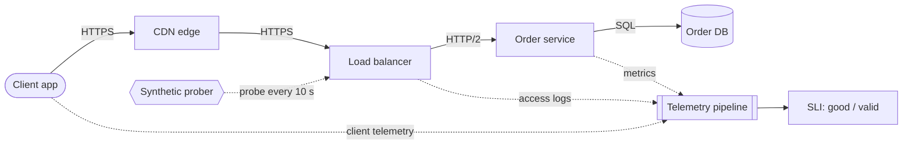

**Reading the diagram.** A request flows synchronously (solid arrows) from the client app through the CDN and load balancer to the order service and its database, the storage boundary. Four measurement points feed the telemetry pipeline asynchronously (dotted). *Server metrics* are precise but blind to failures upstream of the service (DNS, CDN, load balancer). *Load-balancer logs* see every request that arrived. *Client telemetry* sees what users saw, including network failures, but is noisy and delayed. The *synthetic prober* sends known-good requests, useful when real traffic is low, and yields a time-based measure. Most teams compute the SLI at the load balancer and validate it against client data; scaling the pipeline is a Chapter 40 topic.

::: formula
**Time-based and request-based availability**

$$A_{\text{time}} = \frac{\text{good intervals}}{\text{total intervals}} \qquad A_{\text{req}} = \frac{\text{good requests}}{\text{valid requests}}$$

| Symbol | Meaning | Units |
|---|---|---|
| good intervals | Intervals (e.g. minutes) whose error ratio stayed below a threshold, or whose probe succeeded | count |
| total intervals | All intervals in the measurement window | count |
| good requests | Valid requests served correctly (right status, within any latency bound in the definition) | count |
| valid requests | Requests that count toward the SLI; excludes, for example, client errors (4xx) and health checks | count |
| $A_{\text{time}}, A_{\text{req}}$ | Availability under each definition | dimensionless |
:::

::: example
**Worked example — One month, two availabilities.** QuickBite's order API receives 500,000 place-order requests per day, 15,000,000 in a 30-day month (43,200 minutes). Two incidents occur: (a) a 40-minute total outage at 03:00, when traffic is 1% of the daily volume per hour; (b) a 90-minute partial outage at the 19:00 peak, when 10% of the daily volume arrives per hour and 20% of requests fail. A minute counts as bad if more than 5% of its requests fail.

1. *Time-based:* incident (a) gives 40 bad minutes; incident (b) has a 20% error ratio, above the 5% threshold, so all 90 minutes are bad. $A_{\text{time}} = 1 - 130/43{,}200 = 1 - 0.00301 = 99.699\%$.
2. *Request-based, incident (a):* requests in 40 minutes at 1% of 500,000 per hour: $5{,}000 \times 40/60 = 3{,}333$ failed.
3. *Incident (b):* $50{,}000$ requests per hour $\times 1.5$ h $= 75{,}000$ requests, 20% failed $= 15{,}000$.
4. $A_{\text{req}} = 1 - (3{,}333 + 15{,}000)/15{,}000{,}000 = 1 - 0.00122 = 99.878\%$.

**Interpretation.** By time, the night outage costs 31% of the bad minutes; by requests, it costs 18% of the failures. Time-based measurement overweights quiet periods and counts a 20% partial failure as a full outage. Request-based measurement weights by user impact. **Engineering implication.** Use request-based availability for high-traffic services, and either a time-based measure or synthetic traffic for low-traffic ones, where a single failed request among ten would swing a request ratio wildly. Neither measure, on its own, says whether a few unlucky users suffered all the failures; per-user measures such as Google's windowed "user-uptime" address that [Hauer et al. 2020].
:::

**Table 39.1 — Time-based versus request-based availability.**

| Aspect | Time-based | Request-based |
|---|---|---|
| Unit | Good minutes / total minutes | Good requests / valid requests |
| Weighting | Every minute equal | Weighted by traffic |
| Partial outages | Binary per minute (threshold) | Proportional |
| Low traffic | Works (with probes) | Noisy; needs synthetic traffic |
| Pitfall | Threshold choice hides partial failure | Hides concentrated harm to a few users |

#### Common misconceptions

::: mistake
**Mistake — "The service returned 200, so it was available."** Availability means *correct* service. A 200 with an empty menu, a stale price or an error message in the body is a failure from the user's point of view (§8.6.4). Define "good" by what the user needed, and add correctness checks (for example, probes that verify response content) where silent wrong answers are possible.
:::

## 39.4 Fault tolerance and redundancy

### 39.4.1 Redundancy across failure domains

::: definition
**Definition — Fault tolerance, redundancy and failure domain.** **Fault tolerance** is the ability to keep providing correct service despite faults in some components. **Redundancy** is extra capacity or extra copies that make this possible. A **failure domain** is a set of components that can fail together because they share something: a power feed, a rack switch, a zone, a region, a software version, a configuration system or an operator.
:::

#### First-principles explanation

A spare tire helps only if it is not flat for the same reason as the first one. Carrying two spare tires inside the same trunk does nothing if the trunk is what catches fire. Redundancy therefore has two parts: *how many* spares (N+1, N+2, 2N) and *how independent* they are (different racks, zones, regions, versions, people).

The common schemes, with $N$ the number of units needed to carry peak load:

- **N** — no redundancy; any failure loses capacity.
- **N+1** — one spare: survives one unit failure.
- **N+2** — two spares: survives a failure while another unit is down for maintenance or a deploy, the usual default for services [Beyer et al. 2016].
- **2N** — a full duplicate, often in another failure domain: survives the loss of half the fleet, for example a whole zone of two.
- **Zone-level static stability** — enough capacity in the surviving zones to carry peak *without scaling action* after losing a zone [Weiss and Furr 2020].

Chapter 18 already computes the cost: for QuickBite, N+2 needs 14 API nodes and zone-safe provisioning across three zones needs 18 (§18.11.2). We do not repeat that arithmetic here; we focus on where the spares live and what can still take them all out at once.

Redundancy also comes in temperatures: **active–active** units all serve traffic, so they are known to work; a **hot standby** runs and replicates but its readiness is unproven until used; **warm** and **cold** standbys need start-up or restoration first. Failover has its own hazards (fencing, split brain; §26.12, §27.11).

**Figure 39.2 — QuickBite across three zones with zone-level static stability.**

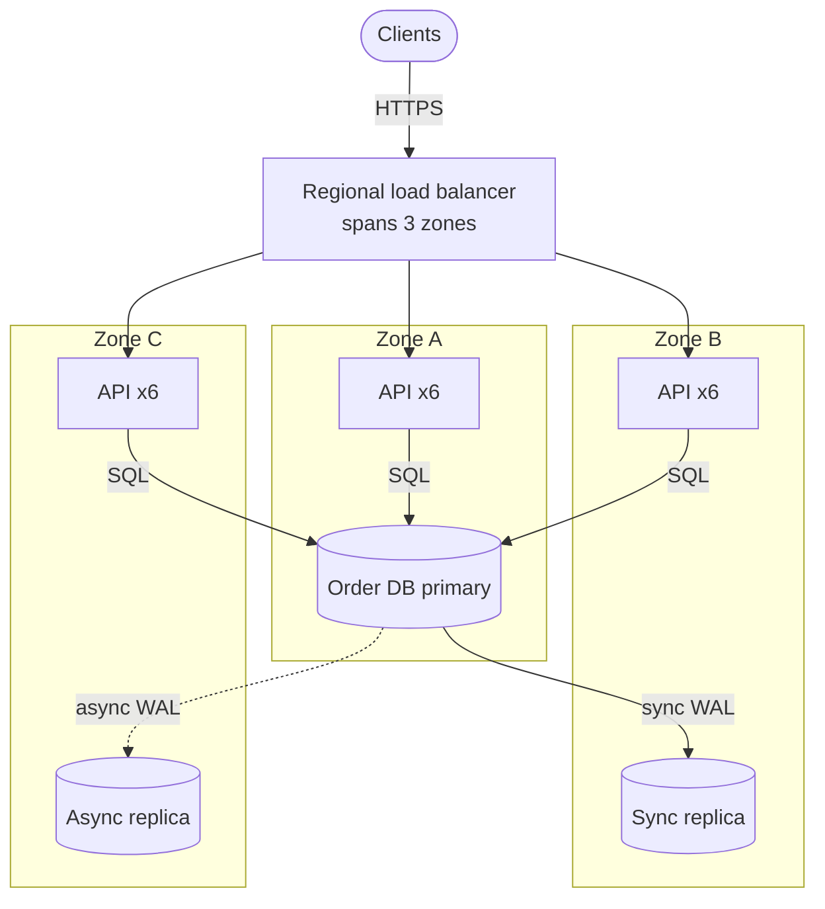

**Reading the diagram.** Clients reach a zone-redundant regional load balancer, which spreads HTTPS requests over three groups of six stateless API nodes; any two groups carry peak load (§18.11.2). All API nodes send SQL synchronously to the primary in Zone A, which ships each commit synchronously to Zone B before acknowledging it, so a zone loss loses no confirmed order (N3, RPO = 0), and asynchronously to Zone C. The cylinders are the storage boundary. Failure points: losing Zone A forces a failover to Zone B (§27.11), with seconds of failed writes; losing Zone B stalls commits unless Zone C becomes the synchronous replica. Scaling: add API nodes evenly per zone; the single write primary is the limit (Chapter 14).

### 39.4.2 Independence assumptions and correlated failures

All the redundancy arithmetic of §4.14 multiplies probabilities, which is valid only if failures are independent. Real failures are often correlated: Ford et al. found that failures in Google's storage fleet frequently arrive in bursts that independence-based models underestimate by orders of magnitude [Ford et al. 2010]. The causes fall into a short list:

1. **Shared infrastructure** — power, cooling, top-of-rack switches, a zone's network.
2. **Shared software** — every replica runs the same binary, so the same input (a leap second, a malformed record) crashes all of them.
3. **Shared configuration and control planes** — one global configuration push, DNS change or feature-flag flip reaches every zone in seconds.
4. **Shared dependencies** — every "independent" replica calls the same identity, DNS or metadata service.
5. **Shared load** — when one replica fails, its traffic moves to the others, which then overload: a **cascading failure** (§22.9).
6. **Shared people and process** — the same operator, runbook or automation acting on every unit.

**Figure 39.3 — Redundant replicas with hidden shared fate.**

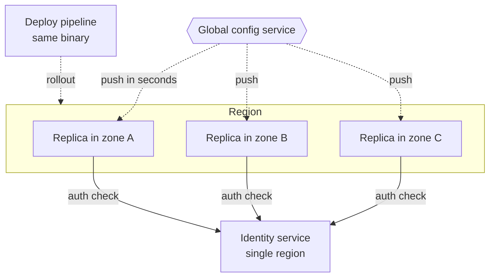

**Reading the diagram.** Three replicas in three zones look independent. Dotted arrows are asynchronous pushes: a global configuration service sends the same configuration to all three within seconds, and the deploy pipeline ships the same binary. Solid arrows are synchronous per-request calls to a single identity service. Each is a failure point that defeats zone redundancy, and adding replicas does not help; the shared state is configuration, not data. What helps is staging global changes zone by zone, caching identity decisions to ride out short identity outages, and letting each replica run on its last known good configuration (§39.5).

::: formula
**Common-cause (beta-factor) model for a redundant pair**

$$U_{\text{pair}} \approx \beta\,U + \left((1-\beta)\,U\right)^2 \qquad A_{\text{pair}} = 1 - U_{\text{pair}}$$

| Symbol | Meaning | Units |
|---|---|---|
| $U$ | Unavailability of one unit, $1 - A$ | dimensionless |
| $\beta$ | Fraction of a unit's failures that are common-cause, hitting both units at once | dimensionless (0–1) |
| $U_{\text{pair}}$ | Probability both units are down | dimensionless |
| $A_{\text{pair}}$ | Availability of the redundant pair | dimensionless |
:::

The model, borrowed from safety engineering, splits each unit's unavailability into a common-cause part $\beta U$, which takes both units down, and an independent part $(1-\beta)U$, which must happen to both units at the same time. The approximation drops a small cross term.

::: example
**Worked example — How 10% shared fate costs two nines.** Two zones, each 99.9% available ($U = 0.001$).

1. *Independent ($\beta = 0$):* $U_{\text{pair}} = (0.001)^2 = 10^{-6}$, $A = 99.9999\%$, about 2.6 s of downtime per 30 days.
2. *With $\beta = 0.1$:* common part $0.1 \times 0.001 = 1.0 \times 10^{-4}$; independent part $(0.9 \times 0.001)^2 = 8.1 \times 10^{-7}$; total $1.008 \times 10^{-4}$.
3. $A_{\text{pair}} = 1 - 0.0001008 = 99.990\%$, about 4.4 min per 30 days.

**Interpretation.** If only one failure in ten is shared, the pair is about 100 times less available than the independent model predicts, and the common-cause term dominates completely. **Engineering implication.** Once you have two zones, adding a third buys little; removing shared fate buys a lot. Stage configuration and binary rollouts per failure domain, avoid synchronous global dependencies, and test zone evacuation. Treat any availability estimate that multiplies independent probabilities as an upper bound.
:::

::: industry
**Meta, 4 October 2021.** During maintenance, a command meant to assess backbone capacity disconnected all of Meta's data centers from the backbone; an audit tool that should have blocked it had a bug. Meta's DNS servers, designed to withdraw their BGP advertisements when they cannot reach the data centers, all withdrew at once and became unreachable. Recovery was slow because out-of-band access also depended on the backbone and engineers had to work on site. Redundant DNS sites failed together because they shared one health rule and one backbone.
*Evidence: Primary* — [Janardhan 2021]
:::

#### Failure scenarios

| What goes wrong | Why | Detection | Recovery | Prevention |
|---|---|---|---|---|
| All zones crash on one bad config | Global push, shared code path | Error SLI spikes in every zone at once | Roll back config; serve last known good | Staged per-zone rollout, config validation, canaries (Chapter 43) |
| Survivors overload after zone loss | Sized N+2, not zone-safe | Utilization and latency jump | Shed non-critical load (§22.9) | Static stability (§18.11.2) |
| Failover never completes | Standby untested; replica lag | Failover runbook times out | Manual promotion | Regular failover drills (§39.11) |
| Two primaries after network split | Detector fails over a live primary | Conflicting writes | Fence the old primary | Quorum, leases, fencing tokens (§26.12–§26.13) |

::: mistake
**Mistake — "We are multi-zone, so we are highly available."** Zones protect against zone-scoped faults: power, cooling, local network. They do nothing against a bad deploy, an expired certificate, a global configuration error or a regional control-plane failure, which together cause a large share of real outages. Ask, for each redundant set, "what single change could break all of these at once?"
:::

## 39.5 Graceful degradation

### 39.5.1 Degrade instead of failing

::: definition
**Definition — Graceful degradation.** A design property in which, under failure or overload, a system keeps delivering its most important functions, possibly with reduced quality (staler data, fewer features, simpler results), instead of failing completely.
:::

#### First-principles explanation

When a restaurant's oven breaks, a good kitchen does not close; it switches to the cold menu and tells guests. That requires a decision made in advance: which dishes matter most, and what the cold alternative is. Software is the same. You decide, before the incident, which features are critical, which are nice to have, and what each one falls back to.

#### Why does this exist?

Composition punishes long dependency chains: a page that needs ten 99.9% services in series is at most 99.0% available (§4.14.2). Most of those dependencies, however, are not essential to the user's goal. If the recommendation carousel fails, a customer can still order. Graceful degradation turns hard dependencies into **soft dependencies**: their failure lowers quality but not availability of the critical journey.

#### How it works internally

1. **Tier the features.** Classify each feature by business criticality. Table 39.2 shows QuickBite's tiers.
2. **Define a fallback for each non-critical call.** Options, from best to worst: a cached or stale value (stale-if-error, §20.11.3); a simpler computation (popular items instead of personalized ones); a static default; omitting the feature.
3. **Bound the wait.** A fallback is useless if the caller first waits 30 s for the dependency. Combine fallbacks with deadlines and circuit breakers (§22.11, §22.13), so the fallback is chosen within milliseconds once a dependency is known to be failing.
4. **Shed or switch off load deliberately** when the system is overloaded: drop lower tiers first (§22.9).
5. **Keep a static fallback page.** For a total outage, serve a static page from the CDN or object storage that says what is happening and what still works, so users see a clear message instead of a browser error.
6. **Make degraded modes visible** in metrics and in the UI, and test them: a fallback that is never exercised tends to be broken when needed.

**Table 39.2 — QuickBite feature tiers and fallbacks.**

| Tier | Features | On dependency failure | Shed under overload |
|---|---|---|---|
| 0 — critical | Place order, payment, order status | Retry within deadline; secondary payment provider; fail clearly | Never (last to go) |
| 1 — important | Search, menus, courier tracking | Cached menus (≤ 60 s stale); last known courier position | After tier 2 and 3 |
| 2 — enhancing | Personalized recommendations, ETA model | Popular-near-you list; static ETA range | Early |
| 3 — optional | Reviews, promotions banner, analytics beacons | Hide the widget; drop beacons | First |

**Figure 39.4 — Choosing a response for one request under failure.**

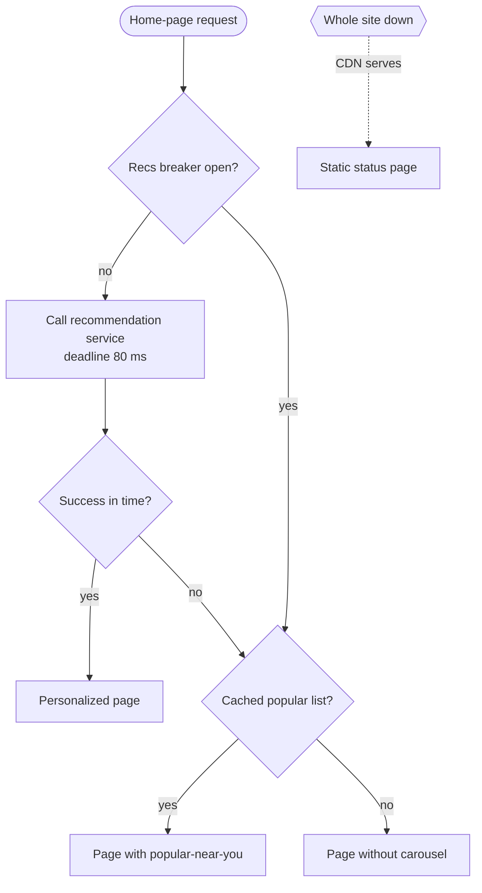

**Reading the diagram.** The home-page request first checks the recommendation service's circuit breaker (§22.13). If closed, it makes a synchronous call with an 80 ms deadline; success yields the personalized page. A timeout, error or open breaker leads to the fallback: a cached "popular near you" list built asynchronously by a batch job (the cache is the storage boundary, not drawn), or a page without the carousel. The dotted path is the last defense: if the origin is down, the CDN serves a static page. Failure points: a fallback that calls a failing dependency, a breaker that never closes. Degraded mode is cheaper than the primary path, so it *reduces* load and helps recovery.

#### Brownouts

A **brownout** is degradation used as a control mechanism, not only as a failure response. Klein et al. proposed marking parts of a response as optional and serving them only with a probability called the **dimmer**; a controller lowers the dimmer when response time rises above its target and raises it when there is headroom, so the application keeps latency bounded under overload at the cost of fewer optional features [Klein et al. 2014]. The same idea can be used on purpose: deliberately switching off optional features for a small share of traffic in a game day proves that the fallbacks work.

#### Mathematical foundations

::: formula
**Effective success with a fallback**

$$A_{\text{eff}} = A_d + (1 - A_d)\,A_f \qquad Q = A_d \cdot 1 + (1 - A_d)\,A_f\,q_f$$

| Symbol | Meaning | Units |
|---|---|---|
| $A_d$ | Availability of the primary dependency within its deadline | dimensionless |
| $A_f$ | Availability of the fallback, given the primary failed | dimensionless |
| $A_{\text{eff}}$ | Probability the caller gets some acceptable answer | dimensionless |
| $q_f$ | Relative quality (or value) of the fallback answer, 1 = as good as primary | dimensionless (0–1) |
| $Q$ | Expected quality per request | dimensionless |
:::

::: example
**Worked example — What the popular-items fallback is worth.** QuickBite's recommendation service meets its 80 ms deadline 99.5% of the time ($A_d = 0.995$). The cached popular list is available 99.99% of the time *when the recommendation service is failing* ($A_f = 0.9999$) and, from A/B tests, produces 70% of the click-through of personalized results ($q_f = 0.7$).

1. Without a fallback, the carousel is missing for $1 - 0.995 = 0.5\%$ of page views; if the page *required* it, the home page would be only 99.5% available.
2. With the fallback: $A_{\text{eff}} = 0.995 + 0.005 \times 0.9999 = 0.995 + 0.0049995 = 0.9999995$.
3. Expected quality: $Q = 0.995 + 0.005 \times 0.9999 \times 0.7 = 0.995 + 0.0034997 = 0.9985$.

**Interpretation.** The fallback lifts the carousel from 99.5% to six nines of "something useful", at a cost of 0.15% of recommendation quality. **Engineering implication.** The independence of $A_f$ from the primary failure is the critical assumption: if the popular list is stored in the same cache cluster that is failing, $A_f$ collapses. Keep fallbacks on different infrastructure, and measure $A_f$ by exercising the fallback regularly.
:::

#### Real-world industry applications

::: industry
**Amazon on the risks of fallback.** The Amazon Builders' Library argues that fallback logic is hard to test, is exercised only during rare failures, and can make an outage worse: for example, a fallback that shifts load onto a different, smaller system that then also fails. Amazon's guidance prefers making the primary path more reliable, keeping systems statically stable, and using fallbacks only when they are simple and exercised continuously, for example by pushing data proactively so the "fallback" is the normal path.
*Evidence: Primary* — [Gabrielson 2019]
:::

#### Advantages and disadvantages

Graceful degradation raises the availability of critical journeys cheaply and reduces load during incidents. Its costs are more code paths, more test cases, user-visible inconsistency (stale menus, missing features) and the risk of a fallback that silently stays on. Keep degraded modes observable: a "degraded responses" metric per feature, alerted when it stays high.

::: mistake
**Mistake — Degrading the critical path.** Serving a cached price when placing an order, or skipping fraud checks under load, trades a small availability gain for financial loss. Degradation applies to tiers 1–3; tier 0 either succeeds correctly or fails clearly and safely.
:::

## 39.6 SLI, SLO and SLA

### 39.6.1 Three layers of a reliability promise

::: definition
**Definition — SLI, SLO, SLA.** A **service level indicator (SLI)** is a carefully defined quantitative measure of some aspect of the service as users experience it, best expressed as the ratio of good events to valid events. A **service level objective (SLO)** is a target for an SLI over a time window, for example "99.95% of valid place-order requests succeed, over a rolling 28 days". A **service level agreement (SLA)** is a contract with a customer that states objectives and the consequences, usually financial service credits, of missing them [Beyer et al. 2016].
:::

#### First-principles explanation

A parcel company measures the fraction of parcels delivered by the promised day: that measurement is the SLI. Internally it aims for 99%: the SLO. In the contract with a large shop it promises 97%, with a refund if it misses: the SLA. The internal target is stricter than the contract so that the company notices and reacts long before it owes money. The same layering applies to software.

#### Why does this exist?

Without an agreed SLO, every incident becomes an argument ("is this bad?") and every release decision is a negotiation between developers who want speed and operators who want stability. An SLO turns "reliable enough" into a number that product, engineering and operations agreed on in advance, and the error budget of §39.7 turns that number into a decision rule.

**Figure 39.5 — From raw events to SLI, SLO, error budget and SLA.**

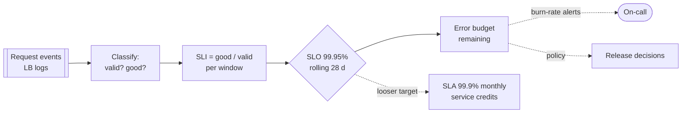

**Reading the diagram.** Request events from load-balancer logs are classified as valid or not (health checks and client errors excluded) and good or bad; the SLI is their ratio per window. The SLO compares it with the target over a rolling window, yielding the remaining error budget, which two asynchronous consumers use: burn-rate alerts page the on-call engineer (§39.7.3), and the error-budget policy gates releases. The SLA is derived with a looser target and a calendar-month window. The storage boundary is the event store; its failure point is a broken pipeline that makes the SLI read 100% while users suffer, so alert on missing data too.

### 39.6.2 Choosing SLIs per user journey

Start from **user journeys**, not from components: "a customer places an order", "a restaurant receives a new order". For each journey, ask what the user would notice and pick a small number of SLIs, usually from a standard menu [Beyer et al. 2016; Beyer et al. 2018]:

**Table 39.3 — SLI menu by kind of system.**

| System kind | SLI types | QuickBite example |
|---|---|---|
| Request-driven (APIs, web) | Availability, latency, quality (degraded answers) | Place-order success ratio; p99 latency below 800 ms |
| Pipeline (batch, streaming) | Freshness, correctness, coverage | Courier position at most 10 s old (F2) |
| Storage | Durability, availability, latency of reads/writes | Confirmed orders never lost (N3) |
| Asynchronous delivery | End-to-end delay, delivery ratio | New order on restaurant tablet within 5 s (F3) |

Rules: measure as close to the user as practical (Figure 39.1); exclude requests that are not the service's fault (4xx) but include 429s caused by its own overload; use ratios of events so SLIs compose into budgets; keep one to three SLIs per journey; and pick thresholds users care about (if users abandon checkout after 2 s, a 10 s threshold measures nothing).

### 39.6.3 Percentile SLIs

Latency is a distribution, and SLOs are about its tail (§4.8). The robust way to express "p99 below 800 ms" as an SLI is to *count* requests faster than the threshold:

::: formula
**Latency SLI as a ratio**

$$\text{SLI}_{\text{lat}} = \frac{\#\{\text{valid requests with latency} \le \tau\}}{\#\{\text{valid requests}\}} \qquad \text{SLO: } \text{SLI}_{\text{lat}} \ge p$$

| Symbol | Meaning | Units |
|---|---|---|
| $\tau$ | Latency threshold | ms |
| $p$ | Target fraction of fast requests (0.99 for a "p99" objective) | dimensionless |
| $\text{SLI}_{\text{lat}}$ | Fraction of valid requests at or below the threshold | dimensionless |
:::

Stating the SLO this way makes "p99 < 800 ms" and "99% of requests ≤ 800 ms" the same statement, but the ratio form can be summed across servers and time windows, while percentiles cannot be averaged (§40.5.2). In a histogram-based metrics system, make $\tau$ a bucket boundary so the count is exact.

::: example
**Worked example — Is the latency SLO met, and how much budget is left?** QuickBite's place-order SLO is "99% of valid requests complete within 800 ms over 28 days". In the first 14 days the order API served 7,000,000 valid requests; the 800 ms histogram bucket counted 6,941,000 at or below 800 ms. The daily p99 values, read from dashboards, ranged from 610 ms to 1,150 ms.

1. $\text{SLI}_{\text{lat}} = 6{,}941{,}000 / 7{,}000{,}000 = 0.99157$, i.e. 99.157% ≥ 99%: so far, met.
2. Slow requests allowed so far: $1\% \times 7{,}000{,}000 = 70{,}000$; slow requests observed: $59{,}000$, so $59{,}000/70{,}000 = 84\%$ of the half-window allowance is spent.
3. Projected over 28 days (about 14,000,000 requests): allowance 140,000; spent 59,000, i.e. 42% of the full-window latency budget in half the window.

**Interpretation.** The ratio answers the question directly and composes; averaging daily p99 values (here somewhere near 800 ms) would answer nothing. **Engineering implication.** Store latency as histograms with a bucket at every SLO threshold, compute latency SLIs as counts, and treat the latency budget exactly like the availability budget.
:::

### 39.6.4 A worked SLO specification for an API

An SLO is only useful if it is precise enough that two engineers computing it from the same logs get the same number. The SRE Workbook recommends writing a short SLO document per service with the SLI specification, its implementation, the window and the rationale [Beyer et al. 2018].

**Table 39.4 — SLO specification for QuickBite's `POST /v1/orders`.**

| Field | Value |
|---|---|
| Journey | Customer places an order |
| Valid events | All `POST /v1/orders` requests at the regional load balancer, excluding 4xx other than 429, health checks and synthetic load tests |
| Availability SLI | Responses with status 2xx, or 409 for a duplicate idempotency key (§22.15), divided by valid events |
| Latency SLI | Valid requests completed within 800 ms at the load balancer, excluding payment-provider time reported in a response header |
| Availability SLO | 99.95% over a rolling 28-day window |
| Latency SLO | 99% within 800 ms over a rolling 28-day window |
| Error budget | 0.05% of valid requests (about 7,000 failed orders per 28 days at 500,000 orders/day) |
| Measurement source | Load-balancer access logs, cross-checked weekly with client telemetry |
| Rationale | Negotiated in Chapter 2 (N1, N2); users retry once, so brief failures cost little |

### 39.6.5 SLAs and service credits

An SLA differs from an SLO in three ways: a looser target, usually a calendar-month window, and definitions (downtime, exclusions, claims) written for contracts. Public cloud SLAs typically commit to a monthly uptime percentage and pay tiered service credits, a percentage of the monthly bill that grows as availability falls; for example, AWS's compute SLA commits to 99.99% region-level monthly uptime with credits starting at 10% below that level (as of 2025) [AWS Compute SLA]. Credits are small compared with customers' own losses: an SLA signals confidence; it is not insurance.

::: example
**Worked example — Setting the SLA below the SLO.** QuickBite sells a restaurant-chain API with an SLA (illustrative) of 99.9% monthly availability: 10% credit below 99.9%, 25% below 99.5%. A chain pays $40,000 per month. The internal SLO is 99.95% over 28 days.

1. SLA allowance per 30-day month: $0.001 \times 43{,}200 = 43.2$ min. SLO allowance per 28 days: $0.0005 \times 40{,}320 = 20.2$ min.
2. To breach the SLA, the service must fail at twice its SLO's allowed rate, by which point the error-budget policy (§39.7.2) has frozen releases.
3. A month at 99.8% availability costs $0.10 \times 40{,}000 = \$4{,}000$ in credits; at 99.4%, $\$10{,}000$.

**Interpretation.** The SLO–SLA gap is a safety margin measured in minutes. **Engineering implication.** Set the SLA at or below the level you have *achieved* historically, and make SLA exclusions match the SLI's definition of valid events.
:::

### 39.6.6 The composite SLO of dependent services

A service cannot be more available than the dependencies it calls *synchronously and without fallback*. Treynor et al. turned this into a design rule: each critical dependency should be roughly an order of magnitude more available than the service that depends on it ("the rule of the extra 9"), or the service must be designed to tolerate its failures [Treynor et al. 2017].

**Figure 39.6 — Dependencies of the place-order journey.**

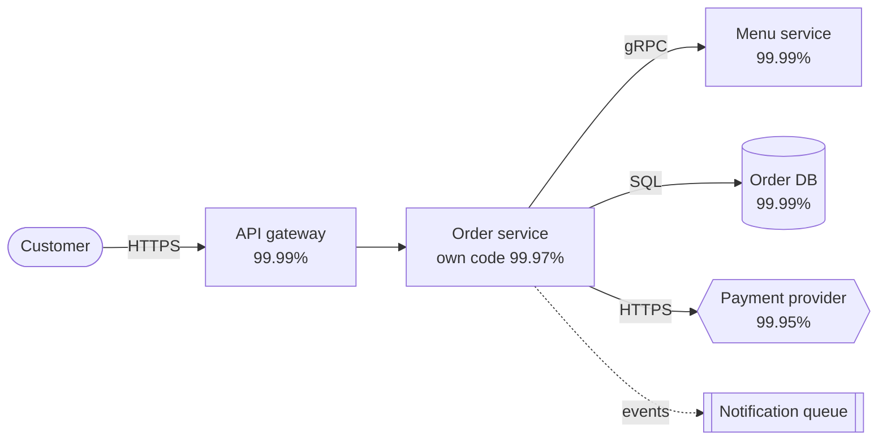

**Reading the diagram.** A customer's HTTPS request passes the API gateway to the order service, which synchronously checks the menu over gRPC, writes the order to the database (the storage boundary) and authorizes payment with an external provider over HTTPS. Each synchronous hop is in series and is a failure point. Notifications are published asynchronously to a queue (dotted), so their failure does not fail the order. Scaling each service does not change the composition; changing which calls are synchronous does.

::: formula
**Composite availability of a service with dependencies**

$$A_{\text{journey}} \le A_{\text{own}} \times \prod_{i \in \text{hard deps}} A_i \qquad A_i^{\text{soft}} = 1 - (1 - A_i)(1 - A_{f,i})$$

| Symbol | Meaning | Units |
|---|---|---|
| $A_{\text{own}}$ | Availability of the service's own code and infrastructure | dimensionless |
| $A_i$ | Availability of hard (synchronous, no fallback) dependency $i$ | dimensionless |
| $A_{f,i}$ | Availability of the fallback for dependency $i$ when it is made soft | dimensionless |
| $A_i^{\text{soft}}$ | Effective availability of dependency $i$ with an independent fallback | dimensionless |
| $A_{\text{journey}}$ | Upper bound on availability of the journey | dimensionless |
:::

The product is the series rule of §4.14.2 applied to a dependency graph; the soft form is the parallel rule, and both assume independence (§39.4.2).

::: example
**Worked example — Can place-order meet 99.95%?** Use Figure 39.6's numbers.

1. *As drawn:* $0.9999 \times 0.9997 \times 0.9999 \times 0.9999 \times 0.9995 = 0.99890$, i.e. 99.890%, about 47.5 min of failure per 30 days against a 21.6-min budget. The SLO is unreachable.
2. *Add a second payment provider* used on failure ($A_f = 0.999$): $A_{\text{pay}}^{\text{soft}} = 1 - 0.0005 \times 0.001 = 0.9999995$. Journey: $0.9999 \times 0.9997 \times 0.9999 \times 0.9999 \times 0.9999995 = 0.99940$, still short.
3. *Make the menu check soft* by validating against a local menu cache refreshed every 60 s, with prices re-checked at commit from the database, so $A_{\text{menu}} \approx 0.999999$: $0.9999 \times 0.9997 \times 0.999999 \times 0.9999 \times 0.9999995 = 0.99950$ (0.999499 before rounding), a hair below target with no margin.
4. *Raise own availability* to 99.98% through safer deployments (canaries, Chapter 43): $0.9999 \times 0.9998 \times 0.999999 \times 0.9999 \times 0.9999995 = 0.99960$, which leaves about 20% of the budget as margin.

**Interpretation.** A 99.95% journey cannot be built on a 99.95% hard dependency; every hard dependency spends budget, and the service's own code usually spends the most. **Engineering implication.** Draw the dependency graph of each critical journey, compute the product, and fix the shortfall by making dependencies soft (fallbacks, caches, asynchrony) or by obtaining a better-than-target dependency, not by hoping. The same calculation tells you which SLO to *ask* of an internal dependency.
:::

::: mistake
**Mistake — Setting the SLO to the current measured availability, or to 100%.** An SLO equal to today's performance turns every bad day into a violation and freezes improvement; 100% leaves no budget for change and is unachievable because users' own networks are less reliable [Beyer et al. 2016]. Start from user need and business cost, check feasibility with the composite calculation, and revisit quarterly.
:::

## 39.7 Error budgets

### 39.7.1 The budget

::: definition
**Definition — Error budget.** The amount of unreliability an SLO permits over its window: $1 - \text{SLO}$, expressed as a number of bad requests or bad minutes. While budget remains, the team may spend it on risk (releases, experiments, migrations); when it is exhausted, reliability work takes priority [Beyer et al. 2016].
:::

#### First-principles explanation

A household budget does not say "never spend money"; it says how much you may spend so that you can choose what to spend it on. An error budget does the same for failures. It ends the false choice between "ship faster" and "be stable": both sides agree on the SLO, and the remaining budget decides, with data, whether the next risky release goes out this week.

::: formula
**Error budget for a window**

$$B_{\text{req}} = (1 - \text{SLO}) \times N_{\text{valid}} \qquad B_{\text{time}} = (1 - \text{SLO}) \times T$$

| Symbol | Meaning | Units |
|---|---|---|
| SLO | Target fraction of good events | dimensionless |
| $N_{\text{valid}}$ | Valid events expected in the window | requests |
| $T$ | Window length | minutes |
| $B_{\text{req}}$ | Budget in bad requests | requests |
| $B_{\text{time}}$ | Budget in minutes of total outage (equivalently, bad-request-minutes at 100% error) | minutes |
:::

::: example
**Worked example — QuickBite's budgets for 28- and 30-day windows.**

1. 30 days = 43,200 min; 28 days = 40,320 min.
2. Browsing, 99.9%: $0.001 \times 43{,}200 = 43.2$ min; $0.001 \times 40{,}320 = 40.3$ min.
3. Place order, 99.95%: $0.0005 \times 43{,}200 = 21.6$ min; $0.0005 \times 40{,}320 = 20.2$ min.
4. Requests, place order over 28 days: $500{,}000 \times 28 = 14{,}000{,}000$ valid requests; $B_{\text{req}} = 0.0005 \times 14{,}000{,}000 = 7{,}000$ failed orders.
5. One incident failing 30% of orders for 45 minutes at average traffic: $0.30 \times 45 = 13.5$ full-outage-equivalent minutes, $13.5/20.2 = 67\%$ of the 28-day budget.

**Interpretation.** One moderate incident can consume two thirds of a month's budget for a 99.95% service. **Engineering implication.** A 28-day rolling window always contains exactly four of each weekday, so weekly traffic patterns do not distort it, and it never "resets" at month end; calendar months suit SLAs and reporting. Choose rolling windows for operational decisions.
:::

**Table 39.5 — Error budget by SLO and window.**

| SLO | 28 days (min) | 30 days (min) | Per week (min) | Bad requests per 10⁶ |
|---|---|---|---|---|
| 99% | 403.2 | 432.0 | 100.8 | 10,000 |
| 99.5% | 201.6 | 216.0 | 50.4 | 5,000 |
| 99.9% | 40.3 | 43.2 | 10.1 | 1,000 |
| 99.95% | 20.2 | 21.6 | 5.0 | 500 |
| 99.99% | 4.0 | 4.3 | 1.0 | 100 |

### 39.7.2 The error-budget policy

A budget without consequences is a dashboard. An **error-budget policy** is a document, agreed by product and engineering leadership, that states what happens as the budget is spent. The SRE Workbook's example policy says, in essence, that if the service has exceeded its error budget for the preceding four-week window, all changes and releases other than P0 issues or security fixes are halted until the service is back within its SLO; that a single incident consuming more than 20% of the budget over four weeks requires a postmortem; and that disagreements are escalated to a named executive [Beyer et al. 2018].

**Figure 39.7 — An error-budget policy as a state machine.**

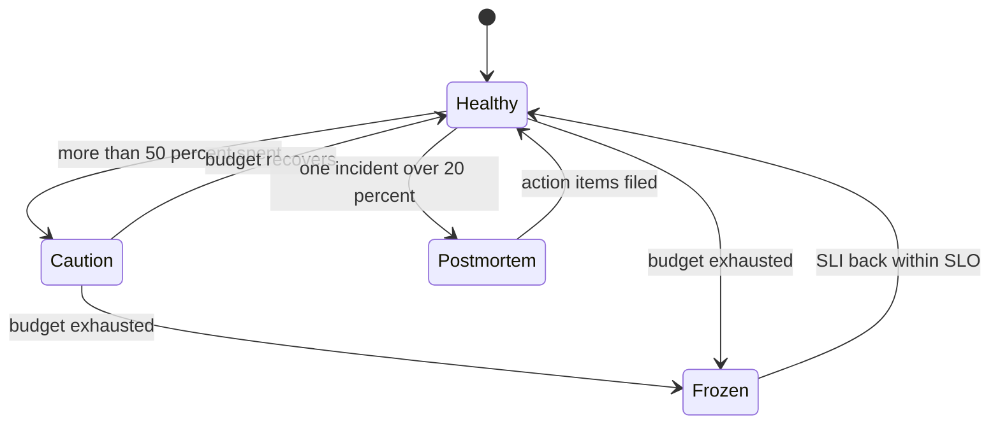

**Reading the diagram.** States describe the team's release posture, driven by the rolling-window budget; there is no data flow. In **Healthy**, normal releases proceed. In **Caution** (an illustrative intermediate state many teams add), risky changes need extra review and canaries run longer. When the budget is exhausted, the team enters **Frozen**: only fixes and security patches ship and engineering time moves to reliability work until the SLI is back within the SLO for the window. Independently, any single incident that consumed more than 20% of the budget triggers a mandatory postmortem (§39.12). The failure point of any policy is enforcement: write it down in advance and have leadership sign it, so it is applied in the heat of a deadline.

### 39.7.3 Burn rate and multiwindow, multi-burn-rate alerting

#### Why simple alerts fail

Alerting on "error ratio > 0.1% over 10 minutes" for a 99.9% SLO pages on every short blip that uses a tiny fraction of the budget (poor **precision**), while a steady 0.08% error ratio, which never trips it, quietly consumes 80% of the budget (poor **recall**). The SRE Workbook evaluates several designs against four properties, precision, recall, **detection time** and **reset time**, and recommends alerting on the *rate at which the budget is being consumed* over two windows at once [Beyer et al. 2018].

::: formula
**Burn rate, alert threshold and time to exhaustion**

$$b = \frac{e}{1 - \text{SLO}} \qquad b_{\text{alert}} = \frac{f \times P}{W} \qquad t_{\text{exhaust}} = \frac{(1 - s)\,P}{b} \qquad t_{\text{detect}} = \frac{(1 - \text{SLO})\, b_{\text{alert}}\, W}{e}$$

| Symbol | Meaning | Units |
|---|---|---|
| $e$ | Observed error ratio over a window | dimensionless |
| $b$ | Burn rate: multiple of the sustainable consumption rate (1 = budget lasts exactly the period) | dimensionless |
| $P$ | SLO period | hours |
| $f$ | Fraction of the period's budget that may be consumed before the alert fires | dimensionless |
| $W$ | Long alert window | hours |
| $b_{\text{alert}}$ | Burn-rate threshold for the alert | dimensionless |
| $s$ | Fraction of the budget already spent | dimensionless |
| $t_{\text{exhaust}}$ | Time until the budget is gone at burn rate $b$ | hours |
| $t_{\text{detect}}$ | Time for a constant error ratio $e$ to trip the long window, starting from a clean window ($e \ge (1-\text{SLO})\, b_{\text{alert}}$) | hours |
:::

**Derivation.** At error ratio $e$, budget is consumed at $e/(1-\text{SLO})$ times the sustainable rate, which is $b$. Consuming fraction $f$ of the budget in window $W$ means $b \times W/P = f$, so $b_{\text{alert}} = fP/W$. With $1 - s$ of the budget left and burn rate $b$, the remaining budget lasts $(1-s)P/b$. The long window's average error ratio reaches the alert level $(1-\text{SLO})\,b_{\text{alert}}$ after $t$ hours of error ratio $e$ when $e\,t/W = (1-\text{SLO})\,b_{\text{alert}}$.

::: example
**Worked example — Recomputing the Workbook's 14.4, 6 and 1.** The SRE Workbook recommends three alerts for a 30-day SLO: page if 2% of the budget is consumed in 1 hour, page if 5% is consumed in 6 hours, and open a ticket if 10% is consumed in 3 days, each with a short window of one twelfth of the long one [Beyer et al. 2018].

1. $P = 30 \times 24 = 720$ h.
2. Fast page: $b = 0.02 \times 720 / 1 = 14.4$. Slow page: $b = 0.05 \times 720/6 = 6$. Ticket: $b = 0.10 \times 720 / 72 = 1$.
3. As error ratios for a 99.9% SLO: $14.4 \times 0.001 = 1.44\%$, $6 \times 0.001 = 0.6\%$, $1 \times 0.001 = 0.1\%$.
4. Time to exhaustion from a full budget: $720/14.4 = 50$ h; $720/6 = 120$ h (5 days); $720/1 = 720$ h (30 days). A total outage, $e = 100\%$, burns at $b = 1/0.001 = 1{,}000$ and exhausts the budget in $720/1{,}000 = 0.72$ h = 43.2 min.
5. Detection time of the fast page for a total outage: $0.001 \times 14.4 \times 60 \text{ min} / 1.0 = 0.864$ min ≈ 52 s. For a 5% error ratio: $0.001 \times 14.4 \times 60/0.05 = 17.3$ min, by which time $0.05 \times 17.28 / 43.2 = 2\%$ of the budget has gone, exactly the design fraction.
6. For a 28-day window, $P = 672$ h: the same fractions give $13.44$, $5.6$ and $0.93$. Using 14.4 unchanged on a 28-day window pages at $14.4/672 \times 1 = 2.14\%$ consumption instead of 2%, a negligible difference.

**Interpretation.** Each alert fires when a fixed share of the budget is gone, whatever the error ratio: severe incidents are detected in about a minute, mild ones only when they matter. **Engineering implication.** Pick $f$ and $W$ by asking "how much budget may we lose before a human must act, and how fast?", then derive $b$; do not copy 14.4 without knowing what it encodes.
:::

#### Two windows per alert

A long window alone has a slow **reset time**: after a one-hour total outage ends, the 1-hour window still averages above 1.44% for most of the next hour, so the alert keeps firing after the fix. Requiring the *short* window (here 5 minutes) to exceed the same burn rate as well makes the alert stop within about 5 minutes of recovery while barely delaying detection.

**Table 39.6 — Multiwindow, multi-burn-rate alerts for a 99.9%, 30-day SLO.**

| Severity | Budget consumed | Long window | Short window | Burn rate | Error ratio | Detection at 100% errors |
|---|---|---|---|---|---|---|
| Page | 2% | 1 h | 5 min | 14.4 | 1.44% | 52 s |
| Page | 5% | 6 h | 30 min | 6 | 0.6% | 2.2 min |
| Ticket | 10% | 3 d | 6 h | 1 | 0.1% | 4.3 min |

**Figure 39.8 — Evaluating one multiwindow burn-rate alert.**

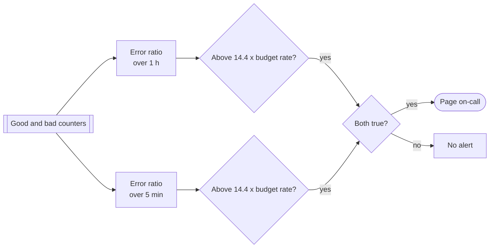

**Reading the diagram.** Good and bad request counters, stored as time series (the storage boundary), are evaluated over two windows every evaluation interval, typically 30–60 s. Each window's error ratio is compared with the same threshold, $14.4 \times (1 - \text{SLO})$. The page fires only if both comparisons are true: the long window proves the problem is significant, and the short window proves it is still happening. The same structure is repeated for each row of Table 39.6, so a single SLO has three rules. The failure points are missing data (counters stop, ratios become undefined: alert on absence separately) and very low traffic, where a few errors produce huge ratios. Prometheus recording rules for this pattern are shown in §40.10.

#### Code example: a burn-rate calculator

The program below derives the thresholds and then replays a synthetic incident minute by minute to show when each alert fires and how much budget is gone by then.

```python
"""Error-budget and multiwindow, multi-burn-rate calculator (minute resolution)."""
from dataclasses import dataclass

@dataclass
class AlertRule:
    name: str
    budget_fraction: float  # share of the period's budget spent before alerting
    long_min: int           # long window, minutes
    short_min: int          # short window, minutes (about long/12)
    action: str

def burn_rate_threshold(rule, period_min):
    """Burn rate that spends `budget_fraction` of the budget in `long_min`."""
    return rule.budget_fraction * period_min / rule.long_min

def window_ratio(bad, total, end, width):
    """Error ratio over the `width` minutes ending at minute `end` (inclusive)."""
    start = max(0, end - width + 1)
    b, t = sum(bad[start:end + 1]), sum(total[start:end + 1])
    return b / t if t else 0.0

def first_fire(rule, slo, period_min, bad, total):
    """First minute at which both windows burn faster than the threshold."""
    limit = burn_rate_threshold(rule, period_min) * (1 - slo)  # as an error ratio
    for m in range(len(total)):
        if (window_ratio(bad, total, m, rule.long_min) >= limit and
                window_ratio(bad, total, m, rule.short_min) >= limit):
            return m
    return None

SLO, PERIOD = 0.999, 30 * 24 * 60          # 99.9 % over 30 days, in minutes
RULES = [AlertRule("fast page", 0.02, 60, 5, "page"),
         AlertRule("slow page", 0.05, 360, 30, "page"),
         AlertRule("ticket", 0.10, 4320, 360, "ticket")]

print(f"Budget: {(1 - SLO) * PERIOD:.1f} bad minutes per 30 days")
for r in RULES:
    br = burn_rate_threshold(r, PERIOD)
    print(f"{r.name:9s} burn rate {br:5.1f}  error ratio >= {br * (1 - SLO):.3%}  "
          f"budget gone in {PERIOD / br / 60:6.1f} h  -> {r.action}")

# Synthetic traffic: 1,000 requests/minute; 4 quiet days (longer than the
# 3-day ticket window), then a 90-minute incident at a 5 % error ratio.
RPM, QUIET, INCIDENT = 1000, 4 * 24 * 60, 90
total = [RPM] * (QUIET + INCIDENT + 120)
bad = [RPM * 0.0002] * len(total)   # 0.02 % background errors (expected counts)
for m in range(QUIET, QUIET + INCIDENT):
    bad[m] = RPM * 0.05

budget_requests = (1 - SLO) * RPM * PERIOD   # budget in requests for the period
for r in RULES:
    m = first_fire(r, SLO, PERIOD, bad, total)
    if m is None:
        print(f"{r.name:9s} did not fire")
        continue
    spent = sum(bad[QUIET:m + 1]) / budget_requests
    print(f"{r.name:9s} fired {m - QUIET + 1:3d} min into the incident; "
          f"incident has spent {spent:.2%} of the 30-day budget")
```

Output (`python3`):

```text
Budget: 43.2 bad minutes per 30 days
fast page burn rate  14.4  error ratio >= 1.440%  budget gone in   50.0 h  -> page
slow page burn rate   6.0  error ratio >= 0.600%  budget gone in  120.0 h  -> page
ticket    burn rate   1.0  error ratio >= 0.100%  budget gone in  720.0 h  -> ticket
fast page fired  18 min into the incident; incident has spent 2.08% of the 30-day budget
slow page fired  42 min into the incident; incident has spent 4.86% of the 30-day budget
ticket    fired  70 min into the incident; incident has spent 8.10% of the 30-day budget
```

What to notice:

- `burn_rate_threshold` is the formula $fP/W$; nothing else in the program is specific to 14.4.
- `first_fire` requires *both* windows to exceed the threshold, exactly as in Figure 39.8.
- The fast page fires at minute 18, matching the hand calculation of 17.3 min, with about 2% of the budget spent: the alert is tuned to budget, not to error ratio.
- The slow page and ticket fire slightly *before* their nominal 5% and 10%, because the 0.02% background errors already fill part of their long windows.
- The quiet period exceeds the 3-day window on purpose: a partly empty long window fires early, a real effect for new services.

::: warning
**Warning — Burn-rate alerts on low-traffic services.** At 10 requests per minute, the 5-minute window holds 50 requests, so one failure is a 2% error ratio and trips a 14.4× alert on a 99.9% SLO. Options: generate synthetic traffic, aggregate several small services into one SLO, require a minimum number of failures before alerting, or lengthen windows and accept slower detection [Beyer et al. 2018].
:::

::: mistake
**Mistake — Treating the error budget as a quota to spend down to zero.** The budget is permission, not an obligation, and it is computed on a rolling window, so spending it all early leaves no room for the outage you did not plan. Equally, a budget that is never spent suggests the SLO is too strict or the team is too cautious.
:::

## 39.8 Disaster recovery, RTO and RPO

### 39.8.1 Recovery objectives

::: definition
**Definition — Disaster recovery, RTO, RPO.** **Disaster recovery (DR)** is the set of plans and mechanisms for restoring service and data after an event that redundancy within the normal deployment cannot absorb: loss of a region, mass data corruption, ransomware, a destructive operator error. The **recovery time objective (RTO)** is the maximum acceptable time from disruption to restored service. The **recovery point objective (RPO)** is the maximum acceptable amount of data loss, measured as time before the disruption whose writes may be lost [AWS 2021].
:::

#### First-principles explanation

If your house floods, two questions matter: how long until you can live somewhere again (RTO), and how many of your recent photos are gone because the last copy you kept elsewhere is from last month (RPO). Fault tolerance (§39.4) keeps the lights on through small events; DR is the plan for the flood. RPO is set by how often data leaves the failure domain (backup frequency or replication lag); RTO is set by how much of the recovery environment already exists and how much is automated.

#### How it works internally: four strategies

The AWS DR whitepaper describes four strategies of increasing cost and decreasing RTO/RPO [AWS 2021]:

1. **Backup and restore.** Data is backed up to another region; infrastructure is recreated from code only after a disaster. RPO and RTO in hours.
2. **Pilot light.** Data is replicated continuously to the recovery region and core infrastructure (databases) runs there, but application servers are switched off; they are started and scaled on failover. RPO in seconds to minutes, RTO in tens of minutes.
3. **Warm standby.** A scaled-down but fully functional copy runs in the recovery region and can take traffic at once, then scales up. RTO in minutes.
4. **Multi-site active–active.** Two or more regions serve production traffic simultaneously; losing one shifts traffic to the others. RTO near zero; RPO near zero or zero depending on the replication model (Chapter 44).

**Figure 39.9 — The four DR strategies.**

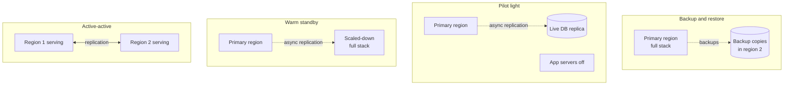

**Reading the diagram.** Each box is one strategy, primary region on the left and recovery region on the right. Dotted arrows are asynchronous data movement: periodic backups, continuous replication into a database with no application servers (pilot light), or into a smaller complete stack (warm standby). In active–active, both regions serve and replicate to each other, which needs conflict handling or per-record write ownership (Chapter 44). The storage boundary is wherever the recovery copy lives; its age is the RPO. Failure points: restore speed (backup and restore), scaling up during a regional event when other tenants do the same (pilot light, warm standby), and spare capacity in surviving regions (active–active, §18.11.2).

**Table 39.7 — DR strategies: cost versus RTO and RPO.**

| Strategy | Typical RPO | Typical RTO | Standing cost (vs. production) | Main risk |
|---|---|---|---|---|
| Backup and restore | Hours (backup interval) | Hours to a day | Storage only, a few % | Restore never tested; too slow |
| Pilot light | Seconds–minutes | Tens of minutes | Database replica, ~10–20% | Scale-up fails under pressure |
| Warm standby | Seconds–minutes | Minutes | Scaled-down stack, ~30–50% | Standby drifts from production |
| Active–active | Near zero to zero | Near zero | 100%+ plus complexity | Conflicts; correlated global faults |

The cost percentages are rough planning figures for illustration; the RPO/RTO ranges follow the AWS whitepaper's characterization [AWS 2021].

#### Mathematical foundations

::: formula
**Expected annual cost of a DR strategy**

$$C_{\text{total}} = C_{\text{DR}} + p \left( \text{RTO} \times c_{\text{down}} + \text{RPO} \times c_{\text{loss}} \right)$$

| Symbol | Meaning | Units |
|---|---|---|
| $C_{\text{DR}}$ | Standing annual cost of the strategy (infrastructure, licenses, drills) | $/year |
| $p$ | Expected number of disasters per year that require DR | events/year |
| RTO | Achieved recovery time | hours |
| $c_{\text{down}}$ | Cost of one hour of full outage (lost revenue, penalties) | $/hour |
| RPO | Achieved data-loss window | hours |
| $c_{\text{loss}}$ | Cost of losing one hour of writes (refunds, re-entry, trust) | $/hour of data |
| $C_{\text{total}}$ | Expected annual cost | $/year |
:::

::: example
**Worked example — Choosing QuickBite's regional DR tier (illustrative numbers).** Assume $p = 0.1$ region-scale events per year, $c_{\text{down}} = \$50{,}000$/h and $c_{\text{loss}} = \$200{,}000$ per hour of lost orders.

1. *Backup and restore* (RTO 10 h, RPO 1 h, $C_{\text{DR}} = \$8$k): $0.1 \times (10 \times 50\text{k} + 1 \times 200\text{k}) = 0.1 \times 700\text{k} = \$70$k; total $\$78$k.
2. *Pilot light* (RTO 1.5 h, RPO 3 min = 0.05 h, $\$40$k): $0.1 \times (75\text{k} + 10\text{k}) = \$8.5$k; total $\$48.5$k.
3. *Warm standby* (RTO 15 min, RPO 36 s = 0.01 h, $\$120$k): $0.1 \times (12.5\text{k} + 2\text{k}) = \$1.45$k; total $\$121.5$k.
4. *Active–active* (RTO ≈ 1 min, RPO ≈ 0, $\$350$k): $0.1 \times 1\text{k} = \$0.1$k; total $\$350.1$k.

**Interpretation.** Pilot light minimizes expected cost here. Backup and restore looks cheap until a disaster happens: one event costs $\$700$k, which may be unsurvivable for a start-up even if the long-run average is acceptable. **Engineering implication.** Expected value is a starting point, not the answer: add the worst single-event loss, regulatory RTO/RPO requirements and reputational effects, and note that DR tiers can differ per data set (pilot light for orders, backup and restore for analytics). Also note what this does *not* cover: QuickBite's RPO = 0 for orders applies to node and zone failures, achieved by synchronous replication within the region (Figure 39.2); cross-region replication is asynchronous, so region loss still risks seconds of orders.
:::

::: mistake
**Mistake — "Replication is our backup."** Replication copies mistakes as faithfully as data: a `DELETE` without a `WHERE`, a corrupting bug or ransomware encryption reaches every replica in seconds. DR needs at least one copy that is *delayed or immutable* (backups, snapshots with retention locks, delayed replicas), so you can go back to a point before the damage.
:::

## 39.9 Backup strategies

### 39.9.1 Full, incremental and differential backups

::: definition
**Definition — Backup types.** A **full backup** copies the entire data set. An **incremental backup** copies what changed since the *previous backup of any type*. A **differential backup** copies what changed since the *last full backup*. A **snapshot** is a point-in-time image, usually copy-on-write, taken by the storage layer.
:::

Restore needs a **chain**: a full backup plus every incremental since it, or a full backup plus the latest differential. Incrementals are small and fast to take, but restore needs every link to be present and valid; differentials grow through the week but restore from two pieces.

::: example
**Worked example — Weekly full with daily incrementals or differentials.** A 4 TB database changes 200 GB of distinct blocks per day (assume no block changes twice in a week, the worst case for differentials). Full backup on Sunday.

1. *Incremental:* six daily backups of 200 GB; weekly storage $4 + 6 \times 0.2 = 5.2$ TB; Saturday restore = full + 6 incrementals = 7 pieces, 5.2 TB read.
2. *Differential:* day $k$ holds $0.2k$ TB; storage $4 + 0.2(1+2+\dots+6) = 4 + 4.2 = 8.2$ TB; Saturday restore = full + 1 differential = 2 pieces, $4 + 1.2 = 5.2$ TB read.

**Interpretation.** Differentials cost 58% more storage here to cut the restore chain from 7 pieces to 2; with overlapping changes the differentials shrink. **Engineering implication.** Long incremental chains multiply the chance that one corrupt or missing piece breaks the restore; many systems therefore take periodic synthetic fulls (merging incrementals into a new full) to keep chains short.
:::

**Table 39.8 — Backup approaches compared.**

| Approach | Backup time and size | Restore | Best for |
|---|---|---|---|
| Incremental | Fast, smallest | Longest chain | Frequent backups of large data |
| Differential | Grows until next full | Two pieces | Middle ground |
| Storage snapshot | Seconds, copy-on-write | Fast, but often same failure domain | Short-term rollback; copy elsewhere for DR |
| Logical dump (e.g. `pg_dump`) | Slow for large DBs | Portable across versions | Migrations, small DBs |
| Base backup + WAL archive | Continuous | Any point in time | Databases needing low RPO |

### 39.9.2 The 3-2-1 rule

A widely used rule of thumb: keep at least **3** copies of data, on **2** different kinds of media or storage systems, with **1** copy off site. Modern practice adds that one copy should be **immutable or offline** (object lock, separate account with no delete permission), so that an attacker or a buggy automation holding production credentials cannot delete it, and that restores are tested regularly (Chapter 10 discusses ransomware threats).

### 39.9.3 Point-in-time recovery with WAL archiving

A database's write-ahead log already records every change in order (§13.5). **Point-in-time recovery (PITR)** combines a periodic **base backup** (a physical copy of the data files) with a continuous **archive** of WAL segments. To recover to 14:32:10, you restore the latest base backup taken before that time and replay archived WAL up to the target time, stopping just before the `DROP TABLE` that caused the disaster [PostgreSQL Docs: PITR]. The RPO is the age of the newest archived WAL segment, often under a minute; the RTO is dominated by copying the base backup and replaying WAL.

**Figure 39.10 — Base backups plus WAL archive enable point-in-time recovery.**

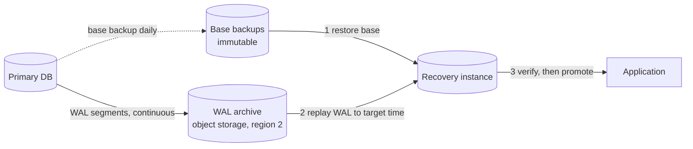

**Reading the diagram.** The primary continuously ships each completed WAL segment to an archive in another region, and writes a daily base backup to immutable storage (dotted). Recovery is synchronous: restore the latest base backup before the target time onto a new instance, replay archived WAL to the target, verify, then promote. The three stores sit in different failure domains. Failure points: a gap in the WAL archive makes every later point unreachable, so monitor archive lag and continuity; restores need compatible database versions. Replay is largely single-threaded, so frequent base backups bound replay time.

::: formula
**Restore duration**

$$T_{\text{restore}} = T_{\text{prov}} + \frac{S}{r_{\text{copy}}} + \frac{V_{\text{WAL}}}{r_{\text{replay}}} + T_{\text{verify}} \qquad V_{\text{WAL}} \le w \times I_{\text{base}}$$

| Symbol | Meaning | Units |
|---|---|---|
| $T_{\text{prov}}$ | Time to provision the recovery instance | hours |
| $S$ | Size of the base backup | bytes |
| $r_{\text{copy}}$ | Effective restore throughput from backup storage | bytes/s |
| $V_{\text{WAL}}$ | WAL volume to replay since the base backup | bytes |
| $r_{\text{replay}}$ | WAL replay rate | bytes/s |
| $w$ | WAL generation rate | bytes/hour |
| $I_{\text{base}}$ | Interval between base backups | hours |
| $T_{\text{verify}}$ | Integrity checks and application smoke tests | hours |
:::

::: example
**Worked example — Does QuickBite's order database meet a 4-hour RTO?** Database $S = 4$ TB; daily base backup at 00:00; WAL generated at 30 GB/h; disaster at 18:00. Restore from object storage at 400 MB/s; replay at 100 MB/s; provisioning 15 min; verification 30 min. (Decimal units: 1 TB = $10^{12}$ bytes.)

1. Copy: $4 \times 10^{12} / 4 \times 10^{8} = 10{,}000$ s = 2.78 h.
2. WAL: $18 \times 30 = 540$ GB; $540 \times 10^9 / 10^8 = 5{,}400$ s = 1.5 h.
3. Total: $0.25 + 2.78 + 1.5 + 0.5 = 5.03$ h: the 4-hour RTO is missed.
4. Fix: base backups every 6 h ($V_{\text{WAL}} \le 180$ GB, 0.5 h) and parallel restore at 1 GB/s (1.11 h): $0.25 + 1.11 + 0.5 + 0.5 = 2.36$ h.

**Interpretation.** Restore time is dominated by bytes moved and WAL replayed, both of which grow silently as the business grows. **Engineering implication.** Compute RTO from measured restore drills, not vendor throughput figures, re-run the calculation as data grows, and if no backup schedule fits the RTO, move up a DR tier (a standby replica that is already restored).
:::

### 39.9.4 Restore testing

A backup that has never been restored is a hypothesis. Automate restore tests (for example weekly: restore the latest backup into an isolated environment, run integrity and row-count checks, record the duration as the measured RTO) and run periodic DR drills with people following the runbook. As the SRE book puts it, users need recovery, not backups [Beyer et al. 2016].

::: industry
**GitLab.com, 31 January 2017.** While fighting a replication problem under load, an engineer ran a directory removal intended for the secondary database server on the primary, deleting roughly 300 GB of production data. The team then found that their regular `pg_dump` backups had been silently failing (a database version mismatch, with failure notifications lost to email rejection) and that other backup mechanisms were not enabled for the database. They restored from a copy taken about six hours earlier for staging, losing about six hours of database changes on GitLab.com; the restore itself took many hours because of slow disks. GitLab published a detailed, blameless postmortem and live-streamed the recovery.
*Evidence: Primary* — [GitLab 2017]
:::

| What goes wrong | Why | Detection | Recovery | Prevention |
|---|---|---|---|---|
| Backups silently failing | Job errors not alerted | Restore test fails or none exists | Take a fresh backup now | Alert on backup age and size; automated restore tests |
| Backups deleted with production | Same credentials and account | Audit logs | None if no other copy | Immutable, cross-account copy (3-2-1) |
| Restore exceeds RTO | Data growth; slow replay | Drill timings trend upward | Use standby instead | Re-run restore math quarterly |
| PITR target unreachable | Gap in WAL archive | Archive continuity check | Restore to last contiguous point | Monitor archive lag and gaps |

## 39.10 Multi-region architecture (introduction)

A **region** is a geographic area containing several isolated zones (§41.4). Multiple regions protect against region-wide failures and bring service closer to distant users, at the price of cross-region latency (tens to hundreds of milliseconds, §4.17) and harder consistency. The basic choice is between **active–passive**, where one region serves and another stands by (the pilot-light and warm-standby tiers of §39.8), and **active–active**, where all regions serve and data replication must handle concurrent writes, either by giving each record a home region or by conflict resolution (§27.14).

**Figure 39.11 — Active–passive versus active–active regions.**

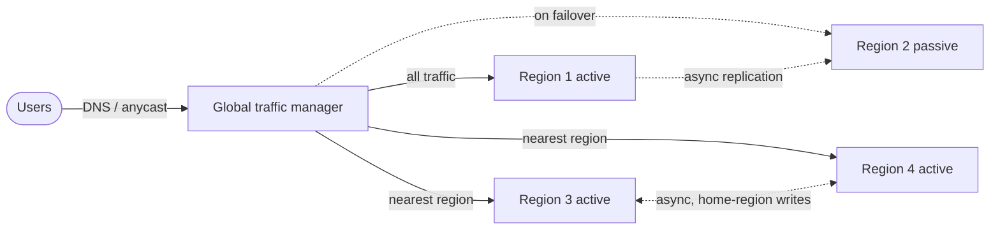

**Reading the diagram.** Users resolve the service through a global traffic manager (DNS or anycast, §19.9). On the left, active–passive: Region 1 takes all traffic and replicates asynchronously to Region 2, which receives traffic only on failover, a decision with RPO and split-brain implications (§26.12). On the right, active–active: users go to the nearest region, which replicate to each other asynchronously, each record written in its home region to avoid conflicts. Each region's databases are storage boundaries; the global traffic manager and any global control plane are shared fate (§39.4.2). Chapter 44 covers global traffic management, data residency and cell architecture in depth.

## 39.11 Chaos engineering

::: definition
**Definition — Chaos engineering.** "The discipline of experimenting on a system in order to build confidence in the system's capability to withstand turbulent conditions in production" [Principles of Chaos Engineering].
:::

### 39.11.1 Experiments, not breakage

#### First-principles explanation and why it exists

Fire drills exist because the first real fire is a bad time to discover that the exit is locked. Redundancy, failover and fallbacks are claims; chaos engineering tests them deliberately, at a time you choose, with the blast radius you choose. Netflix's Chaos Monkey, which randomly terminates production instances during business hours, forced every service to tolerate instance loss [Izrailevsky and Tseitlin 2011]. Basiri et al. later formalized the practice: it is *experimentation*, not random breakage [Basiri et al. 2016].

#### How it works

The principles describe an experiment in five steps [Principles of Chaos Engineering; Basiri et al. 2016]:

1. **Define steady state** as a measurable business output, not internal metrics. Netflix uses stream starts per second, which follows a predictable daily pattern.
2. **Hypothesize** that steady state continues in both a control group and an experimental group.
3. **Introduce real-world events**: instance and zone loss, latency, errors from a dependency, clock skew, full disks.
4. **Try to disprove the hypothesis** by comparing the two groups. A difference reveals a weakness.
5. **Minimize the blast radius** and automate: start small, abort automatically, run continuously.

Netflix's Chaos Automation Platform (ChAP) applies this to microservices: it routes a small share of traffic to a control cluster and an equal share to an experiment cluster in which failures are injected into calls to one dependency, compares their key metrics, and stops the experiment automatically if they diverge too much [Basiri et al. 2019].

**Figure 39.12 — A chaos experiment with control and experiment groups.**

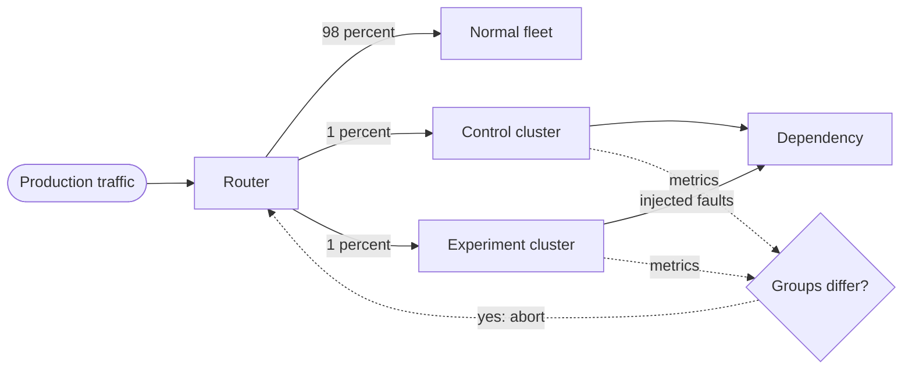

**Reading the diagram.** A router sends most production traffic to the normal fleet and two equal small shares to a control and an experiment cluster running the same version. Calls from the experiment cluster to one dependency receive injected failures or latency. Both groups' steady-state metrics flow asynchronously to a comparator, which stops the experiment's traffic if the groups diverge. There is no new storage boundary; the failure points are the abort path and side effects that escape the slice (shared caches, queues, databases). Grow the slice only after it passes at small size.

::: formula
**Error-budget cost of an experiment**

$$B_{\text{exp}} = s \times e_{\text{max}} \times t$$

| Symbol | Meaning | Units |
|---|---|---|
| $s$ | Fraction of traffic in the experiment group | dimensionless |
| $e_{\text{max}}$ | Worst-case error ratio in the experiment group before abort | dimensionless |
| $t$ | Experiment duration | minutes |
| $B_{\text{exp}}$ | Worst-case budget consumed, in full-outage-equivalent minutes | minutes |
:::

::: example
**Worked example — Is a 30-minute experiment affordable?** QuickBite injects payment-provider timeouts into 1% of checkout traffic for 30 minutes. Worst case, every experiment request fails.

1. $B_{\text{exp}} = 0.01 \times 1.0 \times 30 = 0.3$ min.
2. Place-order budget per 28 days: 20.2 min; share: $0.3 / 20.2 = 1.5\%$.
3. With automatic abort after 2 minutes of divergence, the realistic worst case is $0.01 \times 1.0 \times 2 = 0.02$ min, 0.1% of the budget.

**Interpretation.** A well-bounded experiment costs a small, predictable slice of the budget. **Engineering implication.** Budget experiments explicitly, pause them when the error-budget policy is in Caution or Frozen, and grow the slice only after the hypothesis holds at small scale.
:::

**Game days** are scheduled, human-run exercises: a team deliberately fails a zone, a primary or a dependency and practices detection, runbooks and communication, testing people as much as software. They are the natural place to rehearse DR (§39.8) and restores (§39.9.4).

## 39.12 Incident management and blameless postmortems

### 39.12.1 Running an incident

::: definition
**Definition — Incident.** An unplanned event that degrades or threatens a service's SLOs, security or data and requires a coordinated response. **Incident management** is the process of detecting, coordinating, mitigating and learning from incidents.
:::

The SRE book's incident-management chapter, drawing on emergency-services practice, separates roles so nobody both fixes and coordinates [Beyer et al. 2016]:

- **Incident commander (IC)** — owns the incident: sets priorities, assigns roles, decides; does not debug.
- **Operations lead** — the only person (or team) changing production.
- **Communications lead** — posts regular status updates to stakeholders and users.
- **Planning lead / scribe** — keeps the timeline, records decisions, files follow-up tickets, arranges hand-offs.

Mitigation comes before diagnosis: roll back, fail over, shed load or disable a feature first, find the cause later.

**Table 39.9 — Severity levels (an illustrative scheme).**

| Severity | Definition | Response |
|---|---|---|
| SEV1 | Critical journey down or data loss/security breach | Page immediately, IC assigned, public status updates every 30 min, postmortem required |
| SEV2 | Major degradation or fast budget burn (page alerts) | Page, IC assigned, postmortem required |
| SEV3 | Minor degradation, workaround exists (ticket alerts) | Business hours; postmortem optional |

**Figure 39.13 — Incident lifecycle.**

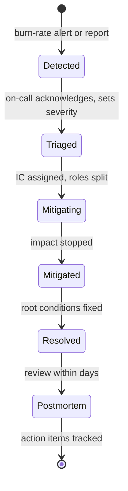

**Reading the diagram.** States are phases of one incident, with no data flow. An alert or report moves it to Detected; acknowledgment and a severity make it Triaged; the IC splits roles and the operations lead mitigates. The intervals give time to detect, acknowledge and mitigate, which sum to the user-visible duration (the MTTR of §4.15). Mitigated is not Resolved: a rollback stops impact long before the defect is fixed. The failure point is hand-offs, especially across time zones; a written timeline and explicit role transfers address it.

### 39.12.2 Blameless postmortems

A **postmortem** is a written record of an incident: impact, timeline, contributing factors and action items. It is **blameless** when it assumes everyone acted reasonably given the information they had, and asks why the system made the harmful action easy and the problem hard to see. Allspaw argued that blaming and punishing people makes engineers hide information, which destroys the learning the organization needs; engineers who can describe their actions without fear give the most accurate accounts [Allspaw 2012]. Cook's "How Complex Systems Fail" supplies the theory: complex systems always run with latent flaws, catastrophe needs several failures to combine, "post-accident attribution to a 'root cause' is fundamentally wrong", and hindsight bias makes the right action look obvious afterwards [Cook 1998; Dekker 2014].

**Table 39.10 — Five whys versus contributing-factors analysis.**

| Aspect | Five whys | Contributing-factors analysis |
|---|---|---|
| Shape | One linear causal chain | A network of conditions that combined |
| Ends at | A single "root cause", often a person | Several factors: technical, process, organizational |
| Strength | Quick, easy to teach | Matches how complex systems fail |
| Risk | Stops at "operator error"; misses latent conditions | Takes longer; needs a skilled facilitator |

Good action items are specific, owned, dated and tracked, and they are a mix of **prevent** (validate configuration), **mitigate** (feature flags, kill switches), and **detect** (better SLIs and alerts). "Be more careful" is not an action item.

::: industry
**Google Cloud, 12 June 2025.** Google's incident report describes a quota-policy feature added on 29 May 2025 to Service Control, which checks authorization and quota for Google Cloud APIs. The new code path had no feature flag and inadequate error handling, and was not exercised during rollout because only a specific policy triggered it. On 12 June, a policy change containing blank fields was inserted into the regional Spanner tables that Service Control reads; Spanner replicated it globally within seconds, and the null pointer crashed Service Control binaries in every region. Engineers identified the cause and prepared a "red-button" to disable the path within minutes, and smaller regions recovered first; in large regions such as us-central1, restarting tasks without randomized exponential backoff created a herd effect on the underlying Spanner infrastructure, prolonging recovery. Remediation includes making Service Control fail open, feature-flagging critical changes, propagating global metadata gradually, and better error handling and backoff. The contributing factors map onto this chapter: global configuration as shared fate (§39.4.2), an untested path without a kill switch (§39.5), and retries without jitter (§22.12).
*Evidence: Primary* — [Google Cloud 2025]
:::

::: mistake
**Mistake — Ending the postmortem at "human error".** Human error is where the investigation starts, not where it ends [Dekker 2014]. Ask what made the action possible, why safeguards did not stop it and why recovery took as long as it did.
:::

## 39.13 Summary and revision notes

::: summary
- Availability is correct service over time or requests; reliability is correct operation over a period; durability is not losing data; resilience is absorbing faults and recovering. Measure request-based availability for busy services, time-based or synthetic for quiet ones.
- Redundancy only helps if failures are independent; common-cause failures ($U_{\text{pair}} \approx \beta U$) dominate. Stage global changes per failure domain and avoid shared synchronous dependencies.
- Graceful degradation tiers features and gives each a fallback; $A_{\text{eff}} = A_d + (1 - A_d)A_f$ only if the fallback is independent and exercised. Brownouts use optional content as a control knob.
- SLIs are good/valid ratios per user journey; latency SLIs count requests under a threshold. SLOs are targets over windows; SLAs are looser contracts with credits. A journey is bounded by the product of its hard dependencies (rule of the extra 9).
- Error budget $= (1 - \text{SLO}) \times$ window; a policy turns it into release decisions. Burn rate $b = e/(1-\text{SLO})$; threshold $b = fP/W$ gives 14.4, 6 and 1 for 2%/1 h, 5%/6 h, 10%/3 d on 30 days; pair each long window with a short one.
- DR strategies trade standing cost for RTO/RPO: backup and restore, pilot light, warm standby, active–active. Compare $C_{\text{DR}} + p(\text{RTO}\,c_{\text{down}} + \text{RPO}\,c_{\text{loss}})$ and the worst single event.
- Backups: full, incremental, differential; 3-2-1 with an immutable copy; PITR = base backup + WAL archive; restore time = provision + copy + replay + verify; test restores automatically.
- Chaos engineering is experimentation: steady state, hypothesis, real-world events, small blast radius, automatic abort.
- Incidents need roles (IC, operations, communications, planning), severity levels and mitigation first; postmortems are blameless and look for contributing factors, not one root cause.
:::

## 39.14 Knowledge checkpoint

1. Give an example of a system that is available but unreliable.
2. Two zones are each 99.95% available with $\beta = 0.2$. Estimate the pair's unavailability.
3. A dependency is 99.0% available within its deadline and its fallback 99.9%. What is $A_{\text{eff}}$?
4. Why express a p99 latency objective as a ratio of fast requests?
5. Compute the error budget in minutes for 99.95% over 28 days.
6. What burn rate corresponds to a 0.5% error ratio on a 99.9% SLO, and when is the budget exhausted from full?
7. Derive the burn-rate threshold for consuming 5% of a 30-day budget in 6 hours.
8. Why does a multiwindow alert need the short window?
9. A journey depends synchronously on services at 99.99%, 99.95% and 99.9%. What is its maximum availability?
10. Distinguish RTO from RPO and give the lever that controls each.
11. Why is replication not a backup?
12. A 2 TB base backup restores at 500 MB/s and 90 GB of WAL replays at 100 MB/s; provisioning and checks take 30 min. What is the restore time?
13. What are the five principles of chaos engineering?

<details><summary>Answers</summary>

1. A service that is up but returns stale or wrong results, such as yesterday's prices.
2. $0.2 \times 0.0005 + (0.8 \times 0.0005)^2 = 1.0 \times 10^{-4} + 1.6 \times 10^{-7} \approx 1.0 \times 10^{-4}$, i.e. about 99.99%.
3. $0.99 + 0.01 \times 0.999 = 0.99999$.
4. Counts can be summed across servers and windows; percentiles cannot be averaged.
5. $0.0005 \times 40{,}320 = 20.2$ min.
6. $b = 0.005/0.001 = 5$; $720/5 = 144$ h = 6 days.
7. $0.05 \times 720 / 6 = 6$.
8. Without it, the alert keeps firing long after recovery because the long window still averages the incident (slow reset).
9. $0.9999 \times 0.9995 \times 0.999 = 0.99840$.
10. RTO is time to restore service (lever: how much recovery infrastructure already runs, automation); RPO is data lost (lever: backup frequency or replication lag).
11. Replication copies deletions and corruption to every replica; a backup is a separate, older, ideally immutable copy.
12. $2 \times 10^{12} / 5 \times 10^8 = 4{,}000$ s = 1.11 h; $90 \times 10^9 / 10^8 = 900$ s = 0.25 h; total $1.11 + 0.25 + 0.5 = 1.86$ h.
13. Hypothesize about steady state; vary real-world events; run in production; automate continuously; minimize blast radius.

</details>

## 39.15 Interview questions

### Basic

**Q1. What is the difference between an SLO and an SLA?**
**Answer.** An SLO is an internal target for an SLI over a window, used to make engineering decisions. An SLA is an external contract with consequences, usually service credits. The SLA is looser than the SLO so the team reacts before money is owed, and its definitions must match the SLI's.

**Q2. What is an error budget used for?**
**Answer.** It quantifies allowed unreliability, $1 - \text{SLO}$, and a policy uses it to balance release velocity and reliability: release freely while budget remains, freeze risky changes and invest in reliability when it is spent.

### Intermediate

**Q3. Design alerting for a 99.9% availability SLO.**
**Answer.** Alert on budget burn, not raw errors: page at burn rate 14.4 over 1 h and 5 min, and at 6 over 6 h and 30 min; ticket at 1 over 3 d and 6 h. Explain that each fires at a fixed budget fraction (2%, 5%, 10%), detection is under a minute for total outages, the short window gives fast reset, and low-traffic services need synthetic traffic or minimum counts.

**Q4. How would you choose a DR strategy for an order database?**
**Answer.** Get RTO/RPO from the business, compute standing cost plus expected loss for each tier, consider the worst single event and regulation, and check feasibility: restore-time math for backup and restore, scale-up risk for pilot light. Typically: synchronous replication across zones for RPO 0 on zone loss, pilot light or warm standby across regions, plus immutable PITR backups against corruption. Test with drills.

### Advanced

**Q5. Your service must meet 99.99% but depends on a 99.95% dependency. What do you do?**
**Answer.** Show the product bound makes it impossible as a hard dependency. Make it soft: cache, fallback provider, asynchronous processing, or degrade the feature; or negotiate a better dependency SLO. Recompute with independence caveats and add the dependency's SLI to dashboards.

**Q6. After a global outage caused by a configuration push, what should the postmortem conclude?**
**Answer.** Avoid "the engineer pushed bad config". Contributing factors: no validation, instant global propagation, no canary per region, code path without a feature flag, crash-on-bad-input instead of failing safe, recovery slowed by retry storms. Action items: staged rollouts with automatic rollback, config validation, fail-static behavior, kill switches, jittered backoff, each with an owner and date.

## 39.16 Practical exercises

1. Write the SLO specification (as in Table 39.4) for QuickBite's courier-tracking freshness SLI, and compute its error budget for 28 days.
2. Extend the burn-rate program to compute reset time for each alert after the incident ends, and to handle a 28-day period.
3. Restore your own development database from a backup to a point in time, measure each term of the restore formula, and compare with your RTO.
4. Run a game day in a staging environment: terminate one zone's instances and record detection, mitigation and recovery times.

## 39.17 Design challenges

1. **Payments platform DR.** Design DR for a payments ledger with RPO = 0 and RTO = 5 min across regions; justify the replication model and estimate the latency cost per commit.
2. **SLOs for a streaming pipeline.** Define freshness, correctness and coverage SLIs for a clickstream pipeline, its burn-rate alerts and its error-budget policy.
3. **Degradation plan.** For a ride-hailing app, tier all features, define fallbacks, and compute the availability of "request a ride" with and without them.

## 39.18 References

1. Beyer, B., Jones, C., Petoff, J., Murphy, N. R. (eds.). *Site Reliability Engineering: How Google Runs Production Systems*. O'Reilly, 2016. https://sre.google/sre-book/table-of-contents/ (chapters "Embracing Risk", "Service Level Objectives", "Managing Incidents", "Postmortem Culture", "Data Integrity").
2. Beyer, B., Murphy, N. R., Rensin, D. K., Kawahara, K., Thorne, S. (eds.). *The Site Reliability Workbook: Practical Ways to Implement SRE*. O'Reilly, 2018. https://sre.google/workbook/table-of-contents/ (chapters "Implementing SLOs", "Alerting on SLOs"; appendix "Example Error Budget Policy").
3. Treynor, B., Dahlin, M., Rau, V., Beyer, B. *The Calculus of Service Availability*. ACM Queue 15(2), 2017.
4. Hauer, T., Hoffmann, P., Lunney, J., Ardelean, D., Diwan, A. *Meaningful Availability*. USENIX NSDI, 2020.
5. Avizienis, A., Laprie, J.-C., Randell, B., Landwehr, C. *Basic Concepts and Taxonomy of Dependable and Secure Computing*. IEEE Transactions on Dependable and Secure Computing 1(1), 2004.
6. Ford, D., et al. *Availability in Globally Distributed Storage Systems*. USENIX OSDI, 2010.
7. Weiss, B., Furr, M. *Static stability using Availability Zones*. Amazon Builders' Library, 2020.
8. Gabrielson, J. *Avoiding fallback in distributed systems*. Amazon Builders' Library, 2019.
9. Klein, C., Maggio, M., Årzén, K.-E., Hernández-Rodriguez, F. *Brownout: Building More Robust Cloud Applications*. ICSE, 2014.
10. Janardhan, S. *More details about the October 4 outage*. Engineering at Meta, 2021. https://engineering.fb.com/2021/10/05/networking-traffic/outage-details/
11. Amazon Web Services. *Amazon Compute Service Level Agreement*. https://aws.amazon.com/compute/sla/
12. Amazon Web Services. *Disaster Recovery of Workloads on AWS: Recovery in the Cloud*. AWS Whitepaper, 2021. https://docs.aws.amazon.com/whitepapers/latest/disaster-recovery-workloads-on-aws/
13. PostgreSQL Global Development Group. *PostgreSQL Documentation: Continuous Archiving and Point-in-Time Recovery (PITR)*. https://www.postgresql.org/docs/current/continuous-archiving.html
14. GitLab. *Postmortem of database outage of January 31*. GitLab Blog, 2017. https://about.gitlab.com/blog/2017/02/10/postmortem-of-database-outage-of-january-31/
15. Principles of Chaos Engineering. https://principlesofchaos.org/
16. Basiri, A., Behnam, N., de Rooij, R., Hochstein, L., Kosewski, L., Reynolds, J., Rosenthal, C. *Chaos Engineering*. IEEE Software 33(3), 2016.
17. Basiri, A., Hochstein, L., Jones, N., Tucker, H. *Automating Chaos Experiments in Production*. ICSE-SEIP, 2019.
18. Izrailevsky, Y., Tseitlin, A. *The Netflix Simian Army*. Netflix Technology Blog, 2011.
19. Allspaw, J. *Blameless PostMortems and a Just Culture*. Code as Craft (Etsy), 2012.
20. Cook, R. I. *How Complex Systems Fail*. Cognitive Technologies Laboratory, University of Chicago, 1998.
21. Dekker, S. *The Field Guide to Understanding 'Human Error'*, 3rd ed. CRC Press, 2014.
22. Google Cloud. *Multiple GCP products are experiencing Service issues* (incident report, 12 June 2025). Google Cloud Service Health. https://status.cloud.google.com/incidents/ow5i3PPK96RduMcb1SsW

## 39.19 Open verification items

- Google Cloud 12 June 2025 report: exact red-button and per-region recovery timings, and the exact remediation list wording (sources not fetchable in this session).
- AWS Compute SLA credit tiers below 99.0% in the current version.
- GitLab 2017: data volume deleted (~300 GB) and the approximate six-hour loss window.
- Origin of the 3-2-1 backup rule (commonly attributed to Peter Krogh).
- SRE Workbook example policy wording (20% single-incident threshold; escalation path).
- Cost percentages in Table 39.7 are illustrative planning figures, not sourced.
