# Chapter 40 — Observability

> **Level:** 3 · **Track:** A (Traditional) · **Estimated reading time:** 6 h

At 19:40 on a Friday, QuickBite's checkout error rate climbs from 0.1% to 9%. The infrastructure dashboards are green: CPU, memory and request rate all look normal. One engineer greps logs on three machines, another restarts the payment service, and a third posts screenshots in chat. Forty minutes later someone notices that every failing order comes from the newest Android app version paying with one card network. Nothing in the dashboards could have shown that, because nobody had thought to chart "errors by app version by card network" in advance.

This chapter is about building systems that can answer questions nobody thought to ask. It covers the three classic telemetry signals (logs, metrics and traces) and what each costs, then the tools that dominate practice in 2026: OpenTelemetry for instrumentation, Prometheus for metrics, Grafana for dashboards and Alertmanager for routing alerts. It ends with the workflow that ties them together: alert, dashboard, trace, logs and profile. The chapter owns the deep treatment of distributed tracing; §34.9 gave only an introduction. QuickBite, the food-delivery platform of Chapter 2, is the running example, and all QuickBite numbers are assumptions made for teaching.

## 40.1 Learning objectives

After this chapter you should be able to:

- Distinguish monitoring from observability, and explain why high-cardinality, wide events answer questions that predefined dashboards cannot.
- Design a structured-logging pipeline with correlation IDs, buffering, tiered storage, sampling and PII redaction, and estimate its volume and monthly cost.
- Choose between counters, gauges, histograms and summaries; explain why percentiles cannot be averaged; and compute the series count and memory of a labeled metric.
- Explain spans, trace trees and W3C `traceparent` propagation, and compare head and tail sampling with volume, buffer and capture-probability arithmetic.
- Describe the OpenTelemetry API, SDK, Collector and OTLP, and state the stability of each signal as of 2026.
- Write PromQL `rate` and `histogram_quantile` queries and recording rules, and choose a long-term storage design (federation, Thanos, Cortex or Mimir).
- Design dashboards and symptom-based alerts with routing, deduplication, inhibition and runbooks, avoiding alert fatigue and dashboard sprawl.
- Debug an incident from alert to dashboard to trace to logs to profile, using exemplars, and explain when continuous profiling helps.

## 40.2 Prerequisites

- Percentiles, histograms and fan-out tail latency — §4.8 (the arithmetic of p99 is used throughout).
- USE, RED and the four golden signals — §23.3 (summarized here, not repeated).
- Profiling, flame graphs and off-CPU analysis — §23.4 (§40.12 extends them to fleets).
- Time-series databases and Gorilla compression — §12.8 (storage internals behind Prometheus).
- Microservices and the introduction to tracing — §34.8, §34.9.
- Message brokers and Kafka as a buffer — Chapters 30 and 31.
- SLIs, SLOs, error budgets and burn rates — §39.6, §39.7 (burn-rate alerts build on them).

## 40.3 Monitoring versus observability

### 40.3.1 Two definitions

::: definition
**Definition — Monitoring.** Collecting, aggregating and displaying predefined measurements of a system, and alerting when they cross thresholds, so that operators learn about *known* failure modes. The Google SRE book defines it as "collecting, processing, aggregating, and displaying real-time quantitative data about a system" [Beyer et al. 2016, ch. 6].
:::

::: definition
**Definition — Observability.** A property of a system and its telemetry: how well you can understand *any* internal state the system gets into, including states never seen before, by asking new questions of the data it already emits, without shipping new code [Majors, Fong-Jones and Miranda 2022]. The term comes from control theory, where a system is observable if its internal state can be inferred from its outputs.
:::

#### First-principles explanation

Think of a car. The dashboard warning lights are monitoring: each light was designed in advance for a known problem (low oil, high temperature). They are cheap, reliable and essential. But when the car makes a strange noise only on left turns above 60 km/h in the rain, no light exists for it. A mechanic plugs in a diagnostic tool that records hundreds of sensor values with timestamps and slices them: "show me wheel speed when steering angle is left and speed is over 60". The diagnostic recording makes the car *observable*: it supports questions the designers never anticipated.

#### Why does this exist?

A monolith on three servers fails in a few familiar ways, and a dozen dashboards cover them. A system of 80 microservices, 6 app versions, 4 card networks, 30 cities and daily deployments fails in combinations. The number of possible "slices" is the product of all those dimensions, far too many to chart in advance. Most production incidents in such systems are novel: if a failure mode had been seen before, it would usually have been fixed. You therefore need data rich enough to slice by *any* dimension after the fact.

### 40.3.2 Known-unknowns and unknown-unknowns

Monitoring answers **known-unknowns**: you know which question to ask ("is the error rate above 1%?") but not today's answer. Observability targets **unknown-unknowns**: you do not even know which question to ask until you start exploring ("which attribute do the failing requests share?").

**Table 40.1 — Monitoring versus observability.**

| Aspect | Monitoring | Observability |
|---|---|---|
| Question type | Predefined: known-unknowns | Exploratory: unknown-unknowns |
| Typical data | Pre-aggregated metrics, fixed dashboards | Wide structured events, traces, high-cardinality fields |
| Answers | "Is something wrong?" | "What is different about the requests that are wrong?" |
| Cost driver | Number of time series | Volume of events stored and scanned |
| Failure mode | Green dashboards during a real outage | Expensive storage and slow queries if undisciplined |
| Relationship | Necessary; triggers investigation | Built on top; drives investigation |

The two are complements. You still need cheap, reliable metrics to *detect* problems and page someone; you need rich events and traces to *explain* them.

::: concept
**Concept — The "three pillars" and their limits.** Logs, metrics and traces are often called the three pillars of observability. The framing is useful for tooling but misleading as a goal: three disconnected stores, each queried in a different language, do not make a system observable. What matters is that signals share identifiers (trace ID, service name, deployment version) so that you can pivot from one to another, and that at least one store keeps raw, high-cardinality context about each request [Majors, Fong-Jones and Miranda 2022].
:::

### 40.3.3 High-cardinality, wide events

::: definition
**Definition — Cardinality and dimensionality.** The **cardinality** of a field is the number of distinct values it takes: `http.method` has about 5, `user_id` may have millions. **Dimensionality** is the number of fields attached to each event. A **wide event** (also called a canonical log line) is one structured record per unit of work, typically per request per service, carrying dozens to hundreds of fields.
:::

#### How it works internally

1. At the start of a request, the service creates an empty event and adds fields as it learns them: route, user ID, app version, cart size, card network, feature-flag states, downstream call timings, cache hits.
2. At the end of the request, it adds the outcome (status, error class, duration) and emits the event once.
3. A columnar event store ingests the events. Columnar storage makes "group by any field" cheap because a query reads only the referenced columns.
4. An engineer filters and groups interactively: errors grouped by `app_version`, then by `card_network`, then compared with successful requests (Figure 40.1).

**Figure 40.1 — From a symptom to a cause by slicing wide events.**

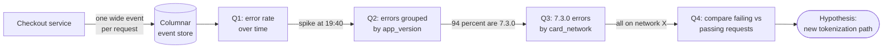

**Reading the diagram.** The checkout service emits one wide event per request asynchronously to a columnar event store, the storage boundary. Each subsequent box is an interactive query, and each edge label is what the previous answer revealed, narrowing the population. No query was planned in advance: `app_version` and `card_network` are ordinary fields on the event, and the investigator chose them while exploring. The final "compare" step automates the search by ranking which field values are over-represented among failures. Failure points: if the service had emitted only pre-aggregated counters, Q2 and Q3 would be impossible; if the event lacked `card_network`, the trail would go cold. Scaling: event volume grows with traffic, so stores sample routine successes and keep all failures (§40.6.3).

Metrics systems cannot store `user_id` or `trace_id` as a label, because every distinct value creates a new time series (§40.5.3). Event stores can, because each event is a row and a new value costs only its bytes. This is the fundamental trade: **metrics are cheap per request but expensive per dimension; events are cheap per dimension but expensive per request.**

#### Real-world industry applications

::: industry
**Facebook Scuba.** Facebook built Scuba, an in-memory database that ingests millions of rows per second and lets engineers slice recent operational data by arbitrary columns with interactive query latency. It was used for performance monitoring, bug investigation and ad-hoc analysis, and is a direct ancestor of the wide-event approach later popularized by Honeycomb, whose founders had used Scuba at Facebook after it acquired Parse, where they worked.
*Evidence: Primary* — [Abraham et al. 2013]; [Majors, Fong-Jones and Miranda 2022]
:::

#### Advantages and disadvantages

Wide events give arbitrary slicing, precise counts and a natural link to traces (a span is a wide event with a parent). They cost more storage than metrics, need a columnar store with fast group-by, and require discipline: fields must be consistently named, and personal data must be controlled (§40.4.5).

::: mistake
**Misconception — "We have logs, metrics and traces, so we are observable."** Observability is measured by the questions you can answer during an incident, not by the products you run. Test it: pick a past incident and ask whether the telemetry you have *today* would show the cause within ten minutes, without a code change.
:::

## 40.4 Logs

### 40.4.1 Structured logging and levels

::: definition
**Definition — Log and structured log.** A **log** is a time-ordered record of discrete events emitted by a program. A **structured log** encodes each event as a set of named fields (usually JSON, or key–value pairs), so that machines can filter and aggregate by field instead of parsing free text with regular expressions.
:::

#### First-principles explanation

A ship's captain who writes "rough night, lost some cargo" in a diary has written an unstructured log. A cargo manifest with columns for time, container ID, weight and status is a structured log. Both record the same night, but only the manifest answers "how many tonnes did we lose between 02:00 and 04:00?" without a human reading every line.

#### Why does this exist?

Free-text lines such as `Payment failed for order 991 after 3 retries` force every consumer to write a parser, and the parsers break silently when a developer rephrases the message. At QuickBite's volume (hundreds of gigabytes per day, §40.4.4) nobody reads logs; machines query them. Structure turns logs from prose into data.

```json
{"ts":"2026-10-30T19:42:07.118Z","level":"ERROR","service":"payment",
 "service.version":"4.12.0","env":"prod","event":"payment.authorize.failed",
 "order_id":"o-991","card_network":"X","attempt":3,"duration_ms":2004,
 "error.type":"ProviderTimeout","trace_id":"4bf92f3577b34da6a3ce929d0e0e4736",
 "span_id":"00f067aa0ba902b7"}
```

What to notice:

- `event` is a stable, machine-friendly name; the human message, if any, is secondary.
- `trace_id` and `span_id` link this line to its trace (§40.6), which is what makes logs navigable during an incident.
- Resource fields (`service`, `service.version`, `env`) are identical across logs, metrics and traces, so you can pivot between them.
- Durations carry their unit in the field name; timestamps are UTC in ISO 8601 with milliseconds.

**Table 40.2 — Log levels and how to use them.**

| Level | Meaning | Production default | Example |
|---|---|---|---|
| TRACE / DEBUG | Developer detail for diagnosing code paths | Off, or sampled; enable per service at runtime | Cache key computed, SQL text |
| INFO | Normal, noteworthy lifecycle events | On, but not one line per loop iteration | Order created, service started |
| WARN | Unexpected but handled; may need attention | On | Retry succeeded on attempt 2 |
| ERROR | An operation failed and a user or job was affected | On, never sampled away | Payment authorization failed |
| FATAL | The process cannot continue | On | Cannot bind port; exiting |

Syslog (RFC 5424) defines eight numeric severities from 0 (Emergency) to 7 (Debug), and OpenTelemetry's log data model maps all common schemes to a `SeverityNumber` from 1 to 24 [IETF RFC 5424; OpenTelemetry Specification: Logs Data Model]. Whatever scheme you use, decide what each level means for your organization and make the level changeable at runtime, so that you can turn on DEBUG for one service during an incident without a redeploy.

### 40.4.2 Correlation IDs

::: definition
**Definition — Correlation ID.** An identifier generated at the edge of the system for each incoming request (or taken from the client) and attached to every log line, span and downstream call made on that request's behalf, so that all records of one request can be retrieved together. When distributed tracing is in place, the **trace ID** serves as the correlation ID.
:::

Without one, finding the 14 log lines of one failed order among 9 MB/s of logs means guessing by timestamp. With one, it is a single indexed lookup. Generate the ID at the first hop, propagate it on every outbound call and queued message, and inject it into log records automatically from the logging context rather than by hand. OpenTelemetry's logging bridges do this: records emitted inside an active span carry its trace and span IDs [OpenTelemetry Docs: Logs].

### 40.4.3 Log pipelines

A log pipeline moves records from thousands of processes to storage that engineers can query, without slowing the processes and without losing data when a downstream component stalls.

#### How it works internally

1. **Emit.** The application writes structured lines to standard output or a local file, never synchronously to a remote server: a slow log backend must not become request latency.
2. **Collect.** A node-level **agent** (Fluent Bit, Vector, the OpenTelemetry Collector or Filebeat, typically a Kubernetes DaemonSet) tails the files, adds metadata (pod, node, namespace), parses and batches.
3. **Buffer.** The agent ships batches to a durable buffer, usually a Kafka topic (Chapter 31), which absorbs bursts and lets the indexing tier be restarted or upgraded without losing data.
4. **Process.** Stream processors consume the buffer to redact personal data, drop or sample noisy events, enrich (geo-IP, team ownership) and route.
5. **Store.** Records go to two tiers: a **hot** searchable tier (Elasticsearch/OpenSearch with a full-text inverted index, Grafana Loki with a label-only index, or a columnar store such as ClickHouse) for days to weeks, and a **cold** tier of compressed files in object storage (§15.4, §15.9) for months to years, queried rarely or rehydrated on demand.

**Figure 40.2 — A buffered, tiered log pipeline.**

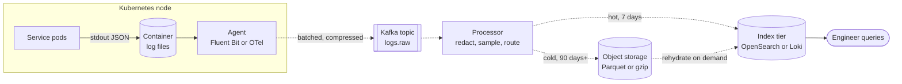

**Reading the diagram.** Services write JSON to standard output; the container runtime persists it to local files on the node, the first storage boundary, which survives brief agent restarts. The agent tails the files and ships compressed batches asynchronously (dotted) to a Kafka topic, the second storage boundary and the main shock absorber: if the index tier falls behind, lag grows in Kafka instead of logs being dropped. Processors consume, redact and sample, then write to the hot index for interactive search and to object storage for cheap retention; rehydration copies cold data back into an index when an investigation needs it. Only the engineer's query is synchronous. Failure points: a full node disk, Kafka retention shorter than an index outage, and mapping explosions from unbounded field names. Scaling: add Kafka partitions and consumers; shard the index by time and tenant.

**Table 40.3 — Log storage back ends compared (as of 2026).**

| Aspect | Elasticsearch / OpenSearch | Grafana Loki | Columnar store (ClickHouse) |
|---|---|---|---|
| What it indexes | Every field and full text (inverted index, Chapter 16) | Only a small set of labels; content is scanned | Columns, with sparse primary index and optional skip indexes |
| Query strength | Fast full-text and field search | Cheap ingestion; "grep at scale" within labeled streams | Fast aggregations and group-by over wide events |
| Storage cost | Highest: index often comparable to raw size | Low: compressed chunks in object storage | Low to medium: high compression on columns |
| Weakness | Cost and mapping management at high volume | Slow for needle-in-haystack queries over broad label sets | Full-text search weaker than an inverted index |
| Choose when | Security and free-text search dominate | Most queries start from service and time, then filter | Logs are wide events and you aggregate a lot |

[Elastic Docs; Grafana Loki Docs; ClickHouse Docs]

### 40.4.4 Volume, sampling and cost

Logging is usually the most expensive telemetry signal per useful bit, because every request produces several lines and every line is stored and often indexed.

::: formula
**Log volume and monthly cost**

$$V_{\text{day}} = R \times n \times b \times 86{,}400 \qquad C_{\text{month}} = 30\,V_{\text{day}}\,c_{\text{hot}} + \frac{V_{\text{day}}\,T_{\text{cold}}}{\rho}\,c_{\text{cold}}$$

| Symbol | Meaning | Units |
|---|---|---|
| $V_{\text{day}}$ | Raw log volume per day | bytes/day |
| $R$ | Average request rate across all services | requests/second |
| $n$ | Log lines emitted per request (all services) | lines/request |
| $b$ | Average size of one structured line | bytes/line |
| $c_{\text{hot}}$ | Price to ingest, index and keep one GB in the hot tier for its retention | \$/GB |
| $T_{\text{cold}}$ | Cold-tier retention | days |
| $\rho$ | Compression ratio in the cold tier | dimensionless |
| $c_{\text{cold}}$ | Object storage price | \$/GB-month |
| $C_{\text{month}}$ | Monthly cost (30-day month) | \$/month |
:::

::: example
**Worked example — QuickBite's log bill.** Assumptions (illustrative, not any vendor's price list): $R = 3{,}000$ requests/s across services, $n = 6$ lines per request (1 access log, 3 INFO, 2 DEBUG), $b = 500$ bytes, $c_{\text{hot}} = \$0.50$/GB for 7-day hot retention, cold retention 90 days at $\rho = 10$ and $c_{\text{cold}} = \$0.023$/GB-month. GB means $10^9$ bytes.

1. Bytes per second: $3{,}000 \times 6 \times 500 = 9{,}000{,}000$ B/s = 9 MB/s.
2. Per day: $9 \times 10^6 \times 86{,}400 = 7.776 \times 10^{11}$ B = **777.6 GB/day** (about 23.3 TB per month).
3. Hot tier: $30 \times 777.6 \times 0.50 = \$11{,}664$ per month.
4. Cold tier: $777.6 \times 90 / 10 = 6{,}998$ GB stored; $6{,}998 \times 0.023 = \$161$ per month.
5. Now drop DEBUG in production and sample successful-request INFO lines at 10%, keeping every access line, WARN and ERROR: lines per request fall from 6 to $1 + 3 \times 0.1 = 1.3$, i.e. 21.7% of the original volume, or 168.5 GB/day.
6. New hot cost: $30 \times 168.5 \times 0.50 = \$2{,}528$ per month, saving about \$9,100 per month.

**Interpretation.** The hot, indexed tier is about 98% of the bill; cold object storage is nearly free by comparison. Volume is driven by lines per request, not by the number of servers. **Engineering implication.** Control what enters the hot tier: drop DEBUG, sample routine successes, never sample errors, and keep everything (compressed) in object storage if compliance needs it. Put a per-service volume budget on the dashboard so a chatty deployment is caught on the day it ships.
:::

::: warning
**Warning — Sample by request, not by line.** If each service independently keeps 10% of its INFO lines, the chance that all five services kept the lines of the *same* request is $0.1^5 = 10^{-5}$: you get fragments of many requests and the full story of none. Make the sampling decision once per request (for example from the trace ID, as in §40.6.3) and honor it everywhere, and always keep every line of requests that failed.
:::

### 40.4.5 Personal data and redaction

Logs are the most common place for personal data to leak, because developers log whole request objects while debugging and the line ships to a system with broad read access and long retention. Under privacy laws such as the EU GDPR, log stores holding names, emails, addresses, card data or precise locations become regulated data stores, subject to access controls, retention limits and deletion requests.

Defend in layers:

1. **At the source.** Log identifiers, not contents: `user_id` rather than email, the last four card digits rather than the number. Use typed log fields with an allowlist, and mark sensitive types (`Email`, `CardNumber`) so the logger refuses or masks them.
2. **In the pipeline.** Run a redaction processor (for example the OpenTelemetry Collector's `redaction` or `transform` processors, or a stream job) that masks patterns such as card numbers, emails and tokens. Treat it as a safety net: regular expressions miss things.
3. **At rest.** Restrict index access by role, encrypt, keep hot retention short, and where you must keep an identifier for joins, replace it with a keyed hash (HMAC) so the raw value cannot be recovered without the key.

Never log secrets: passwords, session tokens, API keys or `Authorization` headers. A leaked token in a log is a credential leak to everyone with log access (§10.8).

#### Failure scenarios

**Table 40.4 — Logging failure scenarios.**

| What goes wrong | Why | Detection | Recovery | Prevention |
|---|---|---|---|---|
| Request latency rises when the log backend is slow | Synchronous remote logging on the request path | Latency correlates with log back-end latency | Switch to local file or stdout plus agent | Never log synchronously over the network |
| Logs missing for the incident window | Node disk full or rotation faster than the agent ships | Gaps per node; agent lag metric | Replay from Kafka if retained | Buffer in Kafka; alert on agent lag |
| Index cluster overloaded, ingestion stalls | A deploy logs a new field per user (mapping explosion) or a hot loop | Field-count and ingest-rate alerts | Drop the offending stream in the processor | Schema allowlists; per-service quotas |
| Personal data exposed to all engineers | Request bodies logged during debugging | Pattern scanners on the stream | Purge, rotate any leaked secrets, notify per policy | Typed fields, redaction, short retention |
| Cannot reconstruct one request | No correlation ID, or per-line sampling | Investigations stall at service boundaries | Correlate manually by time | Propagate trace IDs; sample per request |

::: mistake
**Misconception — "Logs are free; disk is cheap."** Disk is cheap; indexing, replication and querying are not. In the worked example the hot tier cost about 72 times as much as cold storage. Logging every request in detail at every hop is a design decision with a five-figure monthly price.
:::

## 40.5 Metrics

::: definition
**Definition — Metric.** A numeric measurement aggregated over time and identified by a name plus a set of **labels** (key–value pairs). Each unique combination of name and label values is one **time series**, a sequence of `(timestamp, value)` samples. For example, `http_requests_total{service="checkout", method="POST", status="500"}` is one series.
:::

Metrics are the cheapest signal per request: a counter costs the same whether it counts ten requests or ten million. That makes them the right basis for dashboards and alerts. The price is that aggregation throws away the individual request, and every label multiplies the number of series.

### 40.5.1 Counters, gauges, histograms and summaries

**Table 40.5 — Metric types.**

| Type | What it records | Operations that make sense | Example |
|---|---|---|---|
| Counter | A monotonically increasing total; resets to 0 on restart | Rate of increase; sum across instances | `http_requests_total`, `bytes_sent_total` |
| Gauge | A value that goes up and down; a snapshot | Current value, min, max, average over time | `queue_depth`, `memory_bytes`, `in_flight_requests` |
| Histogram | Counts of observations in configured buckets, plus their sum and count | Rates per bucket; aggregate across instances; estimate quantiles | `http_request_duration_seconds` |
| Summary | Quantiles computed inside each process over a sliding window, plus sum and count | Read the precomputed quantile for that one process | `rpc_duration_seconds{quantile="0.99"}` |

[Prometheus Docs: Metric types; Histograms and summaries]

Counters store totals rather than rates because a total survives missed scrapes: if one scrape is lost, the next one still shows the cumulative count and the rate over the window is correct. Query functions treat a decrease as a restart and compensate (§40.8.2).

A **histogram** maps each observation into a bucket. In Prometheus a histogram with bucket upper bounds $b_1 < b_2 < \dots < b_k$ exposes $k + 1$ cumulative series `_bucket{le="b_i"}` (including `le="+Inf"`), plus `_sum` and `_count`. Because the buckets are just counters, histograms from 60 pods can be **added** to give a fleet-wide distribution. A **summary** computes p99 inside each process; there is no correct way to combine 60 per-process p99 values into a fleet p99. Use histograms whenever you need to aggregate [Prometheus Docs: Histograms and summaries].

### 40.5.2 Why percentiles cannot be averaged

A percentile is a property of a whole distribution; the average of two p99 values is not the p99 of anything. If pod A serves 90,000 fast requests and pod B 10,000 slow ones, the fleet p99 is set by the slowest 1,000 requests, all from pod B, while averaging weights the pods equally. In the program below the mean of per-pod p99s is 453 ms; the true fleet p99 is 585 ms.

The same program answers a second question: how accurate is a quantile estimated from histogram buckets? PromQL's `histogram_quantile` finds the bucket containing the target rank and **interpolates linearly** inside it, assuming observations are spread evenly across the bucket [Prometheus Docs: Functions]. The true value can be anywhere in the bucket.

::: formula
**Error bound of a bucketed quantile**

$$\left|\hat{q} - q\right| \le u - l \qquad \frac{\left|\hat{q} - q\right|}{q} \le \frac{u - l}{l} \qquad \text{exponential buckets } (u = \gamma l): \ \frac{\left|\hat{q} - q\right|}{q} \le \gamma - 1$$

| Symbol | Meaning | Units |
|---|---|---|
| $q$ | True quantile of the observations | seconds |
| $\hat{q}$ | Estimate from linear interpolation inside the bucket | seconds |
| $l$, $u$ | Lower and upper bounds of the bucket containing the target rank | seconds |
| $\gamma$ | Growth factor between consecutive bucket bounds | dimensionless |
:::

::: example
**Worked example — Default buckets versus the SLO.** The Prometheus client libraries' default buckets are 5, 10, 25, 50, 100, 250, 500 ms and 1, 2.5, 5, 10 s. QuickBite's checkout p99 is near 900 ms and its p99.9 near 1.45 s.

1. p99 falls in the bucket (0.5, 1] s: the error bound is $u - l = 0.5$ s, or up to $0.5/0.5 = 100\%$ relative to the lower bound.
2. p99.9 falls in (1, 2.5] s: bound $1.5$ s, up to 150% relative.
3. With custom buckets every 0.1–0.2 s around the 300 ms SLO and up to 1.5 s, the bucket containing p99 is (0.8, 1.0] s: bound 0.2 s, about 25%.
4. A Prometheus **native histogram** with schema 3 uses exponential buckets with $\gamma = 2^{2^{-3}} = 2^{0.125} \approx 1.0905$, so the relative error is at most about 9% everywhere, with no bucket layout to choose [Prometheus Docs: Native histograms].

**Interpretation.** The bound is a worst case; the simulation below shows typical errors of a few percent when buckets are dense and tens of percent when the quantile lands in a wide bucket. **Engineering implication.** Put bucket boundaries where your SLO thresholds and expected percentiles lie, or use native or exponential histograms; and alert on "fraction of requests slower than the SLO threshold" with a bucket boundary exactly at the threshold, which is exact rather than estimated.
:::

```python
import math
import random

# Prometheus client default buckets (seconds); +Inf is implicit.
DEFAULT_BUCKETS = [0.005, 0.01, 0.025, 0.05, 0.1, 0.25, 0.5, 1, 2.5, 5, 10]
# Buckets chosen around a 300 ms SLO threshold.
SLO_BUCKETS = [0.025, 0.05, 0.075, 0.1, 0.125, 0.15, 0.2, 0.25, 0.3,
               0.4, 0.6, 0.8, 1.0, 1.5, 2.5]


def latencies(n, rng):
    """Mostly log-normal around 80 ms, plus a 2% slow mode near 900 ms."""
    out = []
    for _ in range(n):
        if rng.random() < 0.02:
            out.append(rng.lognormvariate(math.log(0.9), 0.3))
        else:
            out.append(rng.lognormvariate(math.log(0.08), 0.5))
    return out


def true_quantile(sorted_xs, q):
    """Nearest-rank quantile of the raw samples."""
    k = max(1, math.ceil(q * len(sorted_xs)))
    return sorted_xs[k - 1]


def observe(xs, bounds):
    """Cumulative bucket counts, like Prometheus *_bucket{le=...} series."""
    cum = [sum(1 for x in xs if x <= b) for b in bounds]
    return cum + [len(xs)]                      # last entry is le="+Inf"


def histogram_quantile(q, bounds, cum):
    """Linear interpolation inside the target bucket, as PromQL does."""
    total = cum[-1]
    rank = q * total
    for i, c in enumerate(cum):
        if c >= rank:
            if i == len(bounds):                # rank falls in +Inf bucket
                return bounds[-1]
            lower = 0.0 if i == 0 else bounds[i - 1]
            prev = 0 if i == 0 else cum[i - 1]
            in_bucket = c - prev
            return lower + (bounds[i] - lower) * (rank - prev) / in_bucket
    return float("nan")


rng = random.Random(42)
xs = latencies(100_000, rng)
s = sorted(xs)
print(f"{'q':>6} {'true ms':>8} {'default ms':>11} {'err %':>7} "
      f"{'slo ms':>8} {'err %':>7}")
for q in (0.5, 0.9, 0.99, 0.999):
    t = true_quantile(s, q)
    d = histogram_quantile(q, DEFAULT_BUCKETS, observe(xs, DEFAULT_BUCKETS))
    b = histogram_quantile(q, SLO_BUCKETS, observe(xs, SLO_BUCKETS))
    print(f"{q:>6} {t*1000:8.1f} {d*1000:11.1f} {100*(d-t)/t:7.1f} "
          f"{b*1000:8.1f} {100*(b-t)/t:7.1f}")

# Why you cannot average percentiles: two instances, unequal traffic.
fast = sorted(rng.lognormvariate(math.log(0.05), 0.3) for _ in range(90_000))
slow = sorted(rng.lognormvariate(math.log(0.4), 0.3) for _ in range(10_000))
avg_p99 = (true_quantile(fast, 0.99) + true_quantile(slow, 0.99)) / 2
fleet_p99 = true_quantile(sorted(fast + slow), 0.99)
print(f"mean of per-instance p99s: {avg_p99*1000:.0f} ms; "
      f"true fleet p99: {fleet_p99*1000:.0f} ms")
```

Output (Python 3.13, fixed seeds):

```text
     q  true ms  default ms   err %   slo ms   err %
   0.5     81.0        83.8     3.4     82.0     1.2
   0.9    160.8       216.7    34.7    166.3     3.4
  0.99    915.5       904.5    -1.2    923.5     0.9
 0.999   1453.7      2303.7    58.5   1486.1     2.2
mean of per-instance p99s: 453 ms; true fleet p99: 585 ms
```

What to notice:

- `histogram_quantile` reproduces PromQL's rule: the lowest bucket starts at 0, interpolation is linear, and a rank in the `+Inf` bucket returns the highest finite bound, because nothing is known above it.
- With default buckets, p90 is 35% high (it lands in the wide 100–250 ms bucket) and p99.9 is 58% high; p99 happens to be close only because the true value sits near the 1 s boundary. Accuracy depends on luck unless you choose buckets.
- SLO-aligned buckets cut every error to under 4% with 15 buckets, a few more series per label combination than the 11 defaults.
- The last line shows averaging per-pod p99s understates the fleet p99 by about 130 ms. Always aggregate bucket counts first (`sum by (le)`) and compute the quantile last.

### 40.5.3 Cardinality explosion

::: formula
**Series count and head memory of one metric**

$$N_{\max} = \prod_{i=1}^{m} |L_i| \qquad N = \phi \, N_{\max} \, (B + 2) \qquad M = N \times s$$

| Symbol | Meaning | Units |
|---|---|---|
| $\lvert L_i \rvert$ | Number of distinct values of label $i$ | values |
| $N_{\max}$ | Upper bound on label combinations | combinations |
| $\phi$ | Fraction of combinations that actually occur | dimensionless |
| $B$ | Bucket series per histogram, including `+Inf`; for a counter or gauge replace $(B + 2)$ by 1 | series |
| $N$ | Active time series | series |
| $s$ | Memory per active series in the TSDB head (index, labels, open chunk) | bytes/series |
| $M$ | Head memory for this metric | bytes |
:::

::: example
**Worked example — One innocent label.** QuickBite records `http_server_request_duration_seconds` with labels `method` (4 values), `route` (25), `status_code` (8 seen) and `pod` (60), using the 11 default buckets plus `+Inf`, so $B + 2 = 14$. Assume $\phi = 0.3$ (most routes accept one method and see few status codes) and $s = 4$ KB per series, a planning figure: measure your own with the TSDB status page.

1. $N_{\max} = 4 \times 25 \times 8 \times 60 = 48{,}000$ combinations.
2. $N = 0.3 \times 48{,}000 \times 14 = 201{,}600$ series.
3. $M = 201{,}600 \times 4\text{ KB} \approx 806$ MB of head memory for one metric.
4. A developer adds `user_id` to debug one customer. Each of 50,000 active users per hour touches about 5 method/route/status combinations on one pod: $50{,}000 \times 5 \times 14 = 3.5$ million series, about **14 GB**, and new users keep creating new series.
5. Remedy instead: replace `status_code` with `status_class` (2xx, 3xx, 4xx, 5xx: 4 values) and drop the label combinations that never occur: $N_{\max} = 4 \times 25 \times 4 \times 60 = 24{,}000$; at $\phi = 0.4$, $N = 0.4 \times 24{,}000 \times 14 = 134{,}400$ series, about 538 MB.

**Interpretation.** Series count is multiplicative: one unbounded label turns a manageable metric into an outage of the monitoring system itself. **Engineering implication.** Labels must have small, bounded value sets. Identifiers such as user, order, trace or request IDs belong in logs, traces and exemplars (§40.11.2), never in metric labels. Enforce it with per-target `sample_limit` and series limits, and review new labels in code review.
:::

**Figure 40.3 — How labels multiply into series.**

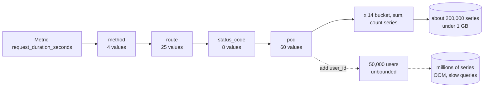

**Reading the diagram.** Read left to right as multiplication: each label stage multiplies the number of distinct series by its value count, and the histogram multiplies by 14 series per combination. The solid path ends in a manageable TSDB head (the storage boundary, in memory plus write-ahead log). The dotted branch shows the failure mode: an unbounded label creates series as fast as new users arrive, until the Prometheus process runs out of memory or queries time out. This is not a request path; it is a growth path that happens at write time. Scaling options are to cut labels, aggregate before storage (recording rules or Collector processors) or shard the TSDB, in that order of preference.

### 40.5.4 Pull versus push

**Table 40.6 — Pull and push collection compared.**

| Aspect | Pull (scrape) | Push |
|---|---|---|
| How it works | Monitoring server fetches `/metrics` from each target on an interval | Targets send metrics to a receiver (OTLP, StatsD, remote write) |
| Target discovery | Server must know targets (service discovery) | Receiver learns targets from what arrives |
| Liveness signal | Free: a failed scrape sets `up = 0` | Silence is ambiguous: dead, or idle? |
| Short-lived jobs | Poor: the job may end before a scrape | Natural |
| Through firewalls and NAT | Server needs network access to every target | Targets need access to one endpoint |
| Back-pressure | Server controls load by interval | Receiver must protect itself (rate limits, queues) |
| Typical systems | Prometheus | OpenTelemetry OTLP, StatsD, Graphite, cloud agents |

Prometheus pulls, getting a free health check, and offers the **Pushgateway** only for batch jobs that finish before a scrape [Prometheus Docs: When to use the Pushgateway]. OpenTelemetry SDKs push OTLP, and Prometheus 3 can receive OTLP itself. Most platforms run both.

**Figure 40.4 — Pull and push paths into one metrics store.**

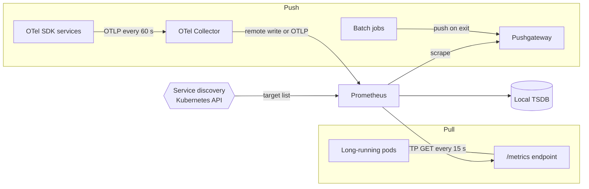

**Reading the diagram.** Prometheus learns its targets from service discovery, then issues synchronous HTTP GET scrapes to each pod's `/metrics` endpoint every 15 s. Batch jobs push to the Pushgateway on exit, and Prometheus scrapes the gateway; the gateway keeps the last value forever unless deleted, so use it only for jobs. OTel-instrumented services push OTLP to a Collector, which forwards it. All paths end in the local TSDB, the storage boundary. Failure points: a timed-out scrape marks the target down; a Collector outage loses pushed metrics unless it buffers. Scaling: shard scraping across Prometheus servers (§40.8.4).

### 40.5.5 Time-series storage

Section 12.8 explains time-series storage: an inverted label index, a write-ahead log, two-hour blocks, retention by deleting blocks, and Gorilla compression at about 1.37 bytes per sample [Pelkonen et al. 2015]. Two consequences matter here. First, storage per sample is tiny, so **sample rate is rarely the limit; series count is**, because each active series needs index entries and an open chunk in memory. Second, **downsampled rollups cannot reproduce percentiles**: keep histogram buckets in long-term storage if you need p99 from last quarter.

## 40.6 Traces and distributed tracing

Section 34.9 introduced traces, spans and context propagation. This section is the book's deep treatment: the data model, the W3C header format, sampling and its arithmetic, and storage.

### 40.6.1 Spans and trace trees

::: definition
**Definition — Trace and span (data model).** A **span** records one timed operation: a trace ID (16 bytes), a span ID (8 bytes), a parent span ID (empty for the **root span**), a name such as `POST /checkout`, a **kind** (server, client, producer, consumer or internal), start and end timestamps, a status, key–value **attributes**, timestamped **events** (for example an exception) and optional **links** to spans in other traces. A **trace** is the set of spans sharing one trace ID; parent pointers turn it into a tree rooted at the first instrumented operation [OpenTelemetry Specification: Tracing API; Sigelman et al. 2010].
:::

#### First-principles explanation

A parcel crosses a sorting hub, a truck, a depot and a courier's van. Each handler scans the barcode and records when the parcel arrived and left. The barcode is the trace ID; each scan pair is a span; "handed to me by the depot" is the parent pointer. Collect the scans and you can draw the parcel's journey and see that it sat in the depot for two days. Without the barcode, each handler's records exist but cannot be joined.

#### Why does this exist?

Metrics tell you the checkout p99 rose; per-service logs give each service's view. Neither tells you that *this* slow request spent 2.0 of its 2.4 seconds waiting for one payment-provider call that then retried. Google built Dapper because engineers could not tell which of many services caused a slow web search; its design goals were low overhead, transparency to application developers (instrumentation lives in shared RPC, threading and control-flow libraries) and continuous deployment across the fleet [Sigelman et al. 2010]. Twitter's Zipkin (2012) and Uber's Jaeger (2015, later a CNCF graduated project) brought the same design to open source, and OpenTelemetry (§40.7) standardized it.

**Figure 40.5 — A slow checkout trace as a waterfall.**

```mermaid
gantt
  title Trace 4bf92f35, axis in seconds
  dateFormat x
  axisFormat %S.%L
  section gateway
  POST /checkout :a1, 0, 2380ms
  section checkout
  PlaceOrder :a2, 4, 2370ms
  section cart
  GetCart :a3, 8, 30ms
  section payment
  Authorize :a4, 40, 2300ms
  provider call timeout :crit, a5, 45, 2004ms
  retry provider :a6, 2052, 280ms
  section orders-db
  INSERT order :a7, 2345, 20ms
```

**Reading the diagram.** Each bar is a span; rows are grouped by service, and the horizontal axis is time from the root span's start. Nesting is shown by containment: the gateway's server span (0–2,380 ms) contains checkout's `PlaceOrder`, which contains the cart and payment calls, all synchronous request/response. The highlighted span is the payment provider call that hit a 2 s client timeout (2,004 ms) before a retry succeeded in 280 ms, so 2.3 s of the 2.38 s total is spent in payment; the database insert (20 ms) is irrelevant to latency. Gaps between bars are time no span covers, itself a clue. Failure points: a dependency timeout longer than the caller can afford, and retries on the critical path. Spans are exported asynchronously, so the waterfall appears in the trace store seconds later.

The waterfall answers the question every latency investigation starts with: **where did the time go?** The **critical path** is the chain of spans that determined the end time; shortening anything off it does not help.

### 40.6.2 Trace context propagation

For spans in different processes to join one tree, every outbound call must carry the trace ID and the caller's span ID. The **W3C Trace Context** Recommendation standardizes this for HTTP with two headers, so that services instrumented by different vendors' libraries interoperate [W3C Trace Context].

```text
traceparent: 00-4bf92f3577b34da6a3ce929d0e0e4736-00f067aa0ba902b7-01
             |  |                                |                |
             |  trace-id: 16 bytes, 32 hex       parent-id:       trace-flags:
             version: 00                         8 bytes, 16 hex  01 = sampled
tracestate:  vendorA=t61rcWkgMzE,ot=th:c
```

What to notice:

- **version** is `00`; `ff` is invalid. **trace-id** and **parent-id** must not be all zeros. The parent-id is the span ID of the *caller's* span; the callee creates a new span whose parent is that ID.
- **trace-flags** bit 0 (`01`) is the **sampled** flag: the caller recorded this trace, so downstream services should too. Level 2 of the specification adds a bit (`02`) declaring that the trace ID's rightmost 7 bytes are random, which sampling algorithms rely on.
- **tracestate** carries vendor-specific key–value pairs (up to 32 entries) alongside the standard header without breaking interoperability; OpenTelemetry uses the `ot` key for its consistent-sampling threshold.
- A separate W3C **Baggage** header carries application key–value pairs (for example `tenant=acme`) to every downstream service. Baggage is visible to every hop and to third parties you call, so never put secrets or personal data in it.

**Figure 40.6 — Propagating trace context across HTTP and a queue.**

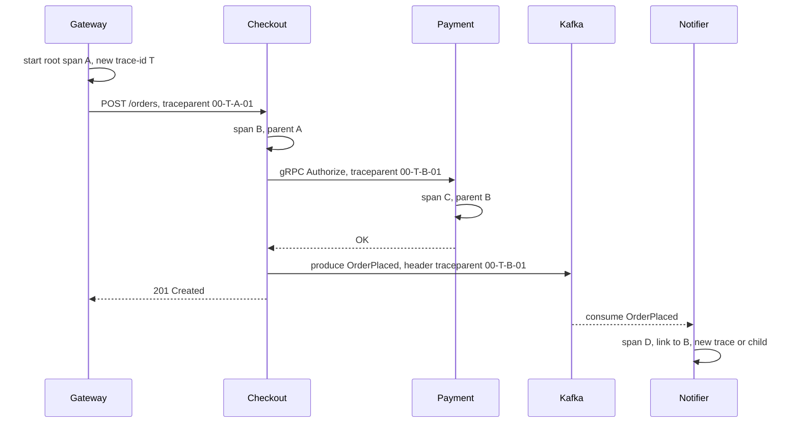

**Reading the diagram.** The gateway, the first instrumented hop, creates trace ID T and root span A, makes the sampling decision and writes the `traceparent` header. Each synchronous call (solid arrows: HTTP, then gRPC metadata) carries the current span ID as the parent, so Checkout's span B is a child of A and Payment's span C is a child of B. Checkout also writes the context into the Kafka record headers; the notifier consumes asynchronously (dotted), possibly minutes later, and starts span D either as a child or, more commonly for batch consumers, in a new trace with a **span link** to B so that one consumer span can reference many producer spans. Storage boundaries are the Kafka log and the trace store. Failure points: any proxy, thread pool or queue client that drops the header fragments the tree; clock skew can make a child appear to start before its parent.

Inside a process, the current span is held in a **context** object stored in thread-local or async-local storage. Work handed to a thread pool or callback must carry that context explicitly, or the new work starts an orphan trace. This is the most common reason traces "break" in otherwise instrumented services.

### 40.6.3 Head sampling and tail sampling

Tracing every request is usually unaffordable. At 1,000 requests per second with 25 spans each, a trace store ingests 25,000 spans per second. Sampling chooses which traces to keep.

::: definition
**Definition — Head and tail sampling.** **Head sampling** decides at the root span, before the request runs, usually with a probability applied to the trace ID; the decision propagates in the sampled flag so that the whole trace is kept or dropped consistently. **Tail sampling** decides after the trace completes, when its duration, errors and attributes are known, by buffering all spans of each trace in a collector until a decision timer expires [OpenTelemetry Docs: Sampling].
:::

Dapper's first production version used uniform head sampling at 1 in 1,024 traces and later added adaptive rates, because for high-volume services this still captured plenty of examples of common behavior [Sigelman et al. 2010]. Head sampling is cheap and simple, but blind: the rare request you need, the one that failed or took 9 seconds, is kept with the same small probability as every boring success.

::: formula
**Sampling volume, capture probability and tail-sampler buffer**

$$V = R \, p_{\text{eff}} \, S \, b \qquad P_{\text{capture}} = 1 - (1 - p)^{k} \qquad p_{\text{eff}}^{\text{tail}} = f_{\text{int}} + (1 - f_{\text{int}})\,p \qquad M_{\text{buf}} = R \, w \, S \, b_{\text{mem}}$$

| Symbol | Meaning | Units |
|---|---|---|
| $R$ | Root traces started | traces/second |
| $p$ | Head sampling probability, or tail baseline probability | dimensionless |
| $p_{\text{eff}}$ | Fraction of traces stored | dimensionless |
| $S$ | Mean spans per trace | spans/trace |
| $b$ | Stored bytes per span | bytes/span |
| $V$ | Stored trace volume | bytes/second |
| $k$ | Occurrences of a rare event in the time window | occurrences |
| $P_{\text{capture}}$ | Probability head sampling keeps at least one of them | dimensionless |
| $f_{\text{int}}$ | Fraction of "interesting" traces (errors or slow) kept by tail policies | dimensionless |
| $w$ | Tail-sampling decision wait | seconds |
| $b_{\text{mem}}$ | In-memory bytes per buffered span | bytes/span |
| $M_{\text{buf}}$ | Collector memory needed to buffer pending traces | bytes |
:::

::: example
**Worked example — Tracing QuickBite's checkout.** $R = 1{,}000$ traces/s, $S = 25$, $b = 500$ B stored, $b_{\text{mem}} = 1.5$ KB in the collector. Errors are 0.3% and slow (> 1 s) requests 0.9% of traffic, so $f_{\text{int}} \approx 0.012$.

1. Keep everything: $1{,}000 \times 25 \times 500 = 12.5$ MB/s = **1.08 TB/day**.
2. Head sampling at 5%: $0.05 \times 1.08 = 54$ GB/day.
3. A bug fails 20 requests per hour. Probability that 1% head sampling captures at least one in an hour: $1 - 0.99^{20} = 1 - 0.818 = 18.2\%$. At 5%: $1 - 0.95^{20} = 64.2\%$.
4. Tail sampling, keeping all errors and slow traces plus a 1% baseline: $p_{\text{eff}} = 0.012 + 0.988 \times 0.01 = 0.0219$, i.e. $0.0219 \times 1.08\text{ TB} \approx 23.6$ GB/day, and **100%** of the failing requests are captured.
5. Price of tail sampling: the collectors must receive all 25,000 spans/s, and with $w = 10$ s they buffer $1{,}000 \times 10 \times 25 \times 1.5\text{ KB} = 375$ MB of pending spans, plus headroom for traffic spikes.

**Interpretation.** Tail sampling stores less than half of 5% head sampling yet keeps every interesting trace. **Engineering implication.** Use head sampling where the network cost of shipping every span is prohibitive or traffic is uniform; use tail sampling (often after a generous head rate) when the traces you need are rare. Budget collector CPU, network and memory for 100% of spans, and route all spans of a trace to the same collector.
:::

The simulation below checks these numbers on 200,000 synthetic traces, comparing head sampling at 5% and 1% with a tail policy that keeps errors, slow traces and a 1% baseline.

```python
import math
import random
from dataclasses import dataclass


@dataclass
class Trace:
    trace_id: int
    duration_s: float
    error: bool
    spans: int


def generate(n, rng):
    """Synthetic traffic: 0.3% errors, ~1% slower than 1 s."""
    traces = []
    for i in range(n):
        slow_mode = rng.random() < 0.01
        mu = math.log(1.6) if slow_mode else math.log(0.12)
        duration = rng.lognormvariate(mu, 0.4)
        error = rng.random() < 0.003
        traces.append(Trace(rng.getrandbits(64), duration, error,
                            spans=rng.randint(10, 40)))
    return traces


def head_sample(t, rate):
    """Decided at the root from trace-ID bits, before the outcome is known."""
    return t.trace_id < rate * 2**64


def tail_sample(t, rate, slow_s=1.0):
    """Decided after the whole trace is buffered: policies run in order."""
    if t.error:
        return "error"
    if t.duration_s > slow_s:
        return "slow"
    if t.trace_id < rate * 2**64:               # consistent probabilistic
        return "baseline"
    return None


def report(name, kept, traces):
    errors = [t for t in traces if t.error]
    slow = [t for t in traces if t.duration_s > 1.0]
    k_err = sum(1 for t in kept if t.error)
    k_slow = sum(1 for t in kept if t.duration_s > 1.0)
    spans = sum(t.spans for t in kept)
    print(f"{name:<22} kept {len(kept):>6} traces ({100*len(kept)/len(traces):5.2f}%)"
          f"  spans {spans:>8}  errors {k_err:>3}/{len(errors)}"
          f"  slow {k_slow:>4}/{len(slow)}")


rng = random.Random(7)
traces = generate(200_000, rng)
report("head 5%", [t for t in traces if head_sample(t, 0.05)], traces)
report("head 1%", [t for t in traces if head_sample(t, 0.01)], traces)
tail = [(t, tail_sample(t, 0.01)) for t in traces]
kept = [t for t, why in tail if why]
report("tail err+slow+1%", kept, traces)
for why in ("error", "slow", "baseline"):
    print(f"  kept by {why:<8}: {sum(1 for _, w in tail if w == why)}")
```

Output:

```text
head 5%                kept   9926 traces ( 4.96%)  spans   248020  errors  33/618  slow   94/1741
head 1%                kept   2027 traces ( 1.01%)  spans    51072  errors   7/618  slow   22/1741
tail err+slow+1%       kept   4352 traces ( 2.18%)  spans   109555  errors 618/618  slow 1741/1741
  kept by error   : 618
  kept by slow    : 1736
  kept by baseline: 1998
```

What to notice:

- Head sampling keeps errors and slow traces in proportion to its rate (33 of 618 errors at 5%): it is unbiased, which is good for estimating averages and bad for debugging.
- The tail policy stores 2.18% of traces, matching $p_{\text{eff}} \approx 0.012 + 0.988 \times 0.01$, yet keeps all 618 errors and all 1,741 slow traces.
- Policies are evaluated in order and the first match labels the reason; record that reason as a span attribute so analysts know which traces are a biased sample and which baseline traces can be used for statistics.
- Both samplers compare the trace ID with a threshold rather than calling a random number generator, so every service and collector that sees the same trace ID makes the same decision. This is why the W3C random-trace-ID flag matters.

**Table 40.7 — Head and tail sampling compared.**

| Aspect | Head sampling | Tail sampling |
|---|---|---|
| Decision point | Root span, before work | Collector, after trace completes |
| Information used | Trace ID, route, maybe caller | Duration, status, any attribute of any span |
| Keeps rare failures | Only with probability $p$ | Yes, by policy |
| Network and CPU cost | Unsampled spans never leave the process | Every span shipped to collectors |
| Infrastructure | None beyond the SDK | Stateful collector tier, trace-ID-aware routing, buffering |
| Statistical bias | Unbiased sample | Biased toward interesting traces; weights needed for rates |
| Choose when | Very high volume, uniform traffic, tight budgets | Debugging rare errors and tail latency matters most |

**Figure 40.7 — Tail sampling with trace-ID-aware routing.**

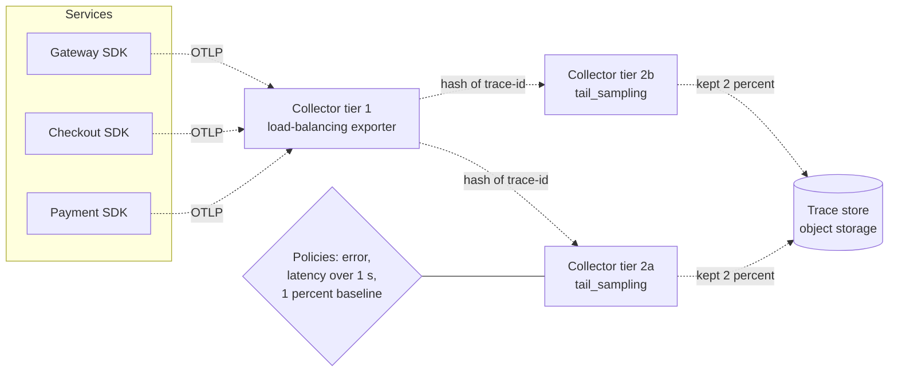

**Reading the diagram.** Services export spans asynchronously over OTLP to a stateless first collector tier. Its load-balancing exporter hashes each span's trace ID and forwards it, so all spans of one trace, which come from different services, reach the same second-tier collector. Second-tier collectors buffer spans per trace for the decision wait, evaluate the policies in the diamond, and write only kept traces to the trace store, the storage boundary. Every arrow is asynchronous; no request waits for tracing. Failure points: rescaling the second tier changes the hash ring and splits in-flight traces; a crash loses undecided traces; late spans need a decision cache or are dropped. Scaling: add second-tier collectors and size memory with $M_{\text{buf}}$.

### 40.6.4 Span storage and analysis

Trace stores see very high write rates, no updates, and reads that fetch every span of one trace or search by service, duration and attributes. Dapper stored each trace as one Bigtable row with one column per span [Sigelman et al. 2010]. Jaeger uses Cassandra or Elasticsearch/OpenSearch with secondary indexes. Grafana Tempo stores traces as Apache Parquet blocks in object storage with no attribute index, relying on trace-ID lookup and a column-scanning query language, TraceQL [Grafana Tempo Docs]: cheap storage, slower ad hoc search.

Beyond single traces, aggregate analysis turns spans into metrics: **span metrics** (request rate, errors and duration histograms per service and operation, derived from spans before sampling) and **service graphs** (who calls whom, with rates and error counts). Compute them in the Collector before sampling, otherwise rates are distorted by the sampling bias.

#### Real-world industry applications

::: industry
**Google Dapper.** Dapper instrumented Google's common RPC and threading libraries so that applications needed no changes, sampled traces (1 in 1,024 initially) to keep overhead low, collected spans asynchronously from local logs into Bigtable, and exposed an API on which teams built latency analysis tools. Its paper defined the vocabulary (trace trees, spans, annotations) used by Zipkin, Jaeger and OpenTelemetry.
*Evidence: Primary* — [Sigelman et al. 2010]
:::

::: industry
**Facebook Canopy.** Canopy traces requests from browsers and mobile apps through back-end services, models the raw traces and extracts features into datasets that engineers query in aggregate: the move from "look at one trace" to "analyze millions of traces".
*Evidence: Primary* — [Kaldor et al. 2017]
:::

#### Failure scenarios

**Table 40.8 — Tracing failure scenarios.**

| What goes wrong | Why | Detection | Recovery | Prevention |
|---|---|---|---|---|
| Traces split into fragments | A hop (proxy, thread pool, queue client) drops context | Many root spans in non-edge services | Patch the hop to propagate context | Shared instrumentation; propagation tests |
| Incomplete traces | Services disagree on sampling (no parent-based sampler) | Spans with missing parents | Use parent-based sampling everywhere | Standard SDK configuration |
| Rare errors never sampled | Head sampling at low rate | Error metrics exist but no matching traces | Raise rate temporarily | Tail sampling for errors and latency |
| Collector out of memory | Tail-sampling buffer sized for average, not peak | Collector restarts, dropped spans | Scale out; reduce decision wait | Size $M_{\text{buf}}$ for peak; memory limiter |
| Trace store cost overrun | High-cardinality attributes and full payloads on spans | Bytes per span trend | Drop attributes in the Collector | Attribute allowlist; span size limits |

::: mistake
**Misconception — "Tracing adds latency to every request."** Span creation costs on the order of microseconds or less, and export happens asynchronously in batches off the request path. The real costs are CPU and network for exporting spans and the storage behind them, which is what sampling controls. Do not trace synchronously to a remote server, and do not attach megabyte payloads as attributes.
:::

## 40.7 OpenTelemetry

::: definition
**Definition — OpenTelemetry (OTel).** A vendor-neutral, open-source framework of APIs, SDKs, a wire protocol (OTLP), semantic conventions and a Collector for generating, collecting and exporting traces, metrics, logs and (newer) profiles. It was formed in 2019 by merging the OpenTracing and OpenCensus projects and is hosted by the Cloud Native Computing Foundation [OpenTelemetry Docs].
:::

Before OpenTelemetry, switching tracing vendors meant re-instrumenting every service with a new proprietary library. OpenTelemetry separates **instrumentation** (done once, against a stable API) from **destination** (any back end that accepts OTLP, chosen in configuration).

### 40.7.1 API, SDK and Collector

1. **API.** The interfaces that libraries and applications call: get a tracer, start a span, record a counter. With no SDK installed it is a no-op, so library authors can instrument without forcing a dependency on users.
2. **SDK.** The implementation the *application owner* installs: samplers, span processors (batching), metric readers and aggregation, resource detection (service name, version, host, Kubernetes pod) and exporters.
3. **Collector.** A separate process that receives telemetry, processes it and exports it. Each **pipeline** is built from **receivers** (OTLP, Prometheus scrape, file logs, and others), **processors** (memory limiter, batch, attributes, redaction, tail sampling) and **exporters** (OTLP, Prometheus remote write, vendor formats); **connectors** join pipelines, for example turning spans into span metrics.

The Collector runs in two common roles: as an **agent** next to the workload (a DaemonSet or sidecar) that offloads batching and retries from the application, and as a **gateway** tier that centralizes sampling, redaction, routing and credentials.

**Figure 40.8 — OpenTelemetry from API to back ends.**

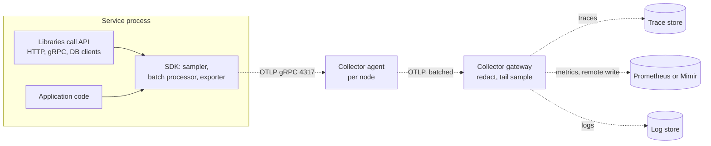

**Reading the diagram.** Inside the process, instrumented libraries and application code call only the API; the SDK samples, batches and exports. Export is asynchronous (dotted) over OTLP to a per-node agent, which forwards batches to a gateway tier that applies organization-wide processing before fanning out to separate trace, metric and log back ends, the storage boundaries. Back ends change in gateway configuration, not in services. Failure points: a full SDK export queue drops telemetry rather than blocking requests (by design); put the memory-limiter processor first so gateways shed load instead of crashing. Scaling: agents scale with nodes, stateless gateways horizontally.

### 40.7.2 OTLP and semantic conventions

**OTLP** (OpenTelemetry Protocol) encodes telemetry as Protocol Buffers and transports it over gRPC (default port 4317) or HTTP (default port 4318, with protobuf or JSON payloads) [OpenTelemetry Specification: OTLP]. Each batch groups data by **resource** (the entity producing it: service, version, host, pod) and by **instrumentation scope** (the library that produced it), so shared attributes are sent once per batch.

**Semantic conventions** standardize attribute names so that dashboards and queries work across languages and vendors: `service.name` and `service.version` on the resource; `http.request.method`, `http.route` and `http.response.status_code` on HTTP spans and metrics; `error.type` on failures. The HTTP conventions were declared stable in 2023 [OpenTelemetry Semantic Conventions]. Following them is what lets a pre-built "HTTP service" dashboard work for a Java service and a Go service alike.

A minimal SDK configuration uses standard environment variables, identical across languages:

```bash
export OTEL_SERVICE_NAME=checkout
export OTEL_RESOURCE_ATTRIBUTES=service.version=4.12.0,deployment.environment.name=prod
export OTEL_EXPORTER_OTLP_ENDPOINT=http://otel-agent:4317
export OTEL_TRACES_SAMPLER=parentbased_traceidratio
export OTEL_TRACES_SAMPLER_ARG=0.10
```

What to notice: `parentbased_traceidratio` makes a new root trace sampled with probability 0.10 derived from the trace ID, but always follows the parent's sampled flag for non-root spans, so traces stay complete across services.

### 40.7.3 Auto-instrumentation

**Auto-instrumentation** (zero-code instrumentation) needs no source changes: the Java agent rewrites framework bytecode at class-load time, Python's `opentelemetry-instrument` and the Node.js and .NET equivalents patch libraries at startup, and eBPF-based tools observe compiled binaries from the kernel. It yields HTTP, RPC, database and messaging spans plus RED metrics on day one, but cannot know your business: add **manual** attributes for domain fields (`payment.card_network`, `app.version`), which are what solve incidents like this chapter's opening.

### 40.7.4 Signal status (as of 2026)

**Table 40.9 — OpenTelemetry signals (as of 2026; check the project's status page for each language).**

| Signal | Specification status | Notes |
|---|---|---|
| Traces | Stable | Stable API and SDK in all major languages |
| Metrics | Stable | Stable in most major languages; exponential histograms supported |
| Logs | Stable data model, bridge API and SDK | Usually fed from existing logging libraries through bridges and Collector receivers |
| Baggage | Stable | Propagated with W3C Baggage |
| Profiles | Alpha / development | OTLP profiles data model and Collector support were maturing in 2025–2026 |

Status differs by language SDK and by component, so treat the table as a starting point, not a guarantee [OpenTelemetry Docs: Status].

## 40.8 Prometheus

::: definition
**Definition — Prometheus.** An open-source monitoring system and time-series database, started at SoundCloud in 2012 and a graduated CNCF project since 2018, that scrapes metrics over HTTP, stores them locally, evaluates recording and alerting rules, and is queried with PromQL [Prometheus Docs: Overview].
:::

### 40.8.1 The scrape model and architecture

1. **Discover.** Service discovery (Kubernetes, Consul, cloud APIs, files) produces the target list; **relabeling** rules filter targets and rewrite labels before scraping.
2. **Scrape.** Every scrape interval (commonly 15–60 s), Prometheus issues `GET /metrics` to each target and parses the text exposition format (or OpenMetrics, or protobuf for native histograms). It records `up` and `scrape_duration_seconds` for every target.
3. **Store.** Samples are appended to the in-memory head block and the write-ahead log; every two hours the head is cut into an immutable block, which is later compacted; blocks older than the retention (15 days by default) are deleted (§12.8.1).
4. **Evaluate.** Recording rules precompute expensive queries into new series; alerting rules evaluate PromQL conditions and send firing alerts to Alertmanager.
5. **Serve.** Grafana and other clients query through the HTTP API; remote write streams samples to long-term storage.

**Figure 40.9 — Prometheus architecture.**

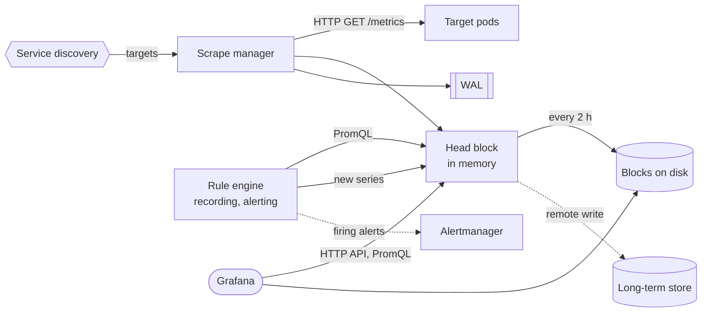

**Reading the diagram.** Service discovery feeds the scrape manager, which pulls from targets synchronously over HTTP and appends samples to the head block and the write-ahead log (WAL); the WAL is replayed after a crash. Blocks on local disk are the main storage boundary. The rule engine evaluates PromQL on a schedule, writes recording-rule results back as new series and sends firing alerts asynchronously to Alertmanager. Grafana queries the head and blocks through the HTTP API. Remote write copies samples asynchronously to a long-term store. Failure points: a single node's disk, cardinality-driven memory exhaustion (§40.5.3) and scrapes slower than the interval. Scaling: identical pairs for availability; shard targets by function or hash.

### 40.8.2 PromQL: rate and histogram_quantile

Three queries cover most dashboards.

```text
# 1. Request rate per route: per-second increase of a counter over 5 minutes.
sum by (route) (rate(http_server_requests_total{service="checkout"}[5m]))

# 2. Error ratio.
  sum(rate(http_server_requests_total{service="checkout", status_class="5xx"}[5m]))
/ sum(rate(http_server_requests_total{service="checkout"}[5m]))

# 3. Fleet p99 latency: add bucket rates across pods FIRST, then estimate.
histogram_quantile(0.99,
  sum by (le) (rate(http_server_request_duration_seconds_bucket{service="checkout"}[5m])))
```

What to notice:

- `rate()` computes the per-second average increase over the window, handles counter resets after restarts, and needs at least two samples in the window; make the window at least four times the scrape interval so one missed scrape does not create gaps.
- Always `rate` first, then `sum`. Summing raw counters across pods and then taking the rate turns every pod restart into a huge negative jump that `rate` misreads.
- In query 3, `sum by (le)` keeps the bucket label so that buckets from all pods are added before `histogram_quantile` interpolates, which is the correct aggregation shown in §40.5.2. Averaging per-pod quantiles would be wrong.

### 40.8.3 Recording rules

A dashboard that computes query 3 over 201,600 bucket series (§40.5.3) on every refresh does a lot of repeated work. A **recording rule** evaluates the expensive part once per interval and stores the result as a new, small series.

::: formula
**Samples read by a range query**

$$W = N_{\text{series}} \times \frac{\Delta}{\tau} \times P$$

| Symbol | Meaning | Units |
|---|---|---|
| $N_{\text{series}}$ | Series selected by the query | series |
| $\Delta$ | Range-vector window (e.g. `[5m]`) | seconds |
| $\tau$ | Scrape or rule interval | seconds |
| $P$ | Evaluation steps (points on the graph) | count |
| $W$ | Samples read per query | samples |
:::

::: example
**Worked example — A p99 panel with and without a recording rule.** 201,600 bucket series, $\Delta = 300$ s, $\tau = 15$ s, a 24-hour graph at 1-minute steps, so $P = 1{,}440$.

1. Raw: $201{,}600 \times 20 \times 1{,}440 = 5.81 \times 10^9$ samples per panel load.
2. Recording rule `route:http_server_request_duration_seconds_bucket:rate5m = sum by (route, le) (rate(...[5m]))` produces $25 \times 12 = 300$ series, one sample per 15 s.
3. The panel then reads $300 \times 1{,}440 = 432{,}000$ samples (an instant selection per step), about 13,000 times fewer.

**Interpretation.** Recording rules trade a small, steady evaluation cost for orders-of-magnitude cheaper reads. **Engineering implication.** Record every aggregation used by dashboards and alerts, name them `level:metric:operations` as the Prometheus documentation recommends, and alert on recorded series.
:::

### 40.8.4 Federation and long-term storage

A single Prometheus server keeps weeks of data for one set of targets. Organizations need global views across clusters and regions, months or years of retention and high availability.

- **Federation.** A higher-level Prometheus scrapes selected, usually pre-aggregated, series from lower-level servers via their `/federate` endpoint. Simple, but it copies only what you select and adds another single node.
- **Thanos.** A **sidecar** next to each Prometheus uploads two-hour blocks to object storage and serves recent data; a **querier** fans out PromQL across sidecars and **store gateways** (which read object storage) and deduplicates HA pairs; a **compactor** compacts and downsamples blocks in the bucket [Thanos Docs].
- **Cortex and Grafana Mimir.** Prometheus servers (or OTel Collectors) **remote-write** to a horizontally scalable, multi-tenant cluster: distributors shard series to replicated ingesters, which periodically flush blocks to object storage; queriers and store gateways read both. Mimir began in 2022 as a fork of Cortex by Grafana Labs [Cortex Docs; Grafana Mimir Docs].

**Figure 40.10 — Two long-term storage designs.**

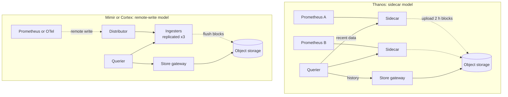

**Reading the diagram.** In the Thanos design, each Prometheus keeps writing locally and its sidecar uploads finished blocks asynchronously to object storage; the querier answers PromQL by fanning out synchronously to sidecars for recent data and store gateways for history, deduplicating replicas. In the Mimir/Cortex design, Prometheus or OTel Collectors stream samples by remote write to distributors, which shard and replicate them to ingesters; ingesters flush blocks to object storage; queriers merge ingester and store-gateway results. Object storage is the durable boundary in both. Failure points: in Thanos, up to about two hours of not-yet-uploaded data lives only on the Prometheus disk; in Mimir, losing a majority of an ingester replica set loses unflushed samples. Scaling: Thanos grows with Prometheus servers; Mimir scales each component horizontally and is multi-tenant.

## 40.9 Grafana

Grafana is an open-source visualization platform that queries many **data sources** (Prometheus, Loki, Tempo, Elasticsearch, SQL databases, cloud monitoring APIs) and renders **dashboards** of **panels**. **Variables** (for example `$service`, `$cluster`) make one dashboard serve many services; **annotations** overlay events such as deployments on graphs; and links and exemplars let a user jump from a latency graph to a trace or from a trace to its logs [Grafana Docs].

Design guidelines that consistently pay off:

1. **One question per dashboard.** "Is this service healthy, and if not, where?": RED or golden signals on top, then saturation (USE), then dependencies (§23.3).
2. **Hierarchy and drill-down.** A small set of top-level dashboards (business journeys and SLOs) links to service dashboards, which link to instance and dependency views, traces and logs (Figure 40.11). People should not search for dashboards during an incident.
3. **Consistent visual language.** Same units and time ranges, latency as percentiles (never averages alone), SLO thresholds drawn, deploy annotations everywhere.
4. **Dashboards as code.** Version-control dashboards (provisioned JSON, Jsonnet or Terraform), review changes and generate per-service dashboards from a template.

**Figure 40.11 — A dashboard hierarchy for drill-down.**

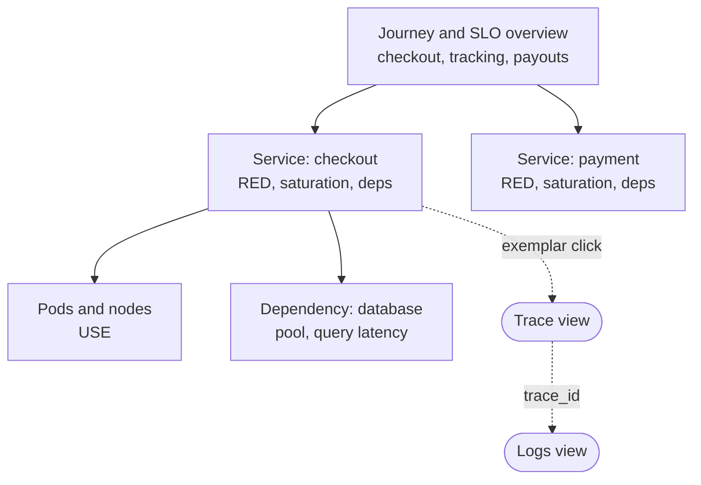

**Reading the diagram.** Each box is a dashboard, and solid arrows are links a responder follows from the general to the specific: a journey overview that shows SLO status, a templated service dashboard with RED, saturation and dependency panels, and resource-level USE views. Dotted arrows leave dashboards entirely: an exemplar on a latency panel opens a trace, and the trace's ID opens the matching logs. Separate stores are joined by shared labels and IDs. Failure point: hand-made service dashboards that differ from one another cost responders time; the structure scales by templating, not by hand.

**Dashboard sprawl** is the opposite: thousands of unowned, near-duplicate, often broken dashboards. Grafana's guidance describes maturing from sprawl, through methodical templates and RED/USE, to version-controlled, reviewed dashboards [Grafana Docs: Dashboard best practices]. Counter it with owners, deletion of dashboards unviewed for 90 days, and a curated "start here" folder.

::: mistake
**Misconception — "More dashboards mean better visibility."** During an incident, a responder has minutes. Fifty dashboards that each show a slightly different view slow them down. Dashboards are for answering known questions quickly; exploration of unknown-unknowns belongs in query tools over events and traces (§40.3).
:::

## 40.10 Alerting

### 40.10.1 Symptom-based and cause-based alerts

::: definition
**Definition — Symptom-based alert.** An alert on something users experience (errors, latency, unavailability, correctness), ideally expressed against an SLO. A **cause-based** alert fires on a suspected cause (high CPU, a full disk queue, a replica down) that may or may not hurt users [Beyer et al. 2016, ch. 6].
:::

A hospital monitor alarms when a patient's oxygen saturation drops, not when one of many possible causes appears; the doctor then investigates causes. Paging works the same way. Users care whether checkout works, not whether a CPU is at 90%. CPU at 90% with healthy latency is efficiency; CPU at 30% with a deadlocked pool is an outage that a CPU alert misses. The SRE book's rules are that every page must be urgent, actionable and require human intelligence, and that you should page on symptoms and use causes to debug [Beyer et al. 2016, ch. 6].

**Table 40.10 — Symptom-based versus cause-based alerts.**

| Aspect | Symptom-based | Cause-based |
|---|---|---|
| Example | Checkout 5xx ratio burning error budget 14× too fast | Node CPU > 90% for 5 min |
| Catches unknown causes | Yes | Only the anticipated cause |
| False positives | Low: users are affected by definition | High: many causes are harmless |
| Best use | Paging | Tickets, dashboards, and imminent-exhaustion cases (disk full in 4 h, certificate expiring) |

**Alert fatigue** follows when pages are noisy: responders learn to ignore or silence them, and the real page is missed. Measure it: track the fraction of pages that led to action (precision) and pages per on-call shift. The SRE book suggests at most about two incidents per 12-hour shift so that each can be handled thoroughly and followed up with a postmortem [Beyer et al. 2016, ch. 11]. Delete or demote any alert that repeatedly fires without action.

### 40.10.2 Burn-rate alerts

A threshold such as "error ratio > 1% for 5 minutes" is either too sensitive for brief blips or too slow for total outages. **Burn-rate alerts**, derived in §39.7.3, page when the error budget is being consumed much faster than the SLO allows.

::: formula
**Burn rate and budget consumed**

$$\beta = \frac{e}{1 - \text{SLO}} \qquad \text{budget consumed in time } t = \frac{\beta \, t}{T}$$

| Symbol | Meaning | Units |
|---|---|---|
| $e$ | Observed error ratio over the alert window | dimensionless |
| $\text{SLO}$ | Target success ratio | dimensionless |
| $\beta$ | Burn rate; 1 spends the budget exactly over the SLO period | dimensionless |
| $T$ | SLO period | hours |
| $t$ | Duration of the burn | hours |
:::

::: example
**Worked example — The 14.4× page.** Checkout's SLO is 99.9% over 30 days ($T = 720$ h). The error ratio over the last hour is 1.44%.

1. $\beta = 0.0144 / 0.001 = 14.4$.
2. One hour at this rate consumes $14.4 \times 1 / 720 = 2\%$ of the monthly budget; the whole budget would last $720 / 14.4 = 50$ hours.
3. The Site Reliability Workbook pairs this long window (1 h) with a short window (5 min) at the same burn rate, so the alert fires only if the problem is still happening, and resets quickly after recovery [Beyer et al. 2018, ch. 5].

**Interpretation.** A 1.44% error ratio sounds small, but it would empty a month's budget in about two days. **Engineering implication.** Page on fast burns (for example 14.4× over 1 h and 6× over 6 h) and open tickets on slow burns (1× over 3 days); §39.7.3 derives these thresholds and their detection times.
:::

### 40.10.3 Alertmanager: routing, deduplication and inhibition

Prometheus evaluates alerting rules; **Alertmanager** decides who hears about them. An alert moves from *inactive* to *pending* when its condition is true, and to *firing* once it has stayed true for the rule's `for` duration, which filters blips.

```yaml
# Prometheus alerting rule (rules file)
groups:
- name: checkout-slo
  rules:
  - alert: CheckoutErrorBudgetFastBurn
    expr: |
      job:slo_errors_per_request:ratio_rate1h{service="checkout"} > (14.4 * 0.001)
      and
      job:slo_errors_per_request:ratio_rate5m{service="checkout"} > (14.4 * 0.001)
    for: 2m
    labels: {severity: page, team: payments}
    annotations:
      summary: "Checkout is burning its 30-day error budget 14x too fast"
      runbook_url: "https://runbooks.example.internal/checkout/error-budget-burn"
---
# Alertmanager configuration (alertmanager.yml)
route:
  receiver: default-tickets
  group_by: [alertname, service]
  group_wait: 30s
  group_interval: 5m
  repeat_interval: 4h
  routes:
  - matchers: [severity="page", team="payments"]
    receiver: payments-pager
inhibit_rules:
- source_matchers: [alertname="RegionUnreachable"]
  target_matchers: [severity="page"]
  equal: [region]
```

What to notice:

- The rule reads recorded series (§40.8.3) and requires both windows to exceed the burn rate; `runbook_url` travels with the alert.
- `group_by` collapses 60 pods' identical alerts into one notification; `group_wait` waits 30 s to gather the group, `group_interval` throttles updates and `repeat_interval` re-notifies an unresolved alert every 4 hours (these three values are Alertmanager's defaults) [Prometheus Docs: Alertmanager configuration].
- The routing tree sends pages for the payments team to its pager and everything else to a ticket queue.
- The inhibition rule suppresses service pages in a region while a `RegionUnreachable` alert is firing for that same region, so responders see the cause, not 40 symptoms.

**Figure 40.12 — An alert's path through Alertmanager.**

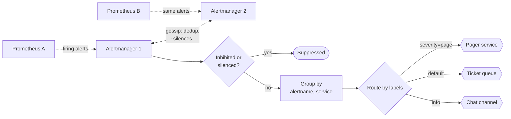

**Reading the diagram.** Two Prometheus replicas evaluate the same rules and send the same alerts asynchronously to a clustered pair of Alertmanagers, which gossip to deduplicate notifications and share silences, so the redundant pair does not double-page. Each alert is checked against inhibition rules and silences, grouped, and routed by its labels down the routing tree to a receiver: a pager for urgent symptoms, tickets for slow burns and causes, chat for information. Failure points: if Alertmanager is down nothing pages, so run a **dead man's switch**, an always-firing alert whose *absence* an external service detects; a routing mistake can send a page to a ticket queue. Scaling: one small cluster serves a large organization.

### 40.10.4 Runbooks

Every page links to a **runbook**: what the alert means, its user impact, the dashboards and queries to open first, safe mitigations (roll back, fail over, shed load) and escalation contacts. A runbook turns a 3 a.m. page from research into execution. Keep it beside the alert definition in version control, and review it in every postmortem (§39.12). If a runbook's steps are fully mechanical, automate them and remove the page.

## 40.11 Root cause analysis

### 40.11.1 The debugging workflow

An investigation moves from broad to narrow, switching signals as the question changes: **metrics** say *that* something is wrong and *when*; **traces** say *where* in the call graph; **logs** and wide events say *what* happened in that place; **profiles** say *which code* consumed the resources (Figure 40.13). Section 23.3.4 described the methodology (RED, then USE, then profile); this section adds the tooling that makes each hop take seconds.

**Figure 40.13 — From alert to root cause across signals.**

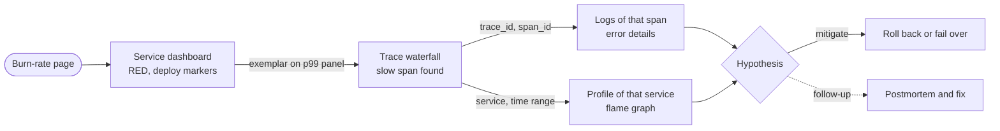

**Reading the diagram.** The page opens a service dashboard, where deployment annotations answer "what changed?". An **exemplar** on the latency panel jumps straight to a trace that contributed to the spike; the trace's slow span gives the service and operation; its IDs retrieve the exact log lines; and the service and time range select a continuous profile. Each solid arrow is an interactive query against a different store (metrics, traces, logs, profiles); the dotted arrow is asynchronous follow-up work. Failure point: missing shared identifiers (no trace ID in logs, inconsistent service names) break the chain and force correlation by timestamp.

### 40.11.2 Exemplars

::: definition
**Definition — Exemplar.** A reference from an aggregated metric sample to an individual event that contributed to it, typically a trace ID attached to one histogram bucket observation, with its value and timestamp [OpenMetrics; Prometheus Docs: Exemplars].
:::

A histogram bucket tells you that 37 requests took between 1 and 2.5 s in the last minute; an exemplar adds "for example, trace `4bf92f35…`, which took 2.38 s." Exemplars bridge the cardinality gap of §40.5.3: the trace ID never becomes a label (no new series), but the metric still points to a concrete request. OpenTelemetry SDKs attach exemplars automatically when a measurement is recorded inside a sampled span; Prometheus stores them when exemplar storage is enabled, and Grafana draws them as dots on the graph. Exemplars should point to *sampled* traces, which is another reason to keep all slow and failed traces (§40.6.3).

### 40.11.3 Worked incident walkthrough

This replays the chapter's opening incident with the tooling in place. All times and numbers are illustrative.

**Figure 40.14 — Incident timeline.**

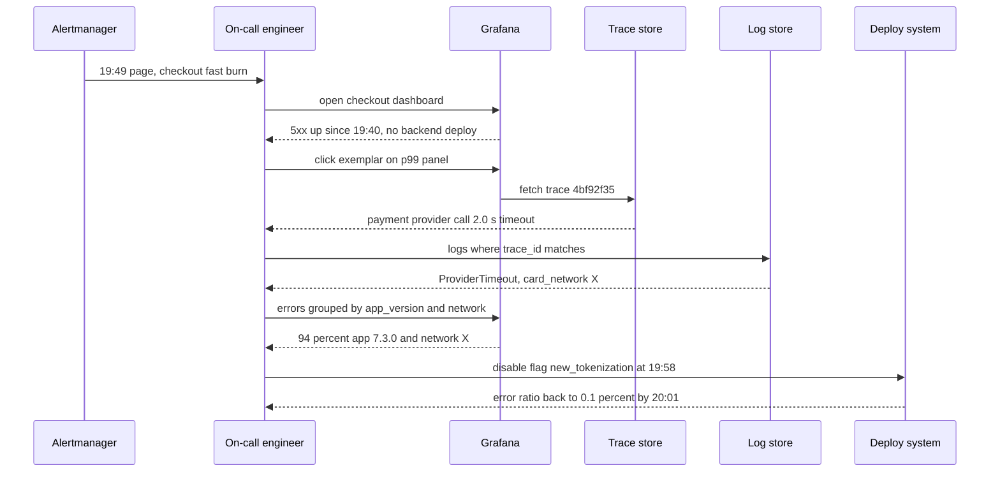

**Reading the diagram.** Messages run top to bottom in time. The burn-rate page (asynchronous notification) reaches the on-call engineer nine minutes after errors start: the 5-minute window exceeds 1.44% almost at once, but the 1-hour average needs $t$ minutes of 9% errors, where $(0.09\,t + 0.001\,(60 - t))/60 = 0.0144$, so $t \approx 9$ (§39.7.3). Each subsequent exchange is a synchronous query: the dashboard rules out a backend deploy; an exemplar leads to one failing trace; the trace's ID retrieves its logs, which carry `card_network`; a grouped query over wide events or span attributes shows the failures concentrate in one app version and one card network. The mitigation is a feature-flag change, not a deploy (§43.7); nobody restarted healthy services or grepped machines.

::: example
**Worked example — What the incident cost.** Checkout serves 300 orders/s; errors ran at 9% instead of 0.1% from 19:40 to 20:01 (21 minutes, 1,260 s). SLO 99.9% over 30 days.

1. Requests in the window: $300 \times 1{,}260 = 378{,}000$.
2. Excess failures: $378{,}000 \times (0.09 - 0.001) = 33{,}642$ orders.
3. Monthly budget: $300 \times 2{,}592{,}000 \times 0.001 = 777{,}600$ allowed failures; this incident used $378{,}000 \times 0.09 / 777{,}600 = 4.4\%$ of it.
4. Burn rate during the incident: $0.09/0.001 = 90$; a whole month's budget would last $720/90 = 8$ hours.
5. Without the tooling (40 minutes to mitigate as in the opening), excess failures would have been roughly $300 \times 2{,}400 \times 0.089 = 64{,}080$.

**Interpretation.** Twenty-one minutes cost 4.4% of the monthly budget and tens of thousands of orders; halving time to mitigate roughly halved the damage. **Engineering implication.** Mean time to mitigate is dominated by investigation, and investigation time is what linked signals buy. Measure detection and mitigation times in every postmortem.
:::

## 40.12 Profiling in production

Section 23.4 explained sampling profilers, flame graphs and off-CPU analysis on one machine. **Continuous profiling** runs a low-rate sampling profiler on every instance all the time, ships the aggregated stacks to a central store and makes them queryable by service, version, region and time, like metrics.

### 40.12.1 Continuous profiling and eBPF

#### Why does this exist?

Many performance problems depend on production data, traffic mix and hardware and do not reproduce on a laptop. With continuous profiling the incident window's profile *already exists*, and fleet-wide aggregation shows which functions cost the most CPU across thousands of machines. Google-Wide Profiling described this approach at datacenter scale, sampling machines and periods to keep overhead negligible [Ren et al. 2010].

**eBPF** makes it nearly zero-touch: a kernel program attached to a CPU timer event (for example 19–100 Hz per CPU) captures stacks for every process on the node without changing applications or restarting them; user space aggregates identical stacks and uploads them every few seconds. Interpreted and JIT-compiled runtimes need symbol information (frame pointers, perf maps or runtime-specific unwinders) for readable stacks. Open-source systems include Grafana Pyroscope and Parca; profiles are commonly stored in pprof format, and OpenTelemetry's profiles signal aims to standardize transport (Table 40.9).

**Figure 40.15 — Continuous profiling with eBPF.**

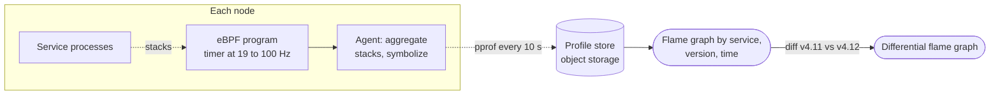

**Reading the diagram.** On each node an eBPF program samples the stacks of all processes (dotted: passive observation, no change to services); the agent aggregates identical stacks, symbolizes them and uploads compressed profiles asynchronously to a central store backed by object storage, the storage boundary. Engineers query flame graphs by service, version and time window, and **differential** flame graphs compare two versions to show what a deployment made more expensive. Failure points: missing symbols give unreadable frames; short-lived processes may be missed. Cost grows with nodes and unique stacks, not request rate, typically around 1% CPU or less at low frequencies (measure yours).

Some profilers tag samples with the active span ID, linking a slow span to its CPU profile. Use continuous profiling for cost reduction, deploy regressions and CPU-bound incidents; use off-CPU profiles and traces for latency dominated by waiting (§23.4.3).

## 40.13 Summary and revision notes

::: summary
- Monitoring answers known questions with predefined metrics and alerts; observability lets you ask new questions of existing telemetry. High-cardinality wide events make unknown-unknowns answerable.
- Logs: structured JSON with stable event names, levels and trace IDs; ship via agent → Kafka → processors → hot index plus cold object storage. Volume is $R \times n \times b$; the hot tier dominates cost; sample per request, never errors; redact personal data in layers.
- Metrics: counters, gauges, histograms, summaries. Aggregate histogram buckets, never percentiles. Quantile error is bounded by bucket width; align buckets with SLOs or use native histograms. Series count is the product of label cardinalities; identifiers never become labels.
- Traces: spans with parent pointers form a tree; W3C `traceparent` carries version, trace ID, parent span ID and flags. Head sampling is cheap and unbiased; tail sampling keeps rare errors and slow traces but needs trace-ID-aware, buffering collectors.
- OpenTelemetry separates instrumentation (API) from implementation (SDK) and destination (Collector, OTLP). Traces, metrics and logs are stable; profiles were alpha as of 2026.
- Prometheus pulls, stores locally and evaluates rules; `rate` then `sum`, `sum by (le)` then `histogram_quantile`; record expensive queries; use Thanos, Cortex or Mimir for global views and long retention.
- Grafana dashboards should be hierarchical, templated and version-controlled; sprawl slows incidents.
- Page on symptoms (burn-rate alerts), not causes; route, group, deduplicate and inhibit in Alertmanager; every page needs a runbook.
- Debug alert → dashboard → exemplar → trace → logs → profile; shared identifiers make each hop fast. Continuous eBPF profiling keeps the incident's profile on hand.
:::

## 40.14 Knowledge checkpoint

1. Give one question monitoring answers and one only observability answers.
2. Why can an event store hold `user_id` cheaply when a metrics store cannot?
3. Compute daily log volume for 2,000 requests/s, 4 lines per request, 400 bytes per line.
4. Why must log sampling be decided per request?
5. Pods A and B report p99 values of 100 ms and 500 ms. What is the fleet p99?
6. p99 falls in the bucket (0.25, 0.5] s. What is the maximum error of the estimate?
7. A counter has labels with 3, 20 and 50 values; 50% of combinations occur. How many series? As a 12-bucket histogram?
8. Decode `00-0af7651916cd43dd8448eb211c80319c-b7ad6b7169203331-01`.
9. A bug produces 10 failing requests per hour. Probability that 2% head sampling captures one in an hour?
10. Errors are 0.5%, slow requests 1%, baseline 1%. What fraction does tail sampling store?
11. Why does tail sampling need a load-balancing exporter?
12. Why `rate` then `sum`, rather than `sum` then `rate`?
13. What do `group_by`, inhibition and silences each do in Alertmanager?
14. Error ratio 0.6% against a 99.9% SLO. What is the burn rate, and how long does a 30-day budget last?
15. What is an exemplar, and why does it not cause cardinality explosion?

<details><summary>Answers</summary>

1. Monitoring: "Is checkout's error ratio above 1%?" Observability: "What do the failing checkouts have in common?"
2. Each event is a row; a new value costs only its bytes. In a TSDB each new value creates a series with index entries and an in-memory chunk.
3. $2{,}000 \times 4 \times 400 \times 86{,}400 = 2.76 \times 10^{11}$ B ≈ 276 GB/day.
4. Independent per-line or per-service sampling keeps fragments of many requests and the full story of almost none.
5. It cannot be computed from those numbers; it depends on traffic and the full distributions. Add the histograms, then compute.
6. 0.25 s, i.e. up to 100% of the lower bound.
7. $3 \times 20 \times 50 \times 0.5 = 1{,}500$ series; as a histogram $1{,}500 \times (12 + 2) = 21{,}000$.
8. Version 00; trace ID `0af7651916cd43dd8448eb211c80319c`; parent span ID `b7ad6b7169203331`; flags 01, sampled.
9. $1 - 0.98^{10} = 1 - 0.817 = 18.3\%$.
10. $f_{\text{int}} \approx 0.015$; $0.015 + 0.985 \times 0.01 = 2.49\%$.
11. A trace's spans come from many services; a sampler can only judge the whole trace if all spans reach the same collector, so routing hashes the trace ID.
12. `rate` detects counter resets per series; summing first hides resets, which then look like huge decreases.
13. Grouping merges related alerts into one notification; inhibition mutes alerts while a related, more causal alert fires; silences mute matching alerts for a set time.
14. $\beta = 0.006/0.001 = 6$; $30/6 = 5$ days.
15. A trace ID attached to a metric sample; it is stored beside the sample, not as a label, so it creates no new series.

</details>

## 40.15 Interview questions

### Basic

**Q1. What are logs, metrics and traces, and when do you use each?**
**Answer.** Metrics are cheap aggregated numbers for dashboards and alerts (detect and scope). Traces show one request's path and timing across services (locate). Logs and wide events record details of individual events (explain). Link them with shared trace IDs and resource attributes.

**Q2. Why are histograms preferred to summaries?**
**Answer.** Histogram buckets are counters and can be summed across instances to compute fleet percentiles; summary quantiles cannot be combined. Histograms cost more series and give estimated quantiles, bounded by bucket width.

### Intermediate

**Q3. Our Prometheus keeps running out of memory. What do you do?**
**Answer.** Check the head-series count and top metrics by series (TSDB status page). Look for unbounded labels (IDs, URLs with parameters, error messages). Drop or rewrite them with relabeling, set `sample_limit` per target, replace with recording rules or exemplars, and shard if genuine growth remains.

**Q4. Design trace sampling for 20,000 requests/s where rare errors matter.**
**Answer.** Parent-based head sampling at a modest rate (or 100% if the network allows) into a collector tier; trace-ID load balancing to tail-sampling collectors keeping all errors, latency above the SLO threshold and a small baseline; span metrics computed before sampling. Size buffers with $R \cdot w \cdot S \cdot b$ at peak.

### Advanced

**Q5. Design observability for a 200-service platform on a budget.**
**Answer.** OpenTelemetry everywhere with semantic conventions; Collector agents and gateways; metrics in Prometheus with remote write to Mimir or Thanos; logs to a label-indexed store with 7-day hot and 90-day cold tiers; traces in object-storage-backed Tempo with tail sampling; exemplars linking metrics to traces; SLO burn-rate pages per journey; per-team volume and cardinality budgets on a cost dashboard.

**Q6. Pages are ignored. How do you fix alerting?**
**Answer.** Measure precision and pages per shift; delete or demote non-actionable alerts; replace cause alerts with SLO burn-rate alerts; group and inhibit; require runbooks; review alert quality in postmortems and on-call handovers.

## 40.16 Practical exercises

1. Extend the histogram program of §40.5.2 with exponential buckets of growth factor 1.1 and compare errors and bucket counts.
2. Add a rate-limiting policy (at most $N$ traces/s) to the tail sampler of §40.6.3 and measure what it drops during an error storm.
3. Run Prometheus, Grafana and an OTel-instrumented demo service locally; build a RED dashboard from recording rules.
4. Write a log redaction function for card numbers and emails, and test it against 20 tricky strings.

## 40.17 Design challenges

1. **Global payments observability.** 50,000 requests/s in three regions, 99.95% SLO. Choose sampling, retention and storage; estimate monthly volume per signal.
2. **Cardinality governance.** Design admission controls that stop a team from shipping a metric over 100,000 series, without blocking deploys.
3. **Incident-ready by design.** For a ride-hailing dispatch service, list the wide-event fields, span attributes and alerts that would explain a city-specific outage.

## 40.18 References

1. Sigelman, B. H., Barroso, L. A., Burrows, M., Stephenson, P., Plakal, M., Beaver, D., Jaspan, S., Shanbhag, C. *Dapper, a Large-Scale Distributed Systems Tracing Infrastructure*. Google Technical Report dapper-2010-1, 2010.
2. Majors, C., Fong-Jones, L., Miranda, G. *Observability Engineering: Achieving Production Excellence*. O'Reilly, 2022.
3. Beyer, B., Jones, C., Petoff, J., Murphy, N. R. (eds.). *Site Reliability Engineering: How Google Runs Production Systems*. O'Reilly, 2016. Ch. 6 "Monitoring Distributed Systems"; ch. 11 "Being On-Call". https://sre.google/sre-book/table-of-contents/
4. Beyer, B., Murphy, N. R., Rensin, D. K., Kawahara, K., Thorne, S. (eds.). *The Site Reliability Workbook*. O'Reilly, 2018. Ch. 5 "Alerting on SLOs". https://sre.google/workbook/alerting-on-slos/
5. Pelkonen, T., et al. *Gorilla: A Fast, Scalable, In-Memory Time Series Database*. PVLDB 8(12), 2015.
6. W3C. *Trace Context* (Recommendation). https://www.w3.org/TR/trace-context/
7. W3C. *Baggage*. https://www.w3.org/TR/baggage/
8. OpenTelemetry. *Specification* (Tracing API, Logs Data Model, OTLP). https://opentelemetry.io/docs/specs/otel/
9. OpenTelemetry. *Documentation* (Sampling, Collector, Logs, Zero-code instrumentation, Status). https://opentelemetry.io/docs/
10. OpenTelemetry. *Semantic Conventions*. https://opentelemetry.io/docs/specs/semconv/
11. Prometheus. *Documentation* (Overview, Metric types, Histograms and summaries, Native histograms, Functions, Recording rules, Federation, Exemplars, Pushgateway, Storage). https://prometheus.io/docs/
12. Prometheus. *Alertmanager configuration*. https://prometheus.io/docs/alerting/latest/configuration/
13. OpenMetrics. *The OpenMetrics specification*. https://openmetrics.io/
14. Thanos. *Documentation*. https://thanos.io/
15. Cortex. *Documentation*. https://cortexmetrics.io/docs/
16. Grafana Labs. *Grafana, Loki, Tempo and Mimir documentation* (including Dashboard best practices). https://grafana.com/docs/
17. Elastic. *Elasticsearch documentation*. https://www.elastic.co/docs
18. ClickHouse. *Documentation*. https://clickhouse.com/docs
19. Gerhards, R. *The Syslog Protocol*. IETF RFC 5424, 2009.
20. Abraham, L., et al. *Scuba: Diving into Data at Facebook*. PVLDB 6(11), 2013.
21. Kaldor, J., et al. *Canopy: An End-to-End Performance Tracing and Analysis System*. SOSP, 2017.
22. Ren, G., Tune, E., Moseley, T., Shi, Y., Rus, S., Hundt, R. *Google-Wide Profiling: A Continuous Profiling Infrastructure for Data Centers*. IEEE Micro 30(4), 2010.

## 40.19 Open verification items

- OpenTelemetry signal status per language and the profiles signal's maturity (alpha versus later) as of late 2026; reported CNCF graduation of OpenTelemetry in 2026.
- Native histograms declared stable in Prometheus v3.8 (December 2025), with scraping still opt-in.
- W3C Trace Context Level 2 status and the `ot=th:` tracestate encoding for consistent probability sampling.
- Honeycomb founders' prior use of Scuba via Parse.
- SRE book ch. 11 guidance of at most two incidents per 12-hour shift.
- The 4 KB-per-series memory figure and ~1% continuous-profiling overhead are planning assumptions, not measurements.
