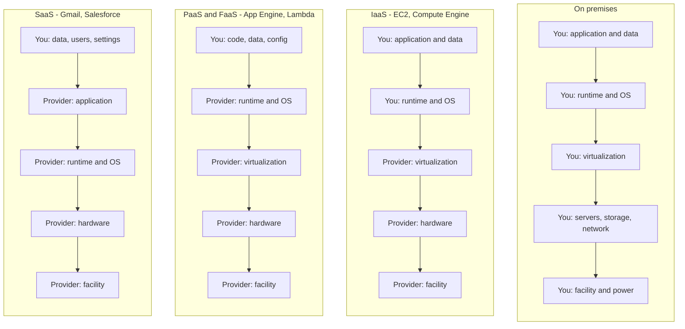
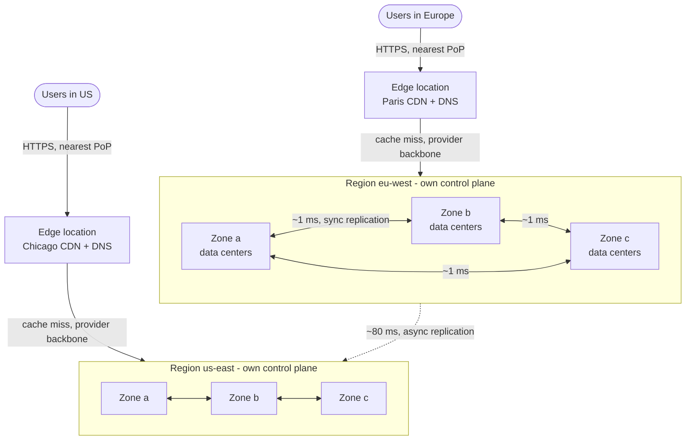
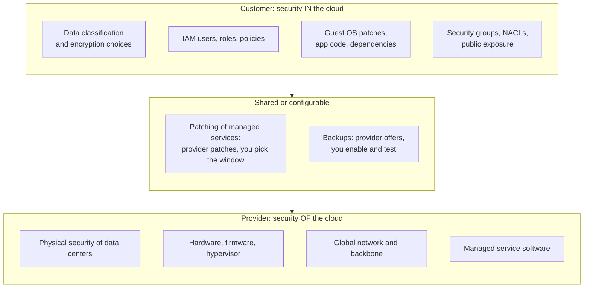
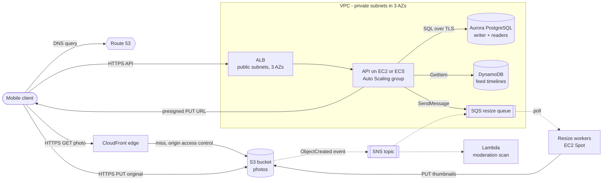
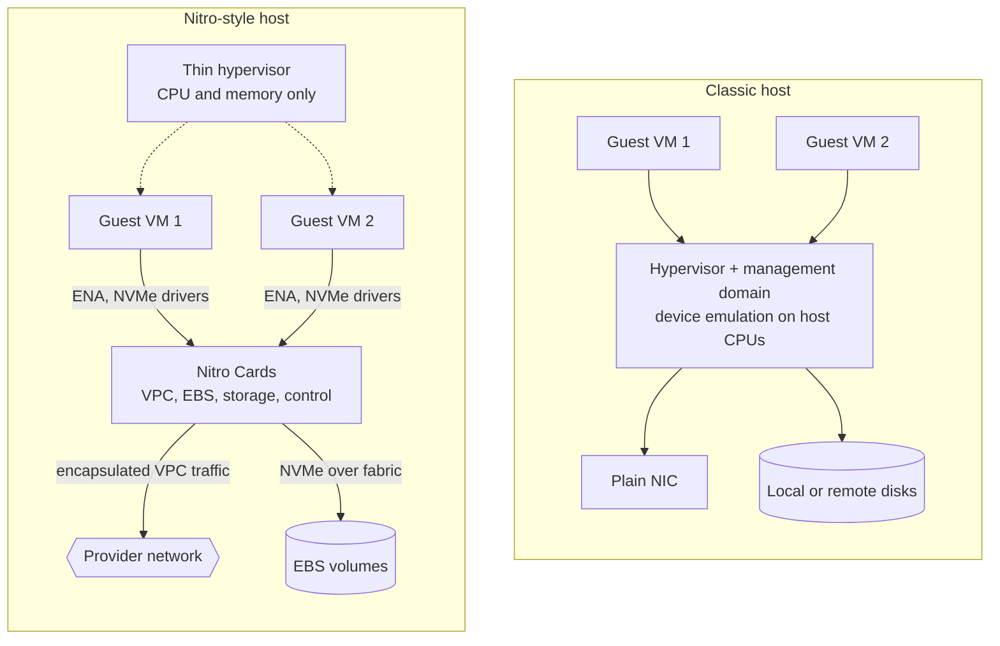
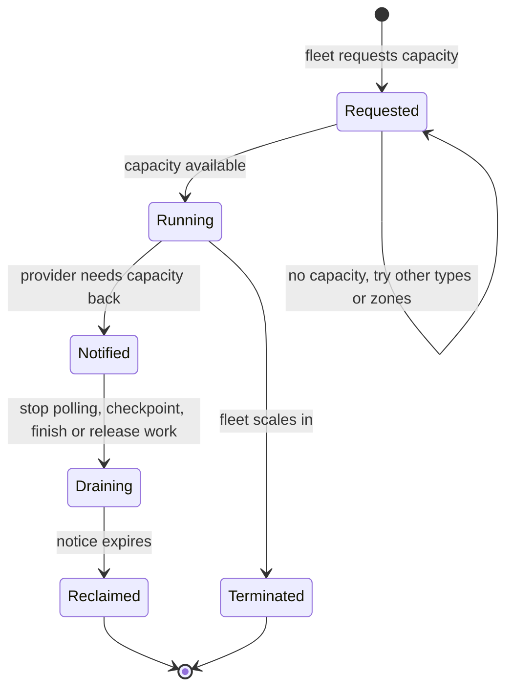
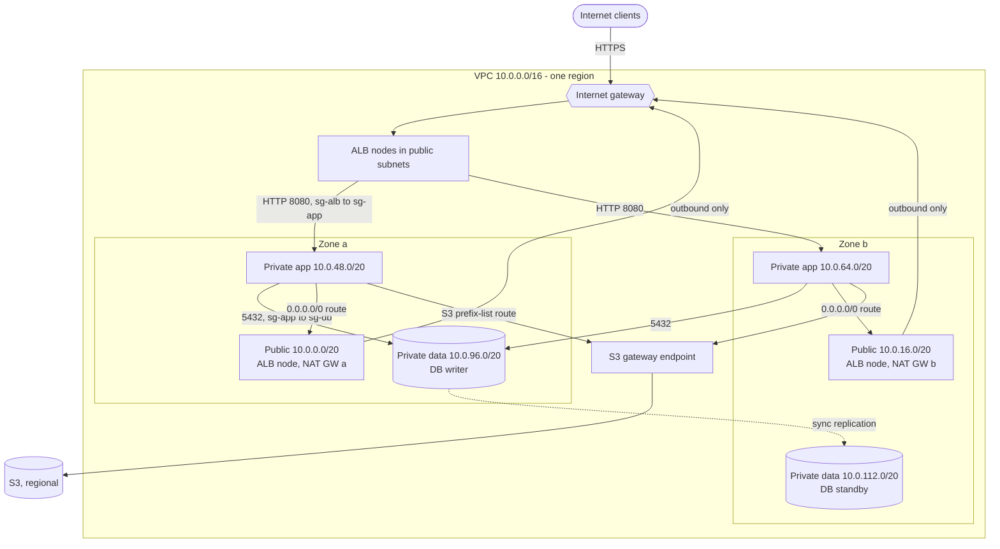
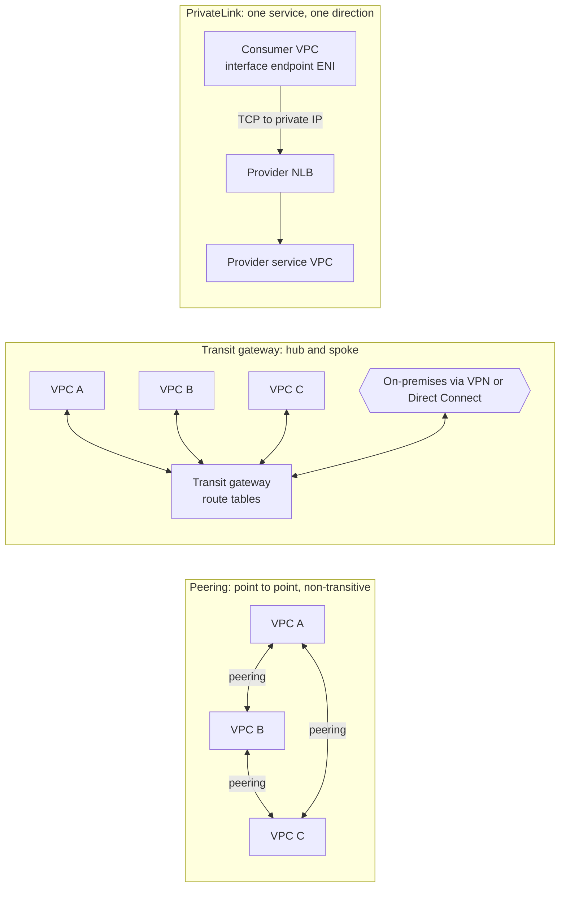
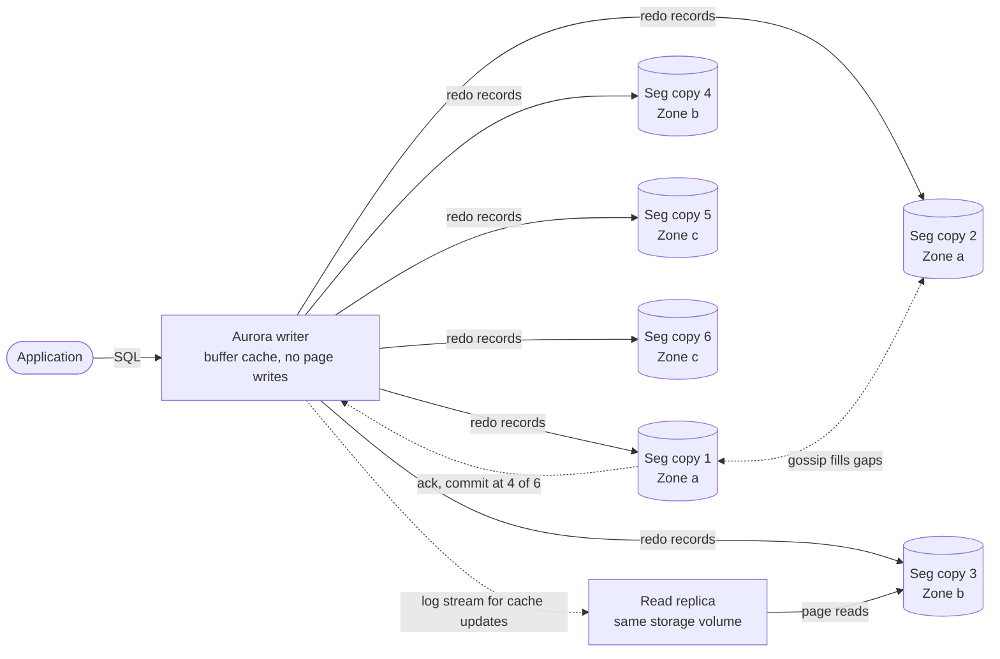
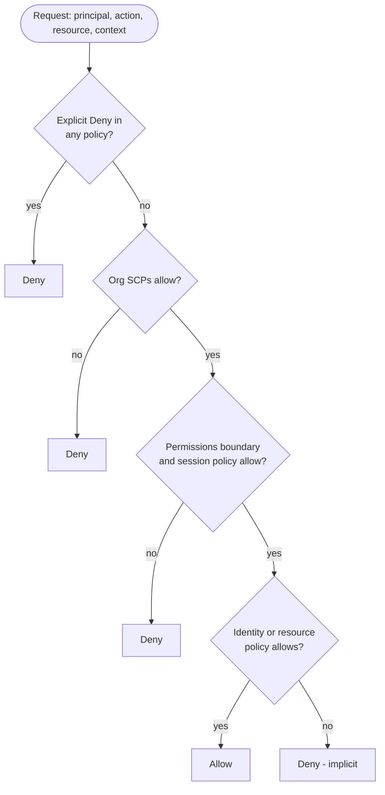

# Chapter 41 — Cloud Computing

> **Level:** 2 · **Track:** A (Traditional) · **Estimated reading time:** 3 h

In Chapter 1, PhotoShare launched on "a single rented virtual machine" and grew to ten million daily users with load balancers, replicated databases and "managed object storage". Every box was rented from a cloud provider, and every rental was a decision: raw machine or finished service, one zone or three, hourly or committed, NAT gateway or private endpoint. This chapter is the map of that rental market. You will learn what the service models (IaaS, PaaS, SaaS, FaaS) actually transfer to the provider, how regions and availability zones turn into an availability budget, what the core services of AWS, Google Cloud and Azure are for, how a cloud network is wired, how Aurora rebuilt the relational database for the cloud, how IAM decides "allow" or "deny", and how to estimate, and cut, a monthly bill. Networking fundamentals (Chapter 7), security fundamentals and KMS (Chapter 10) and the internals of block, file and object storage (Chapter 15) are assumed and cross-referenced rather than repeated.

## 41.1 Learning objectives

After this chapter you should be able to:

- Define cloud computing with NIST's five essential characteristics, and draw the responsibility split for IaaS, PaaS, SaaS and FaaS.
- Explain regions, availability zones and edge locations, and compute the availability gain of a multi-zone deployment.
- State in one line what each core AWS, Google Cloud and Azure service is for, and translate a design between the three providers.
- Choose an instance family and purchase option, explain how Nitro-style offload and Firecracker microVMs work, and compute the expected cost of a spot workload with checkpointing.
- Draw a reference VPC with public and private subnets, NAT and endpoints, and find the data-transfer charges hidden in it.
- Explain Aurora's "log is the database" design and its 4-of-6 quorum, and decide between managed and self-run databases.
- Trace an IAM authorization decision through identity, resource and guardrail policies, and name the most common cloud misconfigurations.
- Compute reserved-capacity break-even utilization and build a labeled monthly cost estimate for a three-tier web application.

## 41.2 Prerequisites

- IP addressing, CIDR and subnet arithmetic — §7.4 (every VPC is a CIDR block carved into subnets).
- NAT, firewalls, security groups and network ACLs — §7.13–§7.14 (cloud networking reuses them).
- Availability arithmetic for redundant components — §4.14 and Chapter 39 (zones are redundancy units).
- Least privilege, secrets management, KMS and envelope encryption — §10.8–§10.10 (cloud IAM and KMS implement them).
- Block, file and object storage and storage tiers — §15.3 and §15.9 (cloud storage services are instances of them).
- Serverless cost model and cold starts — §33.9 (FaaS economics are derived there).
- Units: **GB/TB** are powers of ten for billing (providers bill decimal GB unless stated); a **month** is 730 hours. All prices in this chapter are **illustrative list prices for a US region, as of 2026**; check the provider's pricing page before using them.

## 41.3 IaaS, PaaS, SaaS and FaaS

### 41.3.1 What "cloud" means

::: definition
**Definition — Cloud computing.** "A model for enabling ubiquitous, convenient, on-demand network access to a shared pool of configurable computing resources (e.g., networks, servers, storage, applications, and services) that can be rapidly provisioned and released with minimal management effort or service provider interaction" [Mell and Grance 2011]. NIST lists five **essential characteristics**: on-demand self-service, broad network access, resource pooling, rapid elasticity and measured service; three **service models** (SaaS, PaaS, IaaS); and four **deployment models** (private, community, public, hybrid).
:::

#### First-principles explanation

Think about getting dinner. You can buy a kitchen, groceries and cook (your own data center); rent a fully equipped kitchen by the hour and bring your own recipe (**infrastructure as a service**); order a meal kit where the ingredients arrive prepared and you only assemble (**platform as a service**); or eat at a restaurant (**software as a service**). **Function as a service** is a restaurant that bills you per bite and closes the kitchen when nobody is eating. In each step up, you give up control and receive convenience; the line between "what I manage" and "what the provider manages" moves upward.

The NIST characteristics separate the cloud from a leased rack: capacity arrives by API call (*self-service*), shares hosts with strangers (*pooling*), appears and disappears in minutes (*elasticity*) and is billed per second, request or gigabyte (*measured service*).

#### Why does this exist?

A warehouse-scale computer amortizes buildings, power, cooling, networks and operations teams across millions of servers [Barroso et al. 2018]. A single company running a few hundred servers pays the full fixed cost of a data center but uses it at low and uneven utilization. The cloud converts that fixed capital expense into a variable operating expense and lets one organization's idle capacity serve another's peak. The engineering consequence is that capacity becomes a software decision: an autoscaling policy (Chapter 18) can only exist if machines can be created by API.

### 41.3.2 The responsibility split

::: definition
**Definition — Service models.** **IaaS** (infrastructure as a service): the provider runs physical hardware, the network and the hypervisor; you rent virtual machines, disks and networks and manage the operating system upward (Amazon EC2, Google Compute Engine, Azure Virtual Machines). **PaaS** (platform as a service): the provider also runs the operating system and runtime; you deploy code or containers (Google App Engine, Azure App Service, AWS Elastic Beanstalk, Cloud Run). **SaaS** (software as a service): the provider runs the whole application; you configure it and own your data and users (Gmail, Salesforce, Microsoft 365). **FaaS** (function as a service): a PaaS whose unit of deployment is a function invoked per event, scaled to zero and billed per invocation and duration (AWS Lambda, Cloud Run functions, Azure Functions).
:::

**Figure 41.1 — Who manages each layer under each service model.**



**Reading the diagram.** Each column is a stack of layers from the application (top) to the building (bottom); the label says who operates that layer. Arrows mean "runs on", not network traffic. Moving right, the You/Provider boundary rises, but *your data* and *who may access it* never move, so access misconfiguration is a risk under every model (§41.12). Failure points follow responsibility: an unpatched kernel is your incident on IaaS and the provider's on PaaS; a deleted table is yours on all four. Scaling too: on IaaS you configure autoscaling; on PaaS and FaaS the platform scales within quotas.

**Table 41.1 — Service models compared.**

| Aspect | IaaS | PaaS (incl. managed containers) | FaaS | SaaS |
|---|---|---|---|---|
| Unit you deploy | VM image | Application or container | Function | Nothing (configuration) |
| You patch | OS, runtime, app | App and dependencies | Function code and dependencies | Nothing |
| Scaling | Your autoscaling rules | Platform, by instances | Platform, per request, to zero | Provider |
| Billing grain | Per second/hour of VM | Per instance or per request | Per request + GB-second | Per user or per usage |
| Control | Maximum (kernel, network, GPUs) | Medium | Low (time and memory limits) | Minimal |
| Lock-in | Low (VMs are portable) | Medium | High (event sources, IAM, triggers) | Highest (data formats, workflows) |
| Choose when | Special hardware, legacy software, full control | Standard web services and workers | Spiky, event-driven, glue code | Commodity capabilities (email, CRM) |

Serverless containers (Fargate, Cloud Run, Azure Container Apps) sit between IaaS and PaaS: you supply an image, the platform the host. Managed Kubernetes is covered in Chapter 42.

::: mistake
**"Serverless means there are no servers to worry about."** There are servers; you no longer patch or size them. You still own timeouts, concurrency limits, downstream connection storms, IAM permissions, cost per invocation and cold-start latency. The break-even analysis in §33.9.3 shows that at roughly 20–45 requests per second of *sustained* load, always-on instances become cheaper than functions in that example.
:::

::: tip
**Interview tip.** When an interviewer asks "which service model?", answer with what you want to stop owning. "We do not want to patch OSes or manage capacity, and the workload is a stateless HTTP API, so a container platform such as Cloud Run or Fargate; we keep VMs only for the GPU batch job that needs specific drivers."
:::

## 41.4 Regions, availability zones, edge locations and the shared responsibility model

### 41.4.1 The physical hierarchy

::: definition
**Definition — Region, availability zone, edge location.** A **region** is a geographic area (for example `us-east-1`, `europe-west1`, `West Europe`) containing several isolated data-center groups, with its own control plane and, by default, its own copy of regional services. An **availability zone (AZ)** is one or more data centers within a region with independent power, cooling and networking, connected to the other zones of the region by redundant, low-latency links, so that a fire, flood or power failure in one zone should not take down another. An **edge location** (point of presence) is a smaller site in a metropolitan area that runs CDN caches, DNS and edge compute close to users, but not general-purpose VMs and databases.
:::

#### First-principles explanation

Imagine a retail chain. A **region** is a city with its own distribution hub and local laws; inside it, stock sits in three **warehouses** on different power grids and flood plains (zones), so one fire stops none of the others; **edge locations** are corner kiosks holding best-sellers near customers.

The hierarchy exists because failures and latency both have *geography*. Light in fiber travels about 200 km per millisecond (§7.15), so zones a few tens of kilometers apart can replicate synchronously with round trips of about a millisecond, while regions on different continents are 70–150 ms apart and must replicate asynchronously. AWS documents its zones as separated by a meaningful distance yet within 100 km (60 miles) of each other, with single-digit-millisecond latency between them [AWS Docs: Regions and Zones]; Google Cloud and Azure zones follow the same idea, and Azure also pairs regions for staged updates and geo-redundant storage [Azure Docs: Availability zones].

**Figure 41.2 — Regions, zones and edge locations.**



**Reading the diagram.** Users reach the **nearest edge location** over HTTPS (DNS or anycast routing, §21.3.3). Cache hits are served there; misses travel over the provider's private backbone to the **origin region**. Inside a region, three **zones** are fully meshed with roughly 1 ms links, which is why synchronous replication (a database standby, a quorum write) across zones is affordable. Between regions the dotted arrow is **asynchronous** replication: at about 80 ms per round trip, waiting for the other region on every write would multiply write latency. Storage boundaries: block volumes are zonal; regional services span zones; nothing spans regions unless you configure it. Failure points: a zone, a regional control plane (rarer, larger blast radius), a PoP (users shift to the next one). Scaling: add zones for availability, regions for latency, data residency and disaster recovery (Chapter 44).

Between edge and region sit metro **Local Zones** and on-premises racks (**Outposts**, **Google Distributed Cloud**, **Azure Local**); treat each as a zone with fewer services.

#### Mathematical foundations

::: formula
**Availability and over-provisioning of an N-zone deployment**

$$A_{\text{svc}} \approx A_{\text{reg}} \cdot \bigl(1 - (1 - A_z)^{n}\bigr) \qquad\qquad f_{\text{over}} = \frac{n}{n - 1}$$

| Symbol | Meaning | Units |
|---|---|---|
| $A_{\text{svc}}$ | Availability of the service as seen by users | fraction |
| $A_{\text{reg}}$ | Availability of shared regional dependencies (control plane, regional DNS, IAM) | fraction |
| $A_z$ | Availability of one zone's copy of the service, assumed independent across zones | fraction |
| $n$ | Number of zones serving traffic | count |
| $f_{\text{over}}$ | Capacity each deployment must hold relative to the load, to survive losing one zone | ratio |
:::

::: example
**Worked example — Two zones or three?** PhotoShare's API runs identical stacks per zone; measured history suggests a single-zone stack is available $A_z = 99.9\%$, and regional dependencies $A_{\text{reg}} = 99.99\%$.

1. One zone: $A_{\text{svc}} = 0.9999 \times 0.999 = 0.9989$, about 9.6 hours of downtime a year.
2. Two zones: $1 - (0.001)^2 = 0.999999$; times $0.9999$ gives $0.9999$, about 53 minutes a year.
3. Three zones: $1 - (0.001)^3 \approx 1$; times $0.9999$ is still $0.9999$.
4. Over-provisioning to survive one zone loss: two zones need $2/1 = 2.0\times$ the peak load in total (each zone alone carries 100%); three zones need $3/2 = 1.5\times$ (each zone is sized for $1/(n-1) = 50\%$ of peak, so the two survivors together still carry 100%).

**Interpretation.** Going from one zone to two removes almost all zone-caused downtime; after that, the shared regional term dominates, and a third zone adds almost no availability. Its real benefit is cost: surviving one zone loss needs $1.5\times$ capacity with three zones versus $2\times$ with two, and zonal quorum systems (Aurora, etcd) need three locations to keep a majority. **Engineering implication.** Use three zones for stateful quorum systems and to cut spare capacity; to improve on $A_{\text{reg}}$ you need a second region, not a fourth zone (§39.10, Chapter 44). Remember the independence assumption: a bad deploy pushed to all zones at once is a correlated failure that this formula ignores, which is why deployments roll out zone by zone (Chapter 43).
:::

::: industry
**Static stability across zones.** AWS's Builders' Library describes designing services to be **statically stable**: each zone is provisioned to keep working without making control-plane calls (such as launching new instances) when another zone fails, because control-plane actions are exactly what degrade during large events [AWS Builders' Library: Static stability using Availability Zones]. EC2 itself separates its *control plane* (launching instances) from its *data plane* (running instances), and the guidance is to pre-provision capacity across zones rather than plan to scale up during an outage.
*Evidence: Primary* — [AWS Builders' Library: Static stability]
:::

### 41.4.2 The shared responsibility model

::: definition
**Definition — Shared responsibility model.** The division of security and operational duties between the provider and the customer. In AWS's phrasing, the provider is responsible for security **of** the cloud (facilities, hardware, hypervisor, global network, the managed services' own software), and the customer for security **in** the cloud (data, identities and permissions, OS and application patching on IaaS, network rules, encryption choices) [AWS: Shared Responsibility Model]. The exact line moves with the service model (Figure 41.1).
:::

**Figure 41.3 — Shared responsibility for an IaaS workload.**



**Reading the diagram.** Bands list duties from customer (top) to provider (bottom); arrows mean "builds on". The *customer* band never empties: data, identity and exposure are always yours. The *shared* band holds features the provider offers (backups, patch windows) that protect you only if enabled and tested. The *provider* band is audited through compliance reports (SOC 2, ISO 27001) and published designs such as Nitro (§41.8.3). Failure points concentrate at the top: a public bucket or over-broad role is a customer failure no provider control prevents.

::: mistake
**"The provider is responsible for my data's durability, so I do not need backups."** The provider keeps the bytes you wrote durable; it faithfully keeps your mistakes too. A `DROP TABLE`, a ransomware encryption run with stolen credentials, or a lifecycle rule on the wrong prefix destroys data durably. Point-in-time recovery, versioning, and copies in a separate account with separate credentials are the customer's responsibility (§39.9).
:::

## 41.5 AWS core services

### 41.5.1 One line each

Amazon Web Services offers more than two hundred services, but a typical web system is assembled from about a dozen. Learn these by the problem each solves; the rest of the catalog is mostly variations.

**Table 41.2 — AWS core services: what each is for.**

| Service | Category | What it is for, in one line |
|---|---|---|
| **EC2** (Elastic Compute Cloud) | Compute, IaaS | Rent virtual machines (instances) by the second in many shapes, including GPUs |
| **S3** (Simple Storage Service) | Object storage | Store unlimited immutable objects in buckets over HTTPS, designed for eleven nines of durability (§15.4) |
| **EBS** (Elastic Block Store) | Block storage | Network-attached virtual disks for one instance, in one zone, with snapshots to S3 |
| **VPC** (Virtual Private Cloud) | Networking | Your isolated, software-defined IP network: subnets, route tables, gateways, firewalls |
| **IAM** (Identity and Access Management) | Security | Who (principal) may do what (action) on which resource, under which conditions |
| **RDS** / **Aurora** | Relational DB | Managed MySQL, PostgreSQL, SQL Server, Oracle, MariaDB; Aurora adds a cloud-native storage layer (§41.11) |
| **DynamoDB** | NoSQL key-value | Serverless key-value and document store with single-digit-millisecond reads at any scale (§12.4) |
| **SQS** (Simple Queue Service) | Messaging | Managed queue between producers and consumers; standard (at-least-once) or FIFO |
| **SNS** (Simple Notification Service) | Messaging | Publish/subscribe fan-out of one message to many queues, functions, HTTP endpoints or phones |
| **Lambda** | FaaS | Run a function per event (HTTP, queue message, object upload) without managing servers |
| **CloudFront** | CDN | Cache and accelerate content at hundreds of edge locations, in front of S3 or any origin (Chapter 21) |
| **ELB** (Elastic Load Balancing) | Load balancing | ALB for HTTP/gRPC (layer 7), NLB for TCP/UDP (layer 4), GWLB for inline appliances (Chapter 19) |
| Supporting cast | — | Route 53 (DNS), KMS (keys), Secrets Manager, CloudWatch (metrics, logs), CloudTrail (API audit log), ECS/EKS/Fargate (containers), ElastiCache (Redis/Valkey/Memcached) |

### 41.5.2 A deeper example: PhotoShare's upload and view paths on AWS

The services become meaningful only when wired together. Figure 41.4 shows PhotoShare's production design from Chapter 1 mapped onto AWS.

**Figure 41.4 — PhotoShare on AWS core services.**



**Reading the diagram.** *Upload path:* the client calls the API through the **ALB** (synchronous HTTPS); the API writes a pending row to **Aurora** and returns a **presigned S3 URL** (§15.8.2), so photo bytes go straight to **S3**. S3 emits an `ObjectCreated` event to **SNS** (dotted: asynchronous), which fans out to an **SQS** queue consumed by resize workers and to a **Lambda** function that runs a moderation scan. *View path:* the client resolves the domain with **Route 53** and fetches images from **CloudFront**, which serves hits from the edge and pulls misses from S3 using origin access control, so the bucket itself stays private. Feed timelines are read from **DynamoDB** with single-key lookups. Failure points: a zone loss removes one third of the API and worker capacity (Auto Scaling replaces it; static stability means pre-provisioning it); the Aurora writer fails over to a reader replica, typically in tens of seconds; SQS buffers resize jobs if workers fall behind. Scaling: the API scales by instance count, workers by queue depth, and the managed services within account quotas.

Three choices recur in every cloud design: **keep bulk bytes off your servers** (presigned URLs, CDN), **turn waiting into events** (S3 → SNS → SQS), and **keep state in managed regional services** so zone failures are the provider's replication problem.

::: industry
**AWS Well-Architected Framework.** AWS publishes a review framework of six pillars — operational excellence, security, reliability, performance efficiency, cost optimization and sustainability — with design principles and review questions for each, plus "lenses" for workloads such as serverless and SaaS [AWS Well-Architected Framework]. Google Cloud's equivalent is the Google Cloud Well-Architected Framework (formerly the Google Cloud Architecture Framework) and Microsoft's is the Azure Well-Architected Framework; all three organize guidance around nearly the same pillars. They are useful as checklists in design reviews and interviews, not as architectures.
*Evidence: Primary* — [AWS Well-Architected Framework; Google Cloud Well-Architected Framework; Azure Well-Architected Framework]
:::

## 41.6 Google Cloud core services

Google Cloud (GCP) grew out of Google's internal infrastructure: Borg for cluster management (Chapter 46), Colossus for storage (§15.5.3), Jupiter and Andromeda for networking, Spanner and Bigtable for data. Its distinctive design choices follow from that history.

**Table 41.3 — Google Cloud core services: what each is for.**

| Service | AWS analog | What it is for, in one line |
|---|---|---|
| **Compute Engine** | EC2 | Virtual machines, with custom machine shapes and live migration during host maintenance |
| **Cloud Storage** (GCS) | S3 | Object storage with Standard, Nearline, Coldline and Archive classes and strong global consistency |
| **Persistent Disk / Hyperdisk** | EBS | Network block storage, zonal or regional (synchronously replicated across two zones) |
| **VPC network** | VPC | A **global** private network: one VPC spans all regions, with regional subnets |
| **Cloud IAM** | IAM | Role bindings on a resource hierarchy (organization → folders → projects → resources) |
| **Cloud SQL / AlloyDB** | RDS / Aurora | Managed MySQL, PostgreSQL, SQL Server; AlloyDB is a PostgreSQL-compatible engine with disaggregated storage |
| **Spanner** | (Aurora DSQL, DynamoDB global tables) | Globally distributed, strongly consistent relational database (§41.11.3) |
| **Bigtable / Firestore** | DynamoDB | Wide-column store for large analytical/time-series data; document database for apps |
| **Pub/Sub** | SNS + SQS, Kinesis | Global publish/subscribe messaging with pull and push subscriptions |
| **Cloud Run / Cloud Run functions** | Fargate, App Runner / Lambda | Run containers or functions per request, scaling to zero |
| **GKE** | EKS | Managed Kubernetes; Autopilot mode also manages nodes (Chapter 42) |
| **Cloud Load Balancing / Cloud CDN** | ELB / CloudFront | Global anycast layer-7 and layer-4 load balancing, with integrated CDN |
| **BigQuery** | Redshift, Athena | Serverless columnar data warehouse billed per byte scanned or by slot capacity |

Two differences matter in design reviews. **The VPC is global**: VMs in `us-central1` and `europe-west1` share one VPC and private IPs without peering, while AWS and Azure networks are regional. **The external HTTP(S) load balancer is global**: one anycast IP routes each user to the nearest healthy region (§19.8.2), which on AWS takes Global Accelerator or Route 53 latency routing plus per-region ALBs. Google's software-defined network stack, Andromeda, is described in [Dalton et al. 2018].

## 41.7 Azure core services

Microsoft Azure's strength is integration with enterprise identity and Microsoft software: Entra ID (formerly Azure Active Directory) is the identity provider for many organizations' employees already, and Windows Server, SQL Server and .NET workloads move there with licensing benefits.

**Table 41.4 — Azure core services: what each is for.**

| Service | AWS analog | What it is for, in one line |
|---|---|---|
| **Virtual Machines / VM Scale Sets** | EC2 / Auto Scaling | VMs and autoscaled groups of identical VMs |
| **Blob Storage** | S3 | Object storage in storage accounts with Hot, Cool, Cold and Archive tiers |
| **Managed Disks** | EBS | Block volumes (Standard HDD/SSD, Premium SSD, Premium SSD v2, Ultra Disk) |
| **Azure Files / NetApp Files** | EFS / FSx | Managed SMB and NFS file shares |
| **Virtual Network (VNet)** | VPC | Regional private network with subnets, NSGs, route tables |
| **Entra ID + Azure RBAC** | IAM (+ IAM Identity Center) | Identities (users, groups, managed identities) and role assignments at scopes |
| **Azure SQL Database / Database for PostgreSQL and MySQL** | RDS | Managed relational databases; Hyperscale tier separates compute from log and page servers |
| **Cosmos DB** | DynamoDB | Globally distributed multi-model database with five tunable consistency levels (§41.11.3) |
| **Service Bus / Event Hubs / Event Grid** | SQS+SNS / Kinesis / EventBridge | Enterprise queues and topics; high-throughput event streaming; event routing |
| **Azure Functions / Container Apps** | Lambda / Fargate | Functions per event; serverless containers |
| **AKS** | EKS | Managed Kubernetes |
| **Load Balancer / Application Gateway / Front Door** | NLB / ALB / CloudFront + Global Accelerator | Layer-4 regional balancing; layer-7 regional with WAF; global layer-7 entry with CDN |
| **Key Vault** | KMS + Secrets Manager | Keys, secrets and certificates in one service |

Azure's resource model differs in a way that confuses newcomers: every resource lives in a **resource group** inside a **subscription**, inside **management groups** under one Entra tenant. Subscriptions are the billing and quota boundary, roughly like AWS accounts, and management groups carry **Azure Policy** guardrails, roughly like AWS Organizations' organizational units and SCPs (§41.12.4).

::: mistake
**"Same name, same thing."** Names that look alike hide different semantics. A GCP VPC is global, an Azure VNet regional; an AWS security group is stateful and allow-only while an Azure **network security group** has ordered allow *and* deny rules (but is stateful); Google "Cloud Functions" is now branded Cloud Run functions. Translate by *behavior* using §41.14, then check the provider's documentation for limits.
:::

## 41.8 Compute

### 41.8.1 Instances and instance families

::: definition
**Definition — Instance type and family.** An **instance type** is a fixed shape of virtual hardware: vCPUs, memory, network bandwidth, local storage and accelerators. Types are grouped into **families** optimized for a ratio of resources. In AWS naming, `m7g.xlarge` means family `m` (general purpose), generation `7`, attribute `g` (AWS Graviton Arm processor), size `xlarge` (4 vCPUs). A **vCPU** is one hardware thread on most x86 instances (two vCPUs per physical core with simultaneous multithreading) and one physical core on Graviton.
:::

**Table 41.5 — Instance families (AWS letters; GCP and Azure analogs).**

| Family | AWS | GCP | Azure | Memory per vCPU | Use cases |
|---|---|---|---|---|---|
| General purpose | M, T (burstable) | N2, N4, E2, C4A (Arm) | D, B (burstable) | ~4 GiB | Web/API servers, small databases |
| Compute optimized | C | C3, C4, H3 | F, FX | ~2 GiB | Batch, encoding, high-RPS stateless services |
| Memory optimized | R, X, U | M3, M4 | E, M | 8–32+ GiB | Databases, in-memory caches, analytics |
| Storage optimized | I, D | Z3 | L | varies, local NVMe | Self-managed NoSQL, search, data warehouses |
| Accelerated | P, G, Trn, Inf | A3, A4, G2, TPU VMs | NC, ND, NV | varies | ML training and inference, graphics |

*Family letters as of 2026; generations change yearly.* **Burstable** types (T, E2 shared-core, B) earn CPU credits while idle and spend them under load; they are cheap for spiky low-average workloads and a classic trap when a sustained load drains the credits and the instance is throttled to its baseline.

Choose a family from the **binding resource** (Chapter 23): measure CPU, memory, network and disk utilization under realistic load, pick the family whose ratio matches, then the smallest size that keeps the binding resource below a target utilization (often 60–70% for latency-sensitive services, §4.10.3).

### 41.8.2 Virtualization and hypervisors

::: definition
**Definition — Hypervisor.** Software (sometimes with hardware assistance) that runs multiple **guest** operating systems on one physical host, giving each the illusion of its own machine. A **type 1** hypervisor runs directly on hardware (Xen, KVM as part of Linux, Hyper-V); a **type 2** runs as an application on a host OS (VirtualBox). Modern CPUs provide hardware virtualization extensions (Intel VT-x, AMD-V, Arm virtualization extensions) so that guest instructions run natively and only privileged operations trap to the hypervisor.
:::

On a classic virtualized host, the hypervisor and a privileged management domain (Xen's "dom0") also emulate or mediate **devices**: every network packet and disk block of every guest passes through software on the host's own CPUs. That costs two things a cloud provider cares about: host CPU cycles that cannot be sold, and **jitter**, because a noisy guest's I/O competes with yours for the same management domain.

### 41.8.3 Nitro-style offload

AWS's published answer is the **Nitro System**: move device emulation, networking, storage and management off the host CPU onto dedicated cards, and shrink the hypervisor to almost nothing [AWS Nitro System docs; AWS Nitro security whitepaper 2022]. As published:

1. **Nitro Cards** implement the VPC data plane (encapsulation, security groups, routing), EBS access (presented to the guest as NVMe devices, encrypted on the card), local instance storage, and the system controller. The guest talks to them through standard NVMe and Elastic Network Adapter (ENA) drivers.
2. The **Nitro Security Chip** controls the host's firmware and hardware root of trust.
3. The **Nitro Hypervisor**, built on KVM, only partitions CPU and memory and assigns card functions to guests. It has no networking stack, no general-purpose shell and, per AWS, no mechanism for operators to log in to the host.

**Figure 41.5 — Classic hypervisor versus Nitro-style offload.**



**Reading the diagram.** On the *classic host*, both guests' I/O flows through the hypervisor and management domain, which run on the same CPUs that customers rent; every packet is a software hop, and a busy neighbor adds queueing delay to yours. On the *Nitro-style host*, each guest's drivers talk directly to functions exposed by the cards (solid arrows, synchronous I/O), and the cards perform VPC encapsulation, firewalling and encrypted EBS access in dedicated hardware. The thin hypervisor (dotted: it configures, it does not sit on the data path) only partitions CPU and memory. Storage boundary: EBS volumes are remote, reached over the provider network as NVMe. Failure points: a card failure affects the whole host, so the provider migrates or restarts instances; a remote EBS path adds network latency compared with local NVMe. Effect: nearly all host cores become sellable, and **bare-metal** instances become possible.

Other providers publish similar directions: Google's Titanium offload system and Azure Boost both move networking and storage processing onto dedicated hardware (as of 2026, see provider docs). The general lesson for system designers is that **cloud I/O is network I/O**: an EBS or Persistent Disk "disk" is a remote service with its own throughput and IOPS limits per volume and per instance.

### 41.8.4 Containers, microVMs and serverless

Containers (Chapter 42) share one kernel among many isolated processes using namespaces and cgroups, which makes them start in milliseconds and pack densely, but makes the kernel a shared attack surface: unsafe for running *untrusted* code from different customers side by side. Full VMs give strong isolation but start in tens of seconds and cost hundreds of megabytes each.

**Firecracker** is the microVM monitor AWS built to get VM isolation at container-like cost for Lambda and Fargate [Agache et al. 2020]. It is a KVM-based virtual machine monitor written in Rust with a deliberately minimal device model (virtio network and block, a serial console, a minimal keyboard controller used for reset, no PCI, no BIOS). The paper reports booting a microVM to user-space code in as little as 125 ms, a memory overhead below 5 MiB per microVM, and creation rates up to 150 microVMs per second per host. Each Lambda execution environment runs inside one microVM, and thousands run on one host. Chapter 47 compares isolation levels and Chapter 48 covers Lambda's internals.

In short: VMs give the most control and the slowest start; containers on managed nodes pack densely but share a kernel; serverless containers and functions run each task or environment in a microVM and bill per use, trading control and time limits (15 minutes per Lambda invocation) for the lowest operational load. §33.9 and §42.16 compare them in depth.

### 41.8.5 Spot and preemptible capacity

::: definition
**Definition — Spot capacity.** Spare provider capacity sold at a steep discount (often 60–90% off on-demand, varying by type, zone and time) that the provider can reclaim when it needs the capacity back. AWS **Spot Instances** receive a two-minute interruption notice; Google **Spot VMs** (successor to preemptible VMs, which were limited to 24 hours) and Azure **Spot VMs** receive about 30 seconds' notice [AWS EC2 docs: Spot; Google Cloud docs: Spot VMs; Azure docs: Spot VMs].
:::

Spot is excellent for work that is **interruptible and restartable**: stateless web replicas behind a load balancer (with on-demand base capacity), queue workers, CI runners, batch analytics and checkpointed ML training. It is a poor fit for singletons, databases and anything that cannot finish its shutdown in the notice period.

**Figure 41.6 — Lifecycle of a spot instance in a queue-worker fleet.**



**Reading the diagram.** A fleet manager (an Auto Scaling group with mixed types, a GKE spot node pool) requests capacity and **diversifies** across instance types and zones when one pool is empty. The *Notified* transition is asynchronous: the instance learns of it from the metadata service or an event. In *Draining* the worker stops polling, checkpoints, and lets unfinished messages' visibility timeouts expire so another worker retries them (at-least-once processing, Chapter 30). Failure points: work since the last checkpoint is lost; a fleet concentrated on one type can lose most capacity at once. Replacement capacity is requested immediately from the most available pools.

#### Mathematical foundations

::: formula
**Expected cost of a checkpointed spot job (first-order model)**

$$T_{\text{wall}} \approx T \left(1 + \frac{c}{\tau} + \lambda\left(\frac{\tau}{2} + R\right)\right), \qquad E[C_{\text{spot}}] = p_{\text{spot}}\, T_{\text{wall}}, \qquad \tau^{*} = \sqrt{\frac{2c}{\lambda}}$$

Without checkpoints (restart from scratch), the expected wall time is $T_{\text{wall}} = \left(\frac{1}{\lambda} + R\right)\left(e^{\lambda T} - 1\right)$.

| Symbol | Meaning | Units |
|---|---|---|
| $T$ | Useful compute the job needs | hours |
| $T_{\text{wall}}$ | Expected billed instance time including overheads | hours |
| $c$ | Time to write one checkpoint | hours |
| $\tau$ | Interval between checkpoints | hours |
| $\lambda$ | Interruption rate (1/mean time between interruptions) | 1/hour |
| $R$ | Restart overhead per interruption: acquire capacity, boot, load checkpoint | hours |
| $p_{\text{spot}}$ | Spot price | \$/hour |
| $\tau^{*}$ | Checkpoint interval minimizing $T_{\text{wall}}$ (Young's approximation) | hours |
:::

The three overhead terms are checkpoint cost ($c/\tau$ per unit of work), lost work (on average half an interval per interruption) and restart time. The model holds when $\lambda\tau \ll 1$.

::: example
**Worked example — A 100-hour batch job on spot.** Illustrative prices (as of 2026): on-demand $p_{\text{od}} = \$2.00$/h, spot $p_{\text{spot}} = \$0.70$/h. Interruptions average one per 20 hours ($\lambda = 0.05$/h); a checkpoint takes 3 minutes ($c = 0.05$ h); a restart takes 6 minutes ($R = 0.1$ h); $T = 100$ h.

1. Optimal interval: $\tau^{*} = \sqrt{2 \times 0.05 / 0.05} = \sqrt{2} = 1.41$ h.
2. Checkpoint overhead: $c/\tau = 0.05/1.41 = 0.035$.
3. Interruption overhead: $\lambda(\tau/2 + R) = 0.05 \times (0.71 + 0.1) = 0.040$.
4. $T_{\text{wall}} = 100 \times (1 + 0.035 + 0.040) = 107.6$ h; $E[C_{\text{spot}}] = 0.70 \times 107.6 = \$75.30$.
5. On-demand: $2.00 \times 100 = \$200$. Spot saves about 62%.
6. Sensitivity: checkpointing every 15 minutes gives $T_{\text{wall}} = 121.1$ h (\$84.79); every 6 hours gives 116.3 h (\$81.43). Both still beat on-demand, but the optimum is flat and in between.
7. No checkpoints: $T_{\text{wall}} = (20 + 0.1)(e^{5} - 1) = 20.1 \times 147.4 \approx 2{,}963$ h, so $E[C] \approx \$2{,}074$, more than ten times the on-demand cost.

**Interpretation.** Spot's discount survives interruptions only if lost work per interruption is small relative to the mean time between interruptions; a job much longer than $1/\lambda$ without checkpoints almost never finishes. **Engineering implication.** Make long jobs checkpoint at roughly $\sqrt{2c/\lambda}$, keep tasks short (minutes) for queue workers, diversify instance types to lower $\lambda$, and keep an on-demand floor for latency-critical capacity.
:::

## 41.9 Storage

Chapter 15 explains how block, file and object stores work inside. Here you need only the cloud names, the semantics that differ between providers, and the storage classes that drive cost.

**Table 41.6 — Cloud storage services by interface.**

| Interface | AWS | Google Cloud | Azure | Scope and key property |
|---|---|---|---|---|
| Block (network) | EBS: gp3, io2 Block Express, st1, sc1 | Persistent Disk, Hyperdisk | Managed Disks: Standard, Premium SSD v2, Ultra | Zonal (GCP and Azure also offer zone-redundant/regional disks); one attached VM, multi-attach limited |
| Block (local) | Instance store NVMe | Local SSD | Temp disk / local NVMe | Fastest; **lost when the instance stops or the host fails** |
| File | EFS (NFS), FSx for Lustre/Windows/ONTAP/OpenZFS | Filestore, Managed Lustre | Azure Files (SMB/NFS), NetApp Files | Shared POSIX; regional or zonal |
| Object | S3 | Cloud Storage | Blob Storage | Regional (multi-zone) or multi-region; strong read-after-write on all three |
| Archive | S3 Glacier classes | Archive class | Archive tier | Cheapest; minimum durations and retrieval fees |

**Table 41.7 — Object storage classes and their minimum storage durations (as of 2026).**

| Access pattern | AWS S3 | Google Cloud Storage | Azure Blob | Minimum duration |
|---|---|---|---|---|
| Hot | Standard | Standard | Hot | none |
| Infrequent (monthly) | Standard-IA, One Zone-IA | Nearline | Cool | 30 days |
| Cold (quarterly) | Glacier Instant Retrieval | Coldline | Cold | 90 days |
| Archive (yearly) | Glacier Flexible Retrieval, Deep Archive | Archive | Archive | 90–180 days (S3), 365 (GCS), 180 (Azure) |
| Unknown pattern | Intelligent-Tiering | Autoclass | Lifecycle rules on last access | none (small monitoring fee on S3) |
| Lowest latency, single zone | Express One Zone | zonal options vary by release | Premium block blobs | none |

Three cloud-specific facts change designs. **Zonal block volumes do not survive a zone outage**, so a database on EBS needs cross-zone replication or snapshots (what managed databases do, §41.11). **Local NVMe is ephemeral**: use it only for caches, scratch and replicated stores. **Object storage bills requests and retrieval** as well as gigabytes: §15.9's tiering plan saves 79% for large objects and loses money for tiny ones.

::: recommendation
**Pick storage by failure domain first, then by price.** Ask "what happens to this data if one zone disappears?" before "which class is cheapest?". Zonal volume plus snapshots gives minutes-to-hours recovery; regional object storage gives none to lose; a single-zone class such as One Zone-IA or Express One Zone is acceptable only for data you can regenerate.
:::

## 41.10 Networking

### 41.10.1 The VPC and its parts

::: definition
**Definition — Virtual private cloud (VPC).** A logically isolated, software-defined network in a provider's cloud, defined by a private CIDR range (§7.4) and divided into **subnets**. Packets between instances are encapsulated by the provider's virtual network (on Nitro, by the cards) and delivered according to the VPC's **route tables** and firewall rules, regardless of which physical hosts the instances are on.
:::

The parts, in the order a packet meets them:

1. **Subnet.** A slice of the VPC's CIDR in one zone (AWS, Azure) or region (GCP). It is **public** if its route table sends `0.0.0.0/0` to an **internet gateway**, otherwise **private**: a routing property, not a checkbox.
2. **Route table.** Longest-prefix-match rules (§7.5.1) per subnet: the VPC CIDR is local; `0.0.0.0/0` goes to an internet gateway or a NAT gateway; service prefixes can go to gateway endpoints.
3. **Internet gateway (IGW).** A redundant, horizontally scaled component doing one-to-one NAT between private and public IPs; no charge of its own.
4. **NAT gateway.** A managed, per-zone source NAT (§7.13) for outbound-only internet access from private subnets, billed per hour **and per gigabyte processed**.
5. **Security groups and network ACLs.** Stateful instance-level allow rules versus stateless subnet-level ordered rules (§7.14). Security groups that reference other groups are the primary control; NACLs are coarse guardrails.
6. **Endpoints.** **Gateway endpoints** (AWS, for S3 and DynamoDB) add a free route to the service's prefix list. **Interface endpoints** (PrivateLink) put a private IP for a service in your subnet, billed per zone-hour and per gigabyte.

**Figure 41.7 — A reference VPC across three zones.**



**Reading the diagram.** The VPC `10.0.0.0/16` is split into `/20` subnets, three tiers per zone (zone c, omitted for space, mirrors zones a and b; the `/20` carving extends the one worked in §7.4.2 with a third, data tier). *Inbound:* client HTTPS enters through the **internet gateway** to **ALB** nodes in the public subnets, which forward to app instances in private subnets; security groups allow only `sg-alb → sg-app` on 8080 and `sg-app → sg-db` on 5432. *Outbound:* app instances follow the private route table's default route to the **NAT gateway in their own zone**, and from there out of the IGW; nothing on the internet can initiate a connection to them. *Provider services:* traffic to S3 matches the more specific prefix-list route and takes the **gateway endpoint** instead of the NAT. All arrows are synchronous request paths except replication (dotted). S3 is outside the VPC but reached privately. Failure points: one NAT gateway per zone keeps a zone failure from cutting off the others' egress; a single shared NAT would be a cross-zone dependency and a cross-zone data charge. Scaling: size subnets for pods, not just instances (§7.4.2).

### 41.10.2 Connecting networks: peering, transit gateways and private service endpoints

As an organization grows from one VPC to hundreds (one per team, environment and account), it needs to connect them, and to on-premises networks, without exposing services to the internet.

**Figure 41.8 — Peering mesh, transit hub and private service endpoint.**



**Reading the diagram.** *Peering* connects two VPCs directly; it is **non-transitive**, so A cannot reach C through B, and $n$ fully connected VPCs need $n(n-1)/2$ peerings, each with routes on both sides (45 peerings for 10 VPCs). Address ranges must not overlap (§7.4.2). *Transit gateway* replaces the mesh with a regional hub that has its own route tables, so $n$ VPCs need $n$ attachments and on-premises links attach once; segmentation is enforced by which attachments share a route table. It is billed per attachment-hour and per gigabyte processed, and it adds a hop. *PrivateLink* (and Google's **Private Service Connect**, Azure **Private Link**) is different in kind: it exposes **one service**, not a network. The consumer gets a private IP in its own subnet; connections can only be initiated from consumer to provider; address ranges may overlap. Failure points: a bad route on the hub affects every spoke; endpoints are per-zone, so create one in each zone you use.

**Table 41.8 — Network connectivity options.**

| Aspect | VPC peering | Transit gateway / hub | PrivateLink / Private Service Connect |
|---|---|---|---|
| What it connects | Two whole networks | Many networks and on-premises | A consumer to one service |
| Transitive | No | Yes, by hub route tables | N/A |
| Overlapping CIDRs | Not allowed | Not allowed between routed spokes | Allowed |
| Cost model (AWS, illustrative) | Data transfer only | ~\$0.05/attachment-hour + ~\$0.02/GB | ~\$0.01/endpoint-zone-hour + ~\$0.01/GB |
| Choose when | Few VPCs, high-volume pairs | Many VPCs, central inspection | SaaS or shared platform services, strict isolation |

### 41.10.3 Data-transfer costs and the NAT gateway trap

Cloud networks charge for movement in ways that on-premises networks do not. As of 2026 on AWS (illustrative, us-east-1): inbound data from the internet is free; outbound to the internet costs about \$0.09/GB for the first 10 TB a month and less in higher tiers; traffic between zones costs \$0.01/GB **in each direction**; traffic between regions costs about \$0.02/GB; a NAT gateway costs \$0.045/hour and \$0.045/GB processed; and every public IPv4 address costs \$0.005/hour [AWS: EC2 and VPC pricing]. Google Cloud and Azure differ in detail but share the shape: internet egress is the largest unit price, and cross-zone and cross-region traffic is not free.

::: formula
**Monthly data-transfer and NAT cost**

$$C_{\text{xfer}} = \sum_{k} V^{\text{int}}_{k}\, p^{\text{int}}_{k} \;+\; 2\, V_{\text{xaz}}\, p_{\text{az}} \;+\; V_{\text{xreg}}\, p_{\text{reg}} \qquad\qquad C_{\text{NAT}} = n_{\text{gw}}\, H\, p_{\text{hr}} \;+\; V_{\text{NAT}}\, p_{\text{proc}}$$

| Symbol | Meaning | Units |
|---|---|---|
| $V^{\text{int}}_{k}$, $p^{\text{int}}_{k}$ | Internet egress volume in pricing tier $k$, and its price | GB, \$/GB |
| $V_{\text{xaz}}$, $p_{\text{az}}$ | Cross-zone volume, and per-direction price (charged on both sides, hence the 2) | GB, \$/GB |
| $V_{\text{xreg}}$, $p_{\text{reg}}$ | Cross-region volume and price | GB, \$/GB |
| $n_{\text{gw}}$ | Number of NAT gateways | count |
| $H$ | Hours in the month (730) | hours |
| $p_{\text{hr}}$, $p_{\text{proc}}$ | NAT hourly price and per-GB processing price | \$/hour, \$/GB |
| $V_{\text{NAT}}$ | Volume processed by NAT gateways, in either direction | GB |
:::

::: example
**Worked example — Where PhotoShare's network bill comes from.** Illustrative AWS prices (as of 2026): internet egress \$0.09/GB for the first 10 TB, \$0.085/GB for the next 40 TB, \$0.07/GB for the next 100 TB; $p_{\text{az}} = \$0.01$; $p_{\text{reg}} = \$0.02$; NAT \$0.045/h and \$0.045/GB. In one month PhotoShare serves 100 TB of API and image responses directly from its origin, its microservices exchange 200 TB across zones, it replicates 10 TB to a disaster-recovery region, and its resize workers download 40 TB of originals from S3 through three NAT gateways. Ignore free tiers.

1. Internet egress: $10{,}000 \times 0.09 + 40{,}000 \times 0.085 + 50{,}000 \times 0.07 = 900 + 3{,}400 + 3{,}500 = \$7{,}800$.
2. Cross-zone: $2 \times 200{,}000 \times 0.01 = \$4{,}000$.
3. Cross-region: $10{,}000 \times 0.02 = \$200$.
4. NAT hours: $3 \times 730 \times 0.045 = \$98.55$.
5. NAT processing of S3 downloads: $40{,}000 \times 0.045 = \$1{,}800$.
6. Total: $7{,}800 + 4{,}000 + 200 + 98.55 + 1{,}800 \approx \$13{,}900$ per month.

Fixes, one per line item: serve images through a CDN, which shields the origin and is usually cheaper per GB than origin egress (§21.5.4); keep chatty calls zone-local with topology-aware routing, which can remove most of the \$4,000; and add an **S3 gateway endpoint**, which costs nothing and removes the \$1,800 entirely, because S3 traffic no longer passes through the NAT.

**Interpretation.** Two of the five lines are "invisible" internal traffic, and the NAT line is pure waste: the bytes never needed to leave the provider's network. **Engineering implication.** Always create gateway endpoints for object storage and key-value services in every VPC; tag and measure data transfer by source and destination (cost and usage reports, VPC flow logs); and treat cross-zone traffic as a design parameter, not a rounding error.
:::

::: warning
**The NAT gateway trap in one sentence.** Anything in a private subnet that talks to a provider service by its public endpoint (object storage, container registry pulls, logging and metrics APIs) is billed twice, once for NAT processing and possibly again as cross-zone transfer if the NAT is in another zone, unless a private endpoint carries it.
:::

## 41.11 Managed databases

### 41.11.1 What "managed" buys

::: definition
**Definition — Managed database service.** A database engine operated by the provider: provisioning, OS and engine patching, automated backups with point-in-time recovery, replication and failover across zones, monitoring and storage scaling are provider tasks exposed through an API. You keep schema design, queries, indexes, capacity choices, parameter tuning and access control. Examples: Amazon RDS and Aurora, Google Cloud SQL and AlloyDB, Azure SQL Database and Azure Database for PostgreSQL/MySQL.
:::

A classic managed deployment such as **RDS Multi-AZ** is the primary–standby design of §27.4 packaged as a product: the primary's block-level writes are replicated synchronously to a standby in another zone, and on failure a DNS name is moved to the standby, typically in a minute or two. It is the same database engine on the same kind of block storage, with operations automated. Aurora changed the architecture itself.

### 41.11.2 Aurora: the log is the database

Verbitski et al. observed that once storage is remote and replicated across zones, the bottleneck of a cloud relational database is no longer CPU or disk but the **network**: a traditional engine mirrored across zones writes redo log records, full data pages, double-write buffers and replication logs, many of them synchronously and in sequence [Verbitski et al. 2017]. Aurora's answer, as published at SIGMOD 2017:

1. **Ship only the redo log.** The writer sends only redo log records to storage; never data pages, checkpoints or double-write buffers.
2. **Storage applies the log.** A multi-tenant storage service acknowledges durable log records and materializes pages in the background or on read: **the log is the database**.
3. **Small segments, six copies, three zones.** The volume is split into 10 GB **segments**; each segment is replicated six ways as a **protection group**, two copies in each of three zones.
4. **Quorums.** A write is durable when 4 of 6 copies acknowledge; a read quorum is 3 of 6 (used for repair and recovery; normal reads go to a copy known to be current, without a quorum).
5. **Fast repair.** Because a segment is only 10 GB, the paper reports it can be re-replicated in about 10 seconds on a 10 Gb/s link, which keeps the window for a second failure short.
6. **Replicas share storage.** Read replicas attach to the same volume and use the log stream only to refresh cached pages; adding one copies no data.
7. **Recovery without replay.** Storage applies the log continuously, so a restarted writer finds the durable point and resumes in seconds.

**Figure 41.9 — Aurora's write path: redo records to a six-way quorum across three zones.**



**Reading the diagram.** The writer sends each **redo record** in parallel to the six copies of the affected segment (solid arrows, synchronous network writes); it declares a transaction committed once four acknowledgments arrive (dotted acknowledgment). Storage nodes persist records, then asynchronously sort, **gossip** with peers to fill gaps, coalesce records into pages, and back up to S3. The **read replica** receives the same log stream asynchronously, only to update or invalidate pages in its own cache, and reads any missing page from storage; AWS documents replica lag as typically under 100 ms. Storage boundary: there is one shared, replicated volume per cluster; instances are stateless apart from caches. Failure points: losing a zone removes two copies and leaves four, still a write quorum; losing a zone plus one more node leaves three, enough to read and repair but not to write until repair completes. Scaling: one writer scales up; reads scale out with replicas; storage grows by adding segments.

#### Mathematical foundations

::: formula
**Quorum conditions for a replicated segment**

$$V_r + V_w > V \qquad\qquad V_w > \frac{V}{2} \qquad\qquad P_{\text{unavail}}(k) = \sum_{i=V-k+1}^{V} \binom{V}{i} p^{i} (1-p)^{V-i}$$

| Symbol | Meaning | Units |
|---|---|---|
| $V$ | Copies of each segment | count |
| $V_w$, $V_r$ | Write and read quorum sizes | count |
| $p$ | Probability that one copy is unavailable at a given moment, assumed independent | fraction |
| $k$ | Quorum size required ($V_w$ or $V_r$) | count |
| $P_{\text{unavail}}(k)$ | Probability that fewer than $k$ copies are up | fraction |
:::

The first condition makes every read quorum overlap every write quorum, so a read (or a recovering writer) always sees the latest durable write; the second makes any two write quorums overlap, so two writers cannot both commit conflicting histories (§27.8).

::: example
**Worked example — Why six copies and 4/3 quorums?** $V = 6$, $V_w = 4$, $V_r = 3$.

1. Overlap: $3 + 4 = 7 > 6$ and $4 > 3$. Both conditions hold.
2. Lose one zone (two copies): 4 remain $\geq V_w$, so writes continue.
3. Lose a zone plus one node: 3 remain $\geq V_r$, so data is readable and can be re-replicated, though writes pause until repair restores a fourth copy.
4. Independent failures with $p = 0.01$: write quorum lost when 3 or more of 6 are down: $\binom{6}{3}p^3(0.99)^3 + \dots \approx 20 \times 10^{-6} \times 0.97 + \dots \approx 1.96 \times 10^{-5}$.
5. Read quorum lost when 4 or more are down: $\approx 15 \times 10^{-8} \approx 1.5 \times 10^{-7}$.
6. Compare a 3-copy, majority-2 design (one copy per zone): unavailable when 2 or more of 3 are down: $3p^2(1-p) + p^3 \approx 2.98 \times 10^{-4}$, about 15 times worse than Aurora's write quorum; and losing one zone leaves it one failure from losing writes.

**Interpretation.** Two copies per zone make a whole zone just "two failures", so the system tolerates a zone loss plus background node failures, the realistic case at scale. **Engineering implication.** When you design your own replicated store, place copies so that the largest correlated failure you plan for (usually a zone) consumes less than the slack between $V$ and $V_w$, and keep repair time short so that the independent-failure probability $p$ stays small.
:::

::: industry
**Aurora's measured effect.** In the paper's comparison of a MySQL configuration mirrored across zones with Aurora under a write-only SysBench workload, Aurora sustained 35 times more transactions while issuing 7.7 times fewer I/Os per transaction on the database node, which the authors attribute to shipping only redo records and to the removal of synchronous page and double-write traffic [Verbitski et al. 2017]. Google's AlloyDB and Azure SQL Hyperscale publish related disaggregated-storage designs (log service plus page servers), and Amazon's Aurora DSQL (2025) extends the idea to distributed, multi-region SQL.
*Evidence: Primary* — [Verbitski et al. 2017; provider documentation]
:::

### 41.11.3 Globally distributed managed databases

- **Google Spanner** is a globally distributed relational database that shards data into splits replicated with Paxos and uses TrueTime to provide **external consistency** for transactions across regions [Corbett et al. 2012]. Its mechanism is covered in §25.10.3 and §28.8. Choose it for SQL with horizontal write scaling and cross-region strong consistency, accepting cross-region commit latency.
- **Azure Cosmos DB** is a globally distributed, multi-model database that offers five consistency levels — strong, bounded staleness, session, consistent prefix and eventual — selectable per account and relaxable per request, with single-region or multi-region writes [Azure Docs: Cosmos DB consistency levels]. Session (the default) gives each client read-your-writes.
- **DynamoDB** (Chapter 12) offers global tables for multi-region active–active replication with last-writer-wins conflict resolution, and as of 2025 a multi-region strong-consistency option (verify availability per region).
- **Cloud SQL** is Google's RDS equivalent (MySQL, PostgreSQL, SQL Server) with a regional high-availability configuration that uses a standby in another zone over regional persistent disk.

### 41.11.4 Managed versus self-run

**Table 41.9 — Managed database service versus self-run database on VMs.**

| Aspect | Managed (RDS, Cloud SQL, Aurora) | Self-run on VMs or Kubernetes |
|---|---|---|
| What you operate | Schema, queries, sizing, parameters | Everything: installs, patches, backups, replication, failover, monitoring |
| Failover | Built in, tested by the provider at scale | You build and rehearse it (Patroni, orchestrators) |
| Backups and PITR | Automatic, retention up to weeks | You script, store and test them |
| Control | Limited: no superuser, restricted extensions and versions | Full: any version, extension, kernel tuning |
| Cost | Premium on compute (roughly 1.3–2× equivalent VMs, illustrative) | Lower infrastructure, higher engineering time |
| Lock-in | Medium (standard engines) to high (Aurora, Spanner, Cosmos DB features) | Low |
| Choose when | Almost always, unless a hard requirement rules it out | Unsupported engine or extension, extreme scale with a dedicated DB team, strict cost at very large fleets |

::: recommendation
**Default to managed.** A senior engineer's time spent on backup scripts and failover drills is worth more than the managed-service premium for nearly every team below a very large scale. Revisit when the database bill is large enough to fund a dedicated team, or when a specific feature (an extension, a major version, a storage engine) is not available managed.
:::

## 41.12 Cloud security

### 41.12.1 IAM: principals, policies and roles

::: definition
**Definition — IAM building blocks.** A **principal** is an entity that makes requests: a human user, a workload, or a federated identity. A **policy** is a document of statements, each with an **Effect** (Allow or Deny), **Actions** (for example `s3:GetObject`), **Resources** (identified by ARN or resource path) and optional **Conditions** (source network, tags, MFA, time). **Identity-based policies** attach to principals; **resource-based policies** (bucket policies, key policies, queue policies) attach to resources and name which principals may use them. A **role** is an identity with permissions but no long-term credentials: trusted principals **assume** it and receive temporary credentials (on AWS, from the Security Token Service, typically valid for an hour).
:::

Google Cloud uses **role bindings** (principal, role, resource; inherited down the hierarchy) and **service accounts**; Azure uses **role assignments** of RBAC roles to Entra ID principals at a scope, and **managed identities**. In all three, workloads should get platform-issued, short-lived credentials, never long-lived keys in files or environment variables (§10.8).

**Least privilege** (§10.10.3) translates to: one role per service; actions listed explicitly rather than `*`; resources scoped to the service's own buckets, tables and keys; conditions where they help (for example, only from the organization's VPC endpoints); and periodic pruning using "last accessed" data.

### 41.12.2 Policy evaluation logic

When a request arrives, the provider gathers every policy that applies and computes one decision. AWS documents the logic as follows (simplified for requests within one account) [AWS IAM User Guide: Policy evaluation logic]: everything starts as an **implicit deny**; an **explicit deny** in any applicable policy is final; organization guardrails (**service control policies**, and resource control policies) must allow the action; a **permissions boundary** or **session policy**, if present, must allow it; and then an allow in an identity-based *or* a resource-based policy grants access. Across accounts, both the caller's identity policy *and* the resource's policy must allow.

**Figure 41.10 — Simplified AWS policy evaluation for a request.**



**Reading the diagram.** Evaluation is a synchronous, in-line decision made by the service's authorization layer on every API call. The order encodes three rules: a *deny anywhere wins*; *guardrails* (SCPs, boundaries, session policies) can only **remove** permissions, never grant them; and *grants* come only from identity-based or resource-based policies. Missing a grant is a denial, which is why a new role can do nothing until you attach a policy. Failure points: an over-broad grant (`"Action": "s3:*", "Resource": "*"`) passes every box; an SCP that accidentally denies a needed action breaks every account under that organizational unit at once. Scaling: policies are cached and evaluated locally by each service, so authorization adds no extra network round trip, but policy size and count are limited.

#### Code example

```python
from fnmatch import fnmatchcase


def matches(stmt, action, resource):
    """True if a statement's Action and Resource patterns cover the request."""
    acts = stmt["Action"] if isinstance(stmt["Action"], list) else [stmt["Action"]]
    ress = stmt["Resource"] if isinstance(stmt["Resource"], list) else [stmt["Resource"]]
    return (any(fnmatchcase(action, a) for a in acts)
            and any(fnmatchcase(resource, r) for r in ress))


def effect(policies, action, resource):
    """Return 'Deny', 'Allow' or None (no matching statement) for a set of policies."""
    found = None
    for policy in policies:
        for stmt in policy:
            if matches(stmt, action, resource):
                if stmt["Effect"] == "Deny":
                    return "Deny"
                found = "Allow"
    return found


def evaluate(action, resource, identity, resource_pol=(), scps=None, boundary=None):
    """Simplified single-account AWS-style evaluation (no conditions, no sessions)."""
    every = [identity, list(resource_pol), boundary or [], *(scps or [])]
    if any(effect([p], action, resource) == "Deny" for p in every):
        return "DENY (explicit)"
    if scps is not None and any(effect([s], action, resource) != "Allow" for s in scps):
        return "DENY (not allowed by an SCP guardrail)"
    if boundary is not None and effect([boundary], action, resource) != "Allow":
        return "DENY (outside permissions boundary)"
    if effect([identity], action, resource) == "Allow":
        return "ALLOW (identity policy)"
    if effect([list(resource_pol)], action, resource) == "Allow":
        return "ALLOW (resource policy)"
    return "DENY (implicit: nothing allowed it)"


worker = [{"Effect": "Allow", "Action": ["s3:GetObject", "s3:PutObject"],
           "Resource": "arn:aws:s3:::photos/*"}]
org_scp = [{"Effect": "Allow", "Action": "*", "Resource": "*"},
           {"Effect": "Deny", "Action": "s3:PutBucketPublicAccessBlock", "Resource": "*"}]
bucket = [{"Effect": "Deny", "Action": "s3:DeleteObject", "Resource": "arn:aws:s3:::photos/*"}]

tests = [("s3:GetObject", "arn:aws:s3:::photos/u1/a.jpg"),
         ("s3:DeleteObject", "arn:aws:s3:::photos/u1/a.jpg"),
         ("s3:GetObject", "arn:aws:s3:::billing/report.csv"),
         ("s3:PutBucketPublicAccessBlock", "arn:aws:s3:::photos")]
for act, res in tests:
    print(f"{act:<30} {res:<32} -> {evaluate(act, res, worker, bucket, [org_scp])}")
```

Output:

```text
s3:GetObject                   arn:aws:s3:::photos/u1/a.jpg     -> ALLOW (identity policy)
s3:DeleteObject                arn:aws:s3:::photos/u1/a.jpg     -> DENY (explicit)
s3:GetObject                   arn:aws:s3:::billing/report.csv  -> DENY (implicit: nothing allowed it)
s3:PutBucketPublicAccessBlock  arn:aws:s3:::photos              -> DENY (explicit)
```

What to notice:

- `evaluate` checks explicit denies across *all* policy types first; the bucket's resource policy blocks deletes even though nothing else mentions them.
- The SCP begins with `Allow *` because an SCP must allow an action for it to be usable at all; its `Deny` makes "turn off public-access protection" impossible for every role in the account, including administrators.
- The billing object is denied *implicitly*: no statement allowed it. This is least privilege by construction.
- Real evaluation also handles conditions, cross-account requests, `NotAction`, session policies and service-specific rules; this sketch is for intuition only.

### 41.12.3 Keys, secrets and encryption

Cloud KMS services (AWS KMS, Google Cloud KMS, Azure Key Vault) implement §10.9.2's envelope encryption: every unwrap of a data key is authorized by IAM and the **key policy**, and logged. A **customer-managed key** adds a second, independent check (an attacker needs both `s3:GetObject` and `kms:Decrypt`) and an audit trail. Keys are regional and deletion is irreversible after a waiting period, so multi-region designs need multi-region or per-region keys. Secrets belong in a secrets manager with rotation (§10.8), fetched through the workload's role.

### 41.12.4 Guardrails across accounts

Large organizations use **many accounts** (projects, subscriptions) as blast-radius and billing boundaries: production, staging, security logging, shared networking, each team. **AWS Organizations** applies **SCPs** to organizational units; **Google Cloud Organization Policy** and **Azure Policy** play the same role. Typical guardrails deny disabling the audit trail, unused regions, and public buckets or internet gateways outside networking accounts. Pair these preventive controls with detective ones (configuration rules, posture scanners).

**Table 41.10 — Common cloud misconfigurations.**

| What goes wrong | Why | Detection | Recovery | Prevention |
|---|---|---|---|---|
| Public object bucket leaks data | Bucket policy or ACL grants `*`; "public for one file" became the whole bucket | Posture scanner, access analyzer findings, access logs | Block public access, rotate exposed data, notify | Account-level Block Public Access (default on new S3 buckets since April 2023); SCP deny |
| Leaked long-lived access key | Key committed to Git or baked into an image | Secret scanning, anomalous API calls in the audit log | Deactivate key, review audit trail | No user access keys; roles and federation only |
| Over-broad role exploited via SSRF | Instance role with `s3:*` on `*`; metadata reachable | Unusual data volume, audit log | Revoke sessions, narrow policy | IMDSv2 required, least-privilege roles (§10.7.3) |
| Database open to the internet | Security group allows `0.0.0.0/0` on 5432 | Config rules, external scans | Restrict group, rotate credentials | Data subnets without internet routes; SCP and policy checks in IaC review |
| Audit logging disabled or deleted | Attacker or mistake turns off the trail | Alert on the configuration change | Re-enable; logs in a separate account | Org-level trail, SCP denying `StopLogging`, write-once log bucket |

::: mistake
**"Encryption at rest protects a public bucket."** Default server-side encryption is transparent to anyone authorized to read; if the bucket policy authorizes everyone, the provider decrypts for everyone. Encryption with a customer-managed key helps only because the key policy is a *second* access check that the public is not granted.
:::

## 41.13 Cost optimization

### 41.13.1 Purchase options

**Table 41.11 — Compute purchase options (AWS names; GCP and Azure equivalents).**

| Option | Commitment | Typical discount vs on-demand (as of 2026) | Risk | Use for |
|---|---|---|---|---|
| On-demand / pay-as-you-go | None | 0% | None | Unpredictable or short-lived load |
| Savings Plans; GCP committed use discounts; Azure savings plan | \$/hour of spend for 1 or 3 years | up to ~66–72% | Paying for unused commitment | The steady floor of compute |
| Reserved Instances; Azure Reservations | A specific type and region for 1 or 3 years | up to ~72% | Less flexible than spend commitments | Databases and fixed fleets |
| Sustained use discounts (GCP) | None, automatic | up to ~30% on some families | None | Long-running VMs without commitments |
| Spot / Spot VMs | None; capacity can be reclaimed | ~60–90% | Interruption (§41.8.5) | Interruptible, restartable work |

::: formula
**Break-even utilization for a commitment**

$$C_{\text{od}} = u\, p_{\text{od}}\, H, \qquad C_{\text{commit}} = p_{\text{c}}\, H, \qquad u^{*} = \frac{p_{\text{c}}}{p_{\text{od}}} = 1 - d$$

| Symbol | Meaning | Units |
|---|---|---|
| $u$ | Fraction of the month the capacity is actually needed | fraction |
| $p_{\text{od}}$ | On-demand hourly price | \$/hour |
| $p_{\text{c}}$ | Effective committed hourly price (upfront amortized), paid whether used or not | \$/hour |
| $H$ | Hours in the month (730) | hours |
| $d$ | Commitment discount, $1 - p_{\text{c}}/p_{\text{od}}$ | fraction |
| $u^{*}$ | Utilization above which the commitment is cheaper | fraction |
:::

::: example
**Worked example — Should PhotoShare commit?** Illustrative: $p_{\text{od}} = \$0.100$/h; a one-year plan at $p_{\text{c}} = \$0.065$/h ($d = 35\%$); a three-year plan at $p_{\text{c}} = \$0.040$/h ($d = 60\%$).

1. One-year break-even: $u^{*} = 0.065/0.100 = 65\%$, about 15.6 hours a day.
2. Three-year break-even: $u^{*} = 0.040/0.100 = 40\%$, about 9.6 hours a day.
3. API fleet floor (never below 4 instances, 24/7, $u = 100\%$): on-demand $4 \times 0.10 \times 730 = \$292$; one-year $4 \times 0.065 \times 730 = \$189.80$. Saves \$102.20 a month.
4. Daily batch server running 10 h/day ($u = 0.42$): on-demand $0.10 \times 0.42 \times 730 = \$30.66$; one-year commitment $\$47.45$. Committing *loses* \$16.79 a month; on the three-year plan ($\$29.20$) it barely wins and locks in for three years.

**Interpretation.** Commitments pay only for capacity used more than $1 - d$ of the time. **Engineering implication.** Commit to the **floor** of your load curve (the minimum you run every hour), serve the daily peak with on-demand or spot, and prefer spend-based plans that follow you across instance families and to containers and functions. Re-check coverage monthly; an unused commitment is a sunk cost.
:::

### 41.13.2 Rightsizing, scheduling and architecture

The cheapest instance-hour is the one you do not run. In order of typical payoff:

1. **Turn off what is idle.** A test environment used 50 of 168 hours a week wastes about 70% of its cost.
2. **Rightsize.** Measure p95 CPU and memory for weeks; a fleet at 10% CPU can often drop a size (half the price) or move to cheaper Arm instances after benchmarking.
3. **Autoscale on the right signal** (Chapter 18): queue depth for workers, concurrency or latency for APIs.
4. **Fix data transfer** (§41.10.3): endpoints, zone-local routing, CDN offload, compression.
5. **Tier storage** (§15.9) and delete what nobody reads: old snapshots, unattached volumes, incomplete multipart uploads, idle public IPv4 addresses.
6. **Buy commitments last**, after rightsizing, or you commit to waste.

Cost-aware architecture at scale (unit economics, FinOps practice, carbon-aware scheduling) is the subject of Chapter 51.

### 41.13.3 Worked estimate: a three-tier web app

Consider a three-tier web app in one region across three zones: an ALB; six general-purpose 2-vCPU/8-GiB instances; a Multi-AZ PostgreSQL database with 4 vCPUs and 32 GiB; 500 GB of database storage; 2 TB in object storage; three NAT gateways; 5 TB of internet egress and 3 TB of cross-zone traffic a month. The program below is the estimate; every price is an illustrative US-region list price as of 2026.

```python
H = 730  # hours per month

# Illustrative US-region list prices, as of 2026 (verify before use).
P = {
    "alb_hr": 0.0225, "alb_lcu_hr": 0.008,
    "app_hr": 0.0816,            # general-purpose 2 vCPU / 8 GiB Arm instance
    "db_hr_multi_az": 0.86,      # 4 vCPU / 32 GiB PostgreSQL, Multi-AZ (two instances)
    "db_gb_multi_az": 0.23,      # gp3 database storage, Multi-AZ
    "ebs_gb": 0.08, "s3_gb": 0.023,
    "nat_hr": 0.045, "nat_gb": 0.045,
    "egress_gb": 0.09, "xaz_gb": 0.01, "ipv4_hr": 0.005,
}


def monthly(app_n=6, sp_discount=0.0, sp_share=0.0, db_discount=0.0, nat_gb=2000, logs=80.0):
    """Return {line item: $/month} for a three-tier web app in one region, three zones."""
    app = app_n * P["app_hr"] * H
    return {
        "Load balancer (ALB, 10 LCU avg)": H * (P["alb_hr"] + 10 * P["alb_lcu_hr"]),
        "App instances": app * (1 - sp_discount * sp_share),
        "App root volumes (30 GB each)": app_n * 30 * P["ebs_gb"],
        "Database instances (Multi-AZ)": P["db_hr_multi_az"] * H * (1 - db_discount),
        "Database storage (500 GB)": 500 * P["db_gb_multi_az"],
        "Object storage (2 TB)": 2000 * P["s3_gb"],
        "NAT gateways (3) + processing": 3 * H * P["nat_hr"] + nat_gb * P["nat_gb"],
        "Internet egress (5 TB)": 5000 * P["egress_gb"],
        "Cross-zone traffic (3 TB)": 3000 * 2 * P["xaz_gb"],
        "Public IPv4 addresses (6)": 6 * H * P["ipv4_hr"],
        "Logs and metrics": logs,
    }


def breakeven_utilization(p_commit, p_on_demand):
    """Commitment is cheaper whenever utilization exceeds this fraction."""
    return p_commit / p_on_demand


base = monthly()
opt = monthly(app_n=5, sp_discount=0.30, sp_share=0.8, db_discount=0.35, nat_gb=100)
for k in base:
    print(f"{k:<34} {base[k]:>9,.2f} {opt[k]:>9,.2f}")
print(f"{'Total':<34} {sum(base.values()):>9,.2f} {sum(opt.values()):>9,.2f}")
print(f"Break-even utilization, 35% discount: {breakeven_utilization(0.065, 0.10):.0%}")
```

What to notice:

- Every price is a named constant in one dictionary, so you can replace it with your region's current list price and re-run.
- Hourly resources multiply by $H = 730$; storage and transfer are per GB-month or per GB.
- The optimized scenario changes four inputs only: one fewer instance after rightsizing, 80% of app compute under a 30% savings plan, a 35% one-year database reservation, and an S3 gateway endpoint that removes 1.9 TB from NAT processing.

**Table 41.12 — Monthly estimate for the three-tier app (illustrative prices, as of 2026).**

| Line item | Baseline \$/month | Optimized \$/month |
|---|---|---|
| Load balancer (ALB, 10 LCU average) | 74.83 | 74.83 |
| App instances | 357.41 | 226.36 |
| App root volumes (30 GB each) | 14.40 | 12.00 |
| Database instances (Multi-AZ) | 627.80 | 408.07 |
| Database storage (500 GB) | 115.00 | 115.00 |
| Object storage (2 TB) | 46.00 | 46.00 |
| NAT gateways (3) and processing | 188.55 | 103.05 |
| Internet egress (5 TB) | 450.00 | 450.00 |
| Cross-zone traffic (3 TB) | 60.00 | 60.00 |
| Public IPv4 addresses (6) | 21.90 | 21.90 |
| Logs and metrics | 80.00 | 80.00 |
| **Total** | **2,035.88** | **1,597.20** |

The database is the largest line (about 31% of the baseline) and internet egress the second largest; together, network-related lines (NAT, egress, cross-zone, IPv4) are about 35% of the bill, more than the app servers. The optimized column saves about 22% without changing the architecture. The next steps would be architectural: put images behind a CDN, add read replicas only when measured load needs them, and consider whether a cache would let the database move down one size.

## 41.14 Cross-cloud service mapping

**Table 41.13 — AWS, Google Cloud and Azure equivalents (as of 2026).**

| Capability | AWS | Google Cloud | Azure |
|---|---|---|---|
| Virtual machines | EC2 | Compute Engine | Virtual Machines |
| Autoscaled VM group | Auto Scaling group | Managed instance group | VM Scale Sets |
| Serverless containers | Fargate, App Runner | Cloud Run | Container Apps |
| Functions | Lambda | Cloud Run functions | Azure Functions |
| Managed Kubernetes | EKS | GKE | AKS |
| Object storage | S3 | Cloud Storage | Blob Storage |
| Block storage | EBS | Persistent Disk, Hyperdisk | Managed Disks |
| File storage | EFS, FSx | Filestore | Azure Files, NetApp Files |
| Private network | VPC (regional) | VPC (global) | Virtual Network (regional) |
| Private service access | PrivateLink | Private Service Connect | Private Link |
| Network hub | Transit Gateway | Network Connectivity Center | Virtual WAN, hub VNet |
| Layer-7 load balancer | ALB | Application Load Balancer (global or regional) | Application Gateway, Front Door |
| Layer-4 load balancer | NLB | Network Load Balancer | Load Balancer |
| CDN | CloudFront | Cloud CDN | Front Door |
| DNS | Route 53 | Cloud DNS | Azure DNS |
| Managed relational | RDS, Aurora | Cloud SQL, AlloyDB | Azure SQL Database, Azure Database for PostgreSQL/MySQL |
| Global relational | Aurora DSQL | Spanner | No direct equivalent (Cosmos DB, SQL Hyperscale closest) |
| Key-value / document | DynamoDB | Firestore, Bigtable | Cosmos DB |
| In-memory cache | ElastiCache, MemoryDB | Memorystore | Azure Cache for Redis / Azure Managed Redis |
| Queue | SQS | Pub/Sub, Cloud Tasks | Service Bus queues, Storage queues |
| Pub/sub fan-out | SNS, EventBridge | Pub/Sub, Eventarc | Service Bus topics, Event Grid |
| Event streaming | Kinesis, MSK | Pub/Sub, Managed Service for Apache Kafka | Event Hubs |
| Data warehouse | Redshift, Athena | BigQuery | Synapse Analytics, Fabric |
| Identity and access | IAM, IAM Identity Center | Cloud IAM, Cloud Identity | Entra ID, Azure RBAC |
| Keys and secrets | KMS, Secrets Manager | Cloud KMS, Secret Manager | Key Vault |
| Org guardrails | Organizations SCPs | Organization Policy | Azure Policy, management groups |
| Monitoring and logs | CloudWatch | Cloud Monitoring, Cloud Logging | Azure Monitor |
| API audit log | CloudTrail | Cloud Audit Logs | Activity Log |

Use the table to translate a design, then check behavior: global versus regional scope, consistency, limits and pricing units differ even where names match (§41.7).

### Multi-cloud versus single-cloud

**Multi-cloud** means running production workloads on more than one provider. It is often proposed for resilience and negotiating leverage, and often regretted for its cost.

**Table 41.14 — Single-cloud versus multi-cloud.**

| Aspect | Single cloud (multi-region) | Multi-cloud |
|---|---|---|
| Resilience | Regions fail independently; provider-wide failures are rare but possible | Survives a provider-wide failure, if failover is actually built and rehearsed |
| Engineering cost | One IAM model, one network, one toolchain | Lowest common denominator or duplicated designs; two of everything |
| Managed services | Full use (Aurora, Spanner, DynamoDB) | Restricted to portable layers (Kubernetes, PostgreSQL, Kafka) |
| Data transfer | Intra-provider pricing | Internet or interconnect egress between providers |
| Leverage and lock-in | Higher lock-in | Negotiating leverage; exit option |
| Choose when | Almost always | Regulatory or customer mandate, acquired workloads, a specific best-of-breed service (for example, analytics on one provider) |

The common healthy forms are **pragmatic multi-cloud** (different workloads on different providers, each single-cloud) and **portable foundations** (containers, Terraform, open-source data stores) that keep an exit possible without paying for active–active across providers. Multi-region on one provider (Chapter 44) buys most of the resilience for a fraction of the cost.

## 41.15 Summary and revision notes

::: summary
- **Cloud** (NIST SP 800-145): on-demand self-service, broad network access, resource pooling, rapid elasticity, measured service. **IaaS → PaaS → FaaS → SaaS** moves the responsibility line upward; data, identity and exposure always stay yours.
- **Regions** (latency, residency, disaster recovery) contain three or more **zones** (independent failure domains about 1 ms apart); **edge locations** serve CDN and DNS. $A_{\text{svc}} \approx A_{\text{reg}}(1-(1-A_z)^n)$; two zones remove most zone downtime, three cut spare capacity to $n/(n-1) = 1.5\times$ and allow quorums.
- **Shared responsibility**: provider secures *of* the cloud, customer *in* it.
- Learn core services by the problem they solve and translate with Table 41.13; GCP's VPC and HTTP load balancer are global, AWS and Azure networks regional.
- **Nitro-style offload** moves networking, storage and management to dedicated cards and leaves a thin hypervisor; **Firecracker** gives VM isolation with ~125 ms boot and < 5 MiB overhead for serverless.
- **Spot** saves 60–90% if lost work is small: $T_{\text{wall}} \approx T(1 + c/\tau + \lambda(\tau/2+R))$, $\tau^{*} = \sqrt{2c/\lambda}$.
- **VPC**: public subnet = route to internet gateway; private subnets egress via per-zone NAT; security groups (stateful) first, NACLs (stateless) as guardrails; gateway endpoints for object storage. Peering is non-transitive; transit gateways are hubs; PrivateLink exposes one service.
- **Data transfer** is a first-class cost: internet egress, cross-zone (both directions) and NAT processing. The NAT trap: provider-service traffic through NAT instead of a free gateway endpoint.
- **Aurora**: only redo records cross the network; storage applies the log; 10 GB segments, six copies in three zones, $V_w = 4$, $V_r = 3$; survives a zone loss for writes and zone + 1 for data.
- **IAM**: implicit deny → explicit deny wins → guardrails (SCPs, boundaries, session policies) only restrict → grants from identity or resource policies. Roles with short-lived credentials; least privilege; customer-managed KMS keys add a second check.
- **Cost**: commit to the floor when utilization exceeds $u^{*} = 1 - d$; rightsize before committing; fix transfer paths; tier storage. In the worked three-tier estimate, network lines were about 35% of the bill.
:::

## 41.16 Knowledge checkpoint

1. Name NIST's five essential characteristics of cloud computing.
2. On which service models is OS patching the customer's job?
3. Why does a third zone add little availability but still matter?
4. What makes a subnet "public"?
5. Why should each zone have its own NAT gateway?
6. What does a gateway endpoint for S3 change, and what does it cost?
7. Why is VPC peering unsuitable for connecting 50 VPCs?
8. How does PrivateLink differ from peering?
9. What does Aurora send from the writer to storage, and why?
10. Show that $V = 6$, $V_w = 4$, $V_r = 3$ satisfies both quorum conditions.
11. In AWS policy evaluation, can an SCP grant a permission?
12. A one-year commitment gives 30% off. Above what utilization does it pay?
13. Compute $\tau^{*}$ for $c = 0.1$ h and $\lambda = 0.02$/h.
14. Why is a T-family (burstable) instance risky for a steady CPU-heavy service?

<details><summary>Answers</summary>

1. On-demand self-service, broad network access, resource pooling, rapid elasticity, measured service.
2. IaaS (guest OS). On PaaS, FaaS and SaaS the provider patches the OS.
3. After two zones the regional term dominates availability; a third zone reduces survive-one-loss capacity from 2× to 1.5× and gives quorum systems a majority after a zone loss.
4. Its route table sends `0.0.0.0/0` to an internet gateway.
5. So that a zone failure does not cut egress for the other zones, and to avoid cross-zone transfer charges.
6. It adds a prefix-list route so S3 traffic bypasses the NAT gateway; it is free, removing NAT processing charges.
7. Peering is non-transitive and needs $n(n-1)/2 = 1{,}225$ connections and route entries; use a transit hub.
8. PrivateLink exposes one service via a private IP in the consumer's subnet, one direction only, allowing overlapping CIDRs; peering joins whole networks.
9. Only redo log records; storage materializes pages, removing page, double-write and replication traffic that limited mirrored databases.
10. $3 + 4 = 7 > 6$ and $4 > 3$.
11. No. SCPs only limit the maximum permissions; grants come from identity or resource policies.
12. $u^{*} = 1 - 0.30 = 70\%$.
13. $\sqrt{2 \times 0.1/0.02} = \sqrt{10} \approx 3.2$ h.
14. Sustained load spends its CPU credits, after which it is throttled to baseline (or billed for surplus credits in unlimited mode).
</details>

## 41.17 Interview questions

### Basic

**Q1. Explain regions and availability zones and how you would use them for a web service.**
**Answer.** A region is a geographic area with independent services; zones are isolated data-center groups in it about a millisecond apart. Run stateless tiers in at least two (preferably three) zones behind a regional load balancer, use a managed database with a synchronous standby in another zone, keep state in regional services such as object storage, and pre-provision enough capacity to lose one zone. Use a second region only for disaster recovery, latency or residency requirements.

**Q2. Security groups versus network ACLs?**
**Answer.** Security groups are stateful allow-lists on instances or interfaces and can reference other groups; NACLs are stateless ordered allow/deny lists on subnets that need explicit return-traffic rules. Use security groups for tier-to-tier rules and NACLs for coarse subnet guardrails.

### Intermediate

**Q3. Your AWS bill shows \$20,000 a month in NAT gateway charges. Diagnose and fix.**
**Answer.** Break down NAT processed bytes by source using VPC flow logs. Usual causes: S3 or DynamoDB traffic (add free gateway endpoints), container image pulls and AWS API calls (interface endpoints, or caching registries), and cross-zone NAT use (one NAT per zone and zone-local routes). Check for unexpected internet downloads such as repeated package fetches in CI.

**Q4. When would you choose Aurora over RDS PostgreSQL, and when not?**
**Answer.** Aurora for write-heavy or availability-sensitive workloads: log-only writes to six-way, three-zone storage, fast failover, replicas that share storage, automatic storage growth. Not when cost per I/O dominates at low scale, a needed extension or version is unavailable, or portability to self-run PostgreSQL storage behavior matters. Measure with your workload.

**Q5. Design IAM for a service that reads uploads from one bucket and writes thumbnails to another.**
**Answer.** One role, assumed by the compute platform (instance profile, task role, workload identity); an identity policy allowing `GetObject` on `uploads/*` and `PutObject` on `thumbs/*` only; bucket policies restricting access to that role and to the organization's VPC endpoints; customer-managed KMS key whose policy allows `Decrypt` for uploads and `GenerateDataKey` for thumbnails; an SCP denying public-access changes; IMDSv2 enforced.

### Advanced

**Q6. Should a fintech startup go multi-cloud from day one?**
**Answer.** Usually not. Multi-cloud doubles IAM, networking, tooling and on-call knowledge, forbids the best managed services, and adds cross-provider egress, while multi-zone plus a tested second region on one provider meets most availability targets. Keep exit options with containers, infrastructure as code and standard engines; revisit if a regulator or major customer mandates provider diversity, then start with pragmatic multi-cloud for a specific workload.

**Q7. A batch platform spends \$400,000 a month on on-demand compute. Plan a 40% reduction.**
**Answer.** Rightsize first. Move interruptible work to diversified spot fleets with checkpoints at $\tau^{*} = \sqrt{2c/\lambda}$ and an on-demand floor for deadlines. Commit to the steady floor where $u > 1 - d$. Remove idle resources, fix cross-zone and NAT data paths, and track savings per team with tagged cost reports.

## 41.18 Practical exercises

1. Draw the route tables for Figure 41.7, including zone c and a DynamoDB gateway endpoint; list every route and its target.
2. Re-run the cost program with your region's current list prices; add a CDN that offloads 80% of egress and recompute the total.
3. Extend the IAM evaluator with `Condition` support for `aws:SourceVpce` and test a bucket policy that denies access from outside a VPC endpoint.
4. Using the spot formula, plot $T_{\text{wall}}/T$ against $\tau$ for $\lambda$ = 0.01, 0.05 and 0.2 per hour with $c$ = 3 minutes.

## 41.19 Design challenges

1. **Landing zone.** Design the account, network and guardrail structure for a 40-team company: account layout, transit hub, shared egress with inspection, central logging, SCPs, and the cost of the network hub at 50 TB/month of inter-VPC traffic.
2. **PhotoShare cost halving.** Using Figure 41.4 and the worked egress example, reduce PhotoShare's monthly cloud bill by half without lowering availability. State each change, its saving and its risk.

## 41.20 References

1. Mell, P., and Grance, T. *The NIST Definition of Cloud Computing*. NIST Special Publication 800-145, 2011. https://doi.org/10.6028/NIST.SP.800-145
2. Barroso, L. A., Hölzle, U., and Ranganathan, P. *The Datacenter as a Computer: Designing Warehouse-Scale Machines*, 3rd ed. Synthesis Lectures on Computer Architecture, Morgan & Claypool, 2018.
3. Verbitski, A., Gupta, A., Saha, D., Brahmadesam, M., Gupta, K., Mittal, R., Krishnamurthy, S., Maurice, S., Kharatishvili, T., and Bao, X. "Amazon Aurora: Design Considerations for High Throughput Cloud-Native Relational Databases." *ACM SIGMOD*, 2017.
4. Agache, A., Brooker, M., Florescu, A., Iordache, A., Liguori, A., Neugebauer, R., Piwonka, P., and Popa, D.-M. "Firecracker: Lightweight Virtualization for Serverless Applications." *USENIX NSDI*, 2020.
5. Corbett, J. C., et al. "Spanner: Google's Globally-Distributed Database." *USENIX OSDI*, 2012.
6. Dalton, M., et al. "Andromeda: Performance, Isolation, and Velocity at Scale in Cloud Network Virtualization." *USENIX NSDI*, 2018.
7. Young, J. W. "A First Order Approximation to the Optimum Checkpoint Interval." *Communications of the ACM* 17(9), 1974.
8. Amazon Web Services. *The Security Design of the AWS Nitro System* (whitepaper). https://docs.aws.amazon.com/whitepapers/latest/security-design-of-aws-nitro-system/.
9. Amazon Web Services. *AWS Nitro System*. https://aws.amazon.com/ec2/nitro/.
10. Amazon Web Services. *AWS Well-Architected Framework*. https://docs.aws.amazon.com/wellarchitected/latest/framework/.
11. Google Cloud. *Google Cloud Well-Architected Framework*. https://cloud.google.com/architecture/framework.
12. Microsoft. *Azure Well-Architected Framework*. https://learn.microsoft.com/azure/well-architected/.
13. Amazon Web Services. *Shared Responsibility Model*. https://aws.amazon.com/compliance/shared-responsibility-model/.
14. Amazon Web Services. *Regions and Availability Zones*. https://aws.amazon.com/about-aws/global-infrastructure/regions_az/.
15. Microsoft. *Azure reliability documentation*: "What are availability zones?".
16. Weiss, B., and Furr, M. "Static stability using Availability Zones." *Amazon Builders' Library*. https://aws.amazon.com/builders-library/static-stability-using-availability-zones/
17. Amazon Web Services. *IAM User Guide*: "Policy evaluation logic". https://docs.aws.amazon.com/IAM/latest/UserGuide/reference_policies_evaluation-logic.html.
18. Amazon Web Services. *Amazon EC2 User Guide*: "Spot Instance interruptions"; *Amazon VPC User Guide*: NAT gateways, gateway endpoints, PrivateLink, Transit Gateway.
19. Amazon Web Services. *Amazon VPC pricing* and *Amazon EC2 On-Demand pricing* (data transfer). https://aws.amazon.com/vpc/pricing/.
20. Google Cloud. *Compute Engine documentation*: "Spot VMs"; *VPC documentation*: "VPC networks".
21. Microsoft. *Azure Virtual Machines documentation*: "Azure Spot Virtual Machines".
22. Microsoft. *Azure Cosmos DB documentation*: "Consistency levels in Azure Cosmos DB".
23. Amazon Web Services. *Amazon S3 User Guide*: "Blocking public access to your Amazon S3 storage".

Provider documentation and pricing pages were accessed in 2026.

## 41.21 Open verification items

- All prices (NAT \$0.045/h and /GB, inter-zone \$0.01/GB per direction, egress tiers, Transit Gateway and PrivateLink rates, IPv4 \$0.005/h, instance and RDS rates in §41.13): verify against current AWS pricing pages; AWS's newer regional NAT gateway option may change multi-zone NAT arithmetic.
- Firecracker figures (125 ms, < 5 MiB, 150 microVMs/s/host) and Aurora figures (35× throughput, 7.7× fewer I/Os, 10 s segment repair): confirm against the papers' text.
- Discount ranges for commitments and spot; GCP and Azure spot notice periods.
- Launch status and names: Aurora DSQL, DynamoDB multi-region strong consistency, Google Titanium, Azure Boost, Google Cloud Managed Lustre, Managed Service for Apache Kafka.
- S3 Block Public Access default for new buckets (April 2023).
