# Chapter 42 — Containers and Kubernetes

> **Level:** 3 · **Track:** A (Traditional) · **Estimated reading time:** 6 h

Chapter 41 described what the cloud rents you: virtual machines, disks and networks. This chapter is about the layer most teams now put on top of those machines. A **container** packages a service with everything it needs to run and starts it as an isolated Linux process in a fraction of a second. **Kubernetes** takes a fleet of machines and a declaration such as "run 12 copies of the ordering service, each with 1 CPU and 2 GiB, spread across zones" and keeps that declaration true while machines fail, deploys roll out and load changes.

The chapter has three parts: **the container** (§42.3–§42.5: namespaces, cgroups, images, registries), **the orchestrator** (§42.6–§42.11: control plane, reconciliation, pods, workloads, networking, configuration) and **operating it** (§42.12–§42.16: autoscaling, scheduling arithmetic, storage, operators, serverless). QuickBite, the food-delivery platform of Chapter 2, is the running example; with about 40 services, hand-placed processes on VMs no longer scale as an operating model.

## 42.1 Learning objectives

After this chapter you should be able to:

- Explain how Linux namespaces and cgroups v2 isolate a container, and compute CPU throttling from a CFS quota.
- Compare containers, virtual machines and sandboxed runtimes, and trace the runtime stack from kubelet to runc.
- Build small, cacheable images with multi-stage builds, explain the OCI image format, and estimate image pull time.
- Pull images by digest, sign and verify them, and place vulnerability scanning in the pipeline.
- Name every Kubernetes control-plane and node component, and trace `kubectl apply` to a running pod.
- Write a level-triggered reconciliation loop and explain why Kubernetes is built from them.
- Configure pods with init containers, native sidecars and the three probes, and roll out a Deployment while computing capacity during the rollout.
- Choose between Service types, kube-proxy modes, Ingress and Gateway API.
- Size nodes from requests and allocatable, explain QoS classes and scheduling constraints, and estimate cluster cost.
- Combine HPA, VPA, node autoscalers and KEDA without them fighting.
- Use persistent volumes, operators and CRDs, and decide between Kubernetes and serverless.

## 42.2 Prerequisites

- Processes, threads, CFS scheduling and the OOM killer — §6.3, §6.5.5, §6.6.4 (containers are processes with extra kernel bookkeeping).
- IP addressing, NAT and reverse proxies — §7.4, §7.12, §7.13 (pod networking and Services rewrite addresses).
- Load balancing and health checks — §19.3, §19.5, §19.10 (Services and probes are both).
- Autoscaling and target tracking — §18.8 (the HPA formula is derived there and only used here).
- Raft and etcd — §26.7, §26.9 (the control plane's database).
- Secrets management and envelope encryption — §10.8, §10.9.
- Service mesh — §34.10 (sidecars and ambient mode).
- IaaS and managed container services — Chapter 41.

## 42.3 Containers: namespaces, cgroups and runtimes

### 42.3.1 What a container is

::: definition
**Definition — Container.** A process (or group of processes) that the Linux kernel runs with a restricted *view* of the system, provided by **namespaces**, and a restricted *share* of its resources, enforced by **control groups (cgroups)**, starting from a root file system unpacked from an **image**. A container shares the host's kernel; it is not a virtual machine.
:::

#### First-principles explanation

Think of an office building. A virtual machine is a separate building with its own foundations, plumbing and reception: strong separation, slow to build. A container is an office inside a shared building: its own door, its own nameplate and its own phone extension, but the same foundations and plumbing as everyone else. Namespaces are the walls and the private phone directory, deciding what you can *see*. Cgroups are the metered utilities, deciding how much water and power you can *use*. The image is the furniture delivered pre-assembled in a crate, so every office with the same crate looks identical.

#### Why does this exist?

Before containers, services shared servers: two needing different library versions collided ("works on my machine"), and a runaway process starved its neighbors. Virtual machines solved both at the cost of a full guest operating system per service. Google added cgroups to Linux in 2008 (kernel 2.6.24, originally called "process containers") to share machines between batch and serving work in Borg [Verma et al. 2015]; Docker made namespaces, cgroups and a layered image format easy to use in 2013. The result is VM-like packaging with process-like cost.

#### How it works internally

A container runtime starts a container in roughly these steps:

1. **Unpack the image** into a root file system, usually as an overlay of read-only layers plus one writable layer (§42.4).
2. **Create namespaces** with the `clone()` or `unshare()` system calls, giving the process its own process IDs, network stack, mount table, host name and so on (Table 42.1).
3. **Create a cgroup** under `/sys/fs/cgroup/...`, write limits into its interface files, and move the process into it.
4. **Switch root** to the unpacked file system (`pivot_root`), drop Linux **capabilities** (fine-grained slices of root privilege), and apply a **seccomp** filter that blocks dangerous system calls.
5. **Exec** the entry point. From here on, the container *is* that process; when it exits, the container stops.

**Table 42.1 — Linux namespaces used by containers.**

| Namespace | Isolates | What the container sees |
|---|---|---|
| PID | Process IDs | Its entry point is PID 1; host processes are invisible |
| Network (net) | Interfaces, IPs, routes, ports, firewall rules | Its own `eth0`, `lo` and port space |
| Mount (mnt) | Mount table | Its own root file system and mounts |
| UTS | Host name and domain name | Its own host name (the pod name in Kubernetes) |
| IPC | System V IPC, POSIX message queues | Only its own shared-memory segments |
| User | User and group IDs | Root inside maps to an unprivileged ID outside |
| Cgroup | View of the cgroup tree | Its own cgroup appears as the root |

The **user namespace** matters most for security: without it, root inside the container is root on the host, held back only by dropped capabilities and seccomp. Kubernetes supports user namespaces for pods (`hostUsers: false`), a feature still maturing as of 2026.

**Figure 42.1 — A container is a host process with namespaces, a cgroup and an image root file system.**

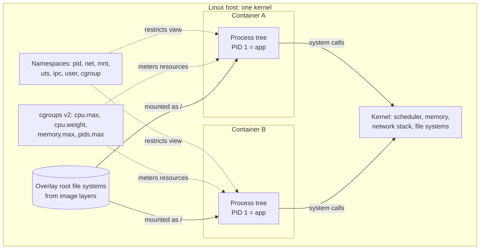

**Reading the diagram.** Both containers are ordinary process trees making synchronous system calls into one shared kernel. Namespaces (dotted, configuration applied at start) decide what each process can see; cgroups decide how much CPU, memory and how many processes it can use; the overlay file systems built from image layers are the storage boundary mounted as each container's root. The single kernel is the shared failure point: a kernel bug or panic affects every container, which is why the isolation is weaker than a VM's (§42.3.4). Scaling is cheap: another container is another process, with no guest operating system to boot.

### 42.3.2 Cgroups v2: CPU and memory control

::: definition
**Definition — Control group (cgroup).** A kernel mechanism that groups processes into a hierarchy and applies resource accounting and limits to each group through **controllers** (cpu, memory, io, pids). **cgroup v2** is the unified hierarchy, stable since Linux 4.5 (2016), in which every controller uses one tree and one set of interface files [Linux Docs: cgroup v2].
:::

The interface is a directory of files. Writing to them configures the kernel; reading them reports usage.

**Table 42.2 — The cgroup v2 controls that matter for containers, and what Kubernetes writes into them.**

| File | Meaning | Kubernetes source |
|---|---|---|
| `cpu.weight` | Relative CPU share under contention (1–10,000, default 100) | CPU **request**, converted proportionally |
| `cpu.max` | Quota and period: `200000 100000` = 200 ms of CPU per 100 ms | CPU **limit** × 100 ms period |
| `memory.max` | Hard memory limit; exceeding it triggers the OOM killer in the group | Memory **limit** |
| `memory.high` | Soft limit: the kernel throttles and reclaims above it | Optional memory QoS feature |
| `pids.max` | Maximum number of processes | Pod PID limit (kubelet setting) |
| `cpu.stat` | `nr_periods`, `nr_throttled`, `throttled_usec` | Read by monitoring |
| `memory.events` | Counts of `high`, `max`, `oom`, `oom_kill` events | Read by monitoring |

Two CPU mechanisms behave very differently. **Weight** is work-conserving: a container with weight 200 gets twice the CPU of one with weight 100 *only when they compete*; on an idle machine either may use every core. **Quota** (CFS bandwidth control, §6.5.5) is a hard ceiling enforced per period, even when cores sit idle. Memory has no weight-like soft option by default: past `memory.max` the kernel reclaims what it can (page cache first) and then kills a process in the cgroup with `SIGKILL`. Kubernetes reports this as `OOMKilled` with exit code 137 (128 + signal 9).

#### Mathematical foundations: CPU throttling from a CFS quota

Chapter 6 introduced throttling; here is the arithmetic you need to size limits.

::: formula
**CPU throttling under a CFS quota**

$$Q = L \times P \qquad t_{\text{run}} = \frac{Q}{k} \qquad t_{\text{throttle}} = \max\left(0,\; P - \frac{Q}{k}\right)$$

| Symbol | Meaning | Units |
|---|---|---|
| $L$ | CPU limit | CPUs (cores) |
| $P$ | Enforcement period (Kubernetes default 100 ms) | ms |
| $Q$ | CPU time the cgroup may use per period, summed over all its threads | CPU-ms per period |
| $k$ | Number of threads simultaneously runnable on separate cores during a burst | threads |
| $t_{\text{run}}$ | Wall-clock time until the quota is exhausted | ms |
| $t_{\text{throttle}}$ | Wall-clock time the whole cgroup is frozen for the rest of the period | ms |
:::

::: example
**Worked example — A Go service with a 2-CPU limit on a 16-core node.** QuickBite's pricing service has `limits.cpu: 2`. Its runtime, unaware of the limit, starts 16 worker threads, and during a garbage-collection cycle plus a request burst, $k = 8$ threads are runnable at once.

1. Quota: $Q = 2 \times 100 = 200$ CPU-ms per period.
2. Time to burn it with 8 threads: $t_{\text{run}} = 200 / 8 = 25$ ms.
3. Throttled time: $t_{\text{throttle}} = 100 - 25 = 75$ ms.
4. A request needing 10 ms of CPU that arrives just as the quota runs out waits up to 75 ms before it can run, so its latency becomes roughly $75 + 10 = 85$ ms instead of 10 ms.
5. Over a whole minute the service may still average only 0.8 CPUs (40% of its limit), because the bursts are short.

Now set the runtime to 2 threads ($k = 2$): $t_{\text{run}} = 200/2 = 100$ ms, so $t_{\text{throttle}} = 0$.

**Interpretation.** Throttling is caused by *parallelism inside a burst*, not by average usage; dashboards showing 40% CPU hide 75 ms stalls. **Engineering implication.** Size thread pools and runtime parallelism to the limit, not to the host's cores; alert on `nr_throttled / nr_periods` from `cpu.stat`; and for latency-critical services consider setting a CPU request with no CPU limit, relying on weights (§42.13.3).
:::

::: industry
**Runtimes became container-aware.** The JVM reads cgroup limits to size its heap and thread pools (since JDK 10, backported to 8u191). Go 1.25 (August 2025) made the default `GOMAXPROCS` respect the cgroup CPU limit; earlier Go versions needed the `automaxprocs` library to avoid exactly the throttling above. Trade-off: the runtime now sizes itself to the limit, so an overly tight limit also caps parallelism.
*Evidence: Primary* — [Go Release Notes 1.25]; [Linux Docs: cgroup v2]
:::

### 42.3.3 Runtimes: runc, containerd and the CRI

A container runtime is really a stack of three layers.

- **Low-level (OCI) runtime.** **runc** is the reference implementation of the **OCI Runtime Specification**: given a `config.json` and a root file system (a **bundle**), it creates namespaces and cgroups, starts the process, and exits [OCI Runtime Spec]. Alternatives implement the same contract: `crun` (written in C, faster start), gVisor's `runsc`, and Kata Containers (a lightweight VM per pod).
- **High-level runtime.** **containerd** and **CRI-O** pull and store images, unpack snapshots, manage container lifecycles and call the low-level runtime. A small **shim** process per container stays as its parent, so containerd can restart without killing containers.
- **The Container Runtime Interface (CRI).** A gRPC API between the kubelet and the high-level runtime, with an image service and a runtime service ("run pod sandbox", "create container", "start container"). Kubernetes removed its built-in Docker adapter (**dockershim**) in version 1.24 (2022); Docker-built images still run unchanged, because they are OCI images.

**Figure 42.2 — The runtime stack from kubelet to kernel.**

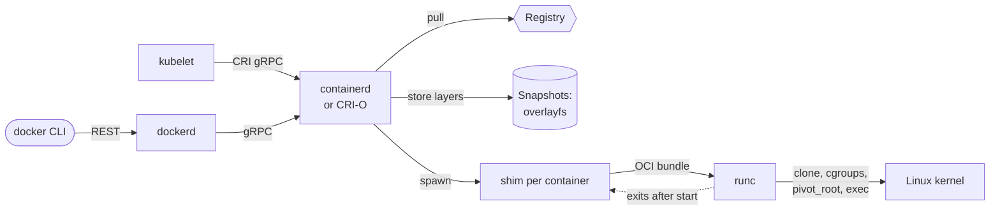

**Reading the diagram.** On a Kubernetes node the kubelet calls containerd (or CRI-O) synchronously over the CRI gRPC API; on a developer laptop the Docker CLI reaches the same containerd through `dockerd`. containerd pulls layers from a registry (an external system), stores them as overlayfs snapshots (the node's storage boundary) and spawns a shim per container. The shim invokes runc with an OCI bundle; runc makes the system calls that create the container and then exits (dotted), leaving the shim as the container's parent to collect its exit status. Failure points: a registry outage blocks new pods but not running ones; a full snapshot disk triggers image garbage collection and evictions.

### 42.3.4 Containers versus virtual machines

**Table 42.3 — Isolation options compared.**

| Aspect | Container (runc) | Sandboxed container (gVisor) | MicroVM (Firecracker, Kata) | Virtual machine |
|---|---|---|---|---|
| What it is | Host process with namespaces and cgroups | Process whose system calls a user-space kernel handles | Minimal VM per workload | Full guest OS on a hypervisor |
| Kernel | Shared host kernel | User-space kernel in front of host | Own guest kernel | Own guest kernel |
| Start time | ~0.1–1 s | Slightly slower | ~125 ms boot for Firecracker | Tens of seconds |
| Overhead | Near zero | System-call overhead | < 5 MiB memory per microVM (Firecracker) | Hundreds of MB+ |
| Isolation | Weakest: kernel is attack surface | Stronger | Strong (hardware virtualization) | Strong |
| Choose when | Trusted code, one tenant | Untrusted code, dense packing | Multi-tenant serverless, untrusted code | Different OS, strict tenancy |

Firecracker figures are from its paper [Agache et al. 2020]; Chapter 47 compares isolation levels in depth. Kubernetes selects among these per pod through a **RuntimeClass**.

::: mistake
**Common misconception — "Containers are lightweight VMs."** A container is a process. It shares the kernel, so a kernel vulnerability can become a container escape, and a container that runs as root without a user namespace is root on the host if it escapes. Treat containers as a packaging and resource-control boundary; add a sandbox or VM boundary when tenants do not trust each other.
:::

**Failure scenarios — containers.**

| What goes wrong | Why | Detection | Recovery | Prevention |
|---|---|---|---|---|
| Container killed, exit 137 | Exceeded `memory.max` | `OOMKilled` status; `memory.events` `oom_kill` | Restart; raise limit | Limit above peak RSS; bound caches |
| Latency spikes at low average CPU | CFS quota exhausted by parallel bursts | `nr_throttled` rising | Raise or remove CPU limit | Size threads to limit |
| Fork bomb starves node | No process limit | Node PID exhaustion | Kill container | `pids.max` per pod |
| Zombie processes accumulate | App as PID 1 does not reap children | Process count grows | Restart | Tiny init (`tini`) or reaping entry point |
| Container escape | Kernel bug plus root inside | Runtime security alerts | Isolate node, rotate credentials | Non-root, user namespaces, seccomp, sandboxed runtime |

## 42.4 Docker, images and layers

### 42.4.1 Images as stacks of layers

::: definition
**Definition — Container image.** An immutable, content-addressed package containing a root file system, stored as an ordered list of **layers** (each a compressed tar archive of file-system changes), plus a **configuration** (entry point, environment, user, working directory) and a **manifest** that lists them by cryptographic digest. The **OCI Image Specification** standardizes the format [OCI Image Spec].
:::

#### First-principles explanation

Picture transparent overhead-projector sheets stacked on top of each other. The bottom sheet draws a Debian file system; the next adds Python; the next adds your libraries; the top adds your code. Looking down through the stack you see one picture. If two images share the bottom three sheets, a machine stores and downloads those sheets once. When a running container "changes" a file, it draws on a fresh clear sheet on top; the sheets underneath are never touched.

#### How it works internally

1. Each filesystem-changing Dockerfile instruction (`RUN`, `COPY`, `ADD`) produces one layer: the difference between the file system before and after it.
2. Each layer is archived, compressed (gzip or zstd) and named by the SHA-256 **digest** of its bytes, so identical content always has the same name and any corruption is detectable.
3. The **config** JSON records the uncompressed layer digests (`diff_ids`), entry point, environment and history. The **manifest** lists the config and layer descriptors (media type, digest, size). An **image index** lists one manifest per platform (`linux/amd64`, `linux/arm64`), which is how one tag serves several CPU architectures.
4. On the node, **overlayfs** mounts the read-only layers as `lowerdir`s and a per-container writable `upperdir`, presenting a merged view as the container's root. The first write to a lower-layer file **copies it up** whole into the upper directory; a deletion creates a **whiteout** entry that hides the lower file.

**Figure 42.3 — Image layers merged by overlayfs, with a writable container layer.**

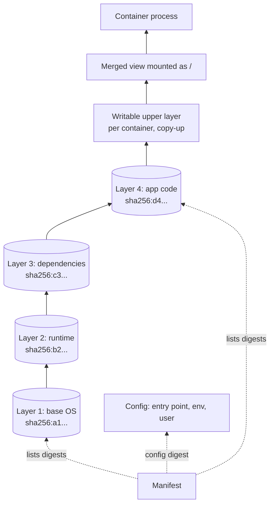

**Reading the diagram.** Read bottom to top. Four read-only layers, each named by its digest, are shared by every container on the node that uses them; only the writable upper layer is per container. Overlayfs presents the merged view as the process's root file system; writes go to the upper layer through copy-up, and are lost when the container is removed, so durable data belongs on volumes (§42.14). The manifest (dotted) references the config and layers by digest, which is what makes the image verifiable. Failure points: copy-up of a large file (a database file in a lower layer) is slow and doubles its disk use; a full node disk blocks unpacking. Scaling: shared base layers mean the hundredth image on a node often downloads only its top layer.

### 42.4.2 Writing good Dockerfiles

Layer caching is the key mechanism: a builder reuses a cached layer if the instruction and its inputs are unchanged, and **every layer after the first changed one is rebuilt**. Order instructions from least to most frequently changing.

```dockerfile
# syntax=docker/dockerfile:1
# ---- build stage: full toolchain, never shipped ----
FROM golang:1.23 AS build
WORKDIR /src
COPY go.mod go.sum ./
RUN go mod download                      # cached until dependencies change
COPY . .
RUN CGO_ENABLED=0 go build -trimpath -ldflags="-s -w" -o /out/pricing ./cmd/pricing

# ---- runtime stage: only the static binary ----
FROM gcr.io/distroless/static-debian12:nonroot
COPY --from=build /out/pricing /pricing
USER nonroot:nonroot
ENTRYPOINT ["/pricing"]
```

What to notice:

- **Multi-stage build.** The compiler, source and module cache live only in the `build` stage; the final image starts from a minimal base and copies one file from the earlier stage.
- **Dependency layer first.** Copying `go.mod` and `go.sum` before the source means a code-only change reuses the cached `go mod download` layer.
- **Distroless, non-root.** No shell or package manager in the final image shrinks the attack surface; `USER nonroot` means a compromised process is not root.
- **Exec-form `ENTRYPOINT`.** The JSON-array form makes the binary PID 1 so it receives `SIGTERM` directly; the shell form wraps it in `/bin/sh -c`, which may not forward signals and breaks graceful shutdown (§42.7.4).

Also: keep a `.dockerignore`; never `COPY` secrets (they persist in a layer; use BuildKit secret mounts); clean package caches in the same `RUN`; pin the base image by digest.

#### Mathematical foundations: why image size matters

::: formula
**Image pull time on a cold node**

$$T_{\text{pull}} \approx \frac{S_c}{B} + \frac{S_u}{R}$$

| Symbol | Meaning | Units |
|---|---|---|
| $S_c$ | Compressed size of the layers not already on the node | MB |
| $B$ | Effective download throughput from registry to node | MB/s |
| $S_u$ | Uncompressed size of those layers | MB |
| $R$ | Decompress-and-write (unpack) throughput on the node | MB/s |
| $T_{\text{pull}}$ | Time from pull start to a runnable root file system | s |

The two terms overlap partly in practice (layers download and unpack in parallel), so the sum is an upper estimate.
:::

::: example
**Worked example — Single-stage versus multi-stage for the pricing service.** Sizes are approximate and vary by version. A single-stage image built on the Go toolchain image is about $S_u = 850$ MB uncompressed, $S_c = 300$ MB compressed. The multi-stage image is a ~2 MB distroless base plus a 20 MB binary: $S_u = 22$ MB, $S_c = 9$ MB. Assume $B = 50$ MB/s and $R = 150$ MB/s.

1. Single-stage: $300/50 + 850/150 = 6.0 + 5.7 = 11.7$ s.
2. Multi-stage: $9/50 + 22/150 = 0.18 + 0.15 = 0.33$ s.
3. A scale-out that adds 30 fresh nodes downloads $30 \times 300 = 9{,}000$ MB = 9 GB versus $30 \times 9 = 270$ MB from the registry.

**Interpretation.** The fat image adds about 11 s to every cold start on a new node, on top of node provisioning, and concentrates 9 GB of registry egress into the minute when you most need capacity. **Engineering implication.** Small images shorten the reaction time $T_{\text{react}}$ that autoscaling headroom must cover (§18.8.4). Pre-pull large shared base images in the node image, use a pull-through registry mirror inside the region, and consider lazy-pulling formats (which fetch file contents on demand) when images must be large, such as ML images with GPU libraries.
:::

::: mistake
**Common misconception — "Deleting files in a later layer makes the image smaller."** The earlier layer still contains the bytes; the later layer only adds a whiteout. Remove temporary files in the *same* `RUN` that created them, or build them in a discarded stage [Docker Docs: Multi-stage Builds].
:::

## 42.5 Registries

### 42.5.1 The pull flow, tags and digests

::: definition
**Definition — Container registry.** A content-addressed store for images and related artifacts, organized into repositories, that serves manifests by **tag** or **digest** and layers (blobs) by digest over the HTTP API standardized by the **OCI Distribution Specification** [OCI Distribution Spec].
:::

A **tag** (`pricing:1.8.2`, `pricing:latest`) is a mutable pointer that anyone with push rights can move. A **digest** (`pricing@sha256:9f2c...`) names exact bytes and can never change. Production manifests should reference images by digest, or tags should be made immutable in the registry; otherwise two nodes pulling "the same" tag a minute apart can run different code, and a rollback to a tag may not restore the old bytes.

**Figure 42.4 — Pulling and verifying an image by digest.**

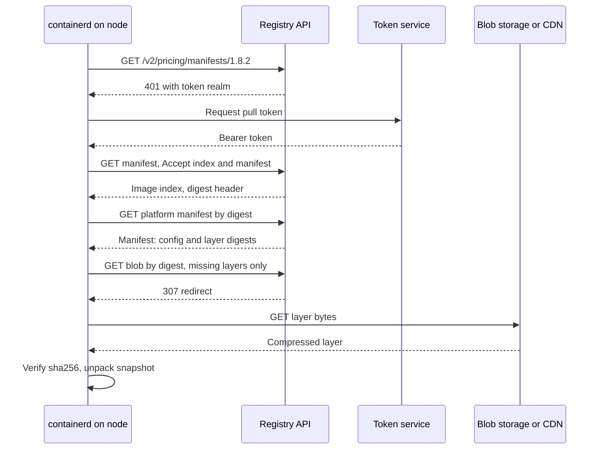

**Reading the diagram.** The runtime asks for the tag's manifest; the registry challenges for authentication and a token service issues a short-lived bearer token. The image index returns per-platform manifests and the digest the tag currently points to; from then on everything is fetched by digest. Only layers missing from the node are downloaded, often redirected to object storage or a CDN (a separate storage boundary). Every blob's SHA-256 is checked against the manifest before unpacking, so a tampered or corrupted layer is rejected. All steps are synchronous HTTPS. Failure points: the token service and registry are on the critical path of every new pod on a fresh node, so a registry outage blocks scale-out and rescheduling; a regional mirror removes that dependency. Scaling: blob downloads parallelize across layers and are cacheable because digests never change.

### 42.5.2 Signing, provenance and scanning

A digest proves the bytes are the ones the registry stored; it does not prove *who built them*. **Signing** closes that gap. Sigstore's **cosign** supports **keyless signing**: the CI job proves its identity with an OpenID Connect token, the **Fulcio** certificate authority issues a certificate valid for minutes, the job signs the image digest, and the signature is recorded in the **Rekor** transparency log; the signature is stored in the registry next to the image [Sigstore Docs]. OCI Image Spec 1.1 (2024) added a `subject` field so signatures, software bills of materials (SBOMs) and build provenance attestations can be attached to an image and discovered through the registry's referrers API. An **admission policy** in the cluster then rejects pods whose image digest lacks a valid signature from the expected CI identity.

**Vulnerability scanning** compares the packages in each layer against vulnerability databases (CVE feeds). Scan at three points: in CI (fail the build on fixable critical issues), in the registry (re-scan stored images daily, because new vulnerabilities are published for old images) and at runtime (report what is actually deployed). Distroless and multi-stage images help most here: fewer packages, fewer findings to triage.

::: recommendation
**Recommendation — A minimal supply-chain baseline.** Build in CI only; push by digest; sign with keyless cosign and attach an SBOM; make release tags immutable; enforce signature and registry allow-lists at admission; scan continuously; mirror images into a regional registry so production never depends on a public registry's availability or rate limits.
:::

## 42.6 Kubernetes architecture

### 42.6.1 From containers to an orchestrator

Containers solve packaging on one machine. With 400 containers on 50 machines, something must place each container, restart it, move it when its machine fails, give it a stable address, roll out versions and add machines. Kubernetes replaces doing that by hand.

::: definition
**Definition — Kubernetes.** An open-source container orchestrator that runs workloads across a cluster of nodes from **declarative** specifications. Users write the *desired state* of API objects to a central API server; independent **controllers** continuously compare it with the *observed state* and act to close the gap [Kubernetes Docs: Components].
:::

::: industry
**From Borg to Kubernetes.** Google's Borg ran "hundreds of thousands of jobs" across cells of about 10,000 machines, with a Paxos-replicated master (five replicas per cell) and a scheduler that checks feasibility and then scores machines [Verma et al. 2015]. Omega explored shared-state, optimistically concurrent schedulers [Schwarzkopf et al. 2013]. Kubernetes (open-sourced in 2014, 1.0 in 2015) carried over the lessons Burns et al. list: group co-scheduled containers into **pods**; give every pod its own IP address instead of sharing the host's ports; identify groups with **labels** rather than fixed job membership; make all components talk through one API rather than to the store directly; and build the system from **reconciliation loops** [Burns et al. 2016].
*Evidence: Primary* — [Verma et al. 2015]; [Burns et al. 2016]
:::

### 42.6.2 Control plane and nodes

The **control plane** decides; the **nodes** do.

- **kube-apiserver.** The only component that talks to etcd. It authenticates and authorizes every request (RBAC), runs **admission** plugins and webhooks that may mutate or reject objects, validates schemas, persists objects and serves **watches** that stream changes. It is stateless and runs as several replicas behind a load balancer.
- **etcd.** The Raft-replicated key–value store holding every object (§26.9). Three or five members; its latency bounds every write in the cluster.
- **kube-scheduler.** Watches pods with no node assigned and binds each to a node (§42.13).
- **kube-controller-manager.** One process running dozens of controllers (Deployment, ReplicaSet, StatefulSet, Job, node lifecycle, EndpointSlice, namespace, garbage collector). One replica is active at a time through leader election (§26.9.2).
- **cloud-controller-manager.** Controllers that call the cloud provider: create load balancers for `LoadBalancer` Services, attach node metadata, delete nodes whose VM is gone.
- **kubelet** (every node). Watches the pods bound to its node, asks the runtime through the CRI to start them, runs probes, mounts volumes and reports status. It is a controller too, with the node as its world.
- **kube-proxy** (every node, optional with some network plugins). Programs packet-forwarding rules that implement Services (§42.9).
- **Container runtime and CNI plugin** (every node). containerd or CRI-O runs containers (§42.3.3); the **Container Network Interface (CNI)** plugin gives each pod its network (§42.9.1).

**Figure 42.5 — Kubernetes architecture.**

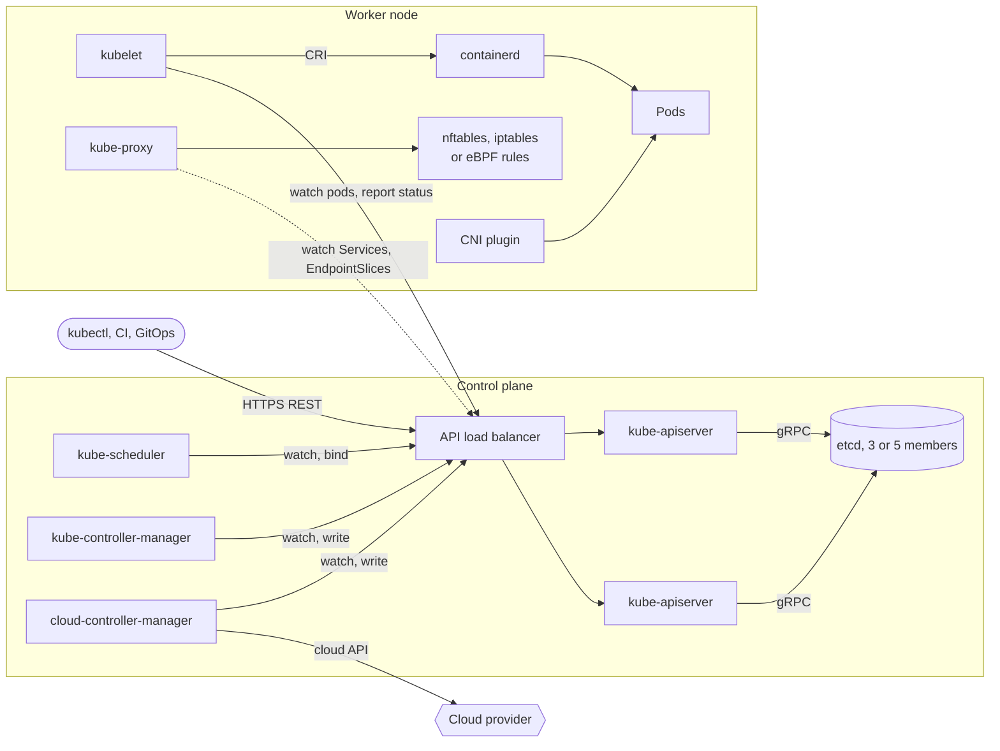

**Reading the diagram.** Every component, inside or outside the control plane, talks only to the API server over HTTPS; only the API servers talk to etcd, the storage boundary. Controllers and the scheduler watch for changes and write back decisions; the kubelet watches pods assigned to its node and reports status; kube-proxy watches Services and EndpointSlices asynchronously (dotted) to program forwarding rules. Failure points and their effect: if the whole control plane is down, running pods keep running and Services keep forwarding, but nothing new is scheduled, failed pods on dead nodes are not replaced and deploys stall. If etcd loses quorum, the API becomes read-only or unavailable. Scaling: API servers scale horizontally; etcd scales vertically and limits cluster size; Kubernetes documents tested limits of 5,000 nodes, 150,000 pods and 110 pods per node [Kubernetes Docs: Large Clusters].

### 42.6.3 The reconciliation loop

Kubernetes has no central workflow engine that says "step 1, create the ReplicaSet; step 2, create pods". Instead, each controller runs the same loop on its own kind of object.

::: definition
**Definition — Reconciliation loop (control loop).** A loop that repeatedly reads an object's desired state (`spec`), observes actual state, computes the difference and takes actions to reduce it, then records what it observed (`status`). It is **level-triggered**: it acts on the current state of the world, not on the sequence of events that produced it.
:::

A thermostat is again the right analogy (§18.8.2). It does not count how many times the door opened; it measures the temperature now and heats if it is too low. If it misses an event, the next measurement still tells it the truth. An **edge-triggered** design ("on pod-deleted event, create a pod") breaks when an event is lost, duplicated or arrives during a controller restart; a level-triggered one simply converges on the next pass.

**How it works internally.**

1. An **informer** lists all objects of a kind once, then watches the API server for changes, keeping a local cache. A watch resumes from the last seen `resourceVersion` (an etcd revision), so restarts do not lose changes.
2. Each change enqueues only the object's *key* into a **work queue**, which deduplicates keys: ten rapid changes to one Deployment cause one reconciliation.
3. A worker pops a key, reads the *current* object from the cache and reconciles: compare, then create, update or delete through the API server.
4. Writes use **optimistic concurrency**: each update carries the `resourceVersion` it read; if someone else wrote first, the API server returns a conflict and the controller re-reads and retries.
5. On error, the key is requeued with exponential backoff. A periodic **resync** re-reconciles everything as a safety net.

**Figure 42.6 — The reconciliation loop of a controller.**

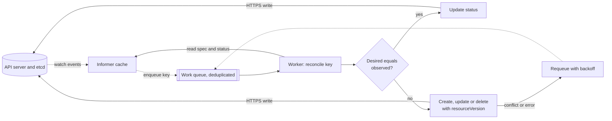

**Reading the diagram.** Watch events flow asynchronously (dotted) from the API server into the informer's cache and then, as keys, into a deduplicated work queue. A worker reads the latest cached state, decides whether desired and observed state match, and either writes status or performs actions through the API server, synchronously. Its own writes generate new watch events, so the loop naturally runs again until nothing changes. Failure points: a conflict (someone wrote in between) or an API error requeues the key with backoff; a controller crash loses nothing because state lives in etcd and the loop restarts from a fresh list. Scaling: workers process different keys in parallel, and many independent controllers share the API server instead of calling each other.

#### Code example: a toy cluster built from reconcilers

The program below models the API server's store and four controllers: the ReplicaSet controller, the scheduler, the kubelet and the node lifecycle controller. None of them calls another; each reads the shared store and fixes one kind of difference.

```python
"""A toy Kubernetes: level-triggered controllers converging on desired state."""
from dataclasses import dataclass, field
from itertools import count


@dataclass
class Node:
    name: str
    cpu_m: int                 # allocatable CPU in millicores
    ready: bool = True


@dataclass
class Pod:
    name: str
    owner: str                 # name of the owning ReplicaSet
    cpu_m: int                 # CPU request in millicores
    seq: int                   # creation order
    node: str | None = None    # None = Pending (unscheduled)
    phase: str = "Pending"


@dataclass
class Store:
    """Stands in for the API server + etcd: the single source of truth."""
    nodes: dict = field(default_factory=dict)
    pods: dict = field(default_factory=dict)
    replicasets: dict = field(default_factory=dict)   # name -> (replicas, cpu_m)
    _ids: count = field(default_factory=lambda: count(1))


def replicaset_controller(s: Store) -> int:
    """Compare desired replicas with observed pods; create or delete the difference."""
    changes = 0
    for rs, (want, cpu_m) in s.replicasets.items():
        mine = [p for p in s.pods.values() if p.owner == rs]
        for _ in range(want - len(mine)):                       # too few: create
            seq = next(s._ids)
            s.pods[f"{rs}-{seq}"] = Pod(f"{rs}-{seq}", rs, cpu_m, seq)
            changes += 1
        # too many: delete unscheduled pods first, then the newest
        surplus = sorted(mine, key=lambda p: (p.node is not None, -p.seq))
        for p in surplus[:max(0, len(mine) - want)]:
            del s.pods[p.name]
            changes += 1
    return changes


def free_cpu(s: Store, node: Node) -> int:
    used = sum(p.cpu_m for p in s.pods.values() if p.node == node.name)
    return node.cpu_m - used


def scheduler(s: Store, strategy: str = "LeastAllocated") -> int:
    """Filter nodes that fit, score them, bind the pod to the best one."""
    changes = 0
    for p in sorted(s.pods.values(), key=lambda p: p.seq):
        if p.node is not None:
            continue
        feasible = [n for n in s.nodes.values()
                    if n.ready and free_cpu(s, n) >= p.cpu_m]          # filter
        if not feasible:
            continue                                                    # stays Pending

        def score(n: Node) -> float:                                    # 0..100
            left = (free_cpu(s, n) - p.cpu_m) / n.cpu_m
            return 100 * (left if strategy == "LeastAllocated" else 1 - left)
        best = max(feasible, key=lambda n: (score(n), n.name))
        p.node = best.name                                              # bind
        changes += 1
    return changes


def kubelet(s: Store) -> int:
    """Each ready node starts the pods bound to it."""
    changes = 0
    for p in s.pods.values():
        if p.node and s.nodes[p.node].ready and p.phase == "Pending":
            p.phase = "Running"
            changes += 1
    return changes


def node_lifecycle_controller(s: Store) -> int:
    """Delete pods on nodes that are no longer ready (after the eviction timeout)."""
    doomed = [p.name for p in s.pods.values() if p.node and not s.nodes[p.node].ready]
    for name in doomed:
        del s.pods[name]
    return len(doomed)


def reconcile_until_stable(s: Store, strategy: str = "LeastAllocated",
                           max_rounds: int = 20) -> int:
    for rounds in range(1, max_rounds + 1):
        changed = (node_lifecycle_controller(s) + replicaset_controller(s)
                   + scheduler(s, strategy) + kubelet(s))
        if changed == 0:
            return rounds
    raise RuntimeError("did not converge")


def placement(s: Store) -> dict:
    out = {n: 0 for n in s.nodes}
    for p in s.pods.values():
        if p.node:
            out[p.node] += 1
    return out


def running(s: Store) -> int:
    return sum(p.phase == "Running" for p in s.pods.values())


if __name__ == "__main__":
    s = Store()
    for i in (1, 2, 3):
        s.nodes[f"node-{i}"] = Node(f"node-{i}", cpu_m=4000)

    s.replicasets["web"] = (6, 1000)            # kubectl apply: 6 replicas, 1 CPU each
    rounds = reconcile_until_stable(s)
    print("after apply:     ", placement(s), "running =", running(s), "rounds =", rounds)
    assert running(s) == 6 and placement(s) == {"node-1": 2, "node-2": 2, "node-3": 2}

    s.nodes["node-3"].ready = False              # a node dies
    reconcile_until_stable(s)
    print("after node loss: ", placement(s), "running =", running(s))
    assert running(s) == 6 and placement(s)["node-3"] == 0

    s.replicasets["web"] = (10, 1000)            # scale beyond remaining capacity
    reconcile_until_stable(s)
    pending = sum(p.node is None for p in s.pods.values())
    print("after scale-up:  ", placement(s), "running =", running(s), "pending =", pending)
    assert running(s) == 8 and pending == 2      # 2 nodes x 4 CPU = 8 pods max

    s.nodes["node-3"].ready = True               # node recovers; Pending pods land
    reconcile_until_stable(s)
    print("after recovery:  ", placement(s), "running =", running(s))
    assert running(s) == 10

    oldest = sorted(p.seq for p in s.pods.values())[:3]
    s.replicasets["web"] = (3, 1000)             # scale down: newest pods go first
    reconcile_until_stable(s)
    assert running(s) == 3 and sorted(p.seq for p in s.pods.values()) == oldest

    # Bin-packing: same six 1-CPU pods, two scoring strategies
    for strategy in ("LeastAllocated", "MostAllocated"):
        t = Store()
        for i in (1, 2, 3):
            t.nodes[f"node-{i}"] = Node(f"node-{i}", cpu_m=4000)
        t.replicasets["web"] = (6, 1000)
        reconcile_until_stable(t, strategy)
        empty = sum(v == 0 for v in placement(t).values())
        print(f"{strategy:<15}", placement(t), "empty nodes =", empty)
        assert empty == (0 if strategy == "LeastAllocated" else 1)
    print("all checks passed")
```

Output:

```text
after apply:      {'node-1': 2, 'node-2': 2, 'node-3': 2} running = 6 rounds = 2
after node loss:  {'node-1': 3, 'node-2': 3, 'node-3': 0} running = 6
after scale-up:   {'node-1': 4, 'node-2': 4, 'node-3': 0} running = 8 pending = 2
after recovery:   {'node-1': 4, 'node-2': 4, 'node-3': 2} running = 10
LeastAllocated  {'node-1': 2, 'node-2': 2, 'node-3': 2} empty nodes = 0
MostAllocated   {'node-1': 0, 'node-2': 2, 'node-3': 4} empty nodes = 1
all checks passed
```

What to notice:

- **No controller knows why the world changed.** When node-3 dies, the node lifecycle controller deletes its pods; the ReplicaSet controller merely sees "4 pods, want 6" and creates two; the scheduler merely sees two unbound pods. Recovery emerges from independent loops.
- **Pending is a normal state.** Pods that fit nowhere stay unbound, and are placed automatically once node-3 returns. In a real cluster that pending state is the signal a node autoscaler acts on (§42.12).
- **Scale-down deletes the cheapest pods first**: unscheduled, then newest, as the real ReplicaSet controller prefers.
- **The scheduler's score function decides spreading versus packing**; §42.13.4 uses the last two lines of output.
- **Convergence is checked, not assumed**: `reconcile_until_stable` stops when a full pass changes nothing.

### 42.6.4 From `kubectl apply` to a running pod

**Figure 42.7 — Sequence from `kubectl apply` of a Deployment to a ready pod receiving traffic.**

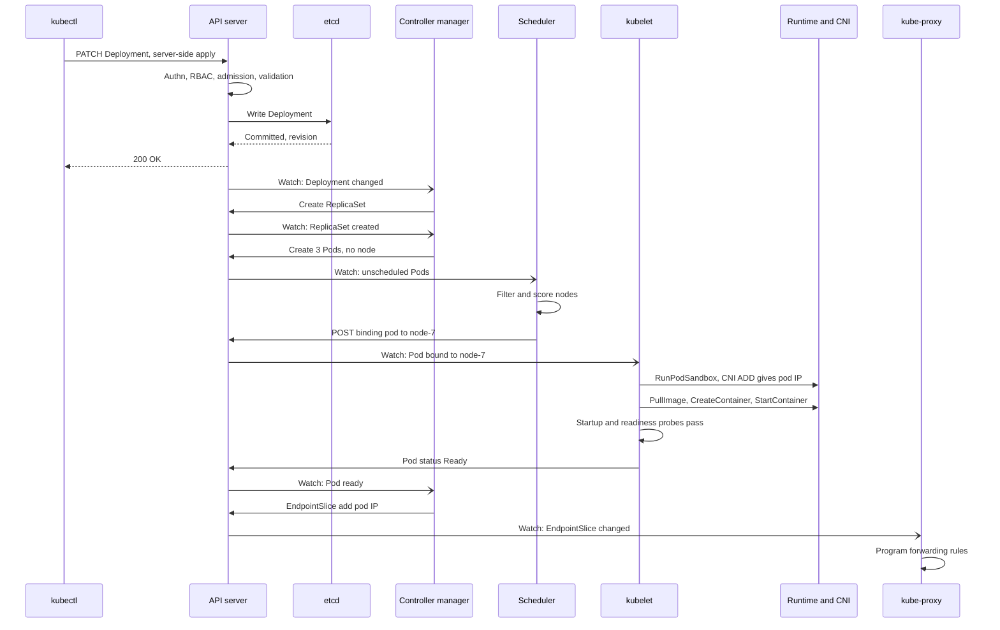

**Reading the diagram.** Solid arrows are synchronous requests; open arrowheads are asynchronous watch notifications. The only synchronous part the user waits for is the API write: authentication, RBAC authorization, admission webhooks, validation and the etcd commit; `kubectl` returns as soon as the Deployment is *stored*, long before anything runs. Everything after is a chain of independent controllers reacting to watch events: the Deployment controller creates a ReplicaSet, the ReplicaSet controller creates pods, the scheduler binds them, the kubelet asks the runtime to create the pod sandbox (whose network namespace receives an IP from the CNI plugin), pull images and start containers, then reports readiness. The EndpointSlice controller adds the ready pod's IP and kube-proxy on every node updates its rules. Failure points: a slow admission webhook delays every write; no feasible node leaves pods Pending; an image pull failure shows as `ImagePullBackOff`; a failing readiness probe keeps the pod out of the EndpointSlice. End to end this takes a few seconds on a warm node, dominated by image pull and application start-up.

**Table 42.4 — What breaks when a control-plane component fails.**

| Component down | Running workloads | What stops working | Typical mitigation |
|---|---|---|---|
| One API server | Unaffected | Nothing, if others remain | 3 replicas behind a load balancer |
| All API servers | Keep running | All changes, scheduling, scaling, status | Managed control plane, multi-zone |
| etcd quorum | Keep running | API writes (and reads) | 3 or 5 members across zones; backups |
| Scheduler | Keep running | New pods stay Pending | Leader-elected standby |
| Controller manager | Keep running | Replacements, rollouts, endpoints updates | Leader-elected standby |
| kubelet on a node | Containers keep running, unmanaged | Probes, restarts, status; node marked NotReady | Node auto-repair |

## 42.7 Pods

### 42.7.1 What a pod is

::: definition
**Definition — Pod.** The smallest deployable unit in Kubernetes: one or more containers that are always scheduled together on one node and share a network namespace (one IP address and port space), IPC namespace and volumes. Pods are disposable: a replaced pod is a new pod with a new name and IP.
:::

A pod is an apartment shared by roommates: one street address (IP), a shared kitchen (volumes), separate bedrooms (each container's own file system, cgroup and image). The runtime first creates a **pod sandbox**, a tiny "pause" process that holds the shared namespaces; the application containers then join them. Containers in a pod reach each other on `localhost`, so two of them cannot both listen on port 8080.

Put containers in one pod only if they must share a lifecycle and a node: a log shipper reading the app's log volume, a proxy that intercepts its traffic, a process that refreshes credentials into a shared file. Independent services belong in separate pods so they scale and fail independently.

### 42.7.2 Init containers and native sidecars

**Init containers** run to completion, one after another, before the app containers start: run a schema check, wait for a dependency, render configuration into a shared volume. If one fails, the kubelet retries it and the app never starts.

A **sidecar** is a helper container that runs *alongside* the app for the pod's whole life: a service-mesh proxy (§34.10), a log forwarder, a secrets agent. Before native support, sidecars were ordinary containers, which caused two classic bugs: the app started before its proxy was ready (failed first requests), and a Job's pod never completed because the sidecar never exited. Kubernetes' **native sidecar containers** fix both: an init container with `restartPolicy: Always` starts before the app containers, keeps running, is restarted if it dies, does not block Job completion, and is stopped *after* the app containers on shutdown. The feature has been stable since Kubernetes 1.33 (2025) [Kubernetes Docs: Sidecar Containers].

### 42.7.3 Probes

**Table 42.5 — The three probes.**

| Probe | Question | On failure | Typical check |
|---|---|---|---|
| Startup | Has the app finished starting? | Keep waiting; after `failureThreshold × periodSeconds`, restart | Same endpoint as liveness, generous threshold |
| Liveness | Is the process stuck beyond recovery? | Restart the container | Cheap in-process check; no dependencies |
| Readiness | Should this pod receive traffic now? | Remove from Service endpoints; no restart | Can serve: warmed up, not overloaded |

Liveness and readiness probes do not run until the startup probe succeeds. Defaults are a 10 s period, 1 s timeout and 3 failures. The most damaging mistake is a liveness probe that checks a shared dependency: when the database slows, every pod fails liveness and restarts at once, turning a slowdown into an outage (§19.5.2).

```yaml
apiVersion: v1
kind: Pod
metadata:
  name: ordering
spec:
  terminationGracePeriodSeconds: 45
  initContainers:
  - name: migrate-check                     # runs to completion first
    image: registry.example.com/ordering-migrate@sha256:1c4e...
  - name: mesh-proxy                        # native sidecar
    image: registry.example.com/proxy@sha256:7ab0...
    restartPolicy: Always
  containers:
  - name: app
    image: registry.example.com/ordering@sha256:9f2c...
    resources:
      requests: {cpu: "500m", memory: "1Gi"}
      limits:   {memory: "1Gi"}             # memory limit; no CPU limit
    startupProbe:
      httpGet: {path: /healthz, port: 8080}
      periodSeconds: 5
      failureThreshold: 24                  # allow up to 120 s to start
    livenessProbe:
      httpGet: {path: /healthz, port: 8080}
    readinessProbe:
      httpGet: {path: /ready, port: 8080}
      periodSeconds: 5
    lifecycle:
      preStop:
        sleep: {seconds: 10}                # let endpoint removal propagate
```

What to notice: the sidecar is an init container with `restartPolicy: Always`; the startup probe gives a slow-starting app 120 s without weakening liveness afterwards; memory request equals memory limit while CPU has only a request (§42.13.3); images are pinned by digest (§42.5.1).

### 42.7.4 Graceful termination

When a pod is deleted, two things happen *in parallel*: the kubelet starts shutdown, and the EndpointSlice controller removes the pod from Services, after which every node's kube-proxy and every ingress proxy must update. The kubelet runs the `preStop` hook, sends `SIGTERM`, waits up to `terminationGracePeriodSeconds` (default 30 s) counted from the start of termination, then sends `SIGKILL`. Because endpoint removal is asynchronous, a pod that exits immediately on `SIGTERM` still receives requests for a second or two and those clients see connection errors. The standard fix is a short `preStop` sleep, then draining in-flight requests, then exiting; long-lived connections such as WebSockets need a longer grace period (§9.9.7 computes the drain budget).

**Figure 42.8 — Pod lifecycle: ordered start-up and graceful shutdown.**

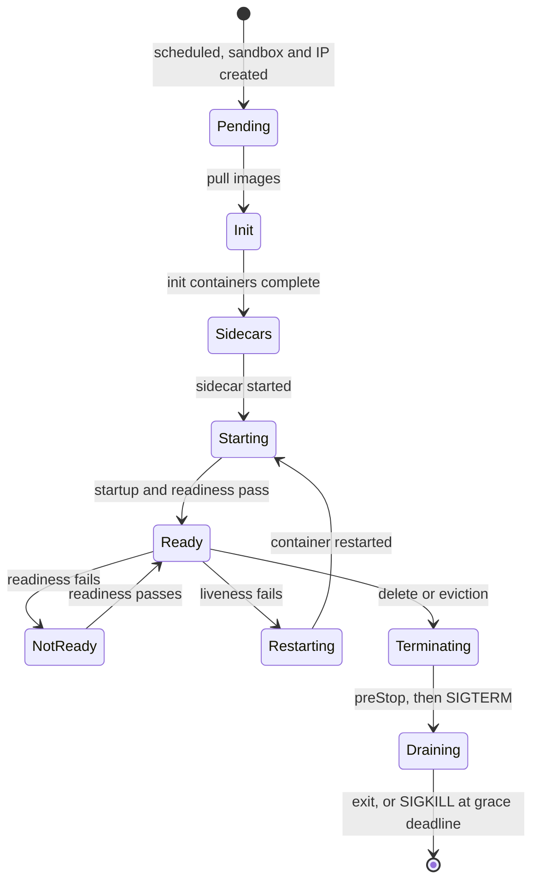

**Reading the diagram.** A scheduled pod first gets its sandbox and IP, pulls images, runs init containers in order, starts native sidecars, then starts the app. Only when startup and readiness probes pass does the pod join Service endpoints. Readiness failures toggle traffic without restarts; liveness failures restart the container in place (same pod, same IP). Deletion leads to `preStop`, `SIGTERM`, draining and finally exit or `SIGKILL`, while endpoint removal proceeds asynchronously elsewhere in the cluster. Failure points: a slow image pull or init container shows as a pod stuck in `Init`; a repeatedly failing container enters `CrashLoopBackOff` with exponentially growing restart delays (capped at 5 minutes); an app that ignores `SIGTERM` is killed at the deadline mid-request.

## 42.8 Workload controllers

### 42.8.1 Deployments and ReplicaSets

A **ReplicaSet** keeps $N$ identical pods matching a label selector running, exactly the loop of §42.6.3. A **Deployment** manages ReplicaSets to roll out changes: when the pod template changes (a new image digest), it creates a new ReplicaSet and shifts replicas from old to new under two limits. **maxSurge** is how many pods above the desired count may exist; **maxUnavailable** is how many below the desired count may be unavailable. Both default to 25%; surge rounds up and unavailability rounds down. Old ReplicaSets are kept (scaled to zero, 10 by default) so `kubectl rollout undo` is just scaling the old one back up. Canary and blue–green strategies build on this and belong to §43.5–§43.6.

**Figure 42.9 — A rolling update shifting replicas between ReplicaSets.**

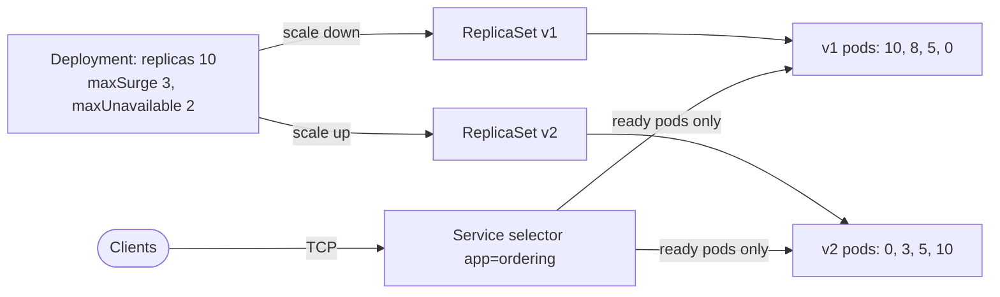

**Reading the diagram.** The Deployment controller scales the new ReplicaSet up and the old one down in steps, never exceeding 13 pods in total or dropping below 8 available. The Service selects pods by label only, so during the rollout it sends traffic to ready pods of *both* versions: clients must tolerate mixed versions, which is why API and schema changes must be backward compatible (§34.8.4). Readiness gates each step: an unready new pod does not count as available, so a broken image stops the rollout after a few pods instead of replacing everything. If no progress is made for `progressDeadlineSeconds` (default 600 s), the Deployment is marked failed; it does not roll back automatically unless your pipeline does. Scaling: surge pods need spare cluster capacity, or they wait as Pending for a node autoscaler.

#### Mathematical foundations: capacity during a rollout

::: formula
**Rolling update bounds and duration**

$$s = \lceil \sigma R \rceil \qquad u = \lfloor \upsilon R \rfloor \qquad A_{\min} = R - u \qquad N_{\max} = R + s \qquad T_{\text{roll}} \approx \left\lceil \frac{R}{s + u} \right\rceil \times t_{\text{wave}}$$

| Symbol | Meaning | Units |
|---|---|---|
| $R$ | Desired replicas | pods |
| $\sigma$, $\upsilon$ | maxSurge and maxUnavailable as fractions (or use absolute numbers directly) | dimensionless |
| $s$, $u$ | Surge and unavailability in pods | pods |
| $A_{\min}$ | Minimum available pods during the rollout | pods |
| $N_{\max}$ | Maximum pods existing at once (sets the spare capacity needed) | pods |
| $t_{\text{wave}}$ | Time for one batch: schedule, pull, start, readiness, `minReadySeconds` | s |
| $T_{\text{roll}}$ | Approximate rollout duration (the controller overlaps waves, so this is an estimate) | s |
:::

::: example
**Worked example — Rolling QuickBite's ordering service at peak.** $R = 10$ pods; a load test showed each pod serves 550 RPS within its latency objective; the evening peak is 4,800 RPS; one wave takes $t_{\text{wave}} = 45$ s.

*Defaults (25%, 25%).*

1. $s = \lceil 0.25 \times 10 \rceil = \lceil 2.5 \rceil = 3$; $u = \lfloor 2.5 \rfloor = 2$.
2. $A_{\min} = 10 - 2 = 8$ pods, able to serve $8 \times 550 = 4{,}400$ RPS.
3. Peak needs $4{,}800 / 550 = 8.7$, so 9 pods. **4,400 < 4,800: a rollout at peak overloads the service.**
4. $T_{\text{roll}} \approx \lceil 10/5 \rceil \times 45 = 90$ s.

*maxSurge 3, maxUnavailable 0.*

1. $A_{\min} = 10$, capacity $5{,}500$ RPS; $N_{\max} = 13$.
2. $T_{\text{roll}} \approx \lceil 10/3 \rceil \times 45 = 4 \times 45 = 180$ s.
3. Spare capacity needed: 3 surge pods × 500 m CPU and 1 GiB = 1.5 CPU and 3 GiB.

**Interpretation.** Default settings quietly remove 20% of capacity during every deploy. Setting `maxUnavailable: 0` keeps full capacity for twice the rollout time and a little spare room. **Engineering implication.** For services running near their capacity, use `maxUnavailable: 0` with a surge, and make sure the HPA's target leaves headroom for $A_{\min}$, not just $R$; a PodDisruptionBudget protects the same floor against voluntary disruptions such as node drains.
:::

### 42.8.2 StatefulSets, DaemonSets, Jobs and CronJobs

**Table 42.6 — Workload controllers.**

| Controller | Guarantees | Pod identity | Typical use |
|---|---|---|---|
| Deployment (ReplicaSet) | $N$ interchangeable replicas; rolling updates | Random names, new IP each time | Stateless services |
| StatefulSet | Stable ordinal names (`db-0`, `db-1`), stable DNS through a headless Service, one PersistentVolumeClaim per ordinal; ordered start and update by default | Stable name and storage | Databases, Kafka, ZooKeeper, etcd |
| DaemonSet | One pod per (matching) node, including new nodes | Per node | Log agents, CNI, node exporters, kube-proxy |
| Job | Run pods until $C$ complete successfully; `parallelism`, `backoffLimit` (default 6), indexed completions | Per task | Batch, migrations, ML training steps |
| CronJob | Creates Jobs on a cron schedule; `concurrencyPolicy` Allow, Forbid or Replace | Per run | Reports, cleanups, backups |

A StatefulSet gives identity, not replication: `db-1` reattaches to the same volume after rescheduling, but electing a primary, copying data and failing over remain the database's job (or an operator's, §42.15). Its rolling update replaces pods one at a time from the highest ordinal down, and a `partition` setting enables staged rollouts. Two cautions for CronJobs: a missed schedule (controller down) may run late or be skipped depending on `startingDeadlineSeconds`, and with `Allow` a slow job can overlap its next run, so jobs must be idempotent (§22.15).

## 42.9 Networking: CNI and Services

### 42.9.1 The pod network

Kubernetes imposes one rule and leaves the implementation to a **CNI plugin**: every pod gets its own IP address, and every pod can reach every other pod's IP directly, across nodes, **without NAT** [Kubernetes Docs: Cluster Networking]. Applications therefore see the same addresses senders used, and no two pods compete for host ports, the Borg lesson of §42.6.1.

When the runtime creates a pod sandbox, it calls the CNI plugin with `ADD`. The plugin creates a virtual Ethernet pair (one end in the pod's network namespace as `eth0`, the other on the host), assigns an IP from the node's pod range (for example a /24 per node), and programs routes. Across nodes, plugins use one of two approaches:

- **Overlay**: encapsulate pod packets in VXLAN or Geneve between nodes. Works on any network, costs about 50 bytes of header per packet and some CPU.
- **Native routing**: pod IPs are routable in the underlying network, through BGP (Calico) or cloud VPC addresses attached to the node (the AWS VPC CNI). Faster and visible to cloud firewalls, but consumes real subnet addresses (§7.4.2).

Calico, Cilium and Flannel are common plugins; Cilium and Calico also enforce **NetworkPolicy**, the pod-level firewall (by default every pod can reach every other pod).

### 42.9.2 Services

Pods come and go with new IPs, so clients need a stable name. A **Service** selects pods by label and gives them one virtual IP and a DNS name such as `ordering.prod.svc.cluster.local`. The EndpointSlice controller keeps the list of *ready* pod IPs behind it (in slices of up to 100 endpoints each, so a change rewrites one small object, not one huge list).

**Table 42.7 — Service types.**

| Type | What clients get | Reachable from | Use |
|---|---|---|---|
| ClusterIP (default) | Virtual IP and DNS name | Inside the cluster | Service-to-service calls |
| NodePort | A port (30000–32767) on every node | Anything that reaches nodes | Building block for external balancers |
| LoadBalancer | A cloud load balancer, provisioned by the cloud controller | Internet or VPC | Exposing a single L4 service |
| Headless (`clusterIP: None`) | DNS returns pod IPs directly; no virtual IP | Inside the cluster | StatefulSets, client-side balancing |
| ExternalName | DNS CNAME to an outside name | Inside the cluster | Aliasing an external dependency |

**Figure 42.10 — Pod-to-Service traffic across a flat pod network.**

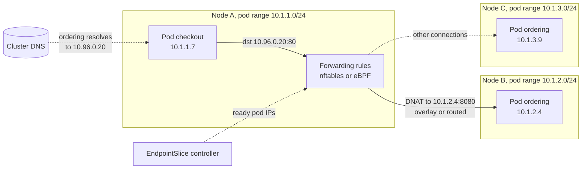

**Reading the diagram.** The checkout pod resolves `ordering` through cluster DNS to the Service's virtual IP 10.96.0.20, which belongs to no machine. Forwarding rules on the *client's own node* (programmed by kube-proxy or an eBPF data plane from EndpointSlices, asynchronously) rewrite the destination to one ready pod IP at connection set-up (DNAT), and the packet crosses the flat pod network by overlay or native routing. Each new TCP connection may pick a different pod (dotted alternative). Failure points: stale rules after a pod dies send connections to a dead IP until endpoints update; the per-node conntrack table can fill under very many short connections; DNS is a shared dependency for every call. Scaling: there is no central balancer to saturate, because every node balances its own outgoing traffic.

### 42.9.3 kube-proxy modes

**Table 42.8 — Service data-plane implementations (as of 2026).**

| Mode | How it works | Lookup cost | Status |
|---|---|---|---|
| iptables | Chains of rules; random-probability jump to an endpoint | Linear in rules; full-table rewrites | Long-time default; slow at tens of thousands of endpoints |
| IPVS | Kernel L4 load balancer with hash tables; several algorithms | Constant | Deprecated in Kubernetes 1.35 |
| nftables | Successor to iptables with maps and sets | Near constant; incremental updates | Stable since 1.33; recommended for new clusters |
| eBPF (Cilium) | Programs at socket and network hooks; translates the address at `connect()` | Constant hash-map lookups | Replaces kube-proxy entirely [Cilium Docs] |

All four balance **connections**, not requests. A gRPC client holds one HTTP/2 connection and sends every request to one pod, however many pods exist. Use a headless Service with client-side balancing, or an L7 proxy or mesh (§19.10, §34.10).

## 42.10 Ingress and Gateway API

A `LoadBalancer` Service per service means one cloud load balancer, one IP and one bill each, and only L4. HTTP routing by host and path, TLS termination and traffic splitting need an L7 entry point (§19.3).

**Ingress** was the first answer: host and path rules implemented by an **ingress controller** (NGINX, Envoy or a cloud load balancer watching Ingress objects). Anything beyond host, path and TLS went into controller-specific annotations, so manifests were not portable, and one object mixed platform concerns (listeners, certificates) with application concerns (routes). The Ingress API is frozen: still supported, no new features.

::: industry
**Ingress NGINX retirement.** In November 2025 the Kubernetes project announced that the community `ingress-nginx` controller, one of the most widely deployed, would receive only best-effort maintenance until March 2026 and no releases or security fixes afterwards, citing a lack of maintainers; the project recommended migrating to Gateway API or another controller. Trade-off: existing installations keep working, which makes unpatched exposure easy to overlook.
*Evidence: Primary* — [Kubernetes Blog 2025]
:::

**Gateway API** is the successor, generally available since v1.0 (October 2023), with HTTP, gRPC and TLS routes, header matching, weighted backends, and backend TLS (v1.4, 2025) in its standard channel [Gateway API Docs]. Its central idea is **role separation** across resources.

**Figure 42.11 — Gateway API resources and the roles that own them.**

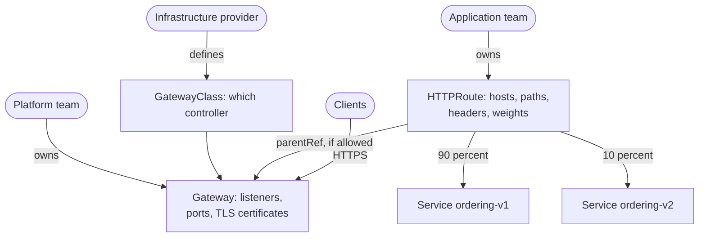

**Reading the diagram.** The infrastructure provider supplies a GatewayClass naming the controller (a cloud load balancer, Envoy Gateway, Cilium, and others). The platform team creates a Gateway with listeners and certificates, and states which namespaces may attach routes. Application teams create HTTPRoutes in their own namespaces that attach to the Gateway and split traffic by weight between Services, here a 10% canary. Clients connect over HTTPS to the Gateway's data plane, which forwards synchronously to pod endpoints. Failure points: the data plane is a shared entry point to replicate across zones; a route that the Gateway does not permit is simply not attached, visible in the route's status conditions. Scaling: the data plane scales horizontally, and routing changes no longer require platform-team edits.

```yaml
apiVersion: gateway.networking.k8s.io/v1
kind: HTTPRoute
metadata:
  name: ordering
  namespace: ordering
spec:
  parentRefs:
  - name: public-gateway
    namespace: platform
  hostnames: ["api.quickbite.example"]
  rules:
  - matches:
    - path: {type: PathPrefix, value: /orders}
    backendRefs:
    - {name: ordering-v1, port: 8080, weight: 90}
    - {name: ordering-v2, port: 8080, weight: 10}
```

The same API also describes east–west mesh routing (the GAMMA initiative), so one vocabulary covers both edge and service-to-service traffic.

## 42.11 ConfigMaps and Secrets

Images are identical across environments; what differs (endpoints, flags, credentials) is injected at run time. A **ConfigMap** holds non-secret key–value data or files (up to 1 MiB); a **Secret** has the same shape but is meant for credentials and is handled more carefully: kept off node disks (memory-backed volumes), with separate RBAC.

Both reach a pod as environment variables or mounted files, and the difference matters operationally. **Environment variables are read once at container start**; changing the ConfigMap changes nothing until pods restart. **Mounted files are updated in place** by the kubelet after a delay (its sync period plus cache, typically up to a minute or two), except when mounted with `subPath`, which never updates. A common, deliberate pattern is to treat configuration as immutable: put a hash of the configuration in the pod template (or create a new, `immutable: true` ConfigMap per version) so that a configuration change triggers an ordinary rolling update with readiness gates and rollback.

Security needs three layers, because a Secret is only base64-encoded, not encrypted (§10.8):

1. **Encryption at rest.** Configure the API server's encryption provider so Secrets are encrypted before reaching etcd, ideally with the **KMS v2** provider, which uses envelope encryption with a key held in a cloud KMS or HSM (§10.9.2) [Kubernetes Docs: Encrypting Secret Data at Rest].
2. **Access control.** RBAC `get`/`list` on Secrets in a namespace is equivalent to holding every credential in it; anyone who can create a pod in a namespace can mount its Secrets.
3. **External secret stores.** Keep the source of truth in a vault (HashiCorp Vault, AWS Secrets Manager, Google Secret Manager) and sync it in with the External Secrets Operator, or mount it directly with the Secrets Store CSI driver. Better still, avoid static secrets: give pods a workload identity that cloud IAM trusts, so they obtain short-lived credentials (§10.8).

::: warning
**Warning — Secrets leak through the edges.** Environment variables appear in crash dumps, debug endpoints and `kubectl describe` output of some tools; image layers keep anything ever copied into them; and etcd backups contain every Secret unless encryption at rest is enabled. Prefer mounted files, short-lived credentials and encrypted backups.
:::

## 42.12 Autoscaling

Kubernetes autoscaling has three layers, owned by different controllers: *how many pods* (horizontal), *how big each pod* (vertical) and *how many nodes* (cluster). They interact through one shared quantity: **resource requests**.

- **Horizontal Pod Autoscaler (HPA).** Sets a Deployment's replica count by target tracking, $n_{desired} = \lceil n_{current} \times m_{current}/m_{target} \rceil$, derived with its tolerance, stabilization window and reaction time in §18.8.3–§18.8.4. Note the denominator for CPU: **utilization is measured as a percentage of the pod's CPU request**, not of the node or the limit. A pod requesting 250 m that uses 500 m is at 200%.
- **Vertical Pod Autoscaler (VPA).** Watches historical usage and recommends, or applies, requests (and proportionally limits). Modes range from `Off` (recommendations only) to modes that apply them at pod creation or by evicting pods; with in-place pod resize, stable since Kubernetes 1.35, resources can change without restarting the pod.
- **Node autoscalers.** The **Cluster Autoscaler** watches for pods that are Pending because nothing fits, simulates scheduling against each configured node group, and grows the cheapest group that fits; it removes a node when the *requests* on it stay below a threshold (default 50%) for a period (default 10 minutes) and its pods can be placed elsewhere [Kubernetes Autoscaler Docs]. **Karpenter** has no node groups: it reads the pending pods' requirements, picks instance types directly from the cloud catalog (including spot capacity), launches right-sized nodes, and continuously **consolidates** by replacing under-used nodes with fewer or cheaper ones [Karpenter Docs].
- **KEDA** (Kubernetes Event-Driven Autoscaling) scales on external event sources such as queue depth, Kafka consumer lag or a Prometheus query, and can scale a workload to and from **zero**; above zero it drives an HPA it creates for you [KEDA Docs].

**Figure 42.12 — The autoscaling layers and the signals between them.**

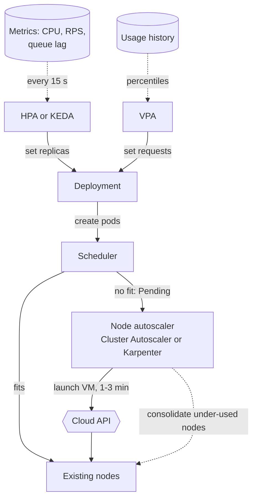

**Reading the diagram.** Metrics flow asynchronously into the HPA (or KEDA) and usage history into the VPA; both write to the Deployment, one setting the replica count, the other the per-pod requests. New pods go to the scheduler; those that fit nowhere stay Pending, which is the *only* signal the node autoscaler acts on: it calls the cloud API and a new node joins one to three minutes later. Scale-down runs the other way: the node autoscaler drains and removes nodes whose requested capacity is low. Failure points: a stale metrics pipeline freezes the HPA; cloud quota or capacity shortages leave pods Pending indefinitely; aggressive consolidation evicts pods repeatedly. Scaling: the total reaction time is the sum of the stages, which is what headroom must cover (§18.8.4).

**Table 42.9 — Autoscaler interaction pitfalls.**

| Pitfall | What happens | Fix |
|---|---|---|
| HPA and VPA both on CPU | VPA raises requests, so HPA's utilization falls and it removes pods; per-pod usage rises; VPA raises requests again | HPA on RPS or lag; VPA for memory or recommendations only |
| Requests far below real usage | Nodes run hot, but by requests they look empty: no scale-up, and scale-down removes busy nodes | Set requests from measured p95 usage (VPA recommendations) |
| HPA `maxReplicas` beyond node-autoscaler limits | HPA asks for pods that stay Pending at peak | Size node pool limits and quotas for `maxReplicas` × requests |
| No PodDisruptionBudget | Scale-down or consolidation evicts several replicas at once | PDB with `maxUnavailable: 1` on every service |
| Scale to zero on a latency path | First request waits for pod start, and maybe a node | Keep `minReplicas ≥ 1` where cold starts break the objective |
| KEDA plus a hand-written HPA on one Deployment | Two controllers fight over replicas | Let KEDA own the HPA |

::: recommendation
**Recommendation — A default autoscaling stack.** HPA (or KEDA for queue workers) on a metric proportional to load; VPA in recommendation mode feeding request reviews; a node autoscaler with some always-on headroom (low-priority placeholder pods that real pods preempt, §42.13.2) so scale-out does not wait for a VM; PodDisruptionBudgets everywhere.
:::

## 42.13 Scheduling

Placing pods on nodes is a multi-dimensional bin-packing problem solved online, one pod at a time, under constraints. Chapter 46 treats cluster scheduling theory (Borg, Omega, gang scheduling, fairness); this section covers what you configure in Kubernetes and the arithmetic that sizes a cluster.

### 42.13.1 Filtering and scoring

The scheduler takes one pod at a time from a priority queue and runs it through a pipeline of **plugins** [Kubernetes Docs: Scheduling Framework]:

1. **Filter.** Remove nodes that cannot run the pod: not enough *unrequested* CPU or memory (`NodeResourcesFit`), a taint the pod does not tolerate, unmet node affinity, a topology-spread violation, a volume in another zone.
2. **PostFilter.** If no node passes, try **preemption** (§42.13.2); otherwise the pod stays Pending and the node autoscaler takes over.
3. **Score.** Each scoring plugin rates every feasible node from 0 to 100; weighted scores are summed.
4. **Bind.** Write the decision to the API server; the kubelet does the rest.

For large clusters the scheduler stops filtering once it has found enough feasible nodes; by default the fraction searched falls from 50% of nodes at 100 nodes to a floor of 5% in very large clusters, trading placement quality for throughput.

**Figure 42.13 — The scheduling pipeline for one pod.**

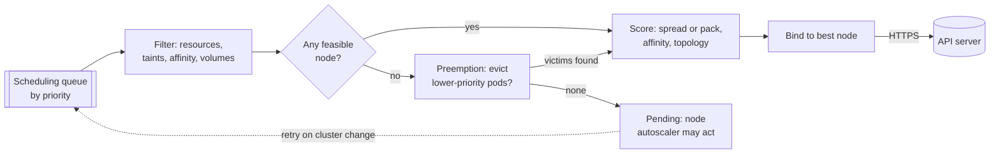

**Reading the diagram.** Pods leave a priority queue one at a time. Filtering removes infeasible nodes; if none remain, the scheduler checks whether evicting lower-priority pods would make room (their graceful termination then proceeds asynchronously), and otherwise leaves the pod Pending and requeues it when the cluster changes, such as a new node joining. Scoring ranks the survivors and the binding is a synchronous write to the API server, the storage boundary. Failure points: unsatisfiable constraints (a required anti-affinity with more replicas than nodes) leave pods Pending forever; a slow scheduler delays every rollout. Scaling: one active scheduler handles typically hundreds of pods per second; constraints such as inter-pod affinity are the expensive ones.

### 42.13.2 Placement constraints

- **Taints and tolerations** repel. A taint on a node (`gpu=true:NoSchedule`) keeps off every pod without a matching toleration; `NoExecute` also evicts running ones. Use them to reserve special nodes (GPUs, a dedicated tenant). Pods tolerate `not-ready` and `unreachable` node taints for 300 s by default, which is how long a pod on a dead node waits before eviction.
- **Node affinity** attracts: "only on `arm64` nodes", "prefer spot nodes". `required...` rules filter; `preferred...` rules score.
- **Pod affinity and anti-affinity** place pods relative to other pods: a cache near its service (affinity), two replicas never on the same node (anti-affinity).
- **Topology spread constraints** bound the imbalance: with `maxSkew: 1` and `topologyKey: topology.kubernetes.io/zone`, replica counts across zones differ by at most one, so losing a zone loses about a third of replicas in a three-zone cluster.
- **Priority and preemption.** A `PriorityClass` ranks pods. When a high-priority pod cannot fit, the scheduler evicts lower-priority pods to make room, honoring PodDisruptionBudgets where possible. A cheap trick for fast scale-out is a Deployment of negative-priority **placeholder pods** that reserve headroom: real pods preempt them instantly, and the evicted placeholders go Pending, prompting the node autoscaler to add a node in the background.

### 42.13.3 Requests, limits and QoS classes

The scheduler packs by **requests** only; the kernel enforces **limits** (§42.3.2). Actual usage plays no part in placement. From requests and limits, Kubernetes derives a **quality-of-service class** that decides who dies first under memory pressure.

**Table 42.10 — QoS classes.**

| Class | Rule | Eviction order under node pressure | OOM score adjustment |
|---|---|---|---|
| Guaranteed | Every container has CPU and memory requests equal to limits | Last | −997 |
| Burstable | At least one request or limit, not Guaranteed | Middle, by usage above request | 2–999 |
| BestEffort | No requests or limits at all | First | 1,000 |

Practical rules: always set memory request equal to memory limit for services (memory is not compressible, and a pod using more than it requested is the first evicted); set a CPU request from measured usage; set CPU limits only where you must cap a noisy or untrusted workload, because limits cause throttling even on idle nodes (§42.3.2). Use Guaranteed for latency-critical pods, optionally with the kubelet's static CPU manager, which gives integer-CPU Guaranteed pods dedicated cores.

### 42.13.4 Bin-packing, pods per node and cluster cost

::: formula
**Pods per node**

$$N_{\text{pods}} = \min\left( \min_{r \in \{\text{cpu},\,\text{mem}\}} \left\lfloor \frac{A_r - D_r}{q_r} \right\rfloor,\; N_{\max},\; N_{\text{IP}} \right) \qquad A_r = C_r - K_r$$

| Symbol | Meaning | Units |
|---|---|---|
| $C_r$ | Node capacity of resource $r$ | CPU or GiB |
| $K_r$ | Reserved for kubelet, system daemons and the eviction threshold | CPU or GiB |
| $A_r$ | Allocatable: what pods may request | CPU or GiB |
| $D_r$ | Requests of DaemonSet pods on every node (CNI, logging, monitoring) | CPU or GiB |
| $q_r$ | Request of one application pod | CPU or GiB |
| $N_{\max}$ | Kubelet `max-pods` (default 110) | pods |
| $N_{\text{IP}}$ | Pod IP limit of the network plugin (for example, per-node interface limits with VPC-native CNIs) | pods |
:::

::: example
**Worked example — Packing the ordering service onto 8 vCPU / 32 GiB nodes.** Assume the provider reserves $K = 0.09$ CPU and 4.4 GiB (managed providers publish formulas reserving a shrinking fraction of larger nodes), DaemonSets request $D = 0.4$ CPU and 0.75 GiB, and each ordering pod requests 0.5 CPU and 1 GiB.

1. Allocatable: $8 - 0.09 = 7.91$ CPU; $32 - 4.4 = 27.6$ GiB.
2. After DaemonSets: $7.51$ CPU; $26.85$ GiB.
3. CPU bound: $\lfloor 7.51/0.5 \rfloor = 15$ pods. Memory bound: $\lfloor 26.85/1 \rfloor = 26$ pods. $N_{\max} = 110$.
4. $N_{\text{pods}} = 15$, CPU-bound. Memory left unrequested: $26.85 - 15 = 11.85$ GiB, 44% of what pods could use.

**Interpretation.** Nearly half the memory you pay for is stranded because the pod's shape (1 GiB per CPU) does not match the node's (4 GiB per CPU). **Engineering implication.** Match node shape to the dominant pod shape (a compute-optimized family here), or co-locate memory-heavy pods so both resources fill; with VPC-native networking check $N_{\text{IP}}$ too, which on small instances can be lower than either resource bound.
:::

The scheduler's default scoring spreads load; you can switch the `NodeResourcesFit` strategy to pack instead.

::: formula
**Resource scoring strategies (per resource, then averaged with weights)**

$$\text{LeastAllocated} = 100 \times \frac{A_r - U_r}{A_r} \qquad \text{MostAllocated} = 100 \times \frac{U_r}{A_r}$$

| Symbol | Meaning | Units |
|---|---|---|
| $A_r$ | Allocatable amount of resource $r$ on the node | CPU or GiB |
| $U_r$ | Requests on the node including the pod being placed | CPU or GiB |
| Score | Node preference, higher is better | 0–100 |
:::

::: example
**Worked example — Spreading versus packing six 1-CPU pods on three 4-CPU nodes** (the last lines of the §42.6.3 program).

1. Placing a pod when node-1 is empty and node-3 already holds 2 CPU: LeastAllocated scores node-1 at $100 \times 3/4 = 75$ and node-3 at $100 \times 1/4 = 25$, so it picks node-1. MostAllocated scores them 25 and 75 and picks node-3.
2. Result: LeastAllocated places 2/2/2; MostAllocated places 4/2/0.
3. Now a pod requesting 3 CPU arrives. Spread: every node has $4 - 2 = 2$ CPU free, so it is **unschedulable** although 6 CPU are free in total. Packed: the empty node fits it, or, if no such pod comes, the node autoscaler removes the empty node and saves a third of the cost.

**Interpretation.** Spreading leaves balanced headroom and limits the blast radius of a node failure (2 of 6 pods lost instead of 4); packing reduces fragmentation and cost. **Engineering implication.** Use packing in cost-sensitive or batch clusters, and keep availability with topology spread constraints and PodDisruptionBudgets rather than relying on the default spread.
:::

::: formula
**Cluster size and monthly cost from requests**

$$N_{\text{nodes}} = \max_{r} \left\lceil \frac{\sum q_r}{(A_r - D_r)\, \eta} \right\rceil \qquad C_{\text{month}} = N_{\text{nodes}} \times p \times 730 + C_{\text{cp}}$$

| Symbol | Meaning | Units |
|---|---|---|
| $\sum q_r$ | Total requests of resource $r$ across all pods at peak replica counts | CPU or GiB |
| $A_r - D_r$ | Requestable capacity per node after DaemonSets | CPU or GiB |
| $\eta$ | Achievable packing efficiency (fragmentation, surge and headroom) | fraction |
| $p$ | Node price | $/hour |
| 730 | Hours per month | h |
| $C_{\text{cp}}$ | Managed control-plane fee | $/month |
:::

::: example
**Worked example — QuickBite's production cluster.** Its 40 services request 120 vCPU and 360 GiB at peak. Nodes are 16 vCPU / 64 GiB with 15.4 CPU and 56 GiB requestable after reservations and DaemonSets, at an illustrative $0.77 per hour on demand; $\eta = 0.8$; the managed control plane costs an illustrative $0.10 per hour (similar to published EKS and GKE fees as of 2026).

1. CPU: $120 / (15.4 \times 0.8) = 120 / 12.32 = 9.7 \Rightarrow 10$ nodes.
2. Memory: $360 / (56 \times 0.8) = 360 / 44.8 = 8.04 \Rightarrow 9$ nodes.
3. $N_{\text{nodes}} = 10$ (CPU-bound).
4. Cost: $10 \times 0.77 \times 730 = \$5{,}621$; control plane $0.10 \times 730 = \$73$; total about $5,694 per month.
5. Monitoring shows pods use on average 40% of their CPU requests, so real CPU utilization is $120 \times 0.4 / (10 \times 16) = 48/160 = 30\%$. Rightsizing CPU requests to 85 vCPU (p95 usage plus margin) gives $85/12.32 = 6.9 \Rightarrow 7$ nodes for CPU, but memory still needs 9: $9 \times 0.77 \times 730 + 73 = \$5{,}132$, saving about 10%.

**Interpretation.** Requests, not usage, decide the bill, and once CPU is rightsized memory becomes the binding resource, so further savings need memory rightsizing or a node shape with more memory per CPU. **Engineering implication.** Review requests against usage regularly (VPA recommendations), choose node shapes for the binding resource, run interruption-tolerant stateless pods on discounted spot capacity, and remember that surviving the loss of one of three zones requires about 50% more nodes than this steady-state figure (Chapter 44 discusses zone and region capacity).
:::

## 42.14 Persistent volumes

A container's writable layer dies with it, and a pod can be rescheduled to another node, so durable state needs storage whose lifetime is independent of pods. Kubernetes separates *what an application needs* from *what the infrastructure provides*:

- A **PersistentVolumeClaim (PVC)** is the application's request: "20 GiB, ReadWriteOnce, class `fast-ssd`".
- A **PersistentVolume (PV)** is a piece of real storage (a cloud block disk, an NFS export) bound to one claim.
- A **StorageClass** describes how to create PVs on demand: the provisioner, disk type, and the **reclaim policy** (`Delete` destroys the disk with the claim; `Retain` keeps it for manual recovery).
- The **Container Storage Interface (CSI)** is the plugin API through which storage vendors implement provisioning, attaching and mounting, outside the Kubernetes code base.

**Table 42.11 — Access modes.**

| Mode | Meaning | Typical backing |
|---|---|---|
| ReadWriteOnce (RWO) | Read-write by pods on one node | Cloud block disks |
| ReadWriteOncePod (RWOP) | Read-write by exactly one pod | Block disks, strict single writer |
| ReadOnlyMany (ROX) | Read-only from many nodes | Snapshots, shared datasets |
| ReadWriteMany (RWX) | Read-write from many nodes | NFS and cloud file services |

**Figure 42.14 — Dynamic provisioning with topology-aware binding.**

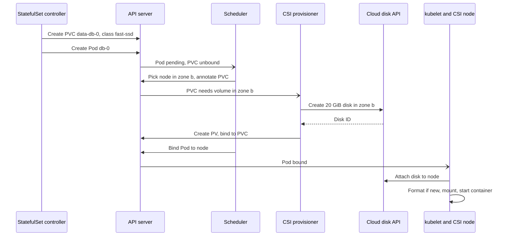

**Reading the diagram.** With `volumeBindingMode: WaitForFirstConsumer`, the disk is not created until the scheduler has chosen a node, so the disk lands in the same zone as the pod; creating it first (`Immediate`) can strand a pod whose disk sits in a zone with no capacity. The provisioner creates the disk through the cloud API and records it as a PV bound to the claim; the kubelet attaches and mounts it. Arrows with open heads are watch notifications. Failure points: zonal block disks cannot follow a pod to another zone, so a zone outage strands RWO volumes; attach and detach take tens of seconds and can hang when a node dies uncleanly; deleting a claim under a `Delete` policy destroys the data. Scaling: one disk per StatefulSet ordinal, so capacity grows with replicas; replication across zones is the application's job (Chapter 27).

## 42.15 Operators and custom resources

A **CustomResourceDefinition (CRD)** adds a new object type to the API server, such as `PostgresCluster`, with a schema, validation and versioning, stored in etcd and served with the same RBAC, watches and `kubectl` support as built-in types. A CRD alone is just data. An **operator** is a custom controller that reconciles those objects, encoding a human operator's knowledge (how to bootstrap a replica, fail over a primary, take a backup, upgrade one minor version at a time) in a reconciliation loop. CoreOS introduced the pattern in 2016 [Philips 2016].

**Figure 42.15 — The operator pattern for a database.**

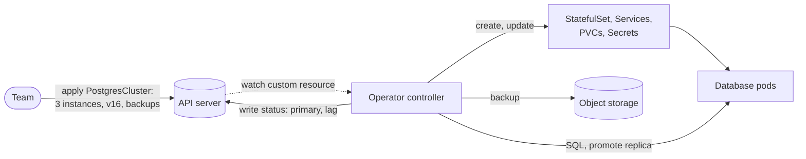

**Reading the diagram.** The team declares a whole database cluster as one custom resource. The operator watches it asynchronously and reconciles it into built-in objects (StatefulSet, Services, claims, Secrets), and it also acts *inside* the application, synchronously: checking replication lag, promoting a replica when the primary fails, triggering backups to object storage. Status flows back to the custom resource. Failure points: the operator is privileged automation, so a bug can fail over or delete many databases at once; if the operator is down, the database runs but does not self-heal. Scaling: one operator manages many instances, which is the point.

Operators are built with Kubebuilder, controller-runtime or the Operator SDK. Adopting one means trusting its failover logic with your data: test its failure handling (Chapter 27) as you would your own.

::: mistake
**Common misconception — "With an operator, running databases on Kubernetes is the same as a managed database."** The operator automates procedures; you still own disks, backups, restore drills, upgrades, capacity and the operator itself. For teams without database operations experience, a managed cloud database is usually cheaper in total.
:::

## 42.16 Kubernetes versus serverless

Kubernetes gives control and portability at the price of operating a platform; serverless gives the platform away at the price of control (§33.9 introduced the trade-off and its break-even arithmetic, Chapter 48 goes deeper).

**Table 42.12 — Managed Kubernetes, serverless containers and functions (as of 2026).**

| Row | Managed Kubernetes (EKS, GKE, AKS) | Serverless containers (Cloud Run, Fargate) | Functions as a service (Lambda) |
|---|---|---|---|
| What it is | You run workloads on node pools; provider runs the control plane | You supply an image; provider runs hosts and scaling | You supply a function; provider runs everything |
| How it works | Pods scheduled onto your nodes by controllers | Instances per image, scaled by requests or tasks | Sandbox per concurrent invocation, scale to zero |
| Advantages | Full control, any workload, rich ecosystem, portable | Little operations, containers unchanged, scale to zero (Cloud Run) | No servers, per-request billing, event integration |
| Disadvantages | Platform team needed; upgrades every few months | Fewer knobs; limits on resources and networking | Cold starts, duration and package limits, lock-in |
| Performance | Warm pods; predictable latency | Cold starts when scaling from zero | Cold starts; one request per environment on Lambda |
| Operational complexity | High | Low to medium | Low |
| Cost | Pay for nodes, used or not; cheapest at steady high load | Per vCPU-second while serving or running | Per request and GB-second; cheapest when spiky or low |
| Use cases | Large service fleets, stateful systems, GPUs, custom networking | Web APIs, workers, teams without a platform team | Event glue, bursty APIs, scheduled tasks |
| Choose when | Many services, steady load, a platform team, special hardware | Containers wanted without cluster operations | Traffic is low or spiky and functions are small |

The choice is rarely all-or-nothing: a common pattern is Kubernetes for the steady core (QuickBite's ordering, dispatch and pricing) and functions for event glue (thumbnails, webhooks, nightly exports). Kubernetes-native options such as Knative and KEDA bring scale-to-zero into a cluster, but you still pay for the nodes beneath it.

## 42.17 Summary and revision notes

::: summary
- A container is a host process with namespaces (what it sees), cgroups (what it uses) and an image root file system; it shares the kernel, so isolation is weaker than a VM's. Sandboxed runtimes and microVMs close the gap.
- cgroup v2 weights share CPU only under contention; `cpu.max` quotas throttle even on idle nodes: $t_{\text{throttle}} = P - LP/k$ when $k$ threads burst. Memory past `memory.max` means an OOM kill (exit 137).
- kubelet → CRI → containerd → shim → runc → kernel. OCI specifications standardize runtime, image and distribution.
- Images are content-addressed layers; order Dockerfiles for caching, use multi-stage builds and minimal bases; pull time ≈ $S_c/B + S_u/R$ adds directly to scale-out reaction time.
- Deploy by digest, sign with cosign, scan continuously, mirror registries.
- Every component talks only to the API server; etcd stores everything; controllers are level-triggered reconciliation loops, so the system converges after any failure.
- Pods share a network namespace; init containers run first; native sidecars (stable since 1.33) start before and stop after the app; startup, liveness and readiness probes answer different questions; drain with `preStop` and a grace period.
- Rolling updates keep at least $R - \lfloor \upsilon R \rfloor$ pods available; use `maxUnavailable: 0` near capacity. StatefulSets give identity and storage, not replication.
- Every pod has a routable IP; Services balance connections, not requests; nftables and eBPF replace iptables and IPVS; Gateway API replaces Ingress.
- Encrypt Secrets at rest with KMS v2, restrict RBAC and prefer external stores or workload identity.
- HPA, VPA, node autoscalers and KEDA interact through requests; never let HPA and VPA act on the same metric.
- The scheduler filters and scores on requests; QoS classes order evictions; pods per node and cluster cost follow from requests, allocatable and packing efficiency.
- PVC, PV, StorageClass and CSI decouple storage; operators encode operations in controllers; choose serverless when load is spiky and there is no platform team.
:::

## 42.18 Knowledge checkpoint

1. Which namespace gives a container its own port space, and which makes root inside unprivileged outside?
2. A pod has a 1-CPU limit and 4 runnable threads. How long is it throttled per 100 ms period?
3. Why does deleting a file in a later Dockerfile layer not shrink an image?
4. Why pin images by digest rather than tag?
5. What happens to running pods if the whole control plane goes down?
6. Why is a level-triggered controller more robust than an edge-triggered one?
7. What problem do native sidecar containers solve for Jobs?
8. Why should a liveness probe not check the database?
9. $R = 20$, defaults 25%/25%. Compute minimum available and maximum pods.
10. Why does one gRPC client often send all its requests to a single pod behind a ClusterIP Service?
11. A pod requests 250 m CPU and uses 400 m. What CPU utilization does the HPA see?
12. A node has 7.5 CPU and 28 GiB requestable after DaemonSets; pods request 1 CPU and 3 GiB. How many fit, and which resource binds?
13. Why use `WaitForFirstConsumer` for zonal disks?
14. Which QoS class is evicted first under memory pressure?

<details><summary>Answers</summary>

1. The network namespace; the user namespace.
2. $Q = 100$ ms; $t_{\text{run}} = 100/4 = 25$ ms; throttled 75 ms.
3. The earlier layer still holds the bytes; the later layer only adds a whiteout.
4. A tag is mutable; a digest names exact bytes, so every node runs identical code and rollbacks are exact.
5. They keep running and Services keep forwarding; nothing new is scheduled, replaced or rolled out.
6. It acts on current state, so missed, duplicated or reordered events and restarts do not cause wrong results.
7. A sidecar running as an ordinary container never exits, so the Job never completes; native sidecars are stopped after the main containers finish.
8. When the shared database slows, every pod fails liveness and restarts together, turning a slowdown into an outage.
9. $u = \lfloor 5 \rfloor = 5$, so 15 available; $s = \lceil 5 \rceil = 5$, so 25 pods at most.
10. Services balance connections at set-up, and gRPC multiplexes all requests over one long-lived HTTP/2 connection.
11. $400/250 = 160\%$.
12. CPU allows 7, memory $\lfloor 28/3 \rfloor = 9$; 7 pods, CPU-bound.
13. The disk is created in the zone of the node the scheduler chose, so the pod and its disk cannot end up in different zones.
14. BestEffort.

</details>

## 42.19 Interview questions

### Basic

**Q1. What is the difference between a container and a virtual machine?**
**Answer.** A container is a process isolated by namespaces and limited by cgroups on a shared kernel; it starts in under a second with almost no overhead. A VM runs its own kernel on a hypervisor, giving stronger isolation at the cost of boot time and memory. For untrusted tenants use a sandboxed runtime or microVM.

**Q2. Walk through what happens after `kubectl apply` of a Deployment.**
**Answer.** The API server authenticates, authorizes, runs admission and validation, and stores the object in etcd. The Deployment controller creates a ReplicaSet, which creates pods; the scheduler binds each to a node; the kubelet has the runtime create the sandbox (CNI assigns an IP), pull images and start containers; once readiness passes, the pod is added to EndpointSlices and kube-proxy programs rules.

### Intermediate

**Q3. Latency spikes but CPU is at 40% of the limit. Diagnose.**
**Answer.** Suspect CFS throttling: parallel bursts exhaust the per-period quota and freeze the cgroup. Check `nr_throttled` and `throttled_usec`. Fix by sizing runtime parallelism to the limit, raising the limit, or removing CPU limits for latency-critical services while keeping accurate requests.

**Q4. How do you deploy without dropping requests?**
**Answer.** Readiness probes gate traffic; `maxUnavailable: 0` with a surge keeps capacity; a `preStop` delay lets endpoint removal propagate before `SIGTERM`; the app drains in-flight requests within `terminationGracePeriodSeconds`; a PodDisruptionBudget protects against concurrent node drains; compatible API and schema changes handle mixed versions.

### Advanced

**Q5. Design autoscaling for a service with a daily peak and a Kafka-based worker tier.**
**Answer.** HPA on per-pod RPS for the service with a target derived from load tests and reaction time (§18.8.4); KEDA on consumer lag for workers, possibly to zero off-peak; VPA in recommendation mode for requests; Karpenter or Cluster Autoscaler with placeholder pods for headroom; scheduled pre-scaling before the peak; PDBs; check that `maxReplicas` fits node limits and that downstream databases tolerate the extra connections.

**Q6. Your 300-node cluster costs too much. What do you do?**
**Answer.** Compare requests with usage per service and rightsize (VPA data); find the binding resource and stranded capacity per node shape; switch scoring to MostAllocated or use Karpenter consolidation; move interruption-tolerant pods to spot; remove idle namespaces and oversized DaemonSets; check that availability constraints (topology spread, PDBs) still hold after packing.

## 42.20 Practical exercises

1. Run a container with `docker run --cpus=1` and a 4-thread busy loop; read `cpu.stat` and compare `nr_throttled` with the formula of §42.3.2.
2. Rewrite a single-stage Dockerfile for a service you know as a multi-stage, non-root, distroless build; record size and pull time before and after.
3. Extend the §42.6.3 program with a Deployment controller that performs a rolling update with maxSurge and maxUnavailable, and assert the bounds of §42.8.1 at every round.
4. In a test cluster, delete a pod while sending steady traffic, with and without a `preStop` sleep; count failed requests.
5. Compute pods per node and cluster cost for your own services with the formulas of §42.13.4 and compare with your real bill.

## 42.21 Design challenges

1. **Multi-tenant SaaS platform.** 200 customers each run the same three services; some demand isolation. Choose namespaces, node pools, RuntimeClasses, NetworkPolicies and quotas, and estimate the cost of dedicated nodes for 10% of tenants.
2. **Stateful on Kubernetes.** QuickBite wants PostgreSQL on Kubernetes across three zones. Choose an operator, storage class, backup and failover design, and state what happens on a zone loss.
3. **Platform choice.** A 12-engineer startup with 8 services and spiky traffic: Kubernetes, serverless containers or functions? Decide with cost arithmetic (§33.9.3, §42.13.4) and an operations budget.

## 42.22 References

1. Burns, B., Grant, B., Oppenheimer, D., Brewer, E., Wilkes, J. *Borg, Omega, and Kubernetes*. ACM Queue 14(1), 2016. https://queue.acm.org/detail.cfm?id=2898444
2. Verma, A., Pedrosa, L., Korupolu, M., Oppenheimer, D., Tune, E., Wilkes, J. *Large-scale cluster management at Google with Borg*. EuroSys, 2015.
3. Schwarzkopf, M., Konwinski, A., Abd-El-Malek, M., Wilkes, J. *Omega: flexible, scalable schedulers for large compute clusters*. EuroSys, 2013.
4. Agache, A., et al. *Firecracker: Lightweight Virtualization for Serverless Applications*. NSDI, 2020.
5. Linux kernel documentation. *Control Group v2*. https://docs.kernel.org/admin-guide/cgroup-v2.html
6. Linux kernel documentation. *CFS Bandwidth Control*. https://docs.kernel.org/scheduler/sched-bwc.html
7. Open Container Initiative. *Image Format Specification*, v1.1. https://github.com/opencontainers/image-spec
8. Open Container Initiative. *Runtime Specification*. https://github.com/opencontainers/runtime-spec
9. Open Container Initiative. *Distribution Specification*, v1.1. https://github.com/opencontainers/distribution-spec
10. Docker. *Docker Docs: Multi-stage builds; Build cache*. https://docs.docker.com/
11. Sigstore. *Documentation: Cosign, Fulcio, Rekor*. https://docs.sigstore.dev/
12. Kubernetes. *Documentation: Components; Pods; Sidecar Containers; Probes; Deployments; StatefulSets; Services; Cluster Networking; Scheduling Framework; Resource Management; Persistent Volumes; Custom Resources; Encrypting Secret Data at Rest; Considerations for Large Clusters*. https://kubernetes.io/docs/
13. Kubernetes. *Ingress NGINX Retirement: What You Need to Know*. Kubernetes Blog, 2025. https://kubernetes.io/blog/2025/11/11/ingress-nginx-retirement/
14. Kubernetes SIG Network. *Gateway API Documentation*. https://gateway-api.sigs.k8s.io/
15. Cilium. *Documentation: Kubernetes Without kube-proxy*. https://docs.cilium.io/
16. Kubernetes SIG Autoscaling. *Cluster Autoscaler FAQ*. https://github.com/kubernetes/autoscaler
17. Karpenter. *Documentation*. https://karpenter.sh/docs/
18. KEDA. *Documentation*. https://keda.sh/docs/
19. Philips, B. *Introducing Operators: Putting Operational Knowledge into Software*. CoreOS Blog, 2016.
20. Go Team. *Go 1.25 Release Notes*. https://go.dev/doc/go1.25

## 42.23 Open verification items

- Kubernetes feature status (as of 2026): native sidecars stable in 1.33; nftables kube-proxy stable in 1.33; in-place pod resize stable and IPVS mode deprecated in 1.35; maturity of pod user namespaces and the `preStop` sleep action.
- Go 1.25 cgroup-aware default `GOMAXPROCS`; JVM container support since JDK 10 / 8u191.
- Firecracker figures (≈125 ms boot, < 5 MiB overhead) against the NSDI 2020 paper.
- Scheduler default for nodes searched (50% at 100 nodes, 5% floor).
- Image sizes, node reservations and cloud prices in worked examples are illustrative.
- Borg quotations ("hundreds of thousands of jobs", ~10,000-machine cells, five-replica Borgmaster) against Verma et al. 2015.
