# Chapter 43 — Deployment and Infrastructure

> **Level:** 3 · **Track:** A (Traditional) · **Estimated reading time:** 5.5 h

Most outages do not come from hardware failing at random. They come from people changing a running system: a new build, a configuration edit, a schema migration, a firewall rule. Google's SRE book reports that roughly 70% of outages are caused by changes to a live system [Beyer et al. 2016]. You cannot stop changing software, because every feature and every fix is a change. What you can control is *how* change reaches production: how small each change is, how many users see it first, how quickly you notice a problem, and how quickly you undo it.

This chapter covers the pipeline from commit to artifact (§43.3), four ways to expose a new version (§43.4–§43.7) with the statistics that judge a canary, infrastructure as reviewed code (§43.8–§43.10), pipeline credentials and supply chain (§43.11), change-aware monitoring (§43.12) and database migrations (§43.13). The running example is QuickBite, the hypothetical food-delivery platform of Chapter 2; every QuickBite number is a teaching assumption.

## 43.1 Learning objectives

After this chapter you should be able to:

- Describe a continuous-delivery pipeline, trunk-based development and the four DORA metrics.
- Compare rolling, blue–green and canary deployments and feature flags on risk, cost and complexity, and choose one for a given service.
- Compute the blast radius of a bad deploy under all-at-once and canary rollouts, and the cost of blue–green.
- Judge a canary with a two-proportion z-test, size the canary sample, and explain how Kayenta-style judges score many metrics.
- Use feature flags for release, kill switches and progressive rollout while controlling flag debt.
- Explain declarative IaC, idempotence and drift; write a small Terraform configuration with locked remote state; explain GitOps reconciliation.
- Replace long-lived pipeline keys with OIDC workload identity, and describe SLSA levels, SBOMs and artifact signing.
- Correlate incidents with deployments, and plan an expand–contract database migration that is safe under rolling deploys.

## 43.2 Prerequisites

- SLOs and error budgets — §39.6, §39.7 (deployment risk is measured against them).
- Kubernetes Deployments and rolling updates — §42.8 (summarized, not repeated, in §43.4).
- Secrets management, workload identity and mTLS — §10.8, §10.10.2 (the pipeline applies them).
- Load balancing and health checks — Chapter 19 (traffic switching relies on them).
- Binomial distribution, normal distribution and standard error — §4.6.4, §4.7.2, §4.18.4 (the canary statistics).
- Relational schemas and table locks — §11.15 (why `ALTER TABLE` can stall traffic).
- Independent deployability of microservices — §34.12.

## 43.3 CI/CD

### 43.3.1 Continuous integration, delivery and deployment

::: definition
**Definition — Continuous integration (CI).** The practice of merging every developer's work into a shared mainline at least daily, with each merge verified by an automated build and test run.

**Definition — Continuous delivery (CD).** The practice of keeping the mainline always releasable, so that any commit that passes the automated pipeline *could* be deployed to production by pushing a button [Humble and Farley 2010].

**Definition — Continuous deployment.** Continuous delivery with the button removed: every commit that passes the pipeline is deployed to production automatically.
:::

#### First-principles explanation

Picture a kitchen where every cook works alone for a week and the dishes are combined on Friday night: the sauces clash and nobody knows whose change broke the menu. Now picture every cook bringing a spoonful to the head chef every hour, so problems are found while small. CI is the hourly tasting. CD is keeping every plate ready to serve at any moment.

#### Why does this exist?

Before CI, integration was a project measured in weeks ("integration hell"): conflicts grew with time since the last merge, a failure could hide in any of hundreds of changes, and releases became rare, risky events. Humble and Farley's *Continuous Delivery* (2010) argued that the remedy is counter-intuitive: if releasing hurts, do it *more often*, so each release is small and the process is automated and rehearsed thousands of times.

#### How it works internally: the deployment pipeline

A **deployment pipeline** is the automated path from a commit to production. Each stage gives more confidence and costs more time, so the cheap, fast checks run first and fail fast.

1. **Build.** Compile, resolve dependencies from pinned versions, and produce a build once. A rule from Humble and Farley: *build binaries once*, then promote the same artifact through every later stage, so the thing you tested is the thing you ship.
2. **Unit test.** Thousands of fast tests with no network or disk, typically finishing in under 5–10 minutes.
3. **Static analysis.** Linters, type checkers, security scanners (static application security testing), dependency vulnerability scans and secret scanning (§10.8).
4. **Artifact.** Package an immutable, versioned artifact (a container image identified by its content digest, §42.4), generate its SBOM and provenance and sign it (§43.11), and push it to a registry (§42.5).
5. **Integration and acceptance test.** Deploy the artifact to a production-like environment and run API, contract (§34.8.5) and end-to-end tests against real dependencies or high-fidelity fakes.
6. **Deploy.** Promote the same artifact to staging and then production with a progressive strategy (§43.4–§43.7), watched by automated analysis (§43.6.4).

**Figure 43.1 — A deployment pipeline from commit to production.**

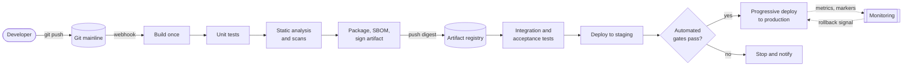

**Reading the diagram.** A push to the Git mainline triggers the CI system by webhook. The pipeline builds once, tests and scans that build, and stops on any failure (only the final gate's failure path is drawn). Packaging pushes an immutable, signed artifact to the registry, the storage boundary between "built" and "deployed": every later stage pulls the same digest. Production deploys progressively while monitoring receives metrics and deployment markers asynchronously (dotted arrows) and can trigger rollback. Failure points: flaky tests, a slow integration stage that encourages batching, and a registry outage that halts all deploys. Scaling: parallel stages, dependency caches and sharded test suites keep the commit stage short.

::: recommendation
**Recommendation — Keep the commit stage under ten minutes.** If build, unit tests and static analysis take 40 minutes, people batch commits and skip the pipeline before merging. Move slow suites later and parallelize the rest.
:::

### 43.3.2 Trunk-based development

::: definition
**Definition — Trunk-based development.** A source-control practice in which all developers commit to a single shared branch (the trunk or mainline), either directly or through short-lived branches that live for hours to a day or two, and the trunk is kept releasable at all times [Hammant n.d.].
:::

The alternative, long-lived feature branches, accumulates weeks of divergence that must be merged at once. The DORA research found that teams with fewer than three active branches, branch lifetimes under a day and no code freezes had higher delivery performance [Forsgren et al. 2018].

How do you commit half-finished work to an always-releasable trunk? Unfinished features hide behind **feature flags** (§43.7); large refactorings use **branch by abstraction** (§34.13.2); and incompatible changes are split into compatible steps with **expand and contract** (§43.13). Deployment and release are separated: code can be in production for weeks before any user sees it.

### 43.3.3 The DORA four key metrics

How do you know whether your delivery process is good? The DevOps Research and Assessment (DORA) program, presented in *Accelerate* [Forsgren et al. 2018] and the annual State of DevOps reports, identified four measures that predict organizational performance. Two measure **throughput** and two measure **stability**.

::: definition
**Definition — The four key metrics.**

- **Deployment frequency** — how often the organization deploys code to production.
- **Change lead time** — the time from a commit being made to that commit running successfully in production.
- **Change failure rate** — the percentage of deployments to production that cause a failure needing remediation (a rollback, hotfix, patch or incident).
- **Failed deployment recovery time** — how long it takes to restore service after a deployment causes a failure. Earlier reports called this *time to restore service* or mean time to restore (MTTR); the 2023 report narrowed it to deployment-caused failures [DORA 2023].
:::

The central finding of *Accelerate* is that the two pairs are **not a trade-off**: across thousands of survey responses, teams that deployed more often also had lower change failure rates and faster recovery [Forsgren et al. 2018]. Small batches are the mechanism: a deployment of two changes is easy to diagnose and revert. In recent reports, the top performance cluster deploys on demand (several times a day), has a change lead time under a day and recovers from failed deployments in under an hour (as of 2024; cluster boundaries are recomputed each year) [DORA 2024].

#### Mathematical foundations

::: formula
**Expected degraded time from deployments**

$$D = f \times \text{CFR} \times T_{\text{restore}}$$

| Symbol | Meaning | Units |
|---|---|---|
| $D$ | Expected time per period during which a bad deployment is degrading service | minutes/week |
| $f$ | Deployment frequency | deployments/week |
| $\text{CFR}$ | Change failure rate | fraction (0–1) |
| $T_{\text{restore}}$ | Mean failed deployment recovery time | minutes |
:::

::: example
**Worked example — Is deploying more often riskier?** Two QuickBite teams each merge 80 changes per week.

- *Team A* deploys twice a week, so each deploy carries $80/2 = 40$ changes. CFR is 20%; recovery takes 240 min, because finding the bad change among 40 is slow.
- *Team B* deploys 40 times a week, 2 changes per deploy,, CFR 5%, recovery 30 min (automated rollback).

Failed deployments per week: Team A $2 \times 0.20 = 0.4$; Team B $40 \times 0.05 = 2.0$. Team B has *five times as many* failed deployments.

Degraded time per week: Team A $D = 0.4 \times 240 = 96$ min; Team B $D = 2.0 \times 30 = 60$ min.

Now relate this to an error budget (§39.7). Over a 30-day month ($30/7 = 4.29$ weeks), Team A is degraded for $96 \times 4.29 = 411$ min and Team B for $60 \times 4.29 = 257$ min. If a typical bad deploy fails 10% of requests, the full-outage equivalents are 41.1 min and 25.7 min. A 99.9% monthly SLO allows 43.2 min. Team A spends 95% of its budget on deployments alone; Team B spends 59%.

*Interpretation:* counting failed deployments makes Team B look worse; weighting by recovery time reverses the conclusion, because small changes are cheap to diagnose and undo. *Engineering implication:* read all four metrics together, and pair higher frequency with automated rollback.
:::

::: mistake
**Mistake — Using DORA metrics as targets for individuals or teams.** Targets invite gaming: artificially split deploys, reclassified incidents (Goodhart's law). Use the metrics to find bottlenecks, not to rank people.
:::


## 43.4 Rolling deployments

::: definition
**Definition — Rolling deployment.** A deployment that replaces the instances of the old version with instances of the new version a few at a time, so that the service keeps serving throughout and, for the duration of the rollout, both versions serve traffic side by side.
:::

A rolling deployment repaints a bridge one lane at a time, without closing it. It is the default in Kubernetes, where a Deployment's `RollingUpdate` strategy creates new pods up to `maxSurge` above the desired count and removes old pods while keeping at most `maxUnavailable` below it; a new pod receives traffic only once its readiness probe passes. Chapter 42 covers the mechanism in depth (§42.8); this section adds what matters for release risk.

::: formula
**Approximate rolling-update duration**

$$T_{\text{roll}} \approx \left\lceil \frac{N}{s} \right\rceil \times (t_{\text{ready}} + t_{\text{bake}})$$

| Symbol | Meaning | Units |
|---|---|---|
| $T_{\text{roll}}$ | Time to replace all instances | seconds |
| $N$ | Number of instances | instances |
| $s$ | Instances replaced per wave (surge plus allowed unavailability) | instances |
| $t_{\text{ready}}$ | Time for a new instance to start and pass readiness | seconds |
| $t_{\text{bake}}$ | Extra wait per wave before continuing (for example `minReadySeconds`) | seconds |
:::

::: example
**Worked example — Rolling the QuickBite order service.** The order service runs $N = 40$ pods with `maxSurge: 25%` (10 pods) and `maxUnavailable: 0`, so $s = 10$. Each pod takes $t_{\text{ready}} = 45$ s to start and pass readiness, and `minReadySeconds` adds $t_{\text{bake}} = 15$ s. Then $T_{\text{roll}} \approx \lceil 40/10 \rceil \times (45 + 15) = 4 \times 60 = 240$ s. *Interpretation:* a bug that readiness probes miss reaches every user in four minutes; a plain rolling update is a coarse canary with no judgment. *Engineering implication:* pause for analysis after the first wave (§43.6), or use a progressive-delivery controller such as Argo Rollouts or Flagger.
:::

Rolling deployments are cheap (only the surge is extra capacity) and simple. Their weaknesses are that rollback is itself another rolling update (minutes, not seconds), that mixed versions serve simultaneously, and that exposure grows on a fixed schedule rather than on evidence.

## 43.5 Blue–green deployments

### 43.5.1 How blue–green works

::: definition
**Definition — Blue–green deployment.** A deployment that runs two complete production environments, one live (say blue) and one idle (green). The new version is deployed to and tested on the idle environment, and then all traffic is switched to it at once at the routing layer; the old environment is kept, unchanged, for instant rollback [Fowler 2010].
:::

#### First-principles explanation

A theater with two stages can set up the next scene on the dark stage while the audience watches the lit one, then swap the lights. If the new set collapses, the lights go back.

#### Why does this exist?

Rolling deployments mix versions and roll back slowly. Some systems need an atomic cutover (old and new versions disagree on a protocol), verification in production before exposure, or rollback in seconds. Blue–green provides all three.

#### How it works internally

1. **Blue is live.** The router (DNS, a load balancer listener, a Kubernetes Service selector or a service-mesh route) points at blue.
2. **Deploy to green.** Provision or update the green environment with the new artifact. It shares the same databases and queues as blue.
3. **Verify green.** Run smoke tests and synthetic transactions against green's private endpoint; warm caches and connection pools.
4. **Switch.** Change the router to send all new requests to green. Let blue drain in-flight requests.
5. **Watch.** Keep blue running and untouched for a bake period (minutes to hours).
6. **Roll back or retire.** If green misbehaves, switch the router back. Otherwise blue becomes the idle environment for the next release, or is torn down.

**Figure 43.4 — Blue–green traffic switch at the load balancer.**

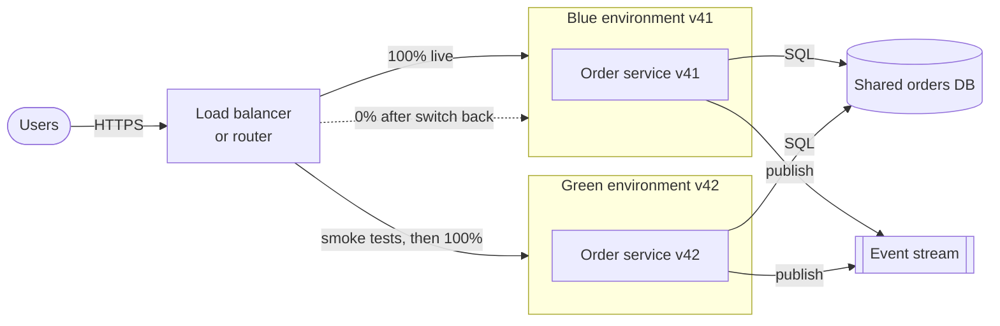

**Reading the diagram.** Users reach one routing point over HTTPS. Before the switch it sends all traffic to blue (v41) while green (v42) receives only smoke tests; afterwards the roles reverse, and blue stands by at 0% (dotted arrow) for rollback. The subgraphs are separate deployment boundaries, but both use the *same* database and event stream, so the schema must suit both versions (§43.5.3). Failure points: DNS-based switches leave clients on blue for the TTL (§7.6), long-lived connections do not follow the switch, and blue's background workers keep consuming. Scaling: green must be sized for full load before the switch, which is the source of the cost.

### 43.5.2 Switching mechanisms

**Table 43.1 — Ways to switch traffic between blue and green.**

| Mechanism | Switch time | Notes |
|---|---|---|
| DNS record change | Minutes to hours | Clients and resolvers cache for the TTL; avoid for fast rollback |
| Load balancer target group or listener rule | Seconds | Common on clouds; connection draining handles in-flight requests |
| Kubernetes Service selector (`version: green`) | Seconds | Endpoints update as kube-proxy or the dataplane reprograms |
| Service-mesh or gateway route weight | Seconds | Also enables gradual shifts, which turns blue–green into a canary |

### 43.5.3 Database compatibility

The shared database is the hard part. Fowler's original description already points out that switching application code is easy while the database must serve both versions [Fowler 2010]. Three rules follow.

1. **Schema changes must be backward compatible.** Green's schema must still work for blue, or rollback is impossible. Apply schema changes as a separate, earlier step (expand), and remove old structures only after blue is gone (contract); see §43.13.
2. **Data written by green must be readable by blue.** If green writes a new enum value or a new event version, blue must tolerate it after a switch back. Use tolerant readers and avoid new required fields.
3. **Background work must be switched too.** Queue consumers, cron jobs and schedulers in blue keep running after the HTTP switch unless they are scaled down or disabled; otherwise both versions process messages.

### 43.5.4 Cost

::: formula
**Extra cost of blue–green**

$$\Delta C = C_{\text{env}} \times k \times \frac{n_{\text{dep}} \times T_{\text{overlap}}}{T_{\text{month}}}$$

| Symbol | Meaning | Units |
|---|---|---|
| $\Delta C$ | Extra infrastructure cost per month | $/month |
| $C_{\text{env}}$ | Monthly cost of one full production environment | $/month |
| $k$ | Fraction of the environment duplicated (1 for blue–green; the canary weight for a canary) | fraction |
| $n_{\text{dep}}$ | Deployments per month | deployments/month |
| $T_{\text{overlap}}$ | Time both versions run per deployment | hours |
| $T_{\text{month}}$ | Hours in a month (≈ 730) | hours |
:::

::: example
**Worked example — Blue–green cost for QuickBite.** The order platform's compute costs $C_{\text{env}} = \$30{,}000$ per month. QuickBite deploys it $n_{\text{dep}} = 40$ times a month.

1. *Permanent blue–green* (two full environments always running): the overlap is the whole month, so $\Delta C = \$30{,}000$, a 100% overhead.
2. *Ephemeral green* (provisioned one hour before the switch and blue kept for one hour after, $T_{\text{overlap}} = 2$ h): $\Delta C = 30{,}000 \times 1 \times (40 \times 2)/730 = 30{,}000 \times 0.1096 = \$3{,}288$ per month, an 11% overhead.
3. *Canary* at 5% for one hour ($k = 0.05$, $T_{\text{overlap}} = 1$ h): $\Delta C = 30{,}000 \times 0.05 \times 40/730 = \$82$ per month.

*Interpretation:* blue–green's cost is driven by how long the duplicate runs, not by the switch itself. *Engineering implication:* on elastic infrastructure, create green on demand and retire blue after the bake period, scaling green to full capacity *before* the switch; keep permanent duplicates only where provisioning is slow or seconds-level rollback justifies a doubled bill.
:::

::: industry
**Cloud-managed blue–green.** Several managed services implement blue–green directly: AWS CodeDeploy supports blue–green deployments for EC2, ECS and Lambda, shifting traffic between target groups or function aliases, and Amazon RDS offers blue/green deployments for database version upgrades, in which a staging copy is kept in sync by replication and switched over with a short write pause (as of 2026) [AWS Docs: CodeDeploy; AWS Docs: RDS Blue/Green]. The database case shows the general rule: a blue–green switch of a *stateful* system needs replication and a brief write freeze, not just a routing change.
*Evidence: Primary* — [AWS Docs: CodeDeploy; AWS Docs: RDS Blue/Green]
:::

#### Failure scenarios

| What goes wrong | Why | Detection | Recovery | Prevention |
|---|---|---|---|---|
| Rollback breaks after a schema change | Green migrated the schema destructively | Blue errors on switch back | Restore schema or roll forward with a fix | Expand–contract; contract only after blue retired |
| Green overloaded at switch | Green scaled down or caches cold | Latency spike right after switch | Switch back; pre-scale | Size green to production peak; warm caches |
| Duplicate message processing | Blue's consumers still running | Duplicate side effects, consumer lag in both | Stop blue consumers | Include workers in the switch; idempotent consumers (§22.15) |

## 43.6 Canary releases

### 43.6.1 What a canary release is

::: definition
**Definition — Canary release.** A deployment that sends a small, controlled fraction of production traffic to the new version, compares its behavior with the current version, and increases the fraction in steps only while the comparison stays healthy; otherwise traffic is returned to the old version [Sato 2014a].
:::

#### First-principles explanation

Coal miners once carried a canary into the mine; the bird reacted to toxic gas before people did, giving the miners time to leave. A canary release sends the new version into production first with a small group of users. If it is going to fail, it fails for 1% of requests rather than 100%, and the failure is the warning that stops the rollout.

#### Why does this exist?

Testing before production is never complete. Production has traffic mixes, data shapes, configuration and dependency behavior that no staging environment reproduces. Some bugs only appear under real load (a slow query on a hot partition), with real data (a customer name with an emoji), or at real scale (a cache stampede). Blue–green verifies the new version before exposure, but then exposes everyone at once. A canary accepts that production is the only full test and limits how many users the test can hurt.

#### How it works internally

1. **Deploy** the new version alongside the old one with a small number of instances, but route it no traffic yet.
2. **Shift a small weight** of traffic (often 1–5%) to the canary.
3. **Observe** for an analysis interval: error rate, latency percentiles, saturation and business metrics (orders per minute), compared against a **baseline** running the old version.
4. **Judge.** If the canary is significantly worse, shift its weight to 0 and roll back automatically. If not, increase the weight (for example 1% → 5% → 25% → 50% → 100%), observing at each step.
5. **Promote** the new version to 100% and retire the old instances.

**Figure 43.6 — Canary progression with automated analysis at each step.**

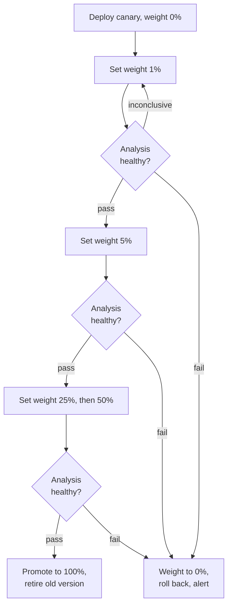

**Reading the diagram.** Rectangles set the traffic weight; diamonds are analysis intervals comparing canary with baseline. A pass advances, a fail at any step goes straight to rollback, and an inconclusive result (too little data) repeats the interval (drawn only for the first step). A controller, not a person, makes every transition, so rollback takes seconds. Failure points: metrics that miss the failure, weights too small for the traffic, and an unanalyzed final jump to 100%. Scaling: high-traffic services pass the steps in minutes; low-traffic ones need longer steps.

### 43.6.2 Traffic splitting

The canary weight can be enforced at several layers:

- **By instance count.** Run 1 canary pod next to 19 old pods behind the same Service; a round-robin balancer sends about 5% of requests to the canary. Simple, but weights are limited to multiples of $1/N$ and change with autoscaling.
- **By weighted routing.** A service mesh (§34.10), gateway or load balancer sends an exact percentage to each version, independent of instance counts. This is how Argo Rollouts, Flagger and cloud load balancers implement fine-grained canaries.
- **By request attribute.** Route by header, user cohort, region or tenant: for example, employees first, then one city. This gives a sticky, well-defined population, so one user does not alternate between versions on every request.

**Figure 43.7 — Canary and baseline traffic split by a weighted router.**

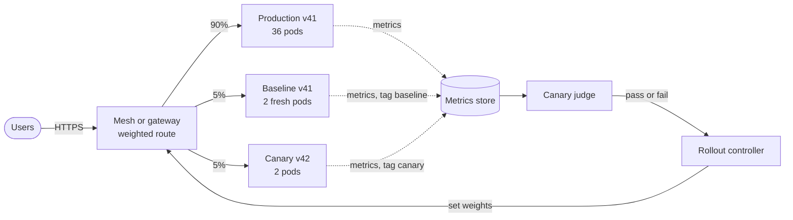

**Reading the diagram.** The router splits requests by weight: 90% to production, 5% to a small baseline and 5% to the canary. The baseline runs the *old* version but was started at the same moment and size as the canary, the comparison Netflix recommends, because comparing new processes with long-running ones confuses new code with cold caches and warm-up [Graff and Sanden 2018]. All groups emit tagged metrics asynchronously to a metrics store; the judge compares the baseline and canary series and the controller sets new weights. Failure points: missing or wrong tags, and routers that cannot split by exact weight. Scaling: the binding constraint is requests per interval in each group.

### 43.6.3 Blast radius

The **blast radius** of a bad deploy is the damage it does before it is reversed. A canary shrinks it in two ways: fewer users are exposed, and automated analysis shortens detection.

::: formula
**Blast radius of a bad deploy**

$$B = \lambda \times w \times \Delta p \times (T_{\text{detect}} + T_{\text{rollback}})$$

| Symbol | Meaning | Units |
|---|---|---|
| $B$ | Extra failed requests caused by the bad version | requests |
| $\lambda$ | Total request rate of the service | requests/s |
| $w$ | Fraction of traffic sent to the new version | fraction (0–1) |
| $\Delta p$ | Increase in error rate caused by the new version | fraction |
| $T_{\text{detect}}$ | Time from exposure to the decision to roll back | s |
| $T_{\text{rollback}}$ | Time to remove the new version from traffic | s |
:::

::: example
**Worked example — All-at-once versus canary for a broken endpoint.** QuickBite's order service handles $\lambda = 2{,}000$ requests/s with a 0.5% baseline error rate. Version 42 breaks one endpoint and raises the error rate to 20%, so $\Delta p = 0.195$.

1. *All at once (or a fast rolling update):* $w = 1$. Humans notice through a symptom alert after $T_{\text{detect}} = 10$ min (600 s) and a redeploy of version 41 takes $T_{\text{rollback}} = 5$ min (300 s). $B = 2{,}000 \times 1 \times 0.195 \times 900 = 351{,}000$ failed requests.
2. *Canary at 5%:* $w = 0.05$. An error-rate jump this large is significant within the first 60 s analysis interval, and setting the weight to 0 takes 30 s. $B = 2{,}000 \times 0.05 \times 0.195 \times 90 = 1{,}755$ failed requests.

The canary's blast radius is $351{,}000 / 1{,}755 = 200$ times smaller: 20 times from exposure and 10 times from faster detection and rollback.

*Against the error budget:* a 99.9% monthly SLO on $2{,}000 \times 2{,}592{,}000 = 5.18 \times 10^9$ requests allows $5.18 \times 10^6$ failures. The all-at-once deploy burns $351{,}000 / 5.18 \times 10^6 = 6.8\%$ of the month's budget in 15 minutes; the canary burns 0.034%.

*Engineering implication:* the canary's value comes from *both* factors. A 5% canary watched by a human who notices after 10 minutes still loses $2{,}000 \times 0.05 \times 0.195 \times 900 = 17{,}550$ requests; automation contributes as much as the small weight.
:::

### 43.6.4 Automated canary analysis: comparing proportions

A judge must answer: *is the canary's error rate higher than the baseline's by more than chance?* Errors are counts out of requests, so each group's error rate is a sample proportion. Even two identical versions will show slightly different rates in any interval, just as two fair coins tossed 1,000 times rarely show exactly the same number of heads. The **two-proportion z-test** measures the observed difference in units of its standard error (§4.18.4).

::: formula
**Two-proportion z-test (one-sided, canary worse)**

$$\hat{p}_b = \frac{x_b}{n_b}, \quad \hat{p}_c = \frac{x_c}{n_c}, \quad \hat{p} = \frac{x_b + x_c}{n_b + n_c}$$

$$z = \frac{\hat{p}_c - \hat{p}_b}{\sqrt{\hat{p}(1-\hat{p})\left(\frac{1}{n_b} + \frac{1}{n_c}\right)}}, \qquad \text{p-value} = 1 - \Phi(z)$$

| Symbol | Meaning | Units |
|---|---|---|
| $x_b, x_c$ | Failed requests in baseline and canary | requests |
| $n_b, n_c$ | Total requests in baseline and canary | requests |
| $\hat{p}_b, \hat{p}_c$ | Observed error rates | fraction |
| $\hat{p}$ | Pooled error rate, assuming no difference | fraction |
| $z$ | Difference in standard errors | dimensionless |
| $\Phi$ | Standard normal cumulative distribution function | — |
| p-value | Probability of a $z$ at least this large if the versions were equally good | probability |
:::

The test is valid when each group has at least about 10 expected errors and 10 expected successes, so that the normal approximation to the binomial (§4.6.4) holds. You choose a significance level $\alpha$ in advance, for example $\alpha = 0.01$; if the p-value is below $\alpha$, the canary fails.

::: example
**Worked example — Detecting an error-rate increase.** In one analysis window the baseline served $n_b = 20{,}000$ requests with $x_b = 100$ errors, and the canary $n_c = 20{,}000$ requests with $x_c = 140$ errors.

1. Observed rates: $\hat{p}_b = 100/20{,}000 = 0.0050$; $\hat{p}_c = 140/20{,}000 = 0.0070$.
2. Pooled rate: $\hat{p} = 240/40{,}000 = 0.0060$.
3. Standard error: $\sqrt{0.006 \times 0.994 \times (1/20{,}000 + 1/20{,}000)} = \sqrt{0.005964 \times 0.0001} = \sqrt{5.964 \times 10^{-7}} = 7.723 \times 10^{-4}$.
4. $z = (0.0070 - 0.0050)/7.723 \times 10^{-4} = 0.0020/0.0007723 = 2.59$.
5. p-value $= 1 - \Phi(2.59) = 0.0048$.

Because $0.0048 < 0.01$, the judge fails the canary. If the canary had shown 104 errors instead of 140, $z = 0.28$ and the p-value would be 0.39: a difference of four errors is entirely consistent with chance, and the canary passes.

*Interpretation:* a 40% relative increase (0.5% → 0.7%) is detectable at this volume; with only 2,000 requests per group the same rates would give $z \approx 0.82$ and the judge could not tell. *Engineering implication:* a canary decision is only as good as its sample. Size the sample before choosing the canary weight and interval.
:::

How many requests are enough? A test can make two errors: failing a healthy canary (a **false positive**, probability $\alpha$) and passing a bad one (a **false negative**, probability $\beta$). The **power** $1 - \beta$ is the probability of catching a real regression of a given size.

::: formula
**Sample size per group to detect an increase from $p_b$ to $p_c$**

$$n = \frac{\left(z_{1-\alpha}\sqrt{2\bar{p}(1-\bar{p})} + z_{1-\beta}\sqrt{p_b(1-p_b) + p_c(1-p_c)}\right)^2}{(p_c - p_b)^2}, \qquad \bar{p} = \frac{p_b + p_c}{2}$$

$$T_{\text{decide}} = \frac{n}{\lambda \times w}$$

| Symbol | Meaning | Units |
|---|---|---|
| $n$ | Requests needed in each of baseline and canary | requests |
| $p_b$ | Baseline error rate | fraction |
| $p_c$ | Smallest canary error rate you want to catch | fraction |
| $z_{1-\alpha}$ | Standard normal quantile for the false-positive rate (one-sided) | dimensionless |
| $z_{1-\beta}$ | Standard normal quantile for the power | dimensionless |
| $T_{\text{decide}}$ | Time for each group to collect $n$ requests | s |
| $\lambda$, $w$ | Service request rate; weight sent to each group | requests/s; fraction |
:::

::: example
**Worked example — Sizing QuickBite's canary.** Baseline error rate $p_b = 0.5\%$. You want to catch a 50% relative increase ($p_c = 0.75\%$) with $\alpha = 0.01$ ($z_{0.99} = 2.326$) and power 0.8 ($z_{0.80} = 0.842$).

1. $\bar{p} = (0.005 + 0.0075)/2 = 0.00625$.
2. First term: $2.326 \times \sqrt{2 \times 0.00625 \times 0.99375} = 2.326 \times \sqrt{0.012422} = 2.326 \times 0.11145 = 0.25928$.
3. Second term: $0.842 \times \sqrt{0.004975 + 0.0074438} = 0.842 \times \sqrt{0.012419} = 0.842 \times 0.11144 = 0.09379$.
4. Numerator: $(0.25928 + 0.09379)^2 = 0.35307^2 = 0.12466$.
5. Denominator: $(0.0075 - 0.005)^2 = 6.25 \times 10^{-6}$.
6. $n = 0.12466 / 6.25 \times 10^{-6} = 19{,}945.3$, so **19,946 requests per group**.

Time to decide at $\lambda = 2{,}000$ requests/s:

- $w = 5\%$ per group: $100$ requests/s, $T_{\text{decide}} = 19{,}946/100 = 199$ s, about 3.3 minutes.
- $w = 1\%$ per group: $20$ requests/s, $T_{\text{decide}} = 997$ s, about 17 minutes.
- At night, $\lambda = 200$ requests/s and $w = 1\%$: 2 requests/s, $T_{\text{decide}} = 9{,}973$ s, about 2.8 hours.

The required $n$ falls quickly as the effect grows: about 6,000 requests per group to catch a doubling (0.5% → 1%), and 48 to catch the 0.5% → 20% break of §43.6.3. It rises quickly as the effect shrinks: about 110,000 for a 20% relative increase.

*Interpretation:* small regressions in rare events need a lot of traffic. *Engineering implication:* choose the smallest regression worth catching, then set weight and interval so each step collects $n$ requests; for low-traffic services, canary on more sensitive metrics (latency, which every request reports), lengthen steps, or accept that the canary only catches large breaks. Note that $B \approx \lambda w \Delta p \times n/(\lambda w) = n\,\Delta p$ when detection is sample-limited: about $19{,}946 \times 0.0025 \approx 50$ extra failures here, whatever the weight. A smaller weight hurts fewer users per second but for longer.
:::

::: warning
**Warning — Peeking inflates false positives.** If the judge re-runs the test every minute and fails the canary the first time $p < \alpha$, the chance of a false failure over many looks is much larger than $\alpha$. Either test once at the planned sample size, divide $\alpha$ across the planned looks (a Bonferroni correction: 10 looks at $\alpha = 0.001$ each keeps the total below 0.01), or use a sequential test designed for repeated looks. The same issue appears in A/B testing (Chapter 57).
:::

#### Code example: a canary judge

The following module implements the test, the sample-size formula and a three-way decision. It uses only the Python standard library.

```python
"""Automated canary analysis for error rates: two-proportion z-test and sample size."""
from dataclasses import dataclass
from math import ceil, sqrt
from statistics import NormalDist

STD_NORMAL = NormalDist()  # mean 0, standard deviation 1


@dataclass(frozen=True)
class Verdict:
    baseline_rate: float
    canary_rate: float
    z: float
    p_value: float          # one-sided: probability of a z this large if rates are equal
    decision: str           # "PASS", "FAIL" or "INCONCLUSIVE"


def two_proportion_z(x_base: int, n_base: int, x_can: int, n_can: int) -> tuple[float, float]:
    """Return (z, one-sided p-value) for H1: canary error rate > baseline error rate."""
    if min(n_base, n_can) <= 0:
        raise ValueError("both groups need at least one request")
    p_base, p_can = x_base / n_base, x_can / n_can
    pooled = (x_base + x_can) / (n_base + n_can)
    se = sqrt(pooled * (1 - pooled) * (1 / n_base + 1 / n_can))
    if se == 0:                       # no errors (or only errors) in both groups
        return 0.0, 1.0
    z = (p_can - p_base) / se
    return z, 1 - STD_NORMAL.cdf(z)


def required_n(p_base: float, rel_increase: float, alpha: float = 0.01, power: float = 0.8) -> int:
    """Requests needed in EACH group to detect p_base -> p_base*(1+rel_increase)."""
    p_can = p_base * (1 + rel_increase)
    z_a = STD_NORMAL.inv_cdf(1 - alpha)   # one-sided test
    z_b = STD_NORMAL.inv_cdf(power)
    p_bar = (p_base + p_can) / 2
    num = (z_a * sqrt(2 * p_bar * (1 - p_bar))
           + z_b * sqrt(p_base * (1 - p_base) + p_can * (1 - p_can))) ** 2
    return ceil(num / (p_can - p_base) ** 2)


def judge(x_base: int, n_base: int, x_can: int, n_can: int,
          min_n: int, alpha: float = 0.01) -> Verdict:
    z, p = two_proportion_z(x_base, n_base, x_can, n_can)
    if p < alpha:
        decision = "FAIL"              # significant increase: roll back
    elif min(n_base, n_can) < min_n:
        decision = "INCONCLUSIVE"      # not enough traffic yet: keep waiting
    else:
        decision = "PASS"              # enough evidence that no large increase exists
    return Verdict(x_base / n_base, x_can / n_can, z, p, decision)


if __name__ == "__main__":
    n_needed = required_n(p_base=0.005, rel_increase=0.5)
    print(f"requests needed per group: {n_needed:,}")
    for label, x_can in [("healthy", 104), ("regressed", 140)]:
        v = judge(x_base=100, n_base=20_000, x_can=x_can, n_can=20_000, min_n=n_needed)
        print(f"{label:9s} base={v.baseline_rate:.3%} canary={v.canary_rate:.3%} "
              f"z={v.z:.2f} p={v.p_value:.4f} -> {v.decision}")
```

Running it prints:

```text
requests needed per group: 19,946
healthy   base=0.500% canary=0.520% z=0.28 p=0.3894 -> PASS
regressed base=0.500% canary=0.700% z=2.59 p=0.0048 -> FAIL
```

The tests below check the worked examples and then simulate 400 canaries of each kind to confirm that the false-positive rate stays near $\alpha$ and the power near 0.8 (`random.binomialvariate` needs Python 3.12 or later). Save the module as `canary.py` next to the tests.

```python
import random
from canary import two_proportion_z, required_n, judge

z, p = two_proportion_z(100, 20_000, 140, 20_000)
assert abs(z - 2.5898) < 1e-3 and abs(p - 0.0048) < 1e-4
assert required_n(0.005, 0.5) == 19_946
assert judge(100, 20_000, 104, 20_000, min_n=19_000).decision == "PASS"
assert judge(100, 20_000, 140, 20_000, min_n=19_000).decision == "FAIL"
assert judge(5, 1_000, 6, 1_000, min_n=19_000).decision == "INCONCLUSIVE"
assert two_proportion_z(0, 100, 0, 100) == (0.0, 1.0)

rng, n = random.Random(7), 19_946
def fail_rate(p_canary: float, trials: int = 400) -> float:
    fails = 0
    for _ in range(trials):
        xb, xc = rng.binomialvariate(n, 0.005), rng.binomialvariate(n, p_canary)
        fails += judge(xb, n, xc, n, min_n=n).decision == "FAIL"
    return fails / trials

false_positive, power = fail_rate(0.005), fail_rate(0.0075)
print(f"false-positive rate {false_positive:.3f}, power {power:.3f}")
assert false_positive < 0.03 and 0.72 < power < 0.88
print("all tests passed")
```

What to notice:

- The test is **one-sided**: the judge only cares whether the canary is *worse*. A two-sided test would waste power on detecting improvements.
- The pooled rate is used in the standard error because the null hypothesis says both groups share one error rate.
- The decision is three-way. A non-significant result on too little data is `INCONCLUSIVE`, not `PASS`; "no evidence of harm" is not "evidence of no harm".
- The guard for `se == 0` handles intervals with no errors in either group, which are common at low traffic.
- The simulation is the real test of a statistical judge: it checks the error rates the design promises, not just the arithmetic.

### 43.6.5 Kayenta-style judging

Real canaries are judged on many metrics at once, not only on error rate: latency percentiles, CPU, memory, garbage-collection time, and business signals. In 2018 Netflix and Google released **Kayenta**, an open-source automated canary analysis service integrated with the Spinnaker continuous-delivery platform [Graff and Sanden 2018; Google Cloud 2018]. Its published design works as follows:

1. **Metric retrieval.** For each metric in a canary configuration, Kayenta queries the metrics store (Prometheus, Datadog, Stackdriver and others) for the baseline and canary time series over the analysis interval.
2. **Per-metric classification.** The default Netflix judge compares the two series with a nonparametric test, the **Mann–Whitney U test**, which does not assume normally distributed values (important for latency). Each metric is classified as *Pass*, *High* or *Low*; a configured direction says whether only increases, only decreases, or either count as failures.
3. **Scoring.** Metrics are grouped (for example "errors", "latency", "system"), and each group has a weight. The canary score is the weighted percentage of metrics that passed, from 0 to 100.
4. **Thresholds.** The configuration sets a *pass* threshold and a *marginal* threshold. A score below marginal fails the canary immediately; a score at or above pass lets it continue. Metrics can also be marked *critical*, so that their failure fails the whole canary regardless of score.

**Figure 43.8 — A Kayenta-style judgment over one analysis interval.**

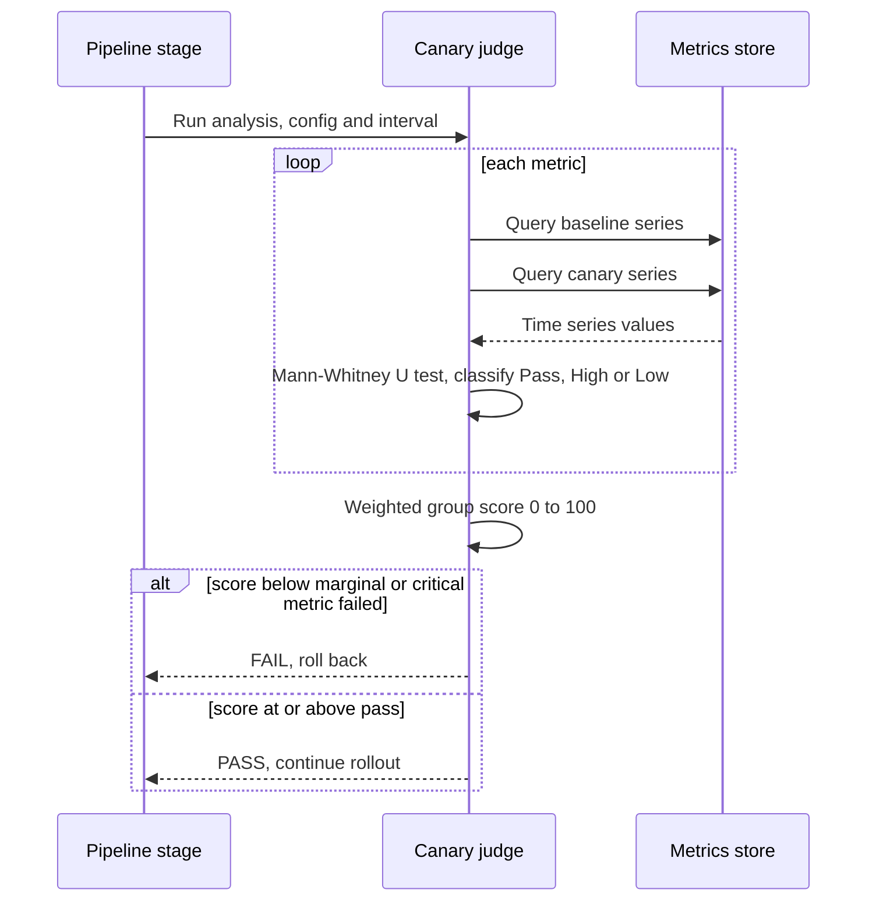

**Reading the diagram.** The pipeline stage calls the judge with a configuration and interval. For each metric the judge fetches both series from the metrics store, classifies the metric with a statistical test, then combines the results into a weighted score and returns pass or fail. A canary stage runs several intervals and judges each one. Failure points: missing data (configurable as a failure), a metrics store outage (the rollout should pause, not pass), and noisy system metrics dominating the score. Scaling: queries grow with metrics × intervals, so configurations keep tens of metrics.

::: industry
**Netflix and Google: Kayenta.** Netflix had run automated canary analysis internally for years before open-sourcing Kayenta with Google in 2018. The Netflix announcement describes comparing the canary against a freshly deployed baseline cluster of the same size rather than against the existing production cluster, classifying each metric with a Mann–Whitney U test and producing a weighted score that gates the Spinnaker pipeline [Graff and Sanden 2018]. Google's own guidance on canarying, in *The Site Reliability Workbook*, makes the same points about comparing against a control population and choosing metrics that reflect user-visible health [Beyer et al. 2018].
*Evidence: Primary* — [Graff and Sanden 2018; Google Cloud 2018; Beyer et al. 2018]
:::

#### Failure scenarios

| What goes wrong | Why | Detection | Recovery | Prevention |
|---|---|---|---|---|
| Bad canary passes | Metrics miss the failure (for example correct HTTP 200 with wrong content) | Business metric drops after promotion | Roll back | Include business and correctness metrics; synthetic checks |
| Healthy canary fails repeatedly | Comparing against long-running production; noisy metrics | Many failed canaries with no real bug | Re-run with fresh baseline | Fresh equal-size baseline; drop noisy metrics |
| Every step inconclusive | Weight too small for the traffic | Steps time out | Raise weight or lengthen step | Size $n$ in advance (§43.6.4) |
| Canary contaminates shared state | New version writes bad data read by everyone | Data validation errors in old version | Roll back and repair data | Expand–contract; validate writes; limit canary to read paths first |
| User flips between versions | Per-request random split | Inconsistent UI reports | Sticky routing | Split by user or session hash |

::: mistake
**Mistake — "The canary passed, so the release is safe."** A canary tests the new version on a sample of current traffic for a short time. It cannot catch problems that appear only at 100% load (a shared database saturating), only after hours (a memory leak), or only for rare request types the sample did not include. Keep observing after promotion, and keep the ability to roll back.
:::

## 43.7 Feature flags

### 43.7.1 Separating release from deploy

::: definition
**Definition — Feature flag (feature toggle).** A runtime switch in the code that selects between code paths without a new deployment; its value is read from configuration or a flag service and can depend on the request context (user, tenant, region) [Hodgson 2017].

**Definition — Deploy versus release.** To **deploy** is to install a version of the code in production. To **release** is to let users experience a change. Feature flags make them separate events.
:::

A light switch does not install the wiring; an electrician does that once, and then anyone can turn the light on and off in a second. Deployment is the wiring, done by engineers through the pipeline. The flag is the switch, which a product manager can flip for 1% of users on Tuesday and everyone on Friday, and which an on-call engineer can flip off at 3 a.m. without a rollback.

Flags exist because the alternatives couple two different risks. Without flags, a new checkout flow reaches users at the moment its code deploys, so every deploy is also a product launch, and undoing the launch means undoing the deploy (and every other change in it). With trunk-based development (§43.3.2), unfinished features must be merged daily, which is only possible if they can be turned off.

Hodgson classifies flags by how long they live and how dynamic they are [Hodgson 2017]:

- **Release toggles** hide unfinished or not-yet-launched features. They should live days to weeks.
- **Experiment toggles** split users between variants for A/B tests (Chapter 57). They live for the experiment.
- **Ops toggles** control operational behavior, including **kill switches** that disable an expensive or failing feature under load. Some live for years by design.
- **Permissioning toggles** enable features for specific users or plans (beta testers, premium tier). They are long-lived and are really product configuration.

**Figure 43.9 — Feature flag evaluation in a service.**

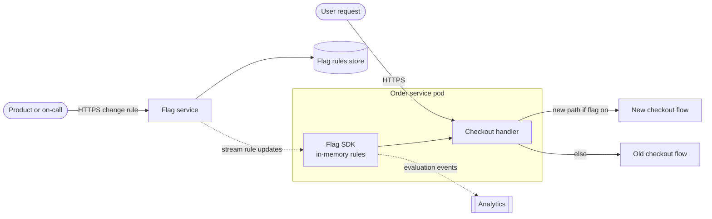

**Reading the diagram.** An administrator changes a rule in the flag service, which stores it and streams it asynchronously to an SDK in every pod. Evaluation is a local, in-memory call taking microseconds, with no network hop on the request path. Evaluation events flow asynchronously to analytics. Failure points: if the flag service is unreachable, SDKs keep last-known rules and need safe defaults at startup; a bad rule takes effect everywhere within seconds, so flag changes need review and audit like code. Scaling: streaming small rule sets to thousands of pods is cheap; never call the flag service per request.

### 43.7.2 Progressive rollout and kill switches

A **percentage rollout** must be *deterministic*: a user who sees the new checkout at 5% must still see it at 25%, and must not flip between versions on each request. The standard technique hashes the flag key together with the user ID into a bucket from 0 to 100 and compares the bucket with the rollout percentage.

```python
import hashlib

def in_rollout(flag_key: str, user_id: str, percent: float) -> bool:
    """Deterministically place a user in [0, 100) and compare with the rollout percent."""
    digest = hashlib.sha256(f"{flag_key}:{user_id}".encode()).digest()
    bucket = int.from_bytes(digest[:8], "big") % 10_000 / 100   # 0.00 .. 99.99
    return bucket < percent

users = [f"user-{i}" for i in range(100_000)]
at_5 = {u for u in users if in_rollout("new-checkout", u, 5)}
at_25 = {u for u in users if in_rollout("new-checkout", u, 25)}
print(len(at_5), len(at_25), at_5 <= at_25)   # prints: 5034 25212 True
```

What to notice:

- Including the flag key in the hash gives each flag an independent population; otherwise the same 5% of users would receive every experiment.
- Raising the percentage only adds users (`at_5 <= at_25`), so nobody loses a feature during a ramp.
- Python's built-in `hash()` is randomized per process for strings, so it would put a user in different buckets on different pods; a cryptographic or stable hash avoids that.

A **kill switch** is an ops toggle whose "off" position is a safe, degraded behavior: turn off restaurant recommendations and show a static list; turn off a new fraud model and fall back to rules. It is the fastest rollback you have (seconds, no deployment), but only for code paths someone thought to wrap in advance. Practice using kill switches, as you would practice restoring backups.

### 43.7.3 Flag debt

Every flag doubles the number of code paths it touches. A function influenced by $k$ independent boolean flags has up to $2^k$ behaviors.

::: formula
**Configuration space of independent flags**

$$S = 2^{k}$$

| Symbol | Meaning | Units |
|---|---|---|
| $S$ | Number of possible flag combinations | combinations |
| $k$ | Number of independent boolean flags affecting the same code | flags |
:::

::: example
**Worked example — Twelve flags in the checkout service.** QuickBite's checkout service has accumulated $k = 12$ live flags. $S = 2^{12} = 4{,}096$ combinations. If an end-to-end test of one combination takes 2 minutes, testing all of them takes $4{,}096 \times 2 = 8{,}192$ min, about 5.7 days per release. Removing the eight release toggles that are already at 100% leaves $2^4 = 16$ combinations, 32 minutes. *Interpretation:* teams test only the combinations that production uses, so stale flags hide untested paths. *Engineering implication:* give every release toggle an owner and an expiry date at creation, fail the build when an expired flag is still referenced, and delete the flag and the dead branch in the same week the rollout reaches 100%.
:::

::: industry
**Knight Capital, 2012: a repurposed flag.** According to the U.S. Securities and Exchange Commission's order, Knight Capital deployed new trading code to only seven of its eight servers. The new code reused a flag that had previously activated a long-unused function called "Power Peg". On the eighth server the old code was still present, so turning the flag on activated Power Peg, which sent millions of unintended orders in about 45 minutes; Knight lost more than $460 million [SEC 2013]. The failure combined three themes of this chapter: a manual, unverified deployment, dead code left behind an old flag, and the reuse of a flag with a different meaning.
*Evidence: Primary* — [SEC 2013]
:::

### 43.7.4 Comparing deployment strategies

**Table 43.2 — Deployment strategies compared.**

| | Rolling | Blue–green | Canary | Feature flag (dark launch) |
|---|---|---|---|---|
| What it is | Replace instances in waves | Two full environments, atomic switch | Small, growing traffic share with analysis | Code deployed off; enabled at runtime |
| How it works | Orchestrator surges new, drains old | Router flips from blue to green | Weighted routing plus statistical judge | SDK evaluates rules per request |
| Advantages | Cheap; built into Kubernetes | Instant rollback; test before exposure | Smallest blast radius with evidence | Release without deploy; per-user targeting; kill switch |
| Disadvantages | Mixed versions; slow rollback; no judgment | Double capacity during overlap; all users at once | Needs traffic, metrics and tooling | Code complexity; flag debt; untested combinations |
| Performance | Surge capacity only | Cold caches risk at switch | Sample size limits speed (§43.6.4) | Microsecond local evaluation |
| Operational complexity | Low | Medium (two environments, shared data) | High (judge, mesh, baselines) | Medium (flag service, hygiene) |
| Cost | ~ surge fraction during rollout | Up to 100% extra (§43.5.4) | ~ canary weight during rollout | Flag service license or hosting |
| Use cases | Most stateless services | Stateful protocols; strict rollback needs | High-traffic, user-facing services | Product launches, experiments, ops toggles |
| Choose when | Changes are low risk and compatible | Rollback in seconds justifies cost | Bugs must be caught on a small sample | Release timing differs from deploy timing |

The strategies combine rather than compete. A typical mature pipeline deploys each version with a canary (catching crashes and regressions in the code as a whole), while new features ship dark behind release toggles and are ramped separately (catching product and behavior problems per feature). Blue–green is common for components where mixed versions are dangerous and for infrastructure such as databases and load balancers.

::: mistake
**Mistake — Treating a flag as a substitute for compatibility.** A flag switches *code paths*, not *data*. If the new path writes data the old path cannot read, turning the flag off does not restore correctness. Flagged features still need backward-compatible schemas and events (§43.13).
:::

## 43.8 Infrastructure as code

### 43.8.1 Declarative versus imperative

::: definition
**Definition — Infrastructure as code (IaC).** Managing infrastructure (networks, machines, load balancers, databases, DNS, permissions) through machine-readable definition files kept in version control and applied by tools, instead of through manual console clicks or ad hoc scripts [Morris 2020].
:::

Before IaC, servers were configured by hand. Each became a unique "snowflake" whose exact state nobody could reproduce; rebuilding one after a failure meant archaeology. A disaster-recovery region built by clicking was never quite like the primary. IaC applies the software discipline of this chapter to infrastructure: every change is a reviewed commit, environments are created from the same code, and the history shows who changed what and why.

There are two styles. An **imperative** definition lists *steps*: "create a VM; then attach a disk; then open port 443". A **declarative** definition states the *desired end state*: "there exist three VMs of this size, each with a disk, behind a load balancer that listens on 443". A thermostat is declarative (you set 21 °C and it works out whether to heat), while "run the heater for ten minutes" is imperative. Terraform, OpenTofu, AWS CloudFormation and Kubernetes manifests are declarative; shell scripts and cloud SDK calls are imperative; Pulumi and the AWS CDK let you write general-purpose code that *produces* a declarative model.

::: definition
**Definition — Idempotence.** An operation is **idempotent** if applying it once or many times leaves the system in the same state. **Drift** is any difference between the state the code declares and the state that actually exists.
:::

Declarative tools are idempotent by construction: they compare the desired state with the actual state and act only on the difference. Running "create a VM" twice gives two VMs; applying "there exist three VMs" twice gives three. Idempotence is what makes it safe to re-run an apply after a partial failure, and to run it continuously.

**Figure 43.10 — The declarative reconciliation loop and drift.**

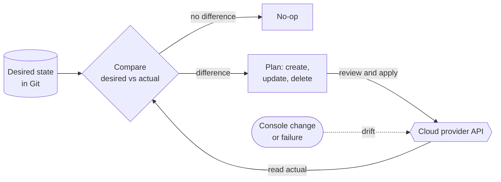

**Reading the diagram.** The desired state lives in Git, a versioned storage boundary. The tool reads actual state from the provider API and computes the difference: none means a no-op (idempotence); otherwise it produces a plan of creates, updates and deletes that is reviewed and applied. The dotted arrow is drift: console edits, autoscalers or failures move the actual state asynchronously, and the next comparison shows a change that would revert it. Failure points: a plan that replaces a stateful resource, and blindly reverting an emergency fix. Scaling: large estates are split into many small configurations (§43.9.5).

**Detecting drift.** Run the comparison on a schedule. With Terraform, `terraform plan -detailed-exitcode` exits with code 0 when there are no changes and 2 when there are, which a scheduled job can turn into an alert [HashiCorp Docs: plan]. GitOps controllers (§43.10) detect and optionally revert drift continuously. When you find drift, decide deliberately: either revert it, or bring the code up to date so the change becomes reviewed history.

::: mistake
**Mistake — "We use IaC, so the console is fine for quick fixes."** Every console change is drift. The next apply either reverts the fix silently (re-breaking production) or fails in a confusing way. Make the console read-only for humans in production, and keep a break-glass role whose use is logged and followed by a code change.
:::

## 43.9 Terraform

### 43.9.1 Providers, resources and the dependency graph

::: definition
**Definition — Terraform.** A declarative infrastructure-as-code tool from HashiCorp. Configurations are written in the HashiCorp Configuration Language (HCL); **providers** are plugins that translate resources into calls to a platform's API; a **resource** block declares one infrastructure object; **state** records which real object each resource corresponds to [HashiCorp Docs: Terraform].
:::

A Terraform configuration is a set of `.tf` files in one directory (the **root module**). Its main building blocks are:

- **`terraform` block** — required Terraform version, required providers with version constraints, and the **backend** that stores state.
- **Providers** — `hashicorp/aws`, `hashicorp/google`, `hashicorp/kubernetes` and thousands more, downloaded from a registry by `terraform init` and pinned in a lock file (`.terraform.lock.hcl`).
- **Resources** — `resource "<type>" "<name>" { ... }` declares an object such as a bucket or a VM.
- **Data sources** — `data` blocks read existing objects without managing them.
- **Variables and outputs** — inputs to and results from a module.

Terraform builds a **dependency graph** from references between blocks. When a resource refers to `aws_s3_bucket.receipts.id`, Terraform knows the bucket must exist first. Independent resources are created in parallel (10 at a time by default).

### 43.9.2 A small, complete configuration

The configuration below creates a versioned bucket for QuickBite order receipts, stores state remotely in an S3 bucket with encryption and locking, and pins the provider version.

```hcl
terraform {
  required_version = ">= 1.11"

  required_providers {
    aws = {
      source  = "hashicorp/aws"
      version = "~> 6.0"
    }
  }

  backend "s3" {
    bucket       = "quickbite-terraform-state"
    key          = "orders/receipts/terraform.tfstate"
    region       = "eu-west-1"
    encrypt      = true
    use_lockfile = true # S3-native state locking
  }
}

variable "environment" {
  type        = string
  description = "Deployment environment, for example staging or prod"

  validation {
    condition     = contains(["staging", "prod"], var.environment)
    error_message = "environment must be staging or prod."
  }
}

provider "aws" {
  region = "eu-west-1"

  default_tags {
    tags = {
      Service     = "orders"
      Environment = var.environment
      ManagedBy   = "terraform"
    }
  }
}

resource "aws_s3_bucket" "receipts" {
  bucket = "quickbite-receipts-${var.environment}"
}

resource "aws_s3_bucket_versioning" "receipts" {
  bucket = aws_s3_bucket.receipts.id

  versioning_configuration {
    status = "Enabled"
  }
}

resource "aws_s3_bucket_public_access_block" "receipts" {
  bucket                  = aws_s3_bucket.receipts.id
  block_public_acls       = true
  block_public_policy     = true
  ignore_public_acls      = true
  restrict_public_buckets = true
}

output "receipts_bucket_arn" {
  value = aws_s3_bucket.receipts.arn
}
```

What to notice:

- `required_version` and the provider constraint `~> 6.0` (any 6.x) make runs reproducible; the lock file records the exact provider build.
- The backend block cannot use variables, because it is read before variables are evaluated; teams pass per-environment backend settings with `terraform init -backend-config=...`.
- `use_lockfile = true` enables S3-native locking (a lock object written next to the state). Before Terraform 1.10 the S3 backend locked through a DynamoDB table (`dynamodb_table`), which is now deprecated (as of 2026) [HashiCorp Docs: S3 backend].
- Bucket versioning and the public access block are separate resources that reference the bucket's `id`; the references create the dependency order.
- `default_tags` labels everything for cost allocation (Chapter 51) and ownership.
- The `validation` block rejects a typo such as `prd` at plan time rather than creating a stray bucket.

### 43.9.3 Plan and apply

Terraform's core workflow is **init → plan → apply**. `terraform init` downloads providers and configures the backend. `terraform plan` reads state, refreshes it against the real infrastructure, compares it with the configuration and prints the proposed actions: `+` create, `~` update in place, `-/+` replace, `-` destroy. `terraform apply` executes a plan. In a pipeline, save the plan with `terraform plan -out=tfplan`, have a person or policy check review it, and then run `terraform apply tfplan`, which applies exactly the reviewed actions or refuses if the state changed in between.

**Figure 43.11 — A pipeline running plan and apply with remote state and locking.**

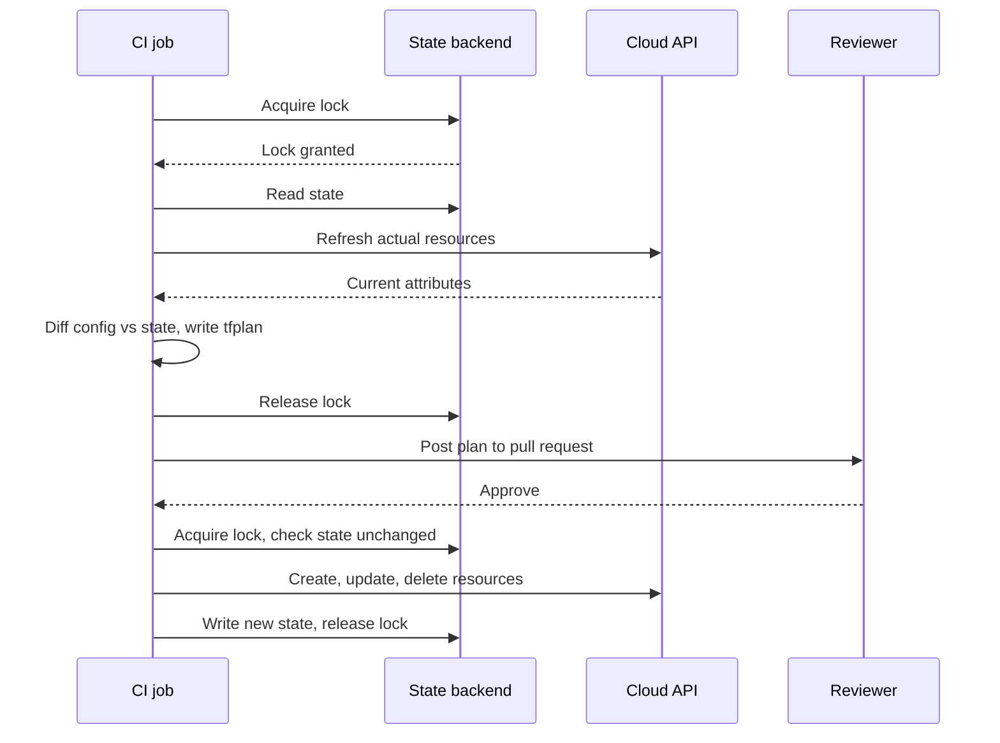

**Reading the diagram.** The job locks the state so no concurrent run can use it, reads state, refreshes it against the cloud API and writes a plan, then releases the lock while the plan is reviewed on the pull request. After approval it re-locks; Terraform refuses to apply a saved plan if state changed in between. It applies through the API and writes new state. Failure points: a killed job leaves a stale lock (`terraform force-unlock` after checking no run is active) and a partial apply, which the next plan reveals. Scaling: one state per component keeps locks short and plans fast.

### 43.9.4 State and state locking

State is Terraform's memory. It maps each resource address (`aws_s3_bucket.receipts`) to a real object ID and caches its attributes. Without it Terraform could not know that a bucket it sees in the account is the one the code declares, or that a resource deleted from the code should be destroyed. Three properties follow:

1. **State must be shared and durable.** A state file on a laptop means the next person creates duplicates. Store it in a remote backend (an object store, HCP Terraform, or a database) with versioning so you can recover an earlier copy.
2. **State must be locked.** Two simultaneous applies against the same state can both read version 7, both make changes, and both write version 8, losing one set of changes and orphaning resources. Locking makes runs mutually exclusive, the same idea as a database lock (§11.15).
3. **State is sensitive.** It can contain plaintext secrets, such as a generated database password. Encrypt the backend, restrict who can read it, and prefer resources that pull secrets from a vault at runtime (§43.11).

### 43.9.5 Modules and workspaces

A **module** is a directory of Terraform files with inputs and outputs, called from another configuration. Modules package a reviewed pattern, such as "a service's queue, dead-letter queue, alarms and IAM policy", so that 40 teams do not write it 40 ways.

```hcl
module "order_events_queue" {
  source = "./modules/queue"

  name              = "order-events-${var.environment}"
  retention_seconds = 345600 # 4 days
  max_receive_count = 5      # then move to the dead-letter queue
}
```

Version shared modules (a Git tag or registry version) so that a change to the module does not change every consumer at once; each consumer upgrades deliberately, like a library.

A **workspace** is a named instance of state for the same configuration: `terraform workspace new staging` creates a second state, and `terraform.workspace` can be interpolated into names. HashiCorp's documentation cautions that CLI workspaces are not suitable for isolating environments that need separate credentials and access controls [HashiCorp Docs: Workspaces]. For production versus staging, most teams use separate root configurations (or separate backends and accounts) per environment, calling the same versioned modules.

::: recommendation
**Recommendation — Split state by blast radius.** One state for the whole company means every plan touches everything, every lock blocks everyone, and one mistaken `destroy` can remove production. Split by environment and by component (network, data stores, each service), with long-lived, rarely changed foundations separate from frequently changed service resources. Add `prevent_destroy` lifecycle rules on databases and state buckets.
:::

### 43.9.6 OpenTofu

In August 2023 HashiCorp changed Terraform's license from the open-source Mozilla Public License 2.0 to the Business Source License 1.1, which restricts competing commercial use. In response, a group of companies and users forked the last MPL-licensed version as **OpenTofu**, now a Linux Foundation project, with its first stable release (1.6) in January 2024 [OpenTofu 2024]. As of 2026, OpenTofu's `tofu` command accepts the same HCL and provider protocol, so most configurations run unchanged, but the two have diverged in newer features; for example, OpenTofu added client-side state encryption in version 1.7. IBM completed its acquisition of HashiCorp in 2025. When you choose between them, check license constraints, the features you need, and the support model, and pin your tool version as carefully as your providers.

#### Failure scenarios

| What goes wrong | Why | Detection | Recovery | Prevention |
|---|---|---|---|---|
| Database replaced by a harmless-looking change | Changing an immutable attribute forces `-/+` | Plan shows "must be replaced" | Abort; restore from backup if applied | Review plans; `prevent_destroy`; policy checks |
| Concurrent applies corrupt state | No locking or forced unlock | Orphaned or duplicated resources | Restore previous state version; import | Remote backend with locking |
| Secrets leaked from state | State readable by too many people | Access logs | Rotate secrets | Encrypted backend; least privilege; vault references |
| Provider upgrade changes behavior | Unpinned versions | Unexpected diff in plan | Pin back | Version constraints and lock file |

## 43.10 GitOps

::: definition
**Definition — GitOps.** An operating model in which the desired state of a system is declared in Git, and software agents running inside the target environment continuously pull that state and reconcile the live system to it. The OpenGitOps principles state that the desired state is **declarative**, **versioned and immutable**, **pulled automatically** and **continuously reconciled** [OpenGitOps 2021].
:::

In a traditional **push** pipeline, the CI system holds credentials to the production cluster and runs `kubectl apply` or `helm upgrade` at the end of a job. That has two weaknesses. The CI system becomes a high-value target: whoever compromises it can change production. And the pipeline acts only at deploy time, so if someone edits the cluster by hand afterwards, nothing notices. GitOps inverts the direction. An agent runs *inside* the cluster, reads Git, and applies what it finds; CI's job ends when it updates the Git repository (for example, bumping an image digest). The cluster needs read access to Git, and nothing outside needs write access to the cluster.

**Figure 43.12 — Pull-based GitOps with an in-cluster controller.**

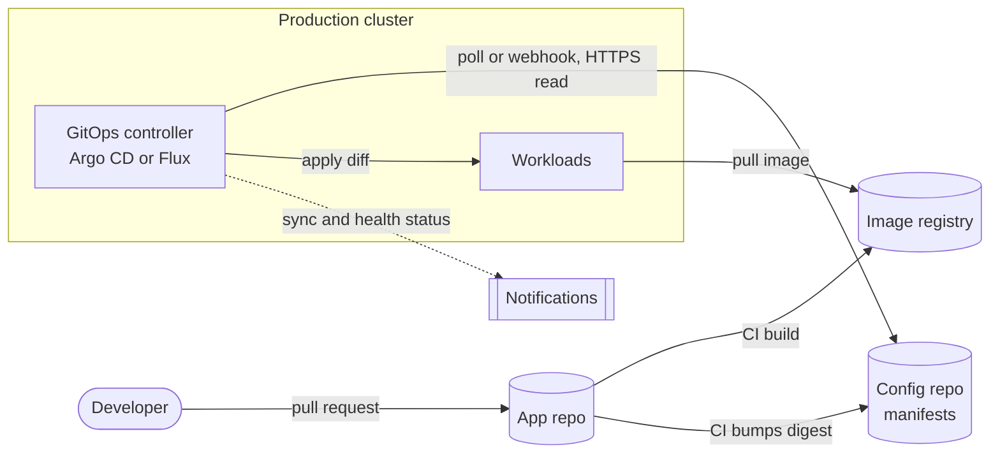

**Reading the diagram.** CI builds the application repository, pushes an image and commits its digest to a configuration repository of manifests; both repositories and the registry are storage boundaries. Inside the cluster, the controller reads the configuration repository over HTTPS on a polling interval or webhook, applies the difference, and reports status asynchronously. No external system holds cluster credentials. Failure points: if Git is unreachable the cluster keeps its last state but cannot change; a bad commit applies everywhere the controller watches. Scaling: one controller per cluster isolates failures; one controller can also manage many clusters.

**Argo CD** models each deployed unit as an `Application` resource that names a Git source and a destination cluster and namespace:

```yaml
apiVersion: argoproj.io/v1alpha1
kind: Application
metadata:
  name: orders-prod
  namespace: argocd
spec:
  project: default
  source:
    repoURL: https://github.com/quickbite/deploy-config.git
    targetRevision: main
    path: apps/orders/overlays/prod
  destination:
    server: https://kubernetes.default.svc
    namespace: orders
  syncPolicy:
    automated:
      prune: true     # delete objects removed from Git
      selfHeal: true  # revert manual changes to live objects (drift)
```

Argo CD compares the rendered manifests with live objects, shows each Application as *Synced* or *OutOfSync* and *Healthy* or *Degraded*, and polls repositories every three minutes by default, or reacts to webhooks [Argo CD Docs]. **Flux** splits the same job into controllers: a source controller fetches `GitRepository` (or OCI and Helm) sources on an interval, and a Kustomize or Helm controller applies them; an image-automation controller can commit new image tags back to Git [Flux Docs]. Both are CNCF graduated projects. Progressive delivery plugs in alongside them: Argo Rollouts and Flagger replace the plain Deployment rollout with canary or blue–green steps judged by metric analysis (§43.6).

Rollback in GitOps is `git revert`: the controller applies the previous state, and the history records who rolled back and why. Secrets need care, because Git is not a vault: store references, not values, using the External Secrets Operator (which syncs from a cloud secrets manager), or store encrypted values with Sealed Secrets or SOPS (§43.11).

::: warning
**Warning — Self-heal fights the emergency fix.** With `selfHeal` on, an on-call engineer's `kubectl scale` during an incident is reverted within seconds or minutes. Agree in advance how to make emergency changes: commit to Git (fast path with post-review), or pause automated sync for the Application and record that you did.
:::

## 43.11 Secrets management in pipelines

A deployment pipeline holds the keys to production: it pushes images, applies Terraform and changes clusters. Chapter 10 explains secrets management in general (§10.8); this section applies it to CI/CD, where the classic mistake is a long-lived cloud access key pasted into the CI system's secret settings. That key works from anywhere, never expires, is copied into every fork's logs if a step echoes it, and is rarely rotated.

### 43.11.1 OIDC workload identity instead of long-lived keys

::: definition
**Definition — OIDC workload identity federation.** A mechanism in which the CI platform issues each job a short-lived, signed OpenID Connect (OIDC) token describing the job (repository, branch, environment), and the cloud provider exchanges that token for temporary credentials according to a trust policy, so that no long-lived cloud key is stored in the pipeline.
:::

**Figure 43.13 — A CI job obtaining cloud credentials through OIDC federation.**

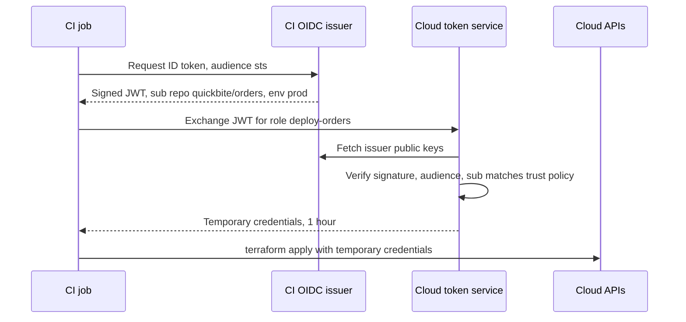

**Reading the diagram.** The job obtains a signed JSON Web Token from the CI platform's issuer, with claims naming its repository and environment. The cloud token service verifies the signature with the issuer's public keys, checks the claims against the role's trust policy (for example only `repo:quickbite/orders:environment:prod`) and returns credentials that expire in about an hour. Nothing long-lived is stored. Failure points: trust policies that match any repository or branch, and issuer availability. GitHub Actions jobs request the `id-token: write` permission; AWS, Google Cloud and Azure support this federation (as of 2026) [GitHub Docs: OIDC].

Applying the misuse-window formula of §10.8: a leaked static key is usable until someone notices and rotates it, often months; a leaked federated credential is usable for at most its one-hour lifetime. Where the pipeline needs non-cloud secrets (a third-party API key, a signing key), it should fetch them at run time from a vault using the same OIDC identity (Vault's JWT auth method accepts CI tokens), scoped to the job and environment, rather than storing them as CI variables.

### 43.11.2 Supply-chain security: SLSA, SBOMs and signing

The pipeline is also the factory for every artifact you run, so attackers target it: a compromised build server can insert code into a correctly reviewed source tree. The SolarWinds compromise disclosed in 2020 did exactly this: malware on the build system inserted a backdoor into signed Orion software updates [CrowdStrike 2021]. Three controls answer the question "is this artifact what we think it is?" Chapter 50 treats supply-chain security in depth; here is the pipeline view.

- **Provenance and SLSA.** Supply-chain Levels for Software Artifacts (SLSA) defines a build track with increasing guarantees [SLSA 2023]. *Build L1*: the build produces provenance, a document stating what source, builder and parameters produced the artifact. *Build L2*: the build runs on a hosted build platform that generates and signs the provenance. *Build L3*: the build platform is hardened so that builds are isolated from one another and user-defined build steps cannot access the signing key or forge provenance.
- **SBOM.** A software bill of materials lists every component and version in an artifact, in a standard format such as SPDX or CycloneDX. When a vulnerability is announced in a library, an SBOM answers "which of our images contain it?" in minutes.
- **Signing.** Sign the image digest and attach the provenance and SBOM as attestations. Sigstore's `cosign` supports *keyless* signing: the signer authenticates with OIDC, receives a short-lived certificate from the Fulcio certificate authority, and the signature is recorded in the Rekor transparency log [Sigstore Docs].

**Figure 43.14 — From source to admission: signing and verification.**

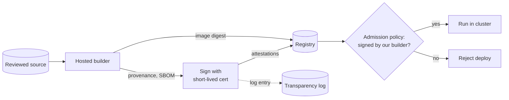

**Reading the diagram.** A hosted builder pushes the image by digest and produces provenance and an SBOM, which are signed and stored beside the image; the signing event is appended asynchronously to a transparency log. At deploy time an admission controller (such as Sigstore's policy controller or Kyverno) admits only images signed by the expected builder identity with provenance naming the expected repository. Failure points: verification left in audit-only mode, and overly broad signing identities. Scaling: verification is a few signature checks per pod, cached by digest.

## 43.12 Infrastructure monitoring

Chapter 40 covers metrics, logs, traces and alerting. Deployment adds one specific need: when something breaks, you must be able to ask "what changed?" and get an answer in seconds.

**Deployment markers** are events recorded by the pipeline at every deployment, flag change and infrastructure apply, with the service, version, commit, author and time. Dashboards overlay them on graphs (Grafana calls these annotations), so a latency step that lines up with a marker is visible at a glance. **Change correlation** goes further: an incident tool lists every change to the affected services and their dependencies in the hour before the alert.

::: formula
**Chance that an unrelated deploy precedes an incident**

$$P_{\text{chance}} = 1 - e^{-f w}$$

| Symbol | Meaning | Units |
|---|---|---|
| $P_{\text{chance}}$ | Probability at least one deploy falls in the window by coincidence | probability |
| $f$ | Rate of deploys among the changes you are looking at | deploys/min |
| $w$ | Look-back window before the incident | min |
:::

::: example
**Worked example — Is the last deploy the cause?** QuickBite's teams deploy 120 times per day across all services, $f = 120/1{,}440 = 0.0833$ per min. Looking back $w = 30$ min, $f w = 2.5$ and $P_{\text{chance}} = 1 - e^{-2.5} = 0.92$. Some deploy almost always precedes any incident, so "there was a deploy just before" means nothing at the organization level. Restricted to the affected service, which deploys 3 times per day ($f = 0.00208$ per min), $f w = 0.0625$ and $P_{\text{chance}} = 0.061$. A deploy of *that* service in the window is strong evidence. *Engineering implication:* change correlation must be scoped by service and dependency graph; and the faster an organization deploys, the more it needs per-service canaries (§43.6), whose comparison against a baseline separates cause from coincidence directly.
:::

Two further habits complete the picture. Alert on symptoms with error-budget burn rates (§40.10) so that a bad deploy pages within minutes; and track the DORA metrics (§43.3.3) from the same change events, so that delivery performance is measured from data, not surveys.

## 43.13 Database migrations

### 43.13.1 Why migrations are the hard part

Code is easy to roll back because old code has no memory. A database remembers. If version 42 renames a column, version 41 cannot read the table any more, so rollback is impossible; and during a rolling or canary deploy, versions 41 and 42 run *at the same time* against one schema (§43.4). A schema change is therefore safe only if every application version that may run during the change can work with every schema state that may exist during it.

::: definition
**Definition — Backward and forward compatibility.** A schema change is **backward compatible** if the old application version still works after it is applied. An application change is **forward compatible** (with respect to rollback) if the data it writes can still be read correctly by the previous application version.
:::

### 43.13.2 Expand and contract

::: definition
**Definition — Expand–contract (parallel change).** A pattern for making a backward-incompatible change as a sequence of compatible steps: **expand** the schema or interface to support both old and new forms, **migrate** readers, writers and existing data to the new form, then **contract** by removing the old form once nothing uses it [Sato 2014b].
:::

Suppose QuickBite wants to replace the free-text `customer_phone` column in `orders` with a normalized `phone_e164` column. Renaming in one step breaks every running instance. The expand–contract sequence is:

1. **Expand the schema.** Add `phone_e164` as a nullable column. Old code ignores it.
2. **Dual-write.** Deploy application version A that writes both columns and still reads `customer_phone`. Rollback to the previous version is safe; it ignores the new column.
3. **Backfill.** Fill `phone_e164` for existing rows in small batches.
4. **Switch reads.** Deploy version B that reads `phone_e164` (falling back to the old column if null) and still writes both. Rollback to A is safe because both columns stay current.
5. **Stop writing the old column.** Deploy version C that writes only `phone_e164`. From here, rolling back to B or A would read a stale column, so wait until C has baked.
6. **Contract the schema.** Drop `customer_phone` (and add `NOT NULL` to `phone_e164` if required).

```sql
-- Step 1: expand (PostgreSQL; adding a nullable column is a quick catalog change)
SET lock_timeout = '2s';
ALTER TABLE orders ADD COLUMN phone_e164 text;

-- Step 3: backfill one batch; the job repeats until no rows are updated
UPDATE orders
SET phone_e164 = normalize_phone(customer_phone)
WHERE id IN (
  SELECT id FROM orders
  WHERE phone_e164 IS NULL AND customer_phone IS NOT NULL
  ORDER BY id
  LIMIT 2000
);

-- Step 6: contract, weeks later
SET lock_timeout = '2s';
ALTER TABLE orders DROP COLUMN customer_phone;
```

What to notice: `lock_timeout` makes the `ALTER` give up rather than queue all traffic behind it (the hazard of §11.15); the backfill touches 2,000 rows per transaction to keep locks and replication lag small; `normalize_phone` stands for an application-defined function; and steps 1 and 6 are separate releases, weeks apart.

**Figure 43.16 — Expand–contract releases over time.**

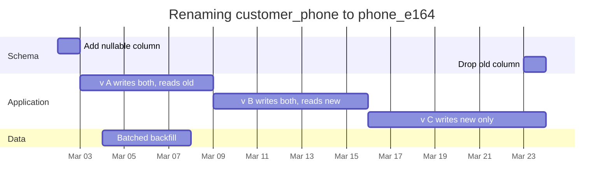

**Reading the diagram.** Time runs left to right over three weeks. Only two schema changes occur: expand at the start and contract at the end. The three application releases each deploy with the usual strategy, and at every boundary the two coexisting versions are compatible with the schema of that moment. The backfill runs asynchronously after version A writes both columns, so no row is missed. Failure points: contracting while any reader (batch jobs, reporting replicas) still uses the old column, and a backfill that overloads the database.

::: formula
**Backfill duration**

$$T_{\text{backfill}} = \frac{R}{b \times r}$$

| Symbol | Meaning | Units |
|---|---|---|
| $T_{\text{backfill}}$ | Time to update all rows | s |
| $R$ | Rows to update | rows |
| $b$ | Rows per batch | rows/batch |
| $r$ | Batches per second, including throttling pauses | batches/s |
:::

::: example
**Worked example — Backfilling 300 million orders.** $R = 3 \times 10^8$ rows, $b = 2{,}000$ rows per batch, each batch takes 50 ms and the job then sleeps 50 ms to leave headroom, so $r = 10$ batches/s. $T = 3 \times 10^8 / (2{,}000 \times 10) = 15{,}000$ s $\approx 4.2$ h. Doubling the batch size would halve the time but double each transaction's lock footprint and the bursts of replication lag. *Engineering implication:* throttle backfills on replica lag and primary load, make them resumable (they run for hours), and schedule them as a release step with its own monitoring.
:::

### 43.13.3 Online schema change tools

Some changes cannot be made as quick catalog edits: changing a column type, or adding an index on MySQL versions and table shapes that need a table copy. On a 500 GB table a blocking `ALTER` could lock writes for hours. **Online schema change** tools build a new copy of the table with the new schema while the original keeps serving, then swap them.

- **pt-online-schema-change** (Percona Toolkit) creates the new table, adds triggers on the original so that every insert, update and delete is mirrored to the copy, copies existing rows in chunks, and finally swaps the tables with an atomic `RENAME TABLE` [Percona Docs: pt-online-schema-change].
- **gh-ost** (GitHub's online schema migration tool for MySQL) is *triggerless*. It copies rows in chunks and applies ongoing changes by reading the MySQL binary log, so the migration adds no trigger work to the production write path. It can throttle itself on replica lag or load, be paused and resumed, and postpone the final cut-over until an operator removes a flag file [GitHub gh-ost]. It requires row-based binary logging and has limited support for foreign keys.

**Figure 43.17 — gh-ost's triggerless migration.**

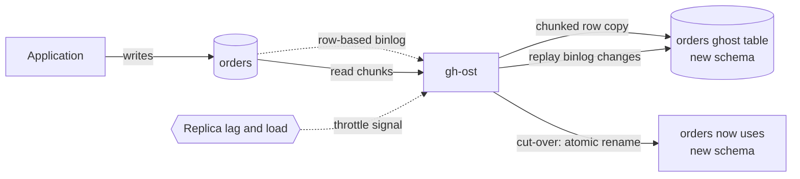

**Reading the diagram.** The application keeps writing to the original table. gh-ost copies existing rows in chunks into a ghost table with the new schema while tailing the binary log asynchronously and replaying each change, throttling on replica lag and load. When caught up, the cut-over briefly locks the original and atomically renames the tables. Failure points: a cut-over stuck behind long transactions, disk space for a second copy, and foreign keys. Scaling: copy speed is deliberately throttled; a multi-terabyte table can take days without affecting production.

PostgreSQL makes many changes cheap without such tools: adding a nullable column, or (since version 11) a column with a constant default, avoids a table rewrite, and `CREATE INDEX CONCURRENTLY` builds an index without blocking writes [PostgreSQL Docs: ALTER TABLE]. MySQL 8 offers `ALGORITHM=INSTANT` for some column additions. Check your engine's documentation for which operations rewrite the table before choosing a tool.

#### Failure scenarios

| What goes wrong | Why | Detection | Recovery | Prevention |
|---|---|---|---|---|
| Old pods crash after migration | Column renamed or dropped while old version still runs | Errors from old version during rollout | Re-add column; roll forward | Expand–contract; contract only after all readers gone |
| All queries stall | `ALTER` waits for a lock and blocks everything behind it | Sudden latency spike on one table | Cancel the `ALTER` | `lock_timeout`; online schema change |
| Replicas fall hours behind | Backfill or copy too aggressive | Replica lag alerts | Pause job | Throttle on lag; small batches |
| Rollback impossible | New version wrote data old version cannot read | Old version errors after rollback | Roll forward with a fix | Forward-compatible writes; dual-write phase |

::: mistake
**Mistake — Running migrations automatically at application startup.** If every pod runs pending migrations when it starts, a rolling deploy of 40 pods races 40 migrators, and a destructive migration runs before any canary analysis. Run migrations as a separate, single, observable pipeline step, ahead of the code that needs them.
:::

## 43.14 Summary and revision notes

::: summary
- Most outages follow changes. Control how change reaches production: small batches, limited exposure, fast detection, fast undo.
- A deployment pipeline builds once and promotes one immutable artifact through unit tests, static analysis, packaging, integration tests and a progressive deploy. Trunk-based development keeps integration continuous.
- DORA's four metrics: deployment frequency, change lead time, change failure rate, failed deployment recovery time. Throughput and stability improve together; read them together ($D = f \times \text{CFR} \times T_{\text{restore}}$).
- Rolling updates are cheap and default, but mix versions and expose everyone on a fixed schedule. Blue–green gives an atomic switch and instant rollback at up to double capacity; shared databases must suit both versions.
- Canaries limit blast radius $B = \lambda w \Delta p (T_{\text{detect}} + T_{\text{rollback}})$. Judge them statistically: a one-sided two-proportion z-test with a sample sized in advance; beware peeking. Kayenta-style judges score many metrics with Mann–Whitney tests against a fresh baseline.
- Feature flags separate release from deploy, enable kill switches and deterministic percentage rollouts, and create flag debt ($2^k$ paths); expire release toggles.
- Declarative IaC is idempotent and detects drift. Terraform uses providers, resources, remote locked state, plan/apply, modules and per-environment state; OpenTofu is the MPL-licensed fork.
- GitOps agents pull desired state from Git and reconcile continuously; rollback is `git revert`.
- Pipelines should use OIDC federation, not stored keys; SLSA provenance, SBOMs and signatures verified at admission protect the supply chain.
- Deployment markers and service-scoped change correlation answer "what changed?"
- Database changes use expand–contract so every coexisting version works with every schema state; online schema change tools (gh-ost, pt-osc) avoid blocking `ALTER`s.
:::

## 43.15 Knowledge checkpoint

1. Name the six pipeline stages and explain "build once".
2. Define the four DORA metrics.
3. Team X deploys 10 times a week with CFR 10% and 60 min recovery. Compute weekly degraded time.
4. Why must a rolling update be backward compatible?
5. Why does blue–green rollback fail after a destructive schema change?
6. Green costs $20,000/month to run fully; 30 deploys/month with 3 h overlap. Compute the extra cost.
7. Compute the blast radius at 1,000 requests/s, 10% canary, $\Delta p = 0.1$, 60 s detection and 30 s rollback.
8. Baseline 50 errors in 10,000 requests; canary 80 in 10,000. Compute $z$ and decide at $\alpha = 0.01$.
9. Why compare a canary with a fresh baseline rather than with production?
10. Why must percentage rollouts hash the user ID with the flag key?
11. What does idempotence give an IaC tool?
12. Why does Terraform need state locking?
13. What makes GitOps "pull-based", and why is that more secure?
14. What does an OIDC trust policy check?
15. List the six expand–contract steps for a column rename.

<details><summary>Answers</summary>

1. Build, unit test, static analysis, artifact, integration test, deploy. The same artifact (by digest) is promoted, so what was tested is what ships.
2. Deployment frequency; change lead time (commit to production); change failure rate (share of deploys needing remediation); failed deployment recovery time.
3. $10 \times 0.10 \times 60 = 60$ min per week.
4. Old and new versions serve simultaneously and share data and clients.
5. Blue's code no longer matches the schema, so switching back produces errors.
6. $20{,}000 \times 30 \times 3/730 = \$2{,}466$ per month.
7. $1{,}000 \times 0.1 \times 0.1 \times 90 = 900$ failed requests.
8. Pooled $= 130/20{,}000 = 0.0065$; SE $= \sqrt{0.0065 \times 0.9935 \times 0.0002} = 0.001137$; $z = 0.003/0.001137 = 2.64$; p $= 0.004 < 0.01$: fail.
9. New processes differ from long-running ones (cold caches, warm-up), which would be mistaken for code effects.
10. Determinism (same user, same answer on every pod) and independence (different flags select different users).
11. Re-running is safe; only differences are applied, so partial failures can be retried and drift detected.
12. Concurrent applies would read the same state and overwrite each other's results, orphaning resources.
13. An in-cluster agent reads Git; no external system needs write credentials to the cluster, and drift is reconciled continuously.
14. The token's signature and issuer, audience, and claims such as repository, branch or environment.
15. Add nullable column; dual-write; backfill; read new; stop writing old; drop old column.

</details>

## 43.16 Interview questions

### Basic

**Q1. What is the difference between blue–green and canary deployments?**
**Answer.** Blue–green prepares a full second environment and switches all traffic at once, with instant rollback by switching back; cost is up to double capacity during the overlap. A canary sends a small, increasing share of traffic to the new version and judges it against a baseline, limiting blast radius at the cost of more tooling and enough traffic for statistics.

**Q2. What are feature flags for, and what is their main risk?**
**Answer.** They separate release from deploy: dark launches, percentage rollouts, experiments and kill switches. The main risk is flag debt: stale flags multiply untested code paths and can be misused, as in Knight Capital's repurposed flag.

### Intermediate

**Q3. How would you automate canary analysis for a service with 500 requests/s and a 0.2% error rate?**
**Answer.** Decide the smallest regression worth catching (say a doubling), then size the sample: about 12,000 requests per group at $\alpha = 0.01$ and 80% power. At 5% weight per group (25 requests/s) that is about 8 minutes per step. Judge error rate with a one-sided two-proportion test and latency with a nonparametric test against a fresh baseline; correct for repeated looks; add business metrics; auto-rollback on fail, hold on inconclusive.

**Q4. How do you rename a column in a 2 TB table with zero downtime under rolling deploys?**
**Answer.** Expand–contract: add the new column, deploy dual-write, backfill in throttled batches, switch reads, stop old writes, drop the old column weeks later. Each step is a separate release compatible with its neighbors. Use `lock_timeout`, and gh-ost or pt-osc for operations that copy the table.

### Advanced

**Q5. Design the deployment platform for 300 microservices and 50 teams.**
**Answer.** Per-service pipelines that build once, sign and attach SBOM and provenance; OIDC to cloud; GitOps config repositories reconciled by Argo CD or Flux per cluster; Argo Rollouts or Flagger canaries with Kayenta-style judgment; a flag service with expiry; Terraform modules with per-service state; admission policy that verifies signatures; change events feeding deploy markers and DORA metrics; migrations as separate pipeline steps. Discuss rollout across regions or cells one at a time (Chapter 44).

**Q6. A bad config change took down every region at once. What do you change?**
**Answer.** Treat config as code: review, version, validate in the pipeline. Roll out progressively by region or cell with automated health checks between waves, so one wave fails, not all. Add a fast, tested rollback (previous version kept), deployment markers, and service-scoped change correlation. Measure the reduction in blast radius with $B = \lambda w \Delta p T$.

## 43.17 Practical exercises

1. Run the canary module of §43.6.4 with baseline rates of 0.1%, 1% and 5% and plot required $n$ against relative increase.
2. Extend the judge with a Bonferroni-corrected repeated-look mode and verify by simulation that the false-positive rate stays below 1%.
3. Write a Terraform module for a queue plus dead-letter queue, call it for two environments with separate state, and run `plan -detailed-exitcode` after a manual console change.
4. Install Argo CD in a local cluster, deploy an app from Git, edit a Deployment by hand and watch self-heal revert it.
5. Perform the expand–contract column rename of §43.13.2 on a local PostgreSQL table of 10 million rows while a load generator runs.

## 43.18 Design challenges

1. **Payments canary.** A payment service handles 50 requests/s with a 0.05% error rate. Design a release process that catches a doubling of errors within one hour; decide what else besides error rate to judge on.
2. **Regulated GitOps.** A bank requires two-person approval and an audit trail for every production change and forbids CI credentials to production. Design the pipeline, GitOps layout and emergency-change path.
3. **Sharded schema change.** Add a non-null column to a table spread over 64 MySQL shards under continuous deployment, with a plan for partial failure on some shards.

## 43.19 References

1. Humble, J., Farley, D. *Continuous Delivery: Reliable Software Releases through Build, Test, and Deployment Automation*. Addison-Wesley, 2010.
2. Forsgren, N., Humble, J., Kim, G. *Accelerate: The Science of Lean Software and DevOps*. IT Revolution, 2018.
3. DORA. *Accelerate State of DevOps Report 2023*. Google Cloud, 2023. https://dora.dev/research/
4. DORA. *Accelerate State of DevOps Report 2024*. Google Cloud, 2024. https://dora.dev/research/
5. Beyer, B., Jones, C., Petoff, J., Murphy, N. R. (eds.). *Site Reliability Engineering: How Google Runs Production Systems*. O'Reilly, 2016. https://sre.google/sre-book/table-of-contents/
6. Beyer, B., Murphy, N. R., Rensin, D. K., Kawahara, K., Thorne, S. (eds.). *The Site Reliability Workbook*, chapter "Canarying Releases". O'Reilly, 2018. https://sre.google/workbook/canarying-releases/
7. Fowler, M. *BlueGreenDeployment*. martinfowler.com, 2010. https://martinfowler.com/bliki/BlueGreenDeployment.html
8. Sato, D. *CanaryRelease* (2014a). martinfowler.com, 2014. https://martinfowler.com/bliki/CanaryRelease.html
9. Sato, D. *ParallelChange* (2014b). martinfowler.com, 2014. https://martinfowler.com/bliki/ParallelChange.html
10. Hodgson, P. *Feature Toggles (aka Feature Flags)*. martinfowler.com, 2017. https://martinfowler.com/articles/feature-toggles.html
11. Hammant, P., et al. *Trunk Based Development*. https://trunkbaseddevelopment.com/
12. Graff, M., Sanden, C. *Automated Canary Analysis at Netflix with Kayenta*. Netflix Technology Blog, 2018.
13. Google Cloud. *Introducing Kayenta: An open automated canary analysis tool from Google and Netflix*. Google Cloud Blog, 2018.
14. Spinnaker. *Canary Analysis* (user guide and canary configuration). https://spinnaker.io/docs/guides/user/canary/
15. Morris, K. *Infrastructure as Code: Dynamic Systems for the Cloud Age*, 2nd ed. O'Reilly, 2020.
16. HashiCorp. *Terraform Language Documentation*. https://developer.hashicorp.com/terraform/language
17. HashiCorp. *Terraform CLI: plan command*. https://developer.hashicorp.com/terraform/cli/commands/plan
18. HashiCorp. *Terraform Backend Configuration: S3*. https://developer.hashicorp.com/terraform/language/backend/s3
19. HashiCorp. *Terraform CLI: Workspaces*. https://developer.hashicorp.com/terraform/cli/workspaces
20. OpenTofu. *OpenTofu Documentation and release announcements*. Linux Foundation, 2024. https://opentofu.org/
21. OpenGitOps. *GitOps Principles v1.0.0*. CNCF GitOps Working Group, 2021. https://opengitops.dev/
22. Argo Project. *Argo CD Documentation*. https://argo-cd.readthedocs.io/
23. Flux Project. *Flux Documentation*. https://fluxcd.io/flux/
24. GitHub. *About security hardening with OpenID Connect*. GitHub Actions documentation. https://docs.github.com/actions
25. SLSA. *SLSA Specification v1.0*. OpenSSF, 2023. https://slsa.dev/spec/v1.0/
26. Sigstore. *Sigstore Documentation: Cosign, Fulcio, Rekor*. https://docs.sigstore.dev/
27. CrowdStrike Intelligence Team. *SUNSPOT: An Implant in the Build Process*. CrowdStrike Blog, 2021.
28. U.S. Securities and Exchange Commission. *In the Matter of Knight Capital Americas LLC*, Release No. 34-70694, 2013. https://www.sec.gov/litigation/admin/2013/34-70694.pdf
29. GitHub. *gh-ost: GitHub's online schema migration tool for MySQL*. https://github.com/github/gh-ost
30. Percona. *pt-online-schema-change*, Percona Toolkit Documentation. https://docs.percona.com/percona-toolkit/pt-online-schema-change.html
31. PostgreSQL Global Development Group. *PostgreSQL Documentation: ALTER TABLE*. https://www.postgresql.org/docs/current/sql-altertable.html
32. AWS. *AWS CodeDeploy User Guide: blue/green deployments*. https://docs.aws.amazon.com/codedeploy/
33. AWS. *Amazon RDS User Guide: Blue/Green Deployments*. https://docs.aws.amazon.com/AmazonRDS/latest/UserGuide/blue-green-deployments.html

## 43.20 Open verification items

- DORA 2024 performance-cluster thresholds; whether later reports changed the four-metric set.
- Kayenta details: "critical" metric flag, marginal/pass threshold semantics, effect-size settings; Google Kayenta blog author and URL.
- Terraform S3 `use_lockfile` GA version (believed 1.11) and DynamoDB-locking deprecation; the HCL example was not run through `terraform validate`.
- OpenTofu governance status (Linux Foundation or CNCF) as of 2026.
- Knight Capital loss figure ($460 million) wording in the SEC order.
- Argo CD default three-minute polling interval in current releases.
