# Chapter 44 — Multi-Region and Global Systems

> **Level:** 4 · **Track:** A (Traditional) · **Estimated reading time:** 6 h

Every chapter so far has assumed, at least implicitly, that your system lives in one region: a few availability zones milliseconds apart (§41.4), where synchronous replication is cheap and consensus commits in a couple of milliseconds. This chapter is about what changes when you stretch a system across regions hundreds or thousands of kilometers apart. Three facts drive everything. Light in fiber needs about 5 µs per kilometer, so cross-region round trips cost tens to hundreds of milliseconds and no product can remove that (§4.17, §7.15). Regions fail as units, rarely but for hours. And laws increasingly say *where* personal data may live.

The running example is QuickBite, the hypothetical food-delivery platform of Chapter 2. It has outgrown one country and now serves three markets: the United States, the European Union and Asia-Pacific. Every QuickBite number is a teaching assumption, not a measurement of any real company. Chapter 39 gave QuickBite its disaster-recovery (DR) tiers and introduced active–passive and active–active regions (§39.8, §39.10). Here we cover the physics, traffic steering, topologies, geo-replication, conflicts, residency, regional isolation and evacuation that a real multi-region design needs.

## 44.1 Learning objectives

After this chapter you should be able to:

- State the four reasons to go multi-region and estimate their cost in money, latency and complexity.
- Compute the fiber round-trip floor between regions and the client-perceived latency of a quorum write for a given replica placement.
- Design global traffic management with geo-DNS, latency-based routing, anycast and client-side selection, and compute realistic DNS failover times.
- Compare active–passive, read-local/write-global, multi-writer and home-region topologies, and compute their availability given failover time.
- Choose between asynchronous and synchronous geo-replication, compute the data-loss window (RPO) from replication lag, and describe what DynamoDB global tables, Spanner, CockroachDB and Aurora Global Database offer (as of 2026).
- Estimate cross-region conflict rates and pick a conflict strategy: ownership, CRDTs, application merge or last-writer-wins.
- Design regional data stores for residency requirements, splitting metadata from content.
- Remove global dependencies using regional independence and static stability.
- Size regional capacity to absorb the loss of one region, and plan detection, decision, traffic shift, failback and game days.
- Explain read-your-writes across regions and the role of the home region in user-visible consistency.

## 44.2 Prerequisites

- Speed of light in fiber, the four components of latency — §4.17, §7.15 (the RTT floor used throughout).
- BGP and anycast; DNS resolution, TTL and DNS load balancing — §7.5.3, §7.6.4, §7.6.5.
- Global server load balancing and health checks — §19.5, §19.9 (summarized, not re-taught).
- Session guarantees, PACELC and the CAP theorem — §25.6, §25.8, §25.9.
- Quorums and quorum commit latency; Raft; split brain and fencing — §26.4, §26.7, §26.12, §26.13.
- Multi-leader replication, failover, conflict resolution with LWW, version vectors and CRDTs — §27.6, §27.11, §27.14.
- Spanner and TrueTime; CockroachDB transactions — §28.8, §28.10.1.
- Cells and shuffle sharding — §33.12.
- Headroom and zone-level static stability — §18.11.2.
- DR tiers, RTO and RPO; availability composition — §39.8, §4.14.

## 44.3 Why go multi-region

### 44.3.1 Four reasons, and the bill that comes with them

::: definition
**Definition — Region; multi-region system.** A **region** is a cloud provider's geographic area containing several isolated availability zones, typically within roughly 100 km of each other, connected by low-latency links (§41.4). A **multi-region system** runs serving capacity, data, or both in two or more regions and has a defined policy for which region handles each request and each piece of data. A **global system** is a multi-region system whose users are spread across continents.
:::

#### First-principles explanation

Imagine a restaurant chain with one central kitchen. Every order, from every city, is cooked there and driven out. It is simple: one menu, one stock count, one set of books. But customers far away wait an hour, a fire in the kitchen stops every city at once, and some cities forbid their customers' records leaving town. Opening local kitchens fixes all three, at the cost of keeping menus, stock and books in agreement across kitchens that cannot talk instantly. A multi-region system makes the same trade.

#### Why does this exist?

There are four distinct motives, and they lead to different designs. Be explicit about which ones apply.

1. **Latency.** A user in Frankfurt calling a service in Virginia pays at least a 66 ms fiber round trip, about 90 ms in practice, on *every* sequential round trip (§44.4). Serving from a nearby region removes most of it.
2. **Availability.** Zones protect against a datacenter fault; they do not protect against a region-wide event: a bad regional deployment, a regional control-plane outage, a cut that isolates a metro area, a natural disaster. Multiple regions turn a regional outage from total downtime into a traffic shift (§44.11).
3. **Data residency.** Laws, contracts and customer requirements may restrict where personal or regulated data is stored or processed (§44.9). This is a reason to *partition* data by geography, not to replicate it everywhere.
4. **Blast radius.** Regions are natural cells (§33.12). If each region is independent, a defect rolled out to one region or a poison request in one region affects only that region's users (§44.10).

**Figure 44.1 — QuickBite's global footprint.**

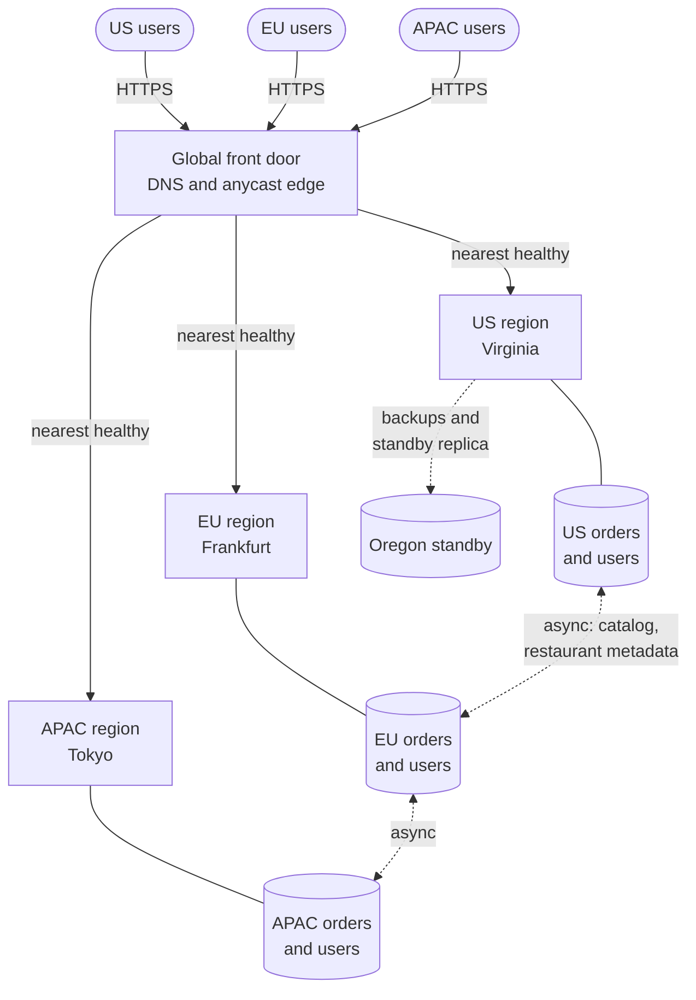

**Reading the diagram.** Users in three markets reach a global front door over HTTPS (§44.5), which sends each request synchronously to the nearest healthy region. Each region is a complete stack whose database (a storage boundary) holds its own market's orders and accounts. Only shared reference data, such as multi-market restaurant chains, replicates between regions, asynchronously (dotted). The US region also ships backups and a standby replica to Oregon for regional DR. Failure points: the global front door is shared by everyone and must itself be multi-region; a lost region takes its market's data with it unless that data is replicated elsewhere. Scaling: add regions or cells within regions.

#### The bill

Multi-region costs are often understated. Table 44.1 states them plainly.

**Table 44.1 — What multi-region costs.**

| Cost | Why it arises | Typical magnitude |
|---|---|---|
| Compute and storage | Each region needs headroom to absorb another's traffic (§44.11) | 1.25× to 2× a single region, plus standby copies |
| Data transfer | Cross-region replication and request forwarding are billed per GB | Often a top-five cloud line item for chatty designs |
| Write latency | Strong consistency needs cross-region round trips (§44.4) | +10 ms to +250 ms per write |
| Engineering complexity | Conflicts, failover logic, region-aware routing, residency | Months of design; permanent operational load |
| Testing | Failover paths are rarely exercised and rot | Game days and continuous evacuation drills (§44.11) |
| Correlated risk | Global components (DNS, config, identity) are now shared fate (§44.10) | Can dominate total downtime (§44.6.5) |

The cost multiples are planning ranges for illustration; derive your own from §44.11's headroom formula and your provider's price list.

#### Common misconceptions

::: mistake
**Mistake — "Multi-region automatically makes us more available."** A second region adds components, a failover path and new global dependencies. If failover is manual, untested, or depends on the failed region's control plane, the second region adds cost and no availability. Worse, a global configuration system or global database can make *all* regions fail together. Multi-region improves availability only when regions are independent and failover is automatic and rehearsed (§44.10, §44.11).
:::

::: recommendation
**Recommendation — Write down which of the four reasons you are solving for.** Latency alone may need only read replicas and a CDN (Chapter 21); availability alone, a warm standby (§39.8); residency, geographic partitioning; blast radius, independence.
:::

## 44.4 Latency physics across regions

### 44.4.1 The fiber floor

::: definition
**Definition — Round-trip time floor.** The **RTT floor** between two points is the minimum time for a signal to travel there and back along the great-circle path in optical fiber, about $2d/v$ with $v \approx 200{,}000$ km/s. **Route inflation** is the ratio of a measured RTT to that floor; it reflects cable paths that are longer than the great circle, plus equipment, queuing and routing policy.
:::

Light in glass travels at about two-thirds of its vacuum speed, roughly 5 µs per kilometer (§7.15.1). Submarine and terrestrial cables follow coastlines, rights of way and landing stations, so real paths are longer than the great circle. Specialized links (microwave towers for trading, hollow-core fiber) narrow the gap on a few routes, but no cloud region pair beats the fiber floor by more than about a third, which is the vacuum limit.

::: formula
**Fiber RTT floor and observed RTT**

$$\mathrm{RTT}_{\min} = \frac{2d}{v}, \qquad \mathrm{RTT}_{\text{obs}} \approx k \cdot \mathrm{RTT}_{\min} + t_{\text{equip}}$$

| Symbol | Meaning | Units |
|---|---|---|
| $d$ | Great-circle distance between the two sites | km |
| $v$ | Signal speed in fiber, about $2 \times 10^5$ | km/s |
| $\mathrm{RTT}_{\min}$ | Physical lower bound on round-trip time | s (report in ms) |
| $k$ | Route inflation factor, typically 1.3–2 for long-haul cloud paths | dimensionless |
| $t_{\text{equip}}$ | Fixed processing and queuing in routers and hosts | ms |
| $\mathrm{RTT}_{\text{obs}}$ | Round-trip time you can expect to measure | ms |
:::

**Table 44.2 — Approximate RTTs between region locations (as of 2026; measure your own).**

| Region pair (metro areas) | Great-circle distance | Fiber floor $2d/v$ | Typical observed RTT | Inflation $k$ |
|---|---|---|---|---|
| N. Virginia – Ohio | ~480 km | ~5 ms | ~10–13 ms | ~2.5 (short paths are dominated by routing) |
| N. Virginia – Oregon | ~3,500 km | ~35 ms | ~60–70 ms | ~1.8 |
| N. Virginia – London | ~5,900 km | ~59 ms | ~75–80 ms | ~1.3 |
| N. Virginia – Frankfurt | ~6,500 km | ~66 ms | ~85–95 ms | ~1.4 |
| N. Virginia – São Paulo | ~7,700 km | ~77 ms | ~115–125 ms | ~1.5 |
| N. Virginia – Tokyo | ~10,900 km | ~109 ms | ~145–160 ms | ~1.4 |
| N. Virginia – Singapore | ~15,500 km | ~155 ms | ~210–235 ms | ~1.4 |
| Frankfurt – London | ~640 km | ~6 ms | ~13–18 ms | ~2.4 |
| Frankfurt – Mumbai | ~6,600 km | ~66 ms | ~110–125 ms | ~1.8 |
| Tokyo – Singapore | ~5,300 km | ~53 ms | ~65–75 ms | ~1.3 |
| Tokyo – Sydney | ~7,800 km | ~78 ms | ~100–115 ms | ~1.4 |

Distances are great-circle distances computed for this book; the observed column is an approximate range consistent with public inter-region measurements, not a provider guarantee.

::: example
**Worked example — How far is Singapore from Virginia, in milliseconds?**

1. Distance: about 15,500 km.
2. Floor: $2 \times 15{,}500 / 200{,}000 = 0.155$ s = 155 ms.
3. With $k = 1.4$ and $t_{\text{equip}} \approx 2$ ms: $1.4 \times 155 + 2 = 219$ ms, inside the observed range in Table 44.2.
4. Compare the vacuum limit: $2 \times 15{,}500 / 299{,}792 = 103$ ms. Even an impossible straight vacuum path would cost over 100 ms.

**Interpretation.** Roughly 70% of the observed RTT is unavoidable propagation; the rest is geography of cables and equipment. **Engineering implication.** Design budgets assume about 220 ms for Virginia–Singapore. No database, protocol or vendor can make a synchronous Virginia–Singapore commit fast; only a design that avoids the round trip can.
:::

### 44.4.2 Round trips per user action

A user action rarely costs one round trip. A cold HTTPS request needs DNS, TCP and TLS before the first byte (§7.10), and an application that calls a remote database several times *sequentially* multiplies the RTT.

::: formula
**Latency of a user action with sequential cross-region round trips**

$$T_{\text{action}} = n_{\text{setup}} \cdot \mathrm{RTT}_{u} + n_{\text{app}} \cdot \mathrm{RTT}_{u} + n_{\text{back}} \cdot \mathrm{RTT}_{b} + T_{\text{compute}}$$

| Symbol | Meaning | Units |
|---|---|---|
| $n_{\text{setup}}$ | Round trips for connection setup (TCP + TLS 1.3 = 2; 0 when reused) | count |
| $n_{\text{app}}$ | Sequential application round trips from the client to the serving region | count |
| $\mathrm{RTT}_{u}$ | RTT from the user to the serving region | ms |
| $n_{\text{back}}$ | Sequential round trips from the serving region to a remote region (for example a remote database) | count |
| $\mathrm{RTT}_{b}$ | RTT between the serving region and the remote region | ms |
| $T_{\text{compute}}$ | Server processing time | ms |
| $T_{\text{action}}$ | Time the user waits | ms |
:::

::: example
**Worked example — QuickBite checkout from Berlin.** Checkout needs one new connection (TCP + TLS 1.3: 2 round trips), one API call, and on the server four sequential database calls (read cart, read prices, insert order, update inventory). Compute is 40 ms. User–Frankfurt RTT is 15 ms; Frankfurt–Virginia RTT is 90 ms; user–Virginia RTT is 100 ms.

1. *Single region in Virginia:* $2 \times 100 + 1 \times 100 + 0 + 40 = 340$ ms.
2. *Frankfurt front end, database still in Virginia:* $2 \times 15 + 1 \times 15 + 4 \times 90 + 40 = 445$ ms. Moving only the stateless tier made it *slower*.
3. *Frankfurt front end and EU-homed data in Frankfurt:* $2 \times 15 + 15 + 4 \times 1 + 40 = 89$ ms.

**Interpretation.** The stateless tier is not where latency lives; the data is. **Engineering implication.** Move data with compute, or batch backend calls into one round trip. Splitting the tiers across regions is a common anti-pattern; edge termination of TLS (Chapter 21) helps setup cost but not database round trips.
:::

### 44.4.3 Consensus commit latency across regions

Chapter 26 showed that a leader commits once the fastest $q - 1$ followers acknowledge (§26.4.2). Across regions two further terms matter: the client's distance from the leader, and how many *regions* can fail without losing a quorum.

**Figure 44.2 — A quorum write from Tokyo with a Virginia leader and five voters.**

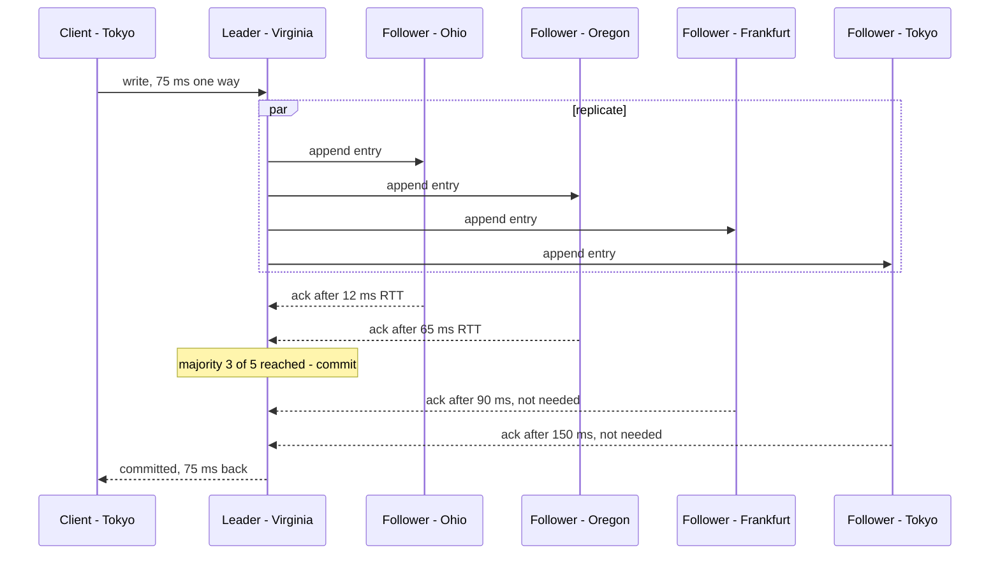

**Reading the diagram.** The Tokyo client sends its write synchronously to the leader in Virginia (half of a 150 ms RTT). The leader appends locally and sends the entry to all four followers in parallel. With five voters the quorum is three, the leader plus two followers, so the commit happens at the second-fastest acknowledgment, Oregon at 65 ms. Frankfurt and Tokyo receive the entry too, but the leader does not wait for them. The client then waits another 75 ms for the reply: about $150 + 65 = 215$ ms in total, even though a voter sits in Tokyo. Every replica is a storage boundary. Failure points: if Ohio fails, the commit waits for Frankfurt (90 ms); if Virginia fails, a new leader must be elected and clients re-routed (§26.7.2). Scaling: more voters raise the order statistic; moving the leader closer to writers cuts the first term.

::: formula
**Client-perceived quorum write latency and region-loss tolerance**

$$L_{\text{write}}(c) \approx \mathrm{RTT}(c, \ell) + t_{\text{fsync}} + \mathrm{RTT}_{(q-1)}(\ell), \qquad \text{survives loss of region } r \iff N - n_r \ge q$$

| Symbol | Meaning | Units |
|---|---|---|
| $c$ | Region of the client (or of the service calling the database) | — |
| $\ell$ | Region of the leader (leaseholder) | — |
| $\mathrm{RTT}(c, \ell)$ | Round trip from client to leader; about 1 ms if in the same region | ms |
| $t_{\text{fsync}}$ | Durable flush time | ms |
| $\mathrm{RTT}_{(q-1)}(\ell)$ | The $(q-1)$-th smallest RTT from the leader to the other voters | ms |
| $N$ | Number of voting replicas | replicas |
| $q$ | Quorum size, $\lfloor N/2 \rfloor + 1$ | replicas |
| $n_r$ | Voting replicas placed in region $r$ | replicas |
:::

::: example
**Worked example — Placing QuickBite's global account database: three versus five regions.** QuickBite wants one strongly consistent store for global accounts (email uniqueness, payment-method tokens). Writers are 50% Virginia, 30% Frankfurt, 20% Tokyo. Use Table 44.2 midpoints: Virginia–Ohio 12, Virginia–Oregon 65, Virginia–Frankfurt 90, Virginia–Tokyo 150 ms; $t_{\text{fsync}} = 1$ ms; leader in Virginia.

1. *Placement A — three regions, one per market (Virginia, Frankfurt, Tokyo):* $q = 2$, so one follower: $\min(90, 150) = 90$ ms. Write latency from Virginia $1 + 1 + 90 = 92$ ms; Frankfurt $90 + 1 + 90 = 181$ ms; Tokyo $150 + 1 + 90 = 241$ ms. Weighted mean: $0.5 \times 92 + 0.3 \times 181 + 0.2 \times 241 = 148.5$ ms. Survives the loss of any one region.
2. *Placement B — five regions (Virginia, Ohio, Oregon, Frankfurt, Tokyo):* $q = 3$; follower RTTs sorted 12, 65, 90, 150; second-smallest 65 ms. Virginia $1 + 1 + 65 = 67$; Frankfurt $90 + 66 = 156$; Tokyo $150 + 66 = 216$ ms. Weighted mean $0.5 \times 67 + 0.3 \times 156 + 0.2 \times 216 = 123.5$ ms. Survives the loss of any *two* regions.
3. *Placement C — five replicas in three nearby regions, 2 + 2 + 1 (Virginia ×2 in different zones, Ohio ×2, Oregon ×1):* $q = 3$; follower RTTs 1, 12, 12, 65; second-smallest 12 ms. Virginia $1 + 1 + 12 = 14$; Frankfurt $90 + 13 = 103$; Tokyo $150 + 13 = 163$ ms. Weighted mean $0.5 \times 14 + 0.3 \times 103 + 0.2 \times 163 = 70.5$ ms. Loss of Virginia leaves $5 - 2 = 3 \ge q$; loss of Ohio leaves 3; loss of Oregon leaves 4. Survives any one region.
4. *Sensitivity in B:* if Ohio is down, the second-smallest becomes 90 ms, and Virginia writes rise from 67 to 92 ms.

**Interpretation.** Spreading voters across continents (A) buys geographic diversity at roughly double the mean latency of a clustered placement (C). Adding regions (B) adds failure tolerance and, here, *reduces* latency compared with A, because more nearby voters exist. **Engineering implication.** Put the voters that form the usual quorum close to the leader, put the leader close to most writers, and serve distant readers from non-voting replicas or follower reads (§44.12). This is the shape of Spanner's multi-region configurations, which place two read-write regions with two replicas each and a nearby witness region [Google Cloud Docs: Spanner instance configurations].
:::

**Figure 44.3 — Three voter placements and their usual quorum.**

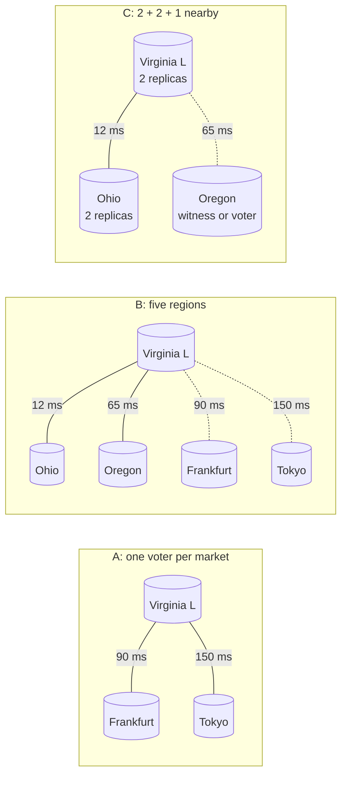

**Reading the diagram.** Each box is one placement of the same replicated database; cylinders are voting replicas and "L" marks the leader. Solid links are the round trips that form the leader's usual quorum; dotted links reach voters that receive every write but are not normally waited for. Placement A must wait for an ocean crossing on every write. Placement B's quorum stays in North America while still holding copies in Europe and Asia. Placement C keeps the quorum within 12 ms and uses Oregon only as a tie-breaker when Virginia or Ohio is lost. Failure points: in C, a continent-wide event (a major North American routing failure) takes out all voters; in A, every write pays the ocean. Scaling: reads scale with non-voting replicas in each market without slowing writes.

#### Failure scenarios

**Table 44.3 — Latency-related failure scenarios.**

| What goes wrong | Why | Detection | Recovery | Prevention |
|---|---|---|---|---|
| Write p99 doubles after a region blip | A nearby voter failed; quorum now needs a distant one | Commit-latency histogram per range; voter health | Restore voter; move leader | Place $q$ voters close; alert on order-statistic shift |
| Service slower after "moving closer" | Stateless tier moved, data did not (§44.4.2) | Trace shows many cross-region DB spans | Co-locate data or batch calls | Count backend round trips in design review |
| Leader drifts to a far region | Election after failure picks a distant voter | Leader-location metric | Transfer leadership | Leader preferences and lease affinity |
| Latency regression after cable cut | Routing moves to a longer path | Inter-region RTT probes | Shift traffic or leaders | Budget for $k$ up to 2; diverse paths |

## 44.5 Global traffic management

### 44.5.1 Steering a request to a region

::: definition
**Definition — Global traffic management.** **Global traffic management (GTM)** is the set of mechanisms that choose, for each client or request, which region (or edge site) serves it, using proximity, measured latency, health, capacity and policy. It is global server load balancing (§19.9) extended with residency rules, home-region affinity and evacuation controls.
:::

#### First-principles explanation

A national taxi company has one phone number. A dispatcher looks at where you are calling from, which depots are open, and which have cars, and sends you to one. The dispatcher must decide *before* the ride starts, cannot see traffic perfectly, and sometimes has stale information about which depots are open. Every GTM mechanism is a dispatcher with a different view and a different delay.

#### How it works internally

There are four steering mechanisms, often layered:

1. **Geo-DNS.** The authoritative DNS server answers with the address of a region chosen from the location of the querying resolver, or of the client subnet if the resolver sends EDNS Client Subnet (§7.6.5).
2. **Latency-based DNS.** The DNS service answers with the region that has the lowest *measured* latency from the resolver's network, using latency tables built from probes; AWS Route 53's latency-based routing is an example [AWS Docs: Route 53 routing policies].
3. **Anycast front door.** One IP address is announced by BGP from many edge sites (§7.5.3). Each client reaches the nearest edge by network path; the edge terminates TCP and TLS and forwards over the provider's backbone to a healthy region. Google's global load balancing works this way [Beyer et al. 2018, ch. 11], as do AWS Global Accelerator and Azure Front Door (as of 2026).
4. **Client-side selection.** The client itself holds a list of regional endpoints, measures them or is told its home region, and chooses (§44.5.4).

Health checks feed all four. A GSLB health system probes each region from many vantage points, aggregates the results so that one bad vantage point does not evacuate a region, and marks regions in or out of rotation (§19.5).

**Figure 44.4 — Layers of global traffic management.**

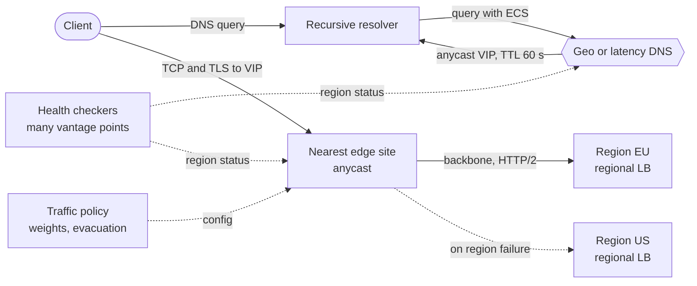

**Reading the diagram.** The client first resolves the service name through its recursive resolver; the GSLB-style authoritative server answers with an anycast virtual IP (VIP) and a TTL. The client then connects synchronously to that VIP, and BGP delivers the connection to the nearest edge site, which terminates TCP and TLS and forwards requests over the provider's private backbone to a regional load balancer. Health checkers report region status asynchronously (dotted) to both the DNS layer and the edges, and a traffic-policy service pushes weights and evacuation settings. Because the address is stable, a region failure is handled by the edge choosing another backend within seconds, not by waiting out DNS caches. Failure points: the health system (a false "unhealthy" evacuates a good region), the policy service (a bad push can misroute everyone) and the edge fleet itself. Scaling: add edge sites; regional capacity is the real limit.

### 44.5.2 DNS TTL limits on failover

DNS-only failover is bounded by caches you do not control (§7.6.4). The total time from failure to clients reaching a healthy region has four parts.

::: formula
**DNS-based failover time**

$$T_{\text{fo}} = T_{\text{detect}} + T_{\text{decide}} + T_{\text{TTL}} + T_{\text{reconnect}}, \qquad \bar{T}_{\text{fo}} \approx T_{\text{detect}} + T_{\text{decide}} + \tfrac{1}{2}T_{\text{TTL}} + T_{\text{reconnect}}$$

| Symbol | Meaning | Units |
|---|---|---|
| $T_{\text{detect}}$ | Time for health checks to declare the region unhealthy (probe interval × failures required) | s |
| $T_{\text{decide}}$ | Time for automation or a human to approve the shift (0 if fully automatic) | s |
| $T_{\text{TTL}}$ | Record TTL: worst-case time a resolver keeps serving the old answer | s |
| $T_{\text{reconnect}}$ | Time for clients with open connections to notice failure and reconnect (timeouts, retries) | s |
| $T_{\text{fo}}, \bar{T}_{\text{fo}}$ | Worst-case and mean failover time for well-behaved resolvers | s |
:::

::: example
**Worked example — QuickBite's DNS failover budget.** Health checks probe every 10 s and require 3 consecutive failures from a majority of vantage points: $T_{\text{detect}} = 30$ s. Policy: automatic shift, but only after a 60 s confirmation window to avoid flapping: $T_{\text{decide}} = 60$ s. TTL is 60 s. Mobile clients use a 10 s request timeout and one retry: $T_{\text{reconnect}} \approx 20$ s.

1. Worst case: $30 + 60 + 60 + 20 = 170$ s.
2. Mean: $30 + 60 + 30 + 20 = 140$ s.
3. With a TTL of 300 s instead: worst case $30 + 60 + 300 + 20 = 410$ s, almost 7 minutes.
4. With an anycast front door, the TTL term disappears for region failures because the VIP does not change; the edge re-routes within its own health-check interval: about $30 + 60 + 0 + 20 = 110$ s, and less if the confirmation window is shortened.

**Interpretation.** With modest TTLs, detection and decision dominate; with long TTLs, caching dominates. Resolvers or runtimes that ignore TTLs add an unbounded tail. **Engineering implication.** Use short TTLs (30–60 s) on records that steer between regions, put a stable anycast address in front where you need fast failover, and measure the real tail from client telemetry rather than trusting the TTL.
:::

**Figure 44.5 — Timeline of a DNS-based regional failover (worst case, from the example).**

```mermaid
gantt
  title Failover timeline in seconds
  dateFormat ss
  axisFormat %S
  section Region EU
  Region fails              :milestone, m1, 00, 0s
  section GSLB
  Detect 3 failed probes    :d1, 00, 30s
  Confirmation window       :d2, after d1, 60s
  section Resolvers
  Cached answers expire     :d3, after d2, 60s
  section Clients
  Timeouts and reconnect    :d4, after d3, 20s
```

**Reading the diagram.** Time runs left to right from the regional failure at 0 s. Detection takes 30 s, the deliberate confirmation window 60 s, and the TTL up to 60 s more while resolvers keep handing out the old address; clients that already had connections then need about 20 s of timeouts and retries. The phases are sequential, so they add: 170 s. Nothing is stored here; the failure point is the longest phase, which is where to invest. Shortening detection risks false evacuations; shortening the TTL raises DNS query volume; an anycast VIP removes the TTL phase entirely.

### 44.5.3 Anycast front doors and provider backbones

An anycast front door terminates TCP and TLS at an edge near the user, so the setup round trips of §44.4.2 cost a few milliseconds, and the long haul runs over warm, pooled backbone connections. Google's SRE book describes the layering: DNS chooses among sites, and virtual IPs at each site are balanced to the application frontends [Beyer et al. 2016, ch. 19].

::: industry
**Google Cloud Load Balancing and Pokémon GO.** The SRE Workbook's "Managing Load" chapter describes how Google's global load balancing uses anycast VIPs, Google Front Ends at the edge and Maglev network load balancers, and recounts the launch of Pokémon GO on Google Cloud, where traffic far above forecast had to be absorbed and shaped at the global load-balancing layer while the backends were scaled. Lesson: the front door is the place to shed, spill and protect overloaded regions.
*Evidence: Primary* — [Beyer et al. 2018, ch. 11]
:::

### 44.5.4 Client-side region selection

Mobile and desktop clients can choose a region themselves. Three patterns are common:

1. **Home-region hint.** At login the service returns the user's home region (§44.6.4), often in the session token; the client calls that region's endpoint directly (`eu.api.example.com`) and falls back to a global name.
2. **Measured selection.** The client periodically measures a small probe to each candidate region and picks the fastest healthy one. This sees the client's own network, which DNS cannot.
3. **Server-directed steering.** Responses carry a header telling the client to use another region from now on (for example during evacuation), which converges faster than any DNS change for active clients.

Client-side logic moves failover speed, and risk, into your code: a region-selection bug ships to millions of devices and cannot be rolled back instantly. Keep a server-controlled kill switch and randomize cross-region retries.

**Table 44.4 — Global traffic management mechanisms compared.**

| Mechanism | Unit of decision | Failover speed | Sees load? | Main limitation |
|---|---|---|---|---|
| Geo-DNS | Resolver (or client subnet) | TTL-bound: minutes | No | Resolver may be far from user |
| Latency-based DNS | Resolver network | TTL-bound | No (latency only) | Coarse; tables lag reality |
| Anycast front door | Network path per connection | Seconds (edge re-routes) | Yes, at edge | BGP path ≠ lowest latency; one shared fleet |
| Client-side selection | Each client | Seconds, under app control | Can be told | Client bugs are slow to fix; needs fleet control |

#### Failure scenarios

**Table 44.5 — Global traffic management failure scenarios.**

| What goes wrong | Why | Detection | Recovery | Prevention |
|---|---|---|---|---|
| Healthy region evacuated | Health checker or one vantage point misreports | Traffic drop with healthy server metrics | Override via traffic policy | Quorum of vantage points; cap automatic shift size |
| Failover does not happen | Clients pinned to dead IPs; long TTLs | Client error telemetry by region | Server-directed steering; retries | Short TTLs; anycast VIP; client fallback list |
| Thundering herd on survivor | Whole region's traffic arrives at once | Survivor saturation | Load shedding (§22.9); stepwise weights | Headroom (§44.11); ramped shifts |
| Global misroute | Bad traffic-policy push | All regions see wrong traffic mix | Roll back config | Progressive config rollout by edge or region |

## 44.6 Deployment topologies

A multi-region topology answers two questions: *which regions serve traffic*, and *which regions may accept a write to a given record*. Four answers cover almost every design.

### 44.6.1 Active–passive: warm and hot standby

::: definition
**Definition — Active–passive (warm or hot standby).** One **active** region serves all traffic and owns all writes; one or more **passive** regions receive replicated data and take over only on failover. In **warm standby** the passive region runs a scaled-down application tier that must scale up during failover; in **hot standby** it runs at full capacity, ready to take all traffic at once (§39.8).
:::

#### How it works internally

1. The active region commits writes locally and replicates asynchronously to the standby (synchronous replication across regions would add a full cross-region RTT to every write, §44.7).
2. The standby applies the stream and lags by the replication delay $\ell$.
3. On failover: confirm the active region is really lost, **fence** it so it cannot accept writes (revoke credentials, stop its writers, bump an epoch, §26.13), promote the standby database, scale the standby application tier (warm) or not (hot), and shift traffic (§44.5).
4. Writes acknowledged in the active region but not yet replicated are lost or must be reconciled later. The loss window is the lag at failure time (§44.7.2).

**Figure 44.6 — Active–passive with a warm standby.**

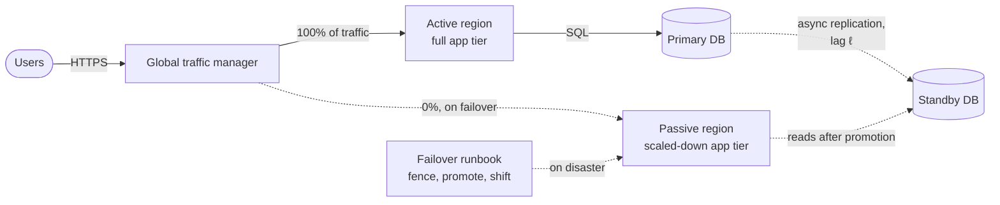

**Reading the diagram.** All user traffic goes synchronously to the active region, whose application tier reads and writes the primary database. The primary replicates asynchronously to the standby (dotted), which lags by $\ell$. The passive region's small application tier receives no traffic until a failover, which a runbook or automation drives in three steps: fence the old primary, promote the standby, shift traffic. Storage boundaries: one primary, one standby. Failure points: the failover path is rarely used, so it decays; the standby may be under-sized when it is needed; writes inside the lag window are lost. Scaling: the active region carries all load, so the design does not reduce latency for distant users.

::: warning
**Warning — Split brain across regions.** A network partition can make the active region *look* dead to the failover controller while it still serves some users. If you promote the standby without fencing the old primary, both regions accept writes and diverge (§26.12). Fence first, by a mechanism that works even if the old region is unreachable (for example, revoking its database credentials from a third region, or a lease it must renew).
:::

### 44.6.2 Active–active, read-local, write-global

::: definition
**Definition — Read-local/write-global.** Every region serves traffic and reads from a local replica, but writes for any record go to a single write location: one global primary region, or the leader of each record's consensus group.
:::

Most user traffic is reads, so most requests stay local and fast. Writes pay $\mathrm{RTT}(c, \ell)$ plus the commit. The price is **staleness**: a local replica may not yet show a write that just committed elsewhere, including the user's own write (§44.12).

**Figure 44.7 — Active–active, read-local and write-global.**

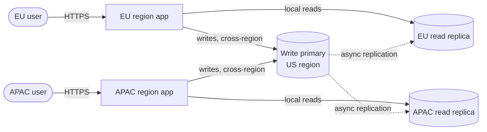

**Reading the diagram.** Each region's application serves its users and reads synchronously from a local replica: a few milliseconds. Writes travel synchronously across regions to the single write primary in the US, so an EU write pays about 90 ms and an APAC write about 150 ms. The primary replicates asynchronously (dotted) back to every read replica, so a read issued right after a write may not see it. Storage boundaries: one primary and one replica per region. Failure points: the write primary is a global single point for writes; if the US region fails, writes stop everywhere until failover, while reads continue from replicas. Scaling: reads scale per region; writes are limited by one primary, unless partitioned so each partition has its own leader.

### 44.6.3 Active–active, multi-writer

::: definition
**Definition — Multi-writer active–active.** Every region accepts writes to any record locally and replicates them asynchronously to the other regions; concurrent writes to the same record in different regions are **conflicts** that must be detected and resolved (§44.8). This is multi-leader replication (§27.6) at regional scale.
:::

Writes are as fast as local writes, and every region stays writable during a partition: PA/EL in PACELC terms (§25.9) [Abadi 2012]. The bill is conflict handling, and the knowledge that a write acknowledged in one region can still be overwritten by a concurrent write elsewhere.

**Figure 44.8 — Multi-writer active–active.**

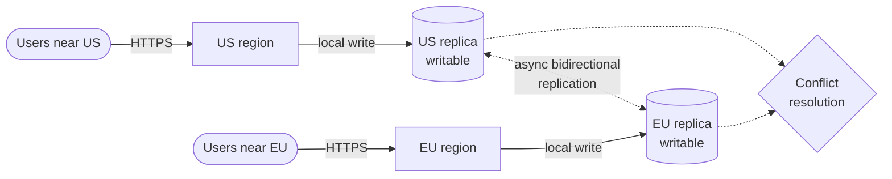

**Reading the diagram.** Each region writes synchronously to its own writable replica and acknowledges the user at local latency. Replicas exchange changes asynchronously in both directions (dotted). When both regions changed the same record within the replication lag, the conflict-resolution step decides the outcome: last-writer-wins, a merge function or a CRDT (§44.8). Storage boundaries: one writable replica per region. Failure points: silent loss of one side of a conflict, replication loops, and divergence if a region is cut off for hours and then reconnects with a large backlog. Scaling: writes scale with regions, but global uniqueness constraints (usernames, seat inventory) cannot be enforced locally.

### 44.6.4 Home region per user: data partitioned by geography

::: definition
**Definition — Home region; geo-partitioning.** **Geo-partitioning** splits data by a geographic key so that each record has exactly one **home region** that owns its writes. Requests for a record are served by, or forwarded to, its home region. **Follow-the-sun** placement moves ownership or leadership over time to where activity is (for example, moving a partition's leader to the region in daytime working hours), and is a variant of the same idea.
:::

#### First-principles explanation

A bank account belongs to a branch. You can walk into any branch and ask about it, and the clerk will phone your home branch, but only your home branch changes the balance. Because only one place writes, there are no conflicts; because most customers bank near home, most visits need no phone call.

#### How it works internally

1. A **placement directory** maps each user (or tenant, restaurant, order) to a home region. QuickBite homes customers by sign-up market and orders by the restaurant's city.
2. The edge or the first region looks up the home region (cached; the directory is small and changes rarely) and routes or forwards the request.
3. The home region writes locally with in-region synchronous replication (RPO 0 within the region) and optionally ships an asynchronous copy to a DR region.
4. Moving a user between regions is a controlled migration: freeze writes for that user, copy, flip the directory entry, unfreeze.

**Figure 44.9 — Home-region routing with a placement directory.**

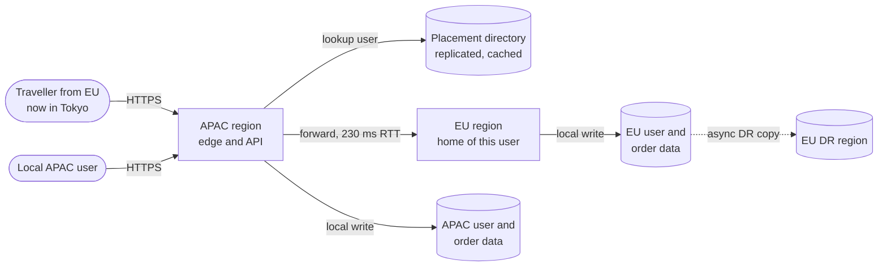

**Reading the diagram.** A local APAC user's requests are handled entirely in the APAC region against APAC-homed data. An EU user traveling in Tokyo arrives at the APAC region too, but the directory lookup (served from a local cached replica) says the user's home is the EU, so the request is forwarded synchronously over the long-haul link; that user pays the 230 ms round trip but sees consistent data. Each home region replicates asynchronously to its own DR region (dotted). Storage boundaries: one per market plus DR copies, which helps residency (§44.9). Failure points: the directory must be highly available and cacheable; losing the EU region makes EU-homed users' writes unavailable until DR failover; users whose activity spans regions (a group order across markets) need a cross-region protocol. Scaling: add regions or cells and assign new users to them.

### 44.6.5 Comparing topologies

**Table 44.6 — Multi-region topologies compared.**

| Row | Active–passive | Read-local / write-global | Multi-writer | Home region (geo-partitioned) |
|---|---|---|---|---|
| What it is | One region serves; standby waits | All serve reads; one place writes | All regions write anything | Each record written only in its home |
| How it works | Async replication, promote on failover | Local replicas, remote leader | Async bidirectional replication | Directory routes to owner |
| Advantages | Simple; no conflicts | Fast reads; one source of truth | Fast local writes; writable in partitions | Local reads and writes for most; no conflicts |
| Disadvantages | No latency gain; failover rots; RPO > 0 | Slow writes for distant users; stale reads | Conflicts, lost updates, no global constraints | Cross-home access is slow; migrations |
| Performance | Distant users pay full RTT | Reads local; writes $+\mathrm{RTT}(c,\ell)$ | Reads and writes local | Local for home users; RTT for travellers |
| Operational complexity | Low day to day, high at failover | Medium | High | Medium–high (directory, migration) |
| Cost | Standby 30–100% of active | Replicas in every region | Full capacity everywhere | Regions sized for own market plus headroom |
| Use cases | Internal tools, DR for one-region apps | Catalogs, content, profiles | Carts, presence, collaborative state | Accounts, orders, tenants, residency |
| Choose when | Latency is fine, RTO minutes is OK | Reads dominate; writes tolerate RTT | Conflicts are mergeable | Data has a natural geographic owner |

#### Mathematical foundations: availability with failover time

The availability benefit of a topology depends on how long a regional incident hurts users, not just on how many regions exist.

::: formula
**Annual user-weighted downtime by topology**

$$D_{\text{AP}} = f\,[\,p_s T_{\text{fo}} + (1 - p_s) T_{\text{out}}\,] + f_g T_g \qquad D_{\text{AA}} = N f \cdot \tfrac{1}{N} \cdot T_{\text{shift}} + f_g T_g = f\,T_{\text{shift}} + f_g T_g$$

$$A = 1 - \frac{D}{525{,}600\ \text{min}}$$

| Symbol | Meaning | Units |
|---|---|---|
| $f$ | Region-level incidents per region per year | incidents/year |
| $T_{\text{out}}$ | Duration of a regional incident if you simply wait | min |
| $T_{\text{fo}}$ | Active–passive failover time: detect + decide + promote + shift | min |
| $p_s$ | Probability the failover works when attempted | probability |
| $N$ | Number of active regions, each carrying $1/N$ of users | regions |
| $T_{\text{shift}}$ | Time for an active–active system to move the affected region's users | min |
| $f_g, T_g$ | Frequency and duration of *global* incidents that no topology contains (bad global config, shared dependency) | incidents/year, min |
| $D_{\text{AP}}, D_{\text{AA}}$ | Expected user-weighted downtime per year | min/year |
| $A$ | Resulting availability | fraction |
:::

The active–active formula counts incidents in all $N$ regions, but each affects only $1/N$ of users, so the $N$ cancels. Double failures (two regions down together) are ignored; they are rare compared with the terms kept, unless failures are correlated.

::: example
**Worked example — How much does each topology buy QuickBite?** Assume $f = 2$ regional incidents per region-year lasting $T_{\text{out}} = 180$ min; active–passive failover $T_{\text{fo}} = 45$ min (human decision, promotion, warm-up); active–active shift $T_{\text{shift}} = 3$ min (automatic); one global incident per year of 30 min.

1. *Single region:* $D = 2 \times 180 + 30 = 390$ min; $A = 1 - 390/525{,}600 = 99.926\%$.
2. *Active–passive, failover always works ($p_s = 1$):* $2 \times 45 + 30 = 120$ min; $A = 99.977\%$.
3. *Active–passive, failover works 80% of the time:* $2 \times (0.8 \times 45 + 0.2 \times 180) + 30 = 2 \times 72 + 30 = 174$ min; $A = 99.967\%$.
4. *Active–active, $N = 3$:* $2 \times 3 + 30 = 36$ min; $A = 99.993\%$.
5. *Active–active with the global incident removed:* $6$ min; $A = 99.9989\%$.

**Interpretation.** Active–active turns 360 minutes of regional pain into 6, but the single 30-minute global incident then accounts for 83% of the remaining downtime. An unreliable failover path quietly gives back a fifth of the active–passive benefit (54 of 270 minutes). **Engineering implication.** Once you are multi-region, the highest-value work is eliminating global dependencies (§44.10) and rehearsing failover (§44.11), not adding a fourth region.
:::

::: industry
**Netflix: active–active across AWS regions.** After a 2012 outage in a single AWS region, Netflix moved from a single-region design to serving members from multiple AWS regions, any of which can take over another's traffic. Their described approach combined DNS and edge traffic steering, Cassandra replicated across regions with eventually consistent writes, and an emphasis on making every region able to serve any member, so that a failing region's traffic could be evacuated to the others.
*Evidence: Primary* — [Meshenberg et al. 2013]
:::

#### Common misconceptions

::: mistake
**Mistake — "Active–active means every region can write every record."** Most production "active–active" systems are read-local/write-global or home-region designs: every region *serves*, but each record has one writer. Full multi-writer is reserved for data whose conflicts can be merged.
:::

## 44.7 Geo-replication

### 44.7.1 Asynchronous versus synchronous across regions

::: definition
**Definition — Geo-replication; replication lag.** **Geo-replication** copies data between regions. It is **synchronous** when a write is acknowledged only after a copy (or a quorum of copies) in another region has it, and **asynchronous** when the write is acknowledged locally and shipped afterward. **Replication lag** $\ell$ is the time between a write's local commit and its application in a given remote replica.
:::

Synchronous geo-replication gives RPO = 0 for region loss and costs at least one cross-region RTT per write (§44.4.3). Asynchronous geo-replication costs nothing on the write path and loses whatever is in flight when a region dies. Most systems use both: synchronous *within* a region across zones, asynchronous *between* regions, with synchronous cross-region consensus only for the small set of data that cannot tolerate loss or conflict.

**Figure 44.10 — Asynchronous versus synchronous cross-region writes.**

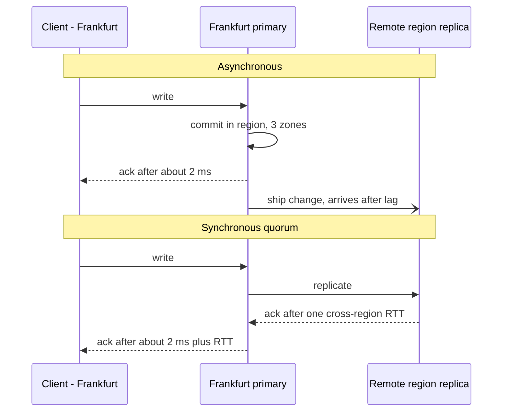

**Reading the diagram.** In the asynchronous half, the Frankfurt primary commits across its own zones and answers the client in about 2 ms; the change travels to the remote region afterward (open arrowhead), arriving after the lag $\ell$. If Frankfurt is lost before it arrives, the acknowledged write is gone. In the synchronous half, the primary waits for the remote acknowledgment before answering, so every write pays a cross-region RTT, and a remote-region outage blocks writes unless a quorum of other regions remains. Storage boundaries: the primary's zones and the remote replica. Scaling: asynchronous throughput is limited by shipping bandwidth; synchronous throughput by pipelining, since latency, not bandwidth, is the bound.

### 44.7.2 Replication-lag budgets and the data-loss window

With asynchronous replication, the RPO is not a configuration value; it is the lag at the moment of failure. Lag is not constant: it grows when the replication link is congested, when the remote replica is slow to apply, or, crucially, when the source region is *already degrading*, which is exactly when failures happen.

::: formula
**Data-loss window for asynchronous geo-replication**

$$\text{RPO}_{\text{actual}} = \ell(t_f), \qquad W_{\text{lost}} \approx \lambda_w \cdot \ell(t_f), \qquad \ell(t) \approx \ell_0 + \frac{\max(0,\ \lambda_w - \mu_r)\,t}{\lambda_w}$$

| Symbol | Meaning | Units |
|---|---|---|
| $t_f$ | Time of the regional failure | s |
| $\ell(t)$ | Replication lag at time $t$ | s |
| $\ell_0$ | Steady-state lag (batching plus one-way transit plus apply) | s |
| $\lambda_w$ | Write rate in the failed region | writes/s |
| $\mu_r$ | Replication throughput (ship and apply) | writes/s |
| $t$ | Time since replication throughput fell below the write rate | s |
| $W_{\text{lost}}$ | Acknowledged writes lost if the region never returns | writes |
:::

::: example
**Worked example — QuickBite EU orders.** The EU region writes $\lambda_w = 400$ order-state changes per second at dinner peak. Changes ship in 100 ms batches with 45 ms one-way transit to the DR region and about 5 ms apply, so $\ell_0 \approx 50 + 45 + 5 = 100$ ms on average (half a batch waits, on average).

1. *Steady state:* $W_{\text{lost}} = 400 \times 0.1 = 40$ order changes.
2. *Degrading region:* 10 minutes before the outage, a failing network device halves cross-region throughput to $\mu_r = 200$ writes/s while writes continue. Backlog grows by $200$ writes/s for 600 s: 120,000 writes. Lag: $0.1 + 120{,}000/400 = 300.1$ s, five minutes.
3. $W_{\text{lost}} \approx 400 \times 300 = 120{,}000$ order changes: thousands of orders in unknown states.

**Interpretation.** The steady-state RPO of 100 ms is a fair-weather number; the RPO that matters is the lag during the incident, which here is 3,000 times larger. **Engineering implication.** Alert on replication lag and backlog, set a **lag budget** (for example, "lag above 5 s for 1 minute pages the on-call engineer; above 30 s the region stops accepting new orders" — an RPO guard that trades availability for bounded loss), and reconcile lost writes when the region returns rather than discarding them (§44.11.4).
:::

### 44.7.3 Conflict-free by construction: home-region ownership

If each record has exactly one home region that accepts its writes (§44.6.4), asynchronous replication creates no conflicts: replicas elsewhere are read-only copies that lag. Conflicts reappear only during a failover, when the DR copy is promoted and the old home may hold writes the DR copy never received. Treat those as a reconciliation job, not as a merge.

### 44.7.4 Managed geo-replicated databases (as of 2026)

**Table 44.7 — Managed geo-replication options (published facts as of 2026; check current documentation).**

| Product | Write model | Cross-region consistency | Conflict handling | Notes |
|---|---|---|---|---|
| DynamoDB global tables, multi-Region eventual consistency (default) | Any replica Region accepts writes | Asynchronous; AWS states changes usually propagate within a second | Last-writer-wins on concurrent updates | PA/EL; RPO > 0 |
| DynamoDB global tables, multi-Region strong consistency | Writes replicated to another Region before success | Strongly consistent reads available in each Region | Concurrent conflicting writes are rejected with an error, not merged | Exactly three Regions: three replicas, or two replicas plus a witness; RPO 0; mode fixed at table creation |
| Spanner multi-region | Paxos leader per split, default leader region | External consistency (§28.8); stale reads local | No conflicts (single leader per split) | Base configs: two read-write regions with two replicas each plus a witness region; five voters; optional read-only replicas |
| CockroachDB multi-region | Raft leaseholder per range; table localities | Serializable; follower reads stale and local | No conflicts | Survival goal zone (default) or region (needs ≥ 3 regions); `REGIONAL BY TABLE`, `REGIONAL BY ROW`, `GLOBAL` |
| Aurora Global Database | One primary Region; secondaries read-only | Asynchronous storage-level replication | No conflicts (one writer); write forwarding available | Planned switchover has no data loss; unplanned failover RPO typically seconds |

Sources: [AWS Docs: DynamoDB global tables], [Google Cloud Docs: Spanner instance configurations], [Cockroach Labs Docs: Multi-region overview], [AWS Docs: Aurora Global Database].

A few details matter when choosing:

- **DynamoDB global tables** in the default mode resolve concurrent writes with last-writer-wins, so make each item single-owner or an idempotent overwrite (§44.8). The strong mode (generally available since 2025) trades write latency for RPO 0 [AWS Docs: DynamoDB global tables].
- **Spanner** multi-region instances put a write quorum within the leader region and the second read-write region or nearby witness, so writes cost a regional RTT (tens of milliseconds), not an intercontinental one, while reads anywhere can use stale (bounded or exact timestamp) reads served by local replicas [Corbett et al. 2012; Google Cloud Docs: Spanner instance configurations]. Brewer argues that Spanner is technically CP but, because Google's private network makes partitions rare, delivers availability high enough that users can treat it as CA [Brewer 2017].
- **CockroachDB** expresses placement declaratively. `REGIONAL BY ROW` stores a hidden region column per row and homes each row's leaseholder in that region: home-region ownership inside one SQL database. `GLOBAL` tables serve consistent, low-latency reads from every region by writing at future timestamps, so writes are slower [Taft et al. 2020; VanBenschoten et al. 2022]. A region survival goal places voters so that a region loss keeps a quorum, at the cost of cross-region writes (§44.4.3).
- **Aurora Global Database** distinguishes a planned *switchover*, which waits for the secondary to catch up and suits drills, from an unplanned *failover*, which accepts the lag as data loss [AWS Docs: Aurora Global Database].

### 44.7.5 Code example: simulating write latency and failover loss

The program below models clients in Virginia, Frankfurt and Tokyo writing 2,000 times per second. It compares an active–passive pair (Virginia primary, Oregon standby, asynchronous batched replication) with consensus groups of three and five regions, and kills the primary or leader region at $t = 15$ s. For each design it reports write latency by client region and the number of *acknowledged* writes that no surviving replica holds.

```python
"""Write latency and failover data loss: active-passive async vs multi-region quorum."""
import random
import statistics

RTT_MS = {  # approximate inter-region round-trip times, ms (illustrative)
    ("virginia", "ohio"): 12, ("virginia", "oregon"): 65,
    ("virginia", "frankfurt"): 90, ("virginia", "tokyo"): 150,
    ("ohio", "oregon"): 50, ("ohio", "frankfurt"): 100, ("ohio", "tokyo"): 140,
    ("oregon", "frankfurt"): 140, ("oregon", "tokyo"): 100,
    ("frankfurt", "tokyo"): 230,
}
CLIENT_MIX = {"virginia": 0.5, "frankfurt": 0.3, "tokyo": 0.2}
FSYNC_MS = 1.0


def rtt(a, b):
    if a == b:
        return 1.0  # same region, across zones
    return RTT_MS.get((a, b)) or RTT_MS[(b, a)]


def noisy(rng, base):
    """Network time with a small exponential tail (mean +5%)."""
    return base * (1.0 + rng.expovariate(20.0))


def arrivals(rng, rate_per_s, duration_s):
    t, out = 0.0, []
    regions, weights = zip(*CLIENT_MIX.items())
    while True:
        t += rng.expovariate(rate_per_s) * 1000.0  # ms
        if t > duration_s * 1000.0:
            return out
        out.append((t, rng.choices(regions, weights)[0]))


def active_passive(writes, rng, primary, standby, fail_at_ms, batch_ms=100.0):
    """Commit locally in the primary, acknowledge, ship to the standby in batches."""
    latencies, lost, batch_arrival = [], [], {}
    for t_send, client in writes:
        t_commit = t_send + noisy(rng, rtt(client, primary)) / 2 + FSYNC_MS
        latencies.append(t_commit + noisy(rng, rtt(client, primary)) / 2 - t_send)
        batch = int(t_commit // batch_ms) + 1          # shipped at the end of its batch
        if batch not in batch_arrival:
            batch_arrival[batch] = batch * batch_ms + noisy(rng, rtt(primary, standby)) / 2
        if t_commit <= fail_at_ms < batch_arrival[batch]:
            lost.append(t_commit)  # acknowledged, but never reached the standby
    window = (fail_at_ms - min(lost)) / 1000.0 if lost else 0.0
    return latencies, len(lost), window


def quorum(writes, rng, voters, leader, fail_at_ms):
    """Leader commits once a majority (itself plus q-1 followers) has the entry."""
    q = len(voters) // 2 + 1
    latencies, lost = [], 0
    for t_send, client in writes:
        t_leader = t_send + noisy(rng, rtt(client, leader)) / 2
        received, acks = {leader: t_leader + FSYNC_MS}, []
        for f in voters:
            if f == leader:
                continue
            one_way = noisy(rng, rtt(leader, f)) / 2
            received[f] = t_leader + one_way + FSYNC_MS
            acks.append(received[f] + one_way)
        acks.sort()
        t_commit = max(t_leader + FSYNC_MS, acks[q - 2])  # (q-1)-th fastest follower
        latencies.append(t_commit + noisy(rng, rtt(client, leader)) / 2 - t_send)
        if t_commit <= fail_at_ms:
            survivors = [r for r in voters if r != leader and received[r] <= fail_at_ms]
            if not survivors:
                lost += 1  # would violate durability of a committed write
    return latencies, lost, 0.0


def pct(xs, p):
    xs = sorted(xs)
    return xs[min(len(xs) - 1, int(p / 100 * len(xs)))]


def run(rate=2000, duration_s=20, seed=7):
    rng = random.Random(seed)
    writes = arrivals(rng, rate, duration_s)
    fail_at = duration_s * 1000.0 * 0.75
    scenarios = {
        "active-passive async (VA -> OR)": lambda: active_passive(
            writes, rng, "virginia", "oregon", fail_at),
        "quorum 3 regions US (VA, OH, OR)": lambda: quorum(
            writes, rng, ["virginia", "ohio", "oregon"], "virginia", fail_at),
        "quorum 3 regions global (VA, FR, TK)": lambda: quorum(
            writes, rng, ["virginia", "frankfurt", "tokyo"], "virginia", fail_at),
        "quorum 5 regions (VA, OH, OR, FR, TK)": lambda: quorum(
            writes, rng, ["virginia", "ohio", "oregon", "frankfurt", "tokyo"],
            "virginia", fail_at),
    }
    results = {}
    for name, fn in scenarios.items():
        lat, lost, window = fn()
        by_region = {}
        for (_, c), l in zip(writes, lat):
            by_region.setdefault(c, []).append(l)
        results[name] = {
            "p50": statistics.median(lat), "p99": pct(lat, 99),
            "p50_by_client": {c: statistics.median(v) for c, v in by_region.items()},
            "lost": lost, "window_s": window,
        }
    return len(writes), results


def test():
    n, res = run()
    ap = res["active-passive async (VA -> OR)"]
    q3 = res["quorum 3 regions US (VA, OH, OR)"]
    q3g = res["quorum 3 regions global (VA, FR, TK)"]
    q5 = res["quorum 5 regions (VA, OH, OR, FR, TK)"]
    assert ap["lost"] > 0 and ap["window_s"] > 0          # async: RPO > 0
    assert q3["lost"] == q3g["lost"] == q5["lost"] == 0   # quorum: RPO = 0
    va = {k: v["p50_by_client"]["virginia"] for k, v in res.items()}
    assert va["active-passive async (VA -> OR)"] < va["quorum 3 regions US (VA, OH, OR)"]
    assert va["quorum 3 regions US (VA, OH, OR)"] < va["quorum 5 regions (VA, OH, OR, FR, TK)"]
    assert va["quorum 5 regions (VA, OH, OR, FR, TK)"] < va["quorum 3 regions global (VA, FR, TK)"]
    assert q3g["p50_by_client"]["virginia"] > 90          # cannot beat the 90 ms RTT floor
    # lost writes ~ write rate x (half a batch + one-way transit) = 2000/s x ~84 ms
    expected = n / 20 * (0.100 / 2 + 0.065 / 2 * 1.05)
    assert 0.3 * expected < ap["lost"] < 3 * expected
    print("all tests passed")


if __name__ == "__main__":
    n, res = run()
    print(f"{n} writes simulated; leader/primary region fails at t = 15 s\n")
    print(f"{'scenario':40}{'p50':>7}{'p99':>7}{'VA':>7}{'FR':>7}{'TK':>7}{'lost':>7}{'window s':>10}")
    for name, r in res.items():
        b = r["p50_by_client"]
        print(f"{name:40}{r['p50']:7.1f}{r['p99']:7.1f}{b['virginia']:7.1f}"
              f"{b['frankfurt']:7.1f}{b['tokyo']:7.1f}{r['lost']:7d}{r['window_s']:10.3f}")
    print()
    test()
```

Running it with Python 3 prints (latencies in ms; VA, FR and TK are median latencies for clients in each region):

```text
40309 writes simulated; leader/primary region fails at t = 15 s

scenario                                    p50    p99     VA     FR     TK   lost  window s
active-passive async (VA -> OR)            91.2  168.8    2.0   94.7  157.3    188     0.100
quorum 3 regions US (VA, OH, OR)          103.5  181.7   14.5  107.4  169.8      0     0.000
quorum 3 regions global (VA, FR, TK)      182.0  266.1   95.2  188.9  251.6      0     0.000
quorum 5 regions (VA, OH, OR, FR, TK)     156.8  238.3   69.3  162.9  225.5      0     0.000

all tests passed
```

What to notice:

- **Durability is checked, not assumed.** For each committed write, `quorum` records when every follower received it and verifies that some replica outside the failed region holds it at the moment of failure. The count is 0 for every placement: a majority commit cannot be lost to one region failure.
- **Async loses the batch in flight.** The 188 lost writes are those committed in the last 100 ms batch, sealed but not yet delivered: close to $\lambda_w \ell$ from §44.7.2. Raise `batch_ms` or slow the link and the loss grows proportionally.
- **Virginia clients see the order statistic.** 2 ms (local commit), 14.5 ms (Ohio is the nearest follower), 69 ms (second-nearest of four is Oregon), 95 ms (nearest of Frankfurt and Tokyo), matching §44.4.3.
- **Distant clients pay the client-to-leader RTT in every design.** Frankfurt and Tokyo clients are slow even in the active–passive case; only home-region data (§44.6.4) or moving the leader helps them.
- **The model is deliberately small.** It ignores leader election time, apply delay and correlated network jitter; extend it in the exercises (§44.16).

## 44.8 Conflict handling across regions

### 44.8.1 Where conflicts come from and how often

::: definition
**Definition — Cross-region write conflict.** Two writes to the same record, accepted in different regions, neither of which had seen the other when it was accepted. Such writes are **concurrent** in the happens-before sense (§24.10); a system must either prevent them (ownership, consensus) or resolve them after the fact.
:::

Inside one region, conflicts are prevented cheaply by a single leader. Across regions, the window in which two writes can be concurrent is the replication lag, tens of milliseconds to minutes, so conflict rates that were negligible become routine for hot records.

::: formula
**Expected conflict rate on one record under multi-writer replication**

$$c \approx 2\,r_A\,r_B\,\ell \qquad \text{(for } r\ell \ll 1\text{)}$$

| Symbol | Meaning | Units |
|---|---|---|
| $r_A, r_B$ | Write rates to the record in regions $A$ and $B$ | writes/s |
| $\ell$ | Replication lag between the regions (assumed equal both ways) | s |
| $c$ | Rate of conflicting write pairs | conflicts/s |
:::

A write in $A$ conflicts with any write in $B$ that lands within $\ell$ before or after it, a window of $2\ell$; with $B$'s writes arriving at rate $r_B$, each $A$ write conflicts with probability about $2 r_B \ell$.

::: example
**Worked example — A shared group-order cart.** A group order from friends in Paris (EU region) and New York (US region) receives 0.2 edits/s from each side during the 5-minute ordering window; lag is 0.5 s at peak.

1. $c = 2 \times 0.2 \times 0.2 \times 0.5 = 0.04$ conflicts/s.
2. Over 300 s: $0.04 \times 300 = 12$ conflicting pairs per group order.
3. Under last-writer-wins on the whole cart, up to 12 edits silently vanish per order.
4. For a user profile edited once a month from one device, $r_A r_B \approx 0$: conflicts essentially never happen.

**Interpretation.** Conflict rate scales with the *product* of the two regions' write rates and with lag, so it is concentrated on a few hot, shared records. **Engineering implication.** Classify records: single-owner records tolerate LWW; shared, frequently edited records need ownership, a merge function or a CRDT.
:::

### 44.8.2 Strategies

**Figure 44.11 — A lost update under last-writer-wins across regions.**

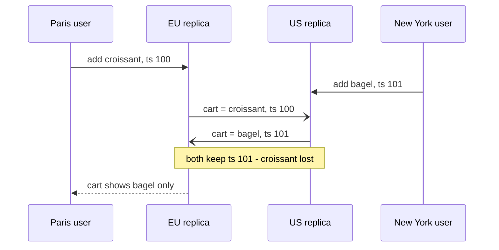

**Reading the diagram.** Each user writes the whole cart to the replica in their own region, and each write is acknowledged locally. The replicas then exchange states asynchronously (open arrowheads). Last-writer-wins compares timestamps, keeps the cart stamped 101 in both regions and discards the croissant, even though both writes were acknowledged and neither user removed anything. The storage boundary is each regional replica; the failure point is the merge rule, which treats two concurrent *additions* as competing *replacements*. A CRDT set or a per-item write would keep both.

The options, from most to least preferred for shared mutable data:

1. **Avoid conflicts by ownership.** Give each record a home region (§44.6.4) or route all writes for a shared object to one region, such as the region of the group order's creator. Cost: remote users pay the RTT.
2. **CRDTs.** Model the cart as an observed-remove set and quantities as counters, so concurrent operations merge deterministically (§27.14.3). Cost: data-model constraints and tombstone metadata; invariants such as "stock ≥ 0" cannot be enforced by merging alone.
3. **Application-level merge.** Keep siblings with version vectors (§27.14.2) and merge with domain rules: union of cart lines, maximum of order status in its state machine, flag for human review if a refund and a charge collide. Cosmos DB, for example, offers a custom conflict-resolution procedure or a conflicts feed for this purpose, alongside its LWW default [Azure Docs: Cosmos DB conflict resolution].
4. **Last-writer-wins.** Acceptable for single-writer or idempotent-overwrite data: a device's last-seen location, a cache entry, a preference toggle. Remember that clock skew can make the earlier write win (§27.14.1).

Some invariants cannot be merged at all: a username must be unique, a seat may be sold once, an account must not go negative. Route those operations through a single owner or a cross-region consensus group, and keep everything else local. The pattern of "local for most, global for the few operations that need it" recurs throughout this chapter.

::: mistake
**Mistake — "We use timestamps, so the latest write wins."** "Latest" by whose clock? With skew $\varepsilon$, writes closer than $\varepsilon$ can be misordered, and LWW discards concurrent writes even with perfect clocks. LWW is a resolution rule, not a correctness guarantee.
:::

## 44.9 Data residency and sovereignty

### 44.9.1 Residency as a placement constraint

::: definition
**Definition — Data residency, localization, sovereignty.** **Data residency** is a requirement, from law, contract or customer policy, about the geographic location where data is stored and processed. **Data localization** is the stricter form: data (or a copy) must remain inside a country. **Data sovereignty** is the broader principle that data is subject to the laws of the place where it is collected or stored, which raises the question of which governments can compel access to it.
:::

::: note
**Note — This section is architecture, not legal advice.** Requirements differ by jurisdiction, sector and contract and change over time. Engineers should design for configurable placement and work with counsel on what each data class actually requires.
:::

#### The constraint at an architectural level

The EU General Data Protection Regulation (GDPR) does not, in general, require personal data to stay inside the EU. Its Chapter V (Articles 44–49) restricts *transfers* of personal data to countries outside the European Economic Area unless a legal basis applies: an adequacy decision by the European Commission (Article 45), appropriate safeguards such as standard contractual clauses or binding corporate rules (Articles 46–47), or narrow derogations (Article 49) [EU 2016]. In *Schrems II* (2020) the Court of Justice of the EU invalidated the EU–US Privacy Shield and required transfers under standard contractual clauses to be assessed for whether the destination's law undermines the protection, possibly with supplementary technical measures [CJEU 2020]. A new EU–US Data Privacy Framework adequacy decision followed in July 2023 [European Commission 2023]. The engineering lesson: the legal basis for a cross-border flow can change within a product's lifetime, so architectures that can *keep* data in a region, and prove it, are worth building. Stricter national localization rules become placement policies.

#### How it works internally

1. **Classify data.** Personal content (orders, addresses, messages), personal metadata (account ID, home region), non-personal reference data (menus, restaurant catalogs) and derived data (logs, metrics, analytics, ML features, backups).
2. **Regional data stores.** Personal data lives in the user's home region (§44.6.4), with its DR copy in a region inside the same jurisdiction (for QuickBite's EU data, Frankfurt with DR in another EU region).
3. **Split metadata from content.** A global directory stores only a pseudonymous user ID and the home region, which is what routing needs; names, addresses and order history stay regional.
4. **Keep keys regional.** Encrypt regional data with keys held in a key-management service in the same jurisdiction, so a copy that leaks outside is unreadable; supplementary-measure discussions often turn on exactly this.
5. **Cover the side channels.** Logs, traces, crash dumps, support tooling, analytics pipelines, backups and ML training sets are where residency is usually broken. Scrub or regionalize them, and treat remote administrative access from another country as a potential transfer too.

**Figure 44.12 — Metadata versus content split for residency.**

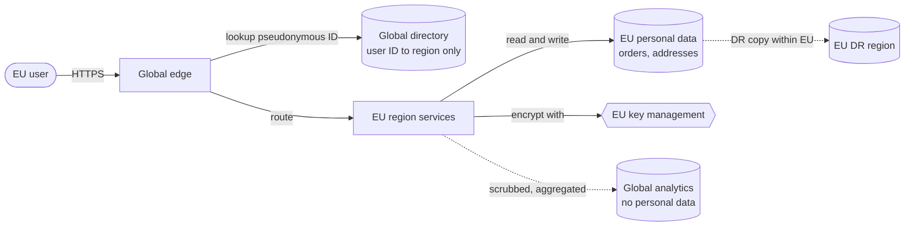

**Reading the diagram.** The global edge needs only to know where a user lives, so the global directory holds a pseudonymous ID and a region code, nothing else. The request is routed synchronously to EU services, which read and write personal data in the EU store, encrypted with keys from an EU key-management service (hexagon, an external trust boundary). Asynchronous flows (dotted) carry only scrubbed, aggregated data to global analytics and a DR copy to another EU region. Storage boundaries: the directory (global), the personal store and its DR copy (EU only) and analytics (global, non-personal). Failure points: a log line or support export that copies personal data out; a directory field that quietly grows into a profile. Scaling: adding a jurisdiction means adding a region set and a placement rule, not redesigning.

::: mistake
**Mistake — "Our database is in Frankfurt, so we are compliant."** Residency is broken more often by everything around the database: application logs shipped to a global log cluster, a support tool in another country with read access, nightly backups to a cheaper region, a feature pipeline that copies orders into a global training set.
:::

## 44.10 Cell-based and region-isolated architectures at global scale

### 44.10.1 Regional independence

::: definition
**Definition — Regional independence; static stability.** A design is **regionally independent** when each region can serve its users with no synchronous dependency on any other region or on a global service. It is **statically stable** when it keeps working through a failure *without making changes*: no scaling, no reconfiguration and no control-plane calls are needed to survive [Weiss and Furr 2020].
:::

Cells (§33.12) bound the blast radius of faults inside a region. At global scale the same idea applies one level up: each region is a set of cells, and regions share as little as possible. The usual culprits for shared fate are *global* components: a single global control plane, a global configuration or feature-flag service, a global identity provider, a single DNS provider, a global database for sessions, and deployment pipelines that push to every region at once.

The AWS Builders' Library article "Minimizing correlated failures in distributed systems" frames the problem: redundancy is only as good as the independence of what is redundant, and shared infrastructure, shared software and shared timing all correlate failures [AWS Builders' Library: Minimizing correlated failures]. The AWS whitepaper on fault isolation boundaries describes the provider's own split: regional services keep their control and data planes within the region, while a few global services have their control plane in one region but data planes distributed worldwide, and it recommends that recovery depend only on data-plane operations [AWS 2022].

**Figure 44.13 — Regional data planes with a non-critical global control plane.**

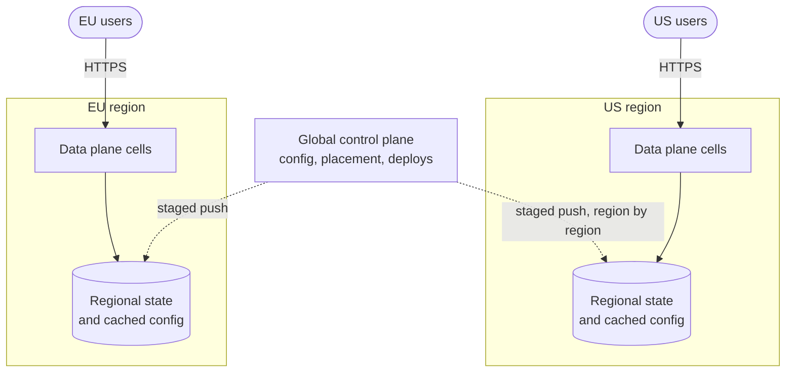

**Reading the diagram.** Users call each region's data-plane cells synchronously; the cells depend only on regional state, including a locally cached copy of configuration. The global control plane writes configuration, placement and deployments asynchronously (dotted), one region at a time. If the control plane fails, every region keeps serving from its last known-good configuration: static stability. Storage boundaries: one per region; there is no global store on the request path. Failure points: a bad configuration that passes validation can still reach every region, which is why pushes are staged with health checks between regions (§43.6), and a region's cached configuration must survive restarts. Scaling: add regions independently.

#### How to get there

1. **Inventory global dependencies** on the request path and the *recovery* path; a failover that needs a control-plane API in the failed region will not run.
2. **Pre-provision** capacity, certificates, credentials and DNS records, so failover is a data-plane change (flipping a routing control).
3. **Cache with stale-OK semantics:** tokens verified with cached keys, configuration from local snapshots.
4. **Stage every global change** by region and cell (§43.6), including configuration and certificates.
5. **Diversify the truly global**, for example two DNS providers.

::: industry
**AWS us-east-1, 7 December 2021.** AWS's published summary describes an automated capacity-scaling activity that triggered unexpected behavior in internal network clients, congesting the devices connecting AWS's internal network to the main network in the Northern Virginia region. Many services' control planes and APIs in that region were impaired for hours, while some already-running resources continued to work. AWS noted that the event also impaired its own monitoring and its ability to update the Service Health Dashboard. Lesson for designers: running resources (data plane) were more resilient than anything that needed control-plane actions, and dependencies on a single region's tooling hurt communication during the incident.
*Evidence: Primary* — [AWS 2021b]
:::

## 44.11 Regional failover and evacuation

### 44.11.1 Detection, decision, traffic shift

::: definition
**Definition — Regional evacuation.** Deliberately moving all traffic, and where necessary data ownership, out of a region that is failing or under maintenance, onto the remaining regions, without waiting for the region to fail completely.
:::

1. **Detection.** Use user-facing signals per region: request success rate and latency at the edge, plus synthetic probes from outside. Regional failures are often *gray* (§24.8.2): the region is partly up, and internal health checks pass while users fail.
2. **Decision.** Automate the decision for clear signals with guard rails (never evacuate more than one region automatically; require survivors to have headroom). Keep a single, rehearsed human command for ambiguous cases. Evacuating early is usually cheaper than waiting for certainty.
3. **Traffic shift.** Ramp weights (for example 25% steps every 30 s) so survivors' caches and autoscalers warm, and shed low-priority load if needed (§22.9).
4. **Data.** For home-region data, promote DR copies (fenced, §44.6.1) or serve those users read-only until the home returns.

**Figure 44.14 — Regional evacuation and failback as a state machine.**

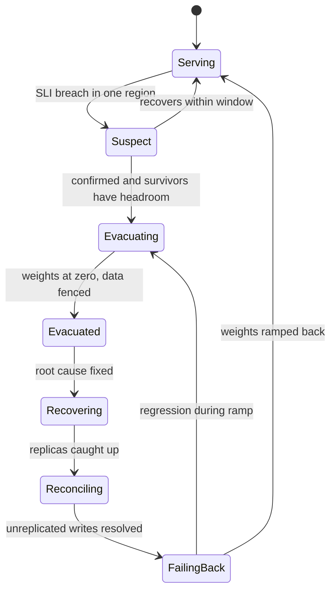

**Reading the diagram.** A region moves from *Serving* to *Suspect* when its user-facing SLIs breach a threshold, and back if it recovers within a confirmation window. Confirmed failure with enough headroom elsewhere starts *Evacuating*: weights ramp to zero and the region's writers are fenced. Return is deliberately slower than exit: after the fix, replicas catch up, writes accepted in the region but never replicated are reconciled, and only then do weights ramp back, with an automatic return to evacuation on regression. Storage boundaries are the region's data stores, whose state gates each step. The riskiest transitions are *Evacuating* (survivor overload) and *Reconciling* (lost or duplicated writes).

### 44.11.2 Capacity headroom to absorb a region

::: formula
**Regional capacity to survive the loss of one of $N$ regions**

$$C_{\text{region}} = \frac{D}{(N - 1)\,u_{\text{fail}}}, \qquad C_{\text{total}} = N\,C_{\text{region}}, \qquad u_{\text{normal}} = \frac{N - 1}{N}\,u_{\text{fail}}, \qquad \text{overhead} = \frac{N}{N - 1} - 1$$

| Symbol | Meaning | Units |
|---|---|---|
| $D$ | Global peak demand, spread evenly over regions | RPS |
| $N$ | Number of active regions | regions |
| $u_{\text{fail}}$ | Highest acceptable utilization after absorbing a region | fraction |
| $C_{\text{region}}$ | Capacity to provision in each region | RPS |
| $C_{\text{total}}$ | Total provisioned capacity | RPS |
| $u_{\text{normal}}$ | Utilization in normal operation | fraction |
| overhead | Extra capacity compared with $D/u_{\text{fail}}$ with no regional failure headroom | fraction |
:::

::: example
**Worked example — QuickBite's N + 1 regions.** Global peak $D = 30{,}000$ RPS; after a failover, regions may run at $u_{\text{fail}} = 0.8$. Without regional headroom you need $30{,}000/0.8 = 37{,}500$ RPS of capacity.

1. $N = 2$: $C_{\text{region}} = 30{,}000/(1 \times 0.8) = 37{,}500$; total 75,000; normal utilization $0.5 \times 0.8 = 40\%$; overhead 100%.
2. $N = 3$: $30{,}000/(2 \times 0.8) = 18{,}750$; total 56,250; normal 53%; overhead 50%.
3. $N = 4$: $12{,}500$ each; total 50,000; normal 60%; overhead 33%.
4. $N = 5$: $9{,}375$ each; total 46,875; normal 64%; overhead 25%.
5. *Uneven, proximity-routed traffic.* With three regions carrying US 50%, EU 30%, APAC 20%, and US traffic failing over 80% to EU and 20% to APAC, the EU region must absorb $30\% + 0.8 \times 50\% = 70\%$ of global demand: $0.7 \times 30{,}000/0.8 = 26{,}250$ RPS, 40% more than the even-split 18,750.

**Interpretation.** More, smaller regions make regional redundancy cheaper, but the even-split formula is optimistic when users fail over to the *nearest* survivor. **Engineering implication.** Compute the worst-case survivor load for each failure, using the real failover routing, and either size for it or steer part of the evacuated traffic to a farther region and accept extra latency. Time-zone diversity helps: if markets peak at different hours, size for the peak of the *sum*, not the sum of peaks. Reserve or pre-provision this capacity; on-demand capacity may be scarce in a regional event when every customer fails over at once [Weiss and Furr 2020].
:::

### 44.11.3 Game days and continuous evacuation

A failover path that is not exercised does not work when needed. Run **game days**: planned evacuations of a production region during business hours, with the on-call team using the real runbook, measuring $T_{\text{fo}}$, survivor utilization and data reconciled. Mature teams evacuate regions routinely, for maintenance as well as practice, so the path stays warm.

::: industry
**Netflix region evacuation.** Netflix has described evacuating an entire AWS region's traffic to its other regions as a routine resilience exercise, and later re-engineering the process (pre-scaled capacity in the receiving regions and faster traffic steering) so that an evacuation completes in minutes rather than the better part of an hour.
*Evidence: Primary* — [Netflix Technology Blog 2018]
:::

### 44.11.4 Failback

Failback is a second, planned failover in reverse and deserves the same care. Wait until the recovered region's replicas have caught up; reconcile writes that the region acknowledged before it failed but never replicated (replay them where safe, or route them to human review: an order that was paid for but never dispatched matters); then ramp traffic back gradually. Never fail back automatically just because health checks turn green.

## 44.12 Global consistency options and the user-visible consequences

### 44.12.1 What users notice

Users do not see consistency models; they see symptoms. "I changed my address and the old one came back." "My friend's order shows *delivered* but mine still says *cooking*." Most of these are violations of session guarantees (§25.6) across regions, and above all of **read-your-writes (RYW)**: after a user's write is acknowledged, that user's subsequent reads must reflect it.

In a read-local/write-global design, a Frankfurt user writes to a Virginia leader and then reads from the Frankfurt replica, which may lag. Three fixes, in increasing cost:

1. **Session stickiness to the home region.** Route each user's reads and writes to their home region (§44.6.4), where reads are strongly consistent. Simple, and correct as long as stickiness holds; it breaks during failover or when a traveller hits another region.
2. **Session tokens.** Each write returns a position: a commit timestamp, log sequence number or version vector. The client sends its latest token with every read; a replica serves the read only if it has applied up to that position, otherwise it waits briefly or forwards to the leader (§25.6.2).
3. **Strong reads.** Read from the leader or use a linearizable read (Spanner strong reads, DynamoDB strongly consistent reads where offered), paying the cross-region RTT on every read.

**Figure 44.15 — Read-your-writes across regions with a session token.**

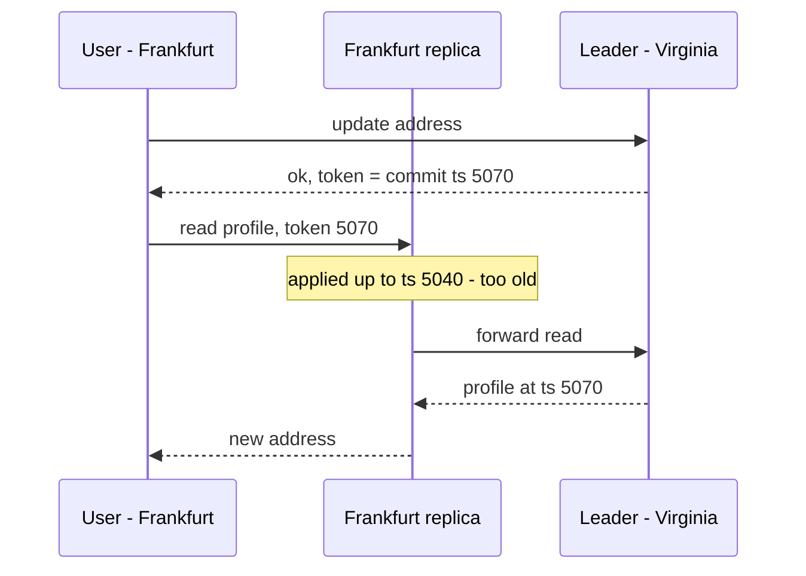

**Reading the diagram.** The user's write goes synchronously to the Virginia leader, which returns a token holding the commit timestamp. The next read goes to the nearby Frankfurt replica with the token. The replica has applied changes only up to 5040, so serving locally would show the old address; it forwards the read to the leader (or waits for replication to pass 5070), then answers. Storage boundaries: the leader and the replica. Failure point: if the token is lost (a new device, a cleared app), RYW quietly degrades to eventual consistency. Scaling: most reads carry tokens that the local replica already satisfies, so the forward path is rare.

**Table 44.8 — Global consistency options and what users see.**

| Option | Read latency | Write latency | What the user may see |
|---|---|---|---|
| Eventual, read local | Local | Local or $+\mathrm{RTT}$ | Own edits disappear briefly; others' edits arrive late |
| Session token (RYW, monotonic reads) | Local, occasionally $+\mathrm{RTT}$ | $+\mathrm{RTT}$ to leader | Own edits always visible; others' may lag |
| Home-region sticky | Local for home users | Local for home users | Consistent at home; travellers pay RTT |
| Bounded-staleness reads | Local | $+\mathrm{RTT}$ | Data at most $\Delta$ old |
| Strong (linearizable) everywhere | $+\mathrm{RTT}$ | $+$ quorum RTT | Always current; slower and less available in partitions |

::: tip
**Interview tip — Name the user-visible anomaly.** When asked about global consistency, start from what a user would notice and choose the weakest guarantee that prevents it, per operation: RYW for profile edits, strong for payments and uniqueness, eventual for view counts.
:::

## 44.13 Summary and revision notes

::: summary
- Go multi-region for latency, regional availability, data residency or blast radius; each leads to a different design, and all cost capacity, transfer fees, write latency and complexity.
- Fiber RTT floor $= 2d/v$ at about 5 µs/km; observed RTTs are 1.3–2× the floor. A user action costs (sequential round trips) × RTT, so move data with compute.
- Quorum write latency $\approx \mathrm{RTT}(c,\ell) + \mathrm{RTT}_{(q-1)}(\ell)$. Place the usual quorum near the leader and the leader near writers; a region survives loss of $r$ if $N - n_r \ge q$.
- Steer with geo/latency DNS, anycast front doors and client-side selection. DNS failover $= T_{\text{detect}} + T_{\text{decide}} + T_{\text{TTL}} + T_{\text{reconnect}}$; anycast removes the TTL term.
- Topologies: active–passive; read-local/write-global; multi-writer; home region per record. Most "active–active" systems still have one writer per record.
- Active–active turns regional downtime into $f\,T_{\text{shift}}$; global dependencies ($f_g T_g$) then dominate.
- Asynchronous RPO is the lag at failure, $W_{\text{lost}} \approx \lambda_w \ell(t_f)$, and lag grows when regions degrade. Synchronous quorums give RPO 0 for one region loss at the cost of cross-region RTTs.
- Conflict rate $\approx 2 r_A r_B \ell$: prefer ownership, then CRDTs, then application merge; use LWW only for single-writer data.
- Residency: home regions, metadata/content split, regional keys, and regionalized logs, backups and analytics.
- Regional independence and static stability: no global component on the request or recovery path; stage global changes by region.
- Headroom to lose one of $N$ regions: overhead $N/(N-1) - 1$, plus extra for proximity-based failover. Rehearse evacuation; fail back slowly after reconciliation.
- Read-your-writes across regions needs home-region stickiness, session tokens or strong reads.
:::

## 44.14 Knowledge checkpoint

1. Compute the fiber RTT floor for 8,000 km.
2. Why can moving only the stateless tier to a nearer region make requests slower?
3. Five voters with follower RTTs 12, 65, 90, 150 ms from the leader: what is the commit latency, and if the 12 ms follower fails?
4. Five replicas placed 2 + 2 + 1 across three regions: which single-region losses keep a quorum?
5. Detection 30 s, decision 0 s, TTL 300 s, reconnect 20 s: worst-case DNS failover time?
6. Why does an anycast front door fail over faster than DNS?
7. Distinguish read-local/write-global from multi-writer active–active.
8. With $f = 2$, $T_{\text{shift}} = 3$ min and one 30-minute global incident per year, compute active–active downtime.
9. A region writes 500 writes/s with 2 s of lag at failure. How many acknowledged writes are at risk?
10. Two regions each edit a record 0.1 times/s with 1 s lag. Estimate the conflict rate.
11. Why is LWW unsafe for a shared cart?
12. Name three places personal data escapes a regional store.
13. Define static stability.
14. How much capacity overhead does surviving one region loss cost with four equal regions?
15. Why should failback not be automatic?
16. How does a session token give read-your-writes?

<details><summary>Answers</summary>

1. $2 \times 8{,}000/200{,}000 = 80$ ms.
2. The backend still makes sequential cross-region round trips to the data, which now cost the long RTT each time (§44.4.2).
3. Second-smallest: 65 ms. Without the 12 ms follower: second-smallest of 65, 90, 150 is 90 ms.
4. All: losing a 2-replica region leaves 3; losing the 1-replica region leaves 4; $q = 3$.
5. $30 + 0 + 300 + 20 = 350$ s.
6. The address does not change; edges re-route to another backend without waiting for resolver caches.
7. In the first, every region serves reads but each record has one write location; in the second, any region writes any record and conflicts must be resolved.
8. $2 \times 3 + 30 = 36$ min/year.
9. $500 \times 2 = 1{,}000$ writes.
10. $2 \times 0.1 \times 0.1 \times 1 = 0.02$ conflicts/s.
11. Concurrent additions are treated as replacements; one is silently discarded.
12. Logs and traces, backups, support tools, analytics or ML pipelines (any three).
13. Continuing to work through a failure without making any changes such as scaling or control-plane calls.
14. $4/3 - 1 = 33\%$.
15. Unreplicated writes must be reconciled and replicas caught up first; green health checks do not prove data is consistent.
16. The write returns its commit position; a replica serves the read only once it has applied that position, otherwise it waits or forwards.

</details>

## 44.15 Interview questions

### Basic

**Q1. Why can't a database give strongly consistent writes between Virginia and Singapore in 20 ms?**
**Answer.** The fiber floor is about $2 \times 15{,}500/200{,}000 = 155$ ms and observed RTTs are about 220 ms. A strongly consistent cross-region write needs at least one round trip to a replica in the other region. Only avoiding that round trip (home-region data, asynchronous replication) can be faster.

**Q2. Active–passive or active–active for a new SaaS product?**
**Answer.** Start from requirements. If users are in one geography and an RTO of tens of minutes is acceptable, active–passive with a warm standby and tested failover is simpler and cheaper. Choose active–active when latency for distant users or a near-zero RTO matters, and design data ownership first.

### Intermediate

**Q3. Design QuickBite's order storage for US, EU and APAC.**
**Answer.** Home orders in the restaurant's region; synchronous replication across zones within the region (RPO 0 for zone loss); asynchronous copy to a DR region in the same jurisdiction with lag alerts and a lag budget; global directory with IDs and region codes only; a small cross-region consensus store for global uniqueness (accounts, payment tokens); RYW via home-region stickiness; headroom sized for worst-case survivor load.

**Q4. Your DNS failover took 12 minutes although the TTL is 60 s. Why?**
**Answer.** Resolvers or runtimes ignoring TTLs, clients holding connections to dead addresses with long timeouts, slow detection or a manual decision step. Measure each term of $T_{\text{fo}}$; add an anycast VIP or server-directed client steering, shorten timeouts and automate the decision.

### Advanced

**Q5. A global feature-flag service outage took down all regions. Redesign.**
**Answer.** Make flags a data-plane-local concern: each region serves flags from a local snapshot with a safe default, refreshed asynchronously; the global service is control plane only. Stage flag changes region by region with health checks. Test static stability by blocking the global service during a game day.

**Q6. How would you choose between DynamoDB global tables' two consistency modes?**
**Answer.** Default eventual mode gives local writes everywhere with LWW conflicts and RPO > 0: fine for single-writer items or idempotent overwrites. The strong mode needs three Regions (or two plus a witness), adds cross-Region write latency, rejects conflicting concurrent writes and gives RPO 0: use it for data where loss or silent overwrite is unacceptable. The mode is fixed at table creation, so classify data first.

## 44.16 Practical exercises

1. Run the §44.7.5 simulation with `batch_ms` of 10, 100 and 1,000 ms and plot lost writes; compare with $\lambda_w \ell$.
2. Add leader election to `quorum` (a 3 s outage after leader loss) and report the write-availability gap.
3. Use public inter-region latency data for your cloud provider to recompute Table 44.2's inflation factors.
4. Lower a test domain's TTL to 30 s, fail over with your DNS provider's health checks and measure the client-observed tail.
5. Compute worst-case survivor load for your own traffic split and failover routing.

## 44.17 Design challenges

1. **Global ticketing.** Sell seats for events in any market from any region, never oversell, and keep browsing local. Decide what is consensus-backed and where its voters sit.
2. **Residency-first messaging.** A chat product must keep EU message content in the EU while supporting chats between EU and US users. Design storage, routing and key management.
3. **Region-independent identity.** Login must work in every region during a total outage of the identity service's primary region.

## 44.18 References

1. Abadi, D. "Consistency Tradeoffs in Modern Distributed Database System Design: CAP is Only Part of the Story." *IEEE Computer* 45(2):37–42, 2012.
2. Amazon Web Services. *Summary of the AWS Service Event in the Northern Virginia (US-EAST-1) Region*. December 2021 (cited as AWS 2021b). https://aws.amazon.com/message/12721/
3. Amazon Web Services. *AWS Fault Isolation Boundaries*. AWS Whitepaper, 2022 (cited as AWS 2022).
4. Amazon Builders' Library. *Minimizing correlated failures in distributed systems*. https://aws.amazon.com/builders-library/minimizing-correlated-failures-in-distributed-systems/
5. AWS Docs. *Amazon Route 53 Developer Guide: Choosing a routing policy*.
6. AWS Docs. *Amazon DynamoDB Developer Guide: Global tables* (consistency modes, how global tables work).
7. AWS Docs. *Amazon Aurora User Guide: Using Amazon Aurora Global Database* (switchover and failover).
8. Azure Docs. *Azure Cosmos DB: Conflict types and resolution policies when using multiple write regions*.
9. Beyer, B., Jones, C., Petoff, J., Murphy, N. R. (eds.). *Site Reliability Engineering: How Google Runs Production Systems*, ch. 19 "Load Balancing at the Frontend." O'Reilly, 2016. https://sre.google/sre-book/load-balancing-frontend/
10. Beyer, B., Murphy, N. R., Rensin, D. K., Kawahara, K., Thorne, S. (eds.). *The Site Reliability Workbook*, ch. 11 "Managing Load." O'Reilly, 2018. https://sre.google/workbook/managing-load/
11. Brewer, E. *Spanner, TrueTime and the CAP Theorem*. Google, 2017.
12. Court of Justice of the European Union. *Judgment in Case C-311/18, Data Protection Commissioner v Facebook Ireland Ltd and Maximillian Schrems* ("Schrems II"). 16 July 2020 (cited as CJEU 2020).
13. Cockroach Labs Docs. *Multi-Region Capabilities Overview* (survival goals and table localities). https://www.cockroachlabs.com/docs/stable/multiregion-overview
14. Corbett, J. C., et al. "Spanner: Google's Globally-Distributed Database." *USENIX OSDI*, 2012.
15. European Parliament and Council. *Regulation (EU) 2016/679 (General Data Protection Regulation)*, Chapter V. Official Journal of the EU, 2016 (cited as EU 2016).
16. European Commission. *Adequacy decision for the EU–US Data Privacy Framework*. 10 July 2023 (cited as European Commission 2023).
17. Google Cloud Docs. *Spanner: Regional, dual-region, and multi-region configurations*. https://cloud.google.com/spanner/docs/instance-configurations
18. Meshenberg, R., Gopalani, N., Kosewski, L. "Active-Active for Multi-Regional Resiliency." *Netflix Technology Blog*, 2013.
19. Netflix Technology Blog. "Project Nimble: Region Evacuation Reimagined." 2018.
20. Taft, R., et al. "CockroachDB: The Resilient Geo-Distributed SQL Database." *ACM SIGMOD*, 2020.
21. VanBenschoten, N., et al. "Enabling the Next Generation of Multi-Region Applications with CockroachDB." *ACM SIGMOD*, 2022.
22. Weiss, B., Furr, M. "Static stability using Availability Zones." *Amazon Builders' Library*, 2020. https://aws.amazon.com/builders-library/static-stability-using-availability-zones/

## 44.19 Open verification items

- Table 44.2 observed RTT ranges are approximate syntheses of public inter-region measurements; re-check against a current latency dashboard.
- Author and year of the Builders' Library article "Minimizing correlated failures in distributed systems."
- Netflix posts: exact authors of the 2013 active–active post; title, year and quoted evacuation times of "Project Nimble."
- DynamoDB global tables: "usually propagated within a second" wording, MRSC Region availability and conflict-error behavior (as of 2026).
- Aurora Global Database: current maximum number of secondary Regions and typical lag figures.
- Pokémon GO case details in SRE Workbook ch. 11.
