# Chapter 45 — Advanced Consistency and Byzantine Fault Tolerance

> **Level:** 5 · **Track:** A (Traditional) · **Estimated reading time:** 7 h

Two customers share a checking account and a savings account. A nightly report, a read-only transaction that writes nothing at all, shows the deposit one of them just made, yet the withdrawal that committed a moment later was charged an overdraft fee as if that deposit had never happened. Every transaction ran under snapshot isolation, every row lock behaved, and no replica failed. The report saw a world that no serial order of the transactions could have produced. Remove the report and the history becomes serializable again.

That story is about the gap between what a guarantee *sounds* like and what it formally permits. Chapters 11, 24, 25, 26 and 27 gave you the working vocabulary: isolation levels and write skew (§11.13), system models and FLP (§24.6, §24.13), single-object consistency models and the CAP theorem (Chapter 25), crash-tolerant consensus (Chapter 26) and CRDTs in practice (§27.14). This chapter goes underneath them. It builds the formal machinery that lets you *prove* a history is or is not serializable (Adya's dependency graphs), uses it to explain exactly how serializable snapshot isolation works in PostgreSQL, turns it into a runnable checker in the style of Jepsen's Elle, and gives CRDTs the lattice theory that explains both why they converge and what they can never do (the CALM theorem).

The second half drops the assumption that every node is honest. Byzantine faults (nodes that lie, corrupt data or send different messages to different peers) need $3f+1$ replicas, quadratic or cleverly linear communication, and protocols such as PBFT, Tendermint and HotStuff. You will count their messages for concrete cluster sizes, compute the probability that a Bitcoin payment with $z$ confirmations is reversed, and end with a decision table for choosing guarantees in practice. Three runnable Python programs accompany the chapter: a dependency-graph cycle detector, an exhaustive lattice checker for CRDTs and a Nakamoto confirmation calculator.

## 45.1 Learning objectives

After this chapter you should be able to:

- Place any transactional or single-object guarantee in the combined consistency hierarchy, state the Adya phenomena it proscribes and classify it as totally available, sticky available or unavailable under partition.
- Construct write-skew and read-only-anomaly histories under snapshot isolation, draw their direct serialization graphs and identify the dangerous structure that serializable snapshot isolation (SSI) detects.
- Explain how PostgreSQL implements SSI (SIREAD locks, rw-antidependency tracking, commit-ordering and read-only optimizations, safe snapshots) and estimate how often an anomaly or a serialization failure will occur.
- Build a direct serialization graph from a list-append history, detect G0, G1c, G-single and G2-item cycles in linear time, and explain why Elle avoids the NP-completeness of general serializability checking.
- Prove, in sketch, that a state-based CRDT converges; state the delivery requirements of operation-based CRDTs; size the bandwidth savings of delta-CRDTs; and use invariant confluence and the CALM theorem to decide when coordination is unavoidable.
- Explain where Byzantine faults occur in real infrastructure and derive $n \ge 3f+1$ and the $2f+1$ quorum intersection for partially synchronous Byzantine consensus.
- Walk through PBFT's normal case and view change and compute its message count for $n = 4$, $7$ and $10$; compare it with Tendermint and chained HotStuff.
- Compute Nakamoto's confirmation probability, contrast probabilistic and deterministic finality, and decide when a permissioned BFT system, a crash-tolerant database or a tamper-evident log is the right tool.

## 45.2 Prerequisites

- Isolation anomalies, snapshot isolation, MVCC and PostgreSQL's SERIALIZABLE level — §11.13–§11.15 (this chapter formalizes them).
- Timing models, failure models and the $2f+1$ versus $3f+1$ preview — §24.6 (BFT bounds start there).
- FLP impossibility and how partial synchrony escapes it — §24.13 (recapped only).
- Linearizability, causal consistency, session guarantees, the consistency map, CAP and Jepsen testing — Chapter 25, especially §25.7.5 and §25.11 (owned there; not repeated).
- Quorums, Paxos and Raft — §26.4, §26.6, §26.7 (PBFT and HotStuff are their Byzantine counterparts).
- CRDT designs and their merge laws in code — §27.14.3 (this chapter supplies the theory).
- Cross-partition isolation and distributed SQL — §28.3.3 and §28.10 (why SSI is hard to distribute).

## 45.3 The full consistency hierarchy

### 45.3.1 Two vocabularies, one partial order

::: definition
**Definition — Consistency hierarchy.** The partial order on guarantees in which model $A$ is **stronger** than model $B$ when every history $A$ allows is also allowed by $B$. It joins two families: **transactional isolation levels**, which constrain how groups of operations on many objects interleave, and **non-transactional consistency models**, which constrain which values single operations on single objects may return.
:::

#### First-principles explanation

Think of a guarantee as a sieve. You pour every possible execution of a system (every interleaving, every message delay, every replica lag) into it, and it keeps only the executions the guarantee permits. A finer sieve keeps fewer executions; it is stronger. Two sieves can be **incomparable**: each keeps some execution the other rejects. The hierarchy is the map of which sieves sit inside which.

Figure 25.10 drew that map in the shape popularized by Jepsen [Kingsbury: Consistency Models]. At this level you need two things the map alone does not give you: a *definition* of each level that does not depend on how it is implemented, and a *proof* of which levels can stay available during a network partition.

#### Why does this exist?

The ANSI SQL standard defined isolation levels by forbidding three phenomena phrased in terms of lock-based execution: dirty reads, fuzzy reads and phantoms. Berenson et al. showed that these phrasings were ambiguous, that they missed lost updates, read skew and write skew, and that snapshot isolation fit nowhere in the standard's table [Berenson et al. 1995]. Their fix, phenomena P0 to P3 plus A5A (read skew) and A5B (write skew), was precise but still **preventative**: it forbade operation patterns such as "T2 writes x after T1 read it and before T1 committed", which outlaws perfectly correct optimistic and multi-version executions. Adya's PhD thesis replaced pattern-matching on operations with graph properties of the committed history, so a level means the same thing whether it is implemented with locks, versions or validation [Adya 1999; Adya et al. 2000].

#### How it works internally: Adya's portable levels

Adya represents a committed history as a **direct serialization graph (DSG)**: one node per committed transaction and a directed edge for each direct conflict (the edge types are defined precisely in §45.4.1). Each **portable level** (PL) is defined by the graph patterns it **proscribes**:

**Table 45.1 — Adya's portable isolation levels and the phenomena each proscribes.**

| Portable level | Proscribes | Closest common name | Anomalies it still allows |
|---|---|---|---|
| PL-1 | G0 | Read uncommitted | Dirty reads, everything above |
| PL-2 | G0, G1 (G1a, G1b, G1c) | Read committed | Fuzzy reads, read skew, lost update, write skew |
| PL-2+ | G1, G-single | Consistent view | Cycles with two or more anti-dependencies (write skew) |
| PL-SI | G1, G-SI (G-SIa, G-SIb) | Snapshot isolation | Write skew on rows and on predicates |
| PL-2.99 | G1, G2-item | Repeatable read (item level) | Phantoms (predicate G2) |
| PL-3 | G1, G2 | Serializable | None, apart from real-time order |
| PL-3 + real time | G1, G2, and cycles through real-time edges | Strict serializable | None |

Three consequences follow, and they explain most confusion in practice:

1. **Snapshot isolation and repeatable read are incomparable.** PL-SI forbids every cycle with exactly one anti-dependency (it forbids read skew) yet allows cycles with two (write skew). PL-2.99 forbids every item-level anti-dependency cycle, so it forbids write skew on rows, but allows predicate-based cycles (phantoms) that SI forbids. Neither sieve sits inside the other.
2. **The name "repeatable read" means at least three different things**: the ANSI phenomenon-based level, Adya's PL-2.99, and vendor behavior (PostgreSQL's REPEATABLE READ is snapshot isolation; MySQL InnoDB's is a snapshot for plain reads plus current-row writes, Table 11.9). Always ask which.
3. **Serializability says nothing about real time.** A serializable database may order a transaction that started after yours committed *before* yours. Strict serializability adds the real-time constraint; on single-object, single-operation transactions it coincides with linearizability (§25.3). That is why the hierarchy has one apex for both families.

**Figure 45.1 — The combined hierarchy, annotated with the phenomena each transactional level proscribes.**

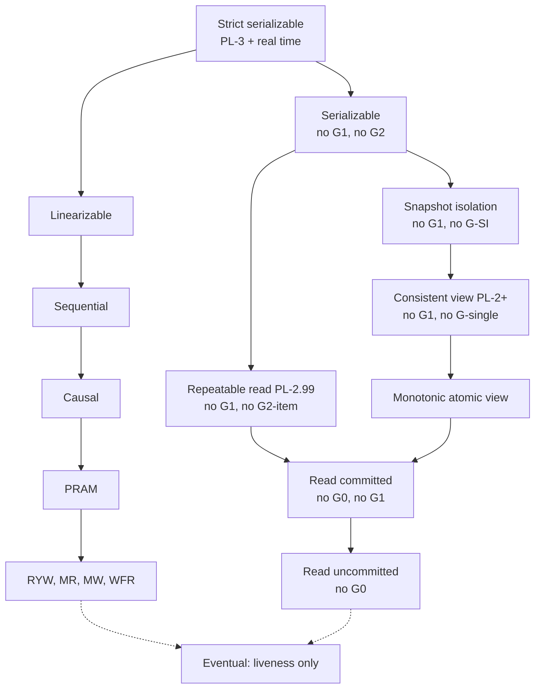

**Reading the diagram.** Each box is a guarantee; a solid arrow from $A$ to $B$ means every $A$ history is a $B$ history, so strength decreases downward. The left column is transactional and labeled with Adya's proscribed phenomena; the right column is single-object and is owned by Chapter 25. Strict serializable is the common apex. Repeatable read and snapshot isolation are siblings under serializable because they are incomparable. Dotted arrows to eventual consistency mean "can be combined with", not "implies": eventual consistency is a liveness property and sits beside, not below, the safety properties. There are no protocols, storage boundaries or data flows in this figure; the failure point it guards against is choosing a level by name instead of by proscribed phenomena. Session variants (strong session SI, strong session serializable), which add per-client order to SI or serializability, sit just above their base level and are omitted for space [Daudjee & Salem 2006; Kingsbury & Alvaro 2020].

### 45.3.2 Availability classes: what survives a partition

::: definition
**Definition — Availability classes (Bailis et al.).** A guarantee is **totally available** if every non-failing replica can commit every transaction without contacting any other replica, even when the network is arbitrarily partitioned. It is **sticky available** if this holds whenever each client keeps talking to replicas that have seen all of that client's previous operations. It is **unavailable** if some partition forces some transaction to block or abort [Bailis et al. 2014a].
:::

Bailis and colleagues called systems that provide the first two classes **highly available transactions (HATs)** and classified every level in the hierarchy. The classification rests on two impossibility arguments that you can reconstruct yourself:

1. **Preventing lost updates needs coordination.** Two clients on opposite sides of a partition each read a counter at 10 and write 11. A totally available system must commit both, and one increment is lost. Any level that forbids lost update (snapshot isolation, cursor stability, repeatable read, serializability) is therefore unavailable.
2. **Preventing write skew needs coordination**, by the same argument with two different rows, which rules out repeatable read and serializability a second time.
3. **Recency needs coordination.** A guarantee that a read sees the latest committed write (linearizability, strict serializability) cannot be served by an isolated replica, which is CAP (§25.8).

**Table 45.2 — Availability class of each guarantee under partition [Bailis et al. 2014a].**

| Class | Guarantees | Why |
|---|---|---|
| Totally available | Read uncommitted, read committed, monotonic atomic view, item cut and predicate cut isolation, monotonic reads, monotonic writes, writes follow reads | Each can be enforced with data a replica already has: buffered writes, version metadata, causal tags |
| Sticky available | Read your writes, PRAM, causal | The client must keep reaching replicas that hold its own past writes |
| Unavailable | Cursor stability, snapshot isolation, repeatable read, serializable, linearizable, strict serializable | They prevent lost update or write skew, or promise recency |

**Figure 45.2 — The three availability classes as bands of the hierarchy.**

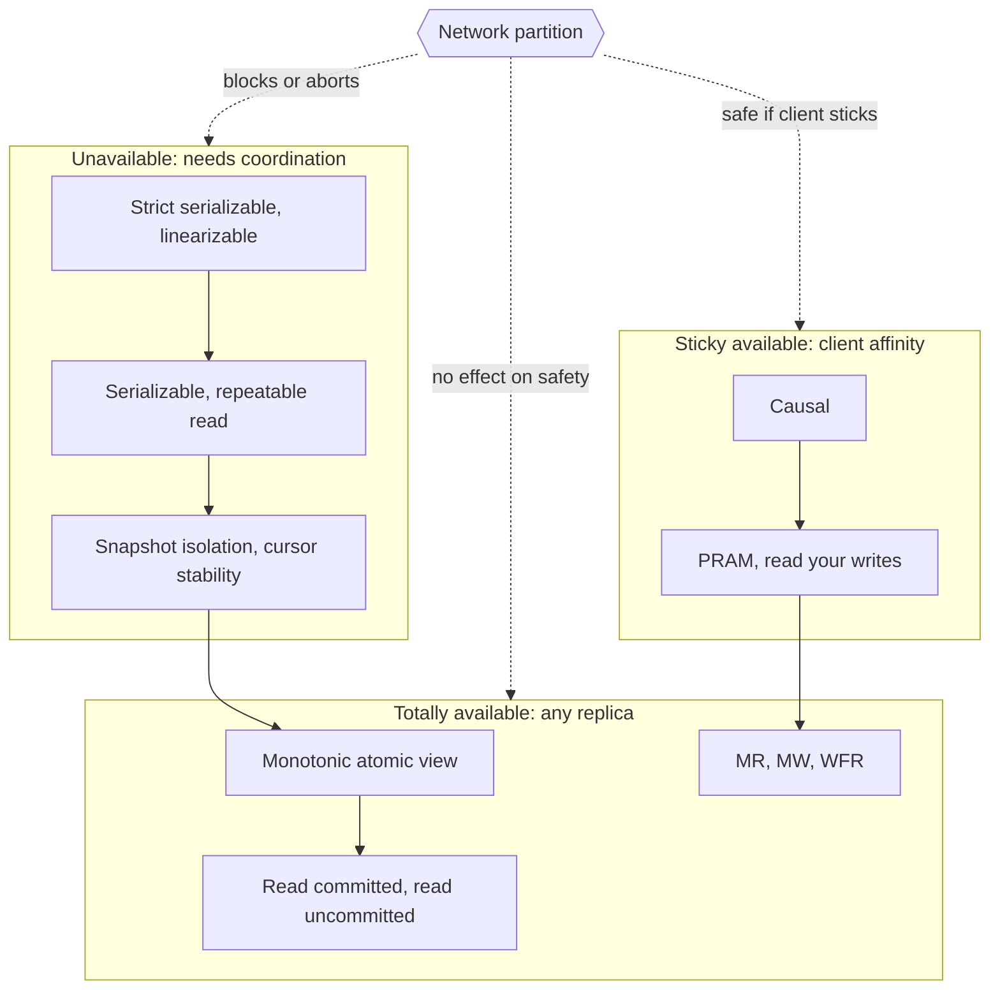

**Reading the diagram.** The three subgraphs are the bands of Table 45.2; solid arrows inside them repeat the strength order of Figure 45.1. The external hexagon is a network partition, and its dotted (asynchronous, environmental) arrows show what it does to each band: transactions at unavailable levels must block or abort on the minority side; sticky-available levels survive as long as a client's requests keep landing on replicas holding its own history; totally available levels are unaffected. There is no storage boundary; the failure point is the partition itself, and the scaling lesson is that only the bottom two bands can scale writes across regions without cross-region round trips.

::: concept
**Key insight — Monotonic atomic view is the most useful transactional guarantee in the totally available band.** It guarantees that once you see one of a transaction's writes you see all of them, which prevents the "half-applied transaction" anomaly that read committed allows. It can be built with nothing more than buffered writes and per-transaction metadata, so it is the natural ceiling for a multi-region, always-writable store [Bailis et al. 2014a].
:::

::: industry
**Default isolation in shipping databases.** In their 2013–2014 survey of 18 popular databases, Bailis et al. reported that only three offered serializability by default and that eight did not offer it at all; the most common default was read committed. The weak defaults are not an accident of laziness: they are the levels that keep latency low and, in replicated deployments, stay available.
*Evidence: Primary* — [Bailis et al. 2014a]
:::

::: mistake
**Mistake — "Our database is ACID, so it is serializable."** The I in ACID is whatever the default level is, which is usually read committed or snapshot isolation. Map the level to its proscribed phenomena (Table 45.1) and check which anomalies your invariants can tolerate.
:::

## 45.4 Snapshot isolation versus serializability

### 45.4.1 Adya's dependency-graph formalism

::: definition
**Definition — Direct serialization graph (DSG).** For a history of committed transactions with a known **version order** for each object (the order in which versions of $x$ were installed), the DSG has a node per committed transaction and an edge $T_i \rightarrow T_j$ whenever $T_j$ directly conflicts with $T_i$ in one of three ways [Adya 1999]:

- **Write dependency** ($T_i \xrightarrow{ww} T_j$): $T_i$ installs a version of $x$ and $T_j$ installs the *next* version of $x$.
- **Read dependency** ($T_i \xrightarrow{wr} T_j$): $T_i$ installs a version of $x$ and $T_j$ reads that version. (A predicate read that observes $T_i$'s change to the set of matching rows also counts.)
- **Anti-dependency** ($T_i \xrightarrow{rw} T_j$): $T_i$ reads a version of $x$ and $T_j$ installs the next version, so $T_i$ did not see $T_j$'s write. Predicate anti-dependencies arise when $T_j$ changes the set of rows matching a predicate $T_i$ read.
:::

#### First-principles explanation

Each edge records an unavoidable "must come before" fact. If $T_j$ read what $T_i$ wrote, any equivalent serial order must run $T_i$ first. If $T_i$ read a version that $T_j$ later replaced, $T_i$ must run first too, or it would have seen $T_j$'s value. A history is **conflict serializable** exactly when these facts can all be satisfied at once, that is, when the DSG has no cycle; a topological sort of the graph is then an equivalent serial order [Papadimitriou 1979; Adya 1999]. Every anomaly in §11.13 is a *shape of cycle*.

**Table 45.3 — Adya's phenomena as graph properties.**

| Phenomenon | Formal condition | Informal name | Forbidden by |
|---|---|---|---|
| G0 | DSG cycle of ww edges only | Write cycle; dirty write interleaving | Every level from PL-1 up |
| G1a | A committed transaction read a version written by an aborted one | Aborted read | PL-2 and up |
| G1b | A committed transaction read a non-final version of another's write | Intermediate read | PL-2 and up |
| G1c | DSG cycle of ww and wr edges only | Circular information flow | PL-2 and up |
| G-single | DSG cycle with exactly one rw edge | Read skew, non-atomic view | PL-2+, SI and up |
| G2-item | DSG cycle with at least one item rw edge | Write skew on rows | PL-2.99, PL-3 |
| G2 | DSG cycle with at least one rw edge, item or predicate | Write skew, phantoms | PL-3 |

Snapshot isolation needs one extra ingredient. Adya's **start-ordered serialization graph (SSG)** adds a start-dependency edge $T_i \xrightarrow{s} T_j$ whenever $T_i$ commits before $T_j$ begins. **G-SIa (interference)** is a ww or wr edge $T_i \rightarrow T_j$ without $T_i \xrightarrow{s} T_j$: $T_j$ saw or overwrote a write of a transaction that had not committed when $T_j$ started. **G-SIb (missed effects)** is an SSG cycle with exactly one anti-dependency edge. PL-SI proscribes G1, G-SIa and G-SIb [Adya 1999].

### 45.4.2 Write skew as a formal history

Ch 11 showed write skew with doctors going off call. Here is the same shape written as a history, so you can draw its graph. Accounts $x$ and $y$ belong to one customer, each holds 50, and the bank's invariant is $x + y \ge 0$. Transactions $T_1$ and $T_2$ each withdraw 90 from a different account after checking the sum. Subscripts on versions name the writer; $c_i$ is a commit.

$$H_{ws}:\; r_1(x_0{=}50)\; r_1(y_0{=}50)\; r_2(x_0{=}50)\; r_2(y_0{=}50)\; w_1(x_1{=}{-40})\; w_2(y_2{=}{-40})\; c_1\; c_2$$

Under snapshot isolation both transactions read the snapshot taken at their start, and their write sets $\{x\}$ and $\{y\}$ are disjoint, so the first-committer-wins rule has nothing to reject. Both commit and $x + y = -80$. The DSG has two edges: $T_1$ read $y_0$, which $T_2$ replaced, so $T_1 \xrightarrow{rw} T_2$; and $T_2$ read $x_0$, which $T_1$ replaced, so $T_2 \xrightarrow{rw} T_1$.

**Figure 45.3 — The DSG of write skew: a cycle of two anti-dependencies.**

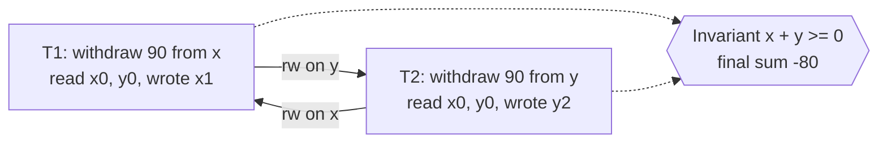

**Reading the diagram.** The two rectangles are committed transactions running on the same database; there is no network or protocol in this figure, only logical dependencies. Each solid arrow is an anti-dependency: the source read a version that the target overwrote, so in any equivalent serial order the source must come first. The two arrows demand $T_1$ before $T_2$ and $T_2$ before $T_1$, which is a G2-item cycle, so no serial order exists. Dotted arrows show both transactions' effects reaching the invariant, the failure point. Snapshot isolation never looks at these edges because it checks only write–write conflicts; serializable snapshot isolation (§45.4.5) exists to notice them.

### 45.4.3 The read-only anomaly

Write skew needs two writers. Fekete, O'Neil and O'Neil showed something more surprising: under snapshot isolation, a transaction that writes *nothing* can observe a state that no serial execution produces, even though the writers alone are serializable [Fekete et al. 2004]. Their example uses a checking account $x$ and a savings account $y$, both starting at 0. $T_1$ deposits 20 into savings. $T_2$ withdraws 10 from checking and, if its snapshot shows $x + y < 0$ after the withdrawal, charges a penalty of 1. $T_3$ is a read-only statement printer.

$$H_{ro}:\; r_2(x_0{=}0)\; r_2(y_0{=}0)\; r_1(y_0{=}0)\; w_1(y_1{=}20)\; c_1\; r_3(x_0{=}0)\; r_3(y_1{=}20)\; c_3\; w_2(x_2{=}{-11})\; c_2$$

**Figure 45.4 — The read-only anomaly under snapshot isolation.**

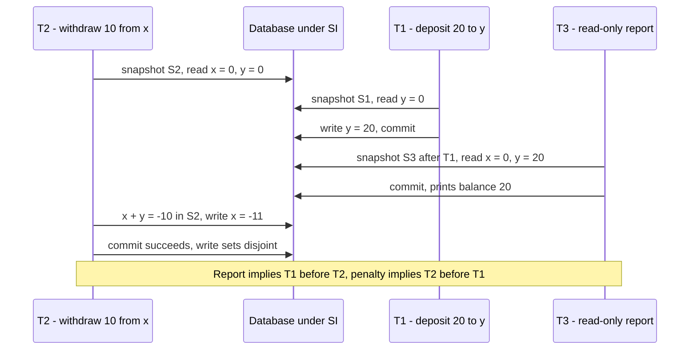

**Reading the diagram.** Four participants exchange synchronous SQL calls with one database running snapshot isolation; time runs downward and each transaction reads from the snapshot it took first. $T_2$ took its snapshot before $T_1$ committed, so it never sees the deposit and charges the penalty. $T_3$'s snapshot is taken after $T_1$'s commit but before $T_2$'s, so it shows the deposit without the withdrawal. The storage boundary is the multi-version store, which holds $y_0$ and $y_1$ simultaneously. The failure point is $T_2$'s commit: SI accepts it because $T_1$ and $T_2$ wrote different rows. Remove $T_3$ and the outcome equals the serial order $T_2, T_1$; with $T_3$ it equals no order at all.

The DSG makes the contradiction mechanical. $T_1 \xrightarrow{wr} T_3$ because $T_3$ read $y_1$. $T_3 \xrightarrow{rw} T_2$ because $T_3$ read $x_0$, which $T_2$ replaced. $T_2 \xrightarrow{rw} T_1$ because $T_2$ read $y_0$, which $T_1$ replaced. The cycle $T_1 \rightarrow T_3 \rightarrow T_2 \rightarrow T_1$ contains two anti-dependency edges *in a row*, with $T_2$ in the middle.

**Figure 45.5 — DSG of the read-only anomaly, with the dangerous structure highlighted.**

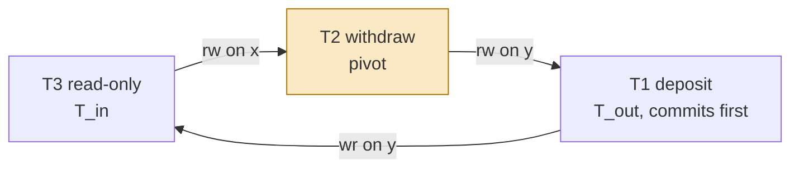

**Reading the diagram.** Nodes are committed transactions; edges are the logical dependencies of §45.4.1, not messages. The two consecutive anti-dependencies $T_3 \xrightarrow{rw} T_2 \xrightarrow{rw} T_1$ form the **dangerous structure**, with $T_2$ as the **pivot** (amber) that has an incoming and an outgoing rw edge. $T_1$, the outgoing end, committed first among the three. The wr edge from $T_1$ to $T_3$ closes the cycle. The failure point is the pivot: aborting $T_2$, or refusing to let $T_3$ see $T_1$'s commit, breaks the cycle. Scaling concerns appear only when the three transactions live on different partitions, which is why SSI is hard to distribute (§28.3.3).

### 45.4.4 Why two consecutive anti-dependencies are the signature

::: concept
**Key insight — The dangerous-structure theorem.** Under snapshot isolation, every cycle in the DSG contains two consecutive anti-dependency edges $T_{in} \xrightarrow{rw} T_{pivot} \xrightarrow{rw} T_{out}$ in which each pair of adjacent transactions ran concurrently [Fekete et al. 2005]. Moreover, in some such structure on the cycle, $T_{out}$ is the first transaction of the cycle to commit [Ports & Grittner 2012].
:::

A proof sketch explains why. Under SI, a ww or wr edge $T_i \rightarrow T_j$ means $T_j$ saw or overwrote $T_i$'s write, which SI allows only if $T_i$ committed before $T_j$ started (that is G-SIa's prohibition). Such edges therefore always point **forward in time**. An anti-dependency $T_i \xrightarrow{rw} T_j$ means $T_j$'s write was *not* in $T_i$'s snapshot, so $T_j$ committed after $T_i$ started: the two overlapped. A cycle has to return to where it started, so it needs at least one edge that is not forward in time. One rw edge surrounded by forward edges is not enough, because the forward edges would place $T_j$'s commit before $T_i$'s start; that contradiction is exactly G-SIb, which SI forbids. With a little case analysis the only remaining possibility is two adjacent rw edges between overlapping transactions.

The theorem has three practical uses:

1. **A runtime test.** A system can detect the pattern instead of the cycle. That is SSI.
2. **A static test.** If you know every transaction program in an application, you can draw a *static dependency graph* of programs and look for "dangerous" pairs of vulnerable edges. Fekete et al. used this to show that TPC-C runs serializably under SI, and to fix other programs by **promotion** (turning a read into a write, as `SELECT ... FOR UPDATE` does) or by **materializing the conflict** in a shared row [Fekete et al. 2005].
3. **A diagnosis.** When a Jepsen or Elle report shows a G2-item cycle on a database that claims SI, the database is behaving as specified; when it shows G-single, SI itself is broken.

### 45.4.5 Serializable snapshot isolation

::: definition
**Definition — Serializable snapshot isolation (SSI).** A concurrency-control algorithm that runs transactions under snapshot isolation, tracks anti-dependencies between concurrent transactions at run time, and aborts a transaction whenever a dangerous structure could form, so every committed history is serializable [Cahill et al. 2008].
:::

#### Why does this exist?

Snapshot isolation is popular because readers never block writers and writers never block readers. Two-phase locking provides serializability but makes readers take shared locks, so a long report blocks every writer it touches. Before 2008 the choice was "fast and anomalous" or "serializable and blocking". Cahill, Röhm and Fekete showed you can keep SI's non-blocking reads and abort only the rare transactions that sit at a dangerous structure.

#### How it works internally

1. **Record reads without blocking.** Each read takes a **SIREAD lock** on what it read. A SIREAD lock never blocks anyone; it is only a note that says "this transaction read this item (or range)".
2. **Detect anti-dependencies from both directions.** When $T_w$ writes an item and finds a SIREAD lock held by a concurrent $T_r$, the system records $T_r \xrightarrow{rw} T_w$. When $T_r$ reads an item and the MVCC visibility check skips a newer version written by a concurrent $T_w$, it records the same edge.
3. **Mark both ends.** Cahill's algorithm keeps two flags per transaction, `inConflict` and `outConflict`, and sets $T_r$.outConflict and $T_w$.inConflict.
4. **Abort pivots.** If any transaction has both flags set, it may be a pivot, and one transaction of the structure is aborted with a serialization failure.
5. **Keep SIREAD locks after commit.** A committed reader can still be the source of a future rw edge, so its SIREAD locks must survive until every transaction concurrent with it has finished.

The algorithm is **conservative**: two flags do not prove a cycle exists. A transaction with an incoming rw edge from one transaction and an outgoing rw edge to an unrelated one is aborted even though the history is serializable. These **false positives** are the price of not building the full graph.

### 45.4.6 SSI in PostgreSQL

PostgreSQL 9.1 shipped SSI as its SERIALIZABLE level, the first implementation in a production database; Ports and Grittner describe the design and several improvements over the original algorithm [Ports & Grittner 2012]:

- **Edges, not flags.** PostgreSQL keeps the actual lists of rw-conflict neighbors for each serializable transaction. That enables the **commit-ordering optimization**: a dangerous structure $T_{in} \rightarrow T_{pivot} \rightarrow T_{out}$ can only lie on a cycle if $T_{out}$ commits first, so PostgreSQL does not abort until $T_{out}$ has committed, which removes many false positives.
- **Read-only optimization.** If $T_{in}$ is read-only, the structure is dangerous only if $T_{out}$ committed before $T_{in}$ took its snapshot. The read-only anomaly of Figure 45.4 satisfies this: $T_1$ committed before $T_3$'s snapshot.
- **Safe snapshots and deferrable transactions.** A read-only transaction whose snapshot no concurrent read-write transaction can make dangerous is **safe**: it can drop its SIREAD locks and can never fail. `BEGIN ISOLATION LEVEL SERIALIZABLE READ ONLY DEFERRABLE` waits until such a snapshot is available and then runs a long report with no SSI overhead and no risk of serialization failure.
- **Multi-granularity SIREAD locks.** Locks are held on tuples, index pages or whole relations. When memory for the lock table runs short, many fine-grained locks are **promoted** to one coarser lock, which bounds memory at the cost of more false positives. Predicate reads are protected through index-page locks where the index access method supports it and through a relation-level lock otherwise.
- **Bounded memory for old transactions.** Committed transactions whose details are still needed are **summarized**, keeping only what future conflict checks require.
- **The application contract.** An aborted transaction receives SQLSTATE `40001` (`serialization_failure`) and must be retried from the beginning; the guarantee holds only among transactions that all run at SERIALIZABLE.

**Figure 45.6 — How PostgreSQL's SSI decides whether to abort.**


**Reading the diagram.** The flow runs inside the database on every detected rw conflict and again at commit time; nothing crosses the network. Rectangles are bookkeeping steps on the shared lock and conflict tables (the storage boundary, in shared memory). Diamonds are the three tests: is there a dangerous structure, did $T_{out}$ commit first, and does the read-only exemption apply. The dotted arrow is asynchronous: the decision is revisited when a member of the structure later commits. The failure point is the abort, which the client sees as error `40001` and must handle by retrying. As concurrency grows, conflict tables grow and lock promotion makes detection coarser, so abort rates rise faster than linearly with contention.

::: industry
**PostgreSQL SERIALIZABLE.** PostgreSQL has implemented SERIALIZABLE as SSI since version 9.1 and REPEATABLE READ as plain snapshot isolation. Ports and Grittner report that SSI's throughput was close to snapshot isolation's and much better than strict two-phase locking on read-heavy workloads, with the remaining cost concentrated in workloads with many read-write conflicts. In 2020 Jepsen found that SERIALIZABLE in PostgreSQL 12.3 admitted G2-item cycles because of an implementation bug, since fixed (§25.11.3).
*Evidence: Primary* — [Ports & Grittner 2012; PostgreSQL Docs: Transaction Isolation; Kingsbury 2020]
:::

::: industry
**"SERIALIZABLE" that is snapshot isolation.** Oracle Database's SERIALIZABLE level has long been snapshot isolation, so it admits write skew; Fekete et al. motivated their static analysis partly by applications running on it.
*Evidence: Secondary* — [Fekete et al. 2005]
:::

#### Mathematical foundations: how often does an anomaly happen?

A write-skew or read-only anomaly needs transactions on the *same* invariant group (one customer's accounts, one ward's on-call roster) to overlap in time. That gives a simple estimate.

::: formula
**Overlap probability and expected anomalies under snapshot isolation**

$$P_{\text{overlap}} = 1 - e^{-2\lambda T} \approx 2\lambda T \qquad\qquad E[\text{anomalies per day}] \approx G \cdot \lambda^{2} \cdot T \cdot s \cdot 86\,400$$

| Symbol | Meaning | Units |
|---|---|---|
| $\lambda$ | Arrival rate of invariant-checking transactions on one group, assumed Poisson | transactions/s |
| $T$ | Transaction duration from snapshot to commit | s |
| $P_{\text{overlap}}$ | Probability that a given transaction overlaps another on the same group | dimensionless |
| $G$ | Number of independent invariant groups | count |
| $s$ | Fraction of overlapping pairs whose reads and writes actually form write skew | dimensionless |
| $86\,400$ | Seconds per day | s/day |
:::

The first expression follows because another transaction overlaps yours if it starts within $T$ before or after yours starts, a window of length $2T$. The second counts overlapping pairs: each group starts $\lambda \cdot 86\,400$ transactions a day, each overlaps a later one with probability about $\lambda T$, and a fraction $s$ of those pairs are dangerous.

::: example
**Worked example — Overdrafts at a retail bank.**

1. A bank has $G = 10^6$ customers with linked accounts. Each makes 20 balance-checked withdrawals a day: $\lambda = 20 / 86\,400 = 2.31 \times 10^{-4}$ per second. Each transaction lasts $T = 50$ ms.
2. Overlap probability per transaction: $2\lambda T = 2 \times 2.31 \times 10^{-4} \times 0.05 = 2.31 \times 10^{-5}$, about 1 in 43,000.
3. Overlapping pairs per day: $G \lambda^2 T \cdot 86\,400 = 10^6 \times (2.31 \times 10^{-4})^2 \times 0.05 \times 86\,400 = 10^6 \times 5.36 \times 10^{-8} \times 0.05 \times 86\,400 \approx 231$.
4. If $s = 0.05$ of those pairs both pass a near-limit check and write different accounts, expect about $231 \times 0.05 \approx 12$ overdrafts a day that no serial execution would allow.

**Interpretation.** An anomaly that is invisible per transaction (1 in 43,000) is a daily event at scale. The Poisson model is also optimistic: double-clicks, client retries and batch jobs make arrivals on one group *correlated*, which raises $\lambda$ inside short windows by orders of magnitude. **Engineering implication.** Under SSI the same 231 overlapping pairs bound the serialization failures you must retry (plus false positives), so you can size retry budgets; under plain SI the same arithmetic tells you how many incidents to expect if you do not protect the invariant.
:::

#### Alternatives and trade-offs

**Table 45.4 — Ways to obtain serializability, compared.**

| Approach | How it works | Readers block writers? | Main cost | Distributes well? | Example |
|---|---|---|---|---|---|
| Strict two-phase locking | Shared read locks, exclusive write locks, held to commit | Yes | Blocking, deadlocks | Yes, with lock managers per partition | MySQL SERIALIZABLE; Spanner read-write transactions (§28.8) |
| SSI | SI plus rw-conflict tracking | No | Aborts, including false positives; memory for SIREAD locks | Poorly: the dangerous structure spans partitions | PostgreSQL SERIALIZABLE |
| Optimistic validation of reads | Re-check read set at commit time | No | Aborts under contention | Yes, with timestamps | CockroachDB read refresh (§28.10) |
| Deterministic ordering | Agree on order first, then execute | No | Must know read/write sets in advance | Yes | Calvin (§28.9) |
| SI plus application fixes | Promotion with `FOR UPDATE`, materialized conflict rows, static analysis | Only on promoted rows | Developer discipline; easy to miss a path | Yes | Any SI database |

#### Failure scenarios

**Table 45.5 — Failure scenarios around snapshot isolation and SSI.**

| What goes wrong | Why | Detection | Recovery | Prevention |
|---|---|---|---|---|
| Invariant violated under REPEATABLE READ | Write skew is allowed by SI | Reconciliation job; invariant check queries | Compensating transaction | SERIALIZABLE or materialized conflict |
| Burst of `40001` errors | Hot invariant group, or lock promotion after memory pressure | Error-rate metric by SQLSTATE | Retry with jittered backoff | Split hot groups; raise predicate-lock memory |
| Anomaly despite SERIALIZABLE | Some transactions ran at a lower level | Elle-style test; audit of session settings | Fix and reconcile | Set the default level server-side |
| Long report aborts repeatedly | It is $T_{in}$ in many structures | Retry count per transaction | Rerun | `READ ONLY DEFERRABLE` |
| Retries cause duplicate side effects | Non-idempotent work outside the database | Duplicate e-mails or payments | Deduplicate | Idempotency keys (§22.15); side effects after commit |

::: mistake
**Mistake — "Read-only transactions are always safe under snapshot isolation."** Figure 45.4 is the counterexample: the read-only report observes a state that no serial order produces, and decisions made from that report (an audit, a regulatory filing) inherit the anomaly. Under SSI the read-only transaction may itself be the one aborted unless it runs with `DEFERRABLE`.
:::

## 45.5 Formalizing histories and checking them

### 45.5.1 From observations to a graph

Chapter 25 introduced Jepsen's checkers (§25.11.2). Here you build the core of one. The obstacle is that the DSG needs each object's **version order**, and a black-box test cannot see inside the database. With registers (read and write a single value), many version orders are consistent with the observations, and deciding whether *any* of them makes the history serializable is NP-complete [Papadimitriou 1979]. Brute force over serial orders is hopeless: 20 transactions have $20! \approx 2.4 \times 10^{18}$ orders.

Elle removes the search by designing the workload so that observations *reveal* the version order [Kingsbury & Alvaro 2020]:

1. **Recoverability.** Every write is unique (append a value never used before), so every read can be traced to the transaction that wrote what it saw.
2. **Traceability.** Objects are lists and writes are appends, so a read of `[1, 2, 5]` exhibits the entire version history of that key up to that point: 1, then 2, then 5. Every read of the key must be a prefix of the longest one, or the history has an **incompatible order** anomaly before any graph is drawn.
3. **Edges by lookup.** With version orders known, each ww, wr and rw edge is a dictionary lookup, and cycle detection on the resulting graph takes time linear in its size, $O(V + E)$, with Tarjan's strongly connected components or breadth-first search.
4. **Classification by restriction.** Search first for a cycle of ww edges only (G0), then ww and wr edges (G1c), then for one rw edge closed by ww/wr edges (G-single), then any cycle (G2-item). The first hit names the weakest level the history violates.
5. **Optional extra edges.** Adding per-client process-order edges checks the *strong session* variants; adding real-time edges (commit of $T_i$ precedes start of $T_j$) checks *strict* serializability.

**Figure 45.7 — An Elle-style checker pipeline.**


**Reading the diagram.** The input (subroutine shape) is a recorded history, the storage boundary between test run and analysis; everything after it runs offline in one process, so all arrows are synchronous steps. The prefix test can reject a history before any graph exists. The optional edge stage changes which level is checked, not the algorithm. Each terminal stadium is a verdict, ordered from the most severe anomaly to none. The failure point is an unobserved write: an append no one ever read has no known position, so the checker cannot place it and may miss a cycle. Scaling is roughly linear in the number of operations, so long histories remain tractable.

### 45.5.2 A runnable DSG cycle detector

The program implements the pipeline for list-append histories and runs it on six small histories: write skew (§45.4.2), the read-only anomaly (§45.4.3) with and without its reader, read skew, circular information flow, a write cycle and an inconsistent pair of reads.

```python
"""Elle-style checker for list-append histories: infer each key's version
order, build Adya's direct serialization graph (DSG) with ww, wr and rw
edges, then search for cycles and name the anomaly (G0, G1c, G-single, G2)."""
from collections import defaultdict, deque

def version_orders(history):
    """Per key, the longest list any transaction read. Every other read of
    that key must be a prefix of it, or no version order explains the reads."""
    orders, problems = {}, []
    for txn in history:
        for op, key, val in txn["ops"]:
            if op == "r" and len(val) >= len(orders.get(key, [])):
                orders[key] = list(val)
    for txn in history:
        for op, key, val in txn["ops"]:
            if op == "r" and orders[key][:len(val)] != list(val):
                problems.append(f"{txn['id']} read {key}={val}: not a prefix of {orders[key]}")
    return orders, problems

def build_dsg(history):
    orders, problems = version_orders(history)
    writer = {(key, val): txn["id"]               # appended values are unique
              for txn in history for op, key, val in txn["ops"] if op == "append"}
    edges = defaultdict(set)                      # (src, dst) -> {"ww x", "rw y", ...}
    def add(src, dst, kind, key):
        if src != dst:                            # ignore a transaction's own effects
            edges[(src, dst)].add(f"{kind} {key}")
    for key, order in orders.items():             # ww: Ti installed the version before Tj's
        for prev, nxt in zip(order, order[1:]):
            add(writer[(key, prev)], writer[(key, nxt)], "ww", key)
    for txn in history:
        for op, key, val in txn["ops"]:
            if op != "r":
                continue
            order = orders[key]
            if val:                               # wr: Tj read the version Ti installed
                add(writer[(key, val[-1])], txn["id"], "wr", key)
            if len(val) < len(order):             # rw: Ti read a version Tj overwrote
                add(txn["id"], writer[(key, order[len(val)])], "rw", key)
    return edges, problems

def kinds(edges, a, b):
    return {label.split()[0] for label in edges[(a, b)]}

def find_path(edges, src, dst, allowed):
    """Shortest path of at least one edge from src to dst (src == dst finds a
    cycle), using only edges that carry a dependency kind in `allowed`."""
    adj = defaultdict(list)
    for (a, b) in sorted(edges):
        if kinds(edges, a, b) & allowed:
            adj[a].append(b)
    parent, queue = {}, deque([src])
    while queue:
        node = queue.popleft()
        for m in adj[node]:
            if m == dst:                          # reached the target: rebuild path
                path = [dst, node]
                while path[-1] != src:
                    path.append(parent[path[-1]])
                return path[::-1]
            if m not in parent and m != src:
                parent[m] = node
                queue.append(m)
    return None

def find_cycle(edges, nodes, allowed):
    for n in sorted(nodes):
        p = find_path(edges, n, n, allowed)
        if p:
            return p
    return None

def check(history):
    edges, problems = build_dsg(history)
    nodes = {t["id"] for t in history}
    if problems:
        return "incompatible-order", problems
    cyc = find_cycle(edges, nodes, {"ww"})
    if cyc:
        return "G0 (write cycle)", cyc
    cyc = find_cycle(edges, nodes, {"ww", "wr"})
    if cyc:
        return "G1c (circular information flow)", cyc
    for (a, b) in sorted(edges):                  # one rw edge closed by ww/wr edges
        if "rw" in kinds(edges, a, b):
            back = find_path(edges, b, a, {"ww", "wr"})
            if back:
                return "G-single (read skew)", [a] + back
    cyc = find_cycle(edges, nodes, {"ww", "wr", "rw"})
    if cyc:
        return "G2-item (anti-dependency cycle)", cyc
    return "serializable", topological_order(edges, nodes)

def topological_order(edges, nodes):
    indeg = {n: 0 for n in nodes}
    for (a, b) in edges:
        indeg[b] += 1
    ready, order = sorted(n for n in nodes if indeg[n] == 0), []
    while ready:
        n = ready.pop(0)
        order.append(n)
        for (a, b) in sorted(edges):
            if a == n:
                indeg[b] -= 1
                if indeg[b] == 0:
                    ready.append(b)
    return order

def show(name, history):
    verdict, detail = check(history)
    edges, _ = build_dsg(history)
    print(f"{name}: {verdict}")
    if verdict == "serializable":
        print("   equivalent serial order:", " -> ".join(detail))
    elif verdict == "incompatible-order":
        print("  ", detail[0])
    else:
        hops = [f"{a} -[{', '.join(sorted(edges[(a, b)]))}]-> {b}"
                for a, b in zip(detail, detail[1:])]
        print("   cycle:", "  ".join(hops))

T = lambda tid, *ops: {"id": tid, "ops": list(ops)}

WRITE_SKEW = [   # both check x+y, each appends to a different key
    T("T1", ("r", "x", []), ("r", "y", []), ("append", "x", 1)),
    T("T2", ("r", "x", []), ("r", "y", []), ("append", "y", 2)),
    T("T3", ("r", "x", [1]), ("r", "y", [2])),
]
READ_ONLY = [    # Fekete, O'Neil and O'Neil 2004, as list appends
    T("T2", ("r", "x", []), ("r", "y", []), ("append", "x", 1)),   # withdrawal
    T("T1", ("r", "y", []), ("append", "y", 2)),                    # deposit
    T("T3", ("r", "x", []), ("r", "y", [2])),                       # read-only report
    T("T4", ("r", "x", [1]), ("r", "y", [2])),                      # final read
]
READ_SKEW = [
    T("T1", ("append", "x", 1), ("append", "y", 1)),
    T("T2", ("r", "x", []), ("r", "y", [1])),
    T("T3", ("r", "x", [1]), ("r", "y", [1])),
]
CIRCULAR = [
    T("T1", ("append", "x", 1), ("r", "y", [2])),
    T("T2", ("append", "y", 2), ("r", "x", [1])),
]
WRITE_CYCLE = [
    T("T1", ("append", "x", 1), ("append", "y", 1)),
    T("T2", ("append", "x", 2), ("append", "y", 2)),
    T("T3", ("r", "x", [1, 2]), ("r", "y", [2, 1])),
]

if __name__ == "__main__":
    show("write skew        ", WRITE_SKEW)
    show("read-only anomaly ", READ_ONLY)
    show("same, without T3  ", [t for t in READ_ONLY if t["id"] != "T3"])
    show("read skew         ", READ_SKEW)
    show("circular info flow", CIRCULAR)
    show("write cycle       ", WRITE_CYCLE)
    show("bad prefix        ", [T("T1", ("append", "x", 1)), T("T2", ("append", "x", 2)),
                                T("T3", ("r", "x", [1, 2])), T("T4", ("r", "x", [2]))])
```

Output:

```text
write skew        : G2-item (anti-dependency cycle)
   cycle: T1 -[rw y]-> T2  T2 -[rw x]-> T1
read-only anomaly : G2-item (anti-dependency cycle)
   cycle: T1 -[wr y]-> T3  T3 -[rw x]-> T2  T2 -[rw y]-> T1
same, without T3  : serializable
   equivalent serial order: T2 -> T1 -> T4
read skew         : G-single (read skew)
   cycle: T2 -[rw x]-> T1  T1 -[wr y]-> T2
circular info flow: G1c (circular information flow)
   cycle: T1 -[wr x]-> T2  T2 -[wr y]-> T1
write cycle       : G0 (write cycle)
   cycle: T1 -[ww x]-> T2  T2 -[ww y]-> T1
bad prefix        : incompatible-order
   T4 read x=[2]: not a prefix of [1, 2]
```

What to notice:

- `version_orders` is the whole trick: because values are unique and lists only grow, the longest read *is* the version order, and every other read must be a prefix of it. The last history fails here, before any graph is built.
- An rw edge points from a reader to the writer of the version *right after* the one it saw (`order[len(val)]`); a ww edge links consecutive versions; a wr edge links the writer of the last element read to the reader.
- The read-only history is serializable without `T3` (serial order `T2 -> T1 -> T4`) and is a G2-item cycle with it, exactly as in Figure 45.5. Snapshot isolation would allow both write-skew histories; it would forbid the G-single history, which a correct SI database must never produce.
- The read-skew history needed a final read `T3`; without it nobody observed the append to `x`, its position is unknown, and the checker cannot see the anomaly. That is the unobserved-write failure point of Figure 45.7.
- `find_path` is breadth-first search, so each query is $O(V + E)$; real checkers run Tarjan's algorithm once and search only inside strongly connected components.

::: industry
**Elle in Jepsen analyses.** Elle checks list-append and register workloads for anomalies from G0 to strict-serializability violations, and Jepsen has used it in its transactional analyses since 2020, including the PostgreSQL 12.3 report that found G2-item cycles at SERIALIZABLE. The paper's evaluation shows checking time growing roughly linearly with history length, in contrast to the exponential worst case of search-based checkers.
*Evidence: Primary* — [Kingsbury & Alvaro 2020; Kingsbury 2020]
:::

::: recommendation
**Recommendation — Make your own integration tests checkable.** Add a list-append table to your staging database, run concurrent append-and-read transactions under fault injection, and feed the history to Elle (or to a checker like the one above). It costs a day and tests the isolation level you actually run, including session settings and connection-pool defaults that change it.
:::

## 45.6 CRDT theory

§27.14.3 presented G-Counters, PN-Counters, LWW-Registers and OR-Sets, and tested their merge laws on random histories. This section explains *why* those laws are the right ones, what they buy, and what no CRDT can ever do.

### 45.6.1 Join-semilattices and monotonicity

::: definition
**Definition — Join-semilattice.** A set $S$ with a partial order $\le$ in which every pair of elements $x, y$ has a **least upper bound** (join) $x \sqcup y$: an element with $x \le x \sqcup y$ and $y \le x \sqcup y$, and $x \sqcup y \le z$ for every other upper bound $z$. Any join is commutative, associative and idempotent (ACI). A function $m$ on $S$ is **inflationary** if $x \le m(x)$ and **monotone** if $x \le y$ implies $m(x) \le m(y)$.
:::

The ACI laws of §27.14.3 are not a design choice: they are what "least upper bound" means. The order says which state "knows more". For a G-Counter, $x \le y$ when every replica's slot in $x$ is at most its slot in $y$, and the join is the per-slot maximum.

**Figure 45.8 — Hasse diagram of a two-replica G-Counter lattice.**

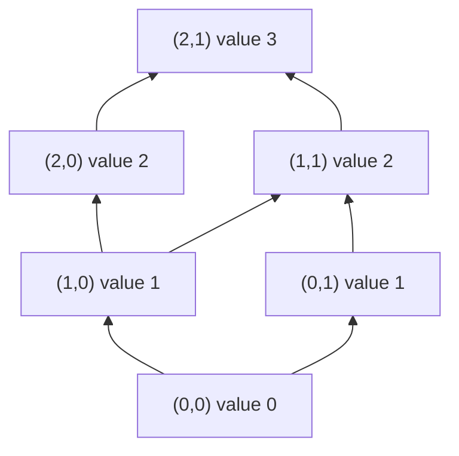

**Reading the diagram.** Each node is a state written as (slot of replica A, slot of replica B); an arrow from $x$ to $y$ means $y$ covers $x$ (it is one step higher in the order). Upward is "knows more". Local increments move a replica's state up one arrow; a merge moves it to the lowest node above both inputs, so merging (2,0) with (1,1) gives (2,1). States (2,0) and (1,1) are incomparable: they are the result of concurrent increments, and only their join reconciles them. There are no network links or storage boundaries in the figure; in a deployment each replica holds one node and gossip carries nodes between replicas. The failure point is any merge that does not land on the least upper bound, such as summing slots, which double-counts on duplicate delivery.

### 45.6.2 Why state-based CRDTs converge: a proof sketch

::: concept
**Key insight — Strong eventual consistency from three assumptions.** If (1) states form a join-semilattice, (2) merge is the join and (3) every update is inflationary, then any two replicas that have received the same set of updates are in the same state, regardless of delivery order or duplication; if (4) every update eventually reaches every replica, all replicas converge [Shapiro et al. 2011a].
:::

The proof is a short induction. For each replica $i$, let $C_i$ be its **causal history**, the set of updates whose effects it has received, and for each update $u$ let $\delta_u$ be the state produced by $u$ at its origin. Claim: at all times $x_i = \bigsqcup_{u \in C_i} \delta_u$ (with the empty join equal to the bottom state $\bot$).

1. **Base.** Initially $C_i = \emptyset$ and $x_i = \bot$.
2. **Local update.** Replica $i$ applies $u$ and gets $m(x_i)$. Because $m$ is inflationary, $x_i \le m(x_i)$, so $m(x_i) = x_i \sqcup m(x_i)$. Taking $\delta_u = m(x_i)$ gives $x_i' = x_i \sqcup \delta_u$ and $C_i' = C_i \cup \{u\}$.
3. **Merge.** Replica $i$ receives $x_j$ and computes $x_i \sqcup x_j = \bigsqcup_{C_i} \delta \sqcup \bigsqcup_{C_j} \delta = \bigsqcup_{C_i \cup C_j} \delta$ by associativity and commutativity, and idempotence absorbs updates in both sets; its new causal history is $C_i \cup C_j$.

So each replica's state is a function of its causal history alone, which is exactly strong eventual consistency. Notice what the proof did *not* need: no ordering of messages, no exactly-once delivery, no clocks. That is why state-based CRDTs ride on lossy, duplicating gossip.

### 45.6.3 Operation-based CRDTs

Operation-based CRDTs ship operations instead of states, which is cheaper when states are large but moves requirements into the network [Shapiro et al. 2011b]:

1. **Split each operation** into a *prepare* phase at the origin (which may read local state, for example to collect the tags an OR-Set remove has observed) and an *effect* phase applied at every replica.
2. **Concurrent effects must commute.** Effects of causally related operations need not, because they will be delivered in order.
3. **Delivery must be reliable, exactly once and in causal order.** Typically this means a **reliable causal broadcast** layer with vector-clock metadata (§24.11). An effect delivered twice, such as an increment, is applied twice.

Shapiro et al. show that each style can emulate the other, so the choice is an engineering one: state-based tolerates a poor network; operation-based needs a good middleware and saves bandwidth.

### 45.6.4 Delta-CRDTs

**Delta-state CRDTs** take the middle path [Almeida et al. 2018]. Each mutator $m$ is rewritten as a **delta-mutator** $m^{\delta}$ that returns only the part of the state that changed, with the defining property $m(x) = x \sqcup m^{\delta}(x)$. Deltas are themselves lattice states, so they can be joined into **delta-intervals**, gossiped, duplicated and reordered exactly like full states, and joined into the receiver's state. A replica sends a peer only the join of the deltas that peer has not acknowledged, and falls back to full state after a long disconnection. Some types (the OR-Set among them) need deltas to be applied in causal order to keep causal semantics, which Almeida et al. formalize as a delta-merging condition.

::: formula
**Gossip bandwidth: full state versus delta-intervals**

$$B_{\text{full}} = k \cdot r \cdot n \cdot b \qquad\qquad B_{\delta} = k \cdot r \cdot d \cdot b$$

| Symbol | Meaning | Units |
|---|---|---|
| $B_{\text{full}}$, $B_{\delta}$ | Bytes sent per second by one replica | bytes/s |
| $k$ | Peers contacted per gossip round | count |
| $r$ | Gossip rounds per second | 1/s |
| $n$ | Entries in the full state (for a G-Counter, one per replica) | entries |
| $d$ | Entries changed since the last exchange with that peer | entries |
| $b$ | Bytes per entry (replica ID plus count) | bytes |
:::

::: example
**Worked example — A page-view counter on 1,000 edge nodes.**

1. Each of $n = 1{,}000$ edge nodes counts views in a G-Counter. An entry is an 8-byte node ID plus an 8-byte count: $b = 16$ bytes. Each node gossips with $k = 3$ peers once a second ($r = 1$).
2. Full state: $B_{\text{full}} = 3 \times 1 \times 1{,}000 \times 16 = 48{,}000$ bytes/s per node, or $48$ MB/s across the fleet.
3. Suppose that between two exchanges with a given peer, only $d = 20$ slots have changed in what a node knows (its own plus those forwarded from recently active nodes). Then $B_{\delta} = 3 \times 1 \times 20 \times 16 = 960$ bytes/s per node, about $0.96$ MB/s across the fleet.

**Interpretation.** Deltas cut bandwidth by $n/d = 50\times$ here, but the saving depends on *update locality*: if every node is busy every second, $d$ approaches $n$ and the saving disappears. **Engineering implication.** Deltas are a bandwidth optimization, not a change in guarantees; measure $d$ in production before relying on the saving, and keep full-state anti-entropy as the fallback.
:::

### 45.6.5 Checking the lattice laws exhaustively

§27.14.3 sampled random histories. On small finite state spaces you can instead enumerate *every* state and check the definitions directly: the join is the least upper bound, every mutator is inflationary, and every delta-mutator satisfies $m(x) = x \sqcup m^{\delta}(x)$. The program then shows two limits that §45.6.6 explains.

```python
"""Exhaustive lattice checks on small finite state spaces (Ch 27's random
tests sample histories; here every state is enumerated). For a G-Counter and
an OR-Set we check that merge is the least upper bound of the partial order,
that every mutator is inflationary, and that each delta-mutator satisfies
m(x) == x JOIN delta(x)."""
from itertools import product, combinations

# ---- G-Counter for replicas A and B, slots bounded to 0..2 -----------------
GC_STATES = list(product(range(3), repeat=2))
gc_leq  = lambda x, y: all(a <= b for a, b in zip(x, y))
gc_join = lambda x, y: tuple(max(a, b) for a, b in zip(x, y))
def gc_mutators(x):                       # (full result, delta) per enabled op
    for i in range(2):
        if x[i] < 2:
            yield (tuple(v + (k == i) for k, v in enumerate(x)),
                   tuple(x[i] + 1 if k == i else 0 for k in range(2)))

# ---- OR-Set over three tags (element, unique id); state = (adds, removes) --
TAGS = [("milk", 1), ("milk", 2), ("eggs", 3)]
def subsets(items):
    return [frozenset(c) for r in range(len(items) + 1) for c in combinations(items, r)]
OR_STATES = [(a, r) for a in subsets(TAGS) for r in subsets(TAGS) if r <= a]
or_leq  = lambda x, y: x[0] <= y[0] and x[1] <= y[1]
or_join = lambda x, y: (x[0] | y[0], x[1] | y[1])
or_value = lambda x: {e for e, _ in x[0] - x[1]}
def or_mutators(x):
    adds, removes = x
    for t in TAGS:                         # add(e) with a fresh tag
        if t not in adds:
            yield (adds | {t}, removes), (frozenset({t}), frozenset())
    for e in {e for e, _ in TAGS}:         # remove(e): tombstone observed tags
        seen = frozenset(t for t in adds if t[0] == e)
        yield (adds, removes | seen), (frozenset(), seen)

def check(name, states, leq, join, mutators):
    for x, y in product(states, repeat=2):
        j = join(x, y)
        assert leq(x, j) and leq(y, j), "join is an upper bound"
        assert all(leq(j, z) for z in states if leq(x, z) and leq(y, z)), "least"
        assert j == join(y, x) and join(x, x) == x, "commutative, idempotent"
        for z in states:
            assert join(join(x, y), z) == join(x, join(y, z)), "associative"
    for x in states:
        for full, delta in mutators(x):
            assert leq(x, full), "mutator is inflationary"
            assert full == join(x, delta), "m(x) == x JOIN delta(x)"
    print(f"{name}: {len(states)} states, join is the LUB, mutators inflationary, deltas exact")

check("G-Counter", GC_STATES, gc_leq, gc_join, gc_mutators)
check("OR-Set   ", OR_STATES, or_leq, or_join, or_mutators)

# The state grows monotonically, but the *query* need not be monotone:
x = (frozenset({("milk", 1)}), frozenset())
y = (frozenset({("milk", 1)}), frozenset({("milk", 1)}))
print("OR-Set: x <= y:", or_leq(x, y), "| value(x) =", or_value(x), "| value(y) =", or_value(y))

# An invariant a lattice cannot protect: stock >= 0 checked only locally.
p, n = {"A": 1, "B": 0}, {"A": 0, "B": 0}       # PN-Counter: one unit in stock
replica = {r: (dict(p), dict(n)) for r in "AB"}  # both replicas have seen it
for r in "AB":                                   # each sells it: local check passes
    pr, nr = replica[r]
    if sum(pr.values()) - sum(nr.values()) >= 1:
        nr[r] += 1
merged_p = {k: max(replica["A"][0][k], replica["B"][0][k]) for k in "AB"}
merged_n = {k: max(replica["A"][1][k], replica["B"][1][k]) for k in "AB"}
print("PN-Counter stock after merge:", sum(merged_p.values()) - sum(merged_n.values()))
```

Output:

```text
G-Counter: 9 states, join is the LUB, mutators inflationary, deltas exact
OR-Set   : 27 states, join is the LUB, mutators inflationary, deltas exact
OR-Set: x <= y: True | value(x) = {'milk'} | value(y) = set()
PN-Counter stock after merge: -1
```

What to notice:

- The "least" check, `all(leq(j, z) ...)`, is what random testing cannot give you: it proves no smaller upper bound exists, so merge loses no information and invents none.
- `full == join(x, delta)` is the delta-CRDT contract; the OR-Set's remove delta carries only the tombstones it observed, which is why removes of unobserved concurrent adds have no effect (add wins).
- The OR-Set *state* grows monotonically, but its *value* shrinks when a tombstone arrives (`{'milk'}` then `set()`). A query such as "is milk absent?" is non-monotone; acting on it is where coordination re-enters (§45.6.6).
- The PN-Counter converges perfectly, to $-1$. Each replica's local check `>= 1` passed, and convergence says nothing about the invariant.

### 45.6.6 Limits: invariants and the CALM theorem

Convergence is a property of the *data*; correctness is usually a property of *invariants over the data*. Bailis et al. formalized when an invariant survives coordination-free execution: a set of transactions is **invariant confluent** (I-confluent) for an invariant $I$ if merging any two divergent states that each satisfy $I$ (reached from a common $I$-satisfying ancestor) always yields a state that satisfies $I$ [Bailis et al. 2014b]. If it is, replicas can run without coordination and never violate $I$; if not, some coordination is unavoidable.

**Table 45.6 — Invariant confluence of common invariants.**

| Invariant | Operations | I-confluent? | Why |
|---|---|---|---|
| Counter $\ge 0$ | Increments only | Yes | Merging two non-negative growths stays non-negative |
| Counter $\ge 0$ | Decrements | No | Two replicas each take the last unit (the program above) |
| Unique ID | Insert with replica-chosen ID from disjoint ranges | Yes | Ranges never collide |
| Unique username | Insert any chosen value | No | Both sides can pick the same name |
| Foreign key | Insert child with existing parent | Yes | Merge keeps both rows |
| Foreign key | Delete parent concurrently with insert child | No | Merge has an orphan |

The usual escape for non-confluent counters is **escrow**: partition the allowance in advance (each of two regions may sell up to 50 of 100 seats), so each local check is valid globally, and coordinate only to rebalance [Balegas et al. 2015].

::: definition
**Definition — CALM theorem.** *Consistency As Logical Monotonicity*: a problem has a consistent, coordination-free distributed implementation if and only if it is **monotonic**, meaning that adding inputs can only add outputs, never retract one [Hellerstein & Alvaro 2020; Ameloot et al. 2013].
:::

CALM generalizes the lattice story from data types to whole programs. Set union, reachability in a growing graph and "has this distributed waits-for graph got a cycle?" (deadlock detection) are monotone: once true, more messages cannot make them false, so every replica may act on a partial view. Garbage collection ("no references to this object exist") and checkout ("the cart is complete, no more items will arrive") assert the *absence* of information; a later message can invalidate them, so they need coordination, typically a barrier, a sealed epoch or consensus. CALM is a design tool: write as much of the program as possible in monotone form (Bloom and its lattice extension were built to make this checkable [Alvaro et al. 2011; Conway et al. 2012]) and place coordination exactly at the non-monotone points.

::: mistake
**Mistake — "Use a CRDT and you will never need consensus."** A CRDT removes coordination for *merging* concurrent updates. It does not make non-monotone decisions (did we oversell? is this name free? is this object unreachable?) safe. Identify those decisions and coordinate only there.
:::

## 45.7 Byzantine faults and why they matter

### 45.7.1 Arbitrary failures and where they come from

::: definition
**Definition — Byzantine fault.** A fault in which a node deviates arbitrarily from its protocol: it may send wrong values, send *different* values to different peers (**equivocation**), replay or delay messages, or collude with other faulty nodes. The name comes from Lamport, Shostak and Pease's allegory of generals, some of them traitors, who must agree on a battle plan by messenger [Lamport et al. 1982].
:::

#### First-principles explanation

Crash-tolerant consensus (Chapter 26) assumes a faulty node is *silent*: whatever it says is true. A Byzantine node is a member of the committee who may sign two contradictory minutes and hand one to each half of the room. Counting votes still works, but you must count enough of them that the liars cannot tip the outcome, and you must prevent one liar from telling two stories without being caught.

#### Why does this exist? Where Byzantine faults occur in practice

Malice is the famous case, but most Byzantine behavior in data centers is accidental. Crash-tolerant protocols turn it into data loss because they trust every message.

**Table 45.7 — Sources of Byzantine behavior.**

| Source | What it looks like | Published evidence |
|---|---|---|
| Silent data corruption in CPUs | A core computes wrong results, deterministically or intermittently, without any error signal | Google reports "mercurial cores" at a rate of a few per several thousand machines [Hochschild et al. 2021]; Meta reports silent data corruptions across its fleet [Dixit et al. 2021] |
| Corrupted messages | A bit flip that slips past TCP's 16-bit checksum and changes protocol state | Amazon S3's July 2008 outage: corrupted gossip messages spread through the cluster until MD5 checks were added [AWS 2008] |
| Corrupted storage | A single bad block or misdirected write on one replica | Ganesan et al. found that one corrupted block on one node could cause data loss or unavailability in widely used replicated stores [Ganesan et al. 2017] |
| Nondeterministic replicas | Replicas of a state machine diverge because of hash-map iteration order, time or threads | Appears to peers as a replica sending wrong answers |
| Faulty sensors and buses | A slightly-out-of-specification signal read differently by different receivers | Driscoll et al. document such failures in safety-critical avionics [Driscoll et al. 2003] |
| Mutually distrustful parties | Banks, companies or anonymous participants who each control nodes | Permissioned ledgers and public blockchains (§45.11) |

::: recommendation
**Recommendation — Convert arbitrary faults into crashes where you can.** Inside one organization, most accidental Byzantine faults are cheaply detectable: end-to-end checksums on messages and stored blocks, replica-state digests compared in the background, deterministic state machines and CPU screening convert "wrong answer" into "detected error", which crash-tolerant protocols handle (§24.14). Pay for full BFT when the *parties*, not the components, cannot trust each other.
:::

::: mistake
**Mistake — "Byzantine fault tolerance protects against hackers."** BFT tolerates up to $f$ faulty replicas. A single exploit that works on every replica running the same software compromises all of them at once. BFT needs **independent failures**, which for attacks means diverse implementations, keys and administrators; and it does nothing about a valid but malicious *client* request.
:::

## 45.8 BFT lower bounds

### 45.8.1 Why three generals cannot tolerate one traitor

With oral (unsigned) messages, three generals cannot reach agreement if one is a traitor [Lamport et al. 1982]. A commander sends "attack" or "retreat" to two lieutenants, who then relay what they heard to each other. Lieutenant 1 hears "attack" from the commander and "the commander told me retreat" from lieutenant 2.

**Figure 45.9 — The indistinguishable scenarios behind the three-generals impossibility.**

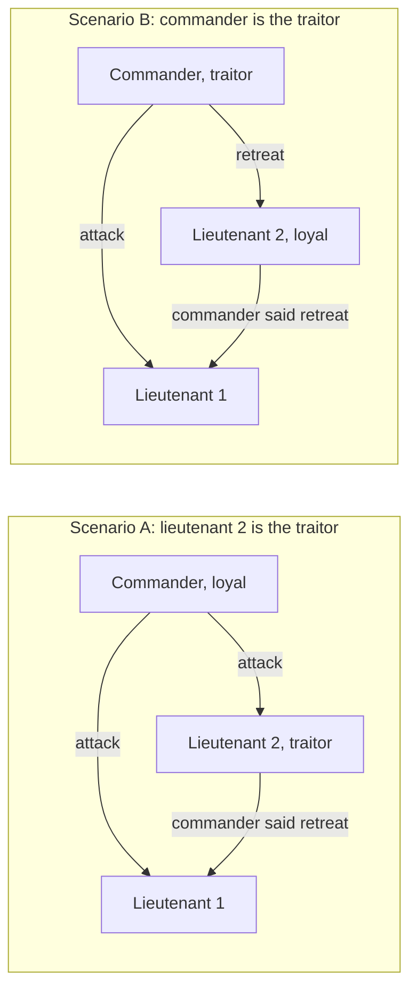

**Reading the diagram.** Each subgraph is one possible world; arrows are unsigned point-to-point messages delivered synchronously in rounds. In both worlds lieutenant 1 receives exactly the same two messages. In A, validity requires it to attack (the loyal commander said so). In B, agreement requires it to decide the same as loyal lieutenant 2, who saw the identical pattern mirrored and, by the same rule, must follow the commander's order to it: retreat. Lieutenant 1 cannot do both, so no rule works. The failure point is the relay: an unsigned claim about what someone else said cannot be verified. The argument scales: simulate each of three generals with $f$ nodes and any protocol for $n \le 3f$ would solve the three-general case [Lamport et al. 1982].

Signatures change the picture *in synchronous systems*: if relayed orders carry the commander's unforgeable signature, the traitor in scenario A cannot fake "the commander said retreat", and Byzantine broadcast becomes solvable for any number of traitors [Lamport et al. 1982; Dolev & Strong 1983]. They do not help in partial synchrony, which is where real protocols live.

### 45.8.2 The partially synchronous bound and quorum intersection

In a partially synchronous system (§24.6.2) a protocol cannot wait for all $n$ replicas, because $f$ of them may be silent forever. It must act after hearing from $n - f$. Among those, up to $f$ may be Byzantine, and the $f$ it did not hear from may be *honest but slow*, so you cannot assume they are the faulty ones. Two requirements follow, and together they give the bound:

1. **Liveness:** a quorum must be obtainable without the $f$ silent nodes: $q \le n - f$.
2. **Safety:** any two quorums must share at least one *honest* node, so they cannot certify conflicting values. Two quorums of size $q$ in $n$ nodes overlap in at least $2q - n$ nodes, of which up to $f$ may be Byzantine: $2q - n \ge f + 1$.

Substituting the largest allowed quorum, $2(n - f) - n \ge f + 1$, gives $n \ge 3f + 1$. Dwork, Lynch and Stockmeyer proved this is tight for partial synchrony even with signatures [Dwork et al. 1988].

::: formula
**Byzantine fault tolerance and quorum size**

$$n \ge 3f + 1 \qquad f_{\max} = \left\lfloor \frac{n-1}{3} \right\rfloor \qquad q = \left\lceil \frac{n + f + 1}{2} \right\rceil \qquad |Q_1 \cap Q_2| \ge 2q - n \ge f + 1$$

| Symbol | Meaning | Units |
|---|---|---|
| $n$ | Number of replicas | count |
| $f$ | Byzantine replicas tolerated | count |
| $q$ | Quorum (certificate) size | count |
| $Q_1, Q_2$ | Any two quorums | sets of replicas |
| $2q - n$ | Minimum overlap of two quorums | count |
:::

For $n = 3f + 1$ the quorum is $q = 2f + 1$ and the overlap is exactly $f + 1$: at least one honest replica sits in every overlap and will not vote for two conflicting values.

::: example
**Worked example — Sizing BFT clusters with 4, 5, 7 and 10 replicas.**

1. $n = 4$: $f = \lfloor 3/3 \rfloor = 1$; $q = \lceil 6/2 \rceil = 3$; overlap $2 \cdot 3 - 4 = 2 \ge f + 1 = 2$. Liveness: $q = 3 \le n - f = 3$.
2. $n = 5$: $f = \lfloor 4/3 \rfloor = 1$; $q = \lceil 7/2 \rceil = 4$; overlap $3$; liveness $4 \le 4$. The fifth replica tolerates no extra fault and *raises* the quorum.
3. $n = 7$: $f = 2$; $q = \lceil 10/2 \rceil = 5$; overlap $3 = f + 1$; liveness $5 \le 5$.
4. $n = 10$: $f = 3$; $q = \lceil 14/2 \rceil = 7$; overlap $4 = f + 1$; liveness $7 \le 7$.

**Interpretation.** Like odd sizes for Raft (§26.4.1), only sizes of the form $3f + 1$ are efficient: 5 and 6 replicas tolerate the same single fault as 4. Compared with crash tolerance at the same $f$, BFT needs $f$ more replicas (4 versus 3 at $f = 1$; 7 versus 5 at $f = 2$) and a larger fraction of them in every quorum (3 of 4 versus 2 of 3). **Engineering implication.** Size BFT clusters as $3f + 1$, place every replica in an independent failure domain *and administrative domain*, and remember that liveness at $n = 3f+1$ has no slack: one crashed honest replica plus $f$ Byzantine ones halts progress.
:::

**Figure 45.10 — Quorum intersection with n = 4, f = 1: two quorums of three share an honest replica.**

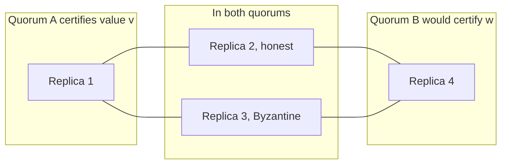

**Reading the diagram.** Quorum A is replicas 1, 2 and 3; quorum B would be 2, 3 and 4. Lines show membership, not messages. The overlap holds two replicas; even if replica 3 is Byzantine and votes for both values, replica 2 is honest, voted for $v$ in A, and will not vote for $w$, so B cannot reach three votes. The failure point the figure guards against is equivocation by the overlap's faulty member. If the cluster had only $n = 3$ replicas with quorums of 2, the overlap would be a single replica, which could be the Byzantine one, and both quorums could form.

### 45.8.3 Synchrony assumptions, summarized

**Table 45.8 — Byzantine agreement bounds by timing model.**

| Timing model | Messages | Replicas needed | Notes | Source |
|---|---|---|---|---|
| Synchronous | Oral (unsigned) | $n \ge 3f + 1$ | Needs $f + 1$ rounds in the worst case | [Lamport et al. 1982; Fischer & Lynch 1982] |
| Synchronous | Signed | Broadcast for any $f < n$; agreement on inputs for $f < n/2$ | Still $f + 1$ rounds | [Dolev & Strong 1983] |
| Partially synchronous | Either | $n \ge 3f + 1$ | Safe always, live after GST; basis of PBFT, Tendermint, HotStuff | [Dwork et al. 1988] |
| Asynchronous, deterministic | Either | Impossible even for one crash | FLP | [Fischer et al. 1985] |
| Asynchronous, randomized | Either | $n \ge 3f + 1$ | Terminates with probability 1 | [Ben-Or 1983; Bracha 1987; Miller et al. 2016] |

FLP (§24.13) applies with full force: no deterministic protocol can guarantee termination in an asynchronous network even with crash faults, so BFT protocols take the same escape as Paxos. They keep safety in every execution and rely on timeouts and view changes for liveness after the global stabilization time. Randomized asynchronous protocols such as HoneyBadgerBFT [Miller et al. 2016] avoid timing assumptions entirely at the cost of more complex cryptography and higher latency.

## 45.9 PBFT

### 45.9.1 The normal case

::: definition
**Definition — Practical Byzantine Fault Tolerance (PBFT).** A state-machine replication protocol for $n = 3f + 1$ replicas that tolerates $f$ Byzantine replicas and any number of faulty clients, is safe under asynchrony and live under partial synchrony, and orders requests with three phases (pre-prepare, prepare, commit) led by a **primary** that is replaced through a **view change** when it misbehaves [Castro & Liskov 1999; Castro & Liskov 2002].
:::

#### First-principles explanation

Picture Multi-Paxos (§26.6.2) with a leader who might lie. The leader still proposes the order, but nobody acts on its word alone. Replicas first check with each other that they all received the *same* proposal for a slot, then check again that enough of them know that, before executing. Each check is a quorum of $2f + 1$, so honest replicas outnumber liars in every decision.

#### How it works internally

Views are numbered $v = 0, 1, 2, \ldots$ and the primary of view $v$ is replica $v \bmod n$.

1. **Request.** A client sends a signed request $\langle$REQUEST, $o$, $t$, $c\rangle$ (operation, timestamp, client) to the primary.
2. **Pre-prepare.** The primary assigns sequence number $s$ and multicasts $\langle$PRE-PREPARE, $v$, $s$, $d\rangle$ with the request, where $d$ is its digest. A backup accepts it if it is in view $v$, $s$ lies between the low and high **watermarks**, and it has not accepted a different digest for $(v, s)$.
3. **Prepare.** Each backup that accepts multicasts $\langle$PREPARE, $v$, $s$, $d$, $i\rangle$ to all replicas. A replica is **prepared** for $(v, s, d)$ when it has the pre-prepare and $2f$ matching prepares from different backups: a **prepared certificate** of $2f + 1$ statements. Two honest replicas can never be prepared for different digests in the same $(v, s)$, by quorum intersection.
4. **Commit.** A prepared replica multicasts $\langle$COMMIT, $v$, $s$, $d$, $i\rangle$. It is **committed-local** once it is prepared and holds $2f + 1$ matching commits (its own included).
5. **Execute and reply.** Replicas execute requests in sequence-number order and reply directly to the client, which accepts a result once it has $f + 1$ matching replies: at least one is honest.
6. **Checkpoint.** Every $K$ requests, replicas multicast a digest of their state. $2f + 1$ matching checkpoint messages make a **stable checkpoint**, which lets replicas discard older log entries and advance the watermarks.

**Figure 45.11 — PBFT normal case with n = 4, f = 1 and a silent replica 3.**

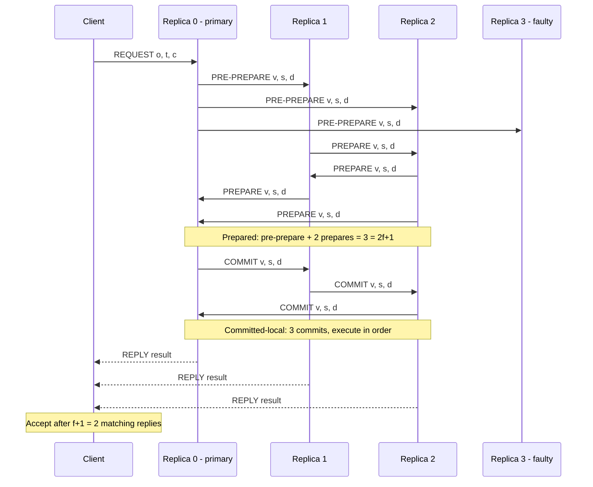

**Reading the diagram.** Five participants exchange authenticated messages over point-to-point channels; time runs downward. Solid arrows are protocol messages, of which only a representative subset is drawn: in reality every prepare and commit is multicast to all other replicas. Dashed arrows are replies sent directly to the client. Replica 3 is the failure point: it sends nothing, yet replicas 0, 1 and 2 still assemble $2f + 1 = 3$ statements in each phase, which is why $n = 3f + 1$ leaves no slack. The storage boundary is each replica's message log and state, pruned at stable checkpoints. Scaling is the problem: prepare and commit are all-to-all, so traffic grows with $n^2$.

#### Why three phases?

Pre-prepare plus prepare guarantee **order within a view**: no two honest replicas prepare different requests for the same slot. They do not guarantee that the order **survives a view change**, because a replica that is prepared might be the only one, and a new primary could fill the slot differently. The commit phase ensures that once any honest replica executes a request, at least $2f + 1$ replicas hold a prepared certificate for it, so at least $f + 1$ of the $2f + 1$ replicas in any view-change quorum, and therefore at least one honest one, will carry it into the new view.

### 45.9.2 View change

When a backup's timer for a pending request expires, it suspects the primary and stops accepting messages in view $v$.

1. **VIEW-CHANGE.** It multicasts $\langle$VIEW-CHANGE, $v + 1$, $s_c$, $\mathcal{C}$, $\mathcal{P}$, $i\rangle$: its last stable checkpoint $s_c$ with $2f + 1$ checkpoint proofs $\mathcal{C}$, and $\mathcal{P}$, a prepared certificate for every request prepared after $s_c$.
2. **NEW-VIEW.** The primary of view $v + 1$ waits for $2f$ valid view-change messages from other replicas (plus its own, $2f + 1$ in all) and multicasts $\langle$NEW-VIEW, $v + 1$, $\mathcal{V}$, $\mathcal{O}\rangle$, where $\mathcal{V}$ is the set of view-change messages and $\mathcal{O}$ re-issues a pre-prepare for every slot after the checkpoint: the request with a prepared certificate from the highest view, or a **null request** if none exists.
3. **Verify and resume.** Backups check that $\mathcal{O}$ was computed correctly from $\mathcal{V}$, so a faulty new primary cannot rewrite history, and the protocol continues with prepares in view $v + 1$.
4. **Escalate.** If the new primary also fails, timers double and the next view begins, which is how liveness is restored after GST.

**Figure 45.12 — PBFT view change from view 0 to view 1 (n = 4).**

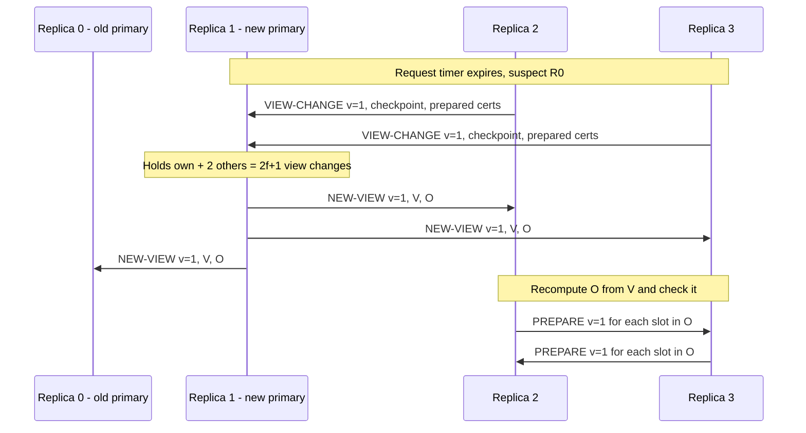

**Reading the diagram.** Replica 0, the suspected primary, is the failure point; the others time out independently and send view-change messages, which are actually multicast to all replicas although only those to the new primary are drawn. Replica 1 is the primary of view 1 because $1 \bmod 4 = 1$. NEW-VIEW carries the evidence $\mathcal{V}$, so each backup can recompute $\mathcal{O}$ and reject a forged history. Prepared certificates are the storage boundary that carries committed requests across views. Every view-change message contains $O(n)$ certificates of $O(n)$ signatures and NEW-VIEW contains $2f + 1$ of them, which is why a PBFT view change costs far more than the normal case as $n$ grows.

### 45.9.3 Message complexity

::: formula
**PBFT normal-case message count per request (no batching)**

$$M_{\text{replicas}} = \underbrace{(n-1)}_{\text{pre-prepare}} + \underbrace{(n-1)^2}_{\text{prepare}} + \underbrace{n(n-1)}_{\text{commit}} = 2n(n-1) \qquad M_{\text{total}} = 2n(n-1) + n + 1$$

| Symbol | Meaning | Units |
|---|---|---|
| $n$ | Replicas, $n = 3f + 1$ | count |
| $M_{\text{replicas}}$ | Replica-to-replica messages per request | messages |
| $M_{\text{total}}$ | Including 1 request and $n$ replies | messages |
:::

The primary sends $n - 1$ pre-prepares; each of the $n - 1$ backups sends a prepare to $n - 1$ others; all $n$ replicas send a commit to $n - 1$ others.

::: example
**Worked example — PBFT messages for n = 4, 7 and 10.**

1. $n = 4$ ($f = 1$): $3 + 9 + 12 = 24$ replica messages; with the request and 4 replies, $29$.
2. $n = 7$ ($f = 2$): $6 + 36 + 42 = 84$; total $84 + 8 = 92$.
3. $n = 10$ ($f = 3$): $9 + 81 + 90 = 180$; total $180 + 11 = 191$.
4. At 1,000 requests/s unbatched, a 10-replica cluster exchanges $180{,}000$ replica messages per second. Batching 100 requests per protocol instance cuts that to $1{,}800$ per second.

**Interpretation.** Going from tolerating 1 fault to 3 multiplies traffic by $180 / 24 = 7.5$, the $n^2$ term at work. **Engineering implication.** PBFT is excellent at $n = 4$ or $7$, especially with batching, and becomes the bottleneck at tens or hundreds of replicas, which is the regime that motivated HotStuff.
:::

**Table 45.9 — PBFT costs at three cluster sizes.**

| $n$ | $f$ | Quorum $2f+1$ | Pre-prepare | Prepare | Commit | Replica total | With client |
|---|---|---|---|---|---|---|---|
| 4 | 1 | 3 | 3 | 9 | 12 | 24 | 29 |
| 7 | 2 | 5 | 6 | 36 | 42 | 84 | 92 |
| 10 | 3 | 7 | 9 | 81 | 90 | 180 | 191 |

PBFT keeps its normal case cheap with **message authentication codes** instead of signatures (each multicast carries a vector of $n - 1$ MACs), **batching**, **tentative execution** (replicas execute once prepared and the client waits for $2f + 1$ matching tentative replies, saving one message delay), and **read-only requests** executed directly by all replicas, answered once $2f + 1$ replies match.

::: industry
**BFS and BFT-SMaRt.** Castro and Liskov built BFS, a Byzantine-fault-tolerant NFS service on PBFT, and reported it only 3% slower than an unreplicated NFS on the Andrew benchmark, the result that made BFT look practical. BFT-SMaRt is a widely used open-source library in the same lineage, and Hyperledger Fabric 3.0 added a BFT ordering service based on the SmartBFT library, alongside its crash-tolerant Raft orderer (as of 2024).
*Evidence: Primary* — [Castro & Liskov 1999; Bessani et al. 2014; Hyperledger Fabric Docs]
:::

::: warning
**Warning — A correct protocol can still be slow under attack.** A Byzantine primary can delay every request to just under the backups' timeout, keeping the system live but crawling. Clement et al. showed that several BFT protocols lose most of their throughput under such behavior and designed Aardvark to bound the damage with regular primary rotation and performance monitoring [Clement et al. 2009].
:::

## 45.10 Modern BFT: Tendermint and HotStuff

### 45.10.1 Tendermint

Tendermint, introduced in Buchman's thesis and refined in a 2018 paper, rebuilt PBFT-style consensus for blockchains: a validator set weighted by stake, a fresh decision per block height, gossip instead of point-to-point multicast, and a proposer that rotates every round [Buchman 2016; Buchman et al. 2018]. Each height runs one or more **rounds** of three steps; "+2/3" means more than two-thirds of voting power.

1. **Propose.** The round's proposer (weighted round-robin) gossips a block.
2. **Prevote.** Each validator prevotes for the block if it is valid and compatible with its lock, otherwise for nil. More than two-thirds of prevotes for one block form a **polka**.
3. **Precommit.** On seeing a polka a validator **locks** on the block and precommits it. More than two-thirds of precommits **commit** the block at this height, with immediate finality.
4. **Next round.** If a step times out, validators move to round $r + 1$ with a longer timeout. A locked validator prevotes only its locked block in later rounds unless it sees a polka for a different block in a later round, which is what keeps two rounds from committing different blocks.

**Figure 45.13 — One Tendermint height as a state machine.**

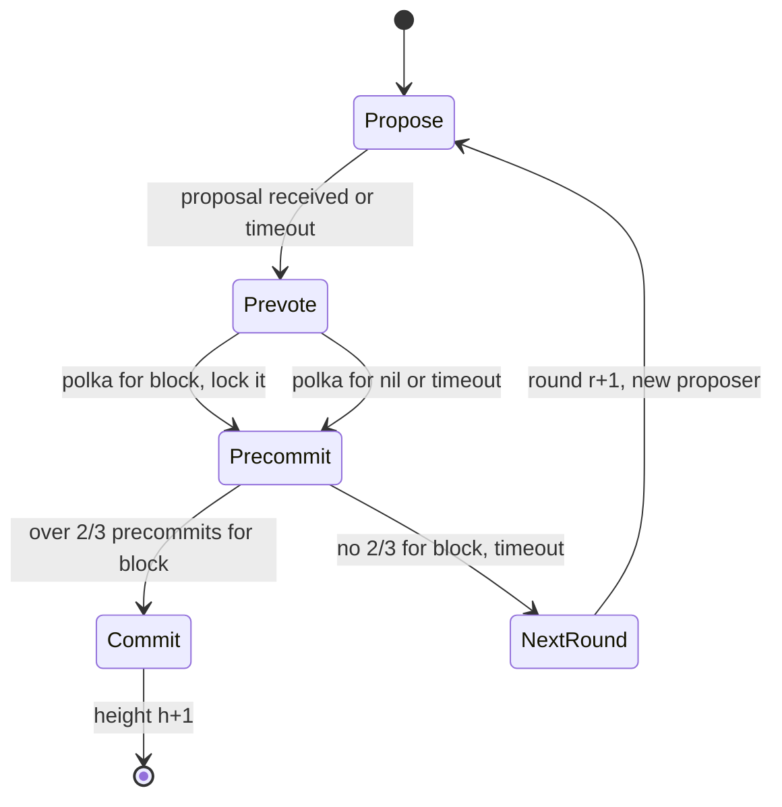

**Reading the diagram.** States are the steps of one validator at one height; transitions fire on gossiped votes, which arrive asynchronously, or on local timeouts. The only way out of a height is the Commit state, reached when more than two-thirds of voting power precommits the same block; that block is final and the validator moves to the next height. The failure points are a faulty or slow proposer and a network split, both of which lead through NextRound with growing timeouts. Locks, persisted in each validator's local state (the storage boundary), carry safety across rounds. All-to-all vote gossip makes each round quadratic in the number of validators.

### 45.10.2 HotStuff

HotStuff asks why a view change in PBFT must ship $O(n)$ certificates [Yin et al. 2019]. The answer is that a new leader in a two-phase protocol must convince replicas that its proposal does not conflict with any value that *might* have been committed: either by forwarding everyone's prepared certificates (PBFT, quadratic or worse) or by waiting the maximum network delay $\Delta$ so it surely hears the highest lock (Tendermint, which is therefore not **optimistically responsive**: it cannot run at the actual network speed $\delta$ after a leader change). HotStuff adds a third voting phase so that the highest quorum certificate reported by $n - f$ replicas is enough on its own.

1. **Star topology.** Replicas send votes only to the leader; the leader broadcasts. Every phase costs $O(n)$ messages.
2. **Quorum certificates (QCs).** The leader combines $n - f$ votes into one QC, with a threshold signature in the paper's design, so each message carries a constant number of authenticators.
3. **Phases.** PREPARE (propose a block extending the highest QC), PRE-COMMIT (broadcast the prepare QC), COMMIT (broadcast the pre-commit QC; replicas **lock** on it), DECIDE (broadcast the commit QC; replicas execute).
4. **Voting rule.** A replica votes for a proposal if it extends the block it is locked on (safety) *or* its justifying QC is from a higher view than its lock (liveness).
5. **Pacemaker.** Leader rotation and timeouts live in a separate module, so safety never depends on timing.

**Chained HotStuff** pipelines the phases. Every view proposes one new block carrying the QC of the previous block, so a single QC acts as the prepare QC for its block, the pre-commit QC for the parent and the commit QC for the grandparent. A block commits when it heads a **three-chain** of blocks certified in consecutive views. The leader can rotate every block at no extra cost.

**Figure 45.14 — Chained HotStuff: each block's QC advances three earlier blocks.**

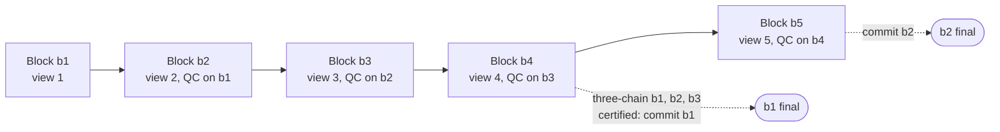

**Reading the diagram.** Each rectangle is a block proposed by a different leader in consecutive views; a solid arrow means the later block carries a quorum certificate on the earlier one, collected synchronously from $n - f$ votes sent to that view's leader. When b4 arrives carrying the QC on b3, the replica sees b1, b2 and b3 certified in consecutive views and commits b1; each later block commits one more (dotted arrows are these asynchronous commit consequences). Blocks are stored in each replica's block tree, the storage boundary. The failure point is a gap: if view 4's leader fails, the chain is broken, b1 waits for a new three-chain, and the pacemaker moves on. Throughput scales because each view needs only one broadcast and one vote round.

::: formula
**Messages per decision: PBFT versus HotStuff**

$$M_{\text{PBFT}} = 2n(n-1) \qquad M_{\text{HS-basic}} = 8(n-1) \qquad M_{\text{HS-chained}} \approx 2(n-1)$$

| Symbol | Meaning | Units |
|---|---|---|
| $n$ | Replicas | count |
| $M_{\text{PBFT}}$ | Replica messages per PBFT decision (§45.9.3) | messages |
| $M_{\text{HS-basic}}$ | NEW-VIEW plus four leader broadcasts plus three vote rounds | messages |
| $M_{\text{HS-chained}}$ | One proposal broadcast plus one vote round per block, steady state | messages |
:::

::: example
**Worked example — When does linearity pay?**

1. $n = 4$: PBFT $2 \cdot 4 \cdot 3 = 24$; basic HotStuff $8 \cdot 3 = 24$; chained $6$.
2. $n = 10$: PBFT $180$; basic $72$; chained $18$.
3. $n = 100$ ($f = 33$): PBFT $2 \cdot 100 \cdot 99 = 19{,}800$; basic $792$; chained $198$, a $100\times$ reduction.

**Interpretation.** At four replicas linearity buys nothing over PBFT in basic form, and basic HotStuff needs more message delays (about seven one-way delays from proposal to DECIDE, against three for PBFT's pre-prepare, prepare and commit). The win is at large $n$ and during view changes, where HotStuff stays linear while PBFT's grows to $O(n^3)$ authenticators. **Engineering implication.** For a 4- or 7-node permissioned cluster in one region, PBFT-style protocols are fine; for a validator set of 100 with per-block leader rotation, use a linear, pipelined protocol.
:::

**Table 45.10 — PBFT, Tendermint and HotStuff compared.**

| | PBFT | Tendermint | HotStuff (chained) |
|---|---|---|---|
| Voting phases | 2 after pre-prepare | 2 (prevote, precommit) | 3, pipelined |
| Communication | All-to-all | All-to-all gossip | Star via leader |
| Authenticators, correct leader | $O(n^2)$ | $O(n^2)$ | $O(n)$ |
| Authenticators, view change | $O(n^3)$ | $O(n^2)$ | $O(n)$ |
| Optimistically responsive | Yes | No | Yes |
| Leader | Stable until suspected | Rotates per round | Rotates per block |
| Typical home | Permissioned, small $n$ | Proof-of-stake chains | Proof-of-stake and permissioned chains |

Complexities follow the comparison in the HotStuff paper [Yin et al. 2019].

::: industry
**CometBFT and LibraBFT.** Tendermint Core, maintained since 2023 as CometBFT, is the consensus engine of the Cosmos Hub and many chains built with the Cosmos SDK. The Libra (later Diem) blockchain specified LibraBFT, a variant of HotStuff with an explicit pacemaker and a three-chain commit rule; the Diem project was wound down in 2022, but its HotStuff-derived designs continued in successor projects.
*Evidence: Primary* — [CometBFT Docs; Baudet et al. 2019]
:::

