# Chapter 45 — Advanced Consistency and Byzantine Fault Tolerance

> **Level:** 5 · **Track:** A (Traditional) · **Estimated reading time:** 7 h

Two customers share a checking and a savings account. A read-only report shows a deposit one of them just made, yet a withdrawal that committed a moment later was charged an overdraft fee as if the deposit had never happened. Everything ran under snapshot isolation and nothing failed; the report saw a state that no serial order could produce. Remove the report and the history is serializable again.

Chapters 11 and 24–27 gave you the working vocabulary: isolation levels (§11.13), system models and FLP (§24.6, §24.13), consistency models and CAP (Chapter 25), consensus (Chapter 26) and CRDTs in practice (§27.14). This chapter goes underneath it: Adya's dependency graphs, which let you *prove* whether a history is serializable; serializable snapshot isolation as PostgreSQL implements it; an Elle-style checker; and the lattice theory behind CRDTs, with its limits (the CALM theorem).

The second half drops the assumption that nodes are honest. Byzantine faults need $3f+1$ replicas and protocols such as PBFT, Tendermint and HotStuff; you will count their messages, compute the probability that a Bitcoin payment is reversed, and finish with a decision table. Three runnable Python programs accompany the chapter: a dependency-graph cycle detector, an exhaustive CRDT lattice checker and a Nakamoto confirmation calculator.

## 45.1 Learning objectives

After this chapter you should be able to:

- Place any guarantee in the combined consistency hierarchy, state the Adya phenomena it proscribes and give its availability class under partition.
- Construct write-skew and read-only-anomaly histories under snapshot isolation, draw their direct serialization graphs and identify the dangerous structure that serializable snapshot isolation (SSI) detects.
- Explain how PostgreSQL implements SSI and estimate how often an anomaly or a serialization failure will occur.
- Build a direct serialization graph from a list-append history, detect G0, G1c, G-single and G2-item cycles in linear time, and explain why Elle avoids the NP-completeness of general serializability checking.
- Sketch the convergence proof for state-based CRDTs, state op-based delivery requirements, size delta-CRDT savings, and use invariant confluence and CALM to decide when coordination is unavoidable.
- Explain where Byzantine faults occur in real infrastructure and derive $n \ge 3f+1$ and the $2f+1$ quorum intersection for partially synchronous Byzantine consensus.
- Walk through PBFT's normal case and view change and compute its message count for $n = 4$, $7$ and $10$; compare it with Tendermint and chained HotStuff.
- Compute Nakamoto's confirmation probability, contrast probabilistic and deterministic finality, and decide when a permissioned BFT system, a crash-tolerant database or a tamper-evident log is the right tool.

## 45.2 Prerequisites

- Isolation anomalies, snapshot isolation, MVCC and PostgreSQL's SERIALIZABLE level — §11.13–§11.15 (this chapter formalizes them).
- Timing models, failure models and the $2f+1$ versus $3f+1$ preview — §24.6 (BFT bounds start there).
- FLP impossibility and how partial synchrony escapes it — §24.13 (recapped only).
- Linearizability, causal consistency, session guarantees, the consistency map, CAP and Jepsen testing — Chapter 25, especially §25.7.5 and §25.11 (owned there; not repeated).
- Quorums, Paxos and Raft — §26.4, §26.6, §26.7 (PBFT and HotStuff are their Byzantine counterparts).
- CRDT designs and their merge laws in code — §27.14.3 (this chapter supplies the theory).
- Cross-partition isolation and distributed SQL — §28.3.3 and §28.10 (why SSI is hard to distribute).

## 45.3 The full consistency hierarchy

### 45.3.1 Two vocabularies, one partial order

::: definition
**Definition — Consistency hierarchy.** The partial order on guarantees in which model $A$ is **stronger** than model $B$ when every history $A$ allows is also allowed by $B$. It joins two families: **transactional isolation levels**, which constrain how groups of operations on many objects interleave, and **non-transactional consistency models**, which constrain which values single operations on single objects may return.
:::

#### First-principles explanation

Think of a guarantee as a sieve: pour in every possible execution and it keeps only those the guarantee permits. A finer sieve is stronger; two sieves are **incomparable** when each keeps an execution the other rejects. Figure 25.10 drew the map of sieves after Jepsen [Kingsbury: Consistency Models]. Here you add what the map lacks: implementation-independent *definitions* and a *proof* of which levels survive a partition.

#### Why does this exist?

Berenson et al. showed that the ANSI SQL phenomena were ambiguous, missed lost update, read skew and write skew, and had no place for snapshot isolation [Berenson et al. 1995]. Their fix (P0–P3, A5A, A5B) was precise but **preventative**: it forbade operation patterns such as "T2 writes x after T1 read it, before T1 commits", which outlaws correct optimistic and multi-version executions. Adya replaced operation patterns with graph properties of the committed history, so a level means the same thing whether implemented with locks, versions or validation [Adya 1999; Adya et al. 2000].

#### How it works internally: Adya's portable levels

Adya represents a committed history as a **direct serialization graph (DSG)**: one node per committed transaction and a directed edge for each direct conflict (the edge types are defined precisely in §45.4.1). Each **portable level** (PL) is defined by the graph patterns it **proscribes**:

**Table 45.1 — Adya's portable isolation levels and the phenomena each proscribes.**

| Portable level | Proscribes | Closest common name | Anomalies it still allows |
|---|---|---|---|
| PL-1 | G0 | Read uncommitted | Dirty reads, everything above |
| PL-2 | G0, G1 (G1a, G1b, G1c) | Read committed | Fuzzy reads, read skew, lost update, write skew |
| PL-2+ | G1, G-single | Consistent view | Cycles with two or more anti-dependencies (write skew) |
| PL-SI | G1, G-SI (G-SIa, G-SIb) | Snapshot isolation | Write skew on rows and on predicates |
| PL-2.99 | G1, G2-item | Repeatable read (item level) | Phantoms (predicate G2) |
| PL-3 | G1, G2 | Serializable | None, apart from real-time order |
| PL-3 + real time | G1, G2, and cycles through real-time edges | Strict serializable | None |

Three consequences explain most confusion in practice:

1. **Snapshot isolation and repeatable read are incomparable.** PL-SI forbids cycles with exactly one anti-dependency (read skew) but allows two (write skew); PL-2.99 forbids write skew on rows but allows predicate cycles (phantoms) that SI forbids.
2. **"Repeatable read" means at least three things**: the ANSI level, Adya's PL-2.99, and vendor behavior (PostgreSQL's is SI; MySQL's is a snapshot for plain reads plus current-row writes, Table 11.9).
3. **Serializability ignores real time.** Strict serializability adds it, and on single-operation, single-object transactions it coincides with linearizability (§25.3): one apex for both families.

**Figure 45.1 — The combined hierarchy, annotated with the phenomena each transactional level proscribes.**

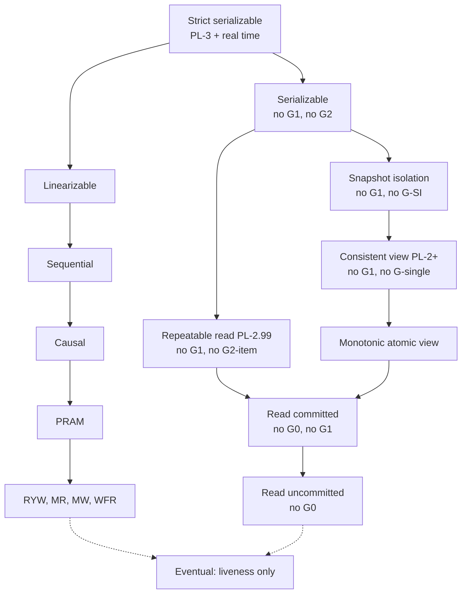

**Reading the diagram.** A solid arrow from $A$ to $B$ means every $A$ history is a $B$ history; strength decreases downward. The left column is transactional, labeled with Adya's proscribed phenomena; the right is single-object (Chapter 25). Repeatable read and SI are incomparable siblings. Dotted arrows mean "can be combined with": eventual consistency is a liveness property beside the safety properties. The figure has no protocols, flows or storage boundaries; the failure it guards against is choosing a level by name. Session variants (strong session SI, strong session serializable) add per-client order and sit just above their base level [Daudjee & Salem 2006; Kingsbury & Alvaro 2020].

### 45.3.2 Availability classes: what survives a partition

::: definition
**Definition — Availability classes (Bailis et al.).** A guarantee is **totally available** if every non-failing replica can commit every transaction without contacting any other replica, even when the network is arbitrarily partitioned. It is **sticky available** if this holds whenever each client keeps talking to replicas that have seen all of that client's previous operations. It is **unavailable** if some partition forces some transaction to block or abort [Bailis et al. 2014a].
:::

Bailis and colleagues called the first two classes **highly available transactions (HATs)**. Their classification rests on arguments you can reconstruct:

1. **Preventing lost update needs coordination.** Clients on opposite sides of a partition each read a counter at 10 and write 11; a totally available system commits both and loses one. SI, cursor stability, repeatable read and serializability are therefore unavailable.
2. **Preventing write skew needs coordination**, by the same argument with two rows.
3. **Recency needs coordination**: an isolated replica cannot promise the latest write (CAP, §25.8).

**Table 45.2 — Availability class of each guarantee under partition [Bailis et al. 2014a].**

| Class | Guarantees | Why |
|---|---|---|
| Totally available | Read uncommitted, read committed, monotonic atomic view, item cut and predicate cut isolation, monotonic reads, monotonic writes, writes follow reads | Each can be enforced with data a replica already has: buffered writes, version metadata, causal tags |
| Sticky available | Read your writes, PRAM, causal | The client must keep reaching replicas that hold its own past writes |
| Unavailable | Cursor stability, snapshot isolation, repeatable read, serializable, linearizable, strict serializable | They prevent lost update or write skew, or promise recency |

**Figure 45.2 — The three availability classes as bands of the hierarchy.**

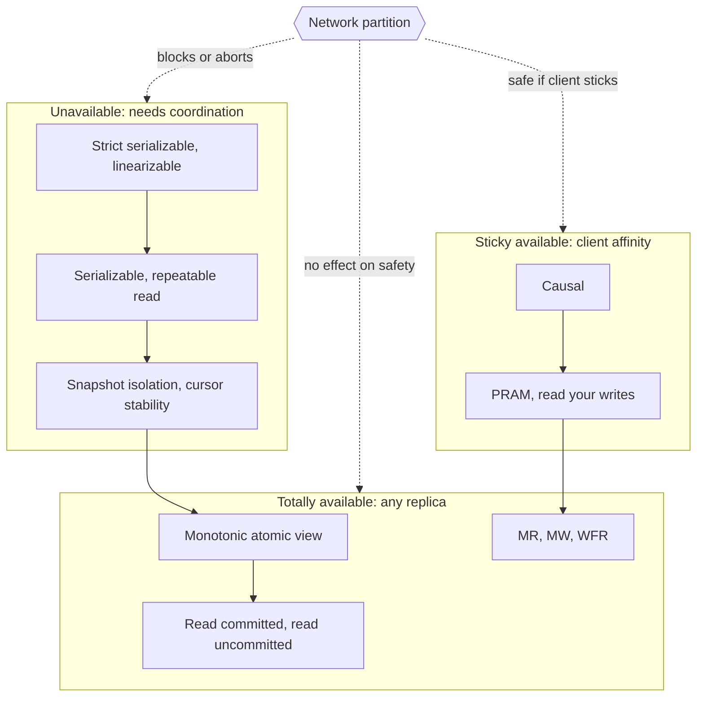

**Reading the diagram.** The subgraphs are the bands of Table 45.2; solid arrows repeat the strength order of Figure 45.1. The hexagon is a network partition, and its dotted (asynchronous) arrows show its effect: unavailable levels block or abort on the minority side, sticky levels survive while clients keep reaching replicas with their history, totally available levels are unaffected. The partition is the failure point; only the lower two bands scale writes across regions without cross-region round trips.

::: concept
**Key insight — Monotonic atomic view is the most useful transactional guarantee in the totally available band.** It guarantees that once you see one of a transaction's writes you see all of them, which prevents the "half-applied transaction" anomaly that read committed allows. It can be built with nothing more than buffered writes and per-transaction metadata, so it is the natural ceiling for a multi-region, always-writable store [Bailis et al. 2014a].
:::

::: industry
**Default isolation in shipping databases.** Surveying 18 popular databases, Bailis et al. reported that only three defaulted to serializability and eight did not offer it at all; read committed was the most common default, the level that keeps latency low and stays available.
*Evidence: Primary* — [Bailis et al. 2014a]
:::

::: mistake
**Mistake — "Our database is ACID, so it is serializable."** The I in ACID is whatever the default level is, which is usually read committed or snapshot isolation. Map the level to its proscribed phenomena (Table 45.1) and check which anomalies your invariants can tolerate.
:::

## 45.4 Snapshot isolation versus serializability

### 45.4.1 Adya's dependency-graph formalism

::: definition
**Definition — Direct serialization graph (DSG).** For a history of committed transactions with a known **version order** for each object (the order in which versions of $x$ were installed), the DSG has a node per committed transaction and an edge $T_i \rightarrow T_j$ whenever $T_j$ directly conflicts with $T_i$ in one of three ways [Adya 1999]:

- **Write dependency** ($T_i \xrightarrow{ww} T_j$): $T_i$ installs a version of $x$ and $T_j$ installs the *next* version of $x$.
- **Read dependency** ($T_i \xrightarrow{wr} T_j$): $T_i$ installs a version of $x$ and $T_j$ reads that version. (A predicate read that observes $T_i$'s change to the set of matching rows also counts.)
- **Anti-dependency** ($T_i \xrightarrow{rw} T_j$): $T_i$ reads a version of $x$ and $T_j$ installs the next version, so $T_i$ did not see $T_j$'s write. Predicate anti-dependencies arise when $T_j$ changes the set of rows matching a predicate $T_i$ read.
:::

#### First-principles explanation

Each edge is an unavoidable "must come before" fact: a reader of $T_i$'s write must follow $T_i$; a reader of a version $T_j$ later replaced must precede $T_j$. A history is **conflict serializable** exactly when the DSG is acyclic, and a topological sort is then an equivalent serial order [Papadimitriou 1979; Adya 1999]. Every anomaly of §11.13 is a *shape of cycle*.

**Table 45.3 — Adya's phenomena as graph properties.**

| Phenomenon | Formal condition | Informal name | Forbidden by |
|---|---|---|---|
| G0 | DSG cycle of ww edges only | Write cycle; dirty write interleaving | Every level from PL-1 up |
| G1a | A committed transaction read a version written by an aborted one | Aborted read | PL-2 and up |
| G1b | A committed transaction read a non-final version of another's write | Intermediate read | PL-2 and up |
| G1c | DSG cycle of ww and wr edges only | Circular information flow | PL-2 and up |
| G-single | DSG cycle with exactly one rw edge | Read skew, non-atomic view | PL-2+, PL-SI, PL-3; PL-2.99 for items |
| G2-item | DSG cycle with at least one item rw edge | Write skew on rows | PL-2.99, PL-3 |
| G2 | DSG cycle with at least one rw edge, item or predicate | Write skew, phantoms | PL-3 |

For snapshot isolation, Adya's **start-ordered serialization graph (SSG)** adds an edge $T_i \xrightarrow{s} T_j$ when $T_i$ commits before $T_j$ begins. **G-SIa (interference)** is a ww or wr edge without the matching start edge: $T_j$ saw or overwrote a write not committed when it started. **G-SIb (missed effects)** is an SSG cycle with exactly one anti-dependency. PL-SI proscribes G1, G-SIa and G-SIb [Adya 1999].

### 45.4.2 Write skew as a formal history

Figure 11.8 showed write skew with doctors; here it is as a history. One customer's accounts $x$ and $y$ hold 50 each, the invariant is $x + y \ge 0$, and $T_1$ and $T_2$ each withdraw 90 from a different account after checking the sum. Version subscripts name the writer; $c_i$ is a commit.

$$H_{ws}:\; r_1(x_0{=}50)\; r_1(y_0{=}50)\; r_2(x_0{=}50)\; r_2(y_0{=}50)\; w_1(x_1{=}{-40})\; w_2(y_2{=}{-40})\; c_1\; c_2$$

The write sets are disjoint, so SI's first-committer-wins rule rejects nothing; both commit and $x + y = -80$. $T_1$ read $y_0$, which $T_2$ replaced, and $T_2$ read $x_0$, which $T_1$ replaced: two anti-dependencies.

**Figure 45.3 — The DSG of write skew: a cycle of two anti-dependencies.**

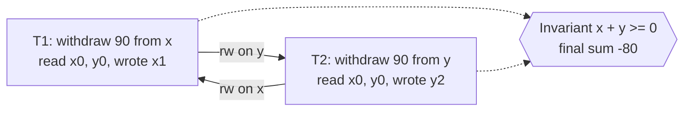

**Reading the diagram.** Rectangles are committed transactions on one database; arrows are logical dependencies, not messages. Each solid arrow is an anti-dependency (the source read a version the target overwrote), so together they demand $T_1$ before $T_2$ and $T_2$ before $T_1$: a G2-item cycle. Dotted arrows show both effects reaching the invariant, the failure point. SI checks only write–write conflicts and never sees these edges; SSI (§45.4.5) exists to notice them.

### 45.4.3 The read-only anomaly

Fekete, O'Neil and O'Neil showed that under SI a transaction that writes *nothing* can observe a state no serial execution produces, even when the writers alone are serializable [Fekete et al. 2004]. Checking $x$ and savings $y$ start at 0. $T_1$ deposits 20 into $y$. $T_2$ withdraws 10 from $x$ and charges a penalty of 1 if its snapshot shows $x + y < 0$ afterwards. $T_3$ prints a statement.

$$H_{ro}:\; r_2(x_0{=}0)\; r_2(y_0{=}0)\; r_1(y_0{=}0)\; w_1(y_1{=}20)\; c_1\; r_3(x_0{=}0)\; r_3(y_1{=}20)\; c_3\; w_2(x_2{=}{-11})\; c_2$$

**Figure 45.4 — The read-only anomaly under snapshot isolation.**

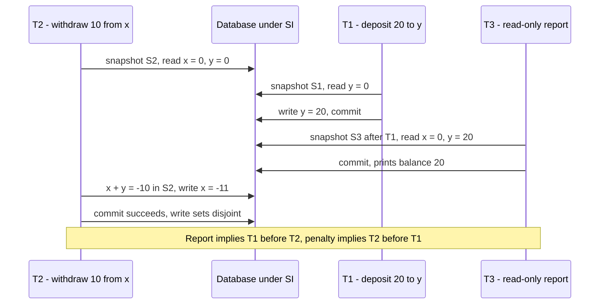

**Reading the diagram.** Three transactions make synchronous SQL calls to one SI database; time runs downward. $T_2$'s snapshot predates $T_1$'s commit, so it charges the penalty; $T_3$'s snapshot falls between the two commits, so it shows the deposit without the withdrawal. The multi-version store, holding $y_0$ and $y_1$ at once, is the storage boundary. The failure point is $T_2$'s commit, accepted because the write sets are disjoint. Without $T_3$ the outcome equals the serial order $T_2, T_1$; with it, no order.

In the DSG, $T_3$ read $y_1$ (wr from $T_1$), $T_3$ read $x_0$ which $T_2$ replaced (rw to $T_2$), and $T_2$ read $y_0$ which $T_1$ replaced (rw to $T_1$): a cycle with two anti-dependencies *in a row*.

**Figure 45.5 — DSG of the read-only anomaly, with the dangerous structure highlighted.**

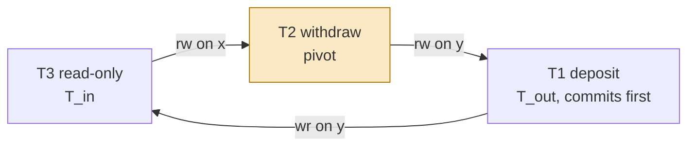

**Reading the diagram.** Nodes are committed transactions; edges are dependencies, not messages. The consecutive anti-dependencies into and out of $T_2$ form the **dangerous structure**, with $T_2$ the **pivot** (amber); $T_1$, the outgoing end, committed first; the wr edge closes the cycle. Aborting the pivot breaks it. When the three transactions live on different partitions no single node sees the structure, which is why SSI is hard to distribute (§28.3.3).

### 45.4.4 Why two consecutive anti-dependencies are the signature

::: concept
**Key insight — The dangerous-structure theorem.** Under snapshot isolation, every cycle in the DSG contains two consecutive anti-dependency edges $T_{in} \xrightarrow{rw} T_{pivot} \xrightarrow{rw} T_{out}$ in which each pair of adjacent transactions ran concurrently [Fekete et al. 2005]. Moreover, in some such structure on the cycle, $T_{out}$ is the first transaction of the cycle to commit [Ports & Grittner 2012].
:::

Proof sketch: under SI a ww or wr edge $T_i \rightarrow T_j$ requires $T_i$ to have committed before $T_j$ started (G-SIa is forbidden), so such edges point **forward in time**. An rw edge means $T_j$'s write was not in $T_i$'s snapshot, so the two overlapped. A cycle must return to its start, so it needs a non-forward edge; a single rw edge among forward edges yields G-SIb, which SI forbids; case analysis leaves two adjacent rw edges between overlapping transactions.

The theorem gives a **runtime test** (detect the pattern, not the cycle: SSI), a **static test** (Fekete et al. analyzed application programs this way, showed TPC-C serializable under SI, and fixed other programs by **promotion** with `SELECT ... FOR UPDATE` or by **materializing the conflict** in a shared row [Fekete et al. 2005]) and a **diagnosis** (a G2-item cycle on an SI database is expected; a G-single cycle means SI itself is broken).

### 45.4.5 Serializable snapshot isolation

::: definition
**Definition — Serializable snapshot isolation (SSI).** A concurrency-control algorithm that runs transactions under snapshot isolation, tracks anti-dependencies between concurrent transactions at run time, and aborts a transaction whenever a dangerous structure could form, so every committed history is serializable [Cahill et al. 2008].
:::

#### Why does this exist?

Under SI readers and writers never block each other; two-phase locking is serializable but lets a long report block every writer it touches. Cahill, Röhm and Fekete kept SI's non-blocking reads and aborted only transactions at a dangerous structure.

#### How it works internally

1. **Record reads without blocking.** Each read takes a **SIREAD lock**, a non-blocking note that "this transaction read this item or range".
2. **Detect rw edges from both sides.** A writer that finds a concurrent reader's SIREAD lock, or a reader whose visibility check skips a concurrent writer's newer version, records $T_r \xrightarrow{rw} T_w$.
3. **Mark and abort.** Each transaction has `inConflict` and `outConflict` flags; one with both set may be a pivot, and a member of the structure is aborted.
4. **Keep SIREAD locks after commit**, until every concurrent transaction has finished, because a committed reader can still source a new rw edge.

The algorithm is **conservative**: two flags do not prove a cycle, so some serializable histories are aborted (**false positives**), the price of not building the full graph.

### 45.4.6 SSI in PostgreSQL

PostgreSQL 9.1 shipped SSI as SERIALIZABLE, the first implementation in a production database, with several improvements [Ports & Grittner 2012]:

- **Edges, not flags**, which enable the **commit-ordering optimization**: a structure is dangerous only if $T_{out}$ commits first, so PostgreSQL waits for that before aborting.
- **Read-only optimization:** with a read-only $T_{in}$, the structure matters only if $T_{out}$ committed before $T_{in}$'s snapshot, as in Figure 45.4.
- **Safe snapshots:** a read-only snapshot that no concurrent writer can make dangerous needs no SIREAD locks and cannot fail; `SERIALIZABLE READ ONLY DEFERRABLE` waits for one.
- **Multi-granularity SIREAD locks** on tuples, index pages or relations, **promoted** to coarser locks under memory pressure (more false positives), and **summarization** of old committed transactions to bound memory.
- **Application contract:** failures return SQLSTATE `40001` and must be retried; the guarantee holds only among transactions that all run at SERIALIZABLE.

**Figure 45.6 — How PostgreSQL's SSI decides whether to abort.**

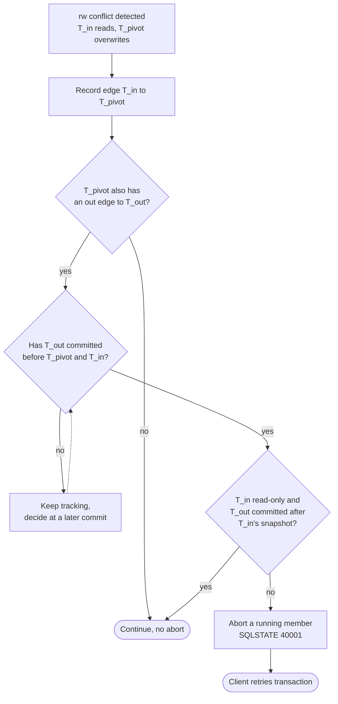

**Reading the diagram.** The flow runs inside one database on each rw conflict and at commit; nothing crosses the network. Rectangles update the lock and conflict tables in shared memory, the storage boundary. Diamonds are the three tests: dangerous structure, $T_{out}$ first, read-only exemption. The dotted arrow is asynchronous: the decision is revisited at a later commit. The failure point is the abort, surfacing as `40001`. Under high concurrency, lock promotion coarsens detection, so aborts rise faster than linearly with contention.

::: industry
**PostgreSQL SERIALIZABLE.** SERIALIZABLE has been SSI since 9.1; REPEATABLE READ is plain SI. Ports and Grittner report SSI throughput close to SI and well above strict two-phase locking on read-heavy workloads. In 2020 Jepsen found G2-item cycles at SERIALIZABLE in PostgreSQL 12.3, a bug since fixed (§25.11.3).
*Evidence: Primary* — [Ports & Grittner 2012; PostgreSQL Docs: Transaction Isolation; Kingsbury 2020]
:::

#### Mathematical foundations: how often does an anomaly happen?

An anomaly needs transactions on the *same* invariant group (one customer's accounts) to overlap in time.

::: formula
**Overlap probability and expected anomalies under snapshot isolation**

$$P_{\text{overlap}} = 1 - e^{-2\lambda T} \approx 2\lambda T \qquad\qquad E[\text{anomalies per day}] \approx G \cdot \lambda^{2} \cdot T \cdot s \cdot 86\,400$$

| Symbol | Meaning | Units |
|---|---|---|
| $\lambda$ | Arrival rate of invariant-checking transactions on one group, assumed Poisson | transactions/s |
| $T$ | Transaction duration from snapshot to commit | s |
| $P_{\text{overlap}}$ | Probability that a given transaction overlaps another on the same group | dimensionless |
| $G$ | Number of independent invariant groups | count |
| $s$ | Fraction of overlapping pairs whose reads and writes actually form write skew | dimensionless |
| $86\,400$ | Seconds per day | s/day |
:::

Another transaction overlaps yours if it starts within a window of $2T$ around your start. Each group starts $\lambda \cdot 86\,400$ transactions a day, each overlapping a later one with probability about $\lambda T$; a fraction $s$ of pairs are dangerous.

::: example
**Worked example — Overdrafts at a retail bank.**

1. A bank has $G = 10^6$ customers with linked accounts. Each makes 20 balance-checked withdrawals a day: $\lambda = 20 / 86\,400 = 2.31 \times 10^{-4}$ per second. Each transaction lasts $T = 50$ ms.
2. Overlap probability per transaction: $2\lambda T = 2 \times 2.31 \times 10^{-4} \times 0.05 = 2.31 \times 10^{-5}$, about 1 in 43,000.
3. Overlapping pairs per day: $G \lambda^2 T \cdot 86\,400 = 10^6 \times (2.31 \times 10^{-4})^2 \times 0.05 \times 86\,400 = 10^6 \times 5.36 \times 10^{-8} \times 0.05 \times 86\,400 \approx 231$.
4. If $s = 0.05$ of those pairs both pass a near-limit check and write different accounts, expect about $231 \times 0.05 \approx 12$ overdrafts a day that no serial execution would allow.

**Interpretation.** One in 43,000 per transaction is a daily event at scale, and Poisson is optimistic: double-clicks, retries and batch jobs correlate arrivals on one group. **Engineering implication.** Under SSI the 231 pairs (plus false positives) size your retry budget; under SI they size your incident rate.
:::

#### Alternatives and trade-offs

**Table 45.4 — Ways to obtain serializability, compared.**

| Approach | How it works | Readers block writers? | Main cost | Distributes well? | Example |
|---|---|---|---|---|---|
| Strict two-phase locking | Shared read locks, exclusive write locks, held to commit | Yes | Blocking, deadlocks | Yes, with lock managers per partition | MySQL SERIALIZABLE; Spanner read-write transactions (§28.8) |
| SSI | SI plus rw-conflict tracking | No | Aborts, including false positives; memory for SIREAD locks | Poorly: the dangerous structure spans partitions | PostgreSQL SERIALIZABLE |
| Optimistic validation of reads | Re-check read set at commit time | No | Aborts under contention | Yes, with timestamps | CockroachDB read refresh (§28.10) |
| Deterministic ordering | Agree on order first, then execute | No | Must know read/write sets in advance | Yes | Calvin (§28.9) |
| SI plus application fixes | Promotion with `FOR UPDATE`, materialized conflict rows, static analysis | Only on promoted rows | Developer discipline; easy to miss a path | Yes | Any SI database |

#### Failure scenarios

**Table 45.5 — Failure scenarios around snapshot isolation and SSI.**

| What goes wrong | Why | Detection | Recovery | Prevention |
|---|---|---|---|---|
| Invariant broken at REPEATABLE READ | SI allows write skew | Reconciliation queries | Compensate | SERIALIZABLE or conflict row |
| Burst of `40001` errors | Hot group; lock promotion | Errors by SQLSTATE | Jittered retry | Split hot groups; more lock memory |
| Anomaly despite SERIALIZABLE | Some sessions at a lower level | Elle-style test | Fix, reconcile | Server-side default level |
| Retries duplicate side effects | Work outside the database | Duplicate e-mails | Deduplicate | Idempotency keys (§22.15) |

::: mistake
**Mistake — "Read-only transactions are always safe under snapshot isolation."** Figure 45.4 is the counterexample, and decisions made from such a report inherit the anomaly. Under SSI the reader may itself be aborted unless it runs `DEFERRABLE`.
:::

## 45.5 Formalizing histories and checking them

### 45.5.1 From observations to a graph

Chapter 25 introduced Jepsen's checkers (§25.11.2); here you build the core of one. The DSG needs each object's **version order**, which a black-box test cannot see. With registers many version orders fit the observations, and deciding whether any makes the history serializable is NP-complete [Papadimitriou 1979]; 20 transactions already have $20! \approx 2.4 \times 10^{18}$ serial orders. Elle designs the workload so observations *reveal* the order [Kingsbury & Alvaro 2020]:

1. **Recoverability.** Every write appends a unique value, so every read traces to its writer.
2. **Traceability.** A read of list `[1, 2, 5]` exhibits the key's version history; every read must be a prefix of the longest, or the history has an **incompatible order** anomaly.
3. **Edges by lookup**, then cycle detection in $O(V + E)$ with Tarjan's algorithm or breadth-first search.
4. **Classification by restriction:** search ww-only cycles (G0), then ww+wr (G1c), then one rw edge closed by ww/wr (G-single), then any cycle (G2-item).
5. **Optional edges:** per-client process order checks *strong session* variants; real-time edges check *strict* serializability.

**Figure 45.7 — An Elle-style checker pipeline.**

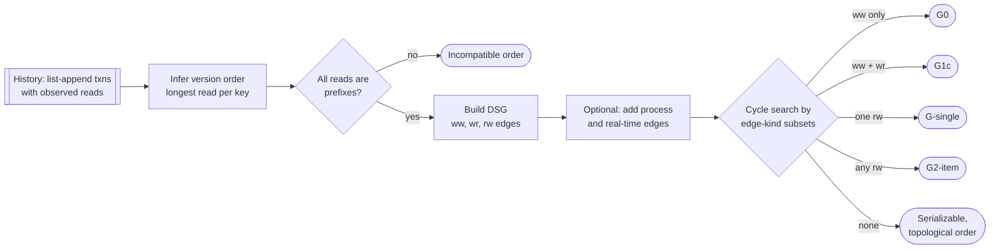

**Reading the diagram.** The recorded history (subroutine shape) is the storage boundary between test and analysis; everything after it runs offline in one process as synchronous steps. The prefix test can reject a history before any graph exists; the optional stage changes which level is checked. Terminals are verdicts from most to least severe. The failure point is an unobserved write, whose position is unknown, so a cycle through it can be missed. Cost grows roughly linearly with history length.

### 45.5.2 A runnable DSG cycle detector

The program implements the pipeline and runs it on write skew, the read-only anomaly with and without its reader, read skew, circular information flow, a write cycle and inconsistent reads.

```python
"""Elle-style checker for list-append histories: infer each key's version
order, build Adya's direct serialization graph (DSG) with ww, wr and rw
edges, then search for cycles and name the anomaly (G0, G1c, G-single, G2)."""
from collections import defaultdict, deque

def version_orders(history):
    """Per key, the longest list any transaction read. Every other read of
    that key must be a prefix of it, or no version order explains the reads."""
    orders, problems = {}, []
    for txn in history:
        for op, key, val in txn["ops"]:
            if op == "r" and len(val) >= len(orders.get(key, [])):
                orders[key] = list(val)
    for txn in history:
        for op, key, val in txn["ops"]:
            if op == "r" and orders[key][:len(val)] != list(val):
                problems.append(f"{txn['id']} read {key}={val}: not a prefix of {orders[key]}")
    return orders, problems

def build_dsg(history):
    orders, problems = version_orders(history)
    writer = {(key, val): txn["id"]               # appended values are unique
              for txn in history for op, key, val in txn["ops"] if op == "append"}
    edges = defaultdict(set)                      # (src, dst) -> {"ww x", "rw y", ...}
    def add(src, dst, kind, key):
        if src != dst:                            # ignore a transaction's own effects
            edges[(src, dst)].add(f"{kind} {key}")
    for key, order in orders.items():             # ww: Ti installed the version before Tj's
        for prev, nxt in zip(order, order[1:]):
            add(writer[(key, prev)], writer[(key, nxt)], "ww", key)
    for txn in history:
        for op, key, val in txn["ops"]:
            if op != "r":
                continue
            order = orders[key]
            if val:                               # wr: Tj read the version Ti installed
                add(writer[(key, val[-1])], txn["id"], "wr", key)
            if len(val) < len(order):             # rw: Ti read a version Tj overwrote
                add(txn["id"], writer[(key, order[len(val)])], "rw", key)
    return edges, problems

def kinds(edges, a, b):
    return {label.split()[0] for label in edges[(a, b)]}

def find_path(edges, src, dst, allowed):
    """Shortest path of at least one edge from src to dst (src == dst finds a
    cycle), using only edges that carry a dependency kind in `allowed`."""
    adj = defaultdict(list)
    for (a, b) in sorted(edges):
        if kinds(edges, a, b) & allowed:
            adj[a].append(b)
    parent, queue = {}, deque([src])
    while queue:
        node = queue.popleft()
        for m in adj[node]:
            if m == dst:                          # reached the target: rebuild path
                path = [dst, node]
                while path[-1] != src:
                    path.append(parent[path[-1]])
                return path[::-1]
            if m not in parent and m != src:
                parent[m] = node
                queue.append(m)
    return None

def find_cycle(edges, nodes, allowed):
    for n in sorted(nodes):
        p = find_path(edges, n, n, allowed)
        if p:
            return p
    return None

def check(history):
    edges, problems = build_dsg(history)
    nodes = {t["id"] for t in history}
    if problems:
        return "incompatible-order", problems
    cyc = find_cycle(edges, nodes, {"ww"})
    if cyc:
        return "G0 (write cycle)", cyc
    cyc = find_cycle(edges, nodes, {"ww", "wr"})
    if cyc:
        return "G1c (circular information flow)", cyc
    for (a, b) in sorted(edges):                  # one rw edge closed by ww/wr edges
        if "rw" in kinds(edges, a, b):
            back = find_path(edges, b, a, {"ww", "wr"})
            if back:
                return "G-single (read skew)", [a] + back
    cyc = find_cycle(edges, nodes, {"ww", "wr", "rw"})
    if cyc:
        return "G2-item (anti-dependency cycle)", cyc
    return "serializable", topological_order(edges, nodes)

def topological_order(edges, nodes):
    indeg = {n: 0 for n in nodes}
    for (a, b) in edges:
        indeg[b] += 1
    ready, order = sorted(n for n in nodes if indeg[n] == 0), []
    while ready:
        n = ready.pop(0)
        order.append(n)
        for (a, b) in sorted(edges):
            if a == n:
                indeg[b] -= 1
                if indeg[b] == 0:
                    ready.append(b)
    return order

def show(name, history):
    verdict, detail = check(history)
    edges, _ = build_dsg(history)
    print(f"{name}: {verdict}")
    if verdict == "serializable":
        print("   equivalent serial order:", " -> ".join(detail))
    elif verdict == "incompatible-order":
        print("  ", detail[0])
    else:
        hops = [f"{a} -[{', '.join(sorted(edges[(a, b)]))}]-> {b}"
                for a, b in zip(detail, detail[1:])]
        print("   cycle:", "  ".join(hops))

T = lambda tid, *ops: {"id": tid, "ops": list(ops)}

WRITE_SKEW = [   # both check x+y, each appends to a different key
    T("T1", ("r", "x", []), ("r", "y", []), ("append", "x", 1)),
    T("T2", ("r", "x", []), ("r", "y", []), ("append", "y", 2)),
    T("T3", ("r", "x", [1]), ("r", "y", [2])),
]
READ_ONLY = [    # Fekete, O'Neil and O'Neil 2004, as list appends
    T("T2", ("r", "x", []), ("r", "y", []), ("append", "x", 1)),   # withdrawal
    T("T1", ("r", "y", []), ("append", "y", 2)),                    # deposit
    T("T3", ("r", "x", []), ("r", "y", [2])),                       # read-only report
    T("T4", ("r", "x", [1]), ("r", "y", [2])),                      # final read
]
READ_SKEW = [
    T("T1", ("append", "x", 1), ("append", "y", 1)),
    T("T2", ("r", "x", []), ("r", "y", [1])),
    T("T3", ("r", "x", [1]), ("r", "y", [1])),
]
CIRCULAR = [
    T("T1", ("append", "x", 1), ("r", "y", [2])),
    T("T2", ("append", "y", 2), ("r", "x", [1])),
]
WRITE_CYCLE = [
    T("T1", ("append", "x", 1), ("append", "y", 1)),
    T("T2", ("append", "x", 2), ("append", "y", 2)),
    T("T3", ("r", "x", [1, 2]), ("r", "y", [2, 1])),
]

if __name__ == "__main__":
    show("write skew        ", WRITE_SKEW)
    show("read-only anomaly ", READ_ONLY)
    show("same, without T3  ", [t for t in READ_ONLY if t["id"] != "T3"])
    show("read skew         ", READ_SKEW)
    show("circular info flow", CIRCULAR)
    show("write cycle       ", WRITE_CYCLE)
    show("bad prefix        ", [T("T1", ("append", "x", 1)), T("T2", ("append", "x", 2)),
                                T("T3", ("r", "x", [1, 2])), T("T4", ("r", "x", [2]))])
```

Output:

```text
write skew        : G2-item (anti-dependency cycle)
   cycle: T1 -[rw y]-> T2  T2 -[rw x]-> T1
read-only anomaly : G2-item (anti-dependency cycle)
   cycle: T1 -[wr y]-> T3  T3 -[rw x]-> T2  T2 -[rw y]-> T1
same, without T3  : serializable
   equivalent serial order: T2 -> T1 -> T4
read skew         : G-single (read skew)
   cycle: T2 -[rw x]-> T1  T1 -[wr y]-> T2
circular info flow: G1c (circular information flow)
   cycle: T1 -[wr x]-> T2  T2 -[wr y]-> T1
write cycle       : G0 (write cycle)
   cycle: T1 -[ww x]-> T2  T2 -[ww y]-> T1
bad prefix        : incompatible-order
   T4 read x=[2]: not a prefix of [1, 2]
```

What to notice:

- `version_orders` is the whole trick: with unique values and growing lists, the longest read *is* the version order. The last history fails there.
- An rw edge points from a reader to the writer of the *next* version (`order[len(val)]`).
- The read-only history is serializable without `T3` and a G2-item cycle with it (Figure 45.5). SI allows both G2-item histories but must never produce the G-single one.
- The read-skew history needs the final read `T3`; without it the append to `x` is unobserved and the anomaly invisible.
- Each `find_path` query is $O(V + E)$; production checkers run Tarjan's algorithm once and search inside strongly connected components.

::: industry
**Elle in Jepsen analyses.** Jepsen has used Elle in its transactional analyses since 2020, including the PostgreSQL 12.3 report. The paper's evaluation shows checking time growing roughly linearly with history length, unlike search-based checkers.
*Evidence: Primary* — [Kingsbury & Alvaro 2020; Kingsbury 2020]
:::

::: recommendation
**Recommendation — Make your own integration tests checkable.** Add a list-append table in staging, run concurrent append-and-read transactions under fault injection and feed the history to Elle. It tests the level you actually run, including connection-pool defaults that change it.
:::

## 45.6 CRDT theory

§27.14.3 built CRDTs and tested their merge laws on random histories. This section explains *why* those laws are right and what no CRDT can do.

### 45.6.1 Join-semilattices and monotonicity

::: definition
**Definition — Join-semilattice.** A set $S$ with a partial order $\le$ in which every pair of elements $x, y$ has a **least upper bound** (join) $x \sqcup y$: an element with $x \le x \sqcup y$ and $y \le x \sqcup y$, and $x \sqcup y \le z$ for every other upper bound $z$. Any join is commutative, associative and idempotent (ACI). A function $m$ on $S$ is **inflationary** if $x \le m(x)$ and **monotone** if $x \le y$ implies $m(x) \le m(y)$.
:::

The ACI laws of §27.14.3 are what "least upper bound" means. The order says which state "knows more"; for a G-Counter it is slot-wise $\le$ and the join is the slot-wise maximum.

**Figure 45.8 — Hasse diagram of a two-replica G-Counter lattice.**

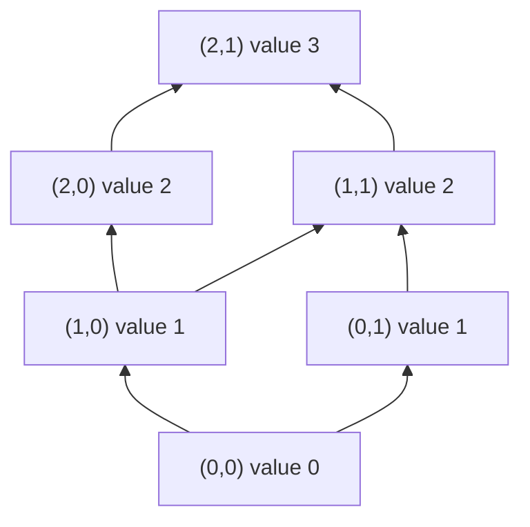

**Reading the diagram.** Nodes are states (slot A, slot B); an arrow means one step up the order, toward "knows more". An increment moves up one arrow; a merge moves to the lowest node above both inputs, so (2,0) and (1,1), incomparable results of concurrent increments, merge to (2,1). In a deployment each replica holds one node and gossip carries nodes between replicas. The failure point is a merge that misses the least upper bound, such as summing slots, which double-counts duplicates.

### 45.6.2 Why state-based CRDTs converge: a proof sketch

::: concept
**Key insight — Strong eventual consistency from three assumptions.** If (1) states form a join-semilattice, (2) merge is the join and (3) every update is inflationary, then any two replicas that have received the same set of updates are in the same state, regardless of delivery order or duplication; if (4) every update eventually reaches every replica, all replicas converge [Shapiro et al. 2011a].
:::

The proof is a short induction. For each replica $i$, let $C_i$ be its **causal history**, the set of updates whose effects it has received, and for each update $u$ let $\delta_u$ be the state produced by $u$ at its origin. Claim: at all times $x_i = \bigsqcup_{u \in C_i} \delta_u$ (with the empty join equal to the bottom state $\bot$).

1. **Base.** Initially $C_i = \emptyset$ and $x_i = \bot$.
2. **Local update.** Replica $i$ applies $u$ and gets $m(x_i)$. Because $m$ is inflationary, $x_i \le m(x_i)$, so $m(x_i) = x_i \sqcup m(x_i)$. Taking $\delta_u = m(x_i)$ gives $x_i' = x_i \sqcup \delta_u$ and $C_i' = C_i \cup \{u\}$.
3. **Merge.** Replica $i$ receives $x_j$ and computes $x_i \sqcup x_j = \bigsqcup_{C_i} \delta \sqcup \bigsqcup_{C_j} \delta = \bigsqcup_{C_i \cup C_j} \delta$ by associativity and commutativity, and idempotence absorbs updates in both sets; its new causal history is $C_i \cup C_j$.

So a replica's state depends only on its causal history: strong eventual consistency. The proof needed no message ordering, no exactly-once delivery and no clocks, which is why state-based CRDTs ride on lossy, duplicating gossip.

### 45.6.3 Operation-based CRDTs

Operation-based CRDTs ship operations, which is cheaper for large states but moves requirements into the network [Shapiro et al. 2011b]: each operation splits into a *prepare* phase at the origin (an OR-Set remove collects the tags it observed) and an *effect* applied everywhere; **concurrent effects must commute**; and delivery must be **reliable, exactly once and causally ordered**, typically by causal broadcast with vector clocks (§24.11). Each style can emulate the other, so the choice is about the network you have.

### 45.6.4 Delta-CRDTs

**Delta-state CRDTs** take the middle path [Almeida et al. 2018]. A **delta-mutator** $m^{\delta}$ returns only the changed part, with $m(x) = x \sqcup m^{\delta}(x)$. Deltas are lattice states, so they join into **delta-intervals** that can be gossiped, duplicated and reordered like full states. A replica sends each peer the deltas it has not acknowledged, falling back to full state after long disconnections; some types, the OR-Set among them, need a causal delta-merging condition to keep their semantics.

::: formula
**Gossip bandwidth: full state versus delta-intervals**

$$B_{\text{full}} = k \cdot r \cdot n \cdot b \qquad\qquad B_{\delta} = k \cdot r \cdot d \cdot b$$

| Symbol | Meaning | Units |
|---|---|---|
| $B_{\text{full}}$, $B_{\delta}$ | Bytes sent per second by one replica | bytes/s |
| $k$ | Peers contacted per gossip round | count |
| $r$ | Gossip rounds per second | 1/s |
| $n$ | Entries in the full state (for a G-Counter, one per replica) | entries |
| $d$ | Entries changed since the last exchange with that peer | entries |
| $b$ | Bytes per entry (replica ID plus count) | bytes |
:::

::: example
**Worked example — A page-view counter on 1,000 edge nodes.**

1. Each of $n = 1{,}000$ edge nodes counts views in a G-Counter. An entry is an 8-byte node ID plus an 8-byte count: $b = 16$ bytes. Each node gossips with $k = 3$ peers once a second ($r = 1$).
2. Full state: $B_{\text{full}} = 3 \times 1 \times 1{,}000 \times 16 = 48{,}000$ bytes/s per node, or $48$ MB/s across the fleet.
3. Suppose that between two exchanges with a given peer, only $d = 20$ slots have changed in what a node knows (its own plus those forwarded from recently active nodes). Then $B_{\delta} = 3 \times 1 \times 20 \times 16 = 960$ bytes/s per node, about $0.96$ MB/s across the fleet.

**Interpretation.** Deltas save $n/d = 50\times$ here, but only with *update locality*: if every node is busy every second, $d \to n$. **Engineering implication.** Measure $d$ before relying on the saving, and keep full-state anti-entropy as the fallback.
:::

### 45.6.5 Checking the lattice laws exhaustively

On small state spaces you can enumerate *every* state and check the definitions directly, then exhibit two limits that §45.6.6 explains.

```python
"""Exhaustive lattice checks on small finite state spaces (Ch 27's random
tests sample histories; here every state is enumerated). For a G-Counter and
an OR-Set we check that merge is the least upper bound of the partial order,
that every mutator is inflationary, and that each delta-mutator satisfies
m(x) == x JOIN delta(x)."""
from itertools import product, combinations

# ---- G-Counter for replicas A and B, slots bounded to 0..2 -----------------
GC_STATES = list(product(range(3), repeat=2))
gc_leq  = lambda x, y: all(a <= b for a, b in zip(x, y))
gc_join = lambda x, y: tuple(max(a, b) for a, b in zip(x, y))
def gc_mutators(x):                       # (full result, delta) per enabled op
    for i in range(2):
        if x[i] < 2:
            yield (tuple(v + (k == i) for k, v in enumerate(x)),
                   tuple(x[i] + 1 if k == i else 0 for k in range(2)))

# ---- OR-Set over three tags (element, unique id); state = (adds, removes) --
TAGS = [("milk", 1), ("milk", 2), ("eggs", 3)]
def subsets(items):
    return [frozenset(c) for r in range(len(items) + 1) for c in combinations(items, r)]
OR_STATES = [(a, r) for a in subsets(TAGS) for r in subsets(TAGS) if r <= a]
or_leq  = lambda x, y: x[0] <= y[0] and x[1] <= y[1]
or_join = lambda x, y: (x[0] | y[0], x[1] | y[1])
or_value = lambda x: {e for e, _ in x[0] - x[1]}
def or_mutators(x):
    adds, removes = x
    for t in TAGS:                         # add(e) with a fresh tag
        if t not in adds:
            yield (adds | {t}, removes), (frozenset({t}), frozenset())
    for e in {e for e, _ in TAGS}:         # remove(e): tombstone observed tags
        seen = frozenset(t for t in adds if t[0] == e)
        yield (adds, removes | seen), (frozenset(), seen)

def check(name, states, leq, join, mutators):
    for x, y in product(states, repeat=2):
        j = join(x, y)
        assert leq(x, j) and leq(y, j), "join is an upper bound"
        assert all(leq(j, z) for z in states if leq(x, z) and leq(y, z)), "least"
        assert j == join(y, x) and join(x, x) == x, "commutative, idempotent"
        for z in states:
            assert join(join(x, y), z) == join(x, join(y, z)), "associative"
    for x in states:
        for full, delta in mutators(x):
            assert leq(x, full), "mutator is inflationary"
            assert full == join(x, delta), "m(x) == x JOIN delta(x)"
    print(f"{name}: {len(states)} states, join is the LUB, mutators inflationary, deltas exact")

check("G-Counter", GC_STATES, gc_leq, gc_join, gc_mutators)
check("OR-Set   ", OR_STATES, or_leq, or_join, or_mutators)

# The state grows monotonically, but the *query* need not be monotone:
x = (frozenset({("milk", 1)}), frozenset())
y = (frozenset({("milk", 1)}), frozenset({("milk", 1)}))
print("OR-Set: x <= y:", or_leq(x, y), "| value(x) =", or_value(x), "| value(y) =", or_value(y))

# An invariant a lattice cannot protect: stock >= 0 checked only locally.
p, n = {"A": 1, "B": 0}, {"A": 0, "B": 0}       # PN-Counter: one unit in stock
replica = {r: (dict(p), dict(n)) for r in "AB"}  # both replicas have seen it
for r in "AB":                                   # each sells it: local check passes
    pr, nr = replica[r]
    if sum(pr.values()) - sum(nr.values()) >= 1:
        nr[r] += 1
merged_p = {k: max(replica["A"][0][k], replica["B"][0][k]) for k in "AB"}
merged_n = {k: max(replica["A"][1][k], replica["B"][1][k]) for k in "AB"}
print("PN-Counter stock after merge:", sum(merged_p.values()) - sum(merged_n.values()))
```

Output:

```text
G-Counter: 9 states, join is the LUB, mutators inflationary, deltas exact
OR-Set   : 27 states, join is the LUB, mutators inflationary, deltas exact
OR-Set: x <= y: True | value(x) = {'milk'} | value(y) = set()
PN-Counter stock after merge: -1
```

What to notice:

- The "least" check, `all(leq(j, z) ...)`, proves no smaller upper bound exists: merge loses and invents no information.
- `full == join(x, delta)` is the delta contract; an OR-Set remove delta carries only observed tombstones, hence add-wins.
- The OR-Set *state* grows but its *value* shrinks (`{'milk'}` then `set()`): "is milk absent?" is a non-monotone query.
- The PN-Counter converges perfectly, to $-1$: each local check passed, and convergence says nothing about invariants.

### 45.6.6 Limits: invariants and the CALM theorem

Convergence concerns the *data*; correctness usually concerns *invariants*. Transactions are **invariant confluent** (I-confluent) for invariant $I$ if merging any two divergent $I$-valid states with a common $I$-valid ancestor always yields an $I$-valid state; exactly then can replicas avoid coordination without ever violating $I$ [Bailis et al. 2014b].

**Table 45.6 — Invariant confluence of common invariants.**

| Invariant | Operations | I-confluent? | Why |
|---|---|---|---|
| Counter $\ge 0$ | Increments only | Yes | Merging two non-negative growths stays non-negative |
| Counter $\ge 0$ | Decrements | No | Two replicas each take the last unit (the program above) |
| Unique ID | Insert with replica-chosen ID from disjoint ranges | Yes | Ranges never collide |
| Unique username | Insert any chosen value | No | Both sides can pick the same name |
| Foreign key | Insert child with existing parent | Yes | Merge keeps both rows |
| Foreign key | Delete parent concurrently with insert child | No | Merge has an orphan |

For counters the usual escape is **escrow**: pre-partition the allowance (each region may sell 50 of 100 seats) and coordinate only to rebalance [Balegas et al. 2015].

::: definition
**Definition — CALM theorem.** *Consistency As Logical Monotonicity*: a problem has a consistent, coordination-free distributed implementation if and only if it is **monotonic**, meaning that adding inputs can only add outputs, never retract one [Hellerstein & Alvaro 2020; Ameloot et al. 2013].
:::

CALM lifts the lattice story to whole programs. Set union, reachability and deadlock detection (a waits-for cycle, once found, persists) are monotone, so replicas may act on partial views. Garbage collection ("no references exist") and checkout ("no more items will arrive") assert *absence*, which a late message can refute, so they need a barrier, sealed epoch or consensus. Write as much as possible in monotone form (Bloom and its lattice extension make this checkable [Alvaro et al. 2011; Conway et al. 2012]) and coordinate only at the non-monotone points.

::: mistake
**Mistake — "Use a CRDT and you will never need consensus."** CRDTs remove coordination for *merging*; non-monotone decisions (did we oversell? is this name free?) still need it.
:::

## 45.7 Byzantine faults and why they matter

### 45.7.1 Arbitrary failures and where they come from

::: definition
**Definition — Byzantine fault.** A fault in which a node deviates arbitrarily from its protocol: it may send wrong values, send *different* values to different peers (**equivocation**), replay or delay messages, or collude with other faulty nodes. The name comes from Lamport, Shostak and Pease's allegory of generals, some of them traitors, who must agree on a battle plan by messenger [Lamport et al. 1982].
:::

#### First-principles explanation

Crash-tolerant consensus assumes a faulty node is *silent*. A Byzantine node is a committee member who signs two contradictory minutes and hands one to each half of the room. Counting votes still works, but you must count enough that liars cannot tip the outcome.

#### Why does this exist? Where Byzantine faults occur in practice

Most Byzantine behavior in data centers is accidental, and crash-tolerant protocols turn it into data loss because they trust every message.

**Table 45.7 — Sources of Byzantine behavior.**

| Source | What it looks like | Published evidence |
|---|---|---|
| Silent data corruption in CPUs | A core computes wrong results, deterministically or intermittently, without any error signal | Google reports "mercurial cores" at a rate of a few per several thousand machines [Hochschild et al. 2021]; Meta reports silent data corruptions across its fleet [Dixit et al. 2021] |
| Corrupted messages | A bit flip that slips past TCP's 16-bit checksum and changes protocol state | Amazon S3's July 2008 outage: corrupted gossip messages spread through the cluster until MD5 checks were added [AWS 2008] |
| Corrupted storage | A single bad block or misdirected write on one replica | Ganesan et al. found that one corrupted block on one node could cause data loss or unavailability in widely used replicated stores [Ganesan et al. 2017] |
| Nondeterministic replicas | Replicas of a state machine diverge because of hash-map iteration order, time or threads | Appears to peers as a replica sending wrong answers |
| Faulty sensors and buses | A slightly-out-of-specification signal read differently by different receivers | Driscoll et al. document such failures in safety-critical avionics [Driscoll et al. 2003] |
| Mutually distrustful parties | Banks, companies or anonymous participants who each control nodes | Permissioned ledgers and public blockchains (§45.11) |

::: recommendation
**Recommendation — Convert arbitrary faults into crashes where you can.** End-to-end checksums, background comparison of replica-state digests, deterministic state machines and CPU screening turn "wrong answer" into "detected error", which crash-tolerant protocols handle (§24.14). Pay for full BFT when the *parties* cannot trust each other.
:::

::: mistake
**Mistake — "Byzantine fault tolerance protects against hackers."** One exploit that works on identical software compromises every replica at once. BFT needs **independent failures** (diverse implementations, keys and administrators) and does nothing about a valid but malicious client request.
:::

## 45.8 BFT lower bounds

### 45.8.1 Why three generals cannot tolerate one traitor

With unsigned messages, three generals cannot agree if one is a traitor [Lamport et al. 1982]. A commander sends an order to two lieutenants, who relay what they heard to each other.

**Figure 45.9 — The indistinguishable scenarios behind the three-generals impossibility.**

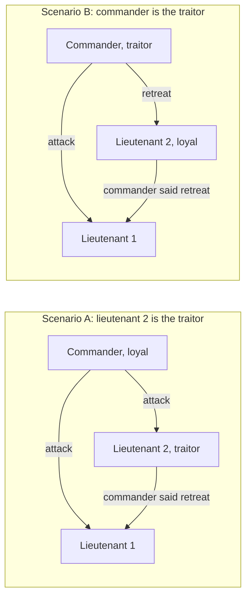

**Reading the diagram.** Each subgraph is a possible world; arrows are unsigned messages delivered synchronously in rounds. Lieutenant 1 receives identical messages in both. In A, validity forces it to attack. In B, loyal lieutenant 2 sees the mirror-image pattern and, by the same rule, follows the commander: retreat; agreement then forces lieutenant 1 to retreat. No rule does both. The failure point is the unverifiable relay. Simulating each general with $f$ nodes extends the impossibility to any $n \le 3f$.

With unforgeable signatures *and synchrony*, the relay can be verified and Byzantine broadcast is solvable for any number of traitors [Lamport et al. 1982; Dolev & Strong 1983]. Signatures do not lower the bound in partial synchrony, where real protocols live.

### 45.8.2 The partially synchronous bound and quorum intersection

In partial synchrony (§24.6.2) a protocol must act after hearing from $n - f$ replicas, since $f$ may be silent; up to $f$ of those heard may be Byzantine, and the silent ones may be *honest but slow*. Two requirements follow:

1. **Liveness:** a quorum must be obtainable without the $f$ silent nodes: $q \le n - f$.
2. **Safety:** any two quorums must share at least one *honest* node, so they cannot certify conflicting values. Two quorums of size $q$ in $n$ nodes overlap in at least $2q - n$ nodes, of which up to $f$ may be Byzantine: $2q - n \ge f + 1$.

Substituting the largest allowed quorum, $2(n - f) - n \ge f + 1$, gives $n \ge 3f + 1$. Dwork, Lynch and Stockmeyer proved this is tight for partial synchrony even with signatures [Dwork et al. 1988].

::: formula
**Byzantine fault tolerance and quorum size**

$$n \ge 3f + 1 \qquad f_{\max} = \left\lfloor \frac{n-1}{3} \right\rfloor \qquad q = \left\lceil \frac{n + f + 1}{2} \right\rceil \qquad |Q_1 \cap Q_2| \ge 2q - n \ge f + 1$$

| Symbol | Meaning | Units |
|---|---|---|
| $n$ | Number of replicas | count |
| $f$ | Byzantine replicas tolerated | count |
| $q$ | Quorum (certificate) size | count |
| $Q_1, Q_2$ | Any two quorums | sets of replicas |
| $2q - n$ | Minimum overlap of two quorums | count |
:::

For $n = 3f + 1$ the quorum is $q = 2f + 1$ and the overlap is exactly $f + 1$: at least one honest replica sits in every overlap and will not vote for two conflicting values.

::: example
**Worked example — Sizing BFT clusters with 4, 5, 7 and 10 replicas.**

1. $n = 4$: $f = \lfloor 3/3 \rfloor = 1$; $q = \lceil 6/2 \rceil = 3$; overlap $2 \cdot 3 - 4 = 2 \ge f + 1 = 2$. Liveness: $q = 3 \le n - f = 3$.
2. $n = 5$: $f = \lfloor 4/3 \rfloor = 1$; $q = \lceil 7/2 \rceil = 4$; overlap $3$; liveness $4 \le 4$. The fifth replica tolerates no extra fault and *raises* the quorum.
3. $n = 7$: $f = 2$; $q = \lceil 10/2 \rceil = 5$; overlap $3 = f + 1$; liveness $5 \le 5$.
4. $n = 10$: $f = 3$; $q = \lceil 14/2 \rceil = 7$; overlap $4 = f + 1$; liveness $7 \le 7$.

**Interpretation.** As with odd Raft sizes (§26.4.1), only $3f + 1$ is efficient: 5 and 6 replicas tolerate the same fault as 4. BFT needs $f$ more replicas than crash tolerance and larger quorum fractions (3 of 4 versus 2 of 3). **Engineering implication.** Use $3f + 1$ replicas in independent failure *and administrative* domains; at $n = 3f + 1$ liveness has no slack, so one crashed honest replica plus $f$ Byzantine ones halts progress.
:::

**Figure 45.10 — Quorum intersection with n = 4, f = 1: two quorums of three share an honest replica.**

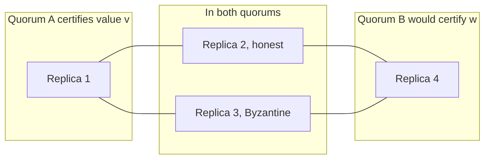

**Reading the diagram.** Quorum A is replicas 1–3; quorum B would be 2–4; lines show membership, not messages. Even if replica 3 equivocates (the failure point), honest replica 2 voted for $v$ and will not vote for $w$, so B never reaches three votes. With $n = 3$ and quorums of 2, the single-replica overlap could be the liar and both quorums could form.

### 45.8.3 Synchrony assumptions, summarized

**Table 45.8 — Byzantine agreement bounds by timing model.**

| Timing model | Messages | Replicas needed | Notes | Source |
|---|---|---|---|---|
| Synchronous | Oral (unsigned) | $n \ge 3f + 1$ | Needs $f + 1$ rounds in the worst case | [Lamport et al. 1982; Fischer & Lynch 1982] |
| Synchronous | Signed | Broadcast for any $f < n$; agreement on inputs for $f < n/2$ | Still $f + 1$ rounds | [Dolev & Strong 1983] |
| Partially synchronous | Either | $n \ge 3f + 1$ | Safe always, live after GST; basis of PBFT, Tendermint, HotStuff | [Dwork et al. 1988] |
| Asynchronous, deterministic | Either | Impossible even for one crash | FLP | [Fischer et al. 1985] |
| Asynchronous, randomized | Either | $n \ge 3f + 1$ | Terminates with probability 1 | [Ben-Or 1983; Bracha 1987; Miller et al. 2016] |

FLP (§24.13) applies in full, so BFT protocols take Paxos's escape: safety in every execution, liveness from timeouts and view changes after GST. Randomized asynchronous protocols such as HoneyBadgerBFT avoid timing assumptions at the cost of heavier cryptography and latency [Miller et al. 2016].

## 45.9 PBFT

### 45.9.1 The normal case

::: definition
**Definition — Practical Byzantine Fault Tolerance (PBFT).** A state-machine replication protocol for $n = 3f + 1$ replicas that tolerates $f$ Byzantine replicas and any number of faulty clients, is safe under asynchrony and live under partial synchrony, and orders requests with three phases (pre-prepare, prepare, commit) led by a **primary** that is replaced through a **view change** when it misbehaves [Castro & Liskov 1999; Castro & Liskov 2002].
:::

#### First-principles explanation

Picture Multi-Paxos (§26.6.2) with a leader who might lie. Nobody acts on its word alone: replicas first confirm with each other that they received the *same* proposal for a slot, then confirm that enough of them know it, each time with a quorum of $2f + 1$.

#### How it works internally

Views are numbered $v = 0, 1, 2, \ldots$ and the primary of view $v$ is replica $v \bmod n$.

1. **Request.** A client sends a signed request $\langle$REQUEST, $o$, $t$, $c\rangle$ (operation, timestamp, client) to the primary.
2. **Pre-prepare.** The primary assigns sequence number $s$ and multicasts $\langle$PRE-PREPARE, $v$, $s$, $d\rangle$ with the request, where $d$ is its digest. A backup accepts it if it is in view $v$, $s$ lies between the low and high **watermarks**, and it has not accepted a different digest for $(v, s)$.
3. **Prepare.** Each backup that accepts multicasts $\langle$PREPARE, $v$, $s$, $d$, $i\rangle$ to all replicas. A replica is **prepared** for $(v, s, d)$ when it has the pre-prepare and $2f$ matching prepares from different backups: a **prepared certificate** of $2f + 1$ statements. Two honest replicas can never be prepared for different digests in the same $(v, s)$, by quorum intersection.
4. **Commit.** A prepared replica multicasts $\langle$COMMIT, $v$, $s$, $d$, $i\rangle$. It is **committed-local** once it is prepared and holds $2f + 1$ matching commits (its own included).
5. **Execute and reply.** Replicas execute requests in sequence-number order and reply directly to the client, which accepts a result once it has $f + 1$ matching replies: at least one is honest.
6. **Checkpoint.** Every $K$ requests, replicas multicast a digest of their state. $2f + 1$ matching checkpoint messages make a **stable checkpoint**, which lets replicas discard older log entries and advance the watermarks.

**Figure 45.11 — PBFT normal case with n = 4, f = 1 and a silent replica 3.**

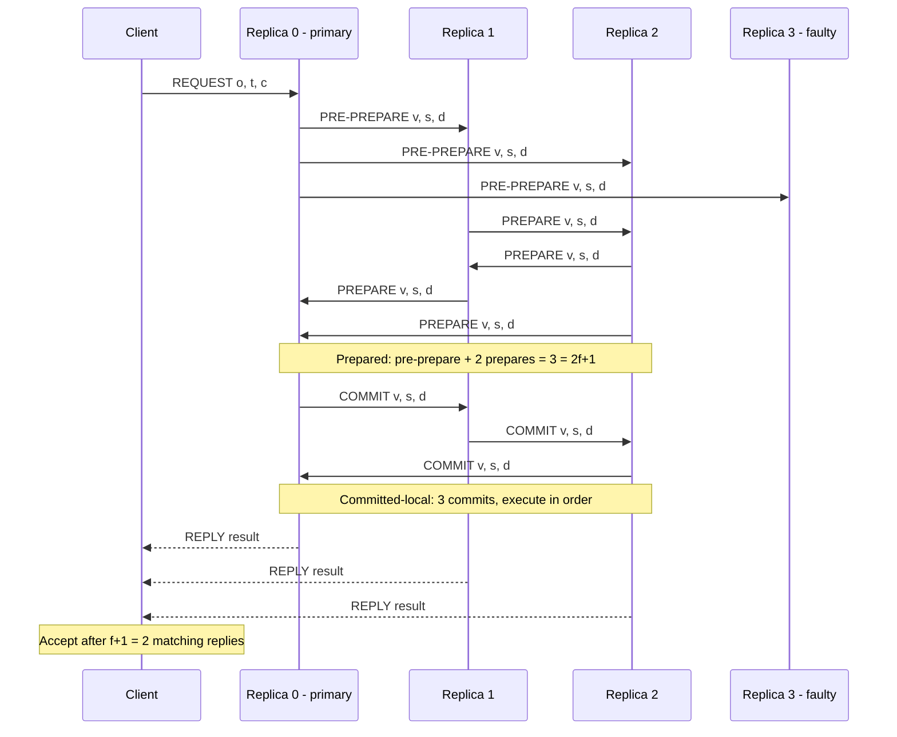

**Reading the diagram.** Authenticated point-to-point messages; time runs downward. Only a subset of solid arrows is drawn: every prepare and commit is really multicast to all replicas. Dashed arrows are replies to the client. Silent replica 3 is the failure point, yet replicas 0–2 still assemble $2f + 1 = 3$ statements per phase. Each replica's log, pruned at stable checkpoints, is the storage boundary. All-to-all phases make traffic grow with $n^2$.

#### Why three phases?

Pre-prepare and prepare fix the **order within a view**. They do not make it **survive a view change**: a lone prepared replica could be outvoted by a new primary. The commit phase ensures that before any honest replica executes, $2f + 1$ replicas hold a prepared certificate, so any view-change quorum of $2f + 1$ contains at least one honest holder.

### 45.9.2 View change

When a backup's timer for a pending request expires, it suspects the primary and stops accepting messages in view $v$.

1. **VIEW-CHANGE.** It multicasts $\langle$VIEW-CHANGE, $v + 1$, $s_c$, $\mathcal{C}$, $\mathcal{P}$, $i\rangle$: its last stable checkpoint $s_c$ with $2f + 1$ checkpoint proofs $\mathcal{C}$, and $\mathcal{P}$, a prepared certificate for every request prepared after $s_c$.
2. **NEW-VIEW.** The primary of view $v + 1$ waits for $2f$ valid view-change messages from other replicas (plus its own, $2f + 1$ in all) and multicasts $\langle$NEW-VIEW, $v + 1$, $\mathcal{V}$, $\mathcal{O}\rangle$, where $\mathcal{V}$ is the set of view-change messages and $\mathcal{O}$ re-issues a pre-prepare for every slot after the checkpoint: the request with a prepared certificate from the highest view, or a **null request** if none exists.
3. **Verify and resume.** Backups check that $\mathcal{O}$ was computed correctly from $\mathcal{V}$, so a faulty new primary cannot rewrite history, and the protocol continues with prepares in view $v + 1$.
4. **Escalate.** If the new primary also fails, timers double and the next view begins, which is how liveness is restored after GST.

**Figure 45.12 — PBFT view change from view 0 to view 1 (n = 4).**

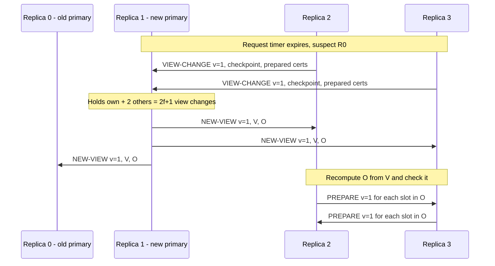

**Reading the diagram.** Suspected primary R0 is the failure point; the others time out independently and multicast view changes (only those to the new primary are drawn). R1 leads view 1 because $1 \bmod 4 = 1$. NEW-VIEW carries the evidence $\mathcal{V}$, so backups recompute $\mathcal{O}$ and reject forged histories. Prepared certificates carry committed requests across views. Each view-change message holds $O(n)$ certificates of $O(n)$ signatures and NEW-VIEW holds $2f + 1$ of them, so view changes grow much faster than the normal case.

### 45.9.3 Message complexity

::: formula
**PBFT normal-case message count per request (no batching)**

$$M_{\text{replicas}} = \underbrace{(n-1)}_{\text{pre-prepare}} + \underbrace{(n-1)^2}_{\text{prepare}} + \underbrace{n(n-1)}_{\text{commit}} = 2n(n-1) \qquad M_{\text{total}} = 2n(n-1) + n + 1$$

| Symbol | Meaning | Units |
|---|---|---|
| $n$ | Replicas, $n = 3f + 1$ | count |
| $M_{\text{replicas}}$ | Replica-to-replica messages per request | messages |
| $M_{\text{total}}$ | Including 1 request and $n$ replies | messages |
:::

::: example
**Worked example — PBFT messages for n = 4, 7 and 10.**

1. $n = 4$ ($f = 1$): $3 + 9 + 12 = 24$ replica messages; with the request and 4 replies, $29$.
2. $n = 7$ ($f = 2$): $6 + 36 + 42 = 84$; total $84 + 8 = 92$.
3. $n = 10$ ($f = 3$): $9 + 81 + 90 = 180$; total $180 + 11 = 191$.
4. At 1,000 requests/s unbatched, a 10-replica cluster exchanges $180{,}000$ replica messages per second. Batching 100 requests per protocol instance cuts that to $1{,}800$ per second.

**Interpretation.** Going from 1 to 3 tolerated faults multiplies traffic by $180 / 24 = 7.5$: the $n^2$ term. **Engineering implication.** PBFT with batching is excellent at $n = 4$ or $7$ and a bottleneck at tens or hundreds of replicas, the regime that motivated HotStuff.
:::

**Table 45.9 — PBFT costs at three cluster sizes.**

| $n$ | $f$ | Quorum $2f+1$ | Pre-prepare | Prepare | Commit | Replica total | With client |
|---|---|---|---|---|---|---|---|
| 4 | 1 | 3 | 3 | 9 | 12 | 24 | 29 |
| 7 | 2 | 5 | 6 | 36 | 42 | 84 | 92 |
| 10 | 3 | 7 | 9 | 81 | 90 | 180 | 191 |

PBFT's normal case also uses **MAC vectors** instead of signatures, **batching**, **tentative execution** (execute once prepared; the client waits for $2f + 1$ matching replies) and direct **read-only requests** answered by $2f + 1$ matching replies.

::: industry
**BFS and BFT-SMaRt.** Castro and Liskov built BFS, a Byzantine-fault-tolerant NFS service on PBFT, and reported it only 3% slower than an unreplicated NFS on the Andrew benchmark, the result that made BFT look practical. BFT-SMaRt is a widely used open-source library in the same lineage, and Hyperledger Fabric 3.0 added a BFT ordering service based on the SmartBFT library, alongside its crash-tolerant Raft orderer (as of 2024).
*Evidence: Primary* — [Castro & Liskov 1999; Bessani et al. 2014; Hyperledger Fabric Docs]
:::

::: warning
**Warning — A correct protocol can still crawl under attack.** A Byzantine primary can delay each request to just under the timeout. Clement et al. showed several BFT protocols losing most of their throughput this way and designed Aardvark to bound the damage with regular primary rotation and performance monitoring [Clement et al. 2009].
:::

## 45.10 Modern BFT: Tendermint and HotStuff

### 45.10.1 Tendermint

Tendermint, introduced in Buchman's thesis and refined in a 2018 paper, rebuilt PBFT-style consensus for blockchains: a validator set weighted by stake, a fresh decision per block height, gossip instead of point-to-point multicast, and a proposer that rotates every round [Buchman 2016; Buchman et al. 2018]. Each height runs one or more **rounds** of three steps; "+2/3" means more than two-thirds of voting power.

1. **Propose.** The round's proposer (weighted round-robin) gossips a block.
2. **Prevote.** Each validator prevotes for the block if it is valid and compatible with its lock, otherwise for nil. More than two-thirds of prevotes for one block form a **polka**.
3. **Precommit.** On seeing a polka a validator **locks** on the block and precommits it. More than two-thirds of precommits **commit** the block at this height, with immediate finality.
4. **Next round.** If a step times out, validators move to round $r + 1$ with a longer timeout. A locked validator prevotes only its locked block in later rounds unless it sees a polka for a different block in a later round, which is what keeps two rounds from committing different blocks.

**Figure 45.13 — One Tendermint height as a state machine.**

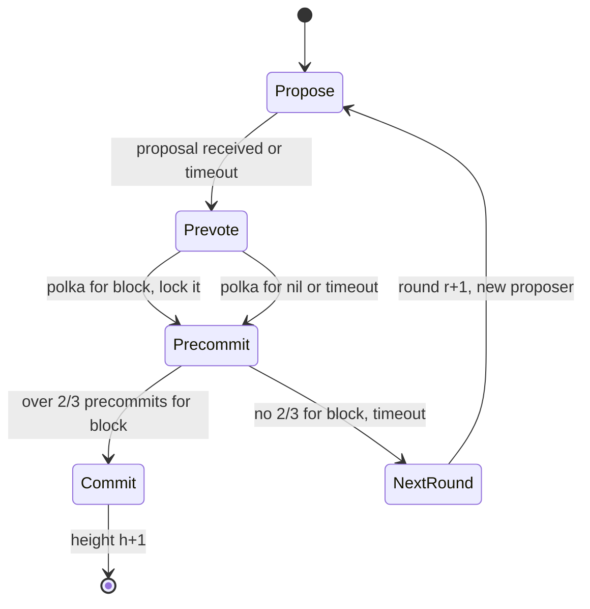

**Reading the diagram.** States are one validator's steps at one height; transitions fire on asynchronously gossiped votes or local timeouts. The only exit is Commit, after which the block is final. A faulty proposer or a network split (the failure points) leads through NextRound with growing timeouts. Locks persisted in local state carry safety across rounds. All-to-all gossip makes each round quadratic in validators.

### 45.10.2 HotStuff

A new leader in a two-phase protocol must show its proposal conflicts with nothing that *might* have committed: by forwarding everyone's certificates (PBFT) or by waiting the maximum delay $\Delta$ to hear the highest lock (Tendermint, which is therefore not **optimistically responsive**: it cannot proceed at actual network speed after a leader change). HotStuff adds a third voting phase so that the highest quorum certificate reported by $n - f$ replicas suffices [Yin et al. 2019].

1. **Star topology:** votes go to the leader, which broadcasts; each phase costs $O(n)$ messages.
2. **Quorum certificates (QCs):** $n - f$ votes combined, in the paper by a threshold signature, into a constant-size authenticator.
3. **Phases:** PREPARE (propose a block extending the highest QC), PRE-COMMIT, COMMIT (replicas **lock**), DECIDE (execute).
4. **Voting rule:** vote if the proposal extends the locked block (safety) *or* its QC is from a higher view than the lock (liveness).
5. **Pacemaker:** leader rotation and timeouts live in a separate module, so safety never depends on timing.

**Chained HotStuff** pipelines the phases: each view's block carries a QC on its parent, and that single QC is the prepare QC for the parent, the pre-commit QC for the grandparent and the commit QC for the great-grandparent. A block commits once it is the first of a **three-chain**, three blocks certified in consecutive views, and leaders can rotate every block for free.

**Figure 45.14 — Chained HotStuff: each block's QC advances three earlier blocks.**


**Reading the diagram.** Each block is proposed by a different leader in consecutive views; a solid arrow means the later block carries a QC, built from $n - f$ votes sent to that leader, on the earlier one. When b4 arrives with the QC on b3, b1, b2 and b3 are certified in consecutive views, so b1 commits; dotted arrows are these asynchronous consequences. Blocks live in each replica's block tree. A failed leader breaks the chain (the failure point) and commits wait for a new three-chain. One broadcast and one vote round per view keep throughput high.

::: formula
**Messages per decision: PBFT versus HotStuff**

$$M_{\text{PBFT}} = 2n(n-1) \qquad M_{\text{HS-basic}} = 8(n-1) \qquad M_{\text{HS-chained}} \approx 2(n-1)$$

| Symbol | Meaning | Units |
|---|---|---|
| $n$ | Replicas | count |
| $M_{\text{PBFT}}$ | Replica messages per PBFT decision (§45.9.3) | messages |
| $M_{\text{HS-basic}}$ | NEW-VIEW plus four leader broadcasts plus three vote rounds | messages |
| $M_{\text{HS-chained}}$ | One proposal broadcast plus one vote round per block, steady state | messages |
:::

::: example
**Worked example — When does linearity pay?**

1. $n = 4$: PBFT $2 \cdot 4 \cdot 3 = 24$; basic HotStuff $8 \cdot 3 = 24$; chained $6$.
2. $n = 10$: PBFT $180$; basic $72$; chained $18$.
3. $n = 100$ ($f = 33$): PBFT $2 \cdot 100 \cdot 99 = 19{,}800$; basic $792$; chained $198$, a $100\times$ reduction.

**Interpretation.** At four replicas basic HotStuff saves nothing and needs more message delays (about seven one-way delays from proposal to DECIDE, against PBFT's three). The win is at large $n$ and in view changes, which stay linear while PBFT's reach $O(n^3)$ authenticators. **Engineering implication.** PBFT-style protocols suit 4–7 replicas; a 100-validator set with per-block rotation needs a linear, pipelined protocol.
:::

**Table 45.10 — PBFT, Tendermint and HotStuff compared.**

| | PBFT | Tendermint | HotStuff (chained) |
|---|---|---|---|
| Voting phases | 2 after pre-prepare | 2 (prevote, precommit) | 3, pipelined |
| Communication | All-to-all | All-to-all gossip | Star via leader |
| Authenticators, correct leader | $O(n^2)$ | $O(n^2)$ | $O(n)$ |
| Authenticators, view change | $O(n^3)$ | $O(n^2)$ | $O(n)$ |
| Optimistically responsive | Yes | No | Yes |
| Leader | Stable until suspected | Rotates per round | Rotates per block |
| Typical home | Permissioned, small $n$ | Proof-of-stake chains | Proof-of-stake and permissioned chains |

Complexities follow the comparison in the HotStuff paper [Yin et al. 2019].

::: industry
**CometBFT and LibraBFT.** Tendermint Core, maintained since 2023 as CometBFT, runs the Cosmos Hub and many Cosmos SDK chains. The Libra (later Diem) blockchain specified LibraBFT, a HotStuff variant with an explicit pacemaker; Diem was wound down in 2022.
*Evidence: Primary* — [CometBFT Docs; Baudet et al. 2019]
:::

## 45.11 Blockchain consensus overview

### 45.11.1 Nakamoto consensus and probabilistic finality

Classical BFT needs known membership: votes mean nothing if anyone can create a million identities (a **Sybil attack**). Nakamoto replaced votes with *work* [Nakamoto 2008]: miners race for a block hash below a target, about 10 minutes of network-wide hashing on average, and nodes follow the chain with the most cumulative work. Near-simultaneous blocks create **forks** that resolve as one branch grows. A transaction is never final; it becomes exponentially less likely to be reversed as blocks accumulate.

**Figure 45.15 — A double-spend race against z confirmations.**

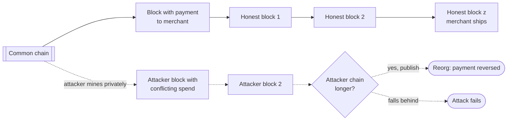

**Reading the diagram.** The common chain is the log every node stores. Solid arrows are honest blocks; dotted arrows are the attacker's private branch, published only if it overtakes. The merchant ships after $z$ blocks; the failure point is the diamond, where a lucky or powerful attacker triggers a reorganization that erases the payment. Throughput is bounded by block size and interval, so the system scales in participants but not transactions.

::: formula
**Probability that an attacker ever overtakes after z confirmations [Nakamoto 2008, section 11]**

$$P(q, z) = 1 - \sum_{k=0}^{z} \frac{\lambda^{k} e^{-\lambda}}{k!}\left(1 - \left(\frac{q}{p}\right)^{z-k}\right), \qquad \lambda = z\,\frac{q}{p}, \quad p = 1 - q$$

| Symbol | Meaning | Units |
|---|---|---|
| $q$ | Attacker's share of total hash power | dimensionless |
| $p$ | Honest share, $1 - q$ | dimensionless |
| $z$ | Confirmations: honest blocks on top of the payment | blocks |
| $\lambda$ | Expected attacker blocks mined while honest miners find $z$ | blocks |
| $k$ | Attacker blocks actually mined, Poisson-distributed | blocks |
| $(q/p)^{z-k}$ | Gambler's-ruin probability of closing a gap of $z - k$ blocks | dimensionless |
:::

The program reproduces the whitepaper's tables (it is a direct translation of the C function given there):

```python
"""Probability that an attacker with hash-power share q ever overtakes the
honest chain once the merchant has waited for z confirmations
(Nakamoto 2008, section 11), plus the z needed for P < 0.1%."""
from math import exp

def attacker_success(q, z):
    p = 1.0 - q
    if q >= p:
        return 1.0                       # a majority attacker always catches up
    lam = z * q / p                      # expected attacker progress meanwhile
    total, poisson = 1.0, exp(-lam)      # poisson = P(attacker mined k blocks)
    for k in range(z + 1):               # attacker has k blocks: still z-k behind
        if k > 0:
            poisson *= lam / k           # incremental form avoids overflow
        total -= poisson * (1 - (q / p) ** (z - k))
    return total

if __name__ == "__main__":
    for q in (0.1, 0.3):
        print(f"q = {q}:", "  ".join(f"z={z}: {attacker_success(q, z):.7f}"
                                     for z in ((0, 1, 2, 3, 6, 10) if q == 0.1 else (0, 5, 10, 20, 30))))
    for q in (0.10, 0.15, 0.20, 0.25, 0.30, 0.35, 0.40, 0.45):
        z = 0
        while attacker_success(q, z) >= 0.001:
            z += 1
        print(f"q = {q:.2f}: z = {z:3d} confirmations for P < 0.1%"
              f"  (about {z * 10 / 60:.1f} h at 10 min per block)")
```

Output:

```text
q = 0.1: z=0: 1.0000000  z=1: 0.2045873  z=2: 0.0509779  z=3: 0.0131722  z=6: 0.0002428  z=10: 0.0000012
q = 0.3: z=0: 1.0000000  z=5: 0.1773523  z=10: 0.0416605  z=20: 0.0024804  z=30: 0.0001522
q = 0.10: z =   5 confirmations for P < 0.1%  (about 0.8 h at 10 min per block)
q = 0.15: z =   8 confirmations for P < 0.1%  (about 1.3 h at 10 min per block)
q = 0.20: z =  11 confirmations for P < 0.1%  (about 1.8 h at 10 min per block)
q = 0.25: z =  15 confirmations for P < 0.1%  (about 2.5 h at 10 min per block)
q = 0.30: z =  24 confirmations for P < 0.1%  (about 4.0 h at 10 min per block)
q = 0.35: z =  41 confirmations for P < 0.1%  (about 6.8 h at 10 min per block)
q = 0.40: z =  89 confirmations for P < 0.1%  (about 14.8 h at 10 min per block)
q = 0.45: z = 340 confirmations for P < 0.1%  (about 56.7 h at 10 min per block)
```

What to notice: the values match the whitepaper digit for digit, and the required $z$ explodes as $q$ approaches $1/2$.

::: example
**Worked example — How long should a merchant wait?**

1. Attacker share $q = 0.1$, so $p = 0.9$ and $q/p = 0.111$. For $z = 6$: $\lambda = 6 \times 0.111 = 0.667$.
2. The program gives $P(0.1, 6) = 0.0002428$, about 1 in 4,100.
3. At 10 minutes per block, 6 confirmations take 60 minutes on average. Block times are exponential, so the wait is Erlang-distributed: the probability that 6 blocks take longer than 90 minutes is the probability of at most 5 blocks in 90 minutes, $\sum_{k=0}^{5} e^{-9} 9^k / k! \approx 0.116$.
4. Against $q = 0.3$, reaching $P < 0.1\%$ needs $z = 24$, about 4 hours.

**Interpretation.** Finality is a risk dial that trades latency for reversal probability, set by an estimate of attacker hash power. **Engineering implication.** Size $z$ to the value at risk and treat the formula as optimistic: it ignores network delay and strategies such as selfish mining, profitable below half the hash power [Eyal & Sirer 2014]; later analyses refine its Poisson approximation [Rosenfeld 2014].
:::

Throughput follows from the parameters: 2,000–4,000 transactions per block every 600 s is about 3–7 transactions per second (illustrative). Bigger or faster blocks propagate more slowly relative to the interval, causing more forks and weaker security.

### 45.11.2 Proof of stake and finality gadgets

**Proof of stake** weights validators by locked-up currency and punishes misbehavior by destroying (**slashing**) it, restoring a known, weighted membership for BFT techniques. A **finality gadget** layers BFT-style voting on top of block production. Casper FFG has validators vote on checkpoint links; a checkpoint is **justified** by more than two-thirds of stake and **finalized** when its direct child checkpoint is justified. Two slashing conditions (never cast two votes for the same target epoch, never cast a vote that surrounds another) give **accountable safety**: if two conflicting checkpoints are ever finalized, at least one-third of stake provably broke a rule and can be slashed [Buterin & Griffith 2017]. Ethereum combines Casper FFG with the LMD-GHOST fork-choice rule (Gasper); with 12-second slots and 32-slot epochs, blocks typically finalize after two epochs, about 12.8 minutes (as of 2026) [Buterin et al. 2020; Ethereum Docs: Proof-of-stake].

**Table 45.11 — Consensus families compared.**

| | Nakamoto proof of work | Proof of stake with finality gadget | BFT chain (Tendermint, HotStuff) | Permissioned BFT |
|---|---|---|---|---|
| Membership | Open, anonymous | Open, weighted by stake | Bounded validator set, weighted | Fixed, known identities |
| Fault threshold | Less than 1/2 of hash power, lower with selfish mining | Less than 1/3 of stake for finality | Less than 1/3 of voting power | $f < n/3$ replicas |
| Finality | Probabilistic | Probabilistic per block, final per checkpoint | Immediate on commit | Immediate on commit |
| Typical latency to finality | About an hour at 6 confirmations | Minutes (about 12.8 min on Ethereum) | Seconds | Milliseconds to seconds |
| Accountability | None | Slashing | Slashing (chain-dependent) | Operators' legal identity |

### 45.11.3 When is a permissioned BFT system the right tool?

Most "we need a blockchain" proposals need no Byzantine consensus. Ask four questions [Wüst & Gervais 2018]:

1. **Is there shared state written by several parties?** If only one organization writes, use a database.
2. **Do the writers distrust each other and refuse a trusted operator?** If a trusted operator is acceptable (a clearing house, a cloud provider, a regulator), a crash-tolerant replicated database with signed audit logs is cheaper and faster.
3. **Is the membership known?** If yes, permissioned BFT (PBFT, BFT-SMaRt, HotStuff) gives immediate finality with a handful of replicas. If not, you need Sybil resistance: proof of work or proof of stake.
4. **Do you need tolerance or only evidence?** If participants only need to *detect* tampering, a **tamper-evident log** suffices: a Merkle-tree log whose operator publishes signed tree heads and inclusion proofs, as Certificate Transparency does for TLS certificates [Laurie et al. 2013]. Detection plus legal accountability is often the real requirement.

## 45.12 Choosing guarantees in practice

### 45.12.1 A decision procedure

Start from invariants and the trust boundary: *who might lie?* and *which decisions are non-monotone?*

**Figure 45.16 — Choosing a guarantee.**

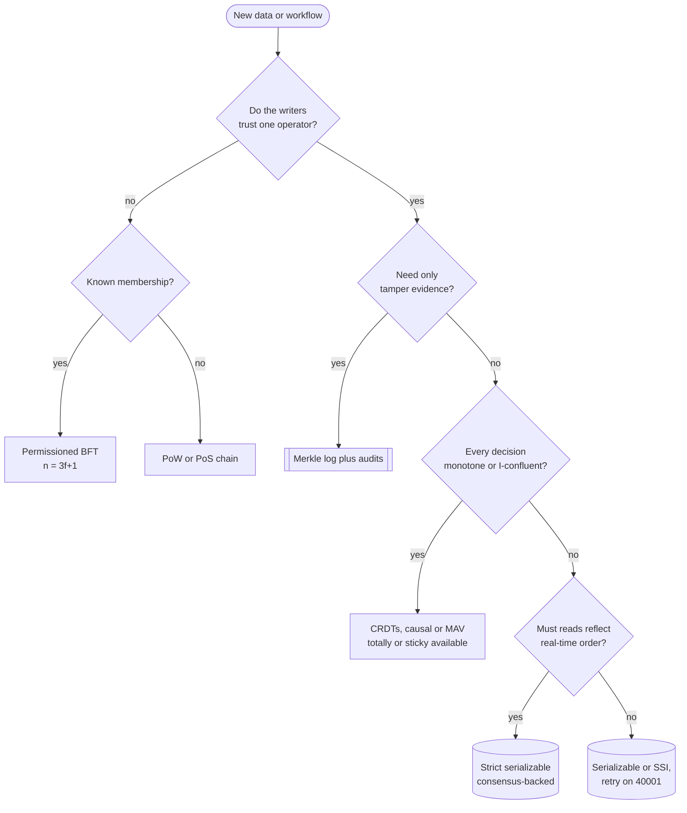

**Reading the diagram.** Diamonds are design questions answered in order; terminals are guarantee families. The first two settle the trust boundary (Byzantine tolerance, then permissioned versus open). Inside one trust domain the monotonicity test (§45.6.6) decides whether coordination-free replication suffices. Cylinders are consensus-replicated stores, unavailable in a minority partition. There are no runtime flows; the failure point is skipping a question, usually by assuming every decision is monotone.

**Table 45.12 — Decision table: requirement, guarantee and mechanism.**

| Requirement | Weakest sufficient guarantee | Mechanism | Cost | Example |
|---|---|---|---|---|
| Counters, likes, presence, carts | Strong eventual consistency | State or delta CRDTs | Metadata growth | Multi-region counters |
| User sees own edits, ordered comments | Causal plus read your writes | Version vectors, sticky sessions | Sticky routing | Social feeds |
| Never see half a transaction | Monotonic atomic view | Buffered writes plus metadata | Storage overhead | Multi-row updates in AP stores |
| Reports and analytics on live data | Snapshot isolation, read-only deferrable | MVCC snapshots | Stale by seconds | Dashboards |
| Cross-row invariants (balance, roster, quota) | Serializable | SSI, 2PL or validation | Aborts or blocking | Payments, bookings |
| Uniqueness, global ordering, locks | Linearizable or strict serializable | Consensus (§26) | Quorum round trip, unavailable in minority | Usernames, leader election |
| Mutually distrustful operators, known set | BFT state machine replication | PBFT, HotStuff, $n = 3f + 1$ | $f$ more replicas, $O(n)$ to $O(n^2)$ messages | Consortium ledgers |
| Open participation | Probabilistic or gadget finality | Proof of work or stake | Minutes to an hour, low throughput | Public chains |
| Detect tampering only | Tamper-evident log | Merkle tree, signed heads | Auditors must check | Certificate Transparency |

::: recommendation
**Recommendation — Mix guarantees per operation, and write the choice down.** One service may use CRDT counters for likes, serializable transactions for payments and a consensus-backed lock for its cron leader. Record each operation's guarantee, test it with list-append histories under faults (§45.5), and retry `40001` idempotently.
:::

## 45.13 Summary and revision notes

::: summary
- **One hierarchy, defined by graphs.** Adya defines isolation levels by the DSG cycles they proscribe: G0 (PL-1), G1 (PL-2), G-single (PL-2+), G-SI (PL-SI), G2-item (PL-2.99), G2 (PL-3). Strict serializability adds real time and meets linearizability at the top. SI and repeatable read are incomparable.
- **Availability classes.** Totally available: up to read committed and MAV, plus MR, MW, WFR. Sticky available: RYW, PRAM, causal. Unavailable: anything that prevents lost update or write skew, or promises recency.
- **SI anomalies.** Write skew and the read-only anomaly are cycles with two consecutive rw edges around a pivot; SI forbids single-rw cycles (read skew).
- **SSI** tracks rw edges with non-blocking SIREAD locks and aborts at dangerous structures; PostgreSQL adds commit ordering, read-only optimization, safe snapshots and lock promotion. Clients must retry `40001`. Overlap rate $\approx 2\lambda T$ per transaction, about $G\lambda^2 T$ pairs per second.
- **Checking.** With unique list appends, version order is observable, edges are lookups and cycle search is $O(V+E)$, avoiding NP-complete serializability checking.
- **CRDT theory.** Join-semilattice, merge = join, inflationary updates give convergence by induction on causal histories. Op-based needs causal exactly-once delivery; deltas satisfy $m(x) = x \sqcup m^\delta(x)$ and save bandwidth in proportion to update locality.
- **Limits.** Convergence is not invariant preservation: use I-confluence and CALM to place coordination at non-monotone decisions; escrow for bounded counters.
- **Byzantine faults** are mostly accidental in data centers (CPU corruption, bit flips, bad blocks) and deliberate across organizations.
- **Bounds.** Partial synchrony needs $n \ge 3f+1$; quorums of $2f+1$ intersect in $f+1$; signatures help only under synchrony; FLP still holds.
- **PBFT** = pre-prepare, prepare, commit plus view change; $2n(n-1)$ replica messages per request (24, 84, 180 for $n = 4, 7, 10$).
- **HotStuff** adds a phase to get linear, responsive view changes and pipelines phases in chained form; Tendermint uses two phases with gossip and waits on timeouts.
- **Nakamoto** finality is probabilistic: $P(0.1, 6) \approx 2.4 \times 10^{-4}$. Proof of stake with finality gadgets restores BFT-style finality with slashing.
- **Choose per operation**: monotone → CRDT; invariants → serializable; real time → strict serializable; distrust → BFT; evidence only → Merkle log.
:::

## 45.14 Knowledge checkpoint

1. Why are snapshot isolation and Adya's PL-2.99 incomparable?
2. Which Adya phenomenon is read skew, and which levels forbid it?
3. Draw the DSG of the read-only anomaly and name the pivot.
4. Why do ww and wr edges under SI always point forward in time?
5. What does PostgreSQL's commit-ordering optimization check?
6. What is a safe snapshot, and how does `DEFERRABLE` use it?
7. How does a list-append workload make version order observable?
8. In the overdraft example, what happens to the expected anomaly count if $T$ doubles?
9. State the induction invariant in the CRDT convergence proof.
10. What delivery guarantees does an operation-based CRDT need that a state-based one does not?
11. Is "username is unique" I-confluent under concurrent inserts? Why?
12. Why is garbage collection non-monotone in CALM's sense?
13. Derive $n \ge 3f+1$ from liveness and safety requirements on quorums.
14. Count PBFT replica messages for $n = 7$.
15. Why does Tendermint lack optimistic responsiveness?
16. Compute the confirmations needed for $P < 0.1\%$ against $q = 0.25$.

<details><summary>Answers</summary>

1. SI allows write skew (G2-item with two rw edges), which PL-2.99 forbids; PL-2.99 allows predicate anti-dependency cycles (phantoms), which SI forbids.
2. G-single (a cycle with exactly one rw edge); forbidden by PL-2+, SI, PL-2.99 and serializable.
3. $T_1 \xrightarrow{wr} T_3 \xrightarrow{rw} T_2 \xrightarrow{rw} T_1$; the pivot is $T_2$, the withdrawal.
4. SI lets a transaction see or overwrite only writes committed before it started (G-SIa is forbidden), so the source committed before the target began.
5. That $T_{out}$ committed before both $T_{pivot}$ and $T_{in}$; otherwise the structure cannot lie on a cycle and no abort is needed yet.
6. A read-only snapshot that no concurrent read-write transaction can make part of an anomaly; `DEFERRABLE` waits for one, then runs without SIREAD locks and cannot fail.
7. Each append is unique and lists only grow, so the longest read lists the versions in order and every other read must be its prefix.
8. Pairs scale linearly with $T$, so it doubles: about 24 a day.
9. Each replica's state equals the join of the update states in its causal history: $x_i = \bigsqcup_{u \in C_i} \delta_u$.
10. Reliable, exactly-once, causally ordered delivery; state-based tolerates loss, duplication and reordering.
11. No: two replicas can each insert the same name, each state valid, and the merge violates uniqueness.
12. It asserts the absence of references; a late message can add a reference and retract the conclusion.
13. Liveness: $q \le n - f$. Safety: $2q - n \ge f + 1$. Substitute $q = n - f$: $n - 2f \ge f + 1$, so $n \ge 3f + 1$.
14. $6 + 36 + 42 = 84$, which is $2 \cdot 7 \cdot 6$.
15. A new proposer must wait a timeout bounded by the maximum delay $\Delta$ to be sure it has seen the highest lock, instead of proceeding at actual network speed.
16. $z = 15$ (about 2.5 hours at 10 minutes per block).
</details>

## 45.15 Interview questions

### Basic

**Q1. What is write skew and why does snapshot isolation allow it?** **Answer.** Two transactions read overlapping data, check an invariant and write different rows; together they break it. SI checks only write–write conflicts, so disjoint write sets commit. It is a cycle of two anti-dependencies; SSI or a materialized conflict row prevents it.

**Q2. Why does Byzantine fault tolerance need 3f+1 nodes rather than 2f+1?** **Answer.** You must decide after hearing from $n - f$ nodes because $f$ may be silent, and up to $f$ of those you heard from may lie. Two such quorums must overlap in at least one honest node, $2(n-f) - n \ge f + 1$, so $n \ge 3f + 1$. Crash faults never lie, so any overlap at all suffices and $2f + 1$ is enough.

### Intermediate

**Q3. Your PostgreSQL service moved to SERIALIZABLE and now sees 40001 errors at peak. What do you do?** **Answer.** Expect them: add idempotent retries with jittered backoff and a budget. Find hot invariant groups from per-type error rates; shorten transactions (pairs scale with $\lambda^2 T$); move reports to `READ ONLY DEFERRABLE`; index the predicates so SIREAD locks stay fine-grained; give the predicate-lock table enough memory to avoid promotion.

**Q4. When would you choose CRDTs over a consensus-backed store?** **Answer.** When every decision on the data is monotone or I-confluent (counters, likes, presence, collaborative text), gaining local latency and partition tolerance. Keep non-monotone decisions (overselling, uniqueness) on a coordinated path or make them local with escrow.

### Advanced

**Q5. Design the consensus layer for a ledger shared by 12 banks that do not trust each other.** **Answer.** Known membership plus distrust means permissioned BFT. Run $n = 10$ replicas ($f = 3$), each operated by a different bank with its own keys, ideally on diverse implementations. Use a pipelined HotStuff-family protocol with per-block leader rotation so no bank controls ordering, plus batching, checkpoints and state digests; clients accept $f + 1$ matching signed replies. A public chain would add latency and Sybil machinery they do not need; a single regulated operator with a tamper-evident log may suffice if auditors accept it.

**Q6. How would you test that a database really provides snapshot isolation?** **Answer.** Run concurrent list-append transactions under partitions, pauses and clock skew; record invocations, completions and indeterminate outcomes; build the DSG with start-order information and search for G0, G1, G-single and G-SIa. G2-item cycles are allowed under SI; G-single proves it is not SI. Elle automates this.

## 45.16 Practical exercises

1. Extend the DSG checker with real-time edges (each transaction gets invocation and completion times) and construct a history that is serializable but not strictly serializable.
2. Add G1a and G1b detection to the checker by recording aborted transactions and intermediate appends.
3. Add a delta-mutator for a PN-Counter to the lattice checker and verify $m(x) = x \sqcup m^\delta(x)$ exhaustively.
4. Simulate PBFT's normal case for $n = 4$ with one equivocating primary that sends different digests to two backups, and show that no request is prepared at two honest replicas.
5. Modify the Nakamoto calculator to report the expected waiting time and the 99th-percentile waiting time for $z$ confirmations.

## 45.17 Design challenges

1. **Seat booking across three regions.** Ticket sales must never oversell, browsing must stay available during partitions, and payment confirmation must be strictly serializable. Assign a guarantee to each operation, size escrow per region, and estimate abort rates at a 50 ms transaction duration during a 10,000-request-per-second on-sale.
2. **Supply-chain ledger for five companies.** Decide between a permissioned BFT ledger, a shared database run by a neutral operator, and a tamper-evident log, and justify the choice with the four questions of §45.11.3 and the message arithmetic of §45.9.3.

## 45.18 References

1. Adya, A. *Weak Consistency: A Generalized Theory and Optimistic Implementations for Distributed Transactions*. PhD thesis, MIT, 1999.
2. Adya, A., Liskov, B., O'Neil, P. "Generalized Isolation Level Definitions." *IEEE International Conference on Data Engineering (ICDE)*, 2000.
3. Almeida, P. S., Shoker, A., Baquero, C. "Delta State Replicated Data Types." *Journal of Parallel and Distributed Computing* 111:162–173, 2018.
4. Alvaro, P., Conway, N., Hellerstein, J. M., Marczak, W. R. "Consistency Analysis in Bloom: a CALM and Collected Approach." *CIDR*, 2011.
5. Ameloot, T. J., Neven, F., Van den Bussche, J. "Relational Transducers for Declarative Networking." *Journal of the ACM* 60(2), 2013.
6. Amazon Web Services. "Amazon S3 Availability Event: July 20, 2008." https://status.aws.amazon.com/s3-20080720.html
7. Bailis, P., Davidson, A., Fekete, A., Ghodsi, A., Hellerstein, J. M., Stoica, I. "Highly Available Transactions: Virtues and Limitations." *PVLDB* 7(3):181–192, 2014 (cited as 2014a).
8. Bailis, P., Fekete, A., Franklin, M. J., Ghodsi, A., Hellerstein, J. M., Stoica, I. "Coordination Avoidance in Database Systems." *PVLDB* 8(3):185–196, 2014 (cited as 2014b).
9. Balegas, V., Duarte, S., Ferreira, C., Rodrigues, R., Preguiça, N., Najafzadeh, M., Shapiro, M. "Putting Consistency Back into Eventual Consistency." *ACM EuroSys*, 2015.
10. Baudet, M., et al. "State Machine Replication in the Libra Blockchain." Libra Association technical paper, 2019.
11. Ben-Or, M. "Another Advantage of Free Choice: Completely Asynchronous Agreement Protocols." *ACM PODC*, 1983.
12. Berenson, H., Bernstein, P., Gray, J., Melton, J., O'Neil, E., O'Neil, P. "A Critique of ANSI SQL Isolation Levels." *ACM SIGMOD*, 1995.
13. Bessani, A., Sousa, J., Alchieri, E. E. P. "State Machine Replication for the Masses with BFT-SMART." *IEEE/IFIP DSN*, 2014.
14. Bracha, G. "Asynchronous Byzantine Agreement Protocols." *Information and Computation* 75(2):130–143, 1987.
15. Buchman, E. *Tendermint: Byzantine Fault Tolerance in the Age of Blockchains*. MSc thesis, University of Guelph, 2016.
16. Buchman, E., Kwon, J., Milosevic, Z. "The latest gossip on BFT consensus." arXiv:1807.04938, 2018.
17. Buterin, V., Griffith, V. "Casper the Friendly Finality Gadget." arXiv:1710.09437, 2017.
18. Buterin, V., et al. "Combining GHOST and Casper." arXiv:2003.03052, 2020.
19. Cahill, M. J., Röhm, U., Fekete, A. D. "Serializable Isolation for Snapshot Databases." *ACM SIGMOD*, 2008.
20. Castro, M., Liskov, B. "Practical Byzantine Fault Tolerance." *USENIX OSDI*, 1999.
21. Castro, M., Liskov, B. "Practical Byzantine Fault Tolerance and Proactive Recovery." *ACM Transactions on Computer Systems* 20(4):398–461, 2002.
22. Clement, A., Wong, E., Alvisi, L., Dahlin, M., Marchetti, M. "Making Byzantine Fault Tolerant Systems Tolerate Byzantine Faults." *USENIX NSDI*, 2009.
23. CometBFT. *CometBFT Documentation*. https://docs.cometbft.com/
24. Conway, N., Marczak, W. R., Alvaro, P., Hellerstein, J. M., Maier, D. "Logic and Lattices for Distributed Programming." *ACM SoCC*, 2012.
25. Daudjee, K., Salem, K. "Lazy Database Replication with Snapshot Isolation." *VLDB*, 2006.
26. Dixit, H. D., et al. "Silent Data Corruptions at Scale." arXiv:2102.11245, 2021.
27. Dolev, D., Strong, H. R. "Authenticated Algorithms for Byzantine Agreement." *SIAM Journal on Computing* 12(4):656–666, 1983.
28. Driscoll, K., Hall, B., Sivencrona, H., Zumsteg, P. "Byzantine Fault Tolerance, from Theory to Reality." *SAFECOMP*, LNCS 2788, 2003.
29. Dwork, C., Lynch, N., Stockmeyer, L. "Consensus in the Presence of Partial Synchrony." *Journal of the ACM* 35(2):288–323, 1988.
30. Ethereum Foundation. *Proof-of-stake* (ethereum.org developer documentation). https://ethereum.org/en/developers/docs/consensus-mechanisms/pos/
31. Eyal, I., Sirer, E. G. "Majority Is Not Enough: Bitcoin Mining Is Vulnerable." *Financial Cryptography and Data Security*, 2014.
32. Fekete, A., O'Neil, E., O'Neil, P. "A Read-Only Transaction Anomaly Under Snapshot Isolation." *ACM SIGMOD Record* 33(3):12–14, 2004.
33. Fekete, A., Liarokapis, D., O'Neil, E., O'Neil, P., Shasha, D. "Making Snapshot Isolation Serializable." *ACM Transactions on Database Systems* 30(2):492–528, 2005.
34. Fischer, M. J., Lynch, N. A. "A Lower Bound for the Time to Assure Interactive Consistency." *Information Processing Letters* 14(4):183–186, 1982.
35. Fischer, M. J., Lynch, N. A., Paterson, M. S. "Impossibility of Distributed Consensus with One Faulty Process." *Journal of the ACM* 32(2):374–382, 1985.
36. Ganesan, A., Alagappan, R., Arpaci-Dusseau, A. C., Arpaci-Dusseau, R. H. "Redundancy Does Not Imply Fault Tolerance: Analysis of Distributed Storage Reactions to Single Errors and Corruptions." *USENIX FAST*, 2017.
37. Hellerstein, J. M., Alvaro, P. "Keeping CALM: When Distributed Consistency Is Easy." *Communications of the ACM* 63(9):72–81, 2020.
38. Hochschild, P. H., Turner, P., Mogul, J. C., Govindaraju, R., Ranganathan, P., Culler, D. E., Vahdat, A. "Cores That Don't Count." *Workshop on Hot Topics in Operating Systems (HotOS)*, 2021.
39. Hyperledger Foundation. *Hyperledger Fabric Documentation — The Ordering Service*. https://hyperledger-fabric.readthedocs.io/
40. Kingsbury, K. *Consistency Models*. jepsen.io. https://jepsen.io/consistency
41. Kingsbury, K. "Jepsen: PostgreSQL 12.3." jepsen.io, 2020. https://jepsen.io/analyses/postgresql-12.3
42. Kingsbury, K., Alvaro, P. "Elle: Inferring Isolation Anomalies from Experimental Observations." *PVLDB* 14(3):268–280, 2020 (VLDB 2021).
43. Lamport, L., Shostak, R., Pease, M. "The Byzantine Generals Problem." *ACM Transactions on Programming Languages and Systems* 4(3):382–401, 1982.
44. Laurie, B., Langley, A., Kasper, E. "Certificate Transparency." RFC 6962, IETF, 2013.
45. Miller, A., Xia, Y., Croman, K., Shi, E., Song, D. "The Honey Badger of BFT Protocols." *ACM CCS*, 2016.
46. Nakamoto, S. "Bitcoin: A Peer-to-Peer Electronic Cash System." 2008. https://bitcoin.org/bitcoin.pdf
47. Papadimitriou, C. H. "The Serializability of Concurrent Database Updates." *Journal of the ACM* 26(4):631–653, 1979.
48. Ports, D. R. K., Grittner, K. "Serializable Snapshot Isolation in PostgreSQL." *PVLDB* 5(12):1850–1861, 2012.
49. PostgreSQL Global Development Group. *PostgreSQL Documentation — Transaction Isolation*. https://www.postgresql.org/docs/current/transaction-iso.html
50. Rosenfeld, M. "Analysis of Hashrate-Based Double Spending." arXiv:1402.2009, 2014.
51. Shapiro, M., Preguiça, N., Baquero, C., Zawirski, M. "Conflict-Free Replicated Data Types." *Stabilization, Safety, and Security of Distributed Systems (SSS)*, LNCS 6976, 2011 (cited as 2011a).
52. Shapiro, M., Preguiça, N., Baquero, C., Zawirski, M. "A Comprehensive Study of Convergent and Commutative Replicated Data Types." INRIA Research Report RR-7506, 2011 (cited as 2011b).
53. Wüst, K., Gervais, A. "Do you need a Blockchain?" *Crypto Valley Conference on Blockchain Technology (CVCBT)*, 2018.
54. Yin, M., Malkhi, D., Reiter, M. K., Golan Gueta, G., Abraham, I. "HotStuff: BFT Consensus with Linearity and Responsiveness." *ACM PODC*, 2019.

## 45.19 Open verification items

- Bailis et al. 2014a survey: confirm "3 of 18 serializable by default, 8 without serializability" and the exact class assignments in Table 45.2 (repeatable read is listed in Adya's sense).
- Ports & Grittner 2012: confirm the qualitative performance summary, "first production SSI" wording and index-type coverage of predicate locks across PostgreSQL versions.
- Hochschild et al. 2021: confirm the "few per several thousand machines" mercurial-core rate.
- Hyperledger Fabric 3.0 BFT orderer (SmartBFT) release date; CometBFT rename year (2023).
- Ethereum finality time (two epochs, about 12.8 min) as of 2026.
- Bitcoin transactions-per-block range used for the throughput estimate.
- Daudjee & Salem 2006 as the origin of strong session SI.
