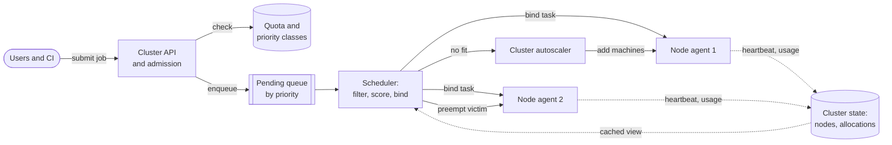
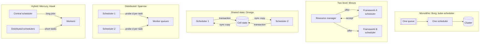
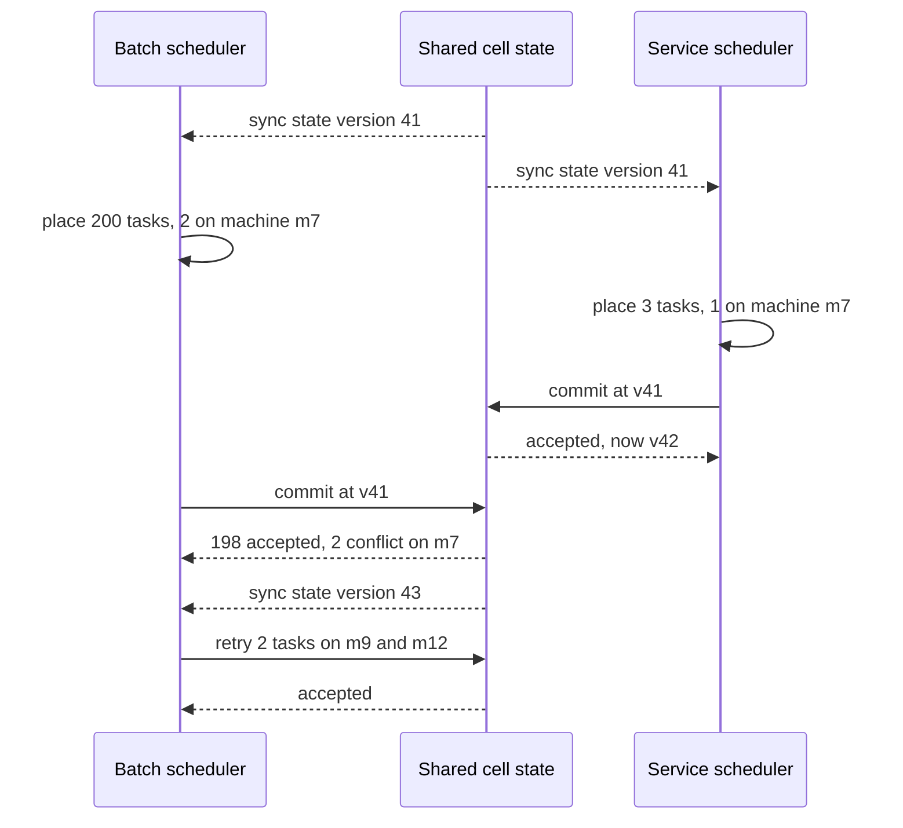
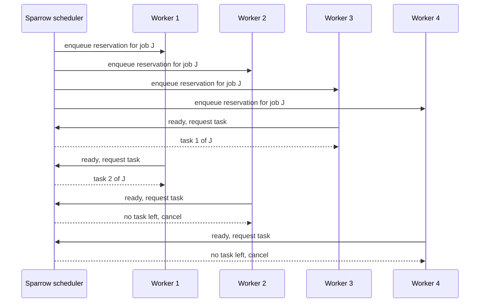
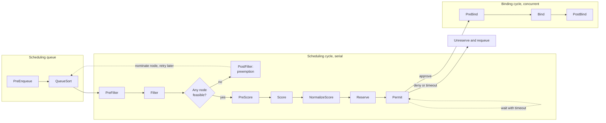
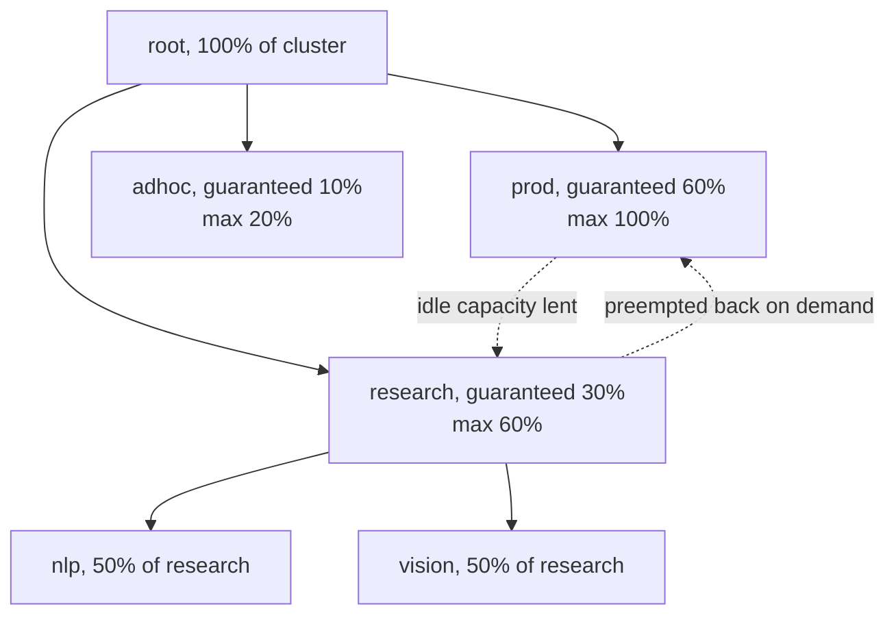
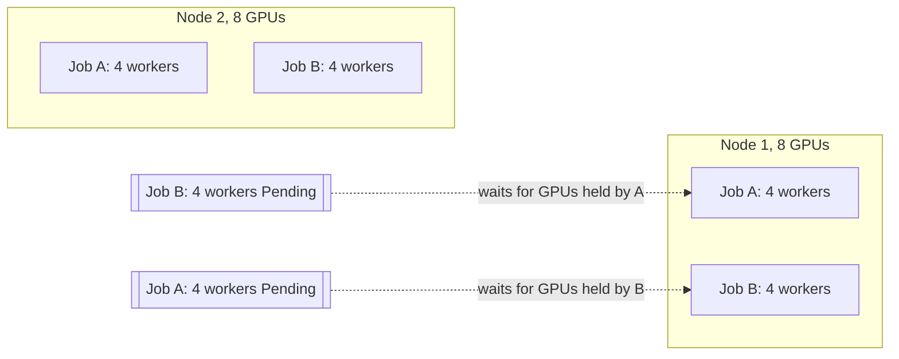
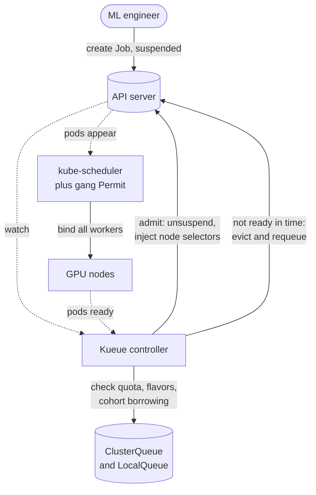

# Chapter 46 — Distributed Scheduling and Cluster Management

> **Level:** 4 · **Track:** Shared · **Estimated reading time:** 6 h

Chapter 42 showed you what to *configure* when Kubernetes places a pod: requests, taints, affinity, priority classes and the scoring strategy (§42.13). This chapter is about the problem underneath. A company with 10,000 machines and 50,000 things to run must decide, continuously, which work runs where, which work waits, and which work is evicted to make room. Those decisions set the cluster's **utilization** (how much of the hardware you paid for does useful work), the **latency** before a job starts, and whether teams get a **fair** share. At the scale of Google's Borg cells, a few percent of packing efficiency is thousands of machines.

The chapter has four parts. **Foundations** (§46.3–§46.4) define the problem and the five scheduler architectures. **Systems** (§46.5–§46.6) take apart Borg and the Kubernetes scheduler. **Policies** (§46.7–§46.9) cover bin packing, priorities and preemption, and fairness, including Dominant Resource Fairness. **Workloads** (§46.10–§46.13) cover gang scheduling for distributed training, GPU placement, batch schedulers such as Slurm, and autoscaling the cluster itself. The last part is shared with the ML track: Chapter 65 (distributed training) and Chapter 80 (10,000-GPU clusters) build on §46.10 and §46.11.

## 46.1 Learning objectives

After this chapter you should be able to:

- Distinguish batch jobs from long-running services and state the utilization–latency–fairness trade-off a cluster scheduler makes.
- Explain why cluster scheduling is NP-hard in general and which heuristics production schedulers use instead.
- Compare monolithic, two-level, shared-state, distributed and hybrid scheduler architectures, and compute head-of-line blocking and optimistic-conflict rates.
- Describe Borg's cell architecture, priority bands, quota, allocs and scoring, and quote its published utilization results correctly.
- Trace a pod through every extension point of the Kubernetes scheduling framework, and configure profiles, `percentageOfNodesToScore` and the descheduler.
- Implement and compare first-fit, best-fit, worst-fit and dot-product placement, and measure fragmentation.
- Explain preemption victim selection, PodDisruptionBudgets and how quota interacts with priority.
- Compute max-min fair, weighted fair and DRF allocations, and configure YARN-style capacity and fair schedulers.
- Explain why distributed training needs gang scheduling, show the deadlock without it, and choose between Volcano, Kueue, the coscheduling plugin and native gang scheduling.
- Place GPU jobs with topology awareness and choose between whole GPUs, MIG and time-slicing.
- Work a Slurm backfill schedule by hand and decide between Slurm and Kubernetes for training.
- Estimate how long cluster autoscaling takes to deliver capacity, and why gangs need all-or-nothing provisioning.

## 46.2 Prerequisites

- CPU scheduling policies: FCFS, priority, round robin, CFS — §6.5 (a cluster scheduler is the same problem one level up, with machines instead of cores).
- Load balancing and the power of two choices — §19.4.4 (Sparrow applies it to task placement).
- Leader election and leases — §26.5, §26.11 (every centralized scheduler runs as an elected leader).
- Queueing and probability — §4.10 (M/M/1 and why waits explode near full utilization), §4.6.4 (the binomial distribution, used for sampling schedulers) and §4.9.2 (the dot product, used for alignment scoring).
- Kubernetes architecture, requests, QoS, scheduling basics and autoscaling — §42.6, §42.12, §42.13 (this chapter goes deeper and does not repeat them).
- Batch processing on a cluster manager — §29.4–§29.5 (MapReduce and Spark ask YARN or Kubernetes for executors).

## 46.3 The cluster scheduling problem

### 46.3.1 Jobs, tasks and services

::: definition
**Definition — Cluster scheduler.** The component that assigns units of work (**tasks**, pods, containers) to machines in a cluster, decides which work waits when capacity is short, and reclaims capacity from lower-priority work. A **cluster manager** wraps the scheduler with admission, quota, health monitoring, restarts and an API.
:::

#### First-principles explanation

Think of a restaurant host with a floor of tables of different sizes. Parties arrive with a size (resources), some book for the whole evening (services), some only want a quick coffee (short batch tasks), a large group must sit together or not at all (a gang), and a regular who has a standing reservation (quota) expects a table on arrival. The host wants every seat filled (utilization), nobody waiting long at the door (latency), and no regular complaining that the tourists got all the window tables (fairness). Every rule the host invents, such as "seat big parties first" or "keep the corner booth free for regulars", is a scheduling policy, and each one helps one goal at the expense of another.

#### Why does this exist?

Before cluster managers, each team owned machines. A machine bought for a peak ran at 10–20% utilization the rest of the time, and nightly batch work could not use the idle daytime capacity of another team's servers. Pooling machines into one shared cluster and letting a scheduler place everyone's work lets idle capacity of one workload absorb another. Borg's authors measured what pooling buys: separating production and non-production work into their own cells would have needed 20–30% more machines in the median cell [Verma et al. 2015]. The scheduler is what turns pooling from an idea into savings.

Cluster workloads come in two broad kinds.

**Table 46.1 — Batch jobs versus long-running services.**

| Property | Batch job | Long-running service |
|---|---|---|
| Example | ETL run, model training, video transcode | API server, database, cache |
| Duration | Seconds to weeks, then exits | Runs until redeployed |
| Success measure | Completion time, throughput | Latency SLO, availability |
| Sensitivity to start delay | Tolerates minutes in a queue | Needs placement in seconds during a rollout or failure |
| Sensitivity to eviction | Restart or resume from checkpoint | Each eviction risks errors; needs PodDisruptionBudgets |
| Typical priority | Low or medium; preemptible | High; rarely preempted |
| Resource shape | Often large, sometimes gang-scheduled | Many small replicas, spread across failure domains |

Google's published workload analyses describe the same split: most jobs are batch, but most of the reserved resources belong to services [Schwarzkopf et al. 2013]. In a representative Borg cell, production jobs were allocated about 70% of the CPU and represented about 60% of CPU usage, and were allocated about 55% of memory while representing about 85% of memory usage [Verma et al. 2015]. Services reserve for peaks they rarely hit; batch work is what fills the gap between what is reserved and what is used.

### 46.3.2 Utilization, latency and fairness

::: definition
**Definition — Allocation versus usage.** **Allocated (reserved) utilization** is the fraction of capacity claimed by requests or reservations; **used utilization** is the fraction actually consumed. The difference, **slack**, is capacity that is paid for, promised to someone, and idle.
:::

A scheduler trades three goals against each other:

1. **Utilization.** Pack work tightly and fill slack with preemptible work. Tighter packing means fewer machines, but less headroom for a load spike.
2. **Latency.** Start work quickly. Keeping free capacity ready shortens waits but lowers utilization; examining every machine for the best fit improves packing but slows each decision.
3. **Fairness and isolation.** Give each team its share, protect services from noisy batch neighbors, and never starve anyone. Strict fairness can leave capacity idle when the entitled team does not need it.

::: formula
**Allocated and used utilization, and reclaimable capacity**

$$U_{\text{alloc}} = \frac{\sum_j q_j}{C} \qquad U_{\text{used}} = \frac{\sum_j u_j}{C} \qquad R_{\text{reclaim}} = \sum_j q_j - (1+m)\sum_j u_j$$

| Symbol | Meaning | Units |
|---|---|---|
| $C$ | Total capacity of one resource in the cluster | cores or GiB |
| $q_j$ | Request (reservation) of task $j$ | cores or GiB |
| $u_j$ | Measured usage of task $j$ (for example a recent p95) | cores or GiB |
| $m$ | Safety margin on usage before reclaiming | fraction |
| $R_{\text{reclaim}}$ | Capacity that can be lent to preemptible work | cores or GiB |
:::

::: example
**Worked example — Slack in a 10,000-core cluster.** Services request 8,000 cores and use 4,800 at p95. The operator lends out capacity above usage plus a 25% margin.

1. $U_{\text{alloc}} = 8{,}000/10{,}000 = 80\%$; $U_{\text{used}} = 4{,}800/10{,}000 = 48\%$.
2. Slack $= 8{,}000 - 4{,}800 = 3{,}200$ cores: reserved, idle and paid for.
3. Protected reservation $= 1.25 \times 4{,}800 = 6{,}000$ cores, so $R_{\text{reclaim}} = 8{,}000 - 6{,}000 = 2{,}000$ cores.
4. Unallocated capacity is $10{,}000 - 8{,}000 = 2{,}000$ cores. Batch can therefore use $2{,}000 + 2{,}000 = 4{,}000$ cores, half of them borrowed from services.

**Interpretation.** A scheduler that only looks at requests would offer batch 2,000 cores; one that also reclaims slack offers twice as much, at the price of evicting batch when services spike. **Engineering implication.** Resource reclamation only works if the borrowed capacity goes to work that tolerates eviction, which is why priority and preemption (§46.8) and reclamation are designed together. Borg does exactly this (§46.5.4).
:::

### 46.3.3 Why optimal scheduling is NP-hard

Ignore time for a moment and ask only: *what is the fewest machines that can hold these tasks?* That is **bin packing**: given items of sizes $s_1, \ldots, s_n$ and bins of capacity $C$, use as few bins as possible. Deciding whether $k$ bins suffice is NP-complete even in one dimension [Garey and Johnson 1979]. A cluster scheduler faces a harder version:

- **Multiple dimensions.** CPU, memory, GPUs, local disk, network bandwidth and ports. This is **vector bin packing**, which is harder to approximate than the one-dimensional problem.
- **Online arrivals and departures.** Tasks arrive one at a time and leave at unknown times, so decisions are made without knowing the future and become wrong as the cluster churns.
- **Constraints.** Affinity, anti-affinity, zone spread, hardware types, data locality and gangs that must be placed together.
- **Multiple objectives.** Packing, spreading for availability, fairness and start latency pull in different directions.

The practical consequence is that every production scheduler is a set of **heuristics**: filter infeasible machines, score the feasible ones with a weighted sum of simple rules, take the best, and correct mistakes later by preemption, rescheduling or descheduling. The heuristics are cheap, explainable and usually within a few percent of optimal; the rest of the chapter is about which heuristics, applied by which architecture.

**Figure 46.1 — The cluster scheduling problem: inputs, decisions and feedback.**



**Reading the diagram.** Users submit jobs synchronously to the cluster API, which checks quota and priority (a storage boundary) and places admitted work in a priority-ordered pending queue. The scheduler reads a cached copy of cluster state, which node agents update asynchronously with heartbeats and usage (dotted arrows); it filters and scores machines and binds each task, or preempts a lower-priority victim to make room. Work that fits nowhere signals the autoscaler to add machines (§46.13). Failure points: a stale cached view causes placement conflicts that must be detected at bind time; a slow scheduler delays every job behind it in the queue; a lost node agent forces the manager to reschedule its tasks. Scaling options are what the architectures of §46.4 differ on: one scheduler or many, and how they share state.

#### Common misconceptions

::: mistake
**"A scheduler maximizes utilization."** It maximizes a weighted mix of utilization, start latency, availability and fairness. A cluster at 100% allocated utilization cannot absorb a rollout surge, a failed node or a priority job, so production clusters deliberately keep headroom and fill it with preemptible work rather than leaving it empty.
:::

::: mistake
**"Requests equal usage."** Schedulers pack on requests (reservations), not on what tasks use. In the Borg cell above, production memory was over-used relative to its share of allocation and production CPU was under-used; a scheduler that ignores the difference wastes CPU or risks memory exhaustion.
:::

## 46.4 Scheduler architectures

Schedulers differ less in their placement heuristics than in **who makes decisions and how they share the view of the cluster**. Schwarzkopf et al. classified them as monolithic, statically partitioned, two-level and shared-state [Schwarzkopf et al. 2013]; fully distributed (sampling) and hybrid designs followed.

**Figure 46.2 — Five scheduler architectures.**



**Reading the diagram.** *Monolithic*: one scheduler owns one queue and the whole cluster, so every decision is made with full information, serially. *Two-level*: a resource manager offers slices of free capacity to framework schedulers, which accept or decline; each framework sees only what it is offered. *Shared state*: several schedulers each hold a full copy of cell state (dotted, asynchronously synchronized) and commit placements as transactions against the shared store, which rejects conflicting ones. *Distributed*: many independent schedulers place tasks by probing a few random workers, with no shared state at all. *Hybrid*: a central scheduler handles long, constrained jobs and distributed schedulers handle short tasks. Failure points and scaling differ per design and are compared in Table 46.2.

### 46.4.1 Monolithic schedulers

A **monolithic scheduler** is one process (often replicated, with one elected leader, §26.5) that applies one policy to every job. Borg's scheduler (§46.5) and the default Kubernetes scheduler (§46.6) are monolithic. The advantages are full information and one place to implement global policy: priorities, quota, fairness and preemption are all easy when one component sees everything.

The cost is that all work shares one decision pipeline. A service job with many constraints may take a second to place, while a short batch task needs a few milliseconds; in one queue, the batch tasks wait behind the service. This is the convoy effect of §6.5.1 at cluster scale, called **head-of-line blocking**.

::: formula
**Mean queueing delay of a single scheduler (M/G/1, Pollaczek–Khinchine)**

$$\rho = \sum_k \lambda_k \bar{S}_k \qquad W_q = \frac{\sum_k \lambda_k \overline{S^2_k}}{2(1-\rho)}$$

| Symbol | Meaning | Units |
|---|---|---|
| $\lambda_k$ | Arrival rate of jobs of class $k$ | jobs/s |
| $\bar{S}_k$ | Mean decision time for a class-$k$ job | s |
| $\overline{S^2_k}$ | Mean of the squared decision time (equals $\bar{S}_k^2$ for constant times) | s² |
| $\rho$ | Fraction of time the scheduler is busy | dimensionless |
| $W_q$ | Mean wait before a job's decision starts, any class | s |
:::

::: example
**Worked example — Batch tasks stuck behind service jobs.** Batch jobs arrive at 50 per second and take 5 ms each to place; service jobs arrive at 0.5 per second and take 1 s each (complex constraints). Treat decision times as constant.

1. Batch alone: $\rho = 50 \times 0.005 = 0.25$; $W_q = (50 \times 0.005^2)/(2 \times 0.75) = 0.00125/1.5 = 0.83$ ms.
2. Mixed: $\rho = 0.25 + 0.5 \times 1 = 0.75$.
3. Numerator: $50 \times 0.000025 + 0.5 \times 1 = 0.00125 + 0.5 = 0.50125$.
4. $W_q = 0.50125/(2 \times 0.25) = 1.0025$ s.

**Interpretation.** A batch task whose own decision takes 5 ms now waits about 1 s on average, more than 1,000 times longer, purely because of the slow class sharing the queue. **Engineering implication.** Either make every decision fast (caching, sampling, §46.5.5), separate the classes into different queues and schedulers (the motivation for Omega's multiple schedulers), or both. Kubernetes lets you run a second scheduler or profile for batch (§46.6.4) for the same reason.
:::

### 46.4.2 Two-level schedulers: Mesos resource offers

**Statically partitioned** clusters give each framework its own machines: simple, but it reintroduces the idle-capacity problem that pooling was meant to solve. **Two-level scheduling** keeps one shared pool and splits the decision. In Mesos, a central **master** decides *how much* each framework may have and makes **resource offers** (for example "4 CPUs and 8 GB on node 17"); the framework's own scheduler decides *which* offers to accept and which tasks to launch on them; an agent on each node runs the tasks through a framework-provided executor [Hindman et al. 2011]. The allocation module that decides who receives offers uses Dominant Resource Fairness by default (§46.9.3).

The design lets each framework (Hadoop, MPI, Spark, a service orchestrator) keep its own placement logic, such as data locality, without the core understanding it. Spark itself was first built as a Mesos framework. The weaknesses appear with mixed workloads:

- **Partial view.** A framework sees only what it has been offered, so it cannot reason about the whole cluster, preempt others, or find the globally best machine.
- **Pessimistic locking.** An offered resource is unavailable to other frameworks until it is accepted or declined, so a slow framework holds capacity hostage.
- **Hard gangs.** A framework needing 100 machines at once must accept and hoard offers until it has enough, holding idle resources (the gang problem of §46.10).

### 46.4.3 Shared-state schedulers: Omega

Omega gives each scheduler a full, frequently synchronized copy of **cell state** and lets it place tasks freely, then commits the placement as an **optimistic transaction** to the shared state [Schwarzkopf et al. 2013]. If another scheduler claimed the same resources first, the commit fails for the conflicting tasks and the scheduler retries with fresh state. This is optimistic concurrency control (§11.15.3) applied to machines instead of rows. Different schedulers (batch, service, MapReduce) can run different policies at different speeds without blocking one another, while common rules (priorities, quota) are enforced by the shared-state layer.

**Figure 46.3 — An optimistic placement conflict in a shared-state scheduler.**



**Reading the diagram.** Both schedulers start from the same state version (asynchronous sync). Each makes decisions locally, without locks. The service scheduler commits first and succeeds. The batch scheduler's commit conflicts on machine m7, where the service task now uses the capacity; with **incremental** transactions the 198 non-conflicting placements are kept and only 2 tasks are retried after a resync, whereas an **all-or-nothing** transaction (needed for a gang) would be rejected entirely. The storage boundary is the shared cell state. Failure points: high conflict rates waste scheduler work and, for large all-or-nothing transactions, can starve big jobs. Scaling: add schedulers until conflicts dominate.

::: formula
**Conflict probability between two concurrent transactions (random placement model)**

$$P_{\text{conflict}} \approx 1 - \exp\!\left(-\frac{c_1 \, c_2}{N}\right)$$

| Symbol | Meaning | Units |
|---|---|---|
| $c_1, c_2$ | Machines touched by each of two concurrent transactions | machines |
| $N$ | Machines in the cell | machines |
| $P_{\text{conflict}}$ | Probability the two transactions touch at least one common machine | probability |
:::

::: example
**Worked example — Small jobs coexist, large gangs suffer.** A cell has $N = 10{,}000$ machines.

1. Two small jobs touching 10 machines each: $c_1 c_2/N = 100/10{,}000 = 0.01$; $P \approx 1 - e^{-0.01} = 0.99\%$.
2. A 1,000-machine all-or-nothing gang against one 10-machine job: $10{,}000/10{,}000 = 1$; $P \approx 1 - e^{-1} = 63\%$.
3. The same gang while five 10-machine jobs commit during its decision: exponent $5 \times 1 = 5$; $P \approx 1 - e^{-5} = 99.3\%$.

**Interpretation.** Optimistic concurrency is nearly free for small placements but almost guarantees that a large all-or-nothing transaction fails, again and again, if small commits keep landing during its long decision time. Real schedulers do not pick machines at random; they all prefer the same "best" machines, so real conflict rates are higher than this model. **Engineering implication.** Use incremental commits wherever partial placement is acceptable, detect conflicts at fine granularity (per resource, not per machine version), and protect large gangs with reservations or a dedicated admission step (§46.10) rather than retrying blindly. Omega's simulations found that these two choices, incremental transactions and fine-grained conflict detection, kept conflict cost acceptable [Schwarzkopf et al. 2013].
:::

### 46.4.4 Distributed schedulers: Sparrow and sampling

For analytics frameworks running **sub-second tasks**, even a 5 ms central decision per task is a bottleneck: a cluster running 100,000 short tasks per second needs decisions in microseconds. Sparrow removes the central scheduler entirely. Many schedulers each handle a subset of jobs and place tasks using the **power of two choices** of §19.4.4 [Ousterhout et al. 2013]:

1. **Per-task sampling.** For each task, probe $d$ random workers for their queue length and place the task on the shortest queue.
2. **Batch sampling.** For a job of $m$ tasks, probe $d \cdot m$ workers and place the $m$ tasks on the $m$ least loaded. A job finishes when its slowest task finishes, so what matters is that *all* $m$ tasks avoid queues; pooling the probes makes that far more likely.
3. **Late binding.** Instead of trusting reported queue lengths, which are stale by the time the task arrives, the scheduler places a **reservation** in each probed worker's queue. When a worker reaches the reservation, it asks the scheduler for a task; the scheduler hands the $m$ tasks to the first $m$ workers that ask and cancels the rest.

The paper's default probe ratio is $d = 2$, and on a 110-machine cluster Sparrow performed within 12% of an ideal scheduler [Ousterhout et al. 2013]. What Sparrow gives up is global policy: it supports per-user priorities and simple weighted sharing at each worker, but not cluster-wide constraints, gangs or preemption decisions that need a full view.

**Figure 46.4 — Batch sampling with late binding for a two-task job.**



**Reading the diagram.** For $m = 2$ tasks and $d = 2$, the scheduler sends four reservations (synchronous RPCs that only enqueue). Workers 3 and 1 reach the head of their queues first and each fetches a real task; workers 2 and 4 get a cancellation. No worker state is stored at the scheduler; the storage boundary is each worker's local queue. Failure points: a scheduler that crashes loses only its own jobs, which clients resubmit to another scheduler; the price of late binding is one extra round trip per task and a little idle time on workers that fetch nothing. Scaling: schedulers share nothing, so adding schedulers adds throughput linearly.

::: formula
**Probability that a job of $m$ tasks avoids all queueing (independent-worker model)**

$$P_{\text{random}} = (1-\rho)^m \qquad P_{\text{per-task}} = (1-\rho^d)^m \qquad P_{\text{batch}} = \sum_{k=m}^{dm} \binom{dm}{k}(1-\rho)^k \rho^{\,dm-k}$$

$$T_{\text{sched}} \approx \text{RTT}_{\text{probe}} + t_{\text{queue}} + \text{RTT}_{\text{fetch}}$$

| Symbol | Meaning | Units |
|---|---|---|
| $\rho$ | Cluster load: probability a given worker is busy | fraction |
| $m$ | Tasks in the job | tasks |
| $d$ | Probes per task | count |
| $P$ | Probability every task of the job starts on an idle worker | probability |
| $\text{RTT}_{\text{probe}}, \text{RTT}_{\text{fetch}}$ | Round trips to place a reservation and to fetch the task | ms |
| $t_{\text{queue}}$ | Time the reservation waits in the worker's queue | ms |
:::

::: example
**Worked example — Why batch sampling matters for parallel jobs.** Load $\rho = 0.5$, a job of $m = 10$ tasks, $d = 2$.

1. Random placement: $0.5^{10} = 0.098\%$.
2. Per-task power of two: each task finds an idle worker with $1 - 0.5^2 = 0.75$; all ten: $0.75^{10} = 5.6\%$.
3. Batch sampling: 20 probes, need at least 10 idle among them, $X \sim \text{Binomial}(20, 0.5)$: $P(X \ge 10) = 58.8\%$.
4. With $d = 3$: 30 probes, $P(X \ge 10)$ for $\text{Binomial}(30, 0.5)$ is $97.9\%$.
5. Latency: with 0.5 ms round trips inside a datacenter and an idle worker ($t_{\text{queue}} = 0$), $T_{\text{sched}} \approx 0.5 + 0 + 0.5 = 1$ ms.

**Interpretation.** Per-task sampling is excellent for one task ($m = 1$: 75% versus 50%) but collapses for parallel jobs, because one unlucky task delays the whole job; batch sampling pools the luck. The model is pessimistic (real queues drain), but the ordering matches the paper's measurements. **Engineering implication.** For fan-out work, sample per job, not per request, and bind late; the same idea helps any system that fans a request out to many backends (§4.8.4).
:::

### 46.4.5 Hybrid schedulers

Hybrid designs route by job type: a centralized scheduler places long-running or constrained jobs with full information, while distributed schedulers place the flood of short tasks into the remaining capacity, sometimes with queues on each worker. Hawk [Delgado et al. 2015] and Mercury [Karanasos et al. 2015] are published examples. In practice most large platforms are hybrids in a looser sense: Kubernetes runs a monolithic scheduler, but frameworks such as Spark or Ray schedule their own tasks inside the pods they were given, which is two-level scheduling layered on top.

**Table 46.2 — Scheduler architectures compared.**

| Row | Monolithic | Two-level | Shared state | Distributed | Hybrid |
|---|---|---|---|---|---|
| What it is | One scheduler, full view | Allocator offers; frameworks choose | Many schedulers, shared state | Many schedulers, no shared state | Central plus distributed |
| How it works | Serial filter–score–bind | Offers, accept or decline | Optimistic transactions | Random probes, late binding | Route by job class |
| Advantages | Global policy, simple | Framework-specific logic | Parallel, full view, per-workload policy | Millisecond decisions, no bottleneck | Quality for long jobs, speed for short |
| Disadvantages | Head-of-line blocking, throughput ceiling | Partial view, hoarding, hard gangs | Conflicts, hard for large gangs | No global constraints or preemption | Two systems to run and tune |
| Performance | Hundreds to thousands of placements/s | Bounded by offer cycle | Scales until conflicts dominate | 100,000s of tasks/s | Best of both for mixed loads |
| Operational complexity | Low | Medium | High | Medium | High |
| Cost | One scheduler | Allocator plus one per framework | Shared store plus schedulers | Many cheap schedulers | Highest |
| Use cases | Borg, kube-scheduler, Slurm | Mesos, YARN (similar request model) | Omega, Borg's internal design | Sparrow, short analytics tasks | Research systems, large mixed clusters |
| Choose when | Default for most clusters | Frameworks need their own placement | Several teams need different schedulers | Sub-second tasks at huge rates | Workload is strongly bimodal |

The pattern in Table 46.2 is that centralization buys policy and costs throughput. Borg and Kubernetes show that a well-engineered monolithic scheduler goes much further than intuition suggests, so start there and split only when measurements show head-of-line blocking.

#### Failure scenarios

| What goes wrong | Why | Detection | Recovery | Prevention |
|---|---|---|---|---|
| All jobs start slowly after a big service deploy | Head-of-line blocking in one queue | Scheduling latency by job class | Separate profile or scheduler for batch | Fast decisions; per-class queues |
| Large job never starts | Small optimistic commits keep invalidating it | Repeated conflict or retry counters | Reserve capacity for it | Reservations, gang admission |
| Framework idles while holding capacity | Hoarded offers in a two-level design | Offered-but-unused resources | Offer timeouts, revocation | Short offer leases |
| Two scheduler leaders | Split brain during failover | Duplicate bindings, lease metrics | Fence with lease epochs | Lease-based election (§26.11) |

## 46.5 Borg

Borg is Google's cluster manager, described publicly in 2015 after more than a decade in production [Verma et al. 2015]. It is the direct ancestor of Kubernetes [Burns et al. 2016], and its paper is still the best published description of a large monolithic scheduler. Everything in this section is as stated in that paper unless another source is cited; Google's systems have changed since.

### 46.5.1 Cells, jobs, tasks and allocs

::: definition
**Definition — Borg vocabulary.** A **cell** is the set of machines managed as one unit, typically inside one datacenter building; the median cell had about 10,000 machines. A **job** is a named group of identical **tasks** (processes in containers) with a priority and resource requirements. An **alloc** is a reserved set of resources on one machine into which one or more tasks can be placed; an **alloc set** is a job-like group of allocs across machines.
:::

Users write a declarative job configuration (in Borg's configuration language) that names the binary, the task count, per-task CPU, RAM and disk requests, constraints (hard ones such as a processor architecture, soft ones as preferences) and a priority. Allocs let a team reserve a slot and then run several cooperating tasks in it, such as a web server and a log-saver, which is the idea Kubernetes later called the **pod** [Burns et al. 2016].

### 46.5.2 Architecture: Borgmaster, scheduler and Borglets

**Figure 46.5 — A Borg cell.**


**Reading the diagram.** Clients send RPCs to the elected Borgmaster leader, which owns every state change and replicates it to the other four replicas through a Paxos-based store on their local disks; periodic checkpoints allow recovery and offline simulation (the **Fauxmaster** replays checkpoints to test policy changes). Leader election uses Paxos and a Chubby lock (§26.8 describes the lock-service idea). The scheduler is a separate process working on a cached copy of state: it scans the pending queue and sends proposed assignments to the leader, which accepts them unless they are stale, in which case they are reconsidered on the next pass. This is optimistic concurrency, similar in spirit to Omega. **Link shards** poll every Borglet every few seconds, forward only differences to the leader, and shield it from the polling load; a machine that misses several polls is marked down and its tasks are rescheduled. Failure points: a leader failover (typically about 10 s, up to a minute in a large cell to rebuild state) pauses changes but not running tasks, because Borglets keep running what they have; the paper reports 99.99% Borgmaster availability in practice. Scaling: one Borgmaster per cell, and more cells for more machines.

Why polling rather than letting Borglets push? With polling, the Borgmaster controls the rate of communication and avoids recovery storms when thousands of machines reconnect at once. That is the same reason Kubernetes rate-limits node heartbeats through Lease objects rather than full status updates.

### 46.5.3 Priority, quota and admission

Borg separates two questions that newcomers often merge: **priority** decides *who is evicted* when there is not enough room; **quota** decides *who may submit* work at all.

**Table 46.3 — Borg priority bands (from highest to lowest).**

| Band | Typical use | May preempt |
|---|---|---|
| Monitoring | Systems that watch the cell | Lower bands |
| Production | User-facing services, critical batch | Lower bands, but not other production tasks |
| Batch | Ordinary batch jobs | Best effort |
| Best effort (testing, free) | Experiments, opportunistic work | Nothing |

Tasks in the monitoring and production bands are called **prod**; the rest are **non-prod**. A higher-priority task can evict a lower-priority one, but production tasks do not preempt each other, which prevents **preemption cascades** in which a high-priority task evicts a slightly lower one, which evicts another, and so on.

**Quota** is a vector of resources (CPU, RAM, disk and others) at a given priority over a period of time, typically months. Admission control rejects a job whose request exceeds its owner's quota at that priority. Higher-priority quota costs more; quota at priority zero is effectively unlimited but often hard to use because resources are oversubscribed. Because users can buy more quota than they need, Borg **oversells** quota at lower priorities: the guarantee is a promise about what can be admitted, not that every promise can be met at once.

### 46.5.4 Resource reclamation

Borg estimates how much of its request each task will actually use (its **reservation**), based on fine-grained usage measurements plus a safety margin, and starts a newly created task's reservation at its full request before decaying toward usage. Prod tasks are scheduled against requests; non-prod tasks may be scheduled into the reclaimed difference between requests and reservations. If a machine runs out of a compressible resource such as CPU, the Borglet throttles non-prod tasks; if it runs out of a non-compressible resource such as memory, it kills tasks from lowest priority upwards. The formula of §46.3.2 is the simplified version of this mechanism.

### 46.5.5 Feasibility checking and scoring

For each pending task, the scheduler runs two phases:

1. **Feasibility checking** finds machines that satisfy the hard constraints and have enough *available* resources, counting resources held by lower-priority tasks that could be evicted.
2. **Scoring** ranks the feasible machines by user preferences and built-in criteria: minimizing the number and priority of preempted tasks, preferring machines that already have the task's packages, spreading tasks across power and failure domains, and packing quality, including mixing high- and low-priority tasks on a machine so the high-priority ones can expand into the low-priority ones' space in a load spike.

On packing, Borg first used a variant of E-PVM, which spreads load across machines (a worst-fit tendency, §46.7) and leaves headroom but fragments the cell. The opposite, best fit, packs tightly but punishes users who underestimate their needs and hurts bursty work. Borg's current model is a hybrid that tries to reduce **stranded resources**, capacity left unusable because another resource on the same machine is fully allocated, and it provides about 3–5% better packing efficiency than best fit [Verma et al. 2015].

Placement must also be fast. The paper describes three optimizations:

- **Score caching.** Feasibility and scores are cached per machine and task type and recomputed only when the machine or task changes.
- **Equivalence classes.** Tasks of one job usually have identical requirements, so feasibility and scoring run once per class, not once per task.
- **Relaxed randomization.** Rather than score every machine in the cell, the scheduler examines machines in random order until it has found "enough" feasible ones, then picks the best among them.

With all three, the paper reports that scheduling a cell's entire workload from scratch typically took a few hundred seconds, and did not finish after more than three days with them disabled. Kubernetes' `percentageOfNodesToScore` (§46.6.3) is relaxed randomization under another name.

### 46.5.6 What Borg's utilization studies found

Borg's authors measured efficiency by **cell compaction**: for a given workload, how small can the cell be made (removing machines) and still fit everything, found by repeated simulation with the Fauxmaster. A policy that needs a smaller compacted cell is more efficient. Their published results, as stated in the paper [Verma et al. 2015]:

- **Sharing prod and non-prod.** Segregating them into separate cells would need 20–30% more machines in the median cell, because prod tasks reserve for rare spikes and non-prod fills the gap.
- **Sharing between users.** Giving large users their own cells would need substantially more machines; the paper reports needing 2–16 times as many cells and 20–150% additional machines in its experiment.
- **Large cells.** Splitting a cell into smaller ones always needed more machines than keeping it whole.
- **Fine-grained requests.** Users request CPU in milli-cores and memory in bytes; rounding requests up to fixed bucket sizes (powers of two) would need 30–50% more resources in the median case.
- **Reclamation.** A substantial fraction of the workload ran in reclaimed resources (about 20% in a median cell), and the paper found that more aggressive reservation estimates cost little in out-of-memory events.

::: example
**Worked example — What 20–30% means in machines.** Take a hypothetical fleet of 20 cells of 10,000 machines each, sharing prod and non-prod as Borg does.

1. Fleet: $20 \times 10{,}000 = 200{,}000$ machines.
2. Segregated, at the paper's 20–30% median: $200{,}000 \times 1.2 = 240{,}000$ to $200{,}000 \times 1.3 = 260{,}000$ machines.
3. Extra: 40,000–60,000 machines. At an illustrative $10,000 per machine over its life, $400–600 million of hardware, before power and buildings.

**Interpretation.** Pooling is not a modest optimization at this scale; it is the reason to have a cluster manager. **Engineering implication.** The arithmetic holds at any scale in proportion: if a 100-node Kubernetes cluster runs services and batch on separate node pools "for safety", priority, preemption and reclamation can let both share, typically for far fewer nodes than the sum of two peak-sized pools. The fleet size and price are illustrative; only the percentages come from the paper.
:::

### 46.5.7 Borg in 2019 and the lessons Kubernetes took

Tirmazi et al. analyzed a May 2019 trace of eight Borg cells and compared it with Google's 2011 trace [Tirmazi et al. 2020]. Among their findings: alloc sets are used heavily for resource-intensive workloads; automatic vertical scaling (Autopilot, which sets limits from observed usage [Rzadca et al. 2020]) is effective at reducing slack; and job dependencies explain much of the high failure rates seen in earlier studies. The workload is extremely heavy-tailed: a very small fraction of jobs consumes most of the resources, which is why a scheduler's treatment of its few largest jobs matters as much as its average case.

::: industry
**From Borg and Omega to Kubernetes.** Burns et al. describe what Google carried into Kubernetes and what it changed [Burns et al. 2016]. Kept: declarative jobs, priorities, a reconciling control plane and the alloc idea (as pods). Changed: Borg users managed host port numbers, so Kubernetes gives every pod its own IP; Borg jobs were numbered task arrays, so Kubernetes uses labels and selectors; and where Borgmaster was a monolith, Kubernetes followed Omega in making a shared, consistent store (behind the API server) the hub, with independent controllers and schedulers acting on it. Trade-off: Kubernetes' modularity made it extensible and portable, at the cost of more moving parts and weaker defaults for batch, which is why gang scheduling and queueing arrived as add-ons (§46.10).
*Evidence: Primary* — [Burns et al. 2016]; [Verma et al. 2015]; [Schwarzkopf et al. 2013]
:::

#### Failure scenarios

| What goes wrong | Why | Detection | Recovery | Prevention |
|---|---|---|---|---|
| Changes freeze for tens of seconds | Borgmaster leader failover | Election and failover metrics | New leader rebuilds state from the Paxos store | Five replicas across failure domains |
| Preemption cascade | Each eviction triggers another at slightly lower priority | Eviction chains in logs | Pause preemption, rebalance | Coarse bands; prod cannot preempt prod |
| Out-of-memory kills of batch | Reservation estimate too aggressive | OOM event rate per cell | Raise safety margin | Tune estimates against compaction and OOM data |
| Quota granted but job pending | Quota oversold at that priority | Pending time for in-quota jobs | Preempt lower priority or add capacity | Track quota sold versus capacity per band |

#### Common misconceptions

::: mistake
**"Borg proved that 'X% utilization' is achievable."** The paper's utilization claims are *relative* savings measured by cell compaction (20–30% fewer machines from sharing, 30–50% from fine-grained requests), not an absolute utilization figure for Google's fleet. Do not quote an absolute Borg utilization number unless a source states one.
:::

## 46.6 The Kubernetes scheduler in depth

§42.13 introduced filtering, scoring and binding. This section opens the machinery: the queue, the plugin framework, how the scheduler limits its search, profiles, and the descheduler that corrects placements afterward. `kube-scheduler` is a monolithic scheduler (§46.4.1) running as one active leader with standbys, elected through a `Lease` object (§26.9.2).

### 46.6.1 The scheduling framework

::: definition
**Definition — Scheduling framework.** The plugin architecture of `kube-scheduler`. A pod passes through a fixed sequence of **extension points**; each enabled plugin implements one or more of them. A **scheduling cycle** chooses a node for one pod and runs serially; a **binding cycle** applies the choice and may run concurrently with the next pod's scheduling cycle [Kubernetes Docs: Scheduling Framework].
:::

**Figure 46.6 — Extension points of the Kubernetes scheduling framework.**



**Reading the diagram.** A pod enters the queue only when every PreEnqueue plugin agrees (for example, a gang plugin can hold it until its group exists), and QueueSort orders the queue, by priority by default. The scheduling cycle computes shared state (PreFilter), removes infeasible nodes (Filter), and if none survive, runs PostFilter, whose default plugin attempts preemption and records a nominated node before requeueing the pod. Otherwise the nodes are scored, scores normalized to 0–100 and weighted, and the winner's resources are **reserved** in the scheduler's cache so the next pod does not see them as free. **Permit** can approve, deny, or make the pod *wait* with a timeout: this is the hook gang scheduling uses (§46.10). The binding cycle runs asynchronously: PreBind provisions volumes, Bind writes the binding to the API server (the storage boundary), PostBind cleans up. A failure anywhere after Reserve runs Unreserve and returns the pod to the queue. Scaling: only the scheduling cycle is serial, so slow volume binding does not block other pods.

**Table 46.4 — Extension points and representative default plugins.**

| Extension point | Purpose | Example plugin |
|---|---|---|
| PreEnqueue | Gate a pod before it may enter the active queue | `SchedulingGates` |
| QueueSort | Order pending pods | `PrioritySort` |
| PreFilter / Filter | Precompute; reject infeasible nodes | `NodeResourcesFit`, `NodeAffinity`, `TaintToleration`, `PodTopologySpread`, `InterPodAffinity`, `VolumeBinding` |
| PostFilter | Act when no node fits | `DefaultPreemption` |
| PreScore / Score / NormalizeScore | Rank feasible nodes | `NodeResourcesFit` (strategy), `NodeResourcesBalancedAllocation`, `ImageLocality`, `InterPodAffinity` |
| Reserve / Unreserve | Claim resources in the cache; roll back | `VolumeBinding` |
| Permit | Approve, deny or wait | Coscheduling (out of tree) |
| PreBind / Bind / PostBind | Prepare, write binding, clean up | `VolumeBinding`, `DefaultBinder` |

Pods that fail are not retried in a busy loop. They move to an **unschedulable** pool and return to the active queue when a relevant cluster event occurs (a node added, a pod deleted); plugins declare which events can make a rejected pod schedulable, so a pod rejected for lack of GPUs is not retried every time an unrelated ConfigMap changes. Scheduling gates (`spec.schedulingGates`) let an external controller, such as a job queue, keep pods out of the scheduler entirely until it decides they may run.

### 46.6.2 Scores and weights

Each Score plugin returns a value per node; after normalization to 0–100, the scheduler multiplies by the plugin's weight and sums. The node with the highest total wins, with ties broken at random. Because the sum is linear, weights encode policy: a cluster that sets a high weight on `NodeResourcesFit` with the `MostAllocated` strategy packs (§42.13.4), and one that weights `PodTopologySpread` heavily spreads. Changing the default spread to packing is the single most effective scheduler setting for cost in batch-heavy clusters; §46.7 measures why.

### 46.6.3 Searching only part of the cluster

Filtering every node for every pod is expensive in a 5,000-node cluster, so the scheduler stops once it has found a fixed fraction of feasible nodes, then scores only those. Nodes are visited round-robin from where the last search stopped, interleaved across zones, so successive pods see different parts of the cluster.

::: formula
**Default number of feasible nodes to find (`percentageOfNodesToScore` unset)**

$$p = \max\left(5,\; 50 - \frac{N}{125}\right)\% \qquad n_{\text{find}} = \min\left(N,\; \max\left(100,\; \left\lfloor N \cdot \frac{p}{100} \right\rfloor\right)\right)$$

| Symbol | Meaning | Units |
|---|---|---|
| $N$ | Nodes in the cluster | nodes |
| $p$ | Adaptive percentage of nodes to find feasible (floor of 5%) | percent |
| $n_{\text{find}}$ | Feasible nodes after which filtering stops (at least 100) | nodes |
:::

::: example
**Worked example — Search size in three cluster sizes.**

1. $N = 1{,}000$: $p = 50 - 8 = 42\%$; $n = 420$ nodes.
2. $N = 5{,}000$: $p = 50 - 40 = 10\%$; $n = 500$ nodes.
3. $N = 15{,}000$: $50 - 120 < 5$, so $p = 5\%$; $n = 750$ nodes.
4. Cost: if filtering and scoring cost about 20 µs per node per pod (an illustrative figure), the 5,000-node cluster spends $500 \times 20 = 10$ ms per pod instead of $5{,}000 \times 20 = 100$ ms, raising the ceiling from about 10 to about 100 pods per second for that pod type.

**Interpretation.** The search grows much more slowly than the cluster, which keeps throughput roughly flat as $N$ grows, at the cost of sometimes missing the single best node. **Engineering implication.** Lower the percentage for throughput in huge clusters of near-identical nodes; raise it (up to 100%) when placement quality matters more, such as packing scarce GPU nodes, where a missed best fit strands an expensive accelerator. This is the relaxed randomization of Borg (§46.5.5).
:::

### 46.6.4 Profiles and multiple schedulers

One `kube-scheduler` binary can run several **profiles**, each a named set of enabled plugins, weights and arguments. A pod selects one with `spec.schedulerName`; pods naming no scheduler get `default-scheduler`. Profiles share the queue and cache, so they do not conflict with each other, unlike two separate scheduler deployments, which each keep a cache and can race for the same node (the kubelet rejects the loser at admission and its pod is rescheduled).

```yaml
apiVersion: kubescheduler.config.k8s.io/v1
kind: KubeSchedulerConfiguration
profiles:
  - schedulerName: default-scheduler          # services: default spreading
  - schedulerName: batch-packing              # batch: pack to free whole nodes
    plugins:
      score:
        disabled:
          - name: NodeResourcesBalancedAllocation
    pluginConfig:
      - name: NodeResourcesFit
        args:
          scoringStrategy:
            type: MostAllocated
            resources:
              - {name: cpu, weight: 1}
              - {name: memory, weight: 1}
              - {name: nvidia.com/gpu, weight: 5}
      - name: DefaultPreemption
        args:
          minCandidateNodesPercentage: 10
```

What to notice:

- The batch profile packs (`MostAllocated`) and weights GPUs five times more than CPU or memory, so it consolidates GPU pods first; the services profile keeps spreading for availability.
- Disabling `NodeResourcesBalancedAllocation` removes a plugin that would otherwise pull batch pods toward balanced, half-empty nodes.
- Both profiles share one queue, so priority still orders services and batch pods against each other.

### 46.6.5 The descheduler

The scheduler decides once, at placement. Clusters drift: nodes are added empty, affinity rules change, a node fills with pods that would now fit better elsewhere. The **descheduler**, a separate Kubernetes SIG project, periodically evicts pods that violate a policy so that the scheduler can place them again [Kubernetes SIGs: Descheduler]. Its plugins include removing duplicates of one ReplicaSet on a node, `LowNodeUtilization` (evict from over-used nodes so under-used ones fill), `HighNodeUtilization` (evict from nearly empty nodes so they can be removed), removing pods that now violate affinity, taints or topology spread, and removing pods past a maximum lifetime or with too many restarts. It evicts through the Eviction API, so it honors PodDisruptionBudgets (§46.8.2).

::: warning
**Warning — Descheduler and autoscaler loops.** A descheduler evicting pods from "under-used" nodes while a node autoscaler adds nodes for the resulting Pending pods, or a consolidating autoscaler fighting a spreading scheduler, can churn forever. Give one component the packing job (for example Karpenter consolidation, §46.13) and configure the others to agree with it: matching scoring strategy, thresholds that do not overlap, and PDBs on every service.
:::

#### Failure scenarios

| What goes wrong | Why | Detection | Recovery | Prevention |
|---|---|---|---|---|
| Pods Pending with free capacity | Fragmentation or an unsatisfiable constraint | `FailedScheduling` events naming the filter | Relax constraint; deschedule | Pack batch; check constraints in CI |
| Scheduler throughput collapses | Inter-pod affinity across thousands of pods | Scheduling latency histogram | Remove or narrow affinity | Prefer topology spread; lower search percentage |
| Two schedulers bind to one node | Separate deployments with separate caches | Kubelet admission rejections | Automatic reschedule | One binary with profiles |
| Pods evicted repeatedly | Descheduler and scheduler disagree | Eviction rate per workload | Disable the conflicting plugin | Align scoring and descheduler thresholds |

## 46.7 Bin-packing heuristics

### 46.7.1 Four placement rules

Every scheduler's resource scoring reduces to one of a few classic online bin-packing rules, applied to the feasible nodes for a task:

- **First fit.** Take the first node, in some fixed order, where the task fits. Cheap; tends to fill low-numbered nodes and leave high-numbered ones empty.
- **Best fit.** Take the node with the *least* capacity left after placement. Packs tightly and keeps empty nodes empty, for large tasks or for removal.
- **Worst fit.** Take the node with the *most* capacity left. Spreads load, leaving headroom on every node; Kubernetes' default `LeastAllocated` scoring is a worst-fit rule.
- **Dot product (alignment).** Treat the task's demand and the node's free capacity as vectors, both normalized by node capacity, and prefer the node with the largest dot product, so that a memory-heavy task goes where memory is plentiful [Panigrahy et al. 2011]. Tetris used this alignment score for multi-resource cluster packing [Grandl et al. 2014].

Offline, when all tasks are known in advance, **first-fit decreasing** (sort tasks largest first, then first fit) is the classic choice and uses at most about 11/9 of the optimal number of bins plus a constant in one dimension [Garey and Johnson 1979]. Clusters are online and multi-dimensional, so the guarantees do not carry over and you have to measure.

### 46.7.2 Fragmentation

::: definition
**Definition — Fragmentation (stranded capacity).** Free capacity that cannot be used by the tasks that need it, either because no single node has enough of it (**external fragmentation**), or because another resource on the same node is exhausted (**stranding**, in Borg's term).
:::

::: formula
**Fragmentation with respect to a reference task shape $s$**

$$F(s) = 1 - \frac{\sum_i \left\lfloor \min_r \dfrac{f_{i,r}}{s_r} \right\rfloor s_{r^*}}{\sum_i f_{i,r^*}}$$

| Symbol | Meaning | Units |
|---|---|---|
| $f_{i,r}$ | Free amount of resource $r$ on node $i$ | vCPU, GiB, GPUs |
| $s_r$ | Reference task's demand for resource $r$ | vCPU, GiB, GPUs |
| $\lfloor \min_r f_{i,r}/s_r \rfloor$ | Copies of the reference task node $i$ can still host | tasks |
| $r^*$ | The resource in which fragmentation is reported (for example CPU) | — |
| $F(s)$ | Fraction of free $r^*$ unusable by tasks of shape $s$ | fraction |
:::

::: example
**Worked example — Free capacity that fits nothing.** Three nodes of 32 vCPU / 128 GiB have free (10 vCPU, 8 GiB), (6, 60) and (12, 20). A task needs 8 vCPU and 32 GiB.

1. Node 1: $\min(10/8, 8/32) = \min(1.25, 0.25) \Rightarrow 0$ copies. Node 2: $\min(0.75, 1.875) \Rightarrow 0$. Node 3: $\min(1.5, 0.625) \Rightarrow 0$.
2. Free CPU $= 10 + 6 + 12 = 28$ vCPU; free memory $= 88$ GiB, which is 3.5 times the CPU and 2.75 times the memory the task needs.
3. $F = 1 - 0/28 = 100\%$.
4. For a smaller (2 vCPU, 8 GiB) task: copies $= \lfloor\min(5, 1)\rfloor + \lfloor\min(3, 7.5)\rfloor + \lfloor\min(6, 2.5)\rfloor = 1 + 3 + 2 = 6$, using 12 vCPU; $F = 1 - 12/28 = 57\%$.

**Interpretation.** Aggregate free capacity says the cluster has room; per-node vectors say it has none. Fragmentation is always relative to the shape you want to place, and large shapes suffer most. **Engineering implication.** Monitor "largest placeable task" or $F(s)$ for your important shapes rather than total free capacity, and pack, so that free capacity stays concentrated on a few nodes.
:::

::: formula
**Alignment (dot-product) score of node $i$ for demand $d$**

$$A_i = \sum_r \frac{d_r}{C_r} \cdot \frac{f_{i,r}}{C_r}$$

| Symbol | Meaning | Units |
|---|---|---|
| $d_r$ | Task's demand for resource $r$ | vCPU, GiB |
| $f_{i,r}$ | Free resource $r$ on node $i$ | vCPU, GiB |
| $C_r$ | Node capacity of resource $r$ (normalizer) | vCPU, GiB |
| $A_i$ | Alignment score; higher is preferred | dimensionless |
:::

::: example
**Worked example — Sending a memory-heavy task to the memory-rich node.** Nodes of 32 vCPU / 128 GiB: X has (24, 8) free and Y has (8, 120) free. The task needs (2, 16).

1. Normalized demand: $(2/32, 16/128) = (0.0625, 0.125)$.
2. X: $(24/32, 8/128) = (0.75, 0.0625)$; $A_X = 0.0625 \times 0.75 + 0.125 \times 0.0625 = 0.0469 + 0.0078 = 0.0547$.
3. Y: $(0.25, 0.9375)$; $A_Y = 0.0156 + 0.1172 = 0.1328$. Choose Y.
4. Effect: X keeps 24 vCPU for CPU-heavy work instead of being left with 22 vCPU and 0 GiB free, which would have stranded all of it.

**Interpretation.** Alignment matches shapes and prevents stranding. Notice, though, that $A_i$ grows with the *amount* free, so on its own it prefers emptier nodes, behaving like worst fit, as the simulation below shows. **Engineering implication.** Use alignment as one weighted term next to a packing term, as Tetris and Kubernetes' `NodeResourcesBalancedAllocation` combined with `MostAllocated` do, not as the only rule.
:::

### 46.7.3 Measuring the heuristics

The program below runs a 50-node cluster at 95% offered CPU load with Poisson arrivals and exponential lifetimes. A fifth of tasks are large (16 vCPU, 64 GiB, half a node). A task that fits nowhere is rejected, as a queue-less scheduler would leave it Pending. The built-in tests check each rule's choice on small hand-built cases, including the two-node case where spreading two half-node tasks blocks a whole-node task.

```python
"""Compare placement heuristics on a fixed cluster with arrivals and departures."""
import heapq
import random

CAP = (32.0, 128.0)                       # one node: vCPU, GiB
SHAPES = [((1, 1), 0.20), ((4, 4), 0.20),           # CPU-heavy (1 GiB per vCPU)
          ((1, 8), 0.20), ((2, 16), 0.20),          # memory-heavy (8 GiB per vCPU)
          ((16, 64), 0.20)]                         # large, node-shaped


def norm(v):
    return [x / c for x, c in zip(v, CAP)]


def fits(free, d):
    return all(f >= x - 1e-9 for f, x in zip(free, d))


def score(policy, free, d):
    """Higher is better. free and d are raw vectors."""
    left = sum(norm([f - x for f, x in zip(free, d)]))   # normalized leftover
    if policy == "first-fit":
        return 0.0                                       # ties -> lowest index
    if policy == "best-fit":
        return -left                                     # least leftover
    if policy == "worst-fit":
        return left                                      # most leftover
    if policy == "dot-product":                          # Tetris-style alignment
        return sum(a * b for a, b in zip(norm(free), norm(d)))
    raise ValueError(policy)


def place(nodes, d, policy):
    best, best_score = None, None
    for i, free in enumerate(nodes):                     # index order = first-fit
        if fits(free, d):
            s = score(policy, free, d)
            if best is None or s > best_score + 1e-12:
                best, best_score = i, s
    return best


def simulate(policy, n_nodes=50, load=0.95, n_tasks=30_000, seed=7):
    rng = random.Random(seed)
    shapes, weights = zip(*SHAPES)
    mean_cpu = sum(s[0] * w for s, w in SHAPES)
    rate = load * n_nodes * CAP[0] / mean_cpu            # arrivals per unit time (mean life 1)
    nodes = [list(CAP) for _ in range(n_nodes)]
    departures, t = [], 0.0
    offered = {s: 0 for s in shapes}
    rejected = {s: 0 for s in shapes}
    used_cpu_area = 0.0
    for _ in range(n_tasks):
        gap = rng.expovariate(rate)
        used_cpu_area += gap * sum(CAP[0] - n[0] for n in nodes)
        t += gap
        while departures and departures[0][0] <= t:      # free finished tasks
            _, i, d = heapq.heappop(departures)
            nodes[i] = [f + x for f, x in zip(nodes[i], d)]
        d = rng.choices(shapes, weights)[0]
        offered[d] += 1
        i = place(nodes, d, policy)
        if i is None:
            rejected[d] += 1
            continue
        nodes[i] = [f - x for f, x in zip(nodes[i], d)]
        heapq.heappush(departures, (t + rng.expovariate(1.0), i, d))
    util = used_cpu_area / (t * n_nodes * CAP[0])
    big = (16, 64)
    total_rej = sum(rejected.values()) / sum(offered.values())
    return util, total_rej, rejected[big] / offered[big]


def test():
    assert fits([4, 16], (4, 16)) and not fits([4, 15.9], (4, 16))
    nodes = [[30.0, 120.0], [6.0, 20.0]]
    assert place(nodes, (4, 16), "best-fit") == 1        # tightest node
    assert place(nodes, (4, 16), "worst-fit") == 0       # emptiest node
    assert place(nodes, (4, 16), "first-fit") == 0       # lowest index
    skew = [[24.0, 8.0], [8.0, 120.0]]                   # CPU-rich vs memory-rich
    assert place(skew, (2, 16), "dot-product") == 1      # memory task -> memory-rich
    assert place(skew, (4, 4), "dot-product") == 0       # CPU task -> CPU-rich
    for policy, ok in (("best-fit", True), ("worst-fit", False)):
        two = [list(CAP), list(CAP)]                     # two empty nodes
        for d in ((16, 64), (16, 64)):
            i = place(two, d, policy)
            two[i] = [f - x for f, x in zip(two[i], d)]
        assert (place(two, CAP, policy) is not None) == ok   # whole-node task
    print("tests passed")


if __name__ == "__main__":
    test()
    print(f"{'policy':<12}{'CPU util':>10}{'rejected':>10}{'16-CPU rejected':>17}")
    for p in ("first-fit", "best-fit", "worst-fit", "dot-product"):
        u, r, rb = simulate(p)
        print(f"{p:<12}{u:>10.1%}{r:>10.1%}{rb:>17.1%}")
```

```text
tests passed
policy        CPU util  rejected  16-CPU rejected
first-fit        88.8%      1.9%             9.7%
best-fit         88.7%      1.9%             9.3%
worst-fit        66.0%      8.9%            44.8%
dot-product      66.3%      9.0%            44.6%
```

What to notice:

- `score` is the only line that differs between policies: the rest (feasibility, departures, accounting) is shared, as in a real scheduler where policy is a scoring plugin.
- Packing rules (first fit, best fit) keep about 89% of CPU busy and reject under 10% of large tasks. Spreading rules (worst fit, and dot product on its own) leave every node half full, so 45% of the large tasks find no node, and utilization falls to 66% *although demand exceeds supply*.
- First fit and best fit are within noise of each other here (runs with seeds 8 and 9 swap their order); the big effect is pack versus spread, not which packing rule.
- `dot-product` behaves like worst fit, exactly as the alignment example warned: it needs a packing term beside it.

**Table 46.5 — Choosing a placement rule.**

| Rule | Packs or spreads | Best for | Risk |
|---|---|---|---|
| First fit | Packs (by node order) | Simple batch clusters | Hot low-numbered nodes |
| Best fit | Packs tightly | Batch, GPU, cost-sensitive clusters; freeing nodes for scale-down | Little headroom for bursts on busy nodes |
| Worst fit / LeastAllocated | Spreads | Latency-sensitive services needing burst headroom | Fragmentation; large tasks stuck |
| Dot product | Shape-matching | Mixed CPU-heavy and memory-heavy work, as a secondary term | Spreads if used alone |

#### Common misconceptions

::: mistake
**"Spreading is safer, so it is the right default everywhere."** Spreading protects services against node failure and bursts, but for batch and accelerator work it creates exactly the fragmentation that blocks large jobs. Availability for services is better obtained explicitly, with topology spread constraints and PodDisruptionBudgets, while the scoring rule packs.
:::

## 46.8 Priorities, preemption and quota

### 46.8.1 Preemption and victim selection

::: definition
**Definition — Preemption.** Evicting running lower-priority work so that a pending higher-priority task can be placed. The evicted tasks are **victims**; the pending task is the **preemptor**.
:::

Preemption is what lets a cluster run at high utilization *and* place urgent work quickly: low-priority work fills the headroom, and the scheduler takes it back on demand. The hard part is choosing victims. Kubernetes' `DefaultPreemption` plugin, run at PostFilter when no node fits, works in two steps [Kubernetes Docs: Pod Priority and Preemption]:

1. **For each candidate node**, remove all lower-priority pods in simulation; if the preemptor still does not fit, the node is not a candidate. Otherwise add pods back, highest priority first, keeping every pod whose return still leaves room. Pods whose eviction would violate a PodDisruptionBudget are added back first, so they are evicted only if unavoidable.
2. **Pick one node** by, in order: fewest PDB violations; lowest highest-victim priority; smallest sum of victim priorities; fewest victims; latest start time of the highest-priority victims (evict the work that has run least).

The scheduler then sets the preemptor's `nominatedNodeName`, deletes the victims (which receive their graceful termination period) and retries; the preemptor may land elsewhere if a better node frees first. A `PriorityClass` with `preemptionPolicy: Never` queues ahead of lower priorities without evicting anyone, which suits important batch that should not disrupt others.

**Figure 46.7 — Preemption decision for one pending pod.**


**Reading the diagram.** The decision is synchronous inside one scheduling cycle; the evictions it triggers complete asynchronously as victims shut down within their grace periods, which is why the preemptor is requeued rather than bound immediately. The storage boundary is the API server, where deletions and the nomination are recorded. Failure points: victims with long grace periods delay the preemptor; PDBs are honored only on a best-effort basis, so preemption can still violate one when nothing else works; and a preemptor that cannot fit even after evicting everything lower stays Pending. Scaling: simulation over many nodes is expensive, so the plugin examines a bounded sample of candidate nodes.

### 46.8.2 PodDisruptionBudgets

A **PodDisruptionBudget** (PDB) limits how many pods of a set may be *voluntarily* disrupted at once, through `minAvailable` or `maxUnavailable`. Node drains, the descheduler and autoscaler consolidation use the Eviction API, which refuses evictions that would break a PDB; preemption treats PDBs as a strong preference only, and node failures ignore them entirely. A PDB is therefore a guard against your own automation, not against hardware. Two traps: a PDB with `maxUnavailable: 0` (or `minAvailable` equal to the replica count) blocks every drain forever, and a PDB on a single-replica service makes nodes undrainable.

### 46.8.3 How quota and priority interact

Priority alone invites abuse: if every team marks its work "critical", priority means nothing. Quota bounds how much work each team may run *at each priority*, as Borg does (§46.5.3). In Kubernetes, a `ResourceQuota` can be scoped to a `PriorityClass` with a `scopeSelector`, so a namespace may have, say, 200 CPU at `production` priority and 2,000 CPU at `batch-low`; the highest priority classes (`system-cluster-critical`, `system-node-critical`) are reserved for cluster components. Batch queueing systems such as Kueue add **borrowing**: a team's unused quota can be lent to others, and reclaimed by preemption when the owner returns (§46.10.3).

::: formula
**Work lost to preemption for a checkpointed job**

$$L = r_p \left(\frac{\tau}{2} + t_r\right) G \qquad \text{fraction lost} = \frac{L}{24\,G} = \frac{r_p(\tau/2 + t_r)}{24}$$

| Symbol | Meaning | Units |
|---|---|---|
| $r_p$ | Preemptions (or failures) per day | 1/day |
| $\tau$ | Checkpoint interval; on average half of it is lost | h |
| $t_r$ | Restart time: rescheduling, loading the checkpoint, warm-up | h |
| $G$ | Accelerators (or machines) held by the job | GPUs |
| $L$ | Accelerator-hours lost per day | GPU·h/day |
:::

::: example
**Worked example — Preempting a 256-GPU training job.** The job is preempted twice a day, checkpoints every 60 minutes, and takes 10 minutes to restart.

1. Lost per preemption: $0.5 + 10/60 = 0.667$ h; $\times 256 = 170.7$ GPU·h.
2. Per day: $2 \times 170.7 = 341$ GPU·h of $256 \times 24 = 6{,}144$: **5.6%**.
3. With 15-minute checkpoints: $(0.125 + 0.167) \times 256 = 74.7$ GPU·h per preemption; $149$ per day: **2.4%**.

**Interpretation.** For large jobs, preemption cost is dominated by lost progress and restart, multiplied by the job's whole footprint, not by the evicted task alone. **Engineering implication.** Preempt large gangs rarely and as a unit (evicting one worker stops all of them, §46.10), give them frequent asynchronous checkpoints (Chapter 65), and prefer preempting many small jobs over one large one, which is what the victim ordering's "fewest and lowest" rules approximate.
:::

#### Common misconceptions

::: mistake
**"A PDB guarantees availability."** It only throttles voluntary evictions through the Eviction API. A node crash, a kernel OOM kill or a zone outage disregards it, and preemption may override it when no alternative exists. Availability comes from replica counts and spread; the PDB just stops your own tools from removing those replicas too quickly.
:::

## 46.9 Fairness

### 46.9.1 Max-min fairness and weighted fair share

::: definition
**Definition — Max-min fairness.** An allocation is max-min fair if no user's share can be increased without decreasing the share of a user who has an equal or smaller share. With one resource, it is computed by **water filling**: raise every unsatisfied user's allocation equally until each is either satisfied or the resource is exhausted. **Weighted fair share** raises allocations in proportion to weights.
:::

::: formula
**Weighted max-min (water-filling) allocation of one resource**

$$a_i = \min(d_i,\; w_i\,\theta) \qquad \text{with } \theta \text{ chosen so that } \sum_i a_i = C \text{ (when } \textstyle\sum_i d_i \ge C)$$

| Symbol | Meaning | Units |
|---|---|---|
| $C$ | Capacity to share | GPUs, cores |
| $d_i$ | Demand of user $i$ | GPUs, cores |
| $w_i$ | Weight of user $i$ | dimensionless |
| $\theta$ | Water level: allocation per unit weight for unsatisfied users | GPUs |
| $a_i$ | Allocation of user $i$ | GPUs, cores |
:::

::: example
**Worked example — Sharing 100 GPUs among three teams.** Demands are 10, 40 and 80 GPUs.

1. Equal weights. Try $\theta = 45$: $10 + 40 + 45 = 95 < 100$; team 2 is satisfied at 40, so raise $\theta$ for team 3 only: $10 + 40 + \theta = 100 \Rightarrow \theta = 50$. Allocation **10, 40, 50**.
2. Weights 1, 1, 2. Try $\theta = 30$: $\min(10, 30) + \min(40, 30) + \min(80, 60) = 10 + 30 + 60 = 100$. Allocation **10, 30, 60**.

**Interpretation.** Small demands are met in full; the rest is shared equally (or by weight) among those who want more, and nothing is left idle while anyone wants more. **Engineering implication.** This is the rule YARN's Fair Scheduler and Kueue's fair sharing implement for a single dominant resource; set weights from budget, not from who shouts loudest.
:::

### 46.9.2 Why one resource is not enough

With several resources, "equal shares" is ambiguous. Equal CPU may give a memory-hungry team almost nothing useful. Ghodsi et al. asked which multi-resource policy satisfies four properties [Ghodsi et al. 2011]: **sharing incentive** (each user is at least as well off as with $1/n$ of every resource), **strategy-proofness** (lying about demands cannot help), **envy-freeness** (no user prefers another's allocation) and **Pareto efficiency** (no one can gain without someone losing). Their answer is Dominant Resource Fairness.

### 46.9.3 Dominant Resource Fairness

::: formula
**Dominant share and DRF**

$$s_i = \max_r \frac{u_{i,r}}{C_r} \qquad \text{DRF: maximize allocations subject to equal } \frac{s_i}{w_i} \text{ (progressive filling)}$$

| Symbol | Meaning | Units |
|---|---|---|
| $u_{i,r}$ | Amount of resource $r$ allocated to user $i$ | CPUs, GB |
| $C_r$ | Total capacity of resource $r$ | CPUs, GB |
| $s_i$ | User $i$'s dominant share: its largest share of any resource | fraction |
| $w_i$ | Weight of user $i$ (1 if unweighted) | dimensionless |
:::

::: example
**Worked example — The DRF paper's example, recomputed.** A system has 9 CPUs and 18 GB. User A's tasks need ⟨1 CPU, 4 GB⟩; user B's need ⟨3 CPUs, 1 GB⟩ [Ghodsi et al. 2011].

1. Per-task shares. A: CPU $1/9$, memory $4/18 = 2/9$, so A's dominant resource is memory. B: CPU $3/9 = 1/3$, memory $1/18$, so B's is CPU.
2. Let A run $x$ tasks and B run $y$. Equal dominant shares: $2x/9 = y/3 \Rightarrow y = 2x/3$.
3. CPU: $x + 3y \le 9 \Rightarrow x + 2x \le 9 \Rightarrow x \le 3$. Memory: $4x + y \le 18 \Rightarrow 4x + 2x/3 \le 18 \Rightarrow x \le 3.86$. CPU binds: $x = 3$, $y = 2$.
4. A gets ⟨3 CPUs, 12 GB⟩, B gets ⟨6 CPUs, 2 GB⟩. Dominant shares: A $12/18 = 2/3$, B $6/9 = 2/3$. All CPUs are used; 4 GB of memory is left, usable by neither user's task shape because no CPU remains.
5. Sharing incentive check: with half of everything (4.5 CPUs, 9 GB), A could run $\min(4.5, 9/4) = 2.25$ tasks and B $\min(1.5, 9) = 1.5$; DRF gives 3 and 2.

**Interpretation.** Each user gets the same fraction of the resource it cares most about, and both do better than with a static split. **Engineering implication.** Use DRF wherever teams have different resource shapes (CPU-heavy ETL, memory-heavy caches, GPU-heavy training); Mesos used it as its default allocator, YARN's Fair Scheduler offers it as a policy, and Volcano ships a `drf` plugin.
:::

**Figure 46.8 — DRF by progressive filling.**


**Reading the diagram.** The loop always serves the user furthest behind in dominant share; a user whose next task no longer fits drops out, and the others continue, which is what makes the result Pareto efficient. Each decision is a cheap in-memory computation; in an online scheduler the loop runs whenever resources free up (for example, a Mesos offer cycle or a YARN node heartbeat), so the storage boundary is the allocator's in-memory state. Failure points: tasks of very different sizes make discrete allocations deviate from the ideal continuous shares; a user with a huge task may be blocked while small users fill the cluster, which needs reservations. Scaling: a priority queue keyed by dominant share makes each pick $O(\log n)$.

```python
"""Dominant Resource Fairness by progressive filling [Ghodsi et al. 2011]."""
from fractions import Fraction as F


def drf(capacity, demands, weights=None):
    """capacity: {resource: amount}; demands: {user: {resource: per-task}}.
    Repeatedly launch one task for the user with the lowest weighted dominant
    share whose next task still fits. Returns tasks per user."""
    weights = weights or {u: 1 for u in demands}
    used = {r: F(0) for r in capacity}
    tasks = {u: 0 for u in demands}

    def dominant_share(u):
        return max(F(tasks[u] * demands[u][r], capacity[r]) for r in capacity) / weights[u]

    active = set(demands)
    while active:
        u = min(sorted(active), key=dominant_share)        # sorted: deterministic ties
        if all(used[r] + demands[u][r] <= capacity[r] for r in capacity):
            for r in capacity:
                used[r] += demands[u][r]
            tasks[u] += 1
        else:
            active.discard(u)                              # u is blocked; others may still fit
    return tasks, {u: dominant_share(u) * weights[u] for u in demands}, used


if __name__ == "__main__":
    cap = {"cpu": 9, "mem_gb": 18}
    users = {"A": {"cpu": 1, "mem_gb": 4}, "B": {"cpu": 3, "mem_gb": 1}}
    tasks, shares, used = drf(cap, users)
    print("tasks", tasks, "dominant shares", {u: str(s) for u, s in shares.items()},
          "used", {r: int(v) for r, v in used.items()})
    assert tasks == {"A": 3, "B": 2} and shares["A"] == shares["B"] == F(2, 3)
    # Weighted, on a cluster ten times larger: B's weight 2 lets B's dominant
    # share grow to twice A's.
    big = {r: 10 * v for r, v in cap.items()}
    tasks_w, shares_w, _ = drf(big, users, weights={"A": 1, "B": 2})
    print("weighted", tasks_w, {u: str(s) for u, s in shares_w.items()})
    assert tasks_w == {"A": 18, "B": 24}
```

```text
tasks {'A': 3, 'B': 2} dominant shares {'A': '2/3', 'B': '2/3'} used {'cpu': 9, 'mem_gb': 14}
weighted {'A': 18, 'B': 24} {'A': '2/5', 'B': '4/5'}
```

What to notice:

- `Fraction` keeps shares exact, so the assertion that both dominant shares equal 2/3 is not at the mercy of rounding.
- A blocked user is removed from `active`, but the loop continues for others: that is how DRF fills leftover capacity.
- In the weighted run on a cluster ten times larger, B's weight of 2 doubles its dominant share (4/5 against 2/5), matching the continuous solution $x = 18$, $y = 24$ of $y/30 = 2x/45$ and $x + 3y = 90$.

### 46.9.4 Capacity and fair schedulers in YARN

Hadoop YARN separates resource management from job logic: a global **ResourceManager** allocates **containers** (bundles of CPU and memory on a node), a **NodeManager** on each node launches them, and each application runs its own **ApplicationMaster**, which requests containers with locality preferences (this node, this rack, anywhere) and schedules its tasks inside them [Vavilapalli et al. 2013]. YARN is therefore close to two-level scheduling with requests instead of offers. The ResourceManager's policy is pluggable:

- **Capacity Scheduler.** A hierarchy of queues, each with a guaranteed **capacity** (a percentage of its parent), an elastic **maximum capacity** it may borrow up to when others are idle, and per-user limits. When an owner's demand returns, preemption reclaims borrowed containers.
- **Fair Scheduler.** Queues with weights and minimum shares; each queue's applications share by fair share, FIFO, or DRF.

**Figure 46.9 — A hierarchical capacity-queue tree with borrowing.**



**Reading the diagram.** Each queue's guarantee is a fraction of its parent's: `nlp` is guaranteed $0.5 \times 30\% = 15\%$ of the cluster. When `prod` is idle, `research` can grow to its 60% maximum by borrowing (dotted, because it is elastic and reverses); when `prod` demand returns, the scheduler preempts borrowed containers after a configured wait. The tree lives in the ResourceManager's configuration and memory; the ResourceManager itself is the failure point and runs as an active–standby pair. Scaling: the tree depth stays small, and node heartbeats drive allocation.

**Table 46.6 — Fairness policies compared.**

| Policy | Resources | Guarantees | Weakness | Seen in |
|---|---|---|---|---|
| FIFO with priority | Any | None beyond order | Starvation, convoys | Simple queues |
| Max-min / weighted fair share | One | Equal or weighted share of one resource | Ambiguous with several resources | Fair Scheduler, Kueue fair sharing |
| Capacity queues | Any | Guaranteed fraction per queue, elastic borrowing | Static guarantees need tuning | YARN Capacity Scheduler, Kueue ClusterQueues |
| DRF | Several | Sharing incentive, strategy-proof, envy-free, Pareto | Ignores placement constraints | Mesos, Fair Scheduler, Volcano |
| Fair-share decay over usage history | Any | Long-run share by past consumption | Hard to explain to users | Slurm (§46.12) |

## 46.10 Gang scheduling and co-scheduling

### 46.10.1 Why distributed training needs all-or-nothing

::: definition
**Definition — Gang scheduling.** Placing all tasks of a parallel job at the same time, or none of them. **Co-scheduling** is the weaker form: place a minimum number together and let the rest follow.
:::

A data-parallel training job with 64 workers runs collective operations (all-reduce, Chapter 65) in which every worker must participate at every step. With 63 workers running, the job does no useful work: the 63 GPUs sit idle, waiting for the 64th. A pod-at-a-time scheduler does not know this. It places whatever fits, so two large jobs that each receive part of what they need can wait for each other forever.

**Figure 46.10 — Deadlock without gang scheduling on 16 GPUs.**



**Reading the diagram.** Jobs A and B each need 12 one-GPU workers on a 16-GPU cluster. The scheduler interleaved their pods, so each job holds 8 GPUs and has 4 workers Pending. Neither can start its first training step; neither will release GPUs, because its running workers are healthy pods waiting at a barrier. The dotted arrows are waits, not data flows; the only storage involved is the scheduler's state, where the cycle is invisible because every pod looks individually fine. Recovery needs an outside actor to kill one job; prevention is gang admission, which would have started A with 12 GPUs and left B queued, with 4 GPUs free for small jobs.

::: formula
**Accelerator time wasted by partial allocations**

$$W = \sum_j g_j^{\text{held}} \, t_j^{\text{wait}}$$

| Symbol | Meaning | Units |
|---|---|---|
| $g_j^{\text{held}}$ | Accelerators held by a job that cannot yet run | GPUs |
| $t_j^{\text{wait}}$ | Time it holds them before starting or being killed | h |
| $W$ | Wasted accelerator time | GPU·h |
:::

::: example
**Worked example — A deadlock discovered after two hours.** Jobs A and B of Figure 46.10 each hold 8 GPUs until an on-call engineer notices after 2 hours.

1. $W = 8 \times 2 + 8 \times 2 = 32$ GPU·h, the whole cluster for two hours.
2. At an illustrative $3 per GPU-hour, $96 for nothing, and both jobs' owners lost two hours.
3. With gang admission: A runs at once for 2 hours (24 GPU·h useful), B waits, and 4 GPUs serve small jobs: $W = 0$.
4. Scale it: a 1,024-GPU cluster where large jobs routinely hold half their GPUs for an average 20 minutes before completing their gang wastes $512 \times 1/3 \approx 171$ GPU·h per such event.

**Interpretation.** Partial allocation is not just slow; it converts the scarcest resource into idle reservations, and deadlock makes the waste unbounded. **Engineering implication.** Any cluster that runs multi-worker jobs needs all-or-nothing admission, plus a timeout that releases a partially placed gang so it cannot hold resources indefinitely.
:::

### 46.10.2 Gang scheduling approaches in Kubernetes

Kubernetes' scheduler places one pod at a time, so gang semantics come from extensions. As of 2026 there are four main options:

- **Coscheduling plugin** (kubernetes-sigs `scheduler-plugins`). A `PodGroup` resource declares `minMember`; the plugin's PreFilter rejects pods whose group is too small to possibly fit, and its **Permit** hook holds each placed pod in the *wait* state until `minMember` pods have reserved nodes, then approves them together; on timeout it rejects them all and releases the reservations.
- **Volcano**, a CNCF batch system, replaces or runs alongside the default scheduler. Its scheduler runs a session per cycle with *actions* (enqueue, allocate, preempt, reclaim, backfill) and *plugins* (gang, priority, DRF, proportion, binpack and others), and adds `Queue` and `PodGroup` resources and a `Job` type for MPI, PyTorch and similar frameworks [Volcano Docs].
- **Kueue**, a Kubernetes SIG project, does **job-level admission** rather than pod placement: jobs are created suspended, and Kueue admits a whole job only when its `ClusterQueue` has quota for all of it, then lets the default scheduler place the pods [Kueue Docs]. `ResourceFlavor`s describe node types (such as GPU models or spot versus on-demand), **cohorts** let ClusterQueues borrow each other's unused quota, `waitForPodsReady` adds a timeout-based all-or-nothing guarantee (requeue the job if its pods are not all running in time), and **topology-aware scheduling** places a job's pods within one rack or block.
- **Native gang scheduling.** Kubernetes v1.35 added an alpha `Workload` API (`scheduling.k8s.io/v1alpha1`) through which pods reference a pod group with a minimum count, and a `GangScheduling` scheduler plugin behind feature gates; the design is still changing across releases [Kubernetes Docs: Gang Scheduling].

**Figure 46.11 — Admission versus placement for a training job.**



**Reading the diagram.** The job is created suspended, so no pods exist and no GPUs are held. Kueue watches it asynchronously, checks quota in the ClusterQueue (including borrowing from its cohort), and admits it by unsuspending it and injecting node selectors for the chosen ResourceFlavor. Only then do pods reach the scheduler, which places them, ideally with a gang-aware Permit so that they bind together. Kueue watches readiness and, if the pods are not all running before the timeout, evicts and requeues the whole job. Storage boundary: everything is API objects. Failure points: quota admission without gang placement can still strand a job when nodes are fragmented, and admission without topology awareness can scatter workers across racks (§46.11). Scaling: admission decisions are per job, not per pod, so the queue stays small even for jobs with thousands of pods.

**Table 46.7 — Gang scheduling options on Kubernetes (as of 2026).**

| Option | Level | Gang mechanism | Quota and fairness | Choose when |
|---|---|---|---|---|
| Coscheduling plugin | Placement | Permit waits for `minMember` | None (use ResourceQuota) | Small clusters needing gangs only |
| Volcano | Scheduler | Gang plugin in its own scheduler | Queues, DRF, proportion, reclaim | A full batch scheduler replacing the default |
| Kueue | Admission | Admit whole job; `waitForPodsReady` | ClusterQueues, cohorts, borrowing, fair sharing | Multi-team quota with the default scheduler |
| Native Workload API | Placement | Pod group minimum count | None yet | Experiments; track for the future |

Many platforms combine levels: Kueue for quota and admission, plus a gang-aware placement layer so that an admitted job's pods bind together, plus JobSet or a framework operator to describe the job's roles.

#### Failure scenarios

| What goes wrong | Why | Detection | Recovery | Prevention |
|---|---|---|---|---|
| Two jobs each hold part of the cluster | Pod-at-a-time scheduling | Jobs with some pods Pending for long | Kill one job | Gang admission or Permit |
| Admitted job never runs | Quota exists but nodes are fragmented | Admitted-but-not-ready time | `waitForPodsReady` requeue | Pack GPU nodes; topology-aware admission |
| Large job starves behind small ones | Small jobs always fit first | Head-of-queue age | Reserve capacity for it | Strict FIFO within a queue, or reservations |
| One worker evicted, job stalls | Preemption of a single pod | Collective timeout | Restart job from checkpoint | Preempt whole gangs, not pods |

