# Chapter 46 — Distributed Scheduling and Cluster Management

> **Level:** 4 · **Track:** Shared · **Estimated reading time:** 6 h

Chapter 42 showed what to *configure* when Kubernetes places a pod (§42.13). This chapter is about the problem underneath: with 10,000 machines and 50,000 things to run, deciding continuously what runs where, what waits and what is evicted. Those decisions set the cluster's **utilization**, the **latency** before work starts, and whether teams get a **fair** share. At Borg's scale, a few percent of packing efficiency is thousands of machines.

**Foundations** (§46.3–§46.4) define the problem and five scheduler architectures. **Systems** (§46.5–§46.6) take apart Borg and the Kubernetes scheduler. **Policies** (§46.7–§46.9) cover bin packing, preemption and fairness. **Workloads** (§46.10–§46.13) cover gang scheduling, GPU placement, Slurm and cluster autoscaling; Chapters 65 (distributed training) and 80 (10,000-GPU clusters) build on §46.10 and §46.11.

## 46.1 Learning objectives

After this chapter you should be able to:

- Distinguish batch jobs from long-running services and state the utilization–latency–fairness trade-off a cluster scheduler makes.
- Explain why cluster scheduling is NP-hard in general and which heuristics production schedulers use instead.
- Compare monolithic, two-level, shared-state, distributed and hybrid scheduler architectures, and compute head-of-line blocking and optimistic-conflict rates.
- Describe Borg's cell architecture, priority bands, quota, allocs and scoring, and quote its published utilization results correctly.
- Trace a pod through every extension point of the Kubernetes scheduling framework, and configure profiles, `percentageOfNodesToScore` and the descheduler.
- Implement and compare first-fit, best-fit, worst-fit and dot-product placement, and measure fragmentation.
- Explain preemption victim selection, PodDisruptionBudgets and how quota interacts with priority.
- Compute max-min fair, weighted fair and DRF allocations, and configure YARN-style capacity and fair schedulers.
- Explain why distributed training needs gang scheduling, show the deadlock without it, and choose between Volcano, Kueue, the coscheduling plugin and native gang scheduling.
- Place GPU jobs with topology awareness and choose between whole GPUs, MIG and time-slicing.
- Work a Slurm backfill schedule by hand and decide between Slurm and Kubernetes for training.
- Estimate how long cluster autoscaling takes to deliver capacity, and why gangs need all-or-nothing provisioning.

## 46.2 Prerequisites

- CPU scheduling policies: FCFS, priority, round robin, CFS — §6.5 (a cluster scheduler is the same problem one level up, with machines instead of cores).
- Load balancing and the power of two choices — §19.4.4 (Sparrow applies it to task placement).
- Leader election and leases — §26.5, §26.11 (every centralized scheduler runs as an elected leader).
- Queueing and probability — §4.10 (M/M/1 and why waits explode near full utilization), §4.6.4 (the binomial distribution, used for sampling schedulers) and §4.9.2 (the dot product, used for alignment scoring).
- Kubernetes architecture, requests, QoS, scheduling basics and autoscaling — §42.6, §42.12, §42.13 (this chapter goes deeper and does not repeat them).
- Batch processing on a cluster manager — §29.4–§29.5 (MapReduce and Spark ask YARN or Kubernetes for executors).

## 46.3 The cluster scheduling problem

### 46.3.1 Jobs, tasks and services

::: definition
**Definition — Cluster scheduler.** The component that assigns units of work (**tasks**, pods, containers) to machines in a cluster, decides which work waits when capacity is short, and reclaims capacity from lower-priority work. A **cluster manager** wraps the scheduler with admission, quota, health monitoring, restarts and an API.
:::

#### First-principles explanation

Think of a restaurant host seating parties at tables of different sizes. Some parties stay all evening (services), some want a quick coffee (short batch tasks), a large group must sit together or not at all (a gang), and regulars with standing reservations (quota) expect a table. The host wants every seat filled (utilization), nobody waiting long at the door (latency), and no regular complaining (fairness). Every rule the host invents is a scheduling policy, and each helps one goal at the expense of another.

#### Why does this exist?

When each team owns machines, capacity bought for one team's peak sits idle while another team's batch work waits. Pooling machines into one cluster and letting a scheduler place everyone's work lets one workload's idle capacity absorb another's. Borg's authors measured what pooling buys: separating production and non-production work would have needed 20–30% more machines in the median cell [Verma et al. 2015].

Cluster workloads come in two broad kinds.

**Table 46.1 — Batch jobs versus long-running services.**

| Property | Batch job | Long-running service |
|---|---|---|
| Example | ETL run, model training, video transcode | API server, database, cache |
| Duration | Seconds to weeks, then exits | Runs until redeployed |
| Success measure | Completion time, throughput | Latency SLO, availability |
| Sensitivity to start delay | Tolerates minutes in a queue | Needs placement in seconds during a rollout or failure |
| Sensitivity to eviction | Restart or resume from checkpoint | Each eviction risks errors; needs PodDisruptionBudgets |
| Typical priority | Low or medium; preemptible | High; rarely preempted |
| Resource shape | Often large, sometimes gang-scheduled | Many small replicas, spread across failure domains |

Google's workload analyses show the split: most jobs are batch, but most reserved resources belong to services [Schwarzkopf et al. 2013]. In a representative Borg cell, production jobs were allocated about 70% of the CPU and represented about 60% of CPU usage, and were allocated about 55% of memory while representing about 85% of memory usage [Verma et al. 2015]. Requests and usage differ, and batch fills the gap.

### 46.3.2 Utilization, latency and fairness

::: definition
**Definition — Allocation versus usage.** **Allocated (reserved) utilization** is the fraction of capacity claimed by requests or reservations; **used utilization** is the fraction actually consumed. The difference, **slack**, is capacity that is paid for, promised to someone, and idle.
:::

A scheduler trades three goals against each other:

1. **Utilization.** Pack tightly and fill slack with preemptible work, at the cost of headroom for spikes.
2. **Latency.** Start work quickly. Free capacity shortens waits but lowers utilization; searching every machine improves packing but slows each decision.
3. **Fairness and isolation.** Give each team its share and never starve anyone; strict fairness can leave capacity idle.

::: formula
**Allocated and used utilization, and reclaimable capacity**

$$U_{\text{alloc}} = \frac{\sum_j q_j}{C} \qquad U_{\text{used}} = \frac{\sum_j u_j}{C} \qquad R_{\text{reclaim}} = \sum_j q_j - (1+m)\sum_j u_j$$

| Symbol | Meaning | Units |
|---|---|---|
| $C$ | Total capacity of one resource in the cluster | cores or GiB |
| $q_j$ | Request (reservation) of task $j$ | cores or GiB |
| $u_j$ | Measured usage of task $j$ (for example a recent p95) | cores or GiB |
| $m$ | Safety margin on usage before reclaiming | fraction |
| $R_{\text{reclaim}}$ | Capacity that can be lent to preemptible work | cores or GiB |
:::

::: example
**Worked example — Slack in a 10,000-core cluster.** Services request 8,000 cores and use 4,800 at p95. The operator lends out capacity above usage plus a 25% margin.

1. $U_{\text{alloc}} = 8{,}000/10{,}000 = 80\%$; $U_{\text{used}} = 4{,}800/10{,}000 = 48\%$.
2. Slack $= 8{,}000 - 4{,}800 = 3{,}200$ cores: reserved, idle and paid for.
3. Protected reservation $= 1.25 \times 4{,}800 = 6{,}000$ cores, so $R_{\text{reclaim}} = 8{,}000 - 6{,}000 = 2{,}000$ cores.
4. Unallocated capacity is $10{,}000 - 8{,}000 = 2{,}000$ cores. Batch can therefore use $2{,}000 + 2{,}000 = 4{,}000$ cores, half of them borrowed from services.

**Interpretation.** Reclaiming slack doubles what batch can use, at the price of evicting batch when services spike. **Engineering implication.** Lend reclaimed capacity only to work that tolerates eviction; priority, preemption (§46.8) and reclamation are designed together, as in Borg (§46.5.4).
:::

### 46.3.3 Why optimal scheduling is NP-hard

Ignore time for a moment and ask only: *what is the fewest machines that can hold these tasks?* That is **bin packing**: given items of sizes $s_1, \ldots, s_n$ and bins of capacity $C$, use as few bins as possible. Deciding whether $k$ bins suffice is NP-complete even in one dimension [Garey and Johnson 1979]. A cluster scheduler faces a harder version:

- **Multiple dimensions.** CPU, memory, GPUs, local disk, network bandwidth and ports. This is **vector bin packing**, which is harder to approximate than the one-dimensional problem.
- **Online arrivals and departures.** Decisions are made without knowing the future and go stale as the cluster churns.
- **Constraints.** Affinity, anti-affinity, zone spread, hardware types, data locality and gangs that must be placed together.
- **Multiple objectives.** Packing, spreading for availability, fairness and start latency pull in different directions.

So every production scheduler is a set of **heuristics**: filter infeasible machines, score the rest with a weighted sum of simple rules, take the best, and correct mistakes later by preemption or descheduling. The rest of the chapter is about which heuristics, applied by which architecture.

**Figure 46.1 — The cluster scheduling problem: inputs, decisions and feedback.**


**Reading the diagram.** Users submit jobs synchronously to the API, which checks quota and priority (a storage boundary) and queues admitted work by priority. The scheduler reads a cached copy of cluster state that node agents update asynchronously (dotted); it binds each task, or preempts a lower-priority victim. Work that fits nowhere signals the autoscaler (§46.13). Failure points: a stale cache causes conflicts detected at bind time; a slow scheduler delays everything queued behind it; a lost node agent forces rescheduling. Scaling options are what §46.4's architectures differ on.

#### Common misconceptions

::: mistake
**"A scheduler maximizes utilization."** It balances utilization, start latency, availability and fairness. A cluster 100% allocated cannot absorb a rollout surge or a failed node, so production clusters keep headroom and fill it with preemptible work.
:::

## 46.4 Scheduler architectures

Schedulers differ less in their placement heuristics than in **who makes decisions and how they share the view of the cluster**. Schwarzkopf et al. classified them as monolithic, statically partitioned, two-level and shared-state [Schwarzkopf et al. 2013]; fully distributed (sampling) and hybrid designs followed.

**Figure 46.2 — Five scheduler architectures.**

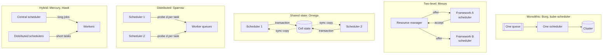

**Reading the diagram.** *Monolithic*: one scheduler, one queue, full information, serial decisions. *Two-level*: a resource manager offers free capacity to framework schedulers, which accept or decline; each sees only its offers. *Shared state*: schedulers hold copies of cell state (dotted, asynchronous sync) and commit placements as transactions that the store may reject. *Distributed*: independent schedulers probe a few random workers, sharing no state. *Hybrid*: central for long jobs, distributed for short tasks. Failure points and scaling are compared in Table 46.2.

### 46.4.1 Monolithic schedulers

A **monolithic scheduler** is one process (replicated, with one elected leader, §26.5) applying one policy to every job, as in Borg (§46.5) and Kubernetes (§46.6). Full information makes priorities, quota, fairness and preemption easy. The cost is one decision pipeline: a constrained service job may take a second to place while a batch task needs milliseconds, so batch waits behind services. This is the convoy effect of §6.5.1 at cluster scale, called **head-of-line blocking**.

::: formula
**Mean queueing delay of a single scheduler (M/G/1, Pollaczek–Khinchine)**

$$\rho = \sum_k \lambda_k \bar{S}_k \qquad W_q = \frac{\sum_k \lambda_k \overline{S^2_k}}{2(1-\rho)}$$

| Symbol | Meaning | Units |
|---|---|---|
| $\lambda_k$ | Arrival rate of jobs of class $k$ | jobs/s |
| $\bar{S}_k$ | Mean decision time for a class-$k$ job | s |
| $\overline{S^2_k}$ | Mean of the squared decision time (equals $\bar{S}_k^2$ for constant times) | s² |
| $\rho$ | Fraction of time the scheduler is busy | dimensionless |
| $W_q$ | Mean wait before a job's decision starts, any class | s |
:::

::: example
**Worked example — Batch tasks stuck behind service jobs.** Batch jobs arrive at 50 per second and take 5 ms each to place; service jobs arrive at 0.5 per second and take 1 s each (complex constraints). Treat decision times as constant.

1. Batch alone: $\rho = 50 \times 0.005 = 0.25$; $W_q = (50 \times 0.005^2)/(2 \times 0.75) = 0.00125/1.5 = 0.83$ ms.
2. Mixed: $\rho = 0.25 + 0.5 \times 1 = 0.75$.
3. Numerator: $50 \times 0.000025 + 0.5 \times 1 = 0.00125 + 0.5 = 0.50125$.
4. $W_q = 0.50125/(2 \times 0.25) = 1.0025$ s.

**Interpretation.** A batch task needing 5 ms of decision time now waits about 1 s, over 1,000 times longer, because of the slow class sharing the queue. **Engineering implication.** Make decisions fast (caching, sampling, §46.5.5) or separate the classes into different schedulers, Omega's motivation; Kubernetes profiles (§46.6.4) serve the same purpose.
:::

### 46.4.2 Two-level schedulers: Mesos resource offers

**Statically partitioned** clusters give each framework its own machines, reintroducing idle capacity. **Two-level scheduling** keeps one pool and splits the decision. In Mesos, a central **master** decides *how much* each framework gets and makes **resource offers** ("4 CPUs and 8 GB on node 17"); the framework's scheduler decides *which* offers to accept and what to launch; an agent on each node runs the tasks [Hindman et al. 2011]. The allocator uses Dominant Resource Fairness by default (§46.9.3). Frameworks (Hadoop, MPI, Spark, which began as a Mesos framework) keep their own placement logic, such as data locality. The weaknesses:

- **Partial view.** A framework cannot see the whole cluster, preempt others or find the best machine.
- **Pessimistic locking.** Offered resources are unavailable to others until accepted or declined.
- **Hard gangs.** A framework needing 100 machines must hoard offers until it has enough (§46.10).

### 46.4.3 Shared-state schedulers: Omega

Omega gives each scheduler a frequently synchronized copy of **cell state**, lets it place tasks freely, and commits placements as **optimistic transactions** [Schwarzkopf et al. 2013]. If another scheduler claimed the resources first, the conflicting part fails and is retried with fresh state: optimistic concurrency control (§11.15.3) applied to machines. Batch, service and MapReduce schedulers run different policies at different speeds without blocking one another.

**Figure 46.3 — An optimistic placement conflict in a shared-state scheduler.**

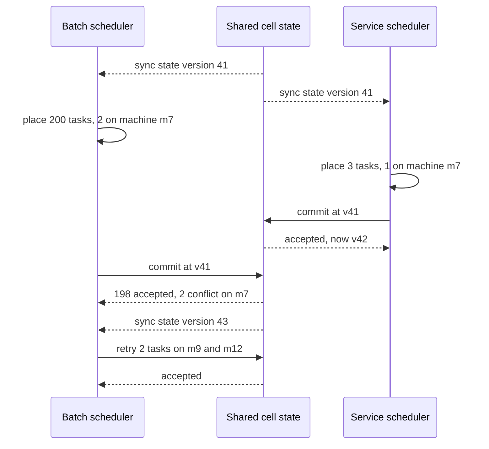

**Reading the diagram.** Both schedulers sync the same version asynchronously and decide locally, without locks. The service scheduler commits first. The batch commit conflicts on m7; with **incremental** transactions its 198 other placements stand and 2 tasks are retried, whereas an **all-or-nothing** transaction (a gang) would be rejected entirely. The storage boundary is the shared cell state. Failure points: conflicts waste work and can starve big all-or-nothing jobs. Scaling: add schedulers until conflicts dominate.

::: formula
**Conflict probability between two concurrent transactions (random placement model)**

$$P_{\text{conflict}} \approx 1 - \exp\!\left(-\frac{c_1 \, c_2}{N}\right)$$

| Symbol | Meaning | Units |
|---|---|---|
| $c_1, c_2$ | Machines touched by each of two concurrent transactions | machines |
| $N$ | Machines in the cell | machines |
| $P_{\text{conflict}}$ | Probability the two transactions touch at least one common machine | probability |
:::

::: example
**Worked example — Small jobs coexist, large gangs suffer.** A cell has $N = 10{,}000$ machines.

1. Two small jobs touching 10 machines each: $c_1 c_2/N = 100/10{,}000 = 0.01$; $P \approx 1 - e^{-0.01} = 0.99\%$.
2. A 1,000-machine all-or-nothing gang against one 10-machine job: $10{,}000/10{,}000 = 1$; $P \approx 1 - e^{-1} = 63\%$.
3. The same gang while five 10-machine jobs commit during its decision: exponent $5 \times 1 = 5$; $P \approx 1 - e^{-5} = 99.3\%$.

**Interpretation.** Optimism is nearly free for small placements but dooms a large all-or-nothing transaction while small commits keep landing; real schedulers all prefer the same "best" machines, so real conflicts exceed this model. **Engineering implication.** Commit incrementally where partial placement is acceptable, detect conflicts per resource rather than per machine, and protect large gangs with reservations or admission (§46.10). Omega's simulations found incremental transactions and fine-grained conflict detection kept conflict cost acceptable [Schwarzkopf et al. 2013].
:::

### 46.4.4 Distributed schedulers: Sparrow and sampling

For **sub-second tasks**, even 5 ms per central decision is a bottleneck: 100,000 tasks per second needs decisions in microseconds. Sparrow removes the central scheduler; many schedulers each handle some jobs and use the **power of two choices** of §19.4.4 [Ousterhout et al. 2013]:

1. **Per-task sampling.** For each task, probe $d$ random workers for their queue length and place the task on the shortest queue.
2. **Batch sampling.** For a job of $m$ tasks, probe $d \cdot m$ workers and use the $m$ least loaded. A job finishes with its slowest task, so *all* $m$ tasks must avoid queues; pooling probes makes that far likelier.
3. **Late binding.** Rather than trust stale queue lengths, place a **reservation** in each probed queue; workers reaching it request a task, the first $m$ get one and the rest are canceled.

With a probe ratio of $d = 2$, Sparrow performed within 12% of an ideal scheduler on a 110-machine cluster [Ousterhout et al. 2013]. It gives up global policy: priorities and weighted sharing work per worker, but cluster-wide constraints, gangs and preemption need a full view.

**Figure 46.4 — Batch sampling with late binding for a two-task job.**

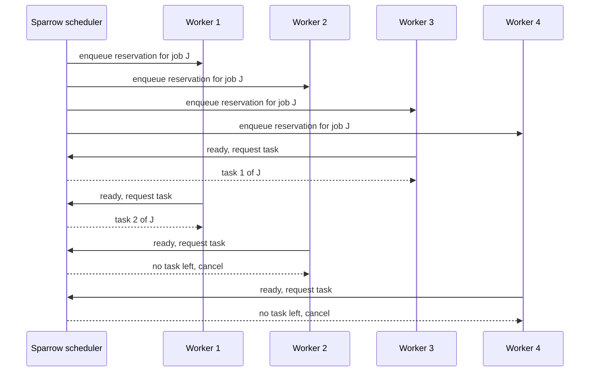

**Reading the diagram.** For $m = 2$, $d = 2$, the scheduler enqueues four reservations (synchronous RPCs). Workers 3 and 1 reach theirs first and fetch real tasks; 2 and 4 are canceled. The storage boundary is each worker's local queue. Failure points: a crashed scheduler loses only its own jobs, which clients resubmit elsewhere; late binding costs one extra round trip per task. Scaling: schedulers share nothing, so throughput grows linearly with their number.

::: formula
**Probability that a job of $m$ tasks avoids all queueing (independent-worker model)**

$$P_{\text{random}} = (1-\rho)^m \qquad P_{\text{per-task}} = (1-\rho^d)^m \qquad P_{\text{batch}} = \sum_{k=m}^{dm} \binom{dm}{k}(1-\rho)^k \rho^{\,dm-k}$$

$$T_{\text{sched}} \approx \text{RTT}_{\text{probe}} + t_{\text{queue}} + \text{RTT}_{\text{fetch}}$$

| Symbol | Meaning | Units |
|---|---|---|
| $\rho$ | Cluster load: probability a given worker is busy | fraction |
| $m$ | Tasks in the job | tasks |
| $d$ | Probes per task | count |
| $P$ | Probability every task of the job starts on an idle worker | probability |
| $\text{RTT}_{\text{probe}}, \text{RTT}_{\text{fetch}}$ | Round trips to place a reservation and to fetch the task | ms |
| $t_{\text{queue}}$ | Time the reservation waits in the worker's queue | ms |
:::

::: example
**Worked example — Why batch sampling matters for parallel jobs.** Load $\rho = 0.5$, a job of $m = 10$ tasks, $d = 2$.

1. Random placement: $0.5^{10} = 0.098\%$.
2. Per-task power of two: each task finds an idle worker with $1 - 0.5^2 = 0.75$; all ten: $0.75^{10} = 5.6\%$.
3. Batch sampling: 20 probes, need at least 10 idle among them, $X \sim \text{Binomial}(20, 0.5)$: $P(X \ge 10) = 58.8\%$.
4. With $d = 3$: 30 probes, $P(X \ge 10)$ for $\text{Binomial}(30, 0.5)$ is $97.9\%$.
5. Latency: with 0.5 ms round trips inside a datacenter and an idle worker ($t_{\text{queue}} = 0$), $T_{\text{sched}} \approx 0.5 + 0 + 0.5 = 1$ ms.

**Interpretation.** Per-task sampling helps a single task ($m = 1$: 75% versus 50%) but collapses for parallel jobs, where one unlucky task delays the job; batch sampling pools the luck. The model is pessimistic, since real queues drain. **Engineering implication.** For fan-out work, sample per job and bind late; the same idea helps any request that fans out to many backends (§4.8.4).
:::

### 46.4.5 Hybrid schedulers

Hybrid designs route by job type: a central scheduler places long or constrained jobs, distributed schedulers place short tasks into the remaining capacity, as in Hawk [Delgado et al. 2015] and Mercury [Karanasos et al. 2015]. Most platforms are hybrids in a looser sense: Kubernetes schedules pods centrally, and Spark or Ray schedule tasks inside them, two-level scheduling on top.

**Table 46.2 — Scheduler architectures compared.**

| Row | Monolithic | Two-level | Shared state | Distributed | Hybrid |
|---|---|---|---|---|---|
| What it is | One scheduler, full view | Allocator offers; frameworks choose | Many schedulers, shared state | Many schedulers, no shared state | Central plus distributed |
| How it works | Serial filter–score–bind | Offers, accept or decline | Optimistic transactions | Random probes, late binding | Route by job class |
| Advantages | Global policy, simple | Framework-specific logic | Parallel, full view, per-workload policy | Millisecond decisions, no bottleneck | Quality for long jobs, speed for short |
| Disadvantages | Head-of-line blocking, throughput ceiling | Partial view, hoarding, hard gangs | Conflicts, hard for large gangs | No global constraints or preemption | Two systems to run and tune |
| Performance | Hundreds to thousands of placements/s | Bounded by offer cycle | Scales until conflicts dominate | Millisecond decisions at very high task rates | Best of both for mixed loads |
| Operational complexity | Low | Medium | High | Medium | High |
| Cost | One scheduler | Allocator plus one per framework | Shared store plus schedulers | Many cheap schedulers | Highest |
| Use cases | Borg, kube-scheduler, Slurm | Mesos, YARN (similar request model) | Omega, Borg's internal design | Sparrow, short analytics tasks | Research systems, large mixed clusters |
| Choose when | Default for most clusters | Frameworks need their own placement | Several teams need different schedulers | Sub-second tasks at huge rates | Workload is strongly bimodal |

Centralization buys policy and costs throughput. Borg and Kubernetes show how far a well-engineered monolithic scheduler goes, so start there and split only when measurements show head-of-line blocking.

## 46.5 Borg

Borg is Google's cluster manager, described in 2015 after more than a decade in production [Verma et al. 2015], and the ancestor of Kubernetes [Burns et al. 2016]. This section reports the paper unless another source is cited; Google's systems have changed since.

### 46.5.1 Cells, jobs, tasks and allocs

::: definition
**Definition — Borg vocabulary.** A **cell** is the set of machines managed as one unit, typically inside one datacenter building; the median cell had about 10,000 machines. A **job** is a named group of identical **tasks** (processes in containers) with a priority and resource requirements. An **alloc** is a reserved set of resources on one machine into which one or more tasks can be placed; an **alloc set** is a job-like group of allocs across machines.
:::

A declarative job configuration names the binary, task count, per-task CPU, RAM and disk, hard and soft constraints, and a priority. Allocs let cooperating tasks, such as a web server and a log-saver, share a reserved slot: the idea Kubernetes calls the **pod** [Burns et al. 2016].

### 46.5.2 Architecture: Borgmaster, scheduler and Borglets

**Figure 46.5 — A Borg cell.**

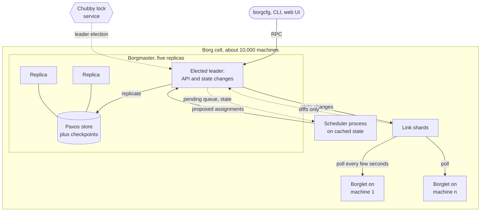

**Reading the diagram.** Clients send RPCs to the elected leader, which replicates every state change to four other replicas through a Paxos-based store; checkpoints allow recovery and offline simulation (the **Fauxmaster**). Election uses Paxos and a Chubby lock (§26.14.1). The scheduler is a separate process on cached state: it proposes assignments, which the leader accepts unless they are stale, an optimistic scheme similar in spirit to Omega. **Link shards** poll each Borglet every few seconds and forward only differences, so the Borgmaster controls the communication rate and avoids reconnection storms; a machine missing several polls is marked down and its tasks rescheduled. Failure points: a leader failover (typically about 10 s, up to a minute in a large cell) pauses changes, not running tasks; the paper reports 99.99% Borgmaster availability. Scaling: one Borgmaster per cell, more cells for more machines.

### 46.5.3 Priority, quota and admission

**Priority** decides *who is evicted* when room runs out; **quota** decides *who may submit* work at all.

**Table 46.3 — Borg priority bands (from highest to lowest).**

| Band | Typical use | May preempt |
|---|---|---|
| Monitoring | Systems that watch the cell | Lower bands |
| Production | User-facing services, critical batch | Lower bands, but not other production tasks |
| Batch | Ordinary batch jobs | Best effort |
| Best effort (testing, free) | Experiments, opportunistic work | Nothing |

Monitoring and production tasks are **prod**; the rest are **non-prod**. Production tasks do not preempt each other, which prevents **preemption cascades** (each eviction triggering one at slightly lower priority).

**Quota** is a resource vector at a given priority for a period, typically months; admission control rejects jobs exceeding their owner's quota at that priority. Higher-priority quota costs more; priority-zero quota is effectively unlimited but hard to use. Borg **oversells** quota at lower priorities, because users buy more than they use.

### 46.5.4 Resource reclamation

Borg estimates each task's likely usage plus a margin (its **reservation**), starting at the full request and decaying toward usage. Prod is scheduled against requests; non-prod may use the reclaimed difference. On CPU shortage the Borglet throttles non-prod tasks; on memory shortage it kills from the lowest priority up. §46.3.2's formula simplifies this mechanism.

### 46.5.5 Feasibility checking and scoring

For each pending task, the scheduler runs two phases:

1. **Feasibility checking** finds machines that satisfy the hard constraints and have enough *available* resources, counting resources held by lower-priority tasks that could be evicted.
2. **Scoring** ranks them: fewest and lowest-priority preemptions, machines that already hold the task's packages, spreading across power and failure domains, and packing quality, including mixing high- and low-priority tasks so the former can expand in a spike.

Borg first used a variant of E-PVM, which spreads load (a worst-fit tendency, §46.7) and fragments the cell; best fit packs tightly but hurts bursty work and users who underestimate. Borg's hybrid model reduces **stranded resources**, capacity unusable because another resource on the machine is exhausted, and gives about 3–5% better packing efficiency than best fit [Verma et al. 2015]. Three optimizations keep placement fast:

- **Score caching.** Scores are recomputed only when the machine or task changes.
- **Equivalence classes.** Identical tasks of a job are evaluated once.
- **Relaxed randomization.** Examine machines in random order until "enough" are feasible, then pick the best of those.

With them, scheduling a cell's whole workload from scratch typically took a few hundred seconds; without them it did not finish after more than three days. Kubernetes' `percentageOfNodesToScore` (§46.6.3) is relaxed randomization.

### 46.5.6 What Borg's utilization studies found

Borg's authors measured efficiency by **cell compaction**: how few machines can still fit a given workload, found by repeated Fauxmaster simulation. Their results, as stated in the paper [Verma et al. 2015]:

- **Sharing prod and non-prod.** Segregating them would need 20–30% more machines in the median cell, because prod reserves for rare spikes and non-prod fills the gap.
- **Sharing between users and large cells.** Giving large users their own cells, or splitting cells, needed more machines than sharing.
- **Fine-grained requests.** Rounding CPU and memory requests up to power-of-two buckets would need 30–50% more resources in the median case.
- **Reclamation.** A substantial fraction of the workload ran in reclaimed resources, and more aggressive reservation estimates cost little in out-of-memory events.

::: example
**Worked example — What 20–30% means in machines.** Take a hypothetical fleet of 20 cells of 10,000 machines each, sharing prod and non-prod as Borg does.

1. Fleet: $20 \times 10{,}000 = 200{,}000$ machines.
2. Segregated, at the paper's 20–30% median: $200{,}000 \times 1.2 = 240{,}000$ to $200{,}000 \times 1.3 = 260{,}000$ machines.
3. Extra: 40,000–60,000 machines. At an illustrative $10,000 per machine over its life, $400–600 million of hardware, before power and buildings.

**Interpretation.** At this scale pooling is the reason to have a cluster manager. **Engineering implication.** Proportionally the same holds for a 100-node Kubernetes cluster that keeps services and batch on separate pools "for safety": priority, preemption and reclamation let them share. The fleet and price are illustrative; only the percentages come from the paper.
:::

### 46.5.7 Borg in 2019 and the lessons Kubernetes took

Tirmazi et al. compared a May 2019 trace of eight Borg cells with the 2011 trace [Tirmazi et al. 2020]. They found alloc sets used for resource-heavy workloads, automatic vertical scaling (Autopilot [Rzadca et al. 2020]) effective, and job dependencies explaining much of the high failure rates in earlier studies. The workload is heavy-tailed, so a scheduler's handling of its few largest jobs matters as much as its average case.

::: industry
**From Borg and Omega to Kubernetes.** Burns et al. describe what Kubernetes kept and changed [Burns et al. 2016]. Kept: declarative jobs, priorities, reconciliation and allocs (as pods). Changed: per-pod IPs instead of host ports; labels instead of numbered task arrays; and, following Omega, a shared store behind the API server with independent controllers and schedulers instead of a monolithic master. Trade-off: modularity brought extensibility and portability but weaker batch defaults, so gangs and queueing arrived as add-ons (§46.10).
*Evidence: Primary* — [Burns et al. 2016]; [Verma et al. 2015]; [Schwarzkopf et al. 2013]
:::

#### Common misconceptions

::: mistake
**"Borg proved that 'X% utilization' is achievable."** The paper's claims are *relative* savings by cell compaction, not an absolute utilization figure for Google's fleet. Do not quote one unless a source states it.
:::

## 46.6 The Kubernetes scheduler in depth

§42.13 introduced filtering, scoring and binding; this section opens the machinery. `kube-scheduler` is monolithic (§46.4.1), with one active leader elected through a `Lease` object (§26.9.2).

### 46.6.1 The scheduling framework

::: definition
**Definition — Scheduling framework.** The plugin architecture of `kube-scheduler`. A pod passes through a fixed sequence of **extension points**; each enabled plugin implements one or more of them. A **scheduling cycle** chooses a node for one pod and runs serially; a **binding cycle** applies the choice and may run concurrently with the next pod's scheduling cycle [Kubernetes Docs: Scheduling Framework].
:::

**Figure 46.6 — Extension points of the Kubernetes scheduling framework.**

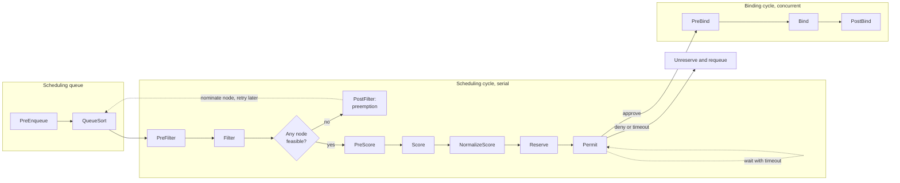

**Reading the diagram.** A pod enters the queue only when every PreEnqueue plugin agrees (a gang plugin can hold it until its group exists); QueueSort orders by priority. The serial cycle precomputes (PreFilter) and removes infeasible nodes (Filter); if none survive, PostFilter attempts preemption, nominates a node and requeues the pod. Otherwise nodes are scored, normalized to 0–100 and weighted, and the winner's resources are **reserved** in the cache. **Permit** approves, denies, or makes the pod *wait* with a timeout, the hook gang scheduling uses (§46.10). The binding cycle runs asynchronously: PreBind provisions volumes, Bind writes to the API server (the storage boundary). Any failure after Reserve runs Unreserve and requeues the pod. Scaling: only the scheduling cycle is serial, so slow volume binding blocks no one.

**Table 46.4 — Extension points and representative default plugins.**

| Extension point | Purpose | Example plugin |
|---|---|---|
| PreEnqueue | Gate a pod before it may enter the active queue | `SchedulingGates` |
| QueueSort | Order pending pods | `PrioritySort` |
| PreFilter / Filter | Precompute; reject infeasible nodes | `NodeResourcesFit`, `NodeAffinity`, `TaintToleration`, `PodTopologySpread`, `InterPodAffinity`, `VolumeBinding` |
| PostFilter | Act when no node fits | `DefaultPreemption` |
| PreScore / Score / NormalizeScore | Rank feasible nodes | `NodeResourcesFit` (strategy), `NodeResourcesBalancedAllocation`, `ImageLocality`, `InterPodAffinity` |
| Reserve / Unreserve | Claim resources in the cache; roll back | `VolumeBinding` |
| Permit | Approve, deny or wait | Coscheduling (out of tree) |
| PreBind / Bind / PostBind | Prepare, write binding, clean up | `VolumeBinding`, `DefaultBinder` |

Failed pods wait in an **unschedulable** pool until a relevant event (a node added, a pod deleted) could make them fit; plugins declare which events matter, so a pod short of GPUs is not retried on every ConfigMap change. Scheduling gates (`spec.schedulingGates`) let an external job queue keep pods out of the scheduler until it admits them.

### 46.6.2 Scores and weights

Normalized scores are multiplied by plugin weights and summed; the highest total wins, ties broken at random. Weights encode policy: a high weight on `NodeResourcesFit` with `MostAllocated` packs (§42.13.4); a heavily weighted `PodTopologySpread` spreads. For batch-heavy clusters, switching from spreading to packing is usually the most valuable cost setting; §46.7 measures why.

### 46.6.3 Searching only part of the cluster

In large clusters the scheduler stops filtering once it has found a fraction of feasible nodes and scores only those, resuming the next search where the last stopped, interleaved across zones.

::: formula
**Default number of feasible nodes to find (`percentageOfNodesToScore` unset)**

$$p = \max\left(5,\; 50 - \frac{N}{125}\right)\% \qquad n_{\text{find}} = \min\left(N,\; \max\left(100,\; \left\lfloor N \cdot \frac{p}{100} \right\rfloor\right)\right)$$

| Symbol | Meaning | Units |
|---|---|---|
| $N$ | Nodes in the cluster | nodes |
| $p$ | Adaptive percentage of nodes to find feasible (floor of 5%) | percent |
| $n_{\text{find}}$ | Feasible nodes after which filtering stops (at least 100) | nodes |
:::

::: example
**Worked example — Search size in three cluster sizes.**

1. $N = 1{,}000$: $p = 50 - 8 = 42\%$; $n = 420$ nodes.
2. $N = 5{,}000$: $p = 50 - 40 = 10\%$; $n = 500$ nodes.
3. $N = 15{,}000$: $50 - 120 < 5$, so $p = 5\%$; $n = 750$ nodes.
4. Cost: if filtering and scoring cost about 20 µs per node per pod (an illustrative figure), the 5,000-node cluster spends $500 \times 20 = 10$ ms per pod instead of $5{,}000 \times 20 = 100$ ms, raising the ceiling from about 10 to about 100 pods per second for that pod type.

**Interpretation.** The search grows far more slowly than the cluster, keeping throughput roughly flat at the cost of sometimes missing the best node. **Engineering implication.** Lower the percentage in huge clusters of identical nodes; raise it toward 100% where placement quality matters, such as packing scarce GPU nodes. This is Borg's relaxed randomization (§46.5.5).
:::

### 46.6.4 Profiles and multiple schedulers

One `kube-scheduler` can run several **profiles**, each a named set of plugins, weights and arguments, selected by `spec.schedulerName`. Profiles share one queue and cache, so they never race, unlike separate scheduler deployments, whose conflicting bindings the kubelet rejects at admission.

```yaml
apiVersion: kubescheduler.config.k8s.io/v1
kind: KubeSchedulerConfiguration
profiles:
  - schedulerName: default-scheduler          # services: default spreading
  - schedulerName: batch-packing              # batch: pack to free whole nodes
    plugins:
      score:
        disabled:
          - name: NodeResourcesBalancedAllocation
    pluginConfig:
      - name: NodeResourcesFit
        args:
          scoringStrategy:
            type: MostAllocated
            resources:
              - {name: cpu, weight: 1}
              - {name: memory, weight: 1}
              - {name: nvidia.com/gpu, weight: 5}
      - name: DefaultPreemption
        args:
          minCandidateNodesPercentage: 10
```

What to notice:

- The batch profile packs (`MostAllocated`), weighting GPUs five times CPU or memory so GPU pods consolidate first; services keep spreading.
- `NodeResourcesBalancedAllocation` favors nodes whose CPU and memory fractions are balanced; disabling it leaves packing as the dominant score.
- One shared queue means priority still orders services and batch against each other.

### 46.6.5 The descheduler

The scheduler decides once, but clusters drift: empty nodes join, rules change, better placements appear. The **descheduler**, a Kubernetes SIG project, periodically evicts pods that violate a policy so the scheduler can re-place them [Kubernetes SIGs: Descheduler]. Plugins include removing duplicates, `LowNodeUtilization` (drain over-used nodes into under-used ones), `HighNodeUtilization` (empty nearly idle nodes for removal), and removing pods that violate affinity, taints or topology spread, or exceed a lifetime or restart count. It uses the Eviction API and so honors PodDisruptionBudgets (§46.8.2); give either it or the node autoscaler's consolidation (§46.13) the packing job, not both, or they churn.

#### Failure scenarios

| What goes wrong | Why | Detection | Recovery | Prevention |
|---|---|---|---|---|
| Pods Pending with free capacity | Fragmentation or an unsatisfiable constraint | `FailedScheduling` events naming the filter | Relax constraint; deschedule | Pack batch; check constraints in CI |
| Scheduler throughput collapses | Inter-pod affinity across thousands of pods | Scheduling latency histogram | Remove or narrow affinity | Prefer topology spread; lower search percentage |
| Two schedulers bind to one node | Separate deployments with separate caches | Kubelet admission rejections | Automatic reschedule | One binary with profiles |
| Pods evicted repeatedly | Descheduler and scheduler disagree | Eviction rate per workload | Disable the conflicting plugin | Align scoring and descheduler thresholds |

## 46.7 Bin-packing heuristics

### 46.7.1 Four placement rules

Resource scoring reduces to a few classic online bin-packing rules over the feasible nodes:

- **First fit.** The first node, in fixed order, where the task fits. Cheap; fills low-numbered nodes first.
- **Best fit.** The node with the *least* capacity left after placement. Packs tightly, keeping empty nodes empty.
- **Worst fit.** The node with the *most* capacity left. Spreads load; Kubernetes' default `LeastAllocated` is a worst-fit rule.
- **Dot product (alignment).** Prefer the node whose normalized free-capacity vector has the largest dot product with the task's demand, so memory-heavy tasks go where memory is plentiful [Panigrahy et al. 2011]; Tetris used this score for cluster packing [Grandl et al. 2014].

Offline, **first-fit decreasing** (largest first) uses at most about 11/9 of the optimal bins plus a constant in one dimension [Garey and Johnson 1979]. Clusters are online and multi-dimensional, so you have to measure.

### 46.7.2 Fragmentation

::: definition
**Definition — Fragmentation (stranded capacity).** Free capacity that cannot be used by the tasks that need it, either because no single node has enough of it (**external fragmentation**), or because another resource on the same node is exhausted (**stranding**, in Borg's term).
:::

::: formula
**Fragmentation with respect to a reference task shape $s$**

$$F(s) = 1 - \frac{\sum_i \left\lfloor \min_r \dfrac{f_{i,r}}{s_r} \right\rfloor s_{r^*}}{\sum_i f_{i,r^*}}$$

| Symbol | Meaning | Units |
|---|---|---|
| $f_{i,r}$ | Free amount of resource $r$ on node $i$ | vCPU, GiB, GPUs |
| $s_r$ | Reference task's demand for resource $r$ | vCPU, GiB, GPUs |
| $\lfloor \min_r f_{i,r}/s_r \rfloor$ | Copies of the reference task node $i$ can still host | tasks |
| $r^*$ | The resource in which fragmentation is reported (for example CPU) | — |
| $F(s)$ | Fraction of free $r^*$ unusable by tasks of shape $s$ | fraction |
:::

::: example
**Worked example — Free capacity that fits nothing.** Three nodes of 32 vCPU / 128 GiB have free (10 vCPU, 8 GiB), (6, 60) and (12, 20). A task needs 8 vCPU and 32 GiB.

1. Node 1: $\min(10/8, 8/32) = \min(1.25, 0.25) \Rightarrow 0$ copies. Node 2: $\min(0.75, 1.875) \Rightarrow 0$. Node 3: $\min(1.5, 0.625) \Rightarrow 0$.
2. Free CPU $= 10 + 6 + 12 = 28$ vCPU; free memory $= 88$ GiB, which is 3.5 times the CPU and 2.75 times the memory the task needs.
3. $F = 1 - 0/28 = 100\%$.
4. For a smaller (2 vCPU, 8 GiB) task: copies $= \lfloor\min(5, 1)\rfloor + \lfloor\min(3, 7.5)\rfloor + \lfloor\min(6, 2.5)\rfloor = 1 + 3 + 2 = 6$, using 12 vCPU; $F = 1 - 12/28 = 57\%$.

**Interpretation.** Aggregate free capacity says there is room; per-node vectors say there is none, and large shapes suffer most. **Engineering implication.** Monitor $F(s)$ or the largest placeable task for important shapes, not total free capacity, and pack so free capacity stays concentrated.
:::

::: formula
**Alignment (dot-product) score of node $i$ for demand $d$**

$$A_i = \sum_r \frac{d_r}{C_r} \cdot \frac{f_{i,r}}{C_r}$$

| Symbol | Meaning | Units |
|---|---|---|
| $d_r$ | Task's demand for resource $r$ | vCPU, GiB |
| $f_{i,r}$ | Free resource $r$ on node $i$ | vCPU, GiB |
| $C_r$ | Node capacity of resource $r$ (normalizer) | vCPU, GiB |
| $A_i$ | Alignment score; higher is preferred | dimensionless |
:::

::: example
**Worked example — Sending a memory-heavy task to the memory-rich node.** Nodes of 32 vCPU / 128 GiB: X has (24, 20) free and Y has (8, 120) free. The task needs (2, 16); both nodes fit it.

1. Normalized demand: $(2/32, 16/128) = (0.0625, 0.125)$.
2. X: $(24/32, 20/128) = (0.75, 0.156)$; $A_X = 0.0625 \times 0.75 + 0.125 \times 0.156 = 0.0469 + 0.0195 = 0.0664$.
3. Y: $(0.25, 0.9375)$; $A_Y = 0.0156 + 0.1172 = 0.1328$. Choose Y.
4. Effect: X keeps 24 vCPU and 20 GiB for CPU-heavy work; placing the task there would have left 22 vCPU with only 4 GiB, stranding most of the CPU.

**Interpretation.** Alignment matches shapes, but $A_i$ also grows with the *amount* free, so alone it prefers emptier nodes, like worst fit, as the simulation below shows. **Engineering implication.** Use alignment as a secondary term beside a packing term (Tetris combined several terms), not as the only rule.
:::

### 46.7.3 Measuring the heuristics

The program runs a 50-node cluster at 95% offered CPU load with Poisson arrivals and exponential lifetimes; a fifth of tasks are large (half a node), and a task that fits nowhere is rejected. The tests check each rule on hand-built cases, including two half-node tasks spread so that a whole-node task cannot fit.

```python
"""Compare placement heuristics on a fixed cluster with arrivals and departures."""
import heapq
import random

CAP = (32.0, 128.0)                       # one node: vCPU, GiB
SHAPES = [((1, 1), 0.20), ((4, 4), 0.20),           # CPU-heavy (1 GiB per vCPU)
          ((1, 8), 0.20), ((2, 16), 0.20),          # memory-heavy (8 GiB per vCPU)
          ((16, 64), 0.20)]                         # large, node-shaped


def norm(v):
    return [x / c for x, c in zip(v, CAP)]


def fits(free, d):
    return all(f >= x - 1e-9 for f, x in zip(free, d))


def score(policy, free, d):
    """Higher is better. free and d are raw vectors."""
    left = sum(norm([f - x for f, x in zip(free, d)]))   # normalized leftover
    if policy == "first-fit":
        return 0.0                                       # ties -> lowest index
    if policy == "best-fit":
        return -left                                     # least leftover
    if policy == "worst-fit":
        return left                                      # most leftover
    if policy == "dot-product":                          # Tetris-style alignment
        return sum(a * b for a, b in zip(norm(free), norm(d)))
    raise ValueError(policy)


def place(nodes, d, policy):
    best, best_score = None, None
    for i, free in enumerate(nodes):                     # index order = first-fit
        if fits(free, d):
            s = score(policy, free, d)
            if best is None or s > best_score + 1e-12:
                best, best_score = i, s
    return best


def simulate(policy, n_nodes=50, load=0.95, n_tasks=30_000, seed=7):
    rng = random.Random(seed)
    shapes, weights = zip(*SHAPES)
    mean_cpu = sum(s[0] * w for s, w in SHAPES)
    rate = load * n_nodes * CAP[0] / mean_cpu            # arrivals per unit time (mean life 1)
    nodes = [list(CAP) for _ in range(n_nodes)]
    departures, t = [], 0.0
    offered = {s: 0 for s in shapes}
    rejected = {s: 0 for s in shapes}
    used_cpu_area = 0.0
    for _ in range(n_tasks):
        gap = rng.expovariate(rate)
        used_cpu_area += gap * sum(CAP[0] - n[0] for n in nodes)
        t += gap
        while departures and departures[0][0] <= t:      # free finished tasks
            _, i, d = heapq.heappop(departures)
            nodes[i] = [f + x for f, x in zip(nodes[i], d)]
        d = rng.choices(shapes, weights)[0]
        offered[d] += 1
        i = place(nodes, d, policy)
        if i is None:
            rejected[d] += 1
            continue
        nodes[i] = [f - x for f, x in zip(nodes[i], d)]
        heapq.heappush(departures, (t + rng.expovariate(1.0), i, d))
    util = used_cpu_area / (t * n_nodes * CAP[0])
    big = (16, 64)
    total_rej = sum(rejected.values()) / sum(offered.values())
    return util, total_rej, rejected[big] / offered[big]


def test():
    assert fits([4, 16], (4, 16)) and not fits([4, 15.9], (4, 16))
    nodes = [[30.0, 120.0], [6.0, 20.0]]
    assert place(nodes, (4, 16), "best-fit") == 1        # tightest node
    assert place(nodes, (4, 16), "worst-fit") == 0       # emptiest node
    assert place(nodes, (4, 16), "first-fit") == 0       # lowest index
    skew = [[24.0, 20.0], [8.0, 120.0]]                  # CPU-rich vs memory-rich
    assert place(skew, (2, 16), "dot-product") == 1      # memory task -> memory-rich
    assert place(skew, (4, 4), "dot-product") == 0       # CPU task -> CPU-rich
    for policy, ok in (("best-fit", True), ("worst-fit", False)):
        two = [list(CAP), list(CAP)]                     # two empty nodes
        for d in ((16, 64), (16, 64)):
            i = place(two, d, policy)
            two[i] = [f - x for f, x in zip(two[i], d)]
        assert (place(two, CAP, policy) is not None) == ok   # whole-node task
    print("tests passed")


if __name__ == "__main__":
    test()
    print(f"{'policy':<12}{'CPU util':>10}{'rejected':>10}{'16-CPU rejected':>17}")
    for p in ("first-fit", "best-fit", "worst-fit", "dot-product"):
        u, r, rb = simulate(p)
        print(f"{p:<12}{u:>10.1%}{r:>10.1%}{rb:>17.1%}")
```

```text
tests passed
policy        CPU util  rejected  16-CPU rejected
first-fit        88.8%      1.9%             9.7%
best-fit         88.7%      1.9%             9.3%
worst-fit        66.0%      8.9%            44.8%
dot-product      66.3%      9.0%            44.6%
```

What to notice:

- Only `score` differs between policies, as policy is a scoring plugin in a real scheduler.
- Packing (first fit, best fit) keeps about 89% of CPU busy and rejects under 10% of large tasks. Spreading (worst fit, dot product alone) leaves nodes half full: 45% of large tasks find no node and utilization falls to 66% *although demand exceeds supply*.
- First fit and best fit are within noise (seeds 8 and 9 swap their order); the big effect is pack versus spread.

**Table 46.5 — Choosing a placement rule.**

| Rule | Packs or spreads | Best for | Risk |
|---|---|---|---|
| First fit | Packs (by node order) | Simple batch clusters | Hot low-numbered nodes |
| Best fit | Packs tightly | Batch, GPU, cost-sensitive clusters; freeing nodes for scale-down | Little headroom for bursts on busy nodes |
| Worst fit / LeastAllocated | Spreads | Latency-sensitive services needing burst headroom | Fragmentation; large tasks stuck |
| Dot product | Shape-matching | Mixed CPU-heavy and memory-heavy work, as a secondary term | Spreads if used alone |

#### Common misconceptions

::: mistake
**"Spreading is safer, so it is the right default everywhere."** For batch and accelerator work it creates the fragmentation that blocks large jobs. Get service availability explicitly, with topology spread constraints and PodDisruptionBudgets, and let scoring pack.
:::

## 46.8 Priorities, preemption and quota

### 46.8.1 Preemption and victim selection

::: definition
**Definition — Preemption.** Evicting running lower-priority work so that a pending higher-priority task can be placed. The evicted tasks are **victims**; the pending task is the **preemptor**.
:::

Preemption lets a cluster run at high utilization *and* place urgent work quickly. The hard part is choosing victims. Kubernetes' `DefaultPreemption` plugin, at PostFilter, works in two steps [Kubernetes Docs: Pod Priority and Preemption]:

1. **For each candidate node**, remove all lower-priority pods in simulation; if the preemptor fits, add pods back, highest priority first, while it still fits. PDB-protected pods are added back first, so they are evicted only if unavoidable.
2. **Pick one node** by, in order: fewest PDB violations; lowest highest-victim priority; smallest sum of victim priorities; fewest victims; latest start time of the highest-priority victims (evict the work that has run least).

The scheduler sets `nominatedNodeName`, deletes the victims (with their grace periods) and retries. A `PriorityClass` with `preemptionPolicy: Never` queues ahead of lower priorities without evicting anyone.

**Figure 46.7 — Preemption decision for one pending pod.**

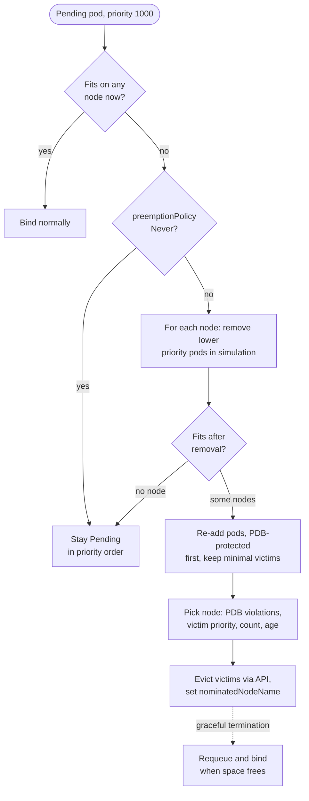

**Reading the diagram.** The decision is synchronous within one scheduling cycle; evictions complete asynchronously within grace periods, so the preemptor is requeued, not bound. The storage boundary is the API server, which records deletions and the nomination. Failure points: long grace periods delay the preemptor; PDBs are best effort here; a pod that does not fit even after evicting everything lower stays Pending. Scaling: simulation is expensive, so the plugin examines a bounded sample of candidate nodes.

### 46.8.2 PodDisruptionBudgets

A **PodDisruptionBudget** (PDB) limits *voluntary* disruptions of a pod set through `minAvailable` or `maxUnavailable`. Drains, the descheduler and consolidation use the Eviction API, which refuses evictions that would break a PDB; preemption treats PDBs as a preference; node failures ignore them. Trap: `maxUnavailable: 0`, or a PDB on a single-replica service, blocks every drain.

### 46.8.3 How quota and priority interact

If every team marks its work "critical", priority means nothing, so quota bounds work *per priority*, as in Borg (§46.5.3). A Kubernetes `ResourceQuota` can be scoped to a `PriorityClass` with a `scopeSelector`: say 200 CPU at `production` and 2,000 at `batch-low`; `system-cluster-critical` and `system-node-critical` are reserved for cluster components. Queueing systems such as Kueue add **borrowing** of unused quota, reclaimed by preemption when the owner returns (§46.10.2).

::: formula
**Work lost to preemption for a checkpointed job**

$$L = r_p \left(\frac{\tau}{2} + t_r\right) G \qquad \text{fraction lost} = \frac{L}{24\,G} = \frac{r_p(\tau/2 + t_r)}{24}$$

| Symbol | Meaning | Units |
|---|---|---|
| $r_p$ | Preemptions (or failures) per day | 1/day |
| $\tau$ | Checkpoint interval; on average half of it is lost | h |
| $t_r$ | Restart time: rescheduling, loading the checkpoint, warm-up | h |
| $G$ | Accelerators (or machines) held by the job | GPUs |
| $L$ | Accelerator-hours lost per day | GPU·h/day |
:::

::: example
**Worked example — Preempting a 256-GPU training job.** The job is preempted twice a day, checkpoints every 60 minutes, and takes 10 minutes to restart.

1. Lost per preemption: $0.5 + 10/60 = 0.667$ h; $\times 256 = 170.7$ GPU·h.
2. Per day: $2 \times 170.7 = 341$ GPU·h of $256 \times 24 = 6{,}144$: **5.6%**.
3. With 15-minute checkpoints: $(0.125 + 0.167) \times 256 = 74.7$ GPU·h per preemption; $149$ per day: **2.4%**.

**Interpretation.** Lost progress and restart are multiplied by the job's whole footprint. **Engineering implication.** Preempt large gangs rarely and as a unit (evicting one worker stalls all, §46.10), checkpoint frequently and asynchronously (§65.15), and prefer preempting small jobs.
:::

#### Common misconceptions

::: mistake
**"A PDB guarantees availability."** It only throttles voluntary evictions. Crashes, OOM kills and zone outages ignore it. Availability comes from replicas and spread; the PDB stops your own tools removing them too fast.
:::

## 46.9 Fairness

### 46.9.1 Max-min fairness and weighted fair share

::: definition
**Definition — Max-min fairness.** An allocation is max-min fair if no user's share can be increased without decreasing the share of a user who has an equal or smaller share. With one resource, it is computed by **water filling**: raise every unsatisfied user's allocation equally until each is either satisfied or the resource is exhausted. **Weighted fair share** raises allocations in proportion to weights.
:::

::: formula
**Weighted max-min (water-filling) allocation of one resource**

$$a_i = \min(d_i,\; w_i\,\theta) \qquad \text{with } \theta \text{ chosen so that } \sum_i a_i = C \text{ (when } \textstyle\sum_i d_i \ge C)$$

| Symbol | Meaning | Units |
|---|---|---|
| $C$ | Capacity to share | GPUs, cores |
| $d_i$ | Demand of user $i$ | GPUs, cores |
| $w_i$ | Weight of user $i$ | dimensionless |
| $\theta$ | Water level: allocation per unit weight for unsatisfied users | GPUs |
| $a_i$ | Allocation of user $i$ | GPUs, cores |
:::

::: example
**Worked example — Sharing 100 GPUs among three teams.** Demands are 10, 40 and 80 GPUs.

1. Equal weights. Try $\theta = 45$: $10 + 40 + 45 = 95 < 100$; team 2 is satisfied at 40, so raise $\theta$ for team 3 only: $10 + 40 + \theta = 100 \Rightarrow \theta = 50$. Allocation **10, 40, 50**.
2. Weights 1, 1, 2. Try $\theta = 30$: $\min(10, 30) + \min(40, 30) + \min(80, 60) = 10 + 30 + 60 = 100$. Allocation **10, 30, 60**.

**Interpretation.** Small demands are met in full and the rest is shared by weight, with nothing idle while anyone wants more. **Engineering implication.** YARN's Fair Scheduler and Kueue's fair sharing apply this rule; set weights from budget.
:::

### 46.9.2 Why one resource is not enough

With several resources, "equal shares" is ambiguous. Equal CPU may give a memory-hungry team almost nothing useful. Ghodsi et al. asked which multi-resource policy satisfies four properties [Ghodsi et al. 2011]: **sharing incentive** (each user is at least as well off as with $1/n$ of every resource), **strategy-proofness** (lying about demands cannot help), **envy-freeness** (no user prefers another's allocation) and **Pareto efficiency** (no one can gain without someone losing). Their answer is Dominant Resource Fairness.

### 46.9.3 Dominant Resource Fairness

::: formula
**Dominant share and DRF**

$$s_i = \max_r \frac{u_{i,r}}{C_r} \qquad \text{DRF: maximize allocations subject to equal } \frac{s_i}{w_i} \text{ (progressive filling)}$$

| Symbol | Meaning | Units |
|---|---|---|
| $u_{i,r}$ | Amount of resource $r$ allocated to user $i$ | CPUs, GB |
| $C_r$ | Total capacity of resource $r$ | CPUs, GB |
| $s_i$ | User $i$'s dominant share: its largest share of any resource | fraction |
| $w_i$ | Weight of user $i$ (1 if unweighted) | dimensionless |
:::

::: example
**Worked example — The DRF paper's example, recomputed.** A system has 9 CPUs and 18 GB. User A's tasks need ⟨1 CPU, 4 GB⟩; user B's need ⟨3 CPUs, 1 GB⟩ [Ghodsi et al. 2011].

1. Per-task shares. A: CPU $1/9$, memory $4/18 = 2/9$, so A's dominant resource is memory. B: CPU $3/9 = 1/3$, memory $1/18$, so B's is CPU.
2. Let A run $x$ tasks and B run $y$. Equal dominant shares: $2x/9 = y/3 \Rightarrow y = 2x/3$.
3. CPU: $x + 3y \le 9 \Rightarrow x + 2x \le 9 \Rightarrow x \le 3$. Memory: $4x + y \le 18 \Rightarrow 4x + 2x/3 \le 18 \Rightarrow x \le 3.86$. CPU binds: $x = 3$, $y = 2$.
4. A gets ⟨3 CPUs, 12 GB⟩, B gets ⟨6 CPUs, 2 GB⟩. Dominant shares: A $12/18 = 2/3$, B $6/9 = 2/3$. All CPUs are used; 4 GB of memory is left, usable by neither user's task shape because no CPU remains.
5. Sharing incentive check: with half of everything (4.5 CPUs, 9 GB), A could run $\min(4.5, 9/4) = 2.25$ tasks and B $\min(1.5, 9) = 1.5$; DRF gives 3 and 2.

**Interpretation.** Each user gets the same fraction of the resource it needs most, and both beat a static split. **Engineering implication.** Use DRF where teams have different resource shapes; Mesos used it by default, YARN's Fair Scheduler offers it, and Volcano ships a `drf` plugin.
:::

**Figure 46.8 — DRF by progressive filling.**

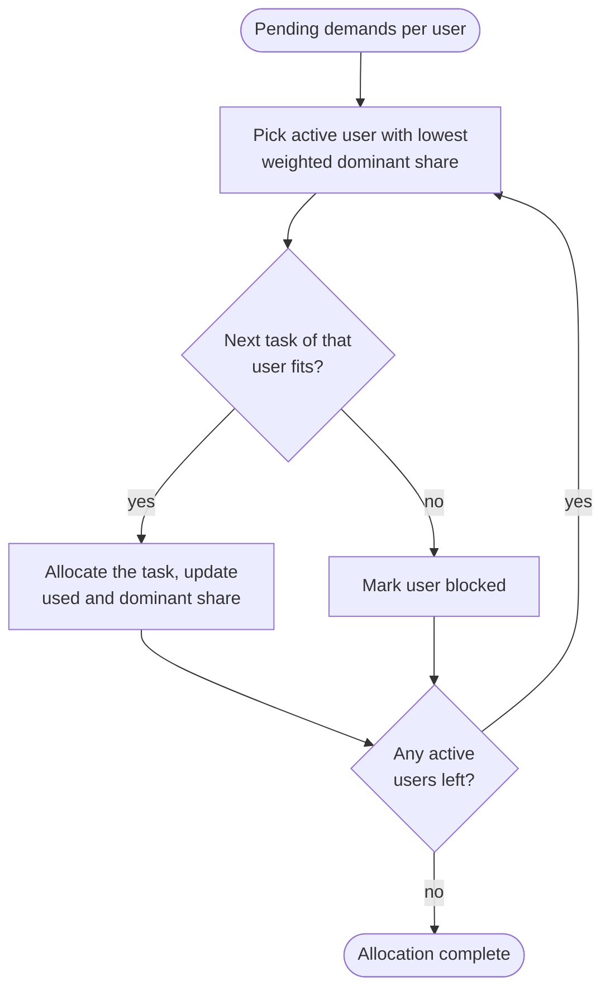

**Reading the diagram.** The loop serves the user furthest behind in dominant share; a user whose next task no longer fits drops out while others continue. Online, the loop runs whenever resources free (a Mesos offer cycle, a YARN heartbeat) on the allocator's in-memory state. Failure points: discrete tasks deviate from ideal shares; a user with huge tasks may be blocked by small ones, which needs reservations. Scaling: a priority queue keyed by dominant share makes each pick $O(\log n)$.

```python
"""Dominant Resource Fairness by progressive filling [Ghodsi et al. 2011]."""
from fractions import Fraction as F


def drf(capacity, demands, weights=None):
    """capacity: {resource: amount}; demands: {user: {resource: per-task}}.
    Repeatedly launch one task for the user with the lowest weighted dominant
    share whose next task still fits. Returns tasks per user."""
    weights = weights or {u: 1 for u in demands}
    used = {r: F(0) for r in capacity}
    tasks = {u: 0 for u in demands}

    def dominant_share(u):
        return max(F(tasks[u] * demands[u][r], capacity[r]) for r in capacity) / weights[u]

    active = set(demands)
    while active:
        u = min(sorted(active), key=dominant_share)        # sorted: deterministic ties
        if all(used[r] + demands[u][r] <= capacity[r] for r in capacity):
            for r in capacity:
                used[r] += demands[u][r]
            tasks[u] += 1
        else:
            active.discard(u)                              # u is blocked; others may still fit
    return tasks, {u: dominant_share(u) * weights[u] for u in demands}, used


if __name__ == "__main__":
    cap = {"cpu": 9, "mem_gb": 18}
    users = {"A": {"cpu": 1, "mem_gb": 4}, "B": {"cpu": 3, "mem_gb": 1}}
    tasks, shares, used = drf(cap, users)
    print("tasks", tasks, "dominant shares", {u: str(s) for u, s in shares.items()},
          "used", {r: int(v) for r, v in used.items()})
    assert tasks == {"A": 3, "B": 2} and shares["A"] == shares["B"] == F(2, 3)
    # Weighted, on a cluster ten times larger: B's weight 2 lets B's dominant
    # share grow to twice A's.
    big = {r: 10 * v for r, v in cap.items()}
    tasks_w, shares_w, _ = drf(big, users, weights={"A": 1, "B": 2})
    print("weighted", tasks_w, {u: str(s) for u, s in shares_w.items()})
    assert tasks_w == {"A": 18, "B": 24}
```

```text
tasks {'A': 3, 'B': 2} dominant shares {'A': '2/3', 'B': '2/3'} used {'cpu': 9, 'mem_gb': 14}
weighted {'A': 18, 'B': 24} {'A': '2/5', 'B': '4/5'}
```

What to notice:

- `Fraction` keeps shares exact, so the 2/3 assertion is immune to rounding.
- A blocked user leaves `active` while the loop continues for others.
- In the weighted run, B's weight of 2 doubles its dominant share (4/5 against 2/5), matching the continuous solution of $y/30 = 2x/45$ and $x + 3y = 90$.

### 46.9.4 Capacity and fair schedulers in YARN

In Hadoop YARN a global **ResourceManager** allocates **containers** (CPU and memory on a node), a **NodeManager** per node launches them, and each application's **ApplicationMaster** requests containers with locality preferences (node, rack, anywhere) and runs its tasks in them [Vavilapalli et al. 2013]: two-level scheduling with requests instead of offers. Policies are pluggable:

- **Capacity Scheduler.** Hierarchical queues, each with a guaranteed **capacity** (a percentage of its parent), an elastic **maximum capacity** for borrowing, and per-user limits; preemption reclaims borrowed containers.
- **Fair Scheduler.** Queues with weights and minimum shares, using fair share, FIFO or DRF within each.

**Figure 46.9 — A hierarchical capacity-queue tree with borrowing.**

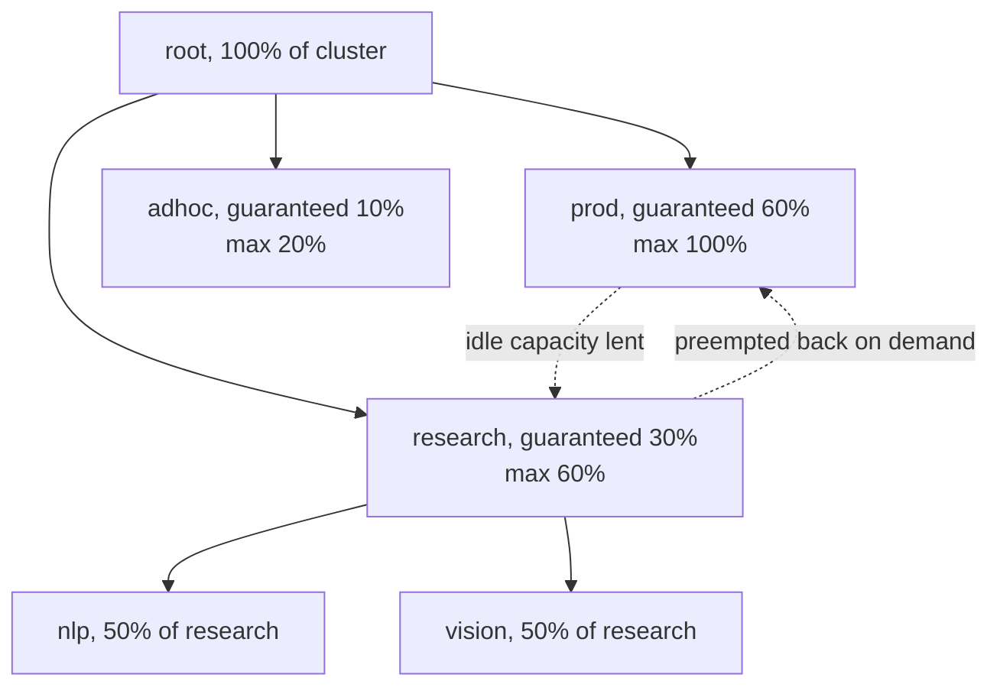

**Reading the diagram.** Guarantees nest: `nlp` gets $0.5 \times 30\% = 15\%$ of the cluster. When `prod` is idle, `research` borrows up to its 60% maximum (dotted: elastic and reversible); when `prod` returns, borrowed containers are preempted after a configured wait. The tree lives in the ResourceManager, the failure point, run as an active–standby pair. Scaling: node heartbeats drive allocation.

**Table 46.6 — Fairness policies compared.**

| Policy | Resources | Guarantees | Weakness | Seen in |
|---|---|---|---|---|
| FIFO with priority | Any | None beyond order | Starvation, convoys | Simple queues |
| Max-min / weighted fair share | One | Equal or weighted share of one resource | Ambiguous with several resources | Fair Scheduler, Kueue fair sharing |
| Capacity queues | Any | Guaranteed fraction per queue, elastic borrowing | Static guarantees need tuning | YARN Capacity Scheduler, Kueue ClusterQueues |
| DRF | Several | Sharing incentive, strategy-proof, envy-free, Pareto | Ignores placement constraints | Mesos, Fair Scheduler, Volcano |
| Fair-share decay over usage history | Any | Long-run share by past consumption | Hard to explain to users | Slurm (§46.12) |

## 46.10 Gang scheduling and co-scheduling

### 46.10.1 Why distributed training needs all-or-nothing

::: definition
**Definition — Gang scheduling.** Placing all tasks of a parallel job at the same time, or none of them. **Co-scheduling** is the weaker form: place a minimum number together and let the rest follow.
:::

A 64-worker data-parallel training job runs collectives (all-reduce, §49.9.2 and Chapter 65) in which every worker participates at every step; with 63 running, 63 GPUs idle waiting for the 64th. A pod-at-a-time scheduler places whatever fits, so two large jobs can each get part of what they need and wait for each other forever.

**Figure 46.10 — Deadlock without gang scheduling on 16 GPUs.**

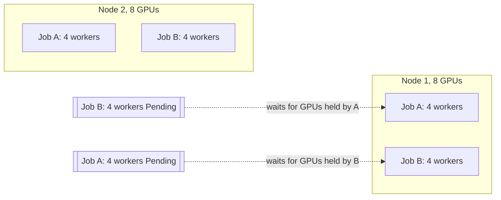

**Reading the diagram.** Jobs A and B each need 12 one-GPU workers on 16 GPUs. Interleaved placement gave each 8 GPUs and left 4 workers Pending. Neither can take a step or release GPUs, because its running pods are healthy, waiting at a barrier. Dotted arrows are waits, not data flows; in the scheduler's state every pod looks fine, so the cycle is invisible. Recovery needs someone to kill a job; gang admission would have started A with 12 GPUs and queued B.

::: formula
**Accelerator time wasted by partial allocations**

$$W = \sum_j g_j^{\text{held}} \, t_j^{\text{wait}}$$

| Symbol | Meaning | Units |
|---|---|---|
| $g_j^{\text{held}}$ | Accelerators held by a job that cannot yet run | GPUs |
| $t_j^{\text{wait}}$ | Time it holds them before starting or being killed | h |
| $W$ | Wasted accelerator time | GPU·h |
:::

::: example
**Worked example — A deadlock discovered after two hours.** Jobs A and B of Figure 46.10 each hold 8 GPUs until an on-call engineer notices after 2 hours.

1. $W = 8 \times 2 + 8 \times 2 = 32$ GPU·h, the whole cluster for two hours.
2. At an illustrative $3 per GPU-hour, $96 for nothing, and both jobs' owners lost two hours.
3. With gang admission: A runs at once for 2 hours (24 GPU·h useful), B waits, and 4 GPUs serve small jobs: $W = 0$.

**Interpretation.** Partial allocation turns the scarcest resource into idle reservations; deadlock makes the waste unbounded. **Engineering implication.** Multi-worker jobs need all-or-nothing admission plus a timeout that releases partially placed gangs.
:::

### 46.10.2 Gang scheduling approaches in Kubernetes

Kubernetes places one pod at a time, so gangs come from extensions; as of 2026 there are four main options:

- **Coscheduling plugin** (kubernetes-sigs `scheduler-plugins`). A `PodGroup` declares `minMember`; **Permit** holds each placed pod in *wait* until `minMember` pods have reserved nodes, then approves them together, or on timeout rejects all and releases the reservations.
- **Volcano**, a CNCF batch system, replaces or runs alongside the default scheduler. Its scheduler runs a session per cycle with *actions* (enqueue, allocate, preempt, reclaim, backfill) and *plugins* (gang, priority, DRF, proportion, binpack and others), and adds `Queue` and `PodGroup` resources and a `Job` type for MPI, PyTorch and similar frameworks [Volcano Docs].
- **Kueue**, a Kubernetes SIG project, does **job-level admission** rather than pod placement: jobs are created suspended, and Kueue admits a whole job only when its `ClusterQueue` has quota for all of it, then lets the default scheduler place the pods [Kueue Docs]. `ResourceFlavor`s describe node types (such as GPU models or spot versus on-demand), **cohorts** let ClusterQueues borrow each other's unused quota, `waitForPodsReady` adds a timeout-based all-or-nothing guarantee (requeue the job if its pods are not all running in time), and **topology-aware scheduling** places a job's pods within one rack or block.
- **Native gang scheduling.** Kubernetes v1.35 added an alpha `Workload` API (`scheduling.k8s.io/v1alpha1`) through which pods reference a pod group with a minimum count, and a `GangScheduling` scheduler plugin behind feature gates; the design is still changing across releases [Kubernetes Docs: Gang Scheduling].

**Figure 46.11 — Admission versus placement for a training job.**


**Reading the diagram.** The job is created suspended, so no GPUs are held. Kueue watches it asynchronously, checks ClusterQueue quota (including cohort borrowing), and admits it by unsuspending it with node selectors for the chosen ResourceFlavor. Only then do pods reach the scheduler, ideally with a gang-aware Permit. If not all pods run before the timeout, Kueue evicts and requeues the job. Storage boundary: API objects. Failure points: quota without gang placement can strand a job on fragmented nodes; admission without topology awareness scatters workers (§46.11). Scaling: decisions are per job, not per pod.

**Table 46.7 — Gang scheduling options on Kubernetes (as of 2026).**

| Option | Level | Gang mechanism | Quota and fairness | Choose when |
|---|---|---|---|---|
| Coscheduling plugin | Placement | Permit waits for `minMember` | None (use ResourceQuota) | Small clusters needing gangs only |
| Volcano | Scheduler | Gang plugin in its own scheduler | Queues, DRF, proportion, reclaim | A full batch scheduler replacing the default |
| Kueue | Admission | Admit whole job; `waitForPodsReady` | ClusterQueues, cohorts, borrowing, fair sharing | Multi-team quota with the default scheduler |
| Native Workload API | Placement | Pod group minimum count | None yet | Experiments; track for the future |

Platforms often combine Kueue admission, gang-aware placement, and JobSet or a framework operator to describe the job's roles.

#### Failure scenarios

| What goes wrong | Why | Detection | Recovery | Prevention |
|---|---|---|---|---|
| Two jobs each hold part of the cluster | Pod-at-a-time scheduling | Jobs with some pods Pending for long | Kill one job | Gang admission or Permit |
| Admitted job never runs | Quota exists but nodes are fragmented | Admitted-but-not-ready time | `waitForPodsReady` requeue | Pack GPU nodes; topology-aware admission |
| Large job starves behind small ones | Small jobs always fit first | Head-of-queue age | Reserve capacity for it | Strict FIFO within a queue, or reservations |
| One worker evicted, job stalls | Preemption of a single pod | Collective timeout | Restart job from checkpoint | Preempt whole gangs, not pods |

## 46.11 GPU and accelerator scheduling

This section covers what the *scheduler* must know about accelerators; Chapter 64 covers GPU internals and sharing mechanisms in depth, and Chapter 80 covers clusters of 10,000 GPUs and more.

### 46.11.1 Making GPUs schedulable

By default a container gets whole GPUs. A vendor **device plugin** on each node registers an extended resource such as `nvidia.com/gpu`, reports healthy devices to the kubelet, and says which devices each container receives [Kubernetes Docs: Device Plugins]. Extended resources are integers, requested as limits, never overcommitted: a scarce, indivisible dimension. **Dynamic Resource Allocation** (DRA), whose core became generally available in v1.34, replaces the integer count with claims against devices that drivers publish as `ResourceSlice` objects, so a pod can ask for "one GPU with at least 40 GB of memory" or for devices sharing an interconnect [Kubernetes Docs: Dynamic Resource Allocation].

### 46.11.2 Topology-aware placement

GPUs in one server talk over NVLink or NVSwitch at hundreds of gigabytes per second, across servers over the network at a fraction of that, and across racks through more switch hops. Step time includes collectives across all GPUs (Chapter 65), so *where* the gang lands sets its speed.

**Figure 46.12 — Placement tiers for a GPU job.**

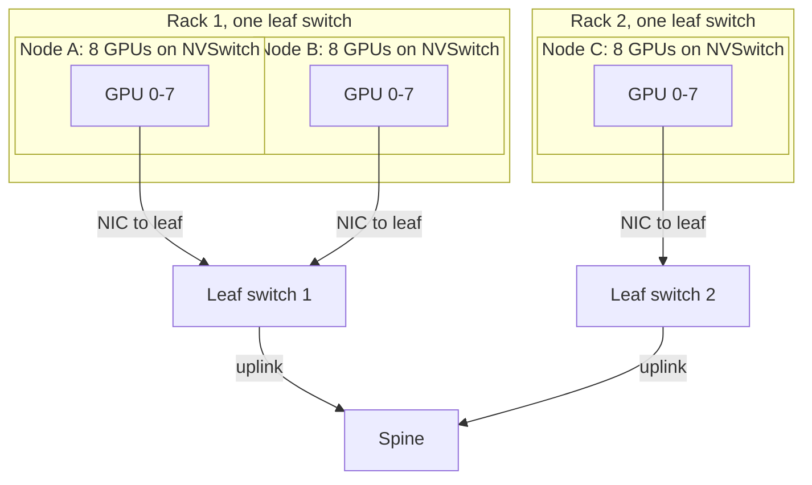

**Reading the diagram.** Inside a node, the 8 GPUs share NVSwitch (fastest tier). Nodes A and B share a leaf switch, so traffic between them takes one switch hop; traffic between A and C crosses the spine, adding hops and competing with other racks for oversubscribed uplinks. Preference order for a job's GPUs: one node, then one rack (or one high-bandwidth network block), then anywhere. Failure points: one bad GPU or NIC stalls the whole gang; a congested uplink slows every cross-rack job. Scaling: schedulers express the tiers as node labels (Kueue's topology-aware scheduling, Slurm's topology plugin), and the kubelet's Topology Manager aligns a pod's CPUs, GPUs and NICs to one NUMA node inside a server.

### 46.11.3 Sharing a GPU

**Table 46.8 — GPU sharing modes (see Chapter 64 for internals).**

| Mode | Isolation | Granularity | Use for |
|---|---|---|---|
| Whole GPU | Full | 1 device | Training, large inference |
| Multi-Instance GPU (MIG) | Hardware: dedicated compute slices, memory and cache | Up to 7 instances on supported data-center GPUs | Small inference, notebooks, predictable QoS |
| Time-slicing | None for memory or faults; turns rotate | Configurable replicas per GPU | Dev, bursty low-utilization work |
| MPS (concurrent processes) | Partial limits, shared fault domain | Fraction of compute per process | Cooperating processes of one tenant |

MIG partitions are scheduled as their own extended resources (for example one resource name per profile), so the scheduler again sees integers. Partitioning is a packing decision in its own right: a GPU split into seven small instances cannot run a job that needs the whole device until it is reconfigured.

::: example
**Worked example — GPU fragmentation across four 8-GPU nodes.** Nodes have 3, 5, 2 and 6 GPUs free: 16 free in total, half the cluster.

1. An 8-GPU job: no node has 8 free; $F(8) = 1 - 0/16 = 100\%$ by the formula of §46.7.2.
2. 4-GPU jobs: $\lfloor 3/4 \rfloor + \lfloor 5/4 \rfloor + \lfloor 2/4 \rfloor + \lfloor 6/4 \rfloor = 0 + 1 + 0 + 1 = 2$ jobs, 8 GPUs; $F(4) = 50\%$.
3. Repacked (moving one-GPU and two-GPU work so free GPUs are 8, 8, 0, 0): $F(8) = 0$, two 8-GPU jobs fit.

**Interpretation.** A cluster that is 50% free can be 100% full for its most valuable jobs. **Engineering implication.** Pack GPU nodes with best fit, keep small jobs on a separate pool or on MIG slices, measure $F$ for 8-GPU and full-node shapes, and let a descheduler or checkpoint-and-migrate policy consolidate small jobs when large ones queue.
:::

## 46.12 Batch and HPC schedulers: Slurm

### 46.12.1 Architecture and concepts

Slurm is a widely used open-source workload manager in HPC and ML training [Slurm Docs]. A central `slurmctld` (with an optional backup for failover) holds the queue and decides; `slurmd` on each node launches work; `slurmdbd` stores accounting data for fair-share. Users submit **jobs** with `sbatch` (a script) or `salloc` (an interactive allocation), and launch parallel **job steps** inside an allocation with `srun`. A job asks for nodes, tasks, CPUs, memory and generic resources such as GPUs (`--gres=gpu:8` or `--gpus`), and must state a **time limit** (`--time`), after which Slurm kills it. **Partitions** group nodes into queues with their own limits and priorities, and **QOS** records add per-user or per-group limits and preemption rules.

Slurm is gang-scheduled by construction: a job's allocation is granted whole or not at all, and the `topology/tree` plugin, with the `--switches` option, keeps an allocation under as few switches as possible. Priority comes from the **multifactor** plugin, a weighted sum of age, job size, partition, QOS and **fair-share**, which lowers the priority of accounts that have used more than their share recently, with usage decaying over a configurable half-life.

### 46.12.2 Backfill scheduling

In a strict priority queue, everything waits behind a head job that cannot yet start, even jobs that would finish first. **Backfill** starts lower-priority jobs early *if they delay no higher-priority job's expected start*, which needs time limits. EASY backfilling protects only the head job's reservation; conservative backfilling protects every queued job [Mu'alem and Feitelson 2001]. Slurm's backfill plugin plans reservations for the higher-priority jobs it examines, within a planning window (`bf_window`, 1,440 minutes by default) every `bf_interval` (30 s by default) [Slurm Docs: Scheduling Configuration].

::: formula
**Backfill condition and gain**

$$\text{start } j \text{ now} \iff n_j \le n_{\text{free}} \;\wedge\; \left( t_{\text{now}} + T_j \le t_{\text{shadow}} \;\vee\; n_j \le n_{\text{extra}} \right) \qquad G = \sum_{j \in \text{backfilled}} n_j \min(T_j,\, t_{\text{shadow}} - t_{\text{now}})$$

| Symbol | Meaning | Units |
|---|---|---|
| $n_j, T_j$ | Nodes and time limit of candidate job $j$ | nodes, h |
| $n_{\text{free}}$ | Nodes free now | nodes |
| $t_{\text{shadow}}$ | Reserved start time of the blocked higher-priority job | h |
| $n_{\text{extra}}$ | Nodes free at $t_{\text{shadow}}$ beyond what the reservation needs | nodes |
| $G$ | Node-hours of the idle hole $n_{\text{free}} (t_{\text{shadow}} - t_{\text{now}})$ filled by backfill | node·h |
:::

::: example
**Worked example — Backfilling a 10-node cluster.** At $t = 0$, J0 runs on 6 nodes until $t = 4$ h. The queue, in priority order: J1 (8 nodes, 2 h), J2 (2 nodes, 3 h), J3 (2 nodes, 6 h), J4 (4 nodes, 5 h).

1. Strict priority. J1 needs 8 nodes and only 4 are free, so nothing starts. At $t = 4$, J1 (8) and J2 (2) start; at $t = 6$, J3 and J4 start. Starts: 4, 4, 6, 6 h; **mean wait 5 h**; last job ends at 12 h.
2. Backfill. J1 is reserved at $t_{\text{shadow}} = 4$ on 8 nodes, so $n_{\text{extra}} = 10 - 8 = 2$.
3. J2: $2 \le 4$ free and $0 + 3 \le 4$: start now. Free: 2.
4. J3: $2 \le 2$ free, ends at $6 > 4$, but $2 \le n_{\text{extra}} = 2$: start now; it uses the nodes J1 will not need. Free: 0; extra: 0.
5. J4 cannot start. J1 starts on time at $t = 4$; J4 at $t = 6$. Starts: 4, 0, 0, 6 h; **mean wait 2.5 h**; last job ends at 11 h.
6. Hole: $4 \times 4 = 16$ node·h; $G = 2 \times 3 + 2 \times 4 = 14$ node·h, **88%** filled. Total work is $24 + 16 + 6 + 12 + 20 = 78$ node·h, so utilization until the last job ends rises from $78/120 = 65\%$ to $78/110 = 71\%$.

**Interpretation.** Backfill halved the mean wait and raised utilization without delaying the highest-priority job by a second. **Engineering implication.** Backfill works only with honest time limits: inflated limits make jobs look too long to backfill, while limits that are too short get jobs killed. Many sites reward accurate estimates, and the planning parameters (`bf_window`, `bf_resolution`) must cover your longest jobs.
:::

**Figure 46.13 — The backfill schedule of the worked example.**

```mermaid
gantt
  title Backfill on 10 nodes, hours from t0
  dateFormat H
  axisFormat %H
  section Running
  J0 on 6 nodes :done, j0, 0, 4h
  section Backfilled
  J2 on 2 nodes :j2, 0, 3h
  J3 on 2 extra nodes :j3, 0, 6h
  section Reserved
  J1 on 8 nodes :crit, j1, 4, 2h
  section Later
  J4 on 4 nodes :j4, 6, 5h
```

**Reading the diagram.** Hours run left to right. J1's 8-node reservation starts at hour 4 and never moves; J2 fits in the hole before it, J3 runs past it on the 2 nodes J1 does not need, and J4 waits for J1. Failure points: J2 would be killed at its 3-hour limit, so the reservation is safe, and J3 holds only extra nodes. The plan is recomputed every backfill cycle as jobs end early.

The program below plans the queue both ways and asserts the start times above.

```python
"""Plan a priority-ordered queue with and without backfill on a node-count profile."""


def plan(total, running, queue, backfill):
    """running: [(nodes, end)]; queue: [(name, nodes, hours)] in priority order.
    Returns {name: start}. Without backfill no job may start before the job
    ahead of it; with backfill a job may start early if it delays no reservation."""
    busy = [(0.0, end, n) for n, end in running]          # (start, end, nodes)

    def free(t0, t1):                                     # min free nodes in [t0, t1)
        points = {t0} | {s for s, _, _ in busy if t0 < s < t1}
        return min(total - sum(n for s, e, n in busy if s <= p < e) for p in points)

    starts, earliest = {}, 0.0
    for name, nodes, hours in queue:
        candidates = sorted({earliest} | {e for _, e, _ in busy if e > earliest})
        t = next(c for c in candidates if free(c, c + hours) >= nodes)
        starts[name] = t
        busy.append((t, t + hours, nodes))                # start now, or reserve
        if not backfill:
            earliest = t                                  # strict order: nobody overtakes
    return starts


if __name__ == "__main__":
    queue = [("J1", 8, 2), ("J2", 2, 3), ("J3", 2, 6), ("J4", 4, 5)]
    for bf in (False, True):
        s = plan(10, running=[(6, 4.0)], queue=queue, backfill=bf)
        ends = max(s[n] + h for n, _, h in queue)
        print("backfill" if bf else "strict  ", s, f"mean wait {sum(s.values()) / 4:.2f} h,",
              f"makespan {ends:.0f} h")
    assert plan(10, [(6, 4.0)], queue, True) == {"J1": 4, "J2": 0, "J3": 0, "J4": 6}
    assert plan(10, [(6, 4.0)], queue, False) == {"J1": 4, "J2": 4, "J3": 6, "J4": 6}
```

```text
strict   {'J1': 4.0, 'J2': 4.0, 'J3': 6.0, 'J4': 6.0} mean wait 5.00 h, makespan 12 h
backfill {'J1': 4.0, 'J2': 0.0, 'J3': 0.0, 'J4': 6.0} mean wait 2.50 h, makespan 11 h
```

What to notice:

- Every job, started or not, is appended to `busy`: a job that cannot start now becomes a **reservation**, which is what stops later jobs from delaying it. This is conservative backfilling.
- The only difference between the two modes is `earliest`: strict mode forbids any job from starting before the job ahead of it.

### 46.12.3 Slurm versus Kubernetes for training

**Table 46.9 — Slurm and Kubernetes for ML training.**

| Row | Slurm | Kubernetes with batch add-ons |
|---|---|---|
| What it is | HPC batch workload manager | General orchestrator plus Kueue/Volcano |
| How it works | Whole-allocation jobs, priority, backfill | Pods, admission queues, gang plugins |
| Advantages | Native gangs, topology, backfill, fair-share; familiar to researchers | One platform for training, serving and data; containers, APIs, operators |
| Disadvantages | Weaker service and container story | Gangs, queues and topology are add-ons |
| Performance | Fast whole-job placement | Pod-at-a-time; tuned add-ons close the gap |
| Operational complexity | Low for batch; separate stack for serving | Higher; one stack for everything |
| Cost | Static partitions can idle | Elastic node provisioning, spot capacity |
| Use cases | Supercomputers, research clusters, large pretraining | Mixed training and inference fleets in the cloud |
| Choose when | Mostly large batch jobs, researchers on the command line | You also serve models and want one control plane |

The boundary is blurring: projects run Slurm inside Kubernetes (SchedMD's Slinky) or give Kubernetes Slurm-like admission (Kueue), and Chapter 80 describes how large AI clusters combine them.

## 46.13 Autoscaling the cluster itself

§42.12 described the node autoscalers: the **Cluster Autoscaler** grows predefined node groups when pods are Pending and removes nodes whose requests stay low, while **Karpenter** provisions right-sized instances directly from the cloud catalog for the pending pods and consolidates continuously. Seen from the scheduler, a node autoscaler is a slow, expensive extension of placement: the scheduler's "no fit" is its input.

**Figure 46.14 — From Pending to running on a new node.**

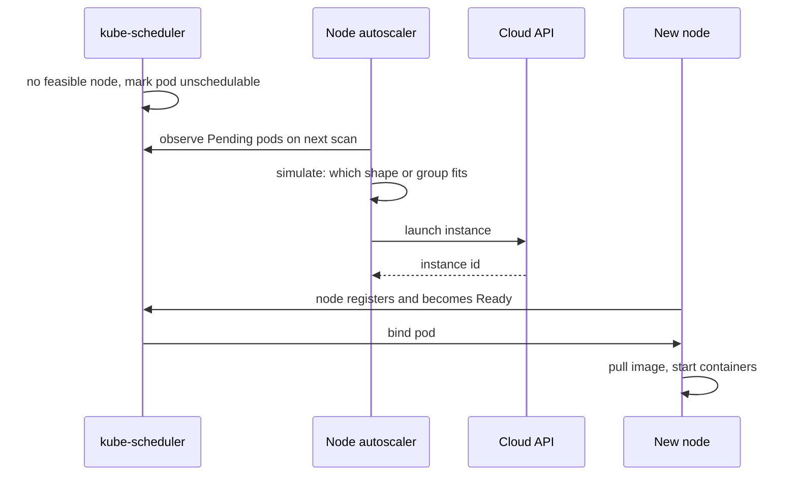

**Reading the diagram.** The unplaced pod stays Pending; the autoscaler finds it on its next scan (asynchronously), simulates which group or instance fits, and calls the cloud API. The new node registers, the scheduler binds the pod, and the kubelet pulls images. Failure points: cloud capacity shortages (common for GPUs), autoscaler simulations that disagree with the scheduler, huge images. Scaling: each stage adds latency, summed below.

::: formula
**Time to capacity through node autoscaling**

$$T = t_{\text{scan}} + t_{\text{provision}} + t_{\text{join}} + t_{\text{pull}} + t_{\text{start}}$$

| Symbol | Meaning | Units |
|---|---|---|
| $t_{\text{scan}}$ | Delay until the autoscaler sees the Pending pod | s |
| $t_{\text{provision}}$ | Cloud instance launch and boot | s |
| $t_{\text{join}}$ | Node registration, drivers and device plugins ready | s |
| $t_{\text{pull}}$ | Image download and unpack | s |
| $t_{\text{start}}$ | Application start until Ready | s |
:::

::: example
**Worked example — A GPU training worker on a fresh node.** Illustrative values: scan 10 s, provision 90 s, join including GPU driver and device plugin 60 s, a 15 GB image at 0.5 GB/s, start 30 s.

1. $t_{\text{pull}} = 15/0.5 = 30$ s.
2. $T = 10 + 90 + 60 + 30 + 30 = 220$ s, about 3.7 minutes.
3. For a 64-node gang, the job starts when the *last* node is ready, and if the cloud grants only 40 nodes, the 40 sit idle: by §46.10.1, $40 \times 8 = 320$ GPUs held while waiting.

**Interpretation.** Autoscaling turns placement latency from milliseconds into minutes, and for gangs the tail node and partial grants dominate. **Engineering implication.** Keep warm headroom with low-priority placeholder pods (§42.12), cache or pre-pull images, and for gangs ask for capacity atomically: Kueue's ProvisioningRequest integration with the Cluster Autoscaler, or a cloud's reservation and queued-capacity products, so that a job is admitted only when all of its nodes are granted.
:::

**Table 46.10 — Cluster Autoscaler versus just-in-time provisioning.**

| Row | Cluster Autoscaler | Karpenter-style provisioning |
|---|---|---|
| Unit of scaling | Predefined node groups | Individual instances chosen per batch of pods |
| Choice of shape | Fixed per group | From the whole catalog, including spot |
| Packing | Scheduler packs onto group shapes | Provisioner sizes nodes to pods, then consolidates |
| Gang support | Atomic scale-up via ProvisioningRequest | Batches pending pods; atomicity via the queueing layer |
| Choose when | Few, stable node types; on-premises-like pools | Diverse workloads, spot, frequent shape changes |

## 46.14 Summary and revision notes

::: summary
- A cluster scheduler trades utilization, start latency and fairness. Services reserve for peaks; batch fills the slack. Optimal placement is NP-hard vector bin packing, so schedulers filter, score with heuristics and correct later.
- Architectures: monolithic (head-of-line blocking, $W_q = \sum \lambda \overline{S^2}/2(1-\rho)$), two-level offers (partial view), shared-state optimistic (conflicts $\approx 1 - e^{-c_1 c_2/N}$), distributed sampling (Sparrow), hybrids.
- Borg: ~10,000-machine cells, a five-replica Paxos Borgmaster, a scheduler on cached state, priority bands with quota, reclamation, hybrid scoring. Results are relative: sharing saves 20–30% of machines; fine-grained requests 30–50%.
- Kubernetes: extension points from PreEnqueue to PostBind; Permit enables gangs; `percentageOfNodesToScore` bounds search; profiles give per-workload policy; the descheduler corrects drift.
- Packing (first or best fit) beats spreading for batch and GPUs; spreading strands large tasks. Measure fragmentation $F(s)$ for the shapes you care about; use dot-product alignment only as a secondary term.
- Preemption picks nodes by PDB violations, victim priority, count and age; PDBs guard voluntary evictions only. Quota bounds work per priority. Preemption cost for big jobs is $r_p(\tau/2 + t_r)G$.
- Fairness: water filling for one resource; DRF equalizes dominant shares (the 9-CPU/18-GB example gives 3 and 2 tasks, both 2/3); YARN offers capacity and fair schedulers.
- Gangs need all-or-nothing admission, or partial allocations deadlock and waste accelerators. Options: coscheduling Permit, Volcano, Kueue admission, and the alpha native Workload API.
- GPUs are indivisible integers (device plugins) or claims (DRA); place gangs by topology (node, rack, network block); share with MIG or time-slicing; pack to avoid fragmentation.
- Slurm gives whole-job allocation, topology, fair-share and backfill; backfill starts jobs that do not delay reservations, which needs honest time limits.
- Node autoscaling adds minutes; gangs need atomic provisioning and warm headroom.
:::

## 46.15 Knowledge checkpoint

1. Why do services usually dominate reserved resources while batch jobs dominate job counts?
2. A cluster has 2,000 cores; requests total 1,600 and p95 usage 900. With a 20% margin, how many cores can be reclaimed?
3. What is head-of-line blocking in a monolithic scheduler, and two ways to reduce it?
4. Why does an all-or-nothing transaction of 500 machines conflict far more often than ten 50-machine transactions in Omega?
5. For $\rho = 0.5$, $m = 4$ and $d = 2$, compute the no-queueing probability with per-task sampling.
6. What does late binding fix in Sparrow, and what does it cost?
7. What are Borg's prod bands, and why can production tasks not preempt each other?
8. Compute the default number of nodes the Kubernetes scheduler searches in a 2,500-node cluster.
9. Which extension point lets a gang plugin hold pods until the group is complete?
10. Why does a pure dot-product score behave like worst fit?
11. Recompute DRF for 18 CPUs and 36 GB, with A needing ⟨1 CPU, 4 GB⟩ and B ⟨3 CPUs, 1 GB⟩ per task.
12. Why does a PodDisruptionBudget not protect against a node crash?
13. Nodes with 8 GPUs have 7, 1, 4 and 4 GPUs free. Compute $F(8)$ and $F(4)$.
14. In the backfill example, why may J3 start at $t = 0$ although it runs past J1's reservation?

<details><summary>Answers</summary>

1. Services run continuously and reserve for peaks, so a few service jobs hold much capacity; batch work is many short jobs.
2. Protected $= 1.2 \times 900 = 1{,}080$; reclaimable $= 1{,}600 - 1{,}080 = 520$ cores.
3. Fast decisions wait behind slow ones in one queue. Make decisions faster (caching, sampling) or split classes into separate queues, profiles or schedulers.
4. $P \approx 1 - e^{-c_1 c_2/N}$ grows with the product of transaction sizes, and the large transaction's long decision time exposes it to many commits; any single conflict rejects the whole transaction.
5. $(1 - 0.25)^4 = 0.316$.
6. Stale queue-length reports; it costs an extra round trip per task and idle time for workers whose reservation is canceled.
7. Monitoring and production. Mutual preemption would cause cascades and make high-priority services unstable.
8. $p = 50 - 2{,}500/125 = 30\%$, so 750 nodes.
9. Permit (with PreEnqueue to gate entry).
10. The score grows with the node's free capacity, so emptier nodes always score higher.
11. Dominant shares $4x/36 = 3y/18 \Rightarrow y = 2x/3$; CPU $x + 2x \le 18 \Rightarrow x = 6$, $y = 4$; memory $24 + 4 = 28 \le 36$. Both dominant shares are $2/3$.
12. It limits voluntary evictions through the Eviction API only; a crash is involuntary.
13. $F(8) = 100\%$ (no node has 8 free); 4-GPU copies $= 1 + 0 + 1 + 1 = 3$, so $F(4) = 1 - 12/16 = 25\%$.
14. It uses only the 2 nodes that J1's 8-node reservation does not need, so J1 still starts at $t = 4$.

</details>

## 46.16 Interview questions

### Basic

**Q1. What does a cluster scheduler do, and how is it different from a load balancer?**
**Answer.** It decides where units of work run, given multi-resource requests, constraints, priorities and quota, and reclaims capacity by preemption. A load balancer routes individual requests among running replicas; they share ideas (power of two choices), but scheduling decisions last minutes to months.

**Q2. Why do production schedulers use heuristics instead of optimal placement?**
**Answer.** Placement is NP-hard multi-dimensional bin packing, made harder by online arrivals, constraints and conflicting objectives. Filter-and-score heuristics take milliseconds, are explainable and come within a few percent of optimal; preemption and descheduling fix mistakes later.

### Intermediate

**Q3. Batch pods take minutes to start after a large service rollout. Diagnose and fix.**
**Answer.** Likely head-of-line blocking: one serial scheduling cycle is busy with expensive service pods (inter-pod affinity, volume topology). Check scheduling latency by profile and the plugins' durations. Fixes: a separate batch profile, cheaper constraints (topology spread instead of affinity), a lower search percentage, and higher throughput settings; for very high task rates, a framework-level scheduler inside pods.

**Q4. Three teams share 512 GPUs. Design quota and fairness.**
**Answer.** Kueue ClusterQueues per team with nominal quotas from budget in one cohort so idle GPUs can be borrowed; preemption reclaims borrowed GPUs when the owner returns; priority classes inside each team; fair sharing weights for borrowing; ResourceFlavors per GPU type; gang admission with `waitForPodsReady`; DRF-style accounting if teams also consume large CPU and memory.

### Advanced

**Q5. Design scheduling for a 4,096-GPU training cluster shared by pretraining and many small jobs.**
**Answer.** Separate the problems: an admission layer (Kueue or Slurm) with quota, fair-share and priorities; gang placement with topology awareness (whole nodes, one network block per job); best-fit packing; small jobs on dedicated nodes or MIG slices to avoid fragmenting full nodes; backfill of short jobs into holes before large reservations, with enforced time limits; preemption of whole gangs only, with frequent checkpoints so loss stays near $r_p(\tau/2 + t_r)G$; health checks that cordon bad GPUs before placement; and fragmentation metrics for 8-GPU and multi-node shapes.

**Q6. Compare Borg, Mesos and Omega, and say what Kubernetes took from each.**
**Answer.** Borg: monolithic with full information, priorities, quota, allocs, reclamation; Kubernetes took pods, priorities, declarative jobs and requests-based packing. Mesos: two-level offers with DRF; Kubernetes has no offers, but frameworks still schedule inside pods. Omega: shared state with optimistic concurrency; Kubernetes' API server is a shared store all controllers act on, and multiple schedulers or profiles resolve conflicts at bind or admission. Each move trades global policy for flexibility or throughput.

## 46.17 Practical exercises

1. Run the §46.7.3 program with 30% large tasks and with no large tasks; explain why the gap between packing and spreading changes.
2. Add a `best-fit + 0.3 × alignment` score to the program and test whether it beats best fit across five seeds.
3. Extend the DRF program to three resources (CPU, memory, GPUs) and three users, and verify the sharing-incentive property by assertion.
4. In a test cluster, create a second scheduler profile with `MostAllocated` scoring, run 200 batch pods under each profile, and compare how many nodes the node autoscaler can remove.
5. Install Kueue, create two ClusterQueues in one cohort, and show borrowing and reclamation with two Jobs.

## 46.18 Design challenges

1. **QuickBite's mixed cluster.** QuickBite's 120-vCPU production cluster (§42.13.4) runs at 30% real CPU utilization. Design priority classes, a batch profile and reclamation so that nightly ETL and the delivery-time model's retraining run on the slack, and compute how many nodes you avoid adding.
2. **Research GPU cloud.** Twenty research groups share 1,024 GPUs; jobs range from 1 to 512 GPUs and from minutes to weeks. Choose Slurm or Kubernetes, define quota, fair-share, gang and topology policy, and estimate fragmentation and preemption loss.

## 46.19 References

1. Verma, A., Pedrosa, L., Korupolu, M., Oppenheimer, D., Tune, E., Wilkes, J. *Large-scale cluster management at Google with Borg*. EuroSys, 2015.
2. Schwarzkopf, M., Konwinski, A., Abd-El-Malek, M., Wilkes, J. *Omega: flexible, scalable schedulers for large compute clusters*. EuroSys, 2013.
3. Hindman, B., Konwinski, A., Zaharia, M., Ghodsi, A., Joseph, A. D., Katz, R., Shenker, S., Stoica, I. *Mesos: A Platform for Fine-Grained Resource Sharing in the Data Center*. NSDI, 2011.
4. Ousterhout, K., Wendell, P., Zaharia, M., Stoica, I. *Sparrow: Distributed, Low Latency Scheduling*. SOSP, 2013.
5. Ghodsi, A., Zaharia, M., Hindman, B., Konwinski, A., Shenker, S., Stoica, I. *Dominant Resource Fairness: Fair Allocation of Multiple Resource Types*. NSDI, 2011.
6. Burns, B., Grant, B., Oppenheimer, D., Brewer, E., Wilkes, J. *Borg, Omega, and Kubernetes*. ACM Queue 14(1), 2016. https://queue.acm.org/detail.cfm?id=2898444
7. Tirmazi, M., Barker, A., Deng, N., Haque, M. E., Qin, Z. G., Hand, S., Harchol-Balter, M., Wilkes, J. *Borg: the Next Generation*. EuroSys, 2020.
8. Vavilapalli, V. K., et al. *Apache Hadoop YARN: Yet Another Resource Negotiator*. SoCC, 2013.
9. Rzadca, K., et al. *Autopilot: workload autoscaling at Google*. EuroSys, 2020.
10. Delgado, P., Dinu, F., Kermarrec, A.-M., Zwaenepoel, W. *Hawk: Hybrid Datacenter Scheduling*. USENIX ATC, 2015.
11. Karanasos, K., et al. *Mercury: Hybrid Centralized and Distributed Scheduling in Large Shared Clusters*. USENIX ATC, 2015.
12. Grandl, R., Ananthanarayanan, G., Kandula, S., Rao, S., Akella, A. *Multi-Resource Packing for Cluster Schedulers*. SIGCOMM, 2014.
13. Panigrahy, R., Talwar, K., Uyeda, L., Wieder, U. *Heuristics for Vector Bin Packing*. Microsoft Research technical report, 2011.
14. Garey, M. R., Johnson, D. S. *Computers and Intractability: A Guide to the Theory of NP-Completeness*. W. H. Freeman, 1979.
15. Mu'alem, A. W., Feitelson, D. G. *Utilization, Predictability, Workloads, and User Runtime Estimates in Scheduling the IBM SP2 with Backfilling*. IEEE Transactions on Parallel and Distributed Systems 12(6), 2001.
16. Kubernetes. *Documentation: Scheduling Framework; Scheduler Performance Tuning; Scheduler Configuration; Pod Priority and Preemption; Disruptions; Resource Quotas; Device Plugins; Dynamic Resource Allocation; Gang Scheduling*. https://kubernetes.io/docs/
17. Kubernetes. *Kubernetes v1.35: Introducing Workload Aware Scheduling*. Kubernetes Blog, 2025. https://kubernetes.io/blog/2025/12/29/kubernetes-v1-35-introducing-workload-aware-scheduling/
18. Kubernetes SIGs. *Descheduler*. https://github.com/kubernetes-sigs/descheduler
19. Kubernetes SIGs. *scheduler-plugins (Coscheduling)*. https://github.com/kubernetes-sigs/scheduler-plugins
20. Kubernetes SIGs. *Kueue Documentation*. https://kueue.sigs.k8s.io/docs/
21. Volcano. *Documentation*. https://volcano.sh/en/docs/
22. SchedMD. *Slurm Documentation: Overview; Scheduling Configuration Guide; Multifactor Priority Plugin; Topology Guide*. https://slurm.schedmd.com/
23. Kubernetes SIG Autoscaling. *Cluster Autoscaler, including ProvisioningRequest*. https://github.com/kubernetes/autoscaler
24. Karpenter. *Documentation*. https://karpenter.sh/docs/

## 46.20 Open verification items

- Borg figures as stated in Verma et al. 2015, recalled rather than re-read: 2–16× cells and 20–150% extra machines for user segregation; about 20% of work in reclaimed resources; failover about 10 s (up to a minute); "few hundred seconds" versus "more than 3 days" without scheduler optimizations; 3–5% hybrid-scoring gain (one secondary summary names E-PVM, not best fit, as the baseline).
- Sparrow's default probe ratio $d = 2$.
- Tirmazi et al. 2020: heavy-tail characterization (stated qualitatively here).
- Kubernetes (as of 2026): preemption node-selection order; default `percentageOfNodesToScore` formula; Workload API and `GangScheduling` alpha in v1.35 and later API changes; DRA core GA in v1.34.
- Kueue features (`waitForPodsReady`, topology-aware scheduling, ProvisioningRequest) and Volcano's action and plugin names.
- Slurm defaults (`bf_window` 1,440 min, `bf_interval` 30 s) and Slinky status.
- Sharing modes and MIG instance limits per GPU model (Chapter 64 owns these).
