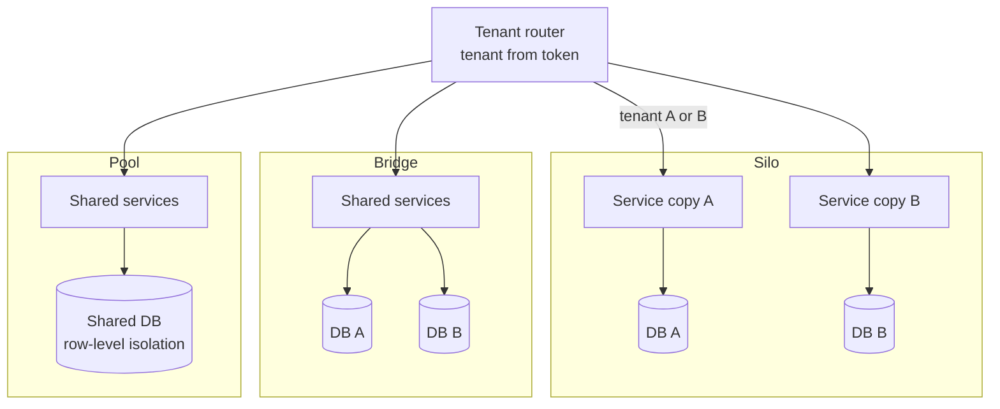
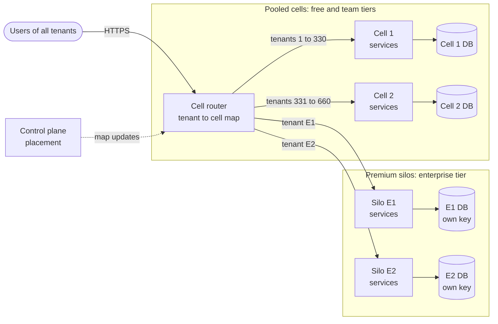
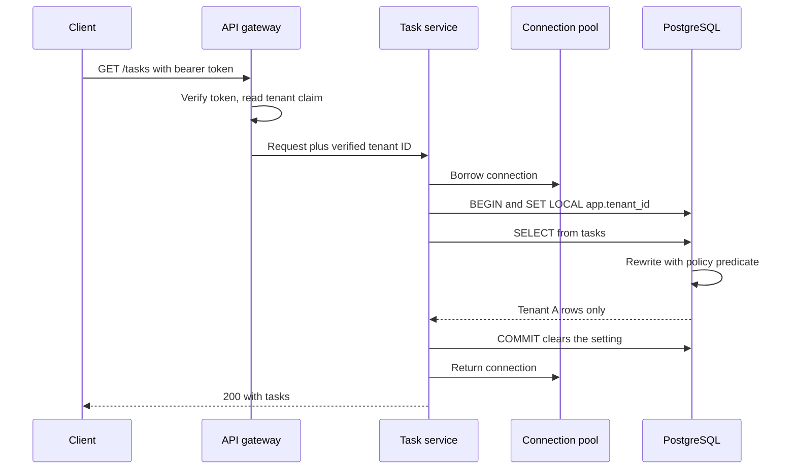
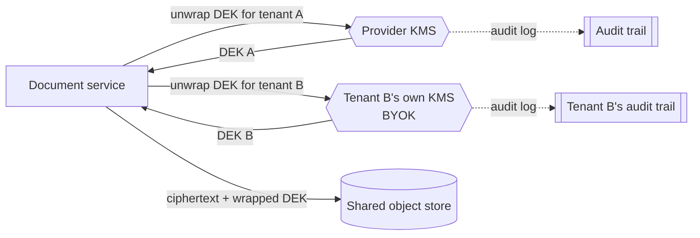
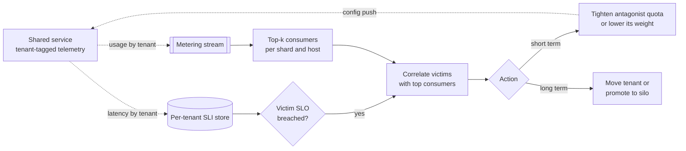
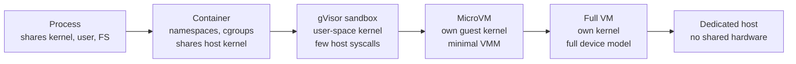
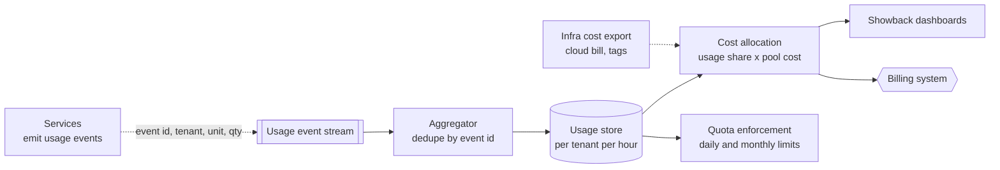
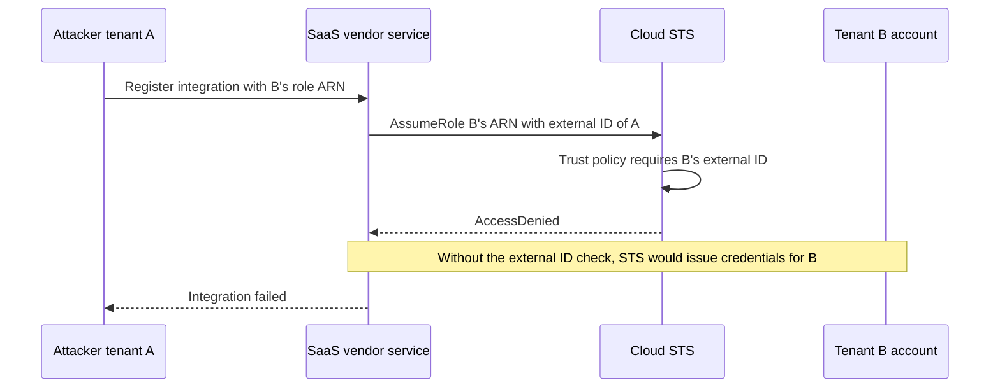
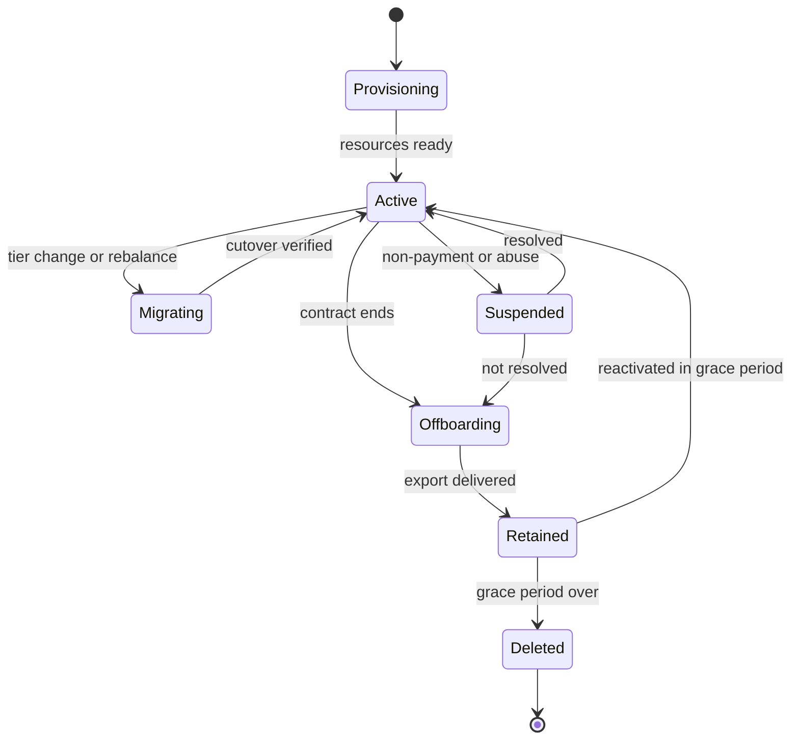

# Chapter 47 — Multi-Tenant Architecture and Isolation

> **Level:** 4 · **Track:** Shared · **Estimated reading time:** 5 h

Almost every system that serves more than one customer is multi-tenant. A SaaS product serves thousands of companies from one fleet; an internal Kafka or Kubernetes platform serves dozens of teams; a serverless platform runs code from strangers on the same hosts. Sharing makes these systems cheap. Isolation makes them safe to share: one tenant must not see another's data, slow the others down or take them offline.

This chapter covers pooling economics (§47.3), tenancy models (§47.4), data isolation down to PostgreSQL row-level security (§47.5), tenant placement (§47.6), noisy neighbors (§47.7), per-tenant quotas and fair queuing with a runnable simulation (§47.8), the compute isolation spectrum (§47.9), the control plane (§47.10), metering (§47.11), cross-tenant attacks (§47.12) and the tenant lifecycle (§47.13). The running example is **TaskForge**, the hypothetical project-management SaaS of §14.7.2: 40,000 tenants, a median of 15 users each, and a largest tenant with 60,000 users and about 2% of all data. Every TaskForge number is a teaching assumption. Chapter 79 applies these ideas to AI workloads.

## 47.1 Learning objectives

After this chapter you should be able to:

- Quantify the capacity saved by pooling tenants and explain how correlated demand erodes it.
- Compare silo, pool, bridge and tiered models, and compute blast radius per tier by tenants and revenue.
- Choose a data isolation pattern, and write and test a PostgreSQL row-level security policy.
- Design per-tenant encryption with BYOK and crypto-shredding.
- Place tenants with a directory, identify whales and compute placement imbalance.
- Diagnose noisy neighbors from per-tenant metrics.
- Combine per-tenant token buckets with weighted fair queuing, compute max–min fair shares and simulate containment of a noisy tenant.
- Rank compute isolation boundaries by security and overhead, and cost the overhead.
- Separate control plane from data plane and meter usage for showback and chargeback.
- Name cross-tenant attack classes, write isolation tests, and plan the tenant lifecycle.

## 47.2 Prerequisites

- Shard keys and the TaskForge example — §14.7 (tenant-aware sharding extends it).
- Rebalancing and online migration — §14.9 (tenant moves use the same machinery).
- Token buckets, load shedding and bulkheads — §22.4, §22.9, §22.14 (per-tenant limits reuse them).
- Cells and shuffle sharding — §33.12 (the main blast-radius tools).
- Metric cardinality — §40.5.3 (why `tenant_id` is a dangerous label).
- IAM policies and roles — §41.12 (the cloud's own tenant boundary).
- Namespaces, cgroups and runtime classes — §42.3 (the container isolation mechanisms).
- Envelope encryption and KMS — §10.9.2 (per-tenant keys build on it).
- Broken access control and IDOR — §10.7.1 (the most common cross-tenant bug).
- Normal distribution and percentiles — §4.7.2, §4.8 (pooling arithmetic).

## 47.3 What multi-tenancy is and why

### 47.3.1 Tenants, sharing and isolation

::: definition
**Definition — Tenant and multi-tenancy.** A **tenant** is the unit of ownership, billing and isolation in a shared system: usually a customer organization in a SaaS product, or a team in an internal platform. **Multi-tenancy** means serving many tenants from shared infrastructure and code while keeping each tenant's data, performance and failures separate. **Tenant isolation** is the set of mechanisms that enforce that separation.
:::

#### First-principles explanation

Think of an apartment building. Tenants share the foundation, roof and plumbing, which is why an apartment costs far less than a house. Each apartment still has a locked door (data isolation), its own electricity meter (metering) and a circuit breaker that trips before one tenant's heater blacks out the floor (quotas). Some buildings have a penthouse with a private elevator for those who pay (a siloed premium tier). Multi-tenant architecture decides what to share, where the walls go and how strong each wall must be.

Isolation has three dimensions, each answered separately:

1. **Security isolation.** Tenant A can never read or change tenant B's data or configuration.
2. **Performance isolation.** A's load cannot push B's latency or errors outside B's service level objective (SLO).
3. **Fault isolation.** A failure caused by or affecting A reaches as few other tenants as possible.

#### Why does this exist?

Dedicated infrastructure per customer is simple but expensive: each copy is provisioned for its own peak and mostly idles, each is deployed, patched and monitored separately, and onboarding means building a stack. Multi-tenancy reverses all three: one fleet absorbs every peak, one deployment upgrades everyone, and onboarding becomes a database insert.

### 47.3.2 The economics of pooling

The main saving comes from **statistical multiplexing**: tenants rarely peak together, so a shared pool needs less headroom than the sum of private headrooms.

::: formula
**Capacity for siloed versus pooled tenants (normal demand)**

$$C_{\text{silo}} = \sum_{i=1}^{n} \left(\mu_i + z\,\sigma_i\right) \qquad C_{\text{pool}} = \sum_{i=1}^{n} \mu_i + z\sqrt{\sum_{i=1}^{n} \sigma_i^2 + \sum_{i \ne j} \rho_{ij}\,\sigma_i \sigma_j} \qquad \text{Saving} = 1 - \frac{C_{\text{pool}}}{C_{\text{silo}}}$$

| Symbol | Meaning | Units |
|---|---|---|
| $n$ | Number of tenants | tenants |
| $\mu_i$, $\sigma_i$ | Mean and standard deviation of tenant $i$'s demand | RPS |
| $z$ | Standard-normal quantile for the provisioning percentile (2.33 for p99) | dimensionless |
| $\rho_{ij}$ | Correlation between tenants $i$ and $j$'s demand | dimensionless |
| $C_{\text{silo}}$, $C_{\text{pool}}$ | Capacity exceeded by demand only 1% of the time | RPS |
:::

::: example
**Worked example — Pooling 100 TaskForge tenants.** Each tenant has $\mu = 100$ RPS and $\sigma = 50$ RPS; provision for p99, $z = 2.33$.

1. Silo: each needs $100 + 2.33 \times 50 = 216.5$ RPS, so $C_{\text{silo}} = 100 \times 216.5 = 21{,}650$ RPS.
2. Pool, independent ($\rho = 0$): mean $10{,}000$; standard deviation $\sqrt{100 \times 50^2} = 500$; $C_{\text{pool}} = 10{,}000 + 2.33 \times 500 = 11{,}165$ RPS. Saving $= 1 - 11{,}165/21{,}650 = 48.4\%$.
3. Correlated, $\rho = 0.3$ for every pair (same time zones, same 9 a.m. start): variance $= 250{,}000 + 0.3 \times 2{,}500 \times (100 \times 99) = 7{,}675{,}000$; standard deviation $2{,}770$; $C_{\text{pool}} = 10{,}000 + 2.33 \times 2{,}770 = 16{,}455$ RPS. Saving $= 24.0\%$.

**Interpretation.** Independent headroom grows with $\sqrt{n}$, not $n$, halving capacity; realistic correlation halves the saving again. **Engineering implication.** Pool tenants whose peaks differ (time zones, batch versus interactive), measure correlation from per-tenant metrics before promising savings, and count the operational saving too: one deployment instead of a hundred.
:::

**Figure 47.1 — Siloed headroom versus pooled headroom.**


**Reading the diagram.** On the left, each tenant's synchronous requests reach its own stack and storage boundary, sized for its own peak: physical isolation, three idle headrooms. On the right, one router forwards all tenants to a shared fleet and a database where every row carries `tenant_id`; headroom is shared, so the fleet is smaller, but router, fleet and database become shared failure points. The silo scales by adding stacks; the pool by adding capacity and, later, cells (§47.4.3).

### 47.3.3 SaaS products and internal platforms

Two kinds of system are multi-tenant, differing mainly in how far tenants trust each other.

- **SaaS products** serve external customers who may be competitors and who sign contracts with security and availability terms. Security isolation is non-negotiable, and some customers pay for physical separation.
- **Internal platforms** (a shared Kubernetes cluster, a company-wide Kafka) serve semi-trusted teams. Malice is unlikely, accidents (runaway jobs, retry loops, full disks) are common, so performance isolation and cost attribution dominate.

The Kubernetes documentation draws the same line between multi-team and multi-customer tenancy and treats isolation strength as a spectrum rather than a "soft" versus "hard" binary [Kubernetes Docs: Multi-tenancy]. A third case, **untrusted code** (serverless, CI runners, notebooks), needs a compute boundary that withstands a deliberate attacker (§47.9).

::: mistake
**Common misconception — "Internal tenants do not need isolation."** Without per-team quotas and metrics, a shared platform has the reliability of its least careful team, and nobody can tell which team caused an outage or who should pay for capacity.
:::

## 47.4 Tenancy models

### 47.4.1 Silo, pool and bridge

AWS's SaaS guidance names three basic models, applied per layer of the architecture [AWS SaaS Lens 2023; AWS Tenant Isolation 2020]:

::: definition
**Definition — Silo, pool, bridge and tiered.** In the **silo** model each tenant gets dedicated resources: its own stack, account, database or cluster. In the **pool** model tenants share resources and isolation is enforced logically by tenant-aware code, policies and limits. The **bridge** (hybrid) model mixes the two by layer, for example shared services with a database per tenant. A **tiered** deployment applies different models to different customer tiers, typically pooling small tenants and siloing premium ones.
:::

#### How it works internally

Choose per layer, not once for the product:

1. **Routing**: almost always pooled; one entry point resolves the tenant from the authenticated identity.
2. **Compute**: pooled stateless services by default; siloed for untrusted code or guaranteed capacity.
3. **Data**: where the choice matters most, because data is what regulators and attackers care about (§47.5).
4. **Supporting services**: caches, queues, search and object storage each need a decision; a pooled queue in front of siloed databases still lets one tenant's backlog delay others.

**Figure 47.2 — Silo, pool and bridge applied per layer.**



**Reading the diagram.** A pooled router reads the tenant from the token and forwards synchronously. In the silo, A and B each have a service copy and database: two storage boundaries, two failure domains. In the bridge, shared services write to separate databases, so a service bug affects both tenants but a database failure only one. In the pool, everything is shared and isolation depends on every query carrying the tenant predicate. Silo scales by adding copies, at linear operational cost; pool by growing or cloning the shared stack.

### 47.4.2 Comparing the models

**Table 47.1 — Tenancy models compared.**

| Row | Silo | Pool | Bridge | Tiered |
|---|---|---|---|---|
| What it is | Dedicated stack per tenant | Everything shared | Shared compute, separate data (or other per-layer mix) | Pool for most, silo for premium |
| How it works | Account, cluster or database per tenant | Tenant ID in every request, row and metric | Router picks the tenant's database | Router maps tier to deployment |
| Advantages | Strongest isolation; per-tenant upgrades and residency | Lowest cost; instant onboarding; one deploy | Data isolation at moderate cost | Matches isolation to willingness to pay |
| Disadvantages | Idle headroom; N deployments; slow onboarding | Noisy neighbors; one bug can leak across tenants | Connection and schema-migration fan-out | Two operating models to maintain |
| Performance | Predictable; no neighbors | Best utilization; needs fair-share controls | Data layer predictable; compute shared | Premium predictable; pool shared |
| Operational complexity | High per tenant, low per incident | Low per tenant, high blast radius | Medium | Medium to high |
| Cost | Highest per tenant | Lowest per tenant | Medium | Blended |
| Use cases | Regulated enterprise, untrusted compute | Self-serve SaaS, internal platforms | B2B SaaS with data-residency demands | B2B SaaS with free-to-enterprise tiers |
| Choose when | Contract or law requires separation | Many small, similar tenants | Data isolation matters more than compute | Tenants differ by orders of magnitude |

Most mature SaaS products end up tiered, and the key rule is **one codebase, many deployments**: tiers differ only in configuration and placement. If silos run forked code, every fix is applied N times and the silo tier becomes the outage tier.

### 47.4.3 Tiers, cells and blast radius

One pooled stack maximizes utilization and blast radius alike. **Cells** (§33.12) split the pool into identical, independent stacks, each with a bounded set of tenants. A tiered design then has two kinds of compartment: silos with one premium tenant each, and pooled cells with many small tenants.

**Figure 47.3 — A tiered deployment with pooled cells and premium silos.**



**Reading the diagram.** The cell router maps each authenticated tenant to its compartment and forwards synchronously over HTTPS. Pooled cells hold hundreds of tenants on a shared database; silos hold one tenant on a database under its own key (§47.5.4). The control plane updates the mapping asynchronously (dotted), so routing continues from cache if it fails. A fault inside a cell stays there; the router is the one shared component and must stay minimal. Scale by adding cells as small tenants multiply and silos as enterprise contracts arrive.

::: formula
**Blast radius of one compartment failure, by tenants and by revenue**

$$B_{\text{ten}}(k) = \frac{n_k}{N} \qquad B_{\text{rev}}(k) = \frac{R_k}{R} \qquad E[\text{impact}] = \sum_k f_k \, B_{\text{rev}}(k)$$

| Symbol | Meaning | Units |
|---|---|---|
| $n_k$ | Tenants in compartment $k$ (a cell or silo) | tenants |
| $N$ | Total tenants | tenants |
| $R_k$, $R$ | Annual revenue from compartment $k$, and in total | dollars/year |
| $B_{\text{ten}}$, $B_{\text{rev}}$ | Fraction of tenants, and of revenue, affected when $k$ fails | fraction |
| $f_k$ | Expected failures of compartment $k$ per year | failures/year |
| $E[\text{impact}]$ | Expected revenue-weighted failures per year (1.0 = one whole-company outage) | events/year |
:::

::: example
**Worked example — Blast radius per TaskForge tier.** One region has 2,000 paying tenants: 20 siloed enterprise tenants at \$50,000/year and 1,980 team tenants at \$2,000/year. Total revenue $R = 20 \times 50{,}000 + 1{,}980 \times 2{,}000 = 1{,}000{,}000 + 3{,}960{,}000 = \$4.96$M.

1. *One pool, no cells.* A pool failure hits 1,980 tenants: $B_{\text{ten}} = 1{,}980/2{,}000 = 99\%$, $B_{\text{rev}} = 3.96/4.96 = 79.8\%$.
2. *Six pooled cells of 330.* One cell failure: $B_{\text{ten}} = 330/2{,}000 = 16.5\%$; $B_{\text{rev}} = 330 \times 2{,}000 / 4{,}960{,}000 = 660{,}000/4{,}960{,}000 = 13.3\%$.
3. *One enterprise silo.* $B_{\text{ten}} = 1/2{,}000 = 0.05\%$, but $B_{\text{rev}} = 50{,}000/4{,}960{,}000 = 1.0\%$: twenty times its tenant share.
4. *Expected impact.* If every cell and silo fails $f = 2$ times a year, cells contribute $6 \times 2 \times 0.133 = 1.60$ revenue-weighted events per year and silos $20 \times 2 \times 0.010 = 0.40$: a total of 2.0, as if one compartment held everything and failed twice. Compartments do not cut expected loss; they make each event small, which is what contracts and reputations punish.

**Interpretation.** Cells cut the pool's blast radius sixfold. Silos have tiny tenant blast radius but disproportionate revenue blast radius. **Engineering implication.** Size cells by revenue at risk, canary in a pooled cell before any silo (§43.6), and automate silos exactly like cells, because each is a deployment that can fail on its own.
:::

**Table 47.2 — Tenancy-model failure scenarios.**

| What goes wrong | Why | Detection | Recovery | Prevention |
|---|---|---|---|---|
| Silo tier lags releases by months | Silos deployed by hand | Version skew dashboard | Automate silo rollout | Silos are cells of size one in the same pipeline |
| One pool outage hits every tenant | No cells | Global error spike | Restore pool | Cells sized by revenue at risk |
| Enterprise tenant overloads a pooled cell | Grew past the cell's tested size | Per-tenant share of cell load | Migrate to silo (§47.13) | Placement rules by tenant size (§47.6) |

## 47.5 Data isolation patterns

### 47.5.1 Three ways to separate tenant data

Data isolation answers one question: what stops a query for tenant A from returning tenant B's rows?

::: definition
**Definition — Database-per-tenant, schema-per-tenant and shared tables.** In **database-per-tenant**, each tenant's data lives in its own database or cluster, and the connection selects the tenant. In **schema-per-tenant**, tenants share a server but each has its own schema, selected by the search path or qualified names. In **shared tables**, all tenants' rows share tables and are distinguished by a `tenant_id` column that every query must filter on, ideally enforced by the database with **row-level security (RLS)**.
:::

#### First-principles explanation

A storage company can give each customer a separate building, a locked room in a shared building, or a labeled shelf in a shared room with a guard who checks labels on every withdrawal. The building is safest and dearest; the shelf is cheapest and only as safe as the guard.

#### Why does this exist?

TaskForge cannot afford 40,000 database servers, yet one forgotten `WHERE tenant_id = ?` in shared tables leaks a customer's data, the worst incident a SaaS company can have. Each pattern is a point on the cost-versus-safety curve, and products often mix them by tier.

**Table 47.3 — Data isolation patterns compared.**

| Row | Database-per-tenant | Schema-per-tenant | Shared tables + RLS |
|---|---|---|---|
| What it is | One database or cluster per tenant | One schema per tenant in a shared server | `tenant_id` column, policy on every table |
| How it works | Connection string selects tenant | `search_path` or qualified names | Session variable plus policy predicate |
| Advantages | Physical separation; per-tenant backup, restore, residency, keys | Logical separation; simpler per-tenant restore | Cheapest; one migration; millions of tenants |
| Disadvantages | Cost per idle tenant; migrations fan out N times | Catalog bloat at tens of thousands of schemas | Context bug leaks data; noisy neighbors |
| Performance | Predictable per tenant | Shared buffer pool and I/O | Shared; needs `tenant_id`-leading indexes |
| Operational complexity | High (fleet of databases) | Medium-high | Low to medium |
| Cost | Highest | Medium | Lowest |
| Use cases | Enterprise and regulated tenants | Hundreds to low thousands of tenants | Self-serve SaaS, many small tenants |
| Choose when | Contract or residency requires it | Tenants need schema customizations | Tenants are many, small and alike |

Practical limits drive the choice. At 40,000 tenants × 50 tables, schema-per-tenant puts 2 million tables in the system catalog, slowing planning, backups and migrations. Database-per-tenant multiplies connection pools (§14.13): 2,000 databases × 10 connections × 20 application instances is 400,000 connections, so it needs a multiplexing proxy. Shared tables need every index to lead with `tenant_id`, so each tenant's queries touch only its own index range.

### 47.5.2 Shared tables with row-level security

Filtering in application code works until one query forgets. **Row-level security** moves the predicate into the database: once enabled, every query from a non-exempt role is rewritten to include the table's policies, and with no policy the table returns nothing [PostgreSQL Docs: RLS].

#### How it works internally

1. Derive the tenant ID from the verified token, never from a URL, header or body field.
2. On a pooled connection, open a transaction and run `SET LOCAL app.tenant_id = '<id>'`, which lasts only until the transaction ends, so the next request cannot inherit it.
3. The policy's `USING` expression filters reads, updates and deletes; its `WITH CHECK` expression validates inserted and updated rows.
4. Connect as a role that is not a superuser, not the owner (unless `FORCE` is set) and lacks `BYPASSRLS`: those bypass policies.

The following SQL was run against PostgreSQL 16.

```sql
-- Schema owned by a migration role; the application connects as app_user.
CREATE ROLE app_owner NOLOGIN;
CREATE ROLE app_user LOGIN;

CREATE TABLE tasks (
  tenant_id uuid   NOT NULL,
  task_id   bigint GENERATED ALWAYS AS IDENTITY,
  title     text   NOT NULL,
  PRIMARY KEY (tenant_id, task_id)
);
ALTER TABLE tasks OWNER TO app_owner;
GRANT SELECT, INSERT, UPDATE, DELETE ON tasks TO app_user;

ALTER TABLE tasks ENABLE ROW LEVEL SECURITY;
ALTER TABLE tasks FORCE ROW LEVEL SECURITY;   -- applies to the owner too

CREATE POLICY tenant_isolation ON tasks
  USING      (tenant_id = NULLIF(current_setting('app.tenant_id', true), '')::uuid)
  WITH CHECK (tenant_id = NULLIF(current_setting('app.tenant_id', true), '')::uuid);
```

The isolation test below seeds two tenants as a superuser (which bypasses RLS) and then acts as `app_user`. Comments show the output observed.

```sql
INSERT INTO tasks (tenant_id, title) VALUES
  ('00000000-0000-0000-0000-00000000000a', 'A: ship release'),
  ('00000000-0000-0000-0000-00000000000a', 'A: fix login'),
  ('00000000-0000-0000-0000-00000000000b', 'B: quarterly report');

SET ROLE app_user;

-- 1. No tenant set: the predicate is NULL, so no rows.          -> 0
SELECT count(*) FROM tasks;

-- 2. Tenant A sees only its rows, with no WHERE clause.
BEGIN;
SET LOCAL app.tenant_id = '00000000-0000-0000-0000-00000000000a';
SELECT title FROM tasks ORDER BY task_id;      -- A: ship release, A: fix login
-- 3. A forged filter on B's tenant_id returns nothing.          -> 0
SELECT count(*) FROM tasks
 WHERE tenant_id = '00000000-0000-0000-0000-00000000000b';
-- 4. Updating B's rows changes nothing.                         -> UPDATE 0
UPDATE tasks SET title = 'pwned' WHERE title LIKE 'B:%';
COMMIT;

-- 5. Writing a row for another tenant is rejected by WITH CHECK.
BEGIN;
SET LOCAL app.tenant_id = '00000000-0000-0000-0000-00000000000a';
INSERT INTO tasks (tenant_id, title)
  VALUES ('00000000-0000-0000-0000-00000000000b', 'A writes into B');
-- ERROR: new row violates row-level security policy for table "tasks"
ROLLBACK;

-- 6. After the transaction, the setting is gone on this pooled
--    connection: the next request does not inherit tenant A.    -> 0
SELECT count(*) FROM tasks;
```

What to notice:

- Without `FORCE ROW LEVEL SECURITY` the owner bypasses its own policies; superusers and `BYPASSRLS` roles always do.
- `current_setting('app.tenant_id', true)` returns NULL if the setting was never defined but an **empty string** after a `SET LOCAL` has ended in the same session, and `''::uuid` raises an error. `NULLIF(..., '')` makes both cases NULL, so an unset tenant fails closed with zero rows; test 6 failed until we added it.
- Test 3 matters most: even code that explicitly asks for B's rows gets nothing.
- The primary key leads with `tenant_id`, so filtered lookups use the index; secondary indexes should too.
- Constraint checks see all rows, so a global unique constraint can reveal that a value exists in another tenant: use `UNIQUE (tenant_id, value)`. `SECURITY DEFINER` functions and views owned by bypassing roles need separate review [PostgreSQL Docs: RLS].

**Figure 47.4 — Tenant context on the request path with RLS.**



**Reading the diagram.** The gateway verifies the bearer token and extracts the tenant claim, the only trusted source of tenant identity. The service borrows a pooled connection and sets the tenant for one transaction; PostgreSQL rewrites each statement with the policy, so the storage boundary itself enforces isolation. All calls are synchronous. Failure points: session-level `SET` leaks context through the pool; connecting as owner without `FORCE`, or as superuser, bypasses the policy. Scaling: the extra predicate is negligible with tenant-leading indexes; the database scales by sharding on `tenant_id` (§47.6).

::: industry
**Salesforce's metadata-driven multitenancy.** Force.com stores all customer organizations' data in a few large shared tables, with an organization ID on every row. Customer-defined objects and fields are rows in metadata tables; their data lives in generic "flex" columns of a shared data table, with pivot tables supplying indexes and relationships. The query layer generates organization-scoped SQL from metadata, so tenants customize schemas without DDL on the shared database [Weissman and Bobrowski 2009]. The price is a sophisticated query compiler in place of native schemas, accepted because per-customer DDL on a shared database would be unworkable.
*Evidence: Primary* — [Weissman and Bobrowski 2009]
:::

### 47.5.3 Choosing among the patterns

1. **Default to shared tables with RLS** for thousands of similar tenants, with the policy from day one; retrofitting `tenant_id` is a full migration.
2. **Move a tenant to its own database** when contract, residency, per-tenant restore or size requires it (§47.13), keeping the same schema and `tenant_id` column so the code path is identical.
3. **Avoid schema-per-tenant at large tenant counts** unless tenants need different schemas: it combines database-per-tenant's migration fan-out with a pool's contention.

::: mistake
**Common misconception — "RLS makes the application secure."** RLS stops a query returning another tenant's rows once the tenant is set. It cannot stop the application setting the wrong tenant (say, from a client header), nor leaks through caches, search indexes, object storage, logs or jobs that never touch protected tables. Each needs its own tenant scoping (§47.12).
:::

### 47.5.4 Encryption per tenant

Access controls decide who may read data; encryption decides what an attacker who bypasses them sees.

::: definition
**Definition — Per-tenant keys, BYOK and crypto-shredding.** With **per-tenant keys**, each tenant's data encryption keys (DEKs) are wrapped by a key-encryption key (KEK) unique to that tenant in a key management service (KMS), which is envelope encryption (§10.9.2). **Bring your own key (BYOK)** lets the tenant create or import the KEK in a KMS it controls, so it can audit and revoke every use; **hold your own key (HYOK)** keeps it outside the provider entirely. **Crypto-shredding** deletes data by destroying its key, making every copy, including backups, unreadable.
:::

#### How it works internally

1. Onboarding creates the tenant's KEK, or records the ARN of its BYOK key and the grant allowing the service to use it.
2. On write, the service encrypts with a DEK and stores the DEK, wrapped by the tenant's KEK, beside the ciphertext.
3. On read, the KMS unwraps the DEK after checking the caller may use *this tenant's* key, and logs the call. Unwrapped DEKs are cached for minutes to keep the KMS off the hot path.
4. Revocation (BYOK) or key deletion at offboarding makes the tenant's data unreadable once caches expire.

**Figure 47.5 — Per-tenant envelope encryption with an optional customer-held key.**



**Reading the diagram.** All tenants' encrypted objects share one object store, each beside its wrapped DEK. To read, the service makes a synchronous, authenticated TLS call to unwrap the DEK: the provider KMS for A, B's own KMS for B. Audit records flow asynchronously to each key owner. The object store holds only ciphertext. Failure points: if B's KMS is down or B revokes the key, B's data is unreadable by design while A is unaffected; a long-lived DEK cache weakens revocation. Scaling: KMS request quotas are the limit, so cache and reuse DEKs.

The trade-offs are concrete. Per-tenant keys stop cross-tenant reads caused by *storage-side* mistakes (a wrong bucket path, a stolen backup), but an application tricked into serving B's request as A will unwrap A's key happily. BYOK adds a dependency the provider does not operate: a tenant's key outage is a tenant outage. Crypto-shredding fails if a DEK is logged, cached indefinitely or also wrapped by a shared key. Cloud KMSs support imported key material and external key stores (for example AWS KMS [AWS Docs: KMS]); features and quotas vary by provider (as of 2026).

**Table 47.4 — Data isolation failure scenarios.**

| What goes wrong | Why | Detection | Recovery | Prevention |
|---|---|---|---|---|
| Tenant A sees tenant B's records | Query missing tenant filter | Customer report; cross-tenant canary test | Revoke, notify, audit access logs | RLS with `FORCE`; tenant-leading keys |
| Tenant context leaks through pool | Session `SET` instead of `SET LOCAL` | Isolation test on reused connection | Fix, recycle sessions | Transaction-scoped settings |
| Migration takes hours | Schema-per-tenant at 40,000 schemas | Migration duration per release | Batch and parallelize | Shared tables for small tenants |
| Tenant locked out of own data | BYOK key disabled or KMS outage | Decrypt errors for one tenant | Tenant re-enables key | Clear BYOK contract; per-tenant alerts |

## 47.6 Tenant-aware sharding and placement

### 47.6.1 The tenant directory

§14.7.2 chose `tenant_id` as TaskForge's shard key, so each tenant's queries, transactions, backups and deletions stay on one shard. This section adds where each tenant goes and how big tenants are handled.

::: definition
**Definition — Tenant placement directory.** A small, highly available mapping from tenant ID to location (cell, shard or dedicated cluster), owned by the control plane and cached by every router. It lets the system place, move and isolate individual tenants, which pure hashing cannot.
:::

Pure hashing (`hash(tenant_id) mod S`, or consistent hashing, §14.8) needs no lookup but puts each tenant wherever the hash says, whatever its size. A cached directory costs microseconds per lookup and buys three things: placing new tenants on the least-loaded shard, moving one tenant alone, and giving a whale its own cluster. The common hybrid (§14.7.2) hashes tenants into fixed logical shards and keeps a directory of **overrides**.

**Figure 47.6 — Tenant placement with a directory, overrides and whale isolation.**


**Reading the diagram.** The router checks the override list, otherwise hashes to a logical shard mapped to a shared cluster; both come from a cache fed asynchronously by the directory. Whales have dedicated clusters; a tenant in transit is routed through a dual-write or cutover state (§14.9.5). The placement service reads per-tenant load and writes decisions to the directory. Shard clusters are the storage boundaries. Failure points: a stale cache can send writes to a tenant's old home, so clusters must fence (reject) writes for tenants they do not own; a directory outage must not stop routing from cache. Scaling: add clusters and move logical shards, or promote a growing tenant to an override.

### 47.6.2 Whale tenants and placement balance

Tenant sizes are heavy-tailed: TaskForge's median tenant has 15 users, its largest 60,000. A **whale** is a tenant whose placement alone determines a shard's load.

::: formula
**Placement imbalance and the whale threshold**

$$I = \frac{\max_s L_s}{L/S} \qquad \text{tenant } i \text{ is a whale if } \ \ell_i > f \cdot \frac{L}{S}$$

| Symbol | Meaning | Units |
|---|---|---|
| $L_s$ | Load on shard $s$ (data size, request rate or CPU, whichever binds) | % of total, or RPS |
| $L$ | Total load across all shards | same as $L_s$ |
| $S$ | Number of physical shards | shards |
| $I$ | Imbalance factor: hottest shard relative to the mean (1.0 is perfect) | dimensionless |
| $\ell_i$ | Load of tenant $i$ | same as $L_s$ |
| $f$ | Whale threshold as a fraction of the mean shard load (a policy choice, e.g. 0.2) | dimensionless |
:::

::: example
**Worked example — TaskForge's whales on 32 and 256 shards.** Suppose the five largest tenants carry 2.0%, 1.5%, 1.0%, 0.8% and 0.7% of total load, and the remaining 94% is spread across 39,995 small tenants.

*32 shards.*

1. Mean shard load $L/S = 100\%/32 = 3.125\%$.
2. Randomly placed, the 2.0% tenant shares a shard with a typical load of small tenants, $94\%/32 = 2.94\%$, so that shard carries $4.94\%$: $I \approx 4.94/3.125 = 1.58$, worse if two whales collide.
3. Whale threshold with $f = 0.2$: $0.2 \times 3.125\% = 0.625\%$. All five large tenants (6.0% in total) are whales.
4. Fix: place whales first, largest first, on separate shards, then fill each shard with small tenants to 3.125% (the 2.0% whale's shard takes only 1.125%). $I$ falls to about 1.0.

*256 shards (the fleet has grown).*

1. Mean shard load $= 100\%/256 = 0.39\%$.
2. The 2.0% tenant is $2.0/0.39 = 5.1$ shards' worth of load; no shared shard can hold it.
3. It needs a dedicated cluster of that size, or a split by a second key such as `(tenant_id, project_id)` (§14.7.2).

**Interpretation.** Whales grow relative to the fleet, because the mean shard shrinks while the largest tenant does not. **Engineering implication.** Place whales explicitly, review the whale list whenever the shard count changes, and keep the data model splittable for a tenant that outgrows the largest cluster.
:::

### 47.6.3 Rebalancing, cells and placement policy

Placement is continuous:

1. **Initial placement** puts a new tenant in the cell and shard with most headroom, subject to residency region (Chapter 44), tier and anti-affinity (a reseller and its customers in different cells).
2. **Monitoring** tracks each tenant's share of its shard's CPU, storage, IOPS and request rate (§47.11).
3. **Promotion** moves a tenant that crosses the whale threshold to a larger shard or dedicated cluster in its quiet hours.
4. **Moving** applies the online migration of §14.9.5 to one tenant: snapshot, stream changes, verify, flip the directory entry with a fence, delete the old copy.
5. **Cells** (§33.12) are the outer placement unit; a tenant lives in one cell, so cell and shard are chosen together.

For stateless pooled tiers, shuffle sharding (§33.12.2) complements placement: with each tenant on a random 5 of 100 workers, a poison tenant fully disables another only if that tenant's whole subset failed, about one chance in 75 million [MacCárthaigh 2019].

::: industry
**Citus tenant isolation.** Citus, a distributed PostgreSQL extension, documents a multi-tenant pattern that distributes and co-locates tables by `tenant_id`, keeping each tenant's joins on one node, and provides a function that moves one large tenant's rows into a dedicated shard that can be placed on its own node: the directory override implemented inside the database [Citus Docs].
*Evidence: Primary* — [Citus Docs]
:::

::: mistake
**Common misconception — "Consistent hashing balances tenants."** It balances *keys*. With heavy-tailed tenants, tenant counts per shard can be even while load is badly skewed. Balance by measured load and place the largest tenants by policy.
:::

## 47.7 Noisy neighbors

### 47.7.1 What contends, and how

::: definition
**Definition — Noisy neighbor.** A tenant whose consumption of a shared resource degrades other tenants' performance. It need not exceed any limit; it only has to consume a resource that others also need and that is not partitioned.
:::

#### First-principles explanation

A colleague's loud phone call takes neither your desk nor your computer, yet you cannot work. Likewise, CPU quotas can be perfectly fair while one tenant thrashes the shared cache or fills the disk queue and everyone's latency doubles. Isolation is only as good as the *least* partitioned resource on the path.

#### How it works internally

**Table 47.5 — Shared resources, contention mechanisms and per-tenant signals.**

| Resource | How a neighbor hurts you | Per-tenant signal | Isolation mechanism |
|---|---|---|---|
| CPU cores | Run-queue delay, throttling | CPU-seconds, run-queue latency | cgroup weights and quotas (§42.3.2), dedicated cores |
| Last-level cache, memory bandwidth | Evicts your lines; saturates memory bus | Cycles per instruction (CPI), misses | Cache and bandwidth partitioning (e.g. Intel RDT), separate hosts |
| Disk and network I/O | Fills device queues; burns IOPS | IOPS, bytes, queue depth | cgroup I/O weights, per-volume limits |
| Connection pools | Holds connections with slow queries | Connections held, wait time | Per-tenant pool partitions (§22.14) |
| Database | Expensive queries, locks, vacuum debt | Query time, rows scanned, lock waits | Statement timeouts, concurrency caps, sharding |
| Caches | Large working set evicts others | Hit ratio and bytes by tenant prefix | Per-tenant cache quotas |
| Queues and streams | Backlog delays everyone behind it | Lag and enqueue rate | Per-tenant queues, fair dequeue (§47.8) |

CPU, memory and pool contention show up in standard metrics. Cache and memory-bandwidth interference does not: the victim's CPU use may even fall while latency rises, because it stalls on memory. Google's CPI² learns each job's normal cycles-per-instruction distribution, flags victims whose CPI rises outside it, identifies the co-located task whose CPU use correlates with the slowdown, and can throttle it [Zhang et al. 2013]. Heracles uses cache partitioning, core isolation and network shaping to co-locate batch work beside latency-critical services within their SLOs [Lo et al. 2015].

### 47.7.2 Detection

You cannot fix a neighbor you cannot name. Detection needs:

1. **Per-tenant accounting at each shared resource**: requests, CPU time, rows read, bytes and cache use, tagged with tenant ID (§47.11 avoids the cardinality trap).
2. **Per-tenant SLIs**: a global p99 hides a tenant whose p99 tripled; compute SLIs per tier and for top tenants by revenue.
3. **Correlation**: when a victim degrades, rank tenants on the same shard, cell or host by change in consumption over that window.

**Figure 47.7 — Detecting and containing a noisy neighbor.**



**Reading the diagram.** The service emits tenant-tagged usage and latency asynchronously (dotted). A top-k job ranks consumers per shard and host; when a victim breaches its SLO, a correlation step matches it with the top consumers on the same resources. The short-term action tightens the antagonist's quota or weight by configuration push; the long-term action moves it (§47.6.3). Failure points: untagged telemetry makes correlation impossible, and a wrong correlation punishes an innocent tenant, so keep a human in the loop beyond quota tweaks. Heavy-hitter sketches (§17.6.2) keep ranking cheap at tens of thousands of tenants.

::: warning
**Warning — Rate quotas do not cap cost.** A tenant within its RPS limit can still run the most expensive search or scan a million rows per call. Quota the scarce unit (rows scanned, CPU-milliseconds, bytes) or weight each request by estimated cost, as §47.8 does.
:::

**Table 47.6 — Noisy-neighbor failure scenarios.**

| What goes wrong | Why | Detection | Recovery | Prevention |
|---|---|---|---|---|
| All tenants slow on one shard | One tenant's export scans full tables | Rows scanned by tenant jumps | Throttle export | Cost-based quotas; exports on replicas |
| p99 doubles, CPU normal | Cache or memory-bandwidth antagonist | CPI rises on victims | Move antagonist | Cache partitioning; whales on own hosts |
| Connection pool exhausted | One tenant's slow queries | Connections held by tenant | Statement timeout | Per-tenant pool partitions |
| Queue lag for everyone | One tenant enqueued a million jobs | Enqueue rate by tenant | Divert to overflow queue | Per-tenant queues, fair dequeue |

## 47.8 Quotas, rate limits and fair share per tenant

### 47.8.1 Three controls, three questions

Performance isolation in a pooled service rests on three controls:

1. **Quotas**: *how much may this tenant use in total?* (projects, storage, calls per day). Business limits tied to the tier, enforced by the control plane or at write time.
2. **Rate limits**: *how fast may it send?* A per-tenant token bucket (§22.4) with rate $r$ and burst $b$ admits at most $b + rT$ requests in any interval $T$ and rejects the rest with 429 and `Retry-After`.
3. **Fair scheduling**: *when the service is busy, whose admitted work goes next?* Per-tenant queues and a fair scheduler divide the capacity that exists among tenants that want it.

Rate limits alone are not enough, because per-tenant limits are always **oversubscribed**: if every tenant used its full limit at once, demand would far exceed capacity. That is the pooling saving of §47.3.2, but it means admission alone cannot guarantee prompt service to tenants within their limits.

::: example
**Worked example — Per-tenant limits in one TaskForge cell.** A cell with capacity $C = 20{,}000$ RPS holds 6,000 free tenants ($r = 10$ RPS, $b = 20$), 1,900 team tenants ($r = 100$, $b = 200$) and 10 pooled enterprise tenants ($r = 1{,}000$, $b = 2{,}000$). Measured aggregate peak: 12,000 RPS.

1. Sum of limits: $6{,}000 \times 10 + 1{,}900 \times 100 + 10 \times 1{,}000 = 60{,}000 + 190{,}000 + 10{,}000 = 260{,}000$ RPS.
2. Oversubscription: $260{,}000 / 20{,}000 = 13\times$.
3. Largest tenant: $1{,}000 / 20{,}000 = 5\%$ of the cell, so no single tenant at its limit can overload it.
4. Headroom at peak: $20{,}000 - 12{,}000 = 8{,}000$ RPS, consumed by eight enterprise tenants bursting together, or 80 team tenants.
5. Bursts: 80 team tenants emptying full buckets send $80 \times 200 = 16{,}000$ requests at once, two seconds of headroom.

**Interpretation.** Rate limits bound what *one* tenant can do. Correlated bursts within limits need fair queuing, which divides a shortage fairly, and shedding by priority (§22.9.2), which decides who loses when fair shares cannot be met. **Engineering implication.** Keep each limit a small fraction of cell capacity, track oversubscription and aggregate p99.9 against capacity as cell-health metrics, and split cells before correlated bursts become routine.
:::

### 47.8.2 Fair queuing

::: definition
**Definition — Fair queuing and weighted fair queuing.** **Fair queuing** keeps a queue per flow (here, per tenant) and serves them so that each backlogged flow gets an equal share of capacity, however much any one flow sends [Demers et al. 1989]. **Weighted fair queuing (WFQ)** gives flow $i$ a share proportional to weight $w_i$. The allocation is **max–min fair**: no tenant can get more without taking from one that has less.
:::

#### First-principles explanation

At one checkout with a shared line, a shopper with 500 items ahead of you makes you wait however few items you have. Give every shopper a line and let the cashier take one item from each line in turn: the big shopper still progresses, one item per round, and your three items are done in three rounds. Weighting lets a premium line contribute several items per round.

#### How it works internally

Demers, Keshav and Shenker emulated an ideal bit-by-bit round robin: each packet is stamped with the time it *would* finish under that ideal, and the gateway sends the smallest stamp first [Demers et al. 1989]. Generalized Processor Sharing extends the ideal to weights [Parekh and Gallager 1993]. Practical approximations:

1. **Finish tags (self-clocked fair queuing).** Request $k$ of tenant $i$ gets tag $F_{i,k} = \max(V, F_{i,k-1}) + c_k / w_i$, with $c_k$ its cost and $V$ the tag last served; the smallest tag goes next [Golestani 1994]. A flooding tenant's tags run far into the future, so other tenants' new requests overtake them.
2. **Deficit round robin (DRR).** Visit queues in turn, add a quantum proportional to $w_i$ to each tenant's deficit, and serve while costs fit: $O(1)$ per request [Shreedhar and Varghese 1995].
3. **Bounded per-tenant queues.** A full queue sheds that tenant's requests (503) only, so the backlog itself becomes a bulkhead.

::: formula
**Weighted max–min fair share (water-filling, as in §46.9.1)**

$$a_i = \min\left(d_i,\; w_i\,\theta\right), \qquad \text{with } \theta \text{ chosen so that } \sum_i a_i = C \quad \left(\text{if } \sum_i d_i > C\right)$$

| Symbol | Meaning | Units |
|---|---|---|
| $C$ | Service capacity | RPS (or cost units/s) |
| $d_i$ | Admitted demand of tenant $i$ (after its rate limit) | RPS |
| $w_i$ | Weight of tenant $i$ (for example by tier) | dimensionless |
| $\theta$ | Fair-share level per unit of weight (the "water level") | RPS per unit weight |
| $a_i$ | Throughput allocated to tenant $i$ | RPS |
:::

::: example
**Worked example — One noisy tenant, and one weighted pair.**

*Equal weights.* $C = 1{,}000$ RPS. After rate limits, acme presents 500 RPS and beta, gamma and delta 200 each: 1,100 RPS in total.

1. Try $\theta = 250$: $\min(500, 250) + 3 \times 200 = 850 < 1{,}000$, so raise $\theta$.
2. The three small tenants stay satisfied at 200 each; acme gets the rest: $\theta + 600 = 1{,}000$, so $\theta = 400$.
3. Allocation: 200 each for beta, gamma and delta (100% of demand); 400 for acme (80%). Acme's surplus queues, then is shed.

*Weights 3:1.* Gold ($w = 3$) and free ($w = 1$) each demand 2,000 RPS with $C = 1{,}000$: $3\theta + \theta = 1{,}000$, $\theta = 250$, so gold gets 750 RPS and free 250.

**Interpretation.** Tenants asking for less than their share get all of it; only those asking for more are cut, and unused shares flow to them. **Engineering implication.** A well-behaved tenant's service no longer depends on the noisy one, which the simulation below confirms.
:::

One-dimensional fairness is not the whole story: a tenant may be light on CPU and heavy on memory. **Dominant Resource Fairness (DRF)** equalizes each tenant's share of its most-used resource [Ghodsi et al. 2011]; §46.9.3 covers it.

### 47.8.3 Admission control as a pipeline

**Figure 47.8 — Per-tenant admission: rate limit, cost, fair queue, workers.**


**Reading the diagram.** Authentication identifies the tenant before any shared resource is spent. The tenant's token bucket rejects excess rate cheaply with 429. Admitted requests get a cost estimate and join their tenant's bounded queue; the weighted fair scheduler feeds the shared workers, which call the shard synchronously. A full queue sheds only its own tenant (dotted). Failure points: per-node buckets drift from the global limit unless quota is distributed (§22.8.3); underestimated costs let expensive requests through. Scaling: a few numbers per tenant fit tens of thousands of tenants in memory; add workers to raise $C$.

### 47.8.4 Simulation: containing a noisy tenant

The program simulates a 1,000 RPS service (one request per millisecond) shared by four tenants for 10 s. Each sends 200 RPS of Poisson traffic; acme bursts to 2,500 RPS from $t = 2$ s to $t = 6$ s. Policies: a shared FIFO queue; per-tenant token buckets ($r = 500$, $b = 100$) before the FIFO; and the same buckets before bounded per-tenant queues with self-clocked WFQ. A final test checks a 3:1 weighted split.

```python
import heapq
import random
from collections import deque

TICK_MS = 1          # one server slot per millisecond: capacity 1,000 RPS
SIM_MS = 10_000      # simulate 10 seconds


class TokenBucket:
    """Per-tenant admission (§22.4): rate r per second, burst b."""
    def __init__(self, rate, burst):
        self.rate, self.burst = rate, burst
        self.tokens, self.last = burst, 0.0

    def allow(self, now_ms):
        elapsed = (now_ms - self.last) / 1000.0
        self.tokens = min(self.burst, self.tokens + elapsed * self.rate)
        self.last = now_ms
        if self.tokens >= 1.0:
            self.tokens -= 1.0
            return True
        return False


class FifoQueue:
    """One shared queue: whoever arrives first is served first."""
    def __init__(self, limit):
        self.q, self.limit = deque(), limit

    def push(self, tenant, t):
        if len(self.q) >= self.limit:
            return False
        self.q.append((tenant, t))
        return True

    def pop(self):
        return self.q.popleft() if self.q else None


class FairQueue:
    """Self-clocked weighted fair queuing: one bounded queue per tenant.
    Each request gets a finish tag F = max(V, F_prev[tenant]) + 1/weight;
    the server always takes the smallest tag; V is the tag last served."""
    def __init__(self, weights, limit_per_tenant):
        self.w, self.limit = weights, limit_per_tenant
        self.heap, self.last_tag, self.depth = [], {}, {}
        self.vtime, self.seq = 0.0, 0

    def push(self, tenant, t):
        if self.depth.get(tenant, 0) >= self.limit:
            return False
        start = max(self.vtime, self.last_tag.get(tenant, 0.0))
        tag = start + 1.0 / self.w[tenant]
        self.last_tag[tenant] = tag
        self.depth[tenant] = self.depth.get(tenant, 0) + 1
        self.seq += 1
        heapq.heappush(self.heap, (tag, self.seq, tenant, t))
        return True

    def pop(self):
        if not self.heap:
            return None
        tag, _, tenant, t = heapq.heappop(self.heap)
        self.vtime = tag
        self.depth[tenant] -= 1
        return tenant, t


def offered_rps(tenant, now_ms):
    """Acme is the noisy tenant: 200 RPS, then 2,500 RPS from 2 s to 6 s."""
    if tenant == "acme" and 2_000 <= now_ms < 6_000:
        return 2_500
    return 200


def simulate(policy, tenants, weights=None, quota_rps=500, burst=100,
             offered=offered_rps, seed=7):
    rng = random.Random(seed)
    weights = weights or {t: 1 for t in tenants}
    buckets = {t: TokenBucket(quota_rps, burst) for t in tenants}
    if policy in ("fifo", "quota+fifo"):
        queue = FifoQueue(limit=2_000)
    else:
        queue = FairQueue(weights, limit_per_tenant=200)
    stats = {t: {"offered": 0, "throttled": 0, "shed": 0, "latency": []}
             for t in tenants}
    for now in range(0, SIM_MS, TICK_MS):
        for t in tenants:
            lam = offered(t, now) * TICK_MS / 1000.0
            # Poisson arrivals: count exponential gaps that fit in one tick
            n, acc = 0, rng.expovariate(1.0) / lam
            while acc < 1.0:
                n += 1
                acc += rng.expovariate(1.0) / lam
            for _ in range(n):
                stats[t]["offered"] += 1
                if policy != "fifo" and not buckets[t].allow(now):
                    stats[t]["throttled"] += 1      # 429 at the edge
                elif not queue.push(t, now):
                    stats[t]["shed"] += 1           # queue full: 503
        item = queue.pop()                          # serve one per tick
        if item:
            tenant, arrived = item
            stats[tenant]["latency"].append(now + TICK_MS - arrived)
    return stats


def p99(xs):
    xs = sorted(xs)
    return xs[int(0.99 * (len(xs) - 1))] if xs else float("nan")


def report(policy, stats):
    print(f"\n{policy}")
    print(f"{'tenant':<7}{'offered':>8}{'served':>8}{'429':>7}{'503':>7}{'p99 ms':>8}")
    for t, s in stats.items():
        print(f"{t:<7}{s['offered']:>8}{len(s['latency']):>8}"
              f"{s['throttled']:>7}{s['shed']:>7}{p99(s['latency']):>8}")


TENANTS = ["acme", "beta", "gamma", "delta"]
QUIET = ["beta", "gamma", "delta"]

if __name__ == "__main__":
    results = {}
    for policy in ["fifo", "quota+fifo", "quota+wfq"]:
        results[policy] = simulate(policy, TENANTS)
        report(policy, results[policy])

    # Tests: the noisy tenant is contained only with quotas plus fair queuing.
    fifo, qfifo, wfq = (results[p] for p in ["fifo", "quota+fifo", "quota+wfq"])
    assert all(p99(fifo[t]["latency"]) > 1_000 for t in QUIET)
    assert all(fifo[t]["shed"] > 0 for t in QUIET)
    assert all(p99(qfifo[t]["latency"]) > 300 for t in QUIET)
    for t in QUIET:
        assert wfq[t]["shed"] == 0 and wfq[t]["throttled"] == 0
        assert p99(wfq[t]["latency"]) < 50
    assert wfq["acme"]["throttled"] > 0 and wfq["acme"]["shed"] > 0

    # Test: two backlogged tenants with weights 3:1 split capacity 3:1.
    heavy = lambda t, now: 2_000
    ws = simulate("quota+wfq", ["gold", "free"], weights={"gold": 3, "free": 1},
                  quota_rps=5_000, burst=100, offered=heavy)
    ratio = len(ws["gold"]["latency"]) / len(ws["free"]["latency"])
    print(f"\nweighted 3:1 -> served gold/free = {ratio:.2f}")
    assert 2.9 < ratio < 3.1
    print("all isolation tests passed")
```

Output (Python 3.13, seed 7):

```text
fifo
tenant  offered  served    429    503  p99 ms
acme      11168    6232      0   4670    2000
beta       2081    1158      0    586    2000
gamma      1988    1149      0    565    2000
delta      1983    1112      0    563    2000

quota+fifo
tenant  offered  served    429    503  p99 ms
acme      11168    3276   7892      0     481
beta       2081    2081      0      0     480
gamma      1988    1987      0      0     481
delta      1983    1983      0      0     480

quota+wfq
tenant  offered  served    429    503  p99 ms
acme      11168    2991   7892    285     589
beta       2081    2081      0      0      28
gamma      1988    1987      0      0      16
delta      1983    1983      0      0      16

weighted 3:1 -> served gold/free = 3.00
all isolation tests passed
```

**Table 47.7 — What each policy does to the quiet tenants (beta, gamma, delta).**

| Policy | Quiet tenants' requests shed | Quiet tenants' p99 latency | Who absorbs acme's burst |
|---|---|---|---|
| Shared FIFO, no limits | 28% (563–586 of about 2,000 each) | 2,000 ms | Everyone, equally |
| Token buckets + FIFO | 0 | about 480 ms | Everyone, through a shared backlog |
| Token buckets + WFQ | 0 | 16–28 ms | Acme only (429s, then 503s from its own queue) |

What to notice:

- **FIFO** lets acme fill the shared 2,000-slot queue: everyone waits 2 s and loses over a quarter of requests, and acme gets the most service because it sends the most.
- **Token buckets alone** cut acme to 500 RPS (7,892 rejections), but $500 + 3 \times 200 = 1{,}100$ RPS still exceeds capacity because limits are oversubscribed; the shared queue grows about 100 requests per second for 4 s, and everyone sees about 480 ms of delay.
- **Buckets plus WFQ** confine the excess to acme's queue: acme gets the 400 RPS predicted in §47.8.2, sheds 285 requests with 503 and reaches 589 ms p99; the quiet tenants lose nothing.
- Quiet tenants' p99 under WFQ (16–28 ms) exceeds the no-burst baseline (about 10 ms, same seed) because, while acme is backlogged, each is guaranteed only 250 RPS and uses 200. An M/D/1 queue at $\rho = 0.8$ and service rate 250/s has mean wait $\rho/(2\mu(1-\rho)) = 0.8/(2 \times 250 \times 0.2) = 8$ ms. Fair queuing bounds latency by a tenant's share, not the whole server.
- The weighted test confirms the 750:250 split. Production schedulers put the request's cost in place of the constant 1 in the tag.

::: recommendation
**Recommendation — Layer the controls.** Use per-tenant token buckets at the edge, cost-weighted fair queuing before each scarce resource, bounded per-tenant queues, and shedding by tier as the last line (§22.9.2). Each handles a failure the others cannot.
:::

## 47.9 The compute isolation spectrum

### 47.9.1 What each boundary shares

When tenants run *code* (functions, CI jobs, notebooks, TaskForge's tenant-written automation scripts), the compute boundary must stop a deliberately malicious program. For each option ask: what does the code share with its neighbors, and how much of it can it attack?

::: definition
**Definition — Isolation boundary and attack surface.** An **isolation boundary** separates one tenant's running code from others': a process, container, user-space kernel, hypervisor or separate hardware. Its **shared attack surface** is the interface callable across it: for a container, the host kernel's several hundred system calls; for a VM, the far smaller virtual-hardware interface.
:::

**Figure 47.9 — The compute isolation spectrum, from most shared to least.**



**Reading the diagram.** Each step right removes a shared layer and costs more memory, start time or money per tenant; the arrows show increasing isolation, not data flow. A **process** shares the kernel, users and file system. A **container** gets its own view of processes, mounts and network from namespaces and resource caps from cgroups (§42.3), but every system call reaches the shared host kernel, so one kernel bug can become an escape. **gVisor** handles system calls in a user-space kernel, exposing only a small filtered set to the host. A **microVM** gives each tenant a guest kernel behind hardware virtualization with a minimal device model; a **full VM** does so with a general-purpose one. A **dedicated host** shares no hardware, which also removes microarchitectural side channels (§47.12.3).

### 47.9.2 How gVisor and Firecracker work

**gVisor** interposes an application kernel, the **Sentry**, written in Go. A platform mechanism (the default **systrap** uses seccomp to trap system calls; a KVM platform also exists) redirects the application's system calls to the Sentry, which implements them in user space and makes only a restricted, seccomp-filtered set of host calls; a separate **Gofer** can mediate file access [gVisor Docs]. System-call-heavy and I/O-heavy workloads pay overhead; CPU-bound code runs near native speed.

**Firecracker** is a KVM-based virtual machine monitor written in Rust for serverless workloads [Agache et al. 2020]. It emulates only a few devices (virtio network and block, a serial console, a minimal keyboard controller for reset), with no BIOS or PCI, keeping attack surface and boot path small. A **jailer** further confines each Firecracker process with namespaces, cgroups and seccomp, so escaping the guest lands in a restricted process. The paper reports boot to application code in as little as 125 ms, under 5 MiB of VMM memory overhead per microVM, and up to 150 microVMs created per second per host.

::: industry
**AWS Lambda and Firecracker.** Lambda needed VM-grade isolation for untrusted code from many customers at container-like density and start-up speed. The paper explains that Lambda originally used containers to separate functions and separate VMs to separate customer accounts, which wasted capacity; Firecracker let it run each execution environment in its own microVM and pack microVMs of different customers onto one host, trading generality (a minimal device model, a jailer, KVM rather than a new hypervisor) for a small trusted code base [Agache et al. 2020]. Chapter 48 covers Lambda's internals.
*Evidence: Primary* — [Agache et al. 2020]
:::

### 47.9.3 Comparing boundaries and their cost

**Table 47.8 — Compute isolation spectrum (figures as of 2026; verify for your versions).**

| Boundary | Shared attack surface | Start time | Per-instance overhead | Density | Untrusted multi-tenant code? |
|---|---|---|---|---|---|
| Process | Kernel, user, file system | ~ms | ~0 | Highest | No |
| Container (runc) | Full host kernel syscall interface | ~0.1–1 s | ~MiB (shim, runtime) | Very high | No, unless hardened and tenants semi-trusted |
| gVisor (runsc) | Sentry plus a small filtered set of host syscalls | Slightly slower than runc | Tens of MiB (Sentry, Gofer), syscall CPU overhead | High | Yes, for many workloads |
| MicroVM (Firecracker, Kata) | Minimal virtual devices, KVM | ~125 ms boot (Firecracker) | < 5 MiB VMM plus guest kernel memory | High | Yes |
| Full VM | Virtual devices, hypervisor | Tens of seconds | Hundreds of MiB (guest OS) | Medium | Yes |
| Dedicated host | None (except provider control plane) | Minutes | Whole host | Lowest | Yes, including side-channel concerns |

::: formula
**Hosts and cost per tenant for an isolation choice**

$$H = \left\lceil \frac{N\,(m + o)}{M} \right\rceil \qquad c = \frac{H \, p}{N}$$

| Symbol | Meaning | Units |
|---|---|---|
| $N$ | Tenant workloads to run concurrently | workloads |
| $m$ | Memory a workload needs for itself | MiB |
| $o$ | Isolation overhead per workload (runtime, sandbox, guest kernel) | MiB |
| $M$ | Usable memory per host | MiB |
| $H$ | Hosts required (memory-bound case) | hosts |
| $p$ | Cost per host per month | dollars/month |
| $c$ | Isolation-inclusive cost per tenant workload per month | dollars/month |
:::

::: example
**Worked example — Hosting TaskForge Automations.** 10,000 concurrently active tenant scripts each need $m = 128$ MiB. Hosts offer $M = 256$ GiB $= 262{,}144$ MiB usable at $p = \$3$/hour $\times\ 730$ h $= \$2{,}190$/month. Overheads are illustrative planning assumptions, not vendor figures: container 2 MiB, gVisor 30 MiB, microVM 40 MiB (VMM plus trimmed guest kernel), full VM 512 MiB.

1. Container: $10{,}000 \times 130 = 1{,}300{,}000$ MiB; $1{,}300{,}000/262{,}144 = 4.96$, so $H = 5$; $c = 5 \times 2{,}190 / 10{,}000 = \$1.10$.
2. gVisor: $10{,}000 \times 158 = 1{,}580{,}000$; $6.03 \Rightarrow H = 7$; $c = 7 \times 2{,}190/10{,}000 = \$1.53$.
3. MicroVM: $10{,}000 \times 168 = 1{,}680{,}000$; $6.41 \Rightarrow H = 7$; $c = \$1.53$.
4. Full VM: $10{,}000 \times 640 = 6{,}400{,}000$; $24.41 \Rightarrow H = 25$; $c = 25 \times 2{,}190/10{,}000 = \$5.48$.
5. Dedicated host per tenant: $H = 10{,}000$; $c = \$2{,}190$.

**Interpretation.** For small workloads, overhead dominates: a microVM costs about 40% more than a container but runs untrusted code safely; a full VM costs five times as much, a dedicated host 2,000 times. **Engineering implication.** Sandboxes and microVMs suit numerous small untrusted workloads; price dedicated hosts for the contracts that need them. Repeat the sum for CPU: if a syscall-heavy workload loses, say, 20% throughput under gVisor, CPU may bind before memory.
:::

### 47.9.4 Isolation in Kubernetes

The Kubernetes documentation lists the layers to combine on a shared cluster [Kubernetes Docs: Multi-tenancy]:

1. **Namespace per tenant**, with RBAC granting each tenant rights only in its namespaces.
2. **ResourceQuota** per namespace (CPU, memory, storage, object counts) and **LimitRange** for default and maximum pod requests.
3. **NetworkPolicy** denying traffic between namespaces by default (otherwise every pod reaches every pod, §42.9).
4. **RuntimeClass** to run untrusted pods under gVisor or Kata Containers (§42.3.4).
5. **Dedicated node pools** through taints, tolerations and affinity (§42.13.2).
6. **Control-plane isolation**: tenants share one API server, so use API priority and fairness, object-count quotas or a **virtual control plane** per tenant.

::: warning
**Warning — The shared kernel is the line.** Namespaces, cgroups, quotas and network policies isolate semi-trusted teams. They do not make one kernel safe for mutually hostile tenants: put untrusted code behind gVisor, a microVM or a VM, away from nodes running privileged platform components.
:::

## 47.10 Control plane and data plane

### 47.10.1 Two planes with different jobs

::: definition
**Definition — Control plane and data plane (multi-tenant).** The **data plane** serves tenants' requests: routers, services, caches and databases. The **control plane** manages tenants: onboarding and offboarding, provisioning and placement, configuration, tiers and limits, identities, and metering for billing. It serves operators and tenant administrators, not end-user traffic [AWS SaaS Fundamentals 2022].
:::

#### Why does this exist?

Tenant management needs rich, slow workflows (approvals, provisioning, billing); request serving needs low latency and very high availability. Mixed together, a billing bug can stop request serving and one enterprise tenant's provisioning can slow everyone. Separated, each is built and scaled for its job, and the data plane keeps running when the control plane is down: **static stability** [Weiss and Furr 2020].

**Figure 47.10 — Multi-tenant control plane and data plane.**


**Reading the diagram.** Administrators use the control plane API, which records tenants in the registry and runs onboarding workflows calling placement and identity provisioning. Configuration, limits and flags are pushed asynchronously (dotted) as versioned snapshots into each cell's cache, and the placement map to routers. End-user requests stay in the data plane, synchronously; usage events flow back to metering asynchronously. Failure points: if the control plane fails, existing tenants keep working from cache but onboarding and limit changes stop; a bad snapshot is the main way the control plane can hurt the data plane, so snapshots are validated and rolled out cell by cell. The control plane scales with tenants and changes, the data plane with requests.

### 47.10.2 Onboarding, configuration and per-tenant flags

**Onboarding** is an automated, idempotent (§22.15), checkpointed workflow:

1. Create the tenant record (ID, tier, region, limits).
2. Place it: cell and shard if pooled; provision a silo from infrastructure code (§43.8) if premium.
3. Provision identity: an identity-provider organization, an admin user, token claims carrying the tenant ID.
4. Provision a KMS key (§47.5.4), storage prefixes, default configuration and quotas.
5. Publish placement and configuration, wait for the cell to acknowledge, then mark the tenant active.

A pooled tenant should be live in seconds, a silo in minutes. **Per-tenant configuration** (limits, weights, modules, retention) is stored centrally and distributed as versioned, validated snapshots; on a bad or missing snapshot the data plane keeps the last known good one.

**Per-tenant feature flags** (§43.7) are the main release tool: evaluate flags with the tenant as context, enabling a feature for internal tenants, then an early-access cohort, then a percentage of tenants, with change-controlled enterprise tenants in a later ring. A per-tenant kill switch disables a feature for one tenant without a deploy. Flags that change data formats cannot simply be turned off again, and every long-lived per-tenant flag is a fork that tests must cover, so retire them.

## 47.11 Observability and cost attribution per tenant

### 47.11.1 Tenant context everywhere, labels carefully

The questions you will be asked are per tenant: "why is Acme slow?", "who filled shard 7?", "what does Beta cost?" Answering them needs **tenant context propagation**: the tenant ID, taken once from the verified token, travels through RPC metadata, message headers and job payloads. OpenTelemetry **baggage** can carry it into traces and logs, but only as a telemetry label, never an authorization input, because any upstream hop can set it.

Where the tenant ID goes depends on the signal:

- **Logs and traces:** always. High-cardinality attributes are what logs and traces are for (§40.3.3).
- **Metrics:** carefully. A latency histogram labeled with route (25 values) and tenant (40,000) has $25 \times 40{,}000 \times 14 = 14$ million series before adding pod or status labels, far beyond what a Prometheus-style system holds comfortably (§40.5.3).

Three patterns keep per-tenant metrics affordable:

1. **Usage counters with few labels**: one per tenant per resource type (five types) is $40{,}000 \times 5 = 200{,}000$ series, manageable.
2. **Top-N plus "other"**: tenant-labeled histograms only for the top few hundred tenants; the rest fold into `tenant="other"` or a tier label.
3. **Wide events to a columnar store**: one event per request, with per-tenant percentiles computed by query where cardinality is cheap (§40.3.3).

### 47.11.2 Metering, showback and chargeback

::: definition
**Definition — Metering, showback and chargeback.** **Metering** records each tenant's consumption of billable or scarce resources as durable usage events. **Showback** reports the cost attributed to each tenant (or internal team) without billing it. **Chargeback** bills that cost to the tenant or team's budget. External SaaS turns metering into invoices; internal platforms use showback or chargeback to make teams see the cost of what they consume.
:::

**Figure 47.11 — Per-tenant metering pipeline.**



**Reading the diagram.** Services emit usage events (event ID, tenant, unit, quantity) asynchronously to a durable stream. The aggregator deduplicates by event ID, because delivery is at least once (§30.8), and writes hourly per-tenant totals to the usage store. Cost allocation joins usage with the tagged cloud bill to produce showback and invoices; quota enforcement reads the same totals. Failure points: lost events under-bill and duplicates over-bill, so aggregation must be idempotent and reconciled against independent counts; emitting only on success misses the cost of failures. Scaling: partition the stream by tenant ID.

::: formula
**Usage-based cost allocation**

$$C_i = \sum_{r} K_r \frac{u_{i,r}}{\sum_j u_{j,r}} + D_i \qquad \text{Margin}_i = \frac{P_i - C_i}{P_i}$$

| Symbol | Meaning | Units |
|---|---|---|
| $K_r$ | Total cost of shared resource pool $r$ for the period (compute, database, observability) | dollars/month |
| $u_{i,r}$ | Tenant $i$'s metered usage of resource $r$ | resource units (CPU-s, IO, GB) |
| $D_i$ | Direct costs dedicated to tenant $i$ (silo resources, own key, own index) | dollars/month |
| $C_i$ | Cost attributed to tenant $i$ | dollars/month |
| $P_i$ | Price tenant $i$ pays | dollars/month |
:::

::: example
**Worked example — Is TaskForge's tenant "Northwind" profitable?** One pooled cell costs \$70,000/month in compute, \$40,000 in its database and \$10,000 in observability. Northwind's metered share is 3% of CPU-seconds, 5% of database I/O and 2% of log bytes. It also has a dedicated search index costing \$300/month. It pays \$3,500/month.

1. Compute: $70{,}000 \times 0.03 = \$2{,}100$.
2. Database: $40{,}000 \times 0.05 = \$2{,}000$.
3. Observability: $10{,}000 \times 0.02 = \$200$.
4. Direct: $D = \$300$. Total $C = 2{,}100 + 2{,}000 + 200 + 300 = \$4{,}600$.
5. Margin $= (3{,}500 - 4{,}600)/3{,}500 = -31\%$.

**Interpretation.** Northwind pays for a mid-size plan but consumes like a large one, mostly in database I/O. Dividing by *metered* usage spreads idle headroom over all tenants; reporting it separately as platform cost makes tenants look cheaper but hides the headroom. **Engineering implication.** Metering makes this tenant visible, so the team can re-tier it, add a cost-based quota or optimize the expensive path. Chapter 51 covers unit economics.
:::

## 47.12 Security boundaries and cross-tenant attacks

### 47.12.1 Attack classes

In a pooled system the most damaging security failure is one legitimate tenant reaching another's data. Design and test against these classes:

**Table 47.9 — Cross-tenant attack classes and the controls and tests that address them.**

| Attack class | How it works | Primary control | Test that proves isolation |
|---|---|---|---|
| Cross-tenant IDOR | Tenant A requests `/projects/9001`, which belongs to B; handler checks login, not ownership (§10.7.1) | Tenant-scoped data access layer; RLS | Two-tenant test: A's token on every B object ID returns 404 |
| Tenant ID from client input | Handler trusts `X-Tenant-Id` header or body field | Tenant only from verified token | Forged header test: response unchanged |
| Confused deputy | Service uses its own broad privileges on an object a tenant named | Act with the tenant's scoped credentials; external IDs | Tenant supplies another tenant's resource ARN; call fails |
| Shared cache or index leak | Cache key or search query lacks tenant | Tenant prefix in every key; tenant filter enforced by the index layer | Same query string from A and B returns different results |
| Background job without context | Batch job runs as a privileged role across all tenants | Jobs carry tenant ID and run with tenant-scoped role | Job for A cannot read B's rows |
| Object storage path abuse | Path traversal or guessable keys under a shared bucket | Server-generated keys under per-tenant prefixes; scoped short-lived URLs | `../` and other-tenant prefixes rejected |
| Resource exhaustion | Tenant consumes shared capacity | Quotas, fair queuing (§47.8) | Load test one tenant; others' SLOs hold |
| Microarchitectural side channel | Co-resident code infers secrets via shared caches or predictors | Patched hosts; no cross-tenant core sharing; dedicated hosts for sensitive tiers | Placement audit: tenants never share physical cores |

### 47.12.2 The confused deputy

::: definition
**Definition — Confused deputy.** A program (the deputy) that holds authority from several sources and is tricked into using one principal's authority on behalf of another. Hardy named it after a compiler that, given an output file name by a user, overwrote a billing file the compiler itself had permission to write [Hardy 1988].
:::

Multi-tenant services are deputies by design, holding permissions into every tenant's resources. Take a SaaS integration that assumes a role in each customer's cloud account. Tenant A registers an integration but supplies the role ARN that tenant B created for the same vendor; if the vendor assumes whatever role it is given, it reads B's account on A's behalf. AWS documents the fix, an **external ID**: the vendor generates a unique value per tenant, the customer requires it in its role's trust policy, and the vendor always passes the requesting tenant's external ID. For AWS service principals, the `aws:SourceArn` and `aws:SourceAccount` condition keys play the same role [AWS Docs: IAM].

**Figure 47.12 — A confused deputy attack and the external-ID defense.**



**Reading the diagram.** Attacker A names tenant B's role. The vendor calls the cloud's security token service (STS) synchronously, passing the external ID it generated for *A*, the requester, never a tenant-supplied value. B's trust policy accepts only B's external ID, so STS denies the call; without that condition, STS would issue credentials and the vendor would read B's account for A. The failure point is the deputy's logic, not the cloud's.

The general rule: a multi-tenant service should act *with the requesting tenant's authority*, not its own, by scoping credentials per request (a tenant-scoped role conditioned on a tenant tag, or RLS with a tenant session), so even a logic bug cannot reach another tenant.

### 47.12.3 Side channels, conceptually

Tenants sharing hardware may infer each other's secrets from timing differences in shared microarchitectural state: caches, branch predictors and sibling hyperthreads. Ristenpart et al. showed that an attacker could place VMs on a target's physical host in a public cloud and measure cache-based signals across the VM boundary [Ristenpart et al. 2009]; Spectre showed that speculative execution leaks data across boundaries software considered sound [Kocher et al. 2019]. Mitigations, cheapest first:

1. Keep hosts, hypervisors and microcode patched, and use constant-time cryptographic code.
2. Never schedule two tenants on sibling hyperthreads of one physical core; Linux **core scheduling** lets the kernel enforce that only mutually trusting tasks share a core [Linux Docs: Core Scheduling].
3. Use hardware-virtualized boundaries (microVMs, VMs) rather than shared kernels for untrusted code.
4. Offer dedicated hosts for tenants whose threat model includes a well-funded co-resident attacker, and price them as such.

### 47.12.4 Tests that prove isolation

Every new endpoint, table, cache and job can break isolation, so test it continuously:

1. **Two-tenant fixture tests.** For every endpoint, try each of B's objects with A's token. Expect 404, not 403, so responses do not confirm the object exists.
2. **Database policy tests.** Run the RLS script of §47.5.2 in CI, plus a catalog check that fails if any table with a `tenant_id` column lacks forced RLS:

   ```sql
   SELECT c.relname AS unprotected_table
   FROM pg_class c
   JOIN pg_namespace n ON n.oid = c.relnamespace
   JOIN pg_attribute a ON a.attrelid = c.oid AND a.attname = 'tenant_id'
   WHERE n.nspname = 'public'
     AND c.relkind IN ('r', 'p')
     AND NOT (c.relrowsecurity AND c.relforcerowsecurity);
   ```

   On the example database plus a new `projects` table without a policy, it returned exactly one row, `projects`; CI fails on any non-empty result.
3. **Noisy-neighbor load tests.** Drive one synthetic tenant far past its limits in staging and assert the others stay within SLO, as §47.8.4 does in miniature.
4. **Production canary tenants** continuously attempt cross-tenant reads; any success pages security.
5. **Placement audits** verify that silos use only their resources and untrusted code never shares a kernel.
6. **Penetration tests and bug bounties** that target cross-tenant access.

::: mistake
**Common misconception — "Our tenant IDs are UUIDs, so they cannot be guessed."** Unguessable IDs slow enumeration but are not access control; IDs leak through URLs, logs, links and tickets. Every access must check ownership.
:::

## 47.13 Tenant lifecycle

### 47.13.1 States and transitions

Each lifecycle transition is a control-plane workflow: idempotent, audited and reversible until the final step.

**Figure 47.13 — Tenant lifecycle.**



**Reading the diagram.** States live in the tenant registry; each arrow is an asynchronous control-plane workflow. *Provisioning* creates resources (§47.10.2); *Migrating* moves data while the tenant stays online; *Suspended* blocks access but keeps data; *Offboarding* exports data; *Retained* keeps it disabled for a grace period; *Deleted* is the one irreversible state. Failure points: a failed migration must roll back to the old placement, and a deletion that misses a store leaves data behind. Rare per tenant but frequent across 40,000 tenants, these workflows must be fully automated.

### 47.13.2 Migration between tiers

Moving a tenant from a pooled cell to a silo applies the online migration of §14.9.5 to one tenant:

1. **Provision** the target (silo database, keys, services) from the same infrastructure code as every other silo.
2. **Copy** a consistent snapshot of the tenant's rows. Shared tables with a leading `tenant_id` make this a range scan.
3. **Stream changes** made since the snapshot, using change data capture filtered by tenant.
4. **Verify** row counts and checksums per table for that tenant.
5. **Cut over**: briefly block writes for that tenant (seconds), apply the final changes, flip its directory entry, and fence the old location so it rejects writes for that tenant.
6. **Keep the old copy** read-only for a rollback window, then delete it.

Downgrades run the same steps in reverse. Rehearse tier migration on synthetic tenants weekly: an unexercised path fails exactly when a sales deal depends on it.

### 47.13.3 Offboarding and data deletion

Offboarding must remove the tenant's data from *every* store, provably, within a contractual or legal deadline (Chapter 50 covers GDPR):

1. **Export** data in a documented format if the contract requires portability.
2. **Disable** access, jobs and integrations.
3. After the grace period, **delete** from primary stores, replicas, caches, search indexes, analytics copies, object storage and queues, driven by an inventory of every store holding tenant data.
4. **Backups** cannot practically be edited per tenant: let them expire (and document the deadline) or crypto-shred by destroying the tenant key that wraps every copy (§47.5.4).
5. **Logs**: keep tenant data out of long-retention logs, or apply the same limits.
6. **Record** a deletion certificate: what, where, when, and the key-destruction event.

::: example
**Worked example — Deletion deadline with and without crypto-shredding.** TaskForge keeps daily backups for 35 days and archives monthly snapshots for 12 months. A tenant's 30-day grace period ends today.

1. Without per-tenant keys, the tenant's data is fully gone only when the last monthly archive containing it expires: up to 12 months from the end of the grace period.
2. With a per-tenant KEK and every DEK wrapped by it, scheduling the KEK for deletion (many KMSs impose a waiting period, commonly 7 to 30 days, as of 2026) makes every backup copy unreadable within that waiting period.
3. If the contract promises deletion within 30 days, only design 2 can meet it without restoring and rewriting a year of archives.

**Interpretation.** Crypto-shredding turns a 12-month deletion tail into days. **Engineering implication.** Choose per-tenant keys at design time; retrofitting means re-encrypting everything and still waiting for old backups to expire.
:::

**Table 47.10 — Lifecycle failure scenarios.**

| What goes wrong | Why | Detection | Recovery | Prevention |
|---|---|---|---|---|
| Onboarding half-completes | Step failed, workflow not idempotent | Tenant stuck in Provisioning | Resume from last completed step | Idempotent, checkpointed workflow |
| Writes lost during tier migration | Router cache stale after cutover | Row-count mismatch | Replay from change stream | Fence old location; verify before delete |
| Deleted tenant's data found in search | Index not in data inventory | Post-deletion scan | Purge index | Inventory every store; deletion tests |
| Shared backup prevents timely deletion | No per-tenant keys | Deletion deadline audit | Wait for expiry; disclose | Per-tenant keys and crypto-shredding |

## 47.14 Summary and revision notes

::: summary
- Multi-tenancy trades isolation for pooling. Headroom for independent tenants grows with $\sqrt{n}$, not $n$; correlated demand shrinks the saving (48% falls to 24% at $\rho = 0.3$ in §47.3.2).
- Isolation has three dimensions: security, performance and fault. Decide each one per layer.
- Silo, pool and bridge are per-layer choices. Tiered products pool small tenants in cells and silo premium ones, from one codebase. Measure blast radius by revenue as well as by tenant count.
- Data isolation runs from database-per-tenant through schema-per-tenant to shared tables. Shared tables need forced row-level security, transaction-scoped tenant settings and indexes that lead with `tenant_id`. Per-tenant keys add BYOK and crypto-shredding.
- Place tenants through a directory. Whales grow relative to the fleet as shard count rises, so place or split them explicitly.
- Noisy neighbors contend for whichever resource is least partitioned, often caches, memory bandwidth, connections or queues. Detect them with per-tenant usage and per-tenant SLIs.
- Per-tenant rate limits are always oversubscribed. They bound one tenant; weighted fair queuing splits real capacity max–min fairly; shedding by priority decides who loses when fair shares are not enough.
- Compute isolation runs from process, container, gVisor and microVM to VM and dedicated host. Untrusted code needs at least a sandbox or microVM. Overhead per tenant decides the cost.
- Keep the control plane (onboarding, placement, configuration, flags, metering) apart from the data plane, and keep the data plane statically stable.
- Meter usage per tenant for showback, chargeback and margin. Keep `tenant_id` out of high-cardinality metric labels.
- Test cross-tenant attacks continuously: IDOR, trusting a client-supplied tenant ID, confused deputies, shared caches and side channels.
- Lifecycle workflows (onboarding, tier migration, offboarding) must be idempotent and rehearsed. Deletion must reach every store, including backups.
:::

## 47.15 Knowledge checkpoint

1. Name the three dimensions of tenant isolation.
2. Why does pooling save less capacity than the independent-tenant formula predicts?
3. Why can an enterprise silo have a revenue blast radius twenty times its tenant blast radius?
4. What three PostgreSQL settings or role choices are needed for RLS to protect a table against the application role?
5. Why use `SET LOCAL` rather than `SET` for the tenant ID?
6. What does crypto-shredding achieve that deleting rows does not?
7. Why does a whale become harder to place as the shard count grows?
8. Why can a noisy neighbor slow a victim whose CPU usage falls?
9. Why do per-tenant token buckets alone fail to protect quiet tenants?
10. Compute the max–min fair allocation for $C = 900$ and demands 600, 200, 200 with equal weights.
11. What is the main security difference between a container and a microVM?
12. How does an external ID defend against a confused deputy?

<details><summary>Answers</summary>

1. Security isolation (no cross-tenant data access), performance isolation (no SLO impact from neighbors) and fault isolation (failures stay within one compartment).
2. Real tenants' demand is positively correlated (same time zones, same events), and correlation adds covariance terms to pooled variance.
3. Because blast radius by revenue weights each tenant by what it pays: one \$50,000 tenant out of 2,000 is 0.05% of tenants but 1% of revenue.
4. `ENABLE ROW LEVEL SECURITY` with a policy, `FORCE ROW LEVEL SECURITY` (so the owner is also subject), and an application role that is not a superuser and lacks `BYPASSRLS`.
5. `SET LOCAL` ends with the transaction, so a pooled connection cannot carry one tenant's context into another tenant's request.
6. It makes every copy unreadable at once, including backups and replicas that cannot practically be edited.
7. The mean shard load shrinks as $1/S$ while the whale's load stays the same, so the whale becomes a larger multiple of a shard.
8. The antagonist evicts the victim's cache lines or saturates memory bandwidth, so the victim stalls on memory: lower CPU utilization, higher latency. CPI reveals it.
9. Limits are oversubscribed, so the sum of admitted traffic can still exceed capacity, and a shared FIFO queue spreads the resulting delay over everyone.
10. Try 300 each: the two 200s are satisfied, so the large tenant gets $900 - 400 = 500$. The allocation is 500, 200, 200.
11. A container shares the host kernel's full system-call interface. A microVM has its own guest kernel behind hardware virtualization and a minimal device model.
12. The vendor passes a unique, vendor-generated external ID for the requesting tenant, and each customer's role trusts only its own external ID, so naming another customer's role fails.
</details>

## 47.16 Interview questions

### Basic

**Q1.** What is the difference between silo and pool tenancy, and when would you choose each? **Answer.** Silo gives each tenant dedicated resources: strongest isolation, per-tenant upgrades and residency, but idle headroom and N deployments. Pool shares everything and isolates logically: lowest cost and instant onboarding, but noisy neighbors and a larger blast radius. Choose silo when contracts, regulations or untrusted compute require it. Choose pool for many small, similar tenants. Most products are tiered and use both.

**Q2.** How would you stop one tenant from reading another's rows in a shared PostgreSQL table? **Answer.** Derive the tenant from the verified token. Set it per transaction with `SET LOCAL`. Enforce it with a forced RLS policy on every tenant table, and connect as a role without bypass rights. Lead every index with `tenant_id`, scope unique constraints by tenant, and test with two-tenant fixtures and a catalog check in CI.

### Intermediate

**Q3.** A pooled cell's p99 latency doubled, but CPU and request rate are flat. How do you investigate? **Answer.** Compare per-tenant SLIs to find the victims, then rank tenants on the same shard or host by change in usage: rows scanned, cache bytes, I/O, connections held. Check CPI for cache or memory-bandwidth interference. Check connection-pool wait and queue lag by tenant. Contain the antagonist with a tighter cost-based quota or lower weight, then move it or add a per-tenant bulkhead.

**Q4.** Design per-tenant rate limiting for a 20,000 RPS cell with 8,000 tenants. **Answer.** Use tier-based token buckets, each well under the cell's capacity (at most about 5%), enforced at the gateway with distributed quota (§22.8). Behind them, use cost-weighted per-tenant fair queues in front of the scarce resources, bounded queues per tenant, and shedding by tier. Expect 10–15× oversubscription, and track aggregate peak against capacity to decide when to split the cell.

### Advanced

**Q5.** Design isolation for a platform that runs customers' arbitrary code next to their data. **Answer.** Run each tenant's code in a microVM or gVisor sandbox with a per-tenant identity, never a shared kernel. Give the sandbox network access only to a tenant-scoped data API, and enforce tenant identity in that API and in the database (RLS or a database per tenant). Add per-tenant CPU, memory and I/O limits, plus a fair scheduler for invocations. Keep tenants off sibling hyperthreads, and offer dedicated hosts for sensitive tenants. Meter CPU-milliseconds and memory per invocation for billing. Test escape and cross-tenant access continuously.

**Q6.** An enterprise customer wants to move from your pooled tier to a dedicated silo with its own key, without downtime. Walk through it. **Answer.** Provision the silo from the standard infrastructure code, and create a KEK in the customer's KMS with a grant to your service. Snapshot the tenant's rows (a `tenant_id` range scan), re-encrypting under the new key. Stream changes by CDC filtered by tenant, then verify counts and checksums. Cut over with a seconds-long write block: flip the directory entry and fence the old location. Keep the old copy read-only through a rollback window, then delete it. Afterwards, check metering and alerts for the new placement.

## 47.17 Practical exercises

1. Run the RLS script of §47.5.2 on PostgreSQL. Then remove `FORCE ROW LEVEL SECURITY` and repeat the tests as the table owner. Record what changes.
2. Extend the simulation of §47.8.4 so that each request has a cost of 1–10 units, and use cost in the finish tag. Show that a tenant sending few but expensive requests is contained.
3. Repeat the pooling calculation of §47.3.2 using a week of real per-tenant request counts from any system you can access. Estimate $\rho$.
4. Design the Prometheus metrics for a 40,000-tenant service using the top-N-plus-other pattern, and compute the series count.
5. Write a two-tenant integration test harness that calls every endpoint in an OpenAPI specification with the other tenant's object IDs.

## 47.18 Design challenges

1. **Multi-tenant analytics warehouse.** 3,000 internal teams share one warehouse. Design quotas, fair scheduling of queries (by slot-seconds), cost showback and isolation of a runaway query. Estimate the oversubscription ratio.
2. **Tiered SaaS across regions.** TaskForge must offer EU data residency and enterprise silos. Combine cells, placement constraints and per-tenant keys, and compute blast radius by revenue for your design (Chapter 44 covers multi-region).
3. **Serverless code platform.** Run 50,000 concurrent tenant functions of 256 MiB each. Choose an isolation boundary, compute host count and cost per tenant with the formula of §47.9.3, and describe how you would detect and contain a crypto-mining tenant.

## 47.19 References

1. Agache, A., Brooker, M., Florescu, A., Iordache, A., Liguori, A., Neugebauer, R., Piwonka, P., and Popa, D.-M. "Firecracker: Lightweight Virtualization for Serverless Applications." *USENIX NSDI*, 2020.
2. Amazon Web Services. *SaaS Lens — AWS Well-Architected Framework*. AWS whitepaper, 2023. https://docs.aws.amazon.com/wellarchitected/latest/saas-lens/saas-lens.html (cited as AWS SaaS Lens 2023)
3. Amazon Web Services. *SaaS Tenant Isolation Strategies: Isolating Resources in a Multi-Tenant Environment*. AWS whitepaper, 2020. https://docs.aws.amazon.com/whitepapers/latest/saas-tenant-isolation-strategies/saas-tenant-isolation-strategies.html (cited as AWS Tenant Isolation 2020)
4. Amazon Web Services. *SaaS Architecture Fundamentals*. AWS whitepaper, 2022. (cited as AWS SaaS Fundamentals 2022)
5. Amazon Web Services. *The confused deputy problem*. AWS Identity and Access Management User Guide, accessed 2026. https://docs.aws.amazon.com/IAM/latest/UserGuide/confused-deputy.html (cited as AWS Docs: IAM)
6. Amazon Web Services. *Importing key material* and *External key stores*. AWS Key Management Service Developer Guide, accessed 2026. https://docs.aws.amazon.com/kms/latest/developerguide/ (cited as AWS Docs: KMS)
7. Citus Data. *Multi-tenant Applications* and *Tenant isolation*. Citus documentation, accessed 2026. https://docs.citusdata.com/
8. Demers, A., Keshav, S., and Shenker, S. "Analysis and Simulation of a Fair Queueing Algorithm." *ACM SIGCOMM*, 1989.
9. Ghodsi, A., Zaharia, M., Hindman, B., Konwinski, A., Shenker, S., and Stoica, I. "Dominant Resource Fairness: Fair Allocation of Multiple Resource Types." *USENIX NSDI*, 2011.
10. Golestani, S. J. "A Self-Clocked Fair Queueing Scheme for Broadband Applications." *IEEE INFOCOM*, 1994.
11. gVisor Authors. *gVisor documentation* (What is gVisor?, Security model, Platform guide). Accessed 2026. https://gvisor.dev/docs/ (cited as gVisor Docs)
12. Hardy, N. "The Confused Deputy (or why capabilities might have been invented)." *ACM SIGOPS Operating Systems Review* 22(4), 1988.
13. Kocher, P., Horn, J., Fogh, A., Genkin, D., Gruss, D., Haas, W., Hamburg, M., Lipp, M., Mangard, S., Prescher, T., Schwarz, M., and Yarom, Y. "Spectre Attacks: Exploiting Speculative Execution." *IEEE Symposium on Security and Privacy*, 2019.
14. Kubernetes Authors. *Multi-tenancy*. Kubernetes documentation, accessed 2026. https://kubernetes.io/docs/concepts/security/multi-tenancy/ (cited as Kubernetes Docs: Multi-tenancy)
15. Linux kernel documentation. *Core Scheduling*. Accessed 2026. https://docs.kernel.org/admin-guide/hw-vuln/core-scheduling.html (cited as Linux Docs: Core Scheduling)
16. Lo, D., Cheng, L., Govindaraju, R., Ranganathan, P., and Kozyrakis, C. "Heracles: Improving Resource Efficiency at Scale." *ACM/IEEE ISCA*, 2015.
17. MacCárthaigh, C. "Workload isolation using shuffle-sharding." *Amazon Builders' Library*, 2019. https://aws.amazon.com/builders-library/workload-isolation-using-shuffle-sharding/
18. Parekh, A. K., and Gallager, R. G. "A Generalized Processor Sharing Approach to Flow Control in Integrated Services Networks: The Single-Node Case." *IEEE/ACM Transactions on Networking* 1(3), 1993.
19. PostgreSQL Global Development Group. *Row Security Policies* and *CREATE POLICY*. PostgreSQL 16 documentation. https://www.postgresql.org/docs/current/ddl-rowsecurity.html (cited as PostgreSQL Docs: RLS)
20. Ristenpart, T., Tromer, E., Shacham, H., and Savage, S. "Hey, You, Get Off of My Cloud: Exploring Information Leakage in Third-Party Compute Clouds." *ACM CCS*, 2009.
21. Shreedhar, M., and Varghese, G. "Efficient Fair Queuing Using Deficit Round Robin." *ACM SIGCOMM*, 1995.
22. Weiss, B., and Furr, M. "Static stability using Availability Zones." *Amazon Builders' Library*, 2020. https://aws.amazon.com/builders-library/static-stability-using-availability-zones/
23. Weissman, C. D., and Bobrowski, S. "The Design of the Force.com Multitenant Internet Application Development Platform." *ACM SIGMOD*, 2009.
24. Zhang, X., Tune, E., Hagmann, R., Jnagal, R., Gokhale, V., and Wilkes, J. "CPI²: CPU performance isolation for shared compute clusters." *ACM EuroSys*, 2013.

## 47.20 Open verification items

- AWS *SaaS Architecture Fundamentals*: exact title, year (2022 assumed) and URL. docs.aws.amazon.com could not be reached from the build environment. The SaaS Lens revision date (April 2023) and the Tenant Isolation whitepaper's "historical reference" status come from search results only.
- Google production use of gVisor (App Engine standard, Cloud Functions, first-generation Cloud Run). Reported by secondary sources; gvisor.dev was unreachable.
- gVisor platform details: systrap as default since mid-2023, and the Gofer and directfs behavior. Taken from search summaries of the platform guide.
- The Citus function name and current behavior for isolating a single tenant to its own shard.
- KMS key-deletion waiting periods (7–30 days) and request quotas, as of 2026.
- The isolation-overhead figures in §47.9.3 are labeled planning assumptions. Replace them with measured values if a source is found.
