# Chapter 47 — Multi-Tenant Architecture and Isolation

> **Level:** 4 · **Track:** Shared · **Estimated reading time:** 5 h

Almost every system you build for more than one customer is multi-tenant, whether or not anyone calls it that. A SaaS product serves thousands of companies from one fleet. An internal Kafka or Kubernetes platform serves dozens of teams. A serverless platform runs code from millions of strangers on the same hosts. Sharing is what makes these systems cheap. Isolation is what makes them safe to share: one tenant must not see another's data, slow the others down, or take them offline.

This chapter treats sharing and isolation as one design problem. It covers the economics of pooling (§47.3), the four tenancy models (§47.4), data isolation down to PostgreSQL row-level security (§47.5), tenant-aware placement (§47.6), noisy neighbors (§47.7), per-tenant quotas and fair queuing, with a runnable simulation (§47.8), the compute isolation spectrum from processes to dedicated hosts (§47.9), the control plane (§47.10), per-tenant metering (§47.11), cross-tenant attacks (§47.12) and the tenant lifecycle (§47.13). The running example is **TaskForge**, the hypothetical project-management SaaS of §14.7.2: 40,000 tenant organizations, a median of 15 users each, and a largest tenant with 60,000 users and about 2% of all data. Every TaskForge number is a teaching assumption. Chapter 79 applies these ideas to AI workloads: shared models, GPU pools and per-tenant prompts and indexes.

## 47.1 Learning objectives

After this chapter you should be able to:

- Quantify the capacity saved by pooling tenants, and explain why correlated demand erodes the saving.
- Compare silo, pool, bridge and tiered tenancy models, and compute blast radius per tier by tenants and by revenue.
- Choose among database-per-tenant, schema-per-tenant and shared tables with row-level security, and write and test a PostgreSQL RLS policy.
- Design per-tenant encryption with envelope keys, BYOK and crypto-shredding.
- Place tenants on shards with a directory, identify whale tenants, and compute placement imbalance.
- Diagnose noisy neighbors from per-tenant metrics and map each shared resource to its isolation mechanism.
- Combine per-tenant token buckets with weighted fair queuing, compute max–min fair shares, and simulate a noisy tenant being contained.
- Place processes, containers, gVisor, microVMs, VMs and dedicated hosts on a security-versus-overhead spectrum, and cost the overhead.
- Separate a multi-tenant control plane from its data plane, and meter usage for showback and chargeback.
- Name the main cross-tenant attack classes and write tests that prove isolation.
- Plan tenant onboarding, tier migration and verifiable offboarding.

## 47.2 Prerequisites

- Shard keys and the TaskForge example — §14.7 (tenant-aware sharding extends it).
- Rebalancing and online migration — §14.9 (tenant moves use the same machinery).
- Token buckets, load shedding and bulkheads — §22.4, §22.9, §22.14 (per-tenant limits reuse them).
- Cells and shuffle sharding — §33.12 (the main blast-radius tools).
- Metric cardinality — §40.5.3 (why `tenant_id` is a dangerous label).
- IAM policies and roles — §41.12 (the cloud's own tenant boundary).
- Namespaces, cgroups and runtime classes — §42.3 (the container isolation mechanisms).
- Envelope encryption and KMS — §10.9.2 (per-tenant keys build on it).
- Broken access control and IDOR — §10.7.1 (the most common cross-tenant bug).
- Normal distribution and percentiles — §4.7.2, §4.8 (pooling arithmetic).

## 47.3 What multi-tenancy is and why

### 47.3.1 Tenants, sharing and isolation

::: definition
**Definition — Tenant and multi-tenancy.** A **tenant** is the unit of ownership, billing and isolation in a shared system: usually a customer organization in a SaaS product, or a team in an internal platform. A tenant has its own users, data, configuration and limits. **Multi-tenancy** means serving many tenants from shared infrastructure and code while keeping each tenant's data, performance and failures separate from the others. **Tenant isolation** is the set of mechanisms that enforce that separation.
:::

#### First-principles explanation

Think of an apartment building. Tenants share the foundation, the roof, the plumbing and the elevator, which is why an apartment costs far less than a detached house. Each apartment still has a locked door (data isolation), its own electricity meter (metering), and a circuit breaker that trips before one tenant's heater can black out the whole floor (quotas). Some buildings also have a penthouse with a private elevator for residents who pay for it (a siloed premium tier). Multi-tenant architecture is the engineering of that building: what to share, where the walls go, and how strong each wall must be.

Isolation has three dimensions, and a design must answer each one separately:

1. **Security isolation.** Tenant A can never read or change tenant B's data or configuration.
2. **Performance isolation.** Tenant A's load cannot push tenant B's latency or error rate outside B's service level objective (SLO).
3. **Fault isolation.** A failure caused by or affecting tenant A (a poison request, a corrupted shard, a bad migration) reaches as few other tenants as possible.

#### Why does this exist?

Dedicated infrastructure per customer is simple to reason about but expensive in three ways. Each copy must be provisioned for its own peak, so most of it idles. Each copy must be deployed, patched, monitored and upgraded separately, so operating cost grows linearly with customers. And onboarding a customer means building a stack, which takes hours or days. Multi-tenancy turns all three around: one fleet absorbs every tenant's peaks, one deployment upgrades every tenant, and onboarding becomes a database insert.

### 47.3.2 The economics of pooling

The main saving comes from **statistical multiplexing**: tenants rarely peak at the same moment, so a shared pool needs less headroom than the sum of private headrooms.

::: formula
**Capacity for siloed versus pooled tenants (independent normal demand)**

$$C_{\text{silo}} = \sum_{i=1}^{n} \left(\mu_i + z\,\sigma_i\right) \qquad C_{\text{pool}} = \sum_{i=1}^{n} \mu_i + z\sqrt{\sum_{i=1}^{n} \sigma_i^2 + \sum_{i \ne j} \rho_{ij}\,\sigma_i \sigma_j} \qquad \text{Saving} = 1 - \frac{C_{\text{pool}}}{C_{\text{silo}}}$$

| Symbol | Meaning | Units |
|---|---|---|
| $n$ | Number of tenants | tenants |
| $\mu_i$ | Mean demand of tenant $i$ | RPS (or cores) |
| $\sigma_i$ | Standard deviation of tenant $i$'s demand | RPS |
| $z$ | Standard-normal quantile for the provisioning percentile (2.33 for p99) | dimensionless |
| $\rho_{ij}$ | Correlation between tenants $i$ and $j$'s demand (0 if independent) | dimensionless |
| $C_{\text{silo}}$, $C_{\text{pool}}$ | Capacity needed so demand exceeds it only 1% of the time | RPS |
:::

::: example
**Worked example — Pooling 100 TaskForge team tenants.** Each of 100 tenants has mean demand $\mu = 100$ RPS and standard deviation $\sigma = 50$ RPS. Provision for the 99th percentile, $z = 2.33$.

1. Silo: each tenant needs $100 + 2.33 \times 50 = 216.5$ RPS, so $C_{\text{silo}} = 100 \times 216.5 = 21{,}650$ RPS.
2. Pool, independent tenants ($\rho = 0$): total mean $= 10{,}000$; total standard deviation $= \sqrt{100 \times 50^2} = \sqrt{250{,}000} = 500$. $C_{\text{pool}} = 10{,}000 + 2.33 \times 500 = 11{,}165$ RPS.
3. Saving $= 1 - 11{,}165/21{,}650 = 48.4\%$.
4. Correlated tenants, $\rho = 0.3$ for every pair (all are in the same time zones and start work at 9 a.m.): variance $= 250{,}000 + 0.3 \times 2{,}500 \times (100 \times 99) = 250{,}000 + 7{,}425{,}000 = 7{,}675{,}000$; standard deviation $= 2{,}770$. $C_{\text{pool}} = 10{,}000 + 2.33 \times 2{,}770 = 16{,}455$ RPS; saving $= 1 - 16{,}455/21{,}650 = 24.0\%$.

**Interpretation.** Independent peaks let headroom grow with $\sqrt{n}$ rather than $n$, halving capacity here. Correlation, which real tenants have, halves the saving again. **Engineering implication.** Pool tenants whose peaks differ (time zones, industries, batch versus interactive), measure the actual correlation from per-tenant metrics before promising savings, and remember that pooling also converts per-tenant operational work (deploys, patches, monitoring) into fleet-wide work, a saving the formula does not count.
:::

**Figure 47.1 — Siloed headroom versus pooled headroom.**

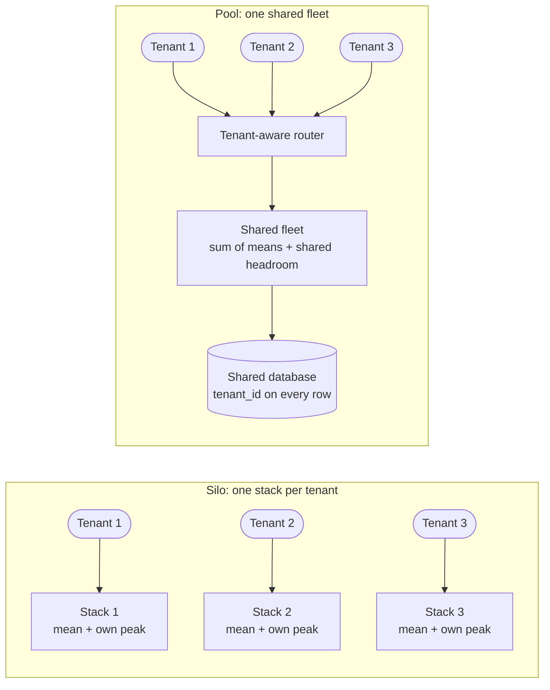

**Reading the diagram.** On the left, each tenant's synchronous requests go to its own stack, sized for that tenant's peak; the storage boundaries are separate, so isolation is physical but three sets of headroom idle most of the time. On the right, all tenants call one router, which forwards requests to a shared fleet and a shared database where every row carries a `tenant_id`. Headroom is shared, so the fleet is smaller. The cost is that the router, fleet and database are now shared failure points: a bug, overload or bad deploy there affects every tenant at once. Scaling the silo design adds stacks; scaling the pool adds fleet capacity and, eventually, more pools (cells, §47.4.3).

### 47.3.3 SaaS products and internal platforms

Two kinds of system are multi-tenant, and they differ mainly in how much tenants trust each other.

- **SaaS products** serve external customers who do not trust each other, may be competitors, and sign contracts with security and availability terms. Security isolation is non-negotiable, and some customers will pay for physical separation.
- **Internal platforms** (a shared Kubernetes cluster, a company-wide Kafka, a data warehouse used by many teams) serve teams in one organization. Tenants are semi-trusted: a malicious team is unlikely, but an accidental one (a runaway job, a misconfigured consumer) is common. Performance and fault isolation dominate, and cost attribution between teams drives budgets.

The Kubernetes documentation draws the same line between "multi-team" and "multi-customer" tenancy and treats isolation strength as a spectrum rather than a binary "soft" versus "hard" choice [Kubernetes Docs: Multi-tenancy]. A third case is **untrusted code**: serverless platforms, CI runners and notebook services run arbitrary programs from tenants. There the compute boundary itself must withstand a deliberate attacker (§47.9).

::: mistake
**Common misconception — "Internal tenants do not need isolation."** Internal platforms fail through accidents: one team's unbounded query, a consumer stuck in a retry loop, a job that fills a shared disk. Without per-team quotas and per-team metrics, a shared platform has the reliability of its least careful team, and no one can tell which team caused the outage or who should pay for the capacity.
:::

## 47.4 Tenancy models

### 47.4.1 Silo, pool and bridge

AWS's SaaS guidance names three basic models, applied per layer of the architecture [AWS SaaS Lens 2023; AWS Tenant Isolation 2020]:

::: definition
**Definition — Silo, pool and bridge.** In the **silo** model each tenant gets dedicated resources: its own stack, account, database or cluster. In the **pool** model tenants share resources, and isolation is enforced logically by tenant-aware code, policies and limits. The **bridge** (hybrid) model mixes the two by layer: for example, shared compute services with a separate database per tenant. A **tiered** deployment applies different models to different customer tiers, typically pooling small tenants and siloing premium ones.
:::

#### How it works internally

Treat the model as a choice per layer, not one decision for the whole product:

1. **Routing layer.** Almost always pooled: one entry point resolves the tenant from the authenticated identity and forwards to the right place.
2. **Compute layer.** Pooled stateless services are the default. Silo compute when tenants run untrusted code or need guaranteed capacity.
3. **Data layer.** The layer where silo versus pool matters most, because data is what regulators, auditors and attackers care about (§47.5).
4. **Supporting services.** Caches, queues, search indexes and object storage each get their own decision. A pooled queue with a siloed database still lets one tenant's backlog delay others.

**Figure 47.2 — Silo, pool and bridge applied per layer.**

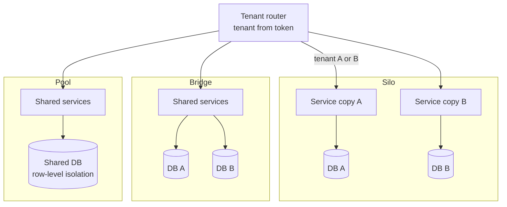

**Reading the diagram.** A single router (pooled in every model) reads the tenant from the authenticated token and forwards synchronously. In the silo column, tenants A and B each have a service copy and a database: two storage boundaries and two failure domains. In the bridge column, one set of services serves both tenants but writes to separate databases, so data is physically isolated while compute is shared; a service bug affects both tenants, a database failure only one. In the pool column, services and database are shared and isolation depends on every query carrying the tenant predicate. Scaling: silo scales by adding copies (linear operational cost), pool by growing or cloning the shared stack.

### 47.4.2 Comparing the models

**Table 47.1 — Tenancy models compared.**

| Row | Silo | Pool | Bridge | Tiered |
|---|---|---|---|---|
| What it is | Dedicated stack per tenant | Everything shared | Shared compute, separate data (or other per-layer mix) | Pool for most, silo for premium |
| How it works | Account, cluster or database per tenant | Tenant ID in every request, row and metric | Router picks the tenant's database | Router maps tier to deployment |
| Advantages | Strongest isolation; per-tenant upgrades and residency | Lowest cost; instant onboarding; one deploy | Data isolation at moderate cost | Matches isolation to willingness to pay |
| Disadvantages | Idle headroom; N deployments; slow onboarding | Noisy neighbors; one bug can leak across tenants | Connection and schema-migration fan-out | Two operating models to maintain |
| Performance | Predictable; no neighbors | Best utilization; needs fair-share controls | Data layer predictable; compute shared | Premium predictable; pool shared |
| Operational complexity | High per tenant, low per incident | Low per tenant, high blast radius | Medium | Medium to high |
| Cost | Highest per tenant | Lowest per tenant | Medium | Blended |
| Use cases | Regulated enterprise, untrusted compute | Self-serve SaaS, internal platforms | B2B SaaS with data-residency demands | B2B SaaS with free-to-enterprise tiers |
| Choose when | Contract or law requires separation | Many small, similar tenants | Data isolation matters more than compute | Tenants differ by orders of magnitude |

The models are points on a continuum. Most mature SaaS products end up tiered: small tenants in pooled cells, enterprise tenants in a bridge or silo, with the same code deployed everywhere so the tiers differ only in configuration and placement. The single most important rule is **one codebase, many deployments**: if siloed tenants run forked code, every fix is applied N times and the silo tier becomes the outage tier.

### 47.4.3 Tiers, cells and blast radius

Pooling every tenant into one stack maximizes utilization and also maximizes blast radius. **Cells** (§33.12) fix that: split the pool into several identical, independent pooled stacks, each holding a bounded set of tenants. A tiered design then has two kinds of compartment: silos holding one premium tenant each, and pooled cells holding many small tenants.

**Figure 47.3 — A tiered deployment with pooled cells and premium silos.**


**Reading the diagram.** The cell router resolves each authenticated tenant to its compartment and forwards the request synchronously over HTTPS. Pooled cells each hold hundreds of tenants with a shared database; premium silos hold one tenant each with a dedicated database encrypted under that tenant's own key (§47.5.4). The control plane updates the router's mapping asynchronously (dotted), so routing keeps working from cache if the control plane is down. Failure points: a fault inside a cell affects its tenants only; the router is the one component shared by everyone and must stay minimal. Scaling: add pooled cells as small tenants grow in number; add silos as enterprise contracts are signed.

::: formula
**Blast radius of one compartment failure, by tenants and by revenue**

$$B_{\text{ten}}(k) = \frac{n_k}{N} \qquad B_{\text{rev}}(k) = \frac{R_k}{R} \qquad E[\text{impact}] = \sum_k f_k \, B_{\text{rev}}(k)$$

| Symbol | Meaning | Units |
|---|---|---|
| $n_k$ | Tenants in compartment $k$ (a cell or silo) | tenants |
| $N$ | Total tenants | tenants |
| $R_k$, $R$ | Annual revenue from compartment $k$, and in total | dollars/year |
| $B_{\text{ten}}$, $B_{\text{rev}}$ | Fraction of tenants, and of revenue, affected when $k$ fails | fraction |
| $f_k$ | Expected failures of compartment $k$ per year | failures/year |
| $E[\text{impact}]$ | Expected revenue-weighted failures per year (1.0 = one whole-company outage) | events/year |
:::

::: example
**Worked example — Blast radius per TaskForge tier.** Take one region with 2,000 paying tenants: 20 enterprise tenants at \$50,000/year each, siloed, and 1,980 team tenants at \$2,000/year each. Total revenue $R = 20 \times 50{,}000 + 1{,}980 \times 2{,}000 = 1{,}000{,}000 + 3{,}960{,}000 = \$4.96$M.

1. *One pool, no cells.* A pool failure hits 1,980 tenants: $B_{\text{ten}} = 1{,}980/2{,}000 = 99\%$, $B_{\text{rev}} = 3.96/4.96 = 79.8\%$.
2. *Six pooled cells of 330.* One cell failure: $B_{\text{ten}} = 330/2{,}000 = 16.5\%$; $B_{\text{rev}} = 330 \times 2{,}000 / 4{,}960{,}000 = 660{,}000/4{,}960{,}000 = 13.3\%$.
3. *One enterprise silo.* $B_{\text{ten}} = 1/2{,}000 = 0.05\%$, but $B_{\text{rev}} = 50{,}000/4{,}960{,}000 = 1.0\%$: twenty times its tenant share.
4. *Expected impact.* Suppose each cell or silo suffers $f = 2$ customer-visible failures a year, independently. The six cells contribute $6 \times 2 \times 0.133 = 1.60$ revenue-weighted events per year and the twenty silos $20 \times 2 \times 0.010 = 0.40$, a total of 2.0, the same as a single pool failing twice a year affecting 100% of revenue. Compartments do not reduce expected loss; they make each event small, which is what contracts, SLOs and reputations punish.

**Interpretation.** Cells cut the pool's blast radius sixfold. Silos have tiny tenant blast radius but disproportionate revenue blast radius, and there are many of them, so their total exposure is not negligible. **Engineering implication.** Size cells by the revenue, not just the tenant count, they put at risk; deploy to a pooled canary cell before any silo (§43.6); and remember that every silo is a separate deployment that can fail on its own, so silos must be automated exactly like cells.
:::

**Table 47.2 — Tenancy-model failure scenarios.**

| What goes wrong | Why | Detection | Recovery | Prevention |
|---|---|---|---|---|
| Silo tier lags releases by months | Silos deployed by hand | Version skew dashboard | Automate silo rollout | Silos are cells of size one in the same pipeline |
| One pool outage hits every tenant | No cells | Global error spike | Restore pool | Cells sized by revenue at risk |
| Enterprise tenant overloads a pooled cell | Grew past the cell's tested size | Per-tenant share of cell load | Migrate to silo (§47.13) | Placement rules by tenant size (§47.6) |
| "Temporary" shared dependency across cells | Shortcut during a launch | Dependency graph shows cross-cell edge | Duplicate per cell | Architecture review rule |

## 47.5 Data isolation patterns

### 47.5.1 Three ways to separate tenant data

Data isolation answers one question: what stops a query for tenant A from returning tenant B's rows? There are three structural answers, from physical to logical.

::: definition
**Definition — Database-per-tenant, schema-per-tenant and shared tables.** In **database-per-tenant**, each tenant's data lives in its own database (or database cluster); the connection itself selects the tenant. In **schema-per-tenant**, tenants share a database server but each has its own schema (namespace of tables), and the session's search path or qualified table names select the tenant. In **shared tables**, all tenants' rows live in the same tables, distinguished by a `tenant_id` column that every query must filter on, ideally enforced by the database through **row-level security (RLS)**.
:::

#### First-principles explanation

A storage company can give each customer a separate building (database-per-tenant), a separate locked room in one building (schema-per-tenant), or a labelled shelf in a shared room with a guard who checks labels on every withdrawal (shared tables with RLS). The building is safest and most expensive. The shelf is cheapest, and only as safe as the guard.

#### Why does this exist?

At 40,000 tenants, TaskForge cannot afford 40,000 PostgreSQL servers: each idle instance costs memory, connections, backups and monitoring. Yet a single forgotten `WHERE tenant_id = ?` in shared tables leaks one customer's data to another, the worst incident a SaaS company can have. Each pattern is a different point on the cost-versus-safety curve, and many products use more than one (shared tables for small tenants, a dedicated database for enterprise).

**Table 47.3 — Data isolation patterns compared.**

| Row | Database-per-tenant | Schema-per-tenant | Shared tables + RLS |
|---|---|---|---|
| What it is | One database or cluster per tenant | One schema per tenant in a shared server | `tenant_id` column, policy on every table |
| How it works | Connection string selects tenant | `search_path` or qualified names | Session variable plus policy predicate |
| Advantages | Physical separation; per-tenant backup, restore, residency, keys | Logical separation; per-tenant restore is simpler than rows | Cheapest; one migration; scales to millions of tenants |
| Disadvantages | Cost per idle tenant; migrations fan out N times | Catalog bloat at tens of thousands of schemas; migrations fan out | Bug in context setting leaks data; noisy neighbors in one table |
| Performance | Predictable per tenant | Shared buffer pool and I/O | Shared everything; needs `tenant_id`-leading indexes |
| Operational complexity | High (fleet of databases) | Medium-high | Low to medium |
| Cost | Highest | Medium | Lowest |
| Use cases | Enterprise and regulated tenants | Hundreds to low thousands of mid-size tenants | Self-serve SaaS with many small tenants |
| Choose when | Contract or residency requires it | Tenants need schema customizations | Tenants are many, small and alike |

A few practical limits drive these choices. Schema-per-tenant puts every tenant's tables in the system catalog, so 40,000 tenants × 50 tables means 2 million catalog entries plus their indexes, which slows planning, backup tooling and migrations; it is typically comfortable in the hundreds to low thousands of schemas, a figure to validate on your own engine. Database-per-tenant multiplies connection pools (§14.13): 2,000 databases × 10 pooled connections per application instance × 20 instances would be 400,000 connections, so it needs a proxy that multiplexes connections or routes per tenant. Shared tables need every index to lead with `tenant_id`, so that one tenant's queries touch only that tenant's index range.

### 47.5.2 Shared tables with row-level security

Putting `WHERE tenant_id = ?` in application code works until one query forgets it. **Row-level security** moves the predicate into the database: once enabled on a table, every query from a non-exempt role is silently rewritten to include the table's policies, and with no policy at all the table returns nothing [PostgreSQL Docs: RLS].

#### How it works internally

1. The application authenticates the request and derives the tenant ID from the verified token, never from a URL, header or body field the client controls.
2. It takes a pooled connection, opens a transaction and runs `SET LOCAL app.tenant_id = '<id>'`. `SET LOCAL` lasts only until the transaction ends, so a pooled connection cannot carry tenant A's setting into the next request.
3. Every statement on a protected table has the policy's `USING` expression added as a filter (for reads, updates and deletes) and its `WITH CHECK` expression enforced on new or changed rows (for inserts and updates).
4. The application connects as a role that is neither a superuser, nor the table owner without `FORCE`, nor granted `BYPASSRLS`: those roles bypass policies.

The following SQL was run against PostgreSQL 16.

```sql
-- Schema owned by a migration role; the application connects as app_user.
CREATE ROLE app_owner NOLOGIN;
CREATE ROLE app_user LOGIN;

CREATE TABLE tasks (
  tenant_id uuid   NOT NULL,
  task_id   bigint GENERATED ALWAYS AS IDENTITY,
  title     text   NOT NULL,
  PRIMARY KEY (tenant_id, task_id)
);
ALTER TABLE tasks OWNER TO app_owner;
GRANT SELECT, INSERT, UPDATE, DELETE ON tasks TO app_user;

ALTER TABLE tasks ENABLE ROW LEVEL SECURITY;
ALTER TABLE tasks FORCE ROW LEVEL SECURITY;   -- applies to the owner too

CREATE POLICY tenant_isolation ON tasks
  USING      (tenant_id = NULLIF(current_setting('app.tenant_id', true), '')::uuid)
  WITH CHECK (tenant_id = NULLIF(current_setting('app.tenant_id', true), '')::uuid);
```

The isolation test below seeds two tenants as a superuser (which bypasses RLS) and then acts as `app_user`. Comments show the output observed.

```sql
INSERT INTO tasks (tenant_id, title) VALUES
  ('00000000-0000-0000-0000-00000000000a', 'A: ship release'),
  ('00000000-0000-0000-0000-00000000000a', 'A: fix login'),
  ('00000000-0000-0000-0000-00000000000b', 'B: quarterly report');

SET ROLE app_user;

-- 1. No tenant set: the predicate is NULL, so no rows.          -> 0
SELECT count(*) FROM tasks;

-- 2. Tenant A sees only its rows, with no WHERE clause.
BEGIN;
SET LOCAL app.tenant_id = '00000000-0000-0000-0000-00000000000a';
SELECT title FROM tasks ORDER BY task_id;      -- A: ship release, A: fix login
-- 3. A forged filter on B's tenant_id returns nothing.          -> 0
SELECT count(*) FROM tasks
 WHERE tenant_id = '00000000-0000-0000-0000-00000000000b';
-- 4. Updating B's rows changes nothing.                         -> UPDATE 0
UPDATE tasks SET title = 'pwned' WHERE title LIKE 'B:%';
COMMIT;

-- 5. Writing a row for another tenant is rejected by WITH CHECK.
BEGIN;
SET LOCAL app.tenant_id = '00000000-0000-0000-0000-00000000000a';
INSERT INTO tasks (tenant_id, title)
  VALUES ('00000000-0000-0000-0000-00000000000b', 'A writes into B');
-- ERROR: new row violates row-level security policy for table "tasks"
ROLLBACK;

-- 6. After the transaction, the setting is gone on this pooled
--    connection: the next request does not inherit tenant A.    -> 0
SELECT count(*) FROM tasks;
```

What to notice:

- `FORCE ROW LEVEL SECURITY` matters: without it the table owner bypasses its own policies. Superusers and `BYPASSRLS` roles always bypass them, so the application must never connect as either.
- `current_setting('app.tenant_id', true)` returns NULL when the setting was never defined, but an **empty string** after a `SET LOCAL` has ended in the same session. Casting `''` to `uuid` raises an error. The `NULLIF(..., '')` turns both cases into NULL, so an unset tenant fails closed (zero rows) rather than erroring; we found this by running test 6 without it.
- Test 3 is the important one: even code that explicitly asks for tenant B's rows gets nothing. RLS protects against application bugs, not only forgotten filters.
- `PRIMARY KEY (tenant_id, task_id)` leads with the tenant, so policy-filtered lookups use the index. Every secondary index should lead with `tenant_id` too.
- RLS does not cover everything: unique constraints and foreign keys are checked across all rows, so a uniqueness error can reveal that a value exists in another tenant (scope unique constraints by including `tenant_id`), and functions marked `SECURITY DEFINER`, views owned by bypassing roles, and logical replication need separate review [PostgreSQL Docs: RLS].

**Figure 47.4 — Tenant context on the request path with RLS.**

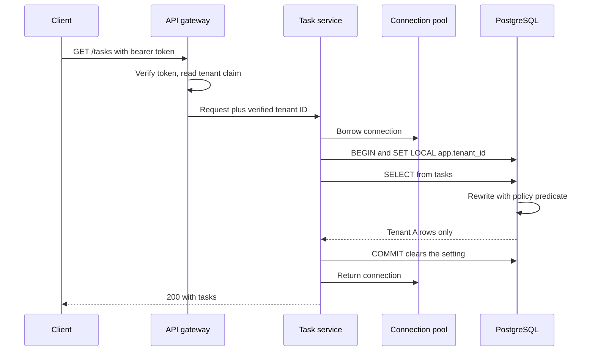

**Reading the diagram.** The client sends a bearer token over HTTPS; the gateway verifies it and extracts the tenant claim, the only trusted source of tenant identity. The task service borrows a pooled connection and sets the tenant for one transaction; PostgreSQL rewrites each statement with the policy predicate, so the storage boundary itself enforces isolation. All calls are synchronous. Failure points: a service that uses session-level `SET` instead of `SET LOCAL` would leak tenant context through the pool; a service that connects as the table owner without `FORCE`, or as a superuser, bypasses the policy entirely. Scaling: RLS adds one predicate per query, negligible when indexes lead with `tenant_id`; the shared database itself still scales by sharding on `tenant_id` (§47.6).

::: industry
**Salesforce's metadata-driven multitenancy.** Salesforce's Force.com platform stores every customer organization's data in a small number of large, shared tables, with an organization ID on every row. Customer-defined objects and fields are not real database tables; they are rows in metadata tables, and their data lives in generic "flex" columns of one shared data table, with separate pivot tables providing indexes and relationships. The query layer generates organization-scoped SQL from the metadata, so tenants can customize their schema without any DDL on the shared database [Weissman and Bobrowski 2009]. The trade-off is a sophisticated query compiler and optimizer in place of the database's native schema, accepted because one schema change per customer per day would be unworkable across a shared database.
*Evidence: Primary* — [Weissman and Bobrowski 2009]
:::

### 47.5.3 Choosing among the patterns

Use the strongest pattern that the tenant count and economics allow, and let tiers mix them:

1. **Default to shared tables with RLS** when tenants number in the thousands or more and are similar. Add the policy on day one; retrofitting `tenant_id` into a schema is a full migration.
2. **Move a tenant to its own database** when contract, data residency, per-tenant restore or sheer size requires it (§47.13 describes the move). Keep the same schema, including the `tenant_id` column, so the code path is identical.
3. **Avoid schema-per-tenant at large tenant counts** unless tenants genuinely need different schemas; it combines the migration fan-out of database-per-tenant with the shared-resource contention of a pool.

::: mistake
**Common misconception — "RLS makes the application secure."** RLS stops a query from returning another tenant's rows once the tenant is set. It cannot stop the application from setting the wrong tenant, for example from a client-supplied header, nor from leaking data through caches, search indexes, object-storage paths, logs or background jobs that never touch the protected tables. Every one of those stores needs its own tenant scoping (§47.12).
:::

### 47.5.4 Encryption per tenant

Access controls decide who may read data; encryption decides what an attacker who bypasses them sees. Per-tenant keys add a cryptographic wall between tenants on shared storage.

::: definition
**Definition — Per-tenant keys, BYOK and crypto-shredding.** With **per-tenant keys**, each tenant's data keys are wrapped by a key-encryption key (KEK) unique to that tenant, held in a key management service (KMS) (envelope encryption, §10.9.2). **Bring your own key (BYOK)** lets the tenant create or import that KEK in a KMS account it controls, so it can audit every use and revoke it. **Hold your own key (HYOK)** keeps the KEK outside the provider entirely, in a key service the tenant operates. **Crypto-shredding** deletes data by destroying its key: every copy, including backups, becomes unreadable.
:::

#### How it works internally

1. On onboarding, the control plane creates a KEK for the tenant (or records the ARN of the tenant's BYOK key and the grant that lets the service use it).
2. On write, the service generates or reuses a data encryption key (DEK), encrypts the record or file, and stores the DEK wrapped by the tenant's KEK next to the ciphertext.
3. On read, the service asks the KMS to unwrap the DEK. The KMS checks that the caller is allowed to use *this tenant's* key and logs the call. Unwrapped DEKs are cached briefly (minutes) to keep KMS calls off the hot path.
4. On revocation (BYOK), the tenant disables its key; once caches expire, the service can no longer read the tenant's data.
5. On offboarding, the service schedules the KEK for deletion, shredding all data wrapped by it.

**Figure 47.5 — Per-tenant envelope encryption with an optional customer-held key.**

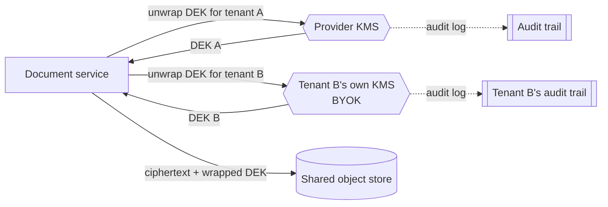

**Reading the diagram.** The document service stores every tenant's encrypted objects in one shared object store, each beside its DEK wrapped by that tenant's KEK. To read tenant A's object, it asks the provider's KMS, over an authenticated TLS API call, to unwrap the DEK; for tenant B, it calls a key that tenant B controls. Unwrap calls are synchronous; audit records flow asynchronously to each key owner's trail, so tenant B sees every use of its key. Storage boundary: the object store holds only ciphertext. Failure points: if tenant B's KMS is unavailable or B revokes the key, B's data is unreadable (by design) while A is unaffected; a DEK cache that is too long-lived weakens revocation. Scaling: KMS request quotas, typically thousands of requests per second per account (check your provider), are the limit, so cache DEKs and reuse them per object or per batch.

The trade-offs are concrete. Per-tenant keys block a cross-tenant read only when the bug is on the *storage* side (a misconfigured bucket path, a stolen backup); if the application itself is tricked into serving tenant B's request with tenant A's identity, it will happily unwrap A's key. BYOK adds a dependency on a system the provider does not operate: a tenant's key outage is a tenant outage, and support must be able to tell the two apart. Crypto-shredding is only as good as key hygiene: a DEK cached in memory, logged, or wrapped by a second, shared key defeats it. Major cloud KMSs support imported key material and external key stores (for example AWS KMS [AWS Docs: KMS]); the exact features and request quotas vary by provider and change over time (as of 2026).

**Table 47.4 — Data isolation failure scenarios.**

| What goes wrong | Why | Detection | Recovery | Prevention |
|---|---|---|---|---|
| Tenant A sees tenant B's records | Query missing tenant filter | Customer report; cross-tenant canary test | Revoke, notify, audit access logs | RLS with `FORCE`; tenant-leading keys |
| Tenant context leaks through pool | Session `SET` instead of `SET LOCAL` | Isolation test run on reused connection | Fix, rotate affected sessions | Transaction-scoped settings; pool reset |
| Migration takes hours | Schema-per-tenant at 40,000 schemas | Migration duration per release | Batch and parallelize | Shared tables for small tenants |
| Uniqueness error reveals other tenant's value | Global unique constraint | Penetration test | Scope constraint | `UNIQUE (tenant_id, value)` |
| Tenant locked out of own data | BYOK key disabled or KMS outage | Decrypt errors for one tenant | Tenant re-enables key | Clear BYOK contract; per-tenant alerting |

## 47.6 Tenant-aware sharding and placement

### 47.6.1 The tenant directory

§14.7.2 chose `tenant_id` as TaskForge's shard key: nearly every query and transaction is tenant-scoped, so a tenant's data on one shard means single-shard queries and simple per-tenant backup, export and deletion. This section adds the multi-tenant concerns: where each tenant goes, how big tenants are handled, and how placement interacts with cells.

::: definition
**Definition — Tenant placement directory.** A small, highly available mapping from tenant ID to its location (cell, shard or dedicated cluster), owned by the control plane and cached by every router. A directory lets the system place, move and isolate individual tenants, which pure hashing cannot do.
:::

Pure hash placement (`hash(tenant_id) mod S`, or consistent hashing, §14.8) is simple and needs no lookup, but it puts each tenant where the hash says, whatever its size. A directory costs a lookup (cached, so microseconds) and a control-plane service, and in return allows three things hashing cannot: placing a new tenant on the least-loaded shard, moving one tenant without moving others, and giving a whale its own cluster. The common hybrid from §14.7.2 hashes tenants into a fixed set of logical shards and keeps a directory of **overrides** for the exceptions.

**Figure 47.6 — Tenant placement with a directory, overrides and whale isolation.**

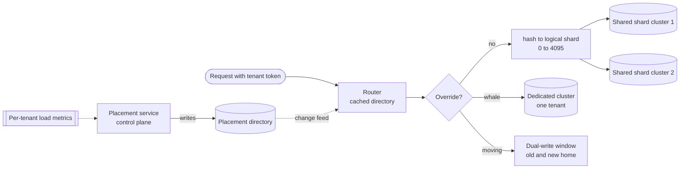

**Reading the diagram.** The router resolves each request's tenant first against the override list and otherwise by hashing to a logical shard, which maps to a shared physical cluster; both lookups use a cache fed asynchronously by the directory's change feed. Whales have a dedicated cluster; a tenant being moved is temporarily routed through a dual-write or cutover state (§14.9.5). The placement service reads per-tenant load metrics asynchronously and writes placement decisions to the directory. Storage boundaries are the shard clusters. Failure points: a stale router cache can send writes to a tenant's old home, so each cluster must reject writes for tenants it does not own (a fencing check); a directory outage must not stop routing, which continues from cache. Scaling: add shared clusters and move logical shards, or promote a growing tenant to an override.

### 47.6.2 Whale tenants and placement balance

Tenant sizes follow heavy-tailed distributions: in TaskForge, the median tenant has 15 users and the largest has 60,000. A **whale** is a tenant large enough that its placement alone determines a shard's load.

::: formula
**Placement imbalance and the whale threshold**

$$I = \frac{\max_s L_s}{L/S} \qquad \text{tenant } i \text{ is a whale if } \ \ell_i > f \cdot \frac{L}{S}$$

| Symbol | Meaning | Units |
|---|---|---|
| $L_s$ | Load on shard $s$ (data size, request rate or CPU, whichever binds) | % of total, or RPS |
| $L$ | Total load across all shards | same as $L_s$ |
| $S$ | Number of physical shards | shards |
| $I$ | Imbalance factor: hottest shard relative to the mean (1.0 is perfect) | dimensionless |
| $\ell_i$ | Load of tenant $i$ | same as $L_s$ |
| $f$ | Whale threshold as a fraction of the mean shard load (a policy choice, e.g. 0.2) | dimensionless |
:::

::: example
**Worked example — TaskForge's whales on 32 and 256 shards.** Suppose the five largest tenants carry 2.0%, 1.5%, 1.0%, 0.8% and 0.7% of total load, and the remaining 94% is spread across 39,995 small tenants.

*32 shards.*

1. Mean shard load $L/S = 100\%/32 = 3.125\%$.
2. With random placement, the 2.0% tenant lands on a shard that also receives about a typical shard's share of small tenants, roughly $94\%/32 = 2.94\%$, so that shard carries about $2.0 + 2.94 = 4.94\%$: $I \approx 4.94/3.125 = 1.58$. If two whales collide on one shard, it is worse.
3. Whale threshold with $f = 0.2$: $0.2 \times 3.125\% = 0.625\%$. All five large tenants (6.0% in total) are whales.
4. Placement fix: put each whale on a different shard first (largest first), then fill each shard with small tenants up to the 3.125% target: the 2.0% whale's shard takes only $1.125\%$ of small tenants. $I$ falls to about 1.0 plus the noise of the small tenants.

*256 shards (the fleet has grown).*

1. Mean shard load $= 100\%/256 = 0.39\%$.
2. The 2.0% tenant is now $2.0/0.39 = 5.1$ times a whole shard. No placement on a shared shard can balance it.
3. The tenant must get a dedicated cluster sized for 5 shards' worth of load, or be split further by a second key such as `(tenant_id, project_id)` (§14.7.2).

**Interpretation.** Whales become relatively larger as the fleet grows, because the mean shard shrinks while the largest tenant does not. **Engineering implication.** Place whales explicitly through the directory, review the whale list whenever the shard count changes, and design the data model so that a single tenant *can* be split if it ever outgrows the largest cluster you can run.
:::

### 47.6.3 Rebalancing, cells and placement policy

Placement is a continuous process, not a one-off decision:

1. **Initial placement.** New tenants go to the cell and shard with the most headroom, respecting constraints: data-residency region (Chapter 44), tier (pooled or silo), and anti-affinity rules (two related tenants, such as a reseller and its customers, in different cells to limit correlated impact).
2. **Monitoring.** The placement service tracks each tenant's share of its shard's CPU, storage, IOPS and request rate (§47.11).
3. **Promotion.** When a tenant crosses the whale threshold, schedule a move to a larger shard or a dedicated cluster during its low-traffic hours.
4. **Moving.** Use the online migration of §14.9.5, per tenant: copy a snapshot, stream changes, verify, flip the directory entry with a fence, then delete the old copy. Because the data is tenant-scoped, one tenant moves without touching others.
5. **Cell assignment.** In a cell-based design (§33.12), the cell is the outer placement unit and shards live inside cells. A tenant normally lives in exactly one cell, so cell placement and shard placement are made together.

Shuffle sharding (§33.12.2) complements placement for stateless, pooled tiers: assigning each tenant a random subset of $k$ of $N$ workers means a poison tenant that crashes its workers fully disables another tenant only if that tenant's whole subset is contained in the failed set, which for $N = 100$, $k = 5$ is about one in 75 million [MacCárthaigh 2019].

::: industry
**Citus tenant isolation.** Citus, a distributed PostgreSQL extension, documents a multi-tenant pattern in which tables are distributed by `tenant_id` and co-located so that joins within a tenant stay on one node. For a tenant that grows too large, it provides a function that moves a single tenant's rows into a dedicated shard, which can then be placed on its own node: the directory-override pattern implemented inside the database [Citus Docs].
*Evidence: Primary* — [Citus Docs]
:::

::: mistake
**Common misconception — "Consistent hashing balances tenants."** Consistent hashing balances *keys*. With heavy-tailed tenants, the number of tenants per shard can be perfectly even while load is badly skewed, because one key may carry a thousand times the load of another. Balance tenants by measured load, and place the largest ones by hand or by policy.
:::

## 47.7 Noisy neighbors

### 47.7.1 What contends, and how

::: definition
**Definition — Noisy neighbor.** A tenant (or workload) whose consumption of a shared resource degrades the performance of other tenants sharing it. The neighbor need not exceed any limit; it only has to consume a resource that the others also need and that is not partitioned.
:::

#### First-principles explanation

In a shared office, one colleague's loud phone call does not take your desk, chair or computer, yet you cannot work. Noisy neighbors in computing are the same: CPU quotas can be perfectly fair while one tenant thrashes the shared last-level cache or saturates the disk queue, and everyone else's latency doubles. Isolation is only as good as the *least* partitioned resource on the path.

#### How it works internally

Every request passes through a chain of shared resources, and any one can be the contended one:

**Table 47.5 — Shared resources, contention mechanisms and per-tenant signals.**

| Resource | How a neighbor hurts you | Per-tenant signal | Isolation mechanism |
|---|---|---|---|
| CPU cores | Run-queue delay, CFS throttling | CPU-seconds, run-queue latency | cgroup CPU weights and quotas (§42.3.2), dedicated cores |
| Last-level cache, memory bandwidth | Evicts your cache lines; saturates memory bus | Cycles per instruction (CPI), cache misses | Cache and bandwidth partitioning (e.g. Intel RDT), separate hosts |
| Disk and network I/O | Fills device queues; burns IOPS budget | IOPS, bytes, queue depth by tenant | cgroup I/O weights, per-volume limits, separate volumes |
| Connection pools | Holds all connections with slow queries | Connections held, wait time by tenant | Per-tenant pool partitions (bulkheads, §22.14) |
| Database | Expensive queries, lock contention, vacuum debt | Query time, rows scanned, locks by tenant | Statement timeouts, per-tenant concurrency caps, sharding |
| Caches | Large working set evicts others' entries | Hit ratio and bytes by tenant prefix | Per-tenant cache quotas, separate caches for whales |
| Queues and streams | Backlog delays everyone behind it | Lag and enqueue rate by tenant | Per-tenant queues or partitions, fair dequeue (§47.8) |
| Locks and global state | Hot row or global counter serializes all | Lock wait by tenant | Shard by tenant; avoid global hot spots |

The order matters for diagnosis. CPU, memory and connection-pool contention are easy to see in standard metrics. Cache and memory-bandwidth interference is invisible to them: the victim's CPU usage may even fall while its latency rises, because it spends cycles stalled on memory. Google's CPI² system detects exactly this case: it learns the normal cycles-per-instruction distribution for each job, flags victims whose CPI rises well outside it, identifies the co-located task whose CPU usage correlates with the victim's slowdown, and can throttle that antagonist [Zhang et al. 2013]. Heracles goes further, using hardware cache partitioning, core isolation and network shaping to co-locate batch work beside latency-critical services without violating their SLOs [Lo et al. 2015].

### 47.7.2 Detection

You cannot fix a noisy neighbor you cannot name. Detection needs three things:

1. **Per-tenant resource accounting at each shared resource.** Requests, CPU time, rows read, bytes stored and cache usage, each tagged with tenant ID (§47.11 explains how to do this without exploding metric cardinality).
2. **Per-tenant latency and error SLIs for victims.** A global p99 hides a tenant whose p99 tripled; compute SLIs per tenant, or per tier and for the top tenants by revenue.
3. **Correlation.** When a victim's latency rises, rank tenants on the same shard, cell or host by their change in consumption over the same window. The antagonist is usually the tenant whose share jumped.

**Figure 47.7 — Detecting and containing a noisy neighbor.**

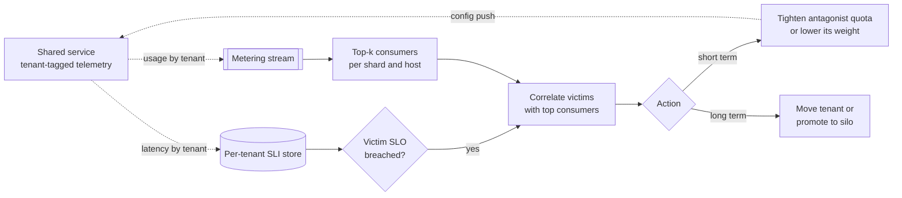

**Reading the diagram.** The shared service emits tenant-tagged usage and latency asynchronously (dotted) into a metering stream and an SLI store. A top-k job ranks consumers per shard and host; when a victim tenant's SLO is breached, a correlation step compares the victim's degradation with the top consumers on the same shared resources. The short-term action tightens the antagonist's quota or fair-share weight through a configuration push; the long-term action moves it (§47.6.3). Failure points: telemetry that lacks tenant tags makes correlation impossible; automatic throttling based on a wrong correlation punishes an innocent tenant, so keep a human in the loop for anything stronger than a quota adjustment. Scaling: heavy-hitter sketches (§17.6.2) keep the ranking cheap with tens of thousands of tenants.

::: warning
**Warning — Quotas on one resource move the bottleneck.** Capping a tenant's request rate does not cap its cost per request. A tenant inside its RPS quota can still issue the most expensive search, scan a million rows per call, or upload enormous files. Express quotas in the unit of the scarce resource (rows scanned, CPU-milliseconds, bytes), or weight each request by its estimated cost, as §47.8 does.
:::

**Table 47.6 — Noisy-neighbor failure scenarios.**

| What goes wrong | Why | Detection | Recovery | Prevention |
|---|---|---|---|---|
| All tenants slow on one shard | One tenant's batch export scans full tables | Rows scanned by tenant jumps | Kill or throttle export | Cost-based quotas; export on replicas |
| p99 doubles, CPU normal | Cache or memory-bandwidth antagonist | CPI rises on victims | Move antagonist | Cache partitioning; separate hosts for whales |
| Connection pool exhausted | One tenant's slow queries hold connections | Connections held by tenant | Statement timeout | Per-tenant pool partitions |
| Queue lag for everyone | One tenant enqueued a million jobs | Lag and enqueue rate by tenant | Drain to a per-tenant overflow queue | Per-tenant queues with fair dequeue |

## 47.8 Quotas, rate limits and fair share per tenant

### 47.8.1 Three controls, three questions

Performance isolation in a pooled service rests on three controls that answer different questions:

1. **Quotas** answer *how much may this tenant use in total?* (500 projects, 1 TB of storage, 10,000 API calls a day). They are business limits, usually tied to the pricing tier, and are enforced at the control plane or at write time.
2. **Rate limits** answer *how fast may this tenant send?* A per-tenant token bucket (§22.4) with rate $r$ and burst $b$ admits at most $b + rT$ requests in any interval $T$, and rejects the excess with HTTP 429 and `Retry-After`.
3. **Fair scheduling** answers *when the service is busy, whose admitted work goes next?* A per-tenant queue with a fair scheduler divides the capacity that actually exists among the tenants that currently want it.

Rate limits alone are not enough, because per-tenant limits in a pooled service are always **oversubscribed**: if every tenant used its full limit at once, demand would far exceed capacity. That is deliberate (it is the pooling saving of §47.3.2), but it means admission alone cannot guarantee that tenants who stay within their limits are served promptly.

::: example
**Worked example — Per-tenant limits in one TaskForge cell.** One pooled cell has capacity $C = 20{,}000$ RPS and holds 6,000 free tenants ($r = 10$ RPS, $b = 20$), 1,900 team tenants ($r = 100$, $b = 200$) and 10 enterprise tenants placed in the pool ($r = 1{,}000$, $b = 2{,}000$). The cell's measured aggregate peak is 12,000 RPS.

1. Sum of rate limits: $6{,}000 \times 10 + 1{,}900 \times 100 + 10 \times 1{,}000 = 60{,}000 + 190{,}000 + 10{,}000 = 260{,}000$ RPS.
2. Oversubscription: $260{,}000 / 20{,}000 = 13\times$.
3. Largest single tenant: $1{,}000 / 20{,}000 = 5\%$ of the cell. No single tenant at its limit can overload the cell; the rate limit has done its job.
4. Headroom at peak: $20{,}000 - 12{,}000 = 8{,}000$ RPS. Eight enterprise tenants bursting to their limits together, or 80 team tenants, would consume it all.
5. Burst check: a team tenant's full bucket of 200 requests arrives in well under a second; 80 such tenants is 16,000 requests at once, more than a second of the cell's headroom.

**Interpretation.** Per-tenant rate limits bound the damage *one* tenant can do. Correlated bursts from many tenants within their limits are a different problem, solved by fair queuing (which divides the shortage fairly) and load shedding by priority (§22.9.2, which decides who loses when even fair shares cannot be met). **Engineering implication.** Set each tenant's limit well below the cell's capacity (here at most 5%), track the oversubscription ratio and the aggregate p99.9 against capacity as a cell-health metric, and split or add cells before correlated bursts become routine.
:::

### 47.8.2 Fair queuing

::: definition
**Definition — Fair queuing and weighted fair queuing.** **Fair queuing** keeps a separate queue per flow (here, per tenant) and serves them so that each backlogged flow receives an equal share of capacity, regardless of how much any one flow sends [Demers et al. 1989]. **Weighted fair queuing (WFQ)** gives flow $i$ a share proportional to a weight $w_i$. The resulting allocation is **max–min fair**: no tenant can get more without taking from a tenant that has less.
:::

#### First-principles explanation

Picture a single checkout counter with one shared line. A shopper with 500 items ahead of you makes you wait, however few items you have. Now give every shopper their own line and have the cashier serve one item from each line in turn. The shopper with 500 items still gets served, but only at one item per round, and your three items are done in three rounds. That is fair queuing. Weighted fair queuing lets a premium shopper's line contribute two or three items per round.

#### How it works internally

Demers, Keshav and Shenker defined fair queuing for network gateways by emulating an ideal bit-by-bit round robin: each arriving packet is stamped with the time it *would* finish under that ideal, and the gateway always sends the packet with the smallest stamp [Demers et al. 1989]. Weighted variants generalize the ideal to Generalized Processor Sharing [Parekh and Gallager 1993]. Practical schedulers approximate it cheaply:

1. **Finish tags (self-clocked fair queuing).** On arrival, request $k$ of tenant $i$ gets tag $F_{i,k} = \max(V, F_{i,k-1}) + c_k / w_i$, where $c_k$ is the request's cost and $V$ is the tag of the request most recently served. The scheduler serves the smallest tag [Golestani 1994]. A tenant that sends a flood receives tags far in the future, so newcomers from other tenants are served before them.
2. **Deficit round robin (DRR).** Visit tenant queues in turn; each visit adds a quantum proportional to $w_i$ to the tenant's deficit counter and serves requests while their cost fits within it. DRR costs $O(1)$ per request [Shreedhar and Varghese 1995].
3. **Bound each tenant's queue.** A full queue sheds that tenant's requests (503) without affecting other queues; this turns the backlog itself into a bulkhead.

::: formula
**Weighted max–min fair share (water-filling)**

$$a_i = \min\left(d_i,\; w_i\,\theta\right), \qquad \text{with } \theta \text{ chosen so that } \sum_i a_i = C \quad \left(\text{if } \sum_i d_i > C\right)$$

| Symbol | Meaning | Units |
|---|---|---|
| $C$ | Service capacity | RPS (or cost units/s) |
| $d_i$ | Admitted demand of tenant $i$ (after its rate limit) | RPS |
| $w_i$ | Weight of tenant $i$ (for example by tier) | dimensionless |
| $\theta$ | Fair-share level per unit of weight (the "water level") | RPS per unit weight |
| $a_i$ | Throughput allocated to tenant $i$ | RPS |
:::

::: example
**Worked example — One noisy tenant, and one weighted pair.**

*Equal weights.* $C = 1{,}000$ RPS. After rate limits, tenant acme presents $d = 500$ RPS and beta, gamma and delta 200 RPS each, so total demand is 1,100 RPS, more than capacity.

1. Try $\theta = 250$ (an equal split): $\min(500, 250) + 3 \times \min(200, 250) = 250 + 600 = 850 < 1{,}000$. Capacity is left over, so raise $\theta$.
2. Beta, gamma and delta are satisfied at 200 each (600 RPS) for any $\theta \ge 200$. Acme gets the rest: $\theta + 600 = 1{,}000$, so $\theta = 400$.
3. Allocation: beta, gamma, delta 200 RPS each (100% of demand); acme 400 RPS (80% of its admitted 500). Acme's surplus 100 RPS queues and, once its queue is full, is shed.

*Weights 3:1.* Tenants gold ($w = 3$) and free ($w = 1$) each demand 2,000 RPS with $C = 1{,}000$: $3\theta + \theta = 1{,}000$, $\theta = 250$, so gold gets 750 RPS and free 250 RPS.

**Interpretation.** Tenants asking for less than their fair share get all of it; only tenants asking for more are cut, and the unused share of small tenants flows to the big one. **Engineering implication.** This is the property you want: a well-behaved tenant's service does not depend on what the noisy one does. The simulation below confirms both allocations.
:::

Fair share in one dimension is not the whole story. A tenant may be light on CPU and heavy on memory or I/O. **Dominant Resource Fairness (DRF)** generalizes max–min fairness to several resources by equalizing each tenant's share of its most-used resource [Ghodsi et al. 2011]; Chapter 46 covers it with cluster schedulers.

### 47.8.3 Admission control as a pipeline

**Figure 47.8 — Per-tenant admission: rate limit, cost, fair queue, workers.**

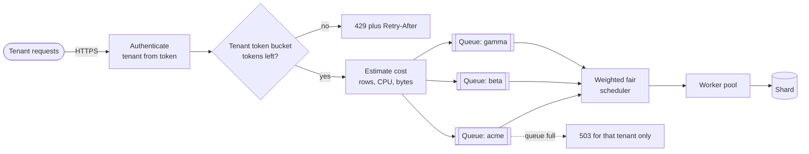

**Reading the diagram.** Each request is authenticated so the tenant is known before any shared resource is spent on it. The per-tenant token bucket rejects excess rate at the edge with 429 (synchronous and cheap). Admitted requests receive a cost estimate and enter their tenant's bounded queue; the weighted fair scheduler feeds the shared worker pool, which calls the shard synchronously. A full queue sheds only its own tenant's requests (dotted). Failure points: buckets enforced per gateway node drift from the intended global limit unless quota is distributed (§22.8.3); cost estimates that are too low let expensive requests through cheaply. Scaling: queues and buckets are a few numbers per tenant, so tens of thousands of tenants fit in memory; add workers to raise $C$.

### 47.8.4 Simulation: containing a noisy tenant

The program simulates one service with capacity 1,000 RPS (one request per millisecond) shared by four tenants for 10 seconds. Each normally sends 200 RPS of Poisson traffic; acme bursts to 2,500 RPS between $t = 2$ s and $t = 6$ s. It compares three policies: a shared FIFO queue; per-tenant token buckets ($r = 500$ RPS, $b = 100$) in front of the FIFO queue; and the same buckets in front of per-tenant bounded queues with self-clocked weighted fair queuing. The final test checks a 3:1 weighted split.

```python
import heapq
import random
from collections import deque

TICK_MS = 1          # one server slot per millisecond: capacity 1,000 RPS
SIM_MS = 10_000      # simulate 10 seconds


class TokenBucket:
    """Per-tenant admission (§22.4): rate r per second, burst b."""
    def __init__(self, rate, burst):
        self.rate, self.burst = rate, burst
        self.tokens, self.last = burst, 0.0

    def allow(self, now_ms):
        elapsed = (now_ms - self.last) / 1000.0
        self.tokens = min(self.burst, self.tokens + elapsed * self.rate)
        self.last = now_ms
        if self.tokens >= 1.0:
            self.tokens -= 1.0
            return True
        return False


class FifoQueue:
    """One shared queue: whoever arrives first is served first."""
    def __init__(self, limit):
        self.q, self.limit = deque(), limit

    def push(self, tenant, t):
        if len(self.q) >= self.limit:
            return False
        self.q.append((tenant, t))
        return True

    def pop(self):
        return self.q.popleft() if self.q else None


class FairQueue:
    """Self-clocked weighted fair queuing: one bounded queue per tenant.
    Each request gets a finish tag F = max(V, F_prev[tenant]) + 1/weight;
    the server always takes the smallest tag; V is the tag last served."""
    def __init__(self, weights, limit_per_tenant):
        self.w, self.limit = weights, limit_per_tenant
        self.heap, self.last_tag, self.depth = [], {}, {}
        self.vtime, self.seq = 0.0, 0

    def push(self, tenant, t):
        if self.depth.get(tenant, 0) >= self.limit:
            return False
        start = max(self.vtime, self.last_tag.get(tenant, 0.0))
        tag = start + 1.0 / self.w[tenant]
        self.last_tag[tenant] = tag
        self.depth[tenant] = self.depth.get(tenant, 0) + 1
        self.seq += 1
        heapq.heappush(self.heap, (tag, self.seq, tenant, t))
        return True

    def pop(self):
        if not self.heap:
            return None
        tag, _, tenant, t = heapq.heappop(self.heap)
        self.vtime = tag
        self.depth[tenant] -= 1
        return tenant, t


def offered_rps(tenant, now_ms):
    """Acme is the noisy tenant: 200 RPS, then 2,500 RPS from 2 s to 6 s."""
    if tenant == "acme" and 2_000 <= now_ms < 6_000:
        return 2_500
    return 200


def simulate(policy, tenants, weights=None, quota_rps=500, burst=100,
             offered=offered_rps, seed=7):
    rng = random.Random(seed)
    weights = weights or {t: 1 for t in tenants}
    buckets = {t: TokenBucket(quota_rps, burst) for t in tenants}
    if policy in ("fifo", "quota+fifo"):
        queue = FifoQueue(limit=2_000)
    else:
        queue = FairQueue(weights, limit_per_tenant=200)
    stats = {t: {"offered": 0, "throttled": 0, "shed": 0, "latency": []}
             for t in tenants}
    for now in range(0, SIM_MS, TICK_MS):
        for t in tenants:
            lam = offered(t, now) * TICK_MS / 1000.0
            # Poisson arrivals: count exponential gaps that fit in one tick
            n, acc = 0, rng.expovariate(1.0) / lam
            while acc < 1.0:
                n += 1
                acc += rng.expovariate(1.0) / lam
            for _ in range(n):
                stats[t]["offered"] += 1
                if policy != "fifo" and not buckets[t].allow(now):
                    stats[t]["throttled"] += 1      # 429 at the edge
                elif not queue.push(t, now):
                    stats[t]["shed"] += 1           # queue full: 503
        item = queue.pop()                          # serve one per tick
        if item:
            tenant, arrived = item
            stats[tenant]["latency"].append(now + TICK_MS - arrived)
    return stats


def p99(xs):
    xs = sorted(xs)
    return xs[int(0.99 * (len(xs) - 1))] if xs else float("nan")


def report(policy, stats):
    print(f"\n{policy}")
    print(f"{'tenant':<7}{'offered':>8}{'served':>8}{'429':>7}{'503':>7}{'p99 ms':>8}")
    for t, s in stats.items():
        print(f"{t:<7}{s['offered']:>8}{len(s['latency']):>8}"
              f"{s['throttled']:>7}{s['shed']:>7}{p99(s['latency']):>8}")


TENANTS = ["acme", "beta", "gamma", "delta"]
QUIET = ["beta", "gamma", "delta"]

if __name__ == "__main__":
    results = {}
    for policy in ["fifo", "quota+fifo", "quota+wfq"]:
        results[policy] = simulate(policy, TENANTS)
        report(policy, results[policy])

    # Tests: the noisy tenant is contained only with quotas plus fair queuing.
    fifo, qfifo, wfq = (results[p] for p in ["fifo", "quota+fifo", "quota+wfq"])
    assert all(p99(fifo[t]["latency"]) > 1_000 for t in QUIET)
    assert all(fifo[t]["shed"] > 0 for t in QUIET)
    assert all(p99(qfifo[t]["latency"]) > 300 for t in QUIET)
    for t in QUIET:
        assert wfq[t]["shed"] == 0 and wfq[t]["throttled"] == 0
        assert p99(wfq[t]["latency"]) < 50
    assert wfq["acme"]["throttled"] > 0 and wfq["acme"]["shed"] > 0

    # Test: two backlogged tenants with weights 3:1 split capacity 3:1.
    heavy = lambda t, now: 2_000
    ws = simulate("quota+wfq", ["gold", "free"], weights={"gold": 3, "free": 1},
                  quota_rps=5_000, burst=100, offered=heavy)
    ratio = len(ws["gold"]["latency"]) / len(ws["free"]["latency"])
    print(f"\nweighted 3:1 -> served gold/free = {ratio:.2f}")
    assert 2.9 < ratio < 3.1
    print("all isolation tests passed")
```

Output (Python 3.13, seed 7):

```text
fifo
tenant  offered  served    429    503  p99 ms
acme      11168    6232      0   4670    2000
beta       2081    1158      0    586    2000
gamma      1988    1149      0    565    2000
delta      1983    1112      0    563    2000

quota+fifo
tenant  offered  served    429    503  p99 ms
acme      11168    3276   7892      0     481
beta       2081    2081      0      0     480
gamma      1988    1987      0      0     481
delta      1983    1983      0      0     480

quota+wfq
tenant  offered  served    429    503  p99 ms
acme      11168    2991   7892    285     589
beta       2081    2081      0      0      28
gamma      1988    1987      0      0      16
delta      1983    1983      0      0      16

weighted 3:1 -> served gold/free = 3.00
all isolation tests passed
```

**Table 47.7 — What each policy does to the quiet tenants (beta, gamma, delta).**

| Policy | Quiet tenants' requests shed | Quiet tenants' p99 latency | Who absorbs acme's burst |
|---|---|---|---|
| Shared FIFO, no limits | 28% (563–586 of about 2,000 each) | 2,000 ms | Everyone, equally |
| Token buckets + FIFO | 0 | about 480 ms | Everyone, through a shared backlog |
| Token buckets + WFQ | 0 | 16–28 ms | Acme only (429s, then 503s from its own queue) |

What to notice:

- **FIFO with no limits** lets acme fill the shared 2,000-slot queue, so every tenant waits 2 s and loses over a quarter of its requests. Acme gets the most service (6,232 requests) because it sends the most: FIFO rewards the noisiest tenant.
- **Token buckets alone** throttle acme to 500 RPS (7,892 rejections with 429), but $500 + 3 \times 200 = 1{,}100$ RPS still exceeds the 1,000 RPS capacity, because the limits are oversubscribed. The shared queue grows by about 100 requests per second for 4 s, and every tenant, quiet or not, sees roughly 480 ms of queueing delay.
- **Token buckets plus WFQ** confine the excess to acme's own queue: acme receives the 400 RPS predicted in §47.8.2, its queue fills (285 requests shed with 503) and its p99 rises to 589 ms, while the quiet tenants lose nothing.
- The quiet tenants' p99 under WFQ (16–28 ms) is higher than with no burst at all (about 10 ms with a shared FIFO at 800 RPS, same seed), because while acme is backlogged each quiet tenant is guaranteed only its share of 250 RPS and uses 200 of it. An M/D/1 queue at utilization $\rho = 200/250 = 0.8$ and service rate 250/s has mean wait $\rho / (2\mu(1-\rho)) = 0.8/(2 \times 250 \times 0.2) = 8$ ms. Fair queuing bounds a tenant's latency by its share, not by the whole server.
- The weighted test confirms the 750:250 split computed above. Real systems use the request's cost in place of the constant 1 in the tag, so expensive requests consume more of a tenant's share.

::: recommendation
**Recommendation — Layer the controls.** Put a per-tenant token bucket at the edge (cheap rejection of rate excess), cost-weighted per-tenant fair queuing in front of each scarce resource (a fair split of whatever capacity exists), bounded per-tenant queues (a backlog bulkhead), and priority-based shedding by tier as the last line (§22.9.2). Each control handles a failure the others cannot.
:::

## 47.9 The compute isolation spectrum

### 47.9.1 What each boundary shares

When tenants run *code*, not just requests (serverless functions, CI jobs, notebooks, plug-ins, TaskForge's tenant-written automation scripts), the compute boundary must stop a deliberately malicious program. The question for each option is: what does the tenant's code share with its neighbors, and how much of that shared surface can it attack?

::: definition
**Definition — Isolation boundary and attack surface.** An **isolation boundary** is the mechanism that separates one tenant's running code from others' (a process, a container, a user-space kernel, a hypervisor, separate hardware). Its **shared attack surface** is the interface the code can call across the boundary: for a container, the host kernel's several hundred system calls; for a virtual machine, the much smaller virtual-hardware interface of the hypervisor.
:::

**Figure 47.9 — The compute isolation spectrum, from most shared to least.**

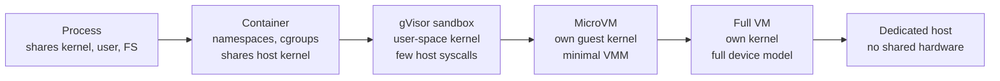

**Reading the diagram.** Moving right, each step removes a shared layer, so a tenant's code must defeat more to reach a neighbor, and each step costs more memory, start time or money per tenant. A **process** shares the kernel, the user namespace and usually the file system. A **container** uses Linux namespaces to give the process its own view of process IDs, mounts and network, and cgroups to cap its CPU, memory and I/O (§42.3), but every system call still reaches the shared host kernel, so one kernel bug can become an escape. **gVisor** intercepts the container's system calls in a user-space kernel, so the host kernel sees only a small, filtered set. A **microVM** such as Firecracker gives each tenant its own guest kernel behind hardware virtualization with a deliberately minimal device model. A **full VM** does the same with a general-purpose device model. A **dedicated host** shares no hardware with other tenants, which also removes microarchitectural side channels (§47.12.3). There are no runtime data flows here; the arrows show increasing isolation.

### 47.9.2 How gVisor and Firecracker work

**gVisor** places an application kernel, the **Sentry**, written in Go, between the sandboxed application and the host. The Sentry implements the Linux system-call interface itself: when the application makes a system call, a platform mechanism (the default **systrap** platform uses seccomp to trap system calls; a KVM platform is also available) redirects it to the Sentry, which handles it in user space and makes only a restricted set of host system calls, enforced by a seccomp filter. File-system access can be mediated by a separate **Gofer** process [gVisor Docs]. The cost is overhead on system-call-heavy and I/O-heavy workloads; CPU-bound code runs at close to native speed.

**Firecracker** is a virtual machine monitor (VMM) built on Linux KVM and written in Rust, designed for serverless workloads [Agache et al. 2020]. It exposes only a handful of emulated devices (virtio network and block, a serial console, a minimal keyboard controller used for reset), with no BIOS and no PCI, which keeps both the attack surface and the boot path small. Each Firecracker process is additionally confined by a **jailer** that applies namespaces, cgroups and a seccomp filter, so an attacker who escapes the guest still lands in a restricted process: defense in depth. The paper reports boot to user-space application code in as little as 125 ms, under 5 MiB of VMM memory overhead per microVM, and creation of up to 150 microVMs per second per host [Agache et al. 2020].

::: industry
**AWS Lambda and Firecracker.** AWS built Firecracker because Lambda needed the isolation of virtual machines for untrusted code from many customers, with the density and start-up speed of containers. The paper explains that Lambda originally used containers to separate functions and separate virtual machines to separate customer accounts, which wasted capacity; Firecracker let it run each function's execution environment in its own microVM and pack many microVMs from different customers onto one host. The paper describes the design choices (a minimal device model, a jailer, KVM rather than a new hypervisor) as trading generality for a small trusted code base [Agache et al. 2020]. Chapter 48 covers Lambda's internals.
*Evidence: Primary* — [Agache et al. 2020]
:::

::: industry
**gVisor in Google's sandboxes.** gVisor was open-sourced by Google in 2018. It has been reported to sandbox customer code in Google services such as App Engine standard, Cloud Functions and the first-generation Cloud Run execution environment, chosen to give container-like density without exposing the host kernel's full system-call interface.
*Evidence: Secondary* — reported by the gVisor project and third-party summaries; see Open verification items.
:::

### 47.9.3 Comparing boundaries and their cost

**Table 47.8 — Compute isolation spectrum (figures as of 2026; verify for your versions).**

| Boundary | Shared attack surface | Start time | Per-instance overhead | Density | Untrusted multi-tenant code? |
|---|---|---|---|---|---|
| Process | Kernel, user, file system | ~ms | ~0 | Highest | No |
| Container (runc) | Full host kernel syscall interface | ~0.1–1 s | ~MiB (shim, runtime) | Very high | No, unless hardened and tenants semi-trusted |
| gVisor (runsc) | Sentry plus a small filtered set of host syscalls | Slightly slower than runc | Tens of MiB (Sentry, Gofer), syscall CPU overhead | High | Yes, for many workloads |
| MicroVM (Firecracker, Kata) | Minimal virtual devices, KVM | ~125 ms boot (Firecracker) | < 5 MiB VMM plus guest kernel memory | High | Yes |
| Full VM | Virtual devices, hypervisor | Tens of seconds | Hundreds of MiB (guest OS) | Medium | Yes |
| Dedicated host | None (except provider control plane) | Minutes | Whole host | Lowest | Yes, including side-channel concerns |

::: formula
**Hosts and cost per tenant for an isolation choice**

$$H = \left\lceil \frac{N\,(m + o)}{M} \right\rceil \qquad c = \frac{H \, p}{N}$$

| Symbol | Meaning | Units |
|---|---|---|
| $N$ | Tenant workloads to run concurrently | workloads |
| $m$ | Memory a workload needs for itself | MiB |
| $o$ | Isolation overhead per workload (runtime, sandbox, guest kernel) | MiB |
| $M$ | Usable memory per host | MiB |
| $H$ | Hosts required (memory-bound case) | hosts |
| $p$ | Cost per host per month | dollars/month |
| $c$ | Isolation-inclusive cost per tenant workload per month | dollars/month |
:::

::: example
**Worked example — Hosting TaskForge Automations.** TaskForge runs 10,000 concurrently active tenant automation scripts, each needing $m = 128$ MiB. Hosts offer $M = 256$ GiB $= 262{,}144$ MiB usable at $p = \$3$/hour $\times\ 730$ h $= \$2{,}190$/month. The overheads are planning assumptions for illustration, not vendor figures: container 2 MiB, gVisor 30 MiB, microVM 40 MiB (VMM plus a trimmed guest kernel and init), full VM 512 MiB.

1. Container: $10{,}000 \times 130 = 1{,}300{,}000$ MiB; $1{,}300{,}000/262{,}144 = 4.96$, so $H = 5$; $c = 5 \times 2{,}190 / 10{,}000 = \$1.10$.
2. gVisor: $10{,}000 \times 158 = 1{,}580{,}000$; $6.03 \Rightarrow H = 7$; $c = 7 \times 2{,}190/10{,}000 = \$1.53$.
3. MicroVM: $10{,}000 \times 168 = 1{,}680{,}000$; $6.41 \Rightarrow H = 7$; $c = \$1.53$.
4. Full VM: $10{,}000 \times 640 = 6{,}400{,}000$; $24.41 \Rightarrow H = 25$; $c = 25 \times 2{,}190/10{,}000 = \$5.48$.
5. Dedicated host per tenant: $H = 10{,}000$; $c = \$2{,}190$.

**Interpretation.** Because the scripts are small, overhead dominates the comparison: a microVM costs about 40% more than a container per tenant but runs untrusted code safely, a full VM costs five times as much, and a dedicated host 2,000 times as much. **Engineering implication.** For untrusted, small, numerous workloads, sandboxes and microVMs are the sweet spot. Reserve dedicated hosts for contracts that require them and price them accordingly. Repeat the calculation for CPU: if a syscall-heavy workload loses, say, 20% throughput under gVisor, CPU rather than memory may become the binding constraint.
:::

### 47.9.4 Isolation in Kubernetes

A shared Kubernetes cluster is a common internal multi-tenant platform, and its documentation lists the layers to combine [Kubernetes Docs: Multi-tenancy]:

1. **Namespace per tenant** with RBAC roles that grant each tenant's identities rights only in its namespaces.
2. **ResourceQuota** per namespace to cap total CPU, memory, storage and object counts, and **LimitRange** to set default and maximum requests per pod, so no pod lands without limits.
3. **NetworkPolicy** with default deny between namespaces (by default every pod can reach every other pod, §42.9).
4. **RuntimeClass** to run untrusted tenants' pods under gVisor or a microVM runtime such as Kata Containers (§42.3.4).
5. **Dedicated node pools** via taints, tolerations and node affinity (§42.13.2) for tenants that must not share kernels or hardware.
6. **Control-plane isolation.** Namespaces share one API server, so a tenant creating objects in a loop affects everyone; API priority and fairness settings, per-tenant object-count quotas, or a **virtual control plane** per tenant address this.

::: warning
**Warning — The shared kernel is the line.** Namespaces, cgroups, quotas and network policies give performance and fault isolation between semi-trusted teams. They do not make it safe to run code from mutually hostile tenants on the same kernel. Put untrusted code behind gVisor, a microVM or a VM boundary, and keep tenant pods off nodes that run privileged platform components.
:::

## 47.10 Control plane and data plane

### 47.10.1 Two planes with different jobs

::: definition
**Definition — Control plane and data plane (multi-tenant).** The **data plane** serves tenants' requests: routers, application services, caches and databases. The **control plane** manages tenants: it onboards and offboards them, provisions and places their resources, stores their configuration, tier and limits, issues identities, and meters usage for billing. The control plane is itself multi-tenant-aware but serves operators and tenant administrators, not end users' traffic [AWS SaaS Fundamentals 2022].
:::

#### Why does this exist?

Tenant management changes slowly and needs rich workflows (approvals, provisioning, billing integration), while request serving changes nothing and needs low latency and very high availability. Mixing them means a bug in a billing workflow can take down request serving, and a provisioning surge for one new enterprise tenant can slow everyone's requests. Separating them lets each be built, scaled and deployed for its own job, and lets the data plane keep running when the control plane is down: **static stability** [Weiss and Furr 2020].

**Figure 47.10 — Multi-tenant control plane and data plane.**

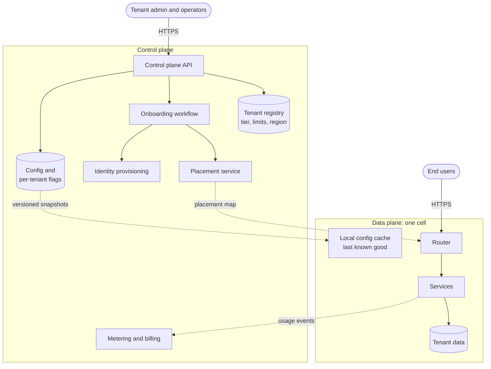

**Reading the diagram.** Tenant administrators and operators use the control plane API, which records tenants in the registry and runs onboarding workflows that call placement and identity provisioning. Configuration, limits and per-tenant feature flags are published as versioned snapshots and pushed asynchronously (dotted) into each cell's local cache; the placement map is pushed to routers the same way. End users' requests travel only through the data plane, synchronously. Usage events flow asynchronously back to metering. Failure points: if the control plane fails, existing tenants keep working from cached configuration, but new tenants cannot be onboarded and limits cannot change; a bad configuration snapshot is the main way the control plane can hurt the data plane, so snapshots are validated and rolled out cell by cell. Scaling: the control plane scales with the number of tenants and changes; the data plane with request volume.

### 47.10.2 Onboarding, configuration and per-tenant flags

**Onboarding** should be an automated, idempotent workflow (§22.15), because it touches many systems and any step can fail:

1. Create the tenant record (ID, tier, region, limits) in the registry.
2. Choose a placement: cell and shard for pooled tiers; provision a silo for premium tiers (infrastructure as code, §43.8).
3. Provision identity: an identity-provider organization or realm, an admin user, and the token claims that carry the tenant ID.
4. Provision per-tenant resources: KMS key (§47.5.4), storage prefixes, default configuration, quotas.
5. Publish the placement and configuration, wait until the target cell acknowledges them, then mark the tenant active.

Each step records completion so a retried workflow resumes rather than duplicating. A pooled tenant should be live in seconds; a silo in minutes, not days.

**Per-tenant configuration** includes limits and weights (§47.8), enabled modules, integrations and data-retention settings. Store it centrally, distribute it as versioned, validated snapshots, and have the data plane fail static: on a bad or missing snapshot, keep the last known good one.

**Per-tenant feature flags** (§43.7) are the main release tool in a multi-tenant product. Evaluate flags with the tenant as the context, so a feature can be enabled first for internal tenants, then for an early-access cohort, then by percentage of tenants, with enterprise tenants who demand change control placed in a later ring. A per-tenant kill switch disables a feature for one tenant whose usage triggers a bug, without a deploy. Two cautions: flags that change data formats must remain on once enabled for a tenant (or be migrated back), and every long-lived per-tenant flag is a permanent fork of behavior that tests must cover, so retire them.

## 47.11 Observability and cost attribution per tenant

### 47.11.1 Tenant context everywhere, labels carefully

Every signal that a shared system emits should be attributable to a tenant, because the questions you will be asked are per tenant: "why is Acme slow?", "who filled shard 7?", "what does Beta cost us?" That requires **tenant context propagation**: the tenant ID, taken once from the verified token, travels with the request through RPC metadata, message headers and job payloads, so that background work and downstream services know whose work they are doing. OpenTelemetry **baggage** can carry it into traces and logs; treat it as a label for telemetry only, never as an authorization input, because any upstream hop can set it.

Where the tenant ID goes depends on the signal:

- **Logs and traces:** always. High-cardinality attributes are what logs and traces are for (§40.3.3).
- **Metrics:** carefully. A latency histogram labelled with route (25 values) and tenant (40,000) has $25 \times 40{,}000 \times 14 = 14$ million series before adding pod or status labels, far beyond what a Prometheus-style system holds comfortably (§40.5.3).

Three patterns keep per-tenant metrics affordable:

1. **Usage counters with few other labels.** One counter per tenant per resource type (requests, CPU-milliseconds, rows read, bytes stored, five types): $40{,}000 \times 5 = 200{,}000$ series, manageable.
2. **Top-N plus "other".** Label latency histograms with the tenant only for the top few hundred tenants by revenue or load, and fold the rest into `tenant="other"` or a tier label.
3. **Events to a columnar store.** Emit one wide event per request with tenant, route, latency and cost, and compute per-tenant percentiles by query in an analytical store, where cardinality is cheap (§40.3.3).

### 47.11.2 Metering, showback and chargeback

::: definition
**Definition — Metering, showback and chargeback.** **Metering** records each tenant's consumption of billable or scarce resources as durable usage events. **Showback** reports the cost attributed to each tenant (or internal team) without billing it. **Chargeback** bills that cost to the tenant or team's budget. External SaaS turns metering into invoices; internal platforms use showback or chargeback to make teams see the cost of what they consume.
:::

**Figure 47.11 — Per-tenant metering pipeline.**

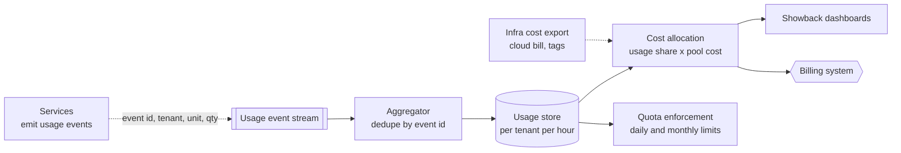

**Reading the diagram.** Services emit usage events asynchronously to a durable stream; each carries an event ID, tenant ID, unit (request, CPU-millisecond, GB-hour) and quantity. The aggregator deduplicates by event ID, because producers retry and the stream delivers at least once (§30.5), and writes hourly per-tenant totals to the usage store, the storage boundary. Cost allocation joins usage with the cloud bill (itself tagged by cell, tier or silo) to produce per-tenant cost for showback and, for billable units, invoices. Quota enforcement reads the same totals for daily or monthly limits. Failure points: lost events under-bill and duplicate events over-bill, so the pipeline needs idempotent aggregation and reconciliation against independent counts; events emitted only on success miss the cost of failed requests. Scaling: partition the stream by tenant ID.

::: formula
**Usage-based cost allocation**

$$C_i = \sum_{r} K_r \frac{u_{i,r}}{\sum_j u_{j,r}} + D_i \qquad \text{Margin}_i = \frac{P_i - C_i}{P_i}$$

| Symbol | Meaning | Units |
|---|---|---|
| $K_r$ | Total cost of shared resource pool $r$ for the period (compute, database, observability) | dollars/month |
| $u_{i,r}$ | Tenant $i$'s metered usage of resource $r$ | resource units (CPU-s, IO, GB) |
| $D_i$ | Direct costs dedicated to tenant $i$ (silo resources, own key, own index) | dollars/month |
| $C_i$ | Cost attributed to tenant $i$ | dollars/month |
| $P_i$ | Price tenant $i$ pays | dollars/month |
:::

::: example
**Worked example — Is TaskForge's tenant "Northwind" profitable?** One pooled cell costs \$70,000/month in compute, \$40,000 in its database and \$10,000 in observability. Northwind's metered share is 3% of CPU-seconds, 5% of database I/O and 2% of log bytes. It also has a dedicated search index costing \$300/month. It pays \$3,500/month.

1. Compute: $70{,}000 \times 0.03 = \$2{,}100$.
2. Database: $40{,}000 \times 0.05 = \$2{,}000$.
3. Observability: $10{,}000 \times 0.02 = \$200$.
4. Direct: $D = \$300$. Total $C = 2{,}100 + 2{,}000 + 200 + 300 = \$4{,}600$.
5. Margin $= (3{,}500 - 4{,}600)/3{,}500 = -31\%$.

**Interpretation.** Northwind pays for a mid-size plan but consumes like a large one, mainly through database I/O. Because shares divide by *metered* usage, the pool's idle headroom is spread proportionally over all tenants; some teams report it separately as a platform cost instead, which makes every tenant look cheaper but hides the cost of headroom. **Engineering implication.** Without per-tenant metering this tenant is invisible; with it, the product team can move Northwind to a higher tier, add a cost-based quota on the expensive operation, or optimize that query path. Chapter 51 covers unit economics in depth.
:::

## 47.12 Security boundaries and cross-tenant attacks

### 47.12.1 Attack classes

In a pooled system, the most damaging security failure is not an outsider breaking in; it is one legitimate tenant reaching another tenant's data. The attack classes below are the ones to design and test against.

**Table 47.9 — Cross-tenant attack classes and the controls and tests that address them.**

| Attack class | How it works | Primary control | Test that proves isolation |
|---|---|---|---|
| Cross-tenant IDOR | Tenant A requests `/projects/9001`, which belongs to B; handler checks login, not ownership (§10.7.1) | Tenant-scoped data access layer; RLS | Two-tenant test: A's token on every B object ID returns 404 |
| Tenant ID from client input | Handler trusts `X-Tenant-Id` header or body field | Tenant only from verified token | Forged header test: response unchanged |
| Confused deputy | Service uses its own broad privileges on an object a tenant named | Act with the tenant's scoped credentials; external IDs | Tenant supplies another tenant's resource ARN; call fails |
| Shared cache or index leak | Cache key or search query lacks tenant | Tenant prefix in every key; tenant filter enforced by the index layer | Same query string from A and B returns different results |
| Background job without context | Batch job runs as a privileged role across all tenants | Jobs carry tenant ID and run with tenant-scoped role | Job for A cannot read B's rows |
| Object storage path abuse | Path traversal or guessable keys under a shared bucket | Server-generated keys under per-tenant prefixes; scoped short-lived URLs | `../` and other-tenant prefixes rejected |
| Resource exhaustion | Tenant consumes shared capacity | Quotas, fair queuing (§47.8) | Load test one tenant; others' SLOs hold |
| Microarchitectural side channel | Co-resident code infers secrets via shared caches or predictors | Patched hosts; no cross-tenant core sharing; dedicated hosts for sensitive tiers | Placement audit: tenants never share physical cores |

### 47.12.2 The confused deputy

::: definition
**Definition — Confused deputy.** A program (the deputy) that holds authority from several sources and is tricked into using one principal's authority on behalf of another. Hardy named it after a compiler that, given an output file name by a user, overwrote a billing file the compiler itself had permission to write [Hardy 1988].
:::

Multi-tenant SaaS products are deputies by design: they hold permissions into every tenant's resources. A classic case is a SaaS integration that assumes a role in each customer's cloud account. Tenant A registers an integration and, instead of its own role, supplies the role ARN that tenant B created for the same SaaS vendor. If the vendor simply assumes whatever role the tenant names, it reads B's account on A's behalf. The fix AWS documents is an **external ID**: the vendor generates a unique, unguessable value per tenant, the customer puts it in its role's trust policy as a condition, and the vendor always passes the external ID of the tenant making the request; for AWS service principals, the `aws:SourceArn` and `aws:SourceAccount` condition keys play the same role [AWS Docs: IAM].

**Figure 47.12 — A confused deputy attack and the external-ID defense.**

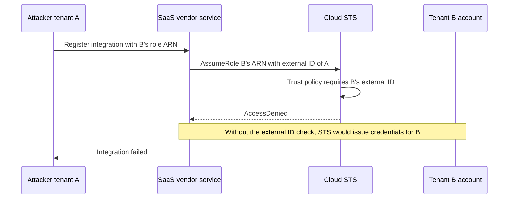

**Reading the diagram.** Attacker tenant A registers an integration naming tenant B's role. The vendor service calls the cloud's security token service (STS) synchronously to assume the role, passing the external ID it generated for *A*, the tenant making the request, never a value the tenant supplies. B's role trust policy accepts only the external ID the vendor issued to B, so STS denies the call. Without that condition, STS would return credentials and the vendor would read B's account on A's behalf, with no storage boundary in between. The failure point is the deputy's logic, not the cloud's: the vendor must bind every privileged action to the requesting tenant's identity.

The general rule follows: a multi-tenant service should act *with the requesting tenant's authority*, not its own. Concretely, scope credentials per request (for example, assume a tenant-scoped role whose policy conditions on a tenant tag, or use RLS with a tenant session), so that even a logic bug cannot reach another tenant's resources.

### 47.12.3 Side channels, conceptually

When tenants share hardware, a malicious tenant may infer another's secrets from timing differences in shared microarchitectural state: caches, branch predictors, translation buffers, and the execution units of sibling hyperthreads on one core. Ristenpart et al. showed in 2009 that an attacker could deliberately place VMs on the same physical host as a target in a public cloud and measure cache-based signals across the VM boundary [Ristenpart et al. 2009]. The Spectre attacks showed that speculative execution can leak data across protection boundaries that software considered sound [Kocher et al. 2019].

You do not need the details to design for them. Mitigations, from cheapest to strongest:

1. Keep hosts, hypervisors and microcode patched, and use constant-time cryptographic code.
2. Never schedule two tenants on sibling hyperthreads of one physical core; Linux **core scheduling** lets the kernel enforce that only mutually trusting tasks share a core [Linux Docs: Core Scheduling].
3. Use hardware-virtualized boundaries (microVMs, VMs) rather than shared kernels for untrusted code.
4. Offer dedicated hosts for tenants whose threat model includes a well-funded co-resident attacker, and price them as such.

### 47.12.4 Tests that prove isolation

Isolation is a property you must test continuously, because every new endpoint, table, cache and job can break it:

1. **Two-tenant fixture tests.** In integration tests, create tenants A and B, and for every API endpoint attempt each object of B with A's token. Expect 404, not 403, so responses do not confirm that B's object exists.
2. **Database policy tests.** Run the RLS script of §47.5.2 in CI, plus a catalog check that fails the build if any table with a `tenant_id` column lacks forced RLS:

```sql
SELECT c.relname AS unprotected_table
FROM pg_class c
JOIN pg_namespace n ON n.oid = c.relnamespace
JOIN pg_attribute a ON a.attrelid = c.oid AND a.attname = 'tenant_id'
WHERE n.nspname = 'public'
  AND c.relkind IN ('r', 'p')
  AND NOT (c.relrowsecurity AND c.relforcerowsecurity);
```

   Against the example database plus a new `projects` table created without a policy, this query returned exactly one row, `projects`; the CI job fails whenever the result is non-empty.
3. **Noisy-neighbor load tests.** Drive one synthetic tenant far beyond its limits in a staging cell and assert that the other tenants' SLIs stay within SLO, as the simulation of §47.8.4 does in miniature.
4. **Production canary tenants.** Two synthetic tenants continuously attempt cross-tenant reads through the public API; any success pages the security on-call.
5. **Placement audits.** Periodically verify that silo tenants run only on their dedicated resources and that no untrusted-code workload shares a kernel with another tenant.
6. **Penetration tests and bug bounties** that explicitly target cross-tenant access.

::: mistake
**Common misconception — "Our tenant IDs are UUIDs, so they cannot be guessed."** Unguessable IDs reduce casual enumeration but are not access control: IDs leak through URLs, logs, shared links, support tickets and referrer headers. Every access must check that the object belongs to the requesting tenant.
:::

## 47.13 Tenant lifecycle

### 47.13.1 States and transitions

A tenant moves through a lifecycle, and each transition is a control-plane workflow that must be idempotent, auditable and reversible until its final step.

**Figure 47.13 — Tenant lifecycle.**

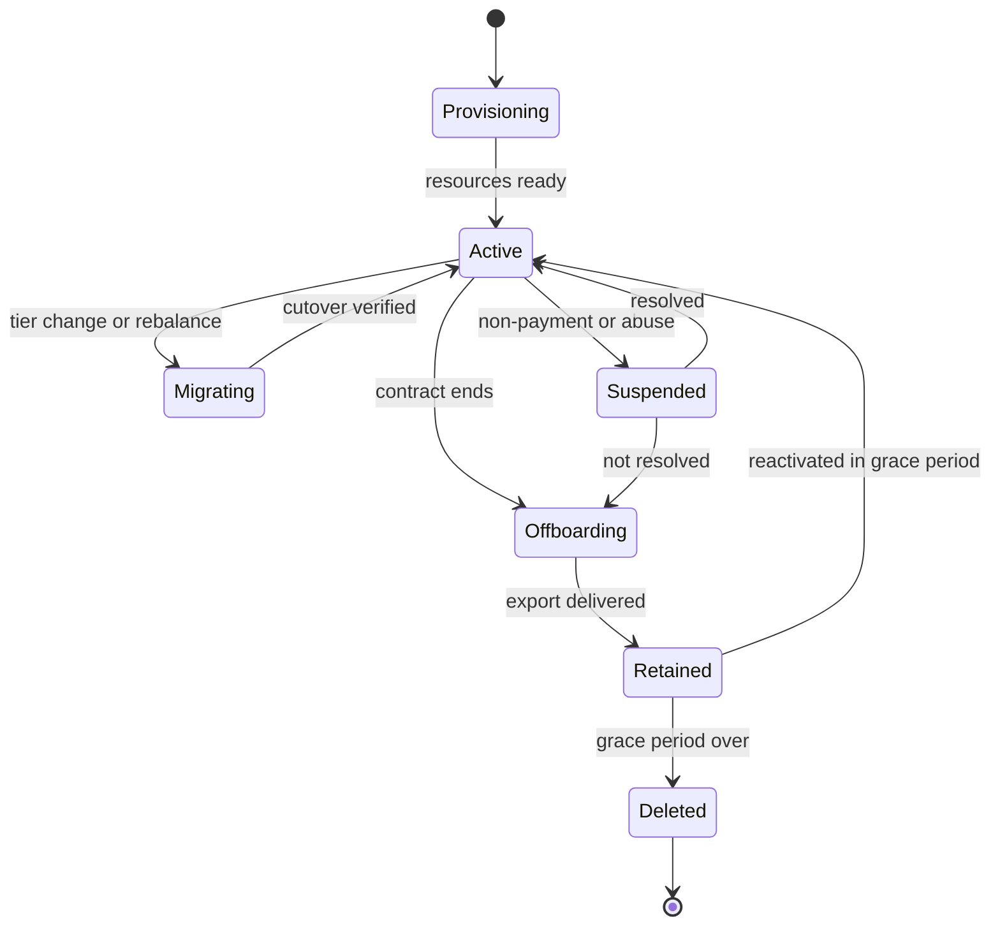

**Reading the diagram.** States are recorded in the tenant registry; each arrow is a workflow run by the control plane, asynchronous from the tenant's point of view. *Provisioning* creates resources (§47.10.2). *Migrating* moves data between placements or tiers while the tenant stays online. *Suspended* blocks access but keeps data. *Offboarding* exports data, *Retained* keeps it, disabled, for a contractual grace period, and *Deleted* is the one irreversible state. Failure points: a migration that fails mid-way must be able to roll back to the old placement; a deletion that misses a store (a cache, a search index, a backup) leaves data behind. Scaling: lifecycle workflows are rare per tenant but numerous across 40,000 tenants, so they must be fully automated.

### 47.13.2 Migration between tiers

Moving a tenant from a pooled cell to a silo (or between cells) is the per-tenant version of the online migration in §14.9.5:

1. **Provision** the target (silo database, keys, services) from the same infrastructure code as every other silo.
2. **Copy** a consistent snapshot of the tenant's rows. Shared tables with a leading `tenant_id` make this a range scan.
3. **Stream changes** made since the snapshot, using change data capture filtered by tenant.
4. **Verify** row counts and checksums per table for that tenant.
5. **Cut over**: briefly block writes for that tenant (seconds), apply the final changes, flip its directory entry, and fence the old location so it rejects writes for that tenant.
6. **Keep the old copy** read-only for a rollback window, then delete it.

The same steps run in reverse when a silo tenant downgrades. A product with tiers should rehearse tier migration on synthetic tenants every week, because a migration path that is never exercised fails exactly when an enterprise sales deal depends on it.

### 47.13.3 Offboarding and data deletion

Offboarding must end with the tenant's data gone from *every* store, provably, within a contractual or legal deadline (GDPR and similar laws are covered in Chapter 50):

1. **Export** the tenant's data in a documented format, if the contract requires portability.
2. **Disable** access and stop all jobs and integrations for the tenant.
3. **Retain** for the grace period, then **delete** from primary stores, replicas, caches, search indexes, analytics copies, object storage and queues, driven by a data inventory that lists every store holding tenant data.
4. **Backups**: restoring a backup to delete one tenant's rows is impractical. Either let backups expire on their normal retention (and document that deadline), or crypto-shred: if every backup copy of the tenant's data was encrypted under the tenant's own key (§47.5.4), destroying that key makes all copies unreadable at once.
5. **Logs and telemetry**: keep tenant identifiers out of long-retention logs where possible, or apply the same retention limits.
6. **Record** a deletion certificate: what was deleted, from where, when, and the key-destruction event.

::: example
**Worked example — Deletion deadline with and without crypto-shredding.** TaskForge keeps daily backups for 35 days and archives monthly snapshots for 12 months. A tenant's 30-day grace period ends today.

1. Without per-tenant keys, the tenant's data is fully gone only when the last monthly archive containing it expires: up to 12 months from the end of the grace period.
2. With a per-tenant KEK and every DEK wrapped by it, scheduling the KEK for deletion (many KMSs impose a waiting period, commonly 7 to 30 days, as of 2026) makes every backup copy unreadable within that waiting period.
3. If the contract promises deletion within 30 days, only design 2 can meet it without restoring and rewriting a year of archives.

**Interpretation.** Crypto-shredding turns a 12-month deletion tail into days. **Engineering implication.** Decide per-tenant keys at design time: retrofitting them means re-encrypting all existing data and waiting for every old backup to expire anyway.
:::

**Table 47.10 — Lifecycle failure scenarios.**

| What goes wrong | Why | Detection | Recovery | Prevention |
|---|---|---|---|---|
| Onboarding half-completes | Step failed, workflow not idempotent | Tenant stuck in Provisioning | Resume from last completed step | Idempotent, checkpointed workflow |
| Writes lost during tier migration | Router cache stale after cutover | Row-count mismatch | Replay from change stream | Fence old location; verify before delete |
| Deleted tenant's data found in search | Index not in data inventory | Post-deletion scan | Purge index | Inventory every store; deletion tests |
| Shared backup prevents timely deletion | No per-tenant keys | Deletion deadline audit | Wait for expiry; disclose | Per-tenant keys and crypto-shredding |

## 47.14 Summary and revision notes

::: summary
- Multi-tenancy trades isolation for pooling. Headroom for independent tenants grows with $\sqrt{n}$, not $n$; correlated demand shrinks the saving (48% falls to 24% at $\rho = 0.3$ in §47.3.2).
- Isolation has three dimensions: security, performance and fault. Decide each one per layer.
- Silo, pool and bridge are per-layer choices. Tiered products pool small tenants in cells and silo premium ones, from one codebase. Measure blast radius by revenue as well as by tenant count.
- Data isolation runs from database-per-tenant through schema-per-tenant to shared tables. Shared tables need forced row-level security, transaction-scoped tenant settings and indexes that lead with `tenant_id`. Per-tenant keys add BYOK and crypto-shredding.
- Place tenants through a directory. Whales grow relative to the fleet as shard count rises, so place or split them explicitly.
- Noisy neighbors contend for whichever resource is least partitioned, often caches, memory bandwidth, connections or queues. Detect them with per-tenant usage and per-tenant SLIs.
- Per-tenant rate limits are always oversubscribed. They bound one tenant; weighted fair queuing splits real capacity max–min fairly; shedding by priority decides who loses when fair shares are not enough.
- Compute isolation runs from process, container, gVisor and microVM to VM and dedicated host. Untrusted code needs at least a sandbox or microVM. Overhead per tenant decides the cost.
- Keep the control plane (onboarding, placement, configuration, flags, metering) apart from the data plane, and keep the data plane statically stable.
- Meter usage per tenant for showback, chargeback and margin. Keep `tenant_id` out of high-cardinality metric labels.
- Test cross-tenant attacks continuously: IDOR, trusting a client-supplied tenant ID, confused deputies, shared caches and side channels.
- Lifecycle workflows (onboarding, tier migration, offboarding) must be idempotent and rehearsed. Deletion must reach every store, including backups.
:::

## 47.15 Knowledge checkpoint

1. Name the three dimensions of tenant isolation.
2. Why does pooling save less capacity than the independent-tenant formula predicts?
3. What is the bridge model? Give an example.
4. Why can an enterprise silo have a revenue blast radius twenty times its tenant blast radius?
5. What three PostgreSQL settings or role choices are needed for RLS to protect a table against the application role?
6. Why use `SET LOCAL` rather than `SET` for the tenant ID?
7. Name two leaks that RLS does not prevent.
8. What does crypto-shredding achieve that deleting rows does not?
9. Why does a whale become harder to place as the shard count grows?
10. Why can a noisy neighbor slow a victim whose CPU usage falls?
11. Why do per-tenant token buckets alone fail to protect quiet tenants?
12. Compute the max–min fair allocation for $C = 900$ and demands 600, 200, 200 with equal weights.
13. What is the main security difference between a container and a microVM?
14. What does static stability mean for a multi-tenant control plane?
15. How does an external ID defend against a confused deputy?

<details><summary>Answers</summary>

1. Security isolation (no cross-tenant data access), performance isolation (no SLO impact from neighbors) and fault isolation (failures stay within one compartment).
2. Real tenants' demand is positively correlated (same time zones, same events), and correlation adds covariance terms to pooled variance.
3. A per-layer mix: for example, shared services with a separate database per tenant.
4. Because blast radius by revenue weights each tenant by what it pays: one \$50,000 tenant out of 2,000 is 0.05% of tenants but 1% of revenue.
5. `ENABLE ROW LEVEL SECURITY` with a policy, `FORCE ROW LEVEL SECURITY` (so the owner is also subject), and an application role that is not a superuser and lacks `BYPASSRLS`.
6. `SET LOCAL` ends with the transaction, so a pooled connection cannot carry one tenant's context into another tenant's request.
7. Any two of: application sets the wrong tenant; caches, search indexes, object storage or logs without tenant scoping; global unique constraints revealing values; `SECURITY DEFINER` functions or bypassing roles.
8. It makes every copy unreadable at once, including backups and replicas that cannot practically be edited.
9. The mean shard load shrinks as $1/S$ while the whale's load stays the same, so the whale becomes a larger multiple of a shard.
10. The antagonist evicts the victim's cache lines or saturates memory bandwidth, so the victim stalls on memory: lower CPU utilization, higher latency. CPI reveals it.
11. Limits are oversubscribed, so the sum of admitted traffic can still exceed capacity, and a shared FIFO queue spreads the resulting delay over everyone.
12. Try 300 each: the two 200s are satisfied, so the large tenant gets $900 - 400 = 500$. The allocation is 500, 200, 200.
13. A container shares the host kernel's full system-call interface. A microVM has its own guest kernel behind hardware virtualization and a minimal device model.
14. The data plane keeps serving existing tenants from cached configuration and placement when the control plane is down. Only management operations stop.
15. The vendor passes a unique, vendor-generated external ID for the requesting tenant, and each customer's role trusts only its own external ID, so naming another customer's role fails.
</details>

## 47.16 Interview questions

### Basic

**Q1.** What is the difference between silo and pool tenancy, and when would you choose each? **Answer.** Silo gives each tenant dedicated resources: strongest isolation, per-tenant upgrades and residency, but idle headroom and N deployments. Pool shares everything and isolates logically: lowest cost and instant onboarding, but noisy neighbors and a larger blast radius. Choose silo when contracts, regulations or untrusted compute require it. Choose pool for many small, similar tenants. Most products are tiered and use both.

**Q2.** How would you stop one tenant from reading another's rows in a shared PostgreSQL table? **Answer.** Derive the tenant from the verified token. Set it per transaction with `SET LOCAL`. Enforce it with a forced RLS policy on every tenant table, and connect as a role without bypass rights. Lead every index with `tenant_id`, scope unique constraints by tenant, and test with two-tenant fixtures and a catalog check in CI.

### Intermediate

**Q3.** A pooled cell's p99 latency doubled, but CPU and request rate are flat. How do you investigate? **Answer.** Compare per-tenant SLIs to find the victims, then rank tenants on the same shard or host by change in usage: rows scanned, cache bytes, I/O, connections held. Check CPI for cache or memory-bandwidth interference. Check connection-pool wait and queue lag by tenant. Contain the antagonist with a tighter cost-based quota or lower weight, then move it or add a per-tenant bulkhead.

**Q4.** Design per-tenant rate limiting for a 20,000 RPS cell with 8,000 tenants. **Answer.** Use tier-based token buckets, each well under the cell's capacity (at most about 5%), enforced at the gateway with distributed quota (§22.8). Behind them, use cost-weighted per-tenant fair queues in front of the scarce resources, bounded queues per tenant, and shedding by tier. Expect 10–15× oversubscription, and track aggregate peak against capacity to decide when to split the cell.

### Advanced

**Q5.** Design isolation for a platform that runs customers' arbitrary code next to their data. **Answer.** Run each tenant's code in a microVM or gVisor sandbox with a per-tenant identity, never a shared kernel. Give the sandbox network access only to a tenant-scoped data API, and enforce tenant identity in that API and in the database (RLS or a database per tenant). Add per-tenant CPU, memory and I/O limits, plus a fair scheduler for invocations. Keep tenants off sibling hyperthreads, and offer dedicated hosts for sensitive tenants. Meter CPU-milliseconds and memory per invocation for billing. Test escape and cross-tenant access continuously.

**Q6.** An enterprise customer wants to move from your pooled tier to a dedicated silo with its own key, without downtime. Walk through it. **Answer.** Provision the silo from the standard infrastructure code, and create a KEK in the customer's KMS with a grant to your service. Snapshot the tenant's rows (a `tenant_id` range scan), re-encrypting under the new key. Stream changes by CDC filtered by tenant, then verify counts and checksums. Cut over with a seconds-long write block: flip the directory entry and fence the old location. Keep the old copy read-only through a rollback window, then delete it. Afterwards, check metering and alerts for the new placement.

## 47.17 Practical exercises

1. Run the RLS script of §47.5.2 on PostgreSQL. Then remove `FORCE ROW LEVEL SECURITY` and repeat the tests as the table owner. Record what changes.
2. Extend the simulation of §47.8.4 so that each request has a cost of 1–10 units, and use cost in the finish tag. Show that a tenant sending few but expensive requests is contained.
3. Repeat the pooling calculation of §47.3.2 using a week of real per-tenant request counts from any system you can access. Estimate $\rho$.
4. Design the Prometheus metrics for a 40,000-tenant service using the top-N-plus-other pattern, and compute the series count.
5. Write a two-tenant integration test harness that calls every endpoint in an OpenAPI specification with the other tenant's object IDs.

## 47.18 Design challenges

1. **Multi-tenant analytics warehouse.** 3,000 internal teams share one warehouse. Design quotas, fair scheduling of queries (by slot-seconds), cost showback and isolation of a runaway query. Estimate the oversubscription ratio.
2. **Tiered SaaS across regions.** TaskForge must offer EU data residency and enterprise silos. Combine cells, placement constraints and per-tenant keys, and compute blast radius by revenue for your design (Chapter 44 covers multi-region).
3. **Serverless code platform.** Run 50,000 concurrent tenant functions of 256 MiB each. Choose an isolation boundary, compute host count and cost per tenant with the formula of §47.9.3, and describe how you would detect and contain a crypto-mining tenant.

## 47.19 References

1. Agache, A., Brooker, M., Florescu, A., Iordache, A., Liguori, A., Neugebauer, R., Piwonka, P., and Popa, D.-M. "Firecracker: Lightweight Virtualization for Serverless Applications." *USENIX NSDI*, 2020.
2. Amazon Web Services. *SaaS Lens — AWS Well-Architected Framework*. AWS whitepaper, 2023. https://docs.aws.amazon.com/wellarchitected/latest/saas-lens/saas-lens.html (cited as AWS SaaS Lens 2023)
3. Amazon Web Services. *SaaS Tenant Isolation Strategies: Isolating Resources in a Multi-Tenant Environment*. AWS whitepaper, 2020. https://docs.aws.amazon.com/whitepapers/latest/saas-tenant-isolation-strategies/saas-tenant-isolation-strategies.html (cited as AWS Tenant Isolation 2020)
4. Amazon Web Services. *SaaS Architecture Fundamentals*. AWS whitepaper, 2022. (cited as AWS SaaS Fundamentals 2022)
5. Amazon Web Services. *The confused deputy problem*. AWS Identity and Access Management User Guide, accessed 2026. https://docs.aws.amazon.com/IAM/latest/UserGuide/confused-deputy.html (cited as AWS Docs: IAM)
6. Amazon Web Services. *Importing key material* and *External key stores*. AWS Key Management Service Developer Guide, accessed 2026. https://docs.aws.amazon.com/kms/latest/developerguide/ (cited as AWS Docs: KMS)
7. Citus Data. *Multi-tenant Applications* and *Tenant isolation*. Citus documentation, accessed 2026. https://docs.citusdata.com/
8. Demers, A., Keshav, S., and Shenker, S. "Analysis and Simulation of a Fair Queueing Algorithm." *ACM SIGCOMM*, 1989.
9. Ghodsi, A., Zaharia, M., Hindman, B., Konwinski, A., Shenker, S., and Stoica, I. "Dominant Resource Fairness: Fair Allocation of Multiple Resource Types." *USENIX NSDI*, 2011.
10. Golestani, S. J. "A Self-Clocked Fair Queueing Scheme for Broadband Applications." *IEEE INFOCOM*, 1994.
11. gVisor Authors. *gVisor documentation* (What is gVisor?, Security model, Platform guide). Accessed 2026. https://gvisor.dev/docs/ (cited as gVisor Docs)
12. Hardy, N. "The Confused Deputy (or why capabilities might have been invented)." *ACM SIGOPS Operating Systems Review* 22(4), 1988.
13. Kocher, P., Horn, J., Fogh, A., Genkin, D., Gruss, D., Haas, W., Hamburg, M., Lipp, M., Mangard, S., Prescher, T., Schwarz, M., and Yarom, Y. "Spectre Attacks: Exploiting Speculative Execution." *IEEE Symposium on Security and Privacy*, 2019.
14. Kubernetes Authors. *Multi-tenancy*. Kubernetes documentation, accessed 2026. https://kubernetes.io/docs/concepts/security/multi-tenancy/ (cited as Kubernetes Docs: Multi-tenancy)
15. Linux kernel documentation. *Core Scheduling*. Accessed 2026. https://docs.kernel.org/admin-guide/hw-vuln/core-scheduling.html (cited as Linux Docs: Core Scheduling)
16. Lo, D., Cheng, L., Govindaraju, R., Ranganathan, P., and Kozyrakis, C. "Heracles: Improving Resource Efficiency at Scale." *ACM/IEEE ISCA*, 2015.
17. MacCárthaigh, C. "Workload isolation using shuffle-sharding." *Amazon Builders' Library*, 2019. https://aws.amazon.com/builders-library/workload-isolation-using-shuffle-sharding/
18. Parekh, A. K., and Gallager, R. G. "A Generalized Processor Sharing Approach to Flow Control in Integrated Services Networks: The Single-Node Case." *IEEE/ACM Transactions on Networking* 1(3), 1993.
19. PostgreSQL Global Development Group. *Row Security Policies* and *CREATE POLICY*. PostgreSQL 16 documentation. https://www.postgresql.org/docs/current/ddl-rowsecurity.html (cited as PostgreSQL Docs: RLS)
20. Ristenpart, T., Tromer, E., Shacham, H., and Savage, S. "Hey, You, Get Off of My Cloud: Exploring Information Leakage in Third-Party Compute Clouds." *ACM CCS*, 2009.
21. Shreedhar, M., and Varghese, G. "Efficient Fair Queuing Using Deficit Round Robin." *ACM SIGCOMM*, 1995.
22. Weiss, B., and Furr, M. "Static stability using Availability Zones." *Amazon Builders' Library*, 2020. https://aws.amazon.com/builders-library/static-stability-using-availability-zones/
23. Weissman, C. D., and Bobrowski, S. "The Design of the Force.com Multitenant Internet Application Development Platform." *ACM SIGMOD*, 2009.
24. Zhang, X., Tune, E., Hagmann, R., Jnagal, R., Gokhale, V., and Wilkes, J. "CPI²: CPU performance isolation for shared compute clusters." *ACM EuroSys*, 2013.

## 47.20 Open verification items

- AWS *SaaS Architecture Fundamentals*: exact title, year (2022 assumed) and URL. docs.aws.amazon.com could not be reached from the build environment. The SaaS Lens revision date (April 2023) and the Tenant Isolation whitepaper's "historical reference" status come from search results only.
- Google production use of gVisor (App Engine standard, Cloud Functions, first-generation Cloud Run). Reported by secondary sources; gvisor.dev was unreachable.
- gVisor platform details: systrap as default since mid-2023, and the Gofer and directfs behavior. Taken from search summaries of the platform guide.
- The Citus function name and current behavior for isolating a single tenant to its own shard.
- KMS key-deletion waiting periods (7–30 days) and request quotas, as of 2026.
- The isolation-overhead figures in §47.9.3 are labelled planning assumptions. Replace them with measured values if a source is found.
