# Chapter 48 — Edge Computing and Serverless at Scale

> **Level:** 4 · **Track:** A (Traditional) · **Estimated reading time:** 4.5 h

Two ideas share this chapter. **Serverless** lets you hand the provider a function and stop thinking about machines: the platform starts a sandbox when an event arrives, bills you for the milliseconds it ran and reclaims it when traffic stops. **Edge computing** moves small pieces of that code out of the region and into hundreds of points of presence a few milliseconds from users. Both trade control for elasticity, and both have hidden costs: cold starts, concurrency limits, databases that cannot keep up with a function fleet, eventually consistent edge storage and bills that grow linearly with traffic.

Section 33.9 introduced serverless, its cold starts and its break-even cost against servers; §21.9 previewed edge runtimes on CDNs; §41.8.4 and §47.9 explained Firecracker microVMs and the isolation spectrum. This chapter opens those boxes. You will see what "serverless" means precisely (§48.3), how AWS Lambda is built according to its published papers (§48.4), the anatomy and arithmetic of cold starts with a runnable fleet simulation (§48.5), concurrency limits and downstream protection (§48.6), data patterns and anti-patterns (§48.7), edge runtimes (§48.8), edge data and its consistency trade-offs (§48.9), what belongs at the edge (§48.10), cost curves at three traffic scales (§48.11), operations (§48.12) and a decision table (§48.13). The running example is **PhotoShare**, the hypothetical photo app of Chapter 1, at 10 million daily users with about 70 photo uploads per second and 17,400 photo views per second at peak (§1.9). Every PhotoShare number is a teaching assumption.

## 48.1 Learning objectives

After this chapter you should be able to:

- Define serverless by its three properties (no resource management, scale to zero, pay per use) and distinguish FaaS from managed backend services.
- Trace an AWS Lambda invocation through frontend, assignment, placement and worker, and explain slots, microVMs, on-demand image loading and snapshot restore.
- Break a cold start into its phases, compute how a cold-start fraction changes a latency percentile, and choose among mitigations.
- Compute required concurrency with Little's Law, the time to scale under a scaling-rate limit, and the database connections a function fleet will open.
- Design event-driven pipelines with batching, partial failures, idempotency and orchestration, and recognize serverless anti-patterns.
- Compare V8 isolates, WebAssembly sandboxes and microVMs as edge runtimes, including their security models and limits.
- Choose an edge data store by its consistency model and compute edge-versus-origin latency for a request.
- Build cost curves for functions, containers and VMs, including memory–duration pricing, front-door charges and egress.
- Operate serverless systems: tracing across asynchronous hops, versions and aliases, local testing and lock-in.

## 48.2 Prerequisites

- Little's Law — §4.11 (concurrency = arrival rate × duration drives every sizing calculation here).
- Percentiles and tail latency — §4.8, §23.6 (cold starts live in the tail).
- CDN edge, shield and origin — §21.3, §21.9 (edge compute runs inside the CDN).
- Serverless basics, cold starts and break-even cost — §33.9 (this chapter builds on them).
- Firecracker and the isolation spectrum — §41.8.4, §47.9 (the sandbox under each function).
- Containers and images — §42.3, §42.4 (Lambda and Cloud Run load container images).
- Queues, delivery guarantees and dead-letter queues — §30.4, §30.8, §30.11 (the backbone of serverless pipelines).
- Idempotency keys — §22.15 (every event-driven function must be idempotent).
- Workflow engines and Step Functions — §32.11 (orchestration instead of function chains).
- Distributed tracing — §40.6 (following a request across asynchronous hops).

## 48.3 What "serverless" really means

### 48.3.1 FaaS plus managed backends

::: definition
**Definition — Serverless computing.** A cloud programming model with three properties: the developer **does not manage resource allocation** (no servers, clusters or capacity plans), the platform **scales automatically, including to zero**, and billing is **in proportion to resources used** rather than resources reserved [Jonas et al. 2019]. In practice it combines **functions as a service (FaaS)**, which run developer code in short-lived sandboxes triggered by events, with **backend as a service (BaaS)**: managed object storage, databases, queues, authentication and so on, which hold all the state.
:::

#### First-principles explanation

A restaurant kitchen can be staffed two ways. In the first, you hire cooks for every shift and pay them whether or not orders arrive. In the second, you have an agency that sends a cook the moment an order comes in and bills you by the minute of cooking; the agency also supplies the pantry, the fridge and the dishwasher. Agency cooks never remember anything between orders, so everything they need must be in the shared pantry. The first cook of the evening takes a few minutes to arrive and put on an apron: a **cold start**. Serverless is the agency kitchen. FaaS is the cooks, BaaS is the pantry and appliances, and statelessness is the rule that nothing survives in a cook's pockets.

#### Why does this exist?

The Berkeley view of serverless computing argued that the early cloud copied the server too literally: users rented virtual machines and still had to provision, patch, monitor and scale them, and most of those machines idled [Jonas et al. 2019]. The authors compared serverless to the move from assembly language to high-level languages: the programmer states *what* to run and the platform decides *where* and *on how much*. They also identified what early serverless lacked: storage fast enough for fine-grained state, coordination between functions, efficient communication patterns, and predictable performance (cold starts). Most of this chapter is about how platforms and architects have answered those four gaps.

The critique "Serverless Computing: One Step Forward, Two Steps Back" made the complementary point from a data-systems view [Hellerstein et al. 2019]: functions are isolated from each other and from data, so FaaS **ships data to code** through slow storage hops instead of shipping code to data. That is why FaaS excels at embarrassingly parallel, event-driven work and struggles with chatty, stateful or tightly coordinated computation.

#### How it works internally

1. An **event source** (an HTTP front door, a queue, an object upload, a schedule, a database change stream) produces an event.
2. A **trigger** binding routes the event to a function version, either synchronously (the caller waits for the result) or asynchronously (the platform queues it and retries on failure).
3. The platform finds or creates an **execution environment**, a sandbox holding the language runtime and your initialized code, and runs the **handler** with the event.
4. The handler reads and writes state only in managed services and returns.
5. The environment stays warm for a while to serve later events, then is reclaimed.

**Figure 48.1 — A serverless application: functions for logic, managed services for state.**

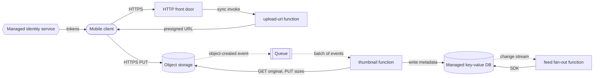

**Reading the diagram.** PhotoShare's upload path is built from three functions (rectangles) and four managed services. The client authenticates with a managed identity service, asks a synchronous `upload-url` function for a presigned URL and uploads the photo directly to object storage, so the large bytes never pass through a function. Everything after that is asynchronous (dotted): the object-created event lands in a queue, the queue invokes the thumbnail function with batches of events, and the metadata write emits a change stream that triggers feed fan-out. The storage boundaries are object storage and the key-value database; no function keeps state between invocations. Failure points are the queue's retries (which make duplicates, §48.7.2), cold starts on the synchronous path, and the database's capacity when functions scale out. Each function scales independently up to the account's concurrency limit (§48.6).

### 48.3.2 Scale to zero and the billing model

**Scale to zero** means that when no events arrive, no environments run and you pay nothing for compute. It is the property that makes serverless cheap for spiky or rare workloads and the property that creates cold starts: an environment that does not exist must be created before it can serve.

The billing model of AWS Lambda illustrates the common shape (as of 2026) [AWS Lambda Pricing]:

- A **request charge** per invocation, \$0.20 per million in us-east-1.
- A **duration charge** in **GB-seconds**: configured memory × billed duration, rounded up to the nearest millisecond, \$0.0000166667 per GB-second for x86 and about 20% less for Arm (Graviton).
- **CPU is proportional to memory.** You do not choose vCPUs; a function configured with 1,769 MB gets the equivalent of one vCPU, and the 10,240 MB maximum gets six [AWS Docs: Lambda]. Raising memory can therefore *lower* cost for CPU-bound code: double the memory, halve the duration, same GB-seconds, half the latency.
- The **initialization phase** is billed as duration. Since 1 August 2025 this includes managed-runtime functions packaged as ZIP archives, whose init time was previously free [AWS Compute Blog 2025].
- Optional **provisioned concurrency** bills pre-initialized environments per GB-second while they exist, whether or not they serve requests (§48.5.3).

Google Cloud Run and Azure Functions' Flex Consumption plan bill along similar lines, by vCPU-seconds and GiB-seconds of instance time plus requests, with options to keep a minimum number of instances warm [Google Cloud Docs: Cloud Run]; [Microsoft Learn: Azure Functions]. Two consequences follow: cost is linear in traffic with no step at all, and idle time costs nothing, so the comparison with servers depends on utilization (§48.11).

::: mistake
**Common misconception — "Serverless means no servers."** There are servers; you do not manage them. The machines, their kernels, sandbox placement and capacity are the provider's problem. What you still own is code, configuration, concurrency limits, the capacity of every non-elastic dependency, idempotency and the bill.
:::

::: mistake
**Common misconception — "Serverless equals FaaS."** Managed queues, object storage, serverless databases and workflow engines are serverless too: they scale on demand and bill per use. Many of the best serverless architectures contain few functions; they wire managed services together directly and use functions only for logic that no service provides.
:::

## 48.4 Inside a FaaS platform

This section describes how FaaS platforms are built using only what providers have published: peer-reviewed papers by AWS engineers, and product documentation. Internal details change; treat everything here as "as of 2026" and as a model of the design problem rather than a current blueprint.

### 48.4.1 AWS Lambda's invoke path

::: definition
**Definition — Execution environment, slot and worker.** An **execution environment** is an isolated sandbox containing one function version's runtime and initialized code. The Firecracker paper calls a ready environment on a host a **slot**: it serves one function, one invocation at a time, but many invocations in sequence. A **worker** is a bare-metal host that runs hundreds or thousands of slots, each in its own microVM [Agache et al. 2020].
:::

#### First-principles explanation

Think of a taxi dispatcher. A request comes in; the dispatcher first looks for a taxi already waiting in the right neighborhood (a warm slot). If none is free, it asks a fleet planner to send a new taxi to a garage chosen so that no garage gets overloaded (placement). Each taxi carries exactly one party at a time but serves many parties in a row. Lambda's control flow is that dispatcher, with microVMs as taxis.

#### How it works internally

The NSDI 2020 Firecracker paper describes Lambda's architecture as four cooperating parts [Agache et al. 2020]:

1. **Frontend.** Receives the `Invoke` request (synchronous from an HTTP front door or SDK, or from internal pollers that read queues and streams), authenticates and authorizes it, and loads the function's metadata.
2. **Worker Manager.** A stateful, sticky load balancer that knows which slots exist for each function and which are idle. If an idle slot exists, it reserves it with a lightweight concurrency-control protocol and tells the frontend where it is: a **warm start**.
3. **Placement service.** If no idle slot exists, the Worker Manager asks Placement to create one. Placement chooses a worker so that CPU, memory, network and storage use stay even across the fleet and so that one function's slots are not concentrated on a few hosts. The paper reports this optimization typically takes under 20 ms.
4. **Worker.** On each worker, a **MicroManager** process manages the Firecracker processes, creates slots on request and keeps a small pool of pre-booted microVMs so that slot creation skips the VM boot. The frontend then sends the invocation payload to the slot, and the response flows back the same way.

AWS engineers have since described evolving parts of this design in conference talks (for example, replacing the Worker Manager with a new assignment service); the four roles above remain a sound model of any FaaS control plane.

**Figure 48.2 — Lambda's invoke path as described in the Firecracker paper.**

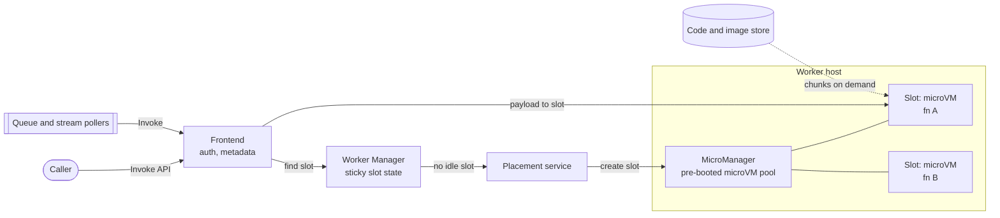

**Reading the diagram.** Synchronous callers and Lambda's own pollers (for queues and streams) both enter through the frontend, which authenticates and loads metadata. The frontend asks the Worker Manager for an idle slot; on a warm path the answer comes straight back and the frontend sends the payload directly to the slot on the worker. On a cold path the Worker Manager calls Placement, which picks a worker and tells its MicroManager to turn a pre-booted microVM into a slot for this function; code and image bytes stream in asynchronously from storage (§48.4.3). Each slot is a separate microVM, the isolation boundary between tenants. Failure points: Worker Manager state (it must know which slots exist), placement capacity in a zone, and the code store on the cold path. The fleet scales by adding workers; one function scales by adding slots across many workers.

**Figure 48.3 — Warm and cold invocation, step by step.**

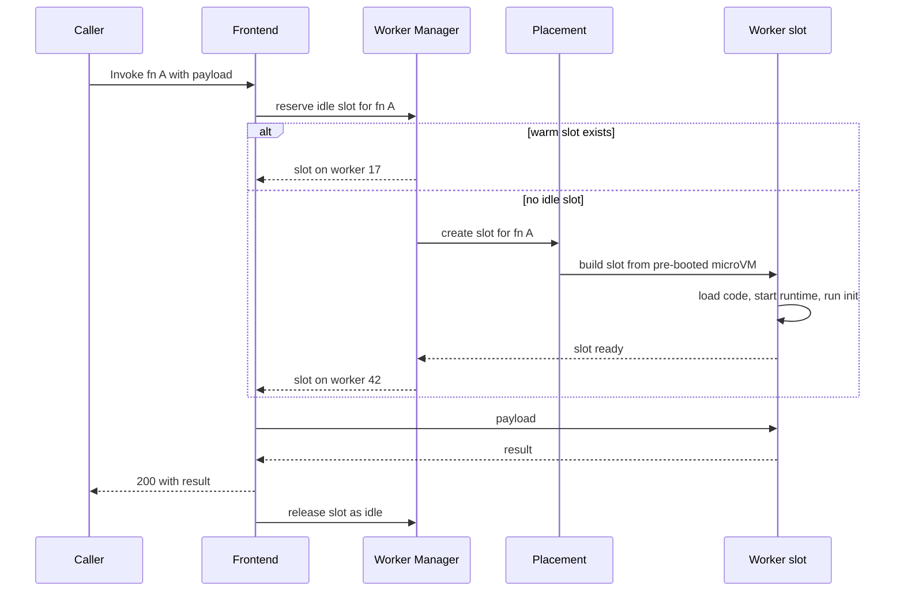

**Reading the diagram.** All calls are synchronous request/response within the platform. The `alt` block is the whole difference between warm and cold: on a cold path the caller waits for placement (milliseconds), slot creation from a pre-booted microVM, code loading, runtime start and the function's own initialization (§48.5). Releasing the slot returns it to the idle set, where it waits for the next invocation of the same function until the platform reclaims it. Failure points: slot creation can fail or be throttled (the caller sees a throttling error, §48.6), and initialization code can time out. Scaling: more concurrent invocations require more slots, which is why concurrency, not request rate, is the unit Lambda limits.

::: industry
**AWS Lambda on Firecracker.** Lambda originally isolated functions with containers inside per-customer VMs, which wasted capacity because one customer's VM could not be shared. Firecracker gave each slot its own microVM with a minimal device model and a jailer, so slots of different customers could be packed onto one bare-metal worker, and memory and CPU could be oversubscribed because most functions are idle or lightly loaded most of the time. The paper reports boot to user-space code in as little as 125 ms, less than 5 MiB of monitor overhead per microVM and up to 150 microVMs created per second per host, and states that Lambda processed trillions of events per month for hundreds of thousands of customers at the time [Agache et al. 2020]. §47.9 compares this boundary with containers and gVisor.
*Evidence: Primary* — [Agache et al. 2020]
:::

### 48.4.2 Loading code on demand

Lambda accepts container images up to 10 GiB [AWS Docs: Lambda]. Downloading 10 GiB before every cold start would take tens of seconds, so Lambda does not download images; it loads the bytes a function actually touches, when it touches them. Earlier research found that pulling packages accounted for 76% of container start-up time while only 6.4% of the pulled data was read [Harter et al. 2016].

Brooker et al. describe the design [Brooker et al. 2023]:

1. **Flatten and chunk.** At function creation, the image's layers are flattened into a single file-system image, which is split into fixed-size chunks.
2. **Deduplicate with convergent encryption.** Many images share base layers (the same OS, the same runtime). Each chunk is encrypted with a key derived from its own content, so identical plaintext chunks from different customers produce identical ciphertext that can be stored and cached once, while nobody without the content can read it.
3. **Load on demand at block level.** The microVM sees a block device; a local agent on the worker serves each read from a worker-local cache, then from a shared, erasure-coded cache in the availability zone, and only then from the backing object store.
4. **Tier and replicate for tails.** Erasure coding in the zone cache lets the agent reconstruct a chunk from any sufficient subset of fragments, which cuts tail latency when one cache node is slow.

The result, per the paper, supports Lambda's goal of adding up to 15,000 new containers per second for a single customer, and the system had served hundreds of trillions of invocations for over a million customers [Brooker et al. 2023].

**Figure 48.4 — Block-level on-demand loading of a container image.**

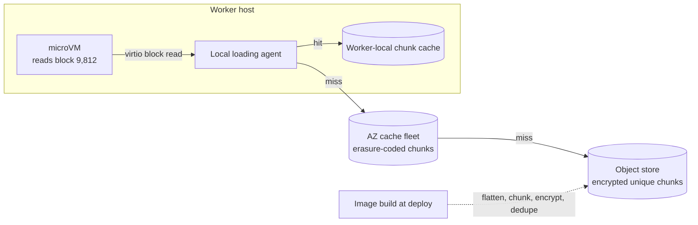

**Reading the diagram.** At deploy time (dotted, asynchronous) the image is flattened, chunked, convergently encrypted and deduplicated into the object store. At run time the microVM issues synchronous block reads to a local agent, which tries the worker-local cache, then the zone's erasure-coded cache, then the object store; each tier is a storage boundary with higher latency than the last. Only touched chunks travel, so a 10 GiB image that reads 200 MB at start-up costs about 200 MB of transfer, mostly served from caches because popular base chunks are shared. Failure points: a cold zone cache after a deploy of a unique image, and a slow cache node (masked by erasure coding). Scaling: cache hit ratios rise with fleet size, because more customers share the same base chunks.

### 48.4.3 Snapshot restore: SnapStart

The slowest part of many cold starts is the function's own initialization: a Java framework scanning classes, a Python process importing a machine-learning library. **Snapshot restore** runs initialization once and saves the result.

::: definition
**Definition — Snapshot-based start (SnapStart).** A mode in which the platform, when a function version is published, runs its initialization, takes a Firecracker snapshot of the microVM's memory and disk state, encrypts and caches it, and on each later cold start **restores** the snapshot instead of initializing from scratch [AWS Docs: Lambda].
:::

As of 2026, AWS documents SnapStart for Java, Python and .NET managed runtimes, and describes start-up improvements of up to 10× for Java functions with heavy initialization. Snapshot chunks are loaded on demand from the same kind of tiered cache as container images.

Snapshots introduce a subtle correctness problem: **uniqueness**. Anything created during initialization is copied into every environment restored from the snapshot: random-number generator seeds, UUID generators, cryptographic nonces, cached credentials, open network connections whose peers have long since closed them. Brooker et al. analyze this problem for microVM snapshots and the kernel and library support needed to reseed randomness after restore [Brooker et al. 2021]. Platforms therefore provide **runtime hooks** (`beforeCheckpoint` and `afterRestore` in Java's CRaC interface; decorator-registered hooks in Python) to close connections before the snapshot and re-establish them, refresh credentials and reseed generators after restore.

**Figure 48.5 — Lifecycle of a snapshot-started function version.**

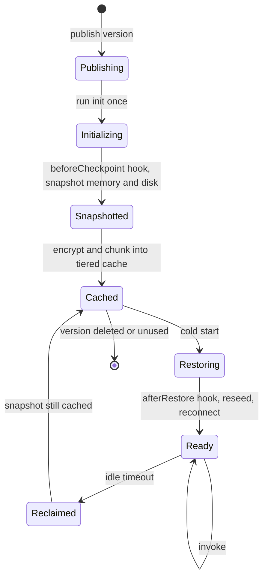

**Reading the diagram.** States are those of one function version; transitions are triggered by deployment, invocation and idleness. Initialization runs once per version at publish time, not once per environment. Every cold start restores from the cached snapshot, and the `afterRestore` hook is the only place to repair state that must be unique per environment. Storage boundaries: the snapshot cache tiers. Failure points: hooks that forget to reseed or reconnect (duplicate IDs, stale connections), and snapshots evicted for versions unused for a long time, which must be re-created. Scaling: restores of the same snapshot share cached chunks, so a burst of cold starts is cheaper than a burst of full initializations.

::: warning
**Warning — Snapshots copy secrets and randomness.** Generating a session key, a UUID seed or a "random" sampling decision during initialization is safe with ordinary cold starts and wrong with snapshots: every restored environment produces the same values. Move such work into the handler or an after-restore hook, and test by restoring two environments and comparing outputs.
:::

### 48.4.4 Google Cloud Run and Azure Functions

Other platforms make different choices, mainly about **per-instance concurrency**.

- **Google Cloud Run** runs any container image. Each instance can serve many requests at once (default 80, configurable up to 1,000), so 1,000 concurrent requests may need only 13 instances instead of 1,000 environments. It scales to zero by default, supports **minimum instances** to keep some warm, offers a start-up CPU boost, and bills either only while requests are in flight or for the whole instance lifetime [Google Cloud Docs: Cloud Run]. Its first-generation execution environment used gVisor; the second generation runs in a microVM with full Linux compatibility. **Cloud Run functions** (formerly Cloud Functions) are built on Cloud Run.
- **Azure Functions** runs on several hosting plans [Microsoft Learn: Azure Functions]. The **Consumption** plan scales instances by event load and bills per execution; the **Flex Consumption** plan adds per-instance concurrency, **always-ready** instances and virtual-network integration; the **Premium** plan keeps pre-warmed instances so that scale-out avoids cold starts; and dedicated App Service plans run on reserved machines. **Durable Functions** adds code-first orchestration.

**Table 48.1 — Three FaaS platforms (published behavior, as of 2026).**

| Property | AWS Lambda | Google Cloud Run (and functions) | Azure Functions (Flex Consumption) |
|---|---|---|---|
| Unit of deployment | ZIP package or container image up to 10 GiB | Container image (or source built into one) | Function app (code package) |
| Sandbox | Firecracker microVM per environment | gVisor (gen 1) or microVM (gen 2) | Provider-managed instances |
| Concurrency per instance | 1 request per environment | Default 80, up to 1,000 | Configurable per instance |
| Keeping capacity warm | Provisioned concurrency | Minimum instances | Always-ready instances |
| Fast-start feature | SnapStart (snapshot restore) | Start-up CPU boost | Always-ready, pre-warmed |
| Maximum duration | 15 minutes | Up to 60 minutes per HTTP request | Plan-dependent; long-running orchestration via Durable Functions |
| Billing basis | Requests + GB-seconds (1 ms granularity) | vCPU-seconds + GiB-seconds + requests | Execution time and memory, plus always-ready baseline |

The concurrency row matters most. With one request per environment, a slow downstream call multiplies environments (§48.6) but no request ever competes for CPU with another; with many requests per instance, the instance count stays small and connection pools work as on a server, but one request's CPU spike or memory leak hurts its neighbors.

## 48.5 Cold starts

### 48.5.1 Anatomy of a cold start

::: definition
**Definition — Cold start.** The extra latency an invocation pays when no initialized execution environment is available and the platform must create one: placement, sandbox creation, code loading, runtime start-up and the function's own initialization, all before the handler runs. An invocation served by an existing environment is a **warm start**.
:::

#### First-principles explanation

A cold start is the first customer of the morning at a coffee shop that opens on demand: someone must unlock the door, switch on the espresso machine, wait for it to heat and grind the beans before the first cup is pulled. Every later customer waits only for their own cup. Your bill and your users' experience depend on how often a customer arrives to a locked door, and on how long the heating takes.

#### How it works internally

A Lambda cold start has five phases; other platforms differ in detail but not in shape [Agache et al. 2020]; [AWS Docs: Lambda]:

1. **Placement and slot reservation.** The control plane picks a worker (typically under 20 ms in the Firecracker paper).
2. **Sandbox creation.** A microVM is taken from a pre-booted pool or booted (as little as 125 ms) or restored from a snapshot.
3. **Code loading.** ZIP packages are copied and unpacked; container images and snapshots are read in chunks on demand (§48.4.2).
4. **Runtime initialization.** The language runtime starts: a Python or Node.js interpreter in tens of milliseconds; a Java virtual machine with class loading and just-in-time compilation warm-up in hundreds. Lambda **extensions** (agents for monitoring or secrets) also initialize here.
5. **Function initialization.** Your code outside the handler runs: imports, framework start-up, SDK clients, configuration and secret fetches, database connections. Lambda limits this phase to 10 seconds for on-demand environments, and it is often the largest phase.

Only then does the handler run. Phases 1 to 3 belong to the provider and are typically tens of milliseconds; phases 4 and 5 belong to your choice of language, package size and initialization code, and range from tens of milliseconds to seconds.

**Figure 48.6 — An illustrative cold start for a Python function with a heavy SDK, axis in milliseconds.**

```mermaid
gantt
  title Cold start timeline, illustrative
  dateFormat x
  axisFormat %L
  section Platform
  Placement and slot reservation :p1, 0, 15ms
  MicroVM from pre-booted pool   :p2, after p1, 25ms
  Code chunks on demand          :p3, after p2, 80ms
  section Runtime
  Interpreter and extensions     :r1, after p3, 120ms
  section Your code
  Imports and SDK clients        :crit, f1, after r1, 300ms
  Secret fetch and DB connect    :crit, f2, after f1, 100ms
  Handler                        :h1, after f2, 80ms
```

**Reading the diagram.** Each bar is a phase on one synchronous path; the axis is milliseconds from the moment the platform found no idle environment. The platform phases (120 ms here) are short; the highlighted phases are the function's own initialization (400 ms), larger than everything else combined, and the handler (80 ms) is what a warm request would pay. The storage boundaries are the code store (phase 3) and the secrets service and database (phase 5); either being slow or unreachable extends or fails the cold start. Scaling consequence: in a burst, every new environment pays the whole 720 ms, so cold starts cluster exactly when load rises. The numbers are illustrative, chosen to match published orders of magnitude, not measurements of any runtime.

#### Measured ranges

Published measurements agree on the shape and differ on the numbers because platforms keep changing:

- AWS states that in an analysis of production use, cold starts typically occur in under 1% of invocations, and that their duration ranges from under 100 ms to over 1 s [AWS Compute Blog 2025]; [Beswick 2021].
- Wang et al. measured AWS Lambda, Azure Functions and Google Cloud Functions in 2017–2018 and found cold-start latency varied strongly with provider, language and memory size, with Azure's cold starts then far slower than the other two; they also measured how long idle instances survived before reclamation and found co-residency and performance-isolation issues [Wang et al. 2018]. Treat their absolute numbers as history: every platform has changed since.
- Shahrad et al.'s two-week trace of Azure Functions found invocation frequency spanning eight orders of magnitude across applications, with most applications invoked rarely, so a fixed keep-alive leaves rare functions cold most of the time [Shahrad et al. 2020].

### 48.5.2 How cold starts move percentiles

A small cold-start fraction barely moves the mean and median but can own the tail. The arithmetic is a **mixture** of two latency distributions.

::: formula
**Cold-start-weighted latency distribution and the percentile cliff**

$$F(t) = (1 - p)\,F_w(t) + p\,F_c(t) \qquad\qquad p > 1 - q \;\Rightarrow\; L_q \ge t_{c,\min}$$

| Symbol | Meaning | Units |
|---|---|---|
| $F(t)$ | Fraction of all invocations with latency $\le t$ | dimensionless |
| $F_w(t)$, $F_c(t)$ | The same fraction among warm and among cold invocations | dimensionless |
| $p$ | Fraction of invocations that are cold starts | dimensionless |
| $q$ | Percentile of interest as a fraction (0.99 for p99) | dimensionless |
| $L_q$ | Overall $q$-th percentile latency, the $t$ at which $F(t) = q$ | ms |
| $t_{c,\min}$ | Fastest cold-start latency (cold overhead plus fastest handler) | ms |
:::

The second expression is the **cliff**: if more than $1 - q$ of invocations are cold, at least one cold start must fall inside the slowest $1 - q$, so the percentile is a cold-start latency no matter how fast warm requests are. Since $F(t) \le (1-p) + p\,F_c(t)$, and $F_c(t) = 0$ below $t_{c,\min}$, the bound follows.

::: example
**Worked example — PhotoShare's `upload-url` function.** Warm latency has p99 = 160 ms and p99.5 = 180 ms; nothing warm exceeds 300 ms. Cold invocations add 300–700 ms of initialization (uniform) to an 80 ms handler, so cold latency runs from about 380 ms to 780 ms with a median of about 580 ms.

1. $p = 0$: $L_{0.99} = 160$ ms.
2. $p = 0.5\%$: below 380 ms no cold request has finished, so solve $(1 - 0.005)(1 - F_w(t)) + 0.005 = 0.01$. Then $1 - F_w(t) = 0.005/0.995 = 0.00503$: the warm p99.5, about 180 ms. The p99 rises 12% although only one request in 200 is cold.
3. $p = 2\%$: now $p > 1 - q = 1\%$, so $L_{0.99} \ge 380$ ms. Warm requests are all below 300 ms, so solve $0.02\,(1 - F_c(t)) = 0.01$: $F_c(t) = 0.5$, the cold median, about 580 ms.
4. Means, for comparison: with $p = 2\%$ the mean rises from about 84 ms to $0.98 \times 84 + 0.02 \times 580 \approx 94$ ms, only 12%.

**Interpretation.** The p99 jumps from 160 ms to 580 ms, 3.6 times, when the cold fraction crosses 1%, while the mean moves by 10 ms. **Engineering implication.** State latency SLOs at a percentile and compute $p$ against $1 - q$: a p99 SLO tolerates well under 1% cold starts, a p99.9 SLO well under 0.1%. If the cold fraction is near the cliff, remove cold starts from the path (provisioned capacity, asynchronous design), because shaving the handler will not help.
:::

What sets $p$? For a function with sparse traffic, each invocation is cold if the previous one finished more than a **keep-alive window** $K$ ago.

::: formula
**Cold-start probability and idle memory under a fixed keep-alive (sparse Poisson arrivals)**

$$P_{\text{cold}} = e^{-\lambda K} \qquad\qquad I = \frac{1 - e^{-\lambda K}}{\lambda}$$

| Symbol | Meaning | Units |
|---|---|---|
| $\lambda$ | Invocation rate of the function (Poisson, rare enough that invocations do not overlap) | invocations/s |
| $K$ | Keep-alive window after the last invocation before reclamation | s |
| $P_{\text{cold}}$ | Probability an invocation is a cold start (gap longer than $K$) | dimensionless |
| $I$ | Expected idle time an environment is held after each invocation, $E[\min(\text{gap}, K)]$ | s |
:::

::: example
**Worked example — Keep-alive for rare functions.** A webhook function is invoked on average every 5 minutes ($\lambda = 1/300$ per second).

1. $K = 600$ s: $P_{\text{cold}} = e^{-2} = 13.5\%$; $I = 300\,(1 - 0.135) = 259$ s held idle per invocation.
2. $K = 1{,}200$ s: $P_{\text{cold}} = e^{-4} = 1.8\%$; $I = 300\,(1 - 0.018) = 295$ s.
3. An hourly function ($\lambda = 1/3{,}600$) with $K = 1{,}200$ s: $P_{\text{cold}} = e^{-1/3} = 71.7\%$, while holding $I = 3{,}600\,(1 - 0.717) = 1{,}020$ s of idle memory per invocation.

**Interpretation.** For the five-minute function, doubling $K$ cuts cold starts 7.5-fold at 14% more idle memory. For the hourly function, a 20-minute window wastes 17 minutes of memory per call and still leaves 72% of calls cold. **Engineering implication.** No fixed window fits every function. Rare functions need either prediction (pre-warm just before the expected arrival) or acceptance of cold starts; frequent functions are warm under almost any window.
:::

::: industry
**Azure Functions: a hybrid histogram keep-alive.** Shahrad et al. characterized the entire Azure Functions workload over two weeks: 54% of applications had a single function, half of functions ran for under a second on average, and invocation rates spanned eight orders of magnitude. Azure then used a fixed keep-alive (20 minutes). The authors proposed a per-application policy that keeps a small histogram of idle times, unloads an application right after it runs and **pre-warms** it just before the next invocation is expected, falling back to a fixed window when the histogram is not predictive and to time-series forecasting for very rare applications. In trace-driven simulation it achieved fewer cold starts with less memory than fixed windows, and a version was deployed in production [Shahrad et al. 2020]. The team published the trace as the Azure Public Dataset.
*Evidence: Primary* — [Shahrad et al. 2020]
:::

### 48.5.3 Mitigations

**Table 48.2 — Cold-start mitigations, in rough order of preference.**

| Mitigation | What it removes | Cost | Caveats |
|---|---|---|---|
| Move work off the synchronous path | User-visible cold starts entirely | Design effort | Only for work that can be asynchronous |
| Smaller package, fewer dependencies | Code-loading time | Engineering time | Gains shrink with on-demand loading |
| Lazy initialization | Function-init time for unused paths | First caller of each path pays | Do not lazy-load on the hot path |
| Faster-starting language | Runtime and framework init | Rewrite | Go and Rust start fastest; JVM slowest without snapshots |
| More memory (more CPU) | CPU-bound init time | Higher GB-second price per ms | Often cost-neutral if duration falls |
| Snapshot restore (SnapStart) | Function and runtime init | Small, or caching and restore charges | Uniqueness hooks (§48.4.3) |
| Provisioned concurrency / minimum instances | All phases, up to the provisioned level | Pay while idle | Bursts above the level still cold |
| Keep-warm pings | One environment's reclamation | Ping invocations | Keeps 1 warm, not the 20 a burst needs |

**Provisioned concurrency** keeps $P$ environments initialized at all times and bills them whether or not they serve requests; requests above $P$ spill over to on-demand environments with ordinary cold starts [AWS Docs: Lambda].

::: formula
**Monthly cost of keeping capacity warm**

$$C_{\text{warm}} = P \times M \times T \times c_{\text{pc}}$$

| Symbol | Meaning | Units |
|---|---|---|
| $P$ | Provisioned environments (or minimum instances) | environments |
| $M$ | Memory per environment | GB |
| $T$ | Seconds provisioned per month (2,592,000 for a 30-day month) | s |
| $c_{\text{pc}}$ | Price per GB-second of provisioned (idle) capacity | \$/GB-s |
| $C_{\text{warm}}$ | Monthly charge for warmth alone, excluding duration charges | \$/month |
:::

::: example
**Worked example — Removing cold starts from `upload-url`.** The simulation in §48.5.4 shows that 25 provisioned environments eliminate cold starts for its bursty traffic. With $M = 0.5$ GB and an illustrative $c_{\text{pc}} = \$0.0000041667$ per GB-s (AWS's x86 us-east-1 list price as of 2026; verify) [AWS Lambda Pricing]:

1. GB provisioned: $25 \times 0.5 = 12.5$ GB.
2. GB-seconds per month: $12.5 \times 2{,}592{,}000 = 32{,}400{,}000$.
3. Cost: $32{,}400{,}000 \times 0.0000041667 \approx \$135$ per month.
4. Compare: the same traffic (about 535,000 invocations per day, 16 million per month, mean 84 ms) costs about $16 \times 10^6 \times (0.5 \times 0.084 \times 0.0000166667 + 2 \times 10^{-7}) \approx \$14.4$ per month on demand.

**Interpretation.** Warmth costs nine times the work itself, because 25 environments sit mostly idle between bursts. **Engineering implication.** Provision only for functions whose cold starts break an SLO, size $P$ from measured burst concurrency rather than averages, and schedule it (more during business hours, less at night) with an autoscaler.
:::

### 48.5.4 Simulation: keep-alive and provisioned concurrency under bursty traffic

The program simulates one function on a FaaS fleet for two hours. Traffic is 1 RPS in the background with a 40 RPS burst for two minutes every 15 minutes. Each environment serves one request at a time; handlers take a lognormal time with median 80 ms; a cold start adds 300–700 ms. Idle on-demand environments are reclaimed after a keep-alive window $K$; $P$ provisioned environments never are. The router prefers a provisioned environment, then the most recently used warm one. The program sweeps $K$ and $P$, then tests monotonicity, the cost of warmth, Little's Law and the analytic formula $e^{-\lambda K}$.

```python
import math
import random

SIM_S = 2 * 3600          # simulate two hours
BASE_RPS = 1.0            # quiet background traffic
BURST_RPS = 40.0          # traffic during a burst
BURST_EVERY_S = 900       # a burst starts every 15 minutes...
BURST_LEN_S = 120         # ...and lasts two minutes
MU, SIGMA = math.log(0.08), 0.3   # handler: median 80 ms, p99 ~160 ms
MEAN_S = math.exp(MU + SIGMA ** 2 / 2)


def rate(t):
    """Offered load in RPS at time t (seconds)."""
    return BURST_RPS if (t % BURST_EVERY_S) < BURST_LEN_S else BASE_RPS


def arrivals(rng, rate_fn, horizon, rate_max):
    """Non-homogeneous Poisson arrivals by thinning (Lewis-Shedler)."""
    t, out = 0.0, []
    while True:
        t += rng.expovariate(rate_max)
        if t >= horizon:
            return out
        if rng.random() < rate_fn(t) / rate_max:
            out.append(t)


class Env:
    """One execution environment: serves one request at a time."""
    def __init__(self, created, provisioned):
        self.created = created
        self.free_at = created     # time it next becomes idle
        self.busy = 0.0            # seconds spent running handlers
        self.provisioned = provisioned


def simulate(keep_alive_s, provisioned=0, seed=1, rate_fn=rate,
             horizon=SIM_S, rate_max=BURST_RPS):
    rng = random.Random(seed)
    reqs = arrivals(rng, rate_fn, horizon, rate_max)
    envs = [Env(0.0, True) for _ in range(provisioned)]
    retired_alive = 0.0            # alive seconds of reclaimed environments
    retired_busy = 0.0
    lat, cold, peak_on_demand = [], 0, 0
    for t in reqs:
        # 1. Reclaim on-demand environments idle longer than the keep-alive.
        keep = []
        for e in envs:
            if not e.provisioned and e.free_at + keep_alive_s < t:
                retired_alive += e.free_at + keep_alive_s - e.created
                retired_busy += e.busy
            else:
                keep.append(e)
        envs = keep
        # 2. Prefer an idle provisioned environment, then the most recently
        #    used idle on-demand one (keeps the warm set small).
        idle = [e for e in envs if e.free_at <= t]
        duration = rng.lognormvariate(MU, SIGMA)          # handler time
        if idle:
            env = max(idle, key=lambda e: (e.provisioned, e.free_at))
            init = 0.0
        else:                                             # 3. cold start
            init = rng.uniform(0.3, 0.7)                  # 300-700 ms
            env = Env(t, False)
            envs.append(env)
            cold += 1
        env.free_at = t + init + duration
        env.busy += duration
        lat.append(init + duration)
        peak_on_demand = max(peak_on_demand,
                             sum(1 for e in envs if not e.provisioned))
    # Close the books at the horizon.
    alive = retired_alive + sum(
        horizon - e.created if e.provisioned
        else min(horizon, e.free_at + keep_alive_s) - e.created for e in envs)
    busy = retired_busy + sum(e.busy for e in envs)
    lat.sort()
    pct = lambda q: lat[min(len(lat) - 1, int(q * len(lat)))]
    return {"n": len(lat), "cold": cold, "cold_pct": 100 * cold / len(lat),
            "p50": 1000 * pct(0.50), "p99": 1000 * pct(0.99),
            "p999": 1000 * pct(0.999),
            "idle_env_h": (alive - busy) / 3600, "busy_s": busy,
            "peak_on_demand": peak_on_demand}


if __name__ == "__main__":
    print(" K(s)   P  requests  cold%  p50 ms  p99 ms  p99.9 ms  idle env-h  peak OD")
    results = {}
    for p in (0, 10, 25):
        for k in (10, 60, 300, 600, 1200):
            r = simulate(k, provisioned=p)
            results[(k, p)] = r
            print(f"{k:5d} {p:3d} {r['n']:9d} {r['cold_pct']:6.2f} "
                  f"{r['p50']:7.0f} {r['p99']:7.0f} {r['p999']:9.0f} {r['idle_env_h']:11.1f} "
                  f"{r['peak_on_demand']:8d}")

    # Test 1: a longer keep-alive never causes more cold starts.
    for p in (0, 10, 25):
        colds = [results[(k, p)]["cold"] for k in (10, 60, 300, 600, 1200)]
        assert colds == sorted(colds, reverse=True), colds
    # Test 2: keep-alive buys warmth with idle memory.
    assert results[(1200, 0)]["idle_env_h"] > 3 * results[(60, 0)]["idle_env_h"]
    # Test 3: provisioned concurrency above peak demand removes cold starts.
    assert results[(10, 25)]["cold"] == 0
    # Test 4: Little's Law -- busy env-seconds / horizon = rate x duration.
    r = results[(600, 0)]
    mean_rate = r["n"] / SIM_S
    assert abs(r["busy_s"] / SIM_S - mean_rate * MEAN_S) / (mean_rate * MEAN_S) < 0.05
    # Test 5: one sparse function matches P(cold) = exp(-lambda * K).
    lam, k = 1 / 120, 120
    sparse = simulate(k, rate_fn=lambda t: lam, horizon=2_400_000, rate_max=lam)
    expected = 100 * math.exp(-lam * k)
    print(f"\nsparse function: cold {sparse['cold_pct']:.1f}% "
          f"vs exp(-lambda K) = {expected:.1f}%")
    assert abs(sparse["cold_pct"] - expected) < 2.0
    print("all fleet tests passed")
```

Output (Python 3.13, seed 1, about 4 s):

```text
 K(s)   P  requests  cold%  p50 ms  p99 ms  p99.9 ms  idle env-h  peak OD
   10   0     44503   1.03      80     387       739         4.8       25
   60   0     44503   0.32      80     169       665         7.6       22
  300   0     44503   0.26      80     167       612        15.4       21
  600   0     44503   0.22      80     166       635        23.4       20
 1200   0     44503   0.05      80     163       218        26.3       20
   10  10     44503   0.10      80     162       353        19.1        3
   60  10     44503   0.04      80     162       208        19.5        4
  300  10     44503   0.04      80     162       208        20.7        4
  600  10     44503   0.04      80     162       208        22.2        4
 1200  10     44503   0.02      80     162       204        24.4        5
   10  25     44503   0.00      80     162       200        49.0        0
   60  25     44503   0.00      80     162       200        49.0        0
  300  25     44503   0.00      80     162       200        49.0        0
  600  25     44503   0.00      80     162       200        49.0        0
 1200  25     44503   0.00      80     162       200        49.0        0

sparse function: cold 36.6% vs exp(-lambda K) = 36.8%
all fleet tests passed
```

What to notice:

- **The cliff is real.** With a 10 s window, 1.03% of requests are cold, just over $1 - q$ for p99, and the p99 jumps to 387 ms; at 60 s the cold fraction falls to 0.32% and p99 drops to 169 ms, close to the warm 162 ms. The p99.9 stays cold-dominated until almost all cold starts are gone, exactly as §48.5.2 predicts.
- **The window must outlast the gap between bursts.** Windows from 60 s to 600 s give similar cold rates because bursts are 900 s apart: environments created in one burst die before the next. Only $K = 1{,}200$ s carries them across, and it holds 3.5 times as many idle environment-hours as $K = 60$ s.
- **Cold starts inflate concurrency.** The average burst concurrency is $40 \times 0.084 \approx 3.4$ environments, yet up to 25 on-demand environments exist: at the start of each burst, requests arrive while new environments are still initializing for 300–700 ms, so each cold request occupies an environment about seven times longer than a warm one (584 ms versus 84 ms) and triggers more cold starts. This **cold-start cascade** is why bursts need more capacity than Little's Law on warm durations suggests.
- **Provisioned concurrency trades memory for certainty.** $P = 10$ cuts cold starts tenfold; $P = 25$ removes them, at 49 idle environment-hours over two hours. The tests check that longer windows never add cold starts, that warmth costs idle memory, that busy environment-seconds match Little's Law within 5%, and that a sparse function's cold fraction matches $e^{-\lambda K}$.

#### Failure scenarios

**Table 48.3 — Cold-start failure scenarios.**

| What goes wrong | Why | Detection | Recovery | Prevention |
|---|---|---|---|---|
| p99 breaches SLO after a deploy | New version: every environment is new | Init-duration metric spikes with deploy | Shift alias traffic gradually | Pre-warm new version; canary (§48.12) |
| Burst times out at the gateway | Cold-start cascade plus slow init | Cold-start count vs concurrency graph | Provisioned capacity for the burst | Smaller init; asynchronous path |
| Init fails repeatedly | Secret or config service unreachable in init | Init errors, not handler errors | Fix dependency; retry | Timeouts and fallbacks in init |
| Duplicate IDs after snapshot restore | Generator seeded during init | Collisions in logs or keys | Reseed in after-restore hook | Uniqueness tests on restore |
| Bill jumps with no traffic change | Init now billed, heavy init code | Billed duration vs handler duration | Trim init | Measure init GB-seconds |

::: mistake
**Common misconception — "Cold starts only matter for Java."** Runtime choice changes phase 4, but phase 5, your own initialization, can take seconds in any language (a large Python ML import, a framework that scans annotations, a database connection over TLS). Measure the init duration your platform reports before blaming the runtime.
:::

## 48.6 Concurrency and scaling limits

### 48.6.1 Concurrency is the unit

::: definition
**Definition — Concurrency (FaaS).** The number of execution environments serving invocations at the same instant. On platforms with one request per environment it equals in-flight requests. Providers limit concurrency, not request rate, because concurrency is what consumes memory on workers.
:::

By Little's Law (§4.11), concurrency equals arrival rate times duration. The consequence is counterintuitive: a function that becomes slower needs more environments for the same traffic, so a slow database can push a fleet into its concurrency limit without any increase in requests.

::: formula
**Required concurrency, time to scale and connections opened**

$$C = \lambda \times D \qquad T_{\text{scale}} \approx \Delta t \times \left\lceil \frac{C - C_0}{r} \right\rceil \qquad N_{\text{conn}} = C \times k \quad\text{vs.}\quad N_{\text{pool}} = \lambda_q \times d_q$$

| Symbol | Meaning | Units |
|---|---|---|
| $C$ | Concurrent environments required | environments |
| $\lambda$ | Invocation rate | invocations/s |
| $D$ | Mean invocation duration, including any cold-start time | s |
| $C_0$ | Concurrency already running | environments |
| $r$ | Environments the platform may add per scaling step | environments/step |
| $\Delta t$ | Length of a scaling step | s |
| $T_{\text{scale}}$ | Time to reach $C$ from $C_0$ | s |
| $k$ | Database connections each environment holds | connections |
| $N_{\text{conn}}$ | Connections opened without pooling | connections |
| $\lambda_q$, $d_q$ | Database query rate and mean query time | queries/s, s |
| $N_{\text{pool}}$ | Connections actually busy, the pool size needed | connections |
:::

As of 2026, AWS Lambda's defaults are a **regional account limit** of 1,000 concurrent executions (raisable on request) shared by all functions, and a **scaling rate** of up to 1,000 additional environments per function every 10 seconds; invocations beyond either limit are **throttled** (HTTP 429 for synchronous calls; retried by Lambda for asynchronous events and by the poller for queues) [AWS Docs: Lambda].

::: example
**Worked example — PhotoShare re-encodes its archive.** PhotoShare decides to add an AVIF rendition to 200 million stored photos. A backfill job enqueues one message per photo; the `reencode` function takes $D = 1.2$ s at 2 GB.

1. Unlimited, the queue poller would scale toward the account limit: $C = 1{,}000$ gives $\lambda = C/D = 833$ photos/s, but leaves nothing for the interactive functions sharing the account.
2. The live `upload-url` and feed functions need $70 \times 0.15 + 1{,}700 \times 0.05 = 10.5 + 85 \approx 96$ environments at peak. Reserve 200 for them, and cap `reencode` at 400 (via the SQS event source's maximum concurrency or reserved concurrency).
3. Backfill throughput: $\lambda = 400/1.2 = 333$ photos/s; duration $2 \times 10^8 / 333 = 600{,}000$ s, about 6.9 days.
4. Scaling time from zero: $T_{\text{scale}} \approx 10 \times \lceil 400/1{,}000 \rceil = 10$ s. A sudden need for 5,000 environments (after a limit increase) would take about $10 \times 5 = 50$ s, during which excess events wait in the queue.
5. Database: each `reencode` environment opens $k = 1$ PostgreSQL connection to update metadata, so $N_{\text{conn}} = 400$, against a `max_connections` of 500 that the API servers also use. The real need: 333 updates/s at 3 ms each gives $N_{\text{pool}} = 333 \times 0.003 = 1$ busy connection on average.

**Interpretation.** Concurrency, not request rate, is the budget, and the database needs 1 connection's worth of work but would be offered 400 connections. **Engineering implication.** Give every high-volume asynchronous function a concurrency cap, reserve capacity for latency-critical functions, and put a connection pooler between functions and any relational database.
:::

**Figure 48.7 — Concurrency pools within one account and Region.**

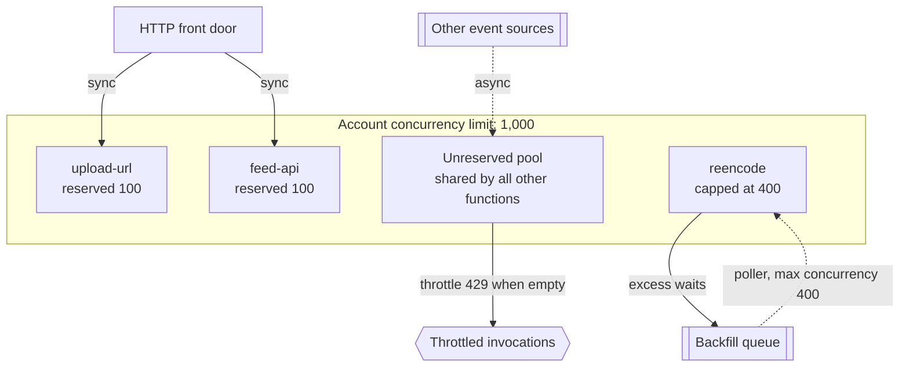

**Reading the diagram.** The account limit is one shared bucket of environments; reserved concurrency carves guaranteed, capped slices out of it for named functions. Synchronous traffic from the front door reaches `upload-url` and `feed-api`, which cannot be starved by the backfill because their reservations are theirs alone. The backfill's queue poller is asynchronous and capped, so excess work stays in the queue (a storage boundary that absorbs bursts) rather than throttling. Everything else shares the unreserved pool; when it is empty, synchronous callers get 429 and asynchronous events are retried. Failure point: reserving too much leaves the unreserved pool too small for unplanned functions. Scaling: raise the account limit, or split workloads into separate accounts, which also limits blast radius (§47.4.3).

### 48.6.2 Protecting downstream systems

Functions scale in seconds; most databases, legacy services and third-party APIs do not. Three tools protect them:

1. **Concurrency caps** bound how many environments can call a dependency at once (reserved concurrency, or the maximum concurrency of a queue's event source).
2. **A queue in front** turns a burst into a backlog that drains at a controlled rate, the load-levelling pattern of §30.4.
3. **A connection pooler** multiplexes many short client sessions onto a few database connections. **Amazon RDS Proxy** is the managed version for Lambda: functions connect to the proxy, which keeps a warm pool to the database, lends a connection for each transaction and returns it; session state such as temporary tables or session variables **pins** a client to a connection and defeats multiplexing [AWS Docs: RDS Proxy]. PgBouncer in transaction mode does the same for self-managed PostgreSQL. Alternatively, use a database with an HTTP data API or one designed for per-request connections.

**Figure 48.8 — A connection proxy between a function fleet and a relational database.**

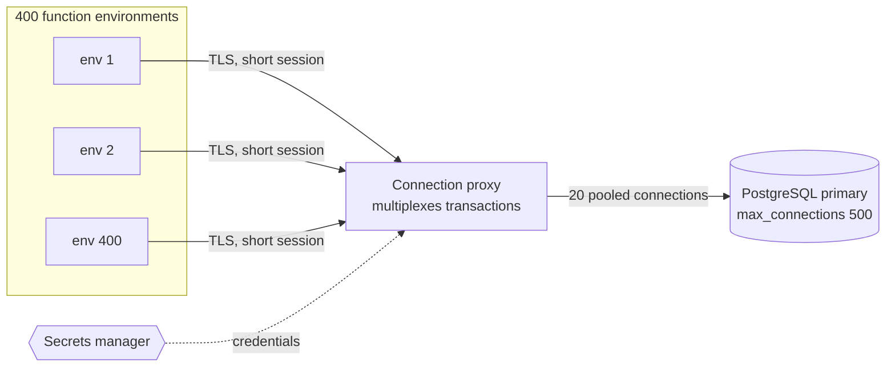

**Reading the diagram.** Each environment opens a cheap session to the proxy instead of a database connection; all edges are synchronous. The proxy holds a fixed pool of 20 connections, sized by Little's Law ($N_{\text{pool}}$ from §48.6.1, with headroom) and lends one per transaction, so the database sees 20 connections whatever the fleet size. Credentials come from a secrets manager asynchronously, so functions need no database password. The database remains the storage boundary and the real capacity limit; the proxy also queues requests when the pool is busy, which surfaces as added latency rather than connection errors. Failure points: pinned sessions that exhaust the pool, and the proxy itself (deploy it across zones). Scaling: a larger pool only helps while the database has spare CPU and I/O.

::: mistake
**Common misconception — "Serverless scales, so my system scales."** The functions scale. The system scales only as far as its least elastic dependency. Every function that writes to a relational database, calls a rate-limited partner API or sends email needs a cap or a queue in front of that dependency.
:::

## 48.7 Serverless data patterns

### 48.7.1 Event-driven pipelines

Functions hold no state and run for minutes at most, so serverless systems are built as **pipelines**: a managed queue, stream or event bus carries each unit of work between functions, and managed stores hold the results. The event source determines delivery semantics, ordering and how failures are retried.

- **Queues** (SQS, Pub/Sub, Service Bus). A poller reads messages in **batches** (up to a size or a batching window), invokes the function and deletes the messages on success. A message that fails becomes visible again after its visibility timeout and is retried, then moved to a **dead-letter queue** after a configured number of receives (§30.11). Without further work a single bad message fails its whole batch; **partial batch responses** let the function report only the failed message IDs [AWS Docs: Lambda]. There is no ordering across messages except in FIFO queues.
- **Streams** (Kinesis, DynamoDB Streams, Kafka). Records are ordered per shard or partition, and the poller processes one batch per shard at a time (Lambda allows a **parallelization factor** of up to 10 concurrent batches per shard, preserving order per key). A failing record blocks its shard until it succeeds, expires or is diverted, so stream consumers need bisect-on-error, a retry limit and an on-failure destination.
- **Pub/sub fan-out** (SNS, EventBridge, Eventarc). One event is delivered to many subscribers, each with its own retry policy, usually through a queue per subscriber so that one slow consumer does not affect the others.

**Figure 48.9 — PhotoShare's upload pipeline with fan-out and failure paths.**

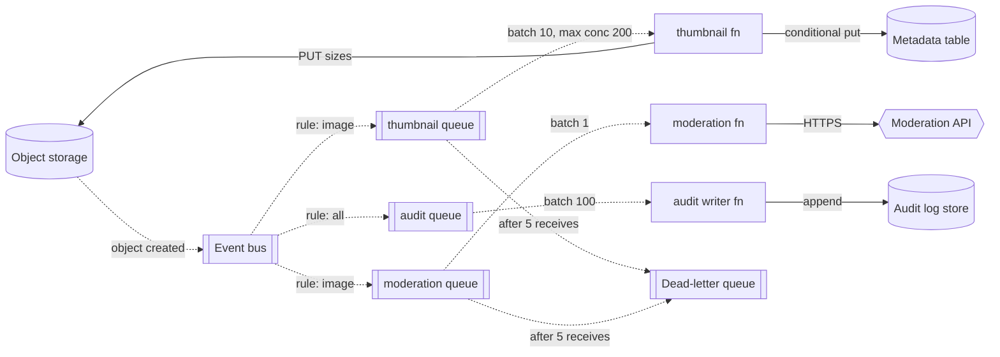

**Reading the diagram.** An object-created event goes to an event bus, whose rules fan it out to one queue per consumer (all dotted, asynchronous, at-least-once). Each queue has its own batch size and concurrency: thumbnails in batches of 10 capped at 200 environments, moderation one at a time because each call is slow and rate limited, audit in batches of 100 because each record is tiny. Synchronous edges are the functions' writes to object storage, the metadata table, the moderation API and the audit store (the storage boundaries). Failure points: a corrupt image (retried, then dead-lettered without blocking other photos), the moderation API's rate limit (its queue absorbs the backlog), duplicate deliveries (handled by idempotency, §48.7.2). Scaling: each consumer scales independently; adding a consumer means adding a rule and a queue, without touching the producer.

### 48.7.2 Idempotent handlers

Every event source above delivers at least once, and Lambda's own asynchronous invocation retries failed events, so every handler must be **idempotent**: processing an event twice must have the same effect as processing it once. The protocol of §22.15 applies unchanged: derive an **idempotency key** from the business identity of the work (here, bucket, key and object version, not the delivery's message ID, so a duplicate upload notification also deduplicates), record completion with a conditional write, and make side effects either naturally idempotent (overwriting the same thumbnail keys) or guarded by the record.

```python
import hashlib
import json


class ConditionalStore:
    """Stands in for a key-value table with conditional put (put-if-absent)."""
    def __init__(self):
        self.items = {}

    def put_if_absent(self, key, value):
        if key in self.items:
            return False
        self.items[key] = value
        return True


def handle_batch(records, store, make_thumbnail):
    """SQS-style batch handler: idempotent per record, partial failure report."""
    failures = []
    for rec in records:
        body = json.loads(rec["body"])
        # Idempotency key: the object version, not the delivery's message ID,
        # so a duplicate upload event and a redelivery both dedupe (§22.15).
        key = hashlib.sha256(f"{body['bucket']}/{body['key']}@{body['version']}"
                             .encode()).hexdigest()
        if key in store.items:
            continue                          # already done: skip side effects
        try:
            sizes = make_thumbnail(body["key"])
        except Exception:
            failures.append({"itemIdentifier": rec["messageId"]})
            continue                          # only this record is retried
        store.put_if_absent(key, {"sizes": sizes})
    return {"batchItemFailures": failures}


if __name__ == "__main__":
    calls = []

    def thumb(k):
        calls.append(k)
        if k == "bad.jpg":
            raise ValueError("corrupt image")
        return [128, 512, 1080]

    ev = lambda mid, k, v: {"messageId": mid, "body": json.dumps(
        {"bucket": "photos", "key": k, "version": v})}
    store = ConditionalStore()
    batch = [ev("m1", "a.jpg", 1), ev("m2", "bad.jpg", 1), ev("m3", "a.jpg", 1)]
    out = handle_batch(batch, store, thumb)
    assert out == {"batchItemFailures": [{"itemIdentifier": "m2"}]}
    assert calls == ["a.jpg", "bad.jpg"]      # duplicate m3 did no work
    # Redelivery of the whole batch: only the failed record is attempted again.
    out = handle_batch(batch, store, thumb)
    assert calls == ["a.jpg", "bad.jpg", "bad.jpg"]
    print(out, "-> idempotency tests passed")
```

Output (Python 3.13): `{'batchItemFailures': [{'itemIdentifier': 'm2'}]} -> idempotency tests passed`.

What to notice:

- The return value follows the partial-batch-response shape, so only message `m2` returns to the queue; `m1` and its duplicate `m3` are deleted.
- The key is derived from the object version, so the duplicate `m3`, a different message carrying the same work, does no work.
- Two environments can still process the same record concurrently between the check and the put. That is acceptable here because thumbnail writes overwrite the same keys; for non-idempotent side effects (charging a card, sending an email), claim the key with the conditional put *before* the side effect, as in §22.15.3.

### 48.7.3 Orchestration instead of chains

When work has several steps, the tempting design is a **function chain**: function A calls function B synchronously, B calls C. It is the main serverless anti-pattern, for four reasons:

1. **Double billing.** A waits, billed per millisecond, while B runs; with three levels, the first function is billed for the whole chain.
2. **Concurrency multiplication.** Each request holds one environment per level, so a three-level chain uses three times the concurrency of the work it does and hits account limits three times sooner.
3. **Compounding timeouts and retries.** Each level needs a timeout longer than everything below it, and retries at each level multiply (§22.12).
4. **No durable state.** If A crashes after B succeeded, nothing records that B's step happened.

The fixes are a queue between steps when each step is independent (choreography), or a **workflow engine** when the process has order, branching, waits or compensation (orchestration, §32.8 and §32.11). AWS Step Functions records each state transition durably and retries tasks with backoff; its Standard workflows run up to a year with exactly-once transitions, and Express workflows run up to five minutes for high-volume, short processes (as of 2026). Azure Durable Functions and Google Workflows fill the same role.

**Figure 48.10 — A synchronous function chain versus an orchestrated workflow.**

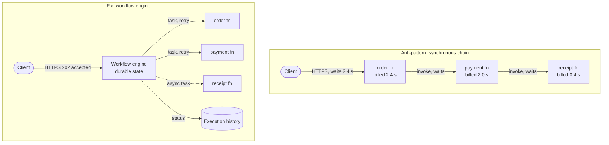

**Reading the diagram.** In the chain, every arrow is synchronous: the client holds a connection for 2.4 s, the order function is billed for 2.4 s and the payment function for 2.0 s, although each does a fraction of that work, and three environments are held per request. A failure in `receipt` surfaces as an error in `payment` and then in `order`, with no record of which steps completed. In the orchestrated version the client gets an immediate acknowledgment; the engine invokes each function as a task with its own retry policy, records every transition in its execution history (the storage boundary) and runs the receipt step asynchronously. Failure points move to the engine, a managed and durable service. Scaling: each function holds an environment only while it works, so concurrency equals the work actually being done.

### 48.7.4 State and other anti-patterns

State lives in managed stores: key-value tables for per-entity state and idempotency records, object storage for blobs, caches for hot reads, workflow history for process state. Anything kept in an environment's memory or `/tmp` is a cache that may vanish at any moment and is not shared with the other environments of the same function.

**Table 48.4 — Serverless anti-patterns.**

| Anti-pattern | What goes wrong | Fix |
|---|---|---|
| Lambda calling Lambda synchronously | Double billing, concurrency × depth, compounding timeouts | Queue between steps, or a workflow engine |
| Recursive trigger (function writes to the bucket or queue that triggers it) | Infinite loop and a runaway bill | Separate input and output locations; loop detection; budgets |
| Per-invocation database connections without a pooler | Connection exhaustion at scale | Connection proxy, caps, HTTP data APIs |
| Long-running work in a function | Duration limit, cost per ms while waiting | Containers or batch for long jobs; step functions with waits |
| State in memory or `/tmp` assumed durable | Lost on reclamation, invisible to other environments | External stores |
| One giant "monolith function" with every route | Large package, slow cold starts, one IAM role for everything | Functions per bounded context, or a container |
| Polling in a loop for a result | Billed idle time | Callbacks, events, workflow waits |

Lambda detects some recursive loops itself: when a chain of invocations through Lambda, SQS, SNS and S3 repeats about 16 times, it stops invoking and reports the loop (as of 2026) [AWS Docs: Lambda]. Treat this as a last line of defense, not a design.

## 48.8 Edge runtimes

### 48.8.1 Why the edge needs a different sandbox

A large CDN has hundreds of points of presence (PoPs), each with many servers, and every server may receive a request for any of millions of customer scripts. A microVM per script per server is far too much memory, and even a 125 ms boot is longer than the 10–20 ms round trip the edge exists to save. Edge runtimes therefore use lighter sandboxes, trading generality (no arbitrary binaries, no full Linux) for start times measured in milliseconds or microseconds and per-tenant memory measured in megabytes.

::: definition
**Definition — V8 isolate.** An instance of the V8 JavaScript engine's heap and execution state. Many isolates run inside one operating-system process, each with its own memory and globals and no access to another's objects; switching between them costs about as much as a function call, not a process context switch [Bloom 2018].
:::

#### First-principles explanation

A microVM is a separate apartment with its own kitchen and plumbing: very safe, slow to build. A container is a room in a shared house. An isolate is a desk in an open-plan office with a locked drawer: dozens of people work in the same room, nobody can open anyone else's drawer, and a new person can sit down in seconds. The office is safe only if the drawers are strong and nobody can learn secrets by watching how long a neighbor takes to type, which is why isolate platforms work so hard on their security model.

#### How it works internally

**Cloudflare Workers.** Each server runs a runtime process hosting thousands of isolates, one per customer script. Cloudflare reported in 2018 that an isolate starts in about 5 ms and uses a small fraction of the memory of a Node.js process, so the platform can keep many scripts resident and start the rest on demand [Bloom 2018]. Later it moved even that start off the critical path: the runtime begins loading a script when the TLS handshake reveals the hostname, so the isolate is usually ready by the time the HTTP request arrives [Partovi 2020]. Limits (as of 2026) include 128 MB of memory per isolate and a CPU-time limit per request (10 ms on the free plan; configurable up to minutes on paid plans), with time spent waiting on network I/O not counted as CPU [Cloudflare Docs: Workers].

**Fastly Compute.** Customer code is compiled to **WebAssembly** (Wasm) ahead of time and run by the Wasmtime runtime. Each request gets a fresh Wasm instance, a linear memory region with bounds-checked access, which is created in microseconds and destroyed after the response, so no state leaks between requests [Fastly Docs: Compute]. Wasm's sandbox comes from its design: code can touch only its own linear memory and call only imported host functions [Haas et al. 2017]. Any language with a Wasm target works: Rust, Go and JavaScript (through an engine compiled to Wasm).

**AWS Lambda@Edge and CloudFront Functions.** AWS offers two tiers [AWS Docs: CloudFront]. **CloudFront Functions** run lightweight JavaScript in every edge location on viewer request and viewer response events only, with sub-millisecond execution, 2 MB of memory, a 10 KB code limit and no network access: header rewrites, redirects, cache-key normalization, token checks. **Lambda@Edge** runs ordinary Lambda functions (Node.js and Python) in the larger regional edge caches, on viewer events (5 s, 128 MB) and origin events (30 s, more memory), with network access.

**Figure 48.11 — One edge server running many tenants' isolates.**

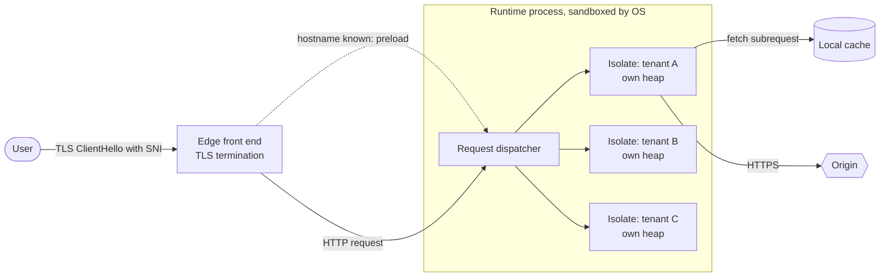

**Reading the diagram.** The edge front end terminates TLS; as soon as the hostname is known from the handshake, it asynchronously tells the runtime to load that tenant's script, so the isolate is warm when the request arrives (the dotted edge). One OS process hosts many isolates, each with its own heap; the process itself sits inside an OS-level sandbox, a second wall behind V8. Requests are dispatched synchronously to the right isolate, which can read the local cache or make subrequests to the origin. Storage boundaries: the PoP's cache and remote origins; isolates keep nothing durable. Failure points: a V8 bug (the reason for the second sandbox layer), CPU-heavy scripts (bounded by CPU limits), and origin round trips (§48.10). Scaling: every server can run every tenant, so capacity scales with PoPs and servers rather than with per-tenant provisioning.

### 48.8.2 The isolate security model

Running thousands of mutually untrusting tenants in one process is safe only with defenses beyond the language sandbox. Cloudflare's published model describes several layers [Varda 2020]:

1. **The V8 sandbox**, patched rapidly when vulnerabilities appear.
2. **A process-level sandbox** around the runtime (namespaces and system-call filtering), so a V8 escape lands in a process with almost no privileges.
3. **Cordons**: tenants are grouped by trust level, so free-tier scripts never share a process with enterprise scripts.
4. **Spectre mitigations by design**: no high-resolution timers (the clock does not advance during execution), no shared memory or multithreading within a request, both of which are needed to build a precise timer; and **dynamic process isolation**, moving a script that behaves suspiciously into its own process.

Wasm platforms rely on bounds-checked linear memory, a fresh instance per request and a minimal host interface; microVM platforms such as Lambda@Edge rely on hardware virtualization (§47.9).

**Table 48.5 — Edge runtimes compared (as of 2026; verify limits).**

| Property | V8 isolates (Cloudflare Workers) | Wasm per request (Fastly Compute) | Lightweight JS (CloudFront Functions) | MicroVM functions (Lambda@Edge) |
|---|---|---|---|---|
| Sandbox | Isolate in shared process + OS sandbox | Wasm instance, fresh per request | Restricted JS runtime | Firecracker microVM |
| Start | ~ms, often hidden behind TLS | Microseconds | Sub-ms | Lambda cold start |
| Languages | JavaScript, TypeScript, Wasm | Anything compiling to Wasm | JavaScript subset | Node.js, Python |
| Where | Every PoP | Every PoP | Every edge location | Regional edge caches |
| Network calls | Yes | Yes | No | Yes |
| Typical limits | 128 MB; CPU-time budget per request | Per-request memory and time budgets | 2 MB, 10 KB code, sub-ms | 128 MB and 5 s on viewer events |
| Best for | General edge logic, APIs, routing | Compute-heavy or multi-language edge logic | Header and URL manipulation at huge volume | Node or Python logic needing AWS SDKs |

**Figure 48.12 — Where code can run in a CloudFront request.**

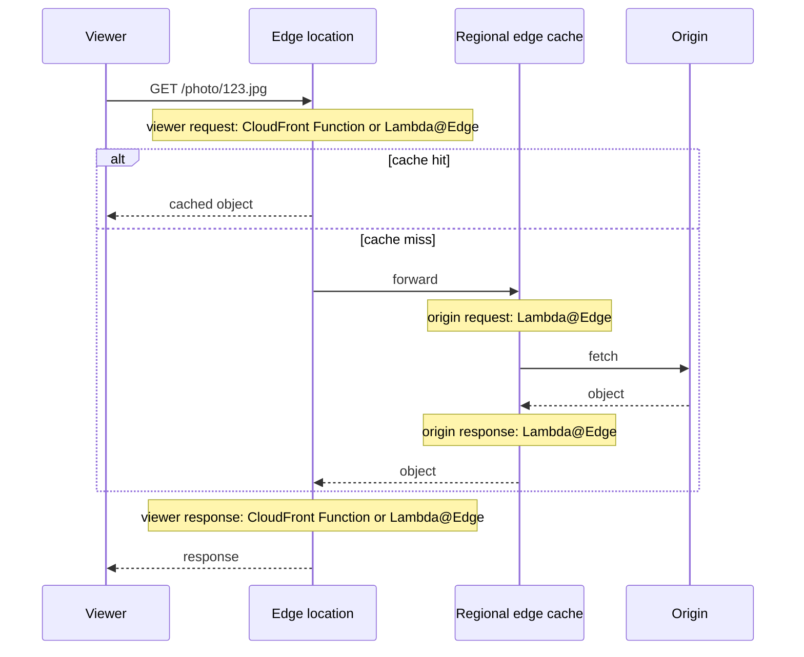

**Reading the diagram.** All messages are synchronous HTTP. Viewer-request code runs on every request before the cache lookup, so it must be cheap: this is where token validation and cache-key normalization belong. Origin-request and origin-response code runs only on cache misses, after the regional cache, so it can afford more work (choosing an origin, generating an image variant) and its result can be cached. Viewer-response code runs on every response, including hits. Storage boundaries are the two cache tiers and the origin. Failure points: slow viewer-event code adds latency to every hit, and an exception there fails requests that the cache could have served. Scaling: work placed on origin events scales with the miss rate, not the request rate.

::: warning
**Warning — Edge code is on every request.** One millisecond of viewer-request code at PhotoShare's 17,400 photo views per second is 17.4 CPU-seconds per second across the edge. Put per-request logic in the cheapest tier that can do it, and move anything cacheable to origin-facing events.
:::

## 48.9 Edge data

Edge code is only as fast as the data it reads. If every request must still fetch state from one region, the edge saves nothing (§48.10). Edge platforms therefore offer storage with different placements, and each placement is a different point in the consistency trade-offs of Chapter 25.

### 48.9.1 Four kinds of edge state

1. **Per-PoP cache (Cache API).** Code can read and write the PoP's HTTP cache programmatically: store a computed response, a fetched token-signing key or an assembled fragment. It is local to one PoP (or one data center), not replicated, and may be evicted at any time; correctness must never depend on it.
2. **Global key-value stores** (Workers KV, Fastly KV Store, CloudFront KeyValueStore). Writes go to central storage and propagate to PoPs, which cache values for reads. They are **eventually consistent**: Cloudflare documents that a write is usually visible at once where it was made but may take 60 seconds or more to appear elsewhere, and limits writes to the same key to about one per second [Cloudflare Docs: Workers KV]. Concurrent writes resolve by last-write-wins. Ideal for read-heavy, rarely changing data: feature flags, redirects, A/B experiment definitions, allow-lists, public keys.
3. **Single-writer actors** (Cloudflare **Durable Objects**). Each object has a globally unique ID, and the platform guarantees at most one live instance of it in the world at a time, running single-threaded next to its own transactional, strongly consistent storage (SQLite-backed) [Cloudflare Docs: Durable Objects]. Every request for that ID is routed to that instance, so the object serializes all operations on its state without locks: a linearizable unit, in the terms of §25.3. Ideal for counters, per-user rate limiters, chat rooms, collaborative documents, game sessions and coordination.
4. **Replicated SQL at the edge** (Cloudflare D1 read replication, libSQL/Turso embedded replicas, LiteFS). A primary SQLite database takes all writes; read replicas near users serve queries. Reads from a replica can be stale; D1 offers sessions with bookmarks so that a client's reads observe at least its own earlier writes (read-your-writes, sequential consistency within the session) [Cloudflare Docs: D1].

**Figure 48.13 — Routing requests to a single-writer Durable Object.**

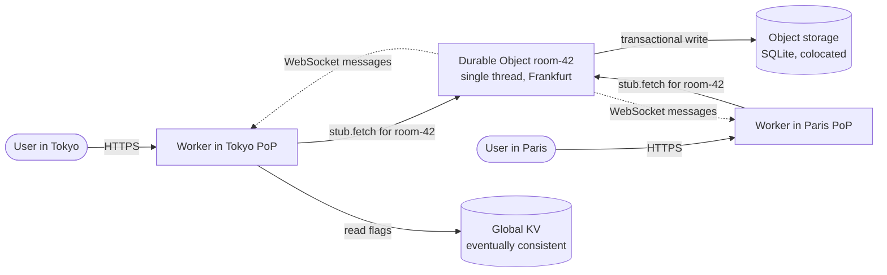

**Reading the diagram.** Workers run in the PoP nearest each user and are stateless. Both route requests for `room-42` synchronously to the single instance of that Durable Object, which happens to live in Frankfurt; its colocated SQLite storage is the strongly consistent storage boundary, and the object serializes every operation. Broadcasts to connected clients flow asynchronously over WebSockets. Read-mostly data such as feature flags comes from the eventually consistent KV store at the local PoP. Failure points: the object's location is a latency cost for distant users (Tokyo pays about a 230 ms round trip to Frankfurt), one object's single thread bounds its throughput, and the platform must recreate the object elsewhere if its host fails. Scaling: shard state across many objects (one per room, per user, per document), never one global object.

### 48.9.2 Choosing by consistency

**Table 48.6 — Edge data options and their consistency (as of 2026).**

| Option | Placement | Consistency | Write path | Good for | Bad for |
|---|---|---|---|---|---|
| Cache API | One PoP | None (may vanish) | Local | Memoizing fetches and renders | Anything authoritative |
| Global KV | Central store, cached at PoPs | Eventual, ~60 s+ | Central, rate limited per key | Flags, config, redirects, keys | Counters, read-after-write, frequent writes |
| Durable Object | One location per object | Strong (single writer) | To the object's home | Counters, locks, rooms, sessions | Global hot keys, read-heavy global data |
| Edge SQLite replicas | Primary + regional replicas | Primary strong; replicas lag; sessions give read-your-writes | To primary | Read-heavy relational data | Write-heavy, globally distributed writers |
| Origin database | One Region | Whatever it provides | Origin | System of record | Low-latency global reads |

The pattern for most products: authoritative state at the origin, read-mostly copies in KV or replicas, coordination in single-writer objects sharded by entity, and caches everywhere. PhotoShare keeps photo metadata in its regional database, experiment definitions and token-signing public keys in KV, per-user upload rate limits in Durable Objects keyed by user, and rendered thumbnails in the CDN cache.

::: mistake
**Common misconception — "Edge KV is a globally replicated database."** It is a globally cached configuration store. A counter incremented in KV from two PoPs loses updates, a value written in Paris may read as old in Sydney for a minute, and per-key write rates are tiny. Use a single-writer object or the origin for anything that must be counted or read back immediately.
:::

## 48.10 What to run at the edge

### 48.10.1 The latency budget

The edge saves one thing: round trips between the user and the region. It gains nothing, and often loses, when edge code must make several round trips back to the region for data. The arithmetic below makes the rule precise; §44.4 covers the physics of the round-trip times.

::: formula
**Edge versus origin request latency (warm connections)**

$$T_{\text{origin}} = R_{ue} + R_{eo} + c_o + n\,R_{od} \qquad T_{\text{edge}} = R_{ue} + c_e + m\,R_{eo} + j\,R_{el}$$

| Symbol | Meaning | Units |
|---|---|---|
| $R_{ue}$ | Round trip between user and nearest PoP | ms |
| $R_{eo}$ | Round trip between PoP and origin Region (warm connection) | ms |
| $R_{od}$ | Round trip between origin service and its database (same Region) | ms |
| $R_{el}$ | Round trip from edge code to edge-local data (KV, replica, cache) | ms |
| $c_o$, $c_e$ | Compute time at origin and at the edge | ms |
| $n$ | Sequential database round trips the origin service makes | count |
| $m$ | Sequential round trips edge code makes to the origin | count |
| $j$ | Sequential round trips edge code makes to edge-local data | count |
:::

Ignoring compute differences, moving the logic to the edge helps only if $m\,R_{eo} < R_{eo} + n\,R_{od}$. Because $R_{od}$ is about 1 ms and $R_{eo}$ is tens to hundreds, that means **$m \le 1$**: edge code may make at most one trip to the origin, and should usually make none.

::: example
**Worked example — PhotoShare in Sydney, origin in Virginia.** Assume $R_{ue} = 10$ ms, $R_{eo} = 200$ ms, $R_{od} = 1$ ms, $R_{el} = 2$ ms. The profile page needs five sequential queries and 20 ms of rendering wherever it runs.

1. Origin render: $T_{\text{origin}} = 10 + 200 + 20 + 5 \times 1 = 235$ ms.
2. Edge render, data at origin ($m = 5$): $T_{\text{edge}} = 10 + 20 + 5 \times 200 = 1{,}030$ ms, 4.4 times slower.
3. Edge render, data in an edge replica ($m = 0$, $j = 5$): $T_{\text{edge}} = 10 + 20 + 5 \times 2 = 40$ ms, 5.9 times faster than the origin.
4. Edge token check that rejects an expired token ($m = 0$, $c_e = 1$ ms): $10 + 1 = 11$ ms, against 215 ms for a rejection by the origin, and the origin never sees the request.
5. Edge token check on a valid request, then forward: $10 + 1 + 200 + 20 + 5 = 236$ ms: 1 ms slower than no edge logic, but the origin no longer validates tokens.

**Interpretation.** The same code is 4.4 times slower or 5.9 times faster at the edge depending only on where its data lives. **Engineering implication.** Move logic to the edge with its data, or move only logic that needs no origin data; batch any unavoidable origin call into one request.
:::

### 48.10.2 Good and bad candidates

Work that fits the edge needs little data, or data that is read-mostly and replicable, and benefits every request:

- **Authentication and token validation.** Verify a JWT signature against public keys cached at the edge; reject bad tokens and bots before they cost origin capacity. Verify signed URLs for private photos (§21.11).
- **A/B assignment and feature flags.** Hash a user ID into a bucket, read experiment definitions from KV and rewrite the request, so the origin and cache see a stable variant key.
- **Personalization of cached pages.** Fetch a cached generic page and insert a few user-specific fragments (name, locale, currency) from a token or KV.
- **Request routing.** Choose an origin by geography, tenant, canary weight or health; rewrite URLs; normalize cache keys (§21.6).
- **Image transforms.** Resize and re-encode on a cache miss (origin-request event), then cache the variant, so each size is computed once per cache lifetime.
- **Security filtering and rate limiting** with per-client state in single-writer objects.

Work that does not fit: chatty access to an origin database ($m > 1$), long CPU-heavy jobs (CPU limits), large transactional writes, and anything requiring data that cannot legally leave a Region (residency, §44.9).

**Figure 48.14 — Deciding whether a piece of logic belongs at the edge.**

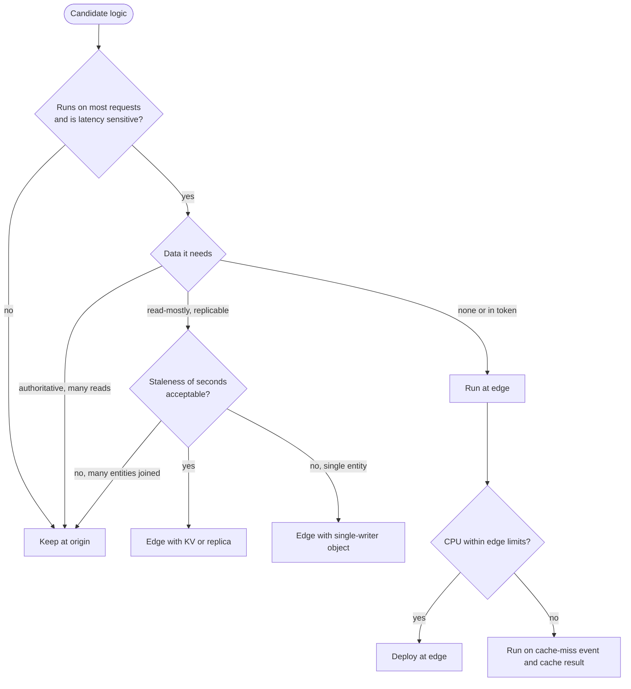

**Reading the diagram.** This is a decision flow, not a data flow. Logic that runs rarely or is not latency sensitive stays at the origin. For per-request logic, the deciding question is data: none (or only what the token carries) means the edge; read-mostly data that tolerates seconds of staleness means the edge plus KV or a replica; strongly consistent state about one entity means a single-writer object; authoritative data joined across many entities means the origin, because $m > 1$. Finally, CPU-heavy work moves to a cache-miss event so that its result is cached. Failure points to check at each "edge" leaf: what happens when the edge store is stale or unreachable, and whether the origin can still serve as a fallback.

## 48.11 Cost at scale

§33.9.3 derived the break-even request rate between functions and a fixed pair of servers. At scale three more terms matter: the front door's per-request charge, the provisioning factor of the always-on alternative (how far above average load it must run), and data transfer, which is the same for every compute choice and often larger than compute.

::: formula
**Monthly cost curves for functions, autoscaled containers and VMs**

$$C_{\text{FaaS}} = R\,(c_{\text{req}} + c_{\text{fd}} + M D\, c_{\text{GBs}}) + R\,b\,c_{\text{eg}} \qquad C_{\text{fleet}} = \max\!\left(n_{\min}, \left\lceil \frac{\phi\,R}{T\,r} \right\rceil\right) c_{\text{unit}} + F + R\,c_{\text{lb}} + R\,b\,c_{\text{eg}}$$

| Symbol | Meaning | Units |
|---|---|---|
| $R$ | Requests per month | requests/month |
| $c_{\text{req}}$, $c_{\text{fd}}$ | Function request charge; HTTP front-door charge per request | \$/request |
| $M$, $D$, $c_{\text{GBs}}$ | Memory, billed duration, price per GB-second | GB, s, \$/GB-s |
| $b$ | Response bytes leaving the cloud per request | GB/request |
| $c_{\text{eg}}$ | Internet egress price | \$/GB |
| $n_{\min}$ | Minimum units for availability | units |
| $\phi$ | Provisioning factor: capacity ÷ average load (1.5 autoscaled, 3 sized for peak) | dimensionless |
| $T$ | Seconds per month (2,592,000) | s |
| $r$ | Requests per second one unit sustains at target utilization | RPS/unit |
| $c_{\text{unit}}$ | Monthly price of one container task or VM | \$/unit-month |
| $F$, $c_{\text{lb}}$ | Load balancer's fixed monthly charge and per-request charge | \$/month, \$/request |
:::

::: example
**Worked example — One API at 1 million, 100 million and 10 billion requests per month.** Prices are illustrative, loosely based on us-east-1 list prices as of 2026; verify before use. Each request runs 100 ms (10 ms of it CPU) and returns 10 KB.

- **Functions:** $M = 0.5$ GB, $D = 0.1$ s, $c_{\text{GBs}} = \$0.0000166667$, $c_{\text{req}} = \$0.20$ per million, HTTP front door $c_{\text{fd}} = \$1.00$ per million. Per request: $0.05 \times 0.0000166667 + 2 \times 10^{-7} + 10^{-6} = \$2.033 \times 10^{-6}$.
- **Containers:** 1 vCPU and 2 GB tasks at $\$0.04048$ per vCPU-hour + $\$0.004445$ per GB-hour $= \$0.04937$ per hour $\times\ 730 = \$36.04$ per month; each sustains $r = 60$ RPS (10 ms CPU at 60% utilization); autoscaled, $\phi = 1.5$; $n_{\min} = 2$.
- **VMs:** 2 vCPU instances at an illustrative committed $\$0.06$ per hour $= \$43.80$ per month; $r = 120$ RPS; sized for peak, $\phi = 3$, plus 10% spare; $n_{\min} = 2$.
- **Load balancer** (containers and VMs): $F = \$20$ per month plus an illustrative $\$0.25$ per million requests. **Egress:** $c_{\text{eg}} = \$0.09$ per GB.

1. Average rates: $10^6/T = 0.39$ RPS; $10^8/T = 38.6$ RPS; $10^{10}/T = 3{,}858$ RPS.
2. Units: containers $\lceil 1.5 \times 38.6/60 \rceil = 1 \to 2$ (minimum) at 100 M; $\lceil 1.5 \times 3{,}858/60 \rceil = 97$ at 10 B. VMs $\lceil 3 \times 3{,}858/120 \rceil = 97$, plus 10 spare $= 107$ at 10 B; 2 below that.
3. Egress: 10 KB × requests $= 10$ GB, 1 TB and 100 TB: \$0.90, \$90 and \$9,000.

**Table 48.7 — Monthly cost by scale (illustrative prices).**

| Requests/month | Functions: compute + requests | Functions: front door | Containers: tasks + LB | VMs: instances + LB | Egress (all) | Total: functions / containers / VMs |
|---|---|---|---|---|---|---|
| 1 million | \$1.03 | \$1.00 | \$72.08 + \$20.25 | \$87.60 + \$20.25 | \$0.90 | \$2.93 / \$93.23 / \$108.75 |
| 100 million | \$103.33 | \$100.00 | \$72.08 + \$45.00 | \$87.60 + \$45.00 | \$90 | \$293.33 / \$207.08 / \$222.60 |
| 10 billion | \$10,333 | \$10,000 | \$3,496 + \$2,520 | \$4,687 + \$2,520 | \$9,000 | \$29,333 / \$15,016 / \$16,207 |

4. Break-even, functions versus the minimum container fleet: $R^{*} = (2 \times 36.04 + 20)/(2.033 \times 10^{-6} - 0.25 \times 10^{-6}) = 92.08/1.783 \times 10^{-6} \approx 51.6$ million requests per month, about 20 RPS average, consistent with the 23–45 RPS of §33.9.3.

**Interpretation.** At 1 million requests functions cost 3% of the alternatives; at 100 million they cost 40% more; at 10 billion nearly twice as much, and over half of that gap is the front door's per-request charge, not compute. Egress is identical across the three and, at 10 billion, about twice the fleets' instance cost. **Engineering implication.** Below the break-even, functions win on both cost and operations. Above it, first remove avoidable per-request charges (a function URL or load balancer instead of a full-featured gateway, Arm pricing, right-sized memory), then compare again; and always optimize egress (CDN offload, compression), which no compute choice changes. Engineer time, omitted here, favors functions at every scale below a dedicated platform team's cost.
:::

The curves explain the Prime Video case in §33.9: a fine-grained serverless design is the cheapest way to start and the most expensive way to run a high, steady volume. Spiky traffic shifts the comparison toward functions, because the fleet's $\phi$ grows with peak-to-average ratio while functions bill only actual work; provisioned concurrency (§48.5.3) shifts it back.

## 48.12 Operating serverless

**Observability.** The platform emits the core metrics; alert on the ones that reveal serverless-specific failures: throttles, init duration and cold-start count, concurrency against its limit, iterator age (how far a stream consumer lags), queue age and dead-letter depth, and asynchronous-event age. Log in structured form with the request ID, function version and cold-start flag, so that latency can be split into warm and cold populations (§48.5.2).

**Tracing across asynchronous hops.** A request that crosses a queue loses its trace unless the producer writes the trace context (W3C `traceparent`, §40.6.2) into message attributes and the consumer restores it. Batches complicate this: one invocation may process ten messages from ten traces, so the consumer's span should carry **span links** to each producer span rather than pretend to have one parent. Managed services propagate context only where the provider integrates them; verify each hop.

**Versions, aliases and gradual deployment.** A published function **version** is immutable code plus configuration; an **alias** is a named pointer (for example `live`) that triggers and callers use. Shifting an alias's routing weights (say 5% to the new version for ten minutes, with automatic rollback on alarms) is a canary release (§43.6) without load balancers. Provisioned concurrency attaches to a version or alias, so pre-warm the new version before shifting traffic, or the canary measures cold starts rather than code.

**Testing.** Write handlers as thin adapters around plain functions and unit-test them with recorded events, as in §48.7.2. Emulators (AWS SAM CLI, LocalStack, Azure Functions Core Tools, Cloudflare's local Workers runtime) catch wiring mistakes cheaply. Permissions, event-source settings, limits and managed-service behavior can only be tested in the cloud, so give each branch an ephemeral stack created from infrastructure as code (§43.8).

**Lock-in.** Handler logic is portable; the event formats, triggers, IAM policies, workflow definitions and managed data services around it are not. Keep business logic behind ports and adapters (§33.10), use standard event envelopes such as CloudEvents where possible, and prefer container-based platforms (Cloud Run, Knative) when portability matters more than the deepest integration. Lock-in to a managed service that removes a whole operational burden is often a good trade; make it deliberately.

## 48.13 Serverless versus containers: a decision table

**Table 48.8 — Functions, serverless containers, containers on a cluster and edge functions (as of 2026).**

| Row | Functions (Lambda, Azure Functions) | Serverless containers (Cloud Run, Fargate) | Containers on a cluster or VMs | Edge functions (Workers, Compute) |
|---|---|---|---|---|
| What it is | Code run per event in a managed sandbox | Your image, scaled by the provider | Your image on capacity you manage | Small code at every PoP |
| How it works | One request per environment (Lambda); scale to zero | Many requests per instance; scale to zero or minimum | Orchestrator schedules pods on nodes | Isolate or Wasm instance per request |
| Advantages | No servers, per-ms billing, rich event triggers | Any language and binary, container portability | Full control, cheapest at steady high load, long-lived connections | Lowest user latency, global by default |
| Disadvantages | Cold starts, limits, per-request cost at scale | Fewer knobs; some cold starts | Operations, capacity planning, idle cost | Tight CPU and memory limits, weak data locality |
| Performance | Warm: ms overhead; cold: 100 ms to seconds | Cold start on scale-out; warm like servers | Predictable; no cold starts | Start in µs to ms; origin round trips dominate |
| Operational complexity | Low | Low to medium | High | Low |
| Cost | Linear in requests; zero when idle | Per instance-second; zero or minimum when idle | Per node, used or not | Per request and CPU time |
| Use cases | Event glue, pipelines, spiky APIs, schedules | Web APIs, workers, migrated services | Large steady fleets, stateful systems, GPUs | Auth, routing, A/B, personalization, transforms |
| Choose when | Traffic is spiky or below ~20–45 RPS average, work is short | You want containers without a cluster | Load is steady and high, or you need control | Logic needs no origin round trip ($m \le 1$) |

Most mature systems use several columns: the edge for authentication and routing, functions for event-driven glue and pipelines, and containers for the steady, high-volume core (§42.16).

## 48.14 Summary and revision notes

::: summary
- Serverless means no resource management, automatic scaling including to zero, and pay-per-use billing. It is FaaS for logic plus managed services for state [Jonas et al. 2019].
- Lambda's published design has four parts: frontend, Worker Manager (sticky slot state), Placement and workers. Each slot is a Firecracker microVM serving one function and one request at a time. Images load on demand as deduplicated, convergently encrypted chunks from tiered caches. SnapStart restores snapshots, and after-restore hooks must fix uniqueness.
- A cold start is placement, sandbox, code loading, runtime init and function init. The last is usually the largest. Mixture arithmetic gives the cliff: if the cold fraction exceeds $1 - q$, the $q$-th percentile is a cold-start latency.
- Under a fixed keep-alive, $P_{\text{cold}} = e^{-\lambda K}$. Rare functions stay cold and waste memory, which is why prediction-based pre-warming exists. The simulation also shows the cold-start cascade inflating burst concurrency.
- Concurrency $= \lambda D$. Limits apply per account and to the scaling rate. Cap asynchronous consumers, reserve capacity for critical functions, and pool database connections ($N_{\text{pool}} = \lambda_q d_q$).
- Build pipelines from queues, streams and fan-out. Make every handler idempotent, report partial batch failures, and use dead-letter queues. Orchestrate multi-step work with a workflow engine, never with synchronous function chains.
- Edge runtimes use V8 isolates (ms start, shared process plus OS sandbox and Spectre defenses), Wasm instances per request (µs start) or restricted JavaScript. Lambda@Edge runs microVM functions in regional caches.
- Edge data comes in four kinds: per-PoP cache, eventually consistent KV (~60 s), single-writer Durable Objects (strong per object), and SQLite read replicas with session guarantees.
- Edge logic helps only if it makes at most one origin round trip ($m \le 1$). Auth, A/B assignment, routing, personalization and cached image transforms fit. Chatty database access does not.
- Function cost is linear in requests. Fleets cost a step function of capacity. Break-even is tens of RPS on average. At 10 billion requests a month the front door and egress rival compute.
- Operating serverless means alerting on throttles, init duration and iterator age, linking traces across batches, canarying through weighted aliases, testing in ephemeral cloud stacks, and choosing lock-in deliberately.
:::

## 48.15 Knowledge checkpoint

1. State the three properties that define serverless in the Berkeley view.
2. What is a slot in Lambda, and how many concurrent invocations does it serve?
3. Why does Lambda use convergent encryption for container image chunks?
4. Name two things that go wrong if initialization state is captured in a snapshot.
5. Cold starts are 1.5% of invocations. Can the p99 be a warm latency? Why?
6. A function is invoked on average every 10 minutes. What fraction is cold with a 10-minute keep-alive?
7. Why did the simulation need up to 25 environments for a burst whose average concurrency was 3.4?
8. A function receives 500 RPS at 300 ms. What concurrency does it need?
9. Why does a slower database increase Lambda concurrency even without more traffic?
10. Give two reasons a synchronous Lambda-to-Lambda call is an anti-pattern.
11. Why should a stream consumer use bisect-on-error and an on-failure destination?
12. What two defenses beyond the V8 sandbox protect isolate tenants from Spectre-style attacks?
13. Why must a counter not live in an edge KV store?
14. Edge code makes three sequential calls to an origin 150 ms away. When could it still beat origin rendering?
15. Which term in the cost model is identical for functions, containers and VMs?

<details><summary>Answers</summary>

1. No resource management by the developer, automatic scaling including to zero, and billing in proportion to resources used rather than reserved.
2. A pre-loaded execution environment for one function on a worker, inside its own microVM. It serves one invocation at a time and many in sequence.
3. Identical chunks from different customers encrypt to identical ciphertext, so shared base layers are stored and cached once. Nobody without the plaintext can read them.
4. Any two of: duplicated random seeds or UUIDs, duplicated nonces, stale network connections, expired credentials.
5. No. More than 1% of requests are cold, so at least one cold request falls in the slowest 1%. The p99 is at least the fastest cold latency.
6. $e^{-\lambda K} = e^{-1} \approx 36.8\%$.
7. The cold-start cascade. New environments take 300–700 ms to initialize, so each early burst request holds an environment about seven times longer. More requests then find no idle environment and start yet more cold environments.
8. $500 \times 0.3 = 150$ environments.
9. Duration $D$ rises, and concurrency is $\lambda D$ by Little's Law.
10. Any two of: the caller is billed while waiting, concurrency multiplies by chain depth, timeouts and retries compound, and no durable record exists of completed steps.
11. A failing record blocks its whole shard. Bisecting isolates the bad record, and the destination removes it so the shard can make progress.
12. Any two of: the process-level OS sandbox, trust-based cordons, no high-resolution timers or shared-memory threads, and dynamic process isolation of suspicious scripts.
13. KV is eventually consistent and last-write-wins, and it allows about one write per second per key. Concurrent increments from different PoPs lose updates.
14. Only if the origin path itself needs more than about three regional round trips' worth of time. Otherwise it cannot: $3 \times 150 = 450$ ms exceeds one 150 ms trip plus a few 1 ms database calls. Batch the calls into one, or replicate the data to the edge.
15. Egress (data transfer to the Internet), $R\,b\,c_{\text{eg}}$.
</details>

## 48.16 Interview questions

### Basic

**Q1.** What is a cold start, and how would you reduce its impact on an API? **Answer.** It is the latency of creating an execution environment: placement, sandbox, code loading, runtime and function initialization. Measure init duration first. Trim dependencies and lazy-load what the hot path does not need. Pick a fast-starting runtime or snapshot restore, and add more memory for CPU-bound init. Use provisioned concurrency sized to measured burst concurrency only where the SLO demands it. Move work that need not be synchronous behind a queue.

**Q2.** When would you choose serverless over containers? **Answer.** When traffic is spiky, low or unpredictable (below roughly 20–45 RPS average for a typical API), work is short and event-driven, and the team wants no capacity planning. Choose containers for steady high volume, long-lived connections, long jobs, special hardware or fine control. Compute the break-even with real duration, memory and front-door charges.

### Intermediate

**Q3.** Your functions exhausted the PostgreSQL connection limit during a traffic spike. What do you do? **Answer.** In the short term, cap the functions' concurrency. Then put a connection pooler (RDS Proxy or PgBouncer in transaction mode) between the functions and the database, sized by Little's Law on query rate and query time. Avoid session state that pins connections, and put a queue in front of write-heavy paths. Alert on connection count and on proxy wait time.

**Q4.** Design a pipeline that thumbnails 70 uploads per second with bursts to 1,000 per second. **Answer.** Send object-created events through an event bus to a dedicated queue. A function consumes batches with a concurrency cap sized for the burst backlog it can tolerate. Make writes idempotent by object version, report partial batch failures, and add a dead-letter queue with an alarm. Use separate queues for moderation and audit so they fan out independently. Monitor queue age, throttles and DLQ depth, and use tracing with span links.

### Advanced

**Q5.** Design a global per-user rate limiter at the edge. **Answer.** Validate the token in the edge function, then route each user's check to a single-writer object keyed by user ID (a Durable Object). It holds a token bucket in memory and in colocated storage, so the counts are exact. KV would lose concurrent increments. To bound latency for users far from their object's home, allow a small local allowance per PoP, reconciled asynchronously. Fail open or closed by endpoint risk. Shard by user so that no object is a global hot spot.

**Q6.** A team proposes moving its whole web app to edge functions "for latency". How do you evaluate it? **Answer.** Count origin round trips per request ($m$) and compare $R_{ue} + c_e + m R_{eo}$ with the origin path. With a regional database and $m > 1$, the edge is slower. Move auth, routing, A/B assignment and cache-assembled personalization to the edge. Replicate read-mostly data to KV or SQLite replicas where staleness is acceptable, and put per-entity coordination in single-writer objects. Keep transactional, joined data at the origin. Check CPU limits, residency rules, observability and cost per request too.

## 48.17 Practical exercises

1. Run the simulation of §48.5.4 with bursts every 30 minutes. Find the smallest keep-alive that brings p99 under 200 ms, and compare its idle environment-hours with the provisioned level that does the same.
2. Add a predictive pre-warm policy to the simulation: create $P$ environments 10 s before each burst and reclaim them after it. Compare cold starts and idle hours with fixed provisioned concurrency.
3. Measure init and handler duration for one function in two runtimes at three memory sizes. Plot cost per million invocations against latency.
4. Extend the batch handler of §48.7.2 so that it claims the idempotency key before a non-idempotent side effect, and write a test with two concurrent workers.
5. Recompute Table 48.7 with Arm pricing, 256 MB memory and no API gateway. Find the new break-even.

## 48.18 Design challenges

1. **Global image service.** Serve PhotoShare's 17,400 views per second with on-the-fly resizing to 12 sizes and two formats. Decide what runs on viewer and on cache-miss events, estimate transform invocations from the cache hit ratio, and cost the design.
2. **Serverless checkout.** Build a checkout saga from functions and a workflow engine. Include idempotency keys, compensation, concurrency caps for the payment provider and tracing across every hop.
3. **Multi-tenant webhook platform.** Deliver 50,000 tenants' webhooks with per-tenant rate limits and retries. Choose queues, concurrency caps and isolation (§47.8), and compute concurrency for 2,000 deliveries per second at 800 ms each.

## 48.19 References

1. Agache, A., Brooker, M., Florescu, A., Iordache, A., Liguori, A., Neugebauer, R., Piwonka, P., and Popa, D.-M. "Firecracker: Lightweight Virtualization for Serverless Applications." *USENIX NSDI*, 2020.
2. Amazon Web Services. *AWS Lambda Developer Guide* (execution environment lifecycle, quotas, scaling behavior, provisioned concurrency, SnapStart, Amazon SQS and Kinesis event sources, recursive loop detection). Accessed 2026. https://docs.aws.amazon.com/lambda/latest/dg/ (cited as AWS Docs: Lambda)
3. Amazon Web Services. *AWS Lambda pricing*. Accessed 2026. https://aws.amazon.com/lambda/pricing/ (cited as AWS Lambda Pricing)
4. Amazon Web Services. "AWS Lambda standardizes billing for INIT phase." *AWS Compute Blog*, 2025. https://aws.amazon.com/blogs/compute/aws-lambda-standardizes-billing-for-init-phase/ (cited as AWS Compute Blog 2025)
5. Amazon Web Services. *Amazon CloudFront Developer Guide*: customizing at the edge with CloudFront Functions and Lambda@Edge. Accessed 2026. https://docs.aws.amazon.com/AmazonCloudFront/latest/DeveloperGuide/ (cited as AWS Docs: CloudFront)
6. Amazon Web Services. *Amazon RDS Proxy*, Amazon RDS User Guide. Accessed 2026. https://docs.aws.amazon.com/AmazonRDS/latest/UserGuide/rds-proxy.html (cited as AWS Docs: RDS Proxy)
7. Beswick, J. "Operating Lambda: Performance optimization – Part 1." *AWS Compute Blog*, 2021.
8. Bloom, Z. "Cloud Computing without Containers." *The Cloudflare Blog*, 2018. https://blog.cloudflare.com/cloud-computing-without-containers/
9. Brooker, M., Catangiu, A. C., Danilov, M., Graf, A., MacCárthaigh, C., and Sandu, A. "Restoring Uniqueness in MicroVM Snapshots." arXiv:2102.12892, 2021.
10. Brooker, M., Danilov, M., Greenwood, C., and Piwonka, P. "On-demand Container Loading in AWS Lambda." *USENIX ATC*, 2023. https://www.usenix.org/conference/atc23/presentation/brooker
11. Cloudflare. *Cloudflare Workers documentation* (How Workers works, Limits). Accessed 2026. https://developers.cloudflare.com/workers/ (cited as Cloudflare Docs: Workers)
12. Cloudflare. *Workers KV documentation* (How KV works). Accessed 2026. https://developers.cloudflare.com/kv/ (cited as Cloudflare Docs: Workers KV)
13. Cloudflare. *Durable Objects documentation*. Accessed 2026. https://developers.cloudflare.com/durable-objects/ (cited as Cloudflare Docs: Durable Objects)
14. Cloudflare. *D1 documentation* (Global read replication). Accessed 2026. https://developers.cloudflare.com/d1/ (cited as Cloudflare Docs: D1)
15. Fastly. *Fastly Compute documentation*. Accessed 2026. https://www.fastly.com/documentation/guides/compute/ (cited as Fastly Docs: Compute)
16. Google Cloud. *Cloud Run documentation* (concurrency, minimum instances, execution environments, billing settings). Accessed 2026. https://cloud.google.com/run/docs (cited as Google Cloud Docs: Cloud Run)
17. Haas, A., Rossberg, A., Schuff, D. L., Titzer, B. L., Holman, M., Gohman, D., Wagner, L., Zakai, A., and Bastien, J. F. "Bringing the Web up to Speed with WebAssembly." *ACM PLDI*, 2017.
18. Harter, T., Salmon, B., Liu, R., Arpaci-Dusseau, A. C., and Arpaci-Dusseau, R. H. "Slacker: Fast Distribution with Lazy Docker Containers." *USENIX FAST*, 2016.
19. Hellerstein, J. M., Faleiro, J., Gonzalez, J. E., Schleier-Smith, J., Sreekanti, V., Tumanov, A., and Wu, C. "Serverless Computing: One Step Forward, Two Steps Back." *CIDR*, 2019.
20. Jonas, E., Schleier-Smith, J., Sreekanti, V., Tsai, C.-C., Khandelwal, A., Pu, Q., Shankar, V., Carreira, J., Krauth, K., Yadwadkar, N., Gonzalez, J. E., Popa, R. A., Stoica, I., and Patterson, D. A. "Cloud Programming Simplified: A Berkeley View on Serverless Computing." UC Berkeley Technical Report UCB/EECS-2019-3; arXiv:1902.03383, 2019.
21. Microsoft. *Azure Functions hosting options* and *Flex Consumption plan hosting*. Microsoft Learn, accessed 2026. https://learn.microsoft.com/azure/azure-functions/ (cited as Microsoft Learn: Azure Functions)
22. Partovi, A. "Eliminating cold starts with Cloudflare Workers." *The Cloudflare Blog*, 2020.
23. Shahrad, M., Fonseca, R., Goiri, Í., Chaudhry, G., Batum, P., Cooke, J., Laureano, E., Tresness, C., Russinovich, M., and Bianchini, R. "Serverless in the Wild: Characterizing and Optimizing the Serverless Workload at a Large Cloud Provider." *USENIX ATC*, 2020.
24. Varda, K. "Mitigating Spectre and Other Security Threats: The Cloudflare Workers Security Model." *The Cloudflare Blog*, 2020.
25. Wang, L., Li, M., Zhang, Y., Ristenpart, T., and Swift, M. "Peeking Behind the Curtains of Serverless Platforms." *USENIX ATC*, 2018.

## 48.20 Open verification items

- Lambda limits and prices (account concurrency 1,000; scaling 1,000 environments per 10 s per function; 10 s init limit; 10 GiB images; provisioned price \$0.0000041667/GB-s; 1,769 MB per vCPU): confirm as of 2026. AWS documentation pages could not be fetched from the build environment.
- Placement "typically under 20 ms" and the MicroManager's pre-booted pool, from memory of Agache et al. 2020 §4; recheck the text.
- Replacement of the Worker Manager by an assignment service: reported in AWS conference talks only (Secondary).
- SnapStart runtimes (Java, Python, .NET) and the "up to 10×" Java figure.
- Wang et al. 2018 is summarized qualitatively; its exact per-provider cold-start figures were not checked.
- Cloudflare figures: ~5 ms isolate start (2018), 128 MB memory, CPU limits, KV's ~60 s propagation and one write per second per key; the Varda and Partovi post years (2020) and exact titles.
- Lambda recursive-loop threshold (about 16) and its covered services.
- Cloud Run concurrency (default 80, maximum 1,000), the 60-minute HTTP timeout and its gen 1/gen 2 sandboxes; Azure Flex Consumption features.
- The Beswick 2021 post title and the "under 1% of invocations" analysis.
