# Chapter 49 — Large-Scale Data Infrastructure and High-Performance Computing

> **Level:** 4–5 · **Track:** Shared · **Estimated reading time:** 6 h

This chapter covers two kinds of system that break the book's usual picture of independent machines serving independent requests. **Exabyte data infrastructure** stores so much that, statistically, something is always broken, and the metadata about the data becomes a distributed system in its own right. **High-performance computing (HPC)** couples thousands of nodes so tightly that the slowest message or the slowest node sets the pace for all of them. The two worlds grew up separately and are converging in AI training clusters.

**Storage at scale** (§49.3–§49.4) quantifies what changes at an exabyte and compares four published systems: Colossus, Tectonic, Amazon S3 and Windows Azure Storage. **Analytics** (§49.5–§49.7) lays out the modern data platform, takes apart Dremel/BigQuery and Snowflake, and works out when to ship disks instead of using the network. **HPC** (§49.8–§49.12) covers scaling laws, MPI and collective cost models, RDMA networking, parallel file systems and schedulers. §49.13 explains why an AI training cluster looks like a supercomputer, which sets up Chapters 61, 65 and 80.

## 49.1 Learning objectives

After this chapter you should be able to:

- Estimate drive counts, daily drive failures, repair traffic and metadata memory for an exabyte-scale storage cluster.
- Compare the published designs of Colossus, Tectonic, Amazon S3 and Windows Azure Storage.
- Draw the layers of a modern data platform and explain why storage and compute are separated.
- Explain how Dremel encodes nested records into columns with repetition and definition levels, and how its serving tree and shuffle tier execute queries.
- Describe Snowflake's three layers, micro-partitions and pruning.
- Decide between network transfer and physical shipment for a bulk migration, and estimate cross-region replication cost.
- Distinguish tightly coupled from embarrassingly parallel workloads, compute strong- and weak-scaling efficiency, and read a Top500 entry.
- Use MPI's model of ranks, communicators and collectives, and compute α–β costs of ring, tree and Rabenseifner all-reduce, including the crossover message size.
- Explain RDMA verbs, compare InfiniBand with RoCEv2, describe DCQCN and PFC's risks, and compute fat-tree and dragonfly bisection bandwidth.
- Describe Lustre and Spectrum Scale, size a checkpoint, and choose a checkpoint interval with Young's formula.

## 49.2 Prerequisites

- Object storage, GFS/HDFS, Colossus and Tectonic overviews, erasure coding and metadata services — §15.4–§15.7 (this chapter builds on them and does not repeat the mechanisms).
- Columnar storage and Parquet — §13.13 (Dremel and Snowflake are columnar engines).
- MapReduce, Spark, shuffle and data locality — §29.4–§29.7 (the batch engines on top of the data platform).
- Kafka and change data capture — §31.3, §31.14 (the ingestion path of §49.5).
- Amdahl's and Gustafson's laws — §4.12 (strong and weak scaling).
- Durability and failure-rate arithmetic — §4.15–§4.16.
- Leaf–spine networks, ECMP, oversubscription and incast — §7.17; congestion control — §7.7.7; DMA and kernel bypass — §5.7.
- Gang scheduling and Slurm — §46.10, §46.12 (HPC jobs are gangs).
- Cloud data-transfer pricing — §41.10.3.

## 49.3 What changes at exabyte scale

### 49.3.1 Four things that change

::: definition
**Definition — Exabyte scale.** A storage system whose capacity is measured in exabytes (1 EB = 10¹⁸ bytes = 1,000 PB = 1 million TB), typically spread over thousands of servers and tens to hundreds of thousands of drives in one or a few datacenters, and serving many tenants at once.
:::

#### First-principles explanation

Picture a city of a million light bulbs. Each bulb lasts years, yet on any evening hundreds are out, and a crew must be replacing them all the time. Nobody calls a dead bulb an "incident"; it is a line item in the maintenance budget. A storage system at an exabyte is that city. Four things change compared with a petabyte system:

1. **Failure is constant.** With tens of thousands of drives or more, several fail every day. Repair is a permanent background workload, not an emergency.
2. **Metadata dominates.** The bytes scale out easily by adding drives. The *catalog* (which file has which blocks on which drives) runs to billions or trillions of entries and receives millions of requests per second. It can no longer live on one machine (§15.5 showed why GFS's single master ran out of room).
3. **Data gravity.** Moving a petabyte across a WAN takes days or weeks, so computation moves to where the data is, and the location of the data shapes the whole architecture. The term "data gravity" was coined by Dave McCrory in 2010 [McCrory 2010].
4. **Cost per petabyte becomes the design objective.** A redundancy overhead of 3× versus 1.5× is a difference of about 75,000 drives per exabyte. Efficiency, not peak performance, is what Tectonic's paper puts in its title [Pan et al. 2021].

#### Why does this exist?

Companies consolidated many petabyte clusters into exabyte clusters because many small clusters strand capacity (one is full while another is half empty), duplicate operations work, and force applications to know which cluster their data is on. Facebook reports that before Tectonic its blob and warehouse storage ran on separate, specialized systems whose clusters scaled to tens of petabytes, and that consolidation into exabyte-scale multitenant clusters improved resource efficiency and operational simplicity [Pan et al. 2021; Facebook Engineering 2021].

#### How it works internally: the permanent repair loop

1. **Detect.** Servers report drive errors, checksum mismatches and scrub results; a central service notices missed heartbeats.
2. **Prioritize.** A repair scheduler lists stripes that lost fragments, most-endangered first.
3. **Reconstruct and place.** For RS($k$, $m$) (§15.6) a worker reads $k$ surviving fragments, recomputes the lost one and writes it in a different failure domain.
4. **Throttle.** Repair bandwidth is capped to protect client latency, but kept high enough that repair finishes long before the next correlated failure.

**Figure 49.1 — The permanent repair loop of an exabyte storage cluster.**

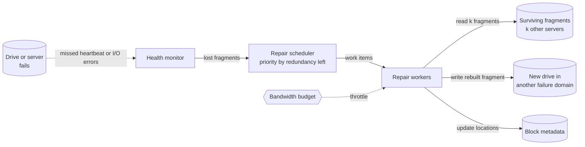

**Reading the diagram.** A failed *drive or server* is detected asynchronously (dotted) by the *health monitor*; the *repair scheduler* dispatches *repair workers*, which synchronously read $k$ surviving fragments, write the rebuilt one to a *new drive* in another failure domain and update the *block metadata*. A *bandwidth budget* throttles repair. Failure points: a rack or power-domain outage creates thousands of repairs at once (a repair storm); a metadata outage stalls repair entirely. Scaling: repair throughput grows with the number of workers and servers, so bigger clusters repair a given failure faster.

#### Mathematical foundations

::: formula
**Drives, daily failures and repair traffic**

$$N_{\text{drives}} = \frac{C \cdot o}{D} \qquad F_{\text{day}} = \frac{N_{\text{drives}} \cdot \text{AFR}}{365} \qquad R_{\text{day}} = F_{\text{day}} \cdot u \cdot D \cdot k$$

| Symbol | Meaning | Units |
|---|---|---|
| $C$ | Usable (logical) capacity | bytes |
| $o$ | Redundancy overhead: raw bytes per usable byte (3 for triple replication, $(k+m)/k$ for RS($k$, $m$)) | dimensionless |
| $D$ | Capacity of one drive | bytes |
| $N_{\text{drives}}$ | Number of drives | count |
| AFR | Annualized failure rate: fraction of drives that fail per year | 1/year |
| $F_{\text{day}}$ | Expected drive failures per day | drives/day |
| $u$ | Fill fraction of a failed drive | dimensionless |
| $k$ | Fragments read to rebuild one lost fragment (1 for replication) | count |
| $R_{\text{day}}$ | Bytes read per day for repair | bytes/day |
:::

::: example
**Worked example — Drive failures in a 1 EB cluster.** 1 EB usable, RS(6, 3) erasure coding ($o = 9/6 = 1.5$), 20 TB drives, AFR 1.5%, drives 80% full. Field studies report annual failure or replacement rates of roughly 1–4% for large populations, higher than datasheet MTTF figures imply [Schroeder and Gibson 2007; Pinheiro et al. 2007].

1. Raw capacity: $10^{18} \times 1.5 = 1.5 \times 10^{18}$ B.
2. Drives: $1.5 \times 10^{18} / (2 \times 10^{13}) = 75{,}000$ drives. At 36 drives per server that is about 2,100 servers.
3. Failures per year: $75{,}000 \times 0.015 = 1{,}125$; per day: $1{,}125/365 = 3.1$ drives.
4. At AFR 3%: 6.2 drives a day. With triple replication instead ($o = 3$): 150,000 drives and 6.2 failures a day even at 1.5%.
5. Repair reads per failure: $0.8 \times 20 \text{ TB} \times 6 = 96$ TB. Per day: $3.1 \times 96 \approx 296$ TB, a continuous $296 \times 10^{12} / 86{,}400 \approx 3.4$ GB/s of reads plus the rebuilt writes.
6. Redundancy cost: triple replication would need $75{,}000$ more drives than RS(6, 3); at about \$300 per 20 TB drive (illustrative, as of 2025) that is about \$22 million in drives alone, before servers, power and space.

**Interpretation.** A failed drive every eight hours is routine, and repair is a multi-GB/s background job that never stops. **Engineering implication.** Budget network and disk bandwidth for repair permanently; use codes with lower repair fan-in (local reconstruction codes, §15.6.2) when repair traffic dominates; spread each stripe across failure domains so a rack loss does not take out more than $m$ fragments of any stripe; and automate drive replacement, because humans cannot triage three failures a day per cluster.
:::

Drives are not the only thing that fails. Jeff Dean's often-quoted list for a new cluster's first year includes about a thousand individual machine failures, thousands of disk failures, and several rack-level and network events [Dean 2009]. Correlated failures (a rack's power, a top-of-rack switch, a bad firmware batch) matter more for durability than independent ones, which is why placement across failure domains is as important as the code itself [Ford et al. 2010].

### 49.3.2 Metadata dominates

At GFS scale, one master held all metadata in RAM (§15.5.1). At an exabyte, the number of objects, not bytes, sets the size of the problem.

::: formula
**Metadata footprint**

$$M = r_{\text{meta}} \left( N_{\text{files}}\, b_{\text{file}} + N_{\text{blocks}}\, b_{\text{block}} \right) \qquad N_{\text{files}} = \frac{C}{\bar{s}}$$

| Symbol | Meaning | Units |
|---|---|---|
| $M$ | Total metadata stored, all replicas | bytes |
| $r_{\text{meta}}$ | Replication factor of the metadata store | count |
| $N_{\text{files}}$, $N_{\text{blocks}}$ | Number of files (objects) and blocks | count |
| $b_{\text{file}}$, $b_{\text{block}}$ | Metadata bytes per file (name entry plus attributes) and per block (fragment locations) | bytes |
| $C$ | Usable capacity | bytes |
| $\bar{s}$ | Mean file size | bytes |
:::

::: example
**Worked example — Metadata for 1 EB.** Assume $b_{\text{file}} = 250$ B, $b_{\text{block}} = 150$ B (nine fragment locations plus checksums and versions), $r_{\text{meta}} = 3$.

1. Warehouse-like data, $\bar{s} = 100$ MB: $N_{\text{files}} = 10^{18}/10^{8} = 10^{10}$; say $1.2 \times 10^{10}$ blocks.
2. $M = 3 \times (10^{10} \times 250 + 1.2 \times 10^{10} \times 150) = 3 \times (2.5 + 1.8) \times 10^{12} = 12.9$ TB.
3. Blob-like data, $\bar{s} = 100$ KB, one block record per object: $N = 10^{13}$; $M = 3 \times 10^{13} \times 400 = 1.2 \times 10^{16}$ B $= 12$ PB.
4. Request rate: if the cluster serves 10 TB/s of reads in 8 MB requests and clients cache nothing, the metadata layer sees $10^{13}/(8 \times 10^{6}) = 1.25$ million lookups per second.

**Interpretation.** Even large-file metadata is far beyond one server's RAM, and small-object metadata is itself a petabyte-scale database. **Engineering implication.** Exabyte systems store metadata in a sharded, replicated key-value or table store (Bigtable for Colossus, ZippyDB for Tectonic, §49.4), split it into layers with different access patterns, and let clients cache it aggressively.
:::

### 49.3.3 Data gravity and cost per petabyte

**Data gravity** is the observation that large datasets attract applications and services, because moving the data is slower and costlier than moving the code. Two consequences follow. Analytics engines run in the same region as the data and read it in place (§49.5). And migration between clusters, regions or providers is a project measured in weeks, with its own tooling (§49.7).

Cost per usable petabyte-year has four parts: drives (raw capacity × overhead, amortized over four to six years), servers and networking, power and cooling, and space and operations. Denser drives, erasure coding, tiering (§15.9) and multitenant sharing each cut one of them. For comparison, public cloud object storage list prices (as of 2026) range from about \$21,000 per PB-month for frequently accessed classes to about \$1,000 per PB-month for deep-archive classes (§15.9).

::: mistake
**"Exabyte systems are just petabyte systems with more servers."** The bytes scale linearly, but failure handling, metadata and data placement change in kind: repair becomes a continuous workload, the namespace becomes a distributed database, and redundancy overhead becomes the biggest line in the budget.
:::

#### Failure scenarios

| What goes wrong | Why | Detection | Recovery | Prevention |
|---|---|---|---|---|
| Repair storm after a rack loss | Thousands of fragments lose redundancy at once | Under-replicated stripe count spikes | Prioritize stripes by redundancy left; raise repair budget temporarily | Spread stripes across racks and power domains |
| Data loss from correlated failures | Bad firmware batch or one power domain | Many drives of one model fail together | Restore from geo-replica | Mix drive batches; failure-domain-aware placement |
| Metadata hot spot | One directory or table receives most lookups | Per-shard latency and request skew | Split or re-shard the hot range | Hash-partition names; client-side caching |

## 49.4 Exabyte storage systems as published

Four operators have described exabyte-scale storage in public: Google (Colossus, only in blog posts and talks), Meta (Tectonic, a FAST 2021 paper), Amazon (S3, in talks and blog posts) and Microsoft (Windows Azure Storage, an SOSP 2011 paper). They solve the same problems with different emphasis. This section covers only what each has published; §15.5.3 introduced Colossus and Tectonic, and §15.4 the S3-style object store.

### 49.4.1 Google Colossus

::: industry
**Google Colossus.** Colossus succeeded GFS as Google's cluster file system. Google's 2021 overview describes a **client library**; a **control plane** of scale-out **curators** that handle metadata operations such as file creation and store file metadata in **Bigtable**; **D file servers** that hold data and to which clients connect directly; and **custodians**, background workers that maintain durability and availability (reconstruction) and balance disk space. A single cluster scales to exabytes and tens of thousands of machines, and files can be replicated or erasure coded per application [Hildebrand and Serenyi 2021]. A 2025 post describes placing hot data on flash and the rest on disk, and states that many Colossus file systems hold multiple exabytes, with two above 10 EB (as of 2025) [Greenfield and Pollen 2025].
*Evidence: Primary* — [Hildebrand and Serenyi 2021; Greenfield and Pollen 2025]
:::

The key idea is recursion: Bigtable stores Colossus metadata while storing its own data in Colossus, bootstrapped by a smaller metadata system underneath. Moving metadata from one master's RAM into a sharded database lets the catalog grow by orders of magnitude.

### 49.4.2 Meta Tectonic

::: definition
**Definition — Multitenant file system.** One storage cluster shared by several applications (**tenants**) with different workloads, in which each tenant can tune durability, layout and performance for its own data while sharing drives, servers and operations.
:::

Tectonic replaced Haystack, f4 and the warehouse's HDFS clusters with a single exabyte-scale, datacenter-wide file system [Pan et al. 2021]. Its design has three parts.

1. **Chunk store.** A flat, scalable pool of storage nodes storing chunks, the unit of placement. A **block** is a logical unit made of chunks, either replicated or Reed–Solomon encoded.
2. **Layered metadata.** Metadata is split into a **Name layer** (directory → names), a **File layer** (file → blocks) and a **Block layer** (block → chunk locations), each hash-partitioned and stored in **ZippyDB**, a Paxos-replicated, sharded key-value store, behind stateless metadata services. Splitting by layer separates operations with different access patterns: listing a directory touches one Name shard; reading a file touches File and Block shards.
3. **Tenant-specific client library.** The client library orchestrates reads and writes directly against chunk-store nodes and is configured per tenant: the warehouse writes large, full blocks and encodes them immediately; blob storage first appends small writes to replicated blocks for low latency and encodes them later.

Tectonic also shares resources among tenants with **TrafficGroups** and priority **TrafficClasses**, so that latency-sensitive blob reads borrow spare disk time from the warehouse without letting either starve the other [Pan et al. 2021]. The cost of the layered key-value design is that ZippyDB offers no cross-shard transactions, so some operations that span shards (for example, some recursive directory operations) are restricted or non-atomic (§15.5.3).

**Figure 49.2 — Tectonic's architecture: layered metadata over a flat chunk store.**

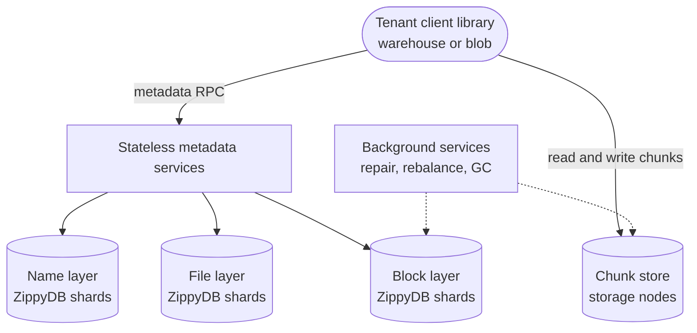

**Reading the diagram.** The *tenant client library* resolves a path through the *metadata services*, which read three independently sharded layers in *ZippyDB*: *Name* (directory to file IDs), *File* (file to block IDs) and *Block* (block to chunk locations). All of these are synchronous RPCs. Data then flows directly between client and *chunk store* nodes, never through the metadata services. *Background services* (dotted, asynchronous) repair lost chunks, rebalance and garbage-collect. Storage boundaries: metadata in ZippyDB, bytes in the chunk store. Failure points: a hot ZippyDB shard limits throughput; cross-shard operations are not transactional. Scaling: each layer and the chunk store grow independently.

### 49.4.3 Amazon S3 at scale

::: industry
**Amazon S3.** In a 2023 essay based on his FAST '23 keynote, S3 engineer Andy Warfield described S3 as storing more than 280 trillion objects and serving more than 100 million requests per second on average (as of 2023), built from hundreds of microservices. He emphasized that individual hard drives have not become faster even as they became larger, so S3 manages "heat" by spreading each customer's objects over very large numbers of drives so that bursts from different workloads decorrelate; he also described the ShardStore storage-node software and the use of lightweight formal methods to check it [Warfield 2023; Bornholt et al. 2021]. Since December 2020 S3 provides strong read-after-write consistency (§15.4) [Vogels 2021].
*Evidence: Primary* — [Warfield 2023; Bornholt et al. 2021; Vogels 2021]
:::

S3 is a different shape of system from Colossus or Tectonic: a regional, multi-datacenter object service with a flat key namespace, an HTTP API and billing per request and per GB, rather than a file system inside one datacenter. It spreads each object's data across several Availability Zones, so it survives the loss of a datacenter [AWS S3 User Guide]. Its index is a distributed key-value map from (bucket, key) to object locations (§15.4.2), partitioned by key prefix; that is why S3 documents per-prefix request-rate limits and why the internal partitioning follows load.

### 49.4.4 Windows Azure Storage

Windows Azure Storage (WAS), described at SOSP 2011, is the most complete public description of a cloud storage service's internals [Calder et al. 2011].

1. **Storage stamps.** The unit of deployment is a **stamp** of 10–20 racks of 18 storage nodes (about 2 PB raw in 2011, up to 30 PB planned). A global **Location Service** assigns each account to a stamp and points its DNS name at that stamp.
2. **Stream layer.** A distributed, append-only file system inside the stamp. A **stream** is an ordered list of **extents**; an extent (target size about 1 GB) is the unit of replication, appended until **sealed** and then immutable. A Paxos-replicated **Stream Manager** tracks extents; **Extent Nodes** store them. Appends replicate **synchronously** to three Extent Nodes in different fault and upgrade domains. Sealed extents are later erasure coded (§15.6.2) [Huang et al. 2012].
3. **Partition layer.** Implements Blobs, Tables and Queues on top of streams. Data lives in **Object Tables** split into **RangePartitions** by key; a **Partition Manager** assigns ranges to **Partition Servers** and uses a Paxos **Lock Service** to make sure each range has exactly one server. This layer also performs **asynchronous geo-replication** to a second stamp in another region.
4. **Front-end layer.** Stateless servers that authenticate and route requests.

The paper's central design argument is the split of replication into two kinds: synchronous intra-stamp replication in the stream layer protects against disk, node and rack failures with strong consistency, while asynchronous inter-stamp replication in the partition layer protects against disasters without putting WAN latency on the write path.

**Figure 49.3 — Windows Azure Storage: location service, stamps and layers.**

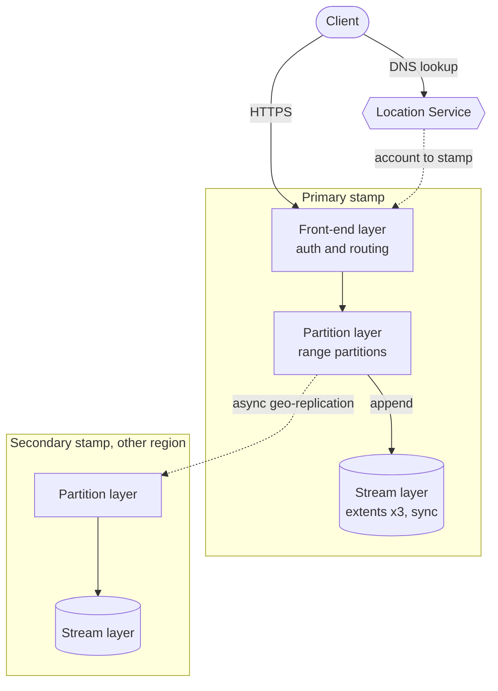

**Reading the diagram.** The *client* resolves its account name through DNS maintained by the *Location Service*, which maps accounts to stamps. Requests over HTTPS reach a stateless *front end*, which routes by key to the *partition server* owning that range; the partition layer appends to streams, and the *stream layer* synchronously writes each append to three Extent Nodes before acknowledging. Geo-replication to the *secondary stamp* is asynchronous (dotted), so a regional disaster can lose the last seconds of writes. Storage boundaries: durable bytes only in the stream layer. Failure points: a partition server failure moves its ranges to another server in seconds (the data is in the stream layer); losing the primary stamp requires geo-failover. Scaling: add partition servers within a stamp; add stamps under the Location Service.

### 49.4.5 Comparison

**Table 49.1 — Exabyte storage systems as published.**

| Aspect | Google Colossus | Meta Tectonic | Amazon S3 | Windows Azure Storage |
|---|---|---|---|---|
| Public source | Blog posts (2021, 2025) | FAST 2021 paper | Talks, blogs, SOSP 2021 | SOSP 2011 paper |
| Interface | Cluster file system (internal) | Datacenter file system (internal) | Regional object store (HTTP) | Blobs, Tables, Queues (HTTP) |
| Scope of one instance | Cluster, multiple EB | Datacenter, EB | Region, multi-AZ | Stamp (tens of PB), many stamps |
| Metadata | Curators over Bigtable | Name/File/Block layers in ZippyDB | Sharded key-value index | Partition layer range partitions |
| Data servers | D file servers | Chunk store | Storage nodes (ShardStore) | Stream layer extent nodes |
| Redundancy | Replication or RS, per file | Replication or RS, per tenant | Across ≥ 3 AZs (details unpublished) | 3× sync in stamp; EC of sealed extents |
| Geo-replication | Above the file system | Above the file system | Optional, async (replication rules) | Async, built into partition layer |
| Distinctive idea | Metadata recursion; flash/HDD placement | Tenant-specific client library; layered metadata | Heat decorrelation; formal methods | Two-level replication split |

The same three lessons recur in all four. Metadata moves into a scalable database; data flows directly between clients and storage servers; and redundancy is tuned per workload because replication buys latency and erasure coding buys cost.

::: mistake
**"Colossus, Tectonic and S3 are interchangeable."** Colossus and Tectonic are internal file systems used by other systems; S3 and Azure Storage are public HTTP services with per-request billing and regional failure tolerance. Their published numbers are not comparable one for one.
:::

## 49.5 The modern data platform architecture

### 49.5.1 Layers of the platform

::: definition
**Definition — Data platform.** The shared infrastructure that collects an organization's data, stores it durably in open or managed formats, makes it queryable by several compute engines, and serves results to analysts, applications and machine-learning pipelines, with a catalog and access control across all of it.
:::

#### First-principles explanation

Think of a city's water system: intake from rivers and wells, a reservoir, treatment plants, and pipes to homes and factories. Nobody builds a reservoir per tap. A data platform has the same shape: many sources flow into one durable store, several processing engines "treat" the data, and many consumers draw from the results.

#### How it works internally

1. **Ingestion.** Operational databases are copied by **change data capture** (CDC, §31.14.2) into Kafka (Chapter 31) or directly into storage; application events stream through Kafka; partners drop files in batches.
2. **Raw zone in object storage.** Everything lands unchanged in an object store or cluster file system (§15.4, §49.4), partitioned by date and source. This is the system of record, kept for reprocessing.
3. **Table formats.** Cleaned and conformed data is written as columnar files (Parquet, §13.13) managed by a **table format** such as Apache Iceberg, Delta Lake or Apache Hudi, which adds a metadata layer listing a table's files, so engines get atomic commits, snapshots, schema evolution and file pruning on top of plain objects. Many teams call the successive refinement steps bronze, silver and gold.
4. **Compute engines.** Batch engines (Spark, §29.5), streaming engines (Flink, §29.9), interactive SQL engines (Trino, originally Presto [Sethi et al. 2019]) and warehouses (§49.6) read the same tables.
5. **Serving.** Results feed dashboards, low-latency OLAP stores, feature stores (Chapter 62), application databases ("reverse ETL") and training pipelines (Chapter 61).
6. **Cross-cutting services.** A catalog (table names, schemas, owners), access control, lineage, data-quality checks and an orchestrator (for example Airflow) run across all layers.

**Figure 49.4 — The modern data platform.**

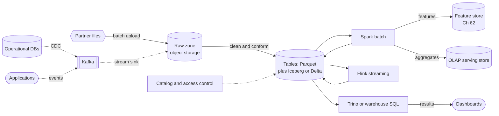

**Reading the diagram.** Left to right is the direction of data flow. *Operational databases* and *applications* feed *Kafka* asynchronously (dotted); *partner files* arrive in batches. A stream sink writes everything to the *raw zone* in object storage. Jobs clean the raw data into *tables* of Parquet files tracked by a table format. *Spark*, *Flink* and SQL engines read the same tables (synchronous scans) and write derived tables back; results flow to *dashboards*, a *feature store* and an *OLAP serving store*. The *catalog* governs every table. Storage boundaries: all durable data is in object storage; engines are stateless apart from caches. Failure points: a bad upstream schema change propagates to every consumer, which is why the catalog enforces schemas and quality checks gate promotions. Scaling: storage and each engine scale independently.

### 49.5.2 Separation of storage and compute

Hadoop-era clusters co-located data and computation on the same nodes, because networks were slow (§29.7). Modern platforms **separate storage from compute**: data lives in a shared storage service; compute clusters are stateless and sized per workload, started for a job and stopped afterwards. The benefits are elasticity (pay for compute only while it runs), isolation (a heavy batch job and an interactive dashboard use different clusters on the same data), and independent scaling (storage grows with data, compute with queries). The costs are network bandwidth between the tiers, higher first-byte latency, and the need for local SSD caches. Fast datacenter networks (§7.17) made the trade worth it; §29.7 worked out that locality's advantage shrank from about 8× to about 2×.

The **lakehouse** combines the open files of a data lake with warehouse features (transactions, schema enforcement, indexing, caching) implemented by the table format and engines [Armbrust et al. 2021]. Chapter 61 owns the deep treatment of table formats and lakehouses.

## 49.6 Warehouses at scale

### 49.6.1 Dremel and BigQuery

::: definition
**Definition — Dremel.** Google's interactive query engine for read-only nested data, published in 2010, which combines a columnar encoding of nested records with a multi-level **serving tree** that executes aggregation queries over trillions of rows in seconds; it is the engine behind Google BigQuery [Melnik et al. 2010; Melnik et al. 2020].
:::

#### Why does this exist?

Google's logs and crawl data were nested protocol buffers with repeated fields, too big for MapReduce's minutes-long turnaround when an engineer wanted to ask a quick question. Flattening nested records into relational tables loses structure and multiplies rows. Dremel answered both: store nested data column by column without flattening, and answer queries interactively by fanning out to thousands of servers.

#### How it works internally: repetition and definition levels

Storing a nested column needs two small integers per value so that records can be reassembled and missing values located:

- The **repetition level** $r$ says at which repeated field in the path this value repeated; $r = 0$ means "a new record starts here".
- The **definition level** $d$ says how many of the optional or repeated fields in the path are actually present; a value below the maximum marks a `NULL` and where it occurred.

The program below stripes the two-record example from the Dremel paper, where `Name` and `Language` are repeated and `Url` optional.

```python
"""Striping nested records into columns with repetition and definition levels."""

R1 = {"DocId": 10,
      "Name": [{"Language": [{"Code": "en-us", "Country": "us"}, {"Code": "en"}],
                "Url": "http://A"},
               {"Url": "http://B"},
               {"Language": [{"Code": "en-gb", "Country": "gb"}]}]}
R2 = {"DocId": 20, "Name": [{"Url": "http://C"}]}

# Labels for every field on the paths we stripe.
LABEL = {"DocId": "required", "Name": "repeated", "Language": "repeated",
         "Code": "required", "Url": "optional"}


def stripe(record, path):
    """Return [(value, repetition_level, definition_level)] for one column path."""
    out = []

    def walk(node, depth, r, d):
        if depth == len(path):
            out.append((node, r, d))
            return
        field = path[depth]
        label = LABEL[field]
        v = node.get(field)
        values = v if label == "repeated" else ([] if v is None else [v])
        if not values:                       # missing: record how deep we got
            out.append((None, r, d))
            return
        rep_here = sum(LABEL[f] == "repeated" for f in path[:depth + 1])
        d_here = d + (label != "required")
        for i, child in enumerate(values):
            walk(child, depth + 1, r if i == 0 else rep_here, d_here)

    walk(record, 0, 0, 0)
    return out


def count_records(column):
    return sum(1 for _, r, _ in column if r == 0)   # r = 0 starts a new record


if __name__ == "__main__":
    code = stripe(R1, ["Name", "Language", "Code"]) + stripe(R2, ["Name", "Language", "Code"])
    url = stripe(R1, ["Name", "Url"]) + stripe(R2, ["Name", "Url"])
    doc = stripe(R1, ["DocId"]) + stripe(R2, ["DocId"])
    for name, col in (("Name.Language.Code", code), ("Name.Url", url), ("DocId", doc)):
        print(f"{name:<20}", col)
    assert code == [("en-us", 0, 2), ("en", 2, 2), (None, 1, 1), ("en-gb", 1, 2), (None, 0, 1)]
    assert url == [("http://A", 0, 2), ("http://B", 1, 2), (None, 1, 1), ("http://C", 0, 2)]
    assert doc == [(10, 0, 0), (20, 0, 0)]
    assert count_records(code) == count_records(url) == count_records(doc) == 2
    print("levels match the Dremel paper's example")
```

What to notice:

- `"en"` gets $r = 2$ because it repeats at `Language`, the second repeated field; `"en-gb"` gets $r = 1$ because a new `Name` began.
- The second `Name` of R1 has no `Language`, so the column stores `NULL` with $d = 1$: `Name` was present, `Language` was not. Without that entry, a reader could not tell which `Name` the later codes belong to.
- Required fields add nothing to $d$; levels take a few bits, are run-length encoded, and Parquet adopted the scheme (§13.13.2). Counting $r = 0$ entries aligns columns read independently.

#### How it works internally: the serving tree and the shuffle tier

1. The **root server** receives a SQL query, reads table metadata, and rewrites the query for the next level: `SELECT country, COUNT(*) ... GROUP BY country` becomes partial aggregations over subsets of the table.
2. **Intermediate servers** rewrite again for their children and merge the partial results coming back up.
3. **Leaf servers** scan **tablets** (horizontal pieces of the table) column by column from the distributed file system and compute partial aggregates.
4. A query dispatcher schedules tablets on available slots, re-dispatches slow ones, and can return results after a chosen fraction of tablets when approximate answers are acceptable [Melnik et al. 2010].

The 2020 retrospective explains how Dremel changed over a decade: storage was disaggregated onto the cluster file system (GFS, then Colossus); joins and large aggregations needed data redistribution, so a disaggregated **in-memory shuffle tier** replaced the fixed tree for those stages; the ColumnIO format gave way to **Capacitor**; and the service became serverless, with compute allocated in **slots** on demand rather than per-customer clusters [Melnik et al. 2020].

**Figure 49.5 — Dremel's serving tree with a disaggregated shuffle tier.**

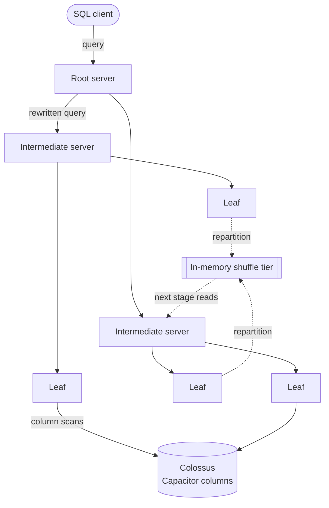

**Reading the diagram.** A *SQL client* sends a query to the *root*, which rewrites it into partial queries for *intermediate servers*, which do the same for *leaves*. Leaves scan only the needed columns of their tablets from *Colossus*; partial results flow back up the tree (synchronous) and are merged at each level. For joins and high-cardinality group-bys, leaves write repartitioned data to the *shuffle tier* (dotted, because producers and consumers are decoupled), and the next stage reads it. Storage boundaries: tables in the file system, intermediate data in shuffle memory. Failure points: a slow leaf (straggler) delays the root, so tablets are re-dispatched; a lost shuffle partition is recomputed. Scaling: wider and deeper trees for larger fan-out; slots are added per query.

### 49.6.2 Snowflake

Snowflake's SIGMOD 2016 paper describes a warehouse designed for the cloud from the start, with three layers [Dageville et al. 2016]:

1. **Data storage.** Tables are stored in Amazon S3 as large, immutable files, which the documentation calls **micro-partitions** (50–500 MB of uncompressed data each, as of 2026 [Snowflake Docs]). Inside each file, values are grouped by column (a PAX-style hybrid layout) with a header recording column offsets, so a reader fetches only the needed columns with ranged GETs.
2. **Virtual warehouses (VWs).** A VW is a cluster of cloud instances in a "T-shirt" size, created, resized or suspended at will. Each query runs on one VW; VWs never share workers, so one team's workload cannot slow another's. Workers cache table files on local SSD; files are assigned to workers by consistent hashing (§14.8), so a resize moves only some cache assignments, and idle workers can **steal** files from overloaded peers to handle skew.
3. **Cloud services.** A multi-tenant, always-on layer for authentication, query parsing and optimization, transactions and metadata. Every micro-partition's per-column minimum and maximum are kept in metadata, so the optimizer **prunes** files that cannot match a predicate, which replaces indexes. Immutable files plus file-set metadata give snapshot isolation and **time travel** to earlier versions.

**Figure 49.6 — Snowflake's three layers.**

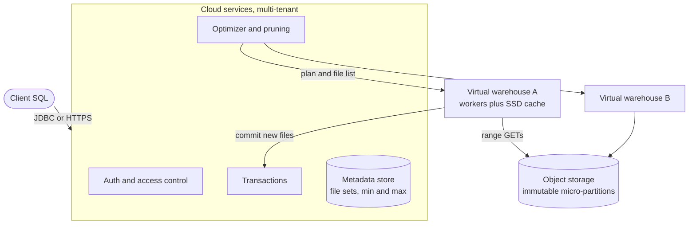

**Reading the diagram.** The *client* connects to *cloud services*, which authenticate, optimize and look up file lists and min/max statistics in the *metadata store*. The plan, with pruned file lists, goes to one *virtual warehouse*; its workers read the remaining micro-partitions from *object storage* by ranged GETs (synchronous) through their SSD caches. Writes create new immutable files and commit by updating metadata through *transactions*. Storage boundaries: durable data in object storage, metadata in cloud services, caches on workers. Failure points: a worker failure re-runs its part of the query; a cloud-services outage stops all warehouses. Scaling: more warehouses for concurrency, larger ones for speed.

**Table 49.2 — Dremel/BigQuery and Snowflake compared.**

| Aspect | Dremel / BigQuery | Snowflake |
|---|---|---|
| Storage | Colossus, Capacitor columnar files | Object storage, immutable micro-partitions |
| Compute model | Serverless shared slots | Dedicated virtual warehouses per workload |
| Data redistribution | In-memory shuffle tier | Worker-to-worker exchange, spill to SSD and storage |
| Pruning | Partitioning and clustering metadata | Per-file min/max metadata |
| Isolation | Slot reservations and quotas | Separate warehouses |
| Choose when | Bursty, ad hoc, hands-off scaling | Predictable isolation and per-workload sizing |

::: mistake
**"Separation of storage and compute means every query reads from object storage."** Both systems cache aggressively: Snowflake keeps table files on worker SSDs, and BigQuery's storage and shuffle tiers keep hot data in memory and flash. Separation means the durable copy is shared and compute is disposable, not that caching disappears.
:::

## 49.7 Data movement at scale

Andrew Tanenbaum's line "never underestimate the bandwidth of a station wagon full of tapes hurtling down the highway" [Tanenbaum and Wetherall 2011] is an engineering rule at petabyte scale. AWS turned it into products: Snowball appliances of tens to hundreds of terabytes, and from 2016 Snowmobile, a 45-foot shipping container that could move up to 100 PB, since retired [AWS 2016].

::: formula
**Network transfer time versus shipment**

$$T_{\text{net}} = \frac{8\,S}{\rho\, B\, \eta} \qquad T_{\text{ship}} = \frac{S}{b_{\text{load}}} + T_{\text{transit}} + \frac{S}{b_{\text{unload}}} \qquad B_{\text{ship}} = \frac{8\,S}{T_{\text{ship}}}$$

| Symbol | Meaning | Units |
|---|---|---|
| $S$ | Data volume | bytes |
| $B$ | Link line rate | bits/s |
| $\eta$ | Achieved fraction of line rate (protocol overhead, sharing) | dimensionless |
| $\rho$ | Compression ratio (original/compressed), if compression keeps up with the link | dimensionless |
| $b_{\text{load}}$, $b_{\text{unload}}$ | Aggregate copy rate onto and off the devices | bytes/s |
| $T_{\text{transit}}$ | Time in transport, including handling | s |
| $B_{\text{ship}}$ | Effective bandwidth of shipping | bits/s |
:::

::: example
**Worked example — Migrating 50 PB.** Options: a dedicated 10 Gb/s or 100 Gb/s link at $\eta = 0.8$, or a container-sized shipment loaded and unloaded at 125 GB/s (1 Tb/s) with three days in transit. Data is already compressed Parquet, so $\rho = 1$.

1. 10 Gb/s: $T = 8 \times 5 \times 10^{16} / (8 \times 10^{9}) = 5 \times 10^{7}$ s $= 579$ days.
2. 100 Gb/s: 57.9 days.
3. Shipment: load $5 \times 10^{16} / 1.25 \times 10^{11} = 4 \times 10^{5}$ s $= 4.6$ days; transit 3 days; unload 4.6 days; total 12.3 days $= 1.06 \times 10^{6}$ s.
4. Effective shipping bandwidth: $4 \times 10^{17} / 1.06 \times 10^{6} \approx 3.8 \times 10^{11}$ b/s $\approx 380$ Gb/s. Matching it over the network needs $380/0.8 \approx 470$ Gb/s of line rate.
5. Cross-region alternative inside one cloud at an illustrative \$0.02/GB (§41.10.3): $5 \times 10^{7} \text{ GB} \times 0.02 = \$1$ million, in addition to time.

**Interpretation.** For a one-time bulk move, shipping wins by an order of magnitude in time; the load and unload rates, not the truck, are the bottleneck. **Engineering implication.** Ship the historical bulk, then use the network for the daily delta (a few TB a day fits easily on 10 Gb/s), and run both in parallel with a cutover plan: copy, verify checksums, catch up incrementally, switch writers.
:::

**Compression** helps only for data not already compressed (raw logs and JSON often shrink 5–10× with zstd; Parquet barely shrinks) and only if the compressor keeps up with the link; **deduplication** (§15.8.3) and filtering to needed partitions also cut volume. **Replication cost**: continuous cross-region replication costs the per-GB transfer price on every byte written, plus storage in the second region; at an illustrative \$0.02/GB, replicating 50 TB of new data a day costs \$1,000 a day, about \$365,000 a year, which is why many platforms replicate only gold tables and keep raw data regional (Chapter 44 covers geo-replication).

## 49.8 HPC fundamentals

### 49.8.1 What HPC is

::: definition
**Definition — High-performance computing (HPC).** The use of many tightly interconnected processors working together on a single computational problem (simulating climate, fluid flow, molecules, nuclear physics, or training a large model) to solve it faster or at a larger size than any single machine could. A **supercomputer** is a system built for this, optimized for floating-point throughput and low-latency communication between nodes.
:::

#### First-principles explanation

A thousand people can paint a thousand separate fences with no coordination: that is **embarrassingly parallel** work, like rendering frames or running independent simulations (parameter sweeps). Now ask a thousand people to solve one giant jigsaw puzzle laid out on a single table: each works on a region but must constantly check edges with neighbors. That is **tightly coupled** work. Weather simulation splits the atmosphere into cubes; every time step, each cube needs the boundary values ("halos") of its neighbors, and the whole computation waits for the slowest exchange. Web-scale data systems (§29) mostly live in the first world; HPC lives in the second, which is why its networks and software look different.

### 49.8.2 Strong and weak scaling

Amdahl's law (§4.12.1) describes **strong scaling**: fixed problem, more processors. Gustafson's law (§4.12.2) describes **weak scaling**: the problem grows with the processors.

::: formula
**Scaling efficiency and a stencil code's step time**

$$E_{\text{strong}}(p) = \frac{T(1)}{p\,T(p)} \qquad E_{\text{weak}}(p) = \frac{T(1)}{T(p)}\Big|_{\text{work} \propto p} \qquad T_{\text{step}}(p) = \frac{N}{p}\,t_c + 6\left(\alpha + 8 \left(\frac{N}{p}\right)^{2/3} \beta\right) + k \lceil \log_2 p \rceil \alpha$$

| Symbol | Meaning | Units |
|---|---|---|
| $T(p)$ | Run time on $p$ processes | s |
| $N$ | Grid cells in a 3-D domain, split into $p$ cubes | count |
| $t_c$ | Compute time per cell per step | s |
| $\alpha$ | Per-message latency | s |
| $\beta$ | Time per byte (inverse bandwidth) | s/B |
| $k$ | Global reductions (all-reduces of a scalar) per step | count |
:::

::: example
**Worked example — Strong-scaling a 1,024³ stencil.** $N = 1{,}024^{3} \approx 1.07 \times 10^{9}$ cells, $t_c = 10$ ns, 8-byte values, $\alpha = 2$ µs, $\beta = 1/(25 \text{ GB/s}) = 4 \times 10^{-11}$ s/B, $k = 2$ (a conjugate-gradient solver's two dot products).

1. $p = 512$: each rank holds $128^{3} = 2{,}097{,}152$ cells; compute $= 20.97$ ms. Halo: six faces of $128^{2} \times 8 = 131{,}072$ B; $6 \times (2 + 5.24)$ µs $= 43.5$ µs. Reductions: $2 \times 9 \times 2 = 36$ µs. Step $\approx 21.05$ ms; efficiency vs pure compute $= 20.97/21.05 = 99.6\%$.
2. $p = 32{,}768$: $32^{3} = 32{,}768$ cells per rank; compute $= 327.7$ µs. Halo: faces of $32^{2} \times 8 = 8{,}192$ B; $6 \times (2 + 0.33) = 14.0$ µs. Reductions: $2 \times 15 \times 2 = 60$ µs. Step $= 401.7$ µs; efficiency $= 327.7/401.7 = 81.6\%$.
3. Speedup from 512 to 32,768 ranks (64×): $21.05/0.4017 = 52.4\times$.

**Interpretation.** Compute shrinks as $1/p$, halo volume as $p^{-2/3}$, and the reduction latency *grows* as $\log p$; at large scale the 2 µs latency, not bandwidth, is what limits the code. **Engineering implication.** Strongly scaled HPC codes need microsecond-latency networks, fast collectives (§49.9) and few global synchronizations; this is why supercomputers use RDMA interconnects (§49.10) rather than kernel TCP.
:::

### 49.8.3 Supercomputer architecture and the Top500

A modern supercomputer has **compute nodes** (CPUs plus, now usually, GPUs), a **high-speed interconnect** (InfiniBand or HPE Slingshot), **login nodes** where users compile and submit, a **batch scheduler** (§49.12), a **parallel file system** (§49.11), often a **burst buffer** of flash, and management networks. Frontier at Oak Ridge, the first system to exceed one exaflop per second on HPL (June 2022), has 9,408 nodes, each with one AMD EPYC CPU and four AMD Instinct MI250X GPUs, on a Slingshot dragonfly network [OLCF Frontier; Top500].

**Figure 49.7 — Architecture of a supercomputer.**

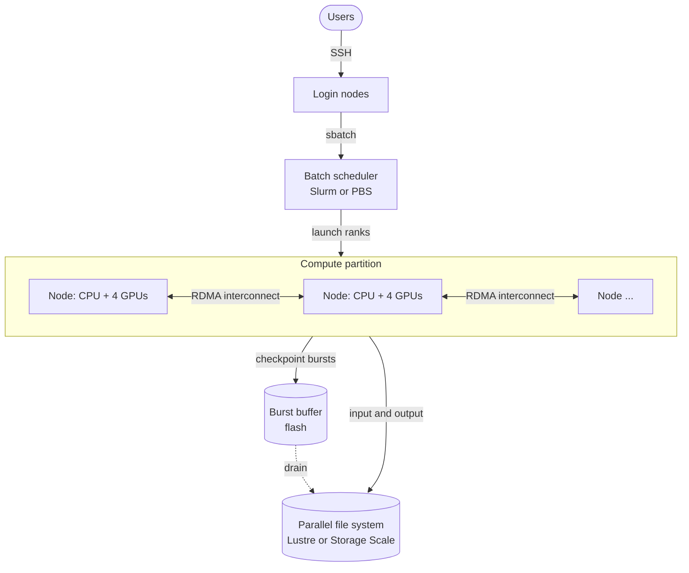

**Reading the diagram.** *Users* log in to *login nodes* over SSH and submit jobs to the *batch scheduler*, which allocates whole nodes as a gang (§46.10) and launches MPI ranks on them. *Compute nodes* exchange messages over the *RDMA interconnect* (bidirectional, synchronous within a time step). Checkpoints go first to a flash *burst buffer*, which drains asynchronously (dotted) to the *parallel file system*, where inputs and results also live. Failure points: one node failure kills a tightly coupled job, which restarts from its last checkpoint; a metadata storm stalls all jobs. Scaling: nodes, interconnect and file-system servers grow in balanced proportions.

::: definition
**Definition — Rmax and Rpeak.** The **Top500** list, published twice a year since 1993, ranks systems by **Rmax**, the sustained rate in floating-point operations per second (FLOP/s, 64-bit) achieved on the High-Performance Linpack (HPL) benchmark, which solves a dense linear system $Ax = b$ by LU factorization. **Rpeak** is the theoretical peak: devices × FLOPs per cycle × clock rate. The ratio Rmax/Rpeak is the HPL efficiency [Top500; Dongarra et al. 2003].
:::

::: example
**Worked example — Reading a Top500 entry.** El Capitan led the November 2024 list with Rmax ≈ 1.742 EFlop/s and Rpeak ≈ 2.746 EFlop/s [Top500].

1. HPL efficiency: $1.742 / 2.746 = 63.4\%$.
2. For a hypothetical cluster of 1,000 nodes, each with 4 GPUs of 50 TFLOP/s FP64 peak: Rpeak $= 1{,}000 \times 4 \times 50 \times 10^{12} = 2 \times 10^{17}$ = 200 PFlop/s; at a similar efficiency, Rmax ≈ 127 PFlop/s.

**Interpretation.** HPL is dense, compute-bound and communication-light, so it shows the best case. Benchmarks with sparse, memory-bound kernels, such as HPCG, achieve only a few percent of peak on the same machines. **Engineering implication.** Use Rmax to compare systems, not to predict your application; measure your own kernels' arithmetic intensity (Chapter 64 covers the roofline model).
:::

## 49.9 MPI

### 49.9.1 The programming model

::: definition
**Definition — MPI (Message Passing Interface).** A standardized library interface, maintained by the MPI Forum since 1994 (MPI-4.1 published in 2023), through which the processes of a parallel program exchange data by explicit messages. Each process is a **rank** (an integer from 0 to $p - 1$) within a **communicator**, a group of processes with its own isolated message context; `MPI_COMM_WORLD` contains all of them [MPI Forum 2023].
:::

#### How it works internally

1. **Launch.** The scheduler allocates nodes and a launcher (`mpirun` or `srun`) starts $p$ copies of the same program (single program, multiple data); each learns its rank and $p$.
2. **Point-to-point.** `MPI_Send` and `MPI_Recv` move a buffer from one rank to another, matched by (communicator, source, tag). Non-blocking variants (`MPI_Isend`, `MPI_Irecv`, completed with `MPI_Wait`) let a rank compute while messages are in flight, which is how halo exchanges overlap with interior computation.
3. **Collectives.** Every rank of a communicator calls the same operation: **broadcast** (root's buffer to all), **reduce** (combine everyone's buffer with an operation such as sum, result at root), **all-reduce** (reduce, with the result at every rank), **all-gather** (every rank's piece concatenated at every rank), **reduce-scatter** (reduce, then each rank keeps one piece), **all-to-all** (each rank sends a distinct piece to every other) and **barrier**. MPI-3 added non-blocking collectives; MPI-4 added persistent collectives and partitioned communication.
4. **Implementations** (Open MPI, MPICH and vendor derivatives) choose an algorithm per call based on message size, process count and topology.

```python
# illustrative: run with  mpirun -n 4 python3 allreduce_demo.py  (needs mpi4py and numpy)
from mpi4py import MPI
import numpy as np

comm = MPI.COMM_WORLD
rank, size = comm.Get_rank(), comm.Get_size()
config = comm.bcast({"steps": 10} if rank == 0 else None, root=0)   # broadcast an object
local = np.full(4, float(rank))                                      # this rank's gradient
total = np.empty_like(local)
comm.Allreduce(local, total, op=MPI.SUM)                             # buffer all-reduce
if rank == 0:
    print(config["steps"], total)   # with 4 ranks: 10 [6. 6. 6. 6.]
```

What to notice: every rank runs the same code and branches on `rank`; lower-case `bcast` pickles Python objects, while upper-case `Allreduce` sends raw buffers, the form used for large arrays.

### 49.9.2 Collective cost models

::: definition
**Definition — α–β (Hockney) model.** Sending an $n$-byte message costs $\alpha + n\beta$, where $\alpha$ is a fixed per-message **latency** (software overhead plus network) and $\beta$ the time per byte (inverse bandwidth). Reductions add $n\gamma$ for computation; $\gamma$ is usually small and is ignored below [Thakur et al. 2005].
:::

Three all-reduce algorithms are worth knowing:

- **Binomial tree** reduce to a root, then binomial-tree broadcast: $2\lceil \log_2 p \rceil$ rounds, each sending the whole vector.
- **Ring** (reduce-scatter then all-gather around a ring): $2(p - 1)$ steps, each sending $n/p$ bytes. Patarasuk and Yuan proved that $2\frac{p-1}{p} n\beta$ is a lower bound on the bandwidth term for all-reduce, so the ring is **bandwidth-optimal** [Patarasuk and Yuan 2009].
- **Rabenseifner**: recursive-halving reduce-scatter plus recursive-doubling all-gather, achieving the ring's bandwidth term with only $2 \log_2 p$ latency terms when $p$ is a power of two [Thakur et al. 2005].

::: formula
**All-reduce costs in the α–β model (computation ignored)**

$$T_{\text{ring}} = 2(p-1)\,\alpha + 2\,\frac{p-1}{p}\, n\,\beta \qquad T_{\text{tree}} = 2 \lceil \log_2 p \rceil (\alpha + n\beta) \qquad T_{\text{Rab}} = 2 \log_2 p\;\alpha + 2\,\frac{p-1}{p}\, n\,\beta$$

$$n^{*} = \frac{(p - 1 - \log_2 p)\,\alpha}{\left(\log_2 p - \frac{p-1}{p}\right)\beta} \quad \text{(ring beats tree for } n > n^{*}\text{)}$$

| Symbol | Meaning | Units |
|---|---|---|
| $p$ | Number of ranks | count |
| $n$ | Vector size per rank | bytes |
| $\alpha$ | Per-message latency | s |
| $\beta$ | Time per byte | s/B |
| $n^{*}$ | Crossover size between ring and tree | bytes |
:::

::: example
**Worked example — Ring versus tree for 64 ranks.** $p = 64$, $\alpha = 5$ µs, links of 200 Gb/s so $\beta = 1/(25 \times 10^{9}) = 4 \times 10^{-11}$ s/B.

1. Large vector, $n = 1$ GB (250 million FP32 gradients). Ring: latency $2 \times 63 \times 5$ µs $= 0.63$ ms; bandwidth $2 \times \frac{63}{64} \times 10^{9} \times 4 \times 10^{-11} = 78.75$ ms; total **79.4 ms**. Tree: $12 \times (5 \text{ µs} + 40 \text{ ms}) = $ **480 ms**. The ring is 6× faster, because the tree sends the full gigabyte $\log_2 p$ times on its critical path.
2. Small vector, $n = 8$ KB. Ring: $0.63 + 0.0006 \approx$ **0.631 ms**, all latency. Tree: $12 \times (5 + 0.33)$ µs $= $ **64 µs**, 10× faster.
3. Crossover: $n^{*} = 57 \times 5 \times 10^{-6} / ((6 - 0.984) \times 4 \times 10^{-11}) = 2.85 \times 10^{-4} / 2.006 \times 10^{-10} \approx 1.42$ MB.
4. Rabenseifner at 1 GB: $0.06 + 78.75 = 78.8$ ms, best of both.

**Interpretation.** Latency terms dominate small messages and bandwidth terms dominate large ones; no single algorithm wins everywhere. **Engineering implication.** Libraries switch algorithms by size (MPI implementations use tuned thresholds; NCCL uses rings and double binary trees), and training frameworks **bucket** many small gradient tensors into messages of several megabytes so they land on the bandwidth-optimal side of the crossover (Chapter 65).
:::

**Figure 49.8 — Ring all-reduce on four ranks: reduce-scatter, then all-gather.**

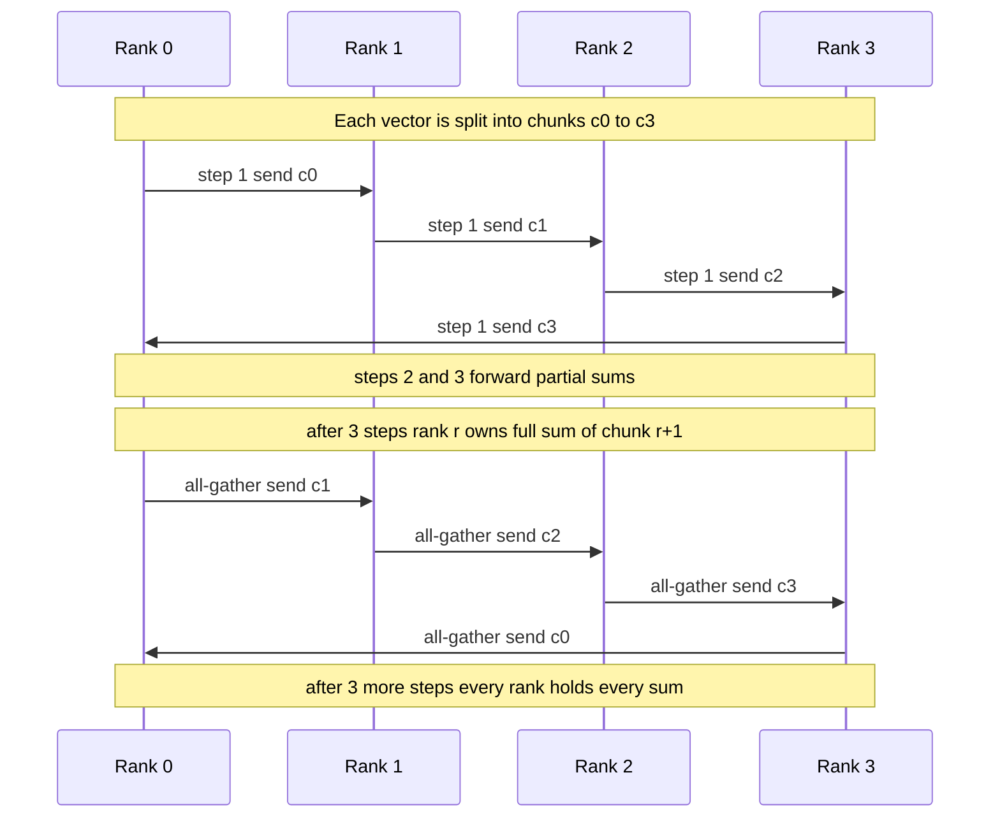

**Reading the diagram.** Four *ranks* form a logical ring. In each reduce-scatter step every rank sends one chunk ($n/p$ bytes) to its right neighbor, which adds it to its own copy, and all four sends happen simultaneously, so every link is busy. After $p - 1 = 3$ steps, each rank owns one fully reduced chunk. The all-gather phase circulates those finished chunks for another 3 steps, overwriting instead of adding. Messages are synchronous within a step: each step waits for the slowest link, so one slow node or link slows the whole ring. Storage boundary: everything is in device memory. Scaling: per-rank traffic stays at about $2n$ as $p$ grows, but latency grows linearly, which is why large systems use hierarchical rings (within a node, then across nodes) or trees.

The program below simulates the ring step by step, checks that every rank ends with the exact sum and that each sends exactly $2\frac{p-1}{p}n$ bytes, and evaluates the cost models.

```python
"""Ring all-reduce: a step-by-step simulation plus alpha-beta cost models."""
import math
import random


def ring_allreduce(buffers):
    """Sum-all-reduce lists in place using reduce-scatter then all-gather.

    buffers[r] is rank r's vector; its length must be divisible by p.
    Returns (steps, bytes_sent_per_rank) assuming 8-byte elements.
    """
    p, n = len(buffers), len(buffers[0])
    assert n % p == 0, "pad the vector so every rank owns one equal chunk"
    c = n // p                                    # chunk length
    chunk = lambda k: range(k * c, (k + 1) * c)  # indices of chunk k
    steps, sent = 0, [0] * p

    # Phase 1, reduce-scatter: p-1 steps; rank r sends chunk (r - s) mod p.
    for s in range(p - 1):
        msgs = [(r, (r + 1) % p, (r - s) % p) for r in range(p)]
        payload = {(src, k): [buffers[src][i] for i in chunk(k)] for src, _, k in msgs}
        for src, dst, k in msgs:               # all sends in a step are simultaneous
            for j, i in enumerate(chunk(k)):
                buffers[dst][i] += payload[(src, k)][j]
            sent[src] += 8 * c
        steps += 1
    # Now rank r holds the complete sum of chunk (r + 1) mod p.

    # Phase 2, all-gather: p-1 steps; rank r forwards chunk (r + 1 - s) mod p.
    for s in range(p - 1):
        msgs = [(r, (r + 1) % p, (r + 1 - s) % p) for r in range(p)]
        payload = {(src, k): [buffers[src][i] for i in chunk(k)] for src, _, k in msgs}
        for src, dst, k in msgs:
            for j, i in enumerate(chunk(k)):
                buffers[dst][i] = payload[(src, k)][j]
            sent[src] += 8 * c
        steps += 1
    return steps, sent


def t_ring(p, n, a, b):          # Patarasuk and Yuan: bandwidth-optimal
    return 2 * (p - 1) * a + 2 * (p - 1) / p * n * b


def t_tree(p, n, a, b):          # binomial-tree reduce, then binomial broadcast
    return 2 * math.ceil(math.log2(p)) * (a + n * b)


def t_recursive_doubling(p, n, a, b):
    return math.ceil(math.log2(p)) * (a + n * b)


def t_rabenseifner(p, n, a, b):  # recursive-halving reduce-scatter + doubling all-gather
    return 2 * math.log2(p) * a + 2 * (p - 1) / p * n * b


def crossover_ring_vs_tree(p, a, b):
    lg = math.log2(p)
    return (p - 1 - lg) * a / ((lg - (p - 1) / p) * b)


if __name__ == "__main__":
    random.seed(49)
    for p in (2, 3, 4, 8, 12):
        n = p * 5
        data = [[random.randint(-100, 100) for _ in range(n)] for _ in range(p)]
        expected = [sum(col) for col in zip(*data)]
        steps, sent = ring_allreduce(data)
        assert all(buf == expected for buf in data), "every rank must hold the sum"
        assert steps == 2 * (p - 1)
        assert all(x == 8 * 2 * (p - 1) * n // p for x in sent)  # 2(p-1)/p * n elements
    print("ring all-reduce correct for p = 2, 3, 4, 8, 12")

    alpha, beta = 5e-6, 1 / 25e9      # 5 us per message; 25 GB/s = 200 Gb/s link
    p = 64
    for n in (8 * 1024, 1e6, 1e9):
        r, t = t_ring(p, n, alpha, beta), t_tree(p, n, alpha, beta)
        rd, rab = t_recursive_doubling(p, n, alpha, beta), t_rabenseifner(p, n, alpha, beta)
        print(f"n={n:>12,.0f} B  ring {r*1e3:9.3f} ms  tree {t*1e3:9.3f} ms  "
              f"rec-doubling {rd*1e3:9.3f} ms  Rabenseifner {rab*1e3:9.3f} ms")
    n_star = crossover_ring_vs_tree(p, alpha, beta)
    print(f"ring beats tree above n* = {n_star/1e6:.2f} MB")
    assert abs(t_ring(p, n_star, alpha, beta) - t_tree(p, n_star, alpha, beta)) < 1e-12
```

Output:

```text
ring all-reduce correct for p = 2, 3, 4, 8, 12
n=       8,192 B  ring     0.631 ms  tree     0.064 ms  rec-doubling     0.032 ms  Rabenseifner     0.061 ms
n=   1,000,000 B  ring     0.709 ms  tree     0.540 ms  rec-doubling     0.270 ms  Rabenseifner     0.139 ms
n=1,000,000,000 B  ring    79.380 ms  tree   480.060 ms  rec-doubling   240.030 ms  Rabenseifner    78.810 ms
ring beats tree above n* = 1.42 MB
```

What to notice:

- Each step builds all payloads *before* applying any of them, modeling simultaneous sends; applying them in place one by one would let a chunk travel two hops in one step and give a wrong answer.
- With the chunk index $(r - s) \bmod p$, the chunk a rank receives in step $s$ already carries $s + 1$ contributions and gains its own, so after the last step ($s = p - 2$) it holds all $p$.
- Recursive doubling ($\log_2 p$ rounds of full-vector exchange) wins for tiny messages, which is why MPI libraries use it for scalars such as the dot products of §49.8.2.

::: mistake
**"All-reduce gets slower with more ranks because each rank sends more data."** With the ring, each rank sends $2\frac{p-1}{p}n < 2n$ bytes whatever $p$ is. What grows is the latency term, $2(p-1)\alpha$, and exposure to the slowest link. That is why hierarchical and tree variants matter at thousands of ranks.
:::

## 49.10 High-performance networking

### 49.10.1 RDMA

::: definition
**Definition — RDMA (remote direct memory access).** A network capability in which the network interface card (NIC) moves data directly between the memory of an application on one machine and registered memory on another, without the kernel on the data path (**kernel bypass**), without intermediate copies (**zero-copy**), and, for one-sided operations, without involving the remote CPU at all. Applications use it through the **verbs** interface (libibverbs) [InfiniBand Trade Association; NVIDIA RDMA Programming Manual].
:::

#### First-principles explanation

Sending data with TCP is like mailing a letter through two post offices: the sender's kernel copies the data, segments it and computes checksums; the receiver's kernel takes interrupts, reassembles and copies again. Each step costs microseconds of CPU. RDMA is like giving a trusted courier a key to a specific shelf in the recipient's warehouse: the courier (the NIC) puts the parcel on the shelf directly. §5.7.5 introduced kernel bypass; here is the mechanism.

#### How it works internally

1. **Register memory.** The application registers a buffer; the NIC pins it and returns a local key (`lkey`) and a remote key (`rkey`). The remote side gets the `rkey` and address out of band.
2. **Create queue pairs.** A **queue pair (QP)**, a send queue and a receive queue living in user memory, is connected to a QP on the peer. Transports include reliable connected (RC), unreliable connected and unreliable datagram.
3. **Post work requests.** The application writes a work request (opcode, local buffer, remote address and `rkey`) to the send queue and rings a doorbell register on the NIC, with no system call.
4. **NIC executes.** Two-sided **SEND/RECV** consumes a receive buffer that the peer posted. One-sided **RDMA WRITE** and **RDMA READ** access remote memory directly; atomics (fetch-and-add, compare-and-swap) do so atomically.
5. **Completion.** The NIC writes a completion entry to a **completion queue (CQ)**, which the application polls.

**Figure 49.9 — An RDMA WRITE with verbs.**

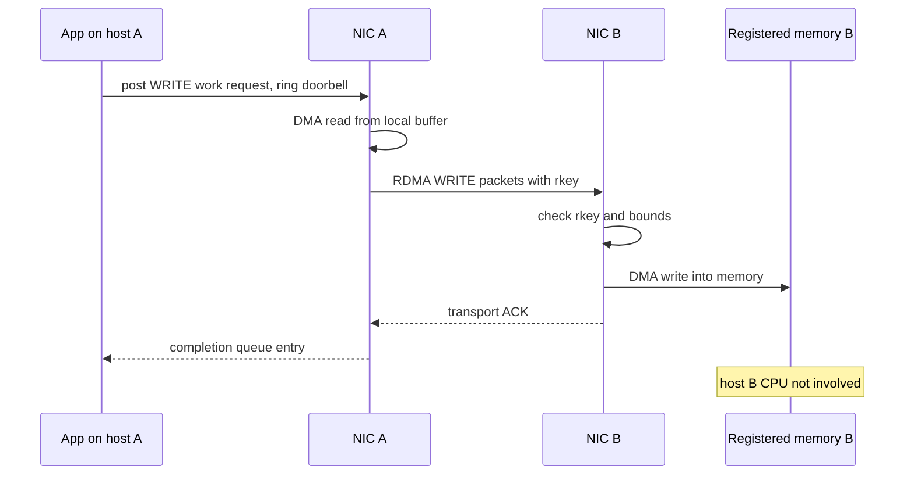

**Reading the diagram.** The *application* posts a work request and rings the doorbell in user space; *NIC A* reads the buffer from local memory by DMA and sends packets to *NIC B*, which validates the remote key and writes straight into *registered memory*. On a reliable connection NIC B acknowledges in hardware, and NIC A posts a completion that the application polls. Every step is asynchronous with respect to host B's CPU, which never runs. Failure points: an invalid or revoked key fails the operation; a lost packet triggers hardware retransmission, which on lossy networks can collapse throughput (§49.10.3); a QP enters an error state on repeated failure and must be reset. Scaling: each connected QP consumes NIC memory, so very large clusters use shared or datagram transports.

Typical results: one-way latency of one to a few microseconds at full line rate with almost no host CPU, versus tens of microseconds for kernel TCP.

### 49.10.2 InfiniBand versus RoCEv2

**InfiniBand (IB)** is a complete network stack designed for RDMA: its own links, switches and addressing, a central **subnet manager** that assigns addresses and computes routes, and **credit-based link-level flow control**, under which a sender transmits only when the receiver has advertised buffer space, so the fabric does not drop packets for congestion. **RoCEv2** (RDMA over Converged Ethernet, version 2) carries the InfiniBand transport inside UDP/IP packets (destination port 4791) over ordinary Ethernet switches, so it is routable across layer 3. Ethernet drops packets when buffers overflow, and early RDMA NICs recovered poorly from loss (go-back-N retransmission), so RoCEv2 deployments usually make the Ethernet lossless with **Priority Flow Control (PFC)**, IEEE 802.1Qbb, which pauses one traffic class on a link when the receiver's buffer passes a threshold.

**Table 49.3 — RDMA fabrics compared.**

| Aspect | InfiniBand | RoCEv2 | Provider transports (e.g., AWS SRD) |
|---|---|---|---|
| What it is | RDMA-native network stack | IB transport over UDP/IP Ethernet | Cloud-specific reliable datagram transport |
| Loss handling | Credit-based, lossless by design | PFC for losslessness plus ECN congestion control | Tolerates loss; multipath spraying, fast retransmit |
| Advantages | Mature, low latency, in-network reduction (SHARP) | Ethernet economics, tooling, multi-vendor | No lossless fabric needed |
| Disadvantages | Separate fabric and skills, fewer vendors | PFC risks (below), tuning | Provider-specific |
| Choose when | Dedicated HPC or AI clusters | Large Ethernet datacenters | Running HPC in that cloud |

AWS's Scalable Reliable Datagram, used by its Elastic Fabric Adapter, takes the third approach: it sprays packets of one flow over many paths, delivers out of order and retransmits quickly, so it needs no lossless fabric [Shalev et al. 2020]. The Ultra Ethernet Consortium is standardizing an Ethernet transport with similar goals (as of 2026).

### 49.10.3 Congestion control: DCQCN and the risks of PFC

PFC keeps packets from being dropped, but it is a blunt instrument. A pause stops *all* traffic of that class on the link, including flows not going to the congested port (**head-of-line blocking**); pauses propagate upstream hop by hop (**congestion spreading**); a cycle of switches each waiting for the next to drain can **deadlock**; and a malfunctioning NIC that sends pauses continuously can freeze a large part of the network (a **pause storm**). Microsoft's account of RoCEv2 at datacenter scale reports deadlocks and a NIC-induced pause storm, and its mitigations: DSCP-based PFC, watchdogs that disable PFC on a port paused too long, and transport fixes for livelock [Guo et al. 2016].

**DCQCN** (Data Center Quantized Congestion Notification) adds end-to-end, ECN-based rate control so that PFC is a rarely used backstop [Zhu et al. 2015]. Three roles:

1. **Congestion point (switch).** Marks packets with ECN with a probability that rises with queue length between two thresholds, as in RED.
2. **Notification point (receiver NIC).** On marked packets, sends a **congestion notification packet (CNP)** to the sender, at most one per flow per interval (50 µs in the paper).
3. **Reaction point (sender NIC).** Cuts the flow's rate on each CNP, and raises it in stages (fast recovery toward the previous rate, then additive and hyper increase) when CNPs stop.

::: formula
**DCQCN rate reduction and recovery**

$$R_T \leftarrow R_C, \quad R_C \leftarrow R_C\left(1 - \frac{\alpha}{2}\right), \quad \alpha \leftarrow (1 - g)\,\alpha + g \qquad \text{fast recovery: } R_C \leftarrow \frac{R_T + R_C}{2}$$

| Symbol | Meaning | Units |
|---|---|---|
| $R_C$ | Current sending rate of the flow | Gb/s |
| $R_T$ | Target rate (rate before the last cut) | Gb/s |
| $\alpha$ | Estimate of congestion severity; decays when no CNP arrives | dimensionless (0–1) |
| $g$ | Gain of the $\alpha$ update (1/256 in the paper) | dimensionless |
:::

::: example
**Worked example — A flow hitting congestion.** A 100 Gb/s flow with $\alpha = 1$ receives a CNP, then a second one before recovery.

1. First CNP: $R_T = 100$; $R_C = 100 \times (1 - 0.5) = 50$ Gb/s; $\alpha$ stays at 1.
2. Second CNP: $R_T = 50$; $R_C = 25$ Gb/s.
3. Congestion clears. Five fast-recovery steps toward $R_T = 50$: 37.5, 43.75, 46.9, 48.4, 49.2 Gb/s; additive increase then raises $R_T$ step by step back toward 100.
4. If congestion had been mild, $\alpha$ would have decayed (for example to 0.25), and a CNP would cut only $1 - 0.125 = 12.5\%$.

**Interpretation.** Rate cuts are multiplicative and fast, recovery is staged and slower, and $\alpha$ makes the cut proportional to persistent congestion. **Engineering implication.** ECN thresholds must be set so DCQCN reacts before PFC thresholds are reached; otherwise PFC does the work and brings its risks.
:::

**Figure 49.10 — DCQCN's control loop.**

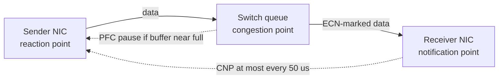

**Reading the diagram.** Data flows left to right from the *reaction point* through a *switch*, which marks packets with ECN as its queue grows, to the *notification point*, which returns CNPs (dotted, asynchronous feedback) to the sender, which cuts its rate. PFC (dotted) is the last-resort hop-by-hop pause when buffers are nearly full. Failure points: thresholds set wrongly let PFC trigger first, causing head-of-line blocking and congestion spreading; a NIC that floods pauses freezes upstream links unless a watchdog intervenes. Scaling: control is per flow and distributed, so it needs no central coordinator.

### 49.10.4 Topologies and bisection bandwidth

::: definition
**Definition — Bisection bandwidth.** The minimum total link capacity, in one direction, crossing any cut that divides the network's endpoints into two equal halves. **Full bisection bandwidth** means every endpoint in one half can send to the other half at full injection rate simultaneously.
:::

A **fat tree** is the three-tier folded Clos network built from identical $k$-port switches described by Al-Fares et al. [2008]: $k$ pods, each with $k/2$ edge and $k/2$ aggregation switches, plus $(k/2)^2$ core switches; it gives full bisection bandwidth (§7.17.1 sized a two-tier leaf–spine). A **dragonfly** groups routers into **groups** with all-to-all local links inside each group and at least one global (optical) link between every pair of groups, so any minimal path takes at most one global hop; it cuts the number of long, expensive cables, and adaptive routing (sending some traffic through an intermediate group) handles adversarial patterns [Kim et al. 2008]. Slingshot systems such as Frontier use dragonfly topologies.

::: formula
**Fat-tree and dragonfly sizes**

$$\text{Fat tree: } H = \frac{k^{3}}{4},\quad S = \frac{5k^{2}}{4},\quad B_{\text{bis}} = \frac{H}{2}\, b \qquad \text{Dragonfly: } g = a h + 1,\quad H = a\,p\,g,\quad B_{\text{bis}} \approx \left\lfloor \frac{g}{2} \right\rfloor \left\lceil \frac{g}{2} \right\rceil b$$

| Symbol | Meaning | Units |
|---|---|---|
| $k$ | Ports per switch | count |
| $H$ | Number of hosts (endpoints) | count |
| $S$ | Number of switches | count |
| $b$ | Link rate | Gb/s |
| $a$, $p$, $h$ | Routers per group, hosts per router, global links per router | count |
| $g$ | Number of groups with one global link per pair | count |
| $B_{\text{bis}}$ | Bisection bandwidth, one direction | Gb/s |
:::

::: example
**Worked example — Bisection of a fat tree and a dragonfly.**

1. Fat tree, $k = 64$, 400 Gb/s links: $H = 64^{3}/4 = 65{,}536$ hosts; $S = 5 \times 4{,}096/4 = 5{,}120$ switches; $B_{\text{bis}} = 32{,}768 \times 400$ Gb/s $= 13.1$ Pb/s.
2. With 2:1 oversubscription at the edge (more hosts per edge switch, fewer uplinks), bisection halves relative to injection, so an all-to-all exchange runs at 200 Gb/s per host.
3. Dragonfly, $p = h = 8$, $a = 16$, 200 Gb/s links: $g = 16 \times 8 + 1 = 129$ groups; $H = 16 \times 8 \times 129 = 16{,}512$ hosts. Splitting groups 64/65, $64 \times 65 = 4{,}160$ global links cross: $4{,}160 \times 200$ Gb/s $= 832$ Tb/s.
4. Per host in the smaller half ($64 \times 128 = 8{,}192$ hosts): $832/8{,}192 \approx 102$ Gb/s, about half the 200 Gb/s injection rate.

**Interpretation.** The fat tree gives every host full rate across any cut at the price of many switches and cables; the dragonfly gives about half across a worst-case bisection, which suffices for uniform random traffic (only half of it crosses any bisection) but not for adversarial patterns without adaptive routing. **Engineering implication.** Size bisection for your communication pattern: all-to-all (FFTs, mixture-of-experts layers) needs full bisection; nearest-neighbor halos and rings need far less if ranks are placed with topology in mind (§46.11.2).
:::

**Figure 49.11 — A fat tree with k = 4 (two of four pods shown).**

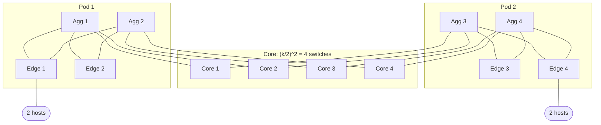

**Reading the diagram.** Each *edge* switch connects $k/2 = 2$ hosts and both *aggregation* switches of its pod; each aggregation switch connects to $k/2 = 2$ *core* switches, the first aggregation switch of every pod to cores 1–2 and the second to cores 3–4. Links are bidirectional with equal capacity at every tier, which is what makes the bisection full: traffic between pods has $(k/2)^2 = 4$ equal-cost paths through the core, spread by ECMP or adaptive routing. Failure points: a core switch failure removes a quarter of inter-pod capacity; an edge switch failure isolates its hosts. Scaling: capacity is fixed by $k$; bigger networks use higher-radix switches or more tiers.

## 49.11 Parallel file systems

::: definition
**Definition — Parallel file system.** A POSIX file system whose files are striped across many storage servers so that thousands of clients can read and write one file or many files concurrently at aggregate bandwidths of terabytes per second; examples are Lustre and IBM Storage Scale (formerly Spectrum Scale and GPFS).
:::

**Lustre** separates metadata from data [Lustre Docs]. A **management server (MGS)** holds configuration. **Metadata servers (MDS)** store the namespace, permissions and file layouts on **metadata targets (MDTs)**; the distributed namespace (DNE) spreads directories over several MDTs. **Object storage servers (OSS)** store file data as objects on **object storage targets (OSTs)**. Clients talk to all of them over LNet, Lustre's network layer, which runs over InfiniBand or Ethernet. A file's layout says which OSTs hold it: `lfs setstripe -c 8 -S 4M` stripes a file round-robin in 4 MiB pieces over 8 OSTs, so one file can use 8 servers' bandwidth. A distributed lock manager keeps client caches coherent. **Storage Scale** instead is a shared-disk design: every node can access every disk, metadata is handled by the nodes themselves under distributed byte-range and token locking, and data is striped widely [Schmuck and Haskin 2002].

**Burst buffers** are a tier of flash, on compute nodes or dedicated servers, that absorbs checkpoint bursts at high speed and drains them to the parallel file system while the computation continues [Liu et al. 2012].

**Figure 49.12 — Lustre with a burst buffer.**

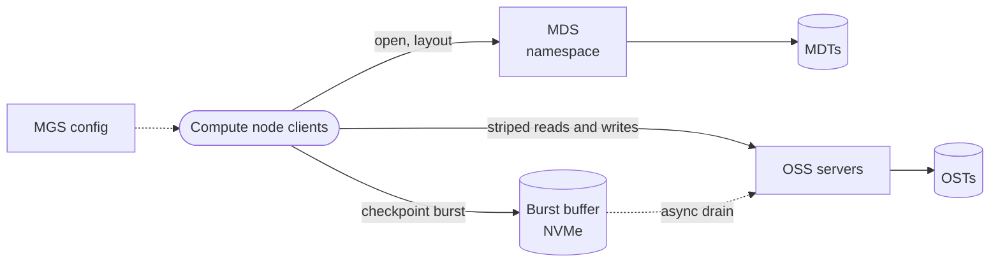

**Reading the diagram.** *Clients* contact the *MDS* only to open, create or look up files and obtain layouts (synchronous); data then flows in parallel to many *OSS* servers and their *OSTs*. Checkpoints can land on a *burst buffer*, which drains asynchronously (dotted) to the OSTs. Storage boundaries: namespace on MDTs, file data on OSTs, transient checkpoints on flash. Failure points: the MDS is the classic bottleneck (100,000 ranks each creating a file at once is a metadata storm); an OSS failure stalls files striped over it until failover. Scaling: OSTs add bandwidth; extra MDTs add metadata throughput.

::: formula
**Checkpoint write time and Young's optimal interval**

$$\delta = \frac{N s}{\min(B_{\text{fs}},\; N b_{\text{node}})} \qquad M_{\text{sys}} = \frac{M_{\text{node}}}{N} \qquad \tau_{\text{opt}} \approx \sqrt{2\,\delta\,M_{\text{sys}}} \qquad \text{waste} \approx \frac{\delta}{\tau} + \frac{\tau}{2 M_{\text{sys}}}$$

| Symbol | Meaning | Units |
|---|---|---|
| $N$ | Nodes in the job | count |
| $s$ | Checkpoint bytes per node | bytes |
| $B_{\text{fs}}$ | Aggregate write bandwidth of the storage tier | bytes/s |
| $b_{\text{node}}$ | Per-node write bandwidth (NIC or local flash) | bytes/s |
| $\delta$ | Time to write one checkpoint | s |
| $M_{\text{node}}$, $M_{\text{sys}}$ | Mean time between failures of one node and of the whole job | s |
| $\tau$, $\tau_{\text{opt}}$ | Checkpoint interval and its first-order optimum [Young 1974] | s |
:::

::: example
**Worked example — Checkpointing a 4,000-node job.** $s = 128$ GB per node; parallel file system 2.5 TB/s; node-local NVMe burst buffer 8 GB/s per node; $M_{\text{node}} = 50{,}000$ h.

1. Checkpoint size: $4{,}000 \times 128$ GB $= 512$ TB. To the file system: $\delta = 512 \times 10^{12} / 2.5 \times 10^{12} = 205$ s.
2. Job MTBF: $50{,}000/4{,}000 = 12.5$ h $= 45{,}000$ s.
3. Young: $\tau_{\text{opt}} = \sqrt{2 \times 205 \times 45{,}000} = \sqrt{1.84 \times 10^{7}} \approx 4{,}290$ s (72 min). Waste $\approx 205/4{,}290 + 4{,}290/90{,}000 = 4.8\% + 4.8\% = 9.6\%$.
4. Burst buffer: $\delta = 128/8 = 16$ s. $\tau_{\text{opt}} = \sqrt{2 \times 16 \times 45{,}000} = 1{,}200$ s; waste $= 1.3\% + 1.3\% = 2.7\%$. The 205 s drain to the file system overlaps the next 20 minutes of computation.

**Interpretation.** Faster checkpoints allow more frequent ones, cutting both write time and lost work: about 7 percentage points of the machine are recovered. **Engineering implication.** At scale, checkpoint bandwidth is sized from the failure rate, not from capacity; write one file per process or use collective MPI-IO to avoid lock contention on a shared file, and stage through flash (Chapter 65 applies this to training).
:::

**Table 49.4 — Parallel file systems versus object storage.**

| Aspect | Lustre | Storage Scale | Object storage |
|---|---|---|---|
| Metadata | Dedicated MDS/MDTs | Distributed among nodes, token locks | Sharded key-value index |
| Interface | POSIX | POSIX, plus NFS/S3 gateways | HTTP GET/PUT, no in-place update |
| Strength | Bandwidth for large striped I/O | Mixed workloads, shared disk | Capacity, durability, cost |
| Weakness | Small files, metadata storms | Licensing, complexity | Latency, no POSIX semantics |
| Choose when | HPC scratch, checkpoints | Enterprise HPC, mixed analytics | Data lakes, archives, long-term datasets |

## 49.12 Batch schedulers for HPC

HPC schedulers (Slurm, PBS Pro and its open-source variant OpenPBS, IBM LSF) allocate whole nodes to jobs as gangs, order queues by multifactor priority and fair-share, and backfill short jobs into holes before reservations; §46.12 covers Slurm's architecture and works a backfill example. Three HPC-specific points matter here: jobs request **topology** (for example, all nodes under few switches or within one dragonfly group) because collective costs depend on placement; jobs must state **time limits**, which backfill needs and which also bound checkpoint planning (§49.11); and **node health checks** run before and after jobs, because in a tightly coupled job one bad node fails the whole allocation.

## 49.13 Convergence of HPC, big data and AI

HPC optimized tightly coupled floating-point work with MPI and parallel file systems; big-data systems optimized throughput on commodity clusters that tolerate failure by re-execution (§29.4.3) [Reed and Dongarra 2015]. Large-model training reunites them. Each training step is a tightly coupled, bulk-synchronous computation whose gradients are combined by all-reduce (§49.9), so it needs a supercomputer's network: RDMA, high bisection bandwidth, topology-aware placement and gang scheduling. Its input is a petabyte-scale dataset prepared on a data platform (§49.5, Chapter 61); its checkpoints are a parallel-file-system problem (§49.11); and its failure rate at tens of thousands of GPUs is an exabyte-storage-style problem of constant failure (§49.3).

::: industry
**Meta's AI training clusters.** Meta described two 24,576-GPU clusters built in 2024, one on RoCEv2 Ethernet and one on InfiniBand, each with 400 Gb/s endpoints, to compare the fabrics at scale [Meta Engineering 2024]. Its SIGCOMM 2024 paper on RoCE for distributed training describes a dedicated backend network for collectives, separate from the frontend datacenter network, and congestion-control and routing changes made for collective traffic [Gangidi et al. 2024].
*Evidence: Primary* — [Meta Engineering 2024; Gangidi et al. 2024]
:::

**Figure 49.13 — An AI training cluster as a supercomputer.**

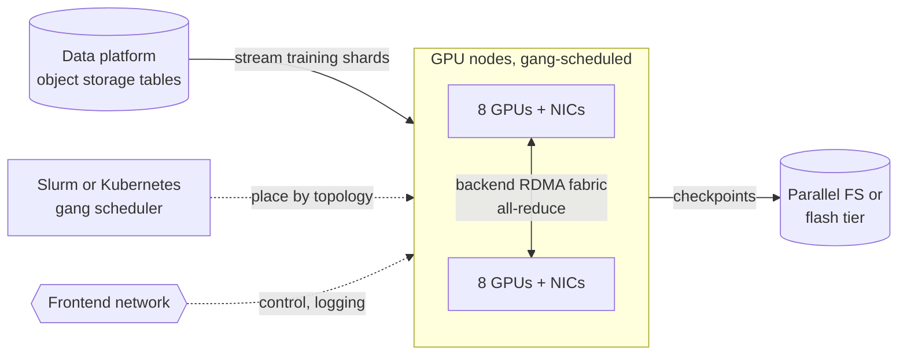

**Reading the diagram.** Training data streams from the *data platform* into *GPU nodes*, which a *gang scheduler* places by topology (dotted, control path). Within each step, nodes exchange gradients synchronously over a dedicated *backend RDMA fabric*; a separate *frontend network* carries control and logging. Checkpoints go to a *parallel file system or flash tier*. Failure points: one failed GPU or link stalls every rank; the checkpoint tier bounds how often the job can save. Scaling: add nodes in topology units (racks, groups), together with fabric bisection and checkpoint bandwidth.

Chapter 65 develops the parallelism strategies and communication volumes of distributed training, and Chapter 80 the design of clusters with tens of thousands of GPUs.

## 49.14 Summary and revision notes

::: summary
- At an exabyte, failure is constant (about 3 drives a day for 75,000 drives), repair is a permanent multi-GB/s workload, metadata becomes a sharded database, data gravity pins computation to data, and redundancy overhead dominates cost.
- Colossus (curators over Bigtable), Tectonic (layered metadata in ZippyDB), S3 (regional object service) and Azure Storage (stamps; synchronous stream-layer, asynchronous geo-replication) all move metadata into a scalable store and keep data off the metadata path.
- The data platform: ingestion (CDC, Kafka) → raw zone in object storage → Parquet plus a table format → Spark, Flink, SQL engines → serving; storage and compute are separated and caches recover locality.
- Dremel stores nested data with repetition and definition levels, runs queries on a serving tree and a disaggregated shuffle tier; Snowflake separates storage, virtual warehouses and cloud services, and prunes immutable micro-partitions by min/max metadata.
- Ship data when $8S/(\rho B \eta)$ exceeds load + transit + unload time; 50 PB takes 579 days on 10 Gb/s versus about 12 days by shipment.
- HPC is tightly coupled; strong scaling is limited by latency terms that grow with $\log p$. Top500 ranks by HPL Rmax; Rmax/Rpeak is typically 60–70% for leading GPU systems.
- α–β model: ring all-reduce $2(p-1)\alpha + 2\frac{p-1}{p}n\beta$ is bandwidth-optimal; trees win below a crossover of about 1.4 MB for 64 ranks at 5 µs and 25 GB/s; Rabenseifner combines both.
- RDMA gives microsecond, zero-copy, kernel-bypass transfers via queue pairs and completion queues. InfiniBand is lossless by credits; RoCEv2 relies on PFC plus DCQCN, and PFC brings head-of-line blocking, congestion spreading, deadlock and pause storms.
- Fat trees give full bisection ($k^3/4$ hosts); dragonflies trade about half bisection for fewer long cables.
- Lustre separates MDS/MDT from OSS/OST and stripes files; burst buffers absorb checkpoints; Young's $\tau \approx \sqrt{2\delta M}$ sets the interval.
:::

## 49.15 Knowledge checkpoint

1. How many 24 TB drives does 2 EB usable need with RS(10, 4), and how many fail per day at AFR 2%?
2. Why does metadata, not capacity, usually limit a single-master file system?
3. Name Tectonic's three metadata layers and the store that holds them.
4. In Windows Azure Storage, which layer replicates synchronously and which asynchronously, and why split them?
5. What do repetition level 0 and a definition level below the maximum mean in Dremel?
6. How does Snowflake avoid indexes for selective queries?
7. A 10 PB migration over a 40 Gb/s link at 80% efficiency: how long?
8. State the difference between strong and weak scaling.
9. Compute ring and tree all-reduce times for $p = 16$, $n = 100$ MB, $\alpha = 2$ µs, $\beta = 10^{-10}$ s/B.
10. Why does a one-sided RDMA WRITE not involve the remote CPU?
11. Give three risks of PFC.
12. How many hosts does a $k = 48$ fat tree support?
13. With $\delta = 60$ s and $M_{\text{sys}} = 8$ h, what is Young's checkpoint interval?

<details><summary>Answers</summary>

1. Raw $= 2 \times 1.4 = 2.8$ EB; $2.8 \times 10^{18}/2.4 \times 10^{13} \approx 116{,}700$ drives; $116{,}700 \times 0.02/365 \approx 6.4$ per day.
2. Its memory and request rate scale with the number of files and blocks, which grows much faster than any one server's RAM, especially with small files.
3. Name, File and Block layers, stored in ZippyDB.
4. Stream layer: synchronous, within a stamp (local failures, strong consistency). Partition layer: asynchronous, across stamps (disasters, no WAN latency on writes).
5. $r = 0$ starts a new record; $d$ below the maximum marks a `NULL` and says how much of the path was present.
6. It keeps per-column min/max for every immutable micro-partition in metadata and prunes partitions that cannot match.
7. $8 \times 10^{16}/(3.2 \times 10^{10}) = 2.5 \times 10^{6}$ s, about 29 days.
8. Strong: fixed total problem, more processors (Amdahl). Weak: problem grows with processors, fixed work per processor (Gustafson).
9. Ring: $30 \times 2$ µs $+ 2 \times \frac{15}{16} \times 10^{8} \times 10^{-10} = 0.06 + 18.75 = 18.8$ ms. Tree: $8 \times (2 \text{ µs} + 10 \text{ ms}) = 80$ ms.
10. The remote NIC validates the key and writes into pre-registered memory by DMA; no interrupt or software runs on the remote host.
11. Head-of-line blocking, congestion spreading, deadlock from cyclic buffer dependencies, and pause storms from faulty NICs (any three).
12. $48^{3}/4 = 27{,}648$ hosts.
13. $\sqrt{2 \times 60 \times 28{,}800} = \sqrt{3.456 \times 10^{6}} \approx 1{,}860$ s, about 31 minutes.

</details>

## 49.16 Interview questions

### Basic

**Q1. Why do exabyte storage systems use erasure coding instead of triple replication?**
**Answer.** RS(6, 3) stores 1.5 bytes per byte instead of 3 while tolerating three losses, which at an exabyte saves tens of thousands of drives. The costs are repair fan-in ($k$ reads per lost fragment), CPU and higher small-write latency, so systems replicate hot or small writes first and encode later.

**Q2. What is the difference between embarrassingly parallel and tightly coupled workloads?**
**Answer.** Embarrassingly parallel tasks need no communication and tolerate failures by re-running a task; tightly coupled ranks exchange data every step, so latency, collectives and a single failure affect the whole job.

### Intermediate

**Q3. Design the storage and compute layers of an analytics platform for 20 PB.**
**Answer.** Object storage as the system of record, raw and curated zones, Parquet tables under Iceberg or Delta with a catalog; Spark for batch, Flink for streaming, a SQL engine or warehouse for interactive use, each on its own elastic cluster with SSD caches; CDC and Kafka for ingestion; replicate only curated tables cross-region; lifecycle cold partitions to cheaper tiers.

**Q4. Gradient all-reduce takes 40% of each training step. What do you check?**
**Answer.** Message sizes (bucket small tensors past the α–β crossover); algorithm choice (ring or tree by size and scale, hierarchical within and across nodes); overlap of communication with backward computation; topology of the placement; link utilization and congestion signals (ECN marks, PFC pauses); and stragglers, since one slow rank delays every step.

### Advanced

**Q5. You run RoCEv2 for a 4,000-GPU cluster. How do you keep PFC from hurting you?**
**Answer.** Use PFC only for the RDMA class with DSCP-based classification; tune DCQCN so ECN marking starts well below PFC thresholds; size switch headroom; enable PFC watchdogs on switches and NICs; avoid routing loops and cyclic buffer dependencies by topology (up-down routing in a Clos); monitor pause counters and CNP rates per port; and consider transports that tolerate loss.

**Q6. Size checkpointing for a 10,000-node job with node MTBF of 5 years.**
**Answer.** Job MTBF $= 43{,}800/10{,}000 = 4.4$ h. If each node writes 100 GB to a 5 TB/s file system, $\delta = 200$ s and $\tau \approx \sqrt{2 \times 200 \times 15{,}800} \approx 2{,}500$ s, with waste near 16%. A burst buffer at 10 GB/s per node gives $\delta = 10$ s, $\tau \approx 560$ s and waste near 4%, so the flash tier pays for itself in recovered machine time.

## 49.17 Practical exercises

1. Extend the ring simulation with a hierarchical all-reduce (reduce within groups of 8, ring across group leaders, broadcast within groups) and compare its α–β cost with the flat ring for $p = 1{,}024$.
2. Modify the striping program to reassemble records from the three columns and assert that you get R1 and R2 back.
3. Write a calculator for drive count, daily failures and repair bandwidth, and plot repair traffic against AFR for RS(6, 3), RS(10, 4) and 3× replication.
4. On a Lustre system, write a 64 GB file with stripe counts of 1, 4 and 16 and compare the bandwidth you achieve.

## 49.18 Design challenges

1. **Exabyte archive.** Design a 3 EB scientific-data archive for a consortium with 2 PB of new data a week from instruments in another country: redundancy scheme, failure-domain layout, metadata store, ingest path (network or shipment) and cost per PB-year.
2. **Shared research cluster.** Design a 2,048-GPU cluster for both MPI simulations and model training: fabric (InfiniBand or RoCEv2), topology and bisection, parallel file system and burst buffer sizing, scheduler policy and checkpoint guidance.

## 49.19 References

1. Pan, S., et al. *Facebook's Tectonic Filesystem: Efficiency from Exascale*. USENIX FAST, 2021. https://www.usenix.org/conference/fast21/presentation/pan
2. Facebook Engineering. *Tectonic file system: Consolidating Facebook storage infrastructure*. 2021.
3. McCrory, D. *Data Gravity – in the Clouds*. Blog post, 2010.
4. Schroeder, B., Gibson, G. A. *Disk Failures in the Real World: What Does an MTTF of 1,000,000 Hours Mean to You?* USENIX FAST, 2007.
5. Pinheiro, E., Weber, W.-D., Barroso, L. A. *Failure Trends in a Large Disk Drive Population*. USENIX FAST, 2007.
6. Dean, J. *Designs, Lessons and Advice from Building Large Distributed Systems*. Keynote, LADIS, 2009.
7. Ford, D., et al. *Availability in Globally Distributed Storage Systems*. OSDI, 2010.
8. Hildebrand, D., Serenyi, D. *Colossus under the hood: a peek into Google's scalable storage system*. Google Cloud Blog, 2021. https://cloud.google.com/blog/products/storage-data-transfer/a-peek-behind-colossus-googles-file-system
9. Greenfield, L., Pollen, S. *Colossus under the hood: how we deliver SSD performance at HDD prices*. Google Cloud Blog, 2025. https://cloud.google.com/blog/products/storage-data-transfer/how-colossus-optimizes-data-placement-for-performance
10. Warfield, A. *Building and operating a pretty big storage system called S3*. All Things Distributed, 2023. https://www.allthingsdistributed.com/2023/07/building-and-operating-a-pretty-big-storage-system.html
11. Bornholt, J., et al. *Using Lightweight Formal Methods to Validate a Key-Value Storage Node in Amazon S3*. SOSP, 2021.
12. Vogels, W. *Diving Deep on S3 Consistency*. All Things Distributed, 2021. https://www.allthingsdistributed.com/2021/04/s3-strong-consistency.html
13. Amazon Web Services. *Amazon S3 User Guide*..
14. Calder, B., et al. *Windows Azure Storage: A Highly Available Cloud Storage Service with Strong Consistency*. SOSP, 2011.
15. Huang, C., et al. *Erasure Coding in Windows Azure Storage*. USENIX ATC, 2012.
16. Sethi, R., et al. *Presto: SQL on Everything*. IEEE ICDE, 2019.
17. Armbrust, M., Ghodsi, A., Xin, R., Zaharia, M. *Lakehouse: A New Generation of Open Platforms that Unify Data Warehousing and Advanced Analytics*. CIDR, 2021.
18. Melnik, S., Gubarev, A., Long, J. J., Romer, G., Shivakumar, S., Tolton, M., Vassilakis, T. *Dremel: Interactive Analysis of Web-Scale Datasets*. PVLDB 3(1), 2010.
19. Melnik, S., et al. *Dremel: A Decade of Interactive SQL Analysis at Web Scale*. PVLDB 13(12), 2020.
20. Dageville, B., et al. *The Snowflake Elastic Data Warehouse*. ACM SIGMOD, 2016.
21. Snowflake. *Documentation: Micro-partitions and data clustering*..
22. Tanenbaum, A. S., Wetherall, D. J. *Computer Networks*, 5th ed. Pearson, 2011.
23. Amazon Web Services. *AWS Snowmobile announcement*. AWS News Blog, 2016.
24. Oak Ridge Leadership Computing Facility. *Frontier user guide and system overview*..
25. TOP500. *TOP500 lists*. https://www.top500.org/
26. Dongarra, J. J., Luszczek, P., Petitet, A. *The LINPACK Benchmark: Past, Present and Future*. Concurrency and Computation: Practice and Experience 15(9), 2003.
27. MPI Forum. *MPI: A Message-Passing Interface Standard, Version 4.1*. 2023. https://www.mpi-forum.org/docs/
28. Thakur, R., Rabenseifner, R., Gropp, W. *Optimization of Collective Communication Operations in MPICH*. International Journal of High Performance Computing Applications 19(1), 2005.
29. Patarasuk, P., Yuan, X. *Bandwidth Optimal All-reduce Algorithms for Clusters of Workstations*. Journal of Parallel and Distributed Computing 69(2), 2009.
30. InfiniBand Trade Association. *InfiniBand Architecture Specification*, including Annex A17 (RoCEv2).
31. NVIDIA. *RDMA Aware Networks Programming User Manual*.
32. Shalev, L., Ayoub, H., Bshara, N., Sabbag, E. *A Cloud-Optimized Transport Protocol for Elastic and Scalable HPC*. IEEE Micro 40(6), 2020.
33. Guo, C., et al. *RDMA over Commodity Ethernet at Scale*. ACM SIGCOMM, 2016.
34. Zhu, Y., et al. *Congestion Control for Large-Scale RDMA Deployments*. ACM SIGCOMM, 2015.
35. Al-Fares, M., Loukissas, A., Vahdat, A. *A Scalable, Commodity Data Center Network Architecture*. ACM SIGCOMM, 2008.
36. Kim, J., Dally, W. J., Scott, S., Abts, D. *Technology-Driven, Highly-Scalable Dragonfly Topology*. ISCA, 2008.
37. Lustre. *Lustre Operations Manual*..
38. Schmuck, F., Haskin, R. *GPFS: A Shared-Disk File System for Large Computing Clusters*. USENIX FAST, 2002.
39. Liu, N., et al. *On the Role of Burst Buffers in Leadership-Class Storage Systems*. IEEE MSST, 2012.
40. Young, J. W. *A First Order Approximation to the Optimum Checkpoint Interval*. Communications of the ACM 17(9), 1974.
41. Reed, D. A., Dongarra, J. *Exascale Computing and Big Data*. Communications of the ACM 58(7), 2015.
42. Meta Engineering. *Building Meta's GenAI Infrastructure*. 2024.
43. Gangidi, A., et al. *RDMA over Ethernet for Distributed Training at Meta Scale*. ACM SIGCOMM, 2024.

## 49.20 Open verification items

- Tectonic: TrafficGroup/TrafficClass details and exact cluster sizes and Reed–Solomon parameters per tenant (paper not re-read; usenix.org PDF unreachable).
- Colossus 2025 blog: "two file systems above 10 EB" and exact titles of both Google posts.
- S3 figures are 2023 (280 trillion objects, 100 million requests/s); 2026 reports cite about 500 trillion and 200 million (Secondary).
- WAS stamp sizes (10–20 racks × 18 nodes; 2 PB and 30 PB) as recalled from Calder et al. 2011.
- Top500: El Capitan Nov 2024 Rmax/Rpeak; a June 2026 list reportedly has a new leader (top500.org unreachable).
- MPI-5.0 release status (2025).
- Snowflake micro-partition size range; Snowmobile retirement date.
- DCQCN CNP interval (50 µs) and $g = 1/256$.
- Title of Gangidi et al. 2024 and McCrory 2010 post.
