# Chapter 50 — Security Architecture and Privacy Engineering

> **Level:** 4 · **Track:** Shared · **Estimated reading time:** 6 h

Chapter 10 gave you the building blocks of security: threat models, cryptographic primitives, certificates, password storage, secrets, envelope encryption, a first look at zero trust, DDoS defense and tamper-evident audit logs. This chapter is about putting those blocks together into an architecture that still protects people when individual blocks fail, and about a second discipline that sits beside security: **privacy engineering**, the work of making sure a system collects, uses and keeps personal data only in ways its owners would expect and the law allows.

Security asks "can an unauthorized party get at this data?" Privacy asks "should *anyone*, including us, be doing this with it?" A perfectly secure system can still violate privacy, for example by reusing delivery addresses to build advertising profiles.

The running example is **QuickBite**, the hypothetical food-delivery platform of Chapter 2, now running in the United States, the European Union and Asia-Pacific (Chapter 44). For this chapter we assume QuickBite has 3,000 employees, 250 services running as about 20,000 workloads, 40 million customers and 600,000 couriers whose phones report location while they work. Every QuickBite number is a teaching assumption, not a measurement of a real company.

Chapter 71 goes deeper into differential privacy for machine learning; Chapters 77 and 79 apply these ideas to AI systems.

## 50.1 Learning objectives

After this chapter you should be able to:

- Map layered security controls onto a reference architecture, estimate how independent they are, and reduce blast radius under an assume-breach model.
- Describe BeyondCorp and the NIST SP 800-207 components, and design workload identity with SPIFFE and SPIRE.
- Separate workforce from customer identity, design federation with SAML or OpenID Connect, and choose token lifetimes from an exposure-window calculation.
- Place a policy engine such as OPA or Cedar in an architecture and find privilege-escalation paths in an access graph.
- Explain the SolarWinds and xz-utils compromises, the SLSA build levels, SBOMs, Sigstore signing, dependency confusion and reproducible builds.
- Design a detection pipeline, reason about alert precision from base rates, deploy honeytokens and compute MTTD and MTTR.
- Apply Cavoukian's privacy-by-design principles, build a data inventory and enforce purpose limitation.
- Model lawful basis and consent as data and design a deletion pipeline that reaches backups.
- Distinguish pseudonymization from anonymization, test k-anonymity and explain linkage attacks.
- Define ε-differential privacy, calibrate the Laplace mechanism and track a privacy budget under composition.
- Compare secure multi-party computation, homomorphic encryption and trusted execution environments.

## 50.2 Prerequisites

- Threat modeling, cryptography and PKI — §10.3–§10.5 (signing, attestation and SPIFFE certificates reuse them).
- Secrets, envelope encryption, zero trust and audit logs — §10.8–§10.10, §10.12 (this chapter continues from there).
- Sessions, JWT, OAuth 2.0, OpenID Connect and Zanzibar — §8.10–§8.14 (identity architecture assumes them).
- Cloud IAM principals, policies and roles — §41.12 (escalation paths live there).
- Pipeline identity and the supply-chain introduction — §43.11 (this chapter treats the topic in depth).
- Multi-tenant isolation and confused deputies — §47.12 (blast radius between customers).
- Data residency — §44.9 (where personal data may live).
- Log pipelines — §40.4 (the SIEM is a log pipeline).

## 50.3 Defense in depth as an architecture

### 50.3.1 Layers that fail independently

::: definition
**Definition — Defense in depth.** An architecture in which an asset is protected by several layers of controls, each of which can stop or reveal an attack on its own, chosen so that the layers fail for *different* reasons. An attacker must defeat every layer on the path to the asset; a defender needs only one layer to hold or to raise an alarm.
:::

#### First-principles explanation

Picture a bank vault. There is a guard at the door, a locked gate, a time-locked vault door, a camera and an alarm that calls the police. None of them is perfect. The design works because they are *different*: the guard can be bribed but the time lock cannot; the lock can be picked but the camera records it. If all five used the same key, stealing that key would defeat all five at once, and you would really have one layer dressed up as five.

Software is the same. A phished password is stopped by phishing-resistant MFA; failing that, by a missing device certificate; failing that, by an authorization policy; failing that, a detection rule pages someone. The safety comes from layers that rely on different secrets, administrators and code.

#### Why does this exist?

Every control fails sometimes, and architectures that depend on one control (a firewall, a VPN, one admin password) fail completely with it. The goal is that the inevitable compromise of one component does not become the compromise of the system [Adkins et al. 2020].

#### Mathematical foundations

::: formula
**Probability that an attack passes every layer**

$$P_{\text{breach}} = \prod_{i=1}^{n} p_i \quad \text{(independent layers)}$$

| Symbol | Meaning | Units |
|---|---|---|
| $P_{\text{breach}}$ | Probability that one attack attempt reaches the asset undetected | probability |
| $n$ | Number of layers on the attack path | count |
| $p_i$ | Probability that layer $i$ fails to stop or detect the attempt | probability |
:::

::: example
**Worked example — QuickBite's admin console.** An attacker phishes a support agent. Assume (teaching numbers) the layers fail with $p_1 = 0.05$ (MFA bypass), $p_2 = 0.2$ (device-posture check passes on an attacker machine), $p_3 = 0.3$ (authorization allows the bulk export) and $p_4 = 0.5$ (detection misses the export).

1. Independent layers: $P = 0.05 \times 0.2 \times 0.3 \times 0.5 = 0.0015$, about 1 in 670 attempts.
2. Now suppose the attacker instead phishes an identity-provider administrator, who can both enroll a new MFA device and add herself to the export group. Layers 1 and 3 now fail *together*: the effective path is $0.05 \times 0.2 \times 0.5 = 0.005$, about 1 in 200, a 3.3× increase, and in practice worse, because an IdP administrator can often also change device trust.

**Interpretation.** The product rule rewards independence. Layers that share an administrator, a credential or a code base multiply as if they were one. **Engineering implication:** for every pair of layers, ask "what single compromise defeats both?" and separate those duties (different admins, separate accounts, separate signing keys). The numbers are illustrative; what matters is comparing designs, not the absolute probability.
:::

### 50.3.2 A reference architecture with controls mapped

A useful way to review a design is to draw it once and then place controls at each boundary, from the internet edge to the data and its keys. Figure 50.1 does this for QuickBite.

**Figure 50.1 — Defense-in-depth reference architecture for QuickBite.**

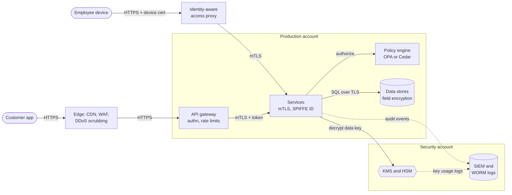

**Reading the diagram.** Customers enter through the edge tier (CDN, web application firewall and DDoS scrubbing, §10.11) and then the API gateway, which authenticates tokens and rate-limits (Chapter 22). Employees never use a VPN: they reach internal tools through an identity-aware access proxy that checks user, device certificate and posture (§50.4). Inside production, every service-to-service call is mTLS with a workload identity, and every sensitive action is authorized by a policy engine (§50.5.4). Data stores encrypt sensitive fields with data keys that only the KMS can unwrap (§10.9). Solid arrows are synchronous calls; dotted arrows are asynchronous audit and key-usage events flowing to a SIEM and write-once log store in a *separate* security account, so a production administrator cannot erase evidence. Failure points: the gateway, proxy, policy engine and KMS become critical dependencies (cache decisions and data keys briefly; fail closed for writes). Scaling: control tiers are stateless and scale horizontally; KMS quotas are managed with data-key caching.

**Table 50.1 — Layers, controls and the threats they address.**

| Layer | Control | Main threat stopped | Section |
|---|---|---|---|
| Edge | CDN, WAF, DDoS scrubbing | Floods, common injection | §10.11, Ch 21 |
| Human identity | Phishing-resistant MFA, SSO | Stolen passwords | §50.5 |
| Device | Device certificates, posture checks | Attacker-owned machines | §50.4.1 |
| Workload identity | SPIFFE IDs, mTLS | Spoofed internal callers | §50.4.3 |
| Authorization | Policy engine, ReBAC, deny by default | Excess privilege, IDOR | §50.5.4, §8.12 |
| Network | Segmentation, egress proxy | Lateral movement, exfiltration | §10.10.3 |
| Data | Field encryption, tokenization | Database theft, backup leaks | §10.9, §50.10 |
| Supply chain | Signed builds, provenance, admission | Malicious artifacts | §50.6 |
| Detection | SIEM, detections as code, honeytokens | What the other layers missed | §50.7 |

### 50.3.3 Assume breach and blast radius

::: definition
**Definition — Assume breach.** A design stance that treats the compromise of any single component, credential or person as a given and asks how far the attacker gets next. **Blast radius** is the set of assets an attacker can reach from one compromised principal; architecture reduces it by limiting what each principal may do and where it may connect.
:::

The question shifts from "how do we keep attackers out?" to "if the courier-tracking service is owned tonight, what can its credentials read, which other services will accept its calls, and how soon will we know?" Three tools reduce the answer:

1. **Least privilege per principal.** One identity and one role per service; permissions scoped to specific resources, not wildcards; no standing human administrator access (time-boxed, approved elevation instead) [Adkins et al. 2020].
2. **Partitioning.** Separate cloud accounts per environment and per sensitive domain (payments, identity, logging), cells per region (§44.10) and per-tenant keys (§47.5.4), so that one compromised account sees one partition.
3. **Credential lifetime.** A credential that lives one hour is worth far less to an attacker than one that lives a year (§50.5.3).

**Figure 50.2 — Attack path from a compromised service, with the controls that cut it.**

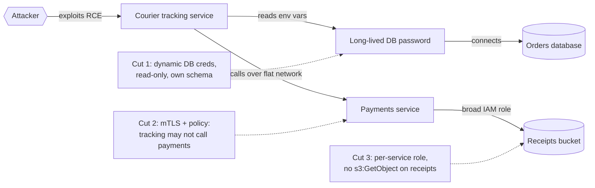

**Reading the diagram.** An attacker gains code execution in the courier-tracking service. Without further controls, its long-lived database password opens the orders database, and the flat network lets it call payments, whose broad role reads every receipt. The dotted "cut" nodes remove each edge: short-lived database credentials scoped to the tracking schema (§10.8); a workload-identity policy denying tracking-to-payments calls (§50.4.3); and per-service IAM roles (§41.12). After the cuts, the blast radius is the tracking service's own data. Failure point: cuts are configuration and drift, so test them continuously with a job that attempts forbidden calls and expects denial.

::: recommendation
**Recommendation — Measure blast radius.** For each service, compute from IAM policies and network and mesh policies the set of data stores and services it can reach, and track the totals as metrics. A reachability graph that shrinks quarter over quarter is a more honest security metric than a count of controls deployed.
:::

#### Failure scenarios

| What goes wrong | Why | Detection | Recovery | Prevention |
|---|---|---|---|---|
| Two layers fall to one credential | Shared administrator or signing key | Access-graph analysis | Rotate, split duties | Separate accounts and admins per layer |
| A layer silently disabled | Debug change left in production | Config drift alerts; control health checks | Re-enable; investigate window | Policy as code with review |
| Control becomes an outage | Policy engine or KMS unavailable | SLO alerts | Cached decisions, failover | Treat controls as tier-0 services |
| Defense only at the edge | Internal calls trusted by default | Internal pen test | Add mTLS and authz | Zero trust (§50.4) |

::: mistake
**"We have five security products, so we have defense in depth."** Depth comes from independent failure, not from the number of products. Five tools administered from one SSO group with one shared break-glass password are one layer.
:::

## 50.4 Zero trust architecture in depth

Section 10.10 introduced zero trust: network location confers no trust, and every request is authenticated and authorized from the identity of user, device and workload. Here we look at how it is actually built, first in Google's published BeyondCorp design, then in the vendor-neutral vocabulary of NIST SP 800-207, then for service-to-service traffic.

### 50.4.1 BeyondCorp as published

#### First-principles explanation

Think of an office where the front door no longer matters: every room has a receptionist who checks your badge, whether your laptop is a company laptop in good repair, and whether you may enter *this* room *now*. How you got into the building is irrelevant.

#### How it works internally

Ward and Beyer described the design in four parts [Ward & Beyer 2014]; Osborn et al. and Cittadini et al. later described the deployment and the access proxy [Osborn et al. 2016; Cittadini et al. 2016]:

1. **Securely identify the device.** A **device inventory** records every managed device. Each device carries a certificate that identifies it (stored in a hardware or OS certificate store); the certificate proves *which* inventory record the device is, and the inventory says what is known about it.
2. **Securely identify the user.** A user and group database feeds a single sign-on system that issues short-lived credentials after strong authentication.
3. **Remove trust from the network.** Office networks become **unprivileged networks**, treated like the internet; being plugged in at headquarters grants nothing.
4. **Externalize applications.** Internal applications are reachable only through an internet-facing **access proxy**, which terminates TLS, authenticates user and device, and asks the **access control engine** for a per-request decision.
5. **Infer trust.** A pipeline aggregates device data from many sources (asset management, OS update status, endpoint agents) into a single view; a **trust inferer** assigns each device a **trust tier**; access policies require a minimum tier per application (for example, the code-review tool requires a fully patched, managed device; the cafeteria menu requires much less) [Osborn et al. 2016].

**Figure 50.3 — BeyondCorp trust inference and access decision.**

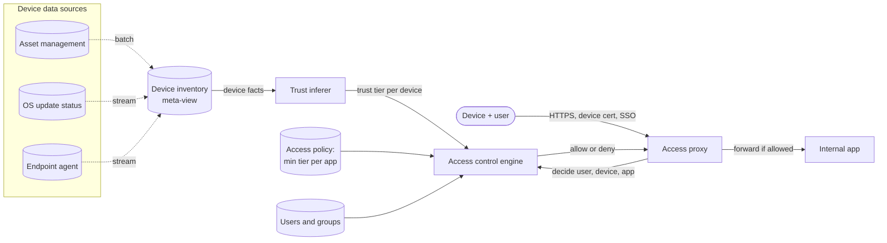

**Reading the diagram.** Device facts arrive asynchronously (dotted arrows) from several systems and are merged into one inventory view, because no single source is trustworthy or complete. When a laptop misses a critical patch its tier drops and the next request is denied, with no network change. At request time (solid arrows) the proxy authenticates device certificate and SSO session and asks the engine for a decision. Failure points: stale inventory data, and the proxy and engine as critical infrastructure. Scaling: the proxy is a stateless L7 tier; decisions are cheap lookups against precomputed tiers.

::: industry
**Google BeyondCorp.** Google moved employee access off its privileged corporate network onto per-request decisions from user identity, device inventory and inferred trust, over several years. The papers stress that most effort went into inventory data quality and gradual migration (simulating policy against logged traffic before enforcing), not the proxy.
*Evidence: Primary* — [Ward & Beyer 2014]; [Osborn et al. 2016]; [Cittadini et al. 2016]
:::

### 50.4.2 NIST SP 800-207 logical components

NIST SP 800-207 gives zero trust a vendor-neutral vocabulary [Rose et al. 2020]. Its tenets include: all communication is secured regardless of network location; access is granted per session by dynamic policy that includes the observable state of client and resource; authentication and authorization are strictly enforced before access; and the enterprise monitors asset posture and collects state to improve decisions.

::: definition
**Definition — PE, PA, PDP and PEP.** The **policy engine (PE)** makes the grant or deny decision using enterprise policy and external inputs. The **policy administrator (PA)** carries out that decision by establishing or tearing down the session path (for example, issuing a session token or configuring a gateway). Together the PE and PA form the **policy decision point (PDP)**. The **policy enforcement point (PEP)** sits in the data path between subject and resource and enables, monitors and terminates connections on the PA's instructions [Rose et al. 2020].
:::

**Figure 50.4 — NIST SP 800-207 logical components.**

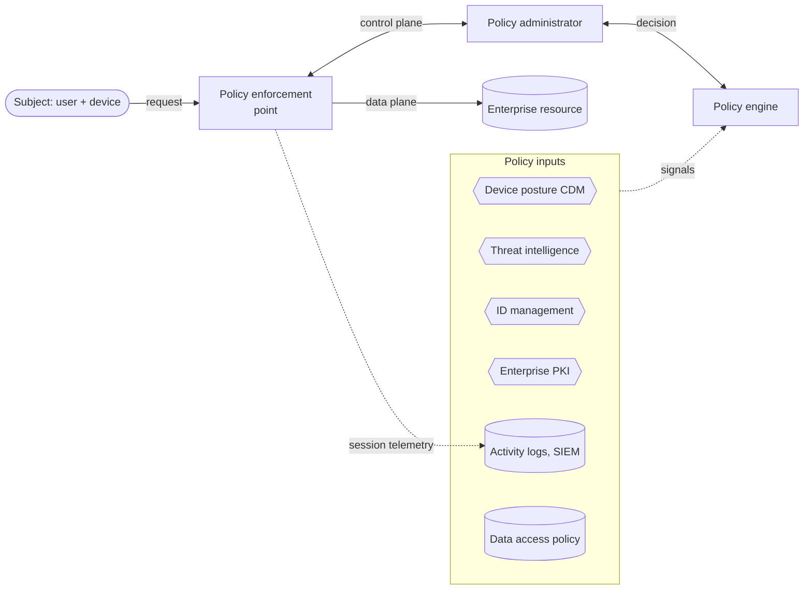

**Reading the diagram.** The subject's request reaches the PEP, which forwards data-plane traffic to the resource only after the control plane approves. The PEP asks the PA, which asks the PE; the PE evaluates policy using asynchronous inputs such as device posture (continuous diagnostics and mitigation, CDM), threat intelligence, identity, PKI, logs and data-access policy. Session telemetry flows back into the logs, so behavior can change the next decision. BeyondCorp maps cleanly: access proxy = PEP; access control engine = PE; the SSO and proxy configuration = PA; device inventory and trust inferer = inputs. Failure points: the PDP is on every request path, so replicate it and cache decisions briefly; a PEP that fails open defeats the model.

The standard describes deployment variants (device agent with gateway, enclave gateway in front of legacy systems, resource portal, application sandboxing) and distinguishes **criteria-based** trust algorithms (all conditions must hold) from **score-based** ones (a confidence score must exceed a threshold).

### 50.4.3 Service-to-service identity with SPIFFE, SPIRE and mTLS

QuickBite's 20,000 workloads call each other millions of times per second, and each callee needs to know cryptographically which workload is calling. IP addresses fail: pods move constantly and addresses are reused.

::: definition
**Definition — SPIFFE ID and SVID.** **SPIFFE** (Secure Production Identity Framework for Everyone) is an open specification for workload identity. A **SPIFFE ID** is a URI of the form `spiffe://<trust-domain>/<path>`, for example `spiffe://quickbite.example/ns/payments/sa/charge-api`. A **SPIFFE Verifiable Identity Document (SVID)** is a short-lived credential carrying that ID: an **X.509-SVID** (a certificate whose URI subject alternative name is the SPIFFE ID, used for mTLS) or a **JWT-SVID** (a signed token, used where TLS cannot be end to end). A **trust bundle** holds the CA certificates that verify a trust domain's SVIDs [SPIFFE Spec].
:::

The design problem is "secret zero": how does a freshly started workload get its first credential without someone baking a secret into the image? SPIFFE's answer is **attestation**: a local agent identifies the workload from facts the platform vouches for (which node it runs on, which Kubernetes service account, which Unix user), and hands it an SVID over the **Workload API**, a local socket that requires no credential from the caller.

**SPIRE**, the reference implementation, has two parts:

1. **SPIRE Server** acts as the signing authority for a trust domain and holds **registration entries** mapping selectors (for example `k8s:ns:payments`, `k8s:sa:charge-api`) to SPIFFE IDs.
2. **SPIRE Agent** runs on every node. It first performs **node attestation**: it proves the node's identity to the server using platform evidence such as a cloud instance identity document or a Kubernetes projected service-account token. It then performs **workload attestation** for each local process that connects to the Workload API, inspecting the caller through the kernel and the kubelet, and fetches and caches SVIDs for the matching entries.

**Figure 50.5 — SPIRE attestation, SVID issuance and an mTLS call.**

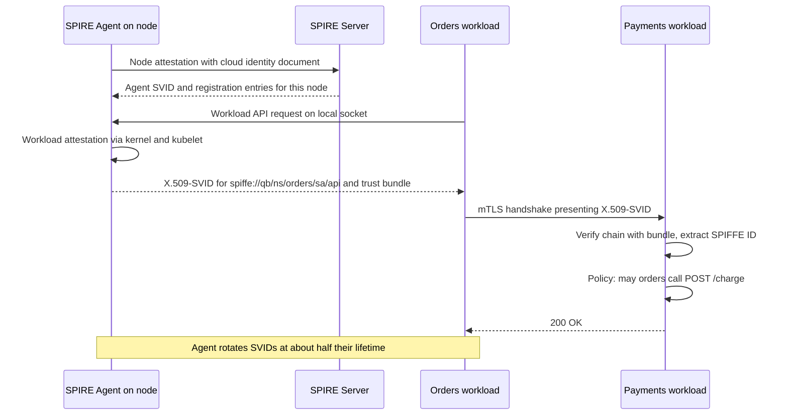

**Reading the diagram.** The agent proves which node it is, receiving its own SVID and the registration entries it may serve. The orders workload calls the local Workload API; the agent attests the process and returns an X.509-SVID plus trust bundle, with no secret in the image. The workload then opens an mTLS connection to payments; payments verifies the certificate chain against the bundle, extracts the SPIFFE ID and evaluates an authorization policy keyed on that ID, not on an IP address. All calls are synchronous; rotation happens in the background. Failure points: if the SPIRE Server is down, agents serve cached SVIDs until they expire, so SVID lifetime sets the outage budget; a compromised node obtains only the SVIDs of workloads registered to it. Scaling: one agent per node, replicated servers; trust domains **federate** by exchanging bundles.

#### Mathematical foundations

::: formula
**Certificate issuance rate**

$$R = \frac{N}{f \, T} + \frac{N_{\text{new}}}{\Delta t}$$

| Symbol | Meaning | Units |
|---|---|---|
| $R$ | Signing requests per second at the issuer | signatures/s |
| $N$ | Workloads holding an SVID | count |
| $T$ | SVID lifetime | s |
| $f$ | Fraction of lifetime after which a renewal occurs | dimensionless |
| $N_{\text{new}}/\Delta t$ | Rate of newly started workloads | workloads/s |
:::

::: example
**Worked example — QuickBite's SPIRE load.** $N = 20{,}000$ workloads; $T = 1$ h $= 3{,}600$ s (SPIRE's default X.509-SVID lifetime, as of 2026); renewal at half-life, $f = 0.5$; deployments start 5,000 new pods per hour ($1.39$/s).

1. Renewals: $20{,}000 / (0.5 \times 3{,}600) = 20{,}000 / 1{,}800 = 11.1$ signatures/s.
2. New workloads: $1.39$/s. Total $R \approx 12.5$ signatures/s.
3. An ECDSA P-256 signature costs well under a millisecond of CPU, so a single server core handles this many times over.
4. Outage budget: a workload renews at 30 min and its certificate expires at 60 min, so the issuer can be down for up to about 30 minutes before the first certificates expire.

**Interpretation.** Signing throughput is not the constraint; availability is. Halving $T$ to 30 min doubles the renewal rate to 22 signatures/s (still trivial) but halves the outage budget to 15 min. **Engineering implication:** choose $T$ from the outage you must survive and the exposure you accept for a stolen key, then run the issuer with the redundancy that outage budget implies.
:::

::: industry
**Google ALTS and Istio.** Google's Application Layer Transport Security (ALTS) mutually authenticates production workloads by service identity rather than host or IP [Google ALTS]. Istio issues each pod a certificate whose identity is a SPIFFE ID derived from its Kubernetes service account, and writes authorization policies over those principals [Istio Docs: Security].
*Evidence: Primary* — [Google ALTS]; [Istio Docs: Security]
:::

::: mistake
**"mTLS means every service is authorized."** mTLS proves *who* is calling; it says nothing about *what* the caller may do. Without a per-route authorization policy, an mTLS mesh is a flat network with encryption: any compromised workload can still call any other.
:::

## 50.5 Identity architecture

### 50.5.1 Workforce identity versus customer identity

Identity is now the main perimeter. The first decision is to recognize two different problems.

**Table 50.2 — Workforce identity versus customer identity.**

| | Workforce identity (IAM) | Customer identity (CIAM) |
|---|---|---|
| Who | Employees, contractors, partner staff | Customers, couriers, restaurant staff |
| Scale | Thousands to hundreds of thousands | Millions to billions |
| Lifecycle | Driven by HR: joiner, mover, leaver | Self-service sign-up and deletion |
| Authentication | Managed devices, phishing-resistant MFA (security keys, passkeys) | Passwords or passkeys, social login, risk-based step-up |
| Authorization | Groups, roles, just-in-time elevation | Ownership and sharing (ReBAC), consent |
| Federation | Inbound from partners (SAML, OIDC); outbound to SaaS | Inbound social and enterprise login |
| Primary risk | Insider and phished administrator | Account takeover, credential stuffing, privacy |
| Regulation | Employment and audit rules | Privacy law (§50.9), consumer protection |

Keep the two in separate identity systems. A customer database with 40 million rows and a public sign-up form should never be one group membership away from production administration.

### 50.5.2 Federation with SAML and OpenID Connect

**Federation** lets one organization's identity provider (IdP) vouch for a user to another organization's service provider (SP) or relying party, so the user has one credential and the SP never sees the password. Two protocols dominate:

- **SAML 2.0** exchanges signed XML **assertions**, usually through browser redirects and form POSTs. It is the incumbent for enterprise SSO into SaaS.
- **OpenID Connect (OIDC)**, a layer on OAuth 2.0 (§8.14.6), returns a signed JWT **ID token** describing the authentication. It is simpler for mobile and API clients and is the default for new designs.

QuickBite's large restaurant chains want their staff to log in to the restaurant portal with their own corporate accounts. Rather than integrate each partner into every service, QuickBite runs an **identity broker**: partners federate into the broker (SAML or OIDC), and the broker issues QuickBite's own tokens.

**Figure 50.6 — Brokered federation for partner staff.**

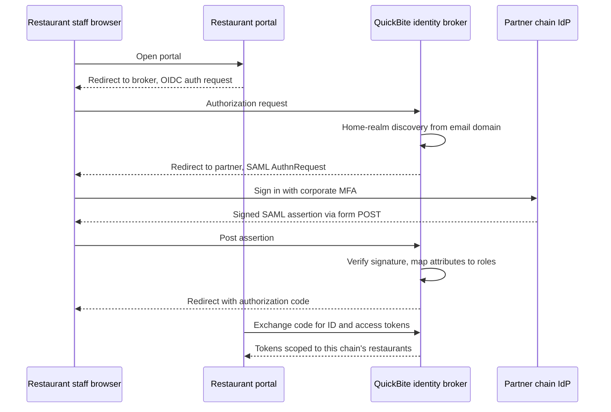

**Reading the diagram.** The portal speaks only OIDC, to one broker. The broker discovers the user's home organization from the email domain, sends the browser to the partner IdP with a SAML request, verifies the returned assertion, maps partner attributes to QuickBite roles, and completes a standard OIDC code flow (§8.14.3). All steps are synchronous redirects except the back-channel code exchange. Failure points: signature validation (XML signature wrapping attacks have broken naive SAML parsers; use a maintained library), attribute mapping that lets a partner claim other chains' restaurants, and the broker as a tier-0 dependency. Scaling: the broker is nearly stateless.

### 50.5.3 Sessions, token lifetimes and revocation at scale

A single user "session" is really several stacked credentials, each with its own lifetime:

1. **IdP session** (hours to days): lets the user get new tokens without re-entering credentials.
2. **Refresh token** (days to weeks): exchanged at the authorization server for new access tokens. Because it is checked against server-side state on every use, it can be revoked immediately.
3. **Access token** (minutes): verified locally by resource servers and therefore hard to revoke before it expires (§8.13.4).

Three techniques keep this safe. **Refresh token rotation** issues a new refresh token on every use; if an old one reappears, two parties hold it, so the server revokes the token family. **Sender-constrained tokens** bind a token to a client key (mTLS-bound tokens or DPoP), so a stolen token is useless alone [RFC 8705; RFC 9449]. **Push revocation** signals, such as the OpenID Continuous Access Evaluation Profile (CAEP), tell resource servers that a session was revoked instead of waiting for expiry [OpenID SSF]. The IETF's OAuth 2.0 Security Best Current Practice recommends rotation or sender-constraining for refresh tokens issued to public clients [RFC 9700].

::: formula
**Token exposure window and refresh load**

$$W_{\max} = T_a, \qquad \mathbb{E}[W] = \frac{T_a}{2}, \qquad L = \frac{N_s}{T_a}$$

| Symbol | Meaning | Units |
|---|---|---|
| $T_a$ | Access-token lifetime | s |
| $W_{\max}$ | Worst-case time a stolen access token stays usable after its session is revoked, with no deny-list or push signal | s |
| $\mathbb{E}[W]$ | Expected remaining usable time if revocation is uniformly distributed over the token's life | s |
| $N_s$ | Concurrently active sessions that refresh continuously | sessions |
| $L$ | Refresh requests per second at the authorization server | requests/s |
:::

::: example
**Worked example — Choosing QuickBite's access-token lifetime.** QuickBite has $N_s = 2{,}000{,}000$ active app sessions at peak.

1. $T_a = 60$ min $= 3{,}600$ s: $W_{\max} = 60$ min, $\mathbb{E}[W] = 30$ min; $L = 2{,}000{,}000 / 3{,}600 = 556$ refreshes/s.
2. $T_a = 5$ min $= 300$ s: $W_{\max} = 5$ min, $\mathbb{E}[W] = 2.5$ min; $L = 2{,}000{,}000 / 300 = 6{,}667$ refreshes/s, 12× the load.
3. Middle option: $T_a = 15$ min plus a push-revocation deny-list propagated within $t_p = 10$ s: $W_{\max} \approx 10$ s for revoked sessions, $L = 2{,}000{,}000 / 900 = 2{,}222$ refreshes/s.

**Interpretation.** Shortening tokens buys exposure reduction linearly with authorization-server load. A revocation signal decouples the two: tokens can stay moderately long while revocation is near-immediate. **Engineering implication:** size the token service for $L$ with headroom (refreshes are bursty after an outage, when every client refreshes at once), and use short lifetimes or push revocation for privileged sessions, where 30 minutes of exposure is unacceptable.
:::

### 50.5.4 Authorization services and policy engines

Authentication answers "who"; authorization answers "may they". In a microservice system, authorization logic scattered through 250 code bases is impossible to audit. The architecture answer is to **externalize** it: services ask a policy decision point, and policy lives as reviewed code.

- **Open Policy Agent (OPA)**, a CNCF graduated project, evaluates policies written in Rego over JSON input; it serves API authorization, Kubernetes admission and infrastructure-as-code checks [OPA Docs].
- **Cedar**, from AWS (open-sourced 2023, used by Amazon Verified Permissions), expresses `permit` and `forbid` statements over principal, action, resource and context, and is designed for automated analysis, such as proving one policy set never permits more than another [Cedar Docs; Cutler et al. 2024].
- **Relationship-based access control (ReBAC)**, as in Google Zanzibar, decides access from a graph of relationships ("user is editor of folder, folder is parent of document"); see §8.12.2. Policy engines and ReBAC combine well: Zanzibar-style tuples answer "is this user related to this object?", and a policy engine adds conditions such as device tier or time of day.

```text
// illustrative Cedar policy for QuickBite's support console
permit (
  principal in Group::"support-tier2",
  action == Action::"viewOrder",
  resource
) when {
  context.device_trust == "high" &&
  resource.region == principal.region
};
forbid (principal, action == Action::"exportOrders", resource)
  unless { context.approved_ticket != "" };
```

What to notice: the `forbid` rule overrides any `permit`, so a bulk export always needs an approved ticket however generous the group grants become; the region condition enforces data residency (§44.9) in the authorization layer as well as in placement.

**Figure 50.7 — Policy-engine deployment with central authoring and local decisions.**

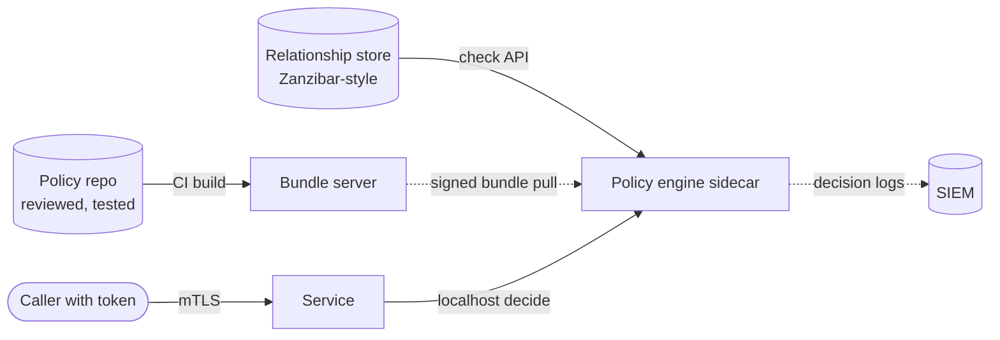

**Reading the diagram.** Policies are reviewed and tested in a repository, and CI compiles them into a signed bundle. Each service runs the engine beside it, pulling bundles asynchronously, so a decision is a sub-millisecond localhost call that survives a bundle-server outage. Relationship checks that need fresh shared data go synchronously to a relationship store. Every decision is logged asynchronously for audit and for detecting anomalous denials. Failure points: stale bundles (alert on bundle age), and the choice between failing open or closed when the engine is unreachable (fail closed for writes and sensitive reads).

### 50.5.5 Privilege escalation paths

Attackers rarely need administrator credentials; they need a chain of ordinary permissions that leads to them. Common chains in cloud and cluster environments:

- **Role passing.** A principal that can create a compute resource (a function or VM) *and* pass a more powerful role to it can run code as that role.
- **Policy self-editing.** Permission to create a new version of a policy attached to oneself is permission to become anything.
- **Workload creation.** In Kubernetes, permission to create pods in a namespace lets you mount any service account in that namespace, or a host path if admission control allows it.
- **Pipeline write access.** Anyone who can edit a CI workflow that deploys to production with a privileged identity has production access (§43.11).

**Figure 50.8 — An escalation path through ordinary permissions.**

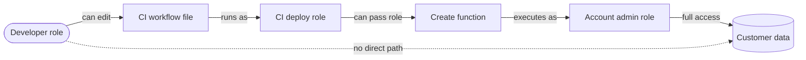

**Reading the diagram.** The developer role has no direct permission on customer data (dotted edge), yet the graph has a path: edit the workflow, which runs as the CI deploy role, which may create a function and pass it the administrator role. Each edge looks harmless in isolation. Failure points: any one of these edges is enough to close the gap, which is why escalation analysis must be done on the *graph*, not on individual policies. Prevention: protected branches and required review on workflow files, deploy roles that can pass only an allow-listed set of roles, and periodic graph analysis (attack-path tools such as BloodHound do this for Active Directory; cloud providers and open-source tools offer equivalents for IAM).

## 50.6 Software supply-chain security

Section 43.11.2 introduced provenance, SBOMs and signing from the pipeline's view. Here we take the attacker's: every artifact is produced by a chain of people, repositories, builders, dependencies and registries, and whoever controls a link controls what you run, with your signature on it.

### 50.6.1 Two published case studies

::: industry
**SolarWinds Orion (2020).** In December 2020 FireEye (now Mandiant) disclosed that trojanized updates of SolarWinds Orion network-management software carried a backdoor it named SUNBURST; CISA issued Emergency Directive 21-01 ordering US federal agencies to disconnect affected Orion versions [FireEye 2020; CISA 2020]. The malicious code was not in SolarWinds' source repository: a separate implant on the build system, which CrowdStrike named SUNSPOT, watched for Orion builds and swapped a source file during compilation, so the output was compiled and signed by SolarWinds' own legitimate process [CrowdStrike 2021]. SolarWinds reported that fewer than 18,000 customers installed affected versions [SolarWinds 2020]. Lesson: code review and code signing do not help if the build machine is compromised; the build itself must be hardened and verifiable.
*Evidence: Primary* — [FireEye 2020]; [CISA 2020]; [CrowdStrike 2021]; [SolarWinds 2020]
:::

::: industry
**xz-utils backdoor, CVE-2024-3094 (2024).** On 29 March 2024 Andres Freund reported a backdoor in versions 5.6.0 and 5.6.1 of xz-utils, a compression library, after noticing that SSH logins on a test system used unusually high CPU and took about half a second longer [Freund 2024]. A contributor had spent roughly two years earning maintainer trust. The malicious build logic was present in the release tarballs but not in the visible Git source, and its payload was hidden in binary test files; on distributions that linked OpenSSH's server to liblzma through libsystemd, it hooked a function used during SSH key verification. CISA advised downgrading to an uncompromised version; the CVE was rated CVSS 10.0, and it was caught mostly before reaching stable distribution releases [CISA 2024; NVD CVE-2024-3094].
*Evidence: Primary* — [Freund 2024]; [CISA 2024]; [NVD CVE-2024-3094]
:::

**Figure 50.9 — How the xz-utils backdoor reached sshd.**

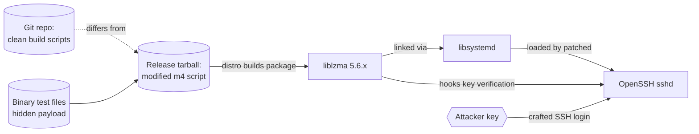

**Reading the diagram.** Distributions built from the release tarball, not the Git tree; the tarball's modified build script extracted a payload from test files and linked it into liblzma. Distribution patches linking sshd to libsystemd pulled liblzma into the SSH server, where the payload intercepted key verification so a holder of the attacker's key could execute commands. Failure points exploited: unreviewed differences between source and release artifacts, binary blobs in the repository, and a single overloaded maintainer. Controls that would have helped: building from the source repository rather than maintainer-made tarballs, reproducible builds that compare the two, and minimizing what a privileged daemon loads.

### 50.6.2 SLSA levels, provenance and SBOMs

SLSA v1.0 organizes build integrity into a **Build track** [SLSA 2023]:

**Table 50.3 — SLSA v1.0 Build levels.**

| Level | Requirement | Threat addressed | Effort |
|---|---|---|---|
| Build L0 | None | — | — |
| Build L1 | Provenance exists, describing how the artifact was built | Mistakes; unknown build origin | Low: generate provenance |
| Build L2 | Hosted build platform generates and signs provenance | Tampering after the build | Medium: move to hosted CI |
| Build L3 | Hardened platform: builds isolated from each other; signing material inaccessible to user-defined build steps | Compromise of one build affecting others; forged provenance | High: hardened builders |

Provenance is commonly expressed as an **in-toto attestation**: a signed statement binding an artifact digest to the builder identity, source repository and commit, and build parameters. An **SBOM** (software bill of materials, in SPDX or CycloneDX format) lists the artifact's components and versions. Provenance answers "who built this from what"; an SBOM answers "what is inside". US Executive Order 14028 (2021) pushed SBOMs into federal procurement, and NTIA published minimum elements for them [NTIA 2021].

#### Mathematical foundations

::: formula
**Probability that at least one dependency is compromised**

$$P_{\text{any}} = 1 - (1 - p)^{n}$$

| Symbol | Meaning | Units |
|---|---|---|
| $P_{\text{any}}$ | Probability that at least one dependency in the tree is malicious during a period | probability |
| $p$ | Probability that a single dependency is compromised during that period | probability |
| $n$ | Number of distinct direct and transitive dependencies | count |
:::

::: example
**Worked example — QuickBite's dependency tree.** A typical QuickBite service image contains $n = 1{,}500$ transitive packages. Assume (illustratively) $p = 10^{-4}$ per package per year.

1. $(1 - 10^{-4})^{1500} = e^{1500 \ln(0.9999)} \approx e^{-0.150} = 0.861$.
2. $P_{\text{any}} = 1 - 0.861 = 0.139$: about a 14% chance per year per service.
3. Halving the tree to 750 packages: $1 - e^{-0.075} = 0.072$.

**Interpretation.** Risk grows almost linearly with dependency count while $np \ll 1$. **Engineering implication:** dependency count is a security metric; prune unused packages, prefer well-maintained libraries with several maintainers, and pin by hash so that a compromised *new* version is not pulled automatically.
:::

### 50.6.3 Signing and verification with Sigstore

Traditional code signing fails in practice because long-lived private keys are lost, shared or stolen. **Sigstore** replaces them with identity-based, keyless signing: the signer authenticates with OIDC, the **Fulcio** certificate authority issues a certificate valid for about ten minutes that binds an ephemeral key to that identity, and the signature is recorded in **Rekor**, a public append-only transparency log, so verification can later prove the signature was made while the certificate was valid [Sigstore Docs].

**Figure 50.10 — Keyless signing in CI and verification at admission.**

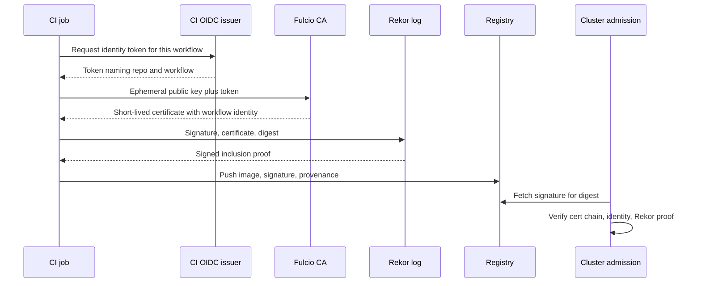

**Reading the diagram.** The CI job proves *which repository and workflow* it is with the CI platform's OIDC token; Fulcio embeds that identity in a short-lived certificate, and the private key lives only in memory. Rekor's inclusion proof lets anyone check the signing event later. At deploy time admission verifies not just "is this signed?" but "signed by `repo:quickbite/payments, workflow: release` from our CI issuer?" Failure points: accepting *any* valid Sigstore signature (anyone can get one for their own identity), and audit-only admission. Verification is cached per digest.

### 50.6.4 Dependency confusion and reproducible builds

**Dependency confusion** exploits package managers that consult both a private and a public registry. If an internal package name such as `quickbite-geo` leaks (in a manifest or error message) and an attacker publishes `quickbite-geo` version 99.0 on the public registry, a resolver that prefers the highest version installs the attacker's package. Birsan demonstrated this in 2021 against dozens of large companies [Birsan 2021]. Defenses: scoped or namespaced package names that you own on the public registry, a single internal proxy registry that resolves internal names only internally, and lockfiles with hashes.

**Reproducible builds** make a build deterministic, so independent parties building the same source get bit-for-bit identical output [Reproducible Builds]. That turns "trust the builder" into "check the builder": a second, independent builder (or a downstream distribution) rebuilds and compares digests. Reproducibility would have flagged both SolarWinds (output differs from a clean rebuild of the source) and xz (tarball differs from the Git tree). It is the practical answer to Thompson's warning that you cannot trust code you did not totally create yourself, compilers included [Thompson 1984].

## 50.7 Detection and response architecture

Prevention fails eventually; detection decides whether a failure costs an afternoon or a year. SolarWinds victims were compromised for months before discovery.

### 50.7.1 Centralized logging and the SIEM

A **security information and event management (SIEM)** system collects security-relevant events from every layer, normalizes them to a common schema, stores them for search and runs detections over them.

**Figure 50.11 — Detection and response pipeline.**

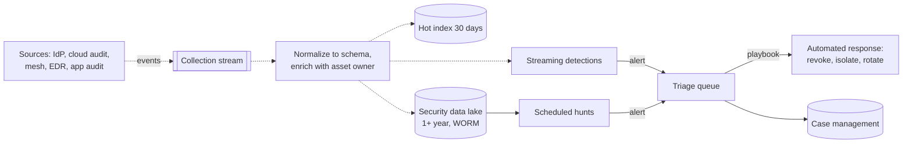

**Reading the diagram.** Sources include identity-provider sign-ins, cloud audit logs (§10.12), service-mesh connection logs, endpoint detection and response (EDR) agents and application audit events. They flow asynchronously through a durable stream, are normalized (for example to the Open Cybersecurity Schema Framework, OCSF) and enriched with asset owner and data classification. A hot index supports investigation; a write-once data lake keeps a year or more for retrospective hunts, because intrusions are often found long after they start. Streaming detections fire within seconds, scheduled hunts cover longer windows, and triage triggers playbooks. Failure points: dropped sources (monitor ingestion volume per source; a silent source is an incident), and cost, which grows with volume (§40.4.4).

### 50.7.2 Detection engineering and base rates

**Detection engineering** treats detections as code: each rule is version-controlled, mapped to an attacker technique (commonly using the MITRE ATT&CK knowledge base), tested against recorded or simulated attack data, and measured for precision. Precision matters because attacks are rare.

::: formula
**Alert precision from base rate**

$$\text{Precision} = \frac{\text{TPR} \cdot \pi}{\text{TPR} \cdot \pi + \text{FPR} \cdot (1 - \pi)}$$

| Symbol | Meaning | Units |
|---|---|---|
| $\pi$ | Fraction of evaluated events that are malicious (base rate) | probability |
| TPR | True-positive rate: fraction of malicious events that alert | probability |
| FPR | False-positive rate: fraction of benign events that alert | probability |
:::

::: example
**Worked example — A "good" rule that drowns analysts.** QuickBite evaluates $10^9$ sign-in and API events per day, of which 100 are malicious ($\pi = 10^{-7}$). A rule has TPR $= 0.99$ and FPR $= 10^{-5}$.

1. True positives: $0.99 \times 100 = 99$ per day.
2. False positives: $10^{-5} \times 10^{9} = 10{,}000$ per day.
3. Precision $= 99 / (99 + 10{,}000) = 0.0098$: under 1% of alerts are real.

**Interpretation.** A 99.999%-specific rule still produces 100 false alarms per true one. **Engineering implication:** run broad rules as low-severity *signals*, then alert on correlations (an impossible-travel sign-in *and* a new MFA device *and* a bulk export by the same identity), and prefer detectors with near-zero false-positive rates, such as honeytokens.
:::

### 50.7.3 Honeytokens

A **honeytoken** is a credential, record or file that no legitimate process ever uses, so any use is an alarm. Examples: a fake cloud access key in a developer configuration file, a fake "admin" row in the customer table, a document named `passwords.xlsx` on a file share, a never-routed DNS name embedded in an internal wiki. Products such as Thinkst Canarytokens generate them and alert on use [Thinkst Canary]. Their FPR is close to zero, which makes them the antidote to the base-rate problem; the cost is placement discipline (they must be where attackers look and nowhere legitimate automation touches).

### 50.7.4 Incident response playbooks and time to detect

NIST SP 800-61 Rev. 3 (2025) organizes incident response around the NIST Cybersecurity Framework 2.0 functions, with preparation and lessons learned feeding detection, response and recovery [NIST SP 800-61r3]. A **playbook** is a pre-agreed, partly automated procedure for one incident type. QuickBite's leaked-credential playbook: identify the principal; revoke its sessions and keys (§50.5.3); query the data lake for everything it did since the credential was created; rotate secrets it could read; notify the data owner if personal data was accessed (§50.9). Incident roles are covered in §39.12.

::: formula
**Dwell time and exposure**

$$\text{MTTD} = \frac{1}{m}\sum_{j=1}^{m} (t^{\text{detect}}_j - t^{\text{start}}_j), \qquad \text{MTTR} = \frac{1}{m}\sum_{j=1}^{m} (t^{\text{contain}}_j - t^{\text{detect}}_j), \qquad E = r \,(\text{MTTD} + \text{MTTR})$$

| Symbol | Meaning | Units |
|---|---|---|
| $m$ | Number of incidents in the sample | count |
| $t^{\text{start}}, t^{\text{detect}}, t^{\text{contain}}$ | Time of compromise, of detection, of containment | timestamp |
| MTTD | Mean time to detect | h |
| MTTR | Mean time to respond (here: detection to containment) | h |
| $r$ | Rate at which an active attacker can access records | records/h |
| $E$ | Expected records exposed per incident | records |
:::

::: example
**Worked example — Where to invest.** QuickBite's last four credential incidents had start-to-detect times of 30, 6, 72 and 12 h, and detect-to-contain times of 2, 1, 5 and 4 h. Assume an attacker with a stolen support credential can read $r = 2{,}000$ customer records per hour (throttled by rate limits).

1. MTTD $= (30 + 6 + 72 + 12)/4 = 120/4 = 30$ h. MTTR $= (2 + 1 + 5 + 4)/4 = 12/4 = 3$ h.
2. $E = 2{,}000 \times (30 + 3) = 66{,}000$ records per incident.
3. Halving MTTR to 1.5 h: $E = 2{,}000 \times 31.5 = 63{,}000$ (−4.5%). Halving MTTD to 15 h: $E = 2{,}000 \times 18 = 36{,}000$ (−45%).
4. Lowering $r$ to 200 records/h with a per-identity export limit: $E = 200 \times 33 = 6{,}600$ (−90%).

**Interpretation.** Detection time dominates, and the one 72-hour incident dominates the mean, so look at the distribution, not just the average. Industry reports put the median *dwell time* in the days to weeks: Mandiant reported a global median of 11 days for incidents it investigated in 2024 [Mandiant 2025]. **Engineering implication:** rate limits on data access (a blast-radius control) and faster detection both beat faster cleanup; measure all three.
:::

## 50.8 Privacy by design

### 50.8.1 Cavoukian's seven principles

Ann Cavoukian, then Information and Privacy Commissioner of Ontario, set out seven foundational principles of **privacy by design** [Cavoukian 2009]. GDPR later made "data protection by design and by default" a legal obligation (Article 25) [EU 2016]. Table 50.4 translates each principle into an engineering practice.

**Table 50.4 — Privacy-by-design principles as engineering practices.**

| Principle | What it means | Engineering practice |
|---|---|---|
| 1. Proactive not reactive; preventative not remedial | Anticipate privacy harms before launch | Privacy review in the design doc, alongside the threat model |
| 2. Privacy as the default setting | The user does nothing to be protected | Opt-in sharing; minimal default retention; coarse location by default |
| 3. Privacy embedded into design | Part of the architecture, not a bolt-on | Classification tags in schemas; purpose checks in the data-access layer |
| 4. Full functionality: positive-sum, not zero-sum | Privacy and features together | Aggregates and differential privacy for analytics (§50.11) |
| 5. End-to-end security: full lifecycle protection | From collection to destruction | Encryption, retention TTLs, verified deletion (§50.9.3) |
| 6. Visibility and transparency | Practices can be verified | Data inventory, processing records, user-facing data download |
| 7. Respect for user privacy: keep it user-centric | Users control their data | Consent management, granular settings, easy deletion |

### 50.8.2 Data inventory and classification

You cannot protect or delete data you cannot find. A **data inventory** records, for every dataset, its owner, personal-data categories, locations and replicas, retention and purposes. Generate it from the systems: schema annotations checked in CI (a column must declare its classification before a migration merges), scanners that sample stores for emails and card numbers, and lineage (Chapter 61) showing which derived tables inherit personal data.

**Table 50.5 — A classification scheme for QuickBite.**

| Class | Examples | Default controls |
|---|---|---|
| Public | Restaurant menus, prices | Integrity only |
| Internal | Service metrics, aggregate order counts | Access by employees |
| Confidential personal | Names, emails, delivery addresses, order history | Field encryption, purpose checks, retention 3 years after last order |
| Restricted | Payment tokens, precise courier location history, health-related dietary notes, government IDs | Tokenization, separate account, short retention, access approval and logging |

### 50.8.3 Purpose limitation

GDPR requires personal data to be collected for specified, explicit and legitimate purposes and not processed further in an incompatible way (Article 5(1)(b)) [EU 2016]. Engineering it means making **purpose** a first-class field: every dataset carries the purposes it was collected for; every access request (a service call, an analytics job, a training pipeline) declares its purpose; and the data-access layer or policy engine (§50.5.4) allows the read only when the two match. For example, courier location collected for "delivery tracking" may be read by the dispatch service, but a marketing job declaring "advertising" is denied, and an analytics job declaring "service improvement" gets only aggregates. The declared purpose is logged with every access, which turns an audit question ("who used location data for what?") into a query.

## 50.9 GDPR and CCPA engineering

::: note
**Note — Architecture, not legal advice.** This section describes how engineers build systems that can meet obligations under the EU General Data Protection Regulation (GDPR, Regulation (EU) 2016/679) and the California Consumer Privacy Act as amended (CCPA). What a specific product must do depends on jurisdiction, facts and counsel's interpretation, and the rules change.
:::

### 50.9.1 Lawful basis tracked as data

GDPR Article 6 permits processing only on one of six lawful bases: consent, performance of a contract, legal obligation, vital interests, public task, and legitimate interests [EU 2016]. Article 30 requires a record of processing activities. Engineers implement both as data rather than as documents, so that systems can check them.

**Figure 50.12 — Data model for purposes, lawful bases and consent.**

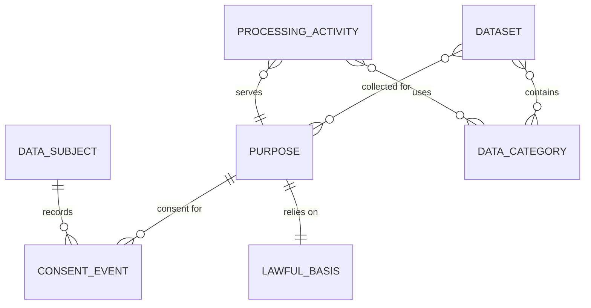

**Reading the diagram.** Each **purpose** (such as "delivery", "fraud prevention", "marketing email") is tied to exactly one lawful basis: delivery relies on contract, fraud prevention on legitimate interests, marketing on consent. **Processing activities** (services and jobs) declare the purposes they serve and the data categories they use, which is the machine-readable Article 30 record. **Consent events** are append-only: each grant or withdrawal is a new row with timestamp, version of the consent text shown, and source, so the current state is the latest event per subject and purpose, and history is provable. Datasets carry their collection purposes, which is what the purpose check in §50.8.3 compares against.

### 50.9.2 Consent management

Consent must be freely given, specific, informed and unambiguous, and as easy to withdraw as to give (GDPR Articles 4(11) and 7) [EU 2016]. A **consent service** owns the ledger, serves low-latency reads ("may I email user 42?") from a replicated cache, and publishes every change as an event so downstream systems stop processing within a bounded time. The CCPA centers instead on notice and the right to opt out of sale or sharing; California's regulations require honoring opt-out preference signals such as Global Privacy Control [CPPA Regulations]. One service can represent both regimes: "purpose × subject → allowed, as of time t, because of event e".

### 50.9.3 Data-subject requests and the deletion pipeline

Data subjects have rights of access (Article 15), erasure (Article 17) and portability (Article 20), among others; controllers must respond without undue delay and in any event within one month, extendable by two further months for complex requests (Article 12(3)) [EU 2016]. The CCPA gives consumers rights to know, delete and correct, with a 45-day response period extendable once by another 45 days [CCPA]. With 250 services, the hard problem is reach: personal data is in primary databases, caches, search indexes, Kafka topics, the data lake, ML feature stores, logs and backups.

**Figure 50.13 — Deletion pipeline across services and backups.**

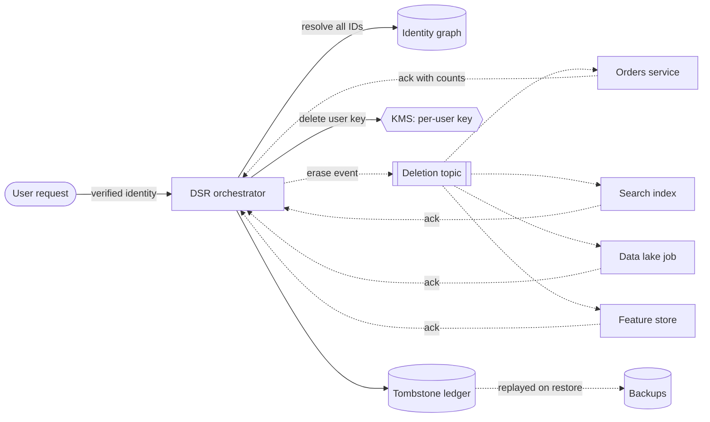

**Reading the diagram.** The orchestrator verifies the requester's identity (a deletion request is also an attack vector), resolves every identifier for the user (account ID, emails, device IDs, payment tokens) and publishes an erase event to a durable topic. Every system holding personal data, as listed in the data inventory, subscribes, deletes or anonymizes, and acknowledges asynchronously with counts; the orchestrator tracks completion and escalates on missing acks. Two mechanisms handle backups, which are immutable by design: **crypto-shredding**, where personal fields are encrypted under a per-user key and deleting the key makes every backup copy unreadable (§10.9, §47.5.4); and a **tombstone ledger** of deleted IDs that is replayed after any restore, so restored data is re-deleted before it serves traffic. Failure points: a new service that never subscribes (require a deletion handler for any dataset tagged personal), and legal holds, which must be explicit exemptions.

::: formula
**Deletion completion time**

$$T_{\text{done}} = \max\!\left(\max_{i} t_i,\; T_{\text{backup}}\right)$$

| Symbol | Meaning | Units |
|---|---|---|
| $t_i$ | Time for online system $i$ to delete and acknowledge | days |
| $T_{\text{backup}}$ | Time until no readable backup contains the data: backup retention, or key-deletion delay with crypto-shredding | days |
| $T_{\text{done}}$ | Time until the data is gone everywhere | days |
:::

::: example
**Worked example — Meeting a one-month deadline.** QuickBite's online systems finish within $t_i \le 2$ days (the data-lake compaction job runs weekly, so it takes up to 7 days; $\max_i t_i = 7$). Backups are retained 35 days.

1. Without crypto-shredding: $T_{\text{done}} = \max(7, 35) = 35$ days, beyond one month, unless the backups are excluded by the tombstone-replay argument, which counsel must accept.
2. With per-user keys and a KMS key-deletion waiting period of 7 days: $T_{\text{backup}} = 7$, so $T_{\text{done}} = \max(7, 7) = 7$ days.

**Interpretation.** The slowest system sets the deadline, and backups are usually the slowest. **Engineering implication:** put personal data in backups only in encrypted form under keys you can destroy, and make batch systems process deletions on a cadence shorter than the legal deadline.
:::

::: industry
**Meta's DELF.** Cohn-Gordon et al. describe DELF, Facebook's framework for deletion correctness: developers annotate how each object type relates to others (whether deleting a user should cascade to their posts, for example), static and dynamic checks catch missing annotations, and deletions run as restartable, logged graph traversals that can be undone for a period if run in error [Cohn-Gordon et al. 2020].
*Evidence: Primary* — [Cohn-Gordon et al. 2020]
:::

Data residency (where personal data may be stored and processed) is a placement constraint covered in §44.9; the deletion pipeline must run in each region, against that region's stores.

## 50.10 Data minimization and de-identification

The safest personal data is data you never collected. **Data minimization** (GDPR Article 5(1)(c)) means collecting only what a purpose needs, coarsening it (city instead of GPS fix, birth year instead of birth date), aggregating early, and deleting on a schedule with TTLs. When data must be shared or analyzed, de-identification reduces what it reveals.

### 50.10.1 Pseudonymization versus anonymization

::: definition
**Definition — Pseudonymization and anonymization.** **Pseudonymization** replaces direct identifiers with pseudonyms such that the data can no longer be attributed to a person *without additional information kept separately* (GDPR Article 4(5)); pseudonymized data is still personal data. **Anonymization** makes re-identification not reasonably likely by any means, taking into account the means reasonably likely to be used (GDPR Recital 26); truly anonymous data falls outside GDPR [EU 2016].
:::

A keyed pseudonym, $\text{HMAC}_K(\text{user\_id})$ with $K$ in a KMS (§10.4.6), lets analysts join datasets on a stable ID without seeing the real one; destroying or rotating $K$ breaks linkability. An unkeyed hash of an email address is *not* adequate pseudonymization: anyone can hash a list of known emails and match them.

**Tokenization** replaces a sensitive value (a card number, a national ID) with a random token; the mapping lives only in a hardened **token vault**. Systems that handle only tokens fall out of the most demanding compliance scope (the PCI DSS cardholder-data environment shrinks to the vault and the payment path). Vaultless variants use format-preserving encryption (NIST SP 800-38G) so a token fits existing 16-digit columns [NIST SP 800-38G].

### 50.10.2 k-anonymity

Removing names is not enough. Sweeney estimated that 87% of the US population was likely uniquely identified by just 5-digit ZIP code, gender and date of birth, and demonstrated the risk by re-identifying a governor's record in "anonymized" hospital data using a voter list [Sweeney 2000; Sweeney 2002]. Attributes that are harmless alone but identifying in combination are **quasi-identifiers**.

::: formula
**k-anonymity**

$$k = \min_{E \in \mathcal{E}} |E|, \qquad P_{\text{re-id}} \le \frac{1}{k}$$

| Symbol | Meaning | Units |
|---|---|---|
| $\mathcal{E}$ | Equivalence classes: groups of rows with identical quasi-identifier values | set of groups |
| $\lvert E \rvert$ | Number of rows in class $E$ | rows |
| $k$ | Size of the smallest class; the table is $k$-anonymous | rows |
| $P_{\text{re-id}}$ | Probability of picking out one person's row by linking on quasi-identifiers alone | probability |
:::

::: example
**Worked example — QuickBite's dietary-preference research extract.** A 10-row extract has quasi-identifiers ZIP, age and gender and a sensitive attribute, dietary note (health-related). Raw, every row is unique: $k = 1$.

1. Generalize ZIP to 3 digits (`021**`, `024**`) and age to decades (`30-39`, `50-59`), keeping gender: classes are (021, 30s, F) = 3, (021, 30s, M) = 3, (024, 50s, F) = 2, (024, 50s, M) = 2 rows. $k = \min(3,3,2,2) = 2$, so $P_{\text{re-id}} \le 1/2$.
2. Also suppress gender: classes (021, 30s) = 6 and (024, 50s) = 4. $k = 4$, $P_{\text{re-id}} \le 0.25$.
3. But all four rows in (024, 50s) have the dietary note "diabetic". Anyone who knows a neighbor in ZIP 024xx in her fifties is in the extract learns her condition with certainty, despite $k = 4$.

**Interpretation.** k-anonymity bounds *row* identification, not *attribute* disclosure. **Engineering implication:** check diversity of the sensitive attribute within each class as well (l-diversity), and treat k-anonymity as a necessary sanity check, not a guarantee.
:::

```python
"""k-anonymity and distinct l-diversity checks on a small released table."""
from collections import defaultdict

ROWS = [  # (zip, age, gender, diet) -- diet is the sensitive attribute
    ("02139", 34, "F", "gluten-free"), ("02138", 36, "F", "diabetic"),
    ("02141", 31, "F", "none"),        ("02139", 38, "M", "none"),
    ("02142", 33, "M", "diabetic"),    ("02138", 35, "M", "gluten-free"),
    ("02445", 52, "F", "diabetic"),    ("02446", 57, "F", "diabetic"),
    ("02445", 55, "M", "diabetic"),    ("02446", 51, "M", "diabetic"),
]
COLS = ("zip", "age", "gender", "diet")


def generalize(row, zip_digits=3, age_band=10, keep_gender=True):
    z, age, g, diet = row
    lo = age // age_band * age_band
    return (z[:zip_digits] + "*" * (5 - zip_digits),
            f"{lo}-{lo + age_band - 1}",
            g if keep_gender else "*",
            diet)


def classes(rows, qi=("zip", "age", "gender")):
    """Group rows into equivalence classes over the quasi-identifiers."""
    idx = [COLS.index(c) for c in qi]
    groups = defaultdict(list)
    for r in rows:
        groups[tuple(r[i] for i in idx)].append(r)
    return groups


def k_anonymity(rows, qi=("zip", "age", "gender")) -> int:
    return min(len(g) for g in classes(rows, qi).values())


def l_diversity(rows, qi=("zip", "age", "gender"), sensitive="diet") -> int:
    s = COLS.index(sensitive)
    return min(len({r[s] for r in g}) for g in classes(rows, qi).values())


def report(name, rows):
    sizes = sorted(len(g) for g in classes(rows).values())
    print(f"{name:<28} classes={len(sizes):>2} sizes={sizes} "
          f"k={k_anonymity(rows)} l={l_diversity(rows)}")


if __name__ == "__main__":
    raw = ROWS
    gen = [generalize(r) for r in ROWS]
    gen_nog = [generalize(r, keep_gender=False) for r in ROWS]
    report("raw", raw)
    report("zip3 + decade", gen)
    report("zip3 + decade, no gender", gen_nog)

    assert k_anonymity(raw) == 1                  # every raw row is unique
    assert k_anonymity(gen) == 2 and l_diversity(gen) == 1
    assert k_anonymity(gen_nog) == 4              # better k ...
    assert l_diversity(gen_nog) == 1              # ... but one class is all "diabetic"
    homog = [g for g in classes(gen_nog).values() if len({r[3] for r in g}) == 1]
    assert len(homog) == 1 and homog[0][0][0] == "024**"
    print("all tests passed")
```

Output (tested with Python 3.13):

```text
raw                          classes=10 sizes=[1, 1, 1, 1, 1, 1, 1, 1, 1, 1] k=1 l=1
zip3 + decade                classes= 4 sizes=[2, 2, 3, 3] k=2 l=1
zip3 + decade, no gender     classes= 2 sizes=[4, 6] k=4 l=1
all tests passed
```

What to notice:

- `classes` is the whole idea: group by the quasi-identifier tuple; $k$ is the smallest group.
- Generalization raises $k$ (1 → 2 → 4) but `l_diversity` stays 1 because one class is homogeneous, which is the **homogeneity attack**.
- The quasi-identifier list is an *input*: if an attacker knows an attribute you did not list, the computed $k$ is meaningless.

### 50.10.3 Failure modes: linkage and high-dimensional data

Beyond homogeneity, k-anonymity fails against **background knowledge** (an attacker who knows the target is not gluten-free narrows a class) and **linkage across releases** (two k-anonymous releases of overlapping data can be intersected). Refinements such as l-diversity and t-closeness address some attribute-disclosure risks [Machanavajjhala et al. 2007; Li et al. 2007], but the deeper problem is dimensionality. In sparse, high-dimensional data, such as purchase histories, ratings or location traces, almost every record is unique, and every attribute is a quasi-identifier.

::: industry
**Netflix Prize de-anonymization.** Netflix released 100 million movie ratings with subscriber names removed for a recommendation contest. Narayanan and Shmatikov showed that an adversary who knows a little about a subscriber can find their record: with 8 movie ratings (of which 2 may be completely wrong) and dates with up to a 14-day error, 99% of records could be uniquely identified; 2 ratings with dates within 3 days sufficed for 68%. Cross-referencing with public reviews on IMDb identified some subscribers and their full rating histories [Narayanan & Shmatikov 2008].
*Evidence: Primary* — [Narayanan & Shmatikov 2008]
:::

For QuickBite, order histories and courier location traces are exactly this kind of data. Releasing them "anonymized" by dropping names is releasing them identified. The robust alternative for statistics is differential privacy.

## 50.11 Differential privacy: an introduction

### 50.11.1 The definition

#### First-principles explanation

Imagine a survey that asks "have you ever ordered from the diabetic menu?" Each person secretly flips a coin: heads, they answer truthfully; tails, they flip again and answer "yes" on heads and "no" on tails. Any individual "yes" is deniable, since it may have come from the coin, yet across 10,000 people the coin's contribution is known and can be subtracted out. That is **randomized response**, and it captures the idea of differential privacy: the output should be almost the same whether or not any one person's data is included, so the output cannot reveal much about any one person.

::: formula
**ε-differential privacy**

$$\Pr[M(D) \in S] \le e^{\varepsilon} \, \Pr[M(D') \in S]$$

for all pairs of datasets $D, D'$ differing in one person's data, and all sets of outputs $S$.

| Symbol | Meaning | Units |
|---|---|---|
| $M$ | Randomized mechanism (the query plus its noise) | — |
| $D, D'$ | Neighboring datasets differing in one individual | datasets |
| $S$ | Any set of possible outputs | — |
| $\varepsilon$ | Privacy-loss parameter; smaller is more private | dimensionless (nats) |
:::

::: example
**Worked example — Reading ε.** At $\varepsilon = 0.1$, $e^{0.1} = 1.105$: including you changes the probability of any output by at most 10.5%. At $\varepsilon = 1$, $e^{1} = 2.72$. At $\varepsilon = 10$, $e^{10} \approx 22{,}000$, a weak worst-case bound. **Implication:** single-digit or smaller ε gives a meaningful per-person guarantee.
:::

The guarantee holds whatever the attacker knows and whatever other data they link with, which is exactly what k-anonymity lacks [Dwork & Roth 2014]. A relaxed form, $(\varepsilon, \delta)$-DP, allows the bound to fail with small probability $\delta$.

### 50.11.2 The Laplace mechanism

For a numeric query $f$, the **sensitivity** $\Delta f = \max_{D, D'} |f(D) - f(D')|$ is the most one person can change the answer. A count has $\Delta f = 1$ if each person contributes at most one row. The **Laplace mechanism** releases $f(D) + Y$ with $Y$ drawn from a Laplace distribution centered on zero, and is $\varepsilon$-DP [Dwork & Roth 2014].

::: formula
**Laplace noise scale and error tail**

$$b = \frac{\Delta f}{\varepsilon}, \qquad \Pr[|Y| > t] = e^{-t/b}, \qquad \mathbb{E}|Y| = b, \qquad t_{95} = b \ln 20$$

| Symbol | Meaning | Units |
|---|---|---|
| $\Delta f$ | Sensitivity of the query | query units (here: people) |
| $\varepsilon$ | Privacy budget spent on this query | dimensionless |
| $b$ | Scale of the Laplace distribution | query units |
| $Y$ | Noise added | query units |
| $t$ | Error threshold | query units |
| $t_{95}$ | Error exceeded with probability 5% | query units |
:::

::: example
**Worked example — A private count.** QuickBite's analytics team wants the number of distinct customers in a district who ordered from the diabetic menu last month. True count: 1,240. Each customer counts once, so $\Delta f = 1$. Budget $\varepsilon = 0.5$.

1. $b = 1 / 0.5 = 2$.
2. Probability the error exceeds 5: $e^{-5/2} = e^{-2.5} = 0.082$.
3. 95% error bound: $t_{95} = 2 \ln 20 = 2 \times 2.996 = 5.99$, so 95% of releases fall within ±6, a relative error of $6/1{,}240 = 0.48\%$.
4. For a district with a true count of 12, the same ±6 is a 50% relative error.
5. At $\varepsilon = 0.1$: $b = 10$, $t_{95} = 30$, which swamps the small district completely.

**Interpretation.** Noise is fixed in absolute size, so DP is cheap for large aggregates and expensive for small groups. **Engineering implication:** design releases around large groups (coarser geography, longer windows), bound each person's contribution so that $\Delta f$ stays small, and never release the raw value alongside the noisy one.
:::

```python
"""Laplace mechanism for a counting query, with empirical error versus epsilon."""
import math
import random


def laplace_noise(scale: float, rng: random.Random) -> float:
    """Sample Lap(0, scale) by inverse-CDF: u ~ U(-1/2, 1/2)."""
    u = rng.random() - 0.5
    while u == -0.5:                      # avoid log(0) at the boundary
        u = rng.random() - 0.5
    return -scale * math.copysign(1.0, u) * math.log(1 - 2 * abs(u))


def private_count(true_count: int, epsilon: float, rng: random.Random,
                  sensitivity: float = 1.0) -> float:
    """Release a count with epsilon-DP: add Laplace noise with b = sensitivity / epsilon."""
    if epsilon <= 0:
        raise ValueError("epsilon must be positive")
    return true_count + laplace_noise(sensitivity / epsilon, rng)


def error_profile(true_count: int, epsilon: float, trials: int = 200_000,
                  t: float = 5.0, seed: int = 7) -> dict:
    """Empirical mean |error| and P(|error| > t), next to their closed forms."""
    rng = random.Random(seed)
    errors = [abs(private_count(true_count, epsilon, rng) - true_count)
              for _ in range(trials)]
    b = 1.0 / epsilon
    return {
        "epsilon": epsilon,
        "b": b,
        "mean_abs_err": sum(errors) / trials,          # theory: b
        "p_err_gt_t": sum(e > t for e in errors) / trials,  # theory: exp(-t/b)
        "p_theory": math.exp(-t / b),
        "err95": sorted(errors)[int(0.95 * trials)],   # theory: b * ln(20)
    }


if __name__ == "__main__":
    print(f"{'eps':>5} {'b':>6} {'mean|err|':>10} {'P(>5) emp':>10} "
          f"{'P(>5) th':>9} {'95% err':>8}")
    for eps in (0.1, 0.5, 1.0, 2.0):
        r = error_profile(true_count=1_240, epsilon=eps)
        print(f"{r['epsilon']:>5} {r['b']:>6.2f} {r['mean_abs_err']:>10.3f} "
              f"{r['p_err_gt_t']:>10.4f} {r['p_theory']:>9.4f} {r['err95']:>8.2f}")
        # Tests: empirical values agree with the closed forms.
        assert abs(r["mean_abs_err"] - r["b"]) / r["b"] < 0.02
        assert abs(r["p_err_gt_t"] - r["p_theory"]) < 0.005
        assert abs(r["err95"] - r["b"] * math.log(20)) / (r["b"] * math.log(20)) < 0.03
    print("all tests passed")
```

Output (tested with Python 3.13):

```text
  eps      b  mean|err|  P(>5) emp  P(>5) th  95% err
  0.1  10.00     10.012     0.6068    0.6065    29.95
  0.5   2.00      2.002     0.0822    0.0821     5.99
  1.0   1.00      1.001     0.0069    0.0067     3.00
  2.0   0.50      0.501     0.0001    0.0000     1.50
all tests passed
```

What to notice:

- The empirical columns match the closed forms: mean absolute error equals $b$, the tail equals $e^{-t/b}$, and the 95th percentile equals $b \ln 20$.
- Error scales as $1/\varepsilon$: every halving of $\varepsilon$ doubles the noise.
- This is a teaching implementation; production libraries also defend against floating-point attacks on naive sampling. Use a vetted DP library.

### 50.11.3 Composition and the privacy budget

::: formula
**Sequential and parallel composition**

$$\varepsilon_{\text{total}} = \sum_{i=1}^{q} \varepsilon_i \;\;\text{(same data)}, \qquad \varepsilon_{\text{total}} = \max_{j} \varepsilon_j \;\;\text{(disjoint partitions)}$$

| Symbol | Meaning | Units |
|---|---|---|
| $q$ | Number of queries answered on overlapping data | count |
| $\varepsilon_i$ | Budget spent by query $i$ | dimensionless |
| $\varepsilon_j$ | Budget spent on disjoint partition $j$ | dimensionless |
:::

::: example
**Worked example — A dashboard that leaks over time.** A dashboard refreshes 4 statistics daily over the same customers, each at $\varepsilon = 0.25$.

1. Per day: $4 \times 0.25 = 1.0$. Per year: $365 \times 1.0 = 365$, a meaningless guarantee ($e^{365}$).
2. Releasing one count per district, where each customer lives in one district, costs $\max = 0.25$ per release, not $0.25 \times$ (number of districts).
3. Instead: publish weekly, 4 statistics at $\varepsilon = 0.1$ each: $52 \times 0.4 = 20.8$ per year, and track it in a **privacy-budget ledger** per dataset.

**Interpretation.** Privacy loss accumulates with every answer. Tighter accounting methods (advanced composition, Rényi DP, zero-concentrated DP) grow more slowly than the simple sum, which is why deployed systems use them. **Engineering implication:** the budget is a finite resource owned by the dataset, not the query author; route all releases through a service that debits it.
:::

### 50.11.4 Central and local models, and deployments

**Figure 50.14 — Central versus local differential privacy.**

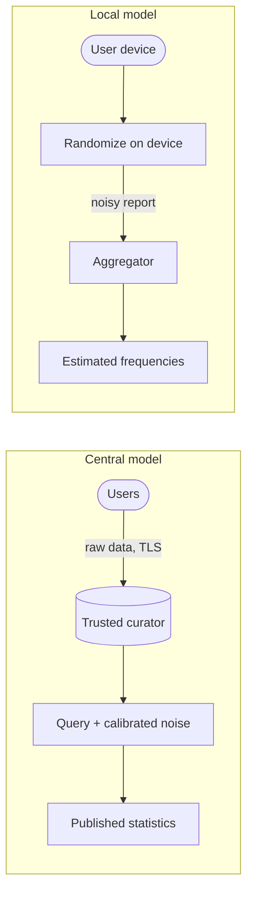

**Reading the diagram.** In the central model, users trust the curator with raw data and noise is added once at release, so accuracy is high for a given $\varepsilon$. In the local model each device randomizes before sending, so the collector never holds raw values, at the price of far more noise: useful estimates need millions of reports. Failure points: the curator's raw store (central), and cumulative budget across repeated reports (local).

::: industry
**Deployed differential privacy.** The **US Census Bureau** protected 2020 Census results with a differentially private disclosure-avoidance system (the TopDown Algorithm), after its own reconstruction experiments on 2010 data showed traditional methods were inadequate [Abowd 2018]; for the redistricting data it set a total privacy-loss budget of ε = 19.61 (17.14 for persons, 2.47 for housing units) [US Census Bureau 2021]. **Google's RAPPOR** collected statistics from Chrome with local DP, using Bloom-filter encoding and two rounds of randomized response, a permanent one per value and a fresh one per report, to limit privacy loss across repeated reports [Erlingsson et al. 2014]. **Apple** describes local DP with per-use-case privacy budgets for features such as emoji and QuickType suggestions [Apple 2017].
*Evidence: Primary* — [Abowd 2018]; [US Census Bureau 2021]; [Erlingsson et al. 2014]; [Apple 2017]
:::

Chapter 71 covers DP for machine learning (DP-SGD), accounting and practical libraries in depth.

## 50.12 Computing on protected data: MPC, homomorphic encryption and confidential computing

Encryption at rest and in transit (§10.9) leaves a gap: data must be decrypted to be *used*, and whoever runs the computation sees it. Three families of techniques narrow that gap.

- **Secure multi-party computation (MPC)** lets parties compute a function of their combined inputs while each learns only the output. In **additive secret sharing**, a value $x$ is split into random shares with $x = (s_1 + s_2 + s_3) \bmod q$. Three restaurants want their average order value without revealing their own: restaurant A's 30 is split as (17, 52, −39), one share per party; each party sums the shares it holds and publishes only that sum, and the three sums add to the total. Multiplications need interaction, so cost grows with circuit depth and round trips.
- **Homomorphic encryption (HE)** allows computation on ciphertexts: the result, decrypted, equals the computation on plaintexts. Partially homomorphic schemes support one operation (Paillier supports addition); **fully homomorphic encryption**, first constructed by Gentry in 2009, supports arbitrary circuits at large slowdowns, commonly orders of magnitude over plaintext [Gentry 2009].
- **Trusted execution environments (TEEs)** use hardware to isolate code and data from the host operating system, hypervisor and cloud operator. **Intel SGX** protects *enclaves* inside a process; **AMD SEV-SNP** and **Intel TDX** protect *whole virtual machines* with memory encryption and integrity; **AWS Nitro Enclaves** carve an isolated VM out of an EC2 instance with no persistent storage, no external network and only a local vsock channel to its parent [AWS Docs: Nitro Enclaves]. All rely on **remote attestation**: the hardware signs a measurement (hash) of the loaded code, and a relying party, such as a KMS key policy that releases a decryption key only to an enclave whose measurement matches an approved build, verifies it before trusting the TEE with secrets.

**Table 50.6 — Comparing techniques for computing on protected data.**

| | MPC | Homomorphic encryption | TEE |
|---|---|---|---|
| Who is trusted | No single party (a threshold must not collude) | Key holder only | Hardware vendor and attested code |
| Performance | Network-bound; often 10–1,000× plaintext | Often 10³–10⁶× plaintext for FHE (as of 2026) | Near native; some overhead on memory and I/O |
| Functionality | Any function, best for simple ones | Limited depth or slow | Arbitrary code |
| Main weakness | Collusion, complexity | Cost, limited operations | Side channels, firmware bugs, vendor trust |
| Operational complexity | High: several organizations operate parties | Medium: libraries, parameter choice | Medium: attestation pipeline, reproducible enclave builds |
| Choose when | Mutually distrusting organizations | Outsourced simple analytics on encrypted data | Protecting data from the operator at near-native speed |

::: industry
**Signal private contact discovery.** Signal described running contact discovery inside SGX enclaves so that the service could match a user's address book against registered users without the operator seeing the address book; clients verify the enclave by remote attestation before sending data [Signal 2017].
*Evidence: Primary* — [Signal 2017]
:::

::: warning
**TEEs move trust; they do not remove it.** Published side-channel attacks against SGX (for example Foreshadow in 2018) and periodic firmware vulnerabilities mean a TEE should be one layer of defense in depth, combined with attestation of *reproducibly built* code, patch tracking of microcode versions in the attestation policy, and minimization of what the enclave holds [Van Bulck et al. 2018].
:::

## 50.13 Security architecture review checklist

Table 10.13 is the per-design checklist for fundamentals. Use Table 50.7 when reviewing an architecture as a whole, or in an interview when asked "how would you secure this?"

**Table 50.7 — Security and privacy architecture review checklist.**

| Area | Review question | Good answer looks like | Section |
|---|---|---|---|
| Layer independence | Which single compromise defeats two layers? | Separate admins, accounts and keys per layer | §50.3.1 |
| Blast radius | What can each service and admin reach? | Reachability graph measured and shrinking | §50.3.3 |
| Zero trust | Where are PEP and PDP? What do they fail to? | Access proxy and mesh; replicated PDP; fail closed | §50.4 |
| Workload identity | How does a new workload get its first credential? | Attestation, SPIFFE SVIDs, hour-scale lifetimes | §50.4.3 |
| Human identity | Workforce and customer identity separate? MFA type? | Separate systems; phishing-resistant MFA for staff | §50.5.1 |
| Sessions | Exposure window of a stolen token? | Short tokens or push revocation; rotated refresh tokens | §50.5.3 |
| Authorization | Where does policy live and who reviews it? | Policy as code, tested; decision logs | §50.5.4 |
| Escalation | Any path from developer to admin? | Graph analysis in CI; protected pipelines | §50.5.5 |
| Supply chain | Can we prove what built each artifact? | SLSA Build L3 provenance; signed; verified at admission | §50.6 |
| Detection | Time to detect a stolen credential? | Correlated detections; honeytokens; MTTD tracked | §50.7 |
| Inventory | Where is every personal-data field? | Generated inventory with classification | §50.8.2 |
| Purpose | Can a job read data outside its purpose? | Purpose checks in access layer; logged | §50.8.3 |
| Data rights | How long until a deletion reaches backups? | Deletion pipeline, crypto-shredding, $T_{\text{done}}$ below deadline | §50.9.3 |
| Releases | Are shared datasets anonymous or just pseudonymous? | DP or aggregates for statistics; no "anonymized" microdata | §50.10, §50.11 |
| Data in use | Does the operator need to see plaintext? | TEE, MPC or HE where justified | §50.12 |

## 50.14 Summary and revision notes

::: summary
- Defense in depth needs independent layers; $\prod p_i$ collapses when one credential spans two layers. Assume breach; measure blast radius as reachability.
- BeyondCorp: access proxy, device inventory, trust inference. NIST SP 800-207: PE and PA (the PDP) and the PEP.
- SPIFFE gives workloads attested, short-lived X.509 or JWT identities; SVID lifetime trades stolen-key exposure against issuer outage budget.
- Keep workforce and customer identity separate; broker federation; choose token lifetimes from $W_{\max} = T_a$ and refresh load $N_s/T_a$, or decouple them with push revocation.
- Externalize authorization into tested policy (OPA, Cedar, ReBAC) and analyze escalation paths as a graph.
- SolarWinds and xz-utils show attacks on builds and releases; SLSA provenance, Sigstore signing, admission verification, hash pinning and reproducible builds answer them.
- Base rates make most rules imprecise; correlate signals and use honeytokens. Detection time usually dominates exposure.
- Privacy by design: inventory, classification and purpose checks in the data-access path; lawful basis and consent as data; deletion as a pipeline reaching backups via crypto-shredding.
- Pseudonymized data is still personal data. k-anonymity fails to homogeneity, background knowledge and high-dimensional linkage (Netflix Prize).
- ε-DP bounds what any output reveals about one person; Laplace noise has scale $\Delta f/\varepsilon$; budgets add under composition and must be tracked.
- MPC, HE and TEEs protect data in use with different trust and performance trade-offs.
:::

## 50.15 Knowledge checkpoint

1. Why does a shared identity-provider administrator weaken defense in depth?
2. Map BeyondCorp's components to NIST SP 800-207's PE, PA and PEP.
3. With SVID lifetime 2 h and renewal at half-life, how long can the issuer be down?
4. Why is refresh token rotation able to detect theft?
5. An access token lives 10 minutes with no deny-list. What are the worst-case and expected exposure after revocation?
6. Why did code signing not stop SUNBURST?
7. A rule has FPR $10^{-4}$ over $10^8$ benign events per day and catches all 10 real attacks. What is its precision?
8. Is HMAC-pseudonymized data anonymous under GDPR?
9. A table is 5-anonymous. Why might it still disclose a sensitive attribute?
10. For a count with $\Delta f = 1$ and $\varepsilon = 0.2$, what is $b$ and $\Pr[|Y| > 10]$?
11. Ten queries each at $\varepsilon = 0.3$ on the same data: what is the total budget by basic composition?
12. Why does crypto-shredding help deletion from backups?

<details><summary>Answers</summary>

1. One compromise defeats several layers at once (MFA enrollment, group membership, device trust), so their failure probabilities no longer multiply.
2. Access control engine = PE; SSO and proxy configuration = PA; access proxy = PEP; device inventory and trust inferer feed the PE.
3. About 1 h: renewal at 1 h, expiry at 2 h.
4. Each refresh token is single-use; a second presentation means two parties hold it, so the server revokes the token family.
5. Worst case 10 minutes; expected 5 minutes.
6. The backdoor was inserted during the build on SolarWinds' own build system, so the legitimate process signed it.
7. False positives $= 10^{-4} \times 10^8 = 10{,}000$; precision $= 10/10{,}010 \approx 0.1\%$.
8. No. It is pseudonymous: re-identification is possible with the key, so it remains personal data.
9. A class can be homogeneous in the sensitive attribute, or background knowledge can narrow it.
10. $b = 1/0.2 = 5$; $\Pr = e^{-10/5} = e^{-2} = 0.135$.
11. $10 \times 0.3 = 3.0$.
12. Data encrypted under a per-user key becomes unreadable everywhere, including immutable backups, once the key is destroyed.

</details>

## 50.16 Interview questions

### Basic

**Q1. What is zero trust, in one minute?**
**Answer.** Network location grants nothing. Every request is authenticated (user, device, workload), authorized per request by a policy decision point using current context, and encrypted, with enforcement points in front of each resource. BeyondCorp is the canonical deployment; NIST SP 800-207 is the reference vocabulary. It complements, rather than removes, segmentation.

**Q2. Pseudonymization versus anonymization?**
**Answer.** Pseudonymization replaces identifiers but remains reversible or linkable with extra information (a key, a lookup table), so it is still personal data. Anonymization makes re-identification not reasonably likely by any means; for rich data that usually requires aggregation with differential privacy rather than removing columns.

### Intermediate

**Q3. Design service-to-service authentication and authorization for 20,000 Kubernetes workloads.**
**Answer.** SPIRE (or a mesh using SPIFFE IDs) with node attestation via cloud identity documents and workload attestation via Kubernetes selectors; X.509-SVIDs of about an hour, renewed at half-life; mTLS everywhere in strict mode. Authorization by per-route policy keyed on SPIFFE ID, enforced by sidecars or a policy engine with locally cached bundles. Size the issuer for availability, not throughput.

**Q4. How would you implement GDPR erasure across 250 microservices?**
**Answer.** An inventory lists every personal dataset and its deletion handler; an orchestrator verifies the requester, resolves identifiers, publishes an erase event and tracks acknowledgements; batch systems delete on a cadence under the deadline; backups rely on per-user-key crypto-shredding plus a tombstone ledger replayed on restore; legal holds are explicit exemptions. Check $T_{\text{done}}$ against one month.

### Advanced

**Q5. Your CI system was compromised for an unknown period. What do you do, and what would you change?**
**Answer.** Assume every artifact built in the window is untrusted: freeze deploys, revoke CI credentials and OIDC trust, rotate every secret CI could read, rebuild from reviewed source on a clean, hardened builder and compare against reproducible rebuilds, and query logs for what the CI identity did. Afterwards: SLSA Build L3 builders, keyless signing bound to workflow identity, admission policies verifying provenance, and protected workflow files.

**Q6. Product wants per-neighborhood demand statistics shared with restaurants weekly. How do you protect customers?**
**Answer.** Release aggregates with central differential privacy, never microdata. Bound each customer's contribution per cell, compute sensitivity, allocate a yearly ε per dataset in a budget ledger, coarsen cells so true counts are large relative to $b \ln 20$, merge small cells, and publish the methodology.

## 50.17 Practical exercises

1. **Laplace error table.** Extend the code in §50.11.2 to sensitivity 5 (a customer may contribute up to 5 orders) and verify that $b$ and the empirical errors scale by 5.
2. **Randomized response.** Implement the coin-flip survey of §50.11.1 for 10,000 people with a true rate of 20%, estimate the rate, and show the estimator is $2\hat{p} - 0.5$. What ε does it provide? (Hint: $\ln 3$.)
3. **l-diversity.** Modify the k-anonymity code to search over generalization levels for the least generalization achieving $k \ge 3$ and $l \ge 2$.
4. **Exposure calculator.** Write a function that takes $T_a$, $N_s$ and revocation propagation time and prints $W_{\max}$, $\mathbb{E}[W]$ and refresh load; reproduce the §50.5.3 example.

## 50.18 Design challenges

1. **Zero trust for couriers.** 600,000 couriers use personal phones. Design device trust, token lifetimes and authorization for the courier app and its location stream without a managed-device fleet.
2. **Privacy-preserving analytics platform.** Design a platform where analysts query order data only through a DP service with budget accounting, purpose checks and audit, and state what queries it refuses.
3. **Confidential payments processing.** Move card tokenization into TEEs so the cloud operator never sees card numbers. Specify attestation, key release policy, reproducible enclave builds and what happens when a microcode vulnerability is announced.

## 50.19 References

1. Adkins, H., et al. *Building Secure and Reliable Systems*. O'Reilly, 2020.
2. Ward, R., Beyer, B. "BeyondCorp: A New Approach to Enterprise Security." *;login:* 39(6), USENIX, 2014.
3. Osborn, B., McWilliams, J., Beyer, B., Saltonstall, M. "BeyondCorp: Design to Deployment at Google." *;login:* 41(1), USENIX, 2016.
4. Cittadini, L., Spear, B., Beyer, B., Saltonstall, M. "BeyondCorp Part III: The Access Proxy." *;login:* 41(4), USENIX, 2016.
5. Rose, S., Borchert, O., Mitchell, S., Connelly, S. *Zero Trust Architecture*. NIST SP 800-207, 2020. https://doi.org/10.6028/NIST.SP.800-207
6. SPIFFE Project. *SPIFFE Standards: SPIFFE ID, X.509-SVID, JWT-SVID, Workload API*; *SPIRE Server Configuration Reference*. https://spiffe.io/docs/latest/
7. Google Cloud. *Application Layer Transport Security* (whitepaper).
8. Istio. *Security concepts* (documentation).
9. Campbell, B., Bradley, J., Sakimura, N., Lodderstedt, T. *OAuth 2.0 Mutual-TLS Client Authentication and Certificate-Bound Access Tokens*. RFC 8705, IETF, 2020.
10. Fett, D., et al. *OAuth 2.0 Demonstrating Proof of Possession (DPoP)*. RFC 9449, IETF, 2023.
11. Lodderstedt, T., Bradley, J., Labunets, A., Fett, D. *Best Current Practice for OAuth 2.0 Security*. RFC 9700, IETF, 2025.
12. OpenID Foundation. *Shared Signals Framework* and *Continuous Access Evaluation Profile* specifications.
13. Open Policy Agent. *OPA documentation*. https://www.openpolicyagent.org/docs/
14. Cedar. *Cedar Policy Language Reference Guide*. https://docs.cedarpolicy.com/
15. Cutler, J. W., et al. "Cedar: A New Language for Expressive, Fast, Safe, and Analyzable Authorization." *Proc. ACM Program. Lang.* (OOPSLA), 2024.
16. FireEye. "Highly Evasive Attacker Leverages SolarWinds Supply Chain to Compromise Multiple Global Victims With SUNBURST Backdoor." FireEye Threat Research blog, 13 December 2020.
17. CISA. *Emergency Directive 21-01: Mitigate SolarWinds Orion Code Compromise*. December 2020.
18. CrowdStrike Intelligence Team. "SUNSPOT: An Implant in the Build Process." CrowdStrike blog, January 2021.
19. SolarWinds Corporation. *Form 8-K*, US Securities and Exchange Commission, 14 December 2020.
20. Freund, A. "backdoor in upstream xz/liblzma leading to ssh server compromise." oss-security mailing list, 29 March 2024. https://www.openwall.com/lists/oss-security/2024/03/29/4
21. CISA. "Reported Supply Chain Compromise Affecting XZ Utils Data Compression Library, CVE-2024-3094." Alert, 29 March 2024.
22. NIST National Vulnerability Database. *CVE-2024-3094*. 2024.
23. OpenSSF. *SLSA Specification v1.0*. 2023. https://slsa.dev/spec/v1.0/
24. NTIA. *The Minimum Elements for a Software Bill of Materials (SBOM)*. US Department of Commerce, 2021.
25. Sigstore. *Sigstore documentation: Fulcio, Rekor, Cosign*. https://docs.sigstore.dev/
26. Birsan, A. "Dependency Confusion: How I Hacked Into Apple, Microsoft and Dozens of Other Companies." Medium, February 2021.
27. Reproducible Builds project. *Definitions and documentation*. https://reproducible-builds.org/
28. Thompson, K. "Reflections on Trusting Trust." *Communications of the ACM* 27(8), 1984.
29. Thinkst. *Canarytokens documentation*.
30. Nelson, A., Rekhi, S., Souppaya, M., Scarfone, K. *Incident Response Recommendations and Considerations for Cybersecurity Risk Management: A CSF 2.0 Community Profile*. NIST SP 800-61 Rev. 3, 2025.
31. Mandiant (Google Cloud). *M-Trends 2025*. 2025.
32. Cavoukian, A. *Privacy by Design: The 7 Foundational Principles*. Information and Privacy Commissioner of Ontario, 2009.
33. European Parliament and Council. *Regulation (EU) 2016/679 (General Data Protection Regulation)*. Official Journal of the European Union L 119, 2016. https://eur-lex.europa.eu/eli/reg/2016/679/oj
34. State of California. *California Consumer Privacy Act of 2018*, Cal. Civ. Code §1798.100 et seq., as amended by the California Privacy Rights Act.
35. California Privacy Protection Agency. *CCPA Regulations*, Cal. Code Regs. tit. 11, §7000 et seq. (including opt-out preference signals).
36. Cohn-Gordon, K., Damaskinos, G., Neto, D., et al. "DELF: Safeguarding Deletion Correctness in Online Social Networks." *USENIX Security Symposium*, 2020.
37. Dworkin, M. *Recommendation for Block Cipher Modes of Operation: Methods for Format-Preserving Encryption*. NIST SP 800-38G, 2016.
38. Sweeney, L. *Simple Demographics Often Identify People Uniquely*. Carnegie Mellon University, Data Privacy Working Paper 3, 2000.
39. Sweeney, L. "k-Anonymity: A Model for Protecting Privacy." *International Journal of Uncertainty, Fuzziness and Knowledge-Based Systems* 10(5), 2002.
40. Machanavajjhala, A., Kifer, D., Gehrke, J., Venkitasubramaniam, M. "ℓ-Diversity: Privacy Beyond k-Anonymity." *ACM Transactions on Knowledge Discovery from Data* 1(1), 2007.
41. Li, N., Li, T., Venkatasubramanian, S. "t-Closeness: Privacy Beyond k-Anonymity and ℓ-Diversity." *IEEE ICDE*, 2007.
42. Narayanan, A., Shmatikov, V. "Robust De-anonymization of Large Sparse Datasets." *IEEE Symposium on Security and Privacy*, 2008.
43. Dwork, C., Roth, A. *The Algorithmic Foundations of Differential Privacy*. Foundations and Trends in Theoretical Computer Science 9(3–4), 2014.
44. Abowd, J. M. "The U.S. Census Bureau Adopts Differential Privacy." *ACM KDD*, 2018.
45. US Census Bureau. "Census Bureau Sets Key Parameters to Protect Privacy in 2020 Census Results." Press release, 9 June 2021. https://www.census.gov/newsroom/press-releases/2021/2020-census-key-parameters.html
46. Erlingsson, Ú., Pihur, V., Korolova, A. "RAPPOR: Randomized Aggregatable Privacy-Preserving Ordinal Response." *ACM CCS*, 2014.
47. Apple Differential Privacy Team. "Learning with Privacy at Scale." *Apple Machine Learning Research*, 2017.
48. Gentry, C. "Fully Homomorphic Encryption Using Ideal Lattices." *ACM STOC*, 2009.
49. Amazon Web Services. *AWS Nitro Enclaves User Guide*.
50. Marlinspike, M. "Technology preview: Private contact discovery for Signal." Signal blog, 2017.
51. Van Bulck, J., et al. "Foreshadow: Extracting the Keys to the Intel SGX Kingdom with Transient Out-of-Order Execution." *USENIX Security Symposium*, 2018.

## 50.20 Open verification items

- SPIRE default X.509-SVID TTL (1 h) and JWT-SVID TTL confirmed only for v1.9.x documentation; check the current release.
- Fulcio certificate validity of about ten minutes (as of 2026).
- Census 2020 redistricting budget (ε = 19.61; 17.14 persons, 2.47 housing units) taken from the June 2021 press release as reported; confirm against the Bureau's technical documentation.
- Mandiant M-Trends 2025 median dwell time of 11 days confirmed only via secondary summaries.
- Exact title, issue and author list of Cittadini et al. 2016 (BeyondCorp access proxy) and the full author list of Cedar (OOPSLA 2024) and DELF (USENIX Security 2020).
- CCPA response periods (45 + 45 days) and opt-out preference signal requirements; regulations change.
- Performance ranges in Table 50.6 for MPC and FHE are order-of-magnitude, workload-dependent estimates.
