# Chapter 51 — Cost-Aware and Sustainable Architecture

> **Level:** 4 · **Track:** Shared · **Estimated reading time:** 5 h

Every architecture has a price, a carbon footprint and a curve that says how both grow with load. Engineers usually hear about the price as a surprise bill, and about the carbon not at all. This chapter treats both as designed properties, like latency or availability: unit economics (§51.4), FinOps practice (§51.5), capacity purchasing (§51.6), engineering levers (§51.7), forecasting (§51.8) and build-versus-buy (§51.9), then energy and carbon metrics (§51.10), carbon-aware design (§51.11), measurement (§51.12) and trade-offs (§51.13).

The running example is again **QuickBite**, the hypothetical food-delivery platform of Chapter 2, at its 2-million-daily-user design point: 500,000 orders a day, or 15 million in a 30-day month (§2.11). Every QuickBite price and quantity is a teaching assumption, not a measurement of a real company or a vendor's price list.

This chapter builds on earlier ones and does not repeat them: capacity planning and peak-to-average ratios (§18.11), the serverless cost curve (§33.9.3 and §48.11), purchase options and a three-tier cost estimate (§41.13), per-tenant metering, showback and margin (§47.11), and the cost of logs, metrics and traces (§40.4.4, §40.5.3).

## 51.1 Learning objectives

After this chapter you should be able to:

- Treat cost as a non-functional requirement, sketch the cost curve of a design choice and name published cases where architecture changed cost by an order of magnitude.
- Build a cost-per-order model from compute, storage, network and third-party API costs, and compute contribution margin.
- Describe the FinOps lifecycle (inform, optimize, operate), its personas, showback versus chargeback, tagging and anomaly detection.
- Choose a commitment level against a fluctuating usage curve, compute coverage, utilization and savings, and verify the choice in code.
- Select the right engineering lever for compute, storage, network, databases and observability, and estimate its effect.
- Write a cost forecast with a sensitivity analysis for a design document.
- Compare build, buy and managed options by total cost of ownership, including engineering time.
- Compute PUE, WUE, operational carbon and embodied carbon, and classify emissions into Scopes 1, 2 and 3.
- Design temporal and spatial carbon-aware scheduling, and compute a Software Carbon Intensity (SCI) score.
- Explain what carbon footprint tools measure and where their estimates are weak.
- Make explicit trade-offs among cost, reliability, latency and carbon.

## 51.2 Prerequisites

- Back-of-the-envelope estimation and QuickBite's load — §2.11 (all unit costs are divided by these volumes).
- Capacity planning, headroom and peak-to-average ratio — §18.11 (commitments are bought against the same curves).
- The serverless break-even model — §33.9.3 (the first cost curve of this chapter).
- Cloud purchase options, data-transfer pricing and the three-tier estimate — §41.10.3, §41.13 (the price vocabulary).
- Storage classes and lifecycle rules — §15.9 (storage tiering).
- Log volume and metric cardinality — §40.4.4, §40.5.3 (observability cost).
- Metering and cost allocation per tenant — §47.11 (showback and chargeback mechanics).
- Bin packing and resource reclamation — §46.7, §46.5.4 (utilization, the largest efficiency lever).
- Kafka replication — Chapter 31 (the build-versus-buy example).

Units: KB, MB, GB, TB are powers of ten. A month is 30 days (720 hours) unless a price is quoted per 730-hour month, as in §41.13. kWh is kilowatt-hours; gCO₂e is grams of carbon dioxide equivalent. All prices are illustrative and dated "as of 2026".

## 51.3 Why cost is an architectural property

### 51.3.1 Cost as a non-functional requirement

::: definition
**Definition — Cost as a non-functional requirement.** A **cost requirement** is a measurable bound on what a system may spend to deliver its function, stated per unit of business value (for example, "infrastructure cost at most \$0.01 per order at 15 million orders a month") rather than as a total. Like a latency or availability objective, it is set during requirements, checked in design review and monitored in production.
:::

#### First-principles explanation

Think of two restaurants with the same menu. One cooks every dish to order on a separate stove; the other preps sauces in bulk each morning. Both serve the same food, but their costs respond differently to a busy Saturday: the first needs more stoves and cooks, the second mostly more plates. The menu (the function) does not tell you which kitchen is cheaper. The *kitchen design* does.

Software works the same way. Two designs that pass the same tests can differ tenfold in cost, because structure sets cost: network hops per request, data copied, idle capacity and per-call fees. Changing a deployed structure takes months, so cost belongs in the design.

#### Why does this exist?

On premises, cost was a yearly capital decision made by people who bought servers. In the cloud, every engineer who merges code makes a spending decision billed by the second; spending authority moved to engineering, but cost feedback did not move with it [Storment and Fuller 2023]. The major cloud architecture frameworks made cost optimization, and later sustainability, pillars alongside reliability and security [AWS Well-Architected: Cost Optimization Pillar; Google Cloud Architecture Framework; Azure Well-Architected Framework].

#### How it works internally

1. **State the cost requirement per unit** (§51.4), derived from what the product earns per order, user or GB.
2. **Model each alternative's cost curve** against the main load driver, separating fixed from variable parts.
3. **Compare on the curve, not at one point**: the cheaper design at launch may be the expensive one at ten times the load (§33.9.3).
4. **Record the model and forecast in the design document** (§51.8); monitor unit cost in production and revisit the design at each crossover.

### 51.3.2 Cost curves of design choices

Every design choice has a characteristic **cost curve**, monthly cost as a function of load. Four shapes recur:

1. **Step-fixed.** Provisioned servers, reserved databases and dedicated clusters cost the same at 10% and at 90% load, then jump when you add a node. Cheap per unit when full, expensive when idle.
2. **Linear per use.** Functions, per-request managed services and third-party APIs cost nearly zero at zero load and grow in proportion to it. Cheap when idle, expensive at sustained high volume.
3. **Superlinear.** Designs whose per-request work grows with load: all-to-all communication, fan-out per follower, cross-zone chatter that grows with replica count, or metric series that multiply with labels (§40.5.3).
4. **Sublinear.** Designs that amortize work: caches whose hit ratio rises with traffic, batch pipelines, CDNs, and the volume discounts in tiered price sheets.

**Figure 51.1 — Cost curve shapes and the design choices that produce them.**

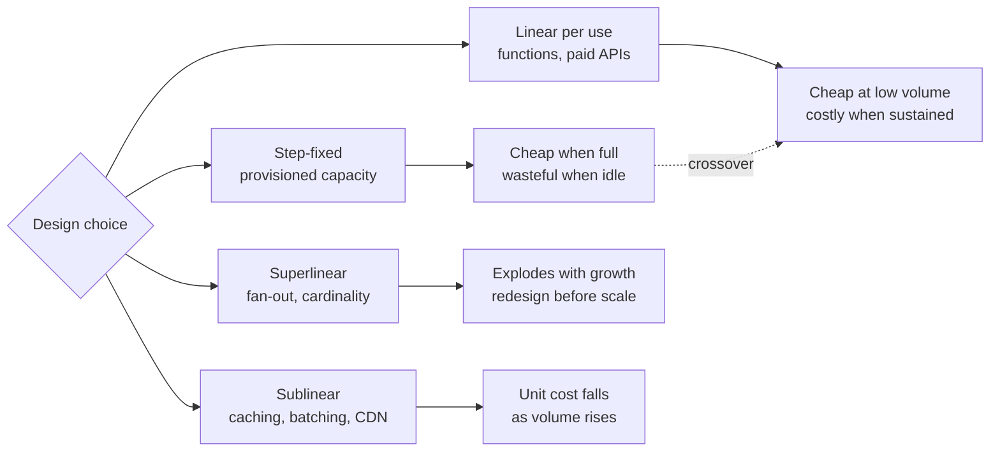

**Reading the diagram.** The diamond is the design decision; the middle column holds the four curve shapes and the right column their consequences. The dotted arrow is the step-fixed versus linear crossover that §33.9.3 computed for serverless. The failure point is superlinear growth, which no purchasing discount rescues; scaling safely means knowing each component's shape and crossovers.

#### Mathematical foundations

The simplest useful model splits cost into a fixed part and a variable part.

::: formula
**Fixed-plus-variable cost and unit cost**

$$C(N) = F + v\,N \qquad u(N) = \frac{C(N)}{N} = \frac{F}{N} + v \qquad N^{*} = \frac{F_A - F_B}{v_B - v_A}$$

| Symbol | Meaning | Units |
|---|---|---|
| $C(N)$ | Total cost for the period at volume $N$ | \$/month |
| $F$ | Fixed cost that does not change with volume over the period | \$/month |
| $v$ | Variable cost per unit of volume | \$/unit |
| $N$ | Volume (requests, orders, GB) in the period | units/month |
| $u(N)$ | Unit cost | \$/unit |
| $N^{*}$ | Crossover volume at which designs A and B cost the same ($F_A > F_B$, $v_A < v_B$) | units/month |
:::

::: example
**Worked example — Where does pay-per-use stop paying?** QuickBite's tablet notifications can run on (A) two always-on containers and a broker, $F_A = \$400$/month, $v_A = \$0.10$ per million messages, or (B) a managed push service, $F_B = 0$, $v_B = \$1.00$ per million (illustrative prices).

1. Crossover: $N^{*} = 400/(1.00 - 0.10) = 444$ million messages a month.
2. Today, 60 million: A costs $400 + 6 = \$406$; B costs \$60.
3. After a live-status feature, 2 billion: A costs $400 + 200 = \$600$ ($u = \$0.30$ per million); B costs \$2,000.

**Interpretation.** Each design is cheaper on one side of 444 million. **Engineering implication.** Record the crossover in the design document; when the forecast (§51.8) reaches it within a year, prepare the migration while it is still a two-way door (§2.8.2).
:::

### 51.3.3 Published examples where architecture changed cost

**Table 51.1 — Published cases where an architectural change moved cost by a large factor.**

| Case | Change | Reported effect | Evidence |
|---|---|---|---|
| Prime Video stream monitoring | Distributed functions and orchestration consolidated into one process on containers | Infrastructure cost reduced by about 90% (≈10×) | Primary [Kolny 2023]; see §33.9.3 |
| Dropbox storage | Most user data moved from a third-party cloud to its own custom storage infrastructure | About \$74.6 million lower operating cost over 2016–2017 | Primary [Dropbox 2018] |
| Google datacenter fleet | Facility design for low overhead (cooling, power distribution) | Fleet trailing-twelve-month PUE about 1.09 in 2024, against an industry survey average near 1.56–1.58 | Primary [Google: Data Center Efficiency]; [Uptime Institute 2024] |

**Figure 51.2 — The Prime Video monitoring service before and after consolidation, as described by the team.**

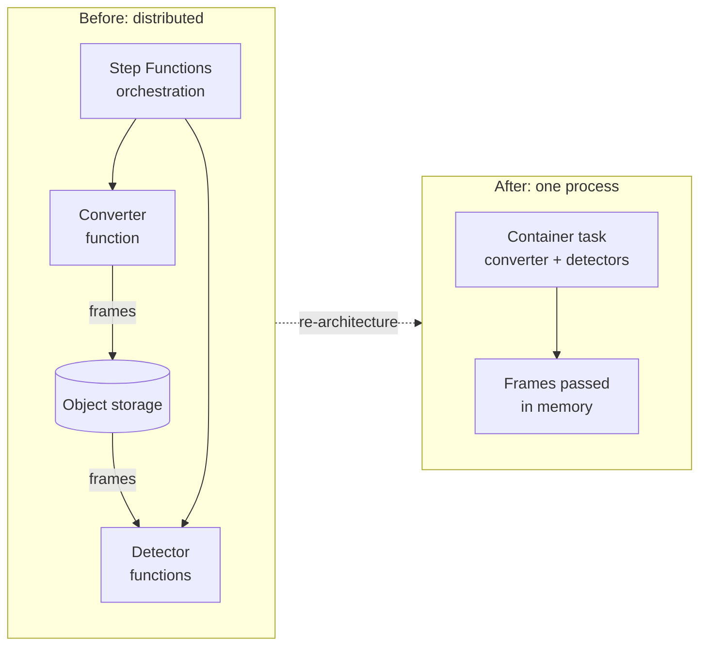

**Reading the diagram.** Originally (left), an orchestrator invoked converter and detector functions, and frames traveled between them through object storage, so every transition and storage request carried a per-use charge and a round trip. After consolidation (right), one container task holds all components and frames stay in memory: the storage boundary leaves the hot path, and with it the dominant cost, which fell by about 90% [Kolny 2023]. The trade-off: scaling means running more tasks, and a detector fault now shares a process with the others. The cost curve of §33.9.3 predicts this crossover at sustained volume.

::: industry
**Dropbox's move to its own storage infrastructure.** Dropbox's 2018 registration statement described an "infrastructure optimization" that migrated the large majority of user data from a third-party provider to its own custom-built infrastructure in colocation facilities, reporting reductions in operating cost of about \$39.5 million in 2016 and \$35.1 million in 2017. At Dropbox's scale, storage was a large share of the cost of revenue, and a specialized system beat a general-purpose service once a dedicated team was affordable. §51.9 turns this into a build-versus-buy calculation.
*Evidence: Primary* — [Dropbox 2018]; figures as reported, not independently audited here.
:::

#### Common misconceptions

::: mistake
**"Cost is an operations problem; we will optimize later."** Purchasing discounts and rightsizing (§51.6, §51.7) typically remove tens of percent. Architectural choices, such as how many hops a request takes or whether an API is called per listing or per order, move cost by factors of ten. Only design review can catch those, and only before the design is built.
:::

::: mistake
**"The cheapest design is the one with the lowest bill today."** A design is cheap only relative to a load. Compare cost curves across the forecast range and note the crossovers; otherwise you lock in the design that is cheapest at launch and most expensive at success.
:::

## 51.4 Unit economics

### 51.4.1 Cost per unit of value

::: definition
**Definition — Unit cost and unit economics.** A **unit cost** is the cost of delivering one unit of business value: one request, one active user, one order, one GB stored or one model inference. **Unit economics** compares that cost with the revenue the same unit earns. The **contribution margin** of a unit is its revenue minus every cost that varies with it; it is what the unit contributes toward fixed costs and profit.
:::

#### First-principles explanation

A bill that doubles is good news if orders tripled and bad news if they stayed flat. Dividing by a business driver turns a bill into a rate you can compare across months, teams and designs, as dividing distance by time gives speed. The denominator should be something the business sells and that drives cost: orders for QuickBite, seats for SaaS, GB-months for storage, minutes for video. Engineers cannot act on "the cloud bill is \$485,000"; they can act on "routing costs two cents per order, 62% of technology cost". The FinOps Foundation framework treats unit economics as the bridge between cost data and business value [FinOps Foundation: Framework].

#### How it works internally

1. **Choose the unit** (orders and active users for QuickBite).
2. **Collect all costs**: tagged cloud bill, third-party invoices, licences and, for a full picture, engineering time.
3. **Allocate shared costs** by a measured driver (CPU-seconds, bytes) with the formula of §47.11.2.
4. **Split fixed from variable** (§51.3.2): the always-on floor, control planes and non-production environments are fixed.
5. **Report variable cost per unit and fixed cost separately**, and alert on the trend, so growth alone does not hide a regression.

### 51.4.2 Worked model: QuickBite's cost per order

**Figure 51.3 — QuickBite cost-per-order model: from cost lines to unit cost and contribution margin.**

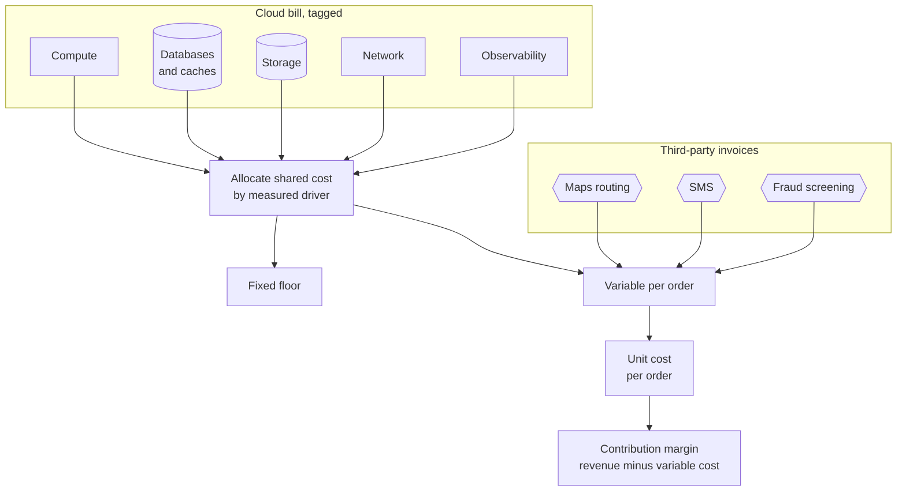

**Reading the diagram.** The tagged cloud bill and third-party invoices (hexagons) feed the model. Cloud lines pass through allocation, which splits shared resources by a measured driver into a fixed floor and per-order cost; per-call third-party costs go straight to the variable bucket. Variable cost per order gives unit cost; revenue minus variable cost gives contribution margin. The weak link is allocation of untagged and shared resources (§51.5.3).

::: example
**Worked example — QuickBite's monthly technology cost per order.** Volume: 15 million orders a month (§2.11). Cloud costs are illustrative totals for the 2-million-user design point; third-party prices are QuickBite assumptions, including the \$0.005 routing call of §2.4.

**Table 51.2 — QuickBite monthly technology cost model (illustrative).**

| Line | Driver | Monthly cost | Per order |
|---|---|---|---|
| Compute (Kubernetes nodes for all services) | vCPU-hours | \$46,000 | \$0.00307 |
| Databases and caches | instance-hours, IOPS | \$24,000 | \$0.00160 |
| Storage (images, backups, cold logs) | GB-months | \$5,000 | \$0.00033 |
| Network (CDN, egress, cross-zone, NAT) | GB transferred | \$11,000 | \$0.00073 |
| Observability (logs, metrics, traces) | GB ingested, series | \$9,000 | \$0.00060 |
| **Cloud subtotal** | | **\$95,000** | **\$0.00633** |
| Maps routing: 4 calls per order × \$0.005 | calls | \$300,000 | \$0.02000 |
| SMS: 0.3 messages per order × \$0.008 | messages | \$36,000 | \$0.00240 |
| Fraud screening: 90% card orders × \$0.004 | checks | \$54,000 | \$0.00360 |
| **Third-party subtotal** | | **\$390,000** | **\$0.02600** |
| **Total technology cost** | | **\$485,000** | **\$0.03233** |

Step by step:

1. Cloud per order: $95{,}000 / 15{,}000{,}000 = \$0.00633$.
2. Maps: $4 \times 0.005 = \$0.020$ per order; $0.020 \times 15 \times 10^{6} = \$300{,}000$.
3. SMS: $0.3 \times 0.008 = \$0.0024$; fraud: $0.9 \times 0.004 = \$0.0036$. Third-party total: $0.020 + 0.0024 + 0.0036 = \$0.026$ per order.
4. Total: $0.00633 + 0.026 = \$0.0323$ per order, or \$485,000 a month.

**Interpretation.** Third-party APIs are 80% of technology cost; the entire cloud bill is less than a third of the routing invoice. **Engineering implication.** The best cost lever is not instance purchasing but routing-call discipline: caching route estimates per zone pair, or calling once per order instead of four times, saves more than eliminating the cloud bill entirely.
:::

Now suppose \$38,000 of the cloud subtotal is a fixed floor (zone-safe minimum fleet, control planes, non-production, baseline observability). The variable part is $(95{,}000 - 38{,}000)/15 \times 10^{6} = \$0.0038$ per order. With the formula of §51.3.2, unit technology cost is $u(N) = 38{,}000/N + 0.0038 + 0.026$:

- At 1.5 million orders a month (the pilot): $0.0253 + 0.0038 + 0.026 = \$0.0551$.
- At 15 million: \$0.0323.
- At 60 million: $0.00063 + 0.0038 + 0.026 = \$0.0304$.

Unit cost falls as fixed cost is amortized, then flattens at a variable floor of about three cents that only design changes can lower.

### 51.4.3 Contribution margin

::: formula
**Contribution margin per unit**

$$CM = P - \sum_{k} V_k \qquad CMR = \frac{CM}{P} \qquad \text{Break-even units} = \frac{F_{\text{total}}}{CM}$$

| Symbol | Meaning | Units |
|---|---|---|
| $P$ | Revenue the company keeps per unit (net of pass-through amounts) | \$/unit |
| $V_k$ | Each cost that varies per unit (labor, payment fees, technology, support) | \$/unit |
| $CM$ | Contribution margin per unit | \$/unit |
| $CMR$ | Contribution margin ratio | fraction |
| $F_{\text{total}}$ | Total fixed costs of the business for the period | \$/month |
:::

::: example
**Worked example — QuickBite's margin per order, and an architecture that destroys it.** Illustrative assumptions: average basket \$30, QuickBite commission 20% (\$6.00) plus a \$2.50 delivery fee, so $P = \$8.50$. Variable costs: courier pay \$5.20; card processing 2.5% of the \$32.50 charged plus \$0.15, which is \$0.96; support and refunds \$0.45; technology \$0.032 (Table 51.2).

**Table 51.3 — QuickBite contribution margin per order (illustrative).**

| Item | Good design | Per-listing routing design |
|---|---|---|
| Revenue kept, $P$ | \$8.50 | \$8.50 |
| Courier pay | −\$5.20 | −\$5.20 |
| Payment processing | −\$0.96 | −\$0.96 |
| Support and refunds | −\$0.45 | −\$0.45 |
| Technology | −\$0.032 | −\$12.01 |
| **Contribution margin** | **\$1.86** | **−\$10.12** |

1. Good design: $8.50 - 5.20 - 0.96 - 0.45 - 0.032 = \$1.858 \approx \$1.86$; $CMR = 1.858/8.50 = 21.9\%$.
2. The design rejected in §2.4 asked the maps provider for a live route time for each of 20 restaurants on every browse page. QuickBite serves 30 browse reads per user per day and 0.25 orders, so 120 browse reads per order. Routing calls per order: $120 \times 20 = 2{,}400$, costing $2{,}400 \times 0.005 = \$12.00$.
3. Technology then becomes $0.032 - 0.020 + 12.00 = \$12.01$ per order, and the margin $1.858 + 0.020 - 12.00 = -\$10.12$.
4. If QuickBite's fixed costs (staff, offices, marketing) were \$2 million a month, the good design breaks even at $2{,}000{,}000/1.858 \approx 1.08$ million orders a month; the bad design never does.

**Interpretation.** With a sensible design, technology is under 2% of the variable cost of an order, and labor dominates. One unbounded per-call dependency turned that 2% into a loss larger than the revenue. **Engineering implication.** Put per-unit third-party calls in the design review checklist, and compute cost per business unit for each design alternative, not cost per request.
:::

::: mistake
**"Cost per request is the unit cost."** Requests are an implementation detail. A client redesign that sends three requests where it used to send one improves cost per request and worsens cost per order. Measure per business unit and use per-request cost only for engineering diagnosis.
:::

## 51.5 FinOps practice

### 51.5.1 What FinOps is

::: definition
**Definition — FinOps.** **FinOps** (cloud financial operations) is an operational practice in which engineering, finance, product and leadership collaborate to make data-driven spending decisions on variable, usage-based technology costs, so that the organization gets the most business value per unit spent. The FinOps Foundation organizes the practice into a repeating lifecycle of three phases (**inform**, **optimize** and **operate**), a set of personas, and capabilities grouped into domains [FinOps Foundation: Framework; Storment and Fuller 2023].
:::

#### First-principles explanation

In a shared house with one electricity meter and one person paying, nobody turns off the heater. Put a live meter in each room, agree who pays for what, and review the bill monthly, and consumption falls without orders. FinOps does this for the cloud. Its goal is value per dollar, not cutting: spending more on a feature that earns more is a FinOps success.

#### How it works internally

**Figure 51.4 — The FinOps lifecycle: inform, optimize, operate.**

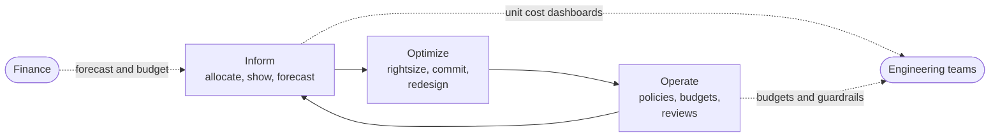

**Reading the diagram.** The phases form an endless loop, and different services may be at different phases. **Inform** turns billing data into allocated cost and forecasts; **optimize** acts on it (rightsizing, commitments, redesign); **operate** embeds results in budgets, policies and review cadences. Dotted arrows are asynchronous information flows to engineering and from finance. The failure point is a loop that stops at inform, with dashboards nobody acts on. Maturity grows per capability as **crawl, walk, run** [Storment and Fuller 2023].

**Table 51.4 — FinOps personas and what each needs (after the FinOps Foundation framework).**

| Persona | Main question | Needs from the practice |
|---|---|---|
| FinOps practitioner | Is spend allocated, understood and improving? | Clean billing data, tagging coverage, a cadence |
| Engineering | What does my service cost and how do I lower it? | Near-real-time cost per service, levers, anomaly alerts |
| Finance | Will we hit the budget? | Accurate forecasts, accruals, chargeback data |
| Product | What does a unit cost, and is the feature worth it? | Unit economics, margin by feature or tenant |
| Procurement | What should we commit to and negotiate? | Usage trends, commitment coverage and utilization |
| Leadership | Is cloud spend creating value? | Unit-cost trends, efficiency targets, accountability |

### 51.5.2 Showback and chargeback

Chapter 47 defined **showback** (reporting attributed cost to a team or tenant) and **chargeback** (billing it to their budget) and gave the allocation formula (§47.11.2). The organizational choice between them is a FinOps decision.

**Table 51.5 — Showback versus chargeback.**

| Aspect | Showback | Chargeback |
|---|---|---|
| What it is | Cost reported to the consuming team | Cost debited from the consuming team's budget |
| Behavioral effect | Awareness; peer comparison | Direct accountability; strong incentive |
| Data accuracy needed | Approximate allocation is acceptable | Must be auditable and defensible |
| Shared-cost handling | Can show "unallocated" openly | Needs agreed rules for every shared dollar |
| Risk | Ignored if no one owns action | Gaming, disputes, teams avoiding shared platforms |
| Choose when | Early maturity, platform adoption phase | Mature allocation, teams own budgets |

Start with showback; charging back before allocation is trusted produces arguments about rules instead of engineering changes.

### 51.5.3 Tagging and allocation strategy

A **tag** (a label in Google Cloud and Kubernetes) is a key–value pair on a resource that billing exports carry; tags turn a bill into per-team and per-service cost.

**Table 51.6 — A minimal tagging scheme for QuickBite.**

| Key | Example value | Used for |
|---|---|---|
| `cost-center` | `cc-4120` | Finance mapping, chargeback |
| `team` | `dispatch` | Showback, ownership, anomaly routing |
| `service` | `order-api` | Unit cost per service |
| `env` | `prod`, `staging`, `dev` | Non-production waste, scheduling off-hours |
| `product` | `consumer-app` | Unit economics per product |
| `data-class` | `pii`, `public` | Retention and security policy (not cost, but enforced together) |

Four rules make tagging work:

1. **Enforce at creation**: infrastructure-as-code modules set tags (§43.8), and policies deny untagged production resources.
2. **Use account and project structure first**: one account per team and environment allocates even untaggable resources.
3. **Allocate what cannot be tagged** (shared clusters, support, commitment discounts) by measured usage, such as namespace CPU and memory requests (§47.11.2).
4. **Measure coverage**: the share of spend allocated each month, with 90% or more a common mature target.

The FinOps Foundation's **FOCUS** specification (FinOps Open Cost and Usage Specification) standardizes billing-export columns across providers, so one pipeline can read several clouds and SaaS vendors [FinOps Foundation: FOCUS].

**Figure 51.5 — A cost data pipeline: billing export to showback, forecasts and anomaly alerts.**

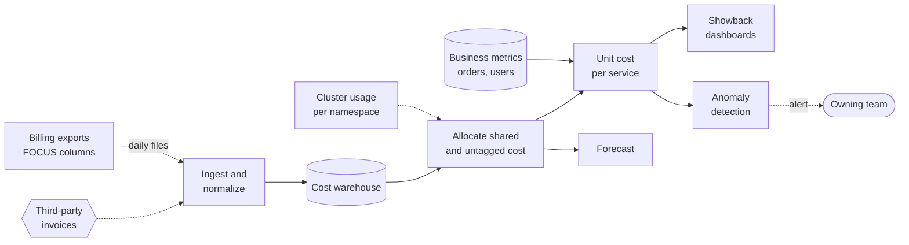

**Reading the diagram.** Billing exports and invoices arrive asynchronously (dotted), typically daily with hours of lag, and are normalized into a cost warehouse, the storage boundary. Allocation adds per-namespace cluster usage; joining business metrics gives unit cost per service, which feeds dashboards, forecasts and anomaly alerts routed by the `team` tag. Failure points: billing lag delays detection by up to a day, and missing tags send cost to "unallocated". Large estates produce billions of line items a month, so the warehouse must scale.

### 51.5.4 Anomaly detection

A **cost anomaly** is spending that departs from the expected pattern: a recursive trigger, a forgotten load test, DEBUG logging left on. It is cheap to catch in a day and expensive in a month.

::: formula
**A simple cost anomaly score**

$$z_t = \frac{c_t - \hat{c}_t}{\sigma_t} \qquad \text{alert if } z_t > k \text{ and } c_t - \hat{c}_t > A_{\min}$$

| Symbol | Meaning | Units |
|---|---|---|
| $c_t$ | Observed cost of a service on day $t$ | \$/day |
| $\hat{c}_t$ | Expected cost: same weekday's median over recent weeks, scaled by business volume | \$/day |
| $\sigma_t$ | Robust spread of recent residuals (for example 1.4826 × median absolute deviation) | \$/day |
| $k$ | Threshold in standard deviations | dimensionless |
| $A_{\min}$ | Minimum absolute excess worth an alert | \$/day |
:::

::: example
**Worked example — Catching a DEBUG log level.** QuickBite's observability spend for the `dispatch` team is normally \$300/day on a Tuesday, with a robust spread of \$25. A deployment leaves DEBUG logging on, and Tuesday's cost is \$520. Threshold $k = 4$, $A_{\min} = \$100$.

1. $z = (520 - 300)/25 = 8.8 > 4$.
2. Excess $= \$220 > \$100$, so the alert fires.
3. If unnoticed for a 30-day month: $220 \times 30 = \$6{,}600$, which is 73% of the whole monthly observability line of Table 51.2.

**Interpretation.** The two-part test ignores large relative jumps in tiny services and noise in huge ones. **Engineering implication.** Scale $\hat{c}_t$ by business volume so a promotion is not an anomaly, and alert the owning team, not a central inbox.
:::

#### Failure scenarios

**Table 51.7 — FinOps practice failure scenarios.**

| What goes wrong | Why | Detection | Recovery | Prevention |
|---|---|---|---|---|
| Dashboards nobody reads | No owner or cadence | Flat unit cost, no tickets | Monthly cost review per team | Make unit cost part of service reviews |
| 30% of spend "unallocated" | Untagged resources, shared clusters | Coverage metric | Allocate by usage; fix modules | Deny untagged creation |
| Runaway bill over a weekend | Recursive trigger, loop, test left running | Anomaly alert, budget alarm | Disable trigger; set quota | Hard quotas in non-production |
| Optimization harms reliability | Cuts removed redundancy | SLO burn after cost change | Restore capacity | Review cost changes against SLOs (§51.13) |

::: mistake
**"FinOps is a finance team's job."** Finance can see the bill but cannot change it; only engineers can. FinOps succeeds when the people who write and deploy code see the cost of what they run, in their own tools, within a day.
:::

## 51.6 Capacity purchasing strategy

### 51.6.1 The commitment portfolio

::: definition
**Definition — Commitment portfolio, coverage and utilization.** A **commitment portfolio** is the mix of purchase options that serves a workload: commitments (reserved instances, savings plans, committed-use discounts) for the steady base, on-demand for the variable middle, and spot for interruptible work. **Coverage** is the share of eligible usage billed at committed rates. **Commitment utilization** is the share of purchased commitment actually consumed. The **effective savings rate** is the total discount achieved against what the same usage would have cost on demand.
:::

§41.13.1 gave the purchase options and the single-instance break-even $u^{*} = 1 - d$. Real fleets have a usage curve that rises at lunch and dinner and falls at night, so the question is "how much?" Think of a company buying monthly train passes for a hundred commuters: buy passes for those who ride on most days and single tickets for the rest. Commitments are passes for compute-hours, paid every hour of the term at a discount.

**Figure 51.6 — Layers of a commitment portfolio against a daily usage curve.**

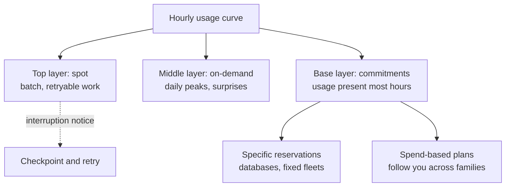

**Reading the diagram.** Usage is layered by how reliably each slice is present. The base layer becomes commitments: specific reservations for stable resources such as databases, and spend-based plans that follow you across instance families. On-demand covers peaks and growth; spot serves interruptible work, and the dotted arrow is the asynchronous interruption notice that triggers checkpoint and retry. Failure points: over-commitment locks in waste for one to three years, and spot can vanish in a regional shortage. Rebalance monthly.

#### Mathematical foundations

::: formula
**Coverage, utilization, effective savings and the optimal commitment level**

$$\text{Coverage} = \frac{\sum_t \min(x_t, c)}{\sum_t x_t} \qquad \text{Utilization} = \frac{\sum_t \min(x_t, c)}{c\,H}$$

$$C(c) = c\,p_c\,H + p_{od}\sum_t \max(x_t - c, 0) \qquad \text{ESR} = 1 - \frac{C(c)}{p_{od}\sum_t x_t} \qquad c^{*} = Q_x(d)$$

| Symbol | Meaning | Units |
|---|---|---|
| $x_t$ | Usage in hour $t$ (instance-equivalents) | instances |
| $c$ | Committed level, paid every hour | instances |
| $H$ | Hours in the term considered | hours |
| $p_{od}$ | On-demand price per instance-hour | \$/instance-hour |
| $p_c$ | Committed effective price, $p_{od}(1 - d)$ | \$/instance-hour |
| $d$ | Commitment discount | fraction |
| $C(c)$ | Total cost at commitment level $c$ | \$ |
| ESR | Effective savings rate against all-on-demand | fraction |
| $Q_x(d)$ | The $d$-quantile of hourly usage: the level exceeded in a fraction $1 - d$ of hours | instances |
:::

Why the quantile rule? One more committed instance costs $p_c H$ and saves $p_{od}$ in every hour where usage exceeds $c$, so it pays while such hours number more than $H(1-d)$. Commit until the level is exceeded in only a fraction $1 - d$ of hours: the $d$-quantile. A 40% discount means the 40th percentile. This is the newsvendor result of operations research.

#### Code example

The program below builds a 30-day hourly usage curve for QuickBite's order-processing fleet (a nightly floor, a daytime wave, a weekday lift and noise), evaluates every commitment level, and checks the quantile rule against brute force.

```python
"""Choose a compute commitment level against an hourly usage curve (Section 51.6)."""
import math
import random

H = 720             # hours in a 30-day month
P_OD = 0.10         # on-demand price per instance-hour, $ (illustrative)
DISCOUNT = 0.40     # commitment discount d (illustrative 1-year plan)
P_C = P_OD * (1 - DISCOUNT)


def usage_curve(seed=7):
    """Hourly instance demand: floor + diurnal wave + weekday lift + noise."""
    rng = random.Random(seed)
    out = []
    for t in range(H):
        hour, day = t % 24, t // 24
        diurnal = 60 * max(0.0, math.sin(math.pi * (hour - 7) / 15)) if 7 <= hour <= 22 else 0.0
        weekday = 15 if day % 7 < 5 else 0
        out.append(max(0.0, 40 + diurnal + weekday + rng.gauss(0, 5)))
    return out


def month_cost(usage, c):
    """Commit c instances for every hour; overflow runs on demand."""
    committed = c * P_C * H
    overflow = sum(max(u - c, 0.0) for u in usage) * P_OD
    used = sum(min(u, c) for u in usage)
    coverage = used / sum(usage)               # share of usage on commitment
    utilization = used / (c * H) if c else float('nan')  # share of commitment used
    return committed + overflow, coverage, utilization


def quantile(xs, q):
    s = sorted(xs)
    return s[min(len(s) - 1, int(q * len(s)))]


usage = usage_curve()
on_demand_only = sum(usage) * P_OD
grid = [c / 2 for c in range(0, 2 * int(max(usage)) + 2)]
best_c = min(grid, key=lambda c: month_cost(usage, c)[0])
rule_c = quantile(usage, DISCOUNT)   # commit up to the d-quantile of hourly demand

print(f"Usage: min {min(usage):.1f}, mean {sum(usage)/H:.1f}, max {max(usage):.1f} instances")
print(f"On-demand only: ${on_demand_only:,.0f}")
print(f"{'commit':>7} {'cost $':>8} {'saving':>7} {'coverage':>9} {'util':>6}")
for c in (0, min(usage), 45, rule_c, 75, 100, max(usage)):
    cost, cov, util = month_cost(usage, c)
    print(f"{c:7.1f} {cost:8,.0f} {1 - cost/on_demand_only:7.1%} {cov:9.1%} {util:6.1%}".replace("nan%", "  n/a"))
print(f"Grid optimum {best_c:.1f}; quantile rule {rule_c:.1f}")

# Tests
assert abs(month_cost(usage, 0)[0] - on_demand_only) < 1e-6       # no commitment = all on demand
assert abs(best_c - rule_c) <= 1.0                                   # rule matches brute force
assert month_cost(usage, best_c)[0] <= month_cost(usage, max(usage))[0]
assert month_cost(usage, min(usage))[2] == 1.0                       # floor commitment fully used
print("all tests passed")
```

Output:

```text
Usage: min 27.2, mean 74.9, max 126.1 instances
On-demand only: $5,394
 commit   cost $  saving  coverage   util
    0.0    5,394    0.0%      0.0%     n/a
   27.2    4,611   14.5%     36.3% 100.0%
   45.0    4,146   23.1%     59.2%  98.5%
   60.1    3,961   26.6%     74.7%  93.1%
   75.0    4,050   24.9%     85.0%  84.9%
  100.0    4,489   16.8%     96.9%  72.6%
  126.1    5,447   -1.0%    100.0%  59.4%
Grid optimum 60.0; quantile rule 60.1
all tests passed
```

What to notice:

- `month_cost` is the formula $C(c)$ term by term: commitment paid for all $H$ hours, overflow at on-demand price.
- `quantile(usage, DISCOUNT)` implements $c^{*} = Q_x(0.4)$, and the test confirms it lands within one instance of the brute-force optimum.
- The fixed seed makes the curve reproducible, so the tests are deterministic; change the seed to see the rule hold on other curves.

::: example
**Worked example — Reading the commitment table.** Take the rows of the output above.

1. **Commit to the floor (27.2 instances).** Utilization is 100%, but coverage is only 36.3%, and the effective savings rate is 14.5%. Check one figure: commitment $27.2 \times 0.06 \times 720 = \$1{,}175$; overflow $(53{,}940 - 27.2 \times 720) \times 0.10 = (53{,}940 - 19{,}584) \times 0.10 = \$3{,}436$; total \$4,611. (Total usage is $5{,}394/0.10 = 53{,}940$ instance-hours.)
2. **Commit to the 40th percentile (60.1).** Utilization drops to 93.1%, but coverage rises to 74.7%, and savings reach the maximum, 26.6% or \$1,433 a month.
3. **Commit to the mean (75).** Utilization 84.9%, savings 24.9%: committing to average usage is close to, but worse than, optimal.
4. **Commit to the peak (126.1).** Coverage 100%, utilization 59.4%, and the cost exceeds all-on-demand by 1%: below the break-even utilization $1 - d = 60\%$ of §41.13.1.

**Interpretation.** The best commitment is neither the floor (too timid) nor the peak (wasteful). It sits where some commitment goes unused in quiet hours, about 7% here, because the discount on busy hours pays for it. **Engineering implication.** Do not target 100% utilization; it means you are under-committed. Target the quantile, re-run monthly on the latest 30 days, and buy in tranches (for example a quarter of the target every quarter) so commitments expire on a staggered schedule and can follow the curve down.
:::

### 51.6.2 Spot capacity in the portfolio

Spot capacity is unused provider capacity sold at a large discount that the provider can reclaim with short notice, typically two minutes on AWS and about 30 seconds on Google Cloud and Azure, as of 2026 (§41.8.5). The effective price must include the work lost to interruptions.

::: example
**Worked example — QuickBite's nightly settlement batch on spot.** 2,000 instance-hours a month at \$0.10 on demand; spot is 70% cheaper (\$0.03). With 30-minute checkpoints, interruptions cause about 10% rework and checkpointing adds 5%.

1. Effective price: $0.03 \times (1 + 0.10 + 0.05) = \$0.0345$ per useful instance-hour.
2. Monthly: $2{,}000 \times 0.0345 = \$69$ against \$200, a 65.5% saving.

**Interpretation.** Without checkpoints, an interrupted 4-hour job restarts from zero and the deadline becomes uncertain. **Engineering implication.** Checkpoint, diversify across instance types and zones, and fall back to on-demand automatically.
:::

## 51.7 Engineering levers by resource

Purchasing changes the price of a unit. Engineering changes how many units you need, and it compounds with purchasing. This section summarizes the levers per resource; Table 51.8 collects them with typical savings ranges, which are **illustrative** and depend entirely on the starting point.

### 51.7.1 Compute

1. **Rightsizing.** Size to p95 CPU and memory measured over weeks. In Kubernetes, set requests from observed usage, because the scheduler packs on requests, not use (§42.12, §46.7).
2. **Autoscaling.** Follow the load curve (§18.8, §18.11.3). QuickBite's browse fleet at a peak-to-average ratio of 9.6 averages about 8 nodes under autoscaling instead of 18 static nodes.
3. **Processor architecture.** Arm-based server processors are often cheaper per unit of throughput. AWS states that Graviton3 instances use up to 60% less energy for the same performance than comparable EC2 instances, and markets better price-performance against x86; these are **vendor claims** whose baseline and workloads are not fully disclosed [AWS: Graviton]. Benchmark your own workload before migrating.
4. **Bin packing and overcommit.** Fill gaps left by latency-sensitive services with batch work and reclaim allocated but unused resources (§46.5.4, §46.5.6).
5. **Efficient code.** Profiling (§40.12) finds the hot functions worth optimizing.

### 51.7.2 Storage

1. **Tiering and lifecycle rules** (§15.9): archive classes cost roughly an order of magnitude less per GB-month, with retrieval fees and delays.
2. **Retention policies**: decide how long each data class must exist and delete the rest automatically.
3. **Compression and columnar formats**: text logs and JSON often compress 5–10×.
4. **Deduplication**: content-addressed images, backups and artifacts are stored once.
5. **Hygiene**: unattached volumes, old snapshots and incomplete uploads are pure waste (§41.13.2).

### 51.7.3 Network

Network charges are the most frequent surprise on cloud bills, because they are invisible in architecture diagrams.

**Figure 51.7 — Where data transfer is billed in a typical cloud deployment.**

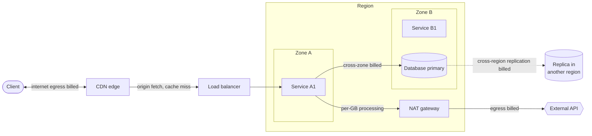

**Reading the diagram.** Each labeled edge is a separately priced transfer. CDN egress is usually cheaper than origin egress, and cache hits avoid origin transfer. Cross-zone traffic is billed in each direction (§41.10.3), so a zone-A service querying a zone-B primary pays on every query. NAT adds a per-GB processing fee, and asynchronous cross-region replication (dotted) is billed per GB. All grow linearly with traffic, so the levers are structural.

The network levers are:

1. **CDN offload** (Chapter 21): every point of hit ratio removes origin egress and compute.
2. **Zone-aware routing**: same-zone replicas, Kubernetes topology-aware routing, and rack-aware follower fetching for Kafka consumers [Apache Kafka: KIP-392]. Keep redundancy across zones but the hot path within one.
3. **Private endpoints** instead of NAT for provider services (§41.10.3).
4. **Compression and binary encodings** such as Protobuf.
5. **Data locality**: process data where it is stored.

::: example
**Worked example — QuickBite's cross-zone chatter.** The order service makes 5 database and cache calls per order request, each returning 8 KB. With replicas spread evenly across three zones and no zone awareness, two thirds of calls cross a zone. Peak-hour traffic is 3,000 requests per second for 4 hours a day; the rest averages 600 requests per second. Price: \$0.01 per GB in each direction, so \$0.02 per GB crossing (illustrative, as of 2026).

1. Requests per day: $3{,}000 \times 4 \times 3{,}600 + 600 \times 20 \times 3{,}600 = 43.2 + 43.2 = 86.4$ million.
2. Bytes crossing zones per day: $86.4 \times 10^{6} \times 5 \times 8 \text{ KB} \times \tfrac{2}{3} = 2{,}304$ GB.
3. Monthly cost: $2{,}304 \times 30 \times 0.02 = \$1{,}382$.
4. With zone-local read replicas and cache nodes, crossing falls to the 10% of calls that must reach the primary: $\$1{,}382 \times 0.10 / (2/3) = \$207$, saving about \$1,175 a month.

**Interpretation.** Modest at this scale, the saving grows linearly with traffic and also removes cross-zone latency. **Engineering implication.** Make zone locality the default in service discovery and chart cross-zone bytes per service.
:::

### 51.7.4 Databases

1. **Caching versus read replicas.** A replica copies the whole database at full node price; a cache holds only the hot set. QuickBite's 5 GB of menus, read about 117 times per order (§2.11), fit a small cache. Replicas win for large, unpredictable read sets or SQL queries (§20.3, §18.9).
2. **Serverless databases** suit spiky or development workloads and usually cost more at sustained load (§51.3.2).
3. **Index and query fixes** often beat moving up an instance class; unused provisioned IOPS are fixed waste.

### 51.7.5 Observability

Chapter 40 gave the levers: sample routine successes but never errors, keep hot retention short (§40.4.4) and budget cardinality (§40.5.3). For QuickBite this cut the log bill from \$11,664 to \$2,528 a month. Observability grows faster than traffic, so give each team a volume budget.

**Table 51.8 — Engineering levers and typical savings ranges (illustrative; actual savings depend on the starting point).**

| Resource | Lever | Typical saving on the affected line | Main risk |
|---|---|---|---|
| Compute | Rightsizing requests and instances | 20–50% | Throttling at peaks if sized on averages |
| Compute | Autoscaling a high-PAR service | 30–60% | Slow scale-up during sudden peaks |
| Compute | Arm instances (benchmark first) | 10–40% price-performance (vendor claims vary) | Porting effort, native dependencies |
| Compute | Spot for batch | 50–80% | Interruptions, deadline misses |
| Compute | Scheduling non-production off-hours | 50–70% of non-production | Developer friction |
| Storage | Lifecycle tiering and retention | 30–80% | Retrieval fees, deleting needed data |
| Storage | Compression, columnar formats | 50–90% of bytes | CPU cost to compress |
| Network | CDN offload | 30–80% of origin egress | Stale content |
| Network | Zone-aware routing | 50–90% of cross-zone transfer | Uneven load per zone |
| Network | Private endpoints instead of NAT | Most NAT processing | Configuration effort |
| Database | Cache instead of extra replicas | 30–70% of read capacity cost | Invalidation bugs, stale reads |
| Observability | Sampling, short hot retention, cardinality budgets | 50–80% | Losing the trace you needed |

::: recommendation
**Order of operations.** Delete waste first, then rightsize, then redesign hot paths, and only then buy commitments for what remains. Committing first locks in waste for the commitment term (§41.13.2).
:::

## 51.8 Cost modeling and forecasting

### 51.8.1 Cost models in design documents

A design document (§2.12.3) should contain a **cost section** with four parts: the unit cost model (§51.4) for each alternative, a forecast over the planning horizon, a sensitivity analysis showing which assumptions matter, and the crossover volumes at which the decision would flip. Reviewers then argue about assumptions, which can be checked, rather than conclusions.

::: formula
**Driver-based forecast and elasticity**

$$C(t) = F + \sum_{k} v_k\, D_k(t) \qquad D_k(t) = D_k(0)(1 + g)^{t} \qquad \varepsilon_x = \frac{\Delta C / C}{\Delta x / x}$$

| Symbol | Meaning | Units |
|---|---|---|
| $C(t)$ | Forecast cost in month $t$ | \$/month |
| $F$ | Fixed monthly cost | \$/month |
| $v_k$ | Unit cost of driver $k$ | \$/unit |
| $D_k(t)$ | Volume of driver $k$ in month $t$ | units/month |
| $g$ | Compound monthly growth rate | fraction/month |
| $\varepsilon_x$ | Elasticity of total cost with respect to input $x$ | dimensionless |
:::

The program below forecasts QuickBite's technology cost for 12 months at 8% monthly order growth (the rate used in §18.11.4), then varies each input by ±20% one at a time and ranks the inputs by the swing they cause, the data for a **tornado chart**.

```python
"""QuickBite 12-month cost forecast with one-at-a-time sensitivity (Section 51.8)."""
BASE = {
    "orders0": 15e6,        # orders in month 0
    "growth": 0.08,         # compound monthly order growth
    "fixed": 38_000,        # $/month that does not scale with orders
    "infra_var": 0.0038,    # $ of cloud infrastructure per order
    "maps_calls": 4.0,      # routing API calls per order
    "maps_price": 0.005,    # $ per routing call
    "other_3p": 0.006,      # SMS + fraud screening, $ per order
}


def monthly_cost(p, t):
    orders = p["orders0"] * (1 + p["growth"]) ** t
    per_order = p["infra_var"] + p["maps_calls"] * p["maps_price"] + p["other_3p"]
    return p["fixed"] + orders * per_order, orders


def forecast(p, months=12):
    return sum(monthly_cost(p, t)[0] for t in range(1, months + 1))


base_total = forecast(BASE)
c12, n12 = monthly_cost(BASE, 12)
print(f"Month 12: {n12/1e6:.1f} M orders, ${c12:,.0f}/month, ${c12/n12:.4f}/order")
print(f"12-month total: ${base_total:,.0f}")
print(f"{'input (+/-20%)':<12} {'low $M':>8} {'high $M':>8} {'swing $M':>9} {'elasticity':>10}")
rows = []
for k in BASE:
    lo, hi = dict(BASE), dict(BASE)
    lo[k], hi[k] = BASE[k] * 0.8, BASE[k] * 1.2
    a, b = forecast(lo), forecast(hi)
    rows.append((abs(b - a), k, a, b, ((b - a) / base_total) / 0.4))
for swing, k, a, b, e in sorted(rows, reverse=True):
    print(f"{k:<12} {a/1e6:8.2f} {b/1e6:8.2f} {swing/1e6:9.2f} {e:10.2f}")

assert abs(forecast(dict(BASE, growth=0.0)) - 12 * monthly_cost(BASE, 0)[0]) < 1e-6
assert sorted(rows, reverse=True)[0][1] in ("orders0", "growth", "maps_calls", "maps_price")
print("all tests passed")
```

Output:

```text
Month 12: 37.8 M orders, $1,163,622/month, $0.0308/order
12-month total: $9,617,398
input (+/-20%)   low $M  high $M  swing $M elasticity
orders0          7.79    11.45      3.66       0.95
maps_price       8.39    10.85      2.46       0.64
maps_calls       8.39    10.85      2.46       0.64
growth           8.67    10.68      2.01       0.52
other_3p         9.25     9.99      0.74       0.19
infra_var        9.38     9.85      0.47       0.12
fixed            9.53     9.71      0.18       0.05
all tests passed
```

What to notice:

- Growth compounds: month-12 orders are $15 \times 1.08^{12} = 15 \times 2.518 = 37.8$ million, and the monthly bill grows from \$485,000 to \$1.16 million.
- Elasticity is the swing divided by the 40% input range: an elasticity of 0.64 means a 10% change in the maps price changes the total by 6.4%.
- The asserts test two invariants: with zero growth the forecast is twelve identical months, and the top-ranked input is a volume or routing driver.

::: example
**Worked example — What the tornado chart tells the design review.**

1. Base forecast: \$9.62 million over 12 months.
2. Volume inputs (starting orders, growth) have the largest swings, \$3.66 million and \$2.01 million, but they are business outcomes, not design choices. They belong in the budget conversation with finance.
3. The largest *design-controllable* inputs are routing calls per order and routing price, each with elasticity 0.64 and a swing of \$2.46 million. Cutting calls from 4 to 2 per order (estimate the delivery-time quote from a precomputed zone grid and call the provider only at dispatch) saves half of the routing line: about $0.5 \times 0.020 \times 15 \times 10^{6} \times 1.08 \approx \$162{,}000$ in month 1, and \$3.1 million over the year.
4. Cloud variable cost per order has elasticity 0.12: a heroic 20% infrastructure optimization moves the total by less than 5%.

**Interpretation.** Sensitivity analysis decides where engineering effort pays. Here it points to the routing integration, not the Kubernetes fleet. **Engineering implication.** Put the tornado ranking in the design document; re-run it when prices or volumes change, because the ranking, not the point forecast, is what drives the roadmap.
:::

::: warning
**Warning — Forecasts are ranges.** One-at-a-time sensitivity ignores interactions, such as faster growth raising the routing contract's tier. Report a low, base and high scenario, and compare actuals with the forecast monthly; a forecast that is never checked teaches nothing.
:::

## 51.9 Build versus buy versus managed

### 51.9.1 Total cost of ownership

::: definition
**Definition — Total cost of ownership (TCO).** The **total cost of ownership** of an option is every cost it causes over a stated horizon: infrastructure, licences and service fees, the engineering time to build, operate, upgrade and be on call for it, migration in and out, and the expected cost of its failures. **Build** means writing and running your own; **self-host** means running open-source software yourself; **managed** means paying a provider to run it; **buy** means purchasing a finished product or SaaS.
:::

Engineering time is the line most often left out, because it is not on the cloud bill. A senior engineer's loaded cost (salary, benefits, overhead) is commonly a six-figure annual amount; one full-time equivalent (FTE) spent operating a system can outweigh its infrastructure.

::: formula
**Monthly TCO and the build-versus-managed crossover**

$$TCO = I + L + E \cdot w + \frac{M_{\text{in}}}{T} + R \qquad k^{*} = \frac{(E_s - E_m)\,w + (L_s - L_m)}{i_m - i_s}$$

| Symbol | Meaning | Units |
|---|---|---|
| $I$ | Infrastructure cost (compute, storage, network) | \$/month |
| $L$ | Licences, support and provider fees not in $I$ | \$/month |
| $E$ | Engineering effort to operate, upgrade and be on call | FTE |
| $w$ | Loaded cost per FTE | \$/FTE-month |
| $M_{\text{in}}$ | One-off migration and build cost, amortized over horizon $T$ | \$ |
| $T$ | Horizon | months |
| $R$ | Expected monthly cost of incidents (probability × impact) | \$/month |
| $i_s, i_m$ | Variable infrastructure cost per unit of scale, self-hosted and managed | \$/month per unit |
| $k^{*}$ | Scale (multiple of today) above which self-hosting is cheaper, if $i_m > i_s$ | dimensionless |
:::

::: example
**Worked example — Self-hosted Kafka versus a managed Kafka service for QuickBite's event stream.** Workload: 50 MB/s produced, replication factor 3, 7-day retention, consumers using rack-aware follower fetching. Prices are illustrative (as of 2026), not any vendor's price list. The managed offering is assumed not to bill replication traffic between its brokers (some do not; check yours). Loaded engineering cost $w = \$20{,}000$ per FTE-month. Month = 730 hours = 2.628 million s.

Storage, both options: $50\ \text{MB/s} \times 604{,}800\ \text{s} = 30.24$ TB per copy; × 3 copies = 90.72 TB; provisioned at 70% fill = 129.6 TB.

**Table 51.9 — Monthly TCO, self-hosted versus managed Kafka (illustrative).**

| Line | Self-hosted, 50 MB/s | Managed, 50 MB/s | Self-hosted, 500 MB/s | Managed, 500 MB/s |
|---|---|---|---|---|
| Brokers (6 or 60 at \$0.40/h self, \$0.84/h managed) | \$1,752 | \$3,679 | \$17,520 | \$36,792 |
| Storage (129.6 or 1,296 TB at \$0.08 or \$0.15/GB-month) | \$10,368 | \$19,440 | \$103,680 | \$194,400 |
| Cross-zone transfer at \$0.02/GB | \$7,008 | \$1,752 | \$70,080 | \$17,520 |
| Engineering (1.0 or 1.5 FTE self; 0.25 FTE managed) | \$20,000 | \$5,000 | \$30,000 | \$5,000 |
| Tooling | \$500 | \$0 | \$1,000 | \$0 |
| **Total** | **\$39,628** | **\$29,871** | **\$222,280** | **\$253,712** |

1. Brokers: $6 \times 0.40 \times 730 = \$1{,}752$ self-hosted; $6 \times 0.84 \times 730 = \$3{,}679$ managed. Storage: $129{,}600\ \text{GB} \times 0.08 = \$10{,}368$; $\times 0.15 = \$19{,}440$.
2. Cross-zone, self-hosted: replication to two other-zone followers is 100 MB/s, plus two thirds of producer traffic, 33.3 MB/s; $133.3\ \text{MB/s} \times 2.628 \times 10^{6}\ \text{s} = 350.4$ TB; $\times \$0.02 = \$7{,}008$. Managed bills only the producer share: 87.6 TB, \$1,752.
3. At 50 MB/s managed is cheaper by \$9,757 a month (25%), because of engineering time and unbilled replication.
4. Variable infrastructure per unit of scale: $i_s = 1{,}752 + 10{,}368 + 7{,}008 = \$19{,}128$; $i_m = 3{,}679 + 19{,}440 + 1{,}752 = \$24{,}871$. Crossover with today's staffing: $k^{*} = [(1.0 - 0.25) \times 20{,}000 + 500]/(24{,}871 - 19{,}128) = 15{,}500/5{,}743 = 2.7$, about 135 MB/s.
5. At 500 MB/s, self-hosting is cheaper by \$31,432 a month (12%) even with 1.5 FTE.

**Interpretation.** Managed wins while people dominate; self-hosting wins once the provider's markup on infrastructure exceeds the team's cost, here at less than three times today's volume. **Engineering implication.** Compute $k^{*}$ before choosing, include migration cost ($M_{\text{in}}$) and incident risk ($R$), which favor whichever option you already run, and revisit the decision at each doubling. The Dropbox case (§51.3.3) is this crossover at very large scale.
:::

**Figure 51.8 — A build, self-host, managed or buy decision path.**

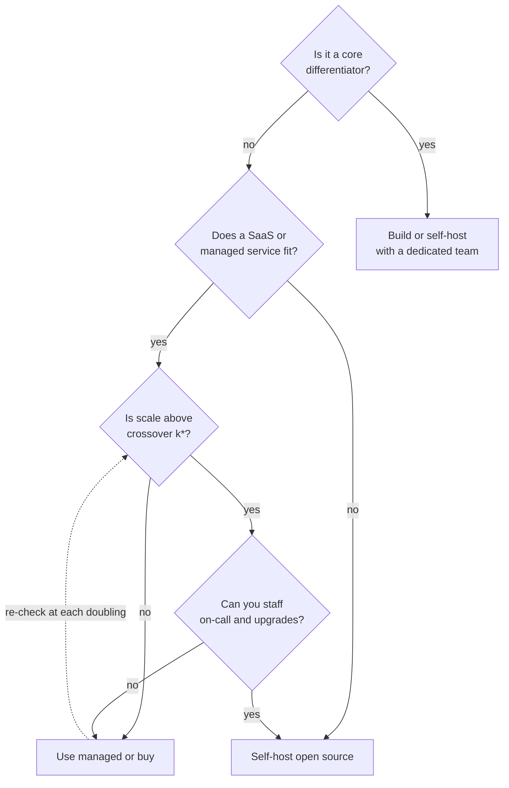

**Reading the diagram.** Diamonds are decisions, rectangles outcomes. Differentiators justify building; commodity capabilities go to managed services unless scale passes the crossover and operations can be staffed. The dotted edge is the periodic review. Failure points: building commodity infrastructure because it is interesting, and keeping a managed service long after its markup exceeds a team's cost.

## 51.10 Sustainable computing: energy and carbon basics

### 51.10.1 Power usage effectiveness and water usage effectiveness

::: definition
**Definition — PUE and WUE.** **Power usage effectiveness (PUE)** is the ratio of total energy entering a datacenter facility to the energy delivered to its IT equipment (servers, storage, network) over a period, normally a year. An ideal facility has PUE 1.0. **Water usage effectiveness (WUE)** is the annual site water used for cooling and humidification divided by IT equipment energy, in liters per kWh. Both metrics were defined by The Green Grid [Avelar et al. 2012; The Green Grid 2011]; PUE is also standardized as ISO/IEC 30134-2.
:::

#### First-principles explanation

A datacenter is a building that turns electricity into computation and heat. Some electricity never reaches a server: it is lost converting voltages in transformers and uninterruptible power supplies (UPSs), or spent on cooling the heat the servers make. PUE asks how much the building charges on top of the IT load. A PUE of 1.5 means every kWh of computing costs an extra half kWh of overhead.

**Figure 51.9 — Energy flow in a datacenter and the PUE boundary.**

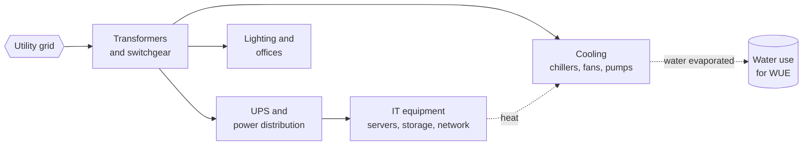

**Reading the diagram.** Grid electricity (hexagon) splits into the path through UPS and distribution to IT equipment, the PUE denominator, and parallel paths to cooling and building loads; everything entering is the numerator. Dotted arrows are physical side effects: IT heat that cooling removes, and evaporated water, the WUE numerator. Every conversion loses energy, and cooling capacity caps the IT power a hall can host. Efficiency comes from fewer conversions, free-air cooling and warmer allowed inlet temperatures.

::: formula
**PUE, WUE and operational carbon**

$$PUE = \frac{E_{\text{facility}}}{E_{\text{IT}}} \qquad WUE = \frac{V_{\text{water}}}{E_{\text{IT}}} \qquad C_{\text{op}} = E_{\text{IT}} \times PUE \times I$$

| Symbol | Meaning | Units |
|---|---|---|
| $E_{\text{facility}}$ | Total facility energy over the period | kWh |
| $E_{\text{IT}}$ | Energy consumed by IT equipment | kWh |
| $V_{\text{water}}$ | Site water used for cooling and humidification | liters |
| $I$ | Carbon intensity of the electricity used | gCO₂e/kWh |
| $C_{\text{op}}$ | Operational carbon emissions | gCO₂e |
:::

::: example
**Worked example — PUE, WUE and what overhead costs.** A facility draws 13.0 GWh in a year; its IT equipment uses 10.0 GWh; cooling evaporates 18,000 m³ of water. Electricity: \$0.10/kWh and 400 gCO₂e/kWh (illustrative).

1. $PUE = 13.0 / 10.0 = 1.30$. Overhead energy: 3.0 GWh, costing \$300,000 and emitting $3.0 \times 10^{6} \times 400\ \text{g} = 1{,}200$ tCO₂e a year.
2. $WUE = 18{,}000{,}000\ \text{L} / 10{,}000{,}000\ \text{kWh} = 1.8$ L/kWh.
3. At PUE 1.58 (near an industry survey average), overhead would be $0.58 \times 10 = 5.8$ GWh; at 1.10 (a hyperscale fleet level), 1.0 GWh. The difference, 4.8 GWh, is \$480,000 and 1,920 tCO₂e a year for the same computing.

**Interpretation.** Facility efficiency multiplies everything above it. **Engineering implication.** When you choose a region or colocation provider, ask for annual PUE and WUE (not a design-point or best-month figure). A cooling technique that improves PUE by evaporating water may worsen WUE, a real trade-off in water-stressed regions.
:::

::: industry
**Reported datacenter PUE.** Google reports a fleet-wide trailing-twelve-month PUE of about 1.09 for 2024 and publishes quarterly figures with its measurement boundaries. Uptime Institute's annual surveys reported average PUE of about 1.58 in 2023 and about 1.56 for respondents' largest facility in 2024, a figure that has been roughly flat for several years. Self-reported, operator-defined boundaries mean the figures are indicative rather than strictly comparable.
*Evidence: Primary* — [Google: Data Center Efficiency; Uptime Institute 2024]
:::

PUE measures building overhead, not useful work: an idle server at PUE 1.1 wastes more than a busy one at 1.4 [Barroso et al. 2018].

### 51.10.2 Operational and embodied carbon, and the three scopes

**Operational carbon** comes from the electricity a system uses while running. **Embodied carbon** is emitted manufacturing, transporting and disposing of the hardware: chips, servers, storage, network gear and the building. As grids get cleaner, embodied carbon becomes a larger share of the total, which makes keeping hardware busy and in service longer more important.

The **GHG Protocol** classifies an organization's emissions into three scopes [GHG Protocol 2004; GHG Protocol 2011; GHG Protocol 2015]:

**Table 51.10 — Scopes 1, 2 and 3 for a company running on its own datacenters versus the public cloud.**

| Scope | Definition | Own datacenter | Cloud customer |
|---|---|---|---|
| Scope 1 | Direct emissions from owned sources | Diesel backup generators, refrigerant leaks | Usually none for IT |
| Scope 2 | Indirect emissions from purchased electricity, heat, cooling | Datacenter electricity | Office electricity only |
| Scope 3 | All other value-chain emissions, upstream and downstream | Server manufacturing, construction, travel | Cloud usage (the provider's Scopes 1 and 2 plus its share of embodied), purchased hardware |

Scope 2 can be reported two ways. **Location-based** accounting uses the average intensity of the grid where the electricity was consumed. **Market-based** accounting uses the contractual instruments a company buys, such as renewable energy certificates and power purchase agreements [GHG Protocol 2015]. The two can differ greatly for the same datacenter, so always say which one a number uses.

### 51.10.3 Grid carbon intensity varies by place and hour

**Carbon intensity** $I$ is the gCO₂e emitted per kWh generated, and it varies by an order of magnitude. Grids dominated by hydro, nuclear or wind can average under about 100 gCO₂e/kWh; grids dominated by coal can exceed 600 (illustrative ranges, as of 2026). Within one grid, intensity also varies by hour: on a sunny afternoon solar can cut it substantially, and it rises again in the evening peak when gas plants ramp up. **Average** intensity describes the generation mix; **marginal** intensity describes the plant that responds to one more kWh of demand, which is what a load shift actually changes. The two can differ, and marginal estimates are model outputs with real uncertainty.

## 51.11 Carbon-aware architecture

### 51.11.1 Utilization is the biggest lever

Barroso and Hölzle observed that servers spend most of their time at 10–50% utilization, where they are least energy-efficient, because an idle server still drew a large fraction of its peak power; they called for **energy-proportional** hardware whose power scales with work [Barroso and Hölzle 2007; Barroso et al. 2018]. Hardware has improved, but idle power is still far from zero, so energy per unit of work falls steeply as utilization rises.

::: formula
**Linear server power model and energy per unit of work**

$$P(u) = P_{\text{idle}} + (P_{\text{peak}} - P_{\text{idle}})\,u \qquad e(u) = \frac{P(u)}{u\,X_{\max}}$$

| Symbol | Meaning | Units |
|---|---|---|
| $P(u)$ | Server power at utilization $u$ | W |
| $P_{\text{idle}}, P_{\text{peak}}$ | Power at idle and at full load | W |
| $u$ | CPU utilization | fraction |
| $X_{\max}$ | Throughput at full load | requests/s |
| $e(u)$ | Energy per request | J/request |
:::

::: example
**Worked example — Consolidating a fleet.** 100 servers run at 10% utilization; $P_{\text{idle}} = 200$ W, $P_{\text{peak}} = 400$ W (illustrative).

1. Today: $P(0.1) = 200 + 200 \times 0.1 = 220$ W each, 22.0 kW in total.
2. The work is $100 \times 0.1 = 10$ server-equivalents. On 13 servers, $u = 10/13 = 0.77$ and $P = 200 + 200 \times 0.77 = 354$ W, so 4.6 kW in total.
3. Energy falls by $1 - 4.6/22.0 = 79\%$; energy per request falls in the same ratio. Embodied carbon falls too, because 87 servers need not be bought.

**Interpretation.** Packing work onto fewer, busier machines saves more energy than almost any code optimization. **Engineering implication.** Autoscaling, bin packing (§46.7), batch work filling the troughs (§46.5.4) and multi-tenancy (§47.3.2) are sustainability measures as much as cost measures. Keep the utilization ceiling that latency needs (§18.11.2), but no lower.
:::

Efficient code and hardware come next: fewer cycles and bytes per unit of work, processors with better measured performance per watt, and longer hardware lifetimes that spread embodied carbon [AWS Well-Architected: Sustainability Pillar].

### 51.11.2 Temporal and spatial load shifting

**Carbon-aware computing** runs flexible work when and where electricity is cleaner. **Temporal shifting** delays work to lower-carbon hours in the same place; **spatial shifting** moves work to a cleaner region. Only flexible work qualifies: batch processing, model training, backups, video transcoding, report generation. User-facing requests, latency-critical work and data bound to a jurisdiction stay put.

::: industry
**Google's carbon-intelligent computing.** Google described a system that uses day-ahead forecasts of grid carbon intensity and of its own flexible and inflexible demand to compute, for each datacenter cluster, a **virtual capacity curve (VCC)**: an hourly limit on the resources available to temporally flexible workloads that preserves the total daily capacity they need. The cluster scheduler then admits flexible work against the curve, so it runs preferentially in cleaner hours; operational data showed the curves restricting capacity in carbon-intensive hours [Radovanović et al. 2022; Radovanović 2020]. In 2021 Google extended the approach to move flexible work between datacenters toward locations with more carbon-free energy [Koningstein 2021].
*Evidence: Primary* — [Radovanović et al. 2022; Koningstein 2021]
:::

**Figure 51.10 — Carbon-intelligent scheduling with virtual capacity curves, after the published design.**

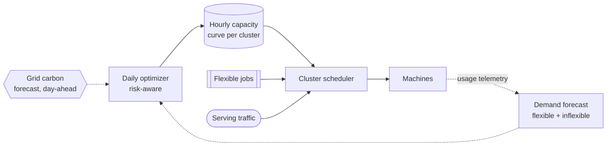

**Reading the diagram.** Daily forecasts arrive asynchronously (dotted) from an external carbon source and internal demand prediction. A risk-aware optimizer turns them into an hourly capacity curve per cluster, which the scheduler reads. Serving traffic is never limited; flexible jobs are admitted up to the curve, so they drain in cleaner hours, and telemetry feeds the next forecast. Failure point: a poor forecast can delay jobs, so the curve preserves daily capacity. The design scales because it changes one input to an existing scheduler.

::: formula
**Carbon saved by shifting a job**

$$\Delta C = E\,(I_{\text{now}} - I_{\text{shift}}) - E_{\text{move}}\,I_{\text{now}}$$

| Symbol | Meaning | Units |
|---|---|---|
| $E$ | Facility energy of the job (IT energy × PUE) | kWh |
| $I_{\text{now}}, I_{\text{shift}}$ | Carbon intensity at the original and the shifted time or place | gCO₂e/kWh |
| $E_{\text{move}}$ | Extra energy to move data to another region (zero for temporal shifting) | kWh |
| $\Delta C$ | Emissions avoided per run | gCO₂e |
:::

::: example
**Worked example — Shifting QuickBite's nightly analytics job.** The job uses $E = 200$ kWh per run and today starts at 18:00 in region A, where intensity is 450 gCO₂e/kWh. At 13:00 solar lowers it to 250. Region B, on a hydro-dominated grid, averages 50, but the job must copy 5 TB there; assume network energy of 0.005 kWh/GB, a deliberately rough assumption (published estimates vary widely). Intensities are illustrative.

1. Today: $200 \times 450 = 90{,}000$ g = 90 kg per run; $90 \times 365 = 32.9$ tCO₂e a year.
2. Temporal shift to 13:00: $200 \times 250 = 50$ kg; $\Delta C = 40$ kg per run (44%); 18.3 t a year instead of 32.9 t.
3. Spatial shift to region B: computing $200 \times 50 = 10$ kg; moving data $5{,}000 \times 0.005 = 25$ kWh, $25 \times 450 = 11.25$ kg; total 21.25 kg per run, saving 68.75 kg (76%); 7.8 t a year instead of 32.9 t.
4. Cost check: copying 5 TB at an illustrative \$0.02/GB inter-region rate costs \$100 per run, \$36,500 a year, unless the data is already replicated to region B.

**Interpretation.** Moving to a clean region saves the most carbon here, but the data movement is half its remaining footprint and adds real cost; the temporal shift is free. **Engineering implication.** Shift in time first; shift in space when the data already lives in both places or the job is compute-heavy relative to its data. Use marginal intensity forecasts where available, and treat results as estimates.
:::

**Figure 51.11 — A carbon-aware batch scheduler for QuickBite.**

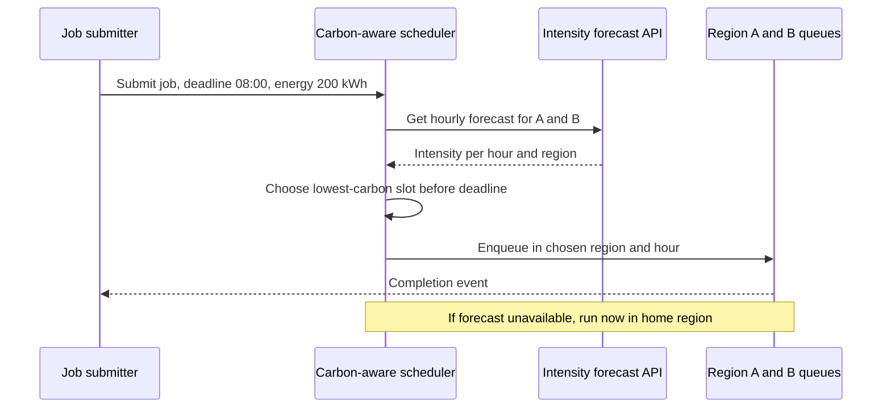

**Reading the diagram.** The submitter synchronously sends a job with deadline and energy estimate. The scheduler queries the external forecast per region, picks the lowest-emission slot that meets the deadline and residency rules, and enqueues it; completion is reported asynchronously. The note is the failure rule: without a forecast, run now in the home region, because carbon optimization must never break a deadline.

### 51.11.3 The Software Carbon Intensity score

The Green Software Foundation's **Software Carbon Intensity (SCI)** specification, published as ISO/IEC 21031:2024, defines a *rate* of emissions per functional unit, so that teams can track improvements as the product grows [GSF SCI 2024]. Market-based instruments (offsets, renewable certificates) cannot reduce an SCI score; only using less energy, cleaner energy or less hardware can.

::: formula
**Software Carbon Intensity**

$$SCI = \frac{(E \times I) + M}{R} \qquad M = TE \times \frac{TR}{EL} \times \frac{RR}{ToR}$$

| Symbol | Meaning | Units |
|---|---|---|
| $E$ | Energy consumed by the software system, including datacenter overhead | kWh |
| $I$ | Location-based carbon intensity of that electricity | gCO₂e/kWh |
| $M$ | Embodied emissions share of the hardware used | gCO₂e |
| $TE$ | Total embodied emissions of the hardware | gCO₂e |
| $TR$ | Time the hardware is reserved for the software | hours |
| $EL$ | Expected lifespan of the hardware | hours |
| $RR, ToR$ | Resources reserved, total resources (for example vCPUs) | vCPUs |
| $R$ | Functional unit (per order, per user, per API call) | units |
:::

::: example
**Worked example — SCI of QuickBite's order API, per order.** One month: 30 VMs of 8 vCPUs (240 vCPUs) average 6 W per vCPU; PUE 1.15; $I = 380$ gCO₂e/kWh; each 64-vCPU host has $TE = 1{,}500$ kgCO₂e embodied over a 4-year life (35,040 h); 15 million orders. All inputs illustrative.

1. $E = 240 \times 6\ \text{W} \times 720\ \text{h} = 1{,}036.8$ kWh; with PUE: $1{,}036.8 \times 1.15 = 1{,}192.3$ kWh.
2. Operational: $1{,}192.3 \times 380 = 453{,}082$ g ≈ 453 kg.
3. Embodied per VM: $1.5 \times 10^{6} \times (720/35{,}040) \times (8/64) = 3{,}853$ g; for 30 VMs, $M = 115{,}582$ g ≈ 116 kg.
4. $SCI = (453{,}082 + 115{,}582)/15 \times 10^{6} = 0.0379$ gCO₂e, about 38 mg per order. Embodied is 20% of it.

**Interpretation.** The score is per order, so it falls when efficiency rises and stays flat when the business simply grows. **Engineering implication.** Report SCI per functional unit next to cost per unit; raising average utilization from 30% to 60% would cut both $E$ per order and $M$ per order.
:::

## 51.12 Measuring and reporting

Cloud customers cannot meter the electricity of a shared server, so carbon figures for cloud workloads are estimates. Provider tools (the AWS Customer Carbon Footprint Tool, Google Cloud Carbon Footprint, and Microsoft's Emissions Impact Dashboard for Azure) report emissions per account, service and region from the provider's own energy and hardware data. The open-source **Cloud Carbon Footprint** tool estimates from billing data, multiplying usage by per-service energy coefficients, PUE and grid intensity, and adds embodied emissions with the SCI method [Cloud Carbon Footprint].

**Table 51.11 — What carbon estimates can and cannot tell you.**

| Limitation | Why it matters | Mitigation |
|---|---|---|
| Methodologies differ (location- vs market-based, scopes included, embodied or not) | Numbers from two tools are not comparable | State the method next to every number |
| Coarse granularity (monthly, per service, per region) | Cannot see the effect of one deployment | Use energy proxies (vCPU-hours, GB) for engineering feedback |
| Reporting lag of weeks to months | Too slow for operational alerts | Track proxies daily, carbon monthly |
| Average, not marginal, intensity | May misjudge the effect of shifting | Use marginal forecasts for scheduling decisions |
| Embodied data from few life-cycle assessments | Large uncertainty | Report ranges; prefer relative trends |

## 51.13 Trade-offs: cost versus reliability versus latency versus carbon

Most decisions in this chapter move several properties at once.

**Table 51.12 — Decision table for common cost and carbon levers.**

| Lever | Cost | Reliability | Latency | Carbon | Choose when |
|---|---|---|---|---|---|
| Higher utilization targets | Lower | Less headroom for failures | Higher queueing near saturation | Lower | Load is predictable; latency SLO has slack |
| Multi-region active–active | Higher (2× capacity, replication) | Higher | Lower for distant users | Higher | Availability or locality requires it (Chapter 44) |
| Spot for batch | Much lower | Interruptions | Unpredictable completion | Lower (uses idle capacity) | Work is checkpointed and deadline-tolerant |
| Temporal carbon shifting | Neutral or lower | Neutral | Delayed completion | Lower | Jobs have hours of slack |
| Spatial carbon shifting | Higher if data must move | Neutral | Higher for moved work | Lower | Data already replicated; compute-heavy jobs |
| Aggressive log sampling | Lower | Harder diagnosis | Neutral | Lower | Errors are always kept (§40.4.4) |
| Arm or accelerator migration | Usually lower | Migration risk | Workload-dependent | Usually lower | Benchmarks confirm the gain |
| Managed service over self-host | Lower at small scale | Usually higher | Neutral | Provider's efficiency | Below the TCO crossover (§51.9) |
| Longer hardware life | Lower capital | Higher failure rate late in life | Older, slower hardware | Lower embodied | Performance per watt not much worse |

Three principles sit behind the table. **Reliability is bought with redundancy, which is idle capacity**: set availability targets from user need (§39.6), not habit. **Latency is bought with headroom**: choose the highest utilization that still meets the SLO. **Cost and carbon usually agree**, because waste costs both, so FinOps and sustainability can share one pipeline; where they diverge (spatial shifting, cheap but dirty regions), set explicit weights.

## 51.14 Summary and revision notes

::: summary
- Cost is an architectural property: structure (hops, copies, idle capacity, per-call fees) sets it. State cost requirements per business unit and compare designs across their cost curves, noting crossovers (§51.3).
- Unit cost $u = F/N + v$ falls toward the variable floor as volume grows. For QuickBite, third-party routing calls dominate technology cost, and one per-listing dependency would turn a \$1.86 margin into −\$10.12 (§51.4).
- FinOps runs a continuous inform–optimize–operate loop across engineering, finance, product, procurement and leadership. Start with showback, enforce tags at creation, allocate shared cost by usage, and alert on anomalies scaled by business volume (§51.5).
- Commit up to the $d$-quantile of hourly usage, not the floor and not the peak. Utilization below 100% at the optimum is expected. Price spot including rework (§51.6).
- Engineering levers reduce the units you need: rightsizing, autoscaling, Arm (benchmark the vendor claims), tiering and retention, CDN and zone-local traffic, caches before replicas, and sampled observability. Delete and rightsize before committing (§51.7).
- Put a driver-based forecast and a sensitivity ranking in every design document. The ranking shows where engineering effort pays (§51.8).
- TCO includes engineering time, migration and risk. Managed services win while people dominate; self-hosting wins beyond the crossover scale $k^{*}$ (§51.9).
- PUE = facility energy ÷ IT energy; WUE = water ÷ IT energy; operational carbon = IT energy × PUE × intensity. Embodied carbon and Scope 3 matter more as grids decarbonize. Always state location- or market-based (§51.10).
- Utilization is the largest carbon lever. Shift flexible work in time first, and in space when data movement is small. SCI = $((E \times I) + M)/R$ tracks carbon per functional unit (§51.11).
- Cloud carbon figures are estimates with stated methods. Use them for trends and engineering proxies for daily feedback (§51.12).
- Cost and carbon usually agree; reliability and latency cost headroom. Make the weights explicit (§51.13).
:::

## 51.15 Knowledge checkpoint

1. Why is cost per request a poor unit cost for QuickBite?
2. Two designs: $F_A = \$1{,}000$, $v_A = \$0.001$; $F_B = \$0$, $v_B = \$0.003$ per unit. Find the crossover.
3. Name the three FinOps phases and one activity in each.
4. When should an organization prefer showback to chargeback?
5. Why should anomaly detection scale expected cost by business volume?
6. With a 55% discount, at which percentile of hourly usage should you commit?
7. Why is 100% commitment utilization usually a sign of under-commitment?
8. Spot is 75% cheaper; interruptions cause 20% rework. What is the effective discount?
9. A facility uses 6.6 GWh with 5.5 GWh of IT load. What is its PUE?
10. Distinguish location-based from market-based Scope 2 accounting.
11. Why does consolidating work onto fewer servers save energy?
12. Why can renewable certificates not lower an SCI score?

<details><summary>Answers</summary>

1. Requests are an implementation detail: a client change can raise requests per order and lower cost per request while cost per order rises.
2. $N^{*} = 1{,}000/(0.003 - 0.001) = 500{,}000$ units per period.
3. Inform (allocation, showback, forecasting); optimize (rightsizing, commitments, redesign); operate (budgets, policies, review cadence).
4. When allocation is not yet trusted or the platform is being adopted; chargeback on disputed data produces arguments instead of change.
5. So that legitimate growth, such as a promotion, does not trigger alerts, while real waste at constant volume does.
6. The 55th percentile ($c^{*} = Q_x(0.55)$).
7. A marginal extra commitment would still be used in most hours, and so would still pay for itself; the optimum leaves some commitment idle in quiet hours.
8. Effective price $0.25 \times 1.2 = 0.30$ of on-demand, a 70% discount.
9. $6.6/5.5 = 1.20$.
10. Location-based uses the average intensity of the local grid; market-based uses contractual instruments the company purchases.
11. Idle power is a large share of peak, so energy per unit of work falls steeply as utilization rises, and fewer servers also mean less embodied carbon.
12. SCI measures emissions from the energy and hardware the software actually uses, at location-based intensity; market-based neutralizations are excluded by design.
</details>

## 51.16 Interview questions

### Basic

**Q1.** How would you include cost in a system design interview? **Answer.** State a unit-cost target (for example, per order). Estimate the main cost lines from the capacity estimate and identify the dominant one, often a paid API, storage or egress. Compare alternatives by cost curve, and name the crossover where the design would change. Mention purchasing (commit to the base, spot for batch) only after the design levers.

**Q2.** What is the difference between coverage and utilization of commitments? **Answer.** Coverage is the share of usage billed at committed rates; utilization is the share of purchased commitment used. Raising commitment raises coverage and lowers utilization. The cost-minimizing level is the discount quantile of hourly usage, where utilization is below 100%.

### Intermediate

**Q3.** Your monthly bill rose 40% while traffic rose 10%. How do you investigate? **Answer.** Compare unit cost per service and line item month over month. Check untagged new resources, cross-zone and egress growth, observability volume, expired commitments (falling coverage) and third-party charges; correlate the start date with deployments. Then add volume-scaled anomaly alerts.

**Q4.** Should a 20-engineer startup run Kafka itself or use a managed service? **Answer.** Compute TCO with engineering time. At modest throughput, a managed service's markup is smaller than even one FTE of operations, and managed reliability is usually better. Recompute the crossover at each doubling, and watch for cross-zone replication charges and storage markup, which decide the comparison at scale.

### Advanced

**Q5.** Design carbon-aware scheduling for a company's batch platform across three regions. **Answer.** Tag jobs with deadline, energy estimate, data location and residency. Use day-ahead marginal intensity forecasts per region; pick the lowest-emission slot meeting the deadline, counting data-movement energy and cost. Cap flexible capacity per cluster-hour, as virtual capacity curves do, instead of scheduling jobs one by one. Run immediately when forecasts fail, and report avoided emissions with the method stated.

**Q6.** Leadership wants a 30% cut in cloud cost within two quarters without harming SLOs. What is your plan? **Answer.** Quarter one: visibility (tag coverage, unit cost per service), waste removal (idle and non-production resources, storage hygiene, log sampling) and rightsizing from p95 data. Quarter two: fix the top unit-cost drivers (zone-local traffic, caching, paid-API calls), then commit at the discount quantile and move batch to spot. Check every change against SLO burn rates and leave failure headroom alone.

## 51.17 Practical exercises

1. Run the commitment program of §51.6 with discounts of 30%, 50% and 70%. Plot the optimal commitment level against the discount and explain the shape.
2. Export one month of a cloud bill (or a public sample) and compute tagging coverage and the top five line items. Build a unit cost for one service.
3. Extend the forecast program of §51.8 with a routing price that falls 20% when monthly calls exceed 100 million. Re-run the sensitivity ranking.
4. Compute the SCI per request of a service you operate, stating every assumption, then recompute after raising its CPU utilization target.

## 51.18 Design challenges

1. **Cost-capped video platform.** Design a video-on-demand service with a cost requirement of \$0.002 per minute streamed. Allocate the budget among CDN, origin storage, transcoding and observability, and identify the crossover at which you would build your own CDN caches (§21.10).
2. **Carbon-aware ML training.** A team trains models for 2,000 GPU-hours a week with a 72-hour deadline. Design temporal and spatial shifting across two regions, compute the emissions and cost of each option, and set the rules for data movement.
3. **FinOps for a 300-team platform.** Design tagging, allocation of shared Kubernetes clusters, showback dashboards, anomaly routing and the commitment purchasing process. Define the metrics that show the practice works.

## 51.19 References

1. Amazon Web Services. *Cost Optimization Pillar — AWS Well-Architected Framework*. AWS whitepaper, accessed 2026. https://docs.aws.amazon.com/wellarchitected/latest/cost-optimization-pillar/welcome.html (cited as AWS Well-Architected: Cost Optimization Pillar)
2. Amazon Web Services. *Sustainability Pillar — AWS Well-Architected Framework*. AWS whitepaper, accessed 2026. https://docs.aws.amazon.com/wellarchitected/latest/sustainability-pillar/sustainability-pillar.html (cited as AWS Well-Architected: Sustainability Pillar)
3. Amazon Web Services. *AWS Graviton Processor*. Product page, accessed 2026. https://aws.amazon.com/ec2/graviton/ (cited as AWS: Graviton)
4. Apache Kafka. *KIP-392: Allow consumers to fetch from closest replica*. Kafka Improvement Proposal, 2019. (cited as Apache Kafka: KIP-392)
5. Avelar, V., Azevedo, D., and French, A. (eds.). *PUE: A Comprehensive Examination of the Metric*. The Green Grid, White Paper #49, 2012.
6. Barroso, L. A., and Hölzle, U. "The Case for Energy-Proportional Computing." *IEEE Computer* 40(12), 2007.
7. Barroso, L. A., Hölzle, U., and Ranganathan, P. *The Datacenter as a Computer: Designing Warehouse-Scale Machines*, 3rd ed. Morgan & Claypool, 2018.
8. Cloud Carbon Footprint. *Methodology* and *Embodied Emissions*. Open-source project documentation, accessed 2026. https://www.cloudcarbonfootprint.org/docs/methodology
9. Dropbox, Inc. *Form S-1 Registration Statement*. U.S. Securities and Exchange Commission, 2018. https://www.sec.gov/Archives/edgar/data/0001467623/000119312518055809/d451946ds1.htm
10. FinOps Foundation. *FinOps Framework* (principles, phases, personas, domains and capabilities). Accessed 2026. https://www.finops.org/framework/
11. FinOps Foundation. *FOCUS: FinOps Open Cost and Usage Specification*. Accessed 2026. https://focus.finops.org/
12. Google. *Data center efficiency* (PUE reporting). Accessed 2026. https://www.google.com/about/datacenters/efficiency/ (cited as Google: Data Center Efficiency)
13. Google Cloud. *Google Cloud Architecture Framework* (cost optimization and sustainability pillars). Accessed 2026. https://cloud.google.com/architecture/framework
14. Green Software Foundation. *Software Carbon Intensity (SCI) Specification*; published as ISO/IEC 21031:2024. https://sci.greensoftware.foundation/ (cited as GSF SCI 2024)
15. Greenhouse Gas Protocol. *A Corporate Accounting and Reporting Standard*, revised edition. WRI and WBCSD, 2004.
16. Greenhouse Gas Protocol. *Corporate Value Chain (Scope 3) Accounting and Reporting Standard*. WRI and WBCSD, 2011.
17. Greenhouse Gas Protocol. *GHG Protocol Scope 2 Guidance*. WRI and WBCSD, 2015.
18. ISO/IEC 30134-2:2016. *Information technology — Data centres — Key performance indicators — Part 2: Power usage effectiveness (PUE)*.
19. Kolny, M. "Scaling up the Prime Video audio/video monitoring service and reducing costs by 90%." Prime Video Tech blog, 2023.
20. Koningstein, R. "We now do more computing where there's cleaner energy." Google blog, May 2021. https://blog.google/outreach-initiatives/sustainability/carbon-aware-computing-location/
21. Microsoft. *Azure Well-Architected Framework* (cost optimization pillar; sustainable workloads guidance). Accessed 2026. https://learn.microsoft.com/azure/well-architected/ (cited as Azure Well-Architected Framework)
22. Radovanović, A. "Our data centers now work harder when the sun shines and wind blows." Google blog, April 2020. (cited as Radovanović 2020)
23. Radovanović, A., Koningstein, R., Cirne, W., et al. "Carbon-Aware Computing for Datacenters." *IEEE Transactions on Power Systems*, 2022. Preprint arXiv:2106.11750. (cited as Radovanović et al. 2022)
24. Storment, J. R., and Fuller, M. *Cloud FinOps: Collaborative, Real-Time Cloud Value Decision Making*, 2nd ed. O'Reilly Media, 2023.
25. The Green Grid. *WP#35 — Water Usage Effectiveness (WUE): A Green Grid Data Center Sustainability Metric*. The Green Grid, 2011. (cited as The Green Grid 2011)
26. Uptime Institute. *Global Data Center Survey 2024*. Uptime Institute, 2024. (cited as Uptime Institute 2024)

## 51.20 Open verification items

- Radovanović et al.: confirm the journal volume, issue, pages and year (2022 online versus a 2023 issue) and the full author list; IEEE Xplore and arXiv were unreachable from the build environment.
- SCI: confirm whether ISO/IEC 21031:2024 specifies marginal or average location-based intensity, and the exact symbols in the embodied term. Secondary sources reuse "TR" for two quantities.
- Uptime Institute: the 1.58 (2023) and 1.56 (2024, largest facility) average PUE figures come from secondary summaries.
- Google 1.09 PUE: a 2024 trailing-twelve-month figure; confirm against the current efficiency page.
- Dropbox S-1: the \$39.5 million and \$35.1 million figures are confirmed only through press reports of the filing.
- AWS Graviton3 "up to 60% less energy": the baseline (comparable x86 instances or Graviton2) is reported inconsistently.
- FinOps Foundation persona list and FOCUS version and release date (1.0 in 2024 assumed).
- The Green Grid WP#35 publication year (2011 assumed) and the URL of the 2020 Google blog post.
