# Chapter 52 — Case Studies I: Foundational Services

> **Level:** 2–4 · **Track:** A (Traditional) · **Estimated reading time:** 10 h

The previous fifty-one chapters gave you parts: caches, queues, quorums, rate-limiting algorithms, consistent hashing, leader election. This chapter shows you how to put them together. Each of the seven designs here is small enough to sketch in an hour and appears often in interviews, yet each hides one genuinely hard problem. For the URL shortener it is generating short, unique, unguessable codes. For the rate limiter it is counting correctly across hundreds of nodes and several regions without adding latency. For the key-value store it is staying writable while machines fail. You will work each case through the same sixteen sections, with numbers, so the method becomes habit. Chapters 53–56 reuse the method on larger systems and refer back to §52.3.

The cases run roughly from easier to harder: two storage-and-lookup services (§52.4 URL shortener, §52.5 Pastebin), two control-plane services that other systems depend on (§52.6 rate limiter, §52.7 notification system), and three distributed-systems classics (§52.8 key-value store, §52.9 job scheduler, §52.10 web crawler).

## 52.1 Learning objectives

After this chapter you should be able to:

- Apply the sixteen-section case-study method (§52.3) to an unfamiliar design problem and pace it within a 45-minute interview.
- Turn a one-line product request into functional and numeric non-functional requirements, and derive peak request rates, storage, bandwidth, cache size and node counts with every assumption stated.
- Choose and defend a short-code generation scheme (counter ranges, hashing, random codes, Snowflake-style IDs) and size its keyspace.
- Separate blob storage from metadata, and design expiration (TTL) cleanup that keeps up with millions of deletions per day.
- Design a rate limiter as a shared service, deciding between centralized and local-plus-sync counting, atomic Redis scripts, multi-region budgets and fail-open or fail-closed behavior.
- Design a multi-channel notification pipeline with preferences, priorities, deduplication, provider failover and delivery tracking.
- Assemble a Dynamo-style key-value store end to end and explain how partitioning, quorums, version vectors, hinted handoff, anti-entropy and gossip fit together.
- Design a distributed job scheduler that fires millions of timers on time, executes each job effectively once, and runs dependency graphs.
- Design a polite, distributed web crawler with a prioritized URL frontier, robots.txt compliance and exact and near-duplicate detection.
- Identify the bottleneck, the dominant failure mode and what changes at 10× and 100× growth for each design.

## 52.2 Prerequisites

This chapter applies earlier material; it does not re-teach it. Review the sections listed for a case before you read it.

- **All cases:** capacity estimation, §2.11 (the average/peak and node-count formulas used throughout); availability arithmetic, §4.14; API design, §8.6 (REST) and §8.8 (gRPC); caching patterns and TTLs, §20.7–§20.8; SLOs, §39.6.
- **URL shortener (§52.4):** unique ID generation, §17.10; the birthday bound, §17.10.2; HTTP redirects and caching headers, §21.6; cache stampede and hot keys, §20.11, §20.15; Kafka partitions, §31.5.
- **Pastebin (§52.5):** object storage, §15.4; storage tiers and lifecycle policies, §15.9; presigned URLs, §15.8.2; authorization, §8.12; CDNs, §21.3.
- **Rate limiter (§52.6):** the algorithms in §22.4–§22.7; distributed rate limiting, §22.8; load shedding, §22.9; Redis internals, §20.6; multi-region systems, §44.3–§44.7.
- **Notification system (§52.7):** mobile push through APNs and FCM, §9.8; message queues and dead-letter queues, §30.4, §30.11; retries with backoff, §22.12; idempotency keys, §22.15.
- **Key-value store (§52.8):** LSM trees, §13.8; consistent hashing, §14.8; leaderless replication and quorums, §27.7–§27.9; failure detection, §27.10; anti-entropy, §27.13; version vectors, §24.11, §27.14; Merkle trees, §17.8.
- **Job scheduler (§52.9):** leader election, leases and fencing tokens, §26.5, §26.11, §26.13; delivery guarantees, §30.8; idempotency, §22.15; cluster scheduling (for contrast), §46.3.
- **Web crawler (§52.10):** DNS, §7.6; Bloom filters, §17.4; hash functions, §17.3; partitioning, §14.6.

## 52.3 How to use these case studies

Every case in Chapters 52–56 follows the same sixteen sections in the same order. The fixed order is deliberate: it is the order in which uncertainty is removed. You cannot choose a database before you know the access pattern, and you cannot know the access pattern before you know the requirements and the numbers.

**Table 52.1 — The sixteen-section method.**

| Phase | Sections | Question each phase answers | Interview minutes (of 45) |
|---|---|---|---|
| Scope | 1 Problem statement · 2 Functional requirements · 3 Non-functional requirements | What exactly are we building, and how good must it be, in numbers? | 5–7 |
| Size | 4 Capacity estimation | How big is it: requests per second at peak, bytes per year, bytes per second, memory, nodes? | 4–5 |
| Contract | 5 API design · 6 Data model | What do clients call, and what is stored under which key? | 5–6 |
| Shape | 7 High-level architecture | Which components exist and how do requests flow between them? | 5–7 |
| Depth | 8 Detailed component design · 9 Data flow | How do the two or three hardest parts actually work? | 12–15 |
| Stress | 10 Bottlenecks · 11 Failure scenarios · 12 Scaling strategy | What saturates first, what breaks, and what changes at 10× and 100×? | 5–7 |
| Judgment | 13 Trade-offs · 14 Alternative designs · 15 Interview discussion · 16 Production considerations | What did we give up, what else could work, and how is it run? | 2–3 plus follow-ups |

**How to read a case.** Read the problem statement and requirements, then close the book and spend 30–45 minutes producing your own design on paper. Only then read the rest. You learn far more from comparing your attempt with a worked answer than from reading the answer first (§3.4 on active recall). Each case emphasizes one distinctive hard problem, named in its problem statement; section 8 spends most of its words there. Treat the other components as standard parts and spend one sentence on each, as you would in an interview.

**Conventions used in every case.**

1. **Units.** Capacity estimates use decimal units: 1 KB = 10³ bytes, 1 GB = 10⁹ bytes, 1 TB = 10¹² bytes. Network rates are in bits per second (1 Gbps = 125 MB/s).
2. **Peak rate.** We apply the peak formula of §2.11, $R_{peak} = \frac{D \times h}{3{,}600} \times b$, where $D$ is the daily volume. Unless a case states otherwise, the busiest hour carries $h = 0.10$ of daily traffic and the burst factor is $b = 2$, so peak ≈ 4.8 × the daily average. Cases with sharper peaks (scheduled jobs at the top of the hour, notification campaigns) derive their own.
3. **Node counts.** We use $N = \lceil R_{peak} / (c \times u) \rceil + N_{spare}$ from §2.11, with per-node capacity $c$ stated as an assumption and target utilization $u = 0.6$ unless stated.
4. **Every number is recomputed.** Each `example` callout shows its arithmetic step by step; check it yourself, and change one assumption to see which conclusions move.
5. **Evidence labels.** The designs are teaching designs (*Evidence: Illustrative*). Where a company has *published* how its system works, the fact carries *Evidence: Primary* or *Secondary* with a citation. Never present a case's design as "how X does it".
6. **Cross-references instead of re-derivation.** When a case needs consistent hashing or the Bloom filter formula, it gives one or two sentences and points to the owning section.

**How to practice.** Use the 45-minute plan in section 15 of each case with a timer. Say requirements and numbers out loud before drawing anything; interviewers judge the reasoning as much as the boxes. After each attempt, list which failure scenarios from section 11 you missed, and repeat the case a week later (§3.4 on spaced repetition). Chapter 91 collects further practice questions with rubrics, and Chapter 89 is the full capacity-estimation handbook. For the data-system principles behind these designs, Kleppmann remains the standard companion [Kleppmann 2017]; Xu's interview guide walks through several of the same problems at a shallower depth and is useful as a second perspective [Xu 2020].

::: tip
**Interview tip — Name the hard problem early.** Within the first ten minutes, say which component is genuinely difficult and that you intend to spend most of the time there. "The interesting part of a URL shortener is generating codes that are short, unique and not enumerable; the redirect path is a cache lookup." Interviewers reward candidates who allocate time to where the risk is.
:::

## 52.4 URL shortener

### 52.4.1 Problem statement

Design a public URL-shortening service. A user submits a long URL such as `https://example.com/articles/2026/11/a-very-long-path?utm_source=newsletter` and receives a short link such as `https://sho.rt/Ab3xK9q`. Anyone who opens the short link is redirected to the long URL. The owner of the link can see how many times it was clicked, when, and from where.

The service looks trivial: a hash map from short code to long URL. Four things make it a real design problem.

1. **ID generation (the distinctive hard problem).** Codes must be short (7 characters), unique across billions of links created on many servers at once, and not enumerable, so that nobody can walk the keyspace and harvest every link.
2. **Redirect latency.** Redirects outnumber creations about 100 to 1 and sit in front of somebody else's page load, so every millisecond is felt.
3. **Analytics write path.** Every redirect is also a write (a click event), which must never slow the redirect.
4. **Abuse.** Short links hide their destination, which makes them attractive for phishing and malware. A shortener that does not fight abuse gets its domain blocked by browsers and mail filters.

### 52.4.2 Functional requirements

- **Create.** `POST` a long URL; receive a 7-character code. Optional: a custom alias (`sho.rt/spring-sale`), an expiry time, and a title.
- **Redirect.** `GET /{code}` returns an HTTP redirect to the long URL, or 404 if the code does not exist, has expired or has been disabled.
- **Analytics.** Per link: total clicks, clicks per day, top referrers, top countries, and approximate unique visitors.
- **Manage.** List, disable and delete your links. Links are immutable: the destination cannot be edited (this keeps caching simple; §52.4.13 discusses relaxing it).
- **Abuse handling.** Reject known-malicious destinations at creation, re-check links later, and disable reported links quickly.

Out of scope: user sign-up and billing (assume an identity service, §8.11), QR codes and link-in-bio pages.

### 52.4.3 Non-functional requirements

| Property | Target | Why this number |
|---|---|---|
| Redirect availability | 99.99% per month (4.3 min of downtime) | A broken redirect breaks every page, email and printed poster that uses the link |
| Create availability | 99.9% per month | Creation can retry; users tolerate a rare failure |
| Redirect latency | p99 ≤ 20 ms server-side within a region; p50 ≤ 5 ms | Redirects add a full round trip before the real page starts to load |
| Create latency | p99 ≤ 300 ms, including the malicious-URL check | Interactive, but not on anybody's critical path |
| Durability | Zero loss of acknowledged links (RPO = 0 within a region) | A lost mapping is a permanently broken link |
| Consistency | Read-your-writes: a link redirects everywhere within 1 s of creation; analytics may lag up to 5 min | Users test their new link immediately; dashboards can be slightly stale |
| Unpredictability | Knowing some codes must not reveal others | Prevents enumeration of private links |

The 99.99% redirect target allows 4.3 minutes of downtime per month (§4.14), which already rules out any design in which a single database primary sits on the redirect path without a cache in front of it.

### 52.4.4 Capacity estimation

::: example
**Worked example — URL shortener request rates.**

*Assumptions.* 50 million links created per day; 100 redirects per link created (read:write = 100:1); busiest-hour share $h = 0.10$; burst factor $b = 2$ (§52.3).

1. Creates, average: $50 \times 10^6 / 86{,}400 = 579$ per second.
2. Creates, peak: $50 \times 10^6 \times 0.10 / 3{,}600 \times 2 = 2{,}778$ per second.
3. Redirects per day: $50 \times 10^6 \times 100 = 5 \times 10^9$.
4. Redirects, average: $5 \times 10^9 / 86{,}400 = 57{,}870$ RPS.
5. Redirects, peak: $5 \times 10^9 \times 0.10 / 3{,}600 \times 2 = 277{,}778$ RPS, about 280,000 RPS.

*Interpretation.* The system is a read-dominated lookup service with a moderate write rate. *Engineering implication.* Design the redirect path around caches; the create path is small enough that its main difficulty is correctness, not throughput.
:::

::: example
**Worked example — Storage, keyspace and bandwidth.**

*Assumptions.* Links are kept 10 years. One stored link is 500 bytes: a 7-byte code, a long URL averaging 150 bytes, owner ID, timestamps, flags, plus index and storage-engine overhead. Three replicas. A redirect response (status line, `Location` header, other headers) is about 500 bytes. A click event is 200 bytes.

1. Links per year: $50 \times 10^6 \times 365 = 1.825 \times 10^{10}$ (18.25 billion). Over 10 years: $1.825 \times 10^{11}$ (182.5 billion).
2. Storage per year: $1.825 \times 10^{10} \times 500\ \text{B} = 9.1\ \text{TB}$. Ten years with three replicas: $9.125 \times 10 \times 3 = 274\ \text{TB}$.
3. Keyspace for 7 base62 characters: $62^7 = 3.52 \times 10^{12}$. Ten years of links fill $1.825 \times 10^{11} / 3.52 \times 10^{12} = 5.2\%$ of it.
4. Redirect egress at peak: $277{,}778 \times 500\ \text{B} = 139\ \text{MB/s} = 1.11\ \text{Gbps}$.
5. Click events: $5 \times 10^9 \times 200\ \text{B} = 1.0\ \text{TB/day}$ raw; at peak $277{,}778 \times 200\ \text{B} = 56\ \text{MB/s}$ into the event log.

*Interpretation.* 274 TB is too large for one database node but modest for a partitioned key-value store. Analytics generates more bytes per day (1 TB) than links do (25 GB), so it needs its own storage path. *Engineering implication.* Partition the link store by code (§14.6), and keep raw clicks only briefly before rolling them up.
:::

::: example
**Worked example — Cache and redirect fleet.**

*Assumptions.* 200 million distinct links are clicked on a given day; caching all of them at 500 bytes with a 2× overhead factor for the cache's own structures is affordable. One redirect node, serving from an in-process cache or Redis, handles $c = 10{,}000$ RPS; $u = 0.6$; three spare nodes. Target cache hit ratio 95%.

1. Daily working set: $200 \times 10^6 \times 500\ \text{B} \times 2 = 200\ \text{GB}$, which fits on a handful of cache nodes with 64 GB of memory each (§20.14).
2. Cache misses at peak: $277{,}778 \times 0.05 = 13{,}889$ reads/s reach the link store.
3. Redirect nodes: $\lceil 277{,}778 / (10{,}000 \times 0.6) \rceil + 3 = \lceil 46.3 \rceil + 3 = 50$ nodes.

*Interpretation.* With a 95% hit ratio the database sees fewer than 14,000 reads per second, comfortable for a partitioned store. *Engineering implication.* Hit ratio is the single most important number: at 80% the store would see 55,556 reads/s, four times as many.
:::

**Table 52.2 — URL shortener capacity summary.**

| Quantity | Value | Consequence |
|---|---|---|
| Peak creates | ≈ 2,800/s | Code generation must not need a global lock per create |
| Peak redirects | ≈ 280,000 RPS | Cache-first redirect path; about 50 stateless nodes |
| Links after 10 years | 182.5 billion | 7 base62 characters suffice (5.2% of the keyspace) |
| Link storage, 10 years, 3 replicas | ≈ 274 TB | Partitioned key-value or wide-column store |
| Cache working set | ≈ 200 GB | A small Redis cluster plus in-process caches |
| Click events | 1 TB/day; 56 MB/s at peak | Asynchronous log, then roll-ups in an analytics store |

The keyspace calculation generalizes into a formula you can reuse for any code length or alphabet.

::: formula
**Code length for a target keyspace fill**

$$L = \left\lceil \log_{A}\!\left(\frac{K}{\rho}\right) \right\rceil$$

| Symbol | Meaning | Units |
|---|---|---|
| $L$ | Number of characters in the code | characters |
| $A$ | Alphabet size (62 for `0–9A–Za–z`) | symbols |
| $K$ | Total codes that will ever be issued over the design lifetime | codes |
| $\rho$ | Maximum fraction of the keyspace you are willing to fill | fraction |
:::

::: example
**Worked example — How many characters?** $K = 1.825 \times 10^{11}$ links over 10 years.

1. With $\rho = 0.10$ (random codes, so that a fresh random code collides with an existing one at most 10% of the time): $K/\rho = 1.825 \times 10^{12}$. $\log_{62}(1.825 \times 10^{12}) = \ln(1.825 \times 10^{12}) / \ln 62 = 28.23 / 4.127 = 6.84$, so $L = 7$.
2. At the 100× growth point, $K = 1.825 \times 10^{13}$: $\log_{62}(1.825 \times 10^{14}) = 32.84 / 4.127 = 7.96$, so $L = 8$.
3. With a counter (no collisions), $\rho$ can approach 1: $\log_{62}(1.825 \times 10^{11}) = 25.93 / 4.127 = 6.28$, still $L = 7$.

*Interpretation.* Seven characters cover the design point with a wide margin; 100× growth needs an eighth character. *Engineering implication.* Make code length a parameter, not an assumption baked into validation regexes and database column widths, so you can move to 8 characters without a migration.
:::

### 52.4.5 API design

```text
POST /v1/links                                 (authenticated; Idempotency-Key header, §22.15)
  request:  { "long_url": "https://example.com/a/very/long/path",
              "custom_alias": "spring-sale",   // optional
              "expires_at": "2027-06-01T00:00:00Z",   // optional
              "title": "Spring sale" }          // optional
  201:      { "code": "Ab3xK9q", "short_url": "https://sho.rt/Ab3xK9q",
              "long_url": "...", "created_at": "2026-11-05T10:15:02Z", "expires_at": null }
  400 invalid URL · 409 alias taken · 422 destination blocked · 429 creation rate limit

GET /{code}                                    (public; the redirect itself)
  302 Found, Location: <long_url>, Cache-Control: private, max-age=90
  404 unknown or expired · 410 Gone for links disabled for abuse (with an interstitial page)

GET /v1/links/{code}/stats?from=2026-11-01&to=2026-11-05&granularity=day   (owner only)
  200:      { "code": "Ab3xK9q", "total_clicks": 18234,
              "series": [ { "date": "2026-11-01", "clicks": 4012, "unique_visitors_est": 3550 } ],
              "top_referrers": [ ["news.example.org", 6020] ], "top_countries": [ ["DE", 7211] ],
              "data_freshness_seconds": 140 }

GET    /v1/links?cursor=...&limit=50           (owner's links, cursor pagination)
DELETE /v1/links/{code}                        (owner; disables, does not free the code)
POST   /v1/reports  { "code": "Ab3xK9q", "reason": "phishing" }   (public abuse report)
```

Three API decisions carry design weight. The redirect is a bare path at the root of a short domain, because every character in the short URL counts. Creation accepts an **idempotency key** (§22.15) so a client retrying after a timeout does not mint two codes. Deleting a link *disables* it and never returns the code to the free pool: a recycled code would send old printed links to a stranger's destination.

### 52.4.6 Data model and database schema

The redirect path needs exactly one access pattern: given a code, return the long URL and its flags. The owner dashboard needs a second: list one owner's links, newest first. Analytics needs a third: aggregate clicks per link per time bucket.

```sql
-- Link store: partitioned key-value or wide-column table, partition key = code.
CREATE TABLE links (
  code         VARCHAR(16) PRIMARY KEY,      -- 7 chars generated; custom aliases up to 16
  long_url     VARCHAR(2048) NOT NULL,
  owner_id     BIGINT        NOT NULL,
  created_at   TIMESTAMP     NOT NULL,
  expires_at   TIMESTAMP,                     -- NULL = never
  status       SMALLINT      NOT NULL,        -- 0 active, 1 disabled by owner, 2 blocked for abuse
  is_custom    BOOLEAN       NOT NULL
);

-- Owner index: a separate table partitioned by owner, clustered by time (a global secondary index, §14.11).
CREATE TABLE links_by_owner (
  owner_id     BIGINT,
  created_at   TIMESTAMP,
  code         VARCHAR(16),
  PRIMARY KEY (owner_id, created_at, code)
);

-- Analytics roll-up in a columnar store (§13.13): one row per link per hour per dimension value.
CREATE TABLE clicks_hourly (
  code         VARCHAR(16),
  hour         TIMESTAMP,
  country      CHAR(2),
  referrer     VARCHAR(255),
  clicks       BIGINT,
  visitors_hll BYTEA                          -- HyperLogLog sketch, mergeable across hours (§17.5)
);
```

**Choice of store.** The link table is a pure key lookup with 182.5 billion rows and no joins, so a partitioned key-value or wide-column store (DynamoDB, Cassandra, or sharded MySQL used as a key-value store) fits well (§12.4, §12.6). Partition by `code`: generated codes are uniformly distributed (§52.4.8 makes sure of that), so there are no hot partitions from creation, only from popular links, which the cache absorbs. The owner index is written in the same request; if the store cannot write both atomically, write `links` first (the source of truth) and repair `links_by_owner` from a change stream (§32.6). Clicks go to a columnar analytics store, because the queries are scans and group-bys over time ranges, the opposite of the link table's point lookups.

Custom aliases share the `links` table, so uniqueness is enforced by a **conditional insert** (insert only if the key does not exist), which every serious key-value store supports. To stop custom aliases from colliding with codes the generator will issue later, aliases must be at least 8 characters or contain a hyphen; generated codes are always exactly 7 alphanumeric characters. The two namespaces can then never overlap.

### 52.4.7 High-level architecture

**Figure 52.1 — URL shortener high-level architecture.**

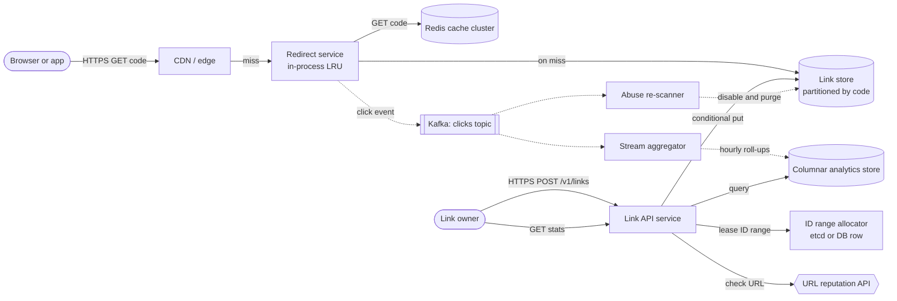

**Reading the diagram.** Two independent paths share one store. The **read path** (top) runs left to right and is entirely synchronous: the CDN or edge answers repeated redirects for popular codes; misses reach the stateless redirect service, which checks its in-process LRU cache, then the Redis cluster, then the partitioned link store. The **write path** (lower left) is also synchronous: the link API leases a block of counter values from the range allocator (rarely, once per 10,000 creates), checks the destination against a reputation service, and writes the link with a conditional put. Everything dotted is asynchronous: each redirect publishes a click event to Kafka without waiting for the outcome; a stream aggregator rolls events into hourly rows in the columnar store; an abuse re-scanner consumes the same stream (new and newly popular links) and disables bad links, purging caches. Storage boundaries: the link store is the source of truth; Redis and the CDN are disposable copies; Kafka retains raw clicks for a few days. Failure points: Redis loss shifts load to the link store (§52.4.11); Kafka unavailability must drop or buffer click events rather than block redirects; the range allocator is needed only when a node's block runs out. Scaling: redirect nodes and API nodes scale horizontally; the link store scales by adding partitions; Kafka by adding partitions keyed by code.

### 52.4.8 Detailed component design

#### Component 1: short-code generation

Five families of scheme are worth comparing. §17.10 covers the underlying ID generators; here we judge them against the shortener's specific needs: 7 characters, uniqueness, no coordination per create, and no enumeration.

**Table 52.3 — Short-code generation schemes compared.**

| Scheme | How it works | Length | Uniqueness | Coordination | Enumerable? | Main weakness |
|---|---|---|---|---|---|---|
| Hash and truncate | Base62 of the first 42 bits of SHA-256(long URL) | 7 | Collides; must detect and retry with a salt | None | No | Same URL from two users gets the same code; collision handling is a read-before-write |
| Random code | 7 random base62 characters, conditional insert, retry on conflict | 7 | Retry on conflict (5% chance at 10-year fill) | None | No | Retries grow as the keyspace fills |
| Global counter | One sequence, base62-encoded | 7 | Guaranteed | Round trip per create | Yes: `…0001`, `…0002` | Bottleneck and enumeration |
| Counter ranges, scrambled | Nodes lease blocks of counters; a keyed permutation maps counter → code | 7 | Guaranteed | One lease per block | No (without the key) | Needs a durable allocator and a secret key |
| Snowflake-style 64-bit ID | Timestamp + machine + sequence (§17.10.3), base62-encoded | 11 | Guaranteed | Assign machine IDs once | Partly: time-ordered | Too long: $62^{10} < 2^{63} < 62^{11}$ |

Hashing the long URL is the classic first answer, and it has a real benefit: the same long URL always yields the same code, which deduplicates. But the benefit is often unwanted (two marketers shortening the same page want separate click counts), and truncation to 42 bits makes collisions certain at scale. By the birthday bound (§17.10.2), with $N = 62^7 = 3.52 \times 10^{12}$ codes and $n = 1.825 \times 10^{10}$ links in the first year, the expected number of colliding pairs is $n^2 / (2N) = 4.7 \times 10^7$. Every create therefore needs "insert if absent; on conflict, check whether it is the same URL; if not, re-hash with a salt", which is the random-code scheme with extra steps.

**Random codes** are honestly fine at this scale: at 5.2% fill after ten years, one insert in 19 needs a retry, and a conditional insert detects the conflict in the same round trip. Their cost is that the collision rate rises with fill and that every create is a conditional write, which some stores make more expensive.

**Snowflake IDs** are excellent database keys but poor short codes. A 64-bit value needs 11 base62 characters, and the embedded timestamp leaks creation time and lets an attacker guess neighbors.

::: industry
**Twitter Snowflake.** Twitter built Snowflake in 2010 to generate roughly time-ordered 64-bit IDs without coordination when it moved storage away from MySQL; IDs combine a millisecond timestamp, a machine number and a per-machine sequence [Twitter: Snowflake 2010]. The design targets database keys, where 64 bits and time order are virtues. For a shortener the same properties are drawbacks: 11 characters instead of 7, and codes that reveal when they were created. Section 17.10.3 covers the layout.

*Evidence: Primary* — [Twitter: Snowflake 2010]
:::

**The chosen design: leased counter ranges plus a keyed permutation.** Each link API node leases a block of, say, 10,000 consecutive counter values from a range allocator, the same idea as Flickr's ticket servers fetching blocks (§17.10.5). The allocator is a single row updated with compare-and-set in a strongly consistent store (etcd, ZooKeeper, or a relational table): "if `next = 4,200,000`, set `next = 4,210,000`". At 2,778 creates per second at peak and 10,000 per block, the allocator sees one request every 3.6 seconds, so its availability matters but its throughput does not. A node that crashes loses the unused part of its block, which wastes at most 10,000 codes per crash out of 3.52 trillion.

A counter alone is enumerable, so the node passes each counter value through a **keyed pseudorandom permutation** of $[0, 62^7)$ before base62-encoding it. A permutation is a one-to-one mapping, so distinct counters give distinct codes, and without the key consecutive counters map to unrelated codes. A four-round Feistel network over 42 bits with an HMAC round function is a small block cipher; because $2^{42} = 4.40 \times 10^{12}$ exceeds $62^7$ by a factor of only 1.25, **cycle-walking** (re-encrypting until the result falls inside the range) takes 1.25 encryptions on average.

**Figure 52.2 — Code generation with leased ranges and a keyed permutation.**

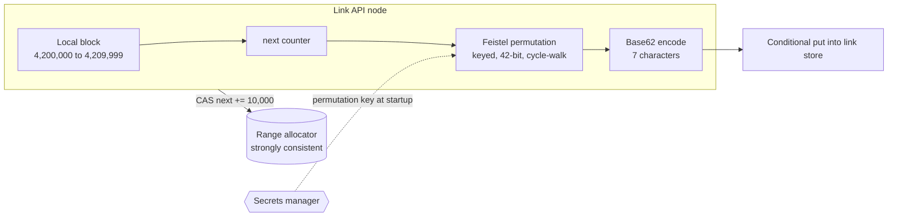

**Reading the diagram.** Inside each API node (the subgraph), a create takes the next counter from the node's local block, permutes it with a secret key, and encodes it as seven base62 characters, all in memory with no network call. Only when the block is exhausted does the node make one synchronous compare-and-set call to the range allocator, a strongly consistent single-row store. The permutation key comes from a secrets manager once at startup (dotted, asynchronous with respect to requests). The final conditional put is a safety net: it should never conflict, and a conflict signals a bug such as two nodes holding the same block. Failure points: an unavailable allocator stops creation only after the local block runs out (with ten API nodes sharing 2,778 creates/s, a 10,000-code block lasts each node 36 s at peak; nodes prefetch the next block at 50% use, and larger blocks buy longer outages); a leaked key makes codes predictable again but not colliding. Scaling: larger blocks reduce allocator traffic linearly.

```python
import hashlib
import hmac

ALPHABET = "0123456789ABCDEFGHIJKLMNOPQRSTUVWXYZabcdefghijklmnopqrstuvwxyz"
LENGTH = 7
SPACE = 62 ** LENGTH                      # 3,521,614,606,208 possible codes
HALF_BITS = 21                            # Feistel works on 2 x 21 = 42 bits >= SPACE


def base62(n: int, length: int = LENGTH) -> str:
    """Fixed-width base62: 0 -> '0000000'."""
    chars = []
    for _ in range(length):
        n, r = divmod(n, 62)
        chars.append(ALPHABET[r])
    assert n == 0, "value does not fit"
    return "".join(reversed(chars))


def _round(key: bytes, i: int, half: int) -> int:
    mac = hmac.new(key, f"{i}:{half}".encode(), hashlib.sha256).digest()
    return int.from_bytes(mac[:4], "big") & ((1 << HALF_BITS) - 1)


def feistel42(x: int, key: bytes, rounds: int = 4) -> int:
    """Keyed permutation of the 42-bit integers (a tiny block cipher)."""
    mask = (1 << HALF_BITS) - 1
    left, right = x >> HALF_BITS, x & mask
    for i in range(rounds):
        left, right = right, left ^ _round(key, i, right)
    return (left << HALF_BITS) | right


def scramble(counter: int, key: bytes) -> int:
    """Permute [0, SPACE) onto itself by cycle-walking: re-encrypt until in range."""
    assert 0 <= counter < SPACE
    x = feistel42(counter, key)
    while x >= SPACE:                     # 2^42 / 62^7 = 1.25, so ~1.25 rounds on average
        x = feistel42(x, key)
    return x


def short_code(counter: int, key: bytes) -> str:
    return base62(scramble(counter, key))


KEY = b"rotate-me-via-your-secret-manager"
codes = [short_code(c, KEY) for c in range(1, 200_001)]
assert len(set(codes)) == len(codes)           # a permutation never collides
print([short_code(c, KEY) for c in range(1, 6)])
print("max code:", base62(SPACE - 1), "| sequential base62 of 1..3:", [base62(c) for c in (1, 2, 3)])
```

Output:

```text
['IBvB4nl', 'tD3NOix', 'ZVpe8s5', 'Pz8JF2G', 'gzwMZQ7']
max code: zzzzzzz | sequential base62 of 1..3: ['0000001', '0000002', '0000003']
```

What to notice:

- Counters 1 to 5 produce unrelated codes, while plain base62 of the same counters is `0000001`, `0000002`, `0000003`: the permutation is what defeats enumeration.
- The assertion checks 200,000 consecutive counters for collisions. A Feistel network is invertible for any round function, so it is a permutation by construction, and cycle-walking preserves that property on the smaller range.
- The key cannot be rotated without changing future codes' mapping, which is harmless (existing codes are stored, not recomputed), but two nodes must never use different keys over the *same* counter range, or two counters could map to one code. Version the key together with the range allocator's state.
- This is obfuscation against enumeration, not authorization. A link that must stay private needs an access check, not just an unguessable code (§17.10, "Sequential IDs in URLs are harmless" misconception).

#### Component 2: the redirect path and caching

The redirect has a budget of 20 ms at p99 inside the region, and most of it should be unused. The lookup goes through four layers, each absorbing most of the traffic that reaches it: the CDN or edge (for very popular links), the redirect node's in-process LRU cache (a few gigabytes per node, sub-microsecond hits), the shared Redis cluster (about 0.5 ms within the datacenter), and the link store (a few milliseconds).

The most consequential decision is the **HTTP status code**, because it decides who else caches the redirect.

**Table 52.4 — Redirect status codes for a shortener.**

| Status | Meaning (RFC 9110) | Browser caching | Analytics accuracy | Choose when |
|---|---|---|---|---|
| 301 Moved Permanently | Permanent; method may change to GET | Cacheable by default; browsers may reuse it indefinitely without asking you again | Poor: repeat clicks from one browser never reach you | No analytics; you want to minimize load |
| 302 Found | Temporary; method may change to GET | Not cached unless `Cache-Control` allows it | Good | Default for a shortener with analytics |
| 307 Temporary Redirect | Temporary; method preserved | As 302 | Good | Redirecting non-GET requests (rare here) |
| 308 Permanent Redirect | Permanent; method preserved | As 301 | Poor | APIs that move permanently |

This design returns **302 with `Cache-Control: private, max-age=90`**. The `private` directive keeps shared caches from storing a response that the analytics pipeline needs to see, while still letting one browser reuse the redirect for 90 seconds (a double-click or a back-and-forward does not count twice). For the hottest links, the CDN runs a small edge function that serves the redirect from edge cache *and* emits the click event itself, so analytics stays correct without the request reaching the origin (§21.9).

Three cache problems from Chapter 20 show up here in specific forms:

- **Cache penetration (§20.12).** Attackers and broken crawlers request random codes that do not exist; each miss reaches the link store. Cache negative results ("code not found") for 60 seconds, and reject malformed codes (wrong length or alphabet) before any lookup.
- **Hot keys (§20.15).** A link in a viral post can draw 50,000 RPS by itself, all hashing to one Redis shard. The in-process LRU absorbs this, because every redirect node caches the hot code locally; the shard sees at most one request per node per TTL.
- **Invalidation after takedown (§20.10).** Because links are immutable, the only invalidation is disabling a link for abuse. The disable flow writes `status = 2` to the link store, deletes the Redis key, broadcasts an invalidation message that redirect nodes subscribe to, and purges the CDN. The 90-second browser cache is the residual exposure, which is why the `max-age` stays short.

#### Component 3: the analytics write path

At 280,000 redirects per second, the click stream is the system's largest write load, so it must stay completely off the redirect's critical path. The redirect node appends the event (code, timestamp, hashed IP, user agent class, referrer domain, country from a GeoIP lookup) to an in-memory buffer and returns the redirect immediately. A background thread batches events and produces them to a Kafka topic partitioned by code (§31.5, §31.6). If Kafka is unreachable, the buffer fills to a bound (say 100 MB per node) and then *drops events and counts the drops*. Losing some analytics during an outage is acceptable; slowing redirects is not.

Downstream, a stream processor (§29.8) filters bots (known user agents, data-center IP ranges, inhumanly fast repeats), then aggregates per code per hour: a click count, a HyperLogLog sketch of hashed visitor identifiers for approximate unique visitors (§17.5), and per-dimension counters for referrers and countries. Writing roll-ups, not raw events, shrinks 1 TB per day of raw clicks to a few gigabytes of hourly rows. Raw events stay in Kafka for 7 days and in cheap object storage for 30 days, for reprocessing when the bot filter improves. If you need exact counts despite at-least-once delivery from Kafka, make the aggregator's writes idempotent per (partition, offset range) (§32.10); most shorteners accept counts that are accurate to well within 1%.

#### Component 4: abuse and spam

The abuse pipeline has three stages:

1. **At creation (synchronous).** Validate the URL syntax and scheme (`http` and `https` only; reject `javascript:` and `data:` URLs). Look the destination up in a URL reputation service and in your own blocklist of domains. Reject destinations that are themselves short links from your own domain, to prevent redirect loops and chains that hide the final target. Rate-limit creation per account and per IP with the service of §52.6, because abuse arrives in bulk.
2. **After creation (asynchronous).** Destinations change after the link is created: a harmless page can turn into a phishing page a week later. Re-scan links when they are created, when they first become popular (a sudden click spike is itself a signal), and periodically.
3. **On report or detection.** Disable the link (`status = 2`), serve an interstitial warning page with 410 Gone instead of the redirect, and purge caches as described above.

::: industry
**Google Safe Browsing.** Google offers the Safe Browsing APIs, which let applications check URLs against Google's continuously updated lists of unsafe web resources (social engineering, malware, unwanted software). The Lookup API sends URLs to Google for a verdict; the Update API keeps a local database of hashed URL prefixes so that most checks happen locally and only potential matches are confirmed with the server, which also limits what the client reveals [Google: Safe Browsing APIs]. A shortener can call such a service synchronously at creation and re-check asynchronously later. Check the current terms of use and versions before relying on a specific API for commercial use.

*Evidence: Primary* — [Google: Safe Browsing APIs]
:::

### 52.4.9 Data flow

**Figure 52.3 — Write path: creating a short link.**

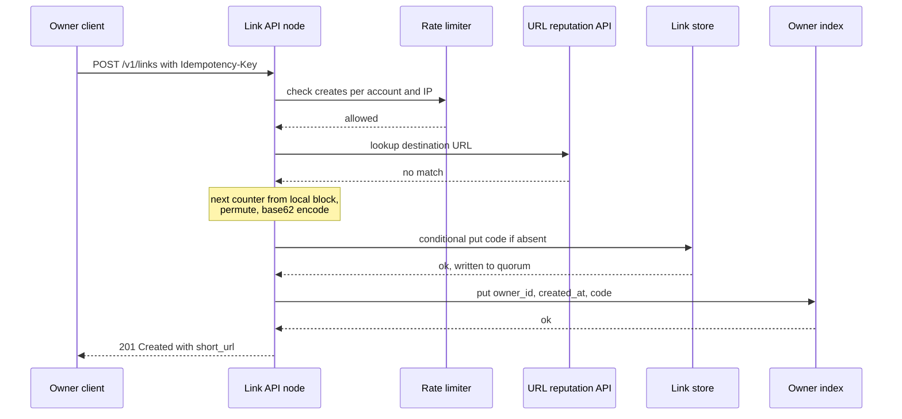

**Reading the diagram.** All calls are synchronous. The API node first consults the rate limiter (§52.6) and the reputation service; a timeout from the reputation service falls back to an asynchronous re-scan rather than failing the create, a deliberate fail-open choice for a check that is repeated later. Code generation happens in memory. The conditional put is the commit point: once the link store acknowledges a quorum write, the link exists and is durable. The owner-index write follows; if it fails, the client still gets 201 and a change-stream consumer repairs the index. The idempotency key (stored with the response for 24 hours, §22.15) makes a retried request return the same code. Failure points: link store unavailable (return 503; the client retries with the same key); allocator unavailable (invisible until the local block runs out). Scaling: API nodes are stateless apart from their counter block.

**Figure 52.4 — Read path: following a short link.**

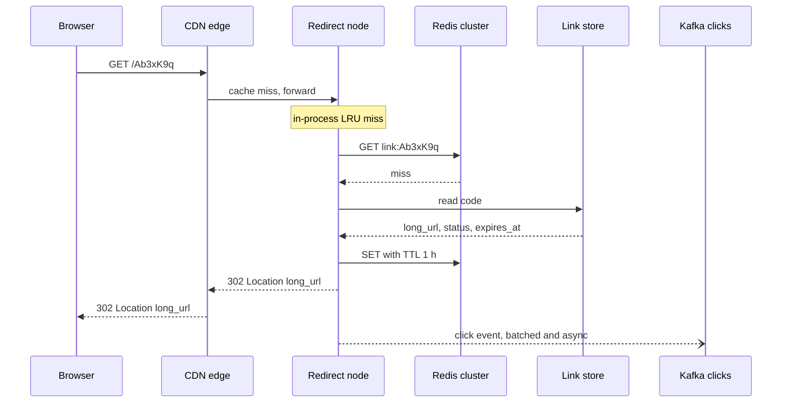

**Reading the diagram.** This is the worst case, a miss at every layer; in steady state about 95% of requests stop at the edge, the in-process cache or Redis. The redirect node checks `status` and `expires_at` before answering, so expired and disabled links return 404 or 410 even if the cache still holds them. The click event (half-arrow) is fire-and-forget: it leaves the node in a batch after the response is sent. Concurrent misses for the same code are collapsed into one link-store read by single-flight (§20.11.1). Failure points: Redis down (the node falls through to the store; latency rises to a few milliseconds), link store partition unavailable (cached links keep working; uncached ones fail). Scaling: add redirect nodes and Redis shards; the edge absorbs the hottest links.

### 52.4.10 Bottlenecks

1. **Link store reads on cache misses.** The read rate the store sees is $R_{peak} \times (1 - \text{hit ratio})$; a cold cache after a Redis failure can multiply it by 20 (§20.13 on cache avalanche). Warm replacement nodes before they take traffic, and keep in-process caches as a second line.
2. **Hot links.** A single code at 50,000 RPS overloads one Redis shard; in-process caching and edge caching are the fix, not more shards.
3. **The click pipeline.** At 56 MB/s at peak it is the largest data flow. Size Kafka partitions for it (§31.13) and make sure backpressure drops events rather than blocking redirects.
4. **Creation-time reputation checks.** An external dependency with its own latency and quotas; cache verdicts per domain for a few minutes.

### 52.4.11 Failure scenarios

**Table 52.5 — URL shortener failure scenarios.**

| What fails | Impact | Detection | Recovery | Prevention |
|---|---|---|---|---|
| Redis cluster or a shard | Miss rate jumps; store read rate up to 20× | Hit-ratio and store-RPS alerts | Fall through to store; refill gradually | In-process LRU; replicas per shard; request coalescing |
| One link-store partition | Uncached codes on it fail (~5% of their traffic) | Error rate per partition | Replica takes over (§27.11) | Replication factor 3 across zones |
| Range allocator | No new blocks; creates fail once local blocks run out | Allocator health; block-refill errors | Restore quorum; nodes retry with backoff | Prefetch at 50%; strongly consistent replicated store |
| Two nodes hold the same block (bug or restored backup) | Code collisions; second write rejected | Conditional-put conflicts (should be zero) | Abandon the block, lease a new one | Never restore the allocator from backup without jumping `next` forward by a safety margin |
| Kafka unavailable | Analytics gap | Producer error and drop counters | Buffer, then drop; replay from edge logs if needed | Multi-zone Kafka; bounded buffers |
| Permutation key leaked | New codes predictable | Security incident | Rotate key with a new allocator epoch | Key in a secrets manager; short access list |
| Malicious link goes viral | Users phished; domain blocklisted by browsers | Click spike plus reputation re-scan | Disable, purge caches, interstitial | Creation checks, re-scans on spikes, report flow |
| Region outage | Redirects fail for users routed there | Health checks, synthetic probes | DNS or anycast failover to another region (§44.11) | Link data replicated to every serving region |

### 52.4.12 Scaling strategy

**At 10× (500 million creates/day, 2.8 million redirect RPS at peak).** The design holds in shape. Redirect nodes grow to about 470 at 10,000 RPS each, and serving from the edge becomes the main lever: moving the redirect logic and a replicated read-only copy of hot links into CDN edge functions removes most origin traffic. Ten-year storage grows to about 2.7 PB with three replicas; tier links not clicked for a year to cheaper storage (§15.9). The allocator still sees fewer than three requests per second at 10,000 codes per block.

**At 100× (5 billion creates/day).** Ten years now means 18.25 trillion links, which overflows $62^7$; move to 8-character codes ($62^8 = 2.18 \times 10^{14}$, 8.4% fill) and widen the permutation to 48 bits. Serve redirects from every region with a fully replicated link store (asynchronous cross-region replication is acceptable because links are immutable and read-your-writes is only needed in the creator's region, where the read goes to the local replica that took the write). The analytics path becomes the dominant cost; sample raw events for low-value links and keep exact counts only for paid accounts.

### 52.4.13 Trade-offs

- **302 versus 301:** correct analytics and the ability to disable links, in exchange for more requests reaching you.
- **Counter ranges versus random codes:** no collisions and no retries, in exchange for an allocator to operate and a key to protect. Random codes are a perfectly defensible choice at this scale; say so in an interview.
- **Immutable links:** trivial caching and no invalidation storms, in exchange for a product feature (editing the destination). If you add editing, the redirect cache needs versioned keys or event-driven invalidation (§20.10).
- **Dropping click events under pressure:** redirect availability, in exchange for occasional analytics gaps.
- **No deduplication of long URLs:** separate statistics per link, in exchange for more rows.

### 52.4.14 Alternative designs

- **Relational database with a sequence (small scale).** At 1 million links a day, one PostgreSQL primary with a `BIGSERIAL` key, base62-encoded and permuted, plus a read replica and Redis, is simpler and entirely adequate. Move to a partitioned store when the table approaches a few billion rows.
- **Pre-generated key service.** A batch job generates random unused codes in advance and stores them in a "free codes" table; API nodes claim batches. It avoids collisions at write time, but it is a second stateful store with the same failure modes as the range allocator and more data.
- **Edge-native shortener.** Store links in a globally replicated edge key-value store and run the redirect entirely in CDN edge functions (§48). Latency is excellent; consistency after creation depends on the edge store's replication delay, often seconds, which conflicts with "redirects everywhere within 1 s".

### 52.4.15 Interview discussion

**Table 52.6 — 45-minute plan for the URL shortener.**

| Minutes | Focus | What to produce |
|---|---|---|
| 0–5 | Requirements | Create, redirect, analytics, expiry, custom alias; 100:1 read ratio; 99.99% redirects |
| 5–10 | Estimates | 280,000 redirect RPS at peak, 2,800 creates/s, 182.5 billion links, 7 characters |
| 10–15 | API and data model | `POST /v1/links`, `GET /{code}` with 302; table keyed by code |
| 15–22 | Architecture | Figure 52.1: cache layers, link store, async click stream |
| 22–35 | Deep dive: code generation | Hash vs random vs counter ranges vs Snowflake; permutation against enumeration |
| 35–42 | Redirect caching, hot keys, analytics, abuse | 301 vs 302; negative caching; Kafka roll-ups; takedown flow |
| 42–45 | Failures and scaling | Redis loss, allocator loss, 8-character codes at 100× |

**Likely follow-ups.**

- *"Why not just hash the URL?"* Truncated hashes collide at billions of links (tens of millions of colliding pairs in the first year), so you still need conflict detection; and identical URLs from different users share a code and its statistics.
- *"How do you stop someone enumerating all links?"* Permute the counter with a keyed permutation or use random codes; rate-limit 404s per client; and never rely on obscurity for private content.
- *"What if a user wants the same short link every time for the same URL?"* Add a `(owner_id, sha256(long_url)) → code` index and check it before creating.
- *"How do you expire links?"* Check `expires_at` on every redirect (correctness), and delete expired rows lazily or with a background sweep (cost); §52.5.8 covers TTL cleanup at scale.

**What distinguishes senior and staff answers.** A senior candidate quantifies the read path, picks 302 with a reason, and handles hot keys and cache penetration. A staff candidate also notices that the click stream is the largest write load, treats abuse as a first-class subsystem that protects the domain's reputation, discusses the allocator as a durable-state hazard (backups that rewind `next`), and frames code length as an evolvable parameter.

### 52.4.16 Production considerations

- **Observability.** Track redirect p50/p99 per layer, cache hit ratio per layer, 404 rate (a rising rate signals enumeration or broken campaigns), click-event drop counts, allocator lease latency, and the age of the newest roll-up (analytics freshness SLO, §39.6).
- **Security.** Serve only HTTPS with HSTS on the short domain; never redirect to non-HTTP schemes; sign the abuse-takedown API; and keep hashed, not raw, IPs in click events to limit personal data (§50).
- **Cost.** Redirect compute and egress are small; analytics storage and stream processing dominate. Roll-ups, short raw retention and sampling keep the bill proportional to value.
- **Operations.** Run synthetic probes that create a link and follow it from every region every minute; that single check exercises the allocator, the store, replication and the redirect path. Keep the short domain on a separate registrar account with locked DNS: losing the domain loses every link ever issued.

## 52.5 Pastebin

### 52.5.1 Problem statement

Design a service where users paste text (code, logs, configuration) and get back a link to share it. Pastes can be public, unlisted or private, can expire after a chosen time, and can be "burn after reading" (deleted after the first view).

At first glance this is a URL shortener whose value is a document instead of a URL, and the code generation of §52.4.8 carries over unchanged. Three things are different and form the hard problems of this case:

1. **The blob/metadata split (the distinctive hard problem).** Values range from a few bytes to 10 MB. Large values do not belong in the same store as the small, frequently updated records that describe them.
2. **Expiration at scale.** Most pastes expire. Making an expired paste *invisible* is easy; *deleting* millions of objects and rows per day, on time and cheaply, from two different stores without leaving orphans, is not.
3. **Access control.** Private pastes must not leak through caches, CDNs or guessable URLs, and the content path must enforce the same rules as the metadata path.

### 52.5.2 Functional requirements

- **Create** a paste: content up to 10 MB, optional title, syntax-highlighting language, visibility (`public`, `unlisted`, `private`), expiry (10 minutes, 1 hour, 1 day, 1 week, 30 days, never) and a burn-after-read flag.
- **Read** a paste by its code: rendered page (`/p/{code}`) and raw text (`/raw/{code}`).
- **Private pastes** are readable only by the owner and users the owner shares with; optional password protection.
- **Delete** a paste (owner) and report abusive pastes (anyone).
- **List** an owner's pastes, and a public "recent pastes" feed of public pastes only.

Out of scope: real-time collaborative editing, full-text search across pastes (§16 would supply it), comments.

### 52.5.3 Non-functional requirements

| Property | Target |
|---|---|
| Read availability | 99.95% per month |
| Create availability | 99.9% per month |
| Read latency | p99 ≤ 100 ms for pastes ≤ 100 KB, server-side; p99 ≤ 50 ms for public pastes served from the CDN |
| Create latency | p99 ≤ 500 ms for pastes ≤ 1 MB |
| Durability | Acknowledged pastes survive until they expire: ≥ 99.999999999% annual object durability (the class object stores are designed for, §15.6) |
| Expiry correctness | An expired paste is never served (0 s grace); its bytes are physically deleted within 24 h for pastes with expiry ≥ 1 day, within 1 h otherwise |
| Access control | A private paste is never served to an unauthorized user from any cache layer |
| Burn after reading | Served at most once, even under concurrent reads |

Two of these are unusual. The *expiry* target separates logical deletion (immediate, a correctness rule) from physical deletion (bounded lag, a cost and privacy rule). The *burn-after-read* target is a concurrency requirement: two simultaneous readers must not both see the content.

### 52.5.4 Capacity estimation

::: example
**Worked example — Pastebin request rates and bandwidth.**

*Assumptions.* 10 million pastes created per day; 5 reads per paste (read:write = 5:1); mean paste size 20 KB (the median is about 2 KB, but a few large log dumps pull the mean up); $h = 0.10$, $b = 2$.

1. Creates, peak: $10^7 \times 0.10 / 3{,}600 \times 2 = 556$ per second.
2. Reads per day: $5 \times 10^7$; peak: $5 \times 10^7 \times 0.10 / 3{,}600 \times 2 = 2{,}778$ RPS.
3. Ingress at peak: $556 \times 20\ \text{KB} = 11\ \text{MB/s}$.
4. Egress at peak: $2{,}778 \times 20\ \text{KB} = 55.6\ \text{MB/s} = 444\ \text{Mbps}$.

*Interpretation.* Request rates are modest; one region with a CDN in front handles them easily. *Engineering implication.* The design is driven by storage shape and lifecycle, not by throughput.
:::

::: example
**Worked example — Storage, with expiry.**

*Assumptions.* Expiry mix: 10 minutes 5%, 1 hour 15%, 1 day 20%, 1 week 15%, 30 days 15%, never 30%. Metadata 400 bytes per paste. Creation rate $\lambda = 10^7 / 86{,}400 = 115.7$ pastes/s.

1. Live expiring pastes at steady state, by Little's Law $L = \lambda W$ (§4.11), summed over expiry classes:
   - 10 min: $115.7 \times 0.05 \times 600 = 3{,}472$
   - 1 h: $115.7 \times 0.15 \times 3{,}600 = 62{,}500$
   - 1 day: $115.7 \times 0.20 \times 86{,}400 = 2{,}000{,}000$
   - 1 week: $115.7 \times 0.15 \times 604{,}800 = 10{,}500{,}000$
   - 30 days: $115.7 \times 0.15 \times 2{,}592{,}000 = 45{,}000{,}000$
   - Total ≈ 57.6 million pastes × 20 KB ≈ **1.15 TB**, constant over time.
2. Never-expiring pastes accumulate: $10^7 \times 0.30 \times 365 = 1.095 \times 10^9$ per year × 20 KB = **21.9 TB per year**.
3. Metadata: $10^7 \times 400\ \text{B} \times 365 = 1.46\ \text{TB}$ per year written; about 0.44 TB per year of it remains (the 30% that never expire).
4. Physical deletions: 70% of pastes expire, so $7 \times 10^6$ per day at steady state: 81/s on average, $7 \times 10^6 \times 0.10 / 3{,}600 \times 2 = 389$/s at peak, because expirations follow the creation curve shifted by the TTL.

*Interpretation.* Although 70% of pastes expire, the 30% that never expire hold 95% of the stored bytes after one year (21.9 TB versus 1.15 TB). *Engineering implication.* The biggest storage lever is product policy (for example, "never" pastes on the free tier expire after a year without reads), not the deletion machinery. The deletion machinery matters for correctness, privacy and keeping the metadata store small, at roughly 400 deletes per second at peak.
:::

**Table 52.7 — Pastebin capacity summary.**

| Quantity | Value | Consequence |
|---|---|---|
| Peak creates / reads | 556/s / 2,778 RPS | Small stateless fleet; CDN for public pastes |
| Peak egress | ≈ 444 Mbps | Serve public content from the CDN |
| Live expiring content | ≈ 1.15 TB (steady) | Lifecycle machinery, not capacity, is the challenge |
| Permanent content growth | ≈ 21.9 TB/yr | Object storage with lifecycle tiering (§15.9) |
| Metadata | ≈ 1.46 TB/yr written | A partitioned key-value store or sharded relational store |
| Physical deletes | 7 million/day; ≈ 389/s at peak | A dedicated expiry pipeline |

### 52.5.5 API design

```text
POST /v1/pastes                                (anonymous or authenticated; Idempotency-Key)
  request:  { "title": "nginx.conf", "language": "nginx", "visibility": "private",
              "expires_in": "1d", "burn_after_read": false, "size_bytes": 4096,
              "content": "<inline if <= 1 MB>" }
  201:      { "code": "Qk7Lm2x", "url": "https://paste.example/p/Qk7Lm2x",
              "expires_at": "2026-11-06T10:15:02Z",
              "upload_url": null }                  // presigned PUT URL when size > 1 MB
POST /v1/pastes/{code}/complete                     (after a direct upload; verifies size and checksum)

GET  /p/{code}       HTML page                      public: CDN-cacheable; private: no-store
GET  /raw/{code}     text/plain                     same visibility rules
  404 not found or expired · 403 forbidden (private) · 410 gone (burned or removed)

PUT    /v1/pastes/{code}/acl   { "readers": ["user:123", "group:ops"] }   (owner)
DELETE /v1/pastes/{code}                                                  (owner)
GET    /v1/pastes?owner=me&cursor=...                                     (owner)
```

Large pastes do not stream through the API servers. Above 1 MB the API returns a short-lived **presigned upload URL** (§15.8.2) scoped to one object key, one method and the declared size; the client uploads directly to object storage and then calls `complete`, which verifies the object's size and checksum and flips the paste to `active`. The same pattern serves large private pastes for reading: the API checks authorization and returns a 302 to a presigned GET URL valid for 60 seconds.

### 52.5.6 Data model and database schema

```sql
CREATE TABLE pastes (
  code            VARCHAR(16) PRIMARY KEY,     -- generated as in §52.4.8
  owner_id        BIGINT,                      -- NULL for anonymous pastes
  title           VARCHAR(200),
  language        VARCHAR(32),
  visibility      SMALLINT NOT NULL,           -- 0 public, 1 unlisted, 2 private
  password_hash   VARCHAR(100),                -- Argon2id, optional (§10.6)
  size_bytes      INT      NOT NULL,
  storage         SMALLINT NOT NULL,           -- 0 inline, 1 object store
  inline_content  BYTEA,                       -- present when storage = 0 (<= 8 KB compressed)
  object_key      VARCHAR(100),                -- e.g. 'b/7d/2026-11-12/Qk7Lm2x', when storage = 1
  sha256          BYTEA    NOT NULL,
  created_at      TIMESTAMP NOT NULL,
  expires_at      TIMESTAMP,                   -- NULL = never
  burn_after_read BOOLEAN  NOT NULL,
  state           SMALLINT NOT NULL            -- 0 pending upload, 1 active, 2 burned, 3 deleted
);

CREATE TABLE paste_acl (code VARCHAR(16), principal VARCHAR(64), PRIMARY KEY (code, principal));

-- Expiry index: one partition per (hour bucket, shard), so sweeps read whole partitions in order.
CREATE TABLE expiry_index (
  bucket_hour  TIMESTAMP,        -- expires_at truncated to the hour
  shard        SMALLINT,         -- 0..63, hash(code) mod 64, spreads one hour across partitions
  code         VARCHAR(16),
  PRIMARY KEY ((bucket_hour, shard), code)
);
```

**The blob/metadata split.** Metadata is small, structured, read on every request and updated (state changes, ACL edits, burn). Content is immutable, variable in size and mostly large in bytes but small in count. Putting 10 MB values in a key-value store row hurts it in several ways: compaction rewrites them repeatedly (§13.9, write amplification), replication streams carry them, and cache layers fill with a few large values. Object storage (§15.4) is built for exactly the opposite profile: immutable blobs, cheap per gigabyte, designed for very high durability, with lifecycle rules. So content goes to the object store under a key derived from the paste code, and metadata goes to a partitioned key-value or relational store keyed by code.

**The inline optimization.** Object stores have a per-request cost and a first-byte latency of tens of milliseconds. With a 2 KB median, most pastes are tiny, so the split is applied by size: content of 8 KB or less after compression is stored inline in the metadata row; larger content goes to the object store. Assuming 60% of pastes fall under the threshold, object PUTs drop from 10 million to 4 million per day (about $20 per day at a list price of $0.005 per 1,000 PUTs, as of 2026), and most reads need a single metadata lookup.

**Object key layout.** The key `b/7d/2026-11-12/Qk7Lm2x` encodes the expiry class (`7d`) and expiry date. Grouping objects by expiry class lets the object store's own lifecycle rules delete them (§52.5.8), and the per-day component makes bulk inventory and reconciliation cheap. A leading component with enough distinct values spreads load across the store's internal partitions, which modern object stores handle automatically but which still helps very high request rates (§15.4).

### 52.5.7 High-level architecture

**Figure 52.5 — Pastebin high-level architecture.**

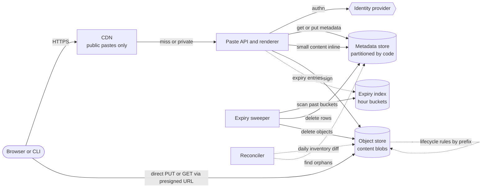

**Reading the diagram.** The read path runs from the client through the CDN, which caches only public pastes, to the stateless paste API, which reads metadata and, for small pastes, the inline content in one lookup. Large content moves directly between the client and the object store using short-lived presigned URLs, so the API never carries large bodies. The metadata store is the source of truth for whether a paste exists, is visible and has expired; the object store holds bytes and has no notion of visibility. The expiry machinery runs asynchronously (dotted): every create with an expiry also writes an entry into the hour-bucketed expiry index; the sweeper deletes metadata rows and objects for past buckets; object-store lifecycle rules delete whole expiry classes as a backstop; a daily reconciler compares an inventory of objects with the metadata store to find orphans in either direction. Failure points: a sweeper outage lets expired bytes linger (never served, because reads check `expires_at`); an object-store outage breaks reads of large pastes only. Scaling: the API scales horizontally; metadata by partitions; the sweeper by assigning bucket shards to workers.

### 52.5.8 Detailed component design

#### Component 1: content placement and the upload protocol

A create runs as a small state machine so that metadata and content never disagree in a way users can see:

1. The API validates the request, generates a code, and writes the metadata row with `state = pending` (or `active` directly for inline content).
2. For large content, the client uploads to the presigned URL. The object store holds the bytes; nothing references them as `active` yet.
3. `complete` reads the object's size and checksum, compares them with the declared values, and conditionally updates `state` from `pending` to `active`.
4. Pending rows older than one hour are abandoned uploads; the sweeper deletes them and their objects.

Because the metadata row is written *first* and flipped to `active` *last*, a reader can never see a paste whose content is missing. Orphaned objects (uploaded but never completed, or left behind by a failed delete) are possible but invisible; the reconciler removes them.

#### Component 2: expiration and TTL cleanup at scale

Expiration has two halves with different requirements.

**Logical expiry (correctness).** Every read compares `expires_at` with the current time and returns 404 if it has passed, regardless of whether the bytes still exist. Caches must respect this too: the CDN `max-age` for a public paste is the smaller of the normal cache lifetime and the time remaining until expiry, so an edge never serves a paste past its deadline.

**Physical deletion (cost and privacy).** Several mechanisms exist; production systems combine them.

**Table 52.8 — TTL cleanup mechanisms compared.**

| Mechanism | How it works | Timeliness | Cost | Weakness |
|---|---|---|---|---|
| Lazy deletion on read | Delete when a read finds the paste expired | Only for pastes that are read again | Free | Most expired pastes are never read again |
| Full-table scan | Periodically scan all rows for `expires_at < now` | Hours | Reads the entire table each pass | Cost grows with total rows, not with expirations |
| Database-native TTL | Store marks rows with a TTL; background process deletes | Best effort; DynamoDB says "within a few days" | Low | No deadline; LSM stores create tombstones (§13.9) |
| Time-bucketed expiry index | Write `(hour bucket, shard, code)` at create; sweep past buckets | Minutes | One extra write per paste | Index and data can diverge; needs reconciliation |
| Object-store lifecycle rules | Rule expires objects under a prefix or tag after N days | About a day, asynchronous | Free in requests | Day granularity; cannot express "10 minutes" |
| Partition drop | Store each time window in its own table or partition; drop it whole | Window size | Cheapest per row | Only works if everything in a window expires together |

This design uses the **time-bucketed expiry index as the primary mechanism**, with object lifecycle rules and a reconciler as backstops. The sweeper works like this:

1. Each worker owns a subset of the 64 shards (assigned by lease, §26.11). Every minute it reads the partitions `(bucket_hour, shard)` for hours that have fully passed and not yet been marked swept.
2. For each code, it re-reads the metadata row and confirms `expires_at` has passed (the owner might have changed the expiry), deletes the object if `storage = 1`, then deletes the metadata row, then the index entry.
3. When a partition is empty, the worker records the bucket as swept. Deletes are idempotent, so a worker that crashes halfway simply repeats the partition.

Reading by bucket makes the sweep's cost proportional to the number of *expiring* pastes (389 per second at peak), not to the table size. Sharding each hour into 64 partitions keeps any single partition from becoming a hot spot when many pastes share an expiry hour, and lets 64 workers sweep in parallel.

The **object-store lifecycle rules** act as a safety net for content: one rule per expiry class, for example "delete objects under `b/7d/` 8 days after creation". If the sweeper falls behind or loses track of an object, the store deletes it anyway, about a day late. "Never" objects live under a separate prefix with a tiering rule instead (move to an infrequent-access class after 90 days without reads, §15.9).

::: industry
**Amazon S3 lifecycle rules and DynamoDB TTL.** S3 lifecycle configurations can expire objects a set number of days after creation, filtered by key prefix or object tags; S3 queues objects for removal and deletes them asynchronously, so there can be a delay between the expiration date and actual removal, although billing for an expired object stops once it becomes eligible [AWS Docs: S3 Lifecycle]. DynamoDB TTL deletes items whose TTL attribute has passed, without consuming write throughput, typically within a few days of expiry; until then, expired items still appear in reads unless filtered [AWS Docs: DynamoDB TTL]. Both are background, best-effort mechanisms: they reduce cost, but neither replaces the read-time expiry check.

*Evidence: Primary* — [AWS Docs: S3 Lifecycle]; [AWS Docs: DynamoDB TTL]
:::

::: mistake
**"Set a TTL in the database and the problem is solved."** Database TTLs decide when bytes are *reclaimed*, not when data stops being *visible*. A paste that expired at 10:00 can be served at 10:05, or for days, unless every read checks `expires_at`. In LSM-based stores, mass expiry also produces tombstones that slow reads until compaction removes them; Cassandra-style stores recommend a time-window compaction strategy for TTL-heavy tables (§13.9).
:::

#### Component 3: access control for private pastes

**Table 52.9 — Paste visibility modes.**

| Mode | Who can read | Served by CDN? | Listed? | Enforcement |
|---|---|---|---|---|
| Public | Anyone | Yes, `Cache-Control: public` | Yes, in the recent feed | None beyond expiry and abuse checks |
| Unlisted | Anyone with the link | Yes | No | Unguessable code only (it is a capability URL) |
| Private | Owner and ACL principals | No: `Cache-Control: private, no-store` | No | Authentication plus ACL check on every request |
| Password | Anyone with link and password | No | No | Argon2id verification; rate-limited attempts |
| Client-encrypted | Anyone with the full link including key | Ciphertext may be cached | No | Decryption key in URL fragment, never sent to server |

Three rules make private pastes safe:

1. **Authorization happens on every request in the API**, never in the CDN or object store, which do not know about ACLs. Private responses carry `Cache-Control: private, no-store` and are never cached in shared layers (§21.6).
2. **Content URLs for large private pastes are presigned, short-lived (60 s) and generated only after the ACL check.** A presigned URL is a bearer token (§15.8.2): anyone holding it can read the object until it expires, so keep it short and never log it.
3. **The object store bucket blocks all public access.** Even public pastes are served through the CDN with origin authentication, not from a public bucket, so a misconfigured object cannot leak (threat T3 in Table 10.2, §10.3, is the same failure).

Burn-after-read needs one atomic step: a conditional update `SET state = burned WHERE code = ? AND state = active`, executed *before* returning content. Only the reader whose update succeeds receives the content; a concurrent reader's condition fails and it gets 410. The content is then deleted asynchronously. Never let a CDN cache a burn-after-read paste.

::: industry
**PrivateBin.** PrivateBin is an open-source pastebin in which the browser encrypts the paste with a random key before upload and places the key in the URL fragment (the part after `#`), which browsers do not send to the server; the server stores only ciphertext and cannot read pastes [PrivateBin]. This moves trust from the operator to the link: anyone who has the full URL can read the paste, and losing the URL loses the paste. It also makes server-side features such as abuse scanning and search impossible.

*Evidence: Primary* — [PrivateBin]
:::

### 52.5.9 Data flow

**Figure 52.6 — Write path: creating a large private paste.**

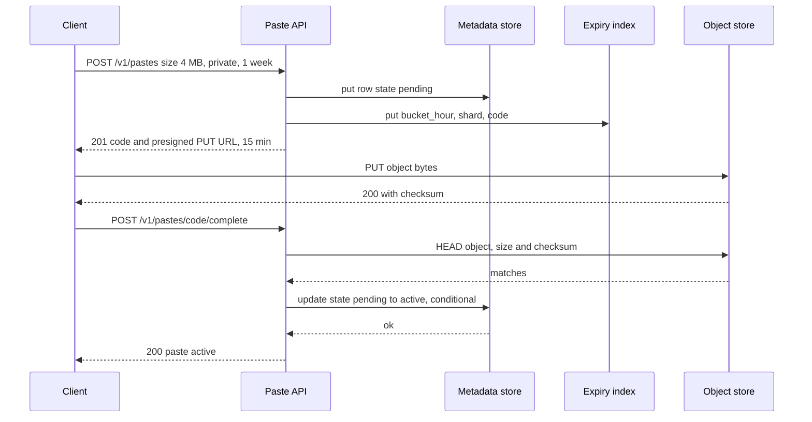

**Reading the diagram.** Every step is synchronous from the client's point of view, but the bytes travel directly from the client to the object store, bypassing the API. The metadata row exists from the first step in `pending` state, so the paste is never visible before its content is complete; the conditional update in the last step is the commit point. The expiry index entry is written at creation so the sweeper will find the paste even if the upload is abandoned. Failure points: the client never completes (the sweeper removes the pending row and object after an hour); the checksum does not match (the API deletes the object and leaves the paste pending). Scaling: upload bandwidth scales with the object store, not with the API fleet.

**Figure 52.7 — Read path: public and private pastes.**

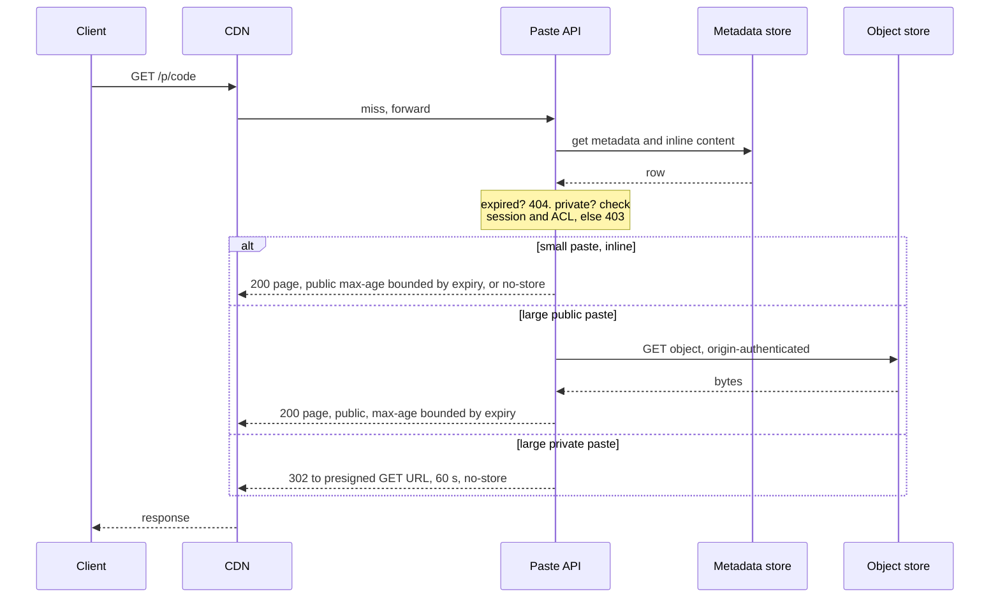

**Reading the diagram.** The CDN can answer repeated reads of public pastes; everything private passes through to the API. The metadata lookup is always first and decides existence, expiry and visibility before any content is touched. Small pastes are answered from the same row. Large public pastes are fetched by the API (or by the CDN directly with origin authentication) and cached with a lifetime that ends no later than the paste's expiry. Large private pastes get a short-lived presigned redirect issued only after the ACL check. Failure points: the object store is unavailable (small pastes still work; large pastes return 503); the metadata store is unavailable (cached public pastes still work; everything else fails). Scaling: CDN hit ratio for public pastes is the main lever on egress.

### 52.5.10 Bottlenecks

1. **Metadata store hot spots from the expiry index.** Without the shard component, all pastes expiring in the same hour land in one partition. With 64 shards, the peak hour's roughly 1.4 million entries ($389 \times 3{,}600$) spread to about 22,000 per partition.
2. **Object-store request rate for many small objects.** Inlining small pastes removes 60% of object requests.
3. **Egress for viral public pastes.** A paste linked from a popular forum behaves like a hot key; the CDN absorbs it, provided the response is cacheable.
4. **Abuse scanning.** Pastebins attract leaked credentials and malware payloads. Scanning 200 GB/day of new content for secrets and malware signatures is a significant asynchronous workload, separate from serving.

### 52.5.11 Failure scenarios

**Table 52.10 — Pastebin failure scenarios.**

| What fails | Impact | Detection | Recovery | Prevention |
|---|---|---|---|---|
| Expiry sweeper stops | Expired bytes linger; storage grows; privacy exposure in backups | Oldest unswept bucket age | Restart; workers catch up idempotently | Alert on sweep lag; lifecycle rules as backstop |
| Delete of metadata succeeds, object delete fails | Orphan object (invisible, costs money) | Daily inventory diff | Reconciler deletes orphan | Delete object first, then row; idempotent retries |
| Object store regional outage | Large pastes unreadable | Object GET error rate | Serve 503 with retry; optional cross-region replica | Cross-region replication for "never" pastes |
| Private paste cached by CDN | Data leak | Canary private pastes probed through the CDN | Purge CDN; rotate affected codes | `no-store` on private responses; tests in CI |
| Presigned URL logged or shared | Unauthorized read until URL expiry | Access logs show unexpected IPs | Shorten expiry; rotate signing key | 60 s expiry; strip query strings from logs |
| Concurrent burn-after-read readers | Content shown twice | Burn conflicts metric | None needed if conditional update is correct | Conditional state transition before returning content |
| Clock skew between API nodes | Pastes expire early or late by the skew | Clock offset monitoring (§24.9) | Fix NTP | Compare against store-assigned time where available |

### 52.5.12 Scaling strategy

**At 10× (100 million pastes per day).** Peak creates reach about 5,600/s and reads about 28,000 RPS; still a small fleet. Permanent storage grows by 219 TB a year, so tiering of cold "never" pastes to infrequent-access or archive classes (§15.9) becomes the main cost decision; restoring from archive classes can take minutes to hours, so show a "restoring" page. The sweeper handles about 3,900 deletes/s at peak; raise the shard count to 256.

**At 100×.** Content deduplication becomes worthwhile: identical log files and configuration snippets are pasted repeatedly. Store objects by content hash (`sha256`) with a reference count in metadata (§15.8), so deleting a paste decrements a count instead of deleting bytes. Reference counting brings its own hazard (a wrong count deletes shared content), so the reconciler must verify counts. Serve from multiple regions with metadata replicated asynchronously and content replicated on first remote read.

### 52.5.13 Trade-offs

- **Inline versus object storage:** one lookup and fewer requests for small pastes, in exchange for a larger metadata store and two code paths.
- **Expiry index versus native TTL:** bounded deletion lag and control, in exchange for an extra write per paste and a reconciler.
- **CDN for public pastes:** low latency and egress offload, in exchange for having to bound cache lifetimes by expiry and never misclassifying a private response.
- **Client-side encryption:** the operator cannot read pastes, in exchange for no server-side abuse scanning, no search and no recovery of lost links.

### 52.5.14 Alternative designs

- **Everything in one relational database.** Fine up to tens of gigabytes: `TEXT` columns, a `DELETE … WHERE expires_at < now() LIMIT 10000` job and an index on `expires_at`. It stops working when table bloat and replication of large values dominate.
- **Time-partitioned tables.** Keep one table per expiry day and drop whole tables. Deletion becomes nearly free, but lookups by code must either query several partitions or consult a code-to-partition index, and owner-initiated deletes still need row-level deletes.
- **Pure object store with metadata in object tags.** Simple, but authorization, listing by owner and burn-after-read all need conditional metadata updates that object stores support only partially; you end up rebuilding a metadata store.

### 52.5.15 Interview discussion

**Table 52.11 — 45-minute plan for Pastebin.**

| Minutes | Focus | What to produce |
|---|---|---|
| 0–5 | Requirements | Visibility modes, expiry options, burn after read, size limits |
| 5–10 | Estimates | 2,800 read RPS at peak, 21.9 TB/yr permanent, 7 million deletions/day |
| 10–15 | API and data model | Presigned upload flow; metadata row with inline content |
| 15–22 | Architecture | Figure 52.5 with the blob/metadata split |
| 22–35 | Deep dive: expiry | Logical versus physical deletion; bucketed index; lifecycle backstop; reconciler |
| 35–42 | Access control | CDN rules, presigned URLs, burn-after-read atomicity |
| 42–45 | Failures and scaling | Orphans, sweep lag, deduplication at 100× |

**Likely follow-ups.**

- *"Why not store pastes in the database?"* Size distribution and lifecycle: large immutable blobs inflate compaction, replication and caches; object storage is cheaper per byte and has lifecycle rules. Keep small pastes inline.
- *"How do you guarantee expired pastes are never shown?"* Check `expires_at` on every read and bound every cache lifetime by the remaining time to expiry; physical deletion is a separate, lagging process.
- *"How do you implement burn after reading?"* A conditional state transition before returning content; only one reader can win.
- *"What about the 10-minute expiry with day-granularity lifecycle rules?"* The read check makes it correct; the sweeper deletes within an hour; the lifecycle rule is only a backstop.

**What distinguishes senior and staff answers.** A senior candidate separates blobs from metadata and uses presigned URLs. A staff candidate notices from the estimate that permanent pastes dominate storage and proposes a product policy, distinguishes logical from physical deletion explicitly, designs reconciliation for the two stores, and treats private-content caching as a security property with tests.

### 52.5.16 Production considerations

- **Observability.** Sweep lag (age of the oldest unswept bucket), orphan counts from the reconciler, CDN hit ratio for public pastes, presigned URL issuance rate, and 403 rates on private pastes (a spike can indicate scraping).
- **Security.** Scan new content for leaked secrets and malware asynchronously; offer a fast abuse-takedown path; encrypt objects at rest with keys from a KMS (§10.9); keep presigned URLs out of logs. Treat "unlisted" as public in your threat model.
- **Cost.** Storage of permanent pastes dominates; tier and expire them by policy. Inline small pastes to cut request costs.
- **Operations.** Backups must honor expiry: restoring last week's backup must not resurrect expired or deleted pastes, so replay the deletion log after any restore, and keep backup retention shorter than the privacy promise.

## 52.6 Rate limiter (as a distributed service)

### 52.6.1 Problem statement

Design the rate-limiting service for a public API platform that serves 1 million requests per second at peak from three regions. Product teams declare limits ("each API key: 100 requests per second with bursts of 200"; "each tenant: 50,000 SMS sends per day"; "each IP: 10 failed logins per minute"), and every API gateway must enforce them on every request.

Chapter 22 already teaches the algorithms (§22.4–§22.7) and the basic distributed techniques (§22.8). This case does not re-derive them. It treats the limiter as a **shared service** that hundreds of gateways in several regions depend on, and its hard problems are therefore operational and distributed:

1. **Where the counters live (the distinctive hard problem).** A central store is exact but adds a network round trip to every request and concentrates hot keys; local counting is fast but overshoots. The design must mix them per rule.
2. **Atomicity.** Concurrent checks for the same key must not race (§22.8.2).
3. **Multi-region limits.** A tenant's limit is global, but a cross-region round trip costs 70–150 ms, more than the whole request budget.
4. **Failure policy.** When the limiter itself is slow or down, should requests pass (fail-open) or be rejected (fail-closed)? The answer differs by rule.

### 52.6.2 Functional requirements

- **Declarative rules.** A rule names a key template (API key, tenant, IP, user, endpoint, or combinations), an algorithm (token bucket, sliding window counter, concurrency limit), a rate and burst or window, a cost function (for example, a batch request costs 10), a scope (regional or global) and a failure mode.
- **Decision API.** Given request attributes, evaluate all matching rules and return allow or deny, the most restrictive remaining quota, and a retry-after time.
- **Shadow mode.** A new rule can run in "log only" mode, recording what it would have rejected, before enforcement (Stripe recommends this dark launch [Tarjan 2017]).
- **Dynamic configuration.** Rules and per-tenant overrides change without redeploying gateways and take effect within 30 seconds.
- **Client signaling.** Gateways return 429 with `Retry-After` and the draft `RateLimit` header fields (§22.3.4).
- **Usage visibility.** Tenants and operators can see current usage against limits.

### 52.6.3 Non-functional requirements

| Property | Target |
|---|---|
| Added latency | p99 ≤ 0.1 ms for local decisions; p99 ≤ 2 ms for centrally checked rules, in-region |
| Availability of the API | The limiter must never be the cause of API unavailability: a limiter outage degrades enforcement, not service |
| Limiter availability | 99.99% per month for the central tier |
| Accuracy, regional rules | Overshoot ≤ 5% of the limit per window under steady load |
| Accuracy, global rules | Overshoot ≤ 15% of the limit per window when traffic shifts between regions; exact for daily quotas within 1% |
| Configuration propagation | ≤ 30 s from rule change to enforcement everywhere |
| Throughput | 3 million decisions per second at peak, growing 2× per year |

The first availability row is a design principle as much as a number: the limiter protects the platform, so a limiter that takes the platform down has failed at its only job.

### 52.6.4 Capacity estimation

::: example
**Worked example — Decisions, central load and memory.**

*Assumptions.* 1,000,000 API RPS at peak across all regions (US 50%, EU 30%, Asia-Pacific 20%). Each request matches 3 rules on average. One Redis shard sustains $c = 50{,}000$ Lua-script evaluations per second (scripts cost more than simple commands; measure yours); $u = 0.6$. A decision exchange is about 200 bytes on the wire. At most 20 million distinct keys are active in any 10-minute period; one bucket in Redis with key and overhead is about 150 bytes.

1. Decisions at peak: $10^6 \times 3 = 3 \times 10^6$ per second.
2. If every decision were central: $3 \times 10^6 / (50{,}000 \times 0.6) = 100$ Redis shards, and $3 \times 10^6 \times 200\ \text{B} \times 8 = 4.8\ \text{Gbps}$ of limiter traffic.
3. If only the 20% of decisions that need precision (paid-tier per-key limits, expensive endpoints, quotas) are central: $6 \times 10^5 / 30{,}000 = 20$ shards across the three regions.
4. Memory: $20 \times 10^6 \times 150\ \text{B} = 3\ \text{GB}$, small enough for every region to hold all its keys with replicas.
5. Hot tenant: one tenant at 100,000 RPS would need 100,000 script calls per second on one shard, twice a shard's capacity. With leased token batches of 100 (Component 2), it needs $100{,}000 / 100 = 1{,}000$ calls/s.

*Interpretation.* Memory is trivial; operations per second and per-key concentration are what matter. *Engineering implication.* Decide per rule which tier enforces it. Centralize only what needs precision, and batch hot keys.
:::

**Table 52.12 — Rate limiter capacity summary.**

| Quantity | Value | Consequence |
|---|---|---|
| Decisions at peak | 3 million/s | In-process evaluation is the default path |
| Central decisions | ≈ 600,000/s | ≈ 20 Redis shards across three regions |
| Active keys | ≈ 20 million; ≈ 3 GB | Memory is not a constraint |
| Hottest key | 100,000 RPS | Token leasing, not more shards |
| Cross-region RTT | 70–150 ms | No synchronous global check on the request path |

### 52.6.5 API design

The decision API is a gRPC call (§8.8) for gateways that use the remote tier; most decisions run in an in-process library with the same interface.

```protobuf
service RateLimiter {
  rpc ShouldRateLimit(LimitRequest) returns (LimitResponse);    // hot path
  rpc LeaseTokens(LeaseRequest) returns (LeaseResponse);        // batch leasing for hot keys
}
message LimitRequest {
  string domain = 1;                        // "public-api"
  repeated Descriptor descriptors = 2;      // e.g. {api_key: "k_123"}, {ip: "203.0.113.7"}, {endpoint: "POST /v1/sms"}
  uint32 cost = 3;                          // default 1
}
message LimitResponse {
  enum Code { OK = 0; OVER_LIMIT = 1; }
  Code overall = 1;
  repeated RuleStatus statuses = 2;         // per matched rule: limit, remaining, reset_seconds, shadow
  double retry_after_seconds = 3;
}
message LeaseRequest  { string key = 1; uint32 tokens_wanted = 2; string node_id = 3; }
message LeaseResponse { uint32 tokens_granted = 1; double valid_for_seconds = 2; }
```

```text
Admin API (REST, authenticated, audited):
PUT  /v1/rules/{rule_id}     { "match": {"api_key": "*"}, "algorithm": "token_bucket",
                               "rate_per_s": 100, "burst": 200, "scope": "regional",
                               "on_failure": "open", "mode": "enforce" }
PUT  /v1/overrides/{tenant}  { "rule_id": "per-key-default", "rate_per_s": 1000, "burst": 2000 }
GET  /v1/usage?key=api_key:k_123     -> { "rule": "...", "remaining": 37, "reset_seconds": 0.4 }
```

### 52.6.6 Data model and database schema

There are two kinds of state with opposite requirements.

**Rules and overrides** are small (thousands of rules, millions of overrides), change rarely, must be durable and versioned, and must reach every gateway. Store them in a relational database (§11) with an audit trail, compile them into a versioned snapshot, and distribute the snapshot to gateways through a configuration service (watch-based, §26.9) or a pull every 10 seconds.

```sql
CREATE TABLE rules (
  rule_id      TEXT PRIMARY KEY,
  domain       TEXT NOT NULL,
  match_expr   JSONB NOT NULL,        -- descriptor pattern
  algorithm    TEXT NOT NULL,         -- token_bucket | sliding_window | concurrency
  rate_per_s   DOUBLE PRECISION,      -- or window_s + limit for windowed rules
  burst        INT,
  scope        TEXT NOT NULL,         -- local | regional | global
  on_failure   TEXT NOT NULL,         -- open | closed | fallback_local
  mode         TEXT NOT NULL,         -- shadow | enforce
  version      BIGINT NOT NULL,
  updated_by   TEXT NOT NULL,
  updated_at   TIMESTAMPTZ NOT NULL
);
CREATE TABLE overrides (tenant_id TEXT, rule_id TEXT, rate_per_s DOUBLE PRECISION, burst INT,
                        PRIMARY KEY (tenant_id, rule_id));
```

**Counters** are tiny, extremely hot, short-lived and individually unimportant: losing a bucket resets one key's allowance, which merely admits a short burst. They live in memory: in-process for local rules, and in a Redis cluster per region for regional rules. Key design:

```text
rl:{api_key:k_123}:per-key-default        -> HASH {tokens, ts}        token bucket (§22.4)
rl:{tenant:t_42}:sms-daily:20261105       -> STRING count             fixed window per UTC day
rl:{ip:203.0.113.7}:login-fail:29384712   -> STRING count             sliding window counter, minute buckets (§22.7)
```

The braces are a Redis Cluster **hash tag**: only the part inside braces is hashed to choose the slot, so all rules for one entity land on one shard and a single Lua script can update them atomically (§22.8.2). Every key carries a TTL slightly longer than its window so idle keys disappear on their own.

### 52.6.7 High-level architecture

**Figure 52.8 — Rate limiting as a hybrid local and regional service.**

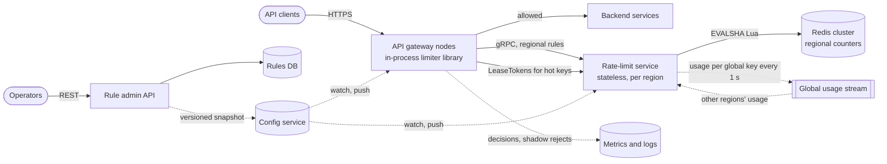

**Reading the diagram.** Each gateway node embeds a limiter library and holds the current rule snapshot. For each request it evaluates matching rules: *local* rules (coarse per-IP protection, per-node concurrency) entirely in memory; *regional* rules through a synchronous gRPC call to the regional rate-limit service, which executes one atomic Lua script on the Redis shard owning the key; *hot* keys through tokens leased in batches. Only allowed requests reach backend services. Configuration flows asynchronously (dotted) from the admin API through a versioned snapshot in the configuration service to every gateway and limiter node. For *global* rules, each region's limiter publishes per-key usage every second to a cross-region stream and adjusts its regional allocation from the other regions' reports. Storage boundaries: rules are durable in the rules database; counters are volatile in Redis and memory. Failure points: Redis shard loss (buckets reset; affected rules fall back to their failure mode), limiter service latency (gateway timeout then failure mode), configuration service outage (gateways keep the last snapshot), cross-region stream lag (global rules overshoot more). Scaling: gateways and limiter nodes scale horizontally; Redis by shards; global coordination cost grows with the number of global keys, not with request rate.

### 52.6.8 Detailed component design

#### Component 1: choosing where each rule is counted

Algorithm choice is settled in Chapter 22: a **token bucket** (§22.4) or its single-timestamp form **GCRA** (§22.5.2) for per-key rates with bursts; a **sliding window counter** (§22.7) for per-minute limits such as login failures; a **fixed window** (§22.6) for daily quotas, where window-edge bursts do not matter; and a **concurrency limiter** (in-flight count) for expensive endpoints. The new decision in a service design is *where* each rule's counter lives.

**Table 52.13 — Where to count, per rule.**

| Tier | How it works | Added latency | Accuracy | Use for |
|---|---|---|---|---|
| Local (in-process) | Each gateway enforces $L/N$ for $N$ nodes, or a per-node safety limit | ~0 | Poor if traffic is skewed across nodes (§22.8) | Per-IP flood protection, per-node concurrency, fallback |
| Regional central | Atomic Lua script on the Redis shard for the key | 0.3–1 ms in-region | Exact within a region | Paid per-key rates, login failures, expensive endpoints |
| Regional with leases | Gateway leases a batch of tokens and spends them locally | ~0 on most requests | Overshoot ≤ outstanding unspent leases | Hot keys (one tenant at 100,000 RPS) |
| Global | Regional allocation from a global limit, reconciled every Δ | Same as regional | Overshoot ≈ $\lambda\Delta$ during shifts (§22.8.3) | Tenant-wide contractual limits, daily quotas |

Leasing deserves a closer look because it is what lets one design serve both a tenant at 10 RPS and a tenant at 100,000 RPS. A gateway that sees a key's local demand exceed a threshold (for example, 50 RPS) stops calling the limiter per request and instead calls `LeaseTokens` for 100 tokens; the Lua script deducts 100 from the central bucket atomically and the gateway spends them locally. Overshoot is bounded by unspent leased tokens: with 200 gateways each holding at most 100, at most 20,000 tokens are outstanding, so the lease size must be capped at a small fraction of the limit (for a 100,000 RPS limit, 20,000 is 0.2 seconds of quota). Leases expire after a second, so tokens held by a crashed gateway return to circulation quickly.

#### Component 2: atomic updates in Redis

The race in Figure 22.5 is avoided by running read, decide and write as one Lua script on the shard that owns the key (§22.8.2). Three service-level details matter:

1. **One script per entity, several rules per call.** Because the hash tag puts all of an entity's keys on one shard, one `EVALSHA` evaluates every rule for that entity and returns all statuses, so a request matching three rules on two entities costs two round trips, issued in parallel.
2. **Server time.** Scripts read the time with Redis `TIME`, so gateways with skewed clocks cannot corrupt buckets (§24.9).
3. **Replication is asynchronous.** A Redis primary acknowledges before its replica has the update; after a failover, recent decrements are lost and some keys are briefly over-admitted. For rate limits this is acceptable, and it is the reason not to put money-like quotas only in Redis: daily billing quotas are also accumulated in a durable store, and Redis serves as the fast front.

#### Component 3: multi-region limits

A global limit of 6,000 requests per minute for a tenant served from three regions cannot be checked synchronously in one place: a 100 ms cross-region round trip on every request is far outside the 2 ms budget. The options trade accuracy for latency:

**Table 52.14 — Multi-region limit strategies.**

| Strategy | Worst-case admitted | Latency | Problem |
|---|---|---|---|
| Independent regional limits of $L$ each | $R \times L$ (3× for 3 regions) | Regional | A client spreading traffic gets 3× its limit |
| Static split $L/R$ | $L$ | Regional | A client concentrated in one region gets only a third |
| Home region (all checks for a tenant go to one region) | $L$ | Cross-region for remote traffic | 70–150 ms added outside the home region |
| Demand-proportional allocation, reconciled every Δ | $L$ + about $\lambda\Delta$ during shifts | Regional | Needs a usage stream and allocator logic |

This design uses **demand-proportional allocation** for global rules: each region publishes its per-key usage every second; each region then sets its own share of the limit from the reported demand, with a floor so a region with no recent traffic can still admit a first burst.

::: formula
**Demand-proportional regional allocation with a floor**

$$L_r = f \cdot \frac{L}{R} + (1 - f) \cdot L \cdot \frac{d_r}{\sum_{j=1}^{R} d_j}$$

| Symbol | Meaning | Units |
|---|---|---|
| $L_r$ | Limit enforced in region $r$ for the next interval | requests per window |
| $L$ | Global limit for the key | requests per window |
| $R$ | Number of regions | regions |
| $f$ | Fraction of the limit reserved as equal floors | fraction (0–1) |
| $d_r$ | Recent demand observed in region $r$ (smoothed) | requests per window |
:::

::: example
**Worked example — A tenant limited to 6,000 requests per minute.**

*Assumptions.* Recent demand: US 6,000, EU 3,000, Asia-Pacific 1,000 requests per minute (total 10,000, above the limit). Floor fraction $f = 0.10$. Reconciliation interval $\Delta = 1$ s.

1. Floor per region: $0.10 \times 6{,}000 / 3 = 200$.
2. Demand shares: US $6{,}000/10{,}000 = 0.6$, EU $0.3$, Asia-Pacific $0.1$. Remaining quota: $0.9 \times 6{,}000 = 5{,}400$.
3. Allocations: US $200 + 0.6 \times 5{,}400 = 3{,}440$; EU $200 + 1{,}620 = 1{,}820$; Asia-Pacific $200 + 540 = 740$. Sum: 6,000.
4. Overshoot during a sudden shift, applying §22.8's bound $E_{\max} \approx \lambda\Delta$ with offered rate $\lambda = 10{,}000/60 = 167$ requests/s: about $167 \times 1 = 167$ extra requests in the window, 2.8% of the limit. With $\Delta = 5$ s: 833, or 14%.

*Interpretation.* The global limit is respected in steady state, and each region's share follows its demand. *Engineering implication.* The reconciliation interval sets the overshoot during shifts; 1 s keeps it within the 15% target with margin, and the usage stream carries only active global keys, not requests.
:::

Daily quotas (for example, SMS sends per tenant per day) are a special case: they are small in rate but must be nearly exact because they map to money. For these, each region leases quota in chunks from a durable global counter (a strongly consistent store in one region, §26.9) and refills before running out; a 100 ms round trip once per chunk of 1,000 sends is invisible.

#### Component 4: fail-open or fail-closed

Every rule declares its failure mode, because the right answer depends on what the rule protects.

**Table 52.15 — Failure policy by rule type.**

| Rule protects | Example | On limiter failure | Reason |
|---|---|---|---|
| Fair sharing of capacity | 100 RPS per API key | Fail open, with local per-node fallback limits | A limiter outage must not become an API outage; local limits still stop a flood |
| Security | 10 failed logins per minute per account | Fail closed to a strict local limit | Credential stuffing during an outage is worse than slowing logins |
| Money | SMS sends per tenant per day | Fail closed beyond the locally leased chunk | Each unchecked send costs real money |
| Backend survival | Concurrency of an expensive report endpoint | Local concurrency limit, always on | Must not depend on any remote service |

The mechanism: the gateway gives the limiter call a short timeout (for example, 5 ms), wraps it in a circuit breaker (§22.13), and on timeout or open circuit applies the rule's failure mode. "Fail open" never means "no protection": load shedding (§22.9) still protects backends.

::: industry
**Stripe's rate limiters and Envoy's global rate limit service.** Stripe described four limiters in production: a per-user request rate limiter implemented as a token bucket in Redis, a concurrent-requests limiter, a fleet usage load shedder reserving capacity for critical requests, and a worker utilization load shedder; it recommended running new limiters in a mode that logs would-be rejections before enforcing them [Tarjan 2017]. Envoy supports both a local token-bucket rate-limit filter and calls to an external global rate-limit service over gRPC; Envoy's reference implementation of that service is open source and stores counters in Redis [Envoy Docs: rate limiting]. These match the hybrid shape of Figure 52.8: local enforcement for protection, a central counter service for shared limits.

*Evidence: Primary* — [Tarjan 2017]; [Envoy Docs: rate limiting]
:::

### 52.6.9 Data flow

**Figure 52.9 — Hot path: a request checked against local and regional rules.**

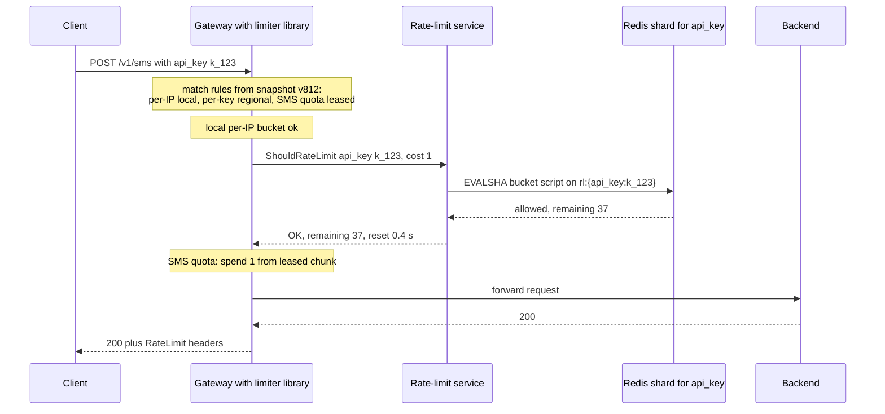

**Reading the diagram.** The gateway evaluates three rules. The per-IP rule is decided in memory. The per-key rule needs one synchronous gRPC call to the regional limiter, which runs one atomic script on the Redis shard owning the key and returns the decision with remaining quota. The SMS quota is spent from a chunk previously leased from the durable global counter, so it needs no call at all. Only then does the request reach the backend; the `RateLimit` headers go back even on success so clients can slow down early. If the limiter call exceeds its 5 ms timeout, the gateway applies the per-key rule's failure mode (fail open with the local fallback limit). Scaling: the regional call is the only remote step and can be skipped entirely for hot keys by leasing.

**Figure 52.10 — Control path: rule change and global usage reconciliation.**

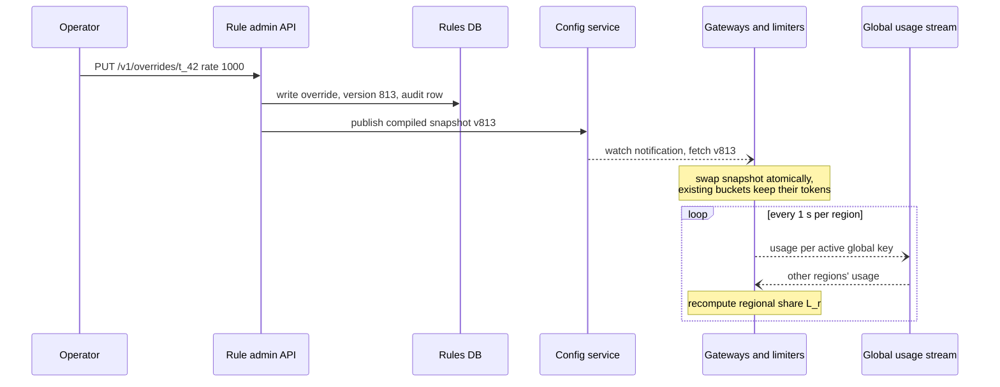

**Reading the diagram.** The upper part is the configuration write path: the admin API writes the change durably with an audit record, compiles a new versioned snapshot and publishes it; gateways and limiter nodes receive a watch notification asynchronously and swap to the new snapshot atomically, typically within seconds, well inside the 30 s target. Counter state survives the swap: changing a rate does not refill or empty buckets. The loop is the global-limit write path: each region publishes usage for active global keys every second and recomputes its share from the others' reports. Failure points: a config service outage freezes rules at the last snapshot (safe); a usage stream outage leaves regions on their last shares, which still sum to the global limit. Scaling: the snapshot size grows with rules and overrides; at millions of overrides, gateways fetch overrides lazily per tenant and cache them.

### 52.6.10 Bottlenecks

1. **Hot keys on one Redis shard.** Solved by leasing, not resharding: a key cannot be split across shards without losing atomicity.
2. **The round trip itself.** Even 0.5 ms per call at 600,000 calls/s is a fleet-wide cost in connections and CPU; pipelining and connection pooling (§7.16) matter.
3. **Rule evaluation cost.** Matching a request against thousands of rules must be an index lookup on descriptors, not a linear scan; compile rules into hash maps keyed by descriptor type.
4. **Key cardinality under attack.** A botnet with millions of IPs creates millions of per-IP buckets; local per-IP limits with bounded LRU tables keep memory flat, and the edge (§21.11) absorbs volumetric attacks before they reach gateways.

### 52.6.11 Failure scenarios

**Table 52.16 — Rate limiter failure scenarios.**

| What fails | Impact | Detection | Recovery | Prevention |
|---|---|---|---|---|
| Redis shard down | Rules on its keys fall back to failure mode; buckets reset after failover | Limiter error rate, failover events | Replica promotion; buckets refill naturally | Replicas in other zones; short TTLs make reset harmless |
| Limiter service slow | Gateway p99 rises toward the timeout | Limiter p99 per region | Circuit opens; failure modes apply | 5 ms timeout; leases for hot keys; capacity headroom |
| Bad rule pushed (limit 10 instead of 10,000) | Mass 429s for legitimate clients | 429-rate alert per rule; shadow mode would have shown it | Roll back to previous snapshot version | Shadow mode first; review; staged rollout of snapshots by region |
| Config service unreachable | No new rules | Snapshot age per gateway | Keep last snapshot | Snapshots cached on disk; gateways start from last known good |
| Cross-region usage stream lags | Global overshoot during shifts | Stream lag | Regions keep last shares | Floor plus conservative shares when lag exceeds 10 s |
| Gateway clock skew | None for central rules (server time); local rules drift | Clock offset metric | Fix NTP | Use monotonic clocks locally |
| Retry storm after 429s | Load spikes as clients retry immediately | 429 followed by retry rate | `Retry-After`, jittered client backoff (§22.12) | Document retry behavior; SDKs back off by default |

### 52.6.12 Scaling strategy

**At 10× (30 million decisions per second).** Centrally checking 20% of decisions would need about 200 Redis shards. Push more rules to leases and local enforcement, and run the limiter library as an in-process component only; the remote tier then sees lease traffic, roughly proportional to the number of active hot keys times gateways, not to request rate. Partition the rate-limit service by key range so that each limiter node's Redis connection pool stays small.

**At 100×.** Every remote call becomes too expensive at this rate. Move to quota distribution for nearly all rules (§22.8.3): a coordinator per region assigns each gateway a per-key allowance from recent demand, and gateways enforce locally. Accept overshoot of a few percent everywhere except money-like quotas, which keep chunked leasing from a durable counter. Cell-based deployment (§33.12) caps each limiter cell's blast radius.

### 52.6.13 Trade-offs

- **Accuracy versus latency versus coordination traffic** (the triangle of §22.8): this design chooses per rule instead of globally.
- **Fail-open versus fail-closed**: availability of the API versus protection of money and security; decided per rule and documented.
- **Redis versus a durable store for counters**: speed versus exactness after failover; money-like quotas get both.
- **Global limits by allocation versus home region**: regional latency with small overshoot versus exactness with cross-region latency.

### 52.6.14 Alternative designs

- **Sidecar limiter per service** (as with Envoy's local filter): no shared service to operate, but only per-instance limits unless paired with a global service.
- **Limits enforced at the CDN edge** (§21.9): excellent for per-IP abuse limits and absorbing attacks, but edge nodes have weak coordination, so per-tenant contractual limits still need the origin tier.
- **Database-backed counters** (a row per key in a relational database with `UPDATE … SET count = count + 1 WHERE count < limit`): exact and durable, but 10–100× slower; suitable for daily quotas at low rates, not per-second limits.
- **Admission control by queueing instead of rejection** (leaky bucket as a queue, §22.5): smooths traffic for batch clients but adds latency and memory; rarely right for interactive APIs.

### 52.6.15 Interview discussion

**Table 52.17 — 45-minute plan for the distributed rate limiter.**

| Minutes | Focus | What to produce |
|---|---|---|
| 0–5 | Requirements | Keys, rule types, accuracy, latency budget, failure policy question |
| 5–9 | Estimates | 3 million decisions/s; 20% central; 3 GB of counters; hot tenant at 100,000 RPS |
| 9–14 | API and rule model | Decision RPC; rule schema with scope and failure mode |
| 14–20 | Architecture | Figure 52.8: library, regional service, Redis, config snapshots |
| 20–33 | Deep dive: where to count | Local vs central vs leased; Lua atomicity; hash tags |
| 33–40 | Multi-region and failure policy | Allocation formula; fail-open vs fail-closed by rule |
| 40–45 | Failures and scaling | Bad rule push, Redis failover, quota distribution at 100× |

**Likely follow-ups.**

- *"Which algorithm would you use?"* Token bucket for per-key rates with bursts; sliding window counter for per-minute limits; fixed windows for daily quotas (§22.4–§22.7). Then move on: algorithm choice is not the hard part.
- *"What happens if Redis goes down?"* Per-rule failure modes: fail open to local limits for fairness rules, fail closed for security and money rules, all behind a short timeout and a circuit breaker.
- *"How do you limit globally across regions?"* Not synchronously; allocate regional shares from demand and reconcile every second, accepting a small overshoot during shifts.
- *"How do you handle one tenant sending 100,000 RPS?"* Lease tokens in batches so the central bucket is touched about 1,000 times per second instead of 100,000.

**What distinguishes senior and staff answers.** A senior candidate places counters in Redis with an atomic script, explains the race, and returns correct 429 semantics. A staff candidate designs the failure policy per rule, separates the control plane (rules, snapshots, shadow mode, rollback) from the data plane, handles hot keys and multi-region limits quantitatively, and insists that the limiter can never become the outage it exists to prevent.

### 52.6.16 Production considerations

- **Observability.** Per rule: decisions, rejections, shadow rejections and failure-mode activations; limiter p99 per region; snapshot version and age per gateway; Redis CPU per shard (hot keys show as one hot shard).
- **Security.** Rule changes are privileged operations: require review, audit every change, and rate-limit the admin API itself. Do not reveal internal rule names in client headers.
- **Cost.** Redis memory is cheap here; the cost is network calls and limiter CPU, which leasing and local evaluation reduce.
- **Operations.** Roll out rule snapshots region by region with automatic rollback when 429 rates jump; keep shadow mode as the default for new rules; run game days that kill a Redis shard to prove failure modes behave as declared (§39.11).

## 52.7 Notification system

### 52.7.1 Problem statement

Design a notification platform that every product team in a large consumer company uses to reach users by mobile push, email, SMS and in-app inbox. A team sends one request ("order 8812 has shipped, notify user 42") or launches a campaign ("tell 50 million users about the sale"), and the platform decides which channels to use, renders the content, respects the user's preferences, sends through external providers, and tracks what happened.

Section 9.8 explains how a single push reaches a device through APNs or FCM. This case is about the platform around that: the **multi-channel fan-out** from one event to many users, devices and channels, under rules (the distinctive hard problem), together with:

- **User preferences**, quiet hours and frequency caps, checked for every message.
- **Templating and localization** for four channels with very different size limits.
- **Priorities**: a one-time password must not wait behind a marketing campaign.
- **Deduplication and idempotency**: retries at every layer must not send a user the same SMS twice (§22.15).
- **Provider failover** across several SMS and email vendors.
- **Delivery tracking** from "accepted" to "delivered", "bounced" or "opened".

### 52.7.2 Functional requirements

- **Send API** for a single user or a list of up to 1,000 users, naming a notification type (`order_shipped`), template parameters and an optional idempotency key.
- **Campaign API** for an audience segment (millions of users), with a schedule and a rate cap.
- **Channels:** push (iOS, Android, web), email, SMS, in-app inbox. A notification type declares which channels it may use and in what order of preference.
- **Preferences:** per user, per category (security, transactional, social, marketing) and per channel opt-in; quiet hours in the user's time zone; global unsubscribe; frequency caps for marketing.
- **Templates:** versioned, localized, per-channel variants with parameters.
- **Tracking:** per-notification status history and aggregate delivery, bounce and open rates per type and campaign.
- **Provider management:** multiple providers per channel with routing rules and automatic failover.

### 52.7.3 Non-functional requirements

| Property | Target |
|---|---|
| Ingestion availability | 99.99% per month for the send API (callers should never lose a notification request) |
| End-to-end latency | Critical (OTP, security): p99 ≤ 5 s from API call to provider acceptance; transactional: p99 ≤ 30 s; marketing: best effort within the campaign window |
| Delivery guarantee | At least once to the provider, with deduplication making duplicates rare (≤ 1 in 10⁵ for SMS) |
| Durability | An accepted request is never silently dropped: it is sent, suppressed by a rule, or failed with a recorded reason |
| Campaign throughput | 50 million recipients within 30 minutes without delaying transactional traffic |
| Preference correctness | An opt-out takes effect within 1 minute for all sends that have not yet reached a provider |
| Tracking freshness | Status visible within 1 minute of the provider's callback |

### 52.7.4 Capacity estimation

::: example
**Worked example — Notification volumes.**

*Assumptions.* 500 million notifications per day: 400 million push, 80 million email, 10 million SMS, 10 million in-app. 30% (150 million) are transactional, with the usual $h = 0.10$, $b = 2$. The largest marketing campaign reaches 50 million users and must finish within 30 minutes. Each notification log record is 1 KB; each produces about 3 status events of 100 bytes. 300 million users with preferences of 500 bytes; 600 million device tokens of 200 bytes. SMS cost is an illustrative $0.01 per message (real prices vary several-fold by country and volume).

1. Average send rate: $5 \times 10^8 / 86{,}400 = 5{,}787$ per second.
2. Transactional peak: $1.5 \times 10^8 \times 0.10 / 3{,}600 \times 2 = 8{,}333$ per second.
3. Campaign rate: $5 \times 10^7 / 1{,}800\ \text{s} = 27{,}778$ per second.
4. Design capacity: transactional peak plus a full-speed campaign ≈ 36,000/s; provision **50,000 sends/s** for headroom.
5. Notification log: $5 \times 10^8 \times 1\ \text{KB} = 500\ \text{GB/day}$; 90 days of retention: **45 TB**. Status events: $5 \times 10^8 \times 3 \times 100\ \text{B} = 150\ \text{GB/day}$.
6. Preferences: $3 \times 10^8 \times 500\ \text{B} = 150\ \text{GB}$; device tokens: $6 \times 10^8 \times 200\ \text{B} = 120\ \text{GB}$. Both fit in a cache cluster.
7. SMS spend: $10^7 \times \$0.01 = \$100{,}000$ per day.

*Interpretation.* Average load is modest; the design is shaped by campaign bursts and by the need to keep critical messages fast during them. *Engineering implication.* Separate queues and worker pools by priority, and treat SMS as the expensive channel where duplicates cost real money.
:::

The time to deliver a campaign depends on how much capacity is left after higher priorities take their share.

::: formula
**Campaign drain time under reserved priority capacity**

$$T_{drain} = \frac{N}{C - \lambda_{hi}}$$

| Symbol | Meaning | Units |
|---|---|---|
| $T_{drain}$ | Time to hand all campaign messages to providers | seconds |
| $N$ | Number of campaign messages | messages |
| $C$ | Total sending capacity (workers and provider limits, whichever is lower) | messages/s |
| $\lambda_{hi}$ | Rate consumed by higher-priority traffic during the campaign | messages/s |
:::

::: example
**Worked example — Can the 50-million campaign finish in 30 minutes during the transactional peak?**

1. $C = 50{,}000$/s; $\lambda_{hi} = 8{,}333$/s at the transactional peak.
2. Capacity left: $50{,}000 - 8{,}333 = 41{,}667$/s.
3. $T_{drain} = 5 \times 10^7 / 41{,}667 = 1{,}200$ s = 20 minutes.

*Interpretation.* The campaign meets its 30-minute window even at the transactional peak. *Engineering implication.* If a provider limits you to 20,000 sends/s for one channel, $C$ for that channel is 20,000 and the same campaign takes $5 \times 10^7 / 11{,}667 = 4{,}286$ s, about 71 minutes; provider quotas, not your workers, often set $C$.
:::

**Table 52.18 — Notification system capacity summary.**

| Quantity | Value | Consequence |
|---|---|---|
| Average / design send rate | 5,800/s / 50,000/s | Burst-driven; queues absorb campaigns |
| Transactional peak | 8,333/s | Reserved capacity in separate queues |
| Campaign drain (50 million) | 20 min at full capacity | Provider quotas are the real limit |
| Notification log, 90 days | 45 TB | Partitioned wide-column or time-partitioned store |
| Preferences + tokens | 270 GB | Cached in memory; source of truth in a database |
| SMS spend | ≈ $100,000/day | Deduplication and suppression save money directly |

### 52.7.5 API design

```text
POST /v1/notifications                          (service-to-service, mTLS)
  Idempotency-Key: order-8812-shipped
  request:  { "type": "order_shipped", "recipients": [ { "user_id": 42 } ],
              "params": { "order_id": "8812", "carrier": "DHL", "eta": "2026-11-07" },
              "priority": "transactional",       // critical | transactional | marketing
              "channels": ["push", "email"],     // optional override of the type's defaults
              "expires_at": "2026-11-05T12:00:00Z" }
  202:      { "request_id": "nr_01J...", "accepted": 1 }

POST /v1/campaigns
  request:  { "type": "black_friday", "segment_id": "seg_eu_active_30d",
              "start_at": "2026-11-27T08:00:00", "timezone_mode": "recipient_local",
              "max_rate_per_s": 30000 }
  201:      { "campaign_id": "cmp_77", "estimated_recipients": 48211004 }

GET  /v1/notifications/{notification_id}       -> status history
GET  /v1/campaigns/{id}/stats                  -> sent, delivered, bounced, opened, suppressed by reason
PUT  /v1/users/{user_id}/preferences           (from the app's settings screen)
POST /v1/providers/{provider}/callbacks        (provider webhooks, signature verified)
```

The send API returns **202 Accepted**, not 200: the request is durably queued, and delivery happens asynchronously. The idempotency key is required for transactional and critical types; the platform derives one per recipient and channel (`order-8812-shipped:42:email`).

### 52.7.6 Data model and database schema

```sql
-- Durable record of every notification, partitioned by user, clustered by time (wide-column store).
CREATE TABLE notifications (
  user_id        BIGINT,
  created_at     TIMESTAMP,
  notification_id UUID,                 -- UUIDv7, time-ordered (§17.10.2)
  type           TEXT,
  channel        TEXT,                  -- push | email | sms | inapp
  priority       TEXT,
  dedup_key      TEXT,                  -- idempotency key + recipient + channel
  template_ver   INT,
  provider       TEXT,
  provider_msg_id TEXT,                 -- ID the provider returned, used to match callbacks
  status         TEXT,                  -- see the state machine in Figure 52.12
  status_reason  TEXT,
  PRIMARY KEY ((user_id), created_at, notification_id)
);

-- Lookup from provider message ID to the notification, for callbacks.
CREATE TABLE provider_msg_index (provider TEXT, provider_msg_id TEXT, user_id BIGINT,
                                 created_at TIMESTAMP, notification_id UUID,
                                 PRIMARY KEY ((provider, provider_msg_id)));

-- Preferences: relational source of truth, cached in memory.
CREATE TABLE preferences (user_id BIGINT, category TEXT, channel TEXT, enabled BOOLEAN,
                          PRIMARY KEY (user_id, category, channel));
CREATE TABLE user_settings (user_id BIGINT PRIMARY KEY, timezone TEXT, locale TEXT,
                            quiet_start TIME, quiet_end TIME, global_unsubscribe BOOLEAN);
CREATE TABLE device_tokens (user_id BIGINT, device_id TEXT, platform TEXT, token TEXT,
                            last_seen TIMESTAMP, PRIMARY KEY (user_id, device_id));
CREATE TABLE templates (type TEXT, channel TEXT, locale TEXT, version INT, body TEXT,
                        PRIMARY KEY (type, channel, locale, version));
```

**Choice of stores.** The notification log is append-heavy (500 GB/day), read mostly by user and time ("show this user's inbox", "what did we send user 42?"), and expires after 90 days, which fits a wide-column store partitioned by `user_id` with time-window compaction and TTLs (§12.6, §13.9). Preferences, settings, tokens and templates are small, relational and read on every send, so they live in a relational database with an in-memory cache in front, invalidated by change events (§20.10). The deduplication keys live in Redis with a 24-hour TTL for speed, backed by a uniqueness check in the log (§22.15.3).

### 52.7.7 High-level architecture

**Figure 52.11 — Notification platform architecture.**

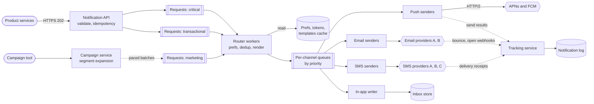

**Reading the diagram.** The send API validates the request, checks the idempotency key and writes it to a durable request queue for its priority, then returns 202; everything after that is asynchronous. The campaign service expands a segment into recipients in batches and feeds them into the marketing queue at a controlled rate (dotted). Router workers consume the three request queues with weighted priority, look up preferences, quiet hours, frequency caps and devices (from an in-memory cache backed by the preferences database), apply deduplication, render the template per channel and locale, and emit one message per recipient, device and channel onto per-channel queues, again separated by priority. Channel sender workers call external providers synchronously: APNs and FCM over HTTP/2 (§9.8), email and SMS providers over their APIs, choosing among providers by health and routing rules. Providers report outcomes asynchronously through webhooks and receipts to the tracking service, which updates the notification log. Storage boundaries: queues are the durable buffer; the log is the system of record for what happened; caches are disposable. Failure points: providers (throttling, outages), the preferences cache (stale opt-outs), and the router (the fan-out amplifier). Scaling: each worker pool scales independently on its queue lag; priorities never share a queue.

### 52.7.8 Detailed component design

#### Component 1: fan-out and routing

One API call fans out along three axes: recipients (1 to 50 million), devices per recipient (a user may have a phone, a tablet and a browser) and channels. The router handles a recipient as one unit of work:

1. **Expand.** Read the notification type's channel policy (for example `order_shipped`: push and in-app always, email if push is not deliverable) and the user's settings, preferences and devices from cache.
2. **Filter.** Drop channels the user opted out of for this category; drop marketing during quiet hours (defer it to the end of quiet hours instead, for campaigns in recipient-local time); apply frequency caps ("at most 3 marketing pushes per day", a per-user counter using the rate limiter of §52.6); drop expired requests (`expires_at` has passed). Every drop is recorded as `suppressed` with a reason, so "why didn't I get it?" has an answer.
3. **Deduplicate.** Build `dedup_key = idempotency_key + user + channel` and `SET dedup_key NX EX 86400` in Redis; if the key exists, skip.
4. **Render.** Pick the template version for the type, channel and locale, fill in parameters, and validate channel limits (Table 52.19).
5. **Emit.** Put one message per device and channel on the channel queue for the priority.

Campaigns are expanded upstream by the campaign service, which reads the segment from the data warehouse in pages of 10,000 user IDs and enqueues them at the campaign's rate cap. Expanding lazily, rather than writing 50 million messages at once, keeps queues small and lets an operator pause or cancel a campaign halfway; a canceled campaign simply stops enqueueing.

**Table 52.19 — Channel characteristics that shape the design.**

| Channel | Payload limit | Cost per message | Delivery signal | Typical latency | Main failure |
|---|---|---|---|---|---|
| Push (APNs, FCM) | 4 KB (4,096 bytes) for regular notifications (§9.8) | Free from the provider | Provider accepted; delivery and open only via app callback | Seconds | Stale tokens; OS throttling |
| Email | Practically large; keep under ~100 KB for deliverability | Low | Bounces, complaints, opens (pixel), clicks | Seconds to minutes | Spam filtering; reputation |
| SMS | 160 GSM-7 characters or 70 UCS-2 per segment; 153 / 67 per segment when concatenated | High (illustratively $0.01 per segment) | Carrier delivery receipt (not always reliable) | Seconds | Carrier filtering; country rules |
| In-app inbox | Your own limit | Storage only | Read receipts from the app | Immediate on next open | None external |

The SMS row explains why templates must be validated per channel: one emoji switches a message to UCS-2 encoding, cutting a segment from 160 to 70 characters, so a 150-character message becomes 3 concatenated segments and triples its cost.

#### Component 2: priorities and isolation

Priority is implemented by **separate queues and separate consumer pools**, not by a priority field in one queue. A single queue suffers head-of-line blocking: an OTP enqueued behind 50 million marketing messages waits for them. With separate queues:

- **Critical** (OTP, security alerts): its own topic, its own router and sender pool, provisioned for peak with large headroom, and a short message TTL (an OTP older than 5 minutes is useless and is dropped as `expired`).
- **Transactional** (order updates, receipts): its own pool, autoscaled on queue lag.
- **Marketing**: rate-capped at the campaign level and globally, so it can never take provider capacity that higher priorities need. Provider quotas are shared, so senders draw tokens from a per-provider token bucket in the rate limiter with priority-specific reservations: for example, 20% of an SMS provider's throughput is reserved for critical traffic.

#### Component 3: deduplication and idempotency

Duplicates arise at four points: the caller retries the API, the queue redelivers after a worker crash (at-least-once delivery, §30.8), the router processes a campaign batch twice, and a sender times out on a provider call that actually succeeded. The first three are handled by idempotency keys checked in Redis and backed by a unique `dedup_key` in the log (§22.15). The fourth is the hard one: when a provider call times out, the platform cannot know whether the SMS was sent. Retrying risks a duplicate; not retrying risks a loss.

The design resolves it per channel. For push and email, retry with the same internal message ID; a rare duplicate is acceptable, and the provider's message ID, when returned, deduplicates callbacks. For SMS, where duplicates are costly and confusing, record `sending` before the call and, on timeout, query the provider's message-status API using a client reference you supplied, if the provider offers one, before retrying. Where no such API exists, choose by type: retry OTPs (a duplicate OTP is harmless, a missing one blocks login) and do not retry marketing.

#### Component 4: provider failover and delivery tracking

Each channel has a **provider router** that scores providers continuously on error rate, latency, delivery-receipt rate and cost, per destination country for SMS. Routing rules pick the cheapest healthy provider; a circuit breaker per provider (§22.13) opens on sustained errors and shifts traffic to the next provider. Two rules prevent failover from creating duplicates: fail over only on *definitive* failures (connection refused, 5xx with no message ID) or on circuit-open, never on a timeout for an SMS that may have been accepted; and include the idempotency key in the provider request where the provider supports one.

Delivery tracking is a state machine per message, advanced by events from senders and providers.

**Figure 52.12 — Notification delivery state machine.**

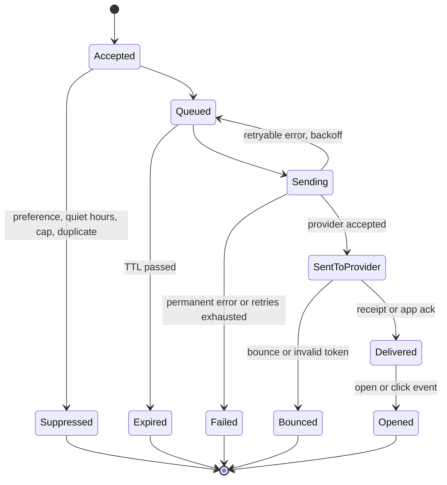

**Reading the diagram.** Every accepted request ends in exactly one terminal state, which is how the durability requirement ("never silently dropped") is made checkable: a count of messages in non-terminal states older than an hour is an alert. `Suppressed` and `Expired` are deliberate non-sends with recorded reasons. `Sending` back to `Queued` is the retry loop with exponential backoff and jitter (§22.12); after the retry limit, the message moves to `Failed` and to a dead-letter queue for inspection (§30.11). `SentToProvider` is where the platform's control ends: later transitions arrive asynchronously from provider webhooks (email bounces and complaints, SMS delivery receipts) or from the app (push delivery and open acknowledgments). Bounces feed back into the data: an invalid push token is deleted (§9.8), and a hard email bounce suppresses future email to that address. Events can arrive out of order (an open before a delivery receipt), so the tracking service applies only transitions that move forward in the machine.

::: industry
**Mobile push and bulk email rules.** APNs and FCM accept notifications over HTTPS and report invalid tokens in their responses (APNs returns HTTP 410 for a token that is no longer active), which a sender must use to prune tokens; both cap regular notification payloads at 4 KB (§9.8) [Apple: Sending notification requests to APNs; FCM Docs]. For email, Google's sender guidelines (in force from 2024) require bulk senders to authenticate mail with SPF, DKIM and DMARC, to support one-click unsubscribe for marketing messages, and to keep reported spam rates low (Google states a threshold of 0.3%) [Google: Email sender guidelines]. These external rules shape the design directly: token pruning in the tracking service, unsubscribe handling in preferences, and complaint feedback loops that suppress future sends.

*Evidence: Primary* — [Apple: Sending notification requests to APNs]; [FCM Docs]; [Google: Email sender guidelines]
:::

### 52.7.9 Data flow

**Figure 52.13 — Write path: a transactional notification to push and email.**

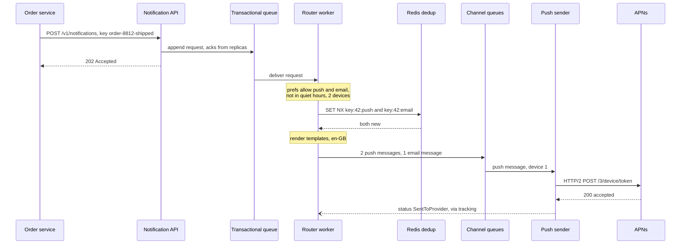

**Reading the diagram.** The caller's synchronous interaction ends at 202, once the request is durably in the transactional queue; from then on the platform owns delivery. The router processes the request asynchronously: preference and device lookups come from cache, deduplication keys are claimed atomically in Redis (one per recipient and channel), templates are rendered, and per-device messages go onto channel queues. The push sender calls APNs synchronously and records the result through the tracking service. The email message follows the same pattern through the email sender. Failure points: a router crash after claiming dedup keys but before emitting messages would lose the notification, so the router claims keys with a short "in progress" value and confirms them only after emitting; on redelivery, an in-progress key older than a minute is reclaimed. Scaling: router and sender pools scale on queue lag.

**Figure 52.14 — Read path: provider callbacks and status queries.**

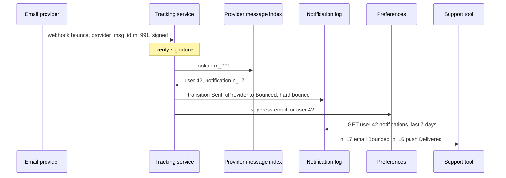

**Reading the diagram.** Provider callbacks are the main "read" of external state: the tracking service verifies the webhook signature, maps the provider's message ID to the notification through an index written at send time, applies the forward-only state transition to the log, and turns a hard bounce into an email suppression in preferences. Support tools and the user-facing inbox read the log by user and time, which is its partition and clustering key. Callbacks are at least once and may be out of order, so transitions are idempotent and forward-only. Failure points: a webhook endpoint outage (providers retry for hours; the endpoint must be highly available and quick to acknowledge, queueing work internally); an unknown message ID (a callback arriving before the index write commits, retried after a delay). Scaling: callbacks arrive at up to three per message, so the tracking service handles more events than the senders.

### 52.7.10 Bottlenecks

1. **Provider quotas**, not internal capacity, cap the drain rate (the worked example: 71 minutes instead of 20 at a 20,000/s SMS quota). Negotiate quotas, spread across providers, and schedule campaigns accordingly.
2. **Preference lookups.** 50,000 sends/s each reading preferences, settings and devices means 150,000 cache reads/s; batch lookups per page of recipients.
3. **Hot user partitions in the log.** A user in a busy group chat can receive hundreds of notifications per hour; aggregate them ("12 new messages") with collapse keys (§9.8) instead of storing and sending each.
4. **Callback volume.** Opens and clicks for a 50-million email campaign arrive over days and can exceed send volume; process them in batches into aggregate counters.

### 52.7.11 Failure scenarios

**Table 52.20 — Notification system failure scenarios.**

| What fails | Impact | Detection | Recovery | Prevention |
|---|---|---|---|---|
| SMS provider outage | OTPs not delivered; logins blocked | Error rate and receipt rate per provider | Circuit opens; route to next provider | Two or more providers per country; synthetic OTP probes |
| Provider accepts but times out | Possible duplicate or loss | Timeout counter | Status query, then retry by type policy | Client references; per-type retry policy |
| Preferences cache stale | Opted-out user receives marketing | Opt-out-to-send lag metric | Invalidate on change events | Check opt-out against the source of truth for marketing at send time |
| Campaign floods queues | Transactional latency rises | Lag per priority queue | Pause campaign | Separate queues and pools; campaign rate caps |
| Router bug sends to wrong segment | Mass wrong notification; reputational harm | Anomalous send volume per type | Kill switch per type and campaign | Staged campaign start (1% first); approval for large audiences |
| Email reputation drops | Mail lands in spam | Complaint and bounce rates | Pause marketing email; clean lists | Authentication, unsubscribe, suppression of bounces |
| Webhook endpoint down | Statuses stuck at SentToProvider | Age of non-terminal messages | Providers retry; replay from provider logs | Highly available endpoint that only enqueues |
| Duplicate request from caller retry | Double send | Dedup hits | None needed | Required idempotency keys for transactional types |

### 52.7.12 Scaling strategy

**At 10× (5 billion per day; 500,000 sends/s design capacity).** Internal components scale horizontally by queue partitions and worker pools. The external side does not: you need more providers, regional provider accounts, and dedicated email IP pools warmed gradually (mail providers distrust sudden volume from new IPs). The notification log grows to 450 TB for 90 days; store only a compact record for marketing messages and full records for transactional ones.

**At 100×.** Fan-out itself becomes the cost. Move from per-recipient rendering to rendering per (template, locale, parameter set) and reusing the result across recipients; send marketing push through provider-side topics where personalization is unnecessary (FCM topics deliver one request to many devices, §9.8); and run the platform in cells by user ID range, each with its own queues and provider quotas, so one cell's campaign cannot exhaust another's.

### 52.7.13 Trade-offs

- **At-least-once with deduplication versus at-most-once:** no lost OTPs, in exchange for rare duplicates on provider timeouts.
- **Separate queues per priority:** isolation and predictable OTP latency, in exchange for more infrastructure and idle reserved capacity.
- **Lazy campaign expansion:** pausable campaigns and small queues, in exchange for a dependency on the segment store during the campaign.
- **Cheapest-provider routing:** cost savings, in exchange for more failovers and inconsistent delivery quality; critical traffic routes by reliability, not cost.

### 52.7.14 Alternative designs

- **Single queue with priority field.** Simpler, but head-of-line blocking makes critical latency depend on campaign size.
- **Per-channel services owned by separate teams** with no shared router: each team implements preferences and dedup differently, and users get inconsistent behavior. A shared router is the point of a platform.
- **Buy instead of build.** Hosted notification platforms provide routing, templates and tracking; they fit companies below a few million messages per day or without strict data-residency needs. The architecture above is what such a platform must implement internally.

### 52.7.15 Interview discussion

**Table 52.21 — 45-minute plan for the notification system.**

| Minutes | Focus | What to produce |
|---|---|---|
| 0–5 | Requirements | Channels, priorities, preferences, campaigns, tracking |
| 5–10 | Estimates | 5,800/s average, 50,000/s design, campaign drain time, SMS cost |
| 10–15 | API and data model | 202 send API with idempotency key; log partitioned by user |
| 15–22 | Architecture | Figure 52.11: priority queues, router, channel senders, tracking |
| 22–35 | Deep dive: fan-out, priorities, dedup | Router steps; separate pools; the provider-timeout problem |
| 35–41 | Provider failover and tracking | Health scoring, circuit breakers, state machine |
| 41–45 | Failures and scaling | Provider outage, stale preferences, cells at 100× |

**Likely follow-ups.**

- *"How do you guarantee an OTP arrives quickly during a campaign?"* Separate queue, pool and reserved provider capacity; a short TTL; multi-provider failover.
- *"How do you avoid sending twice?"* Idempotency keys at the API, dedup keys per recipient and channel, forward-only state, and a per-channel policy for provider timeouts.
- *"How do you respect time zones for a campaign?"* Expand per time zone and schedule each slice at local 10:00; quiet hours defer rather than drop.
- *"Exactly-once delivery?"* Not achievable end to end with external providers; at-least-once plus deduplication is the honest answer (§32.9).

**What distinguishes senior and staff answers.** A senior candidate separates priorities, uses queues and handles retries with idempotency. A staff candidate identifies provider quotas as the real capacity limit, designs the provider-timeout ambiguity explicitly, makes every message end in a recorded terminal state, and treats email reputation and opt-out correctness as system requirements with metrics.

### 52.7.16 Production considerations

- **Observability.** End-to-end latency per priority (API to provider acceptance), queue lag per priority, suppression counts by reason, delivery and bounce rates per provider and country, and the count of messages stuck in non-terminal states.
- **Security and privacy.** Never put secrets beyond an OTP in a notification; keep OTPs out of logs; sign and verify all webhooks; enforce data residency for user contact data (§44.9).
- **Cost.** SMS dominates; suppress duplicates, prefer push or email when the user allows it, and route SMS by country to the cheapest reliable provider.
- **Operations.** Kill switches per notification type and per campaign; staged campaign starts; provider runbooks; regular failover drills that disable the primary SMS provider in production for a minute.

## 52.8 Distributed key-value store

### 52.8.1 Problem statement

Design a key-value store, in the style of Amazon's Dynamo, that many services in one company use for data such as shopping carts, session state, user preferences and feature flags. It must stay writable when nodes, racks and network links fail, scale to hundreds of nodes by adding machines, and let each table choose its own balance of consistency, latency and availability.

Every component of this design has its own section earlier in the book. The distinctive hard problem here is **composition**: making partitioning, replication, quorums, versioning, repair, storage and membership work together, so that a write accepted during a failure is neither lost nor silently overwritten, and the cluster heals itself afterward. The case therefore walks one key through the whole system and points to the owning sections for each mechanism.

### 52.8.2 Functional requirements

- `get(key) → (values[], context)`: returns one value, or several conflicting **siblings** with an opaque version context.
- `put(key, value, context)`: writes a value that supersedes the versions in `context`.
- `delete(key, context)`: a put of a tombstone.
- Per-table configuration: replication factor $N$, read quorum $R$, write quorum $W$, conflict policy (version vectors with siblings, or last-writer-wins), and TTL.
- Keys up to 256 bytes; values up to 1 MB (larger values go to object storage, §52.5).
- Adding and removing nodes online, with automatic data movement.
- Optional multi-datacenter replication.

Out of scope: secondary indexes, range scans across partitions, transactions across keys (§28).

### 52.8.3 Non-functional requirements

| Property | Target |
|---|---|
| Write availability | 99.99% per month, including during the loss of any one availability zone |
| Latency | `get` and `put` p99 ≤ 10 ms and p99.9 ≤ 50 ms within a region, for values ≤ 10 KB |
| Durability | No loss of a write acknowledged by $W \geq 2$ replicas in different zones unless both zones lose their disks permanently |
| Consistency | Eventual by default; read-your-writes when the client sets $R + W > N$ and no sloppy-quorum substitutes are involved (§27.9) |
| Convergence | After a failure heals, all replicas agree within 1 hour |
| Scalability | Linear throughput growth with nodes; adding a node moves only its share of data |
| Rebalancing impact | Data movement uses ≤ 20% of node bandwidth, so foreground p99 stays within target |

The latency targets are stated at p99.9, as Dynamo's were, because a single page may call the store dozens of times and tail latency compounds (§23.6).

### 52.8.4 Capacity estimation

::: example
**Worked example — Data, throughput and node count.**

*Assumptions.* 100 TB of logical data; average item 1 KB (key and value). Peak 2 million reads/s and 1 million writes/s. $N = 3$. Reads contact all 3 replicas (one full read, two digest reads) and writes go to all 3. LSM space amplification 1.3 (§13.11). Each node: 8 TB of NVMe filled to at most 70%, and $c = 100{,}000$ replica operations per second; $u = 0.6$. Bloom filters at 10 bits per item (§17.4).

1. Items: $10^{14} / 10^3 = 10^{11}$ (100 billion).
2. Raw stored bytes: $100\ \text{TB} \times 3 \times 1.3 = 390\ \text{TB}$.
3. Nodes for capacity: $390 / (8 \times 0.7) = 390 / 5.6 = 69.6$, so 70 nodes.
4. Replica operations: $10^6 \times 3 + 2 \times 10^6 \times 3 = 9 \times 10^6$ per second.
5. Nodes for throughput: $9 \times 10^6 / (100{,}000 \times 0.6) = 150$ nodes.
6. Data per node at 150 nodes: $390 / 150 = 2.6$ TB, 46% of usable space, leaving room for compaction and growth.
7. Bloom filters: $10^{11} \times 3 \times 10\ \text{bits} = 3.75 \times 10^{11}$ bytes = 375 GB in total, 2.5 GB per node, which stays in memory.

*Interpretation.* Throughput, not capacity, sets the cluster size: 150 nodes (plus spares, about 156, 52 per zone). *Engineering implication.* Reducing replica work (for example, reading from $R = 2$ replicas instead of 3 for tables that tolerate it) cuts the node count directly; adding disk does not.
:::

::: example
**Worked example — Partitions, hints and rebuilds.**

*Assumptions.* $Q = 16{,}384$ fixed partitions. One node fails for 1 hour. Rebuilding a node streams from many peers in parallel at 100 MB/s each.

1. Partition size: $390\ \text{TB} / 16{,}384 = 23.8$ GB per partition replica. Partition replicas per node: $16{,}384 \times 3 / 150 = 328$.
2. Writes that would have gone to the failed node: $10^6 \times 3 / 150 = 20{,}000$ per second. Over 1 hour: $7.2 \times 10^7$ hinted writes, about 72 GB of hints spread over its neighbors (§27.9).
3. Rebuilding a dead node's 2.6 TB from one peer at 200 MB/s: $2.6 \times 10^{12} / 2 \times 10^8 = 13{,}000$ s, 3.6 hours. From 50 peers at 100 MB/s each, because its 328 partitions have replicas spread across the cluster: $2.6 \times 10^{12} / (5 \times 10^9) = 520$ s, under 9 minutes.

*Interpretation.* Many small partitions turn a multi-hour single-source rebuild into minutes of parallel streaming, shrinking the window in which a second failure could lose data. *Engineering implication.* Choose $Q$ much larger than the node count, and size hint storage for the longest outage you will tolerate before declaring a node dead and rebuilding it.
:::

**Table 52.22 — Key-value store capacity summary.**

| Quantity | Value | Consequence |
|---|---|---|
| Items | 100 billion | Bloom filters and partition-aware routing are essential |
| Raw storage | 390 TB | 70 nodes would hold it; throughput needs more |
| Replica operations | 9 million/s | 150 nodes (≈ 156 with spares across 3 zones) |
| Partitions | 16,384 × 3 replicas | ≈ 328 partition replicas per node; 23.8 GB each |
| Hints for a 1-hour node outage | ≈ 72 GB | Hint storage limit per node |
| Node rebuild | ≈ 9 min from 50 peers | Low exposure to a second failure |

### 52.8.5 API design

```protobuf
service KV {
  rpc Get(GetRequest) returns (GetResponse);
  rpc Put(PutRequest) returns (PutResponse);
  rpc Delete(DeleteRequest) returns (PutResponse);
}
message GetRequest  { string table = 1; bytes key = 2; Consistency r = 3; }       // ONE, QUORUM, ALL or a number
message GetResponse { repeated bytes values = 1; bytes context = 2; }            // >1 value = siblings
message PutRequest  { string table = 1; bytes key = 2; bytes value = 3;
                      bytes context = 4;                                          // from the previous Get; empty = blind write
                      Consistency w = 5; uint32 ttl_seconds = 6; }
message PutResponse { bytes context = 1; }
message DeleteRequest { string table = 1; bytes key = 2; bytes context = 3; Consistency w = 4; }
```

The **context** is the heart of the API. It carries the version vector (§24.11) of the versions the client read. A put with that context tells the store "this value supersedes those versions", which is how the store distinguishes an update from a concurrent write. A client that writes without reading first (a blind write) creates a sibling whenever another version exists. Clients reconcile siblings on read (for a cart, the union of items) and write the merged value back with the combined context.

### 52.8.6 Data model and database schema

There is no schema beyond tables, keys and opaque values. What matters is the layout on each node and the cluster metadata.

```text
On each node, one LSM tree per partition replica (§13.8):
  key:   partition_id | user key
  value: [ (version_vector, timestamp, value_bytes | tombstone, ttl), ... ]   -- siblings stored together

Cluster metadata (gossiped, versioned):
  ring:        partition_id -> [node_a, node_b, node_c]   (preference list, zone-diverse)
  membership:  node_id -> {address, zone, status: joining|up|leaving|removed, generation}
  tables:      name -> {N, R, W, conflict_policy, default_ttl}

Hint store on each node:
  hint_key: target_node | partition_id | key | version  ->  value
```

Storing all siblings of a key in one record lets a read return them together and lets compaction discard versions dominated by newer ones. Partition IDs prefix every key so that a partition's data is contiguous on disk, which makes streaming a partition to a new node a sequential scan and lets each partition keep its own Merkle tree.

### 52.8.7 High-level architecture

**Figure 52.15 — Dynamo-style key-value store architecture.**

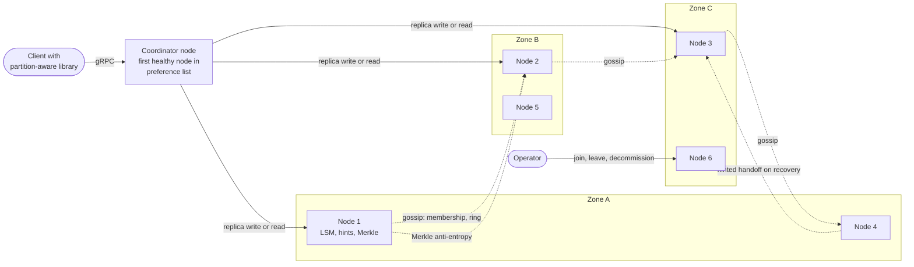

**Reading the diagram.** The client library holds a copy of the ring (learned from any node) and sends each request directly to a coordinator: the first healthy node in the key's preference list. The coordinator forwards the operation synchronously to the $N = 3$ replicas, which are placed in three different zones, and answers the client once $W$ (for writes) or $R$ (for reads) replicas respond. All cluster maintenance is asynchronous and peer-to-peer (dotted): nodes gossip membership and ring changes; pairs of replicas compare Merkle trees per partition and stream differing keys; a node that held hints for a failed peer replays them when the peer returns. Membership changes are explicit operator actions, not automatic reactions to failure detection. There is no master node and no single point of failure; every node runs the same software. Storage boundary: each node's local LSM trees, one per partition replica. Failure points: a zone outage (one replica of every partition, survivable with $W = 2$), network partitions (sloppy quorums keep writes flowing at the cost of consistency), and gossip disagreements during membership changes. Scaling: add nodes; each takes over partitions from many existing nodes.

### 52.8.8 Detailed component design

**Table 52.23 — Each problem, its mechanism, and where the book covers it.**

| Problem | Mechanism in this design | Owning section |
|---|---|---|
| Spread keys over nodes; move little data on change | Consistent hashing with $Q$ fixed partitions assigned to nodes | §14.8, §14.9 |
| Survive node and zone loss | $N = 3$ replicas on zone-diverse nodes; leaderless writes | §27.7 |
| Tunable consistency and latency | Quorums $R$, $W$; $R + W > N$ for overlap | §27.8 |
| Stay writable when replicas are down | Sloppy quorum with hinted handoff | §27.9 |
| Detect concurrent writes | Version vectors and siblings; or last-writer-wins | §24.11, §27.14 |
| Repair divergence | Read repair; Merkle-tree anti-entropy | §27.13, §17.8 |
| Fast local reads and writes | LSM tree with Bloom filters | §13.8, §13.10, §17.4 |
| Know who is in the cluster and who is alive | Gossip membership; phi-accrual failure detection | §27.10 |

#### Component 1: partitioning, placement and routing

The key's hash (a 64-bit hash of the key, §17.3) selects one of $Q = 16{,}384$ fixed partitions; a ring map assigns each partition a **preference list** of $N$ nodes. This is Dynamo's third partitioning strategy: equal-sized partitions decoupled from node tokens [DeCandia et al. 2007]. It has two advantages over placing many random virtual-node tokens on the ring (§14.8): partitions are the unit of transfer, so moving data is streaming whole files rather than filtering keys by hash range; and each partition has its own Merkle tree, so anti-entropy compares like with like.

Placement rules are applied when building the preference list: the $N$ nodes must be in $N$ different zones, and no node may hold two replicas of one partition. When a node joins, the placement algorithm takes roughly $328$ partition replicas from across the cluster (not from its ring neighbors only), so the new node fills in parallel from many sources, and every existing node gives up about $1/151$ of its data. Data movement is throttled to 20% of node bandwidth (the rebalancing target), which at 100 MB/s per stream fills a new node in tens of minutes.

Routing uses a partition-aware client library, which avoids an extra network hop through a load balancer. Dynamo's paper reports that client-driven coordination reduced latency compared with routing through a generic load balancer [DeCandia et al. 2007]. Clients with a stale ring are corrected by the node they contact, which forwards the request and returns the newer ring version.

#### Component 2: replication, quorums, versioning and repair

A write with $N = 3$, $W = 2$ proceeds as follows (Figure 52.16 shows the failure case):

1. The coordinator, itself one of the replicas, increments its own entry in the version vector taken from the client's context, stores the new version locally and sends it to the other two replicas.
2. It acknowledges the client once one other replica has confirmed, so the write is durable in two zones.
3. If a replica is down, the coordinator sends the write to the next healthy node beyond the preference list, with a **hint** naming the intended owner; the substitute stores it in its hint store and replays it when the owner returns. This **sloppy quorum** keeps $W$ achievable during failures, but the substitute is not in the preference list, so a subsequent read quorum may not overlap it: $R + W > N$ no longer guarantees reading the latest write (§27.9).

Reads ask all three replicas, return once $R$ answer, and compare versions. If one version dominates the others, it is returned and the stale replicas are updated in the background (**read repair**, §27.13). If two versions are concurrent, neither vector dominates, and both are returned as siblings for the client to merge (§27.14.2). Tables that cannot merge (a profile photo URL) choose last-writer-wins instead, accepting that one of two concurrent writes is silently lost.

Read repair only fixes keys that are read. **Merkle-tree anti-entropy** repairs the rest: each partition replica maintains a hash tree over its key range (for example, $2^{15}$ leaves, about 730 keys each for a 24 million-key partition); replica pairs exchange tree roots periodically and descend only into differing subtrees, so a single divergent key costs one descent through 15 levels (a few dozen hashes) plus one leaf's keys, not a full scan (§17.8).

::: warning
**Tombstones must outlive repair.** A delete writes a tombstone. If compaction purges the tombstone before every replica has seen it, a replica that missed the delete still holds the old value, and the next anti-entropy run copies it back: the deleted value is **resurrected**. Keep tombstones for longer than the maximum time a replica can be out of contact and still rejoin (Cassandra calls this `gc_grace_seconds`, 10 days by default), and require a node down longer than that to be rebuilt from scratch rather than rejoin.
:::

#### Component 3: the storage engine on each node

Each node runs one LSM tree per partition replica (§13.8): a write appends to a commit log (fsync policy per table, §13.12), inserts into an in-memory memtable, and is acknowledged; full memtables flush to immutable sorted files (SSTables) with a Bloom filter each; compaction merges SSTables in the background, dropping versions dominated by newer ones and expired TTL data. LSM trees suit this workload because writes are frequent, keys are point-accessed, and replication means every logical write becomes three physical writes, so cheap sequential writes matter most. The Bloom filters (2.5 GB per node, in memory) keep a read for a missing key from touching disk, which matters because with $N = 3$ and digest reads, two of every three replica reads ask nodes whether they have a newer version.

Per-partition trees have a further benefit: dropping a partition after it moves to another node is deleting files, not deleting keys.

#### Component 4: membership and failure detection

Nodes learn about each other by **gossip**: every second, each node exchanges its membership table (node, address, zone, status, generation, heartbeat counter) with a random peer and merges newer entries (§27.10.3). Information reaches all 156 nodes in about $\log_2 156 \approx 7$ rounds, a few seconds. Liveness is judged locally with a **phi-accrual** detector over heartbeat arrivals (§27.10.2); a node that suspects a peer simply routes around it (sloppy quorum), without changing the ring.

The important separation is between *transient* failure and *permanent* membership change. A node that stops responding is treated as temporarily down, and its data is not moved; hints accumulate instead. Only an operator (or an automated policy after, say, 2 hours) declares it permanently gone, which changes the ring and triggers re-replication from the surviving replicas. Moving 2.6 TB every time a node reboots would be far more disruptive than the failures themselves; Dynamo likewise made membership changes explicit [DeCandia et al. 2007].

::: industry
**Dynamo, Cassandra and DynamoDB.** Amazon's Dynamo paper combined consistent hashing with virtual nodes, sloppy quorums with hinted handoff, vector clocks with application-side reconciliation, Merkle-tree anti-entropy and gossip-based membership; it reported that its services commonly used $(N, R, W) = (3, 2, 2)$ and measured latency at the 99.9th percentile [DeCandia et al. 2007]. Apache Cassandra adopted Dynamo-style leaderless replication with tunable consistency levels, but resolves conflicts per column by timestamp (last-writer-wins) rather than with siblings [Apache Cassandra Docs]. Amazon DynamoDB, despite the name, is a different design: its 2022 paper describes partitions replicated across availability zones by Multi-Paxos with a leader per partition, offering strongly consistent reads [Elhemali et al. 2022]. The contrast is useful in interviews: leaderless quorums maximize write availability; per-partition leaders simplify consistency.

*Evidence: Primary* — [DeCandia et al. 2007]; [Apache Cassandra Docs]; [Elhemali et al. 2022]
:::

### 52.8.9 Data flow

**Figure 52.16 — Write path: a put with one replica down (sloppy quorum and hinted handoff).**

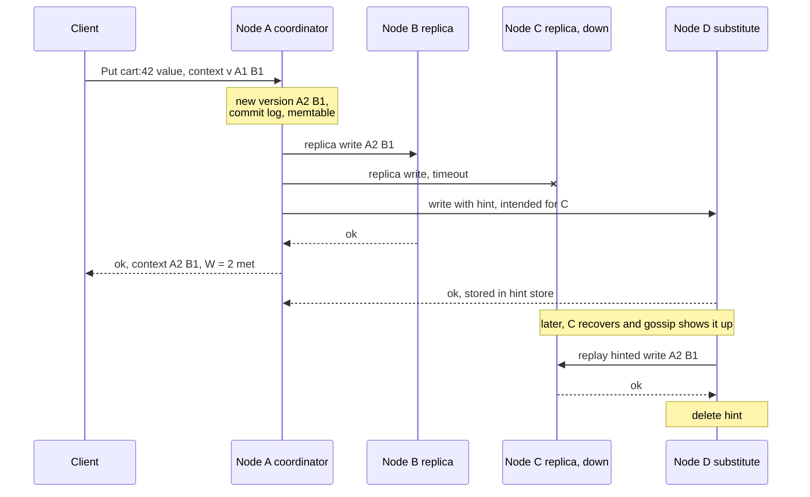

**Reading the diagram.** The client sends the put directly to node A, the first node in the key's preference list, which acts as coordinator and replica. A creates the new version vector by incrementing its own entry over the client's context, persists locally (commit log, then memtable) and sends replica writes in parallel. Node C does not answer within the timeout, so A sends the write to node D, the next healthy node beyond the preference list, tagged with a hint naming C. With A and B confirmed, $W = 2$ is met and the client receives the new context; D's acknowledgment arrives later. When gossip shows C is back, D replays the hint asynchronously and deletes it. Failure points: if A and B both fail before C recovers, the write survives only on D's hint store; if hints exceed D's limit, they are dropped and Merkle anti-entropy must repair C later. Scaling: per-write cost is $N$ replica writes regardless of cluster size.

**Figure 52.17 — Read path: quorum read with siblings and read repair.**

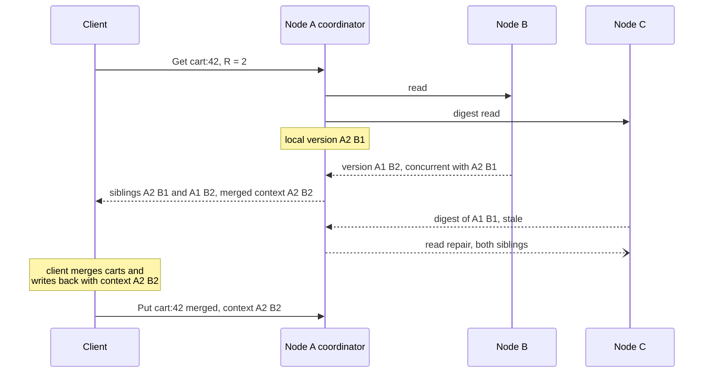

**Reading the diagram.** The coordinator reads locally and from the other replicas in parallel (one full read, one digest read), answering when $R = 2$ versions are in hand. Its own version $\{A{:}2, B{:}1\}$ and B's $\{A{:}1, B{:}2\}$ are concurrent: neither vector dominates, so both are returned as siblings with a merged context. C's late digest reveals a stale version, so the coordinator repairs C asynchronously with both siblings. The client resolves the conflict with application logic (the union of cart items) and writes the merged value with the merged context, producing a version that dominates both siblings, so they disappear on the next compaction (§27.14.2). Failure points: a client that ignores siblings and writes blindly creates yet another sibling; very wide sibling sets indicate many blind writers. Scaling: reads touch $N$ replicas, which is why tables that tolerate staleness can lower the read fan-out.

### 52.8.10 Bottlenecks

1. **Replica fan-out.** Each logical operation costs three replica operations; this, not disk capacity, set the node count to 150.
2. **Compaction.** LSM compaction competes with foreground I/O; under sustained writes, too little compaction throughput causes read amplification to grow and p99.9 to drift (§13.9). Throttle and schedule it, and provision I/O for it.
3. **Hot keys.** A single popular key's three replicas take all its traffic; consistent hashing cannot spread one key. Cache it in the client library or split it at the application layer (§14.10).
4. **Large partitions.** A wide value set or huge sibling lists slows reads; cap sibling counts and value sizes.
5. **Repair traffic after long outages.** Anti-entropy after a zone outage can saturate the network; throttle it like rebalancing.

### 52.8.11 Failure scenarios

**Table 52.24 — Key-value store failure scenarios.**

| What fails | Impact | Detection | Recovery | Prevention |
|---|---|---|---|---|
| One node (transient) | Its replicas miss writes | Phi-accrual suspicion | Hinted handoff replay; read repair | Sloppy quorum keeps $W$ achievable |
| One node (permanent disk loss) | One replica of ~328 partitions lost | Node does not return; operator decision | Re-replicate from 50 peers in minutes | Zone-diverse placement; spare capacity |
| An availability zone | One replica of every partition | Zone-wide suspicion | Writes continue with $W = 2$; hints accumulate | $N = 3$ across 3 zones; hint storage sized for hours |
| Network partition between zones | Both sides accept writes via sloppy quorums | Gossip views diverge | Siblings or LWW resolution after healing; anti-entropy | Choose conflict policy per table deliberately |
| Tombstone purged too early | Deleted data resurrects | Deleted keys reappear | Re-delete; audit | Tombstone retention above maximum rejoin time |
| Clock skew with LWW tables | Newer write loses to an older one with a later clock | Hard to detect | None after the fact | Version vectors for important data; NTP monitoring (§24.9) |
| Stale ring in a client | Requests hit wrong coordinator | Forwarding counters | Node forwards and returns new ring | Ring version in every response |
| Correlated failure during rebuild | Possible data loss if all replicas lost | Under-replicated partition count | Restore from backup | Fast parallel rebuild; zone diversity; backups |

### 52.8.12 Scaling strategy

**At 10× (90 million replica operations per second, about 1 PB of logical data).** The architecture scales by adding nodes, about 1,500, but two things need attention. Gossip of full membership tables grows with cluster size; move to gossiping digests and fetching changes on demand. And $Q = 16{,}384$ partitions over 1,500 nodes gives only about 33 partition replicas per node, coarsening load balance; choose a larger $Q$ at creation (partition counts are hard to change later, the same lesson as Kafka's partition counts, §31.5), or support partition splitting.

**At 100×.** A single ring of 15,000 nodes has a large failure domain and slow membership convergence. Split into multiple independent clusters (cells) with a directory mapping tables or key ranges to clusters (§33.12), and replicate across regions asynchronously with conflict handling per table (§44.8).

### 52.8.13 Trade-offs

- **Leaderless quorums versus a leader per partition:** writes stay available through failures and network partitions, in exchange for conflicts, siblings and weaker consistency (§25.8 on CAP, §25.9 on PACELC).
- **Version vectors versus last-writer-wins:** no silent loss of concurrent writes, in exchange for client-side merge logic and larger metadata.
- **Sloppy quorum:** higher write availability, in exchange for losing the $R + W > N$ read guarantee during failures.
- **Fixed partitions:** fast parallel rebuilds and simple anti-entropy, in exchange for choosing $Q$ up front.
- **Reading from all $N$ replicas:** faster detection of stale replicas and lower tail latency (wait for the fastest $R$), in exchange for more replica operations.

### 52.8.14 Alternative designs

- **Leader-per-partition with consensus** (DynamoDB, CockroachDB-style ranges with Raft, §26.7): linearizable reads and writes per key, simpler client semantics, at the cost of unavailability for a partition while its leader is re-elected and of cross-zone latency on every write.
- **Primary–replica sharded Redis or MySQL** (§14.3): simplest to run at small scale; failover is a single point of fragility, and resharding is manual.
- **Chain replication** (§27.5): strong consistency with high read throughput from the tail; recovering a chain is more delicate than leaderless repair.

### 52.8.15 Interview discussion

**Table 52.25 — 45-minute plan for the key-value store.**

| Minutes | Focus | What to produce |
|---|---|---|
| 0–5 | Requirements | API with context; tunable N, R, W; always writable |
| 5–9 | Estimates | 100 billion items, 390 TB raw, 9 million replica ops/s, 150 nodes |
| 9–13 | API and placement | Partitions, preference lists, zone diversity |
| 13–20 | Architecture | Figure 52.15: coordinator, replicas, gossip, anti-entropy |
| 20–35 | Deep dive: write and read under failure | Sloppy quorum, hinted handoff, version vectors, siblings, read repair |
| 35–41 | Storage engine and repair | LSM, Bloom filters, Merkle trees, tombstones |
| 41–45 | Failures and scaling | Zone loss, rebuild time, cells at 100× |

**Likely follow-ups.**

- *"What does $R + W > N$ buy you, and when does it fail?"* Overlapping read and write sets, so a read sees the latest acknowledged write, but not with sloppy quorums, concurrent writes, or failed partial writes that later spread by repair (§27.8).
- *"Why not use timestamps to resolve conflicts?"* Clocks skew, and LWW silently drops one of two concurrent writes; version vectors detect concurrency.
- *"How does a new node get its data?"* It is assigned partitions from across the cluster and streams them in parallel, throttled, then joins the preference lists.
- *"How do you know replicas agree?"* Merkle trees per partition, compared periodically.

**What distinguishes senior and staff answers.** A senior candidate explains each mechanism correctly. A staff candidate explains how they interact: sloppy quorums weaken $R + W > N$; tombstone retention must exceed the rejoin window; transient failures must not trigger rebalancing; the fixed-partition choice determines rebuild time and therefore durability; and conflict policy is a per-table product decision.

### 52.8.16 Production considerations

- **Observability.** Per-table p99 and p99.9 latency, sibling counts and sizes, hint backlog per node, read-repair rate, Merkle-detected divergence, under-replicated partitions, compaction backlog, and ring version skew across clients.
- **Security.** mTLS between nodes and clients (§10.10); encryption at rest; per-table access control in the client library.
- **Cost.** Replica fan-out drives node count; tables that tolerate weaker reads should use smaller $R$ and fewer digest reads. Space amplification from compaction is the second lever.
- **Operations.** Rolling upgrades one zone at a time; regular backups by partition snapshot (the store's replication does not protect against bad writes or deletes); repair schedules tied to tombstone retention; tested runbooks for zone loss and full-node rebuild.

## 52.9 Distributed job scheduler

### 52.9.1 Problem statement

Design a multi-tenant job scheduler, a "cron as a service" for a large company. Teams register recurring jobs ("every day at 02:30 Europe/Berlin, run the invoice export"), one-off delayed jobs ("in 15 minutes, cancel this unpaid order") and workflows of dependent tasks ("extract, then transform, then load and notify"). The scheduler fires each job at the right time and hands it to a fleet of workers that execute it.

Chapter 46 covered cluster schedulers, which decide *where* work runs. This case is about deciding *when* work runs and making sure it runs. Its hard problems:

1. **Firing millions of timers on time (the distinctive hard problem).** Ten million schedules, and humans choose round times: about a million jobs fire in the same second at the top of each hour.
2. **Exactly-once versus at-least-once.** The scheduler must never silently skip a firing, and duplicate runs must be rare and harmless. True exactly-once execution is impossible when workers can crash mid-job, so the design must make jobs effectively-once through idempotency.
3. **Ownership without double firing.** Many scheduler nodes share the work; each schedule must have exactly one owner at a time, including during failover (§26.5).
4. **Retries, delays and dependencies.** Failed runs retry with backoff; workflows wait for upstream tasks.

### 52.9.2 Functional requirements

- **Schedules:** cron expressions with a time zone; fixed intervals; one-off "run at time T" or "run after delay D".
- **Targets:** an HTTP callback, a message to a queue, or a container task on the batch cluster (§46).
- **Policies per job:** timeout, retry count and backoff, concurrency policy for overlapping runs (allow, forbid, replace), misfire policy for firings missed during an outage (run all, run once, skip), and a starting deadline.
- **Workflows:** a directed acyclic graph (DAG) of tasks with dependencies, triggered by a schedule or an API call.
- **Operations:** pause, resume, trigger now, cancel a run, view run history and logs.

### 52.9.3 Non-functional requirements

| Property | Target |
|---|---|
| Firing accuracy | p99 dispatch delay ≤ 1 s after the scheduled time in normal minutes; ≤ 10 s at top-of-hour bursts |
| No lost firings | Every scheduled firing produces an execution attempt or a recorded misfire decision (0 silent skips) |
| Duplicates | Duplicate dispatch of one firing ≤ 1 in 10⁴, and only around failovers; every dispatch carries a stable execution ID |
| Availability | 99.99% per month for firing; the API may be 99.9% |
| Durability | Job definitions and run history: no loss (replicated database, backups) |
| Failover | A failed scheduler node's schedules resume firing within 15 s |
| Scale | 10 million schedules, 250 million executions per day |

### 52.9.4 Capacity estimation

::: example
**Worked example — Executions and the top-of-hour burst.**

*Assumptions.* 10 million recurring schedules: 1% every minute, 20% hourly, 79% daily. 50 million one-off delayed jobs per day. 40% of hourly and daily schedules are set to minute 0 (people like round numbers); daily jobs spread evenly over the 24 hours. Execution history record: 500 bytes, kept 30 days. Timer entry in memory: 100 bytes.

1. Per-minute schedules: $10^5 \times 1{,}440 = 1.44 \times 10^8$ executions/day.
2. Hourly: $2 \times 10^6 \times 24 = 4.8 \times 10^7$; daily: $7.9 \times 10^6$. Recurring total: $1.999 \times 10^8$.
3. All executions: $1.999 \times 10^8 + 5 \times 10^7 = 2.5 \times 10^8$ per day, an average of $2.5 \times 10^8 / 86{,}400 = 2{,}892$/s.
4. Top-of-hour burst: per-minute $10^5$ + hourly at :00 $0.4 \times 2 \times 10^6 = 8 \times 10^5$ + daily at this hour's :00 $0.4 \times 7.9 \times 10^6 / 24 = 1.32 \times 10^5$. Total ≈ $1.03 \times 10^6$ firings due in the same second.
5. To dispatch them within 10 s: $1.03 \times 10^6 / 10 = 103{,}000$ dispatches/s, 36× the daily average.
6. History: $2.5 \times 10^8 \times 500\ \text{B} = 125\ \text{GB/day}$; 30 days ≈ 3.75 TB.
7. Timers due within the next hour: $5 \times 10^7 / 24 + 2 \times 10^8 / 24 = 1.04 \times 10^7$; at 100 bytes each, about 1 GB across the scheduler fleet.

*Interpretation.* Average load is small; the burst is 36× the average and dominates the design. *Engineering implication.* Timers must be pre-loaded into memory before they are due, dispatch must not require a database write per firing on the critical path, and the work must be partitioned across nodes. Encouraging jitter (spreading ":00" jobs over the first minutes) is cheaper than provisioning for the spike.
:::

**Table 52.26 — Job scheduler capacity summary.**

| Quantity | Value | Consequence |
|---|---|---|
| Executions | 250 million/day; 2,900/s average | Modest steady state |
| Top-of-hour burst | ≈ 1 million firings; 103,000 dispatches/s for 10 s | Pre-loaded in-memory timers; partitioned scheduling |
| Timers in the next hour | ≈ 10 million; ≈ 1 GB | Fits in memory across 20 nodes |
| Run history | 125 GB/day; 3.75 TB for 30 days | Time-partitioned store |
| Schedules | 10 million; ≈ 20 GB at 2 KB each | Sharded relational store |

### 52.9.5 API design

```text
POST /v1/jobs
  request: { "name": "invoice-export", "schedule": { "cron": "30 2 * * *", "timezone": "Europe/Berlin" },
             "target": { "type": "http", "url": "https://billing.internal/exports", "method": "POST" },
             "payload": { "region": "eu" }, "timeout_s": 900,
             "retry": { "max_attempts": 5, "backoff": "exponential", "initial_s": 30, "max_s": 1800 },
             "concurrency_policy": "forbid", "misfire_policy": "run_once", "starting_deadline_s": 3600 }
  201:     { "job_id": "job_8Hq...", "next_fire_at": "2026-11-06T01:30:00Z" }

POST /v1/delayed   { "run_at": "2026-11-05T10:45:00Z", "target": {...}, "idempotency_key": "cancel-order-8812" }
POST /v1/workflows { "name": "nightly-etl", "schedule": {...},
                     "tasks": [ {"id": "extract"}, {"id": "transform", "after": ["extract"]},
                                {"id": "load", "after": ["transform"]}, {"id": "notify", "after": ["load"]} ] }
POST /v1/jobs/{id}:trigger · :pause · :resume
GET  /v1/jobs/{id}/runs?cursor=...    -> [{ "execution_id": "...", "scheduled_at", "started_at",
                                            "attempt", "status", "worker", "error" }]

Worker protocol (gRPC): Lease(queue) -> Task{execution_id, attempt, payload, fencing_token, lease_s}
                        Heartbeat(execution_id, fencing_token) · Complete(execution_id, fencing_token, result)
```

Every dispatched task carries an **execution ID** derived deterministically from the job and its scheduled time, `execution_id = hash(job_id, scheduled_at)`. A duplicate dispatch of the same firing therefore has the same ID, and the target can use it as an idempotency key (§22.15). HTTP targets receive it in an `Idempotency-Key` header.

### 52.9.6 Data model and database schema

```sql
-- Job definitions: sharded relational store, shard key = partition (hash(job_id) mod 1024).
CREATE TABLE jobs (
  job_id          TEXT PRIMARY KEY,
  partition_id    SMALLINT NOT NULL,           -- 0..1023
  tenant_id       TEXT NOT NULL,
  schedule_kind   TEXT NOT NULL,               -- cron | interval | once
  cron_expr       TEXT, timezone TEXT, interval_s INT, run_at TIMESTAMPTZ,
  target          JSONB NOT NULL,
  policies        JSONB NOT NULL,              -- timeout, retry, concurrency, misfire
  paused          BOOLEAN NOT NULL DEFAULT false,
  next_fire_at    TIMESTAMPTZ NOT NULL,        -- maintained in UTC
  version         BIGINT NOT NULL
);
CREATE INDEX jobs_due ON jobs (partition_id, next_fire_at) WHERE NOT paused;

-- Per-partition progress: everything scheduled at or before the watermark has been dispatched.
CREATE TABLE partition_watermarks (
  partition_id    SMALLINT PRIMARY KEY,
  dispatched_through TIMESTAMPTZ NOT NULL,
  fencing_token   BIGINT NOT NULL              -- owner's lease epoch (§26.13)
);

-- Runs: wide-column or time-partitioned table; one row per attempt.
CREATE TABLE executions (
  execution_id    TEXT,                         -- hash(job_id, scheduled_at)
  attempt         SMALLINT,
  job_id          TEXT, scheduled_at TIMESTAMPTZ, started_at TIMESTAMPTZ, finished_at TIMESTAMPTZ,
  status          TEXT,                         -- dispatched | running | succeeded | failed | timed_out
  worker_id       TEXT, error TEXT,
  PRIMARY KEY (execution_id, attempt)
);

-- Workflow runs: one row per task instance; transitions use conditional updates.
CREATE TABLE task_instances (
  dag_run_id TEXT, task_id TEXT, state TEXT, attempt SMALLINT, upstream_remaining SMALLINT,
  PRIMARY KEY (dag_run_id, task_id)
);
```

**Choice of stores.** Job definitions need transactions for edits, secondary lookups by tenant and an index on `next_fire_at` within a partition, so a sharded relational database fits (§11, §14.7), sharded by partition ID so each scheduler node's queries stay on one shard. The **watermark** table is the key to avoiding a database write per firing: instead of updating each job after it fires, the owner records "everything due up to 10:00:00.000 in partition 417 has been dispatched" once per second. Run history is append-heavy and time-ordered, so it goes to a store with time-partitioned tables and TTL-based expiry (§52.5.8 discusses the same cleanup pattern).

### 52.9.7 High-level architecture

**Figure 52.18 — Distributed job scheduler architecture.**

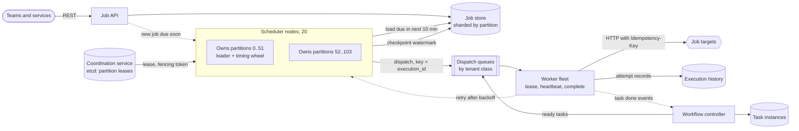

**Reading the diagram.** The job API stores definitions in the sharded job store; jobs due within the next few minutes are also pushed directly to their owning scheduler node (dotted), so they do not wait for the next load cycle. Each scheduler node holds leases on a set of the 1,024 partitions from the coordination service, with a fencing token per lease. For its partitions, a node loads all firings due in the next 10 minutes into an in-memory timing wheel, fires them on time by appending dispatch messages keyed by execution ID to the dispatch queues, and checkpoints a per-partition watermark once per second. Workers lease tasks from the queues, heartbeat while running, call the targets with the execution ID as an idempotency key, and record each attempt. Retries return to the scheduler as new delayed timers (dotted), and workflow task completions go to the workflow controller, which enqueues tasks whose dependencies are satisfied. Storage boundaries: job store (definitions and watermarks), queues (in-flight work), execution history and task instances. Failure points: a scheduler node (its leases expire and move within 15 s), the coordination service (no lease changes, but current owners continue until their leases expire), the queue (firing pauses; the watermark stops advancing, so nothing is lost). Scaling: more partitions per node or more nodes; queues by partitions; workers by queue lag.

### 52.9.8 Detailed component design

#### Component 1: sharded ownership with leases and fencing

A single leader that fires all ten million schedules is simple and is how many small schedulers work, but it caps throughput at one node's dispatch rate and makes every failover a full reload. This design partitions schedules into 1,024 partitions and uses leader election *per partition* (§26.5): each scheduler node acquires leases on partitions from etcd (§26.9, §26.11), about 51 partitions per node with 20 nodes, spread by a balancing controller.

Each lease carries a **fencing token**, a number that increases on every change of ownership (§26.13). The owner writes its token with every watermark checkpoint, and the database rejects a checkpoint whose token is lower than the stored one. This handles the classic failure: a node pauses for 20 seconds in garbage collection, its lease expires, another node takes over and fires, and the first node wakes and tries to fire the same timers. Its checkpoint is rejected, and it learns it has lost the lease. Its stale dispatches, if any slipped out, carry the same execution IDs as the new owner's and are deduplicated downstream.

When a node takes over a partition, it reads the watermark and dispatches every firing scheduled after the watermark and up to now, applying each job's misfire policy for firings older than its starting deadline. Because the watermark is checkpointed every second, a failover re-dispatches at most about one second of firings plus the lease-expiry gap, and those re-dispatches are the only source of duplicates.

#### Component 2: timers, timing wheels and the top-of-hour burst

A scheduler node must fire about 52,000 timers in the same second at the top of the hour (one-twentieth of the burst) and then nothing for a while. A priority queue (binary heap) costs $O(\log n)$ per insert and per pop, which is fine for thousands of timers but adds up for millions with constant re-insertion of retries. A **timing wheel** [Varghese & Lauck 1987] makes insert and expiry $O(1)$: an array of slots, each a list of timers, with a pointer that advances one slot per tick. A timer due in $d$ ticks goes into slot $(\text{now} + d) \bmod S$. **Hierarchical** wheels cover long ranges with few slots: a seconds wheel, a minutes wheel and an hours wheel, where timers cascade down a level when their higher-level slot comes up.

::: formula
**Span of a hierarchical timing wheel**

$$T_{span} = \tau \times \prod_{i=1}^{k} S_i \qquad\qquad \text{slots in memory} = \sum_{i=1}^{k} S_i$$

| Symbol | Meaning | Units |
|---|---|---|
| $T_{span}$ | Longest delay the wheels can hold | seconds |
| $\tau$ | Tick duration (resolution of the finest wheel) | seconds |
| $S_i$ | Number of slots in wheel level $i$ | slots |
| $k$ | Number of levels | levels |
:::

::: example
**Worked example — A wheel for a 10-minute load window with 100 ms resolution.**

1. Finest wheel: $\tau = 0.1$ s, $S_1 = 600$ slots, covering 60 s.
2. Second level: $S_2 = 60$ slots of 60 s each; span $0.1 \times 600 \times 60 = 3{,}600$ s, one hour, enough for the 10-minute load window and for short retry delays.
3. Adding a third level of $S_3 = 24$ hour-slots gives $0.1 \times 600 \times 60 \times 24 = 86{,}400$ s, one day, with only $600 + 60 + 24 = 684$ slots.
4. A single flat wheel at 100 ms resolution for one day would need 864,000 slots.

*Interpretation.* Hierarchy buys range with very few slots, at the cost of moving each long timer down one or two levels before it fires. *Engineering implication.* Hold only near-term timers in memory (the 10-minute window, about 1.7 million timers fleet-wide per load cycle) and leave the long tail in the database index, where it costs nothing until it becomes near-term.
:::

```python
from collections import defaultdict


class HierarchicalTimingWheel:
    """Timers with 1-tick resolution. Level i has `slots` buckets, each slots**i ticks wide."""

    def __init__(self, slots: int = 60, levels: int = 3):
        self.slots, self.levels = slots, levels
        self.now = 0                                   # current tick
        self.wheels = [defaultdict(list) for _ in range(levels)]

    def schedule(self, due: int, job: str) -> None:
        if due <= self.now:
            raise ValueError("due time must be in the future")
        self._place(due, job)

    def _place(self, due: int, job: str) -> None:
        delay = due - self.now
        for level in range(self.levels):
            if delay < self.slots ** (level + 1):      # fits in this level's span
                slot = (due // self.slots ** level) % self.slots
                self.wheels[level][slot].append((due, job))
                return
        raise ValueError("beyond wheel span; keep it in the database for now")

    def tick(self) -> list:
        """Advance one tick; cascade higher levels down when their slot comes up."""
        self.now += 1
        for level in range(self.levels - 1, 0, -1):    # cascade from the top level down
            width = self.slots ** level
            if self.now % width == 0:
                slot = (self.now // width) % self.slots
                for due, job in self.wheels[level].pop(slot, []):
                    self._place(due, job)              # re-insert at a finer level
        return [job for due, job in self.wheels[0].pop(self.now % self.slots, [])]


w = HierarchicalTimingWheel(slots=60, levels=3)        # span 60^3 ticks = 216,000 s = 60 h
for due, name in [(5, "a"), (59, "b"), (61, "c"), (3_600, "d"), (3_725, "e"), (86_399, "f")]:
    w.schedule(due, name)
fired = {}
for _ in range(90_000):
    for job in w.tick():
        fired[job] = w.now
print(fired)
assert fired == {"a": 5, "b": 59, "c": 61, "d": 3_600, "e": 3_725, "f": 86_399}
```

Output:

```text
{'a': 5, 'b': 59, 'c': 61, 'd': 3600, 'e': 3725, 'f': 86399}
```

What to notice:

- Every timer fires at exactly its due tick, whether it started in the seconds, minutes or hours wheel; a randomized test of 45,000 timers with a 10-slot wheel also fired every timer on time.
- Cascading runs *before* the finest wheel is emptied, so a timer cascaded to the current slot still fires in this tick.
- Insert and expiry are constant time; the cost is the cascade, which moves each long timer at most `levels − 1` times.
- In the real scheduler, `tick()` returns a batch of up to 52,000 jobs at the top of the hour; the node dispatches them in batches of a few hundred messages per queue request to reach about 5,200 dispatches/s per node.

To soften the burst, the API offers a **hashed minute**: a schedule written as `H * * * *` fires at a minute derived from a hash of the job ID, the same idea as Jenkins' `H` symbol, and new jobs with `0 * * * *` are flagged with a suggestion to use it.

#### Component 3: execution guarantees

"Exactly once" has to be decomposed by stage, because each stage gives a different guarantee.

**Table 52.27 — Execution guarantees by stage.**

| Stage | Guarantee | Mechanism | Residual risk |
|---|---|---|---|
| Firing | Each scheduled time dispatched at least once | Watermark replay after failover | Firings between last checkpoint and failure are dispatched again |
| Dispatch identity | All duplicates of one firing share one ID | `execution_id = hash(job_id, scheduled_at)` | None |
| Queue delivery | At least once (§30.8) | Leases with visibility timeouts | Redelivery after worker crash or lease expiry |
| Worker start | At most one concurrent attempt per execution ID | Conditional insert of the attempt row; fencing token per lease | A worker paused past its lease can still act; fencing protects storage that checks tokens |
| Job side effects | Effectively once only if the job is idempotent | Target uses the execution ID as idempotency key (§22.15) | Non-idempotent targets can run twice |

The honest contract the scheduler offers is therefore: **at-least-once execution with a stable execution ID; idempotent jobs achieve effectively-once results.** This matches the general limits of exactly-once processing (§32.9). Concurrency policies sit on top: `forbid` skips a firing if the previous run of the same job is still running, `replace` cancels the running one, and `allow` runs both.

**Retries.** On failure or timeout, the worker records the attempt and asks the scheduler to fire the same execution ID again after a backoff of $\min(\text{max}, \text{initial} \times 2^{\text{attempt}})$ with jitter (§22.12); the retry is just another timer in the wheel. After the maximum attempts, the execution moves to a dead-letter state with an alert to the owning team.

#### Component 4: workflows (DAG dependencies)

A workflow run creates one `task_instances` row per task, with `upstream_remaining` set to its number of dependencies. Tasks with zero remaining dependencies are enqueued immediately. When a task succeeds, the workflow controller decrements `upstream_remaining` for each downstream task with a conditional update and enqueues any task that reaches zero. Because task-completion events are delivered at least once, the decrement must be idempotent: record the (upstream task, downstream task) pair as applied, or recompute readiness from the upstream tasks' states instead of counting. A failed task, after its retries, marks its downstream tasks `upstream_failed`; operators can clear and re-run a task and its descendants. Long-running workflows with complex branching are better served by a durable-execution workflow engine (§32.11.1); the scheduler then simply triggers the engine.

::: industry
**Published designs for distributed cron and timers.** Google's SRE book describes its distributed cron service: replicas use Paxos to agree on state, only the leader launches jobs, and it records launch intentions and completions so a new leader can tell whether a launch happened; it stresses that jobs should be idempotent or able to check state, and describes extending crontab syntax with a `?` so the system can choose the time and spread load [Beyer et al. 2016, ch. 24]. Apache Kafka uses hierarchical timing wheels for its request purgatory, replacing a design based on a priority queue to make inserting and expiring large numbers of timed operations cheap [Matsuda 2015]. Kubernetes CronJobs expose the same per-job policies used here: `concurrencyPolicy` (Allow, Forbid, Replace) and `startingDeadlineSeconds` for missed schedules [Kubernetes Docs: CronJob].

*Evidence: Primary* — [Beyer et al. 2016]; [Matsuda 2015]; [Kubernetes Docs: CronJob]
:::

### 52.9.9 Data flow

**Figure 52.19 — Write path: from job registration to dispatch.**

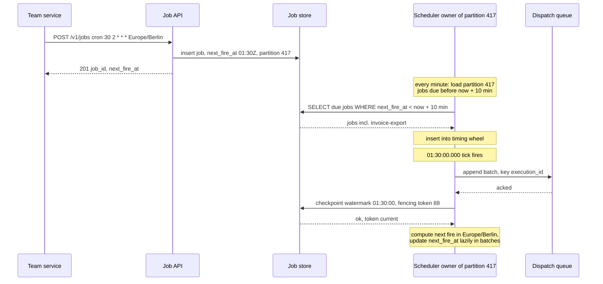

**Reading the diagram.** Registration is a synchronous insert; the API computes the first fire time in the job's time zone and stores it in UTC. The owning scheduler node loads near-term firings from its partition's index every minute (and receives jobs due within the window directly from the API). At the due tick, the wheel releases the job, the node appends a dispatch message keyed by execution ID, and once the queue acknowledges, the node advances the partition watermark with its fencing token; a rejected checkpoint means the node has lost its lease and must stop. The job's `next_fire_at` is advanced in batched updates off the critical path, because correctness rests on the watermark. Failure points: a crash after the queue append and before the checkpoint causes the new owner to re-dispatch the same execution ID; a time-zone transition (the daylight-saving change) is handled when computing the next fire time (§52.9.11). Scaling: dispatch throughput scales with partitions per node and queue partitions.

**Figure 52.20 — Read path: a worker executes, fails once and retries.**

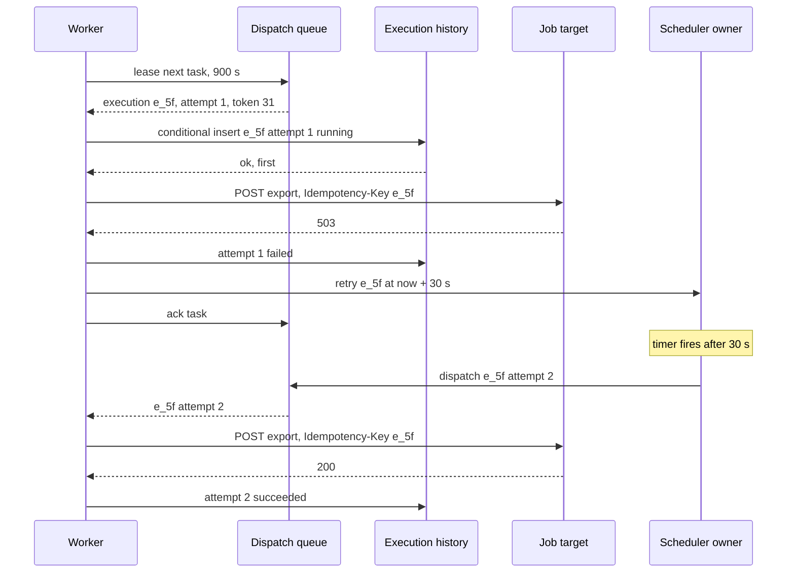

**Reading the diagram.** Workers pull work; the queue's lease (visibility timeout) returns the task to the queue if the worker dies. Before calling the target, the worker claims the attempt with a conditional insert, so two workers holding duplicate deliveries of the same attempt cannot both run it. The target receives the same idempotency key on every attempt, so if attempt 1 had actually done the work before failing, attempt 2 would return the stored result instead of exporting twice. The retry is scheduled as an ordinary timer on the owning scheduler with exponential backoff. Failure points: a target that ignores the idempotency key can run twice; a worker that exceeds its lease without heartbeating loses the task to another worker, and the fencing token makes its late writes to the execution history fail. Scaling: workers scale on queue lag, separately per tenant class so one tenant's backlog cannot starve others.

### 52.9.10 Bottlenecks

1. **The top-of-hour burst.** A million firings in one second; mitigated by pre-loading, batching dispatches and hashed minutes.
2. **Job store index scans.** Loading due jobs every minute from 1,024 partitions is 1,024 index range scans per minute, cheap; but a full reload after a mass failover must be rate-limited.
3. **Downstream targets.** A thousand tenants' jobs at 02:00 can overload a shared internal service; per-target concurrency limits in workers (using §52.6) protect it.
4. **History writes.** 250 million attempts per day, more with retries; batch writes and keep them off the dispatch path.

### 52.9.11 Failure scenarios

**Table 52.28 — Job scheduler failure scenarios.**

| What fails | Impact | Detection | Recovery | Prevention |
|---|---|---|---|---|
| Scheduler node crash | Its partitions stop firing | Lease expiry in etcd | Other nodes take leases; replay from watermark | Short leases (10 s); spare capacity |
| GC pause or network partition of an owner | Two nodes believe they own a partition | Rejected checkpoint (stale fencing token) | Stale node stops; duplicates deduplicated by execution ID | Fencing tokens on every write |
| Coordination service down | No ownership changes | etcd health | Owners keep partitions until leases lapse; then firing stops safely | 5-node etcd across zones (§26.9) |
| Dispatch queue unavailable | Firing pauses; watermarks stop advancing | Append errors | Resume; replay from watermark; misfire policies apply | Replicated queue; alert on watermark lag |
| Worker dies mid-job | Task redelivered after lease | Missing heartbeats | Another worker runs the same execution ID | Idempotent jobs; heartbeats |
| Daylight-saving transition | A 02:30 local job has no 02:30 on spring-forward day, two on fall-back day | Tests on time-zone transitions | Policy: fire once at the next valid time; fire only the first occurrence | Use a time-zone database; test transitions |
| Clock skew on a scheduler node | Jobs fire early or late | Clock offset monitoring | Fix NTP | Fire by node clock but checkpoint against store time |
| Poison job (always fails) | Retries waste capacity | Attempts per execution | Dead-letter after max attempts; alert owner | Retry caps; backoff |

### 52.9.12 Scaling strategy

**At 10× (100 million schedules, 10 million firings at the top of the hour).** Raise the partition count (to 8,192) and the scheduler fleet (to about 200 nodes); make hashed minutes the default for new hourly schedules, with explicit opt-in for exact :00 firing; and split dispatch queues by tenant tier so free-tier bursts cannot delay paid tenants.

**At 100×.** Run independent scheduler cells per region and tenant group, each with its own coordination service, job store shards and queues (§33.12); a global directory maps tenants to cells. Firing within a cell remains the same design; the cell bounds the blast radius of a bad deploy or a coordination outage.

### 52.9.13 Trade-offs

- **Partitioned ownership versus a single leader:** throughput and fast partial failover, in exchange for lease management and fencing.
- **Watermark checkpoints versus per-firing database writes:** dispatch at memory speed, in exchange for a window of duplicates after failover.
- **At-least-once plus idempotency versus attempting exactly-once:** a contract that can actually be kept, in exchange for requiring job authors to write idempotent jobs.
- **In-memory wheel for near-term timers only:** small memory and fast firing, in exchange for a loader loop and a direct-push path for newly created near-term jobs.

### 52.9.14 Alternative designs

- **Database polling** (`SELECT … WHERE next_fire_at <= now() FOR UPDATE SKIP LOCKED`): many workers poll one table and claim due rows. Simple and correct for thousands of jobs per minute; the polling load and lock contention fail at the million-per-second burst.
- **Delayed messages in the broker** (queues with per-message delivery delay, or Redis sorted sets scored by due time): good for one-off delays; recurring cron schedules and catch-up policies still need a scheduler on top.
- **Kubernetes CronJobs** for a few thousand cluster-local jobs: no new system to run, but each firing creates a pod, which is too heavy for millions of small HTTP callbacks.
- **Workflow engines** (§32.11) for complex, long-running, stateful workflows; the scheduler then only triggers them.

### 52.9.15 Interview discussion

**Table 52.29 — 45-minute plan for the distributed job scheduler.**

| Minutes | Focus | What to produce |
|---|---|---|
| 0–5 | Requirements | Cron with time zones, delayed jobs, DAGs, retries, policies |
| 5–10 | Estimates | 250 million/day; 1 million firings at :00; 103,000 dispatches/s |
| 10–15 | API and data model | Deterministic execution ID; jobs table; watermarks |
| 15–22 | Architecture | Figure 52.18: partitions, leases, wheels, queues, workers |
| 22–34 | Deep dive: ownership and firing | Leases, fencing tokens, watermark replay, timing wheel |
| 34–41 | Execution guarantees | At-least-once plus idempotency; retries; concurrency policy; DAG readiness |
| 41–45 | Failures and scaling | GC pause, DST, burst smoothing, cells |

**Likely follow-ups.**

- *"Can you guarantee exactly-once execution?"* No: a worker can crash after the side effect and before recording success. Offer at-least-once with a stable execution ID and require idempotent jobs.
- *"How do you avoid two schedulers firing the same job?"* Partition leases with fencing tokens; even when they overlap briefly, duplicates share an execution ID.
- *"Why a timing wheel instead of a heap?"* Constant-time insert and expiry for millions of timers and frequent retries; a heap is fine at small scale.
- *"How do you handle a job that runs longer than its interval?"* The concurrency policy: forbid, replace or allow.

**What distinguishes senior and staff answers.** A senior candidate partitions the work, uses leader election and a queue, and adds retries. A staff candidate finds the top-of-hour burst from the estimate, avoids per-firing database writes with watermarks, decomposes exactly-once into per-stage guarantees, uses fencing tokens correctly, and treats time zones and daylight-saving changes as correctness requirements.

### 52.9.16 Production considerations

- **Observability.** Dispatch delay distribution (scheduled versus dispatched time) per partition; watermark lag; lease changes per hour; retries and dead-letters per job; duplicate attempts detected by the conditional insert.
- **Security.** Job targets execute with the job owner's credentials, stored in a secrets manager and injected at execution; never store secrets in job payloads; restrict which internal endpoints jobs may call.
- **Cost.** The scheduler is cheap; the jobs are not. Show tenants their run counts and durations, and pause jobs whose targets have returned errors for weeks.
- **Operations.** Freeze windows for schedule changes during incidents; a global "pause tenant" switch; replay tooling to re-run a time range of firings after an outage, honoring misfire policies.

## 52.10 Web crawler

### 52.10.1 Problem statement

Design a web crawler for a search engine that downloads 3 billion pages every 30 days, discovers new pages by following links, and keeps the collection fresh by recrawling pages as they change. The output feeds an indexing pipeline (§16.6).

A crawler is a loop: take a URL, fetch it, extract links, add the new ones, repeat. At scale the loop is easy to write and hard to run well, for reasons that are mostly about *other people's servers*:

1. **The URL frontier with politeness and priority (the distinctive hard problem).** The crawler must fetch thousands of pages per second in total but never more than about one request every few seconds from any single host, while fetching important and changed pages first.
2. **Duplicates at three levels.** The same URL discovered many times; the same content under different URLs; and nearly identical content (the same article with a different timestamp or advertisement).
3. **Robots.txt and DNS.** Every host has rules to obey and a name to resolve, and both must be cached or they become the bottleneck.
4. **Distribution.** Fifty crawler nodes must divide the web without two of them hammering the same host.
5. **Recrawl scheduling.** With a fixed fetch budget, which known pages should be fetched again, and how often?

### 52.10.2 Functional requirements

- Start from seed URLs and discover new URLs from fetched HTML pages (and sitemaps).
- Fetch over HTTP and HTTPS, follow redirects, and store the raw response with metadata (status, headers, fetch time, IP).
- Obey robots.txt (RFC 9309) for the crawler's user agent, and identify the crawler with a descriptive `User-Agent` and a contact URL.
- Limit request rate per host and per IP address; back off on errors and slow responses.
- Skip URLs already seen; detect exact and near-duplicate content.
- Prioritize URLs by estimated importance and freshness need; recrawl known pages on a schedule.
- Hand fetched pages to the indexing pipeline.

Out of scope: rendering JavaScript-heavy pages (a separate, far more expensive rendering service), indexing and ranking (Chapter 16), and crawling the non-public web.

### 52.10.3 Non-functional requirements

| Property | Target |
|---|---|
| Throughput | 3 billion pages per 30 days: about 1,160 pages/s average; 2,000 pages/s capacity |
| Politeness | At most one concurrent connection per host; default ≥ 5 s between requests to a host, adaptive to server response time |
| Robots compliance | 100% of fetches checked against a robots.txt copy no older than 24 hours |
| Freshness | Important pages (top 10% by importance) recrawled at least daily; median page age in the index ≤ 15 days |
| Duplicate waste | ≤ 5% of fetches return content that is an exact duplicate of stored content |
| Availability | The crawler is a batch system: a node failure must not lose frontier state or more than a few minutes of work |
| Storage durability | Fetched pages stored with object-storage durability (§15.4) |

Availability matters less than for online services, but *politeness* failures are severe: a crawler bug that floods a small website can take it down, and the crawler gets blocked across hosting providers.

### 52.10.4 Capacity estimation

::: example
**Worked example — Fetch rate, bandwidth and storage.**

*Assumptions.* 3 billion pages per 30-day cycle; average page 100 KB uncompressed, 25 KB compressed; capacity provisioned at 2,000 pages/s to allow for retries, redirects and robots.txt fetches; average fetch time 1 s (connect, TLS, download); 50 links extracted per page; 30 billion distinct URLs known.

1. Average rate: $3 \times 10^9 / (30 \times 86{,}400\ \text{s}) = 3 \times 10^9 / 2{,}592{,}000 = 1{,}157$ pages/s.
2. Download bandwidth at capacity: $2{,}000 \times 100\ \text{KB} = 200\ \text{MB/s} = 1.6\ \text{Gbps}$ (0.93 Gbps at the average rate).
3. Storage per cycle: $3 \times 10^9 \times 25\ \text{KB} = 75\ \text{TB}$; keeping three cycles for change detection and reprocessing: 225 TB.
4. Fetches in flight, by Little's Law (§4.11): $2{,}000\ \text{pages/s} \times 1\ \text{s} = 2{,}000$ concurrent fetches, 40 per node with 50 nodes, trivial with asynchronous I/O.
5. Links discovered: $2{,}000 \times 50 = 100{,}000$ URLs/s to test against the seen set.
6. URL-seen set as a Bloom filter over 30 billion URLs (§17.4): at a 1% false-positive rate, 9.6 bits per URL = 36 GB; at 0.1%, 14.4 bits per URL = 54 GB, about 1.1 GB per node when partitioned across 50 nodes.
7. SimHash fingerprints for 3 billion pages: $3 \times 10^9 \times 8\ \text{B} = 24\ \text{GB}$; four lookup tables (Component 3): 96 GB across the cluster.

*Interpretation.* Bandwidth and storage are moderate. The URL-seen test at 100,000 lookups per second and the frontier's politeness constraints are the parts that need design. *Engineering implication.* Every per-URL structure must be partitioned and mostly in memory; a disk seek per discovered link would need 100,000 IOPS.
:::

Politeness caps how fast the crawler can go, in a way more machines cannot fix.

::: formula
**Politeness bound on crawl throughput**

$$R \leq \frac{H_{active}}{d} \qquad\qquad d_{\min,host} = \frac{T_{cycle}}{P_{host}}$$

| Symbol | Meaning | Units |
|---|---|---|
| $R$ | Achievable crawl rate across all hosts | pages/s |
| $H_{active}$ | Hosts with URLs ready in the frontier at any moment | hosts |
| $d$ | Minimum delay between requests to one host | s |
| $T_{cycle}$ | Time allowed to crawl a host's pages once | s |
| $P_{host}$ | Pages on one host that must be crawled per cycle | pages |
| $d_{\min,host}$ | Largest delay that still crawls the host within the cycle | s |
:::

::: example
**Worked example — How many hosts must be ready, and what about large sites?**

1. With $d = 5$ s and a target of 2,000 pages/s: $H_{active} \geq 2{,}000 \times 5 = 10{,}000$ hosts must have URLs ready at every moment, 200 per node.
2. A large site with $P_{host} = 10^7$ pages at $d = 5$ s takes $10^7 \times 5 = 5 \times 10^7$ s, which is 579 days, far longer than a 30-day cycle.
3. To crawl it in 30 days: $d_{\min,host} = 2{,}592{,}000 / 10^7 = 0.26$ s, about 3.9 requests per second.

*Interpretation.* The frontier must keep thousands of distinct hosts ready, and large sites need a per-host rate set from their capacity rather than a global default. *Engineering implication.* Make the delay adaptive (for example, a multiple of the host's recent response time, as Mercator-style frontiers do) and allow per-host overrides for large sites that can serve more; never raise the rate for a host without evidence it can take it.
:::

**Table 52.30 — Web crawler capacity summary.**

| Quantity | Value | Consequence |
|---|---|---|
| Fetch rate | 1,157 pages/s average; 2,000 capacity | 50 nodes with asynchronous I/O |
| Bandwidth | 1.6 Gbps at capacity | Modest; spread across nodes |
| Storage | 75 TB per cycle; 225 TB for three | Object storage, compressed WARC-style files |
| Discovered links | 100,000/s | Partitioned in-memory URL-seen filter |
| URL-seen filter | 36–54 GB | ≈ 1 GB per node |
| Ready hosts needed | ≥ 10,000 | Frontier must be wide, not deep |

### 52.10.5 API design

A crawler has few external clients; its interfaces are internal RPCs between components and a control API for operators.

```text
Control API (operators):
POST /v1/seeds        { "urls": ["https://example.org/"], "priority": 0.9 }
PUT  /v1/hosts/{host}/policy  { "min_delay_s": 0.5, "max_connections": 2, "blocked": false }
GET  /v1/hosts/{host}         -> { "robots_fetched_at": "...", "delay_s": 5.0, "queued": 1823,
                                   "errors_24h": 3, "last_status": 200 }
POST /v1/recrawl      { "url_prefix": "https://news.example.org/", "priority": 1.0 }

Internal RPCs (gRPC):
Frontier.Add(urls[], source_url, discovered_at)        -> accepted count (routed to owner node by host)
Frontier.Next(worker_id, max)                          -> [ {url, host, ip, priority, not_before} ]
Fetcher.Report(url, status, content_ref, fetch_ms, etag, last_modified)
Indexer feed: append to topic "fetched-pages" {url, content_ref, simhash, fetched_at}
```

### 52.10.6 Data model and database schema

```text
URL store (per node, for its hosts; LSM key-value store, §13.8):
  key:   reversed host + path, e.g. "org.example.www/news/2026/11/budget"   -- groups a host's URLs
  value: { url_fp: 64-bit, first_seen, last_fetched, last_changed, fetch_count, change_count,
           etag, last_modified, content_fp, simhash, importance, next_fetch_at, status }

Host table (per node):
  host -> { ip, dns_expires_at, robots_rules, robots_fetched_at, delay_s, next_allowed_at,
            consecutive_errors, max_connections }

URL-seen filter (per node, in memory, checkpointed): Bloom filter over url_fp
Content fingerprint index (cluster-wide, partitioned by fingerprint): content_fp -> canonical URL
SimHash tables (cluster-wide): 4 tables keyed by one 16-bit block each -> list of (simhash, url_fp)
Page archive (object storage): WARC-style files of ~1 GB, each holding many compressed responses
```

Keying URLs by **reversed host name** stores a host's URLs together and a domain's hosts near each other, so the per-host frontier can read a host's URLs with one range scan, the same trick Bigtable's web table used [Chang et al. 2006]. Pages are stored in large archive files, not one object per page, because 3 billion small objects would be expensive in requests and metadata (§15.4); the URL store records each page's file and offset.

### 52.10.7 High-level architecture

**Figure 52.21 — Distributed web crawler architecture.**

```mermaid
flowchart LR
  SEED([Seeds and sitemaps]) --> FR
  subgraph Node["Crawler node, one of 50, owns hosts by hash"]
    FR["URL frontier<br/>priority front queues,<br/>per-host back queues"] --> FE["Fetchers<br/>async HTTP"]
    FE -->|robots check| RB[(Robots cache)]
    FE -->|resolve| DNS[(Local DNS cache)]
    FE --> PR["Parser and link extractor"]
    PR -->|URL-seen test| BF[(Bloom filter<br/>URL-seen)]
    PR --> US[(URL store)]
    RS["Recrawl scheduler"] --> FR
    US --> RS
  end
  FE -->|HTTPS GET| WEB{{Web servers}}
  DNS -->|cache miss| RES{{Recursive resolvers}}
  PR -->|links of other hosts| RT["Router by hash of host"]
  RT -->|batched gRPC| FR2["Other nodes' frontiers"]
  PR --> DD["Duplicate detection<br/>exact fp and SimHash"]
  DD --> AR[(Page archive<br/>object storage)]
  DD -.->|new content| IDX[["Indexer feed"]]
```

**Reading the diagram.** Each of the 50 nodes owns a set of hosts, chosen by hashing the host name (§14.6), and runs the whole loop for them inside the subgraph. The frontier releases a URL only when its host's politeness delay has passed; fetchers check the robots.txt cache and the local DNS cache before connecting synchronously to the web server; the parser extracts links, tests each against the node's URL-seen Bloom filter, records new URLs in the URL store, and routes links belonging to hosts owned by other nodes through the router, which batches them into gRPC calls to those nodes' frontiers. Fetched content passes through duplicate detection (exact fingerprint, then SimHash) before being written to the page archive and announced asynchronously to the indexer (dotted). The recrawl scheduler reads the URL store and feeds known URLs back into the frontier when they are due. Storage boundaries: per-node URL store and host table (local, replicated by checkpoint), the archive (object storage), and the cluster-wide fingerprint indexes. Failure points: a node failure stalls its hosts until another node takes over its hash range; slow DNS stalls fetchers; a misparsed robots.txt is a politeness incident. Scaling: add nodes and re-divide the host hash space (consistent hashing, §14.8, keeps movement small).

### 52.10.8 Detailed component design

#### Component 1: the URL frontier

The frontier is the design described for Mercator [Heydon & Najork 1999] and explained in detail by Manning, Raghavan and Schütze [Manning et al. 2008, ch. 20]: two layers of queues that separate *priority* from *politeness*.

**Figure 52.22 — Mercator-style frontier: priority front queues and per-host back queues.**

```mermaid
flowchart LR
  IN["New and recrawl URLs"] --> PRI{"Prioritizer<br/>importance x staleness"}
  PRI --> F1[["Front queue 1, highest"]]
  PRI --> F2[["Front queue 2"]]
  PRI --> FK[["Front queue K, lowest"]]
  F1 --> SEL{"Back-queue router<br/>biased toward high priority"}
  F2 --> SEL
  FK --> SEL
  SEL --> B1[["Back queue: host a.example"]]
  SEL --> B2[["Back queue: host b.example"]]
  SEL --> BN[["Back queue: host n.example"]]
  B1 --> HEAP["Heap of back queues<br/>by next_allowed_at"]
  B2 --> HEAP
  BN --> HEAP
  HEAP --> FT["Fetcher threads"]
```

**Reading the diagram.** URLs enter at the left and are assigned a priority, then placed in one of $K$ **front queues** (FIFO per priority level). The back-queue router pulls from front queues with a bias toward higher priority and places each URL in the **back queue** for its host; each back queue holds URLs of exactly one host, and there are a few times as many back queues as fetcher threads (Mercator's designers suggested about three times as many [Manning et al. 2008]). A **heap** keyed by each back queue's `next_allowed_at` time gives fetchers the host whose politeness delay expired earliest. When a fetch finishes, the host's `next_allowed_at` is set to now plus the delay, and the back queue goes back into the heap; when a back queue empties, the router refills it with URLs of a new host from the front queues. All flows are in-process and synchronous; front and back queues spill to the local URL store when they exceed memory. Failure points: too few distinct hosts in the back queues (throughput falls, per the politeness formula); one huge host monopolizing front queues (bounded by per-host admission caps). Scaling: per node, the structure is independent of other nodes because hosts never span nodes.

The **delay** for a host is adaptive: the larger of a floor (5 s by default, or a per-host override), and a multiple of the host's recent response time; the textbook description of Mercator's frontier uses ten times the last fetch duration as an example [Manning et al. 2008]. A slow, struggling server therefore automatically gets fewer requests. Errors increase the delay exponentially; HTTP 429 and 503 with `Retry-After` set `next_allowed_at` directly. Politeness is also enforced per **IP address**, because thousands of small hosts often share one server: the host table maps hosts to IPs, and a second heap limits concurrency per IP.

**Priority** combines estimated importance (link-based scores from the previous crawl, domain quality, depth from the site root) with the need to recrawl (Component 4). New URLs from a high-importance page inherit a share of its importance.

#### Component 2: DNS, robots.txt and fetching

**DNS.** Resolution can take tens to hundreds of milliseconds and is done once per host per TTL, but the standard blocking resolver library serializes lookups and was a known bottleneck in early crawlers; Mercator used its own multithreaded resolver for this reason [Heydon & Najork 1999; Najork & Heydon 2001]. Each node runs an asynchronous local caching resolver, resolves hosts when they enter the back queues (prefetching, so the fetch does not wait), honors TTLs with a minimum floor of, say, one hour to limit load, and records the IP for per-IP politeness. Because hosts are partitioned by node, each node's DNS cache covers only its own hosts and achieves a high hit ratio.

**Robots.txt.** RFC 9309 standardized the Robots Exclusion Protocol in 2022: the crawler fetches `/robots.txt` for each host (scheme, host and port), matches the most specific `User-agent` group, and applies `Allow` and `Disallow` rules by longest match [RFC 9309]. The RFC says crawlers should not use a cached copy for more than 24 hours unless the file is unreachable, and must parse at least 500 KiB of it. It also distinguishes failure cases: if robots.txt is *unavailable* (a 4xx status) the crawler may access any resources; if it is *unreachable* (a 5xx status or network error) the crawler must assume complete disallow. That asymmetry matters: a server error on robots.txt stops the crawl of that host, which is the polite default when a server is struggling. `Crawl-delay` is not part of RFC 9309; honor it anyway as a lower bound on the delay where present. The robots cache is the host table's `robots_rules` field, refreshed before expiry for hosts with queued URLs.

**Fetching.** Fetchers use asynchronous I/O with connection reuse per host (keep-alive, §7.16), a total timeout (30 s), a maximum body size (for example 10 MB, truncating beyond), and conditional requests for recrawls (`If-None-Match` with the stored ETag, `If-Modified-Since` with the stored date), which turn unchanged pages into small 304 responses. Redirects are not followed inline; the target URL goes back through the frontier so it obeys politeness and duplicate checks for its own host.

#### Component 3: duplicate detection

**Table 52.31 — Duplicate detection layers.**

| Layer | Question | Mechanism | Cost | Error mode |
|---|---|---|---|---|
| URL normalization | Are these strings the same URL? | Lowercase scheme and host, remove default ports and fragments, sort or strip tracking parameters, resolve `.` and `..` | CPU only | Over-normalizing merges distinct pages |
| URL-seen | Have we seen this URL before? | 64-bit fingerprint tested against a Bloom filter (§17.4), confirmed in the URL store when needed | 100,000 lookups/s in memory | False positive skips a new URL (rate ≤ 0.1%) |
| Exact content | Is this content byte-identical to a stored page? | Hash of the normalized body, looked up in the fingerprint index | One lookup per fetch | None in practice |
| Near-duplicate | Is it nearly identical (different timestamp, ad, counter)? | SimHash fingerprint, Hamming distance ≤ 3 | Four table lookups per fetch | Threshold misjudges very short pages |

The URL-seen test runs on the node that owns the URL's host, after routing, so each node's filter covers only its own hosts. A Bloom filter cannot delete and only grows, so it is rebuilt from the URL store each cycle. Its false positives mean a truly new URL is occasionally skipped; at 0.1% that is acceptable because important pages are usually linked from many places and will be discovered again through another source. Mercator kept a disk-based set of URL fingerprints with an in-memory cache for the same test [Heydon & Najork 1999].

**Near-duplicates** are the bigger source of waste: mirrors, printer-friendly versions, session-ID URLs and pages differing only in boilerplate. Broder et al. introduced **shingling**, which compares sets of overlapping word sequences (shingles) and estimates their resemblance from small sketches [Broder et al. 1997]. Charikar's **SimHash** compresses a document into a single 64-bit fingerprint such that similar documents get fingerprints that differ in few bits [Charikar 2002]. Manku, Jain and Das Sarma showed that SimHash is practical for detecting near-duplicates at Google's crawl scale, reporting that 64-bit fingerprints with a Hamming-distance threshold of 3 worked well for a repository of 8 billion pages, and gave table-based methods for finding all fingerprints within distance 3 quickly [Manku et al. 2007].

```python
import hashlib
import re


def features(text: str, k: int = 3) -> list:
    """Word 3-shingles: overlapping sequences of k words."""
    words = re.findall(r"\w+", text.lower())
    return [" ".join(words[i:i + k]) for i in range(max(1, len(words) - k + 1))]


def h64(s: str) -> int:
    return int.from_bytes(hashlib.blake2b(s.encode(), digest_size=8).digest(), "big")


def simhash(text: str) -> int:
    """Charikar's SimHash: each feature votes +1/-1 on each of 64 bits."""
    votes = [0] * 64
    for f in features(text):
        h = h64(f)
        for bit in range(64):
            votes[bit] += 1 if (h >> bit) & 1 else -1
    return sum(1 << bit for bit in range(64) if votes[bit] > 0)


def hamming(a: int, b: int) -> int:
    return bin(a ^ b).count("1")


base = " ".join([
    "The city council approved the new budget on Tuesday after a long debate about funding for",
    "public transport, schools and road repairs. The mayor said the plan adds two bus lines,",
    "repairs forty bridges and hires sixty teachers, while opposition members argued that the",
    "property tax increase would hurt small businesses in the old town and asked for a review.",
    "Residents who attended the meeting raised concerns about parking near the new tram depot,",
    "noise from night construction and the cost of replacing water pipes under the main square.",
    "The finance director explained that interest rates had risen sharply since last spring and",
    "that the city must refinance older loans before the end of the coming fiscal year. Several",
    "councillors proposed delaying the stadium renovation to free money for winter heating help",
    "for pensioners, and the amendment passed by a narrow margin late in the evening session.",
    "Local shop owners welcomed the extra bus lines but asked for loading zones on market days,",
    "and the transport committee promised a traffic study before any street is closed to cars.",
    "Teachers' unions said sixty new posts would barely cover retirements expected next summer,",
    "while parents asked whether the repaired school roofs would be finished before the rains.",
])
page_a = base + "Posted 09:14. Share this article. 3 comments."
page_b = base + "Posted 09:15. Share this article. 4 comments."          # same story, new timestamp
page_c = ("A recipe for sourdough bread needs flour, water, salt and a lively starter that has "
          "been fed the night before. Shape the loaf, let it rise for several hours in a cool kitchen, "
          "then bake it in a very hot oven with steam for the first twenty minutes until the crust is dark. ")

a, b, c = simhash(page_a), simhash(page_b), simhash(page_c)
print("exact duplicate?", hashlib.sha256(page_a.encode()).digest() == hashlib.sha256(page_b.encode()).digest())
print("near-duplicate distance A-B:", hamming(a, b), "| unrelated distance A-C:", hamming(a, c))

# Pigeonhole lookup: if distance <= 3, at least one of four 16-bit blocks is identical.
blocks = lambda x: [(i, (x >> (16 * i)) & 0xFFFF) for i in range(4)]
print("shared 16-bit blocks A-B:", len(set(blocks(a)) & set(blocks(b))))
```

Output:

```text
exact duplicate? False
near-duplicate distance A-B: 3 | unrelated distance A-C: 26
shared 16-bit blocks A-B: 1
```

What to notice:

- An exact hash says pages A and B are different, although a reader would call them the same article; SimHash puts them 3 bits apart, within the threshold, while an unrelated page is 26 bits away (about 32 is expected for unrelated documents).
- The lookup trick is the pigeonhole principle: if two 64-bit fingerprints differ in at most 3 bits, at least one of their four 16-bit blocks is identical. Four tables, each keyed by one block, return a small candidate set to check exactly. Manku et al. refine this with permuted tables to balance memory and candidate counts [Manku et al. 2007].
- Short pages have few shingles, so a small edit moves many bits; apply the near-duplicate test only above a minimum length (for example 100 words) and rely on exact hashes below it.
- Production systems weight features (for example by term frequency) and strip boilerplate (navigation, footers) before fingerprinting, which makes distances more meaningful.

When a near-duplicate is found, the crawler stores the page compactly (as a reference to the canonical page) and lowers the recrawl priority of the duplicate URL; repeated duplicates from one host suggest a URL pattern (session IDs, calendars) that should be blocked by a per-host rule, which also defends against **crawler traps**: infinite URL spaces such as calendars that link to the next day forever. Caps on URLs per host and on path depth bound the damage.

#### Component 4: recrawl scheduling

With a fixed budget of about 1,157 fetches per second, every recrawl of a known page displaces the discovery of a new one. The scheduler estimates each page's **change rate** from its history (number of observed changes over number of fetches, by comparing content fingerprints) and sets `next_fetch_at` from importance and change rate. Cho and Garcia-Molina analyzed refresh policies for a crawler with a fixed budget and found, counter-intuitively, that refreshing pages in proportion to how often they change can give *lower* average freshness than refreshing all pages uniformly; under their freshness metric, the optimal policy gives pages that change extremely often fewer refreshes, because a copy of such a page is stale again almost immediately [Cho & Garcia-Molina 2003]. In practice, schedulers bound recrawl intervals between a minimum (hours, for important news pages) and a maximum (months), weight by importance, use sitemap `lastmod` hints, and use conditional GETs so that checking an unchanged page costs a 304 response rather than a full download.

::: industry
**Mercator and published crawler designs.** Mercator, built at Compaq's Systems Research Center, was a scalable, extensible Java crawler whose design introduced the URL frontier structure, the URL-seen and content-seen tests with fingerprints, and a custom DNS resolver [Heydon & Najork 1999]; Najork and Heydon later described its high-performance configuration and lessons [Najork & Heydon 2001]. The robots.txt conventions crawlers had followed informally since 1994 became RFC 9309 in 2022 [RFC 9309]. Google researchers published the SimHash-based near-duplicate method described above [Manku et al. 2007]. The architecture in this section follows these published designs; it is not a description of any company's current production crawler.

*Evidence: Primary* — [Heydon & Najork 1999]; [Najork & Heydon 2001]; [RFC 9309]; [Manku et al. 2007]
:::

### 52.10.9 Data flow

**Figure 52.23 — Read path: selecting and fetching the next URL.**

```mermaid
sequenceDiagram
  participant F as Fetcher
  participant FR as Frontier heap
  participant H as Host table and robots cache
  participant D as Local DNS cache
  participant W as Web server
  F->>FR: Next
  FR-->>F: url on b.example, next_allowed_at passed
  F->>H: robots rules for b.example, age 3 h
  H-->>F: allowed, delay 5 s
  F->>D: resolve b.example
  D-->>F: 198.51.100.7, cached
  F->>W: GET /news/budget, If-None-Match etag
  W-->>F: 200, 96 KB, 0.8 s
  Note over F,FR: set next_allowed_at = now + max of 5 s and 10 x 0.8 s
  F->>FR: return back queue to heap
```

**Reading the diagram.** The fetcher asks the frontier for work; the heap returns a URL only from a host whose politeness time has passed. Before connecting, the fetcher checks robots rules (cached for at most 24 hours; refreshed in the background) and resolves the host from the local DNS cache, both normally in memory. The fetch itself is synchronous over HTTPS with a conditional header for a recrawl. After the fetch, the host's next allowed time is set from the adaptive delay (here 8 s, because the server took 0.8 s) and the host's back queue returns to the heap. Failure points: a robots.txt that returns 5xx (treat the host as fully disallowed until it recovers), DNS timeouts (requeue with backoff), and slow servers (the adaptive delay backs off automatically). Scaling: thousands of hosts in the heap per node keep fetchers busy despite per-host delays.

**Figure 52.24 — Write path: processing a fetched page.**

```mermaid
sequenceDiagram
  participant F as Fetcher
  participant P as Parser
  participant DD as Duplicate detection
  participant A as Page archive
  participant U as URL store and Bloom filter
  participant R as Router
  participant I as Indexer feed
  F->>P: response body, headers
  P->>DD: exact fp and SimHash
  DD-->>P: new content, no near-duplicate
  P->>A: append compressed record to archive file
  P--)I: page ready, content_ref
  P->>U: update url record, changed, next_fetch_at
  Note over P: extract 50 links, normalize
  P->>U: own-host links, Bloom test, add new ones
  P->>R: links of other hosts
  R--)R: batch per owner node, gRPC Frontier.Add
```

**Reading the diagram.** The parser computes fingerprints first, so duplicates are stored only as references. New content is appended to the current archive file in object storage, and the indexer is notified asynchronously. The URL record is updated with the fetch result and change observation, which feeds the recrawl scheduler. Extracted links are normalized; links to the node's own hosts are tested against the local Bloom filter and added to the URL store and frontier if new; links to other hosts are batched by owner node and sent asynchronously. Failure points: a crash before the archive file is closed loses the pages in that file since the last flush, so files are flushed every few minutes and the URL records point only to flushed data; the cross-node link stream can lag without harming politeness. Scaling: link routing traffic grows with the number of nodes but is batched; 100,000 links/s at about 100 bytes each is 10 MB/s cluster-wide.

### 52.10.10 Bottlenecks

1. **Host diversity in the frontier.** Throughput is capped by $H_{active}/d$; a frontier dominated by a few large hosts idles fetchers. Admission caps per host and a wide front-queue mix keep thousands of hosts ready.
2. **URL-seen lookups.** 100,000 per second; in-memory Bloom filters per node solve it, while any disk-based lookup per link would not.
3. **DNS.** Mitigated by prefetching and a local cache; a slow recursive resolver otherwise stalls fetchers.
4. **Parsing CPU.** HTML parsing and link extraction of 200 MB/s is a real CPU cost, often larger than networking; size nodes for it.
5. **Storage writes of small pages.** Solved by archive files instead of objects per page.

### 52.10.11 Failure scenarios

**Table 52.32 — Web crawler failure scenarios.**

| What fails | Impact | Detection | Recovery | Prevention |
|---|---|---|---|---|
| Crawler node crash | Its hosts stall; in-memory queues lost | Heartbeat loss | Another node takes its hash range and rebuilds queues from the URL store | Checkpoint frontier state and Bloom filter regularly |
| Politeness bug (delay ignored) | A small site is overloaded; complaints, blocks | Per-host request-rate monitor | Kill switch per host and globally | Independent per-IP rate guard in the fetch path |
| Robots.txt misparsed | Crawling disallowed paths | Audits against a robots test suite | Purge fetched disallowed content | RFC 9309 test cases in CI |
| Crawler trap | Frontier fills with one host's infinite URLs | URLs per host growth | Block URL pattern; cap per host | Per-host URL caps; depth limits; near-duplicate signals |
| DNS resolver outage | Fetchers stall on new hosts | Resolution latency and errors | Fail over to secondary resolvers | Multiple resolvers; prefetching; TTL floor |
| Bloom filter lost | Many URLs re-added as new | Duplicate fetch rate rises | Rebuild from URL store | Periodic checkpoints |
| Host hash rebalancing | Two nodes briefly crawl one host | Overlapping ownership | Ownership by lease with fencing (§26.13) | Hand over hosts only after the old owner stops |
| Mass 5xx from one hosting provider | Many hosts error at once | Error rate per IP range | Back off per IP; pause range | Per-IP politeness and error backoff |

### 52.10.12 Scaling strategy

**At 10× (30 billion pages per cycle, 20,000 pages/s).** Politeness now requires 100,000 ready hosts at a 5 s delay, which means the frontier must draw from a far wider slice of the web: improve host discovery and lower per-node host counts by adding nodes (about 500). Storage reaches 750 TB per cycle, so keep only changed pages from previous cycles. The URL-seen filters grow to about 540 GB in total and remain partitioned.

**At 100×.** Crawl from several regions, assigning hosts to the region nearest to their servers to cut latency and cross-ocean bandwidth, with host ownership still unique worldwide. Recrawl efficiency becomes the main lever: change prediction models, sitemaps and push-based notification of changes from cooperating sites reduce wasted fetches more than hardware does.

### 52.10.13 Trade-offs

- **Host-partitioned nodes:** politeness, DNS caching and robots caching become local problems, in exchange for cross-node link routing and uneven load when a node owns very large hosts.
- **Bloom filter for URL-seen:** fast and small, in exchange for occasionally skipping new URLs.
- **Near-duplicate suppression:** large savings in storage and indexing, in exchange for occasionally treating distinct short pages as duplicates.
- **Fixed fetch budget split between discovery and recrawl:** freshness of known pages versus coverage of new ones; the split is a product decision.

### 52.10.14 Alternative designs

- **Centralized frontier service** shared by stateless fetchers: simpler fetchers, but the frontier becomes a bottleneck and a single politeness authority that must be highly available.
- **Breadth-first crawl from a disk-based queue** (early crawlers): easy, but without per-host back queues, politeness requires sleeping threads and throughput collapses on hosts with many links.
- **Use a public crawl dataset** (such as Common Crawl's published archives) for research or bootstrap: no crawling infrastructure, but no control over freshness, coverage or recrawl.
- **Headless-browser rendering for all pages**: complete content for JavaScript-heavy sites, at one to two orders of magnitude more CPU per page; usually reserved for pages known to need it.

### 52.10.15 Interview discussion

**Table 52.33 — 45-minute plan for the web crawler.**

| Minutes | Focus | What to produce |
|---|---|---|
| 0–5 | Requirements | Pages per cycle, politeness, robots, freshness, duplicates |
| 5–10 | Estimates | 1,157 pages/s, 1.6 Gbps, 75 TB/cycle, 100,000 links/s, ready hosts formula |
| 10–14 | Data model | URL store keyed by reversed host; host table; archive files |
| 14–20 | Architecture | Figure 52.21: host-partitioned nodes, router, duplicate detection |
| 20–33 | Deep dive: frontier | Front and back queues, heap, adaptive delay, per-IP limits |
| 33–40 | Duplicates, robots, DNS | Bloom filter, exact hash, SimHash, RFC 9309 behavior |
| 40–45 | Recrawl and scaling | Change rates, conditional GETs, traps, 10× hosts |

**Likely follow-ups.**

- *"How do you stay polite while crawling fast?"* Per-host back queues with a heap of next-allowed times, adaptive delays and per-IP limits; throughput comes from host diversity, not from hitting hosts harder.
- *"How do you detect duplicates?"* Normalize URLs; a Bloom filter for URL-seen; an exact content hash; SimHash with a 3-bit threshold for near-duplicates.
- *"How do you distribute the crawl?"* Partition by hash of the host so each host has one owner; route discovered links to owners.
- *"What if robots.txt returns 500?"* Treat the host as fully disallowed until it is reachable again, per RFC 9309.

**What distinguishes senior and staff answers.** A senior candidate builds the frontier with politeness and uses Bloom filters. A staff candidate derives the ready-hosts bound and the large-site problem from numbers, partitions by host to make politeness and caching local, separates exact from near-duplicate detection with costs, handles crawler traps, and treats recrawl scheduling as a budget allocation problem with a known counter-intuitive result.

### 52.10.16 Production considerations

- **Observability.** Fetches per second, ready hosts per node, per-host request rates (with alerts above policy), robots.txt fetch outcomes by status class, DNS latency, duplicate and near-duplicate rates, and index freshness (median page age).
- **Security and ethics.** Fetch only public content; respect robots.txt and opt-out requests promptly; publish the crawler's user agent, purpose and contact page; never send credentials; sandbox parsers, because hostile pages target parser bugs; filter content that must not be stored.
- **Cost.** Bandwidth, storage and parsing CPU; conditional requests and near-duplicate suppression reduce all three.
- **Operations.** A global and per-host kill switch; a complaint-handling process with fast host blocking; replayable archive files for reprocessing when parsers improve.

## 52.11 Summary and revision notes

::: summary
- **Method (§52.3).** Scope → size → contract → shape → depth → stress → judgment. Name the distinctive hard problem within ten minutes and spend most of the time there. Every number comes from stated assumptions; peak ≈ 4.8 × average with $h = 0.10$, $b = 2$.
- **URL shortener.** 280,000 redirect RPS at peak, 182.5 billion links in 10 years, 7 base62 characters ($62^7 = 3.52 \times 10^{12}$). Leased counter ranges plus a keyed permutation give unique, non-enumerable codes without per-create coordination; 302 keeps analytics correct; clicks go asynchronously to Kafka and are rolled up.
- **Pastebin.** Metadata in a key-value store, blobs in object storage, small pastes inline. Logical expiry is checked on every read; physical deletion uses a time-bucketed expiry index, lifecycle rules as backstop and a reconciler. Permanent pastes dominate storage. Private content is never cached in shared layers; burn-after-read is a conditional state transition.
- **Rate limiter.** Choose per rule where counting happens: local, regional Redis with atomic Lua, leased token batches for hot keys, or demand-proportional regional shares for global limits. Fail-open or fail-closed is a per-rule decision; the limiter must never cause the outage it exists to prevent.
- **Notification system.** Separate queues and pools per priority; the router applies preferences, quiet hours, caps and deduplication before rendering. Provider quotas often set campaign drain time. Provider timeouts make delivery ambiguous; resolve per channel. Every message ends in a recorded terminal state.
- **Key-value store.** Fixed partitions on a consistent-hashing ring; $N = 3$ zone-diverse replicas; quorums with sloppy quorum and hinted handoff; version vectors and siblings; read repair and Merkle anti-entropy; LSM storage; gossip membership with explicit permanent changes. Throughput, not capacity, sets node count; tombstones must outlive the rejoin window.
- **Job scheduler.** Partition ownership by lease with fencing tokens; near-term timers in hierarchical timing wheels; watermark checkpoints instead of per-firing writes; deterministic execution IDs; at-least-once execution plus idempotent jobs; top-of-hour bursts drive capacity.
- **Web crawler.** Mercator-style frontier: priority front queues, per-host back queues and a heap of next-allowed times. Throughput ≤ ready hosts ÷ delay. Partition by host; cache DNS and robots.txt (RFC 9309); URL-seen Bloom filter, exact hash and SimHash for duplicates; recrawl as budget allocation.
:::

## 52.12 Knowledge checkpoint

1. With $h = 0.10$ and $b = 2$, what multiple of the daily average is the design peak?
2. How many base62 characters are needed for $1.825 \times 10^{13}$ codes at 10% maximum fill?
3. Why does a counter-based shortener need a keyed permutation, and why must cycle-walking be used with a 42-bit Feistel network?
4. Why does a shortener with analytics return 302 rather than 301?
5. In the Pastebin estimate, why do never-expiring pastes dominate storage although 70% of pastes expire?
6. Why is a database's native TTL not sufficient to stop expired pastes from being served?
7. How is burn-after-read made safe under concurrent readers?
8. A global limit of 6,000 requests per minute; regional demand 6,000, 3,000 and 1,000 per minute; floor fraction 0.1. Compute the regional allocations.
9. Which rate limits should fail closed when the limiter is unavailable, and why?
10. A 50 million-message campaign; capacity 50,000/s; higher-priority traffic 8,333/s. How long does the campaign take?
11. Why does a single queue with a priority field fail for one-time passwords?
12. In the key-value store, why does reading from all three replicas cost nodes, and what does it buy?
13. Why must tombstones be retained longer than the maximum time a replica can be away and still rejoin?
14. What is the span of a three-level timing wheel with 100 ms ticks and 600, 60 and 24 slots?
15. Why can a job scheduler not promise exactly-once execution, and what does it offer instead?
16. A crawler needs 2,000 pages/s with a 5 s politeness delay. How many hosts must have URLs ready?
17. Why must links be routed to the node that owns their host?
18. What does RFC 9309 require when robots.txt returns a 5xx status?

<details><summary>Answers</summary>

1. $0.10 \times 24 \times 2 = 4.8$.
2. $\log_{62}(1.825 \times 10^{14}) = 7.96$, so 8 characters.
3. Sequential counters are enumerable; a keyed permutation maps consecutive counters to unrelated codes without collisions. The Feistel network permutes $[0, 2^{42})$, which is larger than $62^7$, so out-of-range results are re-encrypted until they fall inside, preserving a permutation on the smaller set.
4. 301 is cacheable by default, so browsers stop asking and analytics undercounts; disabled links also keep redirecting from caches.
5. Expiring pastes reach a steady state (about 1.15 TB) while permanent ones accumulate (21.9 TB per year).
6. Native TTL deletion is asynchronous and best effort (DynamoDB: typically within a few days); visibility must be decided by a read-time check of `expires_at`.
7. A conditional transition from `active` to `burned` before returning content; only one reader's update succeeds.
8. Floors 200 each; remaining 5,400 split 0.6/0.3/0.1: 3,440, 1,820 and 740.
9. Security limits (login failures) and money limits (paid sends): an unchecked burst causes harm that cannot be undone; fall back to strict local limits.
10. $5 \times 10^7 / 41{,}667 = 1{,}200$ s, 20 minutes.
11. Head-of-line blocking: the OTP waits behind already queued campaign messages; isolation needs separate queues and consumers.
12. Each logical read becomes three replica reads, raising the node count to 150; it detects stale replicas promptly (read repair) and lets the coordinator answer with the fastest $R$ replies, cutting tail latency.
13. Otherwise a replica that missed the delete still holds the old value and anti-entropy copies it back, resurrecting deleted data.
14. $0.1 \times 600 \times 60 \times 24 = 86{,}400$ s, one day.
15. A worker can crash after the side effect but before recording success, so the job may run again. It offers at-least-once execution with a stable execution ID; idempotent jobs then get effectively-once results.
16. $2{,}000 \times 5 = 10{,}000$ hosts.
17. So that exactly one node enforces politeness, holds robots and DNS state, and tests URL-seen for each host.
18. Treat the host as unreachable and assume complete disallow until it can be fetched.

</details>

## 52.13 Interview questions

### Basic

**Q1. Design the redirect path of a URL shortener for 280,000 RPS with p99 ≤ 20 ms.**
**Answer.** Stateless redirect nodes behind the CDN, with an in-process LRU cache, a Redis cluster and a partitioned link store keyed by code. Return 302 with a short private cache lifetime; cache negative results for unknown codes; collapse concurrent misses; emit click events asynchronously. At a 95% hit ratio the store sees about 14,000 reads/s; about 50 nodes at 10,000 RPS each and 60% utilization.

**Q2. Why separate blobs from metadata in a Pastebin?**
**Answer.** Their access patterns and lifecycles differ: metadata is small, read on every request and updated; blobs are immutable and large. Large values in a key-value store inflate compaction, replication and caches. Object storage is cheaper per byte and has lifecycle rules. Keep small pastes inline to avoid an object request for the common case.

### Intermediate

**Q3. Your notification platform's OTPs are delayed during marketing campaigns. Diagnose and fix.**
**Answer.** OTPs share a queue, workers or provider quota with campaign traffic. Give critical traffic its own queue and worker pool, reserve a share of each provider's throughput for it, set a short TTL, cap campaign rates, and fail over SMS providers on definitive errors. Monitor end-to-end latency per priority.

**Q4. How does a Dynamo-style store remain writable when one of three replicas is down, and what is the cost?**
**Answer.** The coordinator writes to a substitute node with a hint (sloppy quorum), meeting $W = 2$; the hint is replayed later. The cost: the substitute is outside the preference list, so $R + W > N$ no longer guarantees reading the latest write until handoff and repair complete, and concurrent writes during partitions produce siblings or LWW losses.

### Advanced

**Q5. Design global rate limits for a tenant served from three regions without adding cross-region latency.**
**Answer.** Enforce regional shares locally (Redis plus Lua per region), recomputed every second from published per-key usage with $L_r = fL/R + (1-f)L\,d_r/\sum d$. Overshoot during demand shifts is about $\lambda\Delta$. Use chunked leases from a durable global counter for money-like daily quotas. Declare failure modes per rule and keep local fallback limits.

**Q6. A job scheduler must fire one million jobs at 00:00:00 within 10 s and never fire a job twice in a way that matters. Design the core.**
**Answer.** Partition schedules (1,024 partitions) with leases and fencing tokens; pre-load the next 10 minutes of timers into hierarchical timing wheels; at the tick, batch-append dispatch messages keyed by `hash(job_id, scheduled_at)`; checkpoint a per-partition watermark each second instead of writing per firing; on failover, replay from the watermark. Workers claim attempts by conditional insert and pass the execution ID as an idempotency key. Encourage hashed minutes to flatten the burst.

## 52.14 Practical exercises

1. Run the short-code program with a different key and confirm that the first 200,000 codes are still unique; then measure the average number of Feistel encryptions per code and compare with 1.25.
2. Write a sweeper simulation for the Pastebin expiry index with 64 shards and the expiry mix of §52.5.4; measure the largest partition at the peak hour.
3. Extend the rate-limiter allocation formula into a simulation where demand moves from the US to the EU over 10 minutes; plot overshoot against $\Delta$ = 1, 5 and 10 s.
4. Implement the notification state machine of Figure 52.12 with forward-only transitions and feed it shuffled, duplicated events; assert that final states are unchanged.
5. Add retries with exponential backoff to the timing-wheel program, re-scheduling failed jobs, and verify that every retry fires at its computed time.
6. Run the SimHash program on two versions of a real news page and on two unrelated pages; record distances with and without boilerplate removal.

## 52.15 Design challenges

1. **Link-in-bio service.** Extend the URL shortener so that each user has an editable page of links at `sho.rt/@name`. Links become mutable: redesign caching and invalidation, and estimate how often caches must be purged.
2. **Regional notification compliance.** Users in one jurisdiction must have contact data and notification logs stored only in that region. Redesign the notification platform's stores, queues and provider routing, and state what happens to a global campaign.
3. **Crawler for a vertical search engine.** Crawl 50 million product pages from 20,000 shops daily with price-change detection within 4 hours for the top 1 million products. Size the frontier, choose recrawl intervals, and decide where near-duplicate detection is harmful (identical products in different shops).

## 52.16 References

1. Apache Software Foundation. *Apache Cassandra documentation: architecture (Dynamo, data distribution and replication)*. Accessed 2026. https://cassandra.apache.org/doc/latest/
2. Apple. *Sending notification requests to APNs*. Apple Developer Documentation. https://developer.apple.com/documentation/usernotifications/sending-notification-requests-to-apns
3. Amazon Web Services. *Managing the lifecycle of objects* (Amazon S3 User Guide). Accessed 2026. https://docs.aws.amazon.com/AmazonS3/latest/userguide/object-lifecycle-mgmt.html
4. Amazon Web Services. *Using time to live (TTL) in DynamoDB* (Amazon DynamoDB Developer Guide). Accessed 2026. https://docs.aws.amazon.com/amazondynamodb/latest/developerguide/TTL.html
5. Beyer, B., Jones, C., Petoff, J., Murphy, N. R. (eds.). *Site Reliability Engineering: How Google Runs Production Systems*, ch. 24 "Distributed Periodic Scheduling with Cron." O'Reilly Media, 2016. https://sre.google/sre-book/distributed-periodic-scheduling/
6. Broder, A. Z., Glassman, S. C., Manasse, M. S., Zweig, G. "Syntactic Clustering of the Web." *Proceedings of the Sixth International World Wide Web Conference (WWW6)*, 1997.
7. Chang, F., Dean, J., Ghemawat, S., Hsieh, W. C., Wallach, D. A., Burrows, M., Chandra, T., Fikes, A., Gruber, R. E. *Bigtable: A Distributed Storage System for Structured Data*. OSDI, 2006.
8. Charikar, M. S. "Similarity Estimation Techniques from Rounding Algorithms." *Proceedings of the 34th ACM Symposium on Theory of Computing (STOC)*, 2002.
9. Cho, J., Garcia-Molina, H. "Effective Page Refresh Policies for Web Crawlers." *ACM Transactions on Database Systems* 28(4), 2003.
10. DeCandia, G., Hastorun, D., Jampani, M., Kakulapati, G., Lakshman, A., Pilchin, A., Sivasubramanian, S., Vosshall, P., Vogels, W. *Dynamo: Amazon's Highly Available Key-value Store*. ACM SOSP, 2007.
11. Elhemali, M., Gallagher, N., Gordon, N., Idziorek, J., Krog, R., Lazier, C., Mo, E., Mritunjai, A., Perianayagam, S., Rath, T., Sivasubramanian, S., Sorenson, J. C., Sosothikul, S., Terry, D., Vig, A. *Amazon DynamoDB: A Scalable, Predictably Performant, and Fully Managed NoSQL Database Service*. USENIX ATC, 2022.
12. Envoy Project. *Global rate limiting* and *Local rate limit filter*. Envoy Proxy documentation, accessed 2026. https://www.envoyproxy.io/docs
13. Fielding, R., Nottingham, M., Reschke, J. (Eds.). *HTTP Semantics*. RFC 9110, IETF, 2022. https://www.rfc-editor.org/rfc/rfc9110
14. Google. *Firebase Cloud Messaging HTTP v1 API*. Firebase documentation. https://firebase.google.com/docs/cloud-messaging (cited as [FCM Docs])
15. Google. *Email sender guidelines*. Gmail Help, accessed 2026. https://support.google.com/a/answer/81126
16. Google. *Safe Browsing APIs*. Google for Developers, accessed 2026. https://developers.google.com/safe-browsing
17. Heydon, A., Najork, M. "Mercator: A Scalable, Extensible Web Crawler." *World Wide Web* 2(4):219–229, 1999.
18. Kleppmann, M. *Designing Data-Intensive Applications*. O'Reilly Media, 2017.
19. Koster, M., Illyes, G., Zeller, H., Sassman, L. *Robots Exclusion Protocol*. RFC 9309, IETF, 2022. https://www.rfc-editor.org/rfc/rfc9309
20. Kubernetes Authors. *CronJob*. Kubernetes documentation, accessed 2026. https://kubernetes.io/docs/concepts/workloads/controllers/cron-jobs/
21. Manku, G. S., Jain, A., Das Sarma, A. "Detecting Near-Duplicates for Web Crawling." *Proceedings of the 16th International World Wide Web Conference (WWW)*, 2007.
22. Manning, C. D., Raghavan, P., Schütze, H. *Introduction to Information Retrieval*, ch. 20 "Web crawling and indexes." Cambridge University Press, 2008. https://nlp.stanford.edu/IR-book/
23. Matsuda, Y. *Apache Kafka, Purgatory, and Hierarchical Timing Wheels*. Confluent blog, 2015. https://www.confluent.io/blog/apache-kafka-purgatory-hierarchical-timing-wheels/
24. Najork, M., Heydon, A. *High-Performance Web Crawling*. Compaq Systems Research Center, SRC Research Report 173, 2001; also in *Handbook of Massive Data Sets*, Kluwer, 2002.
25. PrivateBin project. *PrivateBin: a minimalist, open source online pastebin where the server has zero knowledge of pasted data*. Accessed 2026. https://privatebin.info/ and https://github.com/PrivateBin/PrivateBin
26. Tarjan, P. *Scaling your API with rate limiters*. Stripe Blog, 2017. https://stripe.com/blog/rate-limiters
27. Twitter. *snowflake* (archived repository, tag `snowflake-2010`: README and `IdWorker.scala`), 2010. https://github.com/twitter-archive/snowflake (cited as [Twitter: Snowflake 2010])
28. Varghese, G., Lauck, T. "Hashed and Hierarchical Timing Wheels: Data Structures for the Efficient Implementation of a Timer Facility." *Proceedings of the 11th ACM Symposium on Operating Systems Principles (SOSP)*, 1987.
29. Xu, A. *System Design Interview – An Insider's Guide*, vol. 1. Independently published, 2020. (Secondary teaching reference.)

## 52.17 Open verification items

- RFC 9309 details quoted in §52.10.8 (24-hour cache limit, 500 KiB parse minimum, 4xx "unavailable" versus 5xx "unreachable" behavior) were confirmed only through secondary sources; rfc-editor.org was unreachable from the build environment.
- Google's 2024 bulk-sender requirements (0.3% spam-rate threshold, one-click unsubscribe) and the exact help-page URL should be checked against the current page.
- The SRE book's description of the `?` crontab extension (§52.9.8) is cited from memory of ch. 24; confirm the wording.
- S3 request price ($0.005 per 1,000 PUTs, §52.5.6) is time-sensitive; confirm current list price.
- The Mercator "ten times the last fetch duration" heuristic is taken from Manning et al. ch. 20 as an example, not from the Mercator paper itself.
- Cross-references to Chapter 52 in other chapters use an older numbering: §9.8 cites "§52.4" for the notification system (now §52.7); §3.8 and §10 exercises cite "§52.1" for the URL shortener (now §52.4) and "§52.3" for the rate limiter (now §52.6).
