# Chapter 53 — Case Studies II: Social and Communication

> **Level:** 3–4 · **Track:** A (Traditional) · **Estimated reading time:** 4 h

## 53.1 Learning objectives

After this chapter you should be able to:

- Design a chat service that orders messages per conversation with sequence numbers, tracks delivery and read state as watermarks, and lets a device that was offline for a week catch up with one ranged query.
- Explain, at the level of an architecture review, how an end-to-end encrypted messenger such as WhatsApp keeps plaintext off its servers, what the server still sees, and what multi-device support and large groups cost in ciphertexts per message.
- Design a photo-sharing service's upload pipeline (presigned upload, asynchronous resizing, CDN delivery), its sharded ID scheme and its counters for likes on very popular posts.
- Choose between fan-out-on-write, fan-out-on-read and a hybrid for a news feed using capacity arithmetic, and state precisely why celebrities break pure fan-out-on-write.
- Describe a graph-shaped read-through cache over a sharded relational store in the style of Facebook's TAO.
- Design the three distinct read products of a microblogging service (home timeline, real-time search and trends) and justify a different data structure for each.
- Run each design through the same sixteen-step template within a 45-minute interview, and separate what companies have published from teaching designs.

## 53.2 Prerequisites

These cases apply concepts taught earlier; they do not re-teach them. Read or skim the following first.

- **The case-study method — §52.3.** The sixteen-step template, how to read capacity estimates, and how evidence labels are used.
- **Capacity estimation — §2.11, §4.11 (Little's Law), §4.14 (availability arithmetic).** Every case converts daily actives into requests per second, storage and servers.
- **Real-time communication — §9.6 (WebSockets) and §9.9 (connection gateways, registries, presence, reconnect storms).** The chat and WhatsApp cases reuse the gateway sizing formula of §9.9.2.
- **Mobile push — §9.8.** Offline delivery for chat.
- **Cryptography essentials — §10.4.** Diffie–Hellman, forward secrecy, authenticated encryption; needed for the WhatsApp case.
- **NoSQL data models — §12.4 (key-value), §12.6 (wide-column) and §12.7 (graph).** Message stores, feed stores and the social graph.
- **Partitioning — §14.6–§14.10.** Shard keys, consistent hashing (§14.8) and hot partitions (§14.10).
- **Object storage — §15.4 and §15.8 (multipart upload, presigned URLs).** Media pipelines.
- **Search — §16.3 (inverted indexes), §16.7 (distributed search) and §16.10 (near-real-time indexing).** Twitter search.
- **Sketches and IDs — §17.6 (Count-Min and heavy hitters) and §17.10 (Snowflake and Instagram IDs).**
- **Caching — §20.7 (cache-aside), §20.11 (stampede and leases), §20.15 (hot keys).** Feed and graph caches.
- **CDNs — §21.3–§21.6.** Photo delivery.
- **Messaging — §30.8 (delivery guarantees), §30.9 (ordering), §31.5 (Kafka partitions and keys).** Fan-out pipelines.
- **Stream processing windows — §29.8.** Trends.
- **Ranking — Chapter 68.** Feed ranking is summarized here and treated in depth there.

## 53.3 How to use these case studies

Work each case with the method of §52.3: read the problem statement, cover the rest of the section, and spend five minutes writing your own requirements and capacity estimate before comparing. The five cases share one domain, people talking to people, but each was chosen to teach a different hard problem: **ordering and synchronization** (chat, §53.4), **end-to-end encryption at billions of users** (WhatsApp, §53.5), **media pipelines and hot counters** (Instagram, §53.6), **fan-out economics and the social graph** (Facebook News Feed, §53.7) and **three read products over one write stream** (Twitter/X, §53.8). Concepts that appear in more than one case are taught once, in the case where they are hardest, and cross-referenced elsewhere; the feed fan-out trade-off, for example, is introduced in §53.6.8 and analyzed in full in §53.7.8. Industry facts carry *Evidence: Primary* or *Secondary* labels and come only from what the companies have published; every architecture in this chapter is a teaching design (*Evidence: Illustrative*) unless a callout says otherwise. All capacity estimates use decimal units (1 KB = 10³ bytes, 1 TB = 10¹² bytes).

## 53.4 Chat Application

### 53.4.1 Problem statement

Design a general-purpose chat service with one-to-one conversations and group conversations of up to 500 members, used on phones, desktops and the web. Messages are stored on the server so that a user who logs in on a new laptop sees their history (in the style of Slack, Discord or Facebook Messenger). Users see whether their contacts are online, whether a sent message has been delivered and whether it has been read.

The analogy is a set of numbered notebooks, one per conversation. Whoever writes in a notebook writes on the next numbered line, never between lines. Each reader keeps a bookmark: "I have read up to line 41". To catch up after a holiday, a reader asks for "everything after line 41". The whole design follows from making the line number authoritative and keeping the bookmark small.

The distinctive hard problem is **ordering and synchronization**: every member of a conversation, on every device, must see the same messages in the same order, without gaps or duplicates, even though phones disconnect constantly, retries create duplicates and the live delivery path is lossy by design (§9.9.3).

### 53.4.2 Functional requirements

1. Send a text message to a one-to-one or group conversation; attach an image or file.
2. Receive messages in real time while online; receive a push notification while offline.
3. Show per-message state to the sender: sent (stored on the server), delivered (reached at least one recipient device) and read.
4. Synchronize history to any of a user's devices: open the app after a week offline and see every missed message, in order, with correct unread counts.
5. Show presence (online, last seen) for contacts and typing indicators within a conversation.
6. Create groups, add and remove members, and list a user's conversations ordered by latest activity.
7. Out of scope: voice and video calls (§9.7), end-to-end encryption (deferred to §53.5), full-text search of history (§16).

### 53.4.3 Non-functional requirements

**Table 53.1 — Non-functional requirements for the chat service.**

| Requirement | Target | Why this value |
|---|---|---|
| Availability (send and receive) | 99.99 % per month (≈ 4.3 min of downtime) | Messaging is a primary communication channel; outages are visible and reported |
| Durability of an acknowledged message | No loss after the server says "sent"; RF = 3 across zones | A lost message breaks trust more than a delayed one |
| End-to-end latency, both users online | p99 < 500 ms within a region; p99 < 1 s cross-region | Conversation feels live below about half a second |
| Send acknowledgment latency | p99 < 200 ms | The sender's tick must appear almost immediately |
| Ordering | Total order **per conversation**, identical on every device; no global order | Users reason about one conversation at a time |
| Delivery guarantee | At-least-once to each device, deduplicated by the client: effectively exactly-once display | §30.8 |
| Sync after offline | Any gap closed with one ranged query per conversation; p99 < 2 s for 1,000 missed messages | Opening the app must not trigger a slow full reload |
| Presence freshness | Online/offline visible within 30–90 s; may be approximate | Presence is advisory (§9.9.5) |
| Consistency of receipts and unread counts | Eventually consistent within seconds | A late read tick is harmless |

Notice what is *not* required: a global order across conversations, strongly consistent presence and synchronous receipts. Each relaxation removes a coordination point.

### 53.4.4 Capacity estimation

State the assumptions first; every later number derives from them.

- 100 million daily active users (DAU); each sends 40 messages per day.
- 70 % of messages go to one-to-one conversations and 30 % to groups with 20 members on average.
- Peak-to-average ratio of 3 (evening peaks within a region dominated by one time zone).
- Stored size per message, including metadata and index overhead: 300 bytes (100-byte text body, 200 bytes of IDs, timestamps, flags and index entries).
- 5 % of messages carry an attachment averaging 500 KB.
- At peak, 25 % of DAU hold an open connection.

::: example
**Worked example — Message and delivery rates.**

1. Messages per day: $100 \times 10^6 \times 40 = 4.0 \times 10^9$.
2. Average send rate: $4.0 \times 10^9 / 86{,}400 \approx 46{,}300$ messages/s; peak $\times 3 \approx 138{,}900$ messages/s.
3. Recipients per message (excluding the sender): $0.7 \times 1 + 0.3 \times 19 = 6.4$.
4. Deliveries per day: $4.0 \times 10^9 \times 6.4 = 25.6 \times 10^9$; average $\approx 296{,}300$/s; peak $\approx 888{,}900$/s.
5. Receipts if every delivery produced a "delivered" and a "read" event: $2 \times 25.6 \times 10^9 = 51.2 \times 10^9$/day, about 592,600/s on average — **more traffic than the messages themselves**.
6. Receipts as **watermarks** ("read up to seq 41", one per conversation open, plus one "delivered up to" per sync), assuming 30 conversation opens and 30 syncs per user per day: $100 \times 10^6 \times 60 = 6.0 \times 10^9$/day, about 69,400/s — **8.5 times fewer**.

*Interpretation.* Group fan-out multiplies messages by 6.4 and naive receipts would multiply deliveries by 2. *Engineering implication.* Model receipts as per-member watermarks from the start; per-message receipts are a cost you cannot retrofit away cheaply.
:::

::: example
**Worked example — Storage, bandwidth and cache.**

1. Message store growth: $4.0 \times 10^9 \times 300\text{ B} = 1.2$ TB/day, $1.2 \times 365 = 438$ TB/year; with replication factor 3, **1.31 PB/year**. Messages are stored **once per conversation**, not once per recipient, which saves a factor of 6.4.
2. Attachments: $4.0 \times 10^9 \times 0.05 \times 500\text{ KB} = 100$ TB/day, 36.5 PB/year; with erasure coding at 1.4× overhead (§15.6), 51.1 PB/year in object storage. Media is **40 times** the text volume.
3. Peak delivery egress: $888{,}900$/s × 1 KB on the wire (framing, TLS, JSON envelope) ≈ 0.89 GB/s ≈ 7.1 Gbit/s — small for a fleet.
4. Hot-message cache: assume 300 million conversations active per day, caching the latest 20 messages of each: $300 \times 10^6 \times 20 \times 300\text{ B} = 1.8$ TB, about 30 cache nodes with 60 GB usable each.

*Interpretation.* Text storage grows linearly forever and is the dominant cost of the database tier; throughput is not. *Engineering implication.* Choose a store whose cost per terabyte is low and which can tier old partitions (§15.9), and size the database by storage first.
:::

::: example
**Worked example — Gateways and database nodes.**

1. Peak concurrent connections: $0.25 \times 100 \times 10^6 = 25 \times 10^6$.
2. Apply the gateway formula of §9.9.2 with a design ceiling of 500,000 connections per server and three zones, surviving the loss of one: servers per zone $= \lceil 25 \times 10^6 / (2 \times 500{,}000) \rceil = 25$, so 75 servers; add two per zone for deploys and surges: **81 gateways**, about 309,000 connections each in normal operation.
3. Peak database writes: 138,900 message inserts/s plus 888,900 per-member inbox updates/s (§53.4.6) ≈ 1.03 million writes/s; at replication factor 3, about 3.08 million replica writes/s. At an assumed 25,000 sustained writes/s per wide-column node, **≈ 124 nodes** for throughput.
4. Storage after one year: 1.31 PB ÷ 4 TB usable per node ≈ **329 nodes**.

*Interpretation.* After the first year the database is storage-bound (329 nodes) rather than write-bound (124 nodes), and the gap widens every year. *Engineering implication.* Re-run this estimate annually; tiering cold history to cheaper storage changes the node count more than any write-path optimization.
:::

**Table 53.2 — Capacity summary for the chat service.**

| Quantity | Value |
|---|---|
| Messages sent | 4.0 × 10⁹/day; 46,300/s average; 138,900/s peak |
| Deliveries | 25.6 × 10⁹/day; 888,900/s peak |
| Receipts (watermark model) | 6.0 × 10⁹/day; 69,400/s average |
| Text storage | 1.2 TB/day; 1.31 PB/year at RF 3 |
| Attachment storage | 100 TB/day; 51.1 PB/year erasure-coded |
| Concurrent connections | 25 million at peak; 81 gateway servers |
| Database nodes | ≈ 124 for throughput; ≈ 329 for storage after year one |

### 53.4.5 API design

Clients use two channels: a persistent **WebSocket** (§9.6) for real-time events in both directions, and **HTTPS** for history, uploads and anything that must be retried safely. Every client-originated message carries a `client_msg_id`, a UUID generated on the device, which serves as an idempotency key (§22.15).

```text
# WebSocket frames (JSON or protobuf), client → server
SEND        {conv_id, client_msg_id, body, attachment_ref?}
ACK_SEND    ← {client_msg_id, conv_id, seq, server_ts}            # "sent" tick
MARK        {conv_id, delivered_upto?: seq, read_upto?: seq}       # watermarks
TYPING      {conv_id, state: start|stop}                           # ephemeral, never stored
# server → client
MSG         {conv_id, seq, msg_id, sender_id, body, server_ts}
RECEIPT     {conv_id, user_id, delivered_upto, read_upto}
PRESENCE    {user_id, state: online|offline, last_seen}
CONV_CHANGED{conv_id, last_seq}                                    # sync hint

# HTTPS
GET  /v1/sync?cursor=<opaque>                 → {changed: [{conv_id, last_seq}], next_cursor}
GET  /v1/conversations/{conv_id}/messages?after_seq=41&limit=100
                                              → {messages: [...], has_more}
GET  /v1/conversations?before_ts=&limit=50    → {conversations: [{conv_id, title, last_seq,
                                                  read_upto, unread: last_seq - read_upto}]}
POST /v1/conversations                        {member_ids[], title?} → {conv_id}
POST /v1/conversations/{conv_id}/members      {add: [], remove: []}
POST /v1/uploads                              {content_type, size} → {upload_url, attachment_ref}
```

Three API choices carry the design. `SEND` is idempotent on `(sender_id, client_msg_id)`, so a client that times out simply resends. History is paged by **sequence number** (`after_seq`), not by timestamp or offset, so pages never skip or repeat messages. Unread counts are computed (`last_seq − read_upto`), never stored and incremented.

### 53.4.6 Data model and database schema

The access patterns decide the store: "append to a conversation", "read the latest *n* messages of a conversation", "read everything after seq *s*" and "list my conversations by recent activity". All are single-partition range reads and appends at very high volume, with storage growing without bound: the profile for which wide-column stores were built (§12.6). Discord's published history shows the same choice (see the industry callout below).

```sql
-- Wide-column (CQL-style) key design. Partition key in the inner parentheses.
CREATE TABLE messages (
  conv_id     bigint,
  bucket      int,          -- seq / 10000: bounds partition size (§12.6.4)
  seq         bigint,       -- per-conversation sequence number: the order
  msg_id      bigint,       -- Snowflake-style ID (§17.10.3), globally unique
  sender_id   bigint,
  client_msg_id uuid,       -- idempotency key from the sender's device
  body        text,
  attachment  text,         -- object-store key, or null
  server_ts   timestamp,
  PRIMARY KEY ((conv_id, bucket), seq)
) WITH CLUSTERING ORDER BY (seq DESC);

CREATE TABLE conversations (            -- one row per conversation
  conv_id   bigint PRIMARY KEY,
  kind      text,                       -- 'direct' | 'group'
  title     text,
  last_seq  bigint,                     -- advanced by the sequencer only
  members_version int
);

CREATE TABLE members (                  -- who is in a conversation, with watermarks
  conv_id        bigint,
  user_id        bigint,
  delivered_upto bigint,
  read_upto      bigint,
  joined_seq     bigint,                -- members see history from this seq onward
  PRIMARY KEY ((conv_id), user_id)
);

CREATE TABLE user_inbox (               -- "my conversations by recent activity"
  user_id   bigint,
  conv_id   bigint,
  last_seq  bigint,
  last_ts   timestamp,
  PRIMARY KEY ((user_id), conv_id)      -- upserted per message per member; sorted client-side
);

CREATE TABLE dedup (                    -- idempotent SEND, short TTL
  sender_id bigint, client_msg_id uuid, seq bigint,
  PRIMARY KEY ((sender_id), client_msg_id)
) WITH default_time_to_live = 604800;   -- 7 days
```

Why `bucket = seq / 10000`? An active group can accumulate millions of messages; one partition per conversation would grow without limit, and wide-column stores degrade when partitions exceed roughly 100 MB (§12.6.4). Bucketing by sequence range keeps each partition at about $10{,}000 \times 300\text{ B} = 3$ MB, and a reader computes the bucket directly from the sequence number it needs. Discord bucketed by time instead [Discord 2017]; sequence buckets have the advantage that sparse conversations do not create thousands of nearly empty partitions.

The `user_inbox` upsert per message per member is the expensive write in the capacity estimate (888,900/s at peak). It overwrites a single cell per (user, conversation), so its storage stays bounded at one row per membership; for very large groups it can be skipped and replaced by a pull of `conversations.last_seq` when the user opens the app.

::: industry
**Discord's message store.** Discord's 2017 post describes storing messages in Cassandra with primary key `((channel_id, bucket), message_id)`, where `message_id` is a time-ordered Snowflake ID and `bucket` a fixed time window, and the hot-partition and tombstone problems that followed. Its 2023 post describes migrating trillions of messages to ScyllaDB, putting Rust "data services" in front of the database that coalesce concurrent requests for the same channel and route by channel through consistent hashing, and shrinking the cluster from 177 Cassandra nodes to 72 ScyllaDB nodes with lower and more predictable tail latency.
*Evidence: Primary* — [Discord 2017; Discord 2023]
:::

### 53.4.7 High-level architecture

**Figure 53.1 — High-level architecture of the chat service.**

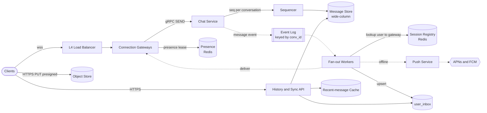

**Reading the diagram.** Clients hold a WebSocket through an L4 load balancer to a **connection gateway** (§9.9.1), which authenticates the session, registers `user → gateway` in the **session registry** and refreshes a **presence lease** (§9.9.5). A `SEND` goes synchronously over gRPC to the stateless **chat service**, which asks the **sequencer** for the next sequence number of that conversation and writes the message to the **message store**; only then is the sender's `ACK_SEND` returned, so the durable boundary is the store write. The chat service then publishes the message event asynchronously (dotted) to an **event log** partitioned by `conv_id`, which keeps each conversation's events in order (§31.5.3). **Fan-out workers** consume it, look up the members' gateways and deliver to online devices, send pushes to offline ones and upsert each member's inbox row. The **history and sync API** answers ranged reads over HTTPS from the store, fronted by a cache of recent messages. Attachments bypass the chat path entirely: the client uploads to the object store with a presigned URL (§15.8.2) and sends only a reference. Failure points: a gateway crash drops its connections (clients reconnect and resync); an event-log or fan-out outage delays live delivery but loses nothing, because the store already holds the message; a sequencer outage stops sends for the conversations it owns. Gateways scale by connections, the chat service by request rate, fan-out workers by deliveries per second, the store by storage.

### 53.4.8 Detailed component design

#### The sequencer: one writer per conversation

A total order per conversation requires that, at any moment, exactly one component decides which message is number 42. Three implementations, from simplest to most scalable:

1. **Conditional write in the store.** Read `last_seq`, then write `last_seq + 1` with a compare-and-set (a lightweight transaction in Cassandra or a conditional put in DynamoDB). Correct, but every send in a busy group serializes on one Paxos-backed row: a few hundred sends per second per conversation at best.
2. **A counter service partitioned by `conv_id`.** Conversations are assigned to sequencer nodes by consistent hashing (§14.8); each node holds the counters of its conversations in memory and persists them. To survive a crash without reusing a number, a node **leases a block** ("seq 4,001–5,000 belong to me") with a conditional write, hands numbers out of memory and leases the next block when the current one runs out. After a crash, the new owner leases a fresh block; numbers in the dead node's unused block are skipped, which leaves a hole.
3. **Single-writer actor per conversation.** The chat service routes every send for a conversation to one actor (an Erlang process, an Akka actor or a partition of the event log); the actor assigns `seq` and writes. Ownership moves only through a fenced handover, so two actors never assign numbers at once (fencing tokens, §26.13).

The teaching design uses option 2. Holes from crashed leases are harmless if clients treat them correctly: a gap is a signal to *ask*, and the store's answer ("no message 4,812 exists; continue from 5,001") closes it. The sequencer never needs a global clock, and conversations never coordinate with each other: that is why per-conversation order scales and global order does not.

::: definition
**Definition — Per-conversation sequence number.** A strictly increasing integer assigned by the single owner of a conversation to each message at the moment it becomes durable. It defines the display order for every member and device, serves as the cursor for history paging and sync, and lets a client detect missing messages as gaps between consecutive numbers.
:::

Why not order by timestamp? Two senders' clocks disagree by seconds, server clocks by milliseconds, and two messages can share a millisecond. Timestamp order would reorder messages differently on different devices whenever two arrive close together. Timestamps are for display ("10:42"); sequence numbers are for order.

::: mistake
**Mistake — Using the message ID as the order.** A Snowflake ID (§17.10.3) is roughly time-ordered across machines, but only within clock skew: two messages sent to the same group from different chat-service nodes in the same few milliseconds can receive IDs in the opposite order from the one in which they were stored. Use the ID for identity and deduplication, and the dense per-conversation sequence number for order and gap detection.
:::

#### Delivery state: watermarks instead of per-message receipts

Each member's progress through a conversation is two integers: `delivered_upto` (the highest seq that has reached at least one of the member's devices) and `read_upto` (the highest seq the member has seen on screen). Every per-message tick is derived from them:

- **Sent:** the sender received `ACK_SEND` with a `seq`.
- **Delivered:** for a one-to-one chat, `peer.delivered_upto ≥ seq`; for a group, the count of members with `delivered_upto ≥ seq`.
- **Read:** the same with `read_upto`.
- **Unread count:** `conversation.last_seq − me.read_upto` (minus my own messages, which the client tracks).

Watermarks are monotonic, so they merge trivially: a late or duplicate `MARK` with a lower value is ignored (`read_upto = max(old, new)`), which makes them safe to retry and reorder. They are also tiny: a group of 500 with a full read-state matrix needs 500 pairs of integers, not 500 receipts per message.

#### Offline sync

A device that was offline holds, per conversation, the last sequence number it applied. Opening the app runs three steps:

1. Call `GET /v1/sync?cursor=…` with the device's opaque sync cursor; the server returns the conversations whose `last_seq` changed since that cursor (from `user_inbox`), with their new `last_seq`.
2. For each changed conversation, fetch `messages?after_seq=<local last_seq>` in pages of 100, newest conversations first so the inbox renders before the backlog finishes.
3. Reconnect the WebSocket; live pushes that arrive during the fetch are buffered and applied only when contiguous.

The code below shows the rule that makes this correct: apply a message only if its `seq` is exactly one more than the last applied; ignore duplicates; treat a jump as a gap and fetch the range.

```python
import itertools

class ConversationLog:
    """Server side: one ordered log per conversation (illustrative, in memory)."""
    def __init__(self):
        self.messages = []          # index i holds the message with seq = i + 1
        self.by_client_id = {}      # (sender, client_msg_id) -> seq, for idempotent retries

    def append(self, sender, client_msg_id, body):
        key = (sender, client_msg_id)
        if key in self.by_client_id:            # retry of a message already stored
            return self.by_client_id[key]
        seq = len(self.messages) + 1            # the single writer for this conversation assigns seq
        self.messages.append((seq, sender, body))
        self.by_client_id[key] = seq
        return seq

    def fetch(self, after_seq, limit=100):
        return self.messages[after_seq:after_seq + limit]

class Device:
    """Client side: applies live pushes in order, detects gaps, resyncs."""
    def __init__(self, log):
        self.log, self.last_seq, self.view = log, 0, []

    def on_push(self, msg):
        seq = msg[0]
        if seq <= self.last_seq:                # duplicate delivery: ignore
            return
        if seq > self.last_seq + 1:             # gap: something was lost on the live path
            self.resync()
            return
        self.view.append(msg); self.last_seq = seq

    def resync(self):
        for msg in self.log.fetch(self.last_seq):
            self.view.append(msg); self.last_seq = msg[0]

log = ConversationLog()
ids = itertools.count(1)
for text in ["hi", "are you there?", "lunch at 1?"]:
    log.append("alice", next(ids), text)
assert log.append("alice", 2, "are you there?") == 2      # retried send returns the same seq

bob = Device(log)
live = log.fetch(0)
bob.on_push(live[0]); bob.on_push(live[0]); bob.on_push(live[2])   # dup, then a gap (seq 2 lost)
print([m[0] for m in bob.view], "last_seq =", bob.last_seq)
# prints: [1, 2, 3] last_seq = 3
```

What to notice:

- `append` checks the idempotency key before assigning a number, so a retried `SEND` gets the *same* `seq` instead of a duplicate message.
- The client never trusts the live path for completeness: a duplicate is dropped, a gap triggers `resync`, and the store is the source of truth. This is the at-least-once-plus-deduplication pattern of §30.8, specialized to an ordered log.
- A production client also handles holes left by crashed sequencer leases: the store's answer to a range query is authoritative, so the client advances past numbers the server says do not exist.

::: industry
**Facebook Messenger's Iris queue.** Facebook described rebuilding Messenger's sync protocol around **Iris**, a totally ordered queue of messaging updates (new messages, read-state changes) per user, with separate pointers recording the last update sent to the user's app and the last written to the traditional storage tier. Each pointer advances only after a successful send, so an offline phone simply leaves its pointer behind, and recent updates are served from memory while about a week is served from the queue's backing store. The post reports that the new protocol cut non-media data usage by 40 % and, by reducing congestion, cut by about 20 % the number of people who saw errors when sending a message.
*Evidence: Primary* — [Facebook Engineering 2014]
:::

### 53.4.9 Data flow

**Figure 53.2 — Write path: sending a message to an online and an offline recipient.**

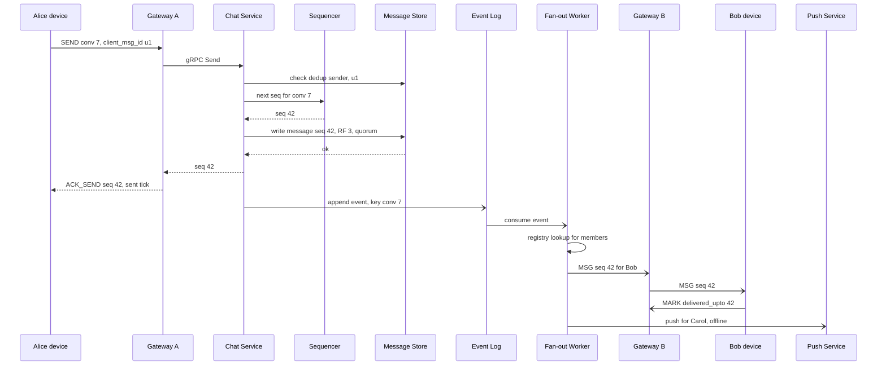

**Reading the diagram.** Solid arrows are synchronous calls and dashed open arrows asynchronous messages. Alice's `SEND` travels over her WebSocket to gateway A and on to the chat service, which first checks the dedup table, obtains `seq 42` from the conversation's sequencer and writes the message at quorum (two of three replicas, §27). Only after the store acknowledges does Alice see the "sent" tick: the store write is the commit point. Everything after it is asynchronous: the event goes to the log partition for conversation 7, a fan-out worker resolves the members, delivers to Bob's gateway (Bob is online) and asks the push service to notify Carol (offline, §9.8). Bob's device returns a `delivered_upto` watermark, which flows back through the same path to update the `members` row and reach Alice as a `RECEIPT`. Failure points: if the store write fails, the chat service returns an error and Alice's client retries with the same `client_msg_id`; if the chat service crashes after the write but before replying, the retry hits the dedup table and returns `seq 42` again; if the fan-out worker crashes, the log redelivers and Bob's client discards the duplicate by `seq`.

**Figure 53.3 — Read path: a device reconnecting after a week offline.**

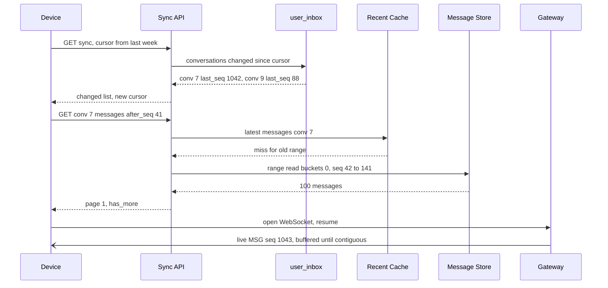

**Reading the diagram.** The device first asks which conversations changed since its cursor, a single-partition read of its own `user_inbox` row set, and receives each conversation's new `last_seq`. For each, it pages forward from its local `last_seq`: the recent-message cache answers only the newest window, so a week-old range is read directly from the message store as a sequential slice of one or two bucket partitions. The WebSocket is reopened in parallel; a live message (seq 1043) that arrives before the backlog has been applied is buffered, because applying it would leave a gap. All calls are synchronous HTTPS except the live push. Failure points: a slow store slice delays only that conversation; a cache outage shifts reads to the store, which must be provisioned for it (§20.13). Scaling: the sync pattern costs one read per changed conversation plus one per 100 messages, independent of how long the device was offline.

**Figure 53.4 — Message state as seen by the sender.**

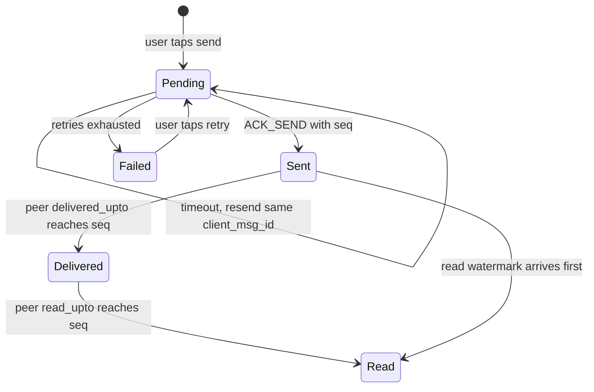

**Reading the diagram.** A message starts **Pending** on the sender's device, stored locally so it survives an app restart, and is resent with the same idempotency key until the server returns a sequence number. **Sent** means durable on the server. **Delivered** and **Read** are derived from the peer's watermarks, so a read watermark can arrive before the delivered one and skip a state. Only **Failed** needs the user. All transitions after Pending are driven by asynchronous server events.

### 53.4.10 Bottlenecks

1. **Hot conversations.** A 500-member group during a live event funnels every send through one sequencer owner and one bucket partition. At 200 messages/s, each producing 499 deliveries, one conversation generates about 100,000 deliveries/s. Mitigations: per-conversation send rate limits (§22.3), batching several sequence numbers per sequencer call, and delivering to each gateway once, then fanning out locally (§9.9.3).
2. **Inbox write amplification.** The `user_inbox` upsert is 6.4 writes per message. For large groups, skip it and let clients pull `conversations.last_seq` on open.
3. **Presence.** Status-change fan-out can exceed message traffic (§9.9.5). Subscribe only to presence of contacts visible on screen, and drop presence entirely for groups above a size threshold.
4. **Storage growth.** 1.3 PB/year with replication: tier partitions older than, for example, 12 months to cheaper storage or compress them into columnar archives served by a slower history API.
5. **Reconnect storms.** A gateway failure triggers a wave of reconnects *and* sync queries; jittered backoff (§9.9.6) and the cost-per-sync bound in Figure 53.3 keep the store from being overwhelmed.

### 53.4.11 Failure scenarios

**Table 53.3 — Failure scenarios for the chat service.**

| What fails | Impact | Detection | Recovery | Prevention |
|---|---|---|---|---|
| Gateway node crash | ~309,000 users disconnected; live delivery to them stops | Connection-count drop, load-balancer health checks | Clients reconnect with jitter and sync by seq; presence leases expire in ≤ 90 s | Blast-radius limit per gateway; graceful drain on deploy (§9.9.7) |
| Sequencer node crash | Sends to its conversations fail for seconds | Error rate on `next seq` calls; lease expiry | New owner leases a fresh block; skipped numbers become holes clients step over | Short leases, fenced ownership transfer |
| Message store replica loss | None at quorum; higher latency | Node-down alerts, hinted-handoff growth | Repair from replicas (§27) | RF 3 across zones; quorum writes |
| Event log or fan-out lag | Messages stored but delivered late; sender sees "sent" but not "delivered" | Consumer lag (§31.7.3) | Workers catch up; clients poll sync on foreground | Partition count sized for peak deliveries; autoscaling on lag |
| Fan-out worker crash mid-batch | Duplicate deliveries after redelivery | Redelivery metrics | Clients drop duplicates by seq | Idempotent delivery by `(conv_id, seq)` |
| Push provider outage | Offline users not notified | Provider error rate | Messages wait in the store; delivered on next open | Multiple notification paths (§9.8.2) |
| Registry (Redis) outage | Targeted delivery and presence fail | Error rate, latency | Fall back to broadcasting conversation events to all gateways for minutes; clients poll | Replicated registry; per-gateway liveness keys |
| Client clock wrong | None for order (seq-based); odd display times | — | Display server timestamps | Never order by client time |

### 53.4.12 Scaling strategy

**At 10× (1 billion DAU, 40 billion messages/day).** Peak sends reach about 1.4 million/s and deliveries 8.9 million/s. Gateways grow to about 800; this is linear and routine. What breaks first is **storage** (13 PB/year at RF 3) and the **inbox writes** (8.9 million/s). Changes: aggressive tiering of cold buckets; drop per-member inbox writes for groups larger than about 50; move to **multiple regions with a home region per conversation** (§44.6.4), where the conversation's sequencer and primary replicas live in the region of most of its members, and cross-region members are served by replicas with a few hundred milliseconds of extra delay.

**At 100×.** The sequencer limits only single conversations, never the system, because conversations are independent; the system-wide limits are cross-region bandwidth and operating thousands of database nodes. Changes: cell-based deployment (§44.10), with each cell owning a set of conversations and a thin global directory mapping conversations to cells, plus media deduplication by content hash.

### 53.4.13 Trade-offs

**Table 53.4 — Key trade-offs in the chat design.**

| Decision | Chosen | Gave up | Why acceptable |
|---|---|---|---|
| Order scope | Per conversation | Global order across conversations | Users never compare the order of two different chats |
| Commit point | Store write before "sent" tick | 10–30 ms of extra send latency | Durability of acknowledged messages is a requirement |
| Live delivery | At-least-once, best effort | Guaranteed push delivery | Seq-based gap detection and sync recover anything lost |
| Receipts | Per-member watermarks | Exact per-message timestamps of reads | 8.5× less receipt traffic; ticks still correct |
| Store | Wide-column, bucketed partitions | Ad hoc queries and joins | Every access path is a key and a range |
| Message copies | One per conversation | Per-recipient mailboxes with independent deletion | 6.4× less storage; deletion handled as tombstones |

### 53.4.14 Alternative designs

1. **Per-recipient inboxes (fan-out-on-write of messages).** Copy each message into every member's mailbox. Reads become a single-partition scan of one's own mailbox and per-user deletion is easy, but storage and writes multiply by the group size. This is the right choice when server-side history is *not* kept and the server is only a relay, which is exactly the WhatsApp model of §53.5.
2. **Relational store sharded by conversation.** PostgreSQL or MySQL sharded by `conv_id` (§14.7) with `(conv_id, seq)` as the primary key works well up to tens of terabytes per shard group and gives transactions for membership changes. Slack has described moving to sharded MySQL with Vitess (§14.13.3) [Slack Engineering 2020]. It becomes costly when history grows to petabytes, because storage on primary database nodes is expensive.
3. **Federated chat (Matrix, XMPP).** Servers in different domains replicate conversation state; order becomes a partial order resolved by an algorithm instead of one sequencer. More resilient to a single provider, harder to make simple.

### 53.4.15 Interview discussion

**Table 53.5 — 45-minute pacing plan for "Design a chat application".**

| Minutes | Activity | Output on the whiteboard |
|---|---|---|
| 0–5 | Clarify: 1:1 and groups, group size, history on server, multi-device, receipts, presence, E2E in or out | Functional list, explicit out-of-scope |
| 5–10 | Non-functional targets and capacity | 46 k/s sends, 889 k/s peak deliveries, 1.2 TB/day, 25 M connections |
| 10–20 | High-level architecture | Figure 53.1: gateways, chat service, store, log, fan-out, push |
| 20–35 | Deep dive: ordering and sync | Sequencer, `client_msg_id` dedup, watermarks, gap detection |
| 35–42 | Failures and scale | Gateway crash, fan-out lag, hot groups, storage tiering |
| 42–45 | Trade-offs and extensions | Global vs per-conversation order; E2E pointer to §53.5 |

Likely follow-ups, with short answers:

- *"How do you guarantee no duplicates?"* — The sender's `client_msg_id` makes sends idempotent; the per-conversation `seq` makes delivery idempotent at the client. Exactly-once *display*, not exactly-once delivery.
- *"Two people send at the same moment — who is first?"* — Whoever the sequencer numbers first. Both devices then display the server's order, even if it differs from the local optimistic order; the client re-sorts pending messages when their `seq` arrives.
- *"How does a new device get history?"* — Ranged reads by seq from the store, newest first; it never replays the push stream.
- *"What if the user is in 5,000 conversations?"* — Sync returns only changed conversations; the client fetches lazily as the user scrolls.
- *"How do you implement 'delete for everyone'?"* — A new message of type `delete(seq=42)` in the same log; clients apply it in order and the store tombstones the body.

What distinguishes answers: a mid-level answer draws gateways and a database. A **senior** answer makes ordering explicit (per-conversation sequence numbers with idempotent sends), separates the durable path from the lossy live path and models receipts as watermarks. A **staff** answer quantifies which resource dominates over time (storage, not throughput), designs the sequencer's failure behavior (leased blocks, holes, fencing) and discusses multi-region homing of conversations and the product consequences of each consistency choice.

### 53.4.16 Production considerations

- **Observability.** End-to-end delivery latency from synthetic "canary conversations" in every region; fan-out consumer lag; gap-resync rate per client version (a rising rate reveals a live-path bug); reconnect rate per gateway; traces by `msg_id` (§40.6).
- **Security.** Short-lived tokens on WebSockets; authorization of every `SEND` and history read against `members` (no reads before `joined_seq` or after removal); per-user and per-conversation rate limits (§22.3); encryption at rest (§10.9). Server-side history means the operator can read messages, which must be stated honestly or replaced by E2EE (§53.5).
- **Cost.** Storage dominates; attachments are about 40× text, so deduplicate by content hash and set lifecycle rules (§15.9). Presence can quietly become the largest Redis bill.
- **Operations.** Gateways are deployed rarely and drained gracefully; the chat service often. Game days kill a gateway zone to verify reconnect and resync budgets. Keep kill switches for presence and typing indicators (§22.9).

## 53.5 WhatsApp

### 53.5.1 Problem statement

Design a messenger in the style of WhatsApp: one-to-one and group messaging, voice notes, photos and videos, for about two billion users on phones, with optional companion devices (desktop, web, tablet). The defining constraint is **end-to-end encryption (E2EE)**: messages, media and calls are encrypted on the sender's device and decrypted only on the recipients' devices. The operator's servers relay and temporarily store ciphertext but never hold the keys to read it.

The analogy is a post office that only handles locked boxes. Each recipient publishes padlocks anyone may take; senders lock letters with them, and only the recipient has the key. The post office still sees addresses, sizes and postmarks, but can never open a box. Compared with §53.4, the server cannot index, search or moderate content; it must run a **key directory** that it can be trusted not to lie about; every recipient *device* is a separate encryption target; and server-side history disappears, leaving a store-and-forward relay.

The distinctive hard problems are **the E2EE architecture and its cost at scale** (multi-device and large groups multiply ciphertexts), **media handling without server-side access** and **very high connection counts per server**.

::: industry
**WhatsApp's published scale and stack.** WhatsApp completed end-to-end encryption for all users in April 2016 using the Signal Protocol, and documents the design in a security white paper [WhatsApp 2016; WhatsApp Security White Paper]. It announced two billion users in February 2020 [WhatsApp 2020]. Earlier, its engineers described an Erlang/FreeBSD server stack: in January 2012 the team reported more than 2 million concurrent TCP connections on one server [WhatsApp 2012; Reed 2012], and a 2014 Erlang Factory talk on scaling to hundreds of millions of users is summarized by third parties as describing roughly 550 servers, of which about 150 were chat servers each holding about a million phone connections [Reed 2014; High Scalability 2014].
*Evidence: Primary* for the 2012 connection count, encryption launch and user count; *Secondary* for the 2014 server counts, which come from a third-party summary of the talk.
:::

### 53.5.2 Functional requirements

1. Register a phone number and a primary device; link up to four companion devices (a limit WhatsApp published in 2021 [Meta Engineering 2021a]).
2. Send end-to-end encrypted text, voice notes, images, video and documents to a contact or a group.
3. Groups with up to 1,024 members (the limit reported when WhatsApp launched Communities in November 2022; Secondary), with admins who add and remove members.
4. Delivery and read receipts ("two ticks", "blue ticks"), and last-seen/online status subject to privacy settings.
5. Offline delivery: messages wait on the server, encrypted, until the recipient device connects.
6. Users can verify each other's keys (security codes) and are warned when a contact's key changes.
7. Out of scope: voice and video calls (signaling would reuse the same key infrastructure; media flows peer-to-peer or through relays, §9.7), payments, channels, and encrypted cloud backup (mentioned in §53.5.16).

### 53.5.3 Non-functional requirements

**Table 53.6 — Non-functional requirements for an end-to-end encrypted messenger.**

| Requirement | Target | Note |
|---|---|---|
| Confidentiality | Server never has plaintext or message keys; forward secrecy and post-compromise recovery per conversation | The security requirement is the product |
| Availability | 99.99 % for send and receive | Primary communication channel in many countries |
| Latency, both online | p99 < 1 s globally, including encryption on both devices | Encryption costs microseconds; network dominates |
| Durability before delivery | An accepted message survives a single server or zone failure until delivered or expired | After delivery, the server deletes it |
| Undelivered retention | Expire after 30 days | Bounds storage; WhatsApp's privacy policy describes a 30-day limit (see §53.15) |
| Ordering | Per conversation per sender, as seen by each recipient device | No server-side global sequence (server cannot read content) |
| Connections | ≥ 500 million concurrent device connections at peak | Phones keep a connection while the app is active |
| Bandwidth efficiency | Works on 2G and expensive mobile data | Compact binary protocol, media resized on device |

The ordering requirement is weaker than in §53.4 on purpose: with a relay that deletes delivered messages and devices that each hold their own history, the order that matters is "the order in which this sender's messages reach this device", which the Double Ratchet's per-chain message counters already provide.

### 53.5.4 Capacity estimation

Assumptions (teaching values, not WhatsApp's figures):

- 100 billion messages per day (an order of magnitude consistent with public statements by Meta around 2020; treat as an assumption).
- Peak-to-average ratio of 2: the user base spans every time zone, which flattens the daily curve, though holidays such as New Year's Eve spike far above it.
- 80 % of messages are one-to-one; 20 % go to groups with 10 members on average.
- 1.6 devices per user on average (a phone plus companions for some users).
- 20 % of recipient devices are offline when a message is sent, and stay offline for 6 hours on average.
- 7 % of messages carry media averaging 300 KB after on-device compression.
- 500 million devices connected at peak.

::: formula
**Ciphertexts per message with per-device encryption**

$$C_{1:1} = d + (d - 1), \qquad C_{\text{grp,pairwise}} = (n - 1)\,d + (d - 1), \qquad C_{\text{grp,sender key}} = 1, \qquad K_{\text{rekey}} = (n - 1)\big[(n - 2)\,d + (d - 1)\big]$$

| Symbol | Meaning | Units |
|---|---|---|
| $d$ | Average devices per user | devices/user |
| $n$ | Group size including the sender | members |
| $C_{1:1}$ | Ciphertexts the sender produces for a one-to-one message (recipient's devices plus the sender's own other devices) | ciphertexts/message |
| $C_{\text{grp,pairwise}}$ | Ciphertexts per group message if each device pair has its own session | ciphertexts/message |
| $C_{\text{grp,sender key}}$ | Ciphertexts the sender uploads per group message with sender keys; the server copies it to every device | ciphertexts/message |
| $K_{\text{rekey}}$ | Pairwise-encrypted key-distribution messages after a member leaves, once every remaining member has re-sent its new sender key | messages |
:::

::: example
**Worked example — Uploads, deliveries and the cost of large groups.**

1. One-to-one: $C_{1:1} = 1.6 + 0.6 = 2.2$ ciphertexts uploaded and delivered per message.
2. Group of 10 (sender keys): the sender uploads 1 ciphertext; the server delivers $9 \times 1.6 + 0.6 = 15$ copies.
3. Uploads per message: $0.8 \times 2.2 + 0.2 \times 1 = 1.96$; deliveries per message: $0.8 \times 2.2 + 0.2 \times 15 = 4.76$.
4. Message rate: $100 \times 10^9 / 86{,}400 \approx 1.16$ million/s average, 2.31 million/s at peak. Uploads $\approx 2.27$ million/s average (4.54 million/s peak); deliveries $= 476 \times 10^9$/day $\approx 5.51$ million/s average.
5. Group of 1,024 without sender keys: $1{,}023 \times 1.6 + 0.6 \approx 1{,}637$ encryptions and uploads *per message* from one phone. With sender keys: 1.
6. When one member leaves a 1,024-member group, every remaining member must distribute a new sender key: $K_{\text{rekey}} = 1{,}023 \times (1{,}022 \times 1.6 + 0.6) \approx 1.67$ million pairwise messages, spread over time because each member re-keys lazily on its next send.

*Interpretation.* Multi-device multiplies every message by $d$; sender keys move group fan-out from the phone to the server, but membership changes cost $O(n^2 d)$. *Engineering implication.* Group size limits are a cryptographic-cost decision as much as a product one; raise them only after measuring re-key storms.
:::

::: example
**Worked example — Offline queue, connections and media.**

1. **Pending ciphertexts (Little's Law, §4.11).** Items waiting = arrival rate × time in system. Offline deliveries arrive at $5.51 \times 10^6 \times 0.2 = 1.10 \times 10^6$/s and wait 21,600 s on average: $1.10 \times 10^6 \times 21{,}600 \approx 23.8 \times 10^9$ pending envelopes. At 500 bytes each, **11.9 TB**, or 35.7 TB at three replicas. Online deliveries wait about a second: $5.51 \times 10^6 \times 1\text{ s} \times 500\text{ B} \approx 2.8$ GB, negligible.
2. **Connections.** 500 million devices at 1 million per chat server is 500 servers; to survive the loss of one of three zones in each region, $3 \times \lceil 500 \times 10^6 / (2 \times 10^6) \rceil = 750$ servers. At 40 KB per connection (Table 9.12), 1 million connections need 40 GB of RAM per server, comfortable on a large host.
3. **Media uploads.** $100 \times 10^9 \times 0.07 = 7 \times 10^9$ items/day × 300 KB = **2.1 PB/day**, uploaded once per item regardless of recipients (the same encrypted blob serves every device).
4. **Media downloads.** Each item is fetched by every recipient device: $7 \times 10^9 \times 4.76 \times 300\text{ KB} \approx 10$ PB/day, about 116 GB/s or **0.93 Tbit/s** on average.
5. **Media retention.** Keeping encrypted blobs for 30 days for late downloads and forwards: $2.1 \times 30 = 63$ PB, or 88 PB erasure-coded at 1.4×.

*Interpretation.* Because delivered messages are deleted, the message store is tiny (tens of terabytes) compared with a history-keeping chat service; media dominates storage and egress. *Engineering implication.* Spend engineering effort on the media path and on connection density, not on the message database.
:::

**Table 53.7 — Capacity summary for the E2EE messenger.**

| Quantity | Value |
|---|---|
| Messages | 100 × 10⁹/day; 1.16 M/s average; 2.31 M/s peak |
| Ciphertext uploads | 1.96 per message; 2.27 M/s average |
| Device deliveries | 4.76 per message; 5.51 M/s average |
| Pending offline queue | ≈ 23.8 × 10⁹ envelopes; 11.9 TB (35.7 TB at RF 3) |
| Concurrent connections | 500 M; 750 chat servers at 1 M each with zone headroom |
| Media | 2.1 PB/day up; ≈ 10 PB/day down (0.93 Tbit/s); 88 PB retained for 30 days |

### 53.5.5 API design

The client speaks a compact binary protocol over a long-lived TLS-protected connection (WhatsApp's published materials describe a Noise Protocol-based transport encryption between client and server in addition to E2EE; see the white paper). The RPCs below are a teaching API.

```text
# Key directory (server stores only PUBLIC keys)
RegisterDevice   {account_id, device_id, identity_pub, signed_prekey{id, pub, sig},
                  one_time_prekeys[{id, pub}] x 100, device_list_signature}
                 → {ok}
UploadPrekeys    {device_id, one_time_prekeys[]}                    # refill when low
GetPrekeyBundles {account_id}
                 → {devices: [{device_id, identity_pub, signed_prekey, one_time_prekey?}],
                    device_list, device_list_signature}             # one-time key consumed

# Messaging (payloads are opaque ciphertext to the server)
Send             {client_msg_id, to_account, envelopes: [{device_id, type: prekey|normal,
                  ciphertext}]}                                     # client fan-out, 1:1
SendGroup        {client_msg_id, group_id, ciphertext, distribution: [{device_id,
                  ciphertext}]?}                                    # sender-key message
                 → {server_ts}  | {error: stale_device_list, current_list}
Deliver (push)   {from, from_device, client_msg_id, ciphertext, server_ts}
Ack              {client_msg_id, from}                              # server deletes envelope
Receipt          {to, client_msg_ids[], kind: delivered|read}       # also E2E-encrypted payload

# Media
RequestUpload    {size, sha256_of_ciphertext}  → {upload_url, media_id}
                 # the client encrypts first, then uploads; the server never sees the media key
GetMedia         {media_id}  → bytes (ciphertext), served via CDN-like edge caches
```

Two choices stand out. `Send` carries **one envelope per recipient device**, and the server rejects it with `stale_device_list` if the sender's view of the recipient's devices is out of date, so a newly linked device is never silently skipped. And `Ack` deletes: after the device acknowledges, the server holds nothing.

### 53.5.6 Data model and database schema

The server-side data model is small and deliberately forgetful.

```text
# Key directory: strongly consistent, replicated (losing it breaks new sessions)
account/{account_id}                -> {phone_hash, primary_device_id, device_list_version}
device/{account_id}/{device_id}     -> {identity_pub, signed_prekey, registration_ts}
otpk/{account_id}/{device_id}/{id}  -> one_time_prekey_pub      # deleted when handed out
device_list/{account_id}            -> {devices[], version, signature_by_primary}

# Offline mailbox per device: write-once, delete-on-ack, TTL 30 days
mailbox/{account_id}/{device_id}/{arrival_seq} -> {from, from_device, client_msg_id,
                                                   ciphertext, server_ts}

# Groups: metadata visible to the server (membership is needed for fan-out)
group/{group_id}                    -> {members[], admins[], version}

# Media: encrypted blobs, TTL
blob/{media_id}                     -> ciphertext bytes  (object store, erasure-coded)
```

Store choices follow access patterns. The **key directory** is read on every new session and must never return a stale or forged key, so it lives in a linearizable replicated store (§25.3) with change logging for key transparency. The **mailbox** is a queue per device with an extreme write-then-delete pattern: most envelopes live for less than a second. An LSM-based store (§13.7) would turn each delete into a tombstone and compact constantly, so the teaching design keeps envelopes in memory on the chat server that owns the recipient's connection, replicated synchronously to one peer in another zone, and **spills to a disk-backed store only if undelivered after about 30 seconds**. Of the 5.51 million deliveries per second, only the 20 % for offline devices reach disk. WhatsApp's own talks described Erlang's built-in Mnesia database among its components (Secondary); the general lesson is that a queue whose items mostly die young belongs in memory with a durable fallback.

### 53.5.7 High-level architecture

**Figure 53.5 — High-level architecture of an end-to-end encrypted messenger.**

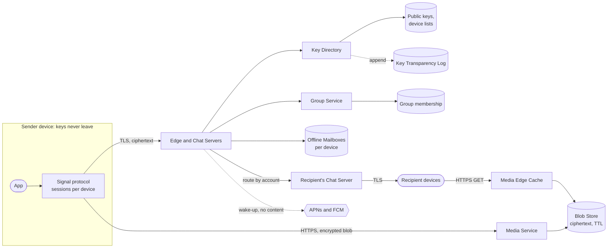

**Reading the diagram.** The trust boundary is the device: identity keys, session state and message keys exist only inside the app's protocol layer. Everything crossing to the servers is ciphertext plus routing metadata. The sender's app opens sessions using public keys fetched from the **key directory**, whose changes are appended to a **key-transparency log** (dotted, asynchronous) so clients can audit that the directory is not serving different keys to different people. Messages go over the device's long-lived TLS connection to a **chat server**, which routes each per-device envelope to the chat server holding the recipient device's connection (synchronous inter-server RPC); if the device is offline, the envelope waits in that device's **mailbox** and a content-free wake-up goes through APNs/FCM (§9.8). Media is encrypted on the device and uploaded as an opaque blob; recipients fetch it through **edge caches** using the pointer and key carried inside the encrypted message. The **group service** stores membership in plaintext because the server must know whom to fan out to. Failure points: a chat-server crash drops a million connections (reconnect storm, §9.9.6) and must not lose in-memory envelopes (hence the synchronous peer replica); a key-directory outage blocks new sessions but not existing conversations; a blob-store outage blocks media but not text. Scaling: chat servers scale by connections, the media path by bytes, the key directory by session setups.

### 53.5.8 Detailed component design

#### Session setup: X3DH with prekeys

Two phones are rarely online at the same moment, yet they must agree a secret key without the server learning it. **X3DH** ("Extended Triple Diffie–Hellman") solves this asynchronously [Marlinspike & Perrin 2016]:

1. Each device generates a long-term **identity key pair**, a medium-term **signed prekey** (signed by the identity key) and a batch of **one-time prekeys**, and uploads the public halves to the key directory.
2. To start a session, the sender fetches the recipient device's **prekey bundle**: identity key, signed prekey with signature, and one one-time prekey, which the server hands out once and deletes.
3. The sender verifies the signature, generates an **ephemeral key pair**, and computes three or four Diffie–Hellman values (§10.4.4) between its identity and ephemeral keys and the recipient's identity, signed and one-time prekeys. These are concatenated and fed through a key-derivation function to produce the initial shared secret.
4. The sender's first message carries its identity and ephemeral public keys and the IDs of the prekeys it used. The recipient, whenever it comes online, recomputes the same secret from its private keys.

The server's role is a *mailbox for public keys*. It never learns the secret, because every Diffie–Hellman input it holds is public. Its one dangerous power is substitution: a malicious or compromised directory could hand out an attacker's key. That is what **security codes** (users comparing a fingerprint of both identity keys, a 60-digit number or QR code in WhatsApp) and **key transparency** address.

#### Per-message keys: the Double Ratchet

After X3DH, each pair of devices runs the **Double Ratchet** [Perrin & Marlinspike 2016]. Picture two interlocking gears:

- A **symmetric-key ratchet**: each message key is derived from a chain key by a one-way function, and the chain key is then advanced and the old one deleted. Stealing today's chain key does not reveal yesterday's messages: **forward secrecy**.
- A **Diffie–Hellman ratchet**: whenever the conversation changes direction, the devices exchange new ephemeral public keys inside their messages and mix a fresh Diffie–Hellman output into the root key. An attacker who stole a device's state loses access once a new exchange happens: **post-compromise security** (sometimes called "break-in recovery").

Each message header carries a counter within its chain, so the receiver can derive keys for messages that arrive out of order and store the skipped keys briefly. This is how ordering is recovered without any server-side sequence number.

::: definition
**Definition — End-to-end encryption (E2EE).** Encryption in which the keys needed to decrypt a message exist only on the communicating endpoints, so intermediaries that store or forward the message, including the service operator, cannot read it. Transport encryption (TLS) protects each hop; E2EE protects the content from every hop.
:::

#### Multi-device and groups: where the ciphertexts multiply

Originally an account had one identity key on the phone, and companion clients relayed through it. WhatsApp's 2021 multi-device design gave **each device its own identity key** and uses **client fan-out**: the sender encrypts a message separately for each of the recipient's devices and each of its own other devices, using a pairwise session per device; the server keeps the mapping from account to device identities, and the primary device signs the device list so other users can detect an unauthorized device [Meta Engineering 2021a]. The cost is the $C_{1:1} = 2d - 1$ of §53.5.4.

For groups, WhatsApp's white paper describes **Sender Keys**: the first time a member sends to a group, it generates a random chain key and a signing key pair, and distributes them to every other member device over the pairwise sessions; afterwards each group message is encrypted once with a key derived from that chain and signed, uploaded once, and **fanned out by the server** [WhatsApp Security White Paper]. When a member leaves, the remaining members discard their sender keys and distribute new ones, so a removed member cannot read future messages; this is the $K_{\text{rekey}}$ term.

**Figure 53.6 — Group message with sender keys: first message and later messages.**

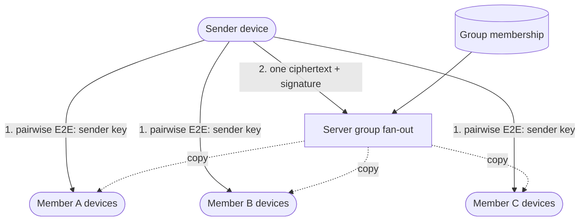

**Reading the diagram.** Step 1 runs once per sender per group (and again after any membership removal): the sender's device sends its new sender key to each other member device through the existing pairwise Signal sessions, so the server relays only ciphertext. Step 2 runs for every subsequent message: the device encrypts once with the current sender-key chain, signs, and uploads one ciphertext; the server consults plaintext group membership and copies it asynchronously (dotted) to every member device's connection or mailbox. Failure points: a member device that missed step 1 cannot decrypt step 2 and must request the sender key again; a stale membership list at the server either leaks ciphertext to a removed member (harmless without the new key) or omits a new member (who then misses messages until the next distribution). Scaling: step 2 costs the sender $O(1)$, the server $O(nd)$; step 1 costs the sender $O(nd)$ pairwise encryptions.

#### Media: encrypt, upload once, send the key

Media is too large to send through the message path for every device. The white paper describes the scheme: the sender generates a random key, encrypts the file (AES-256 in CBC mode with an HMAC-SHA256 authentication tag), uploads the ciphertext to a blob store, and then sends an ordinary E2E-encrypted message containing the key, a SHA-256 hash of the ciphertext and a pointer to the blob [WhatsApp Security White Paper]. Recipients download the blob, check the hash and decrypt. The server stores and serves opaque bytes, so it can use ordinary object storage and caches (§15.4, §21), resumable uploads, and lifecycle expiry. Because forwarding a photo can reuse the same encrypted blob and key, popular forwards need not be re-uploaded; the server can deduplicate by the ciphertext hash without learning content.

What the server cannot do is equally important: it cannot transcode, generate thumbnails or run content classifiers on media. Resizing and thumbnailing move to the sender's device (the thumbnail travels inside the encrypted message), which is why on-device compression appears in the capacity assumptions.

**Table 53.8 — What the server can and cannot see in the E2EE design.**

| Server can see | Server cannot see |
|---|---|
| Account and device identifiers, public keys | Message text, media content, thumbnails |
| Who sends to whom and when; message sizes | Message keys, session state, sender-key chains |
| Group membership and admin changes | Group message content and group names if encrypted client-side (teaching design) |
| IP addresses and connection times | Content of voice and video calls |
| Encrypted media blob size and hash | Media keys |

Honesty about metadata is part of the design: E2EE protects content, not the social graph of who talks to whom.

#### Connection density

The published Erlang stack used one lightweight process per connection and a kernel tuned for very many sockets [Reed 2012]. The rules generalize to any runtime: keep per-connection memory near the budget of Table 9.12, size servers by blast radius as well as RAM, and keep reconnects cheap, which E2EE helps with because session state lives on the device.

### 53.5.9 Data flow

**Figure 53.7 — Write path: first message to a contact with two devices.**

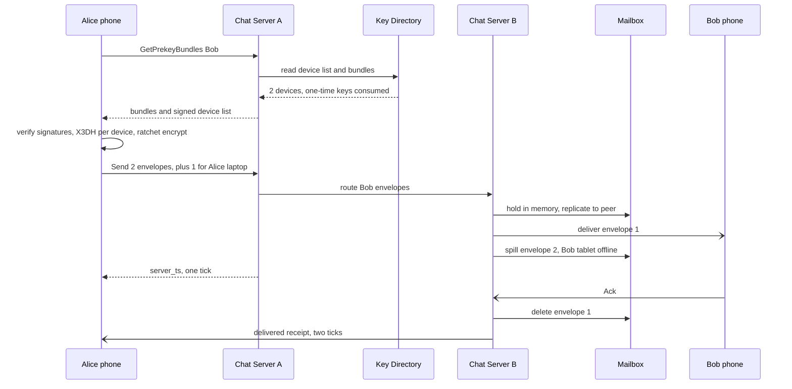

**Reading the diagram.** Alice's phone first fetches Bob's prekey bundles and his device list signed by Bob's primary device; the key directory hands out each one-time prekey once. All cryptography happens on Alice's phone: verifying signatures, running X3DH for each of Bob's two devices and encrypting with each new ratchet. The send carries three envelopes (Bob's phone, Bob's tablet, Alice's laptop). Alice's chat server routes Bob's envelopes to the chat server holding Bob's connections, which keeps them in memory with a synchronous replica in a peer before Alice gets her single tick: that is the durability boundary. Bob's phone is online and receives its envelope immediately (asynchronous push over the connection); the tablet is offline, so its envelope spills to the disk-backed mailbox and a content-free push wakes it (§9.8). Bob's phone acknowledges; the server deletes its envelope and sends Alice a delivered receipt. Failure points: if Bob's device list changed since Alice cached it, the server rejects the send with the current list and Alice re-encrypts; if the one-time prekeys run out, X3DH proceeds with the signed prekey alone (slightly weaker against replay of the first message); if Bob's chat server crashes before the peer replica acknowledges, Alice never received a tick and retries with the same `client_msg_id`.

**Figure 53.8 — Read path: an offline device reconnects and fetches media.**

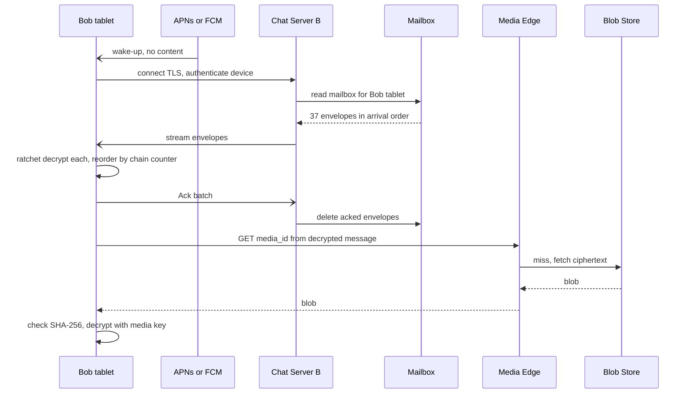

**Reading the diagram.** The push notification carries no message content; it only prompts the app to connect. The tablet authenticates as a specific device, and the chat server streams its mailbox in arrival order; the tablet decrypts each envelope, using the ratchet's per-chain counters to reorder and to derive keys for skipped messages, then acknowledges in batches so the server can delete. Media referenced inside a decrypted message is fetched from an edge cache by `media_id`; on a miss the edge reads the blob store. Integrity is end to end: the tablet checks the hash carried in the encrypted message, so a corrupted or substituted blob is detected even though the server cannot read it. Failure points: an envelope that fails to decrypt (lost session state) triggers a client request for the sender to re-establish a session; expired media (beyond retention) shows a "no longer available" placeholder.

### 53.5.10 Bottlenecks

1. **Re-key storms in large groups.** A removal in a 1,024-member group costs about 1.7 million pairwise messages. Mitigations: lazy re-keying on next send, rate limits on membership churn, and treating very large broadcast use cases as a different product (one-to-many channels with different cryptographic trade-offs).
2. **Multi-device multiplication.** Every additional device per user adds a ciphertext to every one-to-one message and every group delivery. A cap on companion devices bounds $d$.
3. **Key directory hot spots.** Mass re-registration after an outage causes bursts of bundle fetches and one-time prekey depletion; clients refill when told their count is low, and the signed prekey is the fallback.
4. **Media egress.** About 1 Tbit/s on average; edge caching of viral forwards (shared blob and hash) is the main lever.

### 53.5.11 Failure scenarios

**Table 53.9 — Failure scenarios for the E2EE messenger.**

| What fails | Impact | Detection | Recovery | Prevention |
|---|---|---|---|---|
| Chat server crash | ~1 M devices disconnected; in-memory envelopes at risk | Health checks, connection-count drop | Devices reconnect with jitter; envelopes recovered from peer replica | Synchronous peer replica before the sender's tick; blast-radius sizing |
| Key directory unavailable | New sessions and new devices blocked; existing chats unaffected | Bundle-fetch error rate | Fail over to replica region | Consensus-replicated store (§26) across zones |
| Key directory compromised or coerced | Attacker can substitute keys (man-in-the-middle) | Key-transparency audits; users' security-code checks; key-change warnings | Revoke, rotate, notify | Key transparency log; warn on key change |
| Device loses session state (reinstall without backup) | Cannot decrypt in-flight messages | Decryption failures reported by client | Sender re-establishes the session; old messages lost unless backed up | Encrypted backups; retry with new session |
| One-time prekeys exhausted | Sessions fall back to signed prekey only | Prekey-count metric per device | Device refills when next online | Upload large batches; alert on low counts |
| Mailbox store outage | Offline devices cannot receive; online delivery continues | Spill error rate | Keep envelopes in memory longer; senders retry | Replicated mailbox store with TTL |
| Blob store region outage | Media fails to send or load | Upload/download error rates | Route to replica region | Cross-region replication of blobs |
| Stale device list at sender | Envelope missing for a new device | Server-side version check | Server rejects send with current list | Device-list version in every `Send` |

### 53.5.12 Scaling strategy

**At 10×.** The pattern is already global, so 10× is mostly more of everything: about 7,500 chat servers, 10 PB/day of media uploads and roughly 9 Tbit/s of media egress. What breaks is the **media path** (egress cost and cache capacity) and **key-directory throughput** during mass events. Changes: regional media stores with geo-routing of downloads; content-addressed caching of forwarded blobs; directory read replicas serving bundles while one-time-key consumption stays on the strongly consistent primary for each account shard.

**At 100×.** The limiting factors become cryptographic and product-level rather than server-level: large groups and many devices per user make $O(n^2 d)$ re-keying and $O(nd)$ fan-out the dominant costs. Group key-agreement protocols designed for large groups, such as Messaging Layer Security (MLS, RFC 9420) [Barnes et al. 2023], reduce membership-change cost to roughly logarithmic in group size by organizing keys in a tree; adopting one is an architectural change to every client and is the natural answer to "how would you support 100,000-member encrypted groups?".

### 53.5.13 Trade-offs

**Table 53.10 — Trade-offs in the E2EE messenger.**

| Decision | Chosen | Gave up | Why acceptable |
|---|---|---|---|
| Content visibility | E2EE; server sees ciphertext | Server-side search, ranking, content moderation, server-side history | The product promise is privacy; moderation shifts to metadata and user reports |
| History | Store-and-forward, delete on ack | Seamless history on new devices from the server | History is transferred device to device, or via encrypted backups |
| Multi-device | Per-device keys, client fan-out | Upload bandwidth and battery for each extra device | Keeps the server keyless; capped device count |
| Groups | Sender keys | Weaker post-compromise security within a group chain; $O(n^2)$ re-key | $O(1)$ sender cost per message |
| Key trust | Server-run directory plus transparency and security codes | Pure out-of-band trust | Usable by two billion people who will never compare fingerprints |
| Mailbox | In memory with synchronous peer replica, spill to disk | Simplicity of one durable store | Most envelopes live under a second |

### 53.5.14 Alternative designs

1. **Server-side encryption only (TLS plus encryption at rest).** Enables search, multi-device history and server-side moderation, as in §53.4, but the operator can read every message: a different product.
2. **Pairwise encryption for groups (no sender keys).** Stronger per-recipient ratcheting; acceptable for small groups, prohibitive at 1,024 members.
3. **MLS for groups** (§53.5.12): logarithmic membership changes, at the cost of protocol complexity and a server that must order handshake messages.
4. **Federated E2EE (Matrix with Megolm)** removes the single operator but weakens spam control and slows protocol changes; **sealed-sender** designs (Signal) additionally hide the sender's identity from the server.

### 53.5.15 Interview discussion

**Table 53.11 — 45-minute pacing plan for "Design WhatsApp".**

| Minutes | Activity | Output |
|---|---|---|
| 0–5 | Clarify: E2EE in scope? groups size? multi-device? history on server? | Decide E2EE yes, store-and-forward |
| 5–10 | Capacity | 1.16 M msg/s, 4.76 deliveries per message, 500 M connections, media PB/day |
| 10–18 | Architecture without crypto | Chat servers, routing, mailboxes, push, media store |
| 18–33 | E2EE deep dive | Key directory, X3DH, Double Ratchet, multi-device fan-out, sender keys |
| 33–40 | Media and failures | Encrypt-then-upload; chat-server crash; key substitution |
| 40–45 | Trade-offs | What the server sees; group size limits; MLS |

Likely follow-ups:

- *"How does the server deliver a message it cannot read?"* — Routing uses the envelope's header (recipient account and device), which is not secret; only the payload is encrypted.
- *"How does a new phone get old messages?"* — Not from the server, which deleted them; from another device of the same user over an encrypted transfer, or from an encrypted backup whose key the server does not hold.
- *"How do you fight spam without reading messages?"* — Metadata signals (sending rate, account age, how many recipients block or report), forwarding limits, and user reports, in which the reporting user's client forwards the reported messages.
- *"Can the server reorder or drop messages?"* — It can drop or delay them (denial of service is always possible), but tampering is detected by authenticated encryption, and the ratchet counters reveal gaps to the recipient.

A **senior** answer separates transport security from E2EE, explains prekeys as the answer to asynchronous key agreement and counts ciphertexts per message. A **staff** answer quantifies the multi-device and group multipliers, identifies the key directory as the trust anchor and discusses key transparency, lists exactly what metadata remains visible, and explains why group size and device limits are cryptographic-cost decisions.

### 53.5.16 Production considerations

- **Observability without content.** Metrics describe envelopes, not messages: delivery latency by region and network type, client-reported decrypt failures (the earliest sign of a session bug), prekey depletion, device-list rejects, re-key volume by group size.
- **Security.** Protect the key directory like a certificate authority: change logs, multi-party approval for operator access, and key transparency (WhatsApp described deploying it in 2023 [Meta Engineering 2023]). Client binaries are the security boundary, so release signing matters (§50.6). WhatsApp also described end-to-end encrypted backups whose key is held in a hardware-security-module-based vault or by the user [Meta Engineering 2021b].
- **Cost.** Media dominates; on-device compression, reuse of forwarded blobs and lifecycle expiry are the levers. The relay design keeps database cost unusually small.
- **Operations.** Every message format carries a version, because servers must route ciphertexts from clients years old that they cannot interpret.

## 53.6 Instagram

### 53.6.1 Problem statement

Design a photo-sharing service in the style of Instagram: users upload photos with captions, follow other users, scroll a home feed of posts from accounts they follow, like and comment, and post **stories** that disappear after 24 hours. The service runs on phones over mobile networks and serves several hundred million daily users.

Think of a newspaper that prints a different edition for every reader. Photographers file pictures at the front door (uploads); a darkroom makes prints in four sizes (resizing); delivery vans keep copies in every neighborhood (the CDN); and the editor decides which pictures each reader sees first (the feed). Most of the bytes flow through the darkroom and the vans; most of the *decisions* happen at the editor's desk.

The distinctive hard problems are the **media upload pipeline** (getting large files from flaky phones into durable storage and onto CDNs without passing them through application servers), **sharded identifiers** that let any service find a post's shard from its ID, **expiring content** (stories) and **counters on very popular posts**. The feed is introduced here; its fan-out economics are analyzed in depth in §53.7.8, and video transcoding belongs to Chapter 54.

### 53.6.2 Functional requirements

1. Upload a photo (or carousel of up to 10) with caption, location and tagged users; the post appears on the author's profile immediately.
2. Follow and unfollow accounts; view a profile grid of an account's posts.
3. Home feed of posts from followed accounts, ranked, with infinite scroll.
4. Like and unlike a post; show the like count and whether the viewer has liked it; comment.
5. Stories: post a photo story visible to followers for 24 hours; a story tray shows which followed accounts have unseen stories.
6. Out of scope: video transcoding (Chapter 54), direct messages (§53.4), search and Explore recommendations (Chapter 68).

### 53.6.3 Non-functional requirements

**Table 53.12 — Non-functional requirements for the photo-sharing service.**

| Requirement | Target | Note |
|---|---|---|
| Availability, feed and image reads | 99.95 % | Reads degrade gracefully to cached feeds |
| Availability, upload | 99.9 % | Client retries uploads in the background |
| Durability of uploaded originals | 11 nines per year (object-store class, §15.6) | Photos are irreplaceable to users |
| Feed API latency | p99 < 300 ms server time | Excludes image download |
| Image first byte from CDN | p95 < 100 ms at the edge | §21 |
| Post visible on own profile | Immediately (read-your-writes) | Users check their post at once |
| Post visible in followers' feeds | Within 10 s, eventual | Nobody notices a few seconds |
| Like counts | Approximate while hot; exact within minutes | "1.2M likes" need not be exact |
| Story expiry | Not visible after 24 h ± 1 min | Product promise |

### 53.6.4 Capacity estimation

Assumptions: 500 million DAU; 100 million new posts per day (photos only); original upload 3 MB; four renditions totaling 390 KB per post (150, 320, 640 and 1,080 pixels wide); 20 feed loads per user per day, each rendering 10 posts; images delivered at 150 KB on average; 20 likes per user per day; peak-to-average ratio 3; CDN hit ratio 95 %; 250 million stories per day.

::: example
**Worked example — Upload, storage and delivery.**

1. Posts: $100 \times 10^6 / 86{,}400 \approx 1{,}160$/s average, 3,470/s at peak.
2. Bytes per post: 3 MB original + 0.39 MB renditions = 3.39 MB. Per day: $100 \times 10^6 \times 3.39\text{ MB} = 339$ TB; per year $\approx 124$ PB; with erasure coding at 1.4×, **≈ 173 PB/year**.
3. Metadata (post rows, captions, tags) at 1 KB per post: 100 GB/day, 36.5 TB/year: small enough for a sharded relational store.
4. Feed requests: $500 \times 10^6 \times 20 = 10 \times 10^9$/day, $\approx 115{,}700$/s average and **347,000/s at peak**.
5. Image fetches: 10 per feed load, $100 \times 10^9$/day, 1.16 million/s average, 3.47 million/s at peak.
6. Image egress: $100 \times 10^9 \times 150\text{ KB} = 15$ PB/day, about **1.39 Tbit/s average and 4.2 Tbit/s at peak**, nearly all served by the CDN.
7. Origin load at a 95 % hit ratio: 5 % of 1.16 million/s ≈ 57,900 fetches/s and 0.75 PB/day from storage to the CDN.

*Interpretation.* Upload *requests* are modest (thousands per second) but carry most of the stored bytes; reads are a hundred times more frequent and served almost entirely from edge caches. *Engineering implication.* Keep image bytes off the application tier entirely: uploads go straight to object storage, downloads come from the CDN, and application servers handle only metadata.
:::

::: example
**Worked example — Likes and stories.**

1. Likes: $500 \times 10^6 \times 20 = 10 \times 10^9$/day, 115,700/s average, 347,000/s at peak.
2. A celebrity post receiving 2 million likes in its first 10 minutes concentrates $2 \times 10^6 / 600 \approx 3{,}330$ likes/s on **one counter row**, on one shard.
3. Stories live at any moment (Little's Law, §4.11): 250 million/day × 1 day = **250 million**; at 1 MB per story, 250 TB of hot story media, replaced entirely every 24 hours.

*Interpretation.* Aggregate like traffic is easy to shard; one hot post is not. *Engineering implication.* Design counters for the hottest key, not the average key (§53.6.8).
:::

**Table 53.13 — Capacity summary for the photo-sharing service.**

| Quantity | Value |
|---|---|
| Posts | 1,160/s average; 3,470/s peak |
| Media storage | 339 TB/day; ≈ 173 PB/year erasure-coded |
| Feed API | 115,700/s average; 347,000/s peak |
| Image fetches | 1.16 M/s average; 3.47 M/s peak; 1.39 Tbit/s average egress |
| Origin fetches (95 % CDN hit) | ≈ 57,900/s |
| Likes | 115,700/s average; one hot post ≈ 3,330/s |
| Live stories | ≈ 250 million; ≈ 250 TB |

### 53.6.5 API design

```text
POST /v1/uploads                {content_type, size_bytes, sha256}
                                → {upload_id, url: <presigned PUT, 15 min>, max_part_size}
POST /v1/posts                  {upload_ids[], caption, location?, tagged_user_ids[],
                                 client_post_id}             # idempotency key
                                → 202 {post_id, status: processing}
GET  /v1/posts/{post_id}        → {post_id, author, caption, media: [{w, h, url}...],
                                   like_count, viewer_has_liked, created_at}
GET  /v1/users/{user_id}/posts?max_id=<post_id>&limit=24        # profile grid
GET  /v1/feed?cursor=<opaque>&limit=10
                                → {items: [post...], next_cursor}
PUT    /v1/posts/{post_id}/like    → 204   # idempotent
DELETE /v1/posts/{post_id}/like    → 204
POST /v1/stories                {upload_id} → {story_id, expires_at}
GET  /v1/stories/tray           → [{user_id, latest_story_ts, has_unseen}]
GET  /v1/users/{user_id}/stories → [{story_id, media_url, expires_at}]
```

Likes use `PUT`/`DELETE` on a resource rather than `POST /like`, so retries are naturally idempotent. Profile grids page by `max_id` (a post ID), which works because IDs sort by time (§53.6.6). Image URLs returned to clients point at the CDN and include the rendition size.

### 53.6.6 Data model and database schema

Metadata lives in a relational database sharded by user, the same choice Instagram described in 2012 (see the industry callout below), because posts, follows and likes have relational structure and modest volume (tens of terabytes), and transactions within one user's shard are useful.

```sql
-- One PostgreSQL schema per logical shard; 8,192 logical shards on far fewer servers.
CREATE TABLE posts (
  post_id     bigint PRIMARY KEY,          -- 41-bit ms | 13-bit shard | 10-bit seq
  author_id   bigint NOT NULL,             -- shard key: post lives on author's shard
  caption     text,
  media       jsonb NOT NULL,              -- [{key, width, height}] renditions in object store
  status      text NOT NULL,               -- processing | live | deleted
  like_count  bigint NOT NULL DEFAULT 0,   -- denormalized, updated by the counter service
  created_at  timestamptz NOT NULL
);
CREATE INDEX posts_by_author ON posts (author_id, post_id DESC);

CREATE TABLE follows (                     -- stored twice: by follower and by followee (§14.7.3)
  follower_id bigint, followee_id bigint, created_at timestamptz,
  PRIMARY KEY (follower_id, followee_id)
);

CREATE TABLE likes (                       -- sharded by post_id's shard
  post_id bigint, user_id bigint, created_at timestamptz,
  PRIMARY KEY (post_id, user_id)
);

CREATE TABLE stories (
  story_id bigint PRIMARY KEY, author_id bigint, media_key text,
  created_at timestamptz, expires_at timestamptz    -- created_at + 24 h
);
CREATE INDEX stories_live ON stories (author_id, expires_at);
```

#### Sharded IDs

An ID that embeds its shard lets every service route a request for post 11637205506832265 without a lookup table. The scheme Instagram published uses 41 bits of milliseconds since a custom epoch, 13 bits of logical shard ID and 10 bits of a per-shard sequence, generated inside PostgreSQL by a function in each shard's schema [Instagram Engineering 2012]. Its properties: IDs sort roughly by time across shards (good for "newest first" pages without a separate timestamp index), 1,024 IDs per millisecond per logical shard, and about 69 years of range from the epoch (§17.10.3 derives the limits).

```python
EPOCH_MS = 1293840000000          # 2011-01-01 00:00:00 UTC, a custom epoch
N_LOGICAL_SHARDS = 8192           # 2**13 logical shards

def make_id(now_ms: int, shard_id: int, seq: int) -> int:
    """41 bits of ms since epoch | 13 bits logical shard | 10 bits per-shard sequence."""
    assert 0 <= shard_id < N_LOGICAL_SHARDS
    return ((now_ms - EPOCH_MS) << 23) | (shard_id << 10) | (seq % 1024)

def parse_id(post_id: int):
    return {"ms_since_epoch": post_id >> 23,
            "shard_id": (post_id >> 10) & 0x1FFF,
            "seq": post_id & 0x3FF}

user_id = 31341
shard = user_id % N_LOGICAL_SHARDS        # a user's posts live on the user's logical shard
pid = make_id(EPOCH_MS + 1_387_263_000, shard, 5001)
print(pid, parse_id(pid))
a = make_id(EPOCH_MS + 1000, 7, 1); b = make_id(EPOCH_MS + 1001, 3, 0)
print("later millisecond sorts later across shards:", a < b)
# prints: 11637205506832265 {'ms_since_epoch': 1387263000, 'shard_id': 6765, 'seq': 905}
#         later millisecond sorts later across shards: True
```

What to notice:

- The shard is chosen from the **author**, so a user's posts share a shard and the profile grid is a single-shard range scan on `(author_id, post_id DESC)`.
- `seq % 1024` comes from a per-shard database sequence, so uniqueness needs no coordination between shards; the only cross-shard guarantee is "roughly time-ordered", within clock skew.
- Logical shards (8,192) are fixed forever; physical servers are not. Moving logical shards between servers (§14.9.2) changes a mapping table, never an ID.

::: industry
**Instagram: sharding and IDs (2012) and counters across data centers (2015).** Instagram described partitioning PostgreSQL into several thousand logical shards held as schemas on fewer physical servers, with the 41/13/10-bit ID generated in PL/pgSQL [Instagram Engineering 2012]. A 2015 post on expanding to multiple data centers described a counter problem: with caches invalidated on every new like, popular posts triggered many expensive `COUNT` queries, so the team **denormalized the like count onto the post row** and incremented it in the database, and used memcache **leases** so that when a celebrity's cached count was invalidated, one request refilled it while others waited or read a slightly stale value [Instagram Engineering 2015]. The leases are the mechanism of §20.11 [Nishtala et al. 2013].
*Evidence: Primary* — [Instagram Engineering 2012; Instagram Engineering 2015]
:::

### 53.6.7 High-level architecture

**Figure 53.9 — High-level architecture of the photo-sharing service.**

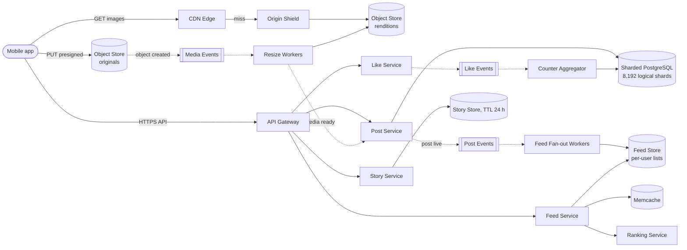

**Reading the diagram.** The app talks to an **API gateway** for metadata and directly to the **object store** for uploads, using a presigned URL (§15.8.2), so multi-megabyte bodies never touch application servers. The object store emits an asynchronous "object created" event; **resize workers** produce renditions into a second bucket and then tell the **post service** that the media is ready, which flips the post to `live` in **sharded PostgreSQL** and publishes a "post live" event. **Fan-out workers** consume it and append the post ID to followers' lists in the **feed store** (push for most authors; see §53.6.8). The **feed service** reads a user's list, hydrates posts from **memcache** and the database, and asks a **ranking service** to order them (Chapter 68). Images are fetched from the **CDN**, whose misses go through an **origin shield** to the renditions bucket (§21.5.3). Likes are written as events and aggregated into counters (§53.6.8). Stories live in a separate store with a 24-hour TTL. Failure points: the resize pipeline (posts stuck in `processing`), a hot shard for a celebrity's post row, and CDN purge mistakes. Scaling: object storage and CDN scale by bytes; the post service and database by metadata writes; the feed tier by reads.

### 53.6.8 Detailed component design

#### The upload pipeline

1. **Client preparation.** The app resizes the photo to at most 1,080 pixels wide and recompresses it before upload, cutting a 12-megapixel camera file of several megabytes to well under one; it computes a SHA-256 hash for integrity and deduplication.
2. **Presigned upload.** `POST /v1/uploads` returns a presigned `PUT` URL scoped to one object key, one content type and a 15-minute lifetime. Large files use multipart upload so a dropped connection resumes from the last part (§15.8.1).
3. **Create the post early.** `POST /v1/posts` with a `client_post_id` creates the row in state `processing` and returns a `post_id`; the app shows the post on the author's own profile from its local copy immediately (read-your-writes without waiting for resizing).
4. **Asynchronous resize.** The object-created event triggers workers that validate the file (magic bytes, dimensions, decompression-bomb limits), strip location metadata if the user did not share location, generate four renditions, and write them with content-addressed keys such as `/{post_id}/{width}/{hash}.jpg`. Workers are idempotent: a redelivered event regenerates identical keys.
5. **Publish.** When all renditions exist, the post becomes `live` and its "post live" event starts fan-out. If resizing fails after retries, the post goes to a dead-letter queue (§30.11) and the user sees "couldn't post, tap to retry".

Content-addressed rendition keys make CDN caching simple: an object at a given URL never changes, so it can carry `Cache-Control: max-age=31536000, immutable` (§21.6), and deleting a post is a metadata change plus an asynchronous purge.

#### Feed: push for most, pull for a few

The feed service must return ten good posts in under 300 ms. Two basic strategies exist, and §53.7 analyzes them with full capacity arithmetic:

- **Fan-out-on-write (push):** when a post goes live, append its ID to every follower's feed list. Reads are one list fetch. Cost: one write per follower per post. With 100 million posts per day and, say, 150 followers on average, $100 \times 10^6 \times 150 / 86{,}400 \approx 174{,}000$ list inserts per second: affordable.
- **Fan-out-on-read (pull):** at read time, fetch recent posts from each followed account and merge. No write amplification, but each feed load touches hundreds of accounts.

The teaching design pushes for ordinary accounts and pulls for accounts above a follower threshold, merging the two at read time. The feed list holds post IDs only (8 bytes each, 500 per user); post bodies are hydrated from memcache. Ranking then reorders a few hundred candidates; Instagram has publicly described moving from a reverse-chronological to a ranked feed in 2016 [Instagram 2016].

#### Likes and counters at scale

Two separate questions hide in a like button: "has *this viewer* liked it?" (exact, per user) and "how many people liked it?" (approximate is fine while hot). Treat them differently.

1. **The like edge** `(post_id, user_id)` is written synchronously to the `likes` table on the post's shard: idempotent by primary key, so double taps and retries are harmless. The viewer's own state is therefore always exact.
2. **The count** is updated asynchronously. The like service emits a `+1` or `−1` event keyed by `post_id`; a **counter aggregator** consumes events, sums them in memory per post for an interval $T$, and flushes one `UPDATE posts SET like_count = like_count + Δ` per post per interval: **write coalescing**.
3. **Reads** return the denormalized `like_count` from cache. For very hot posts, the cache entry is refreshed by the aggregator on each flush rather than invalidated, avoiding the refill stampede that Instagram's lease work addressed.
4. **Reconciliation.** A periodic job recomputes `COUNT(*)` from `likes` for posts whose count changed recently and corrects drift caused by lost or duplicated events.

::: formula
**Write coalescing for counters**

$$W_{\text{db}} = \sum_{k} \min\!\left(\lambda_k,\ \frac{1}{T}\right), \qquad \text{staleness} \le T + \text{lag}$$

| Symbol | Meaning | Units |
|---|---|---|
| $W_{\text{db}}$ | Database counter writes after coalescing | writes/s |
| $\lambda_k$ | Like events per second on post $k$ | events/s |
| $T$ | Flush interval of the aggregator | s |
| lag | Event-pipeline delay before aggregation | s |
:::

::: example
**Worked example — Coalescing the celebrity post and the long tail.**

1. Hot post: $\lambda = 3{,}330$/s, $T = 1$ s: $\min(3{,}330, 1) = 1$ write/s instead of 3,330 — a **3,330× reduction** on the hottest row in the system.
2. Whole system at peak: 347,000 likes/s. Suppose these touch 150,000 distinct posts in any one second, most receiving one or two likes. Then $W_{\text{db}} \approx 150{,}000$ writes/s: only a **2.3× reduction** overall.
3. Staleness: with $T = 1$ s and a pipeline lag of 2 s, a displayed count is at most about 3 s old.

*Interpretation.* Coalescing is decisive for hot keys and nearly irrelevant for the long tail. *Engineering implication.* Use coalescing to protect hot rows; size the database for the long tail's distinct-key write rate. For keys hotter still, split the counter into $N$ sub-counters on different rows and sum them on read (a **sharded counter**), trading read cost for write spread.
:::

::: mistake
**Mistake — `SELECT COUNT(*)` on every page view.** Counting a celebrity post's two million `likes` rows for every one of its millions of views turns a cheap read into a table scan per view. Store the count; recompute it rarely.
:::

#### Stories with a 24-hour TTL

Stories are written once, read many times for a day, then hidden. The story store keeps rows keyed by `(author_id, created_at)` with `expires_at`; the tray query asks, for each followed account, whether any story has `expires_at > now()` and is unseen by the viewer. Three details make expiry reliable:

- **Filter on read, delete later.** Readers always filter by `expires_at > now()`; a background job (or the store's native TTL, as in Cassandra or DynamoDB) deletes expired rows hours later. Correctness never depends on the deleter being on time.
- **Media lifecycle.** Story media uses an object-store lifecycle rule (§15.9) that moves objects older than 24 hours to the author's archive tier or deletes them; CDN entries carry `max-age` no longer than the remaining lifetime.
- **Tray precomputation.** The tray is a small per-user list (accounts with live stories) maintained by fan-out on story creation and trimmed on read, the same push pattern as the feed.

### 53.6.9 Data flow

**Figure 53.10 — Write path: uploading a photo post.**

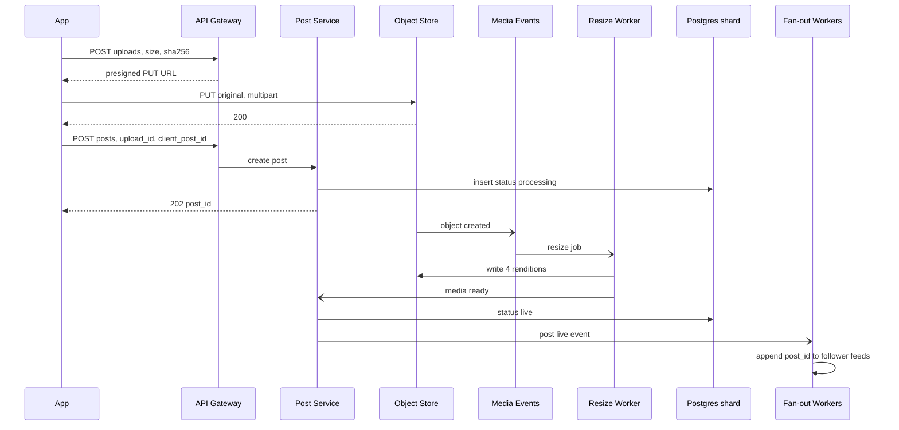

**Reading the diagram.** The app obtains a presigned URL and uploads the original directly to the object store (synchronous, possibly multipart and resumed). Only then does it create the post, which is inserted on the author's shard in state `processing`, and the app receives a `post_id` at once. The rest is asynchronous: the object-created event drives the resize worker, which writes renditions and reports back; the post becomes `live` and a "post live" event starts fan-out. Failure points: an upload that never completes leaves an orphan object, deleted by a lifecycle rule on the uploads prefix; a resize crash redelivers the job (idempotent keys); a post stuck in `processing` beyond a timeout is retried and then surfaced to the user.

**Figure 53.11 — Read path: loading the home feed.**

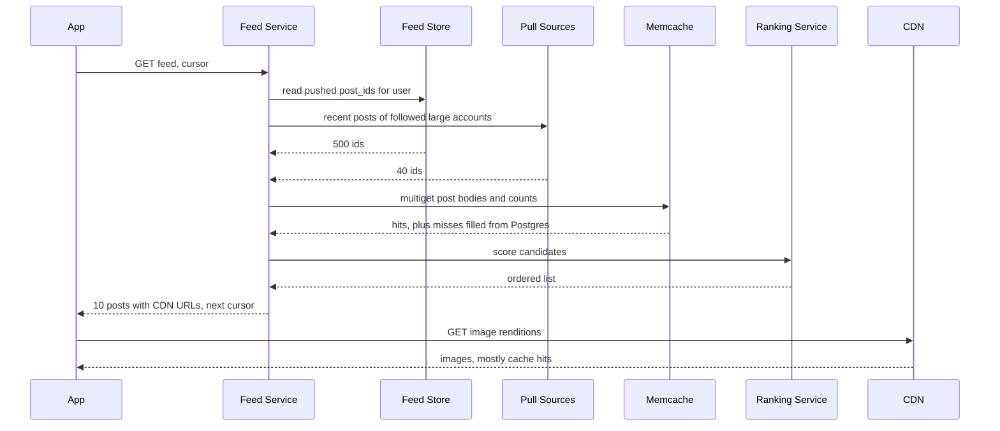

**Reading the diagram.** The feed service reads the user's pushed list and, in parallel, the recent posts of the few followed accounts that are served by pull; it merges about 540 candidate IDs, hydrates bodies and counts with one memcache multiget (misses filled from the post's shard), filters deleted and blocked content, and calls the ranking service for an order. It returns ten posts with rendition URLs sized for the device; the app then downloads images from the CDN, which is where most latency and almost all bytes are. Failure points: if ranking times out, return the merged list in reverse-chronological order; if the feed store is unavailable, fall back to a pull-only feed for that user at higher cost; memcache misses for a viral post are protected by leases.

**Figure 53.12 — Like counting with write coalescing.**

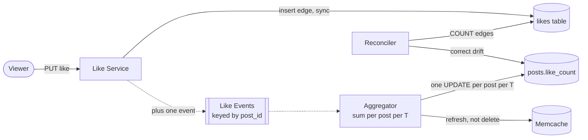

**Reading the diagram.** The like edge is written synchronously so the viewer's own heart is exact. The count change travels asynchronously through an event stream partitioned by `post_id`, so all events for one post reach one aggregator instance, which sums them for $T$ seconds and issues one update. The aggregator refreshes the cached count instead of deleting it, so a hot post never causes a refill stampede. A reconciler periodically recounts edges and fixes drift. Failure points: an aggregator crash loses at most one interval of un-flushed sums (fixed by the reconciler, or avoided by committing consumer offsets only after the flush, §31.8.2).

### 53.6.10 Bottlenecks

1. **Hot rows for celebrity posts** (counts, comments): coalescing, sharded counters, cache refresh instead of invalidation.
2. **Celebrity shards.** All of a celebrity's posts live on one logical shard; read traffic to that shard is absorbed by memcache and read replicas, and a very hot logical shard can be moved to a dedicated physical server.
3. **Resize backlog after an outage or a holiday spike.** Autoscale workers on queue depth; prioritize the small renditions used by feeds so posts can go live before large sizes finish.
4. **Origin egress on CDN misses** after a purge or for long-tail content: origin shielding (§21.5.3) and tiered caching.
5. **Feed fan-out for large accounts:** deferred to pull (analysis in §53.7.8).

### 53.6.11 Failure scenarios

**Table 53.14 — Failure scenarios for the photo-sharing service.**

| What fails | Impact | Detection | Recovery | Prevention |
|---|---|---|---|---|
| Resize workers down | New posts stuck in `processing` | Queue depth, age of oldest job | Scale out; drain backlog by priority | Autoscaling on lag; multiple instance types |
| Object store region degraded | Uploads fail; misses on uncached images | Upload error rate; origin 5xx | Fail uploads over to a second region bucket | Cross-region replication of originals |
| PostgreSQL shard primary fails | Writes to that shard's users fail for seconds | Replication health checks | Promote replica (§14.3) | Semi-synchronous replica in another zone |
| Memcache cluster loss | Database read surge | Hit-ratio drop, DB latency | Gutter pool, leases (§20.11) | Spread keys across clusters; warm-up |
| Like aggregator crash | Counts stale for seconds; un-flushed sums lost | Consumer lag | Restart from committed offsets | Commit offsets after flush; reconciler |
| CDN purge of wrong prefix | Origin flooded | Origin request spike | Rate-limit purges; shield absorbs | Immutable keys; purge by exact key only |
| Story deleter late | None visible (read filter) | Expired-row backlog metric | Catch up | Filter on read, never trust delete timing |

### 53.6.12 Scaling strategy

**At 10× load** (from more engagement and richer media rather than ten times as many people). Image egress reaches about 14 Tbit/s on average and storage about 1.7 EB/year erasure-coded. What breaks: **storage cost** and **CDN egress**. Changes: modern formats with better compression (AVIF, WebP), device-aware rendition selection, cold-tiering of originals older than a year (§15.9), and placing cache appliances inside large ISPs in the style of Netflix Open Connect (§21.10).

**At 100×.** The metadata tier, which looked small, becomes the operational problem: thousands of PostgreSQL servers. Fixed logical shards keep rebalancing a mapping exercise, but cross-region writes and failover require a home-region-per-user design (§44.6.4). Counters and feed lists move to purpose-built stores; Instagram's own published history includes multi-data-center expansion and the counter redesign it forced [Instagram Engineering 2015].

### 53.6.13 Trade-offs

**Table 53.15 — Trade-offs in the photo-sharing design.**

| Decision | Chosen | Gave up | Why acceptable |
|---|---|---|---|
| Upload path | Presigned direct-to-store | Server-side inspection before storage | Inspection happens asynchronously before the post goes live |
| Post visibility | `processing` then `live` | Instant visibility to followers | Author sees it at once from the local copy |
| IDs | Time-ordered, shard-embedded 64-bit | Fully random IDs that hide creation time | Routing without lookups, natural time order |
| Counters | Coalesced, approximate while hot | Exact real-time counts | Users do not notice ±0.1 % on a million |
| Feed | Push with pull for large accounts | Simplicity of one strategy | Bounded write amplification (§53.7) |
| Stories | Filter on read, lazy delete | Physical deletion exactly at 24 h | Expiry is exact for users; storage lags harmlessly |

### 53.6.14 Alternative designs

1. **Upload through application servers.** Simpler authentication and immediate validation, but ties up servers and memory for slow mobile uploads at 3 MB each; acceptable at small scale only.
2. **On-the-fly resizing at the edge** (an image service that renders sizes on request and caches them). Fewer stored renditions and easy addition of new sizes, at the cost of compute on cache misses; common for product catalogs.
3. **Exact counters with `UPDATE … + 1` per like.** Correct and simple until one row receives thousands of updates per second and lock contention caps throughput.
4. **Probabilistic counters** (HyperLogLog of distinct likers, §17.5): tiny memory, fine for view counts, but a visible like count must not wobble.

### 53.6.15 Interview discussion

**Table 53.16 — 45-minute pacing plan for "Design Instagram".**

| Minutes | Activity | Output |
|---|---|---|
| 0–5 | Scope: photos, feed, likes, stories; video out | Requirements list |
| 5–10 | Capacity | 1.2 k posts/s, 339 TB/day, 3.5 M image fetches/s peak, 1.4 Tbit/s egress |
| 10–18 | Architecture | Figure 53.9: presigned upload, resize, CDN, sharded metadata |
| 18–30 | Deep dive 1: upload pipeline and IDs | State machine, idempotent workers, 41/13/10 IDs |
| 30–38 | Deep dive 2: feed and counters | Push vs pull sketch, coalesced likes |
| 38–45 | Failures, stories, trade-offs | Table 53.14 highlights; TTL by read filter |

Likely follow-ups: *"How do you avoid serving a photo before it is checked?"* — It is not referenced by any live post until the worker validates it; the uploads bucket is private. *"How would you show 'liked by your friend X'?"* — Intersect the viewer's following set with recent likers via a bounded query on the `likes` table, or precompute in the feed pipeline. *"Delete a post?"* — Mark deleted, filter at hydration, purge CDN keys asynchronously, remove from feed lists lazily.

A **senior** answer keeps image bytes off application servers, designs idempotent asynchronous processing and separates the exact per-user like state from the approximate count. A **staff** answer quantifies egress cost and CDN hit ratio, explains why coalescing helps only hot keys, and connects ID design to sharding and rebalancing.

### 53.6.16 Production considerations

- **Observability.** Upload success rate by network type and app version; time from upload to `live` (p50/p99); resize queue age; CDN hit ratio and origin egress per region; hot-key detection on counters and post rows (§20.15).
- **Security and privacy.** Presigned URLs scoped to one key, type and size, with short lifetimes; strip EXIF location by default; scan media for malware and policy violations before `live`; private accounts enforced at hydration *and* at the CDN by signed, expiring URLs for private media (§21.11).
- **Cost.** Storage and egress dominate. Lifecycle tiering of originals, better image codecs and higher CDN hit ratios are worth far more than application-server tuning.
- **Operations.** Backfills (a new rendition size for a new device class) run as throttled batch jobs over billions of objects; schema changes run per logical shard with tooling that walks all 8,192 schemas.

## 53.7 Facebook News Feed

### 53.7.1 Problem statement

Design the home feed of a social network in the style of Facebook: when a user opens the app, show a ranked list of recent posts, photos, shares and activity from their friends, the groups they belong to and the pages they follow. Friendships are mutual and capped (a few thousand friends at most), but pages and public figures can have hundreds of millions of followers. Every post must be checked against privacy settings for each viewer.

A useful picture is a personal newspaper assembled at the moment the reader sits down. One option is to have every reporter deliver a copy of each story to every subscriber's mailbox as soon as it is written (**fan-out-on-write**); the other is to keep each reporter's recent stories on their own desk and have an editor walk round the desks when the reader arrives (**fan-out-on-read**). The first is fast to read but expensive when a famous columnist has 100 million subscribers; the second is cheap to write but makes every reader's visit a tour of hundreds of desks.

The distinctive hard problem is the **fan-out decision with its capacity arithmetic**, followed by the **social-graph store** that every feed request reads dozens of times (a TAO-style graph cache) and a **ranking stage** whose cost scales with the number of candidates.

### 53.7.2 Functional requirements

1. Return the first page of a user's feed: about 10–20 ranked stories, each with author, content, counts and comments preview; then further pages by cursor.
2. Stories come from friends, joined groups and followed pages; include new posts and selected activity ("X commented on Y's photo").
3. Respect privacy: a story is shown only if the viewer may see it at read time (audience settings, blocks, deletions).
4. New posts by friends appear in the feed within seconds; edits and deletions take effect on the next load.
5. Do not show the same story repeatedly; remember what was seen.
6. Out of scope: the design of ranking models (Chapter 68), ads insertion, notifications (Chapter 52).

### 53.7.3 Non-functional requirements

**Table 53.17 — Non-functional requirements for the news feed.**

| Requirement | Target | Note |
|---|---|---|
| Availability | 99.95 %; degrade to an older cached feed rather than fail | An empty feed is the worst outcome |
| Feed latency | p50 < 200 ms, p99 < 800 ms server time for the first page | Includes candidate retrieval, hydration and ranking |
| Freshness | Friend's new post eligible within 10 s | Eventual consistency is acceptable |
| Privacy correctness | Zero stories shown to viewers not permitted at read time | A privacy leak is a severity-1 incident |
| Graph read throughput | ~10⁸ reads/s at peak (§53.7.4) | Every feed load reads the graph many times |
| Consistency of counts | Approximate, seconds stale | As in §53.6 |

### 53.7.4 Capacity estimation

Assumptions: 2 billion DAU, 3 billion monthly users; 1 billion new posts and shares per day; an ordinary author reaches 400 people (friends plus followers); each DAU loads the feed 15 times per day; peak-to-average ratio 2 (global audience); 100,000 accounts with at least a million followers, averaging 5 million followers and posting 4 times per day; 1,000 ranking candidates per feed load.

::: formula
**Fan-out load and fan-out completion time**

$$W_{\text{push}} = \sum_{a} p_a F_a, \qquad T_{\text{fan}} = \frac{F_a}{R_{\text{post}}}$$

| Symbol | Meaning | Units |
|---|---|---|
| $W_{\text{push}}$ | Feed-list inserts per day under fan-out-on-write | inserts/day |
| $p_a$ | Posts per day by author $a$ | posts/day |
| $F_a$ | Followers (audience) of author $a$ | users |
| $T_{\text{fan}}$ | Time to finish delivering one post to all followers | s |
| $R_{\text{post}}$ | Insert throughput the fan-out tier devotes to one post | inserts/s |
:::

::: example
**Worked example — Pure fan-out-on-write.**

1. Ordinary authors: $1 \times 10^9$ posts/day × 400 = $4 \times 10^{11}$ inserts/day ≈ **4.63 million/s** average, 9.26 million/s at peak.
2. Large accounts: $10^5 \times 4 \times 5 \times 10^6 = 2 \times 10^{12}$ inserts/day ≈ **23.1 million/s**: five times all ordinary fan-out combined, produced by 0.005 % of accounts.
3. One post by an account with 100 million followers, given $R_{\text{post}} = 10^6$ inserts/s: $T_{\text{fan}} = 10^8 / 10^6 = 100$ s. The last followers see it nearly two minutes after the first, and the burst competes with every other post's fan-out.
4. Storage of per-user lists: 3 billion users × 500 entries × 24 bytes = 36 TB (108 TB at three replicas): manageable.

*Interpretation.* Storage is not the problem; the **write rate and burstiness caused by the heavy tail** are. *Engineering implication.* Never push for accounts in the tail; the question is where to cut.
:::

::: example
**Worked example — Pure fan-out-on-read.**

1. Feed loads: $2 \times 10^9 \times 15 = 3 \times 10^{10}$/day ≈ 347,000/s average, **694,000/s at peak**.
2. Naive pull: each load consults 400 sources: $694{,}000 \times 400 \approx 278$ million source lookups/s.
3. With sources sharded by author across an in-memory index tier, an aggregator sends one request per shard group rather than per author; at about 40 requests per load, $694{,}000 \times 40 \approx 27.8$ million index requests/s.
4. Index size: 5 billion recent actions/day (posts, comments, likes worth showing) × 2 days × 100 bytes ≈ **1 TB** per replica: small enough for RAM.
5. Ranking 1,000 candidates per load at peak: $694{,}000 \times 1{,}000 \approx 694$ million candidate scorings/s, which is why ranking is staged (§53.7.8).

*Interpretation.* Pull moves the cost to reads, but the data it reads, recent activity, is small and fits in memory. *Engineering implication.* Pull is viable when the recent-activity index fits in RAM and ranking needs all candidates at read time anyway.
:::

**Table 53.18 — Capacity summary for the news feed.**

| Quantity | Value |
|---|---|
| Feed loads | 347,000/s average; 694,000/s peak |
| Push inserts, ordinary authors | 4.63 M/s average |
| Push inserts, 100,000 large accounts | 23.1 M/s average |
| Worst single-post fan-out | 100 M inserts; 100 s at 1 M/s |
| Pull: index requests | ≈ 27.8 M/s at peak; index ≈ 1 TB per replica |
| Ranking | ≈ 694 M candidate scorings/s at peak before pruning |

### 53.7.5 API design

```text
GET  /v1/feed?cursor=<opaque>&count=15&viewport=<w,h>&network=<4g|wifi>
     → {stories: [{story_id, actors[], object_id, type, snippet, counts, comments_preview,
                   rank_context}], next_cursor, served_at}
POST /v1/feed/seen   {story_ids[], served_at}          # impression logging, batched
POST /v1/posts       {author_id, content, audience: public|friends|custom_list_id,
                      attachments[], client_post_id}   → {post_id}
DELETE /v1/posts/{post_id}
# Internal graph API (TAO-style, §53.7.8)
obj_get(id) · assoc_get(id1, atype, id2_set) · assoc_range(id1, atype, offset, limit)
assoc_time_range(id1, atype, high, low, limit) · assoc_count(id1, atype)
assoc_add(id1, atype, id2, time, data) · assoc_delete(id1, atype, id2)
```

The cursor is opaque because it encodes the *served* ranked list's identity and position, not a timestamp: page 2 must continue the ranking that produced page 1, even if new stories arrived in between. Impressions are logged so that "seen" stories are demoted next time.

### 53.7.6 Data model and database schema

The social graph is modeled the way TAO models it [Bronson et al. 2013]: **objects** (users, posts, comments, pages, photos) with typed fields, and **associations**, directed typed edges with a timestamp and small payload.

```text
object:  (id) -> (otype, {field: value})
           e.g. 9001 -> (post, {author: 42, text: "...", audience: friends})
assoc:   (id1, atype, id2) -> (time, {data})
           e.g. (42, authored, 9001), (42, friend, 77), (77, liked, 9001)
assoc list (id1, atype) -> [id2 ...] ordered by time descending
           e.g. (42, authored) -> newest posts by user 42 first
```

Objects and associations are stored in sharded MySQL: an object's shard is encoded in its ID, and an association lives on the shard of `id1`, so "all of 42's friends" or "42's latest posts" is a single-shard, time-ordered range read. Inverse edges (`friend` both ways, `liked`/`liked_by`) are written as separate associations. A relational store suffices because nearly all graph queries are one hop; the scale problem is read volume, which the cache solves (§12.7.3 discusses when a graph database is preferable).

The feed tier adds two read-optimized stores:

```text
# Recent-activity index (in-memory leaves), sharded by actor_id
activity/{actor_id} -> ring buffer of (action_id, type, object_id, time, light_features), 2 days

# Feed session cache, per viewer, TTL 30 min
served/{viewer_id}/{served_at} -> [story_id ...]   # supports stable pagination
seen/{viewer_id}               -> compact set of story_ids seen in the last N days
```

### 53.7.7 High-level architecture

**Figure 53.13 — High-level architecture of a read-time aggregated news feed.**

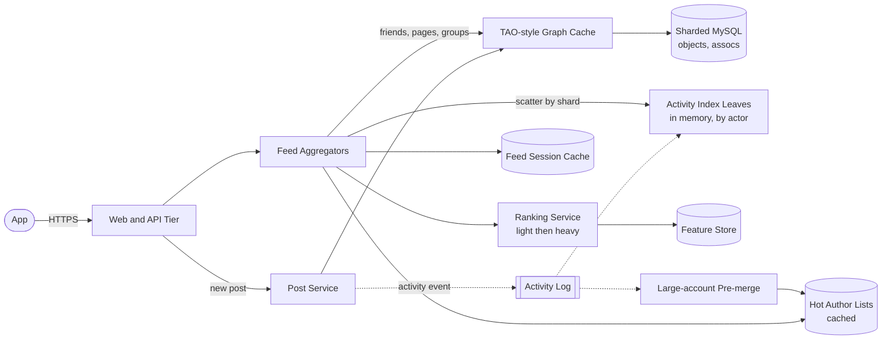

**Reading the diagram.** A feed request reaches an **aggregator**, which first reads the viewer's friends, groups and followed pages from the **TAO-style graph cache** (backed by sharded MySQL). It then scatters requests to the **activity-index leaves**, in-memory servers that hold the last two days of actions sharded by actor, asking each shard for recent actions by the viewer's sources; leaves return candidates with cheap features. Very large accounts are not scattered to: their recent posts sit in a small set of heavily cached **hot author lists** that every aggregator reads. The aggregator hydrates candidates (objects, counts, privacy checks) from the graph cache, calls the **ranking service** (a light model prunes, a heavy model scores, using a **feature store**) and stores the served list in a **feed session cache** for pagination. On the write side, the **post service** writes the object and associations through the graph cache and emits an activity event (dotted, asynchronous) that leaves consume within seconds. Failure points: a slow leaf shard delays every feed (mitigated by replicas and hedged requests, §16.7.3); a graph-cache miss storm on a viral object (leases, §20.11); ranking overload (fallback to light-ranked or chronological order). Scaling: leaves by memory and request rate, aggregators by CPU, the graph cache by reads.

### 53.7.8 Detailed component design

#### Choosing the fan-out strategy

The three strategies are compared with this case's numbers.

**Table 53.19 — Fan-out strategies for a 2-billion-DAU feed.**

| Aspect | Fan-out-on-write (push) | Fan-out-on-read (pull) | Hybrid (push, pull for large accounts) |
|---|---|---|---|
| Write cost | 4.6 M/s ordinary + 23 M/s large accounts | One index append per action | ≈ 4.6 M/s |
| Read cost | One list read per load | ~40 shard requests per load (27.8 M/s) | One list read + a few hot lists |
| Worst-case burst | 100 M inserts for one post | None | Bounded by the threshold |
| Freshness | Seconds, minutes for the largest accounts | Immediate at read time | Seconds |
| Storage | 36 TB of per-user lists | ≈ 1 TB recent-activity index | Lists + hot lists |
| Ranking fit | Lists must be re-scored at read anyway | Candidates gathered at read, scored once | Re-scored at read |
| Wasted work | Writes to inactive users' lists | None | Some, for inactive followers |
| Choose when | Small audiences, chronological feeds, read-heavy | Ranked feeds, bounded friend graph, index fits RAM | Follower graphs with a heavy tail (§53.8) |

A useful way to see why the heavy tail, rather than total cost, drives the decision is to compare push and pull costs for a single author.

::: formula
**Per-author push-to-pull ratio**

$$\frac{W_a}{R_a} = \frac{p_a F_a}{\alpha_a F_a r} = \frac{p_a}{\alpha_a\, r}$$

| Symbol | Meaning | Units |
|---|---|---|
| $W_a$ | Push writes per day caused by author $a$ | writes/day |
| $R_a$ | Pull reads per day of author $a$'s recent-post list | reads/day |
| $p_a$ | Posts per day by author $a$ | posts/day |
| $\alpha_a$ | Fraction of $a$'s followers active on a given day | dimensionless |
| $r$ | Feed loads per active user per day | loads/day |
| $F_a$ | Followers of $a$ (cancels out) | users |
:::

::: example
**Worked example — Ordinary user versus celebrity.**

1. Ordinary user: $p = 0.5$, $\alpha = 0.6$, $r = 15$: $W/R = 0.5 / 9 \approx 0.056$. Push performs about 18 times fewer operations than pull for this author.
2. Celebrity: $p = 4$, $\alpha = 0.3$ (many dormant followers), $r = 15$: $W/R = 4 / 4.5 \approx 0.89$. Operation counts are similar.
3. But the operations differ. The celebrity's $R_a$ reads all hit **one hot list** that sits in every cache, so each costs almost nothing; the $W_a$ writes go to **100 million distinct lists** in one burst.

*Interpretation.* Follower count cancels from the ratio: celebrities are not costly because of total operations but because push turns one event into a synchronized burst of distinct writes, while pull turns it into many reads of one cached object. *Engineering implication.* Cut over to pull by follower count (burst size) and posting frequency, and measure where the knee is.
:::

The following simulation makes the knee visible on a scaled-down population with a heavy-tailed follower distribution:

```python
import random

random.seed(7)
N_USERS = 1_000_000                # scaled-down population
MEAN_FOLLOWEES = 200               # average accounts each user follows

def posts_per_day(f):              # popular accounts post more often
    return 5.0 if f >= 10_000 else 0.5

# Heavy-tailed follower counts: Pareto with shape 1.2, capped at 10% of users,
# rescaled so that total follow edges = N_USERS * MEAN_FOLLOWEES.
raw = [min(10 * random.paretovariate(1.2), N_USERS / 10) for _ in range(N_USERS)]
scale = N_USERS * MEAN_FOLLOWEES / sum(raw)
followers = [max(1, int(f * scale)) for f in raw]

def hybrid(threshold):
    pushed = [f for f in followers if f < threshold]
    push_per_day = sum(f * posts_per_day(f) for f in pushed)
    biggest_burst = max(pushed, default=0)          # inserts caused by one post
    pull_per_load = sum(f for f in followers if f >= threshold) / N_USERS
    return push_per_day, biggest_burst, pull_per_load

print(f"follow edges = {sum(followers):,}; largest account = {max(followers):,} followers")
for t in (float("inf"), 100_000, 10_000, 1_000):
    push, burst, pull = hybrid(t)
    print(f"threshold {t!s:>7}: push inserts/day {push:>12,.0f} | "
          f"largest single fan-out {burst:>7,} | pulls per feed load {pull:5.1f}")
```

```text
follow edges = 199,500,793; largest account = 381,390 followers
threshold     inf: push inserts/day  308,107,772 | largest single fan-out 381,390 | pulls per feed load   0.0
threshold  100000: push inserts/day  214,971,622 | largest single fan-out  99,183 | pulls per feed load  18.6
threshold   10000: push inserts/day   76,599,577 | largest single fan-out   9,994 | pulls per feed load  46.3
threshold    1000: push inserts/day   54,665,146 | largest single fan-out     999 | pulls per feed load  90.2
```

What to notice:

- Moving the threshold from "never pull" to 10,000 followers cuts push inserts by **4×** (308 million to 77 million per day in this population) and caps the largest burst at 10,000, because the accounts above the threshold are few but post often to huge audiences.
- The price is paid on reads: each feed load now merges about 46 pulled author lists. Those are shared, hot, cached lists, so 46 keys in one multiget is cheap.
- Lowering the threshold further to 1,000 saves little more on writes but doubles the pulls. The knee, not the extreme, is the design point; recompute it on your own follower distribution.

#### Why the teaching design reads at query time

For a *ranked* feed with a *bounded* friend graph, read-time aggregation has three further advantages: ranking must score candidates at read time anyway (using fresh features such as "your friend commented two minutes ago"), privacy and deletion are evaluated against current state, and nothing is written for the many users who will not open the app today. Its cost is a large, latency-critical in-memory tier. The teaching design therefore aggregates at read time from activity leaves, and uses hot author lists for very large pages; §53.8 shows the opposite choice for a chronological, follower-based product.

::: industry
**Facebook's Multifeed.** Facebook has described its feed backend, Multifeed, as **aggregators** that query **leaf** servers holding recent activity in memory, then rank the results; a 2012 conference presentation described leaves holding most of the RAM and aggregators most of the CPU. A 2015 engineering post described splitting aggregators and leaves onto separate machine types, reporting about 40 % efficiency gains in memory and CPU use and a 10 % reduction in aggregator latency.
*Evidence: Primary* — [Facebook Engineering 2015]; the 2012 presentation detail is *Secondary* (conference slides as summarized by third parties).
:::

#### The social-graph cache (TAO style)

Every feed load reads the graph dozens of times: the viewer's friends and pages, each candidate's author, audience and counts, whether the viewer liked it, the first comments. At 694,000 loads/s and about 100 graph reads per load, that is roughly 70 million reads/s from feed alone. TAO is Facebook's published answer: a geographically distributed, read-optimized, **graph-aware write-through cache** in front of sharded MySQL, which the paper reports sustaining a billion reads per second [Bronson et al. 2013].

**Figure 53.14 — TAO-style cache tiers across two regions.**

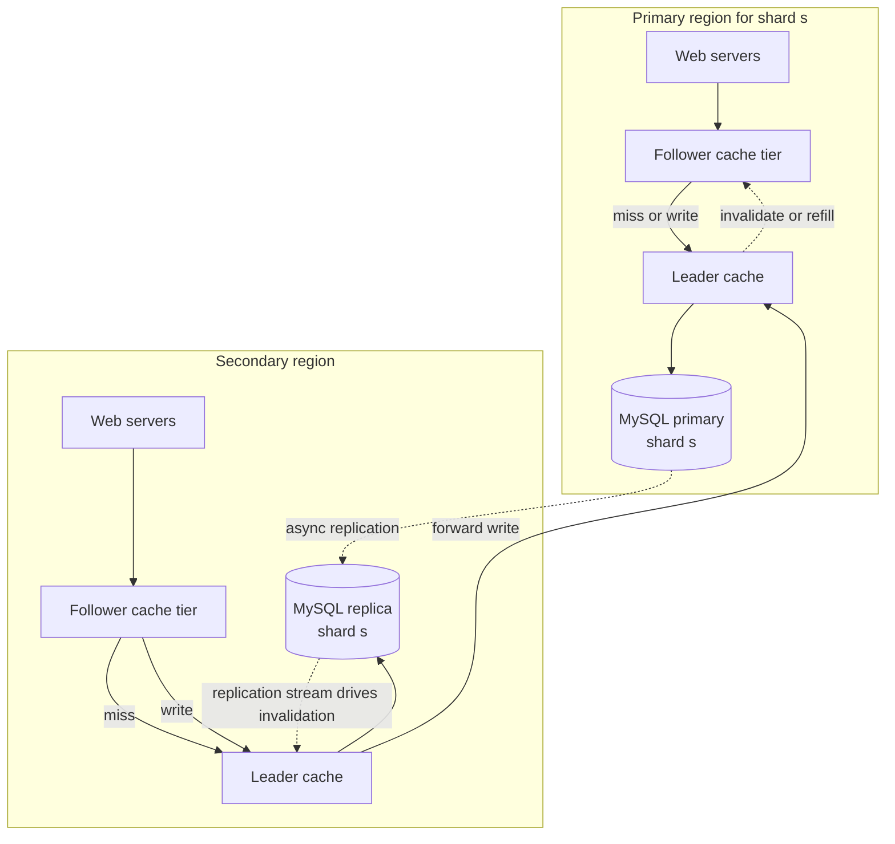

**Reading the diagram.** Web servers read from a **follower** cache tier; there are several follower tiers per region, each holding all shards, so read capacity scales by adding tiers. A follower miss or any write goes to the shard's **leader** cache, the only cache that talks to the database for that shard, which protects MySQL from thundering herds. In the shard's **primary region**, the leader writes to the MySQL primary and then sends asynchronous invalidation or refill messages (dotted) to followers. In a **secondary region**, writes are forwarded to the primary region's leader (synchronous, cross-region), while reads are served locally from a MySQL replica; invalidations there are driven by the replication stream, so a region's caches are invalidated only after its replica has the change. The follower that handled a write updates its own copy immediately, giving the writer read-after-write consistency within its tier, while other tiers converge asynchronously. Failure points: a leader failure (reads route around it to the database or another leader; writes queue), replication lag (secondary regions read slightly stale data), and cross-region write latency. Scaling: add follower tiers for reads, shards for data, leaders per shard for database protection.

The API is shaped by the data model: `assoc_range(42, friend, 0, 50)` returns the newest 50 friends; `assoc_count(9001, liked_by)` returns a stored count, not a scan; `assoc_time_range` serves "posts by 42 in the last two days". Because association lists are time-ordered and most reads touch the newest entries, caching the head of each list captures most traffic. The design inherits Memcache's lessons, including leases against stale sets and stampedes [Nishtala et al. 2013] (§20.7, §20.11).

#### Ranking: staged to control cost

Scoring 1,000 candidates with a large model for 694,000 loads/s is about 694 million model evaluations per second. The standard answer, treated in Chapter 68, is a funnel: **candidate retrieval** (leaves return a few thousand actions), **light ranking** (a cheap model or heuristic prunes to a few hundred), **heavy ranking** (a model predicting probabilities of actions such as like, comment, share or hide, combined into one value), and a **final pass** for diversity, integrity demotions and de-duplication of stories about the same object. Facebook has published a description of this approach, predicting multiple engagement outcomes per candidate and combining them into a relevance score [Lada et al. 2021]. If heavy ranking overloads, serve the light-ranked order: a less personalized feed is better than none.

### 53.7.9 Data flow

**Figure 53.15 — Write path: a user publishes a post.**

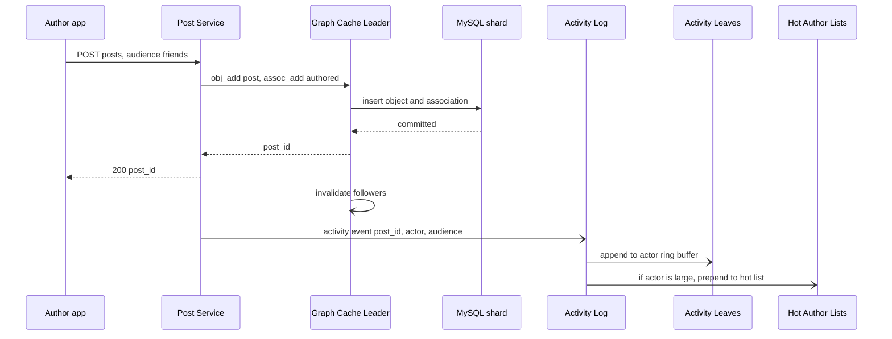

**Reading the diagram.** The post is written synchronously through the graph cache's leader into the author's MySQL shard; the author gets a `post_id` as soon as it commits, and their own profile reads it back through the same follower tier (read-your-writes). Everything else is asynchronous: cache followers are invalidated, an activity event goes to a log partitioned by actor, and the leaf that owns the actor appends the action to its in-memory ring buffer, making it a feed candidate for all friends within seconds. For very large accounts, the event also updates a hot author list. Note what does *not* happen: no per-follower writes. Failure points: if the activity log lags, posts appear late in feeds but are already durable; a leaf restart rebuilds its buffers by replaying two days of the log or reading recent associations from the graph.

**Figure 53.16 — Read path: loading the first page of the feed.**

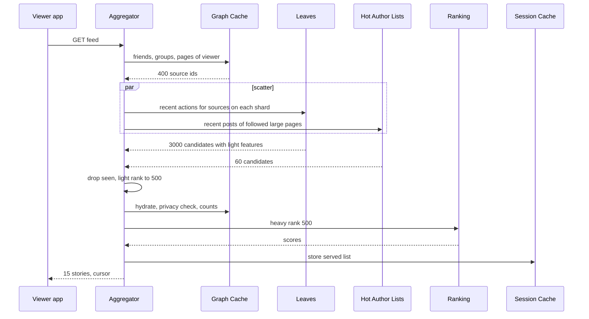

**Reading the diagram.** The aggregator reads the viewer's sources from the graph cache, then scatters in parallel to the leaf shards and the hot author lists (the `par` block). It removes stories already seen, prunes with the light ranker, hydrates the survivors, which is also where **privacy is checked against current audience settings**, and asks the heavy ranker to score them. The ranked list is stored in the session cache so the next page continues the same ordering. Failure points: the slowest leaf shard sets the latency, so aggregators use replicas and hedged requests and return partial candidates after a deadline; a ranking timeout falls back to light-ranked order; a hydration miss storm on a viral object is absorbed by leases. Scaling: aggregators scale with feed loads; leaf replicas with request rate.

### 53.7.10 Bottlenecks

1. **Leaf tail latency.** A load touches dozens of shards; the slowest sets the latency (§16.7.3). Replicas, hedging and deadlines with partial results are mandatory.
2. **Ranking compute.** Hundreds of millions of scorings per second; the light ranker and candidate caps are the levers.
3. **Viral objects in the graph cache.** One post read by millions in minutes: leases, hot-key replication across follower tiers (§20.15).
4. **Cross-region writes.** Writes from secondary regions pay a cross-region round trip to the shard's primary region (§44.4).
5. **Privacy checks** on every candidate multiply graph reads; cache audience lists and evaluate cheap rules first.

### 53.7.11 Failure scenarios

**Table 53.20 — Failure scenarios for the news feed.**

| What fails | Impact | Detection | Recovery | Prevention |
|---|---|---|---|---|
| Leaf shard slow or down | Missing or late candidates for many feeds | Per-shard latency, partial-result rate | Hedge to replica; return partial after deadline | ≥ 2 replicas per shard; restart from log replay |
| Ranking service overload | Latency SLO missed | Queue depth, timeouts | Serve light-ranked or chronological order | Load shedding by priority (§22.9) |
| Graph cache leader failure | Misses fall through to MySQL | Leader health | Route to alternate leader; queue writes | Leases; protect DB with request limits |
| Cache invalidation lost | Stale counts or deleted post visible | Consistency sampling | TTL backstop; replayed invalidations | Invalidation from replication stream |
| Activity log lag | New posts missing from feeds | Consumer lag | Catch up; leaves read graph for last minutes | Lag alerts; capacity headroom |
| Privacy check bug | Story shown to wrong audience | Audits, user reports | Kill switch on story type; purge session caches | Check at hydration time, fail closed |
| Region evacuation | Traffic shifts to other regions | Global health | Promote replicas to primary for shards | Capacity headroom per region (§44.11) |

### 53.7.12 Scaling strategy

**At 10×.** Feed loads reach about 7 million/s at peak. The leaf tier grows linearly in memory (≈ 10 TB per replica) and requests; ranking compute grows tenfold and becomes the largest cost. Changes: stronger candidate pruning (smaller heavy-ranker input), caching of ranked feeds for users who reload within minutes, and precomputing partial feeds for the heaviest readers during off-peak hours.

**At 100×.** Scatter-gather to every leaf shard stops scaling: more shards mean each request touches more servers and tail latency worsens. Changes: shard the activity index by **viewer** for the heaviest readers (a push of candidates for them, effectively a hybrid), introduce embedding-based retrieval to replace exhaustive source enumeration (Chapter 68), and partition users into regional cells with a home region (§44.6.4) so most graph reads and writes stay local.

### 53.7.13 Trade-offs

**Table 53.21 — Trade-offs in the news-feed design.**

| Decision | Chosen | Gave up | Why acceptable |
|---|---|---|---|
| Fan-out | Read-time aggregation; hot lists for large pages | One-read feeds | Ranking and privacy need read-time evaluation anyway |
| Graph store | Sharded MySQL behind a graph cache | Multi-hop graph queries | Feeds need one-hop reads at enormous rates |
| Cache consistency | Read-after-write within a tier, eventual elsewhere | Linearizable reads | A friend seeing a like 1 s late is harmless |
| Ranking | Staged funnel | Scoring every candidate with the best model | 10–100× lower compute for a small quality loss |
| Pagination | Session-cached ranked list | Always-fresh page 2 | Stable scrolling without duplicates |

### 53.7.14 Alternative designs

1. **Pure push with ranking at read.** Precompute per-user candidate lists (bounded length) and rank at read time; simpler read path, but write amplification and wasted writes for inactive users.
2. **Hybrid by follower count** (as in §53.6 and §53.8). Push for ordinary authors, pull for large ones; well suited to follower-based, chronological products.
3. **Graph database** for the social graph (§12.7). Natural for multi-hop queries, but harder to scale to this read rate; multi-hop questions are better served by offline jobs.

### 53.7.15 Interview discussion

**Table 53.22 — 45-minute pacing plan for "Design the Facebook News Feed".**

| Minutes | Activity | Output |
|---|---|---|
| 0–5 | Scope: friends vs followers, ranking, privacy | Requirements |
| 5–12 | Capacity, push vs pull math | 694 k loads/s, 4.6 M/s vs 23 M/s inserts, 100 s burst |
| 12–20 | Architecture | Figure 53.13 |
| 20–32 | Deep dive: fan-out choice | Table 53.19, per-author ratio, threshold knee |
| 32–40 | Deep dive: graph cache and ranking funnel | TAO tiers, light/heavy ranking |
| 40–45 | Failures, privacy, trade-offs | Degrade to cached or chronological feed |

Likely follow-ups: *"A celebrity posts; how quickly do followers see it?"* — Immediately on their next load, because it is pulled from a hot list. *"A user unfriends someone; when does the feed stop showing them?"* — On the next load: sources are read at request time and privacy is checked at hydration. *"How do you avoid showing a story twice?"* — Seen-set per viewer and session-cached ranked lists. *"What about a user who follows 5,000 pages?"* — Cap and prioritize sources by affinity before scattering.

A **senior** answer compares push and pull with numbers and lands on a justified hybrid or pull design. A **staff** answer shows that follower count cancels from total cost and that burstiness and inactive followers decide the threshold, sizes the in-memory index, budgets ranking compute, and keeps privacy evaluation at read time.

### 53.7.16 Production considerations

- **Observability.** Feed latency broken down by stage (graph, scatter, ranking, hydration); partial-result rate; candidate counts per stage; empty-feed rate; freshness (time from post to first impression); ranking fallback rate.
- **Security and privacy.** Privacy checks at hydration, failing closed; audit sampling of served stories against audience rules; deletion propagation within seconds to leaves, caches and session lists (§50.9).
- **Cost.** Ranking compute and leaf memory dominate; measure cost per thousand feed loads and attribute it to stages.
- **Operations.** Ranking models change weekly, so every change ships behind experiments with guardrail metrics (Chapter 68); leaves are restarted shard by shard with log replay; capacity is planned for region evacuation.

## 53.8 Twitter/X

### 53.8.1 Problem statement

Design a microblogging service in the style of Twitter (now X): users post short public messages (tweets), follow other accounts without needing approval, and read three different products built from the same stream of tweets. The **home timeline** shows tweets from followed accounts; **search** finds tweets containing words or hashtags, including tweets posted seconds ago; **trends** list the topics whose volume is rising unusually fast right now.

Think of a single river of short notes feeding three different mills. One mill sorts notes into every reader's pigeonhole (timeline); one indexes every word as the notes flow past (search); one counts how fast each word is flowing and raises a flag when a trickle becomes a flood (trends). The river is the same, but each mill needs a different machine.

The distinctive hard problem is that **one write stream feeds three read products, each with its own data structure and freshness target**: per-user timeline caches for a follower graph with an extreme heavy tail, a real-time inverted index, and streaming heavy-hitter detection over sliding windows. Feed fan-out economics were analyzed in §53.7.8; this case applies them to a follower-based, burst-prone product and uses Twitter's published architecture as the anchor.

### 53.8.2 Functional requirements

1. Post a tweet of up to 280 characters with optional media; reply, retweet (repost) and like.
2. Follow and unfollow accounts; the follow graph is asymmetric.
3. Home timeline: tweets from followed accounts, newest first (a ranked "For You" variant is discussed in §53.8.8), with pagination.
4. User timeline: an account's own tweets.
5. Search tweets by keyword, hashtag or user, with results seconds old.
6. Trends: the top 10 rising topics globally and per country, updated every few minutes.
7. Out of scope: direct messages (§53.4), media transcoding (Chapter 54), ads.

### 53.8.3 Non-functional requirements

**Table 53.23 — Non-functional requirements for the microblogging service.**

| Requirement | Target | Note |
|---|---|---|
| Availability, timeline reads | 99.99 % | The product is reading |
| Availability, posting | 99.95 % | Writes can queue briefly |
| Home timeline latency | p99 < 200 ms | Served from memory |
| Tweet delivery to followers' timelines | p99 < 5 s for ordinary accounts | Matches the published goal of the 2012 design (see callout) |
| Search freshness | Tweet searchable within 10 s | Real-time search during events |
| Trends freshness | Updated every 1–5 min | Trends are a lagging indicator by design |
| Burst tolerance | Absorb 25× average tweet rate for minutes | Published record spikes (see callout) |
| Durability | No loss of acknowledged tweets | Timelines and indexes are rebuildable; tweets are not |

::: industry
**Twitter's published scale and timeline design (2012–2013).** In a 2012 QCon talk, *Timelines at Scale*, Raffi Krikorian described the home-timeline architecture; Kleppmann's summary of the same figures is 4.6k tweets/s on average and over 12k/s at peak against about 300k home-timeline reads/s, with each tweet delivered to about 75 followers on average, so 4.6k tweets/s became about 345k writes/s into home-timeline caches [Krikorian 2012; Kleppmann 2017]. Third-party summaries of the talk add that each active user's home timeline was a list of tweet IDs in a Redis cluster capped at 800 entries and replicated three times, that fan-out could take minutes for accounts with tens of millions of followers, and that tweets from the largest accounts were merged in at read time rather than fanned out [High Scalability 2013]. In August 2013 Twitter reported a record of 143,199 tweets per second during a television broadcast in Japan, against a then-typical average of about 5,700 tweets/s and more than 500 million tweets per day [Krikorian 2013].
*Evidence: Primary* for the record and averages (Twitter engineering blog) and the talk; *Secondary* for the Redis details (third-party summaries of the talk).
:::

### 53.8.4 Capacity estimation

Assumptions (teaching values informed by the published figures above): 250 million DAU; 500 million tweets/day; a design burst of 150,000 tweets/s lasting 30 s; 400 million users active in the last 30 days, whose timelines are cached; an average **delivered** fan-out of 100 timeline inserts per tweet (after excluding inactive followers and large accounts); 30 home-timeline loads per DAU per day; peak-to-average ratio 3 for reads; 5 indexable entities (hashtags, phrases) per tweet; search keeps the last 7 days in memory.

::: example
**Worked example — Timeline fan-out and reads.**

1. Tweets: $500 \times 10^6 / 86{,}400 \approx 5{,}790$/s average, consistent with the published 5,700.
2. Timeline inserts: $500 \times 10^6 \times 100 = 5 \times 10^{10}$/day ≈ **579,000/s** average.
3. Burst: 150,000 tweets/s × 100 = 15 million inserts/s. Over 30 s, $150{,}000 \times 30 \times 100 = 450$ million inserts. With a fan-out tier provisioned for 2 million inserts/s, the backlog drains in $450 \times 10^6 / 2 \times 10^6 = 225$ s: delivery is minutes late during the spike, while posting itself stays fast because fan-out is asynchronous.
4. Timeline reads: $250 \times 10^6 \times 30 = 7.5 \times 10^9$/day ≈ 86,800/s average, **260,000/s at peak**.
5. Timeline cache: 400 million users × 800 entries × 16 bytes (tweet ID, author ID and flags) = **5.1 TB**; 15.4 TB at three replicas, in memory.

*Interpretation.* The cache is modest; the write rate and its bursts are the challenge. *Engineering implication.* Decouple posting from fan-out with a durable queue, size fan-out for sustained load plus a drain target, not for the peak second.
:::

::: example
**Worked example — Search index and trends.**

1. Search corpus: 7 days × 500 million = 3.5 billion tweets. At 15 indexed terms per tweet and about 4 bytes per compressed posting (§16.3.4–§16.3.5), $3.5 \times 10^9 \times 15 \times 4 = 210$ GB per index replica: an in-memory index fits on a modest cluster.
2. Trend entities: $500 \times 10^6 \times 5 = 2.5 \times 10^9$/day ≈ 28,900/s average; 750,000/s during a 150,000 tweets/s burst.
3. Count-Min sizing per 5-minute window (§17.6.1): $N \approx 28{,}900 \times 300 = 8.7$ million events. With $\varepsilon = 10^{-5}$ the error bound is about 87 counts; $w = \lceil e / 10^{-5} \rceil = 271{,}829$ and, for $\delta = 0.001$, $d = \lceil \ln 1{,}000 \rceil = 7$, so 1.9 million 4-byte counters ≈ **7.6 MB** per window.
4. Keeping 12 five-minute windows plus 24 hourly windows for the baseline: 36 sketches ≈ 274 MB per region of interest.

*Interpretation.* Search and trends are small in bytes but strict in freshness. *Engineering implication.* Both are in-memory streaming systems fed by the tweet log, not queries against the tweet database.
:::

**Table 53.24 — Capacity summary for the microblogging service.**

| Quantity | Value |
|---|---|
| Tweets | 5,790/s average; 150,000/s design burst |
| Timeline inserts | 579,000/s average; 450 M backlog per 30 s burst, drained in ≈ 4 min |
| Home-timeline reads | 86,800/s average; 260,000/s peak |
| Timeline cache | 5.1 TB (15.4 TB at RF 3) |
| Search index (7 days) | ≈ 210 GB per replica |
| Trend entities | 28,900/s average; Count-Min ≈ 7.6 MB per 5-min window |

### 53.8.5 API design

```text
POST /2/tweets                {text, media_ids?, reply_to?, client_tweet_id}   → {tweet_id}
DELETE /2/tweets/{tweet_id}
GET  /2/timeline/home?max_id=<tweet_id>&since_id=<tweet_id>&count=20
                              → {tweets: [...], newest_id, oldest_id}
GET  /2/users/{id}/tweets?max_id=&count=20
GET  /2/search?q=<query>&max_id=&count=20&mode=latest|top
GET  /2/trends?location=<woeid>  → [{name, tweet_volume_estimate, rank}]
POST /2/users/{id}/following  {target_user_id}
```

Pagination uses `max_id` and `since_id`: because tweet IDs are Snowflake IDs that sort by time (§17.10.3), "older than X" and "newer than Y" are ID comparisons, stable even when new tweets arrive during scrolling [Twitter 2010].

### 53.8.6 Data model and database schema

```text
# Tweet store (system of record): key-value / wide-column, sharded by tweet_id
tweet/{tweet_id} -> {author_id, text, created_at, reply_to, media[], entities[]}

# User timeline: sharded by author, newest first
user_tweets/{author_id} -> sorted set of tweet_id (desc)

# Social graph: both directions, sharded by the first ID
following/{user_id} -> set of user_id
followers/{user_id} -> set of user_id      # used by fan-out; huge for large accounts

# Home timeline cache (in memory, active users only)
home/{user_id} -> list of (tweet_id, author_id, flags), capped at 800

# Large-account registry
large/{author_id} -> true                  # authors excluded from fan-out
```

The tweet store needs high write throughput, point reads by ID and no joins: a wide-column or key-value store (§12.4, §12.6). The home timeline is a **cache**, not a source of truth: it can be rebuilt from the graph and the user timelines, so it lives in memory with replication for availability rather than durability. The follower lists of large accounts are read once per tweet by fan-out and must be paged in chunks.

### 53.8.7 High-level architecture

**Figure 53.17 — High-level architecture of the microblogging service.**

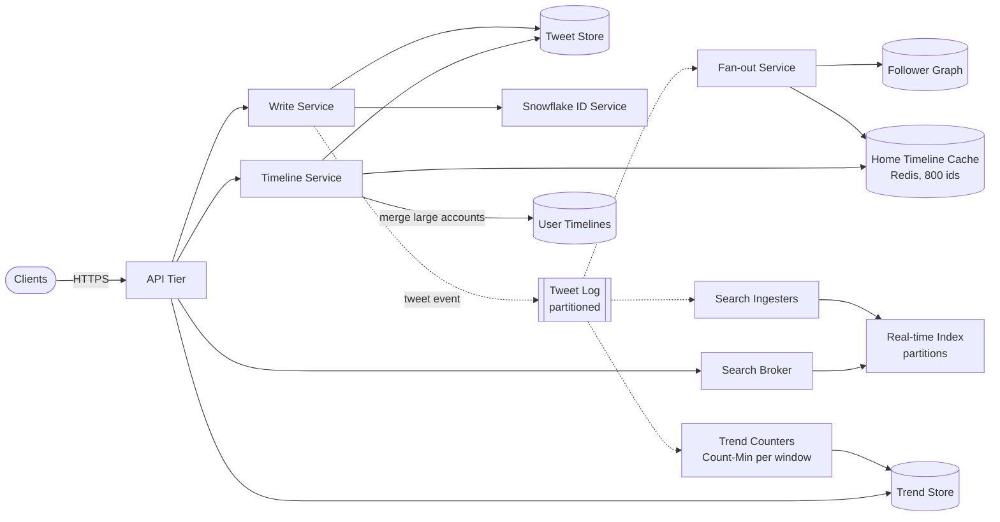

**Reading the diagram.** A tweet is written synchronously to the **tweet store** with a **Snowflake ID** and acknowledged; a tweet event is then appended to a partitioned **tweet log**, the single river that feeds three asynchronous consumers (dotted). The **fan-out service** reads the author's followers from the **follower graph** and inserts the tweet ID into each active follower's **home-timeline cache**, skipping registered large accounts. **Search ingesters** tokenize tweets into in-memory **real-time index** partitions, and **trend counters** update per-window sketches that periodically publish to the **trend store**. On the read side, the **timeline service** reads a user's cached ID list, merges in recent tweets from followed large accounts' **user timelines**, and hydrates tweet bodies; the **search broker** scatters queries to index partitions and merges results (§16.7). Failure points: the log is the backbone (a log outage stops all three products from updating, though posting can continue if the store is up); fan-out lag delays timelines; an index partition loss reduces search recall until a replica takes over. Scaling: each consumer scales independently by adding partitions and instances.

### 53.8.8 Detailed component design

#### Home timeline: push with read-time merge for large accounts

The design applies §53.7.8 to a follower graph. Ordinary accounts' tweets are pushed: the fan-out service pages through the follower list in chunks (for example 5,000 at a time), issues pipelined `LPUSH` + `LTRIM 0 799` commands per follower to the shard holding that follower's list, and skips followers whose timelines are not cached (inactive for 30 days). Large accounts, above a follower threshold, are not fanned out; at read time the timeline service fetches the newest tweet IDs from the user timelines of the large accounts the reader follows and merges them with the cached list by ID order, which is time order because IDs are Snowflakes.

Three details matter in production:

1. **Cache misses rebuild.** A user returning after 30 days has no cached list; the timeline service rebuilds it by merging the recent user timelines of everyone they follow (a pull, once), then writes it back.
2. **Deletes and unfollows** are handled at read time: hydration drops deleted tweets and tweets from accounts no longer followed, and the list is cleaned lazily. Fan-out is never "undone" eagerly.
3. **Burst handling.** The tweet log absorbs spikes; fan-out workers drain it at a provisioned rate, and partitions are keyed by author so that one account's tweets stay in order.

::: concept
**Key insight — The timeline cache is an index, not a database.** It stores only IDs, only for active users, only the newest 800, and it can always be rebuilt from durable sources. That is what makes it cheap to hold in memory and safe to lose a replica of.
:::

The ranked "For You" timeline, which Twitter published in 2023, changes the read path rather than the write path: candidates come from in-network sources (accounts the user follows) and out-of-network sources (recommendations), and the published description extracts about 1,500 candidates per request and ranks them with a neural network of about 48 million parameters before applying filters and heuristics [Twitter 2023]. The funnel is the one sketched in §53.7.8 and detailed in Chapter 68.

#### Real-time search

Search over recent tweets has the opposite shape to web search: the corpus is small but changes every millisecond, and users want results seconds old, sorted mostly by time. Twitter's published system, **Earlybird**, kept recent tweets in in-memory inverted indexes partitioned by document across many servers, with a front end scattering queries and merging results; indexing used a single writer with many concurrent readers per index segment, coordinated by memory barriers rather than locks, so that tweets were searchable within about 10 seconds [Busch et al. 2012] (see also §16.7).

The teaching design follows that shape:

1. **Partition by time, then by document.** Each index partition covers a time slice; within a slice, tweets are hash-partitioned across servers. New tweets go to the current slice; old slices are frozen, compacted and eventually dropped from memory to a disk-based archive index.
2. **Postings in arrival order.** Because tweet IDs increase with time, appending to postings lists keeps them sorted by recency for free; a "latest" query walks postings backward and stops after $k$ hits (§16.5.6).
3. **Single writer, many readers.** One ingest thread per segment appends postings and publishes a "max visible document" pointer after each batch; readers never see a half-written posting. This avoids locks on the hot path, which is what makes 10-second freshness compatible with high query rates.
4. **Scatter-gather with deadlines.** The broker queries all partitions of the recent time slices in parallel and returns what arrived before the deadline (§16.7.3); "top" mode adds a lightweight relevance score (engagement, author quality) at merge time.

#### Trends: heavy hitters over sliding windows

A trend is not the most frequent topic ("#music" is always frequent) but the one whose rate has risen most against its own baseline. Three components compute it:

1. **Counting.** Trend counters consume the tweet log, extract entities and update a Count-Min sketch for the current 5-minute window, plus a small heap of candidate heavy hitters (§17.6.2). Sketches from parallel counters merge by addition.
2. **Windows.** Closed windows are retained: the last 12 (one hour) for the "now" rate and hourly windows for a 24-hour baseline (sliding windows, §29.8.2).
3. **Scoring.** For each candidate, compare the current count with the baseline mean using a variance-aware score, filter spam and near-duplicates, and publish the top $k$ per location every minute.

::: formula
**Trend score (Poisson-style z-score)**

$$z = \frac{c_{\text{now}} - \bar{c}_{\text{base}}}{\sqrt{\bar{c}_{\text{base}} + 1}}$$

| Symbol | Meaning | Units |
|---|---|---|
| $c_{\text{now}}$ | Count of the term in the current window | mentions/window |
| $\bar{c}_{\text{base}}$ | Mean count per window over the baseline windows | mentions/window |
| $z$ | Standardized surprise; higher means more unusual | dimensionless |
| $+1$ | Smoothing so that brand-new terms do not divide by zero | mentions/window |
:::

::: example
**Worked example — A new topic beats a large steady one.**

1. "#music": $c_{\text{now}} = 420$, $\bar{c}_{\text{base}} = 400$: $z = 20 / \sqrt{401} \approx 1.0$. Large, but not trending.
2. "#eclipse": $c_{\text{now}} = 180$, $\bar{c}_{\text{base}} = 0$: $z = 180 / \sqrt{1} = 180$. Small, but extremely unusual.
3. "#football": $c_{\text{now}} = 400$, $\bar{c}_{\text{base}} = 250$: $z = 150 / \sqrt{251} \approx 9.5$. A genuine rise on a large base.

*Interpretation.* Dividing by the square root of the baseline (the standard deviation of a Poisson count) lets small, sudden topics compete fairly with large ones. *Engineering implication.* Require a minimum absolute count and a Count-Min error bound well below it (87 counts in §53.8.4, so require, say, at least 500), or sketch noise will create false trends.
:::

```python
import math
import random
from collections import Counter, deque

class TrendDetector:
    """Counts terms in fixed windows; scores the newest window against a baseline."""
    def __init__(self, baseline_windows=12):
        self.current = Counter()
        self.history = deque(maxlen=baseline_windows)   # older windows, newest last

    def add(self, term):
        self.current[term] += 1

    def close_window(self):
        self.history.append(self.current)
        self.current = Counter()

    def top(self, k=3, min_count=50):
        *base, now = self.history
        scores = {}
        for term, c in now.items():
            if c < min_count:
                continue                                 # ignore tiny counts: too noisy
            mean = sum(w[term] for w in base) / len(base)
            scores[term] = (c - mean) / math.sqrt(mean + 1)   # Poisson-style z-score
        return sorted(scores.items(), key=lambda kv: -kv[1])[:k]

random.seed(1)
steady = {"#music": 400, "#news": 300, "#football": 250}       # per-window rates
det = TrendDetector()
for window in range(13):
    for term, rate in steady.items():
        for _ in range(random.randint(int(rate * 0.9), int(rate * 1.1))):
            det.add(term)
    if window == 12:                                           # a sudden event
        for _ in range(180):
            det.add("#eclipse")
        for _ in range(150):
            det.add("#football")
    det.close_window()

for term, z in det.top():
    print(f"{term:10s} z = {z:6.1f}")
# prints:
# #eclipse   z =  180.0
# #football  z =    9.6
# #news      z =    1.4
```

What to notice:

- `#music`, the most frequent term, does not appear among the top three: it is large but not rising.
- Exact `Counter`s keep the example readable; in production each window is a Count-Min sketch plus a candidate heap, and `top` scores only heap candidates, because a sketch cannot enumerate its keys.
- The baseline here is the previous 12 windows; a production system also compares with the same hour on previous days to avoid "trending" every morning.

### 53.8.9 Data flow

**Figure 53.18 — Write path: posting a tweet.**

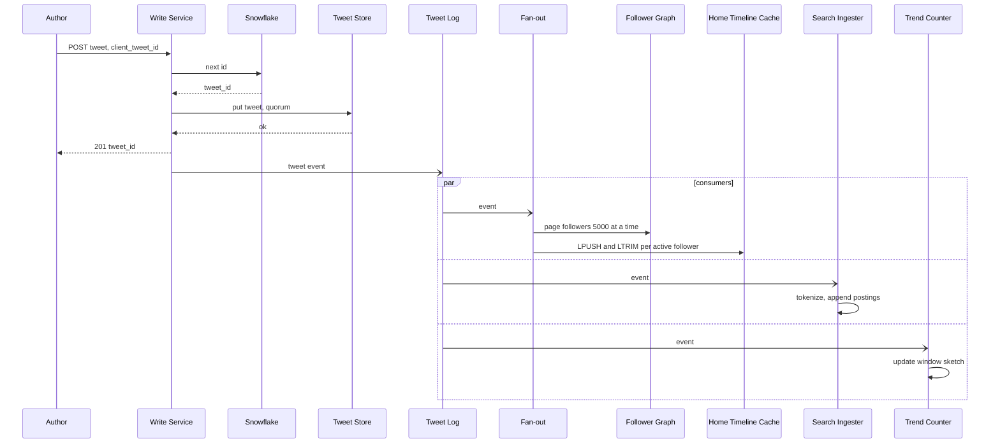

**Reading the diagram.** The author's request is synchronous only up to the durable write of the tweet with its Snowflake ID; the client gets `201` within tens of milliseconds regardless of follower count. The tweet event then feeds three independent consumers in parallel (`par` block), each at its own pace: fan-out pages through followers and pushes the ID into active followers' cached timelines (skipping large accounts entirely); the search ingester appends postings to the current index segment; the trend counter updates the current window's sketch. Failure points: a fan-out backlog delays timelines but not search or trends; a crashed consumer resumes from its committed log offset, and duplicate inserts into a timeline are removed at read time by tweet ID.

**Figure 53.19 — Read path: loading the home timeline.**

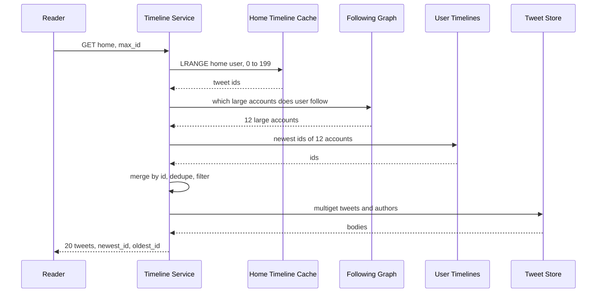

**Reading the diagram.** The timeline service reads the cached list (one memory read on one shard), looks up the few large accounts the reader follows (cached per user), reads their newest tweet IDs from user timelines, which are hot keys replicated across caches, and merges everything by ID, which is time order. It then filters deleted or blocked content and hydrates bodies with one multiget. All steps are synchronous and in memory. Failure points: a cache miss triggers a rebuild by pull (slower, once); a missing large-account read degrades to "no tweets from that account in this load"; hydration misses fall through to the tweet store.

**Figure 53.20 — Trend pipeline over sliding windows.**

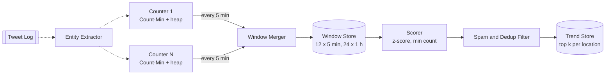

**Reading the diagram.** The entity extractor consumes tweets asynchronously and partitions entities across counter instances, each maintaining a Count-Min sketch and a candidate heap for the current window. Every five minutes the merger adds the sketches (identical hash functions make this exact) and unions the candidate heaps, storing the closed window. The scorer compares the newest window with the baseline windows, the filter removes spam bursts and near-duplicate phrasings, and the result is published per location. Failure points: a crashed counter loses one partial window, which slightly undercounts until the next window; a skewed partition is avoided by hashing entities rather than routing by location. Scaling: add counters; memory per window is fixed by $\varepsilon$ and $\delta$, not by the number of distinct terms.

### 53.8.10 Bottlenecks

1. **Fan-out bursts** during global events: the log absorbs them, and workers drain at a provisioned rate; consider temporarily raising the large-account threshold during spikes to cut inserts.
2. **Follower lists of large accounts** (tens of millions of IDs): read in pages and never fanned out.
3. **Search tail latency** across many partitions: replicas, deadlines, and fewer partitions per query by restricting "latest" queries to recent time slices.
4. **Trend manipulation:** coordinated accounts can push a term; filter by account quality and distinct-author counts (HyperLogLog per candidate, §17.5).
5. **Hot tweets** (a viral tweet read by millions): replicate the tweet body across cache shards (§20.15).

### 53.8.11 Failure scenarios

**Table 53.25 — Failure scenarios for the microblogging service.**

| What fails | Impact | Detection | Recovery | Prevention |
|---|---|---|---|---|
| Timeline cache shard lost | Its users see slow first load | Shard health, miss rate | Promote replica; else rebuild lists by pull | Three replicas; rebuild path tested |
| Fan-out backlog | Timelines minutes late | Log consumer lag | Add workers; raise large-account threshold | Provision for drain target |
| Tweet log outage | Timelines, search, trends stop updating | Produce errors | Buffer in write service; replay | Replicated log (§31.9) |
| Index partition loss | Lower search recall | Missing-partition responses | Replica takeover; rebuild from log | Replicas per partition |
| Snowflake clock step backward | ID generation pauses | Generator errors | Wait or fail over to another worker | NTP slewing (§17.10.3) |
| Trend spam attack | Bogus trend displayed | Distinct-author ratio, reports | Remove; block term | Quality filters before publish |
| Large-account read slow | Some tweets missing in a load | Merge timeouts | Return without them | Replicate hot user timelines |

### 53.8.12 Scaling strategy

**At 10×.** Timeline inserts average 5.8 million/s and the cache grows to about 51 TB at three replicas. What breaks first is burst drain time (bursts ten times larger) and memory cost. Changes: lower the large-account threshold so fewer inserts are produced, shorten cached lists for light readers, compress lists, and move cold users to rebuild-on-demand.

**At 100×.** Push becomes the exception rather than the rule: timelines become mostly ranked and assembled at read time from candidate sources, as in Twitter's 2023 description, with push retained for the in-network candidates of active users. Search moves to more time slices with tiered memory and flash; trends are computed per region with global merge.

### 53.8.13 Trade-offs

**Table 53.26 — Trade-offs in the microblogging design.**

| Decision | Chosen | Gave up | Why acceptable |
|---|---|---|---|
| Timeline | Push with large-account merge | Uniform simplicity | Bounded inserts; fast reads |
| Timeline storage | In-memory IDs, 800 cap, active users only | Unlimited scrollback from cache | Older tweets come from user timelines |
| Search | In-memory, time-partitioned index | Full history in the fast path | Users search recent events; archive serves the rest |
| Trends | Approximate counts, windowed z-scores | Exact counts | Error bound far below thresholds |
| IDs | Snowflake, time-ordered | Unpredictable IDs | Merge and paginate by ID without timestamps |
| Ordering | Approximate time order across authors | Strict global order | Clock skew of milliseconds is invisible |

### 53.8.14 Alternative designs

1. **Pure pull timelines.** Simpler writes, no backlog, but each read merges hundreds of user timelines; viable with an in-memory index as in §53.7.
2. **General-purpose search engine** (Elasticsearch with a 1 s refresh, §16.10). Easier to operate, adequate at smaller scale; harder to reach high ingest and query rates with second-level freshness on a fast-changing corpus.
3. **Exact counting for trends** with a stream processor keyed by term (§29.9). Exact, but memory grows with distinct terms, which spam can inflate without bound.

### 53.8.15 Interview discussion

**Table 53.27 — 45-minute pacing plan for "Design Twitter".**

| Minutes | Activity | Output |
|---|---|---|
| 0–5 | Scope: timeline, search, trends; ranking? | Three products, one stream |
| 5–10 | Capacity | 5.8 k tweets/s, 150 k burst, 579 k inserts/s, 260 k reads/s |
| 10–18 | Architecture | Figure 53.17 with the tweet log at the center |
| 18–30 | Timeline deep dive | Push, 800-ID cache, large-account merge, rebuild |
| 30–38 | Search and trends | Time-partitioned index; Count-Min windows, z-score |
| 38–45 | Failures and trade-offs | Bursts, cache loss, spam |

Likely follow-ups: *"A user with 100 million followers tweets; what happens?"* — Nothing fans out; followers merge the tweet at read time from the account's user timeline, which is a hot, replicated key. *"How do you show 'N new tweets' at the top?"* — Poll with `since_id`, or a lightweight push of the newest ID. *"How quickly is a tweet searchable?"* — Seconds: the ingester appends postings to the in-memory segment and publishes a visibility pointer. *"Why are trends not just the most frequent hashtags?"* — Because frequency without a baseline surfaces the same topics every day.

A **senior** answer separates the three products and explains push with large-account merge. A **staff** answer quantifies burst drain time, sizes the cache and sketches, explains why the timeline is a rebuildable index, and connects each product to the data structure and freshness it needs.

### 53.8.16 Production considerations

- **Observability.** Fan-out lag (p99 time from post to last delivered timeline), timeline cache hit ratio and rebuild rate, search indexing delay (post to searchable), query latency by partition, trend pipeline delay and the share of trends removed by filters.
- **Security and abuse.** Rate limits on posting and following (§22.3); trend and search manipulation defenses; private (protected) accounts excluded from search and public timelines at ingest and at query time.
- **Cost.** Memory for timeline caches and indexes dominates; trim cached lists, evict inactive users and keep sketches bounded.
- **Operations.** Rebuild paths for every derived structure (timelines, indexes, trend windows) must be exercised regularly by replaying the log, because they are the recovery plan.

## 53.9 Summary and revision notes

::: summary
- **Chat (§53.4):** order per conversation with a single-writer sequence number; make sends idempotent with a client message ID; treat live delivery as lossy and close gaps by ranged reads by `seq`; model receipts and unread counts as per-member watermarks (8.5× less traffic in the worked example); store messages once per conversation in a bucketed wide-column store, which becomes storage-bound, not write-bound.
- **WhatsApp (§53.5):** E2EE moves keys and history to devices; the server runs a public-key directory, relays per-device ciphertext and deletes on acknowledgment. X3DH gives asynchronous session setup, the Double Ratchet gives forward secrecy and post-compromise recovery. Multi-device multiplies ciphertexts by about $2d - 1$; sender keys make group sends $O(1)$ for the sender but membership changes cost $O(n^2 d)$. Media is encrypted on the device, uploaded once and referenced by key and hash. The server still sees metadata.
- **Instagram (§53.6):** keep image bytes off application servers with presigned uploads, asynchronous idempotent resizing and immutable CDN URLs; embed the logical shard in a time-ordered 64-bit ID; implement story expiry by filtering on read; keep per-user like state exact and counts approximate, with write coalescing for hot posts (decisive for hot keys, minor for the long tail).
- **News Feed (§53.7):** follower count cancels out of the per-author push-to-pull cost ratio; celebrities hurt push through synchronized bursts of distinct writes and wasted writes to inactive followers. Read-time aggregation over an in-memory activity index suits ranked feeds with bounded friend graphs; a TAO-style graph cache absorbs about a hundred graph reads per feed load; ranking is a staged funnel to control compute.
- **Twitter/X (§53.8):** one tweet log feeds three products: push timelines (an 800-ID rebuildable in-memory index per active user, with large accounts merged at read time), a time-partitioned in-memory inverted index for search within seconds, and trends as windowed heavy hitters scored against a baseline. Snowflake IDs make merging and paging by time an integer comparison.
- **Across cases:** separate the durable commit point from asynchronous fan-out; derive caches and indexes from a log so they can be rebuilt; size by the hottest key and the burst, not the average.
:::

## 53.10 Knowledge checkpoint

1. Why does a chat service order messages per conversation rather than globally?
2. A client receives seq 41 and then seq 43. What should it do, and why is this safe?
3. How does a `client_msg_id` prevent duplicate messages when the chat service crashes after writing but before replying?
4. Why do watermarks reduce receipt traffic, and why are they safe to retry out of order?
5. In the chat estimate, why does the database become storage-bound rather than write-bound?
6. What does the WhatsApp key directory store, and what is its one dangerous power?
7. What problem do one-time prekeys solve?
8. Distinguish forward secrecy from post-compromise security in the Double Ratchet.
9. With 1.6 devices per user, how many ciphertexts does a one-to-one message require under client fan-out?
10. Why does removing a member from a 1,024-member group cost about 1.7 million pairwise messages?
11. Why does the photo service create the post row before resizing finishes?
12. What do the 41, 13 and 10 bits of an Instagram-style ID encode, and why is the shard chosen from the author?
13. Why does write coalescing help a celebrity post enormously but the whole like system only a little?
14. Show that the per-author push-to-pull ratio does not depend on follower count. What, then, makes celebrities expensive for push?
15. What do TAO's leader and follower cache tiers each do?
16. Why is Twitter's home-timeline cache safe to lose?
17. Why does a trend score divide by the square root of the baseline count?

<details><summary>Answers</summary>

1. Users only compare order within one conversation, and per-conversation order needs one writer per conversation, which partitions perfectly; global order would need a global sequencer or consensus for every message.
2. Treat it as a gap: fetch messages after 41 from the store (or learn that 42 is a hole) before applying 43. Safe because the store is the source of truth and the client ignores duplicates by `seq`.
3. The retry carries the same `(sender, client_msg_id)`; the dedup table returns the already assigned `seq` instead of storing a second copy.
4. One watermark per member summarizes all earlier messages, so one event replaces many; they are monotonic, so `max(old, new)` makes late or duplicate updates harmless.
5. Writes are about 1 million/s (≈ 124 nodes), but storage grows by 1.31 PB/year (≈ 329 nodes after year one) and keeps growing.
6. Public identity keys, signed prekeys, one-time prekeys and signed device lists. It could substitute an attacker's key; security codes and key transparency detect this.
7. They let a sender establish a session with a recipient who is offline, with a fresh Diffie–Hellman input used only once.
8. Forward secrecy: compromising current keys does not reveal past messages (symmetric ratchet deletes old keys). Post-compromise security: after a new Diffie–Hellman exchange, an attacker who stole state loses access to future messages.
9. $d + (d - 1) = 1.6 + 0.6 = 2.2$.
10. Each of the 1,023 remaining members must send its new sender key to the other 1,022 members' devices (×1.6) and its own other devices: $1{,}023 \times (1{,}022 \times 1.6 + 0.6) \approx 1.67$ million.
11. So the author gets a `post_id` and sees the post at once from the local copy (read-your-writes), while resizing proceeds asynchronously and the post goes live to others when ready.
12. Milliseconds since a custom epoch, logical shard, per-shard sequence. The author's shard keeps a profile grid on one shard as a single range scan.
13. Coalescing reduces each key's writes to at most $1/T$; a hot post drops from thousands to one per second, but most posts receive about one like per interval and gain nothing.
14. $W/R = pF / (\alpha F r) = p / (\alpha r)$. Push turns one post into a synchronized burst of $F$ distinct writes (100 s for 100 million at 1 M/s) and writes to inactive users; pull reads one hot, cached list.
15. Followers serve reads and forward misses and writes; the leader for a shard is the only cache that queries or writes the database, sends invalidations to followers, and protects the database from stampedes.
16. It holds only IDs for active users and can be rebuilt from the follow graph and user timelines; replicas exist for availability, not durability.
17. A Poisson count's standard deviation is the square root of its mean, so the division standardizes surprise and lets small, sudden topics compete with large, steady ones.

</details>

## 53.11 Interview questions

### Basic

**Q1.** Design the "unread count" badge for a chat app with groups of up to 500 members. **Answer.** Do not store and increment counters per member. Store `last_seq` per conversation and `read_upto` per member; unread = `last_seq − read_upto` minus the user's own messages. The badge total is the sum over conversations changed since the last sync. This is exact, cheap to update (one watermark write when the user reads) and safe under retries because watermarks only increase.

**Q2.** Why should photo uploads go directly to object storage? **Answer.** A 3 MB upload over a slow mobile link holds a connection for seconds; at thousands per second that ties up application servers and memory for no benefit. A presigned URL scoped to one key, type, size and lifetime lets the client upload straight to storage, which is built for large, resumable transfers, while servers handle only metadata and validation runs asynchronously before the post goes live.

### Intermediate

**Q3.** A news feed product has 1 billion DAU, authors average 300 followers, and 1,000 accounts have more than 50 million followers. Choose a fan-out strategy. **Answer.** Compute push load: ordinary posts × 300 is affordable (a few million inserts/s), but each large-account post creates a 50-million-write burst, a minute or more of delivery skew, and many writes to inactive users. Use push below a threshold and pull for large accounts, merging at read time from a hot, replicated per-author list. Choose the threshold by measuring the knee (the simulation in §53.7.8): where pushed inserts stop falling quickly and pulled lists per load start rising. If the feed is ranked and the graph is bounded, also consider read-time aggregation over an in-memory activity index.

**Q4.** How does WhatsApp deliver media without the server being able to read it, and what does the server lose? **Answer.** The device encrypts the file with a random key, uploads the ciphertext once and sends the key, hash and pointer inside an E2E-encrypted message to each recipient device; recipients download, verify the hash and decrypt. The server cannot transcode, thumbnail, scan or deduplicate by content (only by identical ciphertext, as in forwards), so compression and thumbnails move to the device and abuse detection relies on metadata and reports.

### Advanced

**Q5.** Your chat service must add multi-region support with users in one group spread across continents. Where does ordering live? **Answer.** Each conversation has a home region holding its sequencer and primary replicas, chosen by where most members are (§44.6.4). Remote members send to the home region (one cross-region round trip for the send acknowledgment) and read from local replicas with replication lag. Moving a conversation's home requires a fenced handover of the sequencer (lease epoch) so two regions never number messages at once. Per-conversation order is preserved; there is still no global order, which no user needs.

**Q6.** Twitter's timeline fan-out falls 20 minutes behind during a global event. What do you do now, and what do you change afterward? **Answer.** Now: add fan-out workers, temporarily lower the large-account threshold so more authors are merged at read time (cutting inserts), skip timelines of users inactive for days, and make the client poll with `since_id` so it still sees new tweets through read-time merging. Afterward: provision fan-out for a drain-time target (for example, a 30 s, 25× burst drained in under 5 minutes), make the threshold dynamic on lag, and alert on lag before users notice.

## 53.12 Practical exercises

1. **Sequencer failover.** Extend the §53.4.8 code so the server leases blocks of 100 sequence numbers and a crash discards the rest of the block. Change `Device` so it asks the server which numbers in a gap exist, and test that clients step over holes without stalling.
2. **Ciphertext calculator.** Write a script that, for $d \in \{1, 1.5, 2, 3\}$ and $n \in \{10, 100, 256, 1{,}024\}$, prints per-message uploads and deliveries and the re-key cost after a removal. At what group size does the re-key cost exceed one day of that group's normal traffic, assuming 200 messages per day?
3. **Counter coalescing.** Simulate a Zipf-distributed stream of likes over one million posts and measure database writes for flush intervals $T \in \{0.1, 1, 10\}$ s. Plot the reduction for the top 100 posts versus all posts.
4. **Fan-out knee.** Re-run the §53.7.8 simulation with Pareto shapes 1.1, 1.5 and 2.0. How does the best threshold move as the tail gets heavier?
5. **Trends with sketches.** Replace the `Counter` windows in §53.8.8 with Count-Min sketches (width 2,000, depth 4) plus a top-k heap. Measure false trends caused by sketch noise as you lower `min_count`.

## 53.13 Design challenges

1. **Slack-style workspace chat.** Channels with up to 100,000 members, threads, edits and enterprise retention policies. Decide how ordering works for threads inside channels, how to keep "unread" cheap for huge channels and how retention deletes data that is also in search indexes.
2. **E2EE for 10,000-member communities.** Compare sender keys with MLS for this size, estimate re-key traffic under 1 % daily churn, and design how new members obtain recent history without the server reading it.
3. **Live-event feed.** A sports app where 50 million users follow one match and 1,000 commentators post during it. Design delivery so every fan sees a post within 2 s, and explain why neither pure push nor pure pull works.

## 53.14 References

1. Bronson, N., Amsden, Z., Cabrera, G., Chakka, P., Dimov, P., Ding, H., Ferris, J., Giardullo, A., Kulkarni, S., Li, H., Marchukov, M., Petrov, D., Puzar, L., Song, Y. J., Venkataramani, V. *TAO: Facebook's Distributed Data Store for the Social Graph*. USENIX ATC, 2013. https://www.usenix.org/conference/atc13/technical-sessions/presentation/bronson
2. Nishtala, R., et al. *Scaling Memcache at Facebook*. USENIX NSDI, 2013. https://www.usenix.org/conference/nsdi13/technical-sessions/presentation/nishtala
3. Busch, M., Gade, K., Larson, B., Lok, P., Luckenbill, S., Lin, J. *Earlybird: Real-Time Search at Twitter*. IEEE ICDE, 2012.
4. Kleppmann, M. *Designing Data-Intensive Applications*, Chapter 1. O'Reilly Media, 2017.
5. Marlinspike, M., Perrin, T. *The X3DH Key Agreement Protocol*. Signal specification, 2016. https://signal.org/docs/specifications/x3dh/
6. Perrin, T., Marlinspike, M. *The Double Ratchet Algorithm*. Signal specification, 2016. https://signal.org/docs/specifications/doubleratchet/
7. WhatsApp. *WhatsApp Encryption Overview: Technical White Paper*. WhatsApp, 2016 (updated versions since). https://www.whatsapp.com/security/
8. WhatsApp. *End-to-end encryption* (announcement). WhatsApp blog, April 2016. https://blog.whatsapp.com/
9. WhatsApp. *Two Billion Users — Connecting the World Privately*. WhatsApp blog, February 2020. https://blog.whatsapp.com/
10. WhatsApp. *1 million is so 2011*. WhatsApp blog, 2012. https://blog.whatsapp.com/1-million-is-so-2011
11. Reed, R. *Scaling to Millions of Simultaneous Connections*. Erlang Factory SF Bay Area, 2012. https://www.erlang-factory.com/upload/presentations/558/efsf2012-whatsapp-scaling.pdf
12. Reed, R. *That's 'Billion' with a 'B': Scaling to the Next Level at WhatsApp*. Erlang Factory SF Bay Area, 2014. https://www.erlang-factory.com/sfbay2014/rick-reed
13. High Scalability. *How WhatsApp Grew to Nearly 500 Million Users, 11,000 Cores, and 70 Million Messages a Second*. 2014. https://highscalability.com/how-whatsapp-grew-to-nearly-500-million-users-11000-cores-an/
14. Meta Engineering. *How WhatsApp enables multi-device capability*. Engineering at Meta, July 2021. https://engineering.fb.com/2021/07/14/security/whatsapp-multi-device/
15. Meta Engineering. *How WhatsApp is enabling end-to-end encrypted backups*. Engineering at Meta, 2021.
16. Meta Engineering. *Deploying key transparency at WhatsApp*. Engineering at Meta, 2023.
17. Barnes, R., Beurdouche, B., Robert, R., Millican, J., Omara, E., Cohn-Gordon, K. *The Messaging Layer Security (MLS) Protocol* (RFC 9420). IETF, 2023. https://www.rfc-editor.org/rfc/rfc9420
18. Facebook Engineering. *Building Mobile-First Infrastructure for Messenger*. Engineering at Meta, October 2014. https://engineering.fb.com/2014/10/09/production-engineering/building-mobile-first-infrastructure-for-messenger/
19. Facebook Engineering. *Serving Facebook Multifeed: Efficiency, performance gains through redesign*. Engineering at Meta, March 2015. https://engineering.fb.com/2015/03/10/production-engineering/serving-facebook-multifeed-efficiency-performance/
20. Lada, A., Wang, M., Yan, T. *How machine learning powers Facebook's News Feed ranking algorithm*. Engineering at Meta, January 2021.
21. Discord. *How Discord Stores Billions of Messages*. Discord blog, 2017. https://discord.com/blog/how-discord-stores-billions-of-messages
22. Discord. *How Discord Stores Trillions of Messages*. Discord blog, 2023. https://discord.com/blog/how-discord-stores-trillions-of-messages
23. Slack Engineering. *Scaling Datastores at Slack with Vitess*. Slack Engineering blog, 2020.
24. Instagram Engineering. *Sharding & IDs at Instagram*. Instagram Engineering blog, 2012. https://instagram-engineering.com/1cf5a71e5a5c
25. Instagram Engineering. *Instagration Pt. 2: Scaling our infrastructure to multiple data centers*. Instagram Engineering blog, 2015. https://instagram-engineering.com/instagration-pt-2-scaling-our-infrastructure-to-multiple-data-centers-5745cbad7834
26. Instagram. *See the Moments You Care About First*. Instagram blog, March 2016.
27. Krikorian, R. *Timelines at Scale*. QCon San Francisco, 2012 (video on InfoQ). https://www.infoq.com/presentations/Twitter-Timeline-Scalability
28. Krikorian, R. *New Tweets per second record, and how!* Twitter Engineering blog, August 2013.
29. High Scalability. *The Architecture Twitter Uses to Deal with 150M Active Users, 300K QPS, a 22 MB/S Firehose, and Send Tweets in Under 5 Seconds*. 2013. https://highscalability.com/the-architecture-twitter-uses-to-deal-with-150m-active-users/
30. Twitter. *Announcing Snowflake*. Twitter Engineering blog, 2010; archived code at https://github.com/twitter-archive/snowflake
31. Twitter. *Twitter's Recommendation Algorithm*. Twitter Engineering blog, March 2023. https://blog.twitter.com/engineering/en_us/topics/open-source/2023/twitter-recommendation-algorithm

## 53.15 Open verification items

- WhatsApp: 30-day retention of undelivered messages (privacy policy wording); Noise-based transport and media-encryption details against the current white paper; group limit of 1,024 (November 2022) confirmed only via news reports; 2014 server counts (≈ 550 servers, ≈ 150 chat servers at ≈ 1 M connections) from a third-party summary.
- Meta posts on encrypted backups (2021) and key transparency (2023): exact titles and URLs not fetched.
- Twitter: Redis timeline details (800 cap, three replicas) from secondary summaries; exact title/URL of Krikorian's August 2013 post; 2023 algorithm figures (1,500 candidates, ~48 M parameters) seen only in search snippets.
- Facebook: Multifeed 40 %/10 % figures and the 2012 "≈ 40 requests per query" detail (secondary); author list and URL of Lada et al. 2021.
- Discord 2023: 177 → 72 nodes confirmed via secondary summaries.
- Instagram 2016 ranked-feed post title; Instagram 2015 like-count and lease details confirmed via search snippets only.
- Capacity assumptions (DAU, messages per day, device counts) are illustrative, not company figures.
