# Chapter 54 — Case Studies III: Media and Files

> **Level:** 3–4 · **Track:** A (Traditional) · **Estimated reading time:** 5 h

Video, music and files are the heaviest, mostly immutable things people move across the Internet, and each system in this chapter has one hard problem that dominates its design. **YouTube** must transcode hundreds of hours of upload per minute cheaply enough to keep the long tail. **Netflix** must start playback in seconds while its control and data planes live in different places. **Spotify** must feel local, enforce licensing on devices it does not control, and count plays accurately enough to pay rights holders. **Google Drive** must let many people edit one document at once and decide, on every request, who may see what. **Dropbox** must keep many devices' folders identical without ever losing an edit.

## 54.1 Learning objectives

After this chapter you should be able to:

- Design a chunked, resumable upload path and a transcoding pipeline expressed as a DAG of jobs, and size its compute, storage and egress with explicit assumptions.
- Decide which codecs and renditions to produce for a video from its expected popularity, using a break-even calculation of encoding cost against delivery savings.
- Separate a streaming service into a cloud-hosted control plane and an ISP-embedded data plane, and trace the playback-start path from manifest to license to first byte.
- Apply chaos engineering and regional evacuation to a streaming control plane, and explain why running streams survive control-plane failures.
- Design client-side prefetch and caching, offline-download licensing, collaborative playlists and an exactly-once-ish play-count pipeline for a music service.
- Design a file metadata service, a relationship-based sharing model and a real-time collaborative editor, and compare operational transformation with CRDTs at a conceptual level.
- Design a file-synchronization engine: block-level chunking and deduplication, delta sync, a per-namespace change journal, conflict handling and change notification by long polling.
- Lead a 45-minute interview on any of these five systems, spending most of the time on the problem that distinguishes it.

## 54.2 Prerequisites

- Capacity estimation — Chapter 4 and §2.11; every case applies these methods.
- REST and gRPC API design — §8.6, §8.8; each case's API section uses them.
- Authorization models and Zanzibar — §8.12; Google Drive sharing applies them directly.
- Long polling, WebSockets and mobile push — §9.4, §9.6, §9.8; Dropbox change notification and Drive collaboration sessions use them.
- Encryption at rest, envelope encryption and KMS — §10.9; all five cases store user or licensed content.
- Relational and NoSQL stores — Chapters 11 and 12; metadata stores in every case.
- Partitioning and consistent hashing — §14.6–§14.8; metadata, counters and block indexes are partitioned.
- Object storage, erasure coding, multipart upload, chunking and deduplication, storage tiers — §15.4, §15.6, §15.8, §15.9; the storage layer of every case.
- Search — Chapter 16; Spotify and Drive search.
- HyperLogLog and Count-Min sketch — §17.5, §17.6; view and play counting.
- Caching and hot keys — §20.3, §20.15; metadata caching and viral content.
- CDNs, video delivery and Netflix Open Connect — §21.8, §21.10; YouTube and Netflix delivery.
- Conflict resolution and CRDTs — §27.14; Drive editing and Dropbox conflicts.
- Stream processing — §29.8–§29.9; view and play counting.
- Delivery guarantees, transactional outbox, exactly-once and idempotent consumers — §30.8, §32.5, §32.9, §32.10; counting pipelines and sync commits.
- Chaos engineering — §39.11; Netflix resilience.
- Regional failover and evacuation — §44.11; Netflix and every global control plane.
- Distributed scheduling — Chapter 46 and the job-scheduler case in §52.9; transcoding job scheduling.

## 54.3 How to use these case studies

Work each case with the method of §52.3: state the problem and its scope, pin down functional and numeric non-functional requirements, estimate capacity before drawing anything, sketch the API and data model, then draw the high-level architecture and spend most of your effort on the two or three components that make this system hard. The cases in this chapter share a storage substrate (object storage with erasure coding, §15.6) and a delivery substrate (CDNs, Chapter 21), so do not re-derive those; name them, cite them and move on to what is distinctive: the transcoding DAG for YouTube, the control-plane/data-plane split for Netflix, client caching and royalty counting for Spotify, sharing and concurrent editing for Google Drive, and the sync engine for Dropbox. Every architecture below is a teaching design labeled *Evidence: Illustrative*; facts about the real companies appear only in `industry` callouts with their published sources.

## 54.4 YouTube

### 54.4.1 Problem statement

Design a user-generated video platform in the style of YouTube: anyone can upload a video of almost any length and format from a phone or a studio, and within minutes anyone in the world can watch it at a quality matched to their device and network. The service must keep every upload forever, even though most videos are watched a handful of times while a tiny fraction are watched billions of times.

Think of a print shop that reprints every manuscript in several editions and keeps the originals forever; most sell three copies and a few sell millions, so its economics depend on not typesetting every edition up front. The hard problem is the **upload and transcoding pipeline**: a resumable upload that survives flaky mobile networks, followed by a directed acyclic graph (DAG) of encoding jobs, run in parallel over segments of the video, whose outputs are chosen according to how popular the video is likely to become.

::: definition
**Definition — Transcoding.** Decoding a video from its uploaded format (the **mezzanine** or source file) and re-encoding it into one or more target formats, each defined by a codec, a resolution, a frame rate and a target bitrate. A set of renditions of one video at increasing bitrates is a **bitrate ladder** (§21.8.1).
:::

::: definition
**Definition — Group of pictures (GOP) and closed GOP.** Encoded video consists of **keyframes** (I-frames), which can be decoded alone, and predicted frames that reference other frames. A GOP is the run of frames from one keyframe to the next. A **closed GOP** references no frame outside itself, so a segment that starts at a closed-GOP keyframe can be encoded, stored and decoded independently of its neighbors. This independence is what makes parallel segment encoding and adaptive streaming possible.
:::

### 54.4.2 Functional requirements

1. **Upload.** Authenticated creators upload files from 1 MB to 256 GB over unreliable networks; uploads resume after interruption without restarting.
2. **Process.** Each upload is validated, scanned (policy and copyright matching), transcoded into a bitrate ladder of streamable renditions, and given thumbnails, captions (automatic speech recognition) and metadata.
3. **Publish.** The creator sets title, description, visibility (public, unlisted, private) and a publish time; the video becomes watchable when the first playable rendition exists.
4. **Watch.** Viewers stream with adaptive bitrate on web, mobile and TV clients, seek anywhere, and resume where they left off.
5. **Count.** Every video shows a view count and like count; creators see analytics (views, watch time, audience retention) with a delay of minutes to hours.
6. **Discover.** Search, channel pages and recommendations (the recommender itself is Chapter 81).
7. Out of scope: live streaming (mention the differences in §54.4.14), comments, monetization and ads.

### 54.4.3 Non-functional requirements

**Table 54.1 — YouTube teaching design: non-functional targets.**

| Property | Target | Why |
|---|---|---|
| Watch availability | 99.99% of playback starts succeed | Watching is the product; 52 min/yr of total failure is the budget |
| Upload availability | 99.9% (resumable, so short outages only delay) | Creators retry; a lost upload session is the real failure |
| Playback start latency | p50 < 1 s, p99 < 2.5 s to first frame | Abandonment rises steeply with start delay |
| Rebuffer ratio | < 0.5% of watch time | Measured per session by the player |
| Time to first playable rendition | p50 < 2 min for a 10-minute video; full ladder < 30 min | Creators expect to share quickly |
| Durability of originals | 99.999999999% (11 nines) per object per year | Originals are irreplaceable; renditions can be regenerated |
| Metadata consistency | Read-your-writes for the creator; eventual (seconds) for viewers | Creators must see their edits; viewers tolerate seconds of lag |
| View counts | Eventually consistent, minutes of lag, < 0.1% error after validation | Counts are public and monetized, so spam must be filtered |

The durability target is set on originals only. A rendition is a pure function of an original and an encoding recipe, so losing one is a recompute, not a data loss. This single observation drives the storage design in §54.4.8.

### 54.4.4 Capacity estimation

All figures use decimal units (1 PB = 10¹⁵ bytes) and are teaching assumptions sized to the publicly stated order of magnitude: YouTube has said that more than 500 hours of video are uploaded every minute and, in 2017, that people watch over a billion hours a day [Goodrow 2017]. Treat both as round inputs, not current measurements.

::: example
**Worked example — Upload ingest and original storage.** Assumptions: 500 hours of video uploaded per minute; average source bitrate 10 Mb/s (mostly 1080p phone video); average video length 6 minutes.

1. Video-seconds uploaded per wall-clock second: $500 \times 3{,}600 / 60 = 30{,}000$ s/s.
2. Average ingest bandwidth: $30{,}000 \times 10$ Mb/s $= 300{,}000$ Mb/s $= 300$ Gb/s; at a 2× daily peak, 600 Gb/s.
3. Hours uploaded per day: $500 \times 60 \times 24 = 720{,}000$ h.
4. Uploads per day: $720{,}000 \times 60 / 6 = 7.2$ million videos, about 83 uploads/s on average.
5. Original bytes per day: $720{,}000 \times 3{,}600 \times 10^7 / 8 = 3.24 \times 10^{15}$ B $= 3.24$ PB/day.
6. Originals per year: $3.24 \times 365 = 1{,}183$ PB $\approx 1.18$ EB/yr of logical data; with erasure coding at 1.5× overhead (§15.6), about 1.8 EB/yr of raw disk.

**Interpretation.** The upload rate in *requests* is tiny (83/s); the upload rate in *bytes* is enormous. **Engineering implication.** Uploads must bypass application servers and go straight to an upload front end backed by object storage, and the original archive is an exabyte-per-year cold-storage problem.
:::

::: example
**Worked example — Rendition storage and transcoding compute.** Assumptions: an H.264 ladder of six renditions at 0.4, 0.8, 1.5, 3.0, 4.5 and 6.0 Mb/s (sum 16.2 Mb/s, the ladder of §21.8.2); a VP9 ladder at 60% of H.264 bitrates (sum 9.72 Mb/s); encoding cost 4 core-seconds per video-second for the whole H.264 ladder and 20 core-seconds per video-second for the VP9 ladder (VP9 encoders are slower).

1. Eager H.264 ladder bytes per day: $720{,}000 \times 3{,}600 \times 16.2 \times 10^6 / 8 = 5.25 \times 10^{15}$ B $= 5.25$ PB/day, more than the originals.
2. Eager H.264 compute: $30{,}000$ video-s/s $\times 4 = 120{,}000$ cores busy continuously, about 1,900 servers of 64 cores at 100% utilization; at a realistic 60% utilization and 2× peak, about $1{,}900 \times 2 / 0.6 \approx 6{,}300$ servers.
3. VP9 for *every* upload would add $30{,}000 \times 20 = 600{,}000$ cores, five times the H.264 cost, and another 3.1 PB/day of storage.

**Interpretation.** Encoding every codec for every upload multiplies transcoding compute by six and adds 60% to rendition storage, mostly for videos almost nobody watches. **Engineering implication.** Encode a universally playable ladder eagerly and the expensive codecs lazily, when a video's views justify them; §54.4.8 makes the break-even precise.
:::

::: example
**Worked example — Watch egress and view events.** Assumptions: 1 billion watch-hours per day; average delivered bitrate 2.5 Mb/s; average view lasts 6 minutes; the player sends a watch-time heartbeat every 30 s; peak-to-average ratio 2.

1. Average egress: $10^9 \times 3{,}600 \times 2.5 \times 10^6 / 86{,}400 = 1.04 \times 10^{14}$ b/s $\approx 104$ Tb/s; peak about 208 Tb/s.
2. Views per day: $10^9 \times 60 / 6 = 10^{10}$; average $10^{10}/86{,}400 = 115{,}700$ views/s; peak about 231,000 views/s.
3. Heartbeats per day: $10^9 \times 3{,}600 / 30 = 1.2 \times 10^{11}$; average 1.39 million/s; peak about 2.8 million events/s.
4. Playback-start API calls: one per view plus manifest fetch, about 230,000 RPS at peak; metadata reads for watch pages and lists, assume 10 per view, about 2.3 million RPS at peak, almost all served from cache.

**Interpretation.** Egress dwarfs everything else and belongs to the CDN (Chapter 21); the event stream (millions per second) is the second-largest load and drives the counting design. **Engineering implication.** Keep video bytes entirely off the origin; design view counting as a stream-processing pipeline, never as row updates per view.
:::

::: example
**Worked example — Metadata and cache size.** Assumptions: 7.2 million new videos/day; 2 KB of core metadata per video (title, description, owner, state, rendition list); 20% of each day's views go to videos uploaded in the last week; the hottest 1% of videos receive 80% of views.

1. New metadata per year: $7.2 \times 10^6 \times 365 \times 2{,}000 = 5.3 \times 10^{12}$ B $= 5.3$ TB/yr: small enough for a partitioned relational store (§14.6).
2. Total videos after ten years: about 26 billion, 53 TB of core metadata.
3. Metadata cache to cover 80% of views: 1% of 26 billion $= 263$ million videos $\times 2$ KB $\approx 530$ GB, a modest distributed cache cluster (§20.14).

**Interpretation.** Metadata is small and highly skewed. **Engineering implication.** A cache tier of a few hundred gigabytes absorbs most watch-page reads; the hard problems are hot keys for viral videos (§20.15) and keeping counts off the metadata row.
:::

### 54.4.5 API design

Uploads use a **resumable upload** protocol: the client first creates an upload session, then sends the file in chunks, each identified by its byte range, and can ask the server how many bytes it has received before resuming. Google's public APIs, including the YouTube Data API, use exactly this pattern: a POST that returns a session URI, then PUTs carrying `Content-Range` headers, with chunk sizes that are multiples of 256 KiB [Google Developers: Resumable uploads].

```text
POST /upload/v1/videos?uploadType=resumable
  Authorization: Bearer <token>
  X-Upload-Content-Length: 1572864000
  X-Upload-Content-Type: video/mp4
  { "title": "Trip", "visibility": "private", "idempotencyKey": "c1f..." }
→ 200 OK  Location: /upload/v1/sessions/us-3a91f    { "videoId": "v_8KQ2..." }

PUT /upload/v1/sessions/us-3a91f
  Content-Range: bytes 0-8388607/1572864000          (8 MiB chunk, multiple of 256 KiB)
→ 308 Resume Incomplete  Range: bytes=0-8388607

PUT /upload/v1/sessions/us-3a91f                     (status query after a disconnect)
  Content-Range: bytes */1572864000
→ 308 Resume Incomplete  Range: bytes=0-402653183     (resume from byte 402653184)

PUT ... final chunk
→ 201 Created  { "videoId": "v_8KQ2...", "processingStatus": "queued" }

GET  /v1/videos/{videoId}                     → { title, state, renditions[], viewCount, ... }
PATCH /v1/videos/{videoId}                    { title?, description?, visibility?, publishAt? }
GET  /v1/videos/{videoId}/processing          → { stage, progressPct, playable: bool }
GET  /v1/player/{videoId}?client=android&res=1080
     → { manifestUrl: "https://r4---edge.example/...m3u8?sig=...&exp=...", 
         resumeAtSec: 312, captions: [...], heartbeatUrl: "..." }
POST /v1/watch/heartbeat                      { viewId, videoId, positionSec, playedSec, ts }
POST /v1/videos/{videoId}/rating              { rating: "like" | "none" }
```

What to notice:

- The session URI, not the user's token, identifies the upload; it expires (say after a week) and is bound to the authenticated user.
- `308 Resume Incomplete` plus the `Range` header lets the client resume after any failure, including a lost response to a chunk that actually arrived.
- The player endpoint returns a **signed, expiring manifest URL** pointing at a CDN host, so authorization happens once and the CDN serves segments without calling back.
- `viewId` in heartbeats is generated by the player at playback start and is the deduplication key for counting (§54.4.8).

### 54.4.6 Data model and database schema

Video metadata is relational in shape (owner, state machine, renditions, policy flags) and needs transactions for state transitions, so a horizontally partitioned relational store partitioned by `video_id` is a good fit (§14.6–§14.7). Counts never live on this row; they live in a counter store fed by the counting pipeline. Originals and renditions live in object storage (§15.4), keyed by content-addressed or video-scoped paths.

```sql
-- Partitioned by video_id (hash); channel lookups via a secondary table partitioned by channel_id.
CREATE TABLE videos (
  video_id        CHAR(11)     PRIMARY KEY,         -- random base64url ID, not sequential
  channel_id      BIGINT       NOT NULL,
  title           VARCHAR(100) NOT NULL,
  description     TEXT,
  visibility      VARCHAR(10)  NOT NULL,            -- public | unlisted | private
  state           VARCHAR(16)  NOT NULL,            -- uploading | processing | playable | complete | blocked | deleted
  duration_ms     INT,
  source_object   VARCHAR(200),                     -- object-store key of the original
  source_sha256   BINARY(32),
  publish_at      TIMESTAMP,
  created_at      TIMESTAMP    NOT NULL,
  version         INT          NOT NULL DEFAULT 0    -- optimistic concurrency for edits
);

CREATE TABLE channel_videos (                       -- partitioned by channel_id
  channel_id  BIGINT, created_at TIMESTAMP, video_id CHAR(11),
  PRIMARY KEY (channel_id, created_at DESC, video_id)
);

CREATE TABLE renditions (                           -- co-located with videos by video_id
  video_id     CHAR(11),
  codec        VARCHAR(8),                          -- h264 | vp9 | av1 | aac | opus
  height       SMALLINT,
  bitrate_kbps INT,
  storage_tier VARCHAR(8),                          -- hot | warm | cold | absent
  manifest_key VARCHAR(200),
  PRIMARY KEY (video_id, codec, height)
);

CREATE TABLE transcode_tasks (                      -- workflow state, partitioned by video_id
  video_id    CHAR(11),
  task_id     VARCHAR(64),                          -- e.g. "enc/h264/720/seg-0042"
  depends_on  VARCHAR(64)[],
  status      VARCHAR(10),                          -- pending | leased | done | failed
  lease_until TIMESTAMP,
  attempt     SMALLINT,
  output_key  VARCHAR(200),
  PRIMARY KEY (video_id, task_id)
);
```

Counters use a key-value design in a wide-column or key-value store (§12.4, §12.6): key `views:{video_id}` → `{validated_count, last_window_end}`; key `likes:{video_id}:{user_id}` → rating, with a separately aggregated like count. Segments are stored under `renditions/{video_id}/{codec}/{height}/seg-{n}.m4s` in CMAF format (§21.8.1), so the same objects serve both HLS and DASH manifests.

::: recommendation
**Use random, non-sequential video IDs.** Sequential IDs leak upload volume and let anyone enumerate unlisted videos. An 11-character base64url ID carries 66 bits, so guessing an unlisted video is hopeless; generate it with a secure random source and retry on the rare collision (§17.10).
:::

### 54.4.7 High-level architecture

**Figure 54.1 — YouTube teaching design: upload, processing and watch paths.**

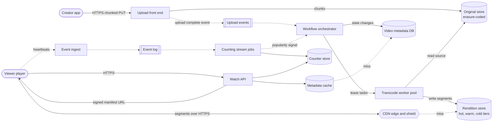

**Reading the diagram.** The *creator app* sends chunked, resumable HTTPS PUTs to the *upload front end*, which writes chunks directly into the erasure-coded *original store* (§15.6) and, when the last chunk lands, publishes an *upload complete* event asynchronously (dotted). The *workflow orchestrator* turns that event into a DAG of tasks, records state in the *video metadata DB* and hands out leases to the *transcode worker pool*, which reads the original and writes CMAF segments to the tiered *rendition store*. On the watch path, the *viewer player* calls the *watch API* synchronously; the API serves metadata from a *cache* (misses go to the database) and returns a signed manifest URL; the player then fetches segments from the *CDN*, whose misses fall through its shield to the rendition store (§21.5). Heartbeats flow asynchronously into an *event log* consumed by *counting stream jobs*, which update the *counter store* that the watch API reads, and feed popularity back to the orchestrator so that it can order more codecs for videos that take off. Storage boundaries: original store (durable, cold), rendition store (regenerable, tiered), metadata DB (transactional), counter store (eventually consistent). Failure points: the orchestrator (processing stalls but watching continues), the metadata cache (a stampede on the database), and CDN shields for viral videos. Scaling: every box except the orchestrator's state store is stateless or partitioned by `video_id`.

### 54.4.8 Detailed component design

#### Component 1 — The resumable upload front end

A phone uploading a 1.5 GB video over a cellular network will lose its connection, change IP address when it moves from Wi-Fi to cellular, and be suspended by the operating system. The upload front end therefore treats an upload as a **session** with server-side state: total length, bytes durably received, and the object-store multipart upload behind it (§15.8.1).

1. **Create session.** The client sends metadata and the total length; the front end authenticates, checks quota and file-size limits, allocates a `video_id`, starts a multipart upload in the original store, and stores the session record `{session_id, video_id, user_id, length, received, part_etags[], expires_at}` in a small replicated database.
2. **Append chunks.** Each PUT carries a byte range that must start exactly at `received`. The front end streams the bytes into the next multipart part, verifies a per-chunk checksum (CRC32C or MD5 supplied by the client), and only after the part is durable advances `received` and replies `308` with the new range. A chunk that starts anywhere else is rejected with the current range, so a client that lost a response simply resends from the server's value.
3. **Complete.** When `received == length`, the front end completes the multipart upload, computes or verifies the whole-file SHA-256, marks the video `processing`, and writes the upload-complete event through a transactional outbox (§32.5), so the event exists if and only if the state change committed.

Chunk size balances overhead against retransmission: with 8 MiB chunks, a 1.5 GB upload is 179 requests and a failure wastes at most 8 MiB; mobile clients start small and grow the chunk size while the network is good. Front ends are stateless apart from the session table, so any front end in the region can accept the next chunk; the session record pins only the region, because the multipart upload lives in that region's object store.

::: warning
**Do not proxy video bytes through application servers.** An API server that buffers a 10 GB upload in memory, or holds a thread for an hour, will fall over at 300 Gb/s of ingest. Upload front ends are a specialized, streaming tier (or presigned direct-to-object-store uploads, §15.8.2) sized for bandwidth and connection count, not request rate.
:::

#### Component 2 — The transcoding DAG and its scheduler

Processing one upload is not one job; it is a **DAG** of tasks with dependencies:

1. **Probe and validate** the source: container, codecs, duration, resolution, corruption. Reject or quarantine early, before spending compute.
2. **Split** the source at closed-GOP keyframes into segments of a few seconds to a few tens of seconds. If the source's keyframes are far apart, decode and re-split; this is why the split itself takes time.
3. **Encode** each segment into each rendition of the ladder. These are independent tasks: 60 segments × 5 renditions is 300 tasks that can run on 300 workers at once.
4. **Package** each rendition: concatenate or index the encoded segments as CMAF fragments, write HLS and DASH manifests, and verify segment durations align across renditions so that the player can switch at segment boundaries (§21.8.1).
5. **Side branches** run in parallel with encoding: audio normalization and encoding, thumbnail extraction, automatic speech recognition for captions, content-ID fingerprinting and policy classification.
6. **Publish** when the policy check has passed and at least the lowest rendition is packaged: the video becomes `playable`. Higher renditions are added to the manifest as they finish, and the state becomes `complete` when the eager ladder is done.

**Figure 54.2 — The transcoding DAG for one upload.**

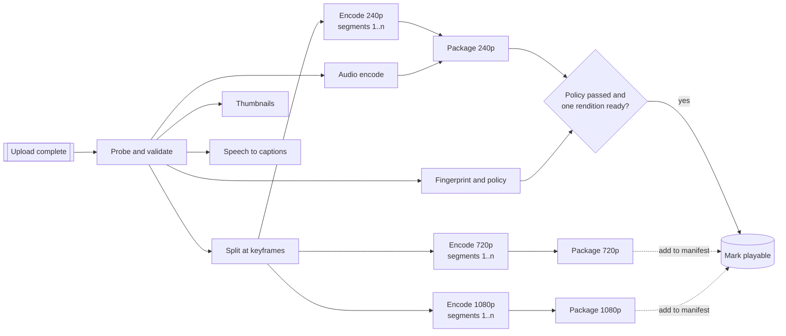

**Reading the diagram.** Each rectangle is a task the orchestrator schedules on the worker pool; arrows are dependencies, not network calls. After probing, five branches run concurrently. The split fans out into per-segment encoding tasks for every rendition (shown as one box per rendition, each standing for *n* segment tasks), which fan in at the packaging step for that rendition. The decision node joins the policy result with the first packaged rendition: only then is the video marked playable in the metadata store. Later renditions are added asynchronously (dotted) without blocking publication. Failure points: a failed segment task is retried alone; a failed probe or policy check stops the whole DAG; a straggler segment delays only its rendition. Scaling: segment tasks are the unit of parallelism, so a 3-hour upload simply has more tasks.

The orchestrator is a workflow engine (§32.11) specialized for this DAG, and the worker pool is a batch cluster managed by a cluster scheduler (Chapter 46). Its design follows the distributed job scheduler of §52.9: tasks are durable rows (`transcode_tasks` above), workers **lease** a ready task for a bounded time, renew the lease while working, and write output to a deterministic object key so that a retried task overwrites rather than duplicates. Because outputs are deterministic functions of inputs, every task is idempotent, which turns at-least-once execution into effectively-once results (§32.9).

Three policies make the difference between a pipeline that works and one that works cheaply:

- **Priority.** Tasks that unblock publication (probe, split, policy, lowest rendition) run first; higher renditions and expensive codecs fill the remaining capacity. Uploads from creators with large audiences can be given higher priority, because their first hour of views is large.
- **Straggler mitigation.** The slowest of 300 segment tasks sets the time to finish a rendition. Speculatively re-run any task that exceeds, say, three times the median duration of its siblings, and take whichever copy finishes first, as MapReduce does with backup tasks [Dean and Ghemawat 2004].
- **Preemptible capacity.** Lazy codec work has no deadline, so it runs on spare or preemptible capacity (§46.8); the short, independent segment tasks lose little when preempted.

::: formula
**Makespan bounds for parallel segment encoding (list scheduling)**

$$\max\!\left(\frac{W}{w},\; T_{\text{cp}}\right) \;\le\; T_w \;\le\; \frac{W}{w} + T_{\text{cp}}$$

| Symbol | Meaning | Units |
|---|---|---|
| $T_w$ | Makespan: time from upload complete until the last task in the DAG finishes, with $w$ workers | s |
| $W$ | Total work: sum of all task durations | core-s |
| $w$ | Number of workers (one task per worker at a time) | count |
| $T_{\text{cp}}$ | Critical path: the longest chain of dependent tasks | s |
:::

The lower bound holds for any schedule: the work must fit on $w$ workers, and dependent tasks cannot overlap. The upper bound holds for any **list scheduler**, which never leaves a worker idle while a task is ready [Graham 1969].

::: example
**Worked example — A 10-minute upload.** The source is cut into 60 segments of 10 s. Encoding one segment takes 2, 3, 5, 9 and 15 s for 240p, 360p, 480p, 720p and 1080p; the split takes 20 s and packaging each rendition 5 s.

1. Total work: $W = 20 + 60 \times (2 + 3 + 5 + 9 + 15) + 5 \times 5 = 20 + 2{,}040 + 25 = 2{,}085$ s.
2. Critical path: split, one 1080p segment, package: $T_{\text{cp}} = 20 + 15 + 5 = 40$ s.
3. One worker: $T_1 = W = 2{,}085$ s, almost 35 minutes.
4. 50 workers: bounds $\max(41.7, 40) = 41.7$ s and $41.7 + 40 = 81.7$ s.
5. 300 workers: bounds $\max(6.95, 40) = 40$ s and $6.95 + 40 = 46.95$ s.

**Interpretation.** Beyond about $W / T_{\text{cp}} \approx 52$ workers, more parallelism cannot help: the critical path dominates. **Engineering implication.** To cut latency further, shorten the critical path (faster split, shorter segments, faster per-segment encoders or hardware encoders), not the worker count; and assign more workers only to long videos, whose $W$ is larger.
:::

The simulation below runs a priority list scheduler on this DAG. It shows the second lever, priority: the 240p rendition, which makes the video playable, finishes far earlier than the full ladder.

```python
# Simulate a transcoding DAG on a pool of workers: split -> encode segments
# per rendition -> package each rendition. Lowest rendition first (priority),
# so the video becomes playable long before the full ladder finishes.
import heapq

SEGMENTS = 60                      # a 10-minute video cut into 10 s segments
RENDITIONS = {"240p": 2, "360p": 3, "480p": 5, "720p": 9, "1080p": 15}  # s per segment
SPLIT, PACKAGE = 20, 5             # seconds for the split and per-rendition packaging


def build_tasks():
    tasks = {"split": (SPLIT, [], 0)}               # name -> (duration, deps, priority)
    for prio, (r, cost) in enumerate(RENDITIONS.items()):
        segs = [f"{r}/seg{i}" for i in range(SEGMENTS)]
        for s in segs:
            tasks[s] = (cost, ["split"], prio)
        tasks[f"{r}/package"] = (PACKAGE, segs, prio)
    return tasks


def schedule(tasks, workers):
    done_at, waiting = {}, dict(tasks)
    free = [0.0] * workers                           # time each worker becomes free
    heapq.heapify(free)
    while waiting:
        ready = [(p, n) for n, (d, deps, p) in waiting.items()
                 if all(x in done_at for x in deps)]
        prio, name = min(ready)                      # lowest rendition first
        dur, deps, _ = waiting.pop(name)
        start = max(heapq.heappop(free), max((done_at[x] for x in deps), default=0.0))
        done_at[name] = start + dur
        heapq.heappush(free, done_at[name])
    return done_at


for w in (1, 50, 300):
    t = schedule(build_tasks(), w)
    print(f"workers={w:>3}  first playable (240p) at {t['240p/package']:7.0f} s  "
          f"full ladder at {max(t.values()):7.0f} s")
```

Output:

```text
workers=  1  first playable (240p) at     145 s  full ladder at    2085 s
workers= 50  first playable (240p) at      29 s  full ladder at      76 s
workers=300  first playable (240p) at      27 s  full ladder at      42 s
```

What to notice:

- With one worker the video is playable after 145 s but complete only after 2,085 s; priority alone gives a 14× faster time to playable.
- At 50 workers the full ladder takes 76 s, inside the bounds of 41.7–81.7 s; at 300 workers it takes 42 s, just above the 40 s critical path.
- The time to playable barely moves from 50 to 300 workers, because it is bounded by the split (20 s) plus one 240p segment and packaging.

::: industry
**Google's video transcoding accelerators.** Google has published the design and deployment of the Video Coding Unit (VCU), a custom accelerator deployed in its data centers for video transcoding, including YouTube uploads. The paper describes transcoding each upload into many output resolutions and formats, the importance of encoding the same source to several outputs in one pass, and a cluster-level system that schedules transcoding work across accelerators; it reports a 20–33× improvement in efficiency over the previous optimized software-encoding baseline on the authors' workloads [Ranganathan et al. 2021].
*Evidence: Primary* — [Ranganathan et al. 2021]
:::

::: industry
**Netflix chunked encoding.** Netflix has described splitting each source into chunks, encoding the chunks in parallel on large numbers of cloud instances and reassembling them, and later moving from a fixed bitrate ladder to **per-title encoding**, in which each title's ladder is chosen from an analysis of that title's complexity, so that simple content (animation) gets lower bitrates for the same perceived quality [Aaron et al. 2015].
*Evidence: Primary* — [Aaron et al. 2015]
:::

#### Component 3 — Codec ladder and storage tiers by popularity

Views follow a heavy-tailed distribution: in a typical UGC catalog, a small fraction of videos receives most of the watch time, and most videos are watched rarely after their first week. Two decisions follow from popularity.

**Which codecs to encode.** H.264 (AVC) plays on essentially every device and is cheap to encode, so the eager ladder uses it. Newer codecs such as VP9 and AV1 deliver the same perceived quality at substantially lower bitrate, which saves egress on every view, but cost several times more compute to encode. Encoding an extra codec is worth it only when the expected delivery savings exceed the encoding and storage cost.

::: formula
**Break-even views for adding a codec to a video**

$$V^{*} = \frac{C_{\text{enc}} + C_{\text{store}}}{t_w \times \Delta b \times p_{\text{egress}}}$$

| Symbol | Meaning | Units |
|---|---|---|
| $V^{*}$ | Number of future views above which the extra codec pays for itself | views |
| $C_{\text{enc}}$ | One-time cost to encode the extra ladder | $ |
| $C_{\text{store}}$ | Cost to store the extra ladder over the planning horizon | $ |
| $t_w$ | Average seconds watched per view | s |
| $\Delta b$ | Bitrate saved per second of delivery by the new codec, at equal quality | bytes/s |
| $p_{\text{egress}}$ | Delivery cost per byte | $/byte |
:::

::: example
**Worked example — When does a 6-minute video earn a VP9 ladder?** Assumptions (illustrative prices): VP9 ladder encoding costs 20 core-s per video-second at \$0.02 per core-hour; the VP9 ladder is 9.72 Mb/s in total and is kept for 12 months at \$0.01 per GB-month; an average view watches 180 s at 2.5 Mb/s; VP9 saves 35% of bitrate; delivery costs \$0.005 per GB.

1. Encode: $360 \times 20 = 7{,}200$ core-s $= 2$ core-hours $\times \$0.02 = \$0.04$.
2. Storage: $360 \times 9.72 / 8 = 437$ MB $= 0.437$ GB; $0.437 \times 0.01 \times 12 = \$0.052$.
3. Saving per view: $\Delta b = 0.35 \times 2.5 = 0.875$ Mb/s $= 109{,}375$ B/s; $180 \times 109{,}375 = 19.7$ MB $= 0.0197$ GB; $\times \$0.005 = \$0.0000984$.
4. Break-even: $V^{*} = (0.04 + 0.0525) / 0.0000984 \approx 940$ views.

**Interpretation.** A video that will receive fewer than about a thousand views is cheaper to serve in H.264 forever; above that, VP9 pays for itself, and for a video with a million views it saves about \$98 of delivery for \$0.09 of cost. **Engineering implication.** Trigger the expensive codecs from the popularity signal (early view velocity), not at upload; recompute the threshold whenever encoder efficiency (for example, hardware encoders) or delivery prices change.
:::

**Where to store renditions.** The rendition store has three tiers (§15.9):

- **Hot:** renditions of videos with recent views, replicated on fast media close to CDN shields; most CDN misses land here.
- **Warm:** erasure-coded HDD storage for videos watched occasionally; a CDN miss costs tens of milliseconds more, which the player's buffer hides after the first segments.
- **Cold:** the original only, in archival erasure-coded storage. For a video not watched for, say, two years, delete most renditions and keep the original plus one low rendition; if someone watches it, serve the low rendition immediately and re-transcode the ladder in the background. This is the payoff of treating renditions as regenerable.

A lifecycle job moves objects between tiers from per-video view statistics produced by the counting pipeline, and updates `renditions.storage_tier` so that the manifest generator only lists renditions that exist.

#### Component 4 — View counting at scale

A view count looks like `UPDATE videos SET views = views + 1`, and at 231,000 views/s with viral videos receiving tens of thousands of views per second each, that design melts a single row (§20.15). Counts are also money: creators are paid by views and watch time, and fraudsters run bots to inflate them. So view counting is a **stream-processing pipeline** with validation:

1. **Ingest.** Players send heartbeats `{viewId, videoId, positionSec, playedSec, ts}` to a stateless ingest tier, which appends them to a partitioned event log (Chapter 31) keyed by `videoId`.
2. **Sessionize and validate.** A stream job (§29.8) groups events by `viewId`, decides whether the session qualifies as a view (for example, a minimum of watched seconds), and drops sessions that look automated (impossible event rates, known bad clients, data-center IP ranges). Validation can lag; it is better to show a count a few minutes late than to show a fraudulent count and retract it.
3. **Deduplicate.** A `viewId` counts at most once, so the job keeps the set of counted `viewId`s within a window long enough to cover retries and replays (for example, 24 hours) in its state store; a replayed event with a known `viewId` is ignored (§32.10).
4. **Aggregate.** Validated views are pre-aggregated per `(videoId, minute)` inside the job, so a viral video produces one counter update per minute per partition, not 50,000 per second.
5. **Publish.** The job writes `views:{videoId}` with an idempotent "set to total as of window end" operation, not an increment, so that re-running a window after a crash produces the same value (§31.11 for Kafka transactions that make read-process-write atomic).

For approximate, cheap metrics such as unique viewers per video per day, a HyperLogLog per video (§17.5) gives about 1% error in a few kilobytes; for "top trending videos in the last hour", a Count-Min sketch with a heap finds heavy hitters without a counter per video (§17.6). The exact, monetized count stays in the deduplicated pipeline.

**Figure 54.3 — View-counting pipeline.**

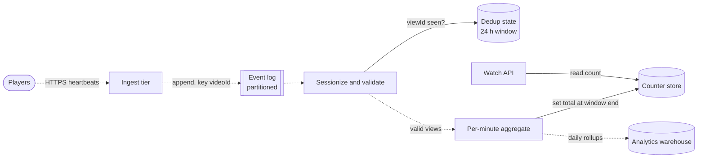

**Reading the diagram.** Players send heartbeats asynchronously to a stateless *ingest tier*, which appends them to a partitioned *event log*. The *sessionize and validate* job consumes the log, consults its *dedup state* (local to the job, checkpointed) to drop already counted `viewId`s, and emits valid views to a *per-minute aggregate*, which writes idempotent totals to the *counter store* read by the *watch API*, and daily rollups to the *analytics warehouse* for creators. Everything left of the counter store is asynchronous; only the API's read is synchronous. Storage boundaries: the log (replayable for days), the job state, the counter store and the warehouse. Failure points: a job crash (recover from checkpoint and replay the log; idempotent writes make replay safe) and a hot partition for a viral video (per-minute pre-aggregation bounds the write rate). Scaling: partition the log and the jobs by `videoId`.

### 54.4.9 Data flow

**Figure 54.4 — Write path: resumable upload to playable video.**

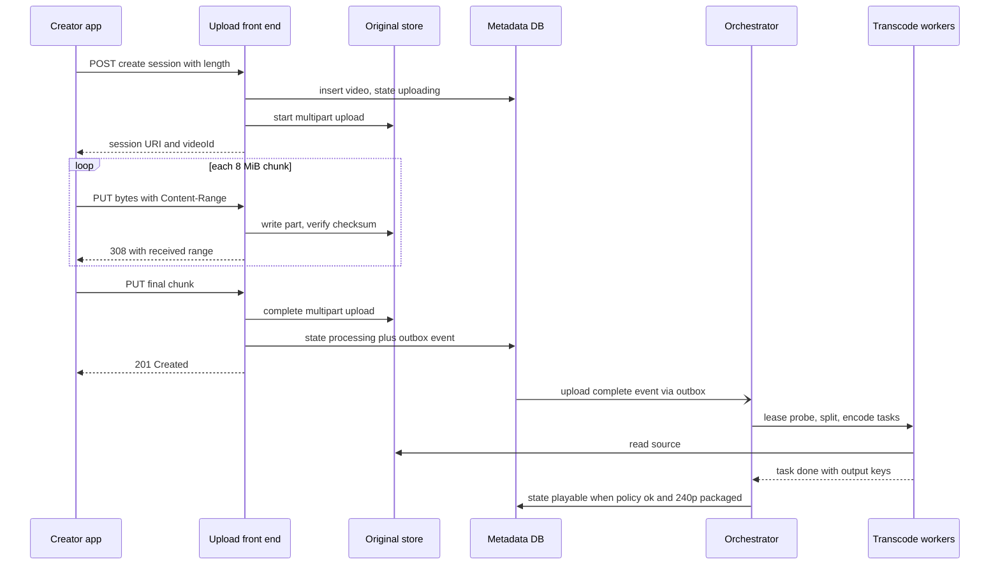

**Reading the diagram.** Session creation is synchronous and records the video in the *metadata DB* before any bytes arrive, so a crash cannot leave orphaned objects without a record. The loop appends chunks; each acknowledgment follows a durable part write. Completion commits the state change and the outbox event in one transaction; the event reaches the *orchestrator* asynchronously (open arrowhead). The orchestrator leases tasks to *workers*, which read the source and report outputs; the video becomes playable when the policy check and the first rendition are done. Failure points: a dropped chunk (client re-queries the range), a front-end crash (any other front end continues the session), a worker crash (the lease expires and the task is re-run).

**Figure 54.5 — Read path: starting playback.**

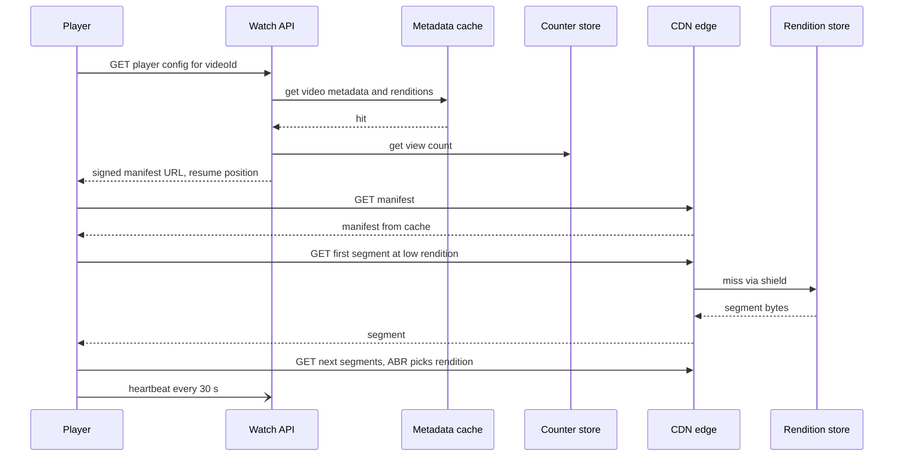

**Reading the diagram.** The *player* makes one synchronous API call to authorize and locate the video; the API reads metadata from the *cache* and the count from the *counter store*, then returns a signed manifest URL. All later requests go to the *CDN edge*; a miss travels through the shield to the *rendition store*. The player starts at a low rendition to reach first frame quickly and lets the ABR algorithm climb (§21.8.3). Heartbeats are asynchronous and never block playback. Failure points: the watch API (playback cannot start, running sessions continue), the counter store (show a stale or missing count rather than fail), a cold segment in the warm tier (slower first segment).

### 54.4.10 Bottlenecks

- **Transcoding capacity** during upload surges (holidays, major events): the queue grows and time to playable rises. Priority classes keep the critical path moving; lazy codecs are deferred.
- **Original-store write bandwidth** at 600 Gb/s peak, concentrated in regions with many creators: spread uploads across regions and storage cells.
- **CDN shield and rendition store for viral videos:** a video going from zero to millions of views in an hour has cold caches; request collapsing at shields (§20.11) and proactive promotion to the hot tier on rising view velocity prevent a miss storm.
- **Hot counter keys:** handled by per-minute aggregation; never increment per view.
- **Metadata cache stampede** after a cache node fails: use request coalescing and staggered TTLs (§20.11, §20.13).

### 54.4.11 Failure scenarios

**Table 54.2 — YouTube teaching design: failure scenarios.**

| What fails | Impact | Detection | Recovery | Prevention |
|---|---|---|---|---|
| Upload front end node | In-flight chunk fails | Client error; node health checks | Client re-queries range, continues on another node | Stateless nodes; session state in replicated DB |
| Orchestrator state store | No new tasks scheduled; uploads stuck in processing | Queue-age SLO alert | Fail over to replica; leases resume | Replicated store; idempotent tasks |
| Poison source file | Worker crashes repeatedly | Retry count per task | Quarantine after N attempts; notify creator | Probe step with sandboxed decoder |
| Encoder bug in new release | Corrupt renditions published | Automated quality checks (VMAF, decode test) on samples | Roll back encoder; re-encode affected videos from originals | Canary encoder releases (§43.6); originals immutable |
| Rendition store region loss | CDN misses fail for warm content | Shield error rates | Serve from another region; re-transcode if needed | Cross-region replication of hot tier |
| Counting job crash | Counts freeze | Consumer-lag alert | Restart from checkpoint, replay log | Idempotent writes; log retention longer than recovery time |
| Bot inflation | Fraudulent counts and payments | Anomaly detection on view velocity and sources | Retroactively discount views | Validation before publication |

### 54.4.12 Scaling strategy

**At 10×** (5,000 hours per minute of upload, 10 billion watch-hours per day): eager-encoding compute grows to about 60,000 servers on the earlier assumptions, so hardware encoders and multi-output encoding become mandatory rather than optional; the break-even threshold for advanced codecs drops as their encoding cost falls, so more videos get them. Edge egress reaches petabits per second, which requires caches embedded in ISP networks rather than only at exchange points (§21.10). Counting moves to more log partitions and per-region aggregation with a global merge.

**At 100×:** the original archive grows by more than 100 EB a year, so the archive tier itself must be cheaper: denser erasure codes, cold media, and deleting originals of rejected or abandoned uploads aggressively. The orchestrator's state store becomes the coordination bottleneck and is split into independent cells by `video_id` range (§44.10), each with its own worker pool and a global scheduler that balances only capacity between cells.

### 54.4.13 Trade-offs

**Table 54.3 — YouTube teaching design: key trade-offs.**

| Decision | Option chosen | Alternative | Why |
|---|---|---|---|
| Codecs | Eager H.264, lazy VP9/AV1 by popularity | Encode everything at upload | Most videos never reach break-even views |
| Segment length | Short (2–10 s) segments for parallelism and ABR | Whole-file encoding | Parallelism and switchability; small loss of compression efficiency at boundaries |
| Rendition durability | Regenerable, lower redundancy for cold | Same durability as originals | Saves storage; costs recompute on rare cold reads |
| View counts | Delayed, validated, deduplicated | Real-time raw increments | Correctness and fraud resistance over freshness |
| Upload path | Dedicated streaming front end | Through API servers | Bandwidth-bound tier scales independently |

### 54.4.14 Alternative designs

- **Per-title or per-shot ladders** (as Netflix describes) instead of a fixed ladder: better quality per bit, worth it for popular videos where the extra analysis compute is amortized; apply it on the lazy, popularity-triggered branch.
- **Just-in-time packaging:** store one set of CMAF segments and generate HLS or DASH manifests on request at the edge or shield; saves storage and supports new manifest formats without reprocessing.
- **Live streaming** changes the problem: encoding must keep up in real time with a fixed latency budget, segments are produced continuously, and manifests change every few seconds (§21.8.1). The DAG becomes a streaming pipeline with no retry window.

### 54.4.15 Interview discussion

**45-minute pacing plan.** 0–5 min: clarify scope (UGC, upload and watch, counts; no live, no ads). 5–10 min: capacity, emphasizing bytes versus requests and that egress belongs to the CDN. 10–15 min: API (resumable upload, player config) and data model. 15–20 min: high-level diagram. 20–38 min: the transcoding DAG, scheduling, codec ladder by popularity and storage tiers. 38–43 min: view counting and failure scenarios. 43–45 min: scaling and trade-offs.

**Likely follow-ups.**

- *How do you make the upload resumable?* Server-side session with byte offset; client queries range after failure; chunks aligned to multipart parts.
- *Why split the video?* Parallelism (latency) and independent retry; segments must start at closed-GOP keyframes.
- *How would you reduce time to playable?* Prioritize the critical path; publish at the first rendition; faster split; hardware encoders.
- *How do you keep view counts accurate?* Player-generated view IDs, validation, deduplication window, idempotent window totals.

**What distinguishes senior and staff answers.** A senior candidate draws a working DAG with idempotent tasks and resumable upload. A staff candidate quantifies the cost structure (compute versus storage versus egress), derives the popularity-driven codec decision, recognizes renditions as a regenerable cache over immutable originals, and bounds latency by the critical path rather than adding workers.

### 54.4.16 Production considerations

- **Observability.** Per-stage queue age and task latency histograms; time to playable and time to complete per video; rendition quality scores on samples; player-side quality of experience (start time, rebuffer ratio, average bitrate) aggregated by CDN, ISP and device (§40.5).
- **Security.** Uploaded files are untrusted input to complex decoders: run probe and decode in sandboxes with resource limits. Sign manifest URLs with short expiry; private videos require the signature for every segment request. Encrypt originals at rest with per-tenant envelope keys (§10.9).
- **Cost.** Egress is the largest cost, then storage, then compute; the codec break-even and tiering decisions are recomputed quarterly from real prices. Preemptible capacity for lazy encodes.
- **Operations.** Encoder releases are canaried on a sample of uploads with automated quality comparison; a re-encode campaign (for a new codec or a fixed bug) is a scheduled batch over originals, rate-limited so that it never starves fresh uploads.

## 54.5 Netflix

### 54.5.1 Problem statement

Design a subscription video service in the style of Netflix: members browse a personalized catalog of licensed and original films and series on TVs, phones and browsers, press play, and watch in high quality within a couple of seconds, at evening peaks when the service carries a large share of a country's Internet traffic.

Compared with YouTube, almost everything is inverted: the catalog is small, curated and known in advance, every title is protected by licensing contracts that demand digital rights management (DRM), and plays are enormous relative to titles. The distinctive hard problem is the **split between a control plane and a data plane**. Think of an airline: the booking system (a global software service that must always answer) decides who flies where, and the aircraft (heavy physical infrastructure placed near passengers) carry them. A booking outage stops new trips but not flights already in the air. In the teaching design, the control plane (browsing, authorization, licenses, steering) runs in several cloud regions, and the video bytes come from caches inside or next to viewers' ISPs, as with Netflix's Open Connect (§21.10). The design questions are how a play request crosses from one plane to the other, and how the control plane survives the loss of a whole cloud region.

::: definition
**Definition — Control plane and data plane.** The **control plane** is the set of services that make decisions (who may watch, which file, from which server); the **data plane** is the set of components that move the bulk bytes once decided. They are scaled, deployed and failed independently: the data plane is sized for bandwidth, the control plane for request rate and availability.
:::

::: definition
**Definition — Digital rights management (DRM) license.** A small, encrypted message issued by a license server that contains the content key (or keys) needed to decrypt an encrypted video, bound to a specific device and session and carrying usage rules (expiry, maximum resolution, offline permission). The video segments themselves are encrypted once and can be cached anywhere; only the license is personal.
:::

### 54.5.2 Functional requirements

1. Sign in, select a profile, and browse a personalized home page of rows of titles; search the catalog.
2. Press play and watch with adaptive bitrate; select audio language and subtitles; resume across devices.
3. Enforce entitlement (active membership, plan limits such as resolution and concurrent streams) and content licensing (territory windows, DRM).
4. Download selected titles for offline viewing on mobile devices, within license limits.
5. Ingest new titles from studios: receive masters, encode, quality-check, and pre-position on caches before the release time.
6. Record viewing history and playback quality telemetry.
7. Out of scope: billing, studio production tools, the recommender model itself (Chapter 81).

### 54.5.3 Non-functional requirements

**Table 54.4 — Netflix teaching design: non-functional targets.**

| Property | Target | Why |
|---|---|---|
| Play-start success | 99.99% of play attempts start | The core metric; failures are visible immediately |
| Play-start latency | p50 < 1.5 s, p99 < 4 s from press to first frame | Members abandon slow starts |
| Running-stream survival | A control-plane outage must not stop streams already playing | Data plane independent of control plane |
| Rebuffer ratio | < 0.1% of play time | Long-form viewing magnifies stalls |
| Control-plane regional failure | Evacuate a whole cloud region in < 10 min with no loss of availability | Region failures happen |
| Viewing history | Durable; read-your-writes per member; cross-device resume within seconds | Resume is a product feature |
| Release readiness | A new title fully pre-positioned in caches before release time | Launch-night peaks |
| Content security | Studio-grade DRM; no clear-text content keys outside license servers and devices | Licensing contracts |

### 54.5.4 Capacity estimation

Netflix reported more than 300 million paid memberships at the end of 2024 [Netflix 2025]. All numbers below are teaching assumptions built on that order of magnitude, not Netflix measurements.

::: example
**Worked example — Peak egress and cache fleet.** Assumptions: 300 million memberships; 50% stream on a given day (150 million daily viewers); 2 hours of viewing per viewer per day; average delivered bitrate 4 Mb/s (a mix of mobile and HD with efficient per-title encoding); evening peak is 2.5× the daily average; one cache appliance usefully serves 80 Gb/s (an illustrative figure for a 100 Gb/s-class server at 80% utilization).

1. Viewing hours per day: $150 \times 10^6 \times 2 = 3 \times 10^8$ h.
2. Average egress: $3 \times 10^8 \times 3{,}600 \times 4 \times 10^6 / 86{,}400 = 5 \times 10^{13}$ b/s $= 50$ Tb/s.
3. Peak egress: $2.5 \times 50 = 125$ Tb/s.
4. Minimum appliances at peak: $125 \times 10^{12} / (80 \times 10^9) \approx 1{,}563$; with geographic spread (every ISP needs its own), N+1 redundancy per site and room for growth, several thousand.

**Interpretation.** 125 Tb/s from a single cloud region would be impossible to buy at reasonable cost and would cross every ISP's transit links. **Engineering implication.** The data plane must be distributed to thousands of sites close to members, and the control plane must never sit on the per-byte path.
:::

::: example
**Worked example — Control-plane request rates.** Assumptions: average viewing session 40 minutes; 60 control-plane API calls per daily viewer per day (home page, rows, artwork, title details, search, playback, license, telemetry batches); peak-to-average 3×.

1. Play starts per day: $3 \times 10^8 \times 60 / 40 = 4.5 \times 10^8$; average 5,200/s; peak about 15,600 play starts/s.
2. Each play start makes at least two critical calls (playback manifest, license): about 31,000 critical RPS at peak.
3. All API calls: $150 \times 10^6 \times 60 = 9 \times 10^9$ per day; average 104,000 RPS; peak about 312,000 RPS at the edge gateway, fanning out to several times that in internal service calls.

**Interpretation.** The control plane is a large but conventional microservice system, in the range that a few cloud regions handle comfortably. **Engineering implication.** Size each region to absorb an evacuated region's share (§44.11): with three regions, each must carry 1.5× its normal peak, about 156,000 RPS instead of 104,000.
:::

::: example
**Worked example — Catalog storage and daily fill.** Assumptions: 50,000 hours of content in a territory's catalog; all encodes of a title (several codecs, ladders up to 4K, audio tracks, subtitles) sum to 40 Mb/s of stored bitrate; 100 hours of new content per day globally.

1. Catalog storage: $50{,}000 \times 3{,}600 \times 40 \times 10^6 / 8 = 9 \times 10^{14}$ B $= 900$ TB.
2. New content per day: $100 \times 3{,}600 \times 40 \times 10^6 / 8 = 1.8 \times 10^{12}$ B $= 1.8$ TB.
3. An appliance holding, say, 300 TB can hold a third of the whole catalog, enough for the popular part that serves almost all views.

**Interpretation.** The full catalog fits in roughly one rack of storage; the challenge is not capacity but choosing which files each appliance holds. **Engineering implication.** Pre-position by predicted popularity per region and fill during the off-peak window (§21.10); 1.8 TB/day of new content is small relative to the fill capacity.
:::

### 54.5.5 API design

The device talks to one edge gateway; the gateway fans out to internal services over gRPC (§8.8). The critical playback calls are:

```text
GET  /api/v1/home?profileId=p7&rows=20&cursor=...
     → { rows: [ { rowId, title, items: [ { titleId, artworkUrl, ... } ] } ], nextCursor }

POST /api/v1/playback/manifest
     { profileId, titleId, deviceId, capabilities: { codecs: ["av1","hevc","avc"],
       maxHeight: 2160, hdr: ["hdr10","dv"], drm: "widevine-l1" }, network: "wifi" }
     → { playbackSessionId: "ps_91c...", 
         streams: [ { type: "video", codec: "av1", height: 1080, kbps: 3100,
                      urls: [ "https://oca-1.isp-a.example/v/…?t=…", "https://oca-7.ix-b.example/v/…?t=…" ] }, ... ],
         audio: [...], subtitles: [...], licenseUrl: "/api/v1/license",
         bookmarkSec: 1312, expiresAt: "2026-11-05T21:13:00Z" }

POST /api/v1/license
     { playbackSessionId, drmChallenge: "<opaque bytes from the device CDM>" }
     → { license: "<opaque bytes>", maxHeight: 2160, expiresAt: ... }

POST /api/v1/events      { playbackSessionId, events: [ {type: "start"|"progress"|"stop"|"rebuffer", positionSec, ts} ] }
POST /api/v1/downloads   { profileId, titleId, deviceId }   → { downloadToken, licenseExpiresAt }
```

What to notice:

- The manifest response is **personal and short-lived**: it reflects plan, device capabilities, territory and steering, and the URLs carry signed tokens. The segment files behind those URLs are shared and long-lived.
- Each stream carries a **ranked list of cache URLs**, so the client fails over between appliances without another control-plane call.
- The license request carries an opaque challenge from the device's content decryption module (CDM); the server never sends a content key in the clear.

### 54.5.6 Data model and database schema

The control plane holds several datasets with very different access patterns, so it is polyglot (§12.13):

```sql
-- Catalog: small, read-mostly, replicated to every region; changes are published, not edited in place.
CREATE TABLE titles (
  title_id     BIGINT PRIMARY KEY,
  kind         VARCHAR(8),         -- movie | show | episode
  parent_id    BIGINT,             -- show for an episode
  runtime_s    INT,
  maturity     VARCHAR(8)
);
CREATE TABLE availability (        -- licensing windows per territory
  title_id BIGINT, country CHAR(2), starts_at TIMESTAMP, ends_at TIMESTAMP,
  offline_allowed BOOLEAN, max_downloads INT,
  PRIMARY KEY (title_id, country)
);
CREATE TABLE downloadables (       -- one row per encoded file
  file_id      BIGINT PRIMARY KEY,
  title_id     BIGINT,
  kind         VARCHAR(8),         -- video | audio | text
  codec        VARCHAR(8), height SMALLINT, kbps INT, language VARCHAR(8),
  key_id       BINARY(16),         -- DRM key identifier, the key itself is in the key store
  sha256       BINARY(32)
);
```

- **Viewing history and bookmarks** are a per-member time series with very high write rates (progress events), read mostly as "latest position per title" and "recent titles". A wide-column store partitioned by `profile_id` with clustering by time, replicated across regions with eventual consistency, fits this (§12.6); the "latest bookmark" can be a separate compact row per `(profile_id, title_id)` overwritten with last-writer-wins, which is safe because each profile watches one stream at a time.
- **Steering state**: which files each appliance holds and how healthy and loaded it is, as a map `oca_id → {site, isp_prefixes, health, load, file_ids bitmap}`. It changes every few minutes and is held in memory by the steering service, rebuilt from appliance reports.
- **Content keys** live in a hardened key store, accessible only to license servers, never in the general catalog.
- **Playback sessions**: `{playbackSessionId → profile, device, title, issuedAt}` with a TTL, used to enforce concurrent-stream limits and to tie license requests to an authorized manifest.

### 54.5.7 High-level architecture

**Figure 54.6 — Netflix teaching design: control plane in cloud regions, data plane in ISPs.**

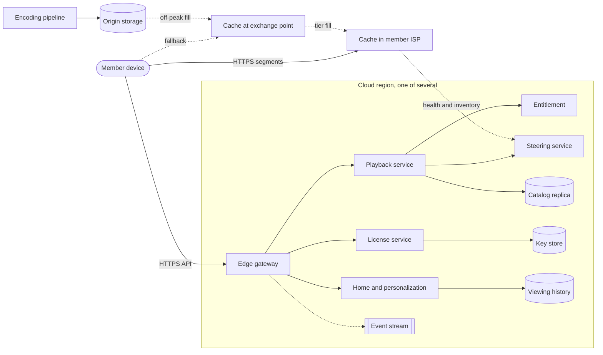

**Reading the diagram.** Inside a *cloud region* (one of several identical regions), the *edge gateway* receives all device API calls over HTTPS and routes them to services: *home and personalization* (reads *viewing history* and model outputs), the *playback service* (checks *entitlement*, reads the replicated *catalog* and asks the *steering service* for cache URLs) and the *license service* (reads the *key store*). Telemetry flows asynchronously into an *event stream*. Outside the region, the device fetches segments directly from a *cache in its ISP*, falling back to a cache at an Internet exchange point. Caches report health and inventory asynchronously to steering. The *encoding pipeline* writes to *origin storage*, from which caches are filled off-peak, tier by tier. The storage boundaries are the catalog and history stores, the key store, origin storage and each cache's disks. Failure points: a region (evacuated, §54.5.8), the gateway (fails the whole region's control plane), the license service (blocks starts, not running streams), a cache (client fails over to the next URL). Scaling: control-plane services scale horizontally per region; data-plane capacity scales by adding appliances in ISPs.

::: industry
**Netflix's published split.** Netflix completed the migration of its streaming service's systems to AWS in early 2016, after a migration of about seven years [Izrailevsky 2016]. Its Open Connect documentation and engineering blog describe the complement: services in AWS handle everything up to pressing play, including choosing which Open Connect Appliances a client should use, and the appliances, embedded in ISPs or located at Internet exchange points and filled proactively during off-peak windows, serve the video bytes [Netflix Open Connect Overview; Netflix TechBlog 2016].
*Evidence: Primary* — [Izrailevsky 2016]; [Netflix Open Connect Overview]; [Netflix TechBlog 2016]
:::

### 54.5.8 Detailed component design

#### Component 1 — The playback-start path

Pressing play triggers the most important request in the system. The playback service builds a **personalized manifest** in five steps:

1. **Authorize.** Validate the session token, check membership status and plan, and enforce the concurrent-stream limit by registering a playback session (a counter per account with TTL-based leases, so a crashed device's slot expires).
2. **Check availability.** Look up the title's licensing window for the member's country (`availability`); outside the window, refuse.
3. **Select files.** Filter the title's `downloadables` by device capabilities (codec, maximum resolution, HDR format, DRM security level) and plan (for example, a plan limited to 1080p). The result is a ladder per codec plus audio and subtitle tracks.
4. **Steer.** For each selected file, ask the steering service for a ranked list of caches that (a) hold the file, (b) are healthy and below a load threshold, and (c) are best placed for the client's network, judged by the client's IP prefix and the ISP routes each cache serves. Embedded caches in the client's ISP rank first, exchange-point caches next.
5. **Sign and return.** Embed short-lived tokens in the URLs and return the manifest with the license URL and the resume position.

The device then requests a **license**: its CDM generates a challenge; the license service verifies that the `playbackSessionId` is valid and matches the device, fetches the content key from the key store, and returns a license that encrypts the key for that device and carries rules (expiry, maximum resolution allowed for the device's security level). Streaming services commonly support several DRM systems (Widevine, PlayReady, FairPlay) because each device platform supports one; with the common encryption scheme of CMAF, the same encrypted segments work with all of them, so only the license differs.

::: formula
**Play-start latency with overlapped license and first segments**

$$T_{\text{start}} = T_{\text{manifest}} + \max\!\left(T_{\text{license}},\; T_{\text{conn}} + \frac{B_{\text{start}}}{C} + \mathrm{RTT}_{\text{cache}}\right) + T_{\text{decode}}$$

| Symbol | Meaning | Units |
|---|---|---|
| $T_{\text{start}}$ | Time from pressing play to first frame | s |
| $T_{\text{manifest}}$, $T_{\text{license}}$ | Round trip plus server time for each control-plane call | s |
| $T_{\text{conn}}$ | Connection setup to the cache (TCP and TLS) | s |
| $B_{\text{start}}$ | Bits the player buffers before starting | bits |
| $C$ | Client's available bandwidth from the cache | bits/s |
| $\mathrm{RTT}_{\text{cache}}$ | Round trip to the cache | s |
| $T_{\text{decode}}$ | Decoder initialization and first frame render | s |
:::

::: example
**Worked example — Where the start time goes.** Assumptions: 60 ms RTT to the cloud region; manifest server time 150 ms; license server time 50 ms; 12 ms RTT to the ISP cache and two round trips to connect; the player buffers two 4 s segments before starting; bandwidth 20 Mb/s; decoder start 100 ms.

1. Manifest: $0.06 + 0.15 = 0.21$ s. License: $0.06 + 0.05 = 0.11$ s.
2. Startup buffer at 1.5 Mb/s: $B_{\text{start}} = 2 \times 4 \times 1.5 = 12$ Mb; download $12/20 = 0.6$ s; with connect and one request RTT, $0.024 + 0.6 + 0.012 = 0.636$ s.
3. Fully sequential: $0.21 + 0.11 + 0.636 + 0.1 = 1.056$ s.
4. License in parallel with segment fetch: $0.21 + \max(0.11, 0.636) + 0.1 = 0.946$ s.
5. Manifest and license prefetched while the member hovers on the title: $0.636 + 0.1 = 0.736$ s.
6. Additionally start at 0.75 Mb/s: buffer download $6/20 = 0.3$ s, total $0.024 + 0.312 + 0.1 = 0.436$ s.

**Interpretation.** Once the control-plane calls are overlapped or prefetched, the startup buffer dominates. **Engineering implication.** Overlap the license with the first segment downloads (segments are encrypted, so fetching them before the key is safe), prefetch playback metadata for likely plays, and start at a modest rendition, letting ABR climb.
:::

#### Component 2 — Steering and pre-positioning

Because the catalog is known, caches are filled ahead of demand rather than on a miss (§21.10). In the teaching design, a **placement service** runs nightly per cache site: it takes popularity predictions per region (for example, from recent viewing plus release schedules), ranks files by expected bytes served per byte stored, and fills each cache up to its capacity in that order, during the ISP-agreed off-peak window. Files a cache already holds stay; displaced files are evicted. New releases are pushed to every relevant site before the release time, so launch-night traffic finds full caches.

The **steering service** turns placement into per-request answers. It keeps an in-memory index of which caches hold which files, their health and load, and which client prefixes each cache should serve (learned from BGP sessions with ISPs). Steering decisions are cheap lookups, and because each manifest lists several caches, a cache failure is handled by the client moving to the next URL, with no control-plane call. Steering also sheds load: when a cache approaches its limit, it ranks lower in new manifests while existing sessions continue.

#### Component 3 — Resilience: static stability, chaos and regional evacuation

The control plane runs **active–active** in several cloud regions; any region can serve any member (§44.6). Three practices make that real:

- **Static stability and fallbacks.** Each request path degrades rather than fails: if personalization times out, the home page falls back to precomputed popular rows; if viewing history is unavailable, playback starts from the beginning; if steering's latest data is stale, it serves from its last snapshot. Running streams depend only on caches and an already-issued license, so they survive a full control-plane outage until the license or the manifest URLs expire (hours). Circuit breakers and timeouts on every dependency stop one slow service from exhausting threads in its callers (§39.5).
- **Chaos engineering.** Failures are injected deliberately in production to verify that fallbacks work, with stream starts per second as the steady-state metric (§39.11). Experiments run at increasing scope: kill an instance, add latency to one dependency for a small share of traffic, fail an availability zone, evacuate a region.
- **Regional evacuation.** When a region degrades, traffic is steered away from it: the device-facing DNS and gateway layer shift members to the remaining regions, which must already have headroom or scale up fast. The survivors then serve those members from their own replicas of catalog, entitlement and viewing history; replicas are eventually consistent across regions, so a member might lose a few seconds of bookmark progress, which is acceptable. Evacuation is rehearsed regularly so that the path stays warm (§44.11.3).

**Figure 54.7 — Regional evacuation of the control plane.**

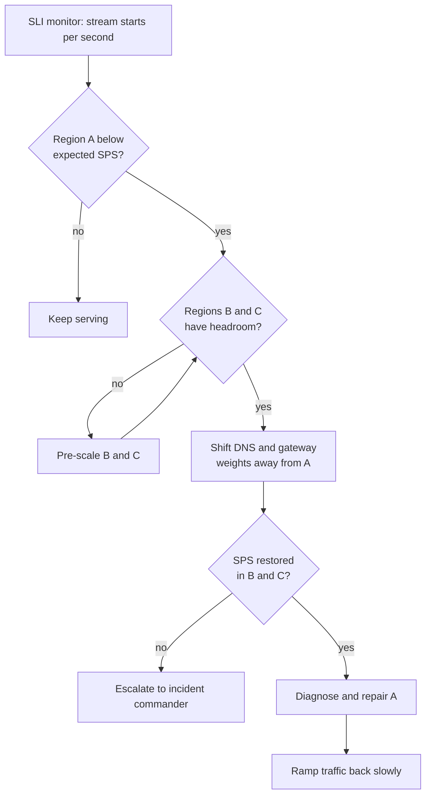

**Reading the diagram.** The *SLI monitor* compares stream starts per second (SPS) in each region with its expected daily pattern. If region A drops, the controller first checks that regions B and C have **headroom**; if not, it pre-scales them before moving traffic, because moving members to full regions would turn one regional incident into a global one. It then shifts DNS and gateway weights away from A, and verifies that SPS recovers in the survivors; if not, a human takes over. Repair and gradual return come last. All steps are control actions (synchronous decisions); the data plane is untouched throughout. Failure points: a false-positive signal evacuating a healthy region, and insufficient survivor capacity. Scaling: with $N$ regions, each needs $N/(N-1)$ of its normal peak capacity, 1.5× for three regions (§44.11.2).

::: industry
**Netflix's resilience practices.** Netflix introduced Chaos Monkey, which randomly terminates production instances, and a family of tools for larger failures [Izrailevsky and Tseitlin 2011]; Basiri et al. formalized chaos engineering as experimentation against a steady-state metric, using stream starts per second, and described exercises that simulate the failure of an entire AWS region [Basiri et al. 2016]. Netflix moved to active–active operation across AWS regions after a 2012 regional outage [Meshenberg et al. 2013] and later described re-engineering region evacuation so that it completes in minutes [Netflix TechBlog 2018].
*Evidence: Primary* — [Izrailevsky and Tseitlin 2011]; [Basiri et al. 2016]; [Meshenberg et al. 2013]; [Netflix TechBlog 2018]
:::

#### Component 4 — The personalization hand-off

Personalization decides what appears on the home page and in which order, and even which artwork represents each title; the models are the subject of Chapter 81. From the system-design view, the boundary is clean: offline and near-line pipelines compute **candidate rows and rankings per profile** and store them in a fast key-value store keyed by `profile_id`; the home service reads them, applies business rules (availability in the member's country, maturity rating, de-duplication across rows), and renders the page. Live context (device, time of day, what was just watched) re-ranks a precomputed candidate set within the latency budget. If the store or the ranking call fails, the home service serves non-personalized popular rows for the territory, which keeps the product usable.

### 54.5.9 Data flow

**Figure 54.8 — Write path: new title from studio to caches.**

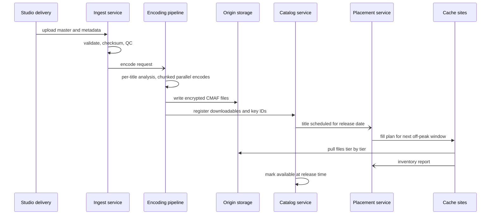

**Reading the diagram.** A studio delivers a master to the *ingest service*, which validates and quality-checks it and asynchronously requests encoding. The *encoding pipeline* analyzes the title, encodes chunks in parallel (the YouTube DAG of §54.4.8, without the popularity tiers), encrypts with content keys, writes files to *origin storage* and registers them with the *catalog*. The *placement service* includes the title in the next fill plans; *cache sites* pull files during the off-peak window and report inventory. The title becomes visible only at its release time, by which point every relevant cache holds it. Failure points: a failed QC (the studio redelivers), a missed fill window (the title is served from exchange-point caches or origin at higher cost). The path is asynchronous end to end: hours to days, not milliseconds.

**Figure 54.9 — Read path: from pressing play to first frame.**

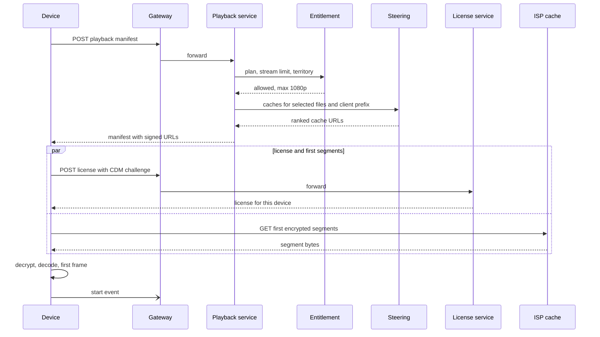

**Reading the diagram.** The device makes one synchronous call through the *gateway* to the *playback service*, which consults *entitlement* and *steering* and returns a manifest of signed cache URLs. The device then fetches the license and the first encrypted segments in parallel (the `par` block): segments are useless without the key, so fetching them early is safe and saves the license round trip. Decryption and decoding happen on the device. The start event is asynchronous. Failure points: entitlement or license services (play cannot start; fallback to cached entitlement for short outages is a business decision), the first cache (the device tries the next URL), steering (serve from last snapshot).

### 54.5.10 Bottlenecks

- **Evening peak in the data plane:** an ISP site without enough appliances or with an under-filled cache pushes traffic to exchange points and transit; capacity planning per ISP site is the main lever.
- **Launch of a hit title:** millions of plays of the same files within minutes; caches handle it if pre-positioned, but the control plane sees a play-start spike, so playback and license services pre-scale for scheduled releases.
- **License service:** every start needs one; it touches the key store and must be both secure and highly available; caching keys inside license servers in hardware security modules or protected memory keeps the key store off the hot path.

### 54.5.11 Failure scenarios

**Table 54.5 — Netflix teaching design: failure scenarios.**

| What fails | Impact | Detection | Recovery | Prevention |
|---|---|---|---|---|
| One cloud region | Starts fail for members routed there | SPS drop versus prediction | Evacuate to other regions | Active–active, headroom, rehearsed evacuation |
| Personalization store | Home page cannot rank | Error and latency SLIs | Serve popular rows | Fallback path exercised by chaos tests |
| License service | No new plays | Start-failure rate by error code | Fail over; scale out | Multi-region, keys cached in protected memory |
| ISP cache appliance | Sessions on it stall | Client errors; health reports | Client uses next URL; steering removes it | N+1 per site; multiple URLs per manifest |
| Bad fill (corrupt file) | Playback errors for one title on one site | Client decode errors clustered by cache | Evict and refill; steer away | Checksums verified on fill |
| Steering data stale | Clients sent to caches without the file | Elevated cache misses and redirects | Rebuild from inventory reports | Snapshot plus incremental updates; caches redirect on miss |
| Bad deploy to playback service | Starts fail globally | Canary SPS comparison | Automatic rollback | Region-by-region staged rollout (§43.6) |

### 54.5.12 Scaling strategy

**At 10×** members or viewing hours: the data plane scales almost linearly by adding appliances and sites, but the per-site fill window becomes a constraint, so caches must hold a larger share of the catalog (larger storage) and fill must be smarter (peer fill within a site). The control plane scales horizontally; the shared catalog and entitlement data stay small. The risk is the evacuation headroom: adding a fourth or fifth region lowers per-region overhead from 50% to 25–33%.

**At 100×:** live events (sports, shows) change the data-plane model, because content cannot be pre-positioned: caches must fill on demand from a live origin with shielding (§21.8), and the control plane must handle millions of simultaneous play starts at the moment an event begins, which calls for admission control and pre-issued licenses. The steering model also becomes multi-CDN for regions where appliances are not deployed.

### 54.5.13 Trade-offs

**Table 54.6 — Netflix teaching design: key trade-offs.**

| Decision | Option chosen | Alternative | Why |
|---|---|---|---|
| Data plane | Own appliances in ISPs, pre-positioned | Commercial CDN, fill on miss | Known catalog and enormous volume make placement and embedding pay off |
| Control plane | Public cloud, multi-region active–active | Own data centers | Elasticity and speed; regions give failure isolation |
| Cross-region data | Eventually consistent replicas | Strongly consistent global store | Bookmarks and history tolerate seconds of lag; availability matters more |
| Start path | Overlap license with segment fetch | Sequential steps | Saves a round trip; segments are encrypted anyway |
| Degradation | Fallback rows, start without bookmark | Fail the request | Partial service beats an error page |

### 54.5.14 Alternative designs

- **Commercial multi-CDN** instead of own appliances: the right choice below very large scale or for live, unpredictable content (§21.10.1).
- **Single-region control plane with standby:** simpler and cheaper but turns a region outage into a service outage, with an RTO of tens of minutes (§39.8).
- **Personalization computed fully online** per request: fresher but much more expensive and less robust than precomputed candidates with online re-ranking.

### 54.5.15 Interview discussion

**45-minute pacing plan.** 0–5 min: scope (subscription VOD, play start, offline, resilience; recommender out of scope). 5–10 min: capacity, showing that the 125 Tb/s peak forces a distributed data plane and the control plane is ordinary. 10–15 min: API and data model. 15–22 min: architecture with the two planes. 22–35 min: playback start (manifest, license, steering) with the latency arithmetic. 35–42 min: resilience (fallbacks, chaos, evacuation). 42–45 min: scaling and live events.

**Likely follow-ups.**

- *What happens to people watching when the control plane fails?* They keep watching; licenses and URLs are already issued.
- *How does the client find the best cache?* Steering ranks caches holding the file by client prefix, health and load; the manifest lists several.
- *How do you protect content?* Encrypted segments cached anywhere; per-device licenses from a hardened service; hardware-backed security levels gate resolution.
- *How do you prepare for a big release?* Pre-position files before release, pre-scale the control plane, and practice with load tests.

**What distinguishes senior and staff answers.** A senior candidate separates control and data planes and draws the play-start sequence. A staff candidate quantifies why (egress versus request rate), designs for running streams to survive control-plane failure, sizes evacuation headroom, and treats chaos experiments and rehearsed evacuations as part of the design rather than an afterthought.

### 54.5.16 Production considerations

- **Observability.** SPS per region, device type and ISP compared with its forecast is the top-level health signal; client-side quality-of-experience telemetry (start time, rebuffers, bitrate) by cache site detects data-plane problems that servers cannot see.
- **Security.** Content keys never leave the license service and the device's CDM; per-device security levels cap resolution; tokens in cache URLs prevent hot-linking; studio masters are stored with stricter access than encodes.
- **Cost.** The data plane is capital expenditure in ISPs, offset by eliminated transit; the control plane is cloud spend; encoding runs on spare capacity.
- **Operations.** Staged, region-by-region deployments with automated canary analysis; regular evacuation drills; fill-window coordination with ISPs; release-day runbooks.

## 54.6 Spotify

### 54.6.1 Problem statement

Design a music streaming service in the style of Spotify: a catalog of about a hundred million tracks, licensed from labels and distributors with per-country rules, playable instantly on phones, desktops, cars and speakers, including offline; user-created playlists that several people can edit together; search across artists, albums, tracks and playlists; and an accounting pipeline that counts every qualifying play so that rights holders are paid correctly.

A music track is small (about 4 MB at 160 kb/s) and people play the same tracks over and over, so the problem looks easy next to video. What makes it hard is that the service has to feel **local**: tapping a track must start sound in a fraction of a second, skipping must be instant, and playback must continue through a tunnel. That pushes intelligence into the client (prefetching and caching), which in turn means that licensing rules must be enforced on a device the service does not control, and that the plays it must count happen partly offline and arrive late. The distinctive hard problems are the **client-side cache and prefetch**, **offline licensing**, **collaborative playlists** and **exactly-once-ish play counting** for royalties.

::: definition
**Definition — Qualifying stream.** A play that counts toward royalty and chart calculations under the service's rules, typically a play that lasted at least a minimum duration (for example 30 seconds) and passed fraud checks. The definition is contractual: changing it changes who gets paid.
:::

### 54.6.2 Functional requirements

1. Play any available track with near-instant start; skip, seek, shuffle, queue; gapless transitions.
2. Download playlists and albums for offline playback (premium tier), within licensing limits.
3. Create, edit, follow and share playlists; collaborative playlists editable by several users concurrently.
4. Search the catalog and public playlists with typeahead.
5. Ingest catalog metadata and audio from labels and distributors, with per-market availability, release dates and takedowns.
6. Count qualifying streams per track, market and month, and produce royalty statements.
7. Out of scope: podcasts and audiobooks, recommendations (Chapter 81), social features beyond playlist sharing.

### 54.6.3 Non-functional requirements

**Table 54.7 — Spotify teaching design: non-functional targets.**

| Property | Target | Why |
|---|---|---|
| Playback start | p50 < 300 ms, p99 < 1 s from tap to sound (cached or prefetched: < 100 ms) | Music is browsed by skipping |
| Playback availability | 99.99%; cached and downloaded tracks play with no connectivity | Users notice silence instantly |
| Playlist edits | Durable once acknowledged; visible to collaborators within 2 s; no lost concurrent edits | Collaboration |
| Search | p99 < 150 ms per keystroke | Typeahead |
| Catalog changes | Takedowns effective within 1 h worldwide, including on devices at next check-in | Licensing contracts |
| Stream counts | Each qualifying play counted exactly once in the monthly statement; offline plays within 30 days | Royalties are money |
| Event loss | < 0.01% of play events | Under-counting is under-payment |

### 54.6.4 Capacity estimation

Spotify reports monthly active users in the hundreds of millions; the teaching design assumes 600 million MAU.

::: example
**Worked example — Plays, events and audio egress.** Assumptions: 600 million MAU, 40% daily active (240 million DAU); 2 hours of listening per DAU per day; average track 3.5 minutes; average bitrate 160 kb/s; client cache serves 50% of bytes; peak is 2× average; five events per play (start, progress markers, end, plus a qualifying-stream marker).

1. Listening hours per day: $240 \times 10^6 \times 2 = 4.8 \times 10^8$ h.
2. Plays per day: $4.8 \times 10^8 \times 60 / 3.5 = 8.2 \times 10^9$; average 95,200 plays/s; peak about 190,000 plays/s.
3. Audio egress without cache: $4.8 \times 10^8 \times 3{,}600 \times 160{,}000 / 86{,}400 = 3.2 \times 10^{12}$ b/s $= 3.2$ Tb/s average, 6.4 Tb/s peak; with half the bytes from client caches, about 3.2 Tb/s at peak from CDNs.
4. Play events: $8.2 \times 10^9 \times 5 = 4.1 \times 10^{10}$ per day; average 476,000 events/s; peak about 950,000 events/s; at 500 B each, about 21 TB/day of raw events.

**Interpretation.** Audio egress is a few terabits per second, an order of magnitude below video, and fits commercial CDNs. Events approach a million per second and are the backbone of royalty accounting. **Engineering implication.** Buy delivery from CDNs; build the event pipeline as the critical, audited system.
:::

::: example
**Worked example — Catalog, playlists and client cache.** Assumptions: 100 million tracks averaging 210 s; each stored in five encodings summing 960 kb/s (Ogg Vorbis at 96, 160 and 320 kb/s, AAC at 128 and 256 kb/s); 4 billion playlists with an average of 50 entries of about 40 B plus 200 B of attributes; a phone cache budget of 2 GB.

1. Audio catalog: $10^8 \times 210 \times 960{,}000 / 8 = 2.52 \times 10^{15}$ B $\approx 2.5$ PB per copy; a lossless tier at roughly 1 Mb/s would add about as much again.
2. One track at 160 kb/s: $210 \times 160{,}000 / 8 = 4.2$ MB.
3. Playlists: $4 \times 10^9 \times (50 \times 40 + 200) = 8.8 \times 10^{12}$ B $\approx 8.8$ TB, plus their operation logs.
4. Phone cache: $2 \times 10^9 / 4.2 \times 10^6 \approx 476$ tracks, more than most people's weekly rotation.

**Interpretation.** The catalog is modest by object-storage standards and the playlist data is small; the client cache can hold a user's habitual listening. **Engineering implication.** Design the client cache as a first-class tier with an eviction policy tuned to repeat listening; keep playlists in a strongly consistent, partitioned store.
:::

### 54.6.5 API design

```text
GET  /v1/tracks/{trackId}/playback?market=SE&quality=high
     → { fileId: "f_3a…", codec: "vorbis", kbps: 160,
         cdnUrls: ["https://audio-cdn-a.example/f_3a…?sig=…", "https://audio-cdn-b.example/…"],
         keyHandle: "kh_…", gainDb: -6.2, expiresAt: … }

POST /v1/keys/{keyHandle}        { deviceId, deviceAttestation } → { wrappedKey }   (device-bound)

POST /v1/offline/grants          { deviceId, items: ["playlist:37i9…", "album:4aaw…"] }
     → { grantId, expiresAt: now+30d, maxTracks: 10000, items: [ { trackId, fileId, wrappedKey } ] }

GET  /v1/playlists/{playlistId}?since=rev:1842
     → { revision: "rev:1846", ops: [ ... ] }        (or a full snapshot if too far behind)

POST /v1/playlists/{playlistId}/ops
     { baseRevision: "rev:1846", clientOpId: "d1:op:771",
       ops: [ { op: "insert", itemId: "i_9f2", trackId: "t_88", after: "i_51c" },
              { op: "remove", itemId: "i_0aa" } ] }
     → { revision: "rev:1847", applied: [...], transformed: [...] }

GET  /v1/search?q=bohem&types=track,artist,playlist&market=GB&limit=10
POST /v1/events   [ { eventId, playId, type: "play_end", trackId, msPlayed, ts, offline: false } ]
```

What to notice:

- Audio files are encrypted; the playback response returns CDN URLs and a **key handle**, and the decryption key is delivered wrapped for the specific device.
- An **offline grant** is a lease: it expires and must be renewed by checking in, which is when takedowns and subscription changes reach the device.
- Playlist edits are **operations against a base revision**, identified by `itemId`s rather than positions, with a client operation ID that makes retries idempotent.
- Every event carries a client-generated `eventId` and a `playId` shared by all events of one play; these are the deduplication keys of the counting pipeline.

### 54.6.6 Data model and database schema

```sql
-- Catalog (read-mostly, replicated globally; written only by the ingest pipeline)
CREATE TABLE tracks (
  track_id    CHAR(22) PRIMARY KEY,
  isrc        CHAR(12) NOT NULL,          -- International Standard Recording Code
  album_id    CHAR(22), duration_ms INT, explicit BOOLEAN
);
CREATE TABLE track_availability (
  track_id CHAR(22), market CHAR(2), available_from TIMESTAMP, available_until TIMESTAMP,
  rights_holder_id BIGINT,                -- who is paid for streams in this market
  PRIMARY KEY (track_id, market)
);
CREATE TABLE audio_files (
  file_id CHAR(40) PRIMARY KEY,           -- content hash of the encrypted file
  track_id CHAR(22), codec VARCHAR(8), kbps INT, key_id BINARY(16)
);

-- Playlists (partitioned by playlist_id; each partition strongly consistent)
CREATE TABLE playlists (
  playlist_id CHAR(22) PRIMARY KEY, owner_id BIGINT, name VARCHAR(200),
  collaborative BOOLEAN, revision BIGINT NOT NULL, snapshot_rev BIGINT
);
CREATE TABLE playlist_items (             -- materialized current state
  playlist_id CHAR(22), item_id CHAR(12), track_id CHAR(22),
  added_by BIGINT, added_at TIMESTAMP,
  sort_key VARBINARY(64),                 -- fractional index: order without renumbering
  PRIMARY KEY (playlist_id, item_id)
);
CREATE TABLE playlist_ops (               -- append-only operation log
  playlist_id CHAR(22), revision BIGINT, client_op_id VARCHAR(40), author_id BIGINT,
  op JSON, PRIMARY KEY (playlist_id, revision),
  UNIQUE (playlist_id, client_op_id)      -- idempotent retries
);

-- Accounting (append-only, partitioned by month and market)
CREATE TABLE qualifying_streams (
  month CHAR(7), market CHAR(2), track_id CHAR(22), play_id CHAR(32),
  user_id BIGINT, ms_played INT, offline BOOLEAN,
  PRIMARY KEY (month, market, play_id)    -- uniqueness enforces exactly-once counting
);
```

The catalog is read-mostly and fits a relational store replicated to every region, fronted by caches. Playlists need per-playlist serializable updates and an operation log, so a partitioned relational or NewSQL store keyed by `playlist_id` fits (§12.11, §14.7). Raw events go to an object-store data lake partitioned by hour; `qualifying_streams` is a warehouse table whose primary key is the deduplication guarantee.

### 54.6.7 High-level architecture

**Figure 54.10 — Spotify teaching design.**

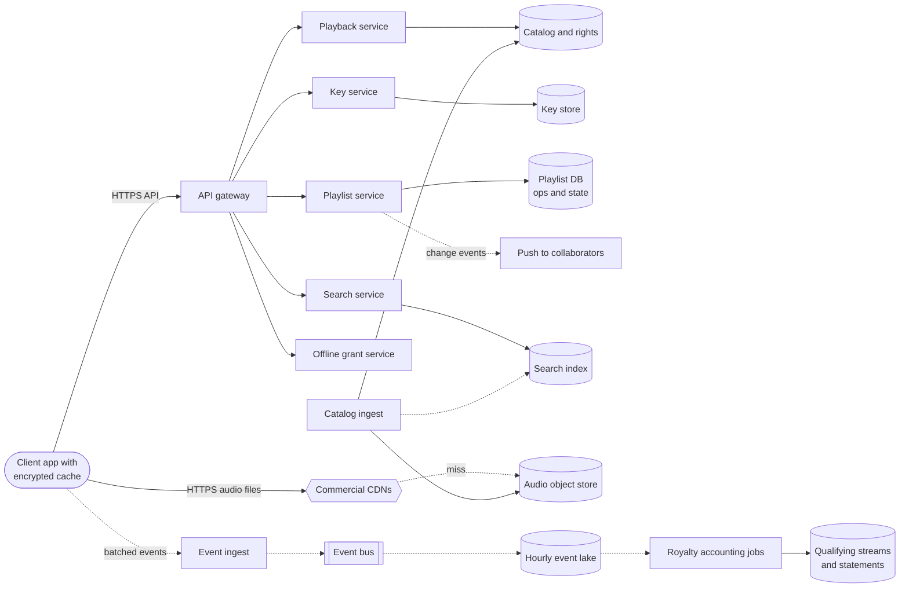

**Reading the diagram.** The *client* holds an encrypted cache of audio files and talks to the *API gateway* over HTTPS. The *playback service* checks rights in the *catalog* and returns CDN URLs; the *key service* releases device-bound keys from the *key store*; the *playlist service* stores operations and state in the *playlist DB* and pushes changes to collaborators asynchronously; the *search service* queries the *search index*; the *offline grant service* issues download leases. Audio bytes come from *commercial CDNs* backed by the *audio object store*. Events flow asynchronously from clients through *event ingest* and an *event bus* into an *hourly event lake*, from which *royalty accounting jobs* produce *qualifying streams and statements*. *Catalog ingest* writes metadata, audio and index updates. Storage boundaries: catalog, key store, playlist DB, audio store, event lake and warehouse. Failure points: the key service (cached tracks still need keys, so clients cache wrapped keys too), the event pipeline (events are buffered on the device and in the bus), the playlist DB partition for a very popular collaborative playlist. Scaling: stateless services scale horizontally; playlists partition by ID; events partition by hour and user.

### 54.6.8 Detailed component design

#### Component 1 — Client prefetch and cache

The client is the fastest tier of the delivery system. Three mechanisms make playback feel local:

1. **Cache.** Every played track is stored, encrypted, in a local cache with a size budget, evicted by a policy that favors tracks played repeatedly (LFU-like with recency, §20.9). Starting a cached track needs no network at all, provided the wrapped key is also cached.
2. **Prefetch the next track.** When the current track nears its end (say 20 s left), the client fetches the beginning of the next track in the queue, and the key for it. When the user is likely to skip (for example on a freshly opened playlist), prefetch the first few seconds of the next several tracks: a 5 s header at 160 kb/s is only 100 KB.
3. **Fast start.** For an uncached track, fetch the first seconds at a lower bitrate or with a small first range request, start playback, and continue with the full file in larger ranges.

Prefetch costs bandwidth and battery when the user does not play the prefetched track, so the client tunes the depth of prefetch to network type and observed skip behavior.

::: industry
**Spotify's original client-centric design.** Kreitz and Niemelä described Spotify's early streaming protocol, in which clients combined a local cache, a peer-to-peer network among clients and Spotify's servers; at the time of the measurements only 8.8% of music data played came from Spotify's servers, and the median playback latency was 265 ms. Clients began prefetching the next track before the current one ended, so that the transition was gapless [Kreitz and Niemelä 2010].
*Evidence: Primary* — [Kreitz and Niemelä 2010]
:::

#### Component 2 — Offline downloads under licensing constraints

Labels license music for streaming to subscribers, not for permanent copies, so offline playback is a **time-limited lease** enforced on the device:

1. The client requests an **offline grant** for the items; the server checks the subscription, per-device and per-account download limits, and per-track offline permission (`track_availability`), and returns the files' identifiers and their content keys wrapped for this device, with an expiry (for example 30 days).
2. Files are downloaded from the CDN and stored encrypted; keys are stored in the device's secure storage.
3. Before the grant expires, the client must **check in**: the server renews the grant, removes tracks that were taken down or are no longer licensed in the user's market, and the client deletes them. If the client never checks in (the subscription lapsed, the device is lost), keys expire and the files become unplayable.
4. **Offline plays are logged locally** with their `playId`s and uploaded at the next check-in, up to 30 days late. The accounting pipeline must accept them into the month in which they occurred, before statements close (Component 4).

::: warning
**Device enforcement is best effort.** A rooted device can extract keys. Licensing contracts accept this with layered defenses: per-device key wrapping, hardware-backed key storage where available, download caps, mandatory check-ins and anomaly detection on download volume. Never design as though device-side checks are a security boundary against a determined attacker.
:::

#### Component 3 — Playlists as collaborative documents

A collaborative playlist is a small shared document: an ordered list edited by several people at once, sometimes offline. A naive design that sends the whole list on every save loses edits: Ann adds a track while Bo deletes another, and whoever saves second overwrites the other's change (a lost update, §11.13). The teaching design treats a playlist like a tiny collaborative editor:

1. **Stable item IDs.** Each entry has a unique `itemId`, so "remove item i_0aa" means the same thing regardless of what others inserted, and two people can add the same track twice without confusion.
2. **Position by neighbor, order by fractional index.** Inserts and moves say "after item X"; the server assigns a `sort_key` between X's key and its successor's (a fractional index), so no other rows are renumbered and concurrent inserts at different positions commute.
3. **Server-ordered operation log.** The playlist service serializes operations per playlist: it appends each batch to `playlist_ops` at the next revision, inside a transaction on that playlist's partition. A client sends its operations with its `baseRevision`; if other operations were applied since, the server **transforms** the client's operations against them (an insert after a deleted item goes after that item's nearest surviving predecessor; a remove of an already removed item becomes a no-op; two concurrent moves of the same item resolve by revision order). This is the server-centric form of operational transformation that §54.7 develops for text.
4. **Idempotency.** `client_op_id` is unique per playlist, so a retried batch returns the original result instead of applying twice.
5. **Propagation.** After commit, a change event notifies connected collaborators, who fetch operations since their revision; a client too far behind fetches a snapshot.

The partition key is `playlist_id`, so all operations on one playlist are serialized on one partition. That is the right trade: even a popular collaborative playlist sees a few edits per second, while followers only read, from caches.

#### Component 4 — Royalty and play-count accounting

Royalties under a **pro-rata** model divide a pool of revenue in a market and month among rights holders in proportion to their share of qualifying streams. Counting errors therefore do not just misreport a number; they move money from one rights holder to another.

::: formula
**Pro-rata stream share**

$$\text{Payout}_h = P \times \frac{s_h}{\sum_{k} s_k}$$

| Symbol | Meaning | Units |
|---|---|---|
| $\text{Payout}_h$ | Amount allocated to rights holder $h$ in a market and month | $ |
| $P$ | Royalty pool for that market and month | $ |
| $s_h$ | Qualifying streams of tracks controlled by $h$ | streams |
| $\sum_k s_k$ | All qualifying streams in the market and month | streams |
:::

::: example
**Worked example — What a 0.5% double count costs.** Assumptions (illustrative): pool $P = \$400$ million; 80 billion qualifying streams in the month; label A has 20 billion, label B 10 billion.

1. Per-stream value: $400 \times 10^6 / 80 \times 10^9 = \$0.005$. A receives \$100 million, B \$50 million.
2. A bug double-counts 0.5% of B's streams: $s_B = 10.05 \times 10^9$, total $80.05 \times 10^9$.
3. B now receives $400 \times 10^6 \times 10.05 / 80.05 = \$50.219$ million, \$218,600 too much.
4. A now receives $400 \times 10^6 \times 20 / 80.05 = \$99.938$ million, \$62,500 too little; the rest of the \$218,600 is taken from every other rights holder.

**Interpretation.** In a fixed pool, over-counting one party is under-paying everyone else. **Engineering implication.** The counting pipeline must be exactly-once at the level of a qualifying play, auditable (every counted stream traceable to its events) and reproducible (re-running a month yields the same totals).
:::

The pipeline is batch-oriented because payment is monthly, but it is fed by a streaming event system:

1. **Client buffering.** Clients write events to a local durable queue and upload them in batches with retries; each event has a unique `eventId`, and all events of one play share a `playId`. Retries create duplicates; offline listening creates lateness.
2. **Durable ingest.** Ingest acknowledges a batch only after the event bus has persisted it; the bus writes events into **hourly partitions** of the event lake. Producers cannot be made exactly-once end to end (§32.9), so the system is at-least-once on delivery and deduplicates downstream.
3. **Deduplicate and qualify.** A job groups events by `playId`, keeps the maximum `msPlayed` per play, applies the qualifying rule (threshold, fraud filters) and emits at most one qualifying stream per `playId`. Uniqueness is enforced by the warehouse key `(month, market, play_id)`: writing the same play twice is a no-op upsert.
4. **Late data.** Each month stays open for corrections until a close date (say 35 days after month end), long enough for 30-day offline grants. Late events for a closed month go into an adjustments table applied to the next statement, never silently into the wrong month.
5. **Reconcile and close.** Before statements are issued, totals are reconciled against independent counts (client-side counters, CDN file-access logs by `fileId`) to detect loss or duplication; the month is then frozen and statements are generated.

The code below shows the deduplication rule in miniature.

```python
# Idempotent stream counting: events may be duplicated (client retries),
# reordered, or arrive days late (offline listening). A play counts once,
# when its maximum observed ms_played first reaches the 30 s threshold.
from collections import defaultdict

THRESHOLD_MS = 30_000


class StreamCounter:
    def __init__(self):
        self.max_played = {}                 # play_id -> max ms_played seen
        self.counted = set()                 # play_ids already emitted
        self.streams = defaultdict(int)      # (track_id, month) -> qualifying streams

    def ingest(self, event):
        pid = event["play_id"]
        best = max(self.max_played.get(pid, 0), event["ms_played"])
        self.max_played[pid] = best
        if best >= THRESHOLD_MS and pid not in self.counted:
            self.counted.add(pid)            # in production: same transaction as the count
            self.streams[(event["track_id"], event["month"])] += 1


events = [
    {"play_id": "a1", "track_id": "T1", "month": "2026-10", "ms_played": 12_000},
    {"play_id": "a1", "track_id": "T1", "month": "2026-10", "ms_played": 41_000},
    {"play_id": "a1", "track_id": "T1", "month": "2026-10", "ms_played": 41_000},  # retry
    {"play_id": "b7", "track_id": "T1", "month": "2026-10", "ms_played": 25_000},  # skipped
    {"play_id": "c3", "track_id": "T2", "month": "2026-10", "ms_played": 180_000},
    {"play_id": "a1", "track_id": "T1", "month": "2026-10", "ms_played": 35_000},  # late, smaller
]
c = StreamCounter()
for e in events:
    c.ingest(e)
print(dict(c.streams))     # {('T1', '2026-10'): 1, ('T2', '2026-10'): 1}
```

What to notice:

- The key is the play, not the event: the retried event and the late, smaller progress event for `a1` do not change the count.
- The month comes from the event's occurrence time, not its arrival time, so a late offline play lands in the right statement.
- In production, `counted` is the warehouse primary key or a transactional state store, and "add to counted" and "increment" must commit together, which is exactly what upserting `(month, market, play_id)` achieves.

::: industry
**Spotify's event delivery.** Spotify has described its event delivery system in a series of engineering posts: client events were originally transported with Kafka into Hadoop, and during its move to Google Cloud Platform the company redesigned the pipeline around Cloud Pub/Sub and Dataflow, writing delivered events into hourly partitions for downstream consumers [Maravić 2016; Spotify Engineering 2019]. Spotify also publishes that a stream counts toward royalties once it has been listened to for at least 30 seconds [Spotify Loud & Clear].
*Evidence: Primary* — [Maravić 2016]; [Spotify Engineering 2019]; [Spotify Loud & Clear]
:::

#### Search, briefly

Search is an inverted index over tracks, artists, albums and public playlists (Chapter 16) with typeahead on prefixes (§16.9), ranked by text match combined with popularity, and **filtered by market availability** at query time so that users never see tracks they cannot play. The index is rebuilt from the catalog with near-real-time updates for new releases and takedowns (§16.10).

### 54.6.9 Data flow

**Figure 54.11 — Write path: concurrent edits to a collaborative playlist.**

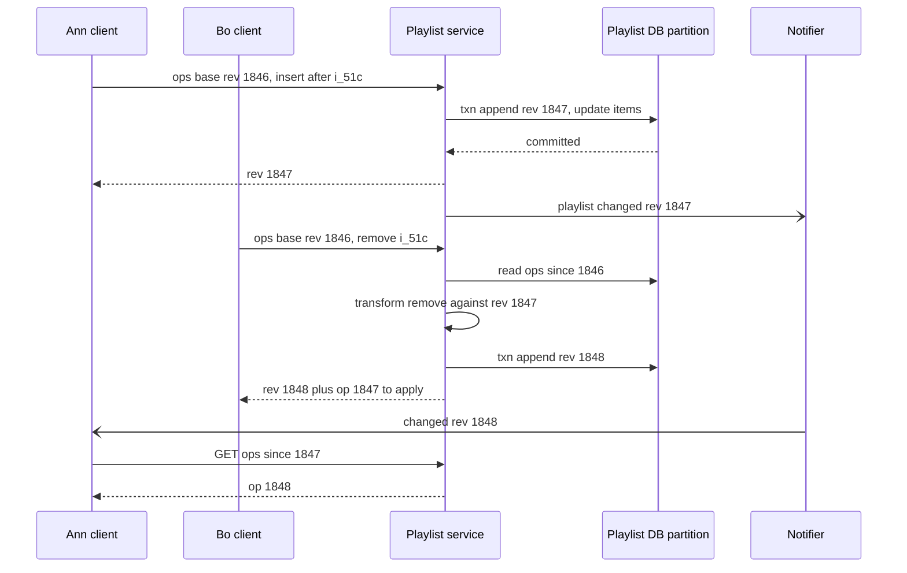

**Reading the diagram.** Ann and Bo both edit from revision 1846. Ann's insert commits first as revision 1847 in one transaction on the playlist's partition, and a change notification goes out asynchronously. Bo's remove arrives with base 1846, so the service reads the operations he has not seen, transforms his operation against them (removing `i_51c` is still valid; Ann's new item now follows `i_51c`'s predecessor), commits revision 1848 and returns both the new revision and Ann's operation so that Bo's client converges. Ann is notified and fetches the missing operation. Failure points: the partition leader (writes pause until failover; clients queue operations locally), the notifier (clients poll as a fallback). No edit is lost because every operation is applied in a single serialized log.

**Figure 54.12 — Read path: playing a track with cache and prefetch.**

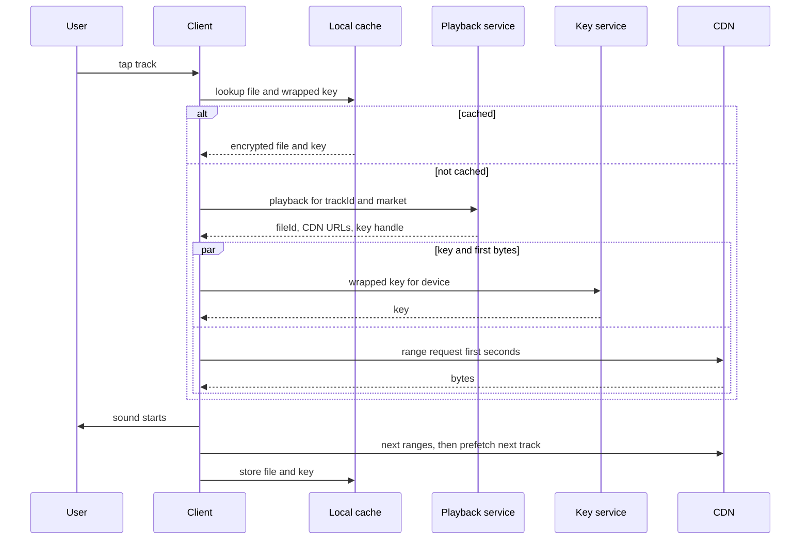

**Reading the diagram.** The *client* first checks its *local cache*; a hit plays with no network at all. On a miss it makes one synchronous call to the *playback service* for rights and URLs, then fetches the key and the first bytes in parallel (`par`), starting sound as soon as both arrive. Remaining ranges and the next track's prefetch proceed in the background, and the file and key are cached. Failure points: the playback or key service (cached tracks still play; uncached tracks fail), a CDN (the client tries the second URL). Scaling: the more the cache serves, the less every server tier sees.

**Figure 54.13 — Play-count and royalty accounting pipeline.**

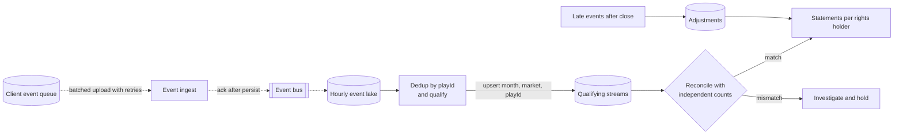

**Reading the diagram.** Each *client* keeps a durable *event queue* and uploads batches asynchronously; *ingest* acknowledges only after the *event bus* has persisted the batch, so a retry after a lost acknowledgment creates duplicates rather than loss. The bus writes *hourly partitions* to the *event lake*. A batch job *deduplicates by playId and qualifies* plays, upserting into *qualifying streams* keyed by month, market and play. Before statements, totals are *reconciled* with independent counts; mismatches block the close. Late events after a month closes go to *adjustments* applied to the next statement. Failure points: client queue loss (uninstall before upload), a bus outage (clients keep queuing), a bad qualifying rule (re-run the month from the lake, which is the immutable source of truth).

### 54.6.10 Bottlenecks

- **New release spikes:** a major album release makes millions of clients request the same few files and keys at midnight; CDN pre-warming and key-service caching handle it.
- **Event ingest at peak** (about a million events/s): batching on the client and horizontally scaled ingest keep request rates far lower than event rates.
- **Month-end close:** deduplication over a month of plays (about 250 billion) is a large shuffle; partition by `playId` hash and process incrementally per day, leaving only late events for the close.
- **Hot collaborative playlist:** a playlist edited live by thousands (a public party playlist) saturates one partition; cap collaborators or switch to append-only suggestion queues.

### 54.6.11 Failure scenarios

**Table 54.8 — Spotify teaching design: failure scenarios.**

| What fails | Impact | Detection | Recovery | Prevention |
|---|---|---|---|---|
| Key service | Uncached tracks cannot start | Start-failure rate | Fail over; clients use cached keys | Multi-region; long-lived wrapped keys for cache |
| CDN provider | Slow or failed fetches in a region | Client QoE telemetry by CDN | Shift traffic to second CDN | Multi-CDN URLs in every response |
| Event bus outage | Events delayed | Ingest errors, consumer lag | Clients retry from local queue | Durable client queue; multi-zone bus |
| Duplicate events | Over-count, overpayment | Reconciliation mismatch | Dedup by playId; re-run month | Warehouse uniqueness key |
| Takedown not applied | Unlicensed playback | Audit of served fileIds against rights | Revoke keys; force grant refresh | Rights checked at playback and check-in |
| Playlist partition leader loss | Edits pause seconds | Write errors | Leader election; clients queue ops | Replicated partitions (§26) |

### 54.6.12 Scaling strategy

**At 10×:** delivery grows to tens of terabits per second at peak, still within multi-CDN capacity, but commercial terms motivate deeper caching (larger client caches, ISP-embedded caches for the most popular tracks). Events reach ten million per second: ingest becomes regional with regional lakes and a global merge. Month-end deduplication must be fully incremental.

**At 100×:** the catalog itself grows (user uploads, AI-generated music), so ingest needs automated fraud and duplicate detection, and per-track overhead (indexes, rights rows) dominates; the rights database becomes a large partitioned system rather than a replicated small one. Royalty accounting needs streaming qualification with exactly-once state (§31.11) so that statements are near-real-time and month-end is a formality.

### 54.6.13 Trade-offs

**Table 54.9 — Spotify teaching design: key trade-offs.**

| Decision | Option chosen | Alternative | Why |
|---|---|---|---|
| Delivery | Client cache plus commercial CDNs | Own CDN | Bitrates are low; CDNs suffice |
| Offline | 30-day leases with check-in | Permanent downloads | Licensing requires revocability |
| Playlists | Server-ordered op log with transformation | Last-writer-wins on whole list | No lost concurrent edits |
| Counting | At-least-once delivery, dedup by playId | Exactly-once end to end | End-to-end exactly-once across devices is impossible; idempotent keys are not |
| Month close | Fixed close with adjustments | Keep months open forever | Statements must be final and auditable |

### 54.6.14 Alternative designs

- **CRDT playlists** (a sequence CRDT, §27.14) instead of a server-ordered log: better for long offline editing and peer sync, at the cost of metadata per element and harder auditing of who did what.
- **Streaming royalty computation** (Flink-style, §29.9) with exactly-once state instead of daily batch: fresher dashboards for artists; statements still need a close.
- **User-centric payment model** (each subscriber's fee is split among the artists that subscriber played): changes the formula, not the pipeline; counting must then be per user, which increases state.
- **Peer-to-peer delivery** as in Spotify's early design: reduces server egress but complicates mobile clients and battery use.

### 54.6.15 Interview discussion

**45-minute pacing plan.** 0–5 min: scope. 5–10 min: capacity (plays, events, egress, catalog). 10–15 min: API and data model. 15–20 min: architecture. 20–28 min: client cache, prefetch and offline leases. 28–36 min: collaborative playlists. 36–42 min: counting and royalties with late data. 42–45 min: scaling and trade-offs.

**Likely follow-ups.**

- *How do you start playback in 100 ms?* Cache hits and prefetched headers; on a miss, parallel key and first-range fetch.
- *How are offline downloads revoked?* Expiring grants renewed at check-in; keys expire.
- *Two users edit a playlist at once?* Item IDs, neighbor-relative positions, serialized log per playlist with transformation; idempotent op IDs.
- *How do you avoid double counting?* `playId` dedup key with a uniqueness constraint; month by occurrence time; reconciliation before close.

**What distinguishes senior and staff answers.** A senior candidate designs caching, playlists without lost updates and a deduplicated counter. A staff candidate shows that counting errors redistribute a fixed pool, designs for auditability and reproducibility, handles lateness with explicit close semantics, and treats the device as an untrusted but necessary enforcement point.

### 54.6.16 Production considerations

- **Observability.** Start latency split by cache hit or miss; skip-to-sound latency; event loss estimated from sequence gaps per client; reconciliation deltas per market.
- **Security.** Device-bound key wrapping; key service isolated; rate limits on offline grants; fraud detection on streaming patterns (bot farms inflating streams).
- **Cost.** CDN egress is the main delivery cost; client caching is the cheapest capacity available. The event lake grows by about 21 TB/day of raw events, so tier it after statements close.
- **Operations.** Catalog ingest is a contractual pipeline with SLAs for takedowns; statement generation is a monthly release with sign-off; rule changes to qualification are versioned and applied only from a future month.

## 54.7 Google Drive

### 54.7.1 Problem statement

Design a cloud file service in the style of Google Drive: users store files and folders, share them with people, groups or anyone with a link, open them from any device, and edit documents together in real time, with full version history and a storage quota.

Picture a library where each reader's card lists the rooms they may enter, permissions can cover one shelf or a whole wing, and some books are being written by several authors at the same desk at once. Two hard problems dominate: deciding **who may see what** on every one of about a million requests per second, with permissions inherited through folders and groups, and letting several people **edit the same document concurrently** without anyone's keystrokes being lost or the copies diverging.

::: definition
**Definition — Operational transformation (OT).** A technique for real-time collaborative editing in which each user applies their own edits immediately, and edits received from others are **transformed** (their positions adjusted) against concurrent edits already applied, so that all copies converge to the same document while each edit keeps its intended effect [Ellis and Gibbs 1989].
:::

### 54.7.2 Functional requirements

1. Upload, download, create, rename, move, copy, trash and restore files and folders; files up to terabytes.
2. Share an item with users, groups, a domain or anyone with the link, at roles owner, editor, commenter or viewer; sharing a folder shares its contents.
3. List folders, "Shared with me", recent files; search by name and content among items the user can access.
4. Real-time collaborative editing of native documents with presence (cursors) and comments.
5. Version history: restore earlier versions of files and documents.
6. Per-user storage quota covering everything the user owns.
7. Change feed for sync clients and third-party apps.
8. Out of scope: the document layout engine, Office format conversion, malware scanning internals.

### 54.7.3 Non-functional requirements

**Table 54.10 — Google Drive teaching design: non-functional targets.**

| Property | Target | Why |
|---|---|---|
| Availability | 99.99% for metadata reads and opens; 99.95% for uploads | Work tool used all day |
| Metadata latency | p99 < 200 ms for list and open | Interactive browsing |
| Authorization check | p99 < 10 ms, millions per second | On every read path |
| ACL consistency | No access granted after revocation is acknowledged ("new enemy" safe) | Security |
| Editing latency | Own keystrokes local (0 ms); others' edits visible p95 < 500 ms | Collaboration feel |
| Edit durability | No acknowledged edit lost; all replicas converge | Users trust the document |
| File durability | 11 nines per object per year | Users' only copy |
| Quota | Never exceeded by more than one in-flight upload | Billing and fairness |

### 54.7.4 Capacity estimation

Google has reported that Drive has more than a billion users; the teaching assumptions follow that order of magnitude.

::: example
**Worked example — Metadata, storage and request rates.** Assumptions: 1 billion users, 300 million daily active; 1,000 items (files and folders) per user; 1 KB of metadata per item; 5 GB stored per user; each DAU adds 10 MB/day of new content, performs 100 metadata operations and 10 writes per day; peak 3× average.

1. Items: $10^9 \times 1{,}000 = 10^{12}$; metadata $10^{12} \times 1$ KB $= 1$ PB, before replication and indexes.
2. Logical file data: $10^9 \times 5$ GB $= 5$ EB; growth $300 \times 10^6 \times 10$ MB $= 3$ PB/day $\approx 1.1$ EB/yr; average ingest $3 \times 10^{15} \times 8 / 86{,}400 \approx 278$ Gb/s.
3. Metadata reads: $300 \times 10^6 \times 100 / 86{,}400 = 347{,}000$/s; peak about 1 million/s, each needing an authorization check.
4. Metadata writes: $300 \times 10^6 \times 10 / 86{,}400 = 34{,}700$/s; peak about 104,000/s.

**Interpretation.** A petabyte of metadata with a million reads per second is too large for one database and too relational (folders, moves, sharing) for a plain key-value store. **Engineering implication.** Use a horizontally partitioned, transactional store (§28.8, §28.10) with a dedicated authorization service and aggressive caching.
:::

::: example
**Worked example — Collaborative editing load.** Assumptions: 5 million documents open for editing at peak; in 20% of them someone is typing; clients batch keystrokes and send at most 2 operation batches per second per active document.

1. Active documents: $5 \times 10^6 \times 0.2 = 10^6$.
2. Operation batches: $10^6 \times 2 = 2 \times 10^6$ commits/s, each fanned out to the other editors of that document.
3. If each document's session is owned by one server handling 5,000 active documents, about 200 servers carry the typing load, plus headroom.

**Interpretation.** The aggregate rate is large, but each document's rate is tiny and independent. **Engineering implication.** Partition by document and serialize each document's operations on one owner (a session server), so ordering is local and cheap.
:::

### 54.7.5 API design

Uploads use the same resumable protocol as §54.4.5. The other main calls:

```text
POST  /drive/v1/files                       { name, parentId, mimeType }      → { fileId, ... }
GET   /drive/v1/files/{fileId}?fields=...    → { fileId, name, parents, owners, size, version, capabilities }
GET   /drive/v1/files?q=parentId='f_1' and trashed=false&pageToken=...     → { files[], nextPageToken }
PATCH /drive/v1/files/{fileId}?addParents=f_9&removeParents=f_1   If-Match: "v42"   → 200 | 412
GET   /drive/v1/files/{fileId}/content       → 302 to signed chunk-server URL
POST  /drive/v1/files/{fileId}/permissions   { role: "editor", type: "group", email: "eng@example.com" }
DELETE /drive/v1/files/{fileId}/permissions/{permissionId}  → { consistencyToken }
GET   /drive/v1/files/{fileId}/revisions     → { revisions: [ { revisionId, modifiedTime, keepForever } ] }
GET   /drive/v1/changes?pageToken=...        → { changes[], newStartPageToken }
GET   /drive/v1/about?fields=storageQuota     → { limit, usage, usageInTrash }

WebSocket /docs/v1/{docId}/session
  client → { type: "ops", baseRevision: 812, ops: [ {ins: 14, text: "h"} ], clientSeq: 33 }
  server → { type: "ack", clientSeq: 33, revision: 815 }
  server → { type: "remote", revision: 816, author: "u_7", ops: [ ... ] }
  both   → { type: "presence", cursor: 92 }
```

What to notice:

- Moves use `If-Match` on the item's version (optimistic concurrency), so two concurrent moves of the same folder cannot both win silently.
- Revoking a permission returns a **consistency token**; later content reads carry it so that the check is evaluated at least as fresh as the revocation (the Zanzibar zookie, §8.12.2).
- The editing session is a WebSocket (§9.6) carrying operations against a base revision, acknowledgments, remote operations and presence.
- The changes feed returns a page token, which sync clients store as their cursor.

### 54.7.6 Data model and database schema

```sql
-- Metadata store: transactional, partitioned. Interleave children with their namespace.
CREATE TABLE items (
  namespace_id BIGINT,                 -- a user's My Drive or a shared drive
  item_id      BIGINT,
  parent_id    BIGINT,                 -- folder within the same namespace
  name         VARCHAR(255),
  kind         VARCHAR(8),             -- folder | blob | doc
  owner_id     BIGINT,                 -- charged for quota
  size_bytes   BIGINT,
  head_version BIGINT,                 -- current version number
  trashed_at   TIMESTAMP,
  PRIMARY KEY (namespace_id, item_id)
);
CREATE UNIQUE INDEX by_parent ON items (namespace_id, parent_id, name, item_id);

CREATE TABLE versions (
  namespace_id BIGINT, item_id BIGINT, version BIGINT,
  chunk_list   BINARY,                 -- ordered list of (chunk_id, length, sha256)
  created_by BIGINT, created_at TIMESTAMP, keep_forever BOOLEAN,
  PRIMARY KEY (namespace_id, item_id, version)
);

CREATE TABLE quota (
  user_id BIGINT PRIMARY KEY, limit_bytes BIGINT, used_bytes BIGINT, reserved_bytes BIGINT
);

-- Authorization tuples (Zanzibar-style), partitioned by object
--   item:123#owner@user:9    item:123#viewer@group:eng#member    item:123#parent@item:77
CREATE TABLE acl_tuples (
  object VARCHAR(64), relation VARCHAR(16), subject VARCHAR(80), commit_ts TIMESTAMP,
  PRIMARY KEY (object, relation, subject)
);

-- Collaborative documents: operation log plus periodic snapshots
CREATE TABLE doc_ops (
  doc_id BIGINT, revision BIGINT, author BIGINT, ops BINARY, ts TIMESTAMP,
  PRIMARY KEY (doc_id, revision)
);
CREATE TABLE doc_snapshots (doc_id BIGINT, revision BIGINT, body BINARY, PRIMARY KEY (doc_id, revision));
```

File bytes are split into chunks (say 8 MB) stored in a distributed file system or object store (§15.5) and referenced by `chunk_list`; versions share unchanged chunks. Metadata is partitioned by `namespace_id`, so listing a folder and moving items within a namespace are single-partition transactions; moving between namespaces is a cross-partition transaction, which a store with distributed transactions handles (§28.8). Choosing a Spanner-like store also gives externally consistent timestamps, which the authorization design uses.

### 54.7.7 High-level architecture

**Figure 54.14 — Google Drive teaching design.**

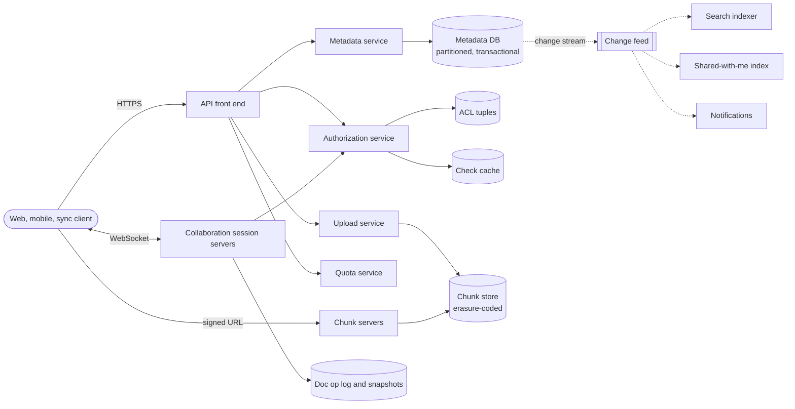

**Reading the diagram.** All clients reach the *API front end* over HTTPS; editors also hold a *WebSocket* to a *collaboration session server* (bidirectional arrow). The front end calls the *metadata service* (backed by the partitioned, transactional *metadata DB*), the *authorization service* (tuples plus a check cache), the *upload service* and the *quota service*. File bytes go to and from *chunk servers* via signed URLs, so the front end never relays bulk data; chunks live in an erasure-coded *chunk store*. Session servers persist the *op log and snapshots* and check authorization when a user joins. Committed metadata changes flow asynchronously through a *change feed* to the *search indexer*, the *shared-with-me index* and *notifications*. Failure points: the authorization service (on every path; must fail closed), the metadata partition for a huge shared drive, a session server (clients reconnect to a new owner). Scaling: metadata by namespace, authorization by object, sessions by document.

### 54.7.8 Detailed component design

#### Component 1 — Metadata service and chunked storage

The metadata service owns the file tree. Each operation is a transaction on the namespace's partition: create inserts an item and its first version; rename and move update `parent_id`/`name` with a check that the destination has no sibling of the same name and that the move does not create a cycle (a folder cannot become its own descendant; check by walking ancestors in the same transaction). Delete moves an item to the trash; a purge job deletes trashed items after a retention period and decrements quota.

File content is written as **chunks** before the metadata commit: the upload service writes chunks to the chunk store, verifies checksums, and only then commits a new version row pointing at the chunk list and advances `head_version`. A crash between the two leaves orphan chunks, which a garbage collector removes after a grace period by comparing chunk references with stored chunks (mark and sweep). An edit to a large file that changes only part of it creates a version that reuses the unchanged chunks; Dropbox takes this further with content-defined deduplication (§54.8).

**Quota** is enforced with reservations: an upload reserves its declared size (`reserved_bytes += size`) if `used + reserved + size <= limit`; on commit, the reservation becomes usage; on abort or expiry, it is released. Because the quota row for a user is a hot key during a bulk upload, it lives in the user's home partition and is updated in the same transaction as the version commit.

#### Component 2 — Sharing and the authorization model

Sharing is **relationship-based access control** (§8.12): permissions are tuples such as `item:123#editor@user:ann` and `item:123#viewer@group:eng#member`, and **rewrite rules** derive effective permissions: an owner is an editor, an editor is a commenter, a commenter is a viewer, and a viewer of a folder is a viewer of every item whose `parent` is that folder. A **check** ("may Ann view item 123?") is a graph search over tuples and rules: direct tuples on the item, then group membership, then the parent chain.

Three design points matter at a million checks per second:

1. **Caching and request deduplication.** Popular items (a company handbook) and large groups are checked constantly; cache check results and sub-results (group memberships), and collapse identical concurrent checks.
2. **Freshness without a global lock.** Every ACL change commits at a timestamp; the content write that follows carries a consistency token. A check evaluated at a snapshot at least as recent as the token cannot use an ACL older than the change, which closes the **new enemy** window: remove Bo, then add a confidential section, and Bo cannot read the section through a stale cache (§8.12.2).
3. **Listing what a user can see.** "Shared with me" and search need the reverse question, "which items may Ann view?". Checking every item is impossible, so a reverse index `user → items shared directly with the user or the user's groups` is maintained asynchronously from the change feed, and search results are post-filtered by batched checks.

::: industry
**Zanzibar and Drive.** Google's Zanzibar paper describes one authorization system serving many Google products, listing Drive among its clients, storing more than two trillion relation tuples, serving millions of checks per second with 95th-percentile latency below 10 ms, and using consistency tokens ("zookies") to avoid the new-enemy problem [Pang et al. 2019].
*Evidence: Primary* — [Pang et al. 2019]
:::

**Link sharing** is a tuple with a special subject (`anyone-with-link`) plus an unguessable item ID; organization policies can forbid it. Every permission change is written to an audit log (§10.12).

#### Component 3 — Real-time collaborative editing

Each open document has one **session owner**, a collaboration server chosen by consistent hashing on `doc_id` (§14.8). The owner holds the document state in memory, appends every accepted operation to `doc_ops` at the next revision, and broadcasts it to all connected clients. This is the client–server form of OT pioneered by the Jupiter system [Nichols et al. 1995]:

1. A client applies its own edit to its local copy immediately (zero-latency typing) and sends it with the server revision it was based on.
2. The server transforms the incoming operation against every operation committed since that base revision, appends the transformed operation, and broadcasts it.
3. A client receiving a remote operation transforms it against its own sent-but-unacknowledged and unsent operations before applying it.
4. Each client has at most one batch in flight; it waits for the acknowledgment before sending the next, which keeps transformation to two parties (client and server) and makes the algorithm much simpler than peer-to-peer OT.

The heart of OT is the **transform function**. For two concurrent edits $a$ and $b$ to the same state, it must satisfy the convergence property $b \circ T(a, b) = a \circ T(b, a)$: applying $b$ then the transformed $a$ gives the same document as applying $a$ then the transformed $b$. For character inserts and deletes:

```python
# Operational transformation for single-character insert and delete.
# transform(a, b) rewrites a so that it can be applied after b has been applied.
# Ties between inserts at the same position are broken by site ID.
import random


def apply(doc, op):
    kind, pos = op[0], op[1]
    return doc[:pos] + op[2] + doc[pos:] if kind == "ins" else doc[:pos] + doc[pos + 1:]


def transform(a, b):
    if a is None or b is None:
        return a
    ka, pa, kb, pb = a[0], a[1], b[0], b[1]
    if ka == "ins" and kb == "ins":
        if pa < pb or (pa == pb and a[3] < b[3]):
            return a
        return ("ins", pa + 1, a[2], a[3])
    if ka == "ins" and kb == "del":
        return a if pa <= pb else ("ins", pa - 1, a[2], a[3])
    if ka == "del" and kb == "ins":
        return a if pa < pb else ("del", pa + 1)
    if pa == pb:                      # both deleted the same character
        return None                   # a becomes a no-op
    return a if pa < pb else ("del", pa - 1)


def apply_maybe(doc, op):
    return doc if op is None else apply(doc, op)


def random_op(doc, site):
    if doc and random.random() < 0.5:
        return ("del", random.randrange(len(doc)))
    return ("ins", random.randrange(len(doc) + 1), random.choice("xyz"), site)


random.seed(7)
for _ in range(10_000):
    doc = "".join(random.choice("abc") for _ in range(random.randrange(0, 6)))
    a, b = random_op(doc, site=1), random_op(doc, site=2)
    left = apply_maybe(apply(doc, a), transform(b, a))     # site 1: a, then b'
    right = apply_maybe(apply(doc, b), transform(a, b))    # site 2: b, then a'
    assert left == right, (doc, a, b, left, right)
print("converged in 10,000 random concurrent pairs")
print(apply_maybe(apply("cat", ("ins", 1, "h", 1)), transform(("del", 2), ("ins", 1, "h", 1))))
```

What to notice:

- An insert at or before a concurrent delete keeps its position; after it, it shifts left by one. A delete after a concurrent insert shifts right.
- Two inserts at the same position need a deterministic tie-breaker (site ID); without it, the copies diverge.
- Two deletes of the same character become one: the second is a no-op.
- The last line merges "insert h at 1" and "delete the t" on `cat` into `cha` on both sides. Real editors transform richer operations (ranges, formatting, tables), which is where most of OT's complexity lives.

**OT or CRDT?** A **sequence CRDT** (§27.14) gives every character a unique, ordered identifier, so concurrent inserts and deletes commute without transformation and replicas converge without a central server, which suits offline-first and peer-to-peer editing. The costs are per-character metadata (identifiers and tombstones for deleted characters, which need garbage collection) and less natural support for operations such as "move this range" or schema-rich documents. Server-centric OT needs a single ordering point per document, which a cloud editor has anyway, and keeps the stored document compact. The teaching design uses OT with a session owner; §54.7.14 discusses the CRDT alternative.

::: industry
**Google Docs and OT.** Google described the collaboration model of the rebuilt Google Docs editor in a 2010 blog series: each change is represented as an operation, concurrent operations are reconciled with operational transformation, and a collaboration protocol between clients and Google's servers keeps all editors' copies consistent [Day-Richter 2010].
*Evidence: Primary* — [Day-Richter 2010]
:::

#### Component 4 — Versioning

Versions take two forms. For uploaded files, each content change creates a `versions` row with its chunk list; older versions are kept for a retention period or count and then garbage-collected unless pinned (`keep_forever`), and their unique chunks are deleted. For collaborative documents, the operation log *is* the version history: any revision can be reconstructed by loading the nearest earlier snapshot and replaying operations. Snapshots are taken every few hundred operations so that opening a document never replays more than that; named versions are pinned snapshots. Old operations can be compacted into coarser revisions (for example, per editing session) after a period, which keeps the log bounded while preserving a useful history.

### 54.7.9 Data flow

**Figure 54.15 — Write path: uploading a new version.**

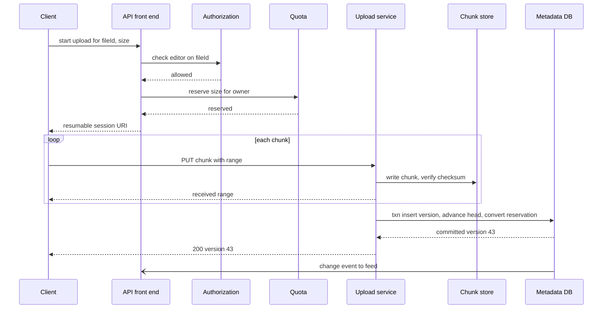

**Reading the diagram.** The front end checks authorization and reserves quota before any bytes arrive, so an upload that would exceed quota fails fast. Chunks stream to the *upload service* and the *chunk store*; only after all are durable does one transaction insert the version, move the head and convert the reservation into usage. The change event propagates asynchronously to search, sync clients and notifications. Failure points: a crash mid-upload (resume from the received range; reservation expires if abandoned), a crash before commit (orphan chunks, garbage-collected).

**Figure 54.16 — Collaborative editing session with concurrent operations.**

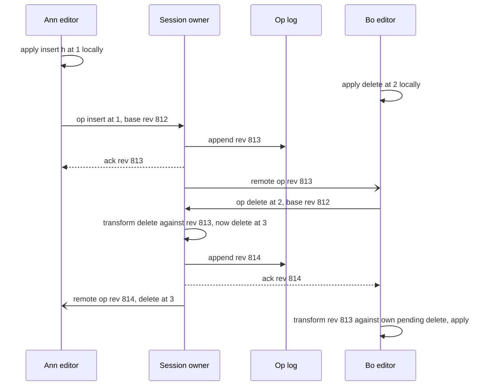

**Reading the diagram.** Both editors apply their own edits locally at once. Ann's insert reaches the *session owner* first and becomes revision 813 in the *op log*; it is acknowledged to Ann and broadcast to Bo asynchronously. Bo's delete arrives based on revision 812, so the owner transforms it against 813 (the deleted character moved one place right), appends it as 814 and broadcasts it to Ann. Bo, who receives 813 while his delete is in flight, transforms 813 against his pending operation before applying it. Both end with the same text. Failure points: the session owner crashing (clients reconnect to the new owner, which rebuilds state from snapshot plus log and asks clients to resend unacknowledged operations, deduplicated by client sequence numbers).

**Figure 54.17 — Read path: opening a shared file.**

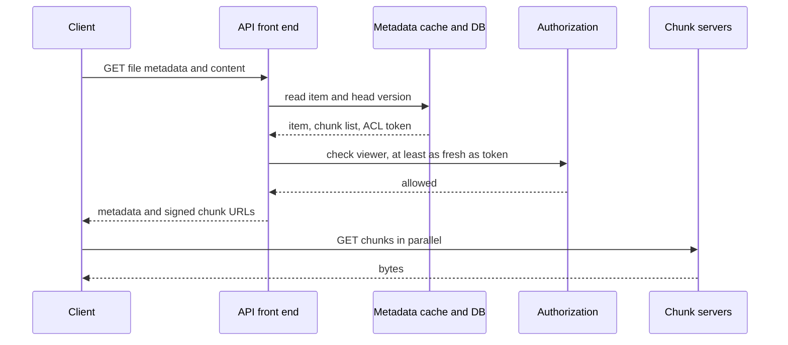

**Reading the diagram.** The front end reads metadata (usually from cache), then asks the *authorization service* to evaluate the check at a snapshot at least as fresh as the item's stored consistency token, and returns short-lived signed URLs for chunks, which the client fetches in parallel from *chunk servers*. If authorization is unavailable, the request fails closed. Failure points: a stale cache entry (harmless, because the check uses the token), the authorization service (fail closed, so its availability bounds Drive's).

### 54.7.10 Bottlenecks

- **Authorization fan-out** for deeply nested groups and folders: precompute group membership indexes and cache sub-results.
- **Huge shared drives:** a namespace with millions of items and thousands of writers makes one partition hot; split large namespaces into sub-partitions by folder subtree.
- **Folder moves and permission changes on large trees:** inheritance through `parent` avoids rewriting every child, but the reverse indexes (shared-with-me, search ACLs) must be updated asynchronously, which can take minutes for very large trees.
- **Very popular documents** (a company-wide doc with thousands of simultaneous viewers): separate viewers from editors, broadcasting to viewers through a fan-out tier rather than the session owner.

### 54.7.11 Failure scenarios

**Table 54.11 — Google Drive teaching design: failure scenarios.**

| What fails | Impact | Detection | Recovery | Prevention |
|---|---|---|---|---|
| Authorization service | All opens fail (closed) | Check error rate and latency SLO | Fail over; serve from caches only within freshness bound | Multi-region, replicated; capacity headroom |
| Session owner crash | Editors pause briefly | WebSocket disconnects | Reassign owner; rebuild from snapshot plus log; clients resend | Ops durable before ack |
| Metadata partition hot | Slow lists and writes in one namespace | Per-partition latency | Split partition | Load-based splitting |
| Reverse index lag | New shares missing from Shared with me | Feed consumer lag | Catch up; direct link still works | Monitor lag; backfill |
| Orphan chunks | Wasted storage | GC metrics | Mark-and-sweep GC | Commit protocol with grace period |
| Accidental mass deletion | Data appears lost | User reports; anomaly on delete rate | Restore from trash and versions | Trash retention; versioning |

### 54.7.12 Scaling strategy

**At 10×:** metadata reaches 10 PB and 10 million reads/s; partition counts grow, and cross-partition moves become more frequent and more expensive, so the API discourages cross-namespace moves of huge folders (copy-then-delete in the background). Authorization becomes the critical shared service, regionally replicated with snapshot reads near users.

**At 100×:** the change feed and reverse indexes become the bottleneck; partition them by user and accept seconds of lag. Storage growth (100 EB/yr) pushes cold versions and rarely opened files to colder, denser erasure codes, with transparent recall.

### 54.7.13 Trade-offs

**Table 54.12 — Google Drive teaching design: key trade-offs.**

| Decision | Option chosen | Alternative | Why |
|---|---|---|---|
| Metadata store | Partitioned transactional (NewSQL) | Key-value plus application locking | Moves, uniqueness and quotas need transactions |
| Permissions | Inherited via parent tuples | Copy ACLs to every child | Sharing a folder of a million files is one write |
| Editing | Server-centric OT with session owner | CRDT, peer-to-peer | Single ordering point exists; compact storage |
| Revocation | Consistency tokens | Synchronous cache invalidation everywhere | Correctness without global coordination |
| Reverse indexes | Asynchronous | Synchronous with every share | Write latency; lag is visible but not unsafe |

### 54.7.14 Alternative designs

- **CRDT-based editor** (for example, in the style of the JSON CRDT [Kleppmann and Beresford 2017]): strong for offline-first and end-to-end encrypted collaboration, where the server cannot read operations and therefore cannot transform them.
- **Per-user storage partition with no shared namespaces:** simpler partitioning, but shared drives and organization ownership become awkward.
- **ACL lists on each item, evaluated locally:** fast for direct shares, but inheritance and group changes require rewriting many items; acceptable only for small trees.
- **Locking instead of concurrent editing** (check-out/check-in): trivial consistency, unacceptable collaboration experience.

### 54.7.15 Interview discussion

**45-minute pacing plan.** 0–5 min: scope (storage, sharing, collaborative editing). 5–10 min: capacity (metadata size, checks per second, editing load). 10–15 min: API and schema. 15–20 min: architecture. 20–30 min: sharing and authorization, including inheritance and the new-enemy problem. 30–40 min: collaborative editing with OT, a worked transform, OT versus CRDT. 40–45 min: versioning, quota, scaling.

**Likely follow-ups.**

- *How do you list "Shared with me"?* An asynchronously maintained reverse index from user (and groups) to items; checks still applied on open.
- *Revoked user still sees content?* Consistency tokens force checks at a fresh enough snapshot.
- *Two people type at the same spot?* Deterministic tie-break in the transform; both copies converge.
- *How do you open a document with a million operations quickly?* Snapshots every few hundred operations.

**What distinguishes senior and staff answers.** A senior candidate uses ReBAC with inheritance and draws the OT session. A staff candidate explains why the check service bounds availability and must fail closed, handles the reverse-listing problem, quantifies per-document versus aggregate editing load, and chooses between OT and CRDT from requirements (central server, offline, encryption) rather than fashion.

### 54.7.16 Production considerations

- **Observability.** Check latency and cache hit ratio; reverse-index lag; editing round-trip latency (local op to remote visibility); session-owner reassignment rate.
- **Security.** Fail closed on authorization errors; audit log of every share and access by administrators; link-sharing policies; data-loss-prevention scanning on the change feed; encryption at rest with per-customer keys for enterprise tiers (§10.9).
- **Cost.** Storage dominates; versions and trash are a large hidden share, so retention limits matter; the authorization service is small in bytes but large in CPU.
- **Operations.** Transform functions are versioned with the client; any change ships behind a document-schema version and is tested with randomized convergence tests like the one above, at much larger scale.

## 54.8 Dropbox

### 54.8.1 Problem statement

Design a file-synchronization service in the style of Dropbox: a user's folder on a laptop, a desktop and a phone, and the folders other people share with them, are kept identical automatically. Edit a file on one device and the change appears on the others within seconds; work offline and the changes sync when the device reconnects; two people edit the same file and neither edit is lost.

Google Drive (§54.7) is a cloud service that devices browse. Dropbox, in this teaching framing, is a **replication system** whose replicas are ordinary folders on many devices, each of which can change at any time, crash at any point, run out of disk, or stay offline for weeks. The hard problem is the **sync engine**: detecting changes, uploading only new bytes, committing changes to a per-namespace journal on the server, telling other devices promptly, and reconciling concurrent changes without ever losing a user's edit. Think of clerks in different towns keeping copies of one ledger, posting each other only new lines, with a rule for when two write different lines on the same page.

::: definition
**Definition — Namespace and journal.** A **namespace** is a unit of sharing and synchronization: a user's root folder or a shared folder, mounted into each member's tree. Each namespace has an append-only **journal** on the server: every committed change (add, modify, delete, move) gets the next journal ID. A device's sync position in a namespace is simply the last journal ID it has applied, its **cursor**.
:::

### 54.8.2 Functional requirements

1. Desktop clients sync a local folder with the server in both directions; mobile and web clients browse and fetch on demand.
2. Upload only changed data; never upload the same block twice if the server has it.
3. Share folders with other users; changes in a shared folder sync to all members.
4. Notify devices of remote changes within seconds.
5. Handle concurrent edits by producing a conflicted copy rather than discarding data; handle concurrent moves and deletes predictably.
6. Version history and restoration of deleted files.
7. Out of scope: document previews, collaborative editing (§54.7), enterprise administration.

### 54.8.3 Non-functional requirements

**Table 54.13 — Dropbox teaching design: non-functional targets.**

| Property | Target | Why |
|---|---|---|
| Data safety | No acknowledged change ever lost; no silent overwrite | The product promise |
| Durability | 11–12 nines per block per year | Many users' only copy |
| Sync latency | p95 < 5 s from commit to other online devices starting download | Feels instant |
| Commit availability | 99.95%; clients queue changes offline indefinitely | Offline is normal |
| Bandwidth efficiency | Upload ≤ 1.1× the truly new bytes for typical edits | User networks are slow |
| Metadata consistency | Per-namespace linearizable journal | Devices must agree on order |
| Notification scale | 100 million concurrently connected devices | Every device waits for changes |

### 54.8.4 Capacity estimation

Dropbox has reported hundreds of millions of registered users; the assumptions below are illustrative.

::: example
**Worked example — Commits, uploads and notifications.** Assumptions: 50 million daily active users with 2 connected devices each; 20 file changes committed per DAU per day; 1 MB of genuinely new data per change after deduplication; each commit notifies 3 other devices on average; peak 3× average.

1. Connected devices: $50 \times 10^6 \times 2 = 10^8$ long-lived notification connections.
2. Commits: $50 \times 10^6 \times 20 = 10^9$ per day; average 11,600/s; peak about 34,700/s.
3. New data: $10^9 \times 1$ MB $= 1$ PB/day; average upload bandwidth $10^{15} \times 8 / 86{,}400 \approx 93$ Gb/s.
4. Notifications: $34{,}700 \times 3 \approx 104{,}000$ wake-ups/s at peak, each followed by a delta-list request.
5. Notification servers at 250,000 idle connections each: $10^8 / 2.5 \times 10^5 = 400$ servers.

**Interpretation.** The commit rate is moderate; the connection count is the unusual number. **Engineering implication.** Notification servers are a specialized tier optimized for idle connections and must carry no state that cannot be rebuilt; commits go to a partitioned metadata store.
:::

::: example
**Worked example — Block index size.** Assumptions: 1 EB of unique stored data; average block 2 MB (most files are smaller than the 4 MB maximum block); 64 B per index entry (32-byte SHA-256 plus location and reference count).

1. Blocks: $10^{18} / 2 \times 10^6 = 5 \times 10^{11}$.
2. Index: $5 \times 10^{11} \times 64 = 3.2 \times 10^{13}$ B $= 32$ TB.

**Interpretation.** The block index is far too large for memory on one machine but modest for a partitioned database. **Engineering implication.** Partition the index by hash prefix (§14.8); lookups are uniform by construction because SHA-256 output is uniform.
:::

### 54.8.5 API design

```text
POST /2/sync/commit
  { namespaceId: 881, path: "/Reports/q3.xlsx", parentRev: "rev_04f",
    blockList: ["sha256:9a1…", "sha256:77c…", "sha256:e02…"], size: 9437184, mtime: … }
  → 200 { rev: "rev_051", journalId: 1201447 }
  → 409 { needBlocks: ["sha256:77c…"] }                 (upload these, then retry)
  → 409 { conflict: true, serverRev: "rev_050" }          (parentRev is stale)

PUT  /2/blocks/{sha256}            <bytes ≤ 4 MiB>  → 200   (server verifies the hash)
POST /2/blocks/has                 { hashes: [...] } → { missing: [...] }
GET  /2/blocks/{sha256}            → bytes (from a block server or CDN, signed)

POST /2/sync/list                  { cursors: { "881": 1201440, "902": 77310 } }
  → { entries: [ { namespaceId, journalId, path, op: "modify"|"delete"|"move", rev, blockList } ],
      cursors: { "881": 1201447, "902": 77310 }, hasMore: false }

POST /2/notify/longpoll            { cursors: { "881": 1201447, "902": 77310 }, timeout: 90 }
  → { changes: true }  |  { changes: false, backoff: 30 }
```

What to notice:

- A commit names content by **block hashes**, not bytes; the server replies with the blocks it lacks, so unchanged and already-known blocks are never uploaded.
- `parentRev` is the revision the client edited from; the server commits only if it is still current (compare-and-set), which is how conflicts are detected.
- The long poll carries the client's cursors and returns only a boolean; the client then calls `list` to fetch the changes. Dropbox's public API has the same shape: a long-poll endpoint that reports whether a folder cursor is stale, followed by a list-continue call with the cursor [Dropbox API v2 docs].

### 54.8.6 Data model and database schema

```sql
-- Metadata, partitioned by namespace_id: every namespace's journal lives on one partition.
CREATE TABLE namespaces (
  namespace_id BIGINT PRIMARY KEY, owner_id BIGINT, kind VARCHAR(8),  -- root | shared
  latest_journal_id BIGINT NOT NULL
);
CREATE TABLE journal (
  namespace_id BIGINT, journal_id BIGINT,
  path VARCHAR(1024), op VARCHAR(8),          -- add | modify | delete | move
  rev CHAR(12), parent_rev CHAR(12), block_list BINARY, size BIGINT,
  device_id BIGINT, committed_at TIMESTAMP,
  PRIMARY KEY (namespace_id, journal_id)
);
CREATE TABLE files_latest (                  -- current state, derived from the journal
  namespace_id BIGINT, path VARCHAR(1024), rev CHAR(12), journal_id BIGINT,
  block_list BINARY, size BIGINT, deleted BOOLEAN,
  PRIMARY KEY (namespace_id, path)
);
CREATE TABLE mounts (                        -- shared folders mounted into users' trees
  user_id BIGINT, namespace_id BIGINT, mount_path VARCHAR(1024),
  PRIMARY KEY (user_id, namespace_id)
);

-- Block index, partitioned by hash prefix
CREATE TABLE blocks (
  hash BINARY(32) PRIMARY KEY, size INT, storage_cell INT, extent_id BIGINT, refcount BIGINT
);
```

The journal and `files_latest` are updated in one transaction per commit on the namespace's partition, so each namespace's history is linearizable and a cursor is a precise point in it (§25.3). Partitioning by namespace keeps commits single-partition, except when a move crosses namespaces (rare, handled as delete plus add with the same blocks). Blocks are content-addressed and immutable; deleting a file decrements reference counts, and a block is reclaimed only when no version in retention references it.

### 54.8.7 High-level architecture

**Figure 54.18 — Dropbox teaching design.**

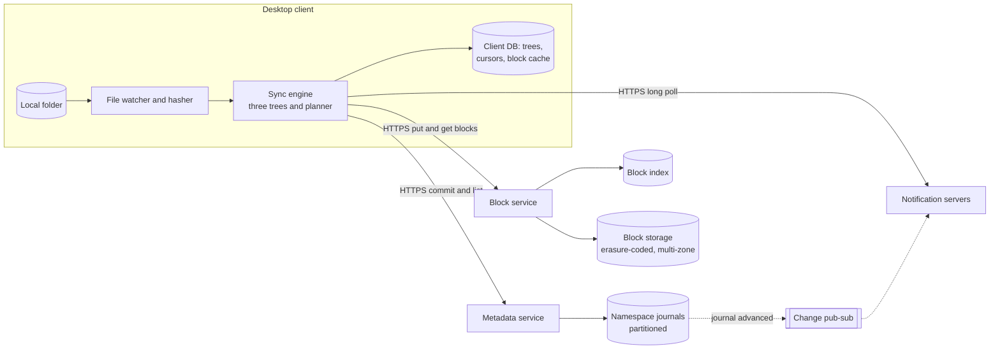

**Reading the diagram.** On the *desktop client*, a *file watcher* notices changes in the *local folder* and hashes content into blocks; the *sync engine* keeps three trees and a planner (Component 3) and persists them, with cursors and a block cache, in a *client DB*. The client talks HTTPS to three server tiers: the *metadata service* for commits and change lists, the *block service* for block uploads and downloads, and the *notification servers* for long polls. Metadata lives in *namespace journals*, partitioned by namespace. The block service consults the *block index* and stores blocks in erasure-coded, multi-zone *block storage*. When a journal advances, an event is published asynchronously through *change pub-sub* to the notification servers holding long polls for that namespace. Storage boundaries: the local folder and client DB on each device, the journals, the block index and block storage. Failure points: a metadata partition (commits for its namespaces pause; clients queue), a notification server (its clients reconnect elsewhere and re-list from their cursors, so no change is missed). Scaling: metadata by namespace, blocks by hash, notifications by connection.

### 54.8.8 Detailed component design

#### Component 1 — Client-side chunking, deduplication and delta sync

When a file changes, the client splits it into blocks, hashes each block with SHA-256, and asks the server which hashes it lacks. Only missing blocks are uploaded. This gives three kinds of savings at once: an unchanged block of an edited file is not re-sent; a file copied or renamed within the account costs nothing; and a block the server already holds is not re-sent.

**How to cut blocks.** Fixed-size blocks (every 4 MB) are simple and make block boundaries predictable, but an insertion near the start of a file shifts every later boundary, so every later block looks new. **Content-defined chunking** (CDC, §15.8.3) places boundaries where a rolling hash of the content matches a pattern, so boundaries move with the content and an insertion changes only the chunk that contains it.

::: formula
**Upload size after a small insertion: fixed blocks versus CDC**

$$U_{\text{fixed}} \approx \left\lceil \frac{S - o}{B} \right\rceil B \qquad U_{\text{CDC}} \approx k \times E[\text{chunk}] + \Delta, \quad k \in \{1, 2\}$$

| Symbol | Meaning | Units |
|---|---|---|
| $S$ | File size | bytes |
| $o$ | Offset of the insertion | bytes |
| $B$ | Fixed block size | bytes |
| $\Delta$ | Inserted bytes | bytes |
| $E[\text{chunk}]$ | Expected CDC chunk size (§15.8.3) | bytes |
| $k$ | Chunks touched by the edit (two if it straddles a boundary) | count |
:::

::: example
**Worked example — Inserting 100 bytes into a 1 GB file.** $S = 10^9$ B, $o = 10^8$ B (10% into the file), $B = E[\text{chunk}] = 4$ MiB $= 4{,}194{,}304$ B, $\Delta = 100$ B.

1. Fixed blocks: $\lceil 9 \times 10^8 / 4{,}194{,}304 \rceil = 215$ blocks; $215 \times 4{,}194{,}304 \approx 902$ MB uploaded.
2. CDC: one or two chunks, about 4.2–8.4 MB uploaded.
3. Ratio: roughly 100–200× less upload with CDC for this edit.

**Interpretation.** For append-only or in-place edits (logs, most office files rewritten in place, images), fixed blocks lose nothing; for insertions into large files (archives, databases, video project files), they waste almost the whole file. **Engineering implication.** Use CDC for large files, or keep fixed blocks and add an rsync-style delta step within a block: the rolling-checksum algorithm finds shifted matches against the previous version at any byte offset [Tridgell and Mackerras 1996], at the cost of client CPU and the need to keep the previous version.
:::

::: industry
**Dropbox's published block design.** Measurements of the Dropbox client by Drago et al. found that it split files into chunks of up to 4 MB, deduplicated chunks already on the server, applied delta encoding to modified content and bundled small chunks into fewer requests, with separate servers for metadata, storage and change notification [Drago et al. 2012]. Dropbox's own description of Magic Pocket, its in-house block store, describes blocks of up to 4 MB, identified by their SHA-256 hash [Cowling 2016]. Dropbox's public API documents a file `content_hash` computed by hashing each 4 MB block with SHA-256 and hashing the concatenation [Dropbox API v2 docs].
*Evidence: Primary* — [Drago et al. 2012]; [Cowling 2016]; [Dropbox API v2 docs]
:::

**Cross-user deduplication** saves more space but creates a side channel: if uploading a block is skipped because someone else has it, an attacker can test whether any user holds a given file, and a client that claims a hash without proving possession could download content it never had. A safe design either deduplicates only within an account or requires proof that the client holds the bytes (for example, the server asks for a hash of the block combined with a server-chosen nonce) before granting access to a block.

#### Component 2 — The metadata journal and commit protocol

A commit is a **compare-and-set on a path** inside the namespace's partition:

1. The client sends `commit(namespace, path, parentRev, blockList)`.
2. The server checks that every block in the list exists in the block index (and that the client may reference it). If some are missing, it returns `needBlocks`; the client uploads them (each upload verified by hashing the bytes) and retries. Blocks are always durable *before* the metadata that references them, so no committed file can point at missing data.
3. In one transaction: if `files_latest[path].rev == parentRev` (or the path does not exist and `parentRev` is null), append a journal entry with the next `journal_id`, update `files_latest`, and increment block reference counts. Otherwise return a conflict.
4. After commit, publish "namespace 881 advanced to journal ID 1201447" to the notification tier.

The journal is the system's source of truth and its replication log: any device can reconstruct the namespace by replaying it from its cursor, and `files_latest` is a materialized view of it (§32.3). Retries are safe: a commit whose response was lost is retried with the same `parentRev`; if the first attempt succeeded, the server sees that `files_latest` already holds the same block list from the same device and returns the existing revision rather than a conflict.

#### Component 3 — The client sync engine: three trees and a planner

The client's hardest job is deciding what to do when both sides may have changed. The teaching design keeps three trees in the client database:

- **Remote tree:** the latest server state the client has observed (from `list`).
- **Local tree:** the latest state of the disk the client has observed (from the watcher and hashing).
- **Synced tree:** the last state on which both sides agreed: the **merge base**.

A **planner** compares the three for each path, exactly like a three-way merge in version control: if only the remote side differs from the synced tree, download; if only the local side differs, upload (commit); if both differ and agree, record agreement; if both differ and disagree, produce a conflicted copy. After each action succeeds, the synced tree is updated. Because the synced tree records what was agreed, a client that crashes mid-way restarts by re-observing disk and server and re-planning: actions are idempotent and the plan is always derived from observations, not from a queue of half-done work.

```python
# Three-way sync planning: compare each path's state on the server (remote),
# on disk (local) and at the last point both agreed (synced, the merge base).
# States are content hashes; None means the path does not exist.

def plan(remote, local, synced):
    actions = []
    for path in sorted(set(remote) | set(local) | set(synced)):
        r, l, s = remote.get(path), local.get(path), synced.get(path)
        if r == l:
            if r != s:
                actions.append(("record_synced", path))       # both sides already agree
        elif l == s:
            actions.append(("download" if r else "delete_local", path))
        elif r == s:
            actions.append(("upload" if l else "delete_remote", path))
        elif l is None:
            actions.append(("download", path))                # local delete loses to remote edit
        elif r is None:
            actions.append(("upload", path))                  # remote delete loses to local edit
        else:
            actions.append(("conflicted_copy", path))         # both edited: keep both
    return actions


synced = {"a.txt": "h1", "b.txt": "h2", "c.txt": "h3", "d.txt": "h4"}
remote = {"a.txt": "h1", "b.txt": "h9", "c.txt": "h3", "d.txt": "h7"}
local  = {"a.txt": "h5", "b.txt": "h2",                "d.txt": "h8", "e.txt": "h6"}
for action in plan(remote, local, synced):
    print(action)
# ('upload', 'a.txt') ('download', 'b.txt') ('delete_remote', 'c.txt')
# ('conflicted_copy', 'd.txt') ('upload', 'e.txt')
```

What to notice:

- Without the synced tree, `c.txt` (deleted locally) would look like a new remote file to download, and `e.txt` (new locally) like a remote deletion: two-way comparison cannot tell "I deleted it" from "they created it".
- An edit always beats a concurrent delete, because silently discarding an edit is the one unforgivable outcome.
- Two different edits of `d.txt` produce a **conflicted copy**: the server version keeps the name, and the local version is committed as a new file such as `d (Ann's conflicted copy 2026-11-05).txt`. Nothing is lost, and the user resolves it.
- Directory moves need more care than this per-path sketch: two devices moving the same folder to different places, or moving a folder into its own descendant on another device, must be resolved so that the tree stays a tree.

::: industry
**Dropbox Nucleus.** Dropbox rewrote its desktop sync engine over about four years, releasing the new engine, Nucleus, written in Rust, to all users by 2020. Dropbox describes Nucleus as persisting observations rather than pending work, and representing state as three trees (remote, local and synced, the last being the merge base), from which a planner derives operations; nearly all of its logic runs on a single control thread for determinism, with I/O and hashing offloaded to background threads, and the engine was tested heavily with randomized testing [Jayakar 2020; Goldberg 2020].
*Evidence: Primary* — [Jayakar 2020]; [Goldberg 2020]
:::

**Figure 54.19 — The three-tree sync loop.**

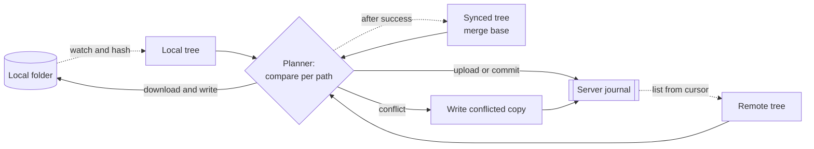

**Reading the diagram.** Observations flow asynchronously (dotted) from the *local folder* into the *local tree* and from the *server journal* into the *remote tree*. The *planner* compares both with the *synced tree* and issues synchronous actions: commits to the server, downloads to disk, or a conflicted copy committed as a new file. After each action succeeds, the synced tree advances. Storage boundaries: the disk, the client DB holding the three trees, and the server journal. Failure points: a crash between an action and the synced-tree update (the next observation shows both sides agree, so the planner just records it); a disk full (downloads pause, uploads continue). Scaling: the planner's work is proportional to changed paths, not folder size, because trees are diffed incrementally.

#### Component 4 — Change notification by long polling

Every connected device needs to learn of changes within seconds, but almost all devices are idle almost all the time. A long poll (§9.4) fits: the client sends its cursors and the server holds the request open until a namespace advances or a timeout (about 90 s) passes; the response says only "changes" or "no changes", and the client then lists from its cursors. Because the notification server holds no state that matters (the cursor travels with the request), a server crash costs nothing but a reconnect, and a missed notification is impossible to turn into a missed change: the next long poll or periodic list catches up from the cursor. A **backoff** field lets the server shed load by telling clients to wait before polling again. WebSockets (§9.6) would also work; long polling passes through restrictive proxies and keeps the server side trivially stateless.

Notification servers subscribe to the namespaces of their connected clients on a pub-sub tier; when a commit advances a namespace, every server with a waiting client for that namespace completes the request. Shared folders with many members create fan-out: a commit to a namespace mounted by 10,000 users wakes 10,000 or more devices, so wake-ups are jittered over a few seconds to avoid a thundering herd of `list` calls.

#### Component 5 — Block storage and the migration to Magic Pocket

Blocks are immutable, content-addressed and up to 4 MB, which makes the storage layer simple in principle: a key-value store from hash to bytes, with a block index locating each block in a storage **cell**; blocks are packed into large append-only extents, erasure-coded within a zone for cheap durability, and replicated to another zone so that the loss of a whole site loses nothing (§15.6). Immutability makes caching trivial and repairs verifiable: the hash checks the bytes.

::: industry
**Magic Pocket.** Dropbox originally stored file blocks in Amazon S3 and in 2016 described moving the large majority of user data into Magic Pocket, its own exabyte-scale block storage system, built on custom hardware in its own data centers; the system stores immutable blocks keyed by SHA-256 hashes, replicates them across geographic zones and uses erasure coding [Gupta 2016; Cowling 2016]. Dropbox's 2018 registration statement attributed tens of millions of dollars of annual operating cost reductions to this infrastructure migration (§51.3) [Dropbox 2018].
*Evidence: Primary* — [Gupta 2016]; [Cowling 2016]; [Dropbox 2018]
:::

The migration itself is a lesson in moving an exabyte without downtime: because blocks are immutable and addressed by hash, both stores can hold the same block, so the block service writes new blocks to both, copies old blocks in the background with hash verification, flips reads per cell once a cell is fully copied and verified, and deletes from the old store only after a long period of dual operation. The same pattern applies to any immutable, content-addressed data.

### 54.8.9 Data flow

**Figure 54.20 — Write path: committing an edited file.**

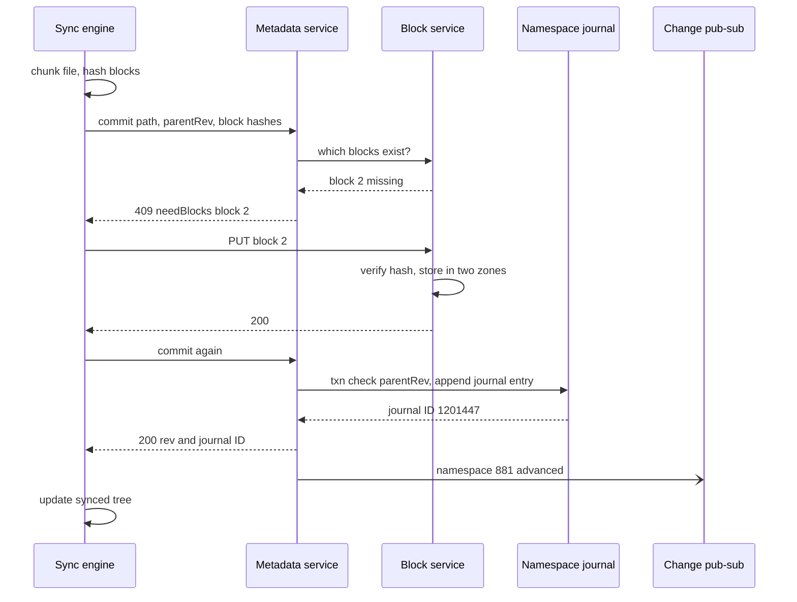

**Reading the diagram.** The client hashes blocks locally and offers a commit by hashes. The *metadata service* asks the *block service* which blocks exist and returns the missing list; the client uploads only those, each verified by hash and stored durably in two zones. The retried commit performs the compare-and-set on `parentRev` and appends to the *namespace journal* in one transaction. The change notification is asynchronous. If `parentRev` were stale, the server would return a conflict and the planner would create a conflicted copy. Failure points: a lost commit response (retry is recognized as already applied), a crash between block upload and commit (orphan blocks with zero references are garbage-collected).

**Figure 54.21 — Read path: another device learns of the change.**

```mermaid
sequenceDiagram
  participant D as Other device
  participant N as Notification server
  participant P as Change pub-sub
  participant M as Metadata service
  participant B as Block service
  D->>N: long poll with cursors, timeout 90 s
  P-)N: namespace 881 advanced
  N-->>D: changes true
  D->>M: list from cursor 1201440
  M-->>D: entries up to 1201447, new cursor
  D->>D: planner decides download
  D->>B: GET missing blocks by hash
  B-->>D: block bytes
  D->>D: assemble temp file, verify, atomic rename
  D->>N: long poll with new cursor
```

**Reading the diagram.** The device holds a *long poll* on a *notification server*, which completes it when *pub-sub* reports that one of its namespaces advanced. The device lists changes from its cursor via the *metadata service*, plans, and fetches only the blocks it lacks (blocks already in its cache or elsewhere on disk are reused). It assembles the file in a temporary location, verifies the hashes and renames it into place atomically so that applications never see a half-written file, then polls again. Failure points: a notification server crash (reconnect, cursor unchanged), a lost notification (the next poll or periodic list catches up), a block fetch failure (retry from another replica).

### 54.8.10 Bottlenecks

- **Connection count:** 100 million idle long polls; tune servers for memory per connection and spread reconnect storms after deploys with jitter.
- **Large shared namespaces:** a company-wide shared folder concentrates commits on one partition and fans out to tens of thousands of devices; split very large namespaces and rate-limit wake-ups.
- **Initial sync of a new device:** downloading hundreds of gigabytes; prioritize recently used files, fetch on demand for the rest (placeholder files), and use LAN sync between devices on the same network.
- **Client hashing CPU** for large files: hash incrementally and only regions the file system reports as changed, where available.

### 54.8.11 Failure scenarios

**Table 54.14 — Dropbox teaching design: failure scenarios.**

| What fails | Impact | Detection | Recovery | Prevention |
|---|---|---|---|---|
| Concurrent edits | Two versions of one file | `parentRev` mismatch | Conflicted copy; user resolves | Compare-and-set commits |
| Metadata partition down | Commits stall for its namespaces | Commit error rate per partition | Fail over to replica | Replicated partitions; client offline queue |
| Notification server crash | Clients disconnected | Connection drops | Reconnect; list from cursor | Stateless servers; cursor in request |
| Client crash mid-download | Partial file | On restart, local tree differs | Re-plan from observations | Temp file plus atomic rename |
| Corrupt block on disk | Wrong bytes | Hash mismatch on read or scrub | Repair from other zone or parity | Content addressing; background scrubbing |
| Buggy client release deletes files | Mass deletion propagates | Anomalous delete-rate alarms | Restore from version history | Staged client rollout; delete-rate circuit breaker |

### 54.8.12 Scaling strategy

**At 10×:** a billion connected devices need about 4,000 notification servers and a sharded pub-sub layer; the block index grows to hundreds of terabytes and stays partitioned by hash; metadata partitions multiply, and namespace placement is rebalanced by load. Smarter clients (on-demand placeholders, LAN sync, CDC for large files) reduce bytes per change.

**At 100×:** storage, not metadata, dominates cost; colder data moves to denser erasure codes and archival media, and storage cells grow. Global users require regional metadata homes, with each namespace's journal living in its home region and cross-region shared folders paying a latency cost on commit (§44.6).

### 54.8.13 Trade-offs

**Table 54.15 — Dropbox teaching design: key trade-offs.**

| Decision | Option chosen | Alternative | Why |
|---|---|---|---|
| Conflict policy | Conflicted copies | Last-writer-wins | Never lose data; users resolve rarely |
| Chunking | 4 MB blocks, CDC for large files | Whole-file upload | Dedup and resumable transfers |
| Notification | Long poll, stateless | Stateful push protocol | Proxy-friendly, crash-proof |
| Sync state | Three trees from observations | Queue of pending operations | Restartable and testable |
| Dedup scope | Within account or with proof of possession | Global blind dedup | Avoid side channels |

### 54.8.14 Alternative designs

- **Operation-based sync** (record every local operation and replay it remotely): preserves intent for moves and renames but is fragile when the operation log and disk disagree; observation-based planning is more robust.
- **CRDT-based file tree** (§27.14): handles concurrent moves without central ordering, but a tree CRDT must still prevent cycles and gives users surprising merges; a central journal is simpler for a client–server product.
- **Full-file versioning with no block layer:** simpler, but every edit to a large file re-uploads and re-stores it.

### 54.8.15 Interview discussion

**45-minute pacing plan.** 0–5 min: scope (desktop sync, sharing, conflicts). 5–10 min: capacity, highlighting connection count and bytes per change. 10–15 min: API (commit by hashes, list by cursor, long poll). 15–20 min: architecture. 20–30 min: chunking, deduplication and delta sync with the fixed-versus-CDC arithmetic. 30–40 min: journal, commit compare-and-set, three-tree planner and conflicts. 40–45 min: notifications and storage migration.

**Likely follow-ups.**

- *How do you avoid re-uploading a renamed 10 GB file?* Same block hashes; the commit references existing blocks.
- *What if two devices edit offline and reconnect?* The second commit's `parentRev` is stale; it becomes a conflicted copy.
- *How do you guarantee no missed change?* Cursors on a linearizable journal; notifications are hints, lists are truth.
- *What if a client bug deletes everything?* Deletes are journal entries; versions and trash restore; delete-rate circuit breakers stop propagation.

**What distinguishes senior and staff answers.** A senior candidate designs block-level dedup, a commit protocol and long-poll notification. A staff candidate explains why a merge base is required, makes every step idempotent and restartable, treats notifications as hints over a cursor, discusses dedup side channels and plans a live storage migration.

### 54.8.16 Production considerations

- **Observability.** Time from commit to download start on other devices; client-reported sync health ("up to date" share of clients); conflict rate per million commits; block-scrub repair rate.
- **Security.** Hash-verified uploads; proof of possession for cross-account block references; encryption at rest per block with keys in a KMS (§10.9); shared-link scoping and audit logs.
- **Cost.** Storage dominates; dedup ratio and erasure-code overhead are the levers; the build-versus-buy decision for storage is the Magic Pocket story (§51.9).
- **Operations.** Client releases are staged with kill switches, because a client bug can corrupt data on millions of devices that the service does not control; randomized and fault-injection testing of the sync engine before release.

## 54.9 Summary and revision notes

::: summary
- **YouTube:** bytes, not requests, dominate. Resumable sessions with byte offsets; a DAG of idempotent tasks over closed-GOP segments; latency bounded by the critical path, $\max(W/w, T_{\text{cp}}) \le T_w \le W/w + T_{\text{cp}}$; publish at the first rendition; eager H.264, lazy advanced codecs above break-even views $V^{*} = (C_{\text{enc}} + C_{\text{store}})/(t_w \Delta b\, p_{\text{egress}})$; renditions are a regenerable cache over immutable originals; views counted by a validated, deduplicated stream pipeline.
- **Netflix:** control plane in cloud regions, data plane in ISP-embedded caches filled off-peak. Play start = personalized manifest, device-bound license, ranked cache URLs; overlap license with first segments. Running streams survive control-plane loss. Fallbacks, chaos experiments on stream starts per second, and rehearsed regional evacuation with $N/(N-1)$ headroom.
- **Spotify:** the client cache is the fastest tier; prefetch the next track; offline downloads are expiring leases renewed at check-in; playlists are op logs with stable item IDs and server-side transformation; royalties split a fixed pool, so count each qualifying play exactly once by `playId`, by occurrence month, with a close and adjustments.
- **Google Drive:** transactional metadata partitioned by namespace; chunked versions; ReBAC with inheritance, cached checks, consistency tokens against the new-enemy problem, asynchronous reverse indexes; OT with one session owner per document; quota by reservation.
- **Dropbox:** commit by block hashes, upload only missing blocks; CDC beats fixed blocks for insertions; per-namespace linearizable journal with compare-and-set commits; three-tree planner with a merge base; conflicted copies, never silent loss; long polls as hints over cursors; live migration of immutable blocks by dual write and verified copy.
:::

**Table 54.16 — The distinctive problem of each case.**

| Case | Dominant load | Hard problem | Key technique |
|---|---|---|---|
| YouTube | Ingest bytes and egress | Transcoding at low cost | Segment DAG, popularity-driven codecs and tiers |
| Netflix | Peak egress | Fast, resilient play start | Control/data-plane split, evacuation |
| Spotify | Play events | Local feel and exact royalties | Client cache, leases, dedup by playId |
| Google Drive | Metadata reads with checks | Sharing and co-editing | ReBAC with tokens, OT session owner |
| Dropbox | Idle connections, changed bytes | Multi-device sync without loss | Block hashes, journal cursors, three trees |

## 54.10 Knowledge checkpoint

1. Why are YouTube renditions stored with lower durability than originals?
2. A DAG has 3,000 s of total work and a 50 s critical path. What is the best possible makespan on 100 workers, and the list-scheduling upper bound?
3. Why must transcoding segments start at closed-GOP keyframes?
4. Recompute the VP9 break-even if delivery costs \$0.01/GB, other assumptions as in §54.4.8.
5. Why does view counting write "total as of window end" rather than increments?
6. What keeps Netflix streams playing when the control plane fails?
7. Why can segments be fetched before the license arrives?
8. With four control-plane regions, how much capacity must each have relative to its normal peak to survive the loss of one?
9. Why is a Spotify offline download a lease rather than a file?
10. In a fixed royalty pool, who pays for one label's over-count?
11. Why do playlist operations reference item IDs rather than positions?
12. What is the new-enemy problem and how do consistency tokens prevent it?
13. Apply the transform: on `abc`, site 1 inserts `x` at 0 and site 2 deletes position 1. What do both sites end with?
14. Why does a sync engine need a synced tree in addition to local and remote trees?
15. Why is a missed long-poll notification harmless?
16. Upload size for a 100-byte insertion at 500 MB into a 2 GB file with 4 MiB fixed blocks?

<details><summary>Answers</summary>

1. A rendition is a deterministic function of the original and a recipe; it can be regenerated, so losing it costs compute, not data.
2. Lower bound $\max(30, 50) = 50$ s; upper bound $30 + 50 = 80$ s.
3. A closed GOP references no frames outside itself, so each segment encodes and decodes independently and players can switch renditions at boundaries.
4. Saving per view doubles to \$0.000197; $V^{*} = 0.0925 / 0.000197 \approx 470$ views.
5. Replaying a window after a crash must give the same result; a set is idempotent, an increment is not.
6. Video bytes come from ISP caches using already-issued manifests and licenses, which remain valid for hours.
7. Segments are encrypted; without the key they are useless, so prefetching them leaks nothing and hides the license round trip.
8. $4/3 \approx 1.33\times$.
9. Licensing requires revocation; expiring keys renewed at check-in enforce takedowns and lapsed subscriptions.
10. Every other rights holder in the same pool, in proportion to their share.
11. Item IDs keep their meaning under concurrent inserts and deletes; positions shift.
12. Evaluating access with an ACL older than the content (for example, after removing a user and then adding secrets); a token from the ACL change forces later checks to use a snapshot at least that fresh.
13. Site 1: `xabc`, then the delete transformed to position 2 → `xac`. Site 2: `ac`, then insert at 0 → `xac`.
14. To distinguish "deleted here" from "created there" and to detect true conflicts; it is the merge base of a three-way merge.
15. Notifications are hints; the cursor-based list on the next poll returns every change after the cursor.
16. $\lceil 1.5 \times 10^9 / 4{,}194{,}304 \rceil = 358$ blocks, about 1.5 GB; CDC would upload about 4–8 MB.

</details>

## 54.11 Interview questions

### Basic

**Q1. How would you let users resume a 5 GB upload over a flaky network?**
**Answer.** A resumable session: create it with total length, get a session URI, send chunks with byte ranges, and after any failure ask the server for the received range and continue. The server writes chunks as multipart parts and acknowledges only durable bytes; completion commits metadata and emits a processing event through an outbox.

**Q2. Why do Netflix-style services separate control and data planes?**
**Answer.** They scale on different axes: the data plane on bandwidth (over 100 Tb/s at peak in our estimate), best placed in ISPs; the control plane on request rate and availability, best run in multi-region cloud. Separation also isolates failures: control-plane outages stop new plays, not running ones.

### Intermediate

**Q3. Design view counting for a video that gets 50,000 views per second.**
**Answer.** Heartbeats to a partitioned log; a stream job sessionizes by player-generated view ID, validates, deduplicates within a window, pre-aggregates per minute and writes idempotent totals to a counter store. Never update a row per view; use HyperLogLog for approximate uniques.

**Q4. How do you prevent lost updates when two users edit a collaborative playlist?**
**Answer.** Stable item IDs; inserts relative to neighbors with fractional sort keys; a per-playlist serialized op log with base revisions; server-side transformation of stale operations; idempotent client op IDs; notify collaborators to fetch missing ops.

### Advanced

**Q5. Compare OT and CRDTs for a document editor that must support end-to-end encryption.**
**Answer.** Server-centric OT requires the server to read and transform operations, which encryption forbids; a CRDT converges without server understanding, so the server only relays and stores ciphertext. The cost is per-element metadata, tombstones and harder rich-text semantics. Without encryption and with a central server, OT is simpler and more compact.

**Q6. A sync-client release has a bug that deletes files locally. How should the system limit damage?**
**Answer.** Deletes are journal entries, so history and trash allow restoration; staged rollout with kill switches limits exposure; a server-side circuit breaker rejects or holds commits with anomalous delete rates per account; the planner treats mass local disappearance (for example, an unmounted disk) as suspicious and asks the user. Recovery is a bulk restore from journal positions before the bug.

## 54.12 Practical exercises

1. Extend the transcoding simulation in §54.4.8 with speculative re-execution of stragglers (one segment task takes 10× longer) and measure time to full ladder with and without it.
2. Modify the Spotify counter to read events from a file in random order with 20% duplicates and verify that totals are unchanged across ten shuffles.
3. Add range deletions to the OT transform of §54.7.8 and extend the randomized convergence test.
4. Implement content-defined chunking (reuse §15.8.3) and measure bytes re-uploaded after random insertions into a 100 MB file, versus fixed 4 MiB blocks.
5. Extend the three-tree planner to handle directory moves and detect a move that would create a cycle.

## 54.13 Design challenges

1. **Live sports streaming.** Adapt the Netflix design for a live match with 20 million concurrent viewers starting within five minutes: what changes in fill, steering, licensing and admission control?
2. **Podcast platform.** Design hosting, transcoding and download analytics for 5 million podcasts, where advertisers pay per verified download.
3. **End-to-end encrypted Dropbox.** Keep block deduplication, sharing and version history while the server never sees plaintext or file names.

## 54.14 References

1. Aaron, A., Li, Z., Manohara, M., De Cock, J., Ronca, D. "Per-Title Encode Optimization." *Netflix Technology Blog*, December 2015.
2. Basiri, A., Behnam, N., de Rooij, R., Hochstein, L., Kosewski, L., Reynolds, J., Rosenthal, C. *Chaos Engineering*. IEEE Software 33(3), 2016.
3. Cowling, J. "Inside the Magic Pocket." *Dropbox Tech Blog*, 2016.
4. Day-Richter, J. "What's different about the new Google Docs" (series: "Working together, even apart"; "Conflict resolution"; "Making collaboration fast"). *Google Drive Blog*, September 2010.
5. Dean, J., Ghemawat, S. *MapReduce: Simplified Data Processing on Large Clusters*. OSDI, 2004.
6. Drago, I., Mellia, M., Munafò, M. M., Sperotto, A., Sadre, R., Pras, A. *Inside Dropbox: Understanding Personal Cloud Storage Services*. ACM Internet Measurement Conference (IMC), 2012.
7. Dropbox. *Dropbox API v2 documentation* (files/list_folder/longpoll; content hash). https://www.dropbox.com/developers/documentation (accessed 2026).
8. Dropbox, Inc. *Form S-1 Registration Statement*. U.S. Securities and Exchange Commission, 2018.
9. Ellis, C. A., Gibbs, S. J. *Concurrency Control in Groupware Systems*. ACM SIGMOD, 1989.
10. Goldberg, I. "Testing sync at Dropbox." *Dropbox Tech Blog*, April 2020.
11. Goodrow, C. "You know what's cool? A billion hours." *YouTube Official Blog*, February 2017.
12. Google Developers. *Perform a resumable upload* (Google Drive API and YouTube Data API documentation). https://developers.google.com (accessed 2026).
13. Graham, R. L. *Bounds on Multiprocessing Timing Anomalies*. SIAM Journal on Applied Mathematics 17(2), 1969.
14. Gupta, A. "Scaling to exabytes and beyond." *Dropbox Tech Blog*, March 2016.
15. Izrailevsky, Y. "Completing the Netflix Cloud Migration." *Netflix*, February 2016.
16. Izrailevsky, Y., Tseitlin, A. "The Netflix Simian Army." *Netflix Technology Blog*, 2011.
17. Jayakar, S. "Rewriting the heart of our sync engine." *Dropbox Tech Blog*, March 2020. https://dropbox.tech/infrastructure/rewriting-the-heart-of-our-sync-engine
18. Kleppmann, M., Beresford, A. R. *A Conflict-Free Replicated JSON Datatype*. IEEE Transactions on Parallel and Distributed Systems 28(10), 2017.
19. Kreitz, G., Niemelä, F. *Spotify — Large Scale, Low Latency, P2P Music-on-Demand Streaming*. IEEE P2P, 2010.
20. Maravić, I. "Spotify's Event Delivery – The Road to the Cloud" (Parts I–III). *Spotify Engineering*, February–March 2016.
21. Meshenberg, R., Gopalani, N., Kosewski, L. "Active-Active for Multi-Regional Resiliency." *Netflix Technology Blog*, 2013.
22. Netflix. *Open Connect Overview*. https://openconnect.netflix.com (accessed 2026).
23. Netflix. *Fourth Quarter 2024 Letter to Shareholders*. January 2025.
24. Netflix Technology Blog. "Netflix and Fill." 2016.
25. Netflix Technology Blog. "Project Nimble: Region Evacuation Reimagined." 2018.
26. Nichols, D. A., Curtis, P., Dixon, M., Lamping, J. *High-Latency, Low-Bandwidth Windowing in the Jupiter Collaboration System*. ACM UIST, 1995.
27. Pang, R., et al. *Zanzibar: Google's Consistent, Global Authorization System*. USENIX ATC, 2019. https://www.usenix.org/conference/atc19/presentation/pang
28. Ranganathan, P., et al. *Warehouse-Scale Video Acceleration: Co-Design and Deployment in the Wild*. ASPLOS, 2021.
29. Spotify. *Loud & Clear* (how streams are counted and paid). https://loudandclear.byspotify.com (accessed 2026).
30. Spotify Engineering. "Spotify's Event Delivery – Life in the Cloud." November 2019.
31. Tridgell, A., Mackerras, P. *The rsync algorithm*. Technical Report TR-CS-96-05, Australian National University, 1996.

## 54.15 Open verification items

- YouTube "500 hours uploaded per minute" (no primary source cited) and Goodrow 2017 title/author; Google Drive "over a billion users" (2018 statement, uncited).
- Netflix: Q4 2024 membership figure; Izrailevsky 2016 venue (Netflix newsroom vs. TechBlog); "High Quality Video Encoding at Scale" post (chunked encoding) not cited because unverified; Basiri et al. 2016 describing region-failure (Chaos Kong) exercises.
- Spotify: Kreitz & Niemelä figures beyond 8.8% and 265 ms not used; 30-second rule wording on Loud & Clear; author of the 2019 event-delivery post; whether hourly partitioning is described in Maravić 2016 or the 2019 post.
- Dropbox: Cowling 2016 exact title/date and multi-zone/erasure-coding details; Gupta 2016 title; Day-Richter authorship of all three 2010 Docs posts.
- Ch 21 (§21.10 mistake callout) points to "§54.2" for Netflix; under the case-study numbering it is §54.5.
