# Chapter 55 — Case Studies IV: Location, Commerce and Payments

> **Level:** 3–4 · **Track:** A (Traditional) · **Estimated reading time:** 9 h

The six systems in this chapter all touch the physical or financial world, and that changes what "correct" means. A news feed that shows a post twice is untidy; a dispatch system that sends two drivers to one rider wastes two people's time, a ticketing system that sells seat 14C twice puts two fans in one seat, and a payment system that charges a card twice takes real money from a real person. Each design therefore has one problem where an approximate, eventually consistent answer is not good enough, sitting inside a much larger system where it is.

The cases come in three pairs. Uber (§55.4) and its ride-matching core (§55.5) are about **moving things on a map**: ingesting hundreds of thousands of GPS points per second, finding nearby supply with a cell index, and promising one driver to exactly one rider. Google Maps (§55.6) is about **the map itself**: serving tiles to a billion screens and finding shortest paths on a graph with hundreds of millions of intersections. Amazon (§55.7) and the ticket-booking system (§55.8) are about **scarce inventory under a crowd**: not selling what you do not have when a hundred thousand people want the same item in the same minute. The payment system (§55.9) is about **money that must add up**: a double-entry ledger, idempotency from the button to the bank, and reconciliation with an outside world you do not control.

Every company fact is labeled with its evidence; every architecture is a teaching design (*Evidence: Illustrative*), not a claim about how the named company builds its systems. Every number in a capacity estimate is an assumption chosen to be plausible and is stated as such.

## 55.1 Learning objectives

After this chapter you should be able to:

- Model a ride's lifecycle as a persisted state machine and size a location-ingestion pipeline from driver count and update interval.
- Find nearby drivers with a hexagonal or square cell index and ring expansion, and estimate candidate counts from driver density.
- Compare greedy and batched (bipartite) matching on pickup time, and guarantee one driver per ride with leases and fencing tokens.
- Size a map-tile pyramid, explain why vector tiles replaced raster tiles, and explain how Dijkstra, A* and contraction hierarchies trade preprocessing for query speed.
- Design an e-commerce checkout as a saga with inventory reservations, and shard a hot inventory counter for a flash sale.
- Compare row locks, optimistic concurrency and in-memory holds for seat inventory, and size a virtual waiting room with Little's Law.
- Design a payment system around an immutable double-entry ledger, end-to-end idempotency keys, signed webhooks and daily reconciliation, while keeping card data out of PCI scope.
- Pace each design in a 45-minute interview and name what distinguishes a staff-level answer.

## 55.2 Prerequisites

The case studies apply these concept chapters and do not re-teach them.

- **All cases.** Capacity estimation habits — §2.11, Chapter 4 (decimal units throughout; Little's Law, §4.11); caching — §20.7, §20.15 (hot keys); partitioning and shard keys — §14.6, §14.7; message brokers and delivery guarantees — §30.8, Chapter 31; SLOs — §39.6.
- **Uber (§55.4).** Geospatial indexing (geohash, S2, H3) — §17.9; WebSockets and server push — §9.6; Kafka — Chapter 31; multi-region and cell-based architecture — §44.10, §33.12; state machines in event-driven systems — §32.3.
- **Ride matching (§55.5).** H3 k-rings — §17.9.5; distributed locks, leases and fencing tokens — §26.10–§26.13; timeouts and retries — §22.11, §22.12.
- **Google Maps (§55.6).** CDNs and cache keys — §21.3, §21.6; object storage — §15.4; search, tokenization and typeahead — §16.3, §16.9; graph data — §12.7.
- **Amazon (§55.7).** Sagas — §32.7 (the deep treatment); transactional outbox — §32.5; search systems — Chapter 16; load shedding — §22.9; Dynamo-style stores — §27.7.
- **Ticket booking (§55.8).** Isolation levels, MVCC and locking — §11.13–§11.15; rate limiting — §22.3, §52.6; Redis — §20.6; TTL — §20.8.
- **Payments (§55.9).** Idempotency keys — §22.15 (the deep treatment); idempotent consumers — §32.10; sagas — §32.7; tokenization and PCI scope — §50.10; audit logging — §10.12; encryption and KMS — §10.9.

## 55.3 How to use these case studies

Work each case as §52.3 describes: read the problem statement, close the book and sketch your own requirements, estimate and architecture before reading ours, then compare section by section. Every case uses the same sixteen subsections in the same order, so you can also read "across" the chapter, for example all six failure-scenario tables in a row. Capacity numbers are assumptions stated in `example` callouts and recomputed with Python; change one and rerun the arithmetic yourself. The cases are written to be read in order: §55.5 zooms into one component of §55.4, and §55.9 is the payment step that §55.7 and §55.8 call at checkout, so later cases refer back rather than repeat.

## 55.4 Uber: a ride-hailing platform

### 55.4.1 Problem statement

Design the backend of a global ride-hailing platform. A rider opens the app, sees cars moving on a map around them and an upfront price, taps "Request", and within seconds is told which driver is coming and when. The rider watches the car approach, rides, pays automatically and rates the driver. Drivers go online, stream their location while working, receive trip offers they can accept or decline, and are guided through pickup and drop-off.

Think of it as an air-traffic control room for cars. Thousands of moving dots report their position every few seconds; a controller assigns each new request to one dot and then follows that pair until the trip ends. Three things make this hard. First, **write volume**: location updates outnumber trips by roughly a thousand to one, so the platform is a write-heavy telemetry system with a small transactional core attached. Second, **space**: "who is near this rider?" is a two-dimensional question that ordinary indexes answer badly (§17.9). Third, **the physical world does not wait**: a trip that is half-recorded during a failover still has a rider sitting in a car.

This section designs the platform as a whole: the trip lifecycle, location ingestion, the supply index, the pricing hand-off, trip storage and the regional layout. The matching algorithm and dispatch consistency get their own case in §55.5; pricing models and ETA prediction are machine-learning problems treated in Chapter 83; charging the rider is the payment system of §55.9.

### 55.4.2 Functional requirements

**Rider**

1. See nearby available cars on a live map and an upfront fare estimate for a pickup and destination.
2. Request a ride for a product (economy, premium, shared); cancel before or after a driver is assigned.
3. Track the assigned driver's position and arrival time in real time; share the trip with a contact.
4. Pay automatically at trip end; receive a receipt; rate the driver.

**Driver**

5. Go online and offline; stream location while online.
6. Receive a trip offer with pickup location and estimated earnings; accept or decline within a time limit.
7. Mark arrival, start trip and end trip; see trip history and earnings.

**Platform**

8. Compute a price per trip, including a demand-based multiplier ("surge") per area.
9. Keep a durable trip record for receipts, support, safety investigations, tax and analytics.
10. Serve many cities in many countries with local regulations (data residency, airport queues, product availability).

Out of scope here: the matching algorithm (§55.5), the pricing and ETA models (Chapter 83), card processing (§55.9), food delivery, and fraud detection (Chapter 82).

### 55.4.3 Non-functional requirements

**Table 55.1 — Non-functional requirements for the ride-hailing platform.**

| Property | Target | Why |
|---|---|---|
| Availability of ride request and trip state | 99.99% per region (about 4.3 min of downtime per 30 days) | A failed request is a lost trip and a stranded rider |
| Location freshness | Driver position in the supply index at most 5 s old at p99 | Matching on stale positions sends the wrong driver |
| Nearby-cars and fare-estimate latency | p99 < 300 ms server-side | Shown on app open; slow screens lose riders |
| Ride request to driver offer | p99 < 2 s (excluding batching delay, §55.5) | Riders abandon after a few seconds of "finding your driver" |
| Trip-state durability | No acknowledged trip transition lost (RPO = 0 within a region) | Trips are financial and safety records |
| Trip-state consistency | Linearizable per trip; one driver per trip, one trip per driver | Double assignment is a visible failure (§55.5.8) |
| Location history | At-least-once into the data lake; loss of a few points tolerated | Used for analytics, fare disputes and safety, not for correctness |
| Regional isolation | A failure in one region does not affect trips in another | Cities are independent markets |

Notice the split: a small amount of data (trip state) needs strong guarantees, and a large amount (positions) needs only freshness. The architecture follows that split.

### 55.4.4 Capacity estimation

::: formula
**Location ingestion rate**

$$U = \frac{N_{\text{online}}}{\Delta t}, \qquad B_{\text{in}} = U \times s$$

| Symbol | Meaning | Units |
|---|---|---|
| $U$ | Location updates arriving per second | updates/s |
| $N_{\text{online}}$ | Drivers online at the same time | drivers |
| $\Delta t$ | Interval between updates from one driver | s |
| $B_{\text{in}}$ | Ingress bandwidth for location updates | bytes/s |
| $s$ | Size of one update on the wire | bytes |
:::

::: example
**Worked example — trips, locations and reads.** Assumptions (teaching numbers, decimal units): 30 million trips per day; peak hour at 3× the daily average; 2 million drivers online at the global peak and 1 million on average; one location update every 4 s, 200 bytes on the wire; 5 million riders with the app open at peak, refreshing nearby cars every 5 s; 5 fare estimates per completed trip.

1. **Trips.** $30 \times 10^6 / 86{,}400 = 347$ trips/s on average; peak $3 \times 347 = 1{,}042 \approx 1{,}000$ trip requests/s.
2. **Fare estimates.** $5 \times 1{,}042 = 5{,}208 \approx 5{,}200$ estimates/s at peak.
3. **Location updates at peak.** $U = 2 \times 10^6 / 4 = 500{,}000$ updates/s.
4. **Ingress bandwidth.** $B_{\text{in}} = 500{,}000 \times 200 = 100$ MB/s $= 0.8$ Gb/s before TLS and framing overhead.
5. **Nearby-car reads.** $5 \times 10^6 / 5 = 1{,}000{,}000$ reads/s at peak: more than the writes.
6. **Ratio.** Location writes to trip requests: $500{,}000 / 1{,}042 \approx 480$ at peak; over a day, $(1 \times 10^6 / 4) \times 86{,}400 / (30 \times 10^6) = 720$ updates per trip.

*Interpretation.* The transactional core handles about a thousand writes per second; the telemetry path handles half a million. *Engineering implication.* Location updates must never touch the trip database. They go to an in-memory index and an append-only log, and nearby-car reads must be cached per cell rather than computed per rider.
:::

::: example
**Worked example — storage, memory and servers.**

1. **Location history.** Average $U = 1 \times 10^6 / 4 = 250{,}000$ updates/s; per day $250{,}000 \times 86{,}400 = 2.16 \times 10^{10}$ points. At 100 bytes per point after columnar compression: $2.16 \times 10^{10} \times 100 = 2.16$ TB/day, $\times 365 = 788$ TB/year before replication.
2. **Trip records.** 5 KB per trip (states, timestamps, fare breakdown, IDs): $30 \times 10^6 \times 5{,}000 = 150$ GB/day, 54.75 TB/year.
3. **Trip trails.** A 20-minute trip at one point per 4 s is $1{,}200 / 4 = 300$ points; at 50 bytes each, 15 KB per trip, $30 \times 10^6 \times 15{,}000 = 450$ GB/day, 164 TB/year.
4. **Supply index memory.** 2 million drivers × 200 bytes (ID, position, cell, status, vehicle class, timestamp) = 400 MB. Even with 3× index overhead this fits in one machine's memory.
5. **Ingestion servers.** If one location-service node handles 20,000 updates/s (parse, validate, map to a cell, update index, append to log), then $500{,}000 / 20{,}000 = 25$ nodes, 50 with 2× headroom.
6. **Persistent connections.** $2 \times 10^6$ drivers $+ 5 \times 10^6$ riders $= 7 \times 10^6$ connections. At a blast-radius cap of 200,000 connections per gateway node (§9.9.2 sizes memory per connection), $7 \times 10^6 / 200{,}000 = 35$ nodes; to survive the loss of one zone of three, the §9.9.2 formula gives $3 \times \lceil 7 \times 10^6 / (2 \times 200{,}000) \rceil = 3 \times 18 = 54$.

*Interpretation.* Memory is not the problem: 400 MB of driver state is tiny. Throughput, blast radius and locality are. *Engineering implication.* Partition the supply index by city (or region cell) for isolation and throughput, not for capacity; history goes to cheap columnar storage through a log.
:::

**Table 55.2 — Capacity summary (peak unless stated).**

| Quantity | Value |
|---|---|
| Trip requests | ~1,000/s |
| Fare estimates | ~5,200/s |
| Location updates | 500,000/s (0.8 Gb/s) |
| Nearby-car reads | 1,000,000/s before per-cell caching |
| Location history | 2.16 TB/day, ~788 TB/year raw |
| Trip records and trails | 150 GB + 450 GB per day |
| Supply index | ~400 MB of state |
| Persistent connections | 7 million |

### 55.4.5 API design

Riders and drivers use two channels: request–response HTTPS for commands, and one long-lived bidirectional stream (WebSocket, §9.6, or gRPC streaming) per app for location uploads and server push. All mutating requests carry an idempotency key (§22.15), because mobile networks drop responses constantly.

```text
# Rider: commands over HTTPS (JSON)
POST /v1/estimates
  { "pickup": {"lat": 37.7749, "lng": -122.4194},
    "dropoff": {"lat": 37.7937, "lng": -122.3965}, "product": "economy" }
  -> 200 { "quote_id": "q_8f2", "fare": {"amount": 1840, "currency": "USD"},
           "surge_multiplier": 1.3, "pickup_eta_s": 240, "expires_at": "2026-11-05T18:04:00Z" }

POST /v1/rides                       Idempotency-Key: 6b1e...
  { "quote_id": "q_8f2", "payment_method_id": "pm_77", "pickup": {...}, "dropoff": {...} }
  -> 202 { "ride_id": "r_91c", "state": "REQUESTED" }

GET  /v1/rides/{ride_id}             -> 200 { "ride_id", "state", "driver", "vehicle", "eta_s", "version" }
POST /v1/rides/{ride_id}/cancel      Idempotency-Key: ...   -> 200 { "state": "CANCELED", "fee": {...} }

# Driver: commands over HTTPS
POST /v1/drivers/me/status            { "status": "ONLINE", "vehicle_id": "v_12" }
POST /v1/offers/{offer_id}/accept     Idempotency-Key: ...   -> 200 { "ride_id": "r_91c", "state": "DRIVER_ASSIGNED" }
POST /v1/offers/{offer_id}/decline
POST /v1/rides/{ride_id}/arrived | /start | /complete   { "version": 7, "odometer_m": ... }

# Stream frames (one connection per app session)
driver -> server  LocationBatch { driver_id, points: [{lat, lng, heading, speed_mps,
                                   accuracy_m, ts_ms}], seq }
server -> driver  Offer { offer_id, ride_id, pickup, expires_at_ms, fencing_token }
server -> rider   RideUpdate { ride_id, state, driver_location, eta_s, version }
server -> rider   NearbyCars { cell, cars: [{lat, lng, heading, product}] }
```

What to notice:

- `quote_id` binds the request to the fare the rider saw. The price is computed once, signed and stored with an expiry, so the trip uses exactly the price on screen even if the surge multiplier changes a second later.
- `POST /v1/rides` returns `202 Accepted`: matching is asynchronous, and the result arrives over the stream.
- Driver state transitions carry the trip's `version`, so a retried or reordered "start trip" cannot overwrite a newer state (optimistic concurrency, §11.14).
- Location frames are batched (several points per frame) and sequence-numbered, so the server can drop duplicates and out-of-order points cheaply.

### 55.4.6 Data model and database schema

Three kinds of data live in three kinds of store.

**Trips** are the system of record: relational, transactional per trip, partitioned by city and trip. Any sharded relational store or distributed SQL database (§28.10) fits; the key properties are single-row compare-and-set and secondary indexes for "trips of this rider".

```sql
CREATE TABLE trips (
  trip_id          BIGINT       NOT NULL,      -- time-ordered ID (§17.10)
  city_id          INT          NOT NULL,
  rider_id         BIGINT       NOT NULL,
  driver_id        BIGINT,                     -- NULL until assigned
  product          VARCHAR(16)  NOT NULL,
  state            VARCHAR(20)  NOT NULL,      -- see Figure 55.2
  version          INT          NOT NULL DEFAULT 0,
  quote_id         VARCHAR(32)  NOT NULL,
  fare_minor       BIGINT,                     -- integer minor units, never floats
  currency         CHAR(3)      NOT NULL,
  pickup_lat       DOUBLE PRECISION NOT NULL,
  pickup_lng       DOUBLE PRECISION NOT NULL,
  dropoff_lat      DOUBLE PRECISION,
  dropoff_lng      DOUBLE PRECISION,
  requested_at     TIMESTAMPTZ  NOT NULL,
  updated_at       TIMESTAMPTZ  NOT NULL,
  PRIMARY KEY (city_id, trip_id)
);
CREATE INDEX trips_by_rider  ON trips (rider_id, requested_at DESC);
CREATE INDEX trips_by_driver ON trips (driver_id, requested_at DESC);

-- Every transition is also appended here, in the same transaction (audit, outbox).
CREATE TABLE trip_events (
  city_id     INT          NOT NULL,
  trip_id     BIGINT       NOT NULL,
  version     INT          NOT NULL,
  from_state  VARCHAR(20)  NOT NULL,
  to_state    VARCHAR(20)  NOT NULL,
  actor       VARCHAR(32)  NOT NULL,         -- rider, driver, dispatcher, timeout
  payload     JSONB,
  created_at  TIMESTAMPTZ  NOT NULL,
  published   BOOLEAN      NOT NULL DEFAULT FALSE,   -- transactional outbox (§32.5)
  PRIMARY KEY (city_id, trip_id, version)
);
```

**Live driver state** is in memory, partitioned by city. Two structures, updated together by the location service:

```text
driver:{driver_id}  -> { lat, lng, heading, cell_r9, status: IDLE|OFFERED|ON_TRIP|OFFLINE,
                         product_mask, trip_id, last_seen_ms, lease_epoch }
cell:{h3_r9_index}  -> set of driver_ids currently inside this hexagon (with status IDLE)
```

**Location history** is an append-only stream (Kafka, Chapter 31) partitioned by driver ID, compacted into columnar files in object storage (§15.4, §13.13) for analytics, map matching and disputes.

Why not one database? A trip row changes about ten times in its life; a driver's position changes 720 times per trip. Putting both in the same store would size the expensive transactional database for telemetry. Why a relational schema for trips? Trips need conditional updates (`UPDATE ... WHERE version = ?`), secondary indexes and ad hoc queries by support staff; nothing here needs a schemaless document model, although Uber itself chose one (below).

::: industry
**Uber's trip storage.** Uber described Schemaless, an append-only, sharded datastore built on MySQL, which it designed in 2014 when it projected that its existing Postgres database could not store trip data growth by year end. Schemaless stores immutable cells in a sparse three-dimensional map (row key, column name, ref key) in the style of Bigtable, buffers writes to survive a failed MySQL primary, and offers change notifications ("triggers") to downstream consumers. Trip data fits because parts of a trip, such as ratings, arrive asynchronously long after the trip ends [Thomsen 2016].
*Evidence: Primary* — [Thomsen 2016]
:::

### 55.4.7 High-level architecture

**Figure 55.1 — High-level architecture of the ride-hailing platform (one region).**

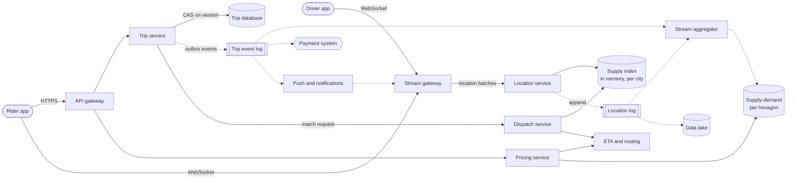

**Reading the diagram.** Riders send commands (estimate, request, cancel) over HTTPS through the API gateway; both apps also hold a WebSocket to the stream gateway, which is a thin connection-terminating tier. Driver location batches flow synchronously from the stream gateway to the location service, which updates the in-memory supply index and appends to the location log asynchronously (dotted). The trip service owns trip state: it performs compare-and-set updates on the trip database and, in the same transaction, writes outbox events that are relayed to the trip event log. It asks the dispatch service (§55.5) to match a request; dispatch reads candidates from the supply index and pickup times from the ETA service. The pricing service reads ETA and the per-hexagon supply–demand table that a stream aggregator computes from both logs. Downstream consumers — payments (§55.9), push notifications and the data lake — are asynchronous, so their failure never blocks a trip transition. Storage boundaries: trip database (durable, strongly consistent), supply index (volatile, rebuilt from the log), logs (durable, replayable). Failure points: the stream gateway (millions of reconnects after a deploy), the supply index of a hot city, and the trip database primary of a city. Scaling: every box except the gateways is partitioned by city.

### 55.4.8 Detailed component design

#### Component 1: the trip lifecycle as a state machine

A trip is a long-running process with a handful of well-defined states, several actors (rider, driver, dispatcher, timers) and real-world side effects. Model it explicitly as a state machine whose current state and version live in one row.

**Figure 55.2 — Trip lifecycle state machine.**

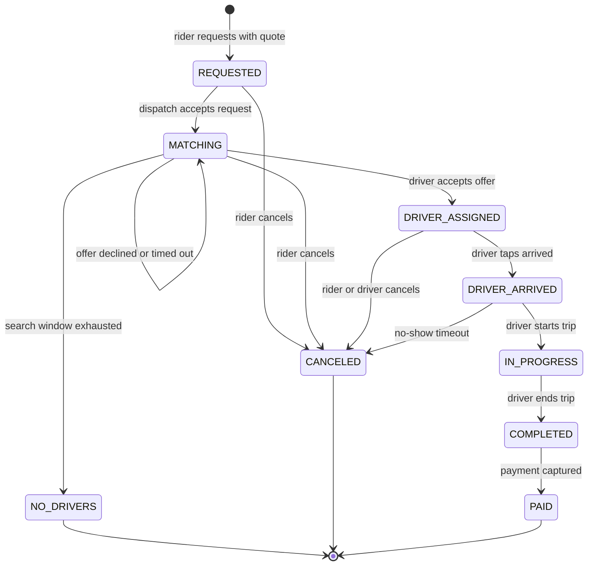

**Reading the diagram.** Each arrow is one transition, triggered by an actor (rider, driver, dispatcher) or a timer, and each is applied as a single conditional write to the trip row. `MATCHING` loops on itself while offers are declined or time out (§55.5.8). Cancellation is allowed from every pre-trip state, but the fee depends on the state: free before assignment, chargeable after a grace period once a driver is driving. `IN_PROGRESS` cannot be canceled by the rider; the trip must be ended. `COMPLETED` hands off to payment asynchronously, so a payment outage delays `PAID` but never prevents a trip from ending. Failure points: two actors racing on the same transition (a rider canceling while the driver accepts) and lost timers; the next paragraphs handle both.

How it works:

1. **One owner per trip.** The trip service is the only writer of the trip row. Other services request transitions; they never write state directly.
2. **Compare-and-set.** A transition is `UPDATE trips SET state = :to, version = version + 1, ... WHERE city_id = :c AND trip_id = :t AND state = :from AND version = :v`. If zero rows change, someone else won the race; reload and decide. When a rider cancels at the same moment the driver accepts, exactly one of the two updates succeeds, and the loser is told the true state.
3. **Transition table, not if-statements.** Valid `(from, event) → to` pairs live in a table checked before every write; an invalid event (start a canceled trip) is rejected with 409 Conflict and logged.
4. **Events in the same transaction.** Each transition inserts a `trip_events` row in the same database transaction; a relay publishes unpublished rows to the trip event log (transactional outbox, §32.5). Downstream consumers — payment, notifications, receipts, analytics — are therefore never told about a transition that did not commit, and never miss one that did.
5. **Durable timers.** "Offer expires in 15 s" and "no-show after 5 minutes" are rows in a timer table (or a delayed-message queue) keyed by trip and version, not in-process sleeps. When a timer fires it requests a transition with the version it was created for; if the trip has moved on, the compare-and-set fails harmlessly.

::: mistake
**"Trip state can live in the dispatcher's memory and be written to the database at the end."** Then a dispatcher crash forgets every in-flight trip, and a rider in a moving car has no record. Persist each transition before acknowledging it; keep only derived, rebuildable state (the supply index) in memory.
:::

#### Component 2: location ingestion

At 500,000 updates per second, every microsecond per update counts. The path is designed so that the common case touches memory and a log, nothing else.

1. **Client side.** The driver app samples GPS every second but uploads a batch every 4 s, compressing the points. When the network drops it buffers and uploads later, flagged as late; late points go to history but not to the live index.
2. **Stream gateway.** Terminates TLS and the WebSocket, authenticates once per connection (not per frame), and forwards frames to the location service partition for the driver's city (consistent hashing on city and driver, §14.8).
3. **Validation and smoothing.** Reject impossible jumps (300 km/h in a city), clamp poor-accuracy fixes, and optionally **map-match** the point onto the road network so that a car on a highway is not shown in the river beside it.
4. **Cell assignment.** Compute the H3 index at resolution 9 (average hexagon about 0.105 km², §17.9.5). If the cell changed, move the driver from the old cell's set to the new one; otherwise update the position only.
5. **Supply index update.** Write the driver record with `last_seen_ms`. A sweeper removes drivers not heard from for 15 s from cell sets (they are probably in a tunnel or have lost signal) without marking them offline.
6. **Log append.** Append the raw batch to the location log, asynchronously and in batches. The live path does not wait for the log's acknowledgment; the log is for history and for rebuilding the index after a crash.

A crashed supply-index node loses nothing that matters: within one update interval (4 s) every online driver in its cities has reported again. Rebuilding from the log is needed only for faster warm-up.

#### Component 3: the supply index and the pricing hand-off

The supply index answers two questions: "which idle drivers are near this point?" (dispatch, §55.5) and "how many cars should this rider see on the map?" (the nearby-cars display). The second one is the 1 million reads per second of the estimate above, and it does not need per-rider precision. Compute, once per second per occupied resolution-9 hexagon, a small snapshot of cars in its k-ring; every rider whose position falls in that hexagon receives the same snapshot. A dense city with 20,000 occupied hexagons then costs 20,000 snapshot computations per second, independent of how many riders are watching, and each snapshot is cached and pushed over the riders' streams.

Pricing needs a coarser view: supply (idle drivers) and demand (requests and app opens) per hexagon per minute. A stream aggregator consumes the location log and the trip event log, counts both per resolution-7 or resolution-8 hexagon (5.16 km² and 0.737 km², §17.9.5) in one-minute windows, and writes the table to a key-value store. The pricing service reads it when it builds a quote. How the multiplier is computed from supply, demand and forecasts is a machine-learning and economics problem (Chapter 83, §83.6); the system-design contract is only this: **the price is fixed in a signed quote with an expiry**, the request references the quote, and the trip stores the quote. Riders never pay a price they did not see.

::: industry
**H3 and surge at Uber.** Uber built H3, a hexagonal hierarchical grid, to analyze and optimize marketplace dynamics such as supply, demand and pricing by area, and open-sourced it in 2018; hexagons were chosen because all six neighbors are equidistant, which simplifies smoothing across adjacent areas [Brodsky 2018; H3 Docs]. Uber's SIGMOD paper on its real-time data infrastructure names dynamic pricing (surge) as a mission-critical use of that stack, computing demand and supply ratios per geofence from streaming data built on Kafka and Flink [Fu and Soman 2021].
*Evidence: Primary* — [Brodsky 2018; H3 Docs; Fu and Soman 2021]
:::

#### Component 4: regional architecture

Cities are almost perfect partitions: a rider in Lagos is never matched with a driver in Lima. Exploit that.

- **City-to-region mapping.** Each city is homed in one region (a cloud region or datacenter pair). All of its trip rows, supply index partitions, dispatch workers and timers live there. The edge routes a request by the city of its pickup point; a traveler's app follows the city, not the home country.
- **Cells inside a region.** Within a region, group cities into cells (§33.12, §44.10) with their own service instances, so a bad deploy or a hot city damages one cell, not the whole region.
- **Failover.** Trip databases replicate synchronously within the region (across availability zones) for RPO = 0 and asynchronously to a paired region for disaster recovery. On regional failure, the city's home moves to the pair; in-flight trips continue from the replicated state, and anything lost in the asynchronous gap is reconstructed from the apps, which hold the current trip ID, state and version locally and resubmit them.
- **Global data.** Rider and driver accounts, payment methods and ratings are global but read-mostly; replicate them to every region with a home region per user for writes (§44.6).

::: industry
**Uber's dispatch rewrite, as presented in 2015.** In a QCon London talk, Uber's Matt Ranney described a rewrite of the dispatch system ("DISCO") that sharded supply by Google S2 cells, used Ringpop (a library combining SWIM-style membership, consistent hashing and request forwarding) to spread that state across Node.js processes, and could consider drivers still on a trip whose route would end near a new rider. He also described using driver phones as a backup store of trip state during datacenter failover [Ranney 2015; Hoff 2015; Ringpop].
*Evidence: Secondary* — [Ranney 2015; Hoff 2015]; Ringpop's design is *Primary* — [Ringpop]
:::

### 55.4.9 Data flow

**Figure 55.3 — Write path: a driver location update.**

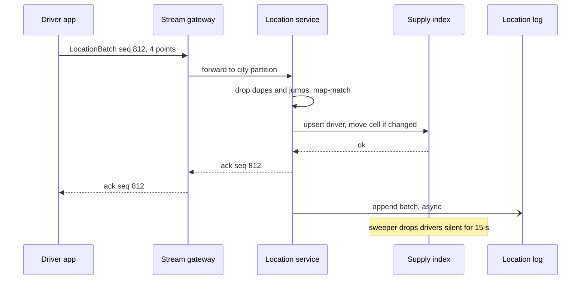

**Reading the diagram.** The app sends a sequence-numbered batch over its WebSocket; the gateway forwards it to the location-service partition that owns the driver's city. The service validates and map-matches the points, updates the in-memory supply index (moving the driver between hexagon sets if the cell changed) and acknowledges; the app discards acknowledged points. The log append is asynchronous (open arrowhead), so a slow log never slows the live path. Storage boundaries: memory (supply index) and the durable log. Failure points: a crashed location node loses its partition's index until drivers report again (at most 4 s); a lost acknowledgment makes the app resend, and the sequence number turns the retry into a no-op. Scaling: add partitions per city; split a city by hexagon ranges if one city exceeds a node.

**Figure 55.4 — Read path: a rider opens the app and gets a quote.**

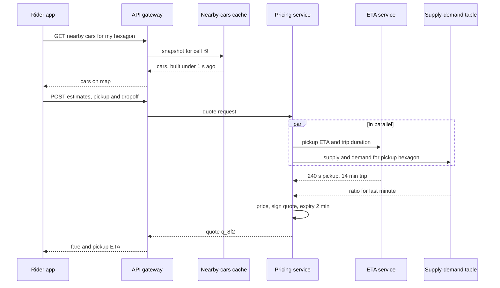

**Reading the diagram.** The nearby-cars call reads a per-hexagon snapshot that is rebuilt once a second and shared by every rider in the hexagon, so the 1 million reads per second become cache hits. The estimate fans out in parallel to the ETA service and the supply–demand table, then the pricing service signs a quote with an expiry and stores it (a key-value write keyed by `quote_id`) so the later request can reference it. All calls are synchronous; the slowest dependency (ETA) sets the latency, so it gets a tight timeout with a fallback (straight-line distance at the city's average speed) rather than failing the screen. Failure points: an ETA outage (degrade to fallback ETAs and widen the fare range) and a stale supply–demand table (fall back to multiplier 1.0 after a staleness threshold). The ride request itself, which starts matching, is the write path of §55.5.9.

### 55.4.10 Bottlenecks

1. **Hot cells.** A stadium emptying or an airport at 06:00 concentrates thousands of drivers and riders in a few hexagons; the partition that owns them saturates. Split hot cities into sub-partitions by hexagon ranges, and for airports use a separate first-in-first-out queue model rather than nearest-driver search.
2. **The connection tier.** Seven million persistent connections reconnecting after a gateway deploy can overload authentication and the location service. Drain slowly, reconnect with jittered backoff, and validate session tokens locally (§9.6).
3. **The ETA service.** Every quote and every dispatch candidate needs a road-network ETA (§55.6). Dispatch alone may ask for 20 candidates per request (§55.5.4). Cache ETAs between hexagon pairs for short horizons and batch requests.
4. **The trip database of one city.** About a thousand trips per second globally is small, but a single mega-city at 200 trips/s with ten transitions each is 2,000 conditional writes per second on one partition. Partition by `(city_id, trip_id)` and let large cities span several shards.
5. **The location log.** 500,000 records per second must be spread over enough log partitions; partition by driver, not by city, so one city's spike spreads across brokers.

### 55.4.11 Failure scenarios

**Table 55.3 — Failure scenarios for the ride-hailing platform.**

| What fails | Impact | Detection | Recovery | Prevention |
|---|---|---|---|---|
| Location-service node | Drivers in its partitions invisible to dispatch for up to one update interval | Partition heartbeat; drop in updates/s per city | Reassign partition; drivers re-report within 4 s; optional warm-up from log | Replicated partitions or fast reassignment; per-city alarms |
| Stream gateway fleet restart | Mass reconnect storm; stale maps; missed offers | Connection count cliff; handshake error rate | Jittered reconnect; offers re-sent on reconnect from trip service state | Slow drain; local token validation; admission control |
| Trip database primary | Trip transitions fail for that shard | Write errors; failover monitor | Promote synchronous replica (seconds); apps retry with same idempotency key and version | Synchronous replication across zones; small shards |
| Outbox relay stalls | Payments, notifications and receipts delayed | Age of oldest unpublished event | Restart relay; it resumes from `published = FALSE` rows | Alert on outbox age; multiple relay workers with leases |
| ETA service slow | Quotes and dispatch slow; timeouts | p99 latency SLO burn | Fallback ETA; shed quote traffic before dispatch traffic | Per-caller timeouts and bulkheads (§22.14) |
| GPS spoofing by a driver | Wrong matches; fraudulent fares | Impossible speed; mismatch with network cell or accelerometer | Suspend account; reprice trips from map-matched trail | Server-side plausibility checks; device attestation |
| Region outage | All cities homed there stop | Health checks; synthetic trips | Rehome cities to paired region; apps resubmit trip state | Regular evacuation drills (§44.11) |

### 55.4.12 Scaling strategy

**At 10×** (300 million trips per day, 5 million updates per second): the per-city partitioning holds, but the largest cities exceed one partition, so split cities by hexagon ranges with a directory that maps resolution-5 or resolution-6 parents to partitions; boundary queries fan out to two partitions. The location log grows to about 21.6 TB per day: keep raw points for days, not years, and keep map-matched, downsampled trails for longer. The connection tier grows to about 350 nodes; this is the point where a dedicated edge connection service with its own release cadence pays off.

**At 100×**: update frequency, not driver count, becomes the cost to attack. Adaptive reporting — every 1–2 s when a driver is near a pickup or in a dense, high-demand area, every 10–15 s when idle in a quiet suburb — cuts the average rate several-fold with no matching loss. Regions become cells of a few cities each, and global services (accounts, payment methods) must be read locally with no synchronous cross-region call on the trip path.

### 55.4.13 Trade-offs

- **Freshness versus battery and bandwidth.** Halving $\Delta t$ doubles ingestion and drains phones faster; adaptive intervals spend updates where matching quality depends on them.
- **Strong trip state versus availability.** Trip transitions need a primary; during a partition the minority side cannot accept transitions. Accept it: the app keeps showing the last known state and retries, which is better than two conflicting histories.
- **Exact versus snapshot nearby cars.** Per-hexagon snapshots are up to a second old and identical for nearby riders; nobody notices, and the read load drops by orders of magnitude.
- **City partitioning versus global optimization.** Cross-city effects (a driver crossing a city boundary) are handled as rare exceptions instead of making every query global.

### 55.4.14 Alternative designs

**Table 55.4 — Alternative designs for the supply index.**

| Option | How it works | Advantages | Disadvantages | Choose when |
|---|---|---|---|---|
| In-memory H3 cell sets (this design) | Hexagon ID → driver set, partitioned by city | Uniform rings; fast; pricing uses the same cells | Custom service to build and operate | High update rate, ring-based search and pricing |
| Redis GEO | Sorted set scored by 52-bit geohash; `GEOSEARCH` | Off the shelf; simple | Square cells; one key per area gets hot; manual partitioning | Smaller fleets, one region, fast start |
| PostGIS with a GiST index | Spatial index in the database | Rich queries; transactional | Updates at 500,000/s far exceed one database | Low update rates (stores, venues) |
| Quadtree in memory | Adaptive tree splits dense areas | Adapts to density | Constant splits and merges as cars move | Mostly static points |
| S2 cell sharding | Hilbert-ordered 64-bit cells | Range scans; good coverer | Square-ish cells; rings less uniform | Range-partitioned stores; polygons |

A different overall shape is **polling instead of push**: apps poll every few seconds for trip state and nearby cars. It is simpler and stateless but multiplies request volume and adds up to one poll interval of delay to offers, which hurts acceptance rates. Push for offers and trip updates, pull for everything else, is the usual compromise.

### 55.4.15 Interview discussion

**Table 55.5 — A 45-minute pacing plan for "design Uber".**

| Minutes | Focus | Output |
|---|---|---|
| 0–5 | Scope: rider, driver, platform; exclude ML pricing and payments internals | Functional list; NFR split between trip state and telemetry |
| 5–10 | Estimate: trips/s, location updates/s, connections | 1,000 trips/s vs 500,000 updates/s; "telemetry system with a transactional core" |
| 10–20 | High-level architecture | Figure 55.1 shape; city partitioning |
| 20–35 | Deep dives: trip state machine and location ingestion; then nearby search (§55.5) | Compare-and-set, outbox, H3 index, rings |
| 35–42 | Failures and scaling | Region failover; hot cells; reconnect storms |
| 42–45 | Trade-offs and what you would build next | Adaptive intervals; quote locking |

**Likely follow-ups.** *How do you stop two drivers being assigned?* Compare-and-set on the trip row and a lease on the driver (§55.5.8). *Why not store positions in the database?* 500,000 writes per second of data that is obsolete in 4 s. *How is surge applied fairly?* A signed quote with expiry; the request references it. *What happens when a region dies mid-trip?* Rehome the city; apps resubmit trip ID, state and version; the trip service reconciles.

**What distinguishes senior and staff answers.** A senior candidate separates telemetry from transactional state and names the cell index. A staff candidate also designs the failure behavior (what the rider sees during failover), turns the 1 million reads per second into per-cell snapshots, adapts update frequency to cost, and treats cities as isolation boundaries for deploys and incidents.

### 55.4.16 Production considerations

- **Observability.** Service-level indicators that matter to riders: request-to-offer latency, offer acceptance rate, pickup-ETA error (promised versus actual), and **location freshness** (age of the newest point per driver, p99 per city). Per-city dashboards, because a global average hides a dead city.
- **Security and privacy.** Precise location histories are sensitive personal data: restrict access by role, log every access (§10.12), mask rider and driver phone numbers through a proxy, coarsen locations in analytics, and delete or aggregate raw trails on a retention schedule (§50.9). Defend against GPS spoofing and emulator farms with plausibility checks.
- **Cost.** The largest variable costs are connection gateways, ETA computations and location-history storage; adaptive reporting and downsampled trails reduce all three.
- **Operations.** Launching a city is configuration (products, regulations, geofences, airport queues), not code. Deploy by cell, one city group at a time, and run regular region-evacuation drills.

## 55.5 Ride matching system

### 55.5.1 Problem statement

Zoom into the dispatch box of Figure 55.1. A ride request arrives with a pickup point and a product. Within about two seconds the system must choose one driver, offer the trip, and either confirm the match or move on to another driver if the first declines or does not answer. Two promises must hold under every failure: **a driver is never committed to two rides at once, and a ride is never committed to two drivers.**

An analogy: a taxi rank dispatcher with a radio. The naive dispatcher gives each caller the nearest free cab the moment they call. A better one waits a moment, looks at all callers and all free cabs together, and pairs them so that the *total* waiting is smallest; sometimes the nearest cab goes to the second caller because the first caller has another cab almost as close. Both dispatchers must also never say "cab 7, take this job" to two callers, even if the radio crackles and the dispatcher repeats themselves.

The distinctive hard problems are therefore three: finding candidates fast with geospatial cells (§17.9), choosing the *assignment* well (ETA rather than distance, batched rather than greedy), and making the commitment safe in a distributed system with leases and fencing tokens (§26.10–§26.13).

### 55.5.2 Functional requirements

1. Given a ride request (pickup, product, rider constraints), find candidate drivers who are idle, eligible for the product and close in **driving time**.
2. Include drivers about to finish a trip near the pickup ("in-flight supply") when they would arrive sooner than idle drivers.
3. Assign drivers to requests, individually or in batches, minimizing total pickup time subject to business constraints (maximum pickup ETA, product eligibility, driver preferences).
4. Offer the trip to the chosen driver with a deadline; on decline or timeout, re-offer to the next best driver; stop after a search window and report "no drivers".
5. Guarantee one driver per ride and one ride per driver across retries, crashes and network partitions.
6. Emit every decision (candidates, scores, outcome) for analysis and offline replay.

### 55.5.3 Non-functional requirements

**Table 55.6 — Non-functional requirements for ride matching.**

| Property | Target |
|---|---|
| Request to first offer | p50 < 1 s, p99 < 3 s including a batching window of up to 2 s |
| Offer deadline | 15 s for the driver to respond |
| Double assignment | Zero: a correctness invariant, not a percentage |
| Availability | 99.99% per city; a matching outage stops the business |
| Candidate search | p99 < 20 ms in memory |
| ETA computation for candidates | p99 < 100 ms for a batch of 20 |
| Decision log | At-least-once, complete enough to replay any decision |

### 55.5.4 Capacity estimation

::: formula
**Expected candidates in a hexagonal k-ring**

$$C(k) = \rho \times \left(1 + 3k(k+1)\right) \times A_{\text{cell}}$$

| Symbol | Meaning | Units |
|---|---|---|
| $C(k)$ | Expected idle drivers inside the k-ring around the pickup hexagon | drivers |
| $\rho$ | Density of idle, eligible drivers | drivers/km² |
| $k$ | Ring radius in hexagon steps | — |
| $1 + 3k(k+1)$ | Number of hexagons in the k-ring (§17.9.5) | cells |
| $A_{\text{cell}}$ | Average hexagon area at the chosen resolution (0.105 km² at H3 resolution 9) | km² |
:::

::: example
**Worked example — how far must the search expand?** Goal: at least 5 idle candidates before ranking by ETA. Index resolution 9, $A_{\text{cell}} = 0.105$ km².

1. **Downtown, $\rho = 8$ drivers/km².** $k = 1$: $7 \times 0.105 = 0.735$ km², $C = 8 \times 0.735 = 5.9$. One ring is enough; $k = 2$ gives $19 \times 0.105 \times 8 = 16.0$.
2. **Suburb, $\rho = 0.3$ drivers/km².** $k = 6$: $127 \times 0.105 = 13.3$ km², $C = 4.0$, not enough. $k = 7$: $169 \times 0.105 = 17.7$ km², $C = 5.3$.
3. **Equivalent radius.** A 7-ring covers 17.7 km², the area of a circle of radius $\sqrt{17.7/\pi} = 2.38$ km; a 1-ring covers 0.735 km², radius 0.48 km.

*Interpretation.* A fixed search radius is wrong everywhere: too large downtown (hundreds of candidates to rank) and too small in the suburbs (none). *Engineering implication.* Expand rings until enough candidates are found, then expand one more ring because a driver in the next ring may be closer by road (§55.5.8); in sparse areas jump to a coarser resolution (resolution 8 hexagons are seven times larger) instead of walking 169 cells.
:::

::: example
**Worked example — matching load.** Assumptions: 1,000 requests/s at the global peak (§55.4.4); the largest city 100 requests/s; 20 candidates per request are scored by road ETA; batching window 2 s.

1. **Candidate searches.** 1,000/s globally, each touching tens of in-memory sets: trivial CPU.
2. **ETA computations.** $1{,}000 \times 20 = 20{,}000$ point-to-point ETAs per second globally; in the largest city $100 \times 20 = 2{,}000$/s.
3. **Batch size.** Largest city: $100 \times 2 = 200$ requests per window. If 300 idle drivers are within reach, the cost matrix has $200 \times 300 = 60{,}000$ cells; only the 20 nearest per request are real edges, so $200 \times 20 = 4{,}000$ ETAs per batch.
4. **Assignment cost.** A dense Hungarian solve is $O(n^2 m) = 200^2 \times 300 = 1.2 \times 10^7$ steps, milliseconds in compiled code; sparse solvers or splitting the city into zones keep it well under the window.

*Interpretation.* The solver is cheap; the ETA computations are the dominant cost. *Engineering implication.* Batch the ETA requests, cache ETAs between hexagon pairs for a few seconds, and partition the batch by zone so each solver instance handles a few hundred requests at most.
:::

::: formula
**Offers needed to place a ride**

$$\mathbb{E}[N] = \frac{1}{p}, \qquad P(N > n) = (1 - p)^n$$

| Symbol | Meaning | Units |
|---|---|---|
| $N$ | Number of offers sent until one driver accepts | offers |
| $p$ | Probability that a given offer is accepted (assumed independent) | — |
| $n$ | A number of offers already sent | offers |
:::

::: example
**Worked example — re-offers and the search window.** Assume acceptance $p = 0.7$; a declined offer takes 5 s on average and an ignored one the full 15 s deadline; one-third of non-acceptances are ignores.

1. **Expected offers.** $\mathbb{E}[N] = 1 / 0.7 = 1.43$.
2. **Tail.** $P(N > 3) = 0.3^3 = 0.027$: 2.7% of rides need a fourth offer.
3. **Time per failed offer.** $\tfrac{2}{3} \times 5 + \tfrac{1}{3} \times 15 = 3.33 + 5 = 8.33$ s.
4. **Delay for a ride needing four offers.** $3 \times 8.33 = 25$ s of failed offers before the fourth.

*Interpretation.* Most rides are placed on the first offer, but the tail is dominated by ignored offers. *Engineering implication.* Shorten the deadline for drivers who habitually ignore offers, track acceptance probability per driver and use it in the score, and cap the search window (say 60 s) before telling the rider "no drivers available".
:::

### 55.5.5 API design

Matching is internal, so its interfaces are RPCs, plus the driver-facing offer frames of §55.4.5.

```protobuf
service Dispatch {
  // Called by the trip service when a trip enters MATCHING. Idempotent on trip_id + trip_version.
  rpc RequestMatch(MatchRequest) returns (MatchAccepted);
  // Called by the trip service when the rider cancels; stops offers in flight.
  rpc CancelMatch(CancelMatchRequest) returns (CancelMatchResponse);
}

message MatchRequest {
  int64  trip_id = 1;
  int32  trip_version = 2;
  int32  city_id = 3;
  double pickup_lat = 4;
  double pickup_lng = 5;
  string product = 6;              // economy, premium, xl ...
  int32  max_pickup_eta_s = 7;     // business constraint, e.g. 900
  int64  search_deadline_ms = 8;   // give up and report NO_DRIVERS after this
}

service Supply {
  // Candidate search: rings around a hexagon, filtered by status and product.
  rpc Candidates(CandidateQuery) returns (CandidateList);
  // Atomically claim a driver for an offer; returns a fencing token or ALREADY_CLAIMED.
  rpc Claim(ClaimRequest) returns (ClaimResult);
}

message ClaimResult {
  bool   ok = 1;
  int64  fencing_token = 2;        // strictly increasing per driver
  int64  lease_expires_ms = 3;
}
```

What to notice: `RequestMatch` is idempotent on `(trip_id, trip_version)`, so a retried call does not start a second search. `Claim` is the only operation that commits a driver, and it returns a **fencing token** that every later step must present (§55.5.8).

### 55.5.6 Data model and database schema

```sql
-- One row per driver, in the same per-city shard as the trips table (§55.4.6),
-- so a trip transition and a driver claim can commit in one local transaction.
CREATE TABLE driver_dispatch (
  city_id           INT          NOT NULL,
  driver_id         BIGINT       NOT NULL,
  state             VARCHAR(12)  NOT NULL,    -- IDLE | OFFERED | ASSIGNED | ON_TRIP | OFFLINE
  trip_id           BIGINT,                   -- the trip offered or assigned
  fencing_token     BIGINT       NOT NULL DEFAULT 0,
  lease_expires_at  TIMESTAMPTZ,
  updated_at        TIMESTAMPTZ  NOT NULL,
  PRIMARY KEY (city_id, driver_id)
);

-- Every offer, for re-offer exclusion, audit and acceptance-rate features.
CREATE TABLE offers (
  city_id        INT          NOT NULL,
  offer_id       BIGINT       NOT NULL,
  trip_id        BIGINT       NOT NULL,
  driver_id      BIGINT       NOT NULL,
  fencing_token  BIGINT       NOT NULL,
  pickup_eta_s   INT          NOT NULL,
  outcome        VARCHAR(10),               -- ACCEPTED | DECLINED | EXPIRED | WITHDRAWN
  created_at     TIMESTAMPTZ  NOT NULL,
  PRIMARY KEY (city_id, offer_id)
);
CREATE INDEX offers_by_trip ON offers (city_id, trip_id);
```

The in-memory supply index (§55.4.6) holds positions and a *hint* of each driver's state, so that candidate search skips busy drivers. The `driver_dispatch` row is the *truth*. The design deliberately tolerates a stale hint (a driver who just accepted elsewhere may still look idle in memory for a fraction of a second) because the claim against the row will fail and the matcher will move on.

**Figure 55.5 — Driver dispatch state, owned by the claim row.**

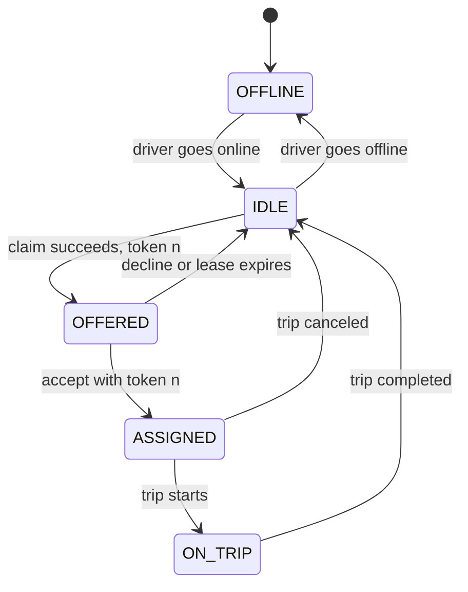

**Reading the diagram.** Each transition is a conditional update on the driver's `driver_dispatch` row. `IDLE → OFFERED` increments the fencing token and sets a lease (15 s plus a grace period); only an accept carrying that token can move the row to `ASSIGNED`. If the lease expires the row returns to `IDLE` and the next claim gets token $n+1$, so a late accept with token $n$ is rejected. The failure point is a matcher that crashes after claiming: nothing needs cleaning up, because the lease expiry releases the driver.

### 55.5.7 High-level architecture

**Figure 55.6 — Ride-matching architecture within one city partition.**

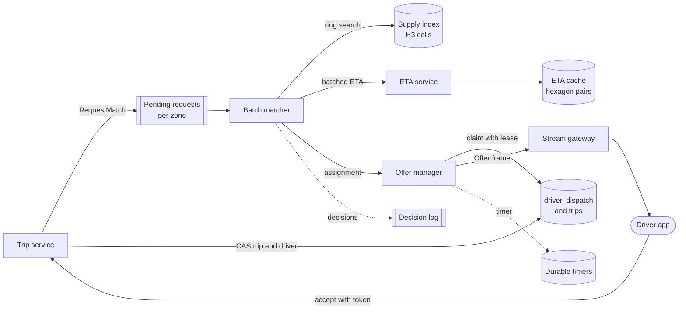

**Reading the diagram.** The trip service enqueues a request for the pickup's zone (a group of resolution-6 hexagons inside the city). Every batching window, the batch matcher drains the zone's queue, searches the supply index ring by ring, asks the ETA service for road ETAs in one batched call (backed by a short-lived cache keyed by hexagon pairs) and solves the assignment. The offer manager claims each chosen driver with a conditional write on `driver_dispatch`, which returns a fencing token, pushes the offer to the driver's app and arms a durable timer. The driver's accept goes to the trip service, which commits the trip and driver transitions together in one local transaction (both rows live in the city shard). Solid arrows are synchronous; the timer and the decision log are asynchronous. Storage boundaries: memory (supply index, ETA cache) versus the durable city shard (truth). Failure points: a matcher crash (requests stay in the queue and are re-batched), an offer manager crash (leases expire), the ETA service (fallback to distance-based estimates). Scaling: one matcher per zone; more zones for bigger cities.

### 55.5.8 Detailed component design

#### Component 1: nearest-driver search with ring expansion

1. Convert the pickup to its resolution-9 hexagon $h$.
2. For $k = 0, 1, 2, \dots$ read the idle-driver sets of the cells exactly $k$ steps away (a **hex ring**; the union up to $k$ is a **k-ring** or disk) and filter by product eligibility and the state hint.
3. Stop when at least $K$ candidates are found (for example $K = 8$) **plus one further ring**, or when $k$ reaches a ceiling; in sparse areas restart at resolution 8 or 7 rather than walking hundreds of fine cells.
4. Compute the straight-line (haversine) distance for each candidate and keep the nearest $K' = 20$ as the shortlist for ETA scoring.

Why the extra ring? The first ring that contains $K$ candidates bounds the *count*, not the *distance*: a driver just outside it can be closer than one in a far corner of the ring, because a k-ring is a jagged hexagon, not a circle. The extra ring makes it very unlikely that the true nearest few are missed; the haversine sort removes the excess.

#### Component 2: ETA-based versus distance-based scoring

Straight-line distance is a poor proxy for pickup time. A driver 400 m away across a river or on the other carriageway of a divided highway may need 8 minutes; a driver 1.2 km away on the same arterial road may need 2. So the shortlist is scored with **road-network ETAs** from the routing engine (§55.6) using live traffic, plus correction terms:

```text
score(driver, request) = road_eta_seconds(driver -> pickup)
                       + a * (1 - predicted_acceptance(driver))
                       + b * heading_penalty(driver, pickup)
                       - c * fairness_bonus(driver)          # lower is better; a, b, c tuned by experiment
```

The weights are business decisions, tuned by experiments; the learned ETA corrections are Chapter 83 material (§83.5), and an acceptance-probability model is an ordinary classifier (§57.10). The system-design point is the two-stage funnel: a cheap geometric filter to about 20 candidates, then an expensive but accurate road ETA only for those. In-flight drivers enter the same funnel with $\text{ETA} = \text{remaining trip time} + \text{ETA from drop-off to pickup}$.

#### Component 3: greedy versus batched assignment

**Greedy matching** handles each request on arrival: take the best-scoring free driver. It is simple and adds no delay, but it is myopic. **Batched matching** collects requests for a short window (1–2 s), builds a bipartite graph — requests on one side, drivers on the other, an edge weighted by the score where the ETA is under the cap — and solves the minimum-cost **assignment problem**, for example with the Hungarian algorithm [Kuhn 1955] or a min-cost-flow solver. The program below shows the classic trap for greedy matching, ring expansion over a cell index, and a comparison on random batches.

```python
import math
import random
from collections import defaultdict

CELL_KM = 0.5                                   # square cells stand in for H3 hexagons

def cell_of(x, y):
    return (math.floor(x / CELL_KM), math.floor(y / CELL_KM))

def ring(cx, cy, k):
    """Cells exactly k steps away (Chebyshev ring); k = 0 is the center cell."""
    if k == 0:
        return [(cx, cy)]
    out = []
    for dx in range(-k, k + 1):
        out += [(cx + dx, cy - k), (cx + dx, cy + k)]
    for dy in range(-k + 1, k):
        out += [(cx - k, cy + dy), (cx + k, cy + dy)]
    return out

def nearby(index, x, y, want, max_k=6):
    """Expand rings until `want` candidates are found, plus one safety ring."""
    cx, cy = cell_of(x, y)
    found, k, extra = [], 0, None
    while k <= max_k:
        for c in ring(cx, cy, k):
            found += index.get(c, [])
        if extra is None and len(found) >= want:
            extra = k + 1                     # a nearer driver may sit one ring further out
        if extra is not None and k >= extra:
            break
        k += 1
    return found, k

def eta_min(d, r, speed_kmh=24.0):
    """Manhattan distance at city speed: a stand-in for a road-network ETA."""
    return (abs(d[0] - r[0]) + abs(d[1] - r[1])) / speed_kmh * 60

def greedy(riders, drivers):
    """Each rider, in arrival order, takes the nearest free driver."""
    free, total, pairs = set(range(len(drivers))), 0.0, []
    for i, r in enumerate(riders):
        j = min(free, key=lambda j: eta_min(drivers[j], r))
        free.remove(j)
        total += eta_min(drivers[j], r)
        pairs.append((i, j))
    return total, pairs

def hungarian(cost):
    """Min-cost assignment of n rows to m >= n columns, O(n^2 m)."""
    n, m = len(cost), len(cost[0])
    INF = float("inf")
    u, v = [0.0] * (n + 1), [0.0] * (m + 1)
    p, way = [0] * (m + 1), [0] * (m + 1)
    for i in range(1, n + 1):
        p[0], j0 = i, 0
        minv, used = [INF] * (m + 1), [False] * (m + 1)
        while True:
            used[j0] = True
            i0, delta, j1 = p[j0], INF, 0
            for j in range(1, m + 1):
                if not used[j]:
                    cur = cost[i0 - 1][j - 1] - u[i0] - v[j]
                    if cur < minv[j]:
                        minv[j], way[j] = cur, j0
                    if minv[j] < delta:
                        delta, j1 = minv[j], j
            for j in range(m + 1):
                if used[j]:
                    u[p[j]] += delta
                    v[j] -= delta
                else:
                    minv[j] -= delta
            j0 = j1
            if p[j0] == 0:
                break
        while j0:
            j1 = way[j0]
            p[j0] = p[j1]
            j0 = j1
    pairs = [(p[j] - 1, j - 1) for j in range(1, m + 1) if p[j]]
    return sum(cost[i][j] for i, j in pairs), sorted(pairs)

def batched(riders, drivers):
    return hungarian([[eta_min(d, r) for d in drivers] for r in riders])

# 1. The textbook trap: two riders, two drivers on a line (km).
riders, drivers = [(1.0, 0.0), (2.2, 0.0)], [(1.8, 0.0), (0.0, 0.0)]
print("toy greedy :", round(greedy(riders, drivers)[0], 1), "min", greedy(riders, drivers)[1])
print("toy batched:", round(batched(riders, drivers)[0], 1), "min", batched(riders, drivers)[1])

# 2. Ring expansion over a cell index.
random.seed(7)
drivers = [(random.uniform(0, 10), random.uniform(0, 10)) for _ in range(400)]
index = defaultdict(list)
for j, d in enumerate(drivers):
    index[cell_of(*d)].append(j)
cands, k = nearby(index, 5.0, 5.0, want=8)
print(f"ring search: {len(cands)} candidates after k = {k} rings")

# 3. One 2-second batch in a busy area: 30 riders, 40 idle drivers in 10 x 10 km.
g_tot = b_tot = 0.0
for trial in range(200):
    rs = [(random.uniform(0, 10), random.uniform(0, 10)) for _ in range(30)]
    ds = [(random.uniform(0, 10), random.uniform(0, 10)) for _ in range(40)]
    g_tot += greedy(rs, ds)[0] / 30
    b_tot += batched(rs, ds)[0] / 30
print(f"mean pickup ETA over 200 batches: greedy {g_tot / 200:.2f} min, "
      f"batched {b_tot / 200:.2f} min ({100 * (1 - b_tot / g_tot):.0f}% lower)")
```

Output:

```text
toy greedy : 7.5 min [(0, 0), (1, 1)]
toy batched: 3.5 min [(0, 1), (1, 0)]
ring search: 18 candidates after k = 2 rings
mean pickup ETA over 200 batches: greedy 4.05 min, batched 3.48 min (14% lower)
```

What to notice:

- In the toy case, rider 0 (at 1.0 km) grabs driver 0 (at 1.8 km, 2.0 min away), leaving rider 1 (at 2.2 km) with driver 1 at the origin, 5.5 min away: 7.5 min in total. Swapping gives 2.5 + 1.0 = 3.5 min. Greedy is not wrong for rider 0; it is wrong for the system.
- `nearby` stops one ring *after* reaching the target count. With 400 drivers on 100 km² (4 per km², 1 per 0.25 km² cell) eight candidates appear within the 3 × 3 block and the safety ring brings the count to 18.
- `hungarian` is the standard $O(n^2 m)$ potential-based algorithm; its result was checked against brute force on 300 random small instances. Production systems use sparse min-cost-flow or auction solvers with an ETA cap so that impossible pairs have no edge.
- The 14% gain is for a dense random batch with Manhattan ETAs; real gains depend on density and window length. The price is up to one window of added latency for every rider, so the window must stay short (1–2 s) and can shrink when supply is plentiful (greedy is near-optimal when every rider has many close drivers).

::: industry
**Batched dispatch in the literature.** Researchers at DiDi described order dispatch on their platform as repeated matching of the orders and drivers collected in short decision windows, combining a bipartite assignment in each window with learned estimates of each driver's future value, and reported improvements over myopic dispatch in A/B tests [Xu et al. 2018]. The assignment step itself is the classical assignment problem solved by the Hungarian method [Kuhn 1955].
*Evidence: Primary* — [Xu et al. 2018; Kuhn 1955]
:::

#### Component 4: dispatch consistency — one driver, one ride

The race to prevent: two matcher instances (after a failover, or two zones whose search rings overlap at a border) both pick driver $d$ for different rides; or a matcher pauses for a garbage-collection cycle after sending an offer, the offer's lease expires, $d$ is offered a new ride, and then the old offer's acceptance arrives.

1. **Claim with a lease.** Before sending an offer, the offer manager runs one conditional update:

    ```sql
    UPDATE driver_dispatch
       SET state = 'OFFERED', trip_id = :trip, fencing_token = fencing_token + 1,
           lease_expires_at = now() + interval '20 seconds', updated_at = now()
     WHERE city_id = :city AND driver_id = :driver
       AND (state = 'IDLE' OR (state = 'OFFERED' AND lease_expires_at < now()))
    RETURNING fencing_token;
    ```

    Zero rows means someone else holds the driver: take the next candidate. This is a **lease** (§26.11): a lock that releases itself, so a crashed matcher cannot strand a driver. The lease (20 s) is longer than the offer deadline shown to the driver (15 s) to absorb clock skew and network delay.

2. **Fencing token on every later step.** The offer frame carries the token. The driver's accept is applied by the trip service in **one local transaction** on the city shard:

    ```sql
    BEGIN;
    UPDATE trips SET state = 'DRIVER_ASSIGNED', driver_id = :driver, version = version + 1
     WHERE city_id = :city AND trip_id = :trip AND state = 'MATCHING' AND version = :v;
    UPDATE driver_dispatch SET state = 'ASSIGNED', lease_expires_at = NULL
     WHERE city_id = :city AND driver_id = :driver AND trip_id = :trip
       AND state = 'OFFERED' AND fencing_token = :token;
    -- application: if either UPDATE touched 0 rows, ROLLBACK and reply "offer no longer valid"
    COMMIT;
    ```

    The first statement guarantees one driver per ride (only one accept can move the trip out of `MATCHING`); the second guarantees one ride per driver (only the holder of the current token can assign the driver). A late accept from an expired offer carries an old token and fails, exactly as a stale lock holder is fenced off at the storage layer in §26.13.

3. **Why the same shard?** If trips and drivers lived in different databases, assigning would need a distributed transaction (§28.4) or a saga with compensation ("unassign the driver"). Co-locating both by city turns it into one local transaction. Drivers who cross into a neighboring city are re-homed when they go idle there.

4. **Rider cancellation during an offer.** `CancelMatch` moves the trip to `CANCELED` with a compare-and-set; the driver's accept then fails on the first `UPDATE`, the app shows "rider canceled", and the claim row is released.

::: mistake
**"A Redis lock with a TTL on the driver is enough."** A TTL lock prevents most double offers but not a paused or partitioned holder acting after expiry, and a Redis failover can lose an acknowledged lock. Use the lock (or lease) only to *reduce* contention; make the commit itself conditional on a fencing token checked by the database that stores the assignment (§26.10, §26.13).
:::

#### Component 5: timeouts and re-offers

Each offer arms a durable timer at `lease_expires_at`. On decline or expiry the offer row records the outcome, the driver returns to `IDLE` (and is excluded from this trip's later rounds), and the trip goes back into the next batch with its accumulated exclusion list. The search widens on each round: larger rings, a higher ETA cap, other eligible products if the rider allowed upgrades. When `search_deadline_ms` passes, the trip moves to `NO_DRIVERS`. Offers are sent to **one driver at a time**; broadcasting to several and letting the first acceptor win is faster in sparse areas but trains drivers to tap without reading and shows "trip taken" to the losers, so use it only where acceptance rates are low.

### 55.5.9 Data flow

**Figure 55.7 — Write path: request, batch, claim, offer and accept.**

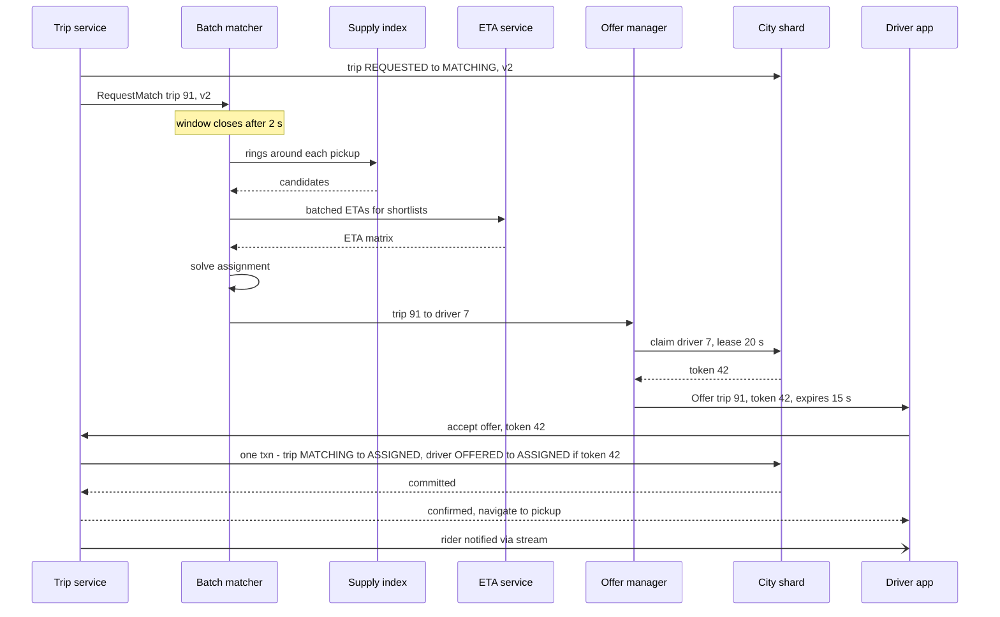

**Reading the diagram.** The trip service persists `MATCHING` before asking dispatch, so a crash anywhere later can be recovered by re-requesting the match with the same version. The matcher batches, searches, scores with batched ETAs and solves; the offer manager claims the driver (the first durable step on the driver's side) and receives fencing token 42; the offer is pushed over the stream gateway (omitted). The accept goes straight to the trip service, which commits both rows in one transaction guarded by the trip version and the token. All steps are synchronous except the final notifications. Failure points: the driver's accept is lost in the network (the app retries with the same offer ID; the transaction is idempotent because the second attempt finds the trip already assigned to this driver and returns success), and a matcher crash after the claim (the lease expires in 20 s and the trip is re-batched).

**Figure 55.8 — Read path: candidate search with ring expansion.**

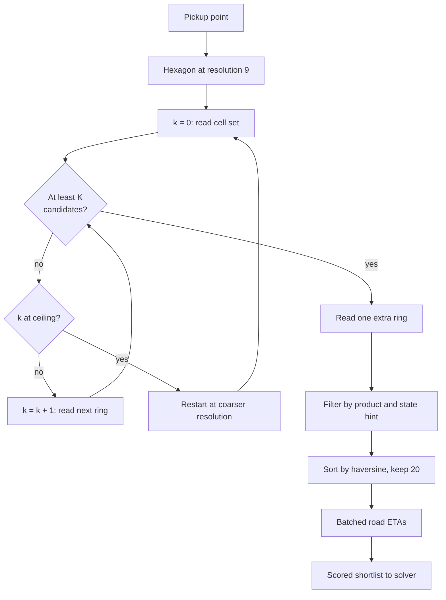

**Reading the diagram.** All steps run in memory inside the matcher and the supply-index partition, synchronously. The loop reads one ring of cell sets at a time until the candidate count reaches $K$, then reads one safety ring; if the ring ceiling is hit first (a sparse suburb), the search restarts at a coarser resolution whose hexagons are seven times larger. Filtering uses the in-memory state hint, which may be slightly stale; the claim in Figure 55.7 is the authoritative check. Only the final shortlist pays for road ETAs. Failure points: a partition boundary inside the ring (query both partitions in parallel) and an ETA timeout (fall back to haversine distance divided by the zone's average speed). Scaling: cell reads are independent and parallelizable; the ETA step is the cost driver.

### 55.5.10 Bottlenecks

1. **ETA computations**, 20,000 per second at peak: batch, cache by hexagon pair for 30–60 s, and use a cheaper model for the first filter.
2. **Zone boundaries.** Requests near a zone edge see candidates owned by a neighboring matcher; both may pick the same driver. The claim resolves it safely, but frequent claim failures waste a round. Overlap zones slightly and let the claim arbitrate, or assign border cells to one owner per window.
3. **Hot events.** At a concert's end, 5,000 requests in 10 minutes in a few hexagons create a large, dense batch: use a pickup-zone queue (first come, first served) instead of nearest matching, which is fairer and cheaper.
4. **Offer round-trips.** Every non-accepted offer adds 5–15 s; acceptance prediction and shorter deadlines matter more than solver speed.

### 55.5.11 Failure scenarios

**Table 55.7 — Failure scenarios for ride matching.**

| What fails | Impact | Detection | Recovery | Prevention |
|---|---|---|---|---|
| Matcher crashes mid-batch | Requests in the batch delayed | Missing heartbeat; queue age | Another instance takes the zone; trips still `MATCHING` are re-batched | Requests persisted before matching; zone leases |
| Two matchers pick the same driver | One claim fails | Claim-conflict rate | Loser takes next candidate | Conditional claim; zone ownership |
| Matcher pauses after offer, lease expires | Driver re-offered elsewhere; stale accept arrives | Accept with old token | Accept rejected by token check | Fencing token in the commit transaction |
| Driver accept lost in network | Driver unsure; rider waiting | App retry with same offer ID | Idempotent commit returns success | Retries with idempotent transaction |
| ETA service down | Matches by distance; worse pickups | ETA error rate | Fallback to haversine at zone average speed | Bulkheads; cached ETA matrix |
| Supply index stale | Offers to drivers who went offline | Rising offer-expiry rate | Exclude after expiry; re-offer | 15 s silence eviction; app heartbeat |
| City shard primary fails | No claims or commits for seconds | Failover monitor | Promote replica; re-batch | Synchronous replicas; small shards |

### 55.5.12 Scaling strategy

**At 10×**, the largest city reaches 1,000 requests per second: split it into more zones, with one matcher per zone and overlap arbitration by claims, and precompute ETA matrices between busy hexagon pairs. **At 100×**, the global-optimum assignment per city is no longer tractable each window; the system becomes hierarchical: a coarse rebalancer moves idle supply between zones (by incentives or suggestions) every few minutes, while fine-grained matching stays local. Pooled rides add a vehicle-routing problem with capacity and detour constraints, which is far harder than one-to-one assignment and usually solved by insertion heuristics.

### 55.5.13 Trade-offs

- **Batch window versus latency.** Longer windows find better assignments but every rider waits up to one window longer; adapt the window to the supply-to-demand ratio.
- **Global optimum versus fairness and predictability.** Minimizing total ETA can leave one rider repeatedly unmatched; add an aging term to the score.
- **Strong commitment versus availability.** Claims require the city shard; if it is unavailable, matching stops. The alternative — optimistic assignments reconciled later — produces double-dispatched drivers, which is worse.
- **One offer at a time versus broadcast.** Sequential offers are slower but respectful of drivers; broadcast trades driver experience for speed.

### 55.5.14 Alternative designs

**Table 55.8 — Matching strategies compared.**

| Strategy | How it works | Advantages | Disadvantages | Choose when |
|---|---|---|---|---|
| Greedy nearest (distance) | Nearest idle driver by straight line | Simplest; no extra latency | Ignores roads; myopic | Prototypes; very low volume |
| Greedy by ETA | Best road ETA on arrival | Correct notion of "near" | Still myopic | Low density, where batches are tiny |
| Batched assignment | Window, bipartite graph, min-cost solver | Lower total ETA; handles contention | Adds up to one window of latency | Dense cities, high demand |
| Batched with future value | Assignment weights include learned driver value | Accounts for where drivers end up | Needs ML, offline replay to tune | Mature marketplaces (demand forecasts, §83.4) |
| Broadcast, first to accept | Offer to N drivers at once | Fast in low-acceptance areas | Driver frustration; more claim conflicts | Sparse supply, long-distance trips |
| Pickup queue (FIFO) | Drivers queue at a venue; riders take the head | Fair; trivial to compute | Only for fixed pickup points | Airports, stadiums |

### 55.5.15 Interview discussion

**Pacing (45 minutes).** Requirements and invariants (5 min: one driver per ride, one ride per driver); estimates (5 min: candidates per ring, ETA load); architecture (10 min: Figure 55.6); deep dives (20 min: ring search, greedy versus batched with the two-rider counterexample, claim with lease and fencing token in one transaction); failures and scaling (5 min).

**Likely follow-ups.** *Why not a distributed lock service?* It would work, but a conditional update in the database that stores the assignment gives the same guarantee with fewer moving parts, and the fencing check must happen there anyway. *How do you choose the window?* By experiment: measure total ETA and request-to-offer latency at 0, 1, 2 and 3 s. *How do you match riders to drivers on another partition?* Query both partitions; the claim arbitrates. *How do you test matching changes?* Replay the decision log offline against the new algorithm, then A/B test by city and time slice (switchback experiments, because riders and drivers in one city interact).

**What distinguishes senior and staff answers.** A senior candidate uses a cell index, ETA scoring and a lock with expiry. A staff candidate produces the greedy counterexample unprompted, explains why the lock alone is unsafe and puts the fencing check inside the commit transaction, co-locates trips and drivers to avoid a distributed transaction, and talks about measuring matching quality with replay and switchback experiments.

### 55.5.16 Production considerations

- **Observability.** Per city and zone: request-to-offer latency, offers per match, acceptance rate, claim-conflict rate, lease expiries, ETA prediction error, and the fraction of matches made at each ring radius. A sudden rise in claim conflicts means overlapping zones or a stale supply index.
- **Security and abuse.** Drivers may decline strategically or spoof location to wait in better zones; acceptance-rate features and location plausibility checks feed into fairness and fraud systems (Chapter 82).
- **Cost.** ETA computations dominate; caching and two-stage funnels keep them proportional to requests, not to candidates squared.
- **Operations.** Every matching change ships behind a flag per city, with the decision log enabling exact replay of any incident ("why did this rider wait 12 minutes?").

## 55.6 Google Maps: tiles, routing and live traffic

### 55.6.1 Problem statement

Design a global mapping service: a map you can pan and zoom smoothly on any device, search for places and addresses, and turn-by-turn directions with arrival times that account for current traffic. Think of an atlas, a gazetteer and a road-trip planner in one book, except that the book is redrawn for each reader's screen, the index answers misspelled questions, and the road-trip planner listens to millions of drivers reporting how fast traffic is moving right now.

The distinctive hard problems are two very different ones. **Tile serving** is a read-scaling problem: hundreds of thousands of small, cacheable objects per second, most of them identical across users, so the answer is a pyramid of precomputed tiles behind a CDN (§21.3). **Routing** is an algorithmic problem: Dijkstra's algorithm is correct but far too slow on a road graph of hundreds of millions of intersections, so the answer is preprocessing — A* with good lower bounds and, above all, **contraction hierarchies**. Live traffic and ETA prediction are covered briefly; the machine-learning ETA model is Chapter 83 (§83.5).

*Evidence: Illustrative* — this is a teaching design for a Maps-like product, not a description of Google's internal architecture; published Google sources are cited where used.

### 55.6.2 Functional requirements

1. **Map display.** Render the map at any location and zoom level (0 = whole world to about 20 = individual buildings), in several styles (default, satellite, terrain, dark) and the viewer's language.
2. **Search and geocoding.** Find places and addresses by text with autocomplete; convert addresses to coordinates (geocoding) and coordinates to addresses (reverse geocoding).
3. **Directions.** Compute routes for driving, walking, cycling and transit between two or more points, with alternatives and turn-by-turn instructions.
4. **ETA with live traffic.** Predict arrival time from current and historical speeds; show traffic colors on the map.
5. **Navigation.** Follow the user, detect deviation and reroute; update ETA en route.
6. **Map updates.** Apply new roads, closures and business changes from data pipelines and user reports.

Out of scope: Street View imagery capture, transit-schedule ingestion details, reviews and photos, and the ML ETA model.

### 55.6.3 Non-functional requirements

**Table 55.9 — Non-functional requirements for the mapping service.**

| Property | Target |
|---|---|
| Tile latency | p99 < 100 ms at the edge for cached tiles; < 300 ms on a miss |
| Route latency | p99 < 500 ms for a city route, < 1.5 s for a cross-continent route |
| Search and autocomplete | p99 < 150 ms per keystroke |
| Availability | 99.99% for tiles and routing (navigation users are driving) |
| Traffic freshness | Segment speeds at most 2–3 minutes old |
| Map data consistency | Tiles and routing graph from the same published map version |
| ETA accuracy | Tracked as error distribution against actual arrival (Chapter 83) |

### 55.6.4 Capacity estimation

::: formula
**Tile pyramid size and ground resolution**

$$T(z) = 4^{z}, \qquad T_{\le Z} = \sum_{z=0}^{Z} 4^{z} = \frac{4^{Z+1} - 1}{3}, \qquad r(z, \varphi) = \frac{C_{\text{eq}} \cos\varphi}{256 \times 2^{z}}$$

| Symbol | Meaning | Units |
|---|---|---|
| $T(z)$ | Number of tiles at zoom level $z$ | tiles |
| $T_{\le Z}$ | Tiles in all levels from 0 to $Z$ | tiles |
| $z$, $Z$ | Zoom level; maximum zoom level | — |
| $r(z, \varphi)$ | Ground distance covered by one pixel of a 256-pixel tile | m/pixel |
| $C_{\text{eq}}$ | Earth's equatorial circumference, 40,075,016.686 m | m |
| $\varphi$ | Latitude | degrees |
:::

::: example
**Worked example — how big is the pyramid?**

1. **Tiles to zoom 14.** $T_{\le 14} = (4^{15} - 1)/3 = 357{,}913{,}941$ tiles. About 70% of Earth is ocean, so assume 30% carry land detail: $0.3 \times 3.58 \times 10^8 = 1.07 \times 10^8$ tiles. At 20 KB per vector tile: $1.07 \times 10^8 \times 20{,}000 = 2.15$ TB per map version.
2. **Raster to zoom 18.** $T_{\le 18} = (4^{19} - 1)/3 = 9.16 \times 10^{10}$; 30% land is $2.75 \times 10^{10}$ tiles; at 15 KB per PNG, 412 TB — for *one* style, one language and one pixel density.
3. **Ground resolution.** $C_{\text{eq}}/256 = 156{,}543$ m/pixel at zoom 0. In San Francisco ($\varphi = 37.77^\circ$, $\cos\varphi = 0.7905$) at zoom 15: $156{,}543 \times 0.7905 / 32{,}768 = 3.78$ m/pixel; at zoom 18, 0.47 m/pixel.

*Interpretation.* Each zoom level has four times the tiles of the one above, so the deepest levels dominate everything. *Engineering implication.* Precompute vector tiles only to about zoom 14–16 and let clients **overzoom** (render deeper zooms from the same geometry), and keep styles and labels on the client. One 2 TB vector pyramid replaces hundreds of terabytes of raster tiles per style and language.
:::

::: example
**Worked example — traffic.** Assumptions: 300 million daily users; 100 tile requests per user per day; peak 2× average for tiles, 3× for routing and search; CDN hit ratio 95%; 1.5 route requests per user per day (including reroutes); 2 searches per user per day, each with 5 autocomplete keystrokes; 20 million concurrent navigation sessions at peak, each reporting a probe point every 10 s.

1. **Tiles.** $300 \times 10^6 \times 100 = 3 \times 10^{10}$ per day; $/86{,}400 = 347{,}222$/s average; peak 694,444/s. Origin (5% misses): 34,722/s. Edge egress at 20 KB: $694{,}444 \times 20{,}000 = 13.9$ GB/s $\approx 111$ Gb/s.
2. **Routes.** $4.5 \times 10^8$ per day $= 5{,}208$/s average, 15,625/s at peak.
3. **Search.** $6 \times 10^8$ per day $= 6{,}944$/s average, 20,833/s peak; autocomplete $5 \times 20{,}833 = 104{,}167$ keystroke queries/s at peak.
4. **Probe ingestion.** $2 \times 10^7 / 10 = 2 \times 10^6$ points/s; at 100 bytes, 200 MB/s.
5. **Road graph in memory.** Assume 500 million nodes and 1.2 billion directed edges at 16 bytes each: $8 + 19.2 = 27.2$ GB; contraction-hierarchy shortcuts add an amount assumed equal to the edge count, so about 46 GB per full copy.

*Interpretation.* Tiles are the largest request volume, but almost all of it is served by the CDN; probe ingestion is the largest *write* volume; routing is modest in request count but expensive per request. *Engineering implication.* Three separate subsystems with different scaling levers: cache hierarchy for tiles, a streaming pipeline for traffic, and memory-resident, regionally partitioned graphs for routing.
:::

### 55.6.5 API design

```text
GET /tiles/v3/{layer}/{z}/{x}/{y}.mvt?mapver=2026-11-01.3
  -> 200 application/vnd.mapbox-vector-tile   (protobuf; Cache-Control: public, max-age=86400, immutable)

GET /v1/geocode?q=1600+Amphitheatre+Parkway&bias=37.42,-122.08
  -> 200 { "results": [ { "place_id": "p_9a", "formatted": "...", "location": {"lat":..., "lng":...},
                          "precision": "ROOFTOP", "score": 0.97 } ] }
GET /v1/reverse-geocode?lat=37.4220&lng=-122.0841   -> 200 { "results": [ ... ] }
GET /v1/autocomplete?q=blue+bot&session=s_51&near=37.77,-122.42   -> 200 { "predictions": [ ... ] }

POST /v1/routes
  { "origin": {"lat":..., "lng":...}, "destination": {...}, "waypoints": [],
    "mode": "DRIVE", "depart_at": "now", "alternatives": true, "avoid": ["TOLLS"] }
  -> 200 { "routes": [ { "route_id": "rt_4c", "duration_s": 1260, "duration_in_traffic_s": 1490,
            "distance_m": 18400, "polyline": "encoded...", "steps": [ ... ], "mapver": "2026-11-01.3" } ] }

POST /v1/probes            (batched, from navigating clients that opted in)
  { "session": "anon_7f", "points": [ {"lat":..., "lng":..., "speed_mps": 13.2, "heading": 90, "ts_ms": ...} ] }
  -> 204
```

What to notice: tile URLs include the **map version**, so tiles are immutable and can be cached for a long time and invalidated by changing the version rather than purging the CDN (§21.6). Routes return the map version they were computed on, so navigation can request tiles of the same version. Probe uploads use a rotating anonymous session ID, not a user ID.

### 55.6.6 Data model and database schema

Four stores, each matched to its access pattern.

1. **Map feature database (source of truth).** Roads, buildings, places, boundaries, each a versioned feature with geometry and attributes, keyed by feature ID and spatially indexed by S2 cell (§17.9.4). Edits from data pipelines and moderators append new versions; a *published map version* is a consistent snapshot.
2. **Tile store.** Object storage (§15.4) with key `layer/mapver/z/x/y`, filled by a batch tile-build pipeline from a published version; the CDN fronts it.
3. **Routing graph.** Built from the same version into compact binary files, partitioned by region (for example per S2 level-4 or level-5 cell group plus the cross-border long-distance network), loaded into the memory of routing servers:

    ```text
    nodes:    node_id -> (lat_e7, lng_e7, ch_level)                 # 16 bytes packed
    edges:    CSR arrays: first_edge[node], target[e], weight_ds[e],  # deciseconds free-flow
              segment_id[e], flags[e] (toll, ferry, turn restrictions)
    shortcuts: same CSR layout, plus middle_node[e] to unpack paths
    ```

4. **Traffic store.** In-memory, per region: `segment_id -> (speed_kmh, confidence, updated_ms)` for live speeds, plus historical speed profiles per segment per 15-minute slot of the week in a key-value store.

5. **Search index.** An inverted index over place names, addresses and categories (Chapter 16), with per-document geographic cells for location bias and a prominence score.

Why not a graph database for routing? General graph databases (§12.7) traverse with pointer chasing over pages; routing needs a fixed, read-only, cache-friendly array layout and custom algorithms. Why not compute tiles on demand? Popular tiles would be recomputed millions of times; precomputation plus CDN makes the common case a cache hit.

### 55.6.7 High-level architecture

**Figure 55.9 — Mapping service: data pipeline, tiles, routing and traffic.**

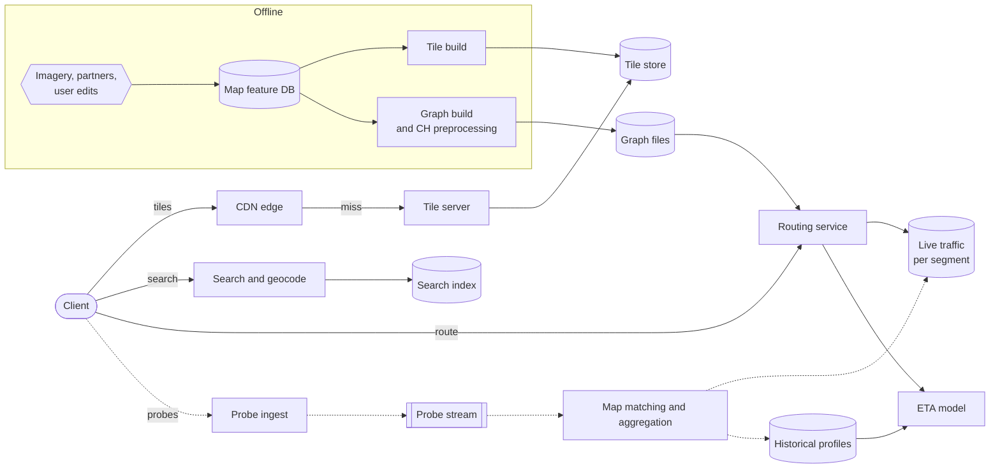

**Reading the diagram.** The offline subgraph turns source data into a published map version, then builds two artifacts from it: tiles (to the tile store) and the routing graph with contraction-hierarchy shortcuts (to graph files). Clients fetch tiles from the CDN; misses go to stateless tile servers that read object storage. Search and geocoding query an inverted index. Route requests go to routing servers, which hold graph partitions in memory and read live segment speeds; an ETA model combines route, live and historical speeds. Navigating clients upload probes asynchronously (dotted) into a stream; map matching snaps them to road segments and aggregates speeds per segment per minute into the live traffic store and, over time, the historical profiles. Storage boundaries: the feature database (source of truth), object storage, in-memory graphs and traffic. Failure points: a bad map version (roll back by pointing to the previous version), tile-server overload after a style change (pre-warm), and a stalled traffic pipeline (fall back to historical profiles). Scaling: tiles by CDN capacity, routing by region partitions and replicas, traffic by stream partitions keyed by region.

### 55.6.8 Detailed component design

#### Component 1: tile serving and vector tiles

The world is projected with **Web Mercator** onto a square and cut into a quadtree: at zoom $z$ there are $2^z \times 2^z$ tiles addressed `z/x/y` (the "slippy map" scheme) [OpenStreetMap Wiki: Slippy map tilenames]. Early web maps served **raster tiles**: 256 × 256 pixel images rendered on the server. **Vector tiles** instead carry geometry and attributes for one tile, encoded with integer coordinates in a tile-local grid (commonly 4,096 units across) as protocol buffers [Mapbox Vector Tile Specification 2.1]; the client renders them with the GPU.

Why vector tiles won:

1. **Size and count.** One vector pyramid serves every style, language, pixel density and rotation; raster needs a pyramid per combination (412 TB versus 2 TB in the worked example).
2. **Overzoom.** Geometry from zoom 14 renders crisply at zoom 18, so the pyramid stops early.
3. **Smooth interaction.** Fractional zoom, 3D tilt and label rotation happen on the client without new downloads.
4. **Cheaper updates.** A changed road invalidates a few vector tiles per zoom; the client restyles locally.

The cost is client CPU and GPU for rendering, and a more complex build pipeline: **generalization** (simplifying geometry and dropping minor features at low zooms so a zoom-5 tile does not contain every footpath in a country) and **label placement** consistent across tile edges.

Serving is a three-level cache: device cache (tiles are immutable per map version), CDN edges with an origin shield (§21.5), then tile servers over object storage. Tile requests are extremely skewed — popular cities at common zooms — so the CDN hit ratio is high; the long tail (rural zoom-16 tiles) is served from object storage on a miss. For a new map version, pre-warm the CDN with the top few million tiles before switching clients to it.

::: industry
**Open tile standards.** The `z/x/y` addressing of Web Mercator tiles used by OpenStreetMap and most web maps is documented by the OpenStreetMap project [OpenStreetMap Wiki: Slippy map tilenames]. The Mapbox Vector Tile specification (version 2.1) defines vector tiles as protocol buffers containing named layers of features whose geometry uses integer coordinates within an extent, commonly 4,096 [Mapbox Vector Tile Specification 2.1].
*Evidence: Primary* — [OpenStreetMap Wiki; Mapbox Vector Tile Specification 2.1]
:::

#### Component 2: routing from Dijkstra to contraction hierarchies

Model roads as a directed graph: intersections are nodes, road segments are edges weighted by travel time. A route is a shortest path.

**Dijkstra's algorithm** [Dijkstra 1959] grows a ball of settled nodes around the origin in order of distance, using a priority queue; it is exact but settles every node closer than the destination. For a 500 km trip that is a large fraction of a country's road graph: millions of nodes, seconds of CPU per query, far too slow at 15,000 routes per second.

**A\*** [Hart, Nilsson and Raphael 1968] adds a heuristic $h(v)$, a lower bound on the remaining cost, and orders the queue by $g(v) + h(v)$. If $h$ never overestimates (it is **admissible**), A* is still exact; the better the bound, the narrower the search. For travel time, the straight-line distance divided by the fastest speed limit is admissible but weak, because most roads are much slower than the fastest. The program below measures the effect.

```python
import heapq
import math
import random

def build_grid(n, seed=3):
    """n x n street grid, 100 m blocks; each edge's travel time is >= distance / max speed."""
    random.seed(seed)
    pos, adj = {}, {}
    for r in range(n):
        for c in range(n):
            pos[(r, c)] = (c * 0.1, r * 0.1)            # km
            adj[(r, c)] = []
    for r in range(n):
        for c in range(n):
            for dr, dc in ((0, 1), (1, 0)):
                if r + dr < n and c + dc < n:
                    speed = random.choice([30, 50, 50, 50, 80])    # km/h per segment
                    t = 0.1 / speed * 3600                         # seconds
                    adj[(r, c)].append(((r + dr, c + dc), t))
                    adj[(r + dr, c + dc)].append(((r, c), t))
    return pos, adj

def shortest(adj, src, dst, h=lambda v: 0.0):
    """A* search; with h = 0 it is exactly Dijkstra's algorithm."""
    dist, prev, settled = {src: 0.0}, {}, 0
    pq = [(h(src), src)]
    done = set()
    while pq:
        _, u = heapq.heappop(pq)
        if u in done:
            continue                                   # stale queue entry
        done.add(u)
        settled += 1
        if u == dst:
            break
        for v, w in adj[u]:
            nd = dist[u] + w
            if nd < dist.get(v, math.inf):
                dist[v], prev[v] = nd, u
                heapq.heappush(pq, (nd + h(v), v))
    path, v = [dst], dst
    while v != src:
        v = prev[v]
        path.append(v)
    return dist[dst], path[::-1], settled

pos, adj = build_grid(120)                             # 14,400 intersections
src, dst = (10, 10), (100, 90)
V_MAX = 80 / 3600                                      # km per second, fastest road

def h_time(v):
    """Straight-line distance at top speed: never overestimates, so A* stays exact."""
    (x1, y1), (x2, y2) = pos[v], pos[dst]
    return math.hypot(x1 - x2, y1 - y2) / V_MAX

d_cost, d_path, d_settled = shortest(adj, src, dst)
a_cost, a_path, a_settled = shortest(adj, src, dst, h_time)
print(f"Dijkstra: {d_cost / 60:.2f} min, {d_settled:,} nodes settled")
print(f"A*      : {a_cost / 60:.2f} min, {a_settled:,} nodes settled")
print("same optimum:", abs(d_cost - a_cost) < 1e-9, "| path hops:", len(a_path) - 1)
```

Output:

```text
Dijkstra: 16.24 min, 13,132 nodes settled
A*      : 16.24 min, 9,582 nodes settled
same optimum: True | path hops: 170
```

What to notice:

- One function implements both algorithms: Dijkstra is A* with $h = 0$. Both return the same 16.24-minute optimum, as admissibility guarantees.
- Dijkstra settled 13,132 of 14,400 nodes to cross most of the grid; A* with the top-speed bound settled 9,582, only 27% fewer, because a bound based on 80 km/h is loose when most roads allow 30–50 km/h.
- Better lower bounds exist: **landmarks** (ALT) precompute distances to a few dozen landmark nodes and use the triangle inequality to bound remaining cost [Goldberg and Harrelson 2005]. But the large wins come from preprocessing the graph itself.

**Contraction hierarchies (CH)** [Geisberger et al. 2008] exploit the fact that road networks have a natural hierarchy: long trips use a small set of important roads.

1. **Order the nodes by importance.** Heuristics rank nodes so that minor residential intersections come first and motorway junctions last.
2. **Contract nodes in that order.** Removing node $v$ may destroy a shortest path $u \to v \to w$; if no other path ("witness") between $u$ and $w$ is as short, add a **shortcut** edge $u \to w$ with the combined weight, remembering $v$ as its middle node. Continue until every node is contracted.
3. **Query bidirectionally, upward only.** Run Dijkstra from the origin forward and from the destination backward, but each search relaxes only edges leading to *more important* nodes. The two searches meet near the top of the hierarchy; the best meeting node gives the shortest distance.
4. **Unpack.** Replace each shortcut recursively by its middle node to recover the full turn-by-turn path.

Because each search climbs only upward, it settles a few hundred to a few thousand nodes instead of millions. The original paper reported query times well under a millisecond on a European road network of millions of nodes, after a preprocessing step of minutes [Geisberger et al. 2008]. The price is **static weights**: CH bakes travel times into shortcuts. Live traffic changes weights every minute, so production systems either re-customize quickly using variants designed for it — **customizable route planning** (CRP) separates metric-independent partitioning from a fast per-metric customization step [Delling et al. 2011] — or compute routes with CH on typical weights and then re-score the top candidate routes with live and predicted segment speeds.

::: concept
**The trade you are making.** Dijkstra: no preprocessing, slow queries. A*: no preprocessing, faster queries if the bound is good. CH and CRP: minutes to hours of preprocessing and extra memory for shortcuts, in exchange for queries that are orders of magnitude faster. At 15,000 route requests per second, preprocessing once per map version is cheap.
:::

#### Component 3: live traffic ingestion and ETA

1. **Collect.** Navigating clients that have opted in upload batched probe points (position, speed, heading, timestamp) under a rotating anonymous identifier.
2. **Map-match.** A streaming job snaps each probe sequence to the most likely road segments (a hidden-Markov-model style matcher over candidate segments), which is essential where roads are parallel or stacked.
3. **Aggregate.** Per segment and one-minute window, compute robust speed statistics (median, trimmed mean) and a confidence based on probe count; discard stationary outliers (a parked delivery van is not a traffic jam).
4. **Publish.** Write `segment → speed` into the in-memory traffic store of the region; render traffic-color overlay tiles (small, short-TTL tiles) from it.
5. **Predict.** The ETA for a route combines live speeds near the departure time with historical profiles further along the route (traffic 40 minutes ahead is better predicted by "Tuesdays at 18:00" than by now), corrected by a learned model.
6. **Privacy.** Trim the first and last few hundred meters of each trip, aggregate only segments with enough distinct contributors, and discard raw probes after aggregation (§50.10).

::: industry
**Graph neural networks for ETA in Google Maps.** Google DeepMind and Google Maps researchers described an ETA model that represents the road network around a route as a graph of "supersegments" and predicts travel times with a graph neural network; they report that it was deployed in production and reduced negative ETA outcomes compared with the previous production approach, by more than 40% in some cities such as Sydney [Derrow-Pinion et al. 2021]. Chapter 83 treats the modeling.
*Evidence: Primary* — [Derrow-Pinion et al. 2021]
:::

#### Component 4: geocoding and place search

**Forward geocoding** parses free text ("1600 amphitheatre pkwy mtn view") into components (house number, street, locality), normalizes abbreviations and spelling per country, and searches an inverted index of addresses (§16.3) constrained by the administrative hierarchy; candidates are ranked by text match, component agreement and precision (rooftop beats street-interpolated). **Reverse geocoding** looks up the point's S2 cell and its neighbors in a spatial index of address points and street segments and returns the nearest plausible address. **Place search and autocomplete** query a prefix index (§16.9) with location bias — the same prefix ranks "Blue Bottle Coffee" first in San Francisco and something else in Tokyo — and a session token groups the keystrokes of one search for billing and quality analysis.

### 55.6.9 Data flow

**Figure 55.10 — Read path: loading map tiles.**

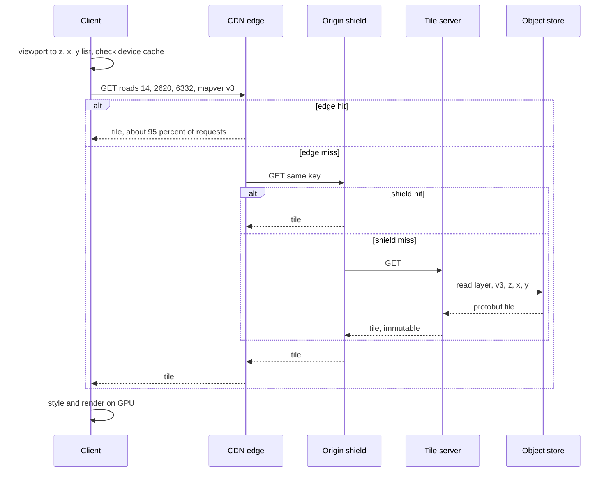

**Reading the diagram.** The client converts its viewport into a list of tile coordinates and fetches only those missing from its device cache, usually a dozen or two in parallel over HTTP/2 or HTTP/3. Most requests end at the CDN edge; misses go to a regional origin shield, which collapses concurrent misses for the same tile into one origin request (§21.5), and only then to a stateless tile server reading object storage. Every response is immutable for its map version, so caches never serve stale data across versions. All calls are synchronous. Failure points: an origin outage is masked for popular tiles by the caches; a style or version change that invalidates everything at once creates a miss storm, prevented by pre-warming and staggered rollout. Scaling: add edge capacity; tile servers are stateless.

**Figure 55.11 — Read path: a route request.**

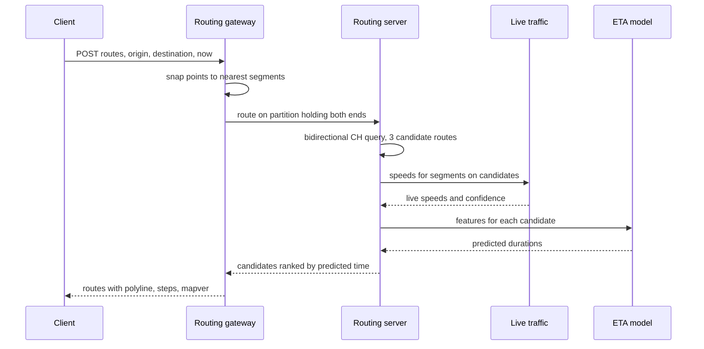

**Reading the diagram.** The gateway snaps origin and destination to road segments and selects the routing partition (a cross-region trip goes to servers holding the long-distance overlay graph). The routing server runs a contraction-hierarchy query to find a few good candidate routes on typical weights, then re-scores them with live segment speeds and the ETA model; the client receives the best route and alternatives. All calls are synchronous with tight timeouts: if traffic or the model times out, the route is returned with historical-profile ETAs. Failure points: a routing replica that loaded a different map version than the tiles (prevented by version pinning) and a partition with no healthy replica (route via a neighboring partition's overlay with degraded detail). Scaling: replicate each partition; route requests are independent.

**Figure 55.12 — Write path: probe ingestion to live traffic.**

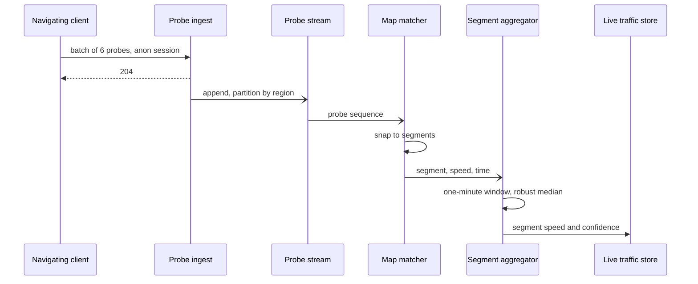

**Reading the diagram.** Clients upload batches and receive an immediate acknowledgment; everything after the stream append is asynchronous. The stream is partitioned by region so map matching and aggregation scale with regional volume (2 million probes per second at peak). The aggregator emits one speed per segment per minute, so the live traffic store receives far fewer writes than probes arrive (about 333,000 segment updates per second if 20 million segments carry traffic). Failure points: a lagging aggregator makes traffic stale (detect by the age of the newest update and fall back to historical profiles beyond a threshold); a sudden drop in probes in a region can mean an app bug rather than empty roads, so low-confidence segments revert to historical speeds.

### 55.6.10 Bottlenecks

1. **Tile miss storms** on a new map version or style: pre-warm the top tiles, roll out by region, and keep the previous version serving until the new one is warm.
2. **Graph preprocessing time**: a full contraction of a continent takes long enough that map updates are batched; urgent closures are applied as live weight overrides (infinite weight) without rebuilding.
3. **Cross-partition routes**: long trips must cross partition boundaries; keep an overlay graph of boundary nodes and important roads that every routing server can use.
4. **Autocomplete fan-out**: 100,000 keystroke queries per second, each latency-critical; cache popular prefixes per region and debounce on the client.
5. **Map matching CPU** for 2 million probes per second: run matching per region, sample in dense areas where hundreds of probes per segment add no information.

### 55.6.11 Failure scenarios

**Table 55.10 — Failure scenarios for the mapping service.**

| What fails | Impact | Detection | Recovery | Prevention |
|---|---|---|---|---|
| Bad map version (missing bridge) | Wrong routes; visible errors | Route-quality canaries; user reports spike | Roll back the version pointer | Automated diff checks; staged rollout |
| Tiles and graph on different versions | Route drawn through roads not on the map | Version mismatch metrics | Pin route and tile versions per session | Build both from one snapshot |
| CDN region degraded | Slow map loads | Edge error rate, real-user monitoring | Steer to other edges | Multi-CDN or multiple edge tiers |
| Traffic pipeline stalls | Stale traffic colors and ETAs | Age of newest segment update | Fall back to historical profiles | Lag alarms; replicated aggregators |
| Routing server OOM on graph load | Partition capacity lost | Health checks | Shift to replicas; load next version gradually | Memory headroom; canary loads |
| Probe spoofing (fake jam) | Traffic falsely shown; reroutes | Many probes from few devices, impossible patterns | Drop low-diversity aggregates | Require distinct contributors per segment |

### 55.6.12 Scaling strategy

**At 10×** (3 billion tile requests per hour at peak), the design holds by adding CDN capacity; origin load grows only with the miss ratio, so improve hit ratio further with larger tiles (512 px) and longer device caching. Routing at 156,000 requests per second needs more replicas per partition and a precomputed cache for frequent origin–destination hexagon pairs. **At 100×**, probe ingestion (20 million per second) becomes the dominant cost: aggregate on the device (send segment-level summaries rather than raw points) and sample in congested areas. Map updates must move from periodic full rebuilds to incremental tile and graph updates per region.

### 55.6.13 Trade-offs

- **Vector versus raster:** smaller, restylable, overzoomable, but needs capable clients and a more complex build.
- **Preprocessing versus freshness:** CH gives the fastest queries on static weights; CRP or re-scoring candidates handles live traffic at some cost in optimality or speed.
- **Live versus historical speeds:** live is accurate now and noisy; historical is stable and wrong during incidents; blend by horizon and confidence.
- **Privacy versus coverage:** stricter aggregation thresholds hide traffic on quiet roads.

### 55.6.14 Alternative designs

**Table 55.11 — Shortest-path approaches compared.**

| Approach | Preprocessing | Query work | Live traffic | Choose when |
|---|---|---|---|---|
| Dijkstra | None | Settles all nodes closer than the target | Trivial (weights read at query time) | Small graphs; correctness baselines |
| Bidirectional Dijkstra | None | About half of Dijkstra's | Trivial | Medium graphs |
| A* (straight-line bound) | None | Somewhat fewer nodes | Trivial | Games, grids, walking |
| ALT (landmarks) | Distances to landmarks | Several times fewer nodes | Bounds stay valid only if weights do not drop below preprocessing values | Moderate scale with changing weights |
| Contraction hierarchies | Minutes per continent | Hundreds to thousands of nodes | Requires recontraction or re-scoring | Very high query rates on fixed metrics |
| Customizable route planning | Metric-independent partition, plus fast customization | Small, partition-based | Re-customize in seconds | Live traffic at scale |

### 55.6.15 Interview discussion

**Pacing (45 minutes).** Scope (5 min: tiles, search, directions with traffic; exclude Street View); estimates (5 min: tile pyramid and request rates); architecture (10 min: Figure 55.9, offline versus online); deep dives (20 min: vector tiles and CDN versioning; Dijkstra → A* → CH and the live-traffic problem; probe pipeline); failures and scaling (5 min).

**Likely follow-ups.** *Why not render tiles on demand?* Popular tiles repeat millions of times; precompute and cache. *How do you update one road?* Rebuild affected tiles at all zooms for a new version; apply closures as live weight overrides in routing until the next graph build. *Why does A\* need an admissible heuristic?* Otherwise it may stop with a non-optimal path. *How do you route across continents?* Partition plus an overlay graph of boundary nodes and major roads. *How do you keep tiles and routes consistent?* Version both artifacts from one snapshot and pin the version per session.

**What distinguishes senior and staff answers.** A senior candidate designs the tile pyramid with a CDN and explains A*. A staff candidate computes the pyramid size and argues for vector tiles with overzoom, explains why CH does not tolerate changing weights and how CRP or candidate re-scoring fixes it, versions every artifact, and designs the probe pipeline with privacy thresholds.

### 55.6.16 Production considerations

- **Observability.** Tile hit ratio per zoom and region; time-to-first-render on clients; route latency per partition; ETA error distribution (p50, p90 of actual minus predicted) per city; traffic freshness; map-version skew between fleets.
- **Security and privacy.** Probe data reveals home and work locations: anonymous rotating IDs, trip-end trimming, minimum contributor counts and short raw-data retention (§50.10). API keys and quotas protect paid APIs from scraping (§22.3).
- **Cost.** CDN egress dominates; vector tiles, compression and device caching are the main levers. Routing servers are memory-bound; compact graph layouts save fleets.
- **Operations.** Map releases are deployments: canary a new version in one region, compare route quality metrics against the previous version, then roll forward; keep rollback to the previous version one pointer change away.

## 55.7 Amazon: an e-commerce platform

### 55.7.1 Problem statement

Design a large online store: customers browse and search a catalog of hundreds of millions of products, add items to a cart, check out with a saved address and card, and track the order until delivery. Third-party sellers list products and stock. A few times a year a sales event multiplies traffic, and some items ("lightning deals") have a few thousand units that a hundred thousand people try to buy in the same minute.

A department store is a fair analogy: a huge, mostly static catalog on the shelves (read-heavy, cacheable), shopping baskets that customers carry around (must never be lost or refused), and a checkout counter that must never sell the last television twice. The distinctive hard problem is **inventory correctness under contention** — reserve versus oversell — wrapped in a checkout that spans services which cannot share a transaction, so it runs as a **saga** (§32.7). Everything else is a read-scaling problem.

*Evidence: Illustrative* — a teaching design for an Amazon-scale store; published Amazon sources are cited where used.

### 55.7.2 Functional requirements

1. Browse product pages (title, images, price, availability, delivery estimate, reviews, recommendations).
2. Search and filter the catalog with ranking and facets.
3. Add, update and remove cart items; the cart persists across devices and sessions.
4. Check out: choose address and payment, see final price with tax and shipping, place the order.
5. Reserve inventory at checkout; never confirm an order that cannot be fulfilled for strictly stocked items.
6. Process orders through fulfillment (warehouse allocation, picking, shipping) with status updates.
7. Support flash sales on limited stock with fair, bounded load.
8. Sellers update listings, prices and stock.

Out of scope: payment processing internals (§55.9), recommendation models (§56.5, Chapter 81), warehouse robotics, and seller payouts.

### 55.7.3 Non-functional requirements

**Table 55.12 — Non-functional requirements for the e-commerce platform.**

| Property | Target |
|---|---|
| Product page latency | p99 < 300 ms server-side, assembled from many services |
| Search latency | p99 < 200 ms |
| Cart availability | "Add to cart" never refused: 99.99% plus always-writable design |
| Checkout availability | 99.99%; checkout is revenue |
| Inventory correctness | Zero oversell for strictly stocked items; bounded, compensated oversell allowed for replenishable items |
| Order durability | No acknowledged order lost (RPO = 0) |
| Availability shown on product page | Eventually consistent, at most seconds stale |
| Flash-sale behavior | Graceful: excess demand queued or told "sold out", never errors |

### 55.7.4 Capacity estimation

::: example
**Worked example — traffic and storage.** Assumptions: 100 million daily active customers; 20 product page views, 5 searches and 2 cart writes per customer per day; 10 million orders per day; sales-event peak 5× the daily average for browsing and 10× for orders; 500 million products at 10 KB of structured data each; 100 million active carts at 2 KB; 5 KB per order.

1. **Product pages.** $100 \times 10^6 \times 20 = 2 \times 10^9$/day; $/86{,}400 = 23{,}148$/s; peak $\times 5 = 115{,}741 \approx 116{,}000$/s.
2. **Searches.** $5 \times 10^8$/day $= 5{,}787$/s; peak 28,935/s.
3. **Cart writes.** $2 \times 10^8$/day $= 2{,}315$/s; peak 11,574/s.
4. **Orders.** $10^7/86{,}400 = 116$/s; peak $\times 10 = 1{,}157$/s.
5. **Catalog.** $5 \times 10^8 \times 10{,}000 = 5$ TB (images separately in object storage behind the CDN).
6. **Carts.** $10^8 \times 2{,}000 = 200$ GB.
7. **Orders.** $10^7 \times 5{,}000 = 50$ GB/day, 18.25 TB/year.
8. **Product-page fan-out.** If one page calls 50 backend services, 116,000 pages/s become 5.8 million internal calls/s.

*Interpretation.* Reads outnumber orders by about 100 to 1, and the catalog fits comfortably in a distributed cache. *Engineering implication.* The product page is a caching and aggregation problem; checkout is a correctness problem at only about a thousand per second, except for hot items.
:::

::: formula
**Partitioned inventory counter for a hot item**

$$N \ge \left\lceil \frac{\lambda_w \, t_h}{u} \right\rceil$$

| Symbol | Meaning | Units |
|---|---|---|
| $N$ | Number of sub-counters (partitions) for one item's stock | — |
| $\lambda_w$ | Reservation attempts per second that reach the inventory store for that item | attempts/s |
| $t_h$ | Time each reservation holds the row lock (read, check, write, commit) | s |
| $u$ | Target utilization of each sub-counter, below 1 to keep queueing delay low (§4.10) | — |
:::

::: example
**Worked example — a lightning deal.** 1 million customers open the deal page in the first minute: $10^6 / 60 = 16{,}667$ page views per second, served from cache. Suppose a gate (§55.7.8) lets $\lambda_w = 5{,}000$ reservation attempts per second through to the inventory store, each holding the row lock for $t_h = 2$ ms (a replicated commit), and we target $u = 0.7$.

1. **One row's ceiling.** $1 / 0.002 = 500$ reservations/s.
2. **Load.** $\lambda_w t_h = 5{,}000 \times 0.002 = 10$: ten rows' worth of lock time per second.
3. **Partitions.** $N \ge \lceil 10 / 0.7 \rceil = \lceil 14.3 \rceil = 15$ sub-counters.
4. **Without the gate.** All 16,667 attempts/s would need $\lceil 16{,}667 \times 0.002 / 0.7 \rceil = \lceil 47.6 \rceil = 48$ sub-counters.

*Interpretation.* A single inventory row serializes at about 500 reservations per second however powerful the database is. *Engineering implication.* Split a hot item's stock across sub-counters, route attempts to a random sub-counter, and gate demand so the inventory store sees only attempts that could plausibly succeed.
:::

### 55.7.5 API design

```text
GET  /v1/products/{asin}?zip=98109           -> 200 { product, offers: [{seller_id, price, availability, delivery_by}], ... }
GET  /v1/search?q=usb+c+charger&facets=brand,price&page=1

PUT  /v1/cart/items/{asin}                   { "quantity": 2, "offer_id": "o_31" }   -> 200 { cart }
DELETE /v1/cart/items/{asin}
GET  /v1/cart

POST /v1/checkout/preview                    { "address_id": "a_2", "payment_method_id": "pm_7" }
  -> 200 { "lines": [...], "tax": ..., "shipping": ..., "total": {"amount": 4598, "currency": "USD"},
           "price_token": "pt_c1", "expires_at": "..." }
POST /v1/orders                              Idempotency-Key: 0c6f...
  { "cart_version": 14, "price_token": "pt_c1", "address_id": "a_2", "payment_method_id": "pm_7" }
  -> 202 { "order_id": "o-113-55", "status": "PENDING" }
GET  /v1/orders/{order_id}                   -> 200 { "status": "CONFIRMED", "items": [...], "shipments": [...] }
POST /v1/orders/{order_id}/cancel            Idempotency-Key: ...
```

What to notice: placing an order returns `202 Accepted` with a `PENDING` order because the checkout saga runs asynchronously; the client polls or receives a push. The `Idempotency-Key` turns a double-tapped "Place order" into one order (§22.15). The `price_token` pins the total shown at preview, and `cart_version` makes the order reflect exactly the cart the customer reviewed.

### 55.7.6 Data model and database schema

Each service owns its data (§34.11).

- **Catalog**: a document per product in a key-value or document store (§12.5), cached aggressively; changes flow by change data capture (§32.6) to the search index.
- **Cart**: a key-value item keyed by customer ID, always writable, replicated across zones; a Dynamo-style store (§27.7) is the classic choice.
- **Orders**: relational, partitioned by customer ID, since nearly every query is "this customer's orders".
- **Inventory**: relational with strong consistency per row, partitioned by SKU, because reservations are conditional updates.

```sql
CREATE TABLE inventory (
  sku            BIGINT   NOT NULL,
  fc_id          INT      NOT NULL,        -- fulfillment center
  bucket         SMALLINT NOT NULL DEFAULT 0,   -- sub-counter for hot items (0 for normal ones)
  on_hand        INT      NOT NULL CHECK (on_hand >= 0),
  reserved       INT      NOT NULL DEFAULT 0 CHECK (reserved >= 0),
  version        BIGINT   NOT NULL DEFAULT 0,
  PRIMARY KEY (sku, fc_id, bucket),
  CHECK (reserved <= on_hand)
);

CREATE TABLE reservations (
  reservation_id BIGINT      PRIMARY KEY,
  order_id       VARCHAR(32) NOT NULL,
  sku            BIGINT      NOT NULL,
  fc_id          INT         NOT NULL,
  bucket         SMALLINT    NOT NULL,
  quantity       INT         NOT NULL,
  state          VARCHAR(10) NOT NULL,     -- HELD | COMMITTED | RELEASED | EXPIRED
  expires_at     TIMESTAMPTZ NOT NULL,
  UNIQUE (order_id, sku, fc_id, bucket)    -- a retried reserve step cannot hold twice
);

CREATE TABLE orders (
  customer_id    BIGINT      NOT NULL,
  order_id       VARCHAR(32) NOT NULL,
  status         VARCHAR(16) NOT NULL,     -- PENDING | CONFIRMED | SHIPPED | DELIVERED | CANCELED | REJECTED
  total_minor    BIGINT      NOT NULL,
  currency       CHAR(3)     NOT NULL,
  idem_key       VARCHAR(64) NOT NULL,
  created_at     TIMESTAMPTZ NOT NULL,
  PRIMARY KEY (customer_id, order_id),
  UNIQUE (customer_id, idem_key)
);
```

The reservation is one conditional statement in one transaction with the reservation insert, so the check and the decrement cannot be separated by a concurrent buyer:

```sql
UPDATE inventory SET reserved = reserved + :qty, version = version + 1
 WHERE sku = :sku AND fc_id = :fc AND bucket = :b AND on_hand - reserved >= :qty;
-- 1 row: insert the reservation row (state HELD, expires_at = now() + 15 min) and commit.
-- 0 rows: try another bucket or fulfillment center, or report out of stock.
```

::: industry
**The shopping cart that motivated Dynamo.** Amazon's Dynamo paper uses the shopping cart as its motivating example: customers must be able to add items even during failures, so the store is always writable and replicas may diverge; divergent cart versions are reconciled by the application, which merges them, with the documented consequence that a deleted item can reappear [DeCandia et al. 2007]. Amazon's CTO also described a single page request calling many internal services — more than a hundred — to assemble the page [Gray 2006].
*Evidence: Primary* — [DeCandia et al. 2007; Gray 2006]
:::

### 55.7.7 High-level architecture

**Figure 55.13 — E-commerce platform: browse, cart, checkout and fulfillment.**

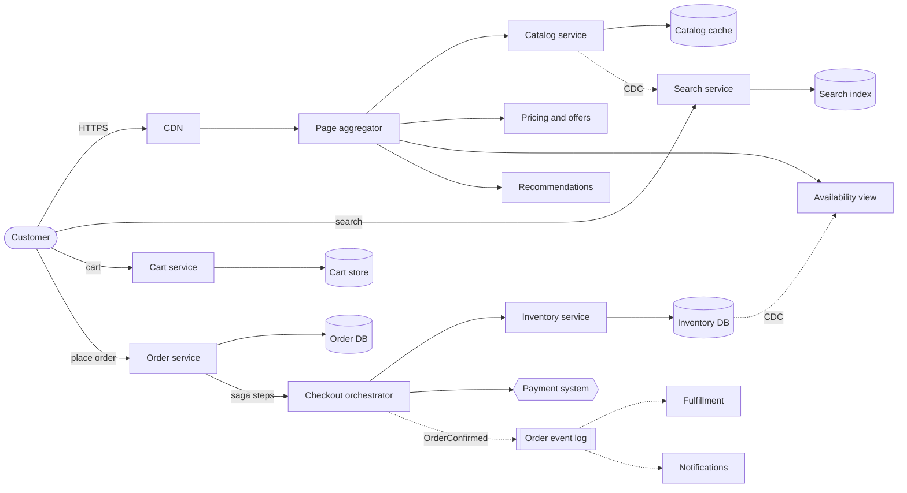

**Reading the diagram.** Product pages are assembled by a page aggregator that calls catalog, pricing, availability and recommendations in parallel, with per-call timeouts and fallbacks. Search is a separate service over an index fed asynchronously by change data capture from the catalog. The cart service writes to an always-available key-value store. Placing an order creates a `PENDING` order and hands it to the checkout orchestrator, which runs the saga: reserve inventory, authorize payment (§55.9), confirm. Confirmed orders are published to the order event log for fulfillment and notifications. The availability view used on product pages is a cached, eventually consistent projection of the inventory database; the inventory service itself is the strongly consistent source. Failure points: a slow dependency of the page aggregator (bulkheads and fallbacks), a hot inventory row (sub-counters), the payment provider (saga retries and compensation). Scaling: catalog and pages by caching; cart and orders by customer partitioning; inventory by SKU partitioning.

### 55.7.8 Detailed component design

#### Component 1: inventory — reserve versus oversell

There are two counts that customers care about and they need different consistency.

1. **"In stock" on the product page** is a *display* value. It may be seconds stale; it comes from a cached projection updated by change data capture. Being wrong here costs an annoyed customer, not an oversell.
2. **The reservation at checkout** is a *commitment*. It runs against the inventory row with the conditional update of §55.7.6; it either succeeds atomically or tells the saga to stop.

When to reserve? **At add-to-cart** is wrong at this scale: carts are abandoned at high rates, so stock would sit locked in carts for days (undersell). **At order placement** is the standard choice: reserve with a TTL (for example 15 minutes) that covers payment authorization; commit the reservation when the order is confirmed; release it on payment failure or expiry. A sweeper expires `HELD` reservations past `expires_at`, returning stock.

How much is held at once? By Little's Law (§4.11), held units ≈ reservation rate × hold time. At 1,157 orders/s with an average of 1.5 units per order and a typical hold of 30 s from reserve to confirm: $1{,}157 \times 1.5 \times 30 \approx 52{,}000$ units held at any moment across the catalog — negligible overall but significant for a single hot item, which is why holds must be short and expired promptly.

**Oversell policy is a business decision per item.** For a replenishable item, a small oversell (sell 101 when 100 are on hand because a returned unit is in transit) is often cheaper than refusing orders; the order is confirmed and fulfilled late, with an apology if needed. For a strictly limited item (a lightning deal, a collectible), the `CHECK (reserved <= on_hand)` constraint makes oversell impossible. Physical reality adds a third case: the warehouse discovers a damaged unit after confirmation. The order pipeline must therefore support **post-confirmation compensation** (reallocate from another fulfillment center, or cancel and refund) no matter how good the reservation logic is.

#### Component 2: checkout as a saga

The order, inventory and payment services each own their database, and the payment provider is external, so no single ACID transaction can span the checkout. Use an orchestrated saga [Garcia-Molina and Salem 1987] exactly as developed in §32.7.2, where this very example — order, inventory, payment — is worked through; here we only add the e-commerce specifics.

1. $T_1$ **Create order** `PENDING` (idempotent on `(customer_id, idem_key)`); compensation: mark `REJECTED`.
2. $T_2$ **Reserve inventory** for each line, choosing fulfillment centers by delivery promise and stock; compensation: release reservations.
3. $T_3$ **Authorize payment** for the total (the pivot, §32.7.1): the card is authorized, not captured; compensation before the pivot passes is not needed because a failed authorization has no effect.
4. $T_4$ **Confirm order**: commit reservations, set `CONFIRMED`, emit `OrderConfirmed` through the outbox (§32.5). Retriable, never compensated.
5. **Capture payment at shipment**, not at order time. This matches common card-network practice of capturing when goods ship, and it means a cancellation before shipment only voids an authorization rather than refunding a charge.

Every step is sent with the saga ID as its idempotency key, so the orchestrator can crash and resend; every compensation is itself idempotent and retried until it succeeds (§32.7). A saga stuck in a compensation alerts a human.

#### Component 3: flash sales and hot items

A lightning deal combines three loads: a page view storm (cacheable), a reservation storm on one SKU (not cacheable) and bot traffic. Defenses, in order from the edge inward:

1. **Static deal page from the CDN**, with the countdown computed on the client; availability fetched as a small, cached JSON blob refreshed every second.
2. **Admission gate.** Before the sale, mint exactly as many *purchase tokens* as there are units plus a small overbooking margin (for example 5,000 units → 5,500 tokens to account for abandonment), stored as an atomic counter in an in-memory store. Each "Buy" attempt decrements the counter; attempts after it reaches zero get "sold out — join the waitlist" immediately without touching inventory. For very large crowds, put a virtual waiting room in front (§55.8.8).
3. **Sub-counters.** Spread the item's stock across $N$ buckets (15 in the worked example); a reservation picks a random bucket and, if empty, tries others. When most buckets are empty, consolidate the remainder into one.
4. **Per-customer limits and bot defenses.** One unit per account, rate limits per account and device (§22.3), and challenges for suspicious clients.
5. **Short holds.** Deal reservations get a short TTL (for example 5 minutes) so that abandoned holds return to the pool quickly; released units re-mint tokens.

The gate is allowed to be approximate (an in-memory counter can lose a few decrements on failover), because the inventory row remains the authority: the worst case is a few more attempts than units, which the conditional update rejects.

#### Component 4: the product page and the recommendations hand-off

A product page is assembled from tens of services. Its latency is the slowest required call, and its tail latency compounds with fan-out (§23.6). Classify each widget: **required** (title, price, buy box) or **optional** (recommendations, reviews summary, "frequently bought together"). Required calls get retries within a deadline; optional calls get a strict timeout and a fallback (cached or popular items), and the page renders without them if needed. Recommendations are computed by a separate system (§56.5 for the systems view, §81.8 for the model) and exposed as a low-latency lookup keyed by product and customer; the commerce platform only consumes them.

### 55.7.9 Data flow

**Figure 55.14 — Write path: placing an order (orchestrated saga, success case).**

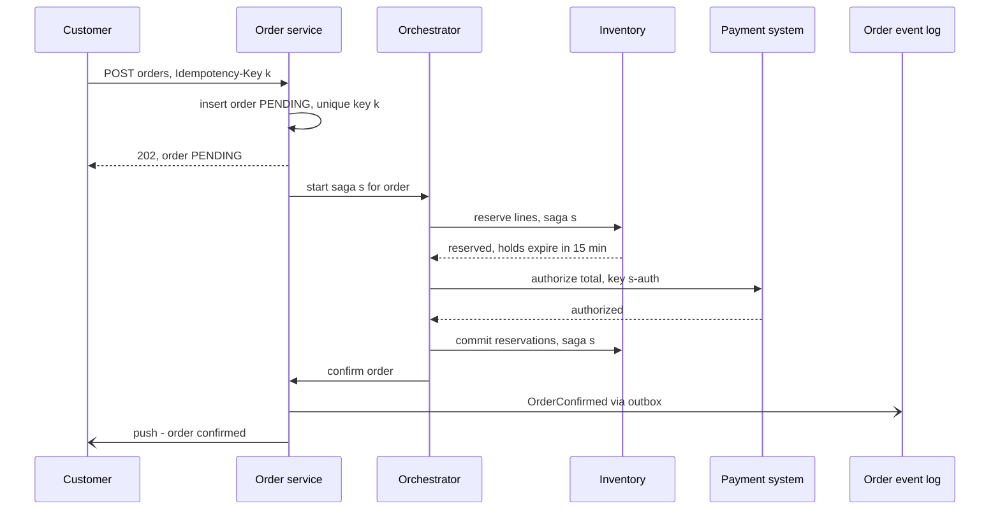

**Reading the diagram.** The order is persisted as `PENDING` with a unique idempotency key before anything else, so a retried request returns the same order. The orchestrator persists each saga state before sending the next command (§32.7) and uses keys derived from the saga ID, so every step is safe to resend. Inventory reservations carry a TTL in case the saga stalls. Payment is authorized, not captured. Confirmation commits reservations and publishes `OrderConfirmed` through the outbox for fulfillment. Synchronous: each saga command and reply; asynchronous: the event log and the customer push. Failure paths: an out-of-stock reservation ends the saga with the order `REJECTED`; a declined authorization releases reservations and rejects the order (compensation in reverse order, as in Figure 32.10).

**Figure 55.15 — Read path: rendering a product page.**

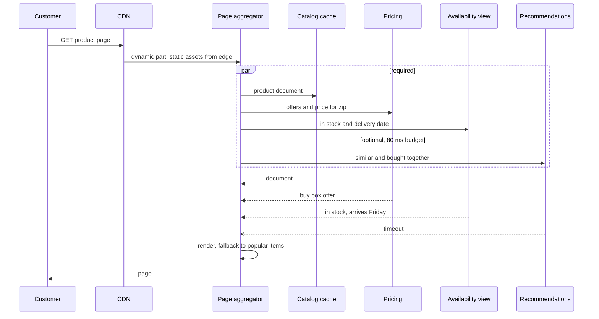

**Reading the diagram.** Static assets (images, scripts) come from the CDN edge; the dynamic shell goes to the page aggregator, which calls required services in parallel with the optional recommendations call under its own small budget. Here the recommendations call times out, so the page uses a cached list of popular items instead of failing. The availability call reads the cached projection, not the inventory database, which keeps 116,000 page views per second away from the strongly consistent store. All calls are synchronous with deadlines propagated from the edge. Failure points: a slow required service (retry once within the deadline, then show a degraded page without the buy box rather than an error) and cache stampedes on a newly hot product (request coalescing, §20.11).

**Figure 55.16 — Reservation lifecycle.**

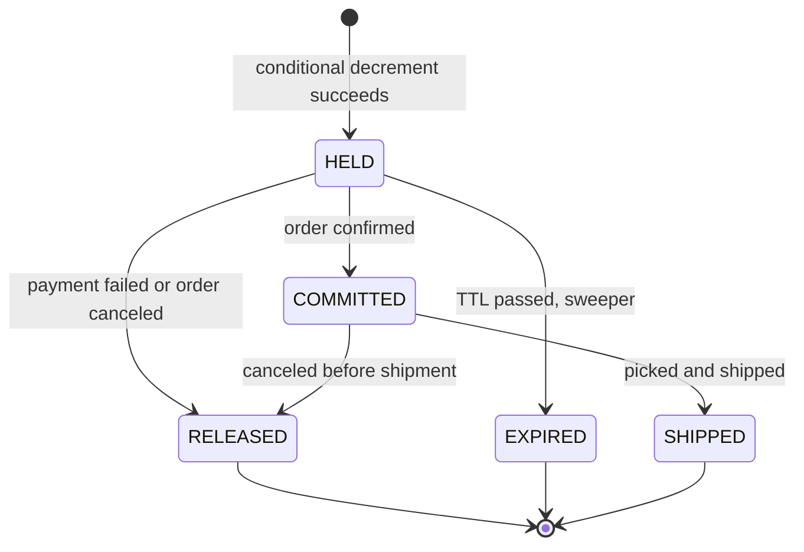

**Reading the diagram.** A reservation exists only after the conditional update succeeded. It ends in exactly one terminal state. `RELEASED` and `EXPIRED` return the units to `on_hand - reserved`; `SHIPPED` decrements `on_hand` and `reserved` together. Every transition is a conditional update on the reservation row (`WHERE state = 'HELD'`), so a confirmation racing the expiry sweeper resolves to one winner; if the sweeper wins, the orchestrator sees the failed commit and re-reserves or rejects the order.

### 55.7.10 Bottlenecks

1. **Hot SKUs** during deals: sub-counters, gating and short holds.
2. **Page fan-out tail latency**: parallel calls, deadlines, optional widgets with fallbacks, and caching of the assembled fragments.
3. **Search index freshness** after price changes: price and availability are looked up at query time for the top results rather than trusted from the index.
4. **The order database for one huge customer** (a business account placing thousands of orders): partition by customer, but split large accounts further by order ID.
5. **Payment provider limits** during peaks: authorization calls are rate limited by the provider; queue and smooth them, and use multiple providers (§55.9.8).

### 55.7.11 Failure scenarios

**Table 55.13 — Failure scenarios for the e-commerce platform.**

| What fails | Impact | Detection | Recovery | Prevention |
|---|---|---|---|---|
| Inventory DB partition down | Checkouts for its SKUs fail | Reservation error rate | Failover to replica; saga retries with same keys | Synchronous replicas; small partitions |
| Orchestrator crashes mid-saga | Orders stuck `PENDING` | Age of oldest pending saga | Resume from persisted saga state; resend idempotent step | Saga log; multiple orchestrator instances |
| Payment provider timeout | Unknown authorization outcome | Timeout metric | Retry with same idempotency key; query provider status | Provider idempotency; second provider |
| Compensation keeps failing | Stock stuck held or order stuck | Saga in compensating state > N min | TTL expiry frees stock; human queue | Idempotent, retried compensations |
| Availability projection lags | Page says in stock; checkout fails | CDC lag metric | Clear message at checkout; suggest alternatives | Lag alarms; short projection TTL |
| Cart store replica divergence | Deleted item reappears | Merge counts | Customer removes item; merged at read | Accept as a trade-off of always-writable carts |
| Bot storm on a deal | Real customers locked out | Request rate per account and device | Challenges; block lists | Per-account limits; gate; waiting room |

### 55.7.12 Scaling strategy

**At 10×** (1.16 million page views per second, 11,570 orders per second), page rendering scales by caching and adding aggregators; carts and orders scale linearly by customer partitioning. Inventory needs sub-counters for many more items at once, so make bucket count dynamic per SKU based on observed contention. **At 100×**, run regional deployments with regional inventory (each fulfillment network's stock owned in its region), so a reservation never crosses an ocean, and replicate the catalog globally as read-only data. Sales events become a capacity-planning exercise with pre-scaled fleets, load tests at expected peak, and feature flags that switch optional widgets off (§39.5).

### 55.7.13 Trade-offs

- **Always-writable carts versus exact carts.** Availability wins; occasional resurrected items are accepted.
- **Reserve at order time versus at cart time.** Order time avoids undersell from abandoned carts, at the cost of some checkouts failing "out of stock" after the item looked available.
- **Strict versus allowed oversell.** Strict for limited items, allowed and compensated for replenishable items.
- **Authorize now, capture at shipment.** Cancellations become cheap voids; authorizations can expire for slow shipments and must be re-authorized.
- **Saga versus distributed transaction.** Sagas keep services independent and the payment provider outside any lock, at the cost of visible intermediate states (`PENDING`).

### 55.7.14 Alternative designs

**Table 55.14 — Ways to prevent oversell.**

| Approach | How it works | Advantages | Disadvantages | Choose when |
|---|---|---|---|---|
| Conditional update on one row | `WHERE on_hand - reserved >= qty` | Simple; exact | About 500/s per row | Normal items |
| Sub-counters | Stock split across $N$ rows | Scales a hot item | Fragmented remainders; more complex | Deals, launches |
| In-memory token gate plus database | Atomic counter admits buyers; DB stays authoritative | Absorbs crowds | Gate may over-admit slightly | Flash sales |
| Queue per SKU | Serialize reservations through one consumer | Ordered, fair | Adds queueing latency | Very hot single items |
| Allow oversell, reconcile later | Accept orders, cancel or backorder | Highest availability | Unhappy customers | Replenishable goods |

### 55.7.15 Interview discussion

**Pacing (45 minutes).** Scope and requirements (5 min); estimates (5 min: 116,000 page views/s versus 1,157 orders/s); architecture (10 min: Figure 55.13); deep dives (20 min: inventory reservation and oversell policy, the checkout saga with authorize-then-capture, flash sale with gate and sub-counters); failures and scaling (5 min).

**Likely follow-ups.** *Why not reserve on add to cart?* Abandoned carts would lock stock. *What if payment succeeds but the confirm step crashes?* The orchestrator resumes from its log and resends confirm; inventory and order steps are idempotent. *How do you show accurate stock on the page?* You do not need to; show an eventually consistent value and be exact at reservation. *How do you handle a single item with 100,000 buyers?* Gate, sub-counters, per-customer limits, waiting room.

**What distinguishes senior and staff answers.** A senior candidate separates display availability from reservation, writes the conditional update and uses a saga. A staff candidate quantifies the per-row ceiling and sizes sub-counters, distinguishes oversell policies per item type, places authorization and capture deliberately, and designs post-confirmation compensation because warehouses are imperfect.

### 55.7.16 Production considerations

- **Observability.** Business SLIs: checkout success rate, out-of-stock-at-checkout rate (the gap between display and reservation), oversell incidents, saga duration and stuck sagas, page latency per widget.
- **Security.** Payment data never touches commerce services (tokens only, §55.9.8); account takeover protection; bot management for deals; price-manipulation checks for seller updates.
- **Cost.** Product-page caching and image delivery dominate; pre-scaling for events is cheaper than incidents.
- **Operations.** Game days before sales events; kill switches for optional widgets; a runbook for "deal sold out in two seconds and customers are angry", which is a communication problem as much as a technical one.

## 55.8 Ticket booking system

### 55.8.1 Problem statement

Design a ticketing platform for concerts, sports and theater: fans browse events, pick specific seats on a seat map (or a quantity for general admission), hold them for a few minutes while paying, and receive tickets. Most of the year the load is modest. Then a stadium tour goes on sale at 10:00 and two million people arrive for fifty thousand seats.

Picture a theater box office with a seating chart on the counter. When you point at 14C, the clerk pencils your initials on it; if you walk away without paying, the clerk erases it after a few minutes; and the clerk never sells 14C to two people. Now imagine two million people at the counter at once. The distinctive hard problems are **seat inventory with strong consistency** (every seat is unique, unlike a pile of identical phone chargers), **temporary holds with TTLs**, **double-booking prevention under extreme contention**, and **fair admission** through a virtual waiting room when demand exceeds supply by a factor of forty.

*Evidence: Illustrative* — a teaching design, not the architecture of any named ticketing company.

### 55.8.2 Functional requirements

1. Browse and search events; view a venue's seat map with live availability by section and seat.
2. Select specific seats (reserved seating) or a quantity (general admission, best available) and place a **hold** for a fixed time.
3. Pay within the hold; on success issue tickets (barcodes or mobile tickets); on failure or expiry release the seats.
4. Never sell the same seat twice; never sell more general-admission tickets than capacity.
5. For high-demand on-sales, admit buyers through a virtual waiting room in a fair order, with per-account purchase limits.
6. Organizers configure events, price levels, holds for production and resale rules.

Out of scope: the resale marketplace, ticket transfer, entry scanning and pricing optimization.

### 55.8.3 Non-functional requirements

**Table 55.15 — Non-functional requirements for ticket booking.**

| Property | Target |
|---|---|
| Double booking | Zero: invariant enforced by the database of record |
| Hold correctness | A held seat is not offered to anyone else until released or expired |
| Seat map freshness | Availability at most 1–2 s stale during on-sales |
| Hold latency | p99 < 500 ms for a hold request admitted to the purchase flow |
| Availability during on-sale | Waiting room never errors; purchase flow degrades by admitting fewer, not by failing |
| Fairness | Arrival order (or a published lottery) decides admission; bots and multi-account abuse limited |
| Durability | No issued ticket lost; RPO = 0 for orders and tickets |

### 55.8.4 Capacity estimation

::: example
**Worked example — normal days are small.** Assumptions: 300 million tickets per year, 2.5 tickets per order; 50,000 reserved-seating events on sale at once with 10,000 seats on average; 100 bytes per seat row; 3 KB per order.

1. **Orders.** $3 \times 10^8 / 2.5 = 1.2 \times 10^8$ orders/year $= 328{,}767$/day $= 3.8$/s on average.
2. **Seat inventory.** $5 \times 10^4 \times 10^4 = 5 \times 10^8$ seat rows $\times 100$ bytes $= 50$ GB.
3. **Orders storage.** $1.2 \times 10^8 \times 3{,}000 = 360$ GB/year.

*Interpretation.* Averages are tiny; one ordinary relational database cluster could hold everything. *Engineering implication.* The design is driven entirely by on-sale spikes concentrated on one event: contention on a few thousand rows, not data volume.
:::

::: formula
**Waiting-room sell-out position and admission time**

$$q^{*} = \frac{S}{b \, c}, \qquad a = \frac{L_{\max}}{W}, \qquad T^{*} = \frac{q^{*}}{a}$$

| Symbol | Meaning | Units |
|---|---|---|
| $q^{*}$ | Queue position at which inventory is expected to sell out | positions |
| $S$ | Seats (or tickets) on sale | tickets |
| $b$ | Average tickets per order | tickets/order |
| $c$ | Fraction of admitted buyers who complete a purchase | — |
| $a$ | Admission rate from the waiting room into the purchase flow | buyers/s |
| $L_{\max}$ | Concurrent buyers the purchase flow can serve (Little's Law, §4.11) | buyers |
| $W$ | Average time a buyer spends in the purchase flow | s |
| $T^{*}$ | Time to admit buyers up to the sell-out position | s |
:::

::: example
**Worked example — a stadium on-sale.** $S = 50{,}000$ seats; $b = 2.5$; $c = 0.8$; 2 million people in the queue; the purchase flow can serve $L_{\max} = 30{,}000$ concurrent buyers, each spending $W = 360$ s (choose seats, pay); hold TTL equal to $W$.

1. **Sell-out position.** $q^{*} = 50{,}000 / (2.5 \times 0.8) = 25{,}000$. Only the first 25,000 of 2,000,000 can expect tickets: $1 - 25{,}000 / 2{,}000{,}000 = 98.75\%$ of the queue will not.
2. **Admission rate.** $a = 30{,}000 / 360 = 83.3$ buyers/s.
3. **Time to admit position 25,000.** $T^{*} = 25{,}000 / 83.3 = 300$ s, five minutes.
4. **Holds.** Admitted buyers create holds at $83.3 \times 2.5 = 208$ seats/s, so all 50,000 seats are held after $50{,}000 / 208 = 240$ s, while some buyers are still choosing. Concurrently held seats would reach $208 \times 360 = 75{,}000$, more than exist: buyers admitted after minute four see an empty seat map while 20% of holds are still going to expire unpaid.
5. **Waiting-room polling.** 2 million waiting clients checking status every 30 s: $2 \times 10^6 / 30 = 66{,}667$ requests/s.

*Interpretation.* The backend's capacity is not the only limit on admission: inventory is. *Engineering implication.* Make admission **inventory-aware** — admit only while unheld seats remain, and tell queue positions far beyond $q^{*}$ honestly that the event is likely to sell out — and serve the waiting room from a cheap, stateless edge tier because it carries the largest request rate.
:::

### 55.8.5 API design

```text
GET  /v1/events/{event_id}                         -> 200 { event, venue, price_levels, on_sale_at }
GET  /v1/events/{event_id}/availability?section=112
  -> 200 { "section": "112", "version": 88412, "seats": "base64 bitmap", "price_level": "P2" }

POST /v1/queue/{event_id}/join                     -> 200 { "queue_token": "qt_...", "position_hint": null }
GET  /v1/queue/{event_id}/status   (Authorization: queue token)
  -> 200 { "state": "WAITING", "position": 41203, "est_wait_s": 540 }
  -> 200 { "state": "ADMITTED", "access_token": "at_...", "expires_at": "..." }

POST /v1/holds                     (Authorization: access token)   Idempotency-Key: 9d2e...
  { "event_id": "e_77", "seats": ["112-K-14", "112-K-15"] }          # or {"section": "GA", "quantity": 2}
  -> 201 { "hold_id": "h_5c", "seats": [...], "expires_at": "...10:08:00Z" }
  -> 409 { "error": "SEATS_UNAVAILABLE", "unavailable": ["112-K-15"] }

POST /v1/holds/{hold_id}/purchase   Idempotency-Key: ...
  { "payment_method_token": "tok_...", "price_token": "pt_..." }
  -> 202 { "order_id": "o_3a", "status": "PAYMENT_PENDING" }
GET  /v1/orders/{order_id}         -> 200 { "status": "CONFIRMED", "tickets": [ ... ] }
DELETE /v1/holds/{hold_id}         -> 204   (release early)
```

What to notice: availability is served as a **per-section bitmap with a version**, so clients fetch a few hundred bytes per section and the server can cache one copy for everyone. Hold and purchase require an **access token** issued by the waiting room, so nobody can skip the queue by calling the API directly. Holds are all-or-nothing for the requested seats: two adjacent seats are useless if only one is held.

### 55.8.6 Data model and database schema

Seat inventory lives in a relational database with row-level locking and unique constraints, partitioned by event. Every seat of a reserved-seating event is a row, created when the event is published.

```sql
CREATE TABLE seats (
  event_id        BIGINT      NOT NULL,
  seat_id         VARCHAR(16) NOT NULL,          -- "112-K-14": section-row-number
  section         VARCHAR(8)  NOT NULL,
  price_level     VARCHAR(4)  NOT NULL,
  status          VARCHAR(10) NOT NULL,          -- AVAILABLE | HELD | SOLD | KILLED
  hold_id         BIGINT,
  hold_expires_at TIMESTAMPTZ,
  version         BIGINT      NOT NULL DEFAULT 0,
  PRIMARY KEY (event_id, seat_id)
);
CREATE INDEX seats_free ON seats (event_id, section) WHERE status = 'AVAILABLE';

CREATE TABLE holds (
  hold_id     BIGINT      PRIMARY KEY,
  event_id    BIGINT      NOT NULL,
  account_id  BIGINT      NOT NULL,
  status      VARCHAR(16) NOT NULL,             -- ACTIVE | PAYMENT_PENDING | CONVERTED | EXPIRED | RELEASED
  expires_at  TIMESTAMPTZ NOT NULL,
  idem_key    VARCHAR(64) NOT NULL,
  UNIQUE (account_id, idem_key)
);

-- The last line of defense: a seat can appear in at most one issued ticket per event.
CREATE TABLE tickets (
  ticket_id   BIGINT      PRIMARY KEY,
  event_id    BIGINT      NOT NULL,
  seat_id     VARCHAR(16) NOT NULL,
  order_id    VARCHAR(32) NOT NULL,
  barcode     VARCHAR(64) NOT NULL UNIQUE,
  UNIQUE (event_id, seat_id)
);

-- General admission: a counter per event and price level.
CREATE TABLE ga_inventory (
  event_id BIGINT, price_level VARCHAR(4), capacity INT NOT NULL, held INT NOT NULL DEFAULT 0,
  sold INT NOT NULL DEFAULT 0, PRIMARY KEY (event_id, price_level),
  CHECK (held + sold <= capacity)
);
```

Why relational? Seats are a small, hot, highly contended data set that needs multi-row atomicity (hold two adjacent seats or none) and constraints the database enforces for you. The `UNIQUE (event_id, seat_id)` on `tickets` makes double booking impossible at the storage layer even if every application-level check had a bug.

### 55.8.7 High-level architecture

**Figure 55.17 — Ticket booking with a virtual waiting room.**

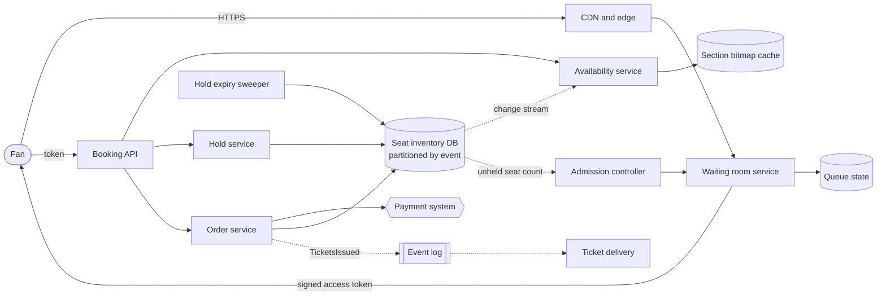

**Reading the diagram.** During an on-sale, every fan first reaches the waiting room through the CDN edge; the waiting room records arrival (or lottery order) in its queue state and, when an admission controller says so, issues a short-lived signed access token. Only token holders reach the booking API. Seat maps come from the availability service, which keeps per-section bitmaps in a cache fed asynchronously by the seat database's change stream. Holds are conditional updates in the seat inventory database; purchases go through the order service, which calls the payment system (§55.9) and converts holds to tickets. A sweeper expires holds. The admission controller watches both backend health and the number of unheld seats, closing the gate when inventory runs out. Storage boundaries: queue state (in memory, replicated), seat database (authoritative), bitmap cache (derived). Failure points: the seat database partition of the hot event, and the waiting room itself, which must survive millions of clients. Scaling: the waiting room scales at the edge; the seat database is partitioned by event, and a mega-event further by section.

### 55.8.8 Detailed component design

#### Component 1: preventing double booking — three approaches

All three approaches below are correct if implemented carefully; they differ in throughput under contention and in operational risk.

**(a) Pessimistic row locks.** Lock the requested seat rows, check, update, commit.

```sql
BEGIN;
SELECT seat_id, status, hold_expires_at FROM seats
 WHERE event_id = :e AND seat_id IN (:s1, :s2)
 ORDER BY seat_id                               -- fixed order prevents deadlocks
 FOR UPDATE;
-- application: abort unless every row is AVAILABLE, or HELD with hold_expires_at < now()
UPDATE seats SET status = 'HELD', hold_id = :h, hold_expires_at = now() + interval '8 minutes',
                 version = version + 1
 WHERE event_id = :e AND seat_id IN (:s1, :s2);
INSERT INTO holds (...) VALUES (...);
COMMIT;
```

For "best available" requests, `SELECT ... WHERE status = 'AVAILABLE' ... LIMIT :n FOR UPDATE SKIP LOCKED` lets concurrent buyers take *different* free seats instead of queueing behind the same rows.

**(b) Optimistic concurrency.** No explicit lock; one conditional update that succeeds only if nothing changed (§11.14).

```sql
UPDATE seats SET status = 'HELD', hold_id = :h, hold_expires_at = now() + interval '8 minutes',
                 version = version + 1
 WHERE event_id = :e AND seat_id IN (:s1, :s2)
   AND (status = 'AVAILABLE' OR (status = 'HELD' AND hold_expires_at < now()));
-- application: if rows updated != 2, ROLLBACK (all or nothing) and return 409 with fresh availability
```

**(c) In-memory holds with TTL.** Keep holds in Redis: one key per seat, set only if absent, with an expiry; a Lua script makes a multi-seat hold atomic on one Redis node (put all of an event section's keys in one hash slot). The database records only sold seats.

```text
EVAL hold.lua  keys: seat:{e77:112}:K-14  seat:{e77:112}:K-15   args: h_5c  480000
  -- for every key: if EXISTS -> return 0;  then for every key: SET key h_5c PX 480000;  return 1
```

**Table 55.16 — Preventing double booking: three approaches compared.**

| | Row locks (pessimistic) | Optimistic conditional update | Redis holds with TTL |
|---|---|---|---|
| How it works | `SELECT ... FOR UPDATE`, check, update | `UPDATE ... WHERE status = 'AVAILABLE'`, check row count | `SET NX PX` per seat via an atomic script; DB on purchase |
| Correctness source | Database locks | Database row-level atomicity | Redis atomicity, plus DB unique constraint at purchase |
| Behavior under contention | Waiters queue on locks; deadlock risk without ordering | Losers fail fast and retry with fresh data | Losers fail fast in microseconds |
| Throughput on a hot section | Lowest: lock hold time includes round trips | Higher: one statement, short lock | Highest: in memory |
| Expiry | Lazy (`hold_expires_at < now()`) plus sweeper | Same | Native key TTL |
| Failure risk | Long transactions hold locks | Retry storms if many collide | Failover can lose holds (asynchronous replication): two buyers think they hold one seat |
| Operational complexity | Low | Low | Higher: two stores to keep consistent |
| Choose when | Low contention; best-available with `SKIP LOCKED` | Default for reserved seating | Mega on-sales where the database cannot absorb hold churn |

The recommended design uses **(b) as the default** and adds **(c) only for mega on-sales**, with the database's `UNIQUE (event_id, seat_id)` on tickets as the final guard in every case. If Redis loses a hold during failover and two buyers reach purchase for the same seat, the second ticket insert fails, the second buyer's payment authorization is voided, and they are offered alternative seats — an unhappy but bounded outcome, never a double booking.

::: mistake
**"Check availability, then book."** Reading `status = 'AVAILABLE'` in one statement and updating in another, without a lock or a condition on the update, is the classic time-of-check-to-time-of-use race: two buyers both see the seat free and both write `HELD`. The check and the write must be one atomic step.
:::

#### Component 2: holds, TTLs and payment timeouts

A hold is a lease on seats (§26.11). Its TTL balances two harms: too short and buyers lose seats while typing card details; too long and abandoned holds keep seats away from other buyers (the worked example showed 75,000 seats' worth of holds competing for 50,000 seats).

1. **Hold** with TTL $W_h$ (for example 8 minutes); the seat map shows held seats as unavailable.
2. **Purchase** moves the hold to `PAYMENT_PENDING` and *extends* its expiry by a bounded payment window (for example 3 minutes), so a slow card authorization is not cut off mid-flight. The extension happens once.
3. **Authorize** the card through the payment system with an idempotency key derived from the hold ID.
4. **Convert**: in one transaction, insert tickets (unique per seat), set seats `SOLD`, hold `CONVERTED`. Then **capture** the payment.
5. **Late success.** If the authorization succeeds after the hold expired and the seat was resold, the ticket insert fails on the unique constraint; the order service voids the authorization and tells the buyer. This compensation path must exist even though it is rare.
6. **Expiry.** A sweeper sets expired holds to `EXPIRED` and seats back to `AVAILABLE`; the conditional updates already treat expired holds as free, so the sweeper only tidies up and publishes availability changes.

#### Component 3: the virtual waiting room and fairness

A virtual waiting room is a queue in front of the site that admits visitors at a controlled rate.

1. **Pre-queue.** Visitors who arrive before the on-sale time wait on a static page. At the start, they are assigned **random** positions (a lottery), so refreshing at 09:59:59.9 gives no advantage; later arrivals join at the back in arrival order.
2. **Queue token.** Each visitor receives a signed token containing the event, a queue position and an identity binding (account and device). Status polls are answered from the token and a small, replicated "admitted up to position $p$" counter, so the waiting room is almost stateless and served at the edge.
3. **Admission.** The admission controller raises $p$ at rate $a$, computed from backend health ($L_{\max}$, §55.8.4) and **unheld inventory**. When unheld seats reach zero, it stops admitting and tells waiting visitors so, reopening if holds expire.
4. **Access token.** An admitted visitor exchanges the queue token for a short-lived access token that the booking API requires; tokens are single-use per account, preventing one admitted visitor from passing the token to a bot farm.
5. **Fairness controls.** Pre-registration and identity verification for the largest on-sales, one queue position per verified account, purchase limits per account and payment card, and bot detection on join. Publish the rules: perceived fairness depends on understanding the process as much as on the algorithm.

::: industry
**Waiting rooms in practice.** Queue-it, a commercial virtual-waiting-room service, documents a pre-queue in which early arrivals wait for a scheduled start, after which their positions are randomized, while later arrivals are queued first in, first out [Queue-it Docs]. In November 2022, Ticketmaster attributed problems during the presale for Taylor Swift's Eras Tour to unprecedented demand, stating that the event generated 3.5 billion total system requests, four times its previous peak, and that over 2 million tickets were sold that day [Ticketmaster 2022].
*Evidence: Primary* — [Queue-it Docs; Ticketmaster 2022]
:::

### 55.8.9 Data flow

**Figure 55.18 — Read path: queue status and seat map.**

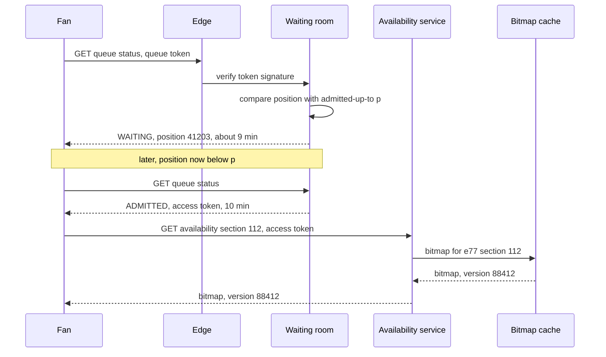

**Reading the diagram.** Queue status checks verify a signed token and compare its position with one replicated counter, so 66,667 polls per second cost almost nothing and need no database. Once admitted, the fan receives an access token and loads per-section bitmaps from a cache that the seat database's change stream keeps within a second or two of the truth. All calls are synchronous. Failure points: if the waiting room's counter store is unavailable, status checks keep answering "waiting" (fail closed for admission, never open the gates); if the bitmap cache lags, fans may click seats that are already held and receive a 409 with fresh availability, which is acceptable.

**Figure 55.19 — Write path: hold, pay and issue tickets.**

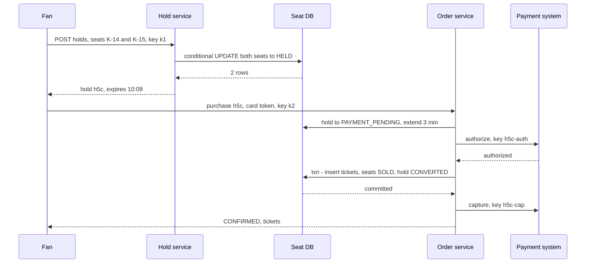

**Reading the diagram.** The hold is one conditional update on both seat rows: two rows changed means both seats are held; anything else rolls back. Purchase first extends the hold so payment cannot race the expiry, then authorizes the card with an idempotency key derived from the hold, converts the hold to tickets in one transaction whose unique constraint prevents double booking, and finally captures. Every call carries an idempotency key, so a fan who taps "Pay" twice or retries after a timeout creates one order and one charge. Failure points: authorization declined (hold returns to `ACTIVE` until expiry so the fan can try another card), authorization succeeds after expiry (ticket insert fails, authorization voided), capture fails (retried asynchronously; the tickets are already issued because the authorization guarantees funds).

**Figure 55.20 — Seat state machine.**

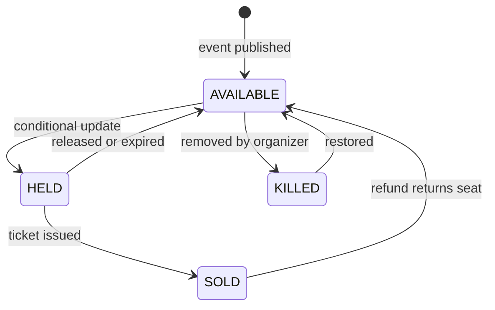

**Reading the diagram.** A seat moves only through conditional updates on its row. `HELD` carries a hold ID and expiry, and an expired hold counts as available to the next conditional update even before the sweeper runs. `SOLD` can return to `AVAILABLE` only through a refund flow that first invalidates the ticket's barcode. `KILLED` covers seats removed for camera positions or stage changes.

### 55.8.10 Bottlenecks

1. **One event's seat partition** during an on-sale: sub-partition by section; route all holds for a section to the same database node to keep multi-seat holds local.
2. **Popular sections**: everyone wants the floor; the best-available path with `SKIP LOCKED` spreads buyers across free seats instead of colliding on the same ones.
3. **Seat-map refreshes**: bitmaps per section, pushed or cached for one second, never queried from the database per fan.
4. **Payment provider throughput** at the moment thousands of holds convert: admission rate bounds it; agree on capacity with the provider in advance.
5. **Waiting-room polling**: long poll intervals with jitter, served from edge compute.

### 55.8.11 Failure scenarios

**Table 55.17 — Failure scenarios for ticket booking.**

| What fails | Impact | Detection | Recovery | Prevention |
|---|---|---|---|---|
| Seat DB primary for the hot event | Holds and purchases stop | Error rate; failover monitor | Promote synchronous replica; admission pauses meanwhile | Synchronous replication; admission tied to health |
| Redis failover loses holds | Two buyers believe they hold one seat | Unique-violation count at ticket insert | Void second authorization; offer alternatives | DB unique constraint; use Redis holds only when needed |
| Sweeper stops | Expired holds still shown as held | Count of expired-but-held seats | Restart; conditional updates already treat them as free | Lazy expiry in the update predicate |
| Payment slow at hold expiry | Seat released mid-payment | Late-authorization count | Payment-pending extension; void if lost | Bounded extension; idempotent authorization |
| Waiting room overloaded | Fans see errors, refresh, amplify load | Edge error rate | Serve static queue page from CDN; slower polls | Edge-hosted, token-based, stateless design |
| Bots join the queue at scale | Real fans lose positions | Join rate per IP, device, account | Purge suspicious tokens before admission | Verified registration; one position per account |
| Admission too fast | Purchase flow overloaded or seats over-held | Hold latency; unheld seat count | Admission controller backs off | Admission by health and inventory |

### 55.8.12 Scaling strategy

**At 10×** (20 million fans for one tour), the waiting room scales at the edge without change, since its state is a counter and signed tokens; the purchase flow does not need to grow, because inventory, not demand, bounds it. What grows is the number of simultaneous on-sales: partition seat inventory by event across many database clusters, and run a separate admission controller per event. **At 100×**, the honest answer is that a first-come mechanism stops being meaningful when demand exceeds supply by a factor of hundreds; product changes — registration with a lottery for the right to buy, staggered on-sales by region, dynamic pricing — scale better than infrastructure.

### 55.8.13 Trade-offs

- **Hold TTL length:** buyer comfort versus inventory recycling.
- **Lottery versus first in, first out:** lotteries remove the advantage of speed and bots; first in, first out rewards those who wait, which some fans find fairer.
- **Database holds versus in-memory holds:** simplicity and guaranteed durability versus raw throughput during mega on-sales.
- **Strict seat selection versus best available:** choice is popular but creates hot spots on the same seats; best available spreads load.
- **Honesty about sell-out:** telling position 300,000 that tickets are unlikely reduces load and anger but must be phrased carefully because cancellations happen.

### 55.8.14 Alternative designs

**Table 55.18 — Alternative architectures for hot inventory.**

| Option | How it works | Advantages | Disadvantages | Choose when |
|---|---|---|---|---|
| Relational database with conditional updates (this design) | Seat rows, constraints, holds as columns | Simple, correct, constraint-enforced | Throughput bounded by the hot partition | Nearly all events |
| Single-writer actor per event section | All requests for a section go to one in-memory owner that serializes them and logs to durable storage | Very high throughput; no lock contention | Needs routing, failover and log replay | Mega on-sales built in-house |
| Redis holds plus database purchases | Holds in memory; tickets in the database | Fast holds | Two sources of truth during holds | Large on-sales with an existing Redis tier |
| Pre-assigned inventory per sales channel | Allocate seat blocks to channels or regions | Removes global contention | Stranded inventory in one channel | Multi-channel distribution |
| Lottery instead of on-sale | Registration, random draw, then purchase windows | Removes the spike entirely | Not real time; product change | Demand far above supply |

### 55.8.15 Interview discussion

**Pacing (45 minutes).** Requirements (5 min: reserved seats, holds, on-sale spike); estimates (5 min: averages are tiny, the spike is everything; compute $q^{*}$); architecture (10 min: Figure 55.17); deep dives (20 min: double booking three ways with SQL, holds with TTL and payment extension, waiting room and fairness); failures and scaling (5 min).

**Likely follow-ups.** *How do you hold two adjacent seats atomically?* One conditional update over both rows, all or nothing, in one transaction (or one Lua script). *What if the hold expires during payment?* Extend once on purchase; if still lost, void the authorization. *How do you stop bots?* Verified registration, one position per account, signed single-use access tokens, purchase limits. *Why not just scale the database?* The contention is on a few thousand rows of one event; more machines do not help a single hot row.

**What distinguishes senior and staff answers.** A senior candidate writes an atomic hold and adds a waiting room. A staff candidate compares row locks, optimistic updates and Redis holds with their failure modes, keeps a database constraint as the final guard, handles the late-payment race explicitly, and makes admission inventory-aware rather than purely capacity-based.

### 55.8.16 Production considerations

- **Observability.** For each on-sale: queue length, admission rate, unheld seats, hold success rate, 409 rate on holds (stale maps), hold-to-purchase conversion, unique-violation count (should be zero outside Redis failovers), payment authorization latency.
- **Security.** Signed and identity-bound tokens; rate limits per account, device and card; anomaly detection on queue joins; barcodes that rotate on mobile tickets to defeat screenshots.
- **Cost.** On-sales are short; pre-scale the edge and purchase flow for the scheduled time and scale down afterwards, rather than running peak capacity all year.
- **Operations.** Every major on-sale is a planned event with a rehearsal (load test against a copy of the venue), a war room, and pre-agreed decisions such as when to pause admission.

## 55.9 Payment system

### 55.9.1 Problem statement

Design the payment system behind a marketplace such as the ones in this chapter: riders pay for trips (§55.4), shoppers for orders (§55.7), fans for tickets (§55.8); the platform keeps a commission and pays out drivers, sellers and organizers. Card processing is done by external **payment service providers** (PSPs) that talk to card networks and banks; our system decides what to charge, calls PSPs, records every movement of money, pays out balances and proves, every day, that its records agree with the PSPs' and the bank's.

An old-fashioned bookkeeper is the right analogy. Every movement of money is written twice — once where it came from, once where it went — in ink, in a book whose pages are never torn out; mistakes are corrected by writing a new, opposite entry. At the end of each day the bookkeeper compares the book with the bank statement, line by line. The distinctive hard problem is **exactly-once money movement**: networks lose responses, PSPs time out, webhooks arrive twice or out of order, and yet each customer must be charged exactly once and each seller paid exactly once. No component can deliver exactly once on its own; the system achieves it as **at-least-once delivery plus idempotent processing at every hop** (§32.9), with a **double-entry ledger** that makes errors detectable and **reconciliation** that catches what everything else missed.

*Evidence: Illustrative* — a teaching design; published practices of Stripe and Airbnb are cited where used.

### 55.9.2 Functional requirements

1. Create a payment for an amount and currency, authorize it on a stored or new payment method, capture it fully or partially later, void an uncaptured authorization, and refund captured funds fully or partially.
2. Store payment methods without storing card numbers (tokenization).
3. Route each payment to one of several PSPs; process their asynchronous notifications (webhooks).
4. Record every money movement in a double-entry ledger: customer payments, PSP fees, platform commission, seller balances, refunds, chargebacks, payouts, currency conversion.
5. Pay out seller balances to bank accounts on a schedule.
6. Reconcile daily against PSP settlement reports and bank statements, surfacing every unexplained difference.
7. Support many currencies.

Out of scope: fraud scoring (Chapter 82), tax calculation, invoicing, and card network internals.

### 55.9.3 Non-functional requirements

**Table 55.19 — Non-functional requirements for the payment system.**

| Property | Target |
|---|---|
| Double charge | Zero caused by our retries; every client-visible operation idempotent |
| Ledger correctness | Every transaction balances per currency; ledger is append-only and immutable |
| Durability | RPO = 0 for payments and ledger; retention of financial records for years (jurisdiction-dependent, often 7 or more) |
| Availability | 99.99% for the payment API (the PSP's availability is a separate dependency) |
| Latency | p99 < 2 s for authorization, dominated by the PSP and the card network |
| Consistency | Linearizable per payment; balances derived from the ledger, never edited directly |
| Reconciliation | 100% of transactions matched or explained within two business days |
| Compliance | PCI DSS scope minimized: no raw card numbers in our systems |
| Auditability | Every change attributable to an actor and time; tamper-evident logs (§10.12) |

### 55.9.4 Capacity estimation

::: formula
**Duplicate charges from blind retries**

$$D = n \times p_{t} \times p_{s}$$

| Symbol | Meaning | Units |
|---|---|---|
| $D$ | Duplicate charges per day if timed-out requests are retried without idempotency | charges/day |
| $n$ | Payment requests per day | requests/day |
| $p_{t}$ | Fraction of requests whose response is lost or times out at the client | — |
| $p_{s}$ | Fraction of those timed-out requests that had actually succeeded | — |
:::

::: example
**Worked example — volume, storage and why idempotency is not optional.** Assumptions: 50 million payments per day; peak 5× average; on average 6 ledger lines per payment over its life (authorization, capture, fee, commission, payout share, occasional refund); 200 bytes per ledger line; 2 inbound webhooks per payment; 1 KB per idempotency record kept 24 hours or more; 0.1% of requests time out at the client, half of them after succeeding.

1. **Payments.** $5 \times 10^7 / 86{,}400 = 579$/s average; peak $2{,}894 \approx 2{,}900$/s.
2. **Ledger lines.** $5 \times 10^7 \times 6 = 3 \times 10^8$/day; $\times 200$ bytes $= 60$ GB/day; $\times 365 = 21.9$ TB/year; seven years $= 153$ TB before replication.
3. **Webhooks.** $10^8$/day $= 1{,}157$/s average.
4. **Idempotency store.** $5 \times 10^7 \times 1{,}000 = 50$ GB per day of retention.
5. **Duplicates without idempotency.** $D = 5 \times 10^7 \times 0.001 \times 0.5 = 25{,}000$ double charges per day.

*Interpretation.* The request rate is modest — a few thousand per second — but the ledger grows forever, and even a 0.1% timeout rate would double-charge tens of thousands of people a day. *Engineering implication.* Throughput is not the challenge; correctness under retries and long-term storage are. Design the ledger for append-only growth with partitioning by time and account, and make every hop idempotent.
:::

### 55.9.5 API design

```text
POST /v1/payments                       Idempotency-Key: 3f6c...   (required)
  { "amount": 1840, "currency": "USD", "customer_id": "c_9",
    "payment_method": "pm_tok_7f",          # a token from the vault, never a card number
    "capture": "manual", "order_ref": "o-113-55",
    "splits": [ {"account": "seller:s42", "amount": 1564}, {"account": "platform:commission", "amount": 276} ] }
  -> 201 { "payment_id": "pay_123", "status": "AUTHORIZED", "amount_capturable": 1840 }
  -> 202 { "payment_id": "pay_123", "status": "PROCESSING" }      # outcome not yet known
  -> 402 { "payment_id": "pay_123", "status": "DECLINED", "decline_code": "insufficient_funds" }

POST /v1/payments/{id}/capture          Idempotency-Key: ...   { "amount": 1840 }
POST /v1/payments/{id}/void             Idempotency-Key: ...
POST /v1/refunds                        Idempotency-Key: ...   { "payment_id": "pay_123", "amount": 500 }
GET  /v1/payments/{id}                  -> 200 { status, amounts, attempts: [...], ledger_txn_ids: [...] }
GET  /v1/accounts/{account}/balance?currency=USD   -> 200 { "available": ..., "pending": ..., "as_of_seq": ... }
POST /v1/payouts                        Idempotency-Key: ...   { "account": "seller:s42", "currency": "USD" }

# Inbound from PSPs
POST /webhooks/psp/{provider}           (signature header, raw body)  -> 200 quickly, process asynchronously
```

What to notice: the idempotency key is **required** on every mutating call, and the response for a repeated key is the stored original response (§22.15.3). The API can return `PROCESSING` honestly when the PSP outcome is unknown, rather than guessing. Amounts are integers in the currency's **minor unit**.

### 55.9.6 Data model and database schema

A relational database with serializable or carefully designed conditional updates (§11.13) is the natural home: payments need transactions, constraints and auditability far more than they need horizontal write scale at a few thousand per second. Partition by merchant or account when one cluster is not enough (§14.7).

```sql
CREATE TABLE payments (
  payment_id     VARCHAR(32)  PRIMARY KEY,
  customer_id    VARCHAR(32)  NOT NULL,
  amount         BIGINT       NOT NULL CHECK (amount > 0),     -- minor units
  currency       CHAR(3)      NOT NULL,                        -- ISO 4217
  status         VARCHAR(16)  NOT NULL,                        -- see Figure 55.22
  captured       BIGINT       NOT NULL DEFAULT 0,
  refunded       BIGINT       NOT NULL DEFAULT 0,
  psp            VARCHAR(16),
  version        INT          NOT NULL DEFAULT 0,
  created_at     TIMESTAMPTZ  NOT NULL,
  CHECK (captured <= amount AND refunded <= captured)
);

-- One row per call to a PSP; the PSP idempotency key is derived and stored before the call.
CREATE TABLE payment_attempts (
  attempt_id     VARCHAR(32)  PRIMARY KEY,
  payment_id     VARCHAR(32)  NOT NULL REFERENCES payments,
  operation      VARCHAR(12)  NOT NULL,                        -- AUTHORIZE | CAPTURE | VOID | REFUND
  psp_idem_key   VARCHAR(64)  NOT NULL UNIQUE,
  psp_reference  VARCHAR(64),
  outcome        VARCHAR(12)  NOT NULL,                        -- PENDING | SUCCEEDED | FAILED | UNKNOWN
  created_at     TIMESTAMPTZ  NOT NULL
);

CREATE TABLE idempotency_keys (                                 -- §22.15.3
  account_id     VARCHAR(32)  NOT NULL,
  idem_key       VARCHAR(255) NOT NULL,
  request_hash   CHAR(64)     NOT NULL,
  state          VARCHAR(12)  NOT NULL,                        -- IN_PROGRESS | COMPLETED
  response_code  INT,
  response_body  JSONB,
  locked_until   TIMESTAMPTZ,
  PRIMARY KEY (account_id, idem_key)
);

-- The ledger: append-only. No UPDATE or DELETE is ever granted on these tables.
CREATE TABLE ledger_transactions (
  txn_id         BIGINT       PRIMARY KEY,                      -- monotonically increasing sequence
  source_type    VARCHAR(16)  NOT NULL,                         -- PAYMENT_CAPTURE, REFUND, PAYOUT, FX, ...
  source_id      VARCHAR(64)  NOT NULL,
  posting_key    VARCHAR(96)  NOT NULL UNIQUE,                  -- idempotent posting
  effective_at   TIMESTAMPTZ  NOT NULL,
  created_at     TIMESTAMPTZ  NOT NULL
);
CREATE TABLE ledger_lines (
  txn_id         BIGINT       NOT NULL REFERENCES ledger_transactions,
  line_no        SMALLINT     NOT NULL,
  account        VARCHAR(64)  NOT NULL,                         -- e.g. seller_payable:s42
  currency       CHAR(3)      NOT NULL,
  amount         BIGINT       NOT NULL,                         -- + debit, - credit, minor units
  PRIMARY KEY (txn_id, line_no)
);

CREATE TABLE webhook_events (
  provider       VARCHAR(16)  NOT NULL,
  event_id       VARCHAR(64)  NOT NULL,
  received_at    TIMESTAMPTZ  NOT NULL,
  raw_body       BYTEA        NOT NULL,
  processed_at   TIMESTAMPTZ,
  PRIMARY KEY (provider, event_id)                              -- duplicate deliveries collapse here
);
```

The balance invariant — every ledger transaction sums to zero per currency — cannot be expressed as a single-row `CHECK`; it is enforced by the posting code inside the inserting transaction (below), verified by a deferred check, and re-verified continuously by an independent auditor job.

### 55.9.7 High-level architecture

**Figure 55.21 — Payment system architecture.**

```mermaid
flowchart LR
  APP([Checkout client]) -->|card data, iframe or SDK| VAULT{{PSP vault}}
  VAULT -->|token| APP
  APP -->|token, Idempotency-Key| PAPI[Payment API]
  PAPI --> IK[(Idempotency keys)]
  PAPI --> ORCH[Payment orchestrator]
  ORCH --> PDB[(Payments and attempts)]
  ORCH -->|route| RT[PSP router]
  RT -->|HTTPS, PSP idempotency key| PSP1{{PSP A}}
  RT --> PSP2{{PSP B}}
  PSP1 -.->|signed webhook| WH[Webhook receiver]
  PSP2 -.-> WH
  WH --> WQ[[Webhook queue]]
  WQ -.-> ORCH
  ORCH -->|post transaction| LED[Ledger service]
  LED --> LDB[(Ledger DB<br/>append-only)]
  LED -.-> BAL[(Balance views)]
  PO[Payout service] --> LED
  PO -->|bank transfer| BANK{{Bank}}
  RECON[Reconciliation] --> LDB
  PSP1 -.->|settlement files| RECON
  BANK -.->|statements| RECON
```

**Reading the diagram.** Card details go straight from the client to the PSP's vault through a hosted field or SDK and come back as a token, so our servers never see a card number. The payment API checks the idempotency store, then hands the request to the orchestrator, which records the payment and each attempt before calling a PSP through the router (which picks a provider by cost, method, region and health). PSP responses come back synchronously; later state changes (captures settling, disputes, refunds completing) arrive as signed webhooks, which the receiver stores and queues for asynchronous processing. Every money movement is posted to the ledger service as a balanced transaction; balances are derived views. The payout service moves seller balances to banks, again through the ledger. Reconciliation compares the ledger with PSP settlement files and bank statements daily. Storage boundaries: idempotency store, payments database, append-only ledger, derived balances. Failure points: PSP timeouts (unknown outcome), webhook storms or gaps, and ledger posting failures; each is handled in §55.9.8. Scaling: the ledger partitions by account and time; PSP calls scale with router capacity and provider limits.

### 55.9.8 Detailed component design

#### Component 1: the double-entry ledger

::: formula
**Double-entry balance invariant**

$$\sum_{\ell \in t,\; \text{cur}(\ell) = c} a_{\ell} = 0 \quad \text{for every transaction } t \text{ and currency } c, \qquad B(x, c) = \sum_{\ell:\, \text{acct}(\ell) = x,\; \text{cur}(\ell) = c} a_{\ell}$$

| Symbol | Meaning | Units |
|---|---|---|
| $t$ | A ledger transaction (a set of lines posted atomically) | — |
| $\ell$ | A ledger line | — |
| $a_{\ell}$ | Signed amount of line $\ell$: positive debit, negative credit | minor units |
| $c$ | Currency (ISO 4217 code) | — |
| $B(x, c)$ | Balance of account $x$ in currency $c$, derived from all its lines | minor units |
:::

::: example
**Worked example — one marketplace payment.** A buyer pays \$100.00 (10,000 cents). The PSP keeps \$3.20; the platform's commission is 15%; the seller is owed the rest.

1. **Commission.** $0.15 \times 10{,}000 = 1{,}500$. **Seller share.** $10{,}000 - 1{,}500 = 8{,}500$. **PSP will settle.** $10{,}000 - 320 = 9{,}680$.
2. **Lines.** Debit `psp_receivable` +9,680; debit `psp_fees` +320; credit `seller_payable:s42` −8,500; credit `commission_revenue` −1,500.
3. **Check.** $9{,}680 + 320 - 8{,}500 - 1{,}500 = 0$. Balanced.
4. **Partial refund of \$25.00**, shared proportionally: seller gives back $0.85 \times 2{,}500 = 2{,}125$, platform $0.15 \times 2{,}500 = 375$. Lines: debit `seller_payable:s42` +2,125; debit `commission_revenue` +375; credit `psp_receivable` −2,500. Sum: $2{,}125 + 375 - 2{,}500 = 0$.
5. **Seller balance.** $B = -8{,}500 + 2{,}125 = -6{,}375$, a credit balance: the platform owes the seller \$63.75.

*Interpretation.* Money never appears or disappears; it moves between accounts, and every account's balance is the sum of its lines. *Engineering implication.* An unbalanced transaction is a bug caught at write time; a balance that disagrees with the sum of its lines is corruption caught by the auditor; a difference between `psp_receivable` and what the PSP actually paid is caught by reconciliation.
:::

Design rules:

1. **Immutable lines.** Never update or delete. A mistake is fixed by a **reversal** transaction (the exact negation) plus a correct new one, so the history shows what was believed and when.
2. **Balanced at write.** The posting function rejects any transaction whose lines do not sum to zero per currency, inside the same database transaction that inserts them.
3. **Idempotent posting.** Each transaction has a `posting_key` derived from its business cause (`capture:pay_123`, `refund:re_9`); the unique constraint turns a re-delivered event into a no-op.
4. **Balances are derived.** Materialized balance views are updated in the same transaction (or by a consumer of the ledger stream) and stamped with the last `txn_id` included, so readers know how fresh a balance is; the auditor recomputes them from lines.
5. **Accounts model obligations, not just cash.** `psp_receivable` (money a PSP owes us), `seller_payable` (money we owe a seller), `psp_fees`, `commission_revenue`, `fx_clearing:EUR`. A balance on `psp_receivable` that does not drain after settlement is a reconciliation break.

```python
from collections import defaultdict
from dataclasses import dataclass

@dataclass(frozen=True)
class Entry:
    account: str
    amount: int          # minor units; + debit, - credit
    currency: str

class Ledger:
    """Append-only double-entry ledger with idempotent posting."""
    def __init__(self):
        self.journal = []                       # immutable list of (txn_id, entries)
        self.seen = {}                          # idempotency key -> txn_id
        self.balances = defaultdict(int)        # (account, currency) -> balance

    def post(self, idem_key, entries):
        if idem_key in self.seen:               # a retry: return the original result
            return self.seen[idem_key]
        per_ccy = defaultdict(int)
        for e in entries:
            per_ccy[e.currency] += e.amount
        if any(per_ccy.values()):
            raise ValueError(f"unbalanced transaction: {dict(per_ccy)}")
        txn_id = f"txn_{len(self.journal) + 1}"
        self.journal.append((txn_id, tuple(entries)))
        for e in entries:
            self.balances[(e.account, e.currency)] += e.amount
        self.seen[idem_key] = txn_id
        return txn_id

    def trial_balance(self):
        totals = defaultdict(int)
        for (_, ccy), bal in self.balances.items():
            totals[ccy] += bal
        return dict(totals)

L = Ledger()
# Marketplace books: a buyer pays $100.00; the provider keeps $3.20;
# the platform keeps a 15% commission; the seller is owed $85.00.
capture = [Entry("psp_receivable", 9680, "USD"),
           Entry("psp_fees", 320, "USD"),
           Entry("seller_payable:s42", -8500, "USD"),
           Entry("commission_revenue", -1500, "USD")]
print(L.post("pay_123:capture", capture))
print(L.post("pay_123:capture", capture))         # retry: same txn, no second posting
# Partial refund of $25.00: seller and platform give back their shares;
# the provider keeps its fee in this example.
print(L.post("pay_123:refund_1", [Entry("seller_payable:s42", 2125, "USD"),
                                  Entry("commission_revenue", 375, "USD"),
                                  Entry("psp_receivable", -2500, "USD")]))
try:
    L.post("bad", [Entry("psp_receivable", 100, "USD"), Entry("seller_payable:s42", -99, "USD")])
except ValueError as e:
    print("rejected:", e)
print("owed to seller s42:", -L.balances[("seller_payable:s42", "USD")])
print("trial balance:", L.trial_balance(), "| journal rows:", len(L.journal))
```

Output:

```text
txn_1
txn_1
txn_2
rejected: unbalanced transaction: {'USD': 1}
owed to seller s42: 6375
trial balance: {'USD': 0} | journal rows: 2
```

What to notice: the retried capture returns `txn_1` again and adds no row; the unbalanced posting is rejected before anything is written; and the trial balance — the sum of all balances per currency — is zero, which is the property the auditor job checks continuously over the real ledger.

::: industry
**Ledgers at Stripe.** Stripe has described Ledger, an internal system that records its financial data as an immutable, auditable log using double-entry bookkeeping, so that money movements can be checked to balance and unexplained movements detected; it reports that Ledger underpins a data-quality platform that explains the vast majority of its money movement automatically [Stripe 2024].
*Evidence: Primary* — [Stripe 2024]
:::

#### Component 2: idempotency from the button to the bank

Exactly-once money movement is built from at-least-once delivery plus idempotence at every hop. Follow one key through the system.

1. **Client.** The checkout page generates an idempotency key when the customer reviews the order and stores it with the cart; every retry of "Pay" reuses it (§22.15.1).
2. **Payment API.** Inserts `(account_id, idem_key)` as `IN_PROGRESS` with a request fingerprint; a concurrent duplicate gets 409; a completed duplicate gets the stored response (§22.15.3).
3. **Payment attempt.** Before calling a PSP, the orchestrator **persists** an attempt row with a deterministic PSP idempotency key (`pay_123:auth:1`). Only then does it call the PSP with that key. If the process crashes after the call, the restarted orchestrator finds the attempt row and retries with the *same* key, so the PSP deduplicates.
4. **Unknown outcomes.** A PSP timeout leaves the attempt `UNKNOWN`. Never retry it with a new key and never assume failure. Instead: retry with the same key (safe), or query the PSP for the attempt's status, or wait for the webhook; until resolved, the payment is `PROCESSING` and the customer is told so.
5. **Webhooks.** Each PSP event has a unique ID; the receiver inserts it into `webhook_events` with `(provider, event_id)` as the primary key, so a re-delivered event is stored once and processed once.
6. **Ledger posting.** Each business event posts with a deterministic `posting_key`; re-processing the same event cannot post twice.
7. **Payouts.** A payout is created with an idempotency key per seller and period, and the bank transfer reference is derived from it, so a retried payout job does not pay twice.

::: industry
**Idempotency in practice.** Stripe's API accepts an `Idempotency-Key` header on mutating requests and returns the stored result of the first request for retries with the same key; Stripe's engineering blog explains that clients must be able to retry safely because networks fail ambiguously [Leach 2017; Stripe Docs: idempotent requests]. Airbnb described building a shared idempotency library, Orpheus, for its payments services, so that each request's effects are recorded under an idempotency key and retries of failed or ambiguous requests cannot cause double payments [Chew 2019].
*Evidence: Primary* — [Leach 2017; Stripe Docs: idempotent requests; Chew 2019]
:::

::: mistake
**"We use Kafka exactly-once, so payments are exactly once."** Broker-level exactly-once (§31.11) covers reads and writes *within* the broker's transactions. A call to a PSP or a bank is an external side effect that no broker transaction can roll back. Exactly-once money movement needs idempotency keys honored by the external party and reconciliation for the cases where even that fails.
:::

#### Component 3: PSP integration and webhooks

A card payment has a synchronous part and an asynchronous part. Authorization returns synchronously (approved or declined in a second or two). Capture is acknowledged quickly, but funds **settle** days later, and some events — disputes, refunds that fail, asynchronous payment methods such as bank debits — arrive only by webhook.

**Figure 55.22 — Payment state machine.**

```mermaid
stateDiagram-v2
  [*] --> CREATED
  CREATED --> PROCESSING: attempt sent to PSP
  PROCESSING --> AUTHORIZED: approved
  PROCESSING --> DECLINED: declined
  PROCESSING --> PROCESSING: unknown, retry same key
  AUTHORIZED --> CAPTURED: capture succeeded
  AUTHORIZED --> VOIDED: void or authorization expired
  CAPTURED --> PARTIALLY_REFUNDED: partial refund
  CAPTURED --> REFUNDED: full refund
  PARTIALLY_REFUNDED --> REFUNDED: remaining refunded
  CAPTURED --> DISPUTED: chargeback webhook
  DISPUTED --> CAPTURED: dispute won
  DISPUTED --> CHARGED_BACK: dispute lost
  DECLINED --> [*]
  VOIDED --> [*]
  REFUNDED --> [*]
  CHARGED_BACK --> [*]
```

**Reading the diagram.** Transitions come from synchronous PSP responses (authorization, capture) or from webhooks (disputes, settlement). `PROCESSING` loops while the outcome is unknown; it is never resolved by guessing. Each transition that moves money posts a ledger transaction with a deterministic posting key. Because webhooks can arrive late or out of order, a transition is applied only if it is valid from the current state; an older event (for example "authorized" arriving after "captured") is recorded and ignored.

Webhook handling rules:

1. **Verify** the signature over the raw body with the provider's secret, and reject events whose signed timestamp is too old (replay protection). Stripe, for example, signs webhook payloads with HMAC-SHA256 and includes a timestamp in the signature header [Stripe Docs: webhooks].
2. **Store, acknowledge, then process.** Insert into `webhook_events` and return 200 within a few hundred milliseconds; process from a queue. Slow processing must not cause the provider to retry and amplify load.
3. **Deduplicate** by `(provider, event_id)`; **order-tolerate** by applying only valid forward transitions; when in doubt, fetch the current object from the PSP's API and act on that, not on the event's snapshot.
4. **Detect gaps.** A payment stuck in `PROCESSING` for longer than a threshold triggers an active status query; webhooks are a notification, not the only source of truth.

Multiple PSPs add resilience and cost leverage: the router chooses by payment method, issuing country, fees, recent authorization rates and health. Failover between PSPs must never retry the *same* attempt at a different PSP while the first outcome is unknown, or the customer may be charged by both; resolve the first attempt (void or confirm failure) before routing elsewhere.

#### Component 4: reconciliation

Reconciliation is the safety net under every other mechanism. Each day:

1. **Ingest** PSP settlement reports (every transaction, fee and payout the PSP made) and bank statements (every deposit and withdrawal).
2. **Match** three ways: internal ledger lines ↔ PSP report lines (by PSP reference and amount) ↔ bank deposits (PSP payout batches by amount and date).
3. **Classify** differences: *timing* (captured today, settles tomorrow: expected, auto-resolved later), *missing internally* (PSP charged but we have no record — the dangerous case, often an unresolved `UNKNOWN`), *missing externally* (we recorded a capture the PSP did not perform), *amount mismatches* (fees, FX, partial captures).
4. **Resolve**: auto-fix known patterns by posting correcting ledger transactions with references to the break; route the rest to a finance operations queue with an aging SLA.
5. **Report**: unexplained balance on `psp_receivable` per PSP and currency, break counts and age; these are top-level health metrics of the payment system.

#### Component 5: PCI scope minimization and multi-currency

**PCI scope.** Any system that stores, processes or transmits cardholder data, or can affect its security, is in scope of the PCI Data Security Standard (version 4.0 published in 2022; version 4.0.1, a limited revision, in 2024) [PCI SSC 2024]. Shrink the scope by never touching card numbers: the browser or app sends them directly to the PSP's hosted fields or SDK, which returns a token (tokenization, §50.10). Our systems store the token, brand, last four digits and expiry only. Merchants whose payment pages are fully outsourced this way can typically validate with the shortest self-assessment questionnaire rather than a full assessment. The remaining in-scope surface — the page that embeds the hosted fields — still needs integrity controls against script injection.

**Multi-currency.** Store amounts as integers in minor units with an ISO 4217 code; the number of minor units differs by currency (0 for JPY, 2 for USD and EUR, 3 for KWD), so formatting and rounding must use the currency's exponent, never a hard-coded 100. Never add amounts in different currencies. A conversion is an explicit ledger transaction through per-currency FX clearing accounts at a locked rate:

```text
txn fx:pay_77  (buyer pays 50.00 EUR; seller is paid in USD at a locked rate of 1.0800)
  debit   psp_receivable       +5000 EUR
  credit  fx_clearing:EUR      -5000 EUR
  debit   fx_clearing:USD      +5400 USD
  credit  seller_payable:s9    -5400 USD
```

Each currency's lines sum to zero on their own. The FX clearing accounts accumulate the platform's currency position, which treasury hedges or settles, and any difference between the locked rate and the rate actually obtained is posted as FX gain or loss.

### 55.9.9 Data flow

**Figure 55.23 — Write path: an authorization whose response is lost.**

```mermaid
sequenceDiagram
  participant C as Client
  participant A as Payment API
  participant O as Orchestrator
  participant DB as Payments DB
  participant P as PSP
  participant L as Ledger
  C->>A: POST payments, key k
  A->>DB: insert key k IN_PROGRESS
  A->>O: authorize pay_123
  O->>DB: attempt row, psp key pay_123-auth-1
  O->>P: authorize, key pay_123-auth-1
  P--xO: timeout, outcome unknown
  O->>DB: attempt UNKNOWN, payment PROCESSING
  A-->>C: 202 PROCESSING
  O->>P: retry, same key pay_123-auth-1
  P-->>O: authorized, ref ch_88, deduplicated
  O->>DB: attempt SUCCEEDED, payment AUTHORIZED, key k COMPLETED
  O->>L: post authorization hold, posting key auth-pay_123
  C->>A: GET payments pay_123
  A-->>C: AUTHORIZED
```

**Reading the diagram.** The API claims the client's key before any work, and the orchestrator persists the attempt and its PSP key before calling the PSP: these two writes are what make every later retry safe. The PSP call times out; the orchestrator records the outcome as unknown and the client is told `PROCESSING` rather than an error. The retry uses the same PSP key, so the PSP returns the original authorization instead of creating a second one. Only then is the state advanced and a ledger transaction posted with a deterministic key. Synchronous: client to API, orchestrator to PSP; the client learns the final state by polling or push. Failure points: a crash between steps (resume from the attempt row), a PSP that does not honor idempotency keys (query by attempt reference before retrying, and rely on reconciliation).

**Figure 55.24 — Asynchronous write path: webhook to ledger.**

```mermaid
sequenceDiagram
  participant P as PSP
  participant W as Webhook receiver
  participant DB as Webhook store
  participant Q as Webhook queue
  participant O as Orchestrator
  participant L as Ledger
  P->>W: POST event evt_51, capture settled, signed
  W->>W: verify HMAC and timestamp
  W->>DB: insert provider and evt_51
  DB-->>W: inserted, or duplicate
  W-->>P: 200 within 300 ms
  W-)Q: enqueue evt_51
  Q-)O: evt_51
  O->>P: GET charge ch_88, current state
  P-->>O: captured, settled, fee 320
  O->>L: post settlement, posting key settle-ch_88
  L-->>O: txn 9001, or existing txn
```

**Reading the diagram.** The receiver does three things synchronously — verify, store, acknowledge — and nothing else, so the PSP sees fast 200s and does not retry. A duplicate delivery hits the primary key and is acknowledged without being enqueued again. Processing is asynchronous from a queue: the orchestrator fetches the current object from the PSP (so out-of-order or stale events cannot regress state) and posts a ledger transaction whose posting key makes a second processing a no-op. Failure points: an invalid signature (reject and alert: misconfiguration or attack), a processing backlog (the queue absorbs it; age-of-oldest alerts), a missing webhook (the stuck-state detector queries the PSP).

**Figure 55.25 — Read path: payment status and seller balance.**

```mermaid
sequenceDiagram
  participant M as Seller dashboard
  participant A as Payment API
  participant DB as Payments DB
  participant B as Balance view
  participant L as Ledger DB
  M->>A: GET payments pay_123
  A->>DB: read payment and attempts
  DB-->>A: CAPTURED, version 6
  A-->>M: status and amounts
  M->>A: GET balance seller s42 USD
  A->>B: read balance
  B-->>A: 6375, as of txn 9001
  A-->>M: available 63.75 USD, as of txn 9001
  Note over B,L: auditor recomputes balances from lines and compares
```

**Reading the diagram.** Status reads come from the payments database, which holds the current state machine position; balance reads come from a materialized view stamped with the last ledger transaction it includes, so the dashboard can show "as of" and a payout can require a view at least as fresh as a given transaction. Reads never sum millions of ledger lines on the request path. An independent auditor recomputes balances from ledger lines offline and alerts on any difference. All calls are synchronous; the view is updated asynchronously from the ledger or in the posting transaction.

### 55.9.10 Bottlenecks

1. **Hot accounts.** Every payment credits `commission_revenue` and debits `psp_receivable`; updating one balance row per payment serializes all postings. Derive these balances asynchronously, or split them into sub-accounts per partition and sum on read.
2. **PSP rate limits and latency** bound throughput at peaks; smooth with queues for non-interactive operations (captures, refunds) and spread across providers.
3. **Ledger growth.** Partition ledger lines by time; keep recent partitions hot and older ones in cheaper storage, still queryable for audits.
4. **Reconciliation batch windows** for large volumes: incremental matching through the day rather than one nightly job.

### 55.9.11 Failure scenarios

**Table 55.20 — Failure scenarios for the payment system.**

| What fails | Impact | Detection | Recovery | Prevention |
|---|---|---|---|---|
| PSP timeout | Unknown authorization | Attempt in `UNKNOWN` | Retry with same key; query status; webhook | Persisted attempts; PSP idempotency |
| Crash after PSP success, before DB update | PSP charged; our record says pending | Stuck `PROCESSING` detector | Resume from attempt row, query PSP, post ledger | Attempt row written before the call |
| Webhook delivered twice or out of order | Double processing or state regression | Duplicate-key hits; invalid transitions | Dedupe table; forward-only transitions | Fetch current object before acting |
| Webhooks stop arriving | States not advancing | Age of last webhook per PSP | Poll PSP APIs | Gap detection; reconciliation |
| Unbalanced posting attempted | Would corrupt books | Posting function rejects | Fix the producer; nothing written | Balance check inside the transaction |
| Ledger and PSP disagree | Money unaccounted for | Reconciliation break | Correcting entries; finance investigation | Daily three-way reconciliation |
| Failover to a second PSP mid-attempt | Customer charged twice | Two successful attempts for one payment | Refund one automatically | Never re-route while first outcome unknown |
| Payout job retried | Seller paid twice | Duplicate bank references | Recall transfer; recover | Idempotent payout keys |

### 55.9.12 Scaling strategy

**At 10×** (29,000 payments per second at peak), the payments database partitions by merchant or customer, the ledger by account with time partitions, and hot platform accounts become partitioned sub-accounts. Idempotency storage moves to the same partition as the payment, so the key check and the payment write share one local transaction. **At 100×**, go regional: payments, ledgers and PSP connections per region (data residency often requires it anyway, §44.9), with cross-region money movement modeled as explicit ledger transactions between regional clearing accounts, reconciled like any external counterparty.

### 55.9.13 Trade-offs

- **Synchronous certainty versus honest uncertainty:** returning `PROCESSING` complicates clients but is the only truthful answer after a timeout.
- **Authorize-then-capture versus immediate capture:** cheap cancellations versus authorization expiry and two calls per payment.
- **Real-time balances versus derived balances:** real-time balance rows create hot spots; derived views are slightly stale but scale.
- **One PSP versus several:** simpler integration and reconciliation versus resilience, better approval rates and price leverage.
- **Relational ledger versus specialized ledger databases:** relational gives constraints and familiarity; purpose-built ledger stores give append-only guarantees and throughput at very large scale.

### 55.9.14 Alternative designs

**Table 55.21 — Recording money: approaches compared.**

| Approach | How it works | Advantages | Disadvantages | Choose when |
|---|---|---|---|---|
| Mutable balance column | `UPDATE accounts SET balance = balance - x` | Simple | No history; errors invisible; hot rows | Never for real money |
| Single-entry transaction log | One row per payment | Easy reporting | Cannot prove money is conserved | Simple stores relying on the PSP's books |
| Double-entry ledger, relational (this design) | Balanced, immutable lines | Invariants, audit, reconciliation | More rows; discipline needed | Platforms holding or splitting funds |
| Event-sourced payments plus ledger projection | Payment events as the source; ledger derived (§32.3) | Full replay | Projection bugs must be rebuildable | Teams already event-sourced |
| Purpose-built ledger database | Specialized store enforcing double entry | Throughput, built-in invariants | New technology; integration | Very high posting rates |

### 55.9.15 Interview discussion

**Pacing (45 minutes).** Requirements (5 min: authorize, capture, refund, payouts, reconciliation; zero double charges); estimates (5 min: modest throughput, large ledger, the duplicate-charge arithmetic); architecture (10 min: Figure 55.21); deep dives (20 min: idempotency at every hop with the timeout scenario of Figure 55.23, the double-entry ledger with a worked transaction, webhooks and reconciliation); PCI and multi-currency (5 min).

**Likely follow-ups.** *How do you guarantee exactly once?* You do not, per hop; you make every hop idempotent and retry. *What if the PSP does not support idempotency keys?* Record the attempt reference, query before retrying, and rely on reconciliation. *Why not floats for money?* Binary floating point cannot represent 0.10 exactly; use integer minor units. *How do you correct a wrong ledger entry?* Post a reversal and a correct entry; never edit. *What is in PCI scope?* Only what touches card data; tokenize so that is almost nothing.

**What distinguishes senior and staff answers.** A senior candidate uses idempotency keys, a state machine and a ledger. A staff candidate traces the key through every hop including PSP and payouts, handles the unknown outcome explicitly, refuses to fail over between PSPs while an outcome is unknown, designs reconciliation as a first-class system, removes hot-account contention, and treats PCI scope as an architectural decision rather than a compliance afterthought.

### 55.9.16 Production considerations

- **Observability.** Authorization rate per PSP, card brand and country; latency; count and age of `UNKNOWN` attempts; webhook lag per PSP; ledger posting failures; reconciliation breaks by category and age; trial-balance check result (must always be zero).
- **Security.** Least-privilege access to payment data; no `UPDATE` or `DELETE` grants on ledger tables; tamper-evident audit logs (§10.12); secrets for PSP and webhook signing in a secrets manager (§10.8); four-eyes approval for manual ledger corrections and payouts.
- **Cost.** PSP fees dominate; routing by cost and approval rate is worth more than any infrastructure saving. Ledger storage grows linearly; tier old partitions.
- **Operations.** Finance operations is a user of this system: break queues, correction tooling with approvals, and clear runbooks for PSP outages ("pause captures, keep authorizing on the secondary PSP"). Rehearse PSP failover and webhook outages as game days.

## 55.10 Summary and revision notes

::: summary
- **Find the small strongly consistent core inside the large eventually consistent system.** Trip state, driver claims, inventory reservations, seat holds and ledger postings need conditional writes or transactions; positions, availability displays, tiles and traffic only need freshness.
- **Uber (§55.4).** About 1,000 trip requests/s against 500,000 location updates/s ($U = N_{\text{online}}/\Delta t$): a telemetry system with a transactional core. Location goes to an in-memory H3 cell index and a log, never to the trip database. Trips are persisted state machines with compare-and-set on a version and a transactional outbox. Prices are fixed in signed quotes; cities are isolation boundaries.
- **Ride matching (§55.5).** Expand hexagon rings until enough candidates are found, plus one safety ring ($C(k) = \rho (1 + 3k(k+1)) A_{\text{cell}}$). Score a shortlist by road ETA, not distance. Batched assignment beats greedy (7.5 vs 3.5 min in the two-rider trap; 14% lower in the random test) at the cost of up to one window of latency. One driver, one ride: a lease-based claim returns a fencing token, and the accept commits trip and driver rows in one local transaction guarded by version and token.
- **Google Maps (§55.6).** The tile pyramid grows as $4^z$; vector tiles to about zoom 14 with client overzoom replace hundreds of terabytes of raster per style. Versioned, immutable tile URLs make CDN caching trivial. Dijkstra is A* with $h = 0$; an admissible but weak bound saved only 27% in the grid test; contraction hierarchies trade preprocessing for queries that settle hundreds of nodes, and need re-customization (CRP) or re-scoring for live traffic.
- **Amazon (§55.7).** Product pages are a caching and fan-out problem; checkout is a saga (create order, reserve with TTL, authorize as pivot, confirm, capture at shipment). Reserve at order time, not at add-to-cart. A single inventory row serializes at about $1/t_h$; size sub-counters with $N \ge \lceil \lambda_w t_h / u \rceil$ and gate flash-sale demand.
- **Ticket booking (§55.8).** Seats are unique rows; holds are leases. Row locks, optimistic conditional updates and Redis holds all work with different contention and failure behavior; keep a database unique constraint on tickets as the final guard. Waiting rooms admit at a rate bounded by both backend capacity and unheld inventory; $q^{*} = S/(bc)$ tells you who will get tickets.
- **Payments (§55.9).** Exactly-once money movement is at-least-once plus idempotence at every hop: client key, API key store, persisted PSP attempt with a deterministic key, webhook deduplication, posting keys, payout keys. Treat a timeout as unknown, never as failure. The double-entry ledger is immutable and balanced per currency; balances are derived; reconciliation against PSP and bank is a first-class system. Tokenize to keep card data, and PCI scope, out of your systems; store money as integer minor units with ISO 4217 codes.
:::

## 55.11 Knowledge checkpoint

1. Why should driver location updates never be written to the trip database?
2. What does compare-and-set on a trip's `version` prevent, and what does the loser of the race do?
3. With 1.5 million drivers online reporting every 3 s at 150 bytes, what are the update rate and ingress bandwidth?
4. Why does ring expansion stop one ring *after* the target candidate count is reached?
5. How many hexagons are in a 3-ring, and how many idle drivers do you expect at resolution 9 with a density of 4 drivers/km²?
6. Give a two-rider, two-driver example where greedy matching is worse than batched matching.
7. Why is a TTL lock on a driver not sufficient on its own to prevent double dispatch?
8. How many tiles are there at zoom 12, and in all levels from 0 to 12?
9. Why does A* remain exact only when the heuristic is admissible?
10. Why do contraction hierarchies struggle with live traffic, and name one remedy.
11. Why reserve inventory at order placement rather than at add-to-cart?
12. A hot item's row lock is held 4 ms per reservation and 3,000 attempts/s reach the store; how many sub-counters at 70% utilization?
13. What race does `SELECT ... FOR UPDATE ... ORDER BY seat_id` avoid, and what does `SKIP LOCKED` add?
14. In a waiting room with 30,000 seats, 2 tickets per order and 75% conversion, at which position does the event sell out?
15. Why must a payment orchestrator persist the PSP attempt row *before* calling the PSP?
16. Why should a webhook receiver acknowledge before processing, and how does it avoid double processing?
17. Show that the capture transaction in §55.9.8 balances, and explain how a wrong ledger entry is corrected.
18. How do you represent ¥1,500 and \$15.00 in the ledger, and why not floats?

<details><summary>Answers</summary>

1. They arrive 500,000 times per second and are obsolete in seconds; the trip database would be sized for telemetry. They belong in an in-memory index plus an append-only log.
2. Two actors applying conflicting transitions (cancel versus accept) based on the same old state. The loser's update changes zero rows; it reloads the trip and acts on the true state.
3. $1.5 \times 10^6 / 3 = 500{,}000$ updates/s; $500{,}000 \times 150 = 75$ MB/s $= 0.6$ Gb/s.
4. Reaching the count bounds how many candidates you have, not how close they are: a k-ring is jagged, so a nearer driver may sit in the next ring. The haversine sort trims the excess.
5. $1 + 3 \times 3 \times 4 = 37$ hexagons; $37 \times 0.105 = 3.885$ km² $\times 4 = 15.5$ drivers.
6. Riders at 1.0 and 2.2 km, drivers at 1.8 and 0.0 km on a line: greedy gives rider 1 the driver at 1.8 (0.8 km) and rider 2 the driver at 0 (2.2 km), 3.0 km total; batched gives 1.0 + 0.4 = 1.4 km.
7. A paused or partitioned holder can act after its lock expired, and an asynchronously replicated lock store can lose a lock on failover. The commit must check a fencing token in the database that stores the assignment.
8. $4^{12} = 16{,}777{,}216$; $(4^{13} - 1)/3 = 22{,}369{,}621$.
9. A* stops when the destination is popped; if $h$ overestimates somewhere, a node on the true shortest path may be ranked behind the destination, so a worse path is returned.
10. Shortcut weights bake in travel times at preprocessing; changed weights invalidate them. Remedies: customizable route planning (fast re-customization), or CH on typical weights followed by re-scoring candidate routes with live speeds.
11. Carts are often abandoned; stock locked in carts for days would cause undersell. Reserving at order placement with a short TTL holds stock only while a purchase is actually in progress.
12. $\lceil 3{,}000 \times 0.004 / 0.7 \rceil = \lceil 17.1 \rceil = 18$.
13. Ordering avoids deadlocks between transactions locking overlapping seat sets in different orders; `SKIP LOCKED` lets best-available buyers take different free seats instead of waiting on the same locked rows.
14. $q^{*} = 30{,}000 / (2 \times 0.75) = 20{,}000$.
15. If the process crashes after the PSP call, the restarted orchestrator must retry with the same PSP idempotency key; a key that existed only in memory would be lost, and a new key could charge twice.
16. Slow processing would make the provider time out and redeliver, amplifying load. A primary key on `(provider, event_id)` collapses duplicates; deterministic posting keys make re-processing a no-op.
17. $9{,}680 + 320 - 8{,}500 - 1{,}500 = 0$. Corrections post a reversal (exact negation) and a new correct transaction; lines are never edited.
18. `(1500, "JPY")` (exponent 0) and `(1500, "USD")` (exponent 2): same integer, different meaning, so the currency code is always stored. Binary floats cannot represent most decimal fractions exactly and accumulate rounding errors.
</details>

## 55.12 Interview questions

### Basic

**Q1. How would you show nearby cars to millions of riders without a million queries per second against the index?** **Answer.** Compute one snapshot per occupied hexagon per second (cars within its k-ring) and send the same snapshot to every rider in that hexagon over their stream or from a cache. Cost scales with occupied hexagons, not riders; one second of staleness is invisible on a map.

**Q2. What is a vector tile and why is it preferred over raster tiles?** **Answer.** A tile containing geometry and attributes (as protocol buffers with integer tile-local coordinates) rendered by the client. One pyramid serves all styles, languages and pixel densities, supports overzoom so the pyramid can stop around zoom 14, and is smaller; the cost is client rendering work and a more complex build.

**Q3. Why does a payment API require an idempotency key?** **Answer.** A client that times out cannot know whether the charge happened; it must retry. With a key chosen before the first attempt, the server recognizes the retry and returns the original result instead of charging again (§22.15).

### Intermediate

**Q4. Design dispatch so that a driver is never assigned two rides.** **Answer.** Claim the driver with a conditional update (`IDLE` to `OFFERED`) that increments a fencing token and sets a lease longer than the offer deadline. The accept commits, in one local transaction on the city shard, the trip's `MATCHING` to `DRIVER_ASSIGNED` (guarded by trip version) and the driver's `OFFERED` to `ASSIGNED` (guarded by the token). A late accept carries an old token and fails; a crashed matcher's lease expires.

**Q5. How do you sell 5,000 units of a deal to 1 million interested customers without melting the inventory database?** **Answer.** Static deal page from the CDN; an in-memory token gate admitting roughly as many buyers as units (with a small overbooking margin); sub-counters sized by $N \ge \lceil \lambda_w t_h / u \rceil$; per-account limits and bot defenses; short reservation TTLs; the database's conditional update remains the authority, so the approximate gate can only over-admit attempts, never oversell.

**Q6. Compare row locks, optimistic updates and Redis holds for seat booking.** **Answer.** Row locks queue waiters and need ordered locking; good for low contention and `SKIP LOCKED` best-available. Optimistic conditional updates fail fast and are the best default. Redis holds give the highest throughput but can be lost on failover, so keep a unique constraint on tickets as the final guard and void the losing payment.

### Advanced

**Q7. A PSP call times out and the user taps "Pay" again. Walk through what happens end to end.** **Answer.** The client resends with the same idempotency key; the API finds the key `IN_PROGRESS` (409, retry later) or `COMPLETED` (stored response). The orchestrator's attempt row is `UNKNOWN`; it retries the PSP with the same PSP key, queries status, or awaits the webhook. It never retries with a new key or fails over to another PSP until the outcome is resolved. When resolved, state advances and the ledger posts with a deterministic posting key. Reconciliation catches any case where the PSP charged without our record.

**Q8. Your routing service uses contraction hierarchies. Product wants routes that reflect accidents within two minutes. What do you change?** **Answer.** Keep CH (or CRP) for candidate generation; apply closures as live weight overrides; re-score the top candidate routes with live segment speeds and the ETA model; or move to customizable route planning, whose customization step can rerun every minute or two. Version graph artifacts with the map so tiles and routes agree, and fall back to historical profiles when traffic is stale.

**Q9. How would you make a stadium on-sale fair and survivable?** **Answer.** Pre-registration with identity verification; a pre-queue randomized at the start time, then first in, first out; signed, identity-bound queue tokens served at the edge; admission rate bounded by purchase-flow capacity (Little's Law) *and* unheld inventory; atomic multi-seat holds with TTL and a payment-pending extension; a unique constraint on tickets; honest messaging for positions beyond $q^{*}$; and a rehearsed war-room plan.

## 55.13 Practical exercises

1. **Ring expansion.** Install the `h3` Python package and replace the square cells in the §55.5.8 program with H3 resolution-9 cells and `grid_disk`. For densities 0.3, 2 and 8 drivers/km², record the ring radius reached and compare with $C(k)$.
2. **Batch window experiment.** Extend the matching simulation with arrivals over time (Poisson, 30 requests/s) and drivers becoming free after trips. Plot mean pickup ETA plus mean waiting-for-batch time for windows of 0, 1, 2 and 4 s.
3. **Better heuristics.** Add landmark (ALT) lower bounds to the routing program: precompute Dijkstra distances from 4 corner landmarks and use $\max_L |d(L, t) - d(L, v)|$. Report nodes settled versus the top-speed heuristic.
4. **Seat-hold race.** In PostgreSQL, create the `seats` table, then run 50 concurrent clients trying to hold the same two seats with (a) check-then-update without a condition, (b) the conditional update, (c) `FOR UPDATE`. Count double holds and throughput.
5. **Ledger auditor.** Extend the §55.9.8 ledger with multi-currency FX transactions and write an auditor that recomputes balances from the journal, checks per-currency trial balances and reports any account whose stored balance differs.
6. **Idempotent webhook receiver.** Write a small HTTP endpoint that verifies an HMAC-SHA256 signature with a timestamp tolerance, stores events by `(provider, event_id)`, returns 200 immediately and processes asynchronously; test it with duplicated and reordered deliveries.

## 55.14 Design challenges

1. **Food delivery dispatch.** Extend §55.5 to couriers who carry two orders at once from different restaurants. Define the assignment problem (now a vehicle-routing problem with time windows), choose a batching strategy, and keep the one-courier-per-order invariant with fencing tokens.
2. **Offline maps.** Design downloadable offline regions for Google Maps: package size per region from the tile formula, an on-device routing graph, incremental updates when the map version changes, and how online traffic is merged when connectivity returns.
3. **Global flash sale.** A product launch sells 200,000 units worldwide in one minute from regional fulfillment networks. Design per-region inventory allocation, a global waiting room, rebalancing of unsold regional stock, and the payment authorization surge with two PSPs.
4. **Marketplace payouts.** Design weekly payouts to 5 million sellers in 40 currencies: ledger accounts, FX conversion, batching to banks, idempotent payout keys, handling returned transfers, and reconciliation of bank statements. Estimate ledger lines and storage per year.

## 55.15 References

1. Brodsky, I. "H3: Uber's Hexagonal Hierarchical Spatial Index." Uber Engineering Blog, 2018. https://www.uber.com/blog/h3/
2. Chew, J. "Avoiding Double Payments in a Distributed Payments System." Airbnb Engineering & Data Science, 2019. https://medium.com/airbnb-engineering/avoiding-double-payments-in-a-distributed-payments-system-2981f6b070bb
3. DeCandia, G., Hastorun, D., Jampani, M., Kakulapati, G., Lakshman, A., Pilchin, A., Sivasubramanian, S., Vosshall, P., Vogels, W. "Dynamo: Amazon's Highly Available Key-Value Store." *SOSP*, 2007.
4. Delling, D., Goldberg, A. V., Pajor, T., Werneck, R. F. "Customizable Route Planning." *Experimental Algorithms (SEA 2011)*, LNCS 6630. Springer, 2011.
5. Derrow-Pinion, A., et al. "ETA Prediction with Graph Neural Networks in Google Maps." *CIKM*, 2021. https://arxiv.org/abs/2108.11482
6. Dijkstra, E. W. "A Note on Two Problems in Connexion with Graphs." *Numerische Mathematik* 1:269–271, 1959.
7. Fu, Y., Soman, C. "Real-time Data Infrastructure at Uber." *SIGMOD*, 2021. https://arxiv.org/abs/2104.00087
8. Garcia-Molina, H., Salem, K. "Sagas." *SIGMOD*, 1987.
9. Geisberger, R., Sanders, P., Schultes, D., Delling, D. "Contraction Hierarchies: Faster and Simpler Hierarchical Routing in Road Networks." *Experimental Algorithms (WEA 2008)*, LNCS 5038. Springer, 2008.
10. Goldberg, A. V., Harrelson, C. "Computing the Shortest Path: A* Search Meets Graph Theory." *SODA*, 2005.
11. Gray, J. "A Conversation with Werner Vogels." *ACM Queue* 4(4), 2006.
12. H3 Project. *H3 documentation*. https://h3geo.org/docs/
13. Hart, P. E., Nilsson, N. J., Raphael, B. "A Formal Basis for the Heuristic Determination of Minimum Cost Paths." *IEEE Transactions on Systems Science and Cybernetics* 4(2):100–107, 1968.
14. Hoff, T. "How Uber Scales Their Real-time Market Platform." High Scalability, 2015. https://highscalability.com/how-uber-scales-their-real-time-market-platform/
15. Kuhn, H. W. "The Hungarian Method for the Assignment Problem." *Naval Research Logistics Quarterly* 2(1–2):83–97, 1955.
16. Leach, B. "Designing robust and predictable APIs with idempotency." Stripe Blog, 2017. https://stripe.com/blog/idempotency
17. Mapbox. *Vector Tile Specification*, version 2.1. https://github.com/mapbox/vector-tile-spec
18. OpenStreetMap Wiki. *Slippy map tilenames*. https://wiki.openstreetmap.org/wiki/Slippy_map_tilenames
19. PCI Security Standards Council. *Payment Card Industry Data Security Standard*, v4.0 (2022) and v4.0.1 (2024). https://www.pcisecuritystandards.org/
20. Queue-it. *How does Queue-it work?* and pre-queue documentation (cited as Queue-it Docs). https://queue-it.com/how-does-queue-it-work
21. Ranney, M. "Scaling Uber's Real-time Market Platform." QCon London, 2015. https://www.infoq.com/presentations/uber-market-platform/
22. Ringpop. *uber/ringpop-node: Scalable, fault-tolerant application-layer sharding*. GitHub. https://github.com/uber/ringpop-node
23. Stripe. "Ledger: Stripe's system for tracking and validating money movement." Stripe engineering blog, 2024 (cited as Stripe 2024). https://stripe.dev/blog/ledger-stripe-system-for-tracking-and-validating-money-movement
24. Stripe. *Idempotent requests*. Stripe API reference, accessed 2026. https://docs.stripe.com/api/idempotent_requests
25. Stripe. *Webhooks: verify signatures*. Stripe documentation, accessed 2026. https://docs.stripe.com/webhooks
26. Thomsen, J. H. "Designing Schemaless, Uber Engineering's Scalable Datastore Using MySQL." Uber Engineering Blog, 2016. https://www.uber.com/blog/schemaless-part-one-mysql-datastore/
27. Ticketmaster. "Taylor Swift | The Eras Tour Onsale Explained." Ticketmaster Business, November 2022. https://business.ticketmaster.com/press-release/taylor-swift-the-eras-tour-onsale-explained/
28. Xu, Z., Li, Z., Guan, Q., Zhang, D., Li, Q., Nan, J., Liu, C., Bian, W., Ye, J. "Large-Scale Order Dispatch in On-Demand Ride-Hailing Platforms: A Learning and Planning Approach." *KDD*, 2018.

## 55.16 Open verification items

- Ranney 2015 (QCon London) and Hoff 2015: confirm DISCO, S2 sharding, Ringpop and "driver phones as backup storage" against the talk video or slides; the callout relies on secondary summaries.
- Geisberger et al. 2008: confirm the reported sub-millisecond query times and preprocessing duration on the European road network before quoting numbers.
- Xu et al. 2018 (DiDi, KDD): confirm the full author list and the description of windowed bipartite matching with learned values.
- Chew 2019: confirm that the Airbnb post names the idempotency library "Orpheus".
- Stripe 2024 Ledger post: confirm the publication date (about February 2024) and author attribution.
- Ticketmaster 2022: the statement (3.5 billion system requests, four times previous peak; over 2 million tickets sold) was reportedly removed from Ticketmaster's site; confirm via an archived copy.
- Gray 2006: confirm the "more than 100 services per page" wording in the Vogels interview.
- Ringpop-node repository URL and description.
