# Chapter 56 — Case Studies V: Data Platforms

> **Level:** 3–4 · **Track:** A (Traditional) · **Estimated reading time:** 4 h

The four systems in this chapter have something in common that sets them apart from the services of Chapters 52–55: their main product is not a record that a user created, but **derived data** computed from enormous streams of other data. A search engine turns the web into an index; a recommender turns behavior logs into ranked lists; a monitoring platform turns telemetry into dashboards and pages; an analytics platform turns events into aggregates. In each, the request path is only the visible tip. Below it sits a pipeline that ingests, transforms, stores and refreshes data continuously, and the design is judged as much by how fresh, complete and cheap that derived data is as by how fast a single request returns.

Each case emphasizes a different hard problem, summarized in Table 56.1.

**Table 56.1 — The four cases and their distinctive hard problems.**

| Case | Distinctive hard problem |
|---|---|
| §56.4 Search engine | Serving one query from an index spread over hundreds of machines, within a tail-latency budget, while the index is rebuilt and refreshed underneath it |
| §56.5 Recommendation system | Fitting a multi-stage funnel (retrieve, filter, rank, re-rank) and its feature fetches into about 200 ms, and logging exactly what was served so the models can learn |
| §56.6 Logging and monitoring platform | Ingesting bursty, multi-tenant telemetry cheaply, choosing what to index, and keeping alerting reliable when everything else is on fire |
| §56.7 Real-time analytics platform | Producing correct aggregates over out-of-order events, exactly once, and serving them in under a second |

## 56.1 Learning objectives

After this chapter you should be able to:

- Design a web-scale search engine end to end: crawl, document-partitioned index build, a scatter–gather serving tree, staged ranking and freshness tiers, and size its serving fleet from query rate and corpus size.
- Design the serving architecture of a multi-stage recommender, allocate a latency budget across candidate generation, filtering, feature fetch, ranking and re-ranking, and decide what to precompute and what to compute online.
- Design the logging pipeline that turns served recommendations into training data without training–serving skew.
- Design a multi-tenant logging and monitoring platform: agents, Kafka buffering, index-versus-columnar log storage, a metrics time-series store, retention tiers, and an alerting path that survives the failures it reports.
- Control observability cost with ingestion quotas, cardinality limits and sampling, and estimate storage per retention tier.
- Design a real-time analytics platform using event-time windows, watermarks and exactly-once aggregation, choose between stream pre-aggregation and an OLAP store, and justify a Lambda or Kappa architecture.
- Run each of these designs as a 45-minute interview, including the follow-up questions that separate senior from staff answers.

## 56.2 Prerequisites

**Table 56.2 — Concept chapters each case applies.**

| Case | Concept chapters it leans on |
|---|---|
| All | Capacity estimation and percentiles — §2.11, §4.8; caching — Chapter 20; Kafka — Chapter 31; multi-tenancy — Chapter 47; cost — Chapter 51 |
| §56.4 Search engine | Inverted indexes, BM25, distributed search and autocomplete — §16.3–§16.9; tail latency and hedged requests — §23.6–§23.7; batch processing — §29.4; web crawler case — §52.10 |
| §56.5 Recommendation system | Caching patterns — §20.7; feature stores and training–serving skew — Chapter 62; recommendation modeling — Chapter 68; ANN search — Chapter 74; event-driven pipelines — §32.6 |
| §56.6 Logging and monitoring | Observability, cardinality and alerting — Chapter 40; time-series databases — §12.8; columnar storage — §13.13; rate limiting — §22.3–§22.8; object storage tiers — §15.9 |
| §56.7 Real-time analytics | Stream processing, windows, watermarks, Flink — §29.8–§29.9; Lambda and Kappa — §29.10; Kafka transactions — §31.11; exactly-once limits — §32.9; columnar storage — §13.13 |

## 56.3 How to use these case studies

Work through these cases with the method set out in §52.3: read the problem statement, then close the book and produce your own requirements, estimates and architecture before comparing; treat every number as an assumption to be challenged rather than a fact about any company; follow the cross-references whenever a mechanism is summarized in a sentence instead of re-taught; and rehearse the interview pacing plan in each case's §N.15 out loud against a clock. Because the systems here are pipelines, add one habit specific to this chapter: for every design, trace one piece of data from its source to the moment a user sees its effect, and write down the delay contributed by each hop. That **freshness trace** is where most of the interesting trade-offs in data platforms hide.

## 56.4 Search Engine (web-scale)

### 56.4.1 Problem statement

Design a general-purpose web search engine. A user types a few words; within a few hundred milliseconds the engine returns ten links with titles and snippets, ordered so that the most useful page is first. Behind that page sit tens of billions of documents that the engine discovered by crawling the web, parsed, deduplicated, scored for quality and inverted into an index that no single machine can hold or search in time.

The system is three pipelines joined by storage: a **crawler** that fetches pages (designed in §52.10), an **indexer** that turns fetched pages into searchable index shards, and a **serving system** that answers queries against those shards. The distinctive hard problem is the serving system: every query must consult every part of an index partitioned across hundreds of machines, so the response time is set by the slowest of hundreds of parallel calls (§4.8.4), at more than 100,000 queries per second, while the index underneath is continuously replaced with fresher versions.

The inverted index itself, BM25, segment merging and Elasticsearch internals are taught in Chapter 16; this case applies them at a scale where the engineering choices change.

### 56.4.2 Functional requirements

1. **Search.** Given a query string, a locale and optional filters (language, safe search, time range), return a page of ten ranked results, each with URL, title and a query-dependent snippet, plus an estimated result count and pagination.
2. **Autocomplete.** As the user types, return up to ten query suggestions for the current prefix.
3. **Freshness.** Breaking news and fast-changing pages become searchable within minutes; popular pages reflect changes within a day; the long tail within weeks.
4. **Removals.** Legally required removals and pages that now return 404 disappear from results within hours, regardless of when the next index build happens.
5. **Spell correction and query understanding.** Correct obvious misspellings and expand synonyms (consumed as a service; not designed here).

Out of scope: ads, image and video verticals, knowledge panels, personalization and the ranking models themselves. The search-ranking models are the subject of §81.7 (Search Ranking case study); this case stops at the hand-off.

### 56.4.3 Non-functional requirements

**Table 56.3 — Search engine non-functional requirements.**

| Property | Target | Why |
|---|---|---|
| Availability (query serving) | 99.99% of queries answered; partial answers count as degraded, not failed | Search is the front door; users retry elsewhere within seconds |
| Server-side latency | p50 ≤ 100 ms, p99 ≤ 300 ms | Leaves room for network and rendering under a ~1 s perceived budget |
| Autocomplete latency | p99 ≤ 30 ms server-side | Suggestions must keep up with typing (§16.9.1) |
| Freshness | News tier ≤ 5 min; daily tier ≤ 24 h; base tier ≤ 30 days | Different content changes at different rates |
| Removal propagation | ≤ 1 h for legal removals; ≤ 24 h for dead pages | Legal obligation and result quality |
| Consistency | Eventual; replicas may differ by one index version for minutes | A user cannot detect that two replicas differ slightly |
| Durability | Crawl repository and URL state: no loss of more than one day; index: derived, rebuildable | Re-crawling 30 billion pages takes weeks |

Notice what is *not* demanded: strong consistency. The index is derived data, and two users seeing slightly different results for the same query is acceptable. That freedom is what makes aggressive replication, caching and partial answers possible.

### 56.4.4 Capacity estimation

All figures use decimal units (1 TB = $10^{12}$ bytes) and illustrative assumptions; they describe a teaching design, not any company's fleet.

::: example
**Worked example — Query traffic.** Assumptions: 5 billion queries per day; peak-to-average ratio 2 (traffic is global, so the diurnal swing is smaller than for a single-country service); each query produces on average 3 autocomplete requests while it is typed; a results cache answers 30% of queries.

1. Average query rate: $5 \times 10^9 / 86{,}400 = 57{,}870$ queries/s.
2. Peak query rate: $57{,}870 \times 2 = 115{,}741$ queries/s.
3. Autocomplete: $3 \times 5 \times 10^9 = 1.5 \times 10^{10}$ requests/day → 173,611/s average, **347,222/s at peak**.
4. Queries reaching the index after the cache: $115{,}741 \times (1 - 0.30) = 81{,}019$ queries/s at peak.
5. Result-page egress at 60 KB per page: $115{,}741 \times 60{,}000 \times 8 = 55.6$ Gbit/s at peak.

**Interpretation.** Autocomplete is three times the query rate but each request is tiny and cacheable; the index serving system sees about 81,000 expensive queries per second. **Engineering implication.** Size the index fleet for the post-cache rate, but plan for the cache to fail: a cold cache raises index load by $1/(1 - 0.3) = 1.43\times$ (§20.13).
:::

::: example
**Worked example — Index size and shard count.** Assumptions: $N = 3 \times 10^{10}$ documents in the base tier; 400 distinct terms per document after analysis; 3 bytes per posting including compressed term frequency and positions (§16.3.4–§16.3.5); 1 KB per document of per-document ranking signals (the **forward index**); 4 KB per document of compressed text for snippets (the **document store**).

1. Inverted index: $3 \times 10^{10} \times 400 \times 3 = 3.6 \times 10^{13}$ B = **36 TB**.
2. Forward index: $3 \times 10^{10} \times 1{,}000 = 30$ TB.
3. Document store: $3 \times 10^{10} \times 4{,}000 = 120$ TB.
4. Choose shards of $10^8$ documents: $S = 3 \times 10^{10} / 10^8 = 300$ shards. Each holds $36 \text{ TB}/300 = 120$ GB of postings and 100 GB of forward index, which fit a 256 GB leaf server's memory and local flash respectively; the 400 GB per shard of document store lives on separate document servers.

**Interpretation.** The postings that every query touches total only 36 TB; the bulk of the bytes is text needed only for the ten winning results. **Engineering implication.** Split the index servers (all postings, touched by every query) from the document servers (text, touched for ten documents per query), as Google's published architecture did [Barroso et al. 2003].
:::

The serving fleet is sized by CPU, because every query does work on every shard.

::: formula
**Index serving fleet**

$$\text{Cores} = \frac{\lambda_{\text{peak}}\,(1 - h)\,S\,c}{U} \qquad R = \left\lceil \frac{\text{Cores}}{S\,k} \right\rceil$$

| Symbol | Meaning | Units |
|---|---|---|
| $\lambda_{\text{peak}}$ | Peak query rate arriving at the search front end | queries/s |
| $h$ | Results-cache hit ratio | dimensionless |
| $S$ | Number of document-partitioned shards each query visits | count |
| $c$ | CPU time one shard spends on one query | core-seconds |
| $U$ | Target CPU utilization of leaf servers | dimensionless |
| $k$ | Cores per leaf server (one shard per leaf) | cores |
| $R$ | Number of complete replicas of the index needed | count |
:::

::: example
**Worked example — How many leaf servers?** Use $\lambda_{\text{peak}} = 115{,}741$, $h = 0.3$, $S = 300$, $c = 4$ ms (per-shard retrieval with WAND-style skipping, §16.5.6), $U = 0.5$, $k = 64$.

1. CPU per query across all shards: $300 \times 0.004 = 1.2$ core-seconds.
2. Cores: $81{,}019 \times 1.2 / 0.5 = 194{,}444$ cores.
3. Leaf servers: $194{,}444 / 64 = 3{,}038$; replicas $R = \lceil 3{,}038 / 300 \rceil = \lceil 10.13 \rceil = 11$.
4. One replica of 300 leaves serves $300 \times 64 \times 0.5 / 1.2 = 8{,}000$ queries/s.
5. Spread over three regions so that losing one region leaves at least 11: put 6 replicas in each region, 18 in total, or **5,400 leaf servers**.

**Interpretation.** Because $S \times c$ is the CPU to search the whole corpus once, the fleet grows with *query rate × corpus size*: doubling either doubles the cost, regardless of how you shard. Sharding decides latency; replication decides throughput. **Engineering implication.** The levers that cut cost are those that reduce work per query: caching ($h$), early termination, and tiering so that most queries search only the best part of the corpus (§56.4.12).
:::

::: example
**Worked example — Crawl bandwidth, repository and index distribution.** Assumptions: 4 billion fetches per day (an average revisit interval of $3 \times 10^{10} / 4 \times 10^9 = 7.5$ days, weighted toward popular pages in practice); 50 KB of HTML per page; 4:1 compression in the repository; base index rebuilt weekly.

1. Fetch rate: $4 \times 10^9 / 86{,}400 = 46{,}296$ pages/s.
2. Inbound bandwidth: $46{,}296 \times 50{,}000 \times 8 = 18.5$ Gbit/s.
3. Repository writes: $4 \times 10^9 \times 12{,}500 = 50$ TB/day; latest copy of every page: $3 \times 10^{10} \times 12{,}500 = 375$ TB, or 562.5 TB with 1.5× erasure-coding overhead (§15.6).
4. Distributing a new base index: 36 TB × 18 replicas = 648 TB per weekly build, a sustained $648 \times 10^{12} / (7 \times 86{,}400) = 1.07$ GB/s.

**Interpretation.** Pushing the index to the fleet moves more bytes per week than the crawler fetches in a day. The fetch rate is also about 23 times the 2,000 pages/s of the §52.10 design, so that crawler's host-partitioned fleet must scale out by the same factor. **Engineering implication.** Distribute shards peer to peer or by tree fan-out rather than from one source, ship deltas where possible, and stagger the swap so that capacity never drops below $R = 11$.
:::

The results cache is small by comparison: 200 million cached result pages at 5 KB each (ten document IDs, snippets and metadata) is 1 TB, spread across a cache tier (Chapter 20).

### 56.4.5 API design

The external API is deliberately thin; the interesting interfaces are the internal RPCs of the serving tree.

```text
GET /search?q=noise+canceling+headphones&hl=en-US&start=0&num=10&safe=moderate
200 OK
{ "query_id": "q-7f3a…", "corrected_query": null, "estimated_total": 48200000,
  "results": [ { "url": "https://…", "title": "…", "snippet": "…<b>noise</b>…",
                 "index_tier": "base", "crawl_time": "2026-10-30T08:12:00Z" } ],
  "next_start": 10, "partial": false }

GET /complete?q=noise+can&hl=en-US
200 OK
{ "suggestions": ["noise canceling headphones", "noise canceling earbuds", …] }
```

```protobuf
// Internal RPCs (illustrative)
service Leaf {
  // Search one shard; return top-k candidates with cheap features for later ranking stages.
  rpc Search(LeafRequest) returns (LeafResponse);
}
message LeafRequest {
  QueryPlan plan = 1;            // analyzed terms, operators, filters, per-term weights
  uint32 k = 2;                  // candidates to return, e.g. 50
  uint64 index_version = 3;      // pin all shards of one request to one index version where possible
  uint32 deadline_ms = 4;        // remaining budget; leaf returns best-so-far when it expires
}
message LeafResponse {
  repeated Candidate candidates = 1;   // doc_id, score, small feature vector
  bool truncated = 2;                  // early-terminated by deadline
}
service DocServer {
  rpc Snippets(SnippetRequest) returns (SnippetResponse);  // doc_ids + query terms -> title, URL, snippet
}
```

`partial: true` tells the client (and the logs) that one or more shards did not answer in time; the page is still shown. `index_version` lets a request avoid mixing two versions of a shard set during a rollout. `deadline_ms` propagates the remaining budget downward (§22.11) so a leaf never works on an answer nobody is waiting for.

### 56.4.6 Data model and database schema

The engine has four kinds of storage, each with a different access pattern.

**Table 56.4 — Search engine data stores.**

| Data | Key design | Store and justification |
|---|---|---|
| URL state (crawl schedule, last fetch, content hash, canonical URL, quality signals) | Row key = reversed host + path (`com.example.www/a/b`), so a site's URLs are contiguous | Wide-column store (§12.6): billions of rows, random updates from the crawler, scans by site for politeness and deduplication |
| Repository (fetched pages) | Content hash → compressed HTML, plus URL → latest hash | Distributed file system or object store (§15.4–§15.5): large immutable blobs, written once, read in bulk by index builds |
| Index shards (postings, lexicon, forward index) | Shard ID + index version → immutable files | Built offline, copied to leaf servers' memory and flash; never updated in place (§16.6.1) |
| Document store | Doc ID → compressed text and metadata | Separate shard set, read for ten documents per query |

A URL-state row looks like this (column families in a Bigtable-style store):

```text
row key:  com.example.www/products/headphones
  crawl:   last_fetch=2026-10-30T08:12Z  next_fetch=2026-11-06T00:00Z  http_status=200  etag="…"
  content: sha256=9c1e…  simhash=0x8f3a…  length=48211  lang=en
  links:   inlinks_count=1832  canonical=com.example.www/products/headphones
  signals: static_quality=0.82  spam_score=0.03  doc_id=000001842377
```

Two decisions in this model matter more than the store choice:

1. **Document IDs are assigned in static-quality order within each shard.** A page's query-independent quality (link-based authority such as PageRank [Brin and Page 1998], spam score, freshness) is known before any query arrives. Numbering documents so that better pages get smaller IDs means postings lists are walked best-first, and a leaf can stop early once it has found enough good candidates.
2. **Shards are assigned by document, not by term.** Each shard is a complete small index over its $10^8$ documents (§16.7.1). Documents are assigned by a hash of the canonical URL, which spreads every site and every topic evenly, so no shard is hot for any particular query.

### 56.4.7 High-level architecture

**Figure 56.1 — Web search engine: crawl, index and serve.**

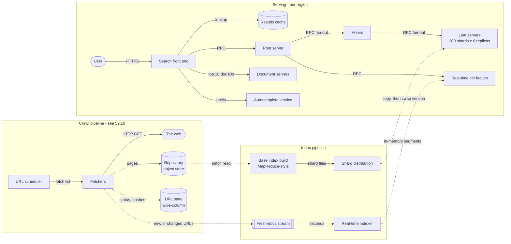

**Reading the diagram.** Three subgraphs are three independently scaled systems joined only through storage and streams. In the **crawl pipeline** the scheduler hands fetch lists to fetchers, which make HTTP requests to the web, write compressed pages asynchronously (dotted arrows) to the repository, and update the URL-state table; §52.10 designs this part. In the **index pipeline** a periodic batch job reads the whole repository and builds the base-tier shards, while a stream of new or changed URLs feeds a real-time indexer whose small in-memory segments become searchable in seconds. Shard distribution copies finished shards to leaf servers asynchronously and swaps versions only when a complete replica is ready. In the **serving** subgraph all arrows are synchronous RPCs within a request: the front end checks the results cache, then asks the root, which fans out to mixers and they to the 300 base-tier leaves of one replica, while the root also queries the real-time tier; the front end then fetches snippets for the winning ten documents from document servers. Storage boundaries are the repository, URL state, the leaf servers' local index copies and the document store. Failure points: a slow leaf (tail latency), a bad index version (rolled back by version pin), cache loss (load spike), and the fresh-docs stream lagging (stale news). Scaling: replicas for query rate, shards for corpus size, more mixer levels for fan-out.

### 56.4.8 Detailed component design

#### Index construction and sharding by document

The base index is a batch job over the repository, a textbook MapReduce (§29.4):

1. **Parse and deduplicate.** For each fetched page, extract text, links, title and anchors; compute a content fingerprint (for example SimHash) and drop near-duplicates, keeping the canonical URL. On the web a large fraction of pages are duplicates or near-duplicates, and every duplicate kept costs index space and fills result pages with redundant links.
2. **Assign to shard and number.** Shard $= \text{hash}(\text{canonical URL}) \bmod S$. Within each shard, sort documents by static quality and assign doc IDs in that order.
3. **Map:** emit (shard, term, doc ID, positions) for every term occurrence, plus anchor text attributed to the *target* page, which is often a better description of a page than the page itself, an observation already central to the original Google prototype [Brin and Page 1998].
4. **Shuffle** by (shard, term); **reduce** writes each shard's postings in doc-ID order, compressed (§16.3.4), together with the shard's lexicon and forward index.
5. **Validate.** Before release, run a fixed set of golden queries against the new shard set and compare result overlap and quality metrics with the serving version; refuse to ship a build whose metrics regress beyond a threshold. Index builds fail silently far more often than they fail loudly: a parser bug that drops every title produces a perfectly valid, perfectly useless index.

Why not term partitioning, which would let a two-word query visit only two shards? Because at this scale postings for common terms are gigabytes long, every multi-term query would ship them across the network, and popular terms would make their shards permanently hot (§16.7.1). Document partitioning trades a fan-out to every shard for small, balanced, independent shards, and the fan-out is then a tail-latency problem we know how to manage.

#### The serving tree and tail latency

A root server cannot hold 300 open RPCs per query and merge 300 lists while staying responsive, so the fan-out is organized as a tree, as Google described in its early cluster architecture and later in Dean's retrospectives [Barroso et al. 2003; Dean 2009]. With 15 mixers each covering 20 leaves, the root merges 15 lists and each mixer merges 20.

**Figure 56.2 — Two-level serving tree with a real-time tier.**

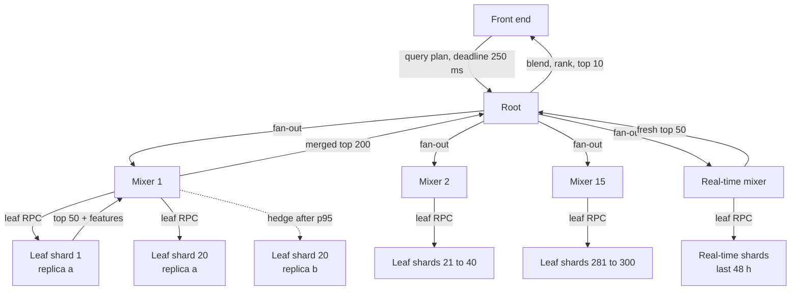

**Reading the diagram.** The front end sends a parsed query plan and a deadline to the root. The root fans out synchronously to 15 base-tier mixers and one real-time mixer; each mixer fans out to its 20 leaves (only a few are drawn). Each leaf searches its shard, keeps its best 50 candidates by a cheap score and returns them with a small feature vector; mixers merge to their best 200, and the root blends base and fresh candidates, applies the expensive ranking stages and returns ten document IDs. The dotted edge is a **hedged request**: if leaf 20's replica a has not answered by the mixer's observed p95 for that leaf, the mixer sends the same request to replica b and uses whichever answers first (§23.7). Every leaf is a storage boundary holding one shard in memory. Failure points are any leaf (handled by hedging and partial results), any mixer (its 20 shards vanish unless the root retries another mixer replica), and the root itself (replicated behind the front end's load balancer). Scaling: more leaves per mixer or an extra mixer level as $S$ grows.

Fan-out amplification (§4.8.4, §16.7.3) dictates the leaf latency target. If each leaf's p99 is 40 ms and the 300 leaves were independent, only $0.99^{300} = 4.9\%$ of queries would see every leaf under 40 ms. Four techniques from the tail-latency literature [Dean and Barroso 2013] make the design work:

1. **Hedged requests** to a second replica after the per-leaf p95, costing a few percent extra load (§23.7).
2. **Good-enough partial results.** When the deadline expires, a mixer returns what it has and marks the response partial. Losing one shard of 300 removes 0.33% of the corpus; for most queries the top ten is unchanged, because the best documents are spread across shards and each shard contributes only its own best.
3. **Canary requests.** A query that crashes a leaf (a "query of death" triggered by a pathological term or a parser bug) would crash all 300 at once. Sending a new query pattern first to one or two leaves, and fanning out only after they answer, bounds the damage to a handful of processes.
4. **Deadline-aware leaves.** A leaf walks postings in static-quality order and checks the propagated deadline; when it expires it returns its best-so-far marked `truncated`. Because good documents come first, truncation costs little relevance.

#### Ranking stages

Ranking is a funnel in which each stage scores fewer documents with more expensive features. The systems shape is what this case owns; what the models learn is Chapter 81's job.

**Table 56.5 — Ranking stages and where they run.**

| Stage | Runs on | Documents scored per query | Features | Cost per document |
|---|---|---|---|---|
| Retrieval (L0) | Leaf | Millions of postings walked; ~$10^4$ matching docs per shard | BM25 per field (§16.5.3), static quality, term proximity | Sub-microsecond |
| First-pass ranking (L1) | Leaf | ~$10^4$ per shard → keep 50 | Small model on cheap features from the forward index | ~1 µs |
| Second-pass ranking (L2) | Root | 3,000 merged → keep 100 | Learned model with richer query–document features (Chapter 81) | Tens of µs |
| Final re-ranking | Root / front end | 100 → 10 | Diversity (no five links from one site), freshness boosts, policy filters, removals | Small |

Two systems consequences follow. First, every feature used at L2 must have been either shipped up from the leaf in the candidate's feature vector or be fetchable for 3,000 documents within a few milliseconds; feature placement is a capacity decision. Second, the leaf's choice of 50 candidates bounds recall: a document the leaf discarded can never be rescued by a better model at the root. Raising per-leaf $k$ from 50 to 100 doubles fan-in bytes and L2 work, which is exactly the kind of quality-versus-cost knob that ranking engineers and infrastructure engineers negotiate.

#### Freshness tiers

A weekly batch rebuild cannot satisfy a five-minute news requirement, and rebuilding 36 TB every five minutes is impossible. The answer is to split the corpus by **rate of change** into tiers that are indexed differently and merged at query time.

**Table 56.6 — Index freshness tiers.**

| Tier | Contents | Size | Index method | Staleness |
|---|---|---|---|---|
| Real-time | Pages first seen or changed in the last 48 h from news, social and frequently changing sites | ~$3.5 \times 10^8$ docs | Streaming: in-memory segments, refreshed every few seconds (§16.10) | Seconds to minutes |
| Daily | Popular pages re-crawled daily | ~$2 \times 10^9$ docs | Incremental build per shard, swapped daily | ≤ 24 h |
| Base | Everything else | $3 \times 10^{10}$ docs | Full batch rebuild, swapped weekly, shard by shard | Days to weeks |
| Removal overlay | URLs to suppress (legal removals, 404s, spam) | Millions of entries | Replicated set pushed to every root within minutes | Minutes |

A document can exist in several tiers at once (an old version in base, a new version in real-time). The root deduplicates by canonical URL and keeps the newest version; the **removal overlay** is applied last, which is how a legally required removal takes effect in minutes even though the base tier still contains the page until next week.

The real-time tier is sized by its ingest rate: at 2,000 new or changed documents per second over 48 hours it holds $2{,}000 \times 172{,}800 = 3.46 \times 10^8$ documents, about 1% of the base tier, which fits comfortably in memory across a few dozen leaves. Published systems follow this split. Twitter's Earlybird served tweets within seconds from in-memory indexes separate from its archive [Busch et al. 2012], and Google's Percolator replaced batch MapReduce rebuilds with incremental, transaction-based processing for its web index, reporting that the average age of documents in search results fell by 50% [Peng and Dabek 2010].

::: industry
**Google: from batch rebuilds to incremental indexing.** Google's Percolator paper describes the move of the web indexing system from a chain of MapReduce passes over the whole repository to incremental processing driven by observers and cross-row transactions on Bigtable. The trade-off it reports is explicit: incremental processing reduced document age in results by about half but used substantially more resources per document than the batch pipeline, which remained the better tool when the whole corpus had to be reprocessed.
*Evidence: Primary* — [Peng and Dabek 2010]
:::

#### Autocomplete

Autocomplete is a separate service: precomputed top-*k* suggestions per prefix in an in-memory trie or finite-state transducer (§16.9.2–§16.9.3), rebuilt from the query log with time decay, plus a small trending layer. At 347,222 requests/s it is the highest-rate service, but each request is a sub-millisecond memory lookup, and short prefixes are cached at the edge. Suggestions must pass the same policy and removal filters as results, and the build must drop queries issued by too few distinct users so that private queries never surface.

### 56.4.9 Data flow

**Figure 56.3 — Write path: from a changed page to searchable in two tiers.**

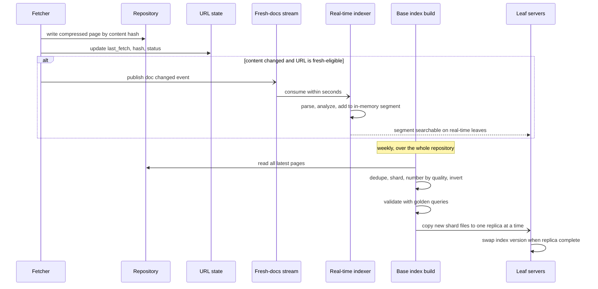

**Reading the diagram.** The fetcher's two writes are synchronous and durable: the page to the repository (keyed by content hash, so an unchanged page costs no new storage) and the URL-state row. If the content changed and the URL belongs to a fresh-eligible site, the fetcher publishes an asynchronous event (half arrow) that the real-time indexer consumes, analyzes and adds to an in-memory segment searchable within seconds. Separately and on its own schedule, the base build reads the entire repository, runs the batch pipeline of §56.4.8, validates the result and copies shards asynchronously to leaf servers one replica at a time; each replica swaps to the new version only when all its shards have arrived, so a query never mixes old and new shards. Failure points: the stream lagging (fresh content late but not lost, since the base build will include it), a bad build (caught by validation, or rolled back by pinning the old version), and copy bandwidth (§56.4.4). Scaling: the real-time path scales with change rate, the batch path with corpus size.

**Figure 56.4 — Read path: one query.**

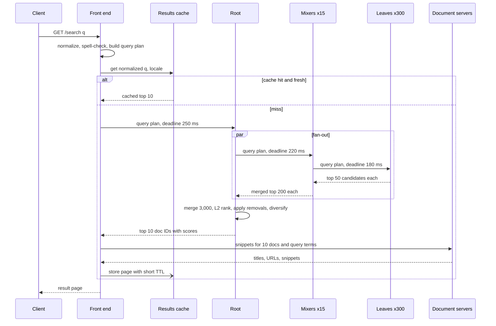

**Reading the diagram.** All calls are synchronous RPCs except the asynchronous cache fill. The front end normalizes the query so that "Noise  Canceling" and "noise canceling" share a cache entry, then checks the cache; news-sensitive queries get short TTLs (minutes) so a cached page does not hide breaking results. On a miss, the deadline shrinks at each level (250 → 220 → 180 ms) so that every level has time to merge whatever arrived. Leaves return candidates, not documents; only the final ten are sent to document servers, which build query-dependent snippets from stored text. The root applies the removal overlay after ranking so that no cached or stale shard can resurrect a removed URL. Failure points: a slow leaf (hedge or partial result), document server miss (show URL and title from the forward index instead of a snippet), cache stampede for a sudden hot query (single-flight per key, §20.11). Scaling: add replicas behind each tree level.

### 56.4.10 Bottlenecks

1. **Leaf CPU walking postings.** Work grows with postings walked; common terms have corpus-length postings. Mitigate with quality-ordered postings and early termination, WAND and block-max skipping (§16.5.6), and cached intersections for frequent term pairs.
2. **Fan-out tail latency.** The slowest of 300 leaves sets latency. Mitigate with hedging, partial results, isolating background work from serving cores, and latency-induced probation [Dean and Barroso 2013].
3. **Index distribution.** 648 TB per weekly build competes with serving; use peer-to-peer copying, throttling and per-replica copy windows.
4. **Breaking-news bursts.** Identical queries hit a cold cache; coalesce requests per normalized query.
5. **Document servers.** 810,000 random document reads per second at peak; keep the hot fraction in memory.

### 56.4.11 Failure scenarios

**Table 56.7 — Search engine failure scenarios.**

| What fails | Impact | Detection | Recovery | Prevention |
|---|---|---|---|---|
| One leaf slow (GC, noisy neighbor, failing disk) | p99 rises for every query on that replica | Per-leaf latency percentiles; hedge rate per leaf | Hedging; probation removes the leaf from rotation | Resource isolation; health-based routing |
| One shard unavailable in all replicas of a region | 0.33% of corpus missing; mostly invisible | `partial=true` rate | Route that shard's RPCs cross-region | Spread a shard's replicas across failure domains |
| Bad index build (parser bug drops titles) | Relevance collapses on rollout | Golden-query metrics; click-through drop on canary replica | Pin previous index version; roll back | Build validation gate; canary one replica first |
| Query of death | Crash of every leaf the query reaches | Correlated crash loops; crash-triggering query in logs | Block the query pattern at the front end | Canary requests; fuzzing the query parser |
| Results cache lost | Index load rises 1.43× | Cache hit-ratio alert | Shed low-priority traffic; warm cache from logs | Capacity headroom for $h = 0$; replicated cache |
| Fresh-docs stream lag | News results stale | Consumer lag and "age of newest doc" metric | Scale indexers; skip backlog older than base tier | Lag alert well below freshness SLO |
| Spam or SEO attack floods index | Low-quality results | Quality metrics on sampled queries; spam classifier scores | Demote via removal overlay and signals | Spam scoring in the build; link-graph signals |
| Region loss | One third of capacity gone | Global load balancer health checks | Shift traffic to two remaining regions | Six replicas per region so two regions carry peak |

### 56.4.12 Scaling strategy

**At 10× query rate** (1.16 million queries/s): replicas scale linearly, from 18 to about 180 by the formula of §56.4.4, which is expensive. Before buying, reduce work per query. **Quality tiering** splits the base index into a small tier of the best documents (say 5 billion) and the full tier; most queries are satisfied by the small tier, and only those that find too few good matches cascade to the full one. If 80% of queries stop at a tier one-sixth the size, the expected CPU per query falls from 1.2 to $1.2 \times \tfrac{1}{6} + 0.2 \times 1.2 = 0.44$ core-seconds, a 63% reduction. Larger results caches, cached postings intersections and more aggressive early termination follow.

**At 10× corpus** ($3 \times 10^{11}$ documents): shards grow to 3,000, so fan-out grows tenfold. Add a third tree level (root → 15 → 15 → 14) so that no node merges more than about 20 inputs, increase per-shard size where memory allows to limit $S$, and lean harder on tiering, because CPU per query scales with corpus size.

**At 100× both**: exhaustive lexical retrieval becomes the dominant cost, so retrieval moves to much smaller candidate sets (per-term top lists, learned sparse or dense retrieval, Chapters 74–75) with the long tail searched only when the head fails, and index builds become continuous and incremental per shard.

### 56.4.13 Trade-offs

**Table 56.8 — Search engine design trade-offs.**

| Decision | Option chosen | Alternative | Why |
|---|---|---|---|
| Partitioning | By document | By term | Balanced shards, small fan-in, independent failures; fan-out is managed by tail-tolerance techniques |
| Shard size | $10^8$ docs, 120 GB in memory | Smaller shards | Fewer shards mean lower fan-out tail; memory per leaf caps size |
| Completeness | Partial results allowed | Wait for all shards | A missing 0.33% rarely changes the top 10; waiting multiplies tail latency |
| Freshness | Tiered (real-time, daily, base) | Single incrementally updated index | Each tier uses the cheapest method that meets its staleness target |
| Removals | Overlay applied at serve time | Wait for rebuild | Legal deadlines are shorter than build cycles |
| Ranking placement | Cheap L1 on leaves, heavy L2 at root | Heavy model everywhere | Heavy model on $3 \times 10^6$ docs per query is unaffordable |
| Caching | Results cache with short TTL for fresh queries | No cache, or long TTL | 30% fewer index queries vs. staleness for news |

### 56.4.14 Alternative designs

- **Elasticsearch or OpenSearch.** For site, enterprise or vertical search up to a few billion documents, a managed Lucene cluster (§16.8) provides sharding, replicas, query-then-fetch and near-real-time refresh. It stops fitting when per-shard overhead, cross-region index distribution and custom multi-stage ranking inside leaves dominate.
- **Incremental-only indexing** [Peng and Dabek 2010] removes the weekly rebuild and its distribution burst, at higher cost per document; full rebuilds remain necessary when analysis code changes.
- **Semantic and hybrid retrieval.** Dense retrieval with ANN indexes (Chapter 74) runs alongside lexical retrieval and the candidate lists are fused (§16.11); the serving tree is unchanged.
- **Term partitioning** fails on long postings and hot terms at web scale (§16.7.1).

### 56.4.15 Interview discussion

**Table 56.9 — 45-minute pacing plan for the search engine.**

| Minutes | Focus | What to produce |
|---|---|---|
| 0–5 | Scope | Web search, ten blue links, freshness tiers, autocomplete; ranking models out of scope |
| 5–10 | Estimates | Corpus 30B docs → 36 TB postings; 116k queries/s peak; serving cores ∝ rate × corpus |
| 10–20 | Architecture | Three pipelines; Figure 56.1; document partitioning and serving tree |
| 20–32 | Deep dive: serving | Scatter–gather, $0.99^{300}$, hedging, partial results, deadlines, ranking funnel |
| 32–40 | Deep dive: freshness | Tiers, real-time indexer, removal overlay, index distribution and version pinning |
| 40–45 | Wrap-up | Failures (query of death, bad build), 10× scaling via tiering, open questions |

**Likely follow-ups.**

- *"Why not shard by term so a query hits only a few machines?"* Postings of common terms are gigabytes; multi-term queries would ship them over the network and popular terms would create hot shards. Document partitioning keeps network fan-in at kilobytes per leaf.
- *"How do you keep p99 under 300 ms with 300 shards?"* Hedged requests after the per-leaf p95, deadlines propagated down the tree, partial results, and quality-ordered postings so a truncated leaf still returns good documents.
- *"How does a takedown work if the index rebuilds weekly?"* A removal overlay replicated to every root, applied after ranking, plus suppression in caches and autocomplete.
- *"How do you know a new index is good?"* Golden-query comparison in the build, then a canary replica with live traffic and click metrics before the rest of the fleet swaps.
- *"Where does PageRank fit?"* It is a static, query-independent quality signal computed offline over the link graph and stored per document; it orders doc IDs and feeds the L0 and L1 scores.

**What distinguishes senior and staff answers.** A senior answer gets document partitioning, the serving tree and caching right and quantifies fan-out. A staff answer also shows that serving cost scales with query rate times corpus size and goes after work per query (tiering, early termination) rather than only adding replicas; treats the index build as a release with validation, canarying and rollback; separates freshness requirements into tiers with different machinery; and names operational hazards such as the query of death and index-distribution bandwidth before the interviewer does.

### 56.4.16 Production considerations

- **Observability.** Per-leaf latency histograms and hedge rates; `partial` and `truncated` rates; newest-document age per tier; index version per replica; golden-query metrics per build; cache hit ratio. Sample traces of the serving tree (§40.6).
- **Security and abuse.** Spam and SEO manipulation make spam scoring part of the build. Query logs are highly sensitive: restrict access, apply minimum-user thresholds to anything derived from them, and limit retention (§50.8). Rate-limit scrapers (§22.3).
- **Cost.** Leaf servers dominate, and cost per thousand queries tracks corpus searched per query, so tiering, caching and early termination are the levers.
- **Operations.** Index rollout is the riskiest routine change: one replica, canary, then region by region with a pinned fallback. Keep the crawler polite (§52.10); blocked sites become stale results.

## 56.5 Recommendation System (systems view)

### 56.5.1 Problem statement

Design the serving system behind a personalized home feed: a user opens the app and, within a fraction of a second, sees twenty items (videos, products or posts) chosen for them from a catalog of 50 million. Every scroll asks for the next page; every impression, click, like and watch is recorded and becomes training data for tomorrow's models.

This case is the **systems view**. What the models are (two-tower retrieval, deep ranking networks, embedding tables, exploration policies) belongs to Chapter 68, and complete product case studies such as YouTube or Instagram recommendations are in Chapter 81. Here the models are black boxes with known costs, and the design questions are those of a data platform: how candidates flow through a multi-stage funnel, how about 200 milliseconds is divided among the stages, where features live so that hundreds of candidates can be scored without hundreds of network calls, what is precomputed and what is computed online, what can be cached, and how the system records what it served so the models can learn from it without **training–serving skew** (Chapter 62).

### 56.5.2 Functional requirements

1. **Get feed.** For a user, surface (home, related items) and pagination cursor, return a ranked page of 20 items with a recommendation token.
2. **Eligibility filtering.** Never return items the user has already seen recently, items from blocked creators, items unavailable in the user's region, or items removed by policy.
3. **In-session responsiveness.** Actions taken in this session (a skip, a long watch) influence the next page within seconds.
4. **New users and new items.** A user with no history receives a reasonable feed; a newly published item is eligible for recommendation within 15 minutes.
5. **Event logging.** Record every impression with the context and features used to rank it, and every engagement event, joinable by request.
6. **Experimentation.** Route a configurable fraction of users to alternative candidate sources, rankers or re-ranking policies, and attribute outcomes to the variant served.

Out of scope: model training algorithms, the feature-engineering logic itself, and content moderation (consumed as a policy signal).

### 56.5.3 Non-functional requirements

**Table 56.10 — Recommendation system non-functional requirements.**

| Property | Target | Why |
|---|---|---|
| Availability | 99.95% for personalized results; 99.99% for *some* results (fallback) | An empty feed is far worse than a less personal one |
| Server-side latency | p50 ≤ 80 ms, p99 ≤ 200 ms for a page of 20 | The feed renders on app open; each 100 ms of delay costs engagement |
| Freshness: user actions | Reflected in the next request (≤ 5 s) | In-session adaptation is a major quality lever |
| Freshness: new items | Eligible within 15 min | Creators expect new uploads to be distributed |
| Logging completeness | ≥ 99.9% of impressions logged and joined to outcomes | Missing or biased logs corrupt training |
| Consistency | Eventual; seen-filter best effort within a session | Showing an item twice is a minor defect, not a correctness failure |
| Model rollout | New ranker live within 1 h of approval, reversible in minutes | Models are retrained daily or more often |

### 56.5.4 Capacity estimation

::: example
**Worked example — Request rate and funnel volume.** Assumptions: 200 million daily active users; 15 feed requests per user per day (5 sessions × 3 pages); peak-to-average ratio 3 (one country dominates, evening peak); funnel shape: 2,000 candidates retrieved → 1,500 after filtering → light ranker keeps 400 → heavy ranker scores 400 → re-ranker returns 20 (plus 5 held in reserve for the next page).

1. Requests per day: $2 \times 10^8 \times 15 = 3 \times 10^9$.
2. Average rate: $3 \times 10^9 / 86{,}400 = 34{,}722$ requests/s; peak $\times 3 = 104{,}167$ requests/s.
3. Light-ranker scorings at peak: $104{,}167 \times 1{,}500 = 1.56 \times 10^8$ per second.
4. Heavy-ranker scorings at peak: $104{,}167 \times 400 = 4.17 \times 10^7$ per second.
5. Heavy-ranker compute at 0.1 ms of CPU per candidate (batched inference) and 50% target utilization: $4.17 \times 10^7 \times 10^{-4} / 0.5 = 8{,}333$ cores, about 131 servers of 64 cores. The light ranker at 5 µs per candidate needs $1.56 \times 10^8 \times 5 \times 10^{-6} / 0.5 = 1{,}563$ cores.

**Interpretation.** The user sees 20 items, but the system scores 1,900 per request. **Engineering implication.** Every stage exists to make the next, more expensive stage affordable; changing the heavy ranker's input from 400 to 800 candidates doubles its fleet.
:::

::: example
**Worked example — Feature fetch.** Assumptions: 50 million items with 1 KB of item features each; user features 5 KB per user; the top 5 million items account for 95% of candidates.

1. Item-feature lookups if fetched remotely per candidate: $104{,}167 \times 1{,}500 = 1.56 \times 10^8$ lookups/s at peak, an impossible load for a remote key-value store at this latency budget, even batched.
2. Full item-feature table: $5 \times 10^7 \times 1{,}000 = 50$ GB; the hot 5 million items: 5 GB.
3. User-feature reads: one per request, $104{,}167 \times 5{,}000 = 521$ MB/s at peak from the online feature store.

**Interpretation.** Item features are shared by all users and change slowly; user features are private and change fast. **Engineering implication.** Replicate the hot item features into every ranking server's memory (5 GB is cheap), refreshed by a stream, and fall back to a remote batched read for the 5% tail; fetch user features once per request.
:::

::: example
**Worked example — Precomputation and logging volume.** Assumptions: 400 million monthly active users; a nightly job stores 300 candidates per user at 12 bytes each (8-byte item ID, 4-byte score); each served item's impression log carries 1 KB of logged features; each request logs 5 KB of request context; 10 billion engagement events per day at 200 bytes.

1. Precomputed candidates: $4 \times 10^8 \times 300 \times 12 = 1.44$ TB, replicated in a key-value store.
2. Impressions: $3 \times 10^9 \times 25 = 7.5 \times 10^{10}$ per day (868,000/s average), counting the 5 reserve items as logged-but-not-shown.
3. Impression feature logs: $7.5 \times 10^{10} \times 1{,}000 = 75$ TB/day; request context: $3 \times 10^9 \times 5{,}000 = 15$ TB/day; engagements: $10^{10} \times 200 = 2$ TB/day.

**Interpretation.** The training-data stream (about 92 TB/day) is larger than any serving store in the system. **Engineering implication.** Treat logging as a first-class pipeline with its own capacity plan, compression and retention (for example 30 days of full logs, then sampled), not as a side effect of serving.
:::

The latency budget is the design's central constraint, and it composes differently for sequential and parallel stages.

::: formula
**Latency budget of a staged pipeline**

$$T_{\text{request}} = \sum_{j \in \text{sequential}} t_j \;+\; \max_{i \in \text{parallel sources}} t_i \;+\; t_{\text{slack}}$$

| Symbol | Meaning | Units |
|---|---|---|
| $T_{\text{request}}$ | Server-side latency target for one request (here the p99 goal) | ms |
| $t_j$ | Time allotted to sequential stage $j$ (filter, feature fetch, rank, re-rank) | ms |
| $t_i$ | Time allotted to parallel candidate source $i$; the stage waits for the slowest it does not cut off | ms |
| $t_{\text{slack}}$ | Reserve for queueing, retries and garbage-collection pauses | ms |
:::

::: example
**Worked example — Dividing 200 ms.** Allocate: request context and user features 10 ms; candidate generation 40 ms (four sources in parallel, each with a 35 ms deadline); filtering 10 ms; item and real-time feature assembly 25 ms; light ranker 10 ms; heavy ranker 50 ms; re-ranking 10 ms; response and asynchronous log enqueue 5 ms.

1. Sum of allocations: $10 + 40 + 10 + 25 + 10 + 50 + 10 + 5 = 160$ ms.
2. Slack: $200 - 160 = 40$ ms, 20% of the budget.
3. Because percentiles do not add (§4.8), using per-stage p99s as allocations is conservative: all stages rarely hit their p99 on the same request. The danger runs the other way for parallel sources: with four sources each meeting 35 ms at p99, the chance that all four meet it is $0.99^4 = 96\%$ (§4.8.4), so the stage must cut off late sources rather than wait.

**Interpretation.** The heavy ranker and candidate generation take 45% of the budget; everything else must be cheap. **Engineering implication.** Give each stage a hard deadline derived from this table and propagate the remaining budget (§22.11); a stage that misses its deadline degrades (fewer candidates, a cached score) rather than delaying the response.
:::

### 56.5.5 API design

```text
GET /v1/feed?surface=home&cursor=eyJwIjoyfQ&count=20
Authorization: Bearer …
200 OK
{ "request_id": "r-91c2…",          // joins impressions and engagements to this response
  "items": [ { "item_id": "v-88412", "position": 0, "rec_token": "r-91c2…:0" }, … ],
  "next_cursor": "eyJwIjozfQ",
  "degraded": false }                // true when a fallback path served this page

POST /v1/events
{ "events": [ { "type": "impression", "rec_token": "r-91c2…:0", "ts": "2026-11-05T19:02:11.204Z" },
              { "type": "watch", "rec_token": "r-91c2…:0", "watch_ms": 41200, "ts": "…" } ] }
202 Accepted
```

```protobuf
// Internal RPCs (illustrative)
service CandidateSource { rpc Retrieve(RetrieveRequest) returns (CandidateList); }  // user context, n, deadline
service FeatureService  { rpc BatchGet(FeatureRequest) returns (FeatureResponse); } // entity keys, feature set version
service Ranker          { rpc Score(ScoreRequest) returns (ScoreResponse); }        // candidates + features -> scores
message ScoreRequest {
  string model_version = 1;          // pinned per experiment arm
  bytes  user_features = 2;
  repeated Candidate candidates = 3; // item ID + assembled feature vector
  uint32 deadline_ms = 4;
}
```

The `request_id` and per-item `rec_token` are the most important fields in the API: they are the join keys that turn an engagement event into a labeled training example. Events are accepted asynchronously (`202`) and batched by the client.

### 56.5.6 Data model and database schema

**Table 56.11 — Recommendation system data stores.**

| Data | Key | Store and justification |
|---|---|---|
| User features (long-term profile, embeddings) | `user_id` | Online feature store on a low-latency key-value database (Chapter 62; §12.4); one read per request |
| Real-time user features (last 50 actions, session counters) | `user_id` | In-memory store with TTL (Redis-style, §20.6), updated by a stream job within seconds |
| Item features | `item_id` | Bulk-loaded into ranker memory, refreshed by stream; backing copy in the feature store |
| Candidate indexes | Embedding → item IDs; `item_id` → co-visited items | ANN index in memory (Chapter 74); co-visitation table in a key-value store |
| Precomputed candidates | `user_id` | Key-value store, overwritten nightly (1.44 TB) |
| Seen filter | `user_id` | Per-user Bloom filter or capped set of recent item IDs (§17.4) |
| Impression and event logs | Partitioned by date and hour | Kafka (§31) → data lake tables in a columnar format |

The impression log is the contract between serving and training, so its schema is designed as carefully as any database table:

```sql
-- Data-lake table, written from the serving log stream (illustrative)
CREATE TABLE impressions (
  request_id        STRING    NOT NULL,   -- join key with engagement events
  position          INT       NOT NULL,   -- slot shown, for position-bias correction
  user_id_hash      STRING    NOT NULL,   -- keyed hash, not the raw ID (Chapter 50)
  item_id           STRING    NOT NULL,
  served_at         TIMESTAMP NOT NULL,
  surface           STRING    NOT NULL,
  experiment_arms   ARRAY<STRING>,        -- which variants produced this result
  candidate_source  STRING,               -- provenance: which retriever proposed it
  model_version     STRING    NOT NULL,
  heavy_score       DOUBLE,
  features          BINARY,               -- exact feature vector used at serving time
  feature_set_ver   STRING    NOT NULL,
  shown             BOOLEAN   NOT NULL    -- false for reserve items never rendered
)
PARTITIONED BY (dt DATE, hr INT);
```

Logging the exact `features` the ranker saw, rather than recomputing them later from tables, is what prevents training–serving skew: the training example contains precisely the inputs the model received in production, including any staleness or default values (Chapter 62 treats the alternatives).

### 56.5.7 High-level architecture

**Figure 56.5 — Recommendation serving and logging architecture.**

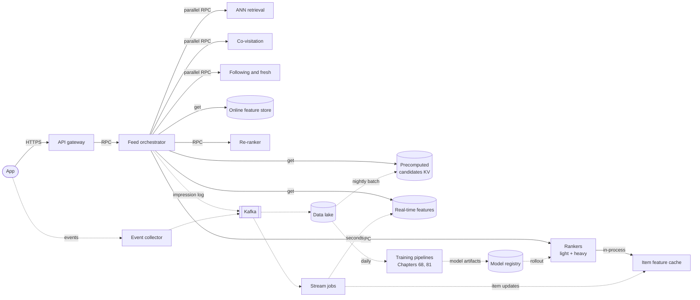

**Reading the diagram.** Solid arrows are the synchronous request path; dotted arrows are asynchronous data flows. The app calls the gateway, which calls the **feed orchestrator**, the only component that knows the funnel. The orchestrator fetches user and real-time features and precomputed candidates, calls several candidate sources in parallel, filters, sends candidates with assembled features to the rankers (whose item features are an in-process cache), calls the re-ranker, and returns. On the asynchronous side, the orchestrator logs every impression to Kafka and the app sends engagement events through a collector to the same Kafka cluster. Stream jobs update real-time user features within seconds and push item-feature changes to rankers; the data lake accumulates logs for daily training, whose models flow through a registry to the rankers, and for the nightly precomputation job. Storage boundaries: feature stores, precomputed candidates, ANN index memory, Kafka and the lake. Failure points: any candidate source (cut off by deadline), the feature store (default features), rankers (fall back to light ranker or precomputed order), and the logging path (must never block serving). Scaling: each service scales horizontally and independently; rankers dominate.

### 56.5.8 Detailed component design

#### Candidate generation: many sources, one deadline

No single retrieval method finds everything a user might want, so the orchestrator queries several **candidate sources** in parallel and merges them, the two-stage shape (candidate generation narrowing millions to hundreds, then ranking) that YouTube's published deep-learning recommender made widely known [Covington et al. 2016].

**Table 56.12 — Candidate sources and their systems profile.**

| Source | What it finds | Data structure | Freshness | Typical latency |
|---|---|---|---|---|
| Two-tower ANN retrieval | Items whose embedding is near the user's | In-memory ANN index over item embeddings (Chapter 74) | Index rebuilt hourly; new items inserted incrementally | 5–15 ms |
| Co-visitation / item-to-item | Items engaged with after the user's recent items | Key-value table item → top-N related items | Updated by streaming counts | 2–10 ms |
| Social / following | New items from followed creators | Per-user inbox (fan-out-on-write, compare Chapter 53) | Seconds | 2–5 ms |
| Trending and fresh | Popular or new items in the user's region | Small in-memory lists per region | Minutes | < 2 ms |
| Precomputed | Expensive batch candidates (graph walks, heavy models) | Key-value by user | Nightly | 2–5 ms |

The merge cannot sort by score, because scores from different sources are not comparable (an ANN cosine similarity of 0.8 and a co-visitation count of 1,200 have no common scale). Instead the orchestrator takes up to a quota from each source and interleaves by rank, deduplicating as it goes; the rankers then put everything on one scale.

```python
"""Merge candidate lists from several retrieval sources under per-source quotas.
Scores from different sources are not comparable, so we interleave by rank, not by score."""

def merge_candidates(results, quotas, total, excluded):
    """results: source -> ranked list of item IDs, or None if the source missed its deadline.
    quotas: source -> max items taken from that source. excluded: items to filter out."""
    queues = {s: [i for i in (lst or []) if i not in excluded][:quotas[s]]
              for s, lst in results.items()}
    merged, seen, origin = [], set(), {}
    while len(merged) < total and any(queues.values()):
        for source in sorted(queues):              # one pass = one item from each source
            q = queues[source]
            while q:
                item = q.pop(0)
                if item not in seen:               # dedupe across sources
                    seen.add(item)
                    merged.append(item)
                    origin[item] = source          # keep provenance for logging and debugging
                    break
            if len(merged) == total:
                break
    return merged, origin

if __name__ == "__main__":
    results = {
        "ann_two_tower": ["v1", "v2", "v3", "v4", "v5"],
        "co_visitation": ["v2", "v6", "v7"],
        "following":     ["v8", "v1", "v9"],
        "trending":      None,                     # timed out: the request proceeds without it
    }
    quotas = {"ann_two_tower": 4, "co_visitation": 3, "following": 3, "trending": 2}
    merged, origin = merge_candidates(results, quotas, total=8, excluded={"v3"})
    print(merged)
    print({s: sum(1 for v in origin.values() if v == s) for s in quotas})
```

Output:

```text
['v1', 'v2', 'v8', 'v4', 'v6', 'v9', 'v5', 'v7']
{'ann_two_tower': 3, 'co_visitation': 3, 'following': 2, 'trending': 0}
```

What to notice:

- A source that missed its deadline (`None`) simply contributes nothing; the request is not delayed. Monitoring must count these, or a silently dead source looks like a quality regression.
- Excluded items (here `v3`, already seen) are removed *before* the quota is applied, so filtering does not waste a source's quota.
- `v2` and `v1` were proposed by two sources but appear once; `origin` records which source got credit, which is logged as `candidate_source` so that each source's contribution to engagement can be measured.
- Sources are visited in a fixed order (alphabetical here, by priority in practice), which makes results deterministic and debuggable.

#### Feature assembly and ranking

Ranking 1,500 candidates requires a feature vector for each. Features come from three places with different costs:

1. **User features** (one row per request): fetched once from the online feature store, plus the real-time store for the last few minutes of activity.
2. **Item features** (one row per candidate): served from the ranker's in-process cache of hot items (the 5 GB computed above), refreshed by a change stream; misses go to the feature store in one batched call with a short deadline, and on timeout the ranker uses default values and records that it did so.
3. **User–item cross features** (for example, how often this user engaged with this creator): the most predictive and the most expensive, because they are keyed by pairs. Keep them small and keyed by user (a per-user map of creator → counts fetched once), never as one remote lookup per candidate.

Rankers run the light model on all candidates and the heavy model on the top 400, in batches, so that the per-candidate cost is amortized; batching on accelerators is the natural evolution when the heavy model grows (Chapters 64 and 66). Two design rules keep the stage stable. Rankers are **stateless replicas** pinned to one model version per experiment arm, so a rollout is a routing change. And the orchestrator routes a user's requests consistently to the same ranker pool during a model transition, so one user never sees pages ranked by two different models alternating.

#### Re-ranking, precomputation and caching

**Re-ranking** applies list-level logic that a per-item score cannot express: no more than two consecutive items from one creator, a mix of content types, exploration slots for new items (Chapter 68 covers why), and business or policy rules. It operates on 400 items with cheap logic, so it is fast, but it has outsized influence on what users see and must be versioned and experimented on like a model.

**Precomputed versus online** is not a binary choice; it is decided per stage.

**Table 56.13 — Precomputed versus online recommendation.**

| | Fully precomputed | Hybrid (chosen) | Fully online |
|---|---|---|---|
| What it is | Nightly job writes each user's final list | Some candidate sources precomputed; filtering and ranking online | Every stage at request time |
| Latency | One key-value read (< 5 ms) | ~80–200 ms | ~80–200 ms or more |
| Freshness | Up to a day stale; ignores this session | Reacts to the current session | Fully fresh |
| Cost | Computes lists for users who never come back | Pays online only for active users | Highest online compute |
| Failure behavior | Very robust | Falls back to precomputed list | Needs separate fallback |
| Choose when | Email digests, low-traffic surfaces, fallback | Main feeds | Highly contextual surfaces (search-like, related items) |

**Caching** in a personalized system is narrower than in a content site, because most responses are unique to one user and one moment. What *is* cacheable: item features (in-process), candidate lists for related-item surfaces keyed by item (shared by all users who view that item), trending lists, and the user's **own next page**. The re-ranker keeps five reserve items and the orchestrator caches the ranked remainder for the session with a TTL of a few minutes, so a scroll often needs only filtering and a light refresh rather than the full funnel; an engagement event that should change the feed invalidates that entry.

#### Logging for training

The logging path has three jobs: record what was served (impressions with features), record what happened (engagements), and join them into labeled examples.

1. **Impressions** are logged by the orchestrator at serving time, asynchronously to Kafka, with the features the ranker actually used. Logging must never block or fail the request; if the log producer's buffer is full, the system drops logs and counts the drops rather than slowing users down.
2. **Engagements** arrive later, from the client, keyed by `rec_token`. Labels are delayed: a "watched to completion" label might arrive minutes later, a purchase days later.
3. **The join** is a streaming job (§29.8) keyed by `request_id`, with a window as long as the slowest label that matters (for example 30 minutes for watch labels), emitting an example when the window closes. Impressions with no engagement become negative examples only after the window closes, never before, otherwise slow positives are recorded as negatives.

Two traps are common enough to design against: logging only the 20 items shown (so the model never learns about candidates it scored low, a feedback-loop problem examined in Chapter 68), and logging features recomputed at join time rather than as served (skew). The design logs the 5 reserve items with `shown = false` and, for a small random sample of requests, the full 400 heavy-ranked candidates with their scores.

::: industry
**Pinterest Pixie: precomputation by graph walk, served from memory.** Pinterest described Pixie, a recommendation service that keeps a pruned graph of pins and boards in the memory of each serving machine and generates candidates in real time by running many short, biased random walks from the user's recent pins, instead of precomputing per-user lists. The systems lesson is that a candidate source can trade memory (the whole graph replicated on every server) for freshness and simplicity (no per-user precomputation, no cross-machine calls during a walk).
*Evidence: Primary* — [Eksombatchai et al. 2018]
:::

### 56.5.9 Data flow

**Figure 56.6 — Read path: serving one feed page.**

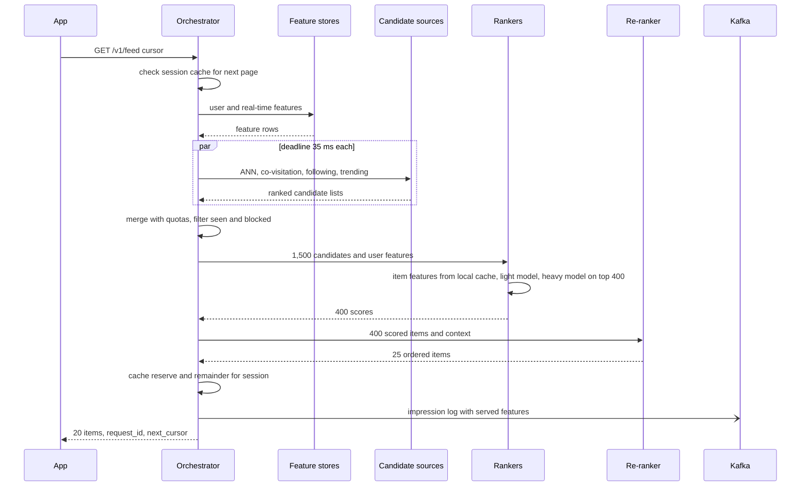

**Reading the diagram.** The orchestrator first checks whether this is a continuation it has already ranked; if so, it returns from the session cache after re-filtering. Otherwise it fetches user features, calls all candidate sources in parallel with a 35 ms deadline each, merges and filters, and sends candidates to the rankers, which assemble item features locally and run both models. The re-ranker produces the final order. Only the impression log is asynchronous (half arrow), and it is sent after the response is ready so that a slow Kafka producer cannot delay users. Failure points and fallbacks: a candidate source misses its deadline (merge without it); the feature store times out (use defaults and flag them in the log); rankers fail (use light-ranker scores or the precomputed list, setting `degraded`). Scaling: rankers and candidate sources scale independently behind the orchestrator, which is stateless apart from the session cache.

**Figure 56.7 — Write path: from engagement to features, examples and models.**

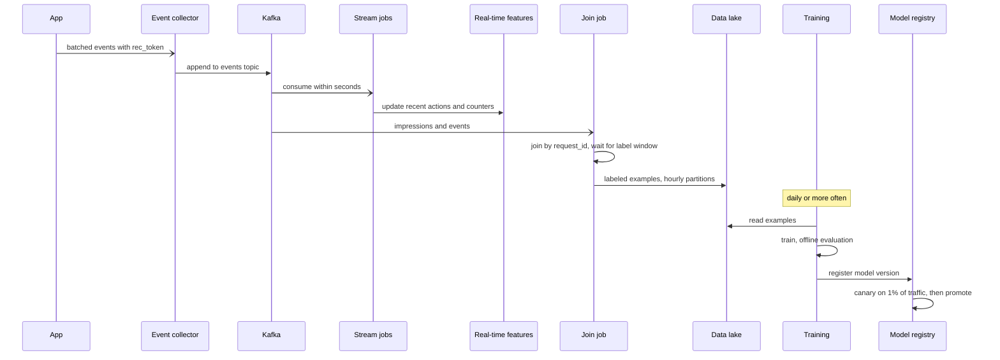

**Reading the diagram.** Engagement events flow asynchronously from the app to the collector, which appends them durably to Kafka; that append is the commit point. Two consumers read the same topic for different purposes: stream jobs update real-time features within seconds (this is what makes the next page respond to a skip), and the join job matches impressions with engagements by `request_id`, waits for the label window and writes labeled examples to the lake. Training reads the lake on its own schedule, and new model versions go through the registry, canary and promotion (Chapters 66 and 69 own model serving and rollout). Failure points: Kafka unavailable (collectors buffer and retry with idempotent producers, §31.6.3); the join job late (training delayed, serving unaffected); a bad model (caught at canary). Scaling: partition topics by user so per-user ordering holds and consumers scale with partitions.

### 56.5.10 Bottlenecks

1. **Heavy-ranker compute.** It dominates the fleet; candidates per request multiply it directly. Levers: tighter light-ranker cut-off, batching, accelerators, model distillation (Chapter 67).
2. **Feature fetch fan-out.** Any design that issues one remote call per candidate fails at $1.56 \times 10^8$ lookups/s. Keep item features local and cross features keyed by user.
3. **ANN index memory and rebuilds.** The retrieval index must hold 50 million embeddings in memory on every replica and absorb new items within 15 minutes; incremental insertion plus periodic full rebuild (Chapter 74).
4. **Hot users and hot items.** A celebrity's new post enters millions of following-inboxes (the fan-out problem of Chapter 53); a viral item's feature row is read by every ranker, which the in-process cache absorbs.
5. **Logging throughput.** 92 TB/day of logs is a Kafka and lake capacity problem; compress, sample the full-candidate logs, and partition by hour.

### 56.5.11 Failure scenarios

**Table 56.14 — Recommendation system failure scenarios.**

| What fails | Impact | Detection | Recovery | Prevention |
|---|---|---|---|---|
| One candidate source down or slow | Less diverse feeds; slight engagement drop | Per-source timeout rate; share of served items by source | Merge proceeds without it; page on-call if sustained | Deadlines; quotas so no source is a single point |
| Online feature store slow | Rankers use defaults; ranking quality drops | Default-feature rate in logs; store p99 | Serve with defaults; shed experimental traffic | Replicas; local caches of user features for active sessions |
| Ranker fleet overloaded | Latency SLO missed | Ranker queue length, p99 | Reduce heavy-ranker input from 400 to 200; fall back to light ranker | Autoscaling on queue length; load shedding by priority |
| Bad model version | Engagement drops sharply | Canary metrics versus control; online prediction-distribution drift | Route traffic back to previous version | Canary at 1%; automatic rollback on guardrail metrics |
| Logging pipeline drops impressions | Biased training data; silent quality decay | Ratio of logged impressions to served requests | Backfill impossible; quarantine affected partitions | Monitor completeness; durable local buffer in orchestrator |
| Training–serving skew (feature computed differently) | Model performs worse online than offline | Compare logged serving features with training features | Retrain on logged features | Log features as served (§56.5.6) |
| Whole personalization stack down | No personalized feed | Error rate on `/feed` | Serve precomputed list, then regional trending list | Layered fallbacks tested by chaos experiments (§39.11) |

### 56.5.12 Scaling strategy

**At 10× traffic** (1 million requests/s at peak): heavy-ranker cores grow to about 83,000, so this is the point to move ranking to accelerators with large batches and to cut candidates per request; candidate sources replicate horizontally; the in-process item cache is unchanged, since it does not grow with traffic. Kafka and the lake grow tenfold, so full-candidate logging becomes sampled at a lower rate.

**At 10× catalog** (500 million items): the ANN index no longer fits on one machine and becomes sharded by item with scatter–gather (the same tail-latency mathematics as §56.4.8), or tiered (a hot index of recent and popular items plus a cold sharded index). The item-feature cache keeps covering the hot head, but the miss path grows and needs its own capacity.

**At 100×**: the architecture splits into **regional cells** (§44.10), each with its own replicas of candidate indexes and rankers and a regional feature store, with global training. Precomputation is restricted to inactive users and fallback, because nightly computation for billions of users that mostly do not return is wasted.

### 56.5.13 Trade-offs

**Table 56.15 — Recommendation system trade-offs.**

| Decision | Chosen | Alternative | Why |
|---|---|---|---|
| Funnel depth | Retrieve → filter → light rank → heavy rank → re-rank | Single model over all candidates | Makes the heavy model affordable on 400 rather than 2,000 items |
| Candidate merge | Quotas and interleave by rank | Merge by score | Scores across sources are not comparable |
| Item features | Replicated in ranker memory | Remote lookup per candidate | 156 million lookups/s is infeasible remotely |
| Precomputation | Hybrid, with precomputed fallback | Fully online or fully precomputed | Freshness for active users, robustness for failures |
| Missing data | Default features and degraded flag | Fail the request | An imperfect feed beats an error |
| Logging | Features as served, plus reserve and sampled full candidates | Recompute features at training time | Prevents skew; enables learning about unshown items |
| Model rollout | Versioned rankers, canary, consistent routing per user | Swap all at once | Reversible in minutes, no mixed rankings per user |

### 56.5.14 Alternative designs

- **Precompute everything.** A nightly batch writes each user's feed to a key-value store: cheap and robust, the norm for email digests, but blind to the current session and wasteful for users who do not return.
- **Single-stage retrieval.** For catalogs of a few hundred thousand items, one model can score everything; the funnel is overhead when the catalog is small.
- **Graph-walk retrieval from memory.** Pixie-style walks replace several candidate sources with one, trading memory for freshness [Eksombatchai et al. 2018].
- **Managed recommender services** suit teams without ML infrastructure, at the cost of control over the funnel, features and logging.

### 56.5.15 Interview discussion

**Table 56.16 — 45-minute pacing plan for the recommendation system.**

| Minutes | Focus | What to produce |
|---|---|---|
| 0–5 | Scope | Systems view of a home feed; models as black boxes with cost; logging in scope |
| 5–10 | Estimates | 104k requests/s; 1,500 → 400 → 20 funnel; 42 million heavy scorings/s; feature lookups |
| 10–20 | Architecture | Figure 56.5; orchestrator, sources, feature stores, rankers, logging |
| 20–30 | Deep dive: latency budget | 200 ms table, deadlines, parallel sources, degraded modes |
| 30–38 | Deep dive: features and logging | Local item features, served-feature logging, delayed-label join |
| 38–45 | Wrap-up | Failures and fallbacks, 10× scaling, experimentation |

**Likely follow-ups.**

- *"Why not one big model?"* Because scoring 50 million items, or even 2,000 with the heavy model, does not fit the latency or cost budget; each stage makes the next affordable.
- *"How does the feed react to what I just did?"* Events go through Kafka to a stream job that updates the real-time feature store within seconds; the next request reads it, and the session cache is invalidated by significant actions.
- *"What if the feature store is down?"* Rankers use defaults, record that they did, and set `degraded`; if the rankers are down, serve precomputed lists, then trending.
- *"How do you avoid training–serving skew?"* Log the features exactly as served, keyed by request, and train on those logs.
- *"How would you A/B test a new ranker?"* Hash users into arms, pin the ranker version per arm, log the arm with every impression, and compare engagement and guardrail metrics (§57.14 owns the statistics).

**What distinguishes senior and staff answers.** A senior answer draws the funnel, sizes the ranker fleet and puts deadlines on stages. A staff answer derives the feature-placement decision from the lookup rate, treats logging as a product with completeness SLOs and a delayed-label join, designs degraded modes explicitly, and recognizes that the serving system shapes the training data and therefore the future model, so changes to filtering, re-ranking or logging are experiments, not refactors.

### 56.5.16 Production considerations

- **Observability.** Per-stage latency and deadline-miss rates; share of served items by candidate source; default-feature rate; ranker score distributions per model version (a shifted distribution is the earliest sign of a broken feature); logging completeness ratio; engagement per experiment arm.
- **Security and privacy.** Behavioral logs are personal data: hash identifiers (§50.10), enforce retention and deletion in the lake and derived features, and restrict raw-impression access. Apply minimum-count thresholds to item-to-item sources so outputs cannot expose small groups.
- **Cost.** Heavy ranking and logging dominate. The cheapest improvements are usually a smaller heavy-ranker input, sampled full-candidate logging, and not precomputing for inactive users.
- **Operations.** Models change daily, so automate rollout, canaries and one-click rollback, and drill fallbacks: disable rankers in one cell and verify that the precomputed feed is served within the SLO.

## 56.6 Logging and Monitoring Platform

### 56.6.1 Problem statement

Design the internal observability platform for a company running 100,000 containers across 2,000 services owned by 300 teams. Every container emits logs and exposes metrics; engineers search logs while debugging, watch dashboards, and are paged by alerts when service-level objectives are threatened. The platform is shared, so each team is a **tenant** (Chapter 47) with its own quotas, retention and bill.

Chapter 40 teaches the signals themselves: structured logs, metric types, cardinality, tracing, Prometheus and alerting rules. This case designs the platform that carries them. Its distinctive hard problems are three: ingesting bursty telemetry (an incident multiplies log volume exactly when the platform is most needed) without loss and without unbounded cost; choosing **what to index**, because indexing everything is the single largest cost driver; and keeping the **alerting path** working when the rest of the platform, or the infrastructure beneath it, is failing.

### 56.6.2 Functional requirements

1. **Ingest logs** (structured JSON lines from standard output) and **metrics** (Prometheus scrape or OTLP push) from every node, tagged with tenant, service, environment and host.
2. **Search logs** by tenant, service and time range, filter by fields and free text, and **live-tail** a service.
3. **Query metrics** with a PromQL-compatible language for dashboards and ad hoc analysis.
4. **Alert** on metric rules and on metrics derived from logs (for example, error lines per minute), with grouping, deduplication, silencing and routing to paging, chat and ticketing.
5. **Tenant controls**: per-tenant ingestion quotas, active-series limits, retention policies and a monthly usage report.
6. **Access control and redaction**: tenants see only their data unless granted; personal data is masked in the pipeline (§40.4.5).

Distributed traces travel through the same collectors and Kafka cluster but are stored and sampled as Chapter 40 describes (§40.6.3–§40.6.4); this case does not repeat that design.

### 56.6.3 Non-functional requirements

**Table 56.17 — Logging and monitoring non-functional requirements.**

| Property | Target | Why |
|---|---|---|
| Ingestion availability | 99.9%; no loss of accepted data except by explicit, counted sampling or quota drops | Logs are evidence during incidents and audits |
| Log freshness | p99 ≤ 30 s from emission to searchable | Engineers debug live incidents |
| Metric freshness | ≤ 30 s from scrape to queryable | Alerts depend on it |
| Alerting availability | 99.99%; evaluation delay ≤ 1 min | The platform's most critical function |
| Log query latency | 1 h of one service: p95 ≤ 2 s; 7 days with filters: p95 ≤ 30 s | Interactive debugging |
| Dashboard latency | p95 ≤ 1 s for 24-hour panels | Many panels per dashboard |
| Retention | Logs: 7 days hot, 30 days warm, 1 year archive for audit streams; metrics: 15 days raw, 13 months downsampled | Debugging versus trend analysis versus compliance |
| Isolation | One tenant's burst cannot raise another tenant's ingestion latency beyond SLO | Shared platform (§47.7) |

### 56.6.4 Capacity estimation

::: example
**Worked example — Log volume.** Assumptions: 100,000 containers; 20 lines/s per container on average; 400 bytes per line; incident peak 3× average.

1. Lines per second: $10^5 \times 20 = 2 \times 10^6$; bytes: $2 \times 10^6 \times 400 = 800$ MB/s.
2. Per day: $800 \times 10^6 \times 86{,}400 = 6.91 \times 10^{13}$ B = **69.12 TB/day** raw.
3. Peak: $6 \times 10^6$ lines/s, 2.4 GB/s.

**Interpretation.** This is the same volume formula as §40.4.4, applied to a whole company: volume follows lines per container, not the number of services. **Engineering implication.** Size the ingestion path (agents, Kafka, ingesters) for 2.4 GB/s, but size storage for the average, since Kafka absorbs peaks.
:::

::: example
**Worked example — Storage per retention tier.** Assumptions: 10:1 compression for logs in columnar or chunked storage; hot tier 7 days on local SSD with 2 replicas; warm tier days 8–30 in object storage (durability provided by the object store); 10% of volume (audit and security streams) archived for the rest of the year; alternative: a full-text inverted index whose index plus stored source occupies 0.5× raw, with 1 replica (2 copies).

1. Compressed per day: $69.12 / 10 = 6.91$ TB.
2. Hot: $6.91 \times 7 \times 2 = 96.8$ TB of SSD.
3. Warm: $6.91 \times 23 = 159$ TB of object storage.
4. Archive: $6.91 \times 0.1 \times 335 = 232$ TB of object storage (cold class).
5. Full-text indexing of everything, hot tier only: $69.12 \times 0.5 \times 2 \times 7 = 484$ TB of SSD, five times the columnar hot tier, plus the CPU to build the inverted index at 800 MB/s.

**Interpretation.** The ratios are illustrative and vary with data, but the shape is robust: indexing every token multiplies hot storage and ingest CPU. **Engineering implication.** Default to cheap storage with indexes on a few fields (§56.6.8) and offer full-text indexing only to tenants whose queries need it, billed accordingly.
:::

::: example
**Worked example — Metrics.** Assumptions: 50 million active series; 15 s scrape interval; 1.37 bytes per sample after Gorilla-style compression [Pelkonen et al. 2015; §12.8.2]; about 4 KB of ingester memory per active series for its in-memory chunk and index entries (illustrative); replication factor 3 in ingesters.

1. Samples per second: $5 \times 10^7 / 15 = 3.33 \times 10^6$.
2. Storage per day: $3.33 \times 10^6 \times 86{,}400 \times 1.37 = 395$ GB; 15 days raw: 5.9 TB.
3. Downsampled to 5-minute resolution for 13 months (395 days): $5 \times 10^7 \times 288 \times 395 \times 1.37 = 7.8$ TB.
4. Ingester memory: $5 \times 10^7 \times 4{,}000 \times 3 = 600$ GB across the ingester fleet.

**Interpretation.** Metrics need about 17 times less disk per day than compressed logs (395 GB versus 6.91 TB), but their cost lives in memory and scales with the number of *series*, not samples. **Engineering implication.** The metrics platform's capacity limit is cardinality (§40.5.3); enforce it per tenant at ingestion.
:::

Kafka sits between agents and storage as a shock absorber, and its size follows from the outage it must ride out.

::: formula
**Buffer size and drain time**

$$B = \frac{r}{\rho}\,T_{\text{ret}}\,f \qquad T_{\text{drain}} = \frac{T_{\text{out}}\; r}{c - r}$$

| Symbol | Meaning | Units |
|---|---|---|
| $B$ | Disk needed across the Kafka cluster | bytes |
| $r$ | Average raw ingest rate | bytes/s |
| $\rho$ | Producer compression ratio | dimensionless |
| $T_{\text{ret}}$ | Retention, at least the longest downstream outage to survive | s |
| $f$ | Replication factor | count |
| $T_{\text{out}}$ | Duration of a downstream (storage) outage | s |
| $c$ | Maximum consumption rate of the downstream ingesters | bytes/s |
| $T_{\text{drain}}$ | Time to consume the backlog after recovery while new data keeps arriving | s |
:::

::: example
**Worked example — Riding out a six-hour storage outage.** Use $r = 800$ MB/s, $\rho = 4$, $T_{\text{ret}} = 24$ h, $f = 3$, $T_{\text{out}} = 6$ h.

1. Buffer: $800 / 4 \times 86{,}400 \times 3 = 5.18 \times 10^{13}$ B = **51.8 TB** of broker disk.
2. With ingesters provisioned at $c = 2r$: $T_{\text{drain}} = 6 \times r / (2r - r) = 6$ h.
3. With $c = 1.25r$: $T_{\text{drain}} = 6 / 0.25 = 24$ h. No data is lost (the backlog never exceeds 6 hours of age, well inside 24 hours of retention), but logs are hours stale for a full day.

**Interpretation.** Retention protects against loss; consumer headroom determines how long the platform stays stale afterwards. **Engineering implication.** Provision ingesters at about 2× average rate and allow them to scale out during catch-up; prioritize draining the newest data for live debugging while the backlog drains in parallel.
:::

### 56.6.5 API design

```text
# Ingestion (tenant identified by an authenticated token, never trusted from a header alone)
POST /v1/logs                         OTLP/HTTP log records, gzip; 200 or 429 with Retry-After
POST /api/v1/push                     Prometheus remote-write (snappy-compressed protobuf)

# Query
GET  /api/logs/query_range?query={service="checkout",level="error"} |= "timeout"
     &start=2026-11-05T09:00Z&end=2026-11-05T10:00Z&limit=500&direction=backward
GET  /api/logs/tail?query={service="checkout"}                       (WebSocket stream)
GET  /api/v1/query_range?query=sum by (status)(rate(http_requests_total{service="checkout"}[5m]))
     &start=…&end=…&step=30s

# Configuration
PUT  /api/rules/{tenant}/{group}      alerting and recording rules (YAML), versioned
PUT  /api/tenants/{tenant}/limits     { "ingest_mb_per_s": 20, "burst_mb": 200,
                                        "max_active_series": 500000, "log_retention_days": 7,
                                        "full_text_index": false }
GET  /api/tenants/{tenant}/usage?month=2026-10
```

A `429` from ingestion is a designed signal, not an error: agents back off and buffer locally (§22.3.4). Query endpoints enforce limits on time range, bytes scanned and result size per tenant, because a single careless query ("all logs, last 30 days, containing 'error'") can consume the cluster.

### 56.6.6 Data model and database schema

**Logs** are stored as a wide, append-only table sorted by tenant, service and time, so that the dominant query ("this service, this time range") reads a contiguous range. In a ClickHouse-style columnar store [ClickHouse Docs]:

```sql
-- Illustrative ClickHouse DDL; check syntax against your server version
CREATE TABLE logs
(
    tenant    LowCardinality(String),
    service   LowCardinality(String),
    ts        DateTime64(3),
    level     LowCardinality(String),
    host      LowCardinality(String),
    trace_id  String,
    body      String,
    attrs     Map(LowCardinality(String), String),
    INDEX idx_trace trace_id TYPE bloom_filter(0.01) GRANULARITY 4,
    INDEX idx_body  body     TYPE tokenbf_v1(32768, 3, 0) GRANULARITY 4
)
ENGINE = MergeTree
PARTITION BY toDate(ts)
ORDER BY (tenant, service, ts)
TTL toDateTime(ts) + INTERVAL 7 DAY TO VOLUME 'warm',
    toDateTime(ts) + INTERVAL 30 DAY DELETE
SETTINGS storage_policy = 'hot_warm';
```

What to notice:

- `ORDER BY (tenant, service, ts)` defines the sparse primary index, one entry per granule of rows (8,192 by default), so a service-and-time query skips almost every granule [ClickHouse Docs].
- `LowCardinality` dictionary-encodes repetitive strings; together with per-column compression this is where the 10:1 ratio comes from.
- The two **data-skipping indexes** are small per-granule Bloom filters (§17.4): they let a trace-ID lookup or a token search skip granules that cannot match, without a full inverted index.
- `TTL … TO VOLUME 'warm'` moves parts to object-storage-backed disks after 7 days; `DELETE` enforces retention by dropping whole parts, which is cheap because partitions are by day.

**Metrics** use the time-series model of §12.8: a series is identified by its metric name and sorted label set, hashed to a series ID; an inverted index maps each label pair to the series that carry it; samples live in compressed chunks per series, grouped into 2-hour blocks that are uploaded to object storage and compacted (§40.8.4).

**Tenant configuration** (limits, retention, routing, ownership) is small, strongly consistent data in a relational database, cached by every distributor.

### 56.6.7 High-level architecture

**Figure 56.8 — Multi-tenant logging and monitoring platform.**

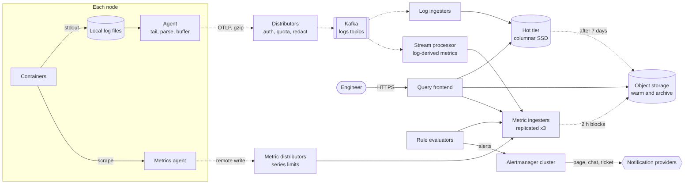

**Reading the diagram.** On each node, containers write to local files (the first durable buffer) and an agent tails, parses and batches them; a metrics agent scrapes local endpoints. Both ship asynchronously to stateless **distributors**, which authenticate the tenant, enforce ingestion quotas and series limits, redact, and either append logs to Kafka or forward metric samples to replicated metric ingesters. Kafka is the second durable buffer: log ingesters consume it to build columnar parts on the hot SSD tier, which age into object storage, while a stream processor derives metrics from logs (error counts per service) and writes them to the metrics path. Metric ingesters hold recent samples in memory and upload 2-hour blocks to object storage. Synchronous paths are the engineer's queries through the query frontend (to hot storage, object storage and ingesters) and the rule evaluators' queries; alerts flow to the Alertmanager cluster and on to external notification providers. Failure points: distributors (stateless, replaceable), Kafka (replicated), ingesters (replicated; replay from Kafka), object storage (provider durability), and the rule-to-notification path, which §56.6.8 isolates. Scaling: add distributors and ingesters horizontally, partition Kafka by tenant and service, and shard metric series by hash.

### 56.6.8 Detailed component design

#### Collection and buffering

Agents (Fluent Bit, Vector or the OpenTelemetry Collector) tail container log files rather than receiving logs over the network from applications, so that an agent restart or a platform outage never blocks an application's writes. Each agent keeps a bounded **disk buffer** (for example 1 GB or one hour, whichever is smaller) and sends compressed batches every second or 1 MB. When distributors return `429` or are unreachable, the agent backs off with jitter (§22.12) and keeps buffering; when the buffer is full it drops the oldest DEBUG and INFO lines first and counts every drop in a metric.

Distributors are stateless and do the per-tenant work before anything is stored: authenticate, apply the tenant's token-bucket ingestion quota (§22.4), apply sampling rules, redact, and append to Kafka. Kafka topics are partitioned by hash of (tenant, service), so a service's lines stay ordered and one consumer handles them; the largest tenants ("whales", §47.6.2) get dedicated topics so that their bursts queue separately. Kafka's role is the one formalized in §56.6.4: absorb the 3× incident peak and any downstream outage up to 24 hours, so that storage is sized for the average.

#### Log storage: what to index

The central design decision is how much indexing to do at write time to make reads fast. Chapter 40 compares the three families (Table 40.3); applied to this platform's 69 TB/day the comparison becomes quantitative.

**Table 56.18 — Log storage options at 69 TB/day.**

| | Full-text inverted index (Elasticsearch/OpenSearch) | Label index + compressed chunks (Loki-style) | Columnar with skip indexes (ClickHouse-style) |
|---|---|---|---|
| What is indexed | Every token of every field | Only stream labels (tenant, service, level) | Sort key (tenant, service, time) plus optional Bloom-filter skip indexes |
| Hot storage (7 days, 2 copies) | ~484 TB SSD (§56.6.4) | Chunks in object storage; small index | ~97 TB SSD |
| Ingest CPU | Highest: tokenization and index merges | Lowest: compress and upload | Low to medium: sort and compress parts |
| "1 h of one service, grep 'timeout'" | Milliseconds | ~0.3 s brute-force scan (below) | Sub-second; token skip index helps |
| "Trace ID across all services, 7 days" | Milliseconds | Scans everything: hours | Seconds with a Bloom skip index on `trace_id` |
| Aggregations ("errors per endpoint per minute") | Moderate | Slow | Fastest |
| Choose when | Security investigations, free-text across everything | Most queries start from service and time | Wide structured events, heavy aggregation |

The brute-force numbers follow from scan rates. A service producing 1% of the volume writes 8 MB/s raw, 28.8 GB per hour. If decompress-and-filter runs at about 1 GB/s per core (an illustrative figure; measure your own), one hour scans in $28.8 / 100 = 0.29$ s on 100 query cores and 7 days in 48 s. But a query with no label selectivity across all services for 7 days scans 484 TB raw: $484{,}000 / 100 = 4{,}838$ s, or 1.3 hours. Label-only indexing is excellent for the common case and unusable for the needle-in-a-haystack case, which is why the design adds a Bloom-filter skip index on `trace_id` and on tokens: a few bytes per granule turn most needle queries back into seconds.

::: industry
**Grafana Loki: index the labels, not the text.** Loki's documentation describes a log store that indexes only a small set of labels per stream and stores log content as compressed chunks in object storage, then filters content at query time in parallel. The documented consequence is guidance to keep label cardinality low (labels like service and environment, not user or request IDs), because each unique label combination is a separate stream with its own index entry and chunks; high-cardinality values belong in the log line or in structured metadata.
*Evidence: Primary* — [Grafana Loki Docs]
:::

The platform's choice is the columnar store as the default for all tenants, a full-text index tier only for the security team's audit streams (about 2% of volume), and object storage for warm and archive data with on-demand **rehydration** into a temporary hot cluster for investigations of old incidents.

#### Metrics time-series store

Metrics follow the scalable-Prometheus pattern of §40.8.4. Each node's agent scrapes locally (keeping the pull model's health signal, §40.5.4) and remote-writes to **metric distributors**, which check the tenant's series limit, then hash each series to three **ingesters** (consistent hashing, §14.8). Ingesters keep the last two hours in memory, write a write-ahead log for crash recovery, and upload immutable blocks to object storage; **compactors** merge blocks and produce 5-minute downsampled blocks for long ranges; **store gateways** serve old blocks. Queries fan out to ingesters for recent data and to store gateways for older data, and a query frontend splits long ranges by day and caches results for completed days.

#### Alerting pipeline

Figure 56.9 shows the alerting path separately because its reliability requirements are stricter than the rest of the platform's.

**Figure 56.9 — The alerting pipeline and its independent watchdog.**

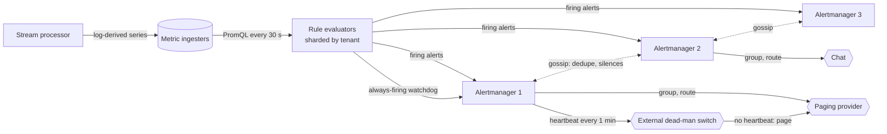

**Reading the diagram.** Rule evaluators, sharded by tenant and rule group, query the metric ingesters every 30 seconds. Log-based alerts do not query the log store: the stream processor turns log patterns into metric series as logs flow past, so alerting depends only on the metrics path. Firing alerts go to *every* Alertmanager replica; the replicas gossip asynchronously (dotted) to share silences and notification state, so each alert is sent once even though three replicas received it (§40.10.3). Alertmanager groups related alerts, applies inhibition, and routes them to external providers. The bottom path is the **watchdog**: an alert that always fires, whose notifications act as a heartbeat to an external dead-man's-switch service in a different failure domain; if heartbeats stop, because evaluators, Alertmanager or the network have failed, the external service pages on-call directly. Storage boundary: only the ingesters (the evaluators and Alertmanagers keep small local state). Failure points: an evaluator shard falling behind (missed evaluations are counted and alerted on), metric ingestion delay (rules see stale data, so rules should check data freshness), and loss of the whole platform (caught by the watchdog). Scaling: shard evaluators by tenant; Alertmanager load is small.

Three design rules make alerting trustworthy. First, **separate failure domains**: the alerting path does not depend on the log store, the query frontend, or the dashboards, and its components run on dedicated capacity with higher priority than ad hoc queries. Second, **monitor the monitor** externally, because a monitoring system cannot report its own total failure. Third, **alert on the platform's own SLOs** (ingestion lag, rule evaluation delay, dropped samples) with burn-rate rules (§39.7.3, §40.10.2), routed to the platform team.

#### Multi-tenant cost control

Without controls, observability cost grows faster than the business, because every new feature adds lines, labels and dashboards. The platform enforces four controls at ingestion, where they are cheapest:

1. **Ingestion quotas.** A token bucket per tenant in MB/s with a burst allowance (§22.4); over-quota data is rejected with `429`, which the agent buffers and then drops lowest-severity first.
2. **Cardinality limits.** A maximum number of active series per tenant and per metric. When a deploy adds a `user_id` label, a counter with 50 endpoints × 10 statuses × 100 pods (50,000 series) becomes $5 \times 10^4 \times 10^6 = 5 \times 10^{10}$ series (§40.5.3); the limit rejects *new* series while existing series keep flowing, so dashboards stay correct and the owning team gets an alert.
3. **Sampling and dropping rules.** Per-tenant rules drop DEBUG in production, sample successful-request INFO lines by request (§40.4.4), and never sample errors.
4. **Showback.** Monthly usage per tenant (GB ingested, GB-days stored, active series, bytes scanned by queries), priced and published (§51.5.2), so teams see the cost of what they emit.

```python
"""Per-tenant active-series limiter, as a metrics distributor might apply it.
Samples for known series are always accepted; a NEW series is rejected once the tenant is at its limit."""
from collections import defaultdict

class SeriesLimiter:
    def __init__(self, limits, default_limit):
        self.limits, self.default = limits, default_limit
        self.active = defaultdict(set)          # tenant -> set of series keys (reset as series go stale)
        self.rejected = defaultdict(int)        # exported as a per-tenant metric

    @staticmethod
    def series_key(metric, labels):
        return metric + "{" + ",".join(f"{k}={labels[k]}" for k in sorted(labels)) + "}"

    def admit(self, tenant, metric, labels):
        key = self.series_key(metric, labels)
        series = self.active[tenant]
        if key in series:
            return True
        if len(series) >= self.limits.get(tenant, self.default):
            self.rejected[tenant] += 1
            return False
        series.add(key)
        return True

if __name__ == "__main__":
    lim = SeriesLimiter(limits={"payments": 1000}, default_limit=500)
    ok = 0
    for user in range(2000):                    # a bad deploy adds a user_id label
        ok += lim.admit("search", "http_requests_total",
                        {"endpoint": "/q", "status": "200", "user_id": str(user)})
    ok += lim.admit("search", "http_requests_total", {"endpoint": "/q", "status": "200", "user_id": "7"})
    print("accepted:", ok, "active:", len(lim.active["search"]), "rejected:", lim.rejected["search"])
    print("other tenant unaffected:", lim.admit("payments", "up", {"pod": "p-1"}))
```

Output:

```text
accepted: 501 active: 500 rejected: 1500
other tenant unaffected: True
```

What to notice: the series key sorts labels, so `{a=1,b=2}` and `{b=2,a=1}` are the same series; an existing series (`user_id=7`) is still accepted after the limit is hit; the rejection counter is per tenant, so the alert goes to the team that caused it; and one tenant's explosion does not consume another tenant's allowance. A production limiter runs per distributor with limits divided by the number of distributors (or coordinated through the ingesters) and expires series that have not been written for the staleness period.

### 56.6.9 Data flow

**Figure 56.10 — Write path: a log line from container to searchable.**

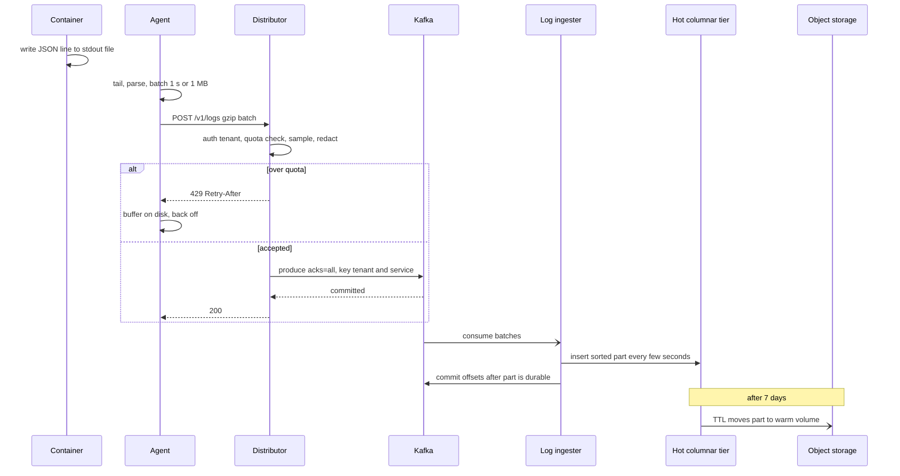

**Reading the diagram.** The application's only synchronous action is writing to a local file, so the platform can never block it. The agent ships batches synchronously to a distributor, which either rejects with `429` (the agent buffers and retries later) or appends to Kafka with `acks=all` (§31.6.2) and acknowledges only after the append is replicated, making Kafka the commit point. Ingesters consume asynchronously, write sorted columnar parts, and commit Kafka offsets only after the part is durable, so a crashed ingester re-reads and re-inserts; duplicate inserts are avoided by inserting each batch with a deterministic deduplication token derived from topic, partition and offset range. Seven days later the storage TTL moves the part to object storage asynchronously. Failure points: agent disk full (counted drops), distributor overload (`429`), Kafka unavailable (agents buffer), ingester crash (replay). Freshness is batch interval + Kafka + part insertion, typically 5–15 seconds.

**Figure 56.11 — Read path: a log query over seven days.**

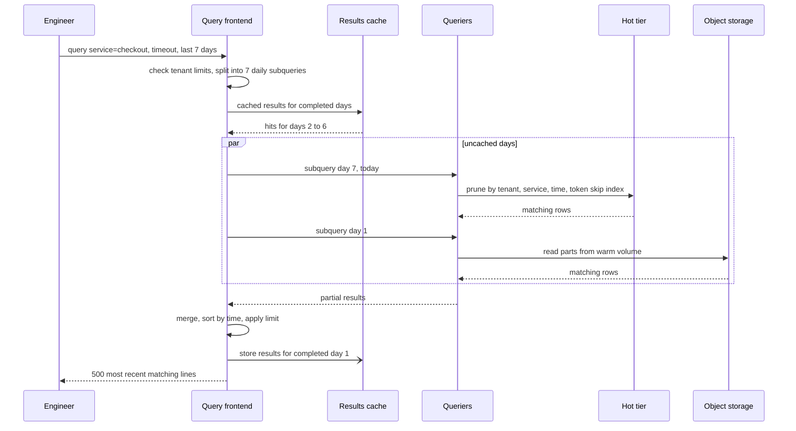

**Reading the diagram.** The query frontend is the control point: it enforces per-tenant limits on time range and bytes scanned, splits the query by day so that subqueries run in parallel and results for completed days can be cached (a completed day's logs never change), and merges results. Queriers prune by the sort key and skip indexes, so they read only the checkout service's granules that might contain "timeout". Today's data comes from the hot tier and day 1 from object storage, which is slower, so the slowest subquery sets the latency. Failure points: an expensive query (rejected or queued fairly per tenant, §47.8.2), object storage throttling (retries with backoff), a querier crash (subquery retried). Scaling: queriers are stateless and autoscale on queue depth.

### 56.6.10 Bottlenecks

1. **Incident amplification.** Error storms multiply log volume exactly when engineers query most. Kafka absorbs the write burst; query fairness per tenant and separate query capacity for the alerting path protect reads.
2. **Cardinality in metric ingesters.** Memory scales with active series; one bad label can exhaust an ingester. Series limits at distributors are the defense.
3. **Unselective log queries.** A query without service selectivity over long ranges scans hundreds of terabytes; bytes-scanned limits, skip indexes and asynchronous "search jobs" that write results to a file are the defenses.
4. **Small parts and merges.** Inserting many tiny batches creates many small columnar parts and merge pressure; ingesters batch for a few seconds per partition.
5. **Object-storage request rates.** Many small objects mean many GET requests; compaction into larger parts and blocks keeps request counts and costs down.

### 56.6.11 Failure scenarios

**Table 56.19 — Logging and monitoring failure scenarios.**

| What fails | Impact | Detection | Recovery | Prevention |
|---|---|---|---|---|
| Hot-tier cluster outage | Logs not searchable; ingestion continues into Kafka | Ingester errors, consumer lag | Restore; ingesters drain backlog | 24 h Kafka retention; 2× ingester headroom |
| Kafka cluster degraded | Distributors return errors; agents buffer | Produce error rate, under-replicated partitions | Agents retry; scale or repair brokers | Replication 3, `min.insync.replicas=2`, rack awareness |
| Cardinality explosion in one tenant | Ingester memory pressure for everyone | Active series per tenant; ingester memory | Series limit rejects new series; alert owner | Per-tenant and per-metric limits; label linting in CI |
| Log storm from one service | Quota exhaustion; other tenants' latency | Ingest rate per tenant | Token bucket throttles that tenant only | Per-tenant quotas; dedicated topics for whales |
| Rule evaluators fall behind | Alerts late or missing | Evaluation duration and missed-iteration metrics | Scale evaluators; shed recording rules first | Shard by tenant; dedicated capacity |
| Whole platform down | No alerts at all | External dead-man's switch stops receiving heartbeats | Page platform on-call directly | Watchdog alert to an external service |
| Personal data leaked into logs | Compliance incident | Pattern scanners on samples; reports | Delete affected partitions; rotate secrets | Redaction in distributors; source allowlists |

### 56.6.12 Scaling strategy

**At 10× volume** (690 TB/day of logs, 500 million series): components scale horizontally but cost scales with them, so change what is kept: make sampling the default, shorten hot retention, and convert repetitive logs into metrics in the stream processor. Split the platform into **cells** (§44.10) of tenants, each with its own Kafka, ingesters and storage, bounding cluster size and blast radius.

**At 100×**: data stays in the region that produced it (7 PB/day cannot cross regions) and queries federate across cells; tenants are billed at true cost, and long-term retention moves to open columnar files in object storage queried on demand.

### 56.6.13 Trade-offs

**Table 56.20 — Logging and monitoring trade-offs.**

| Decision | Chosen | Alternative | Why |
|---|---|---|---|
| Default log store | Columnar with skip indexes | Full-text inverted index | ~5× less hot storage and lower ingest CPU; full text kept for audit tenant |
| Buffering | Agent disk + Kafka | Direct agent → storage | Absorbs incident peaks and storage outages; decouples ingestion from indexing |
| Over-quota behavior | Reject with `429`, agent buffers then drops low severity | Accept everything | Protects other tenants and the bill; drops are counted and visible |
| Log-based alerts | Metrics derived in the stream | Periodic log queries | Alerting independent of the log store; cheaper and faster |
| Metrics cardinality | Hard per-tenant series limits | Unlimited | Memory is the binding constraint; protect the shared fleet |
| Alerting reliability | Separate path plus external watchdog | Same cluster as dashboards | The monitor must survive what it monitors |

### 56.6.14 Alternative designs

- **Hosted observability vendor.** Cheaper in engineering time below this scale; per-GB pricing grows with volume and data leaves your network. Hybrids (vendor for metrics and traces, self-hosted object storage for bulk logs) are common.
- **Wide structured events** (§40.3.3) in a columnar store unify logs and metrics at the cost of larger events and new instrumentation discipline.
- **Elasticsearch for everything.** Simplest when volume is modest and free text dominates; the most expensive option at 69 TB/day.
- **Push-only metrics** (OTLP) simplify crossing network boundaries but lose the scrape's implicit "target is up" signal.

### 56.6.15 Interview discussion

**Table 56.21 — 45-minute pacing plan for the logging and monitoring platform.**

| Minutes | Focus | What to produce |
|---|---|---|
| 0–5 | Scope | Logs and metrics, multi-tenant, alerting critical; traces referenced |
| 5–12 | Estimates | 800 MB/s logs, 69 TB/day, tiers; 50M series, 3.3M samples/s; Kafka buffer |
| 12–20 | Architecture | Figure 56.8: agents, distributors, Kafka, ingesters, storage, query, alerting |
| 20–30 | Deep dive: log storage | Index versus columnar versus label-only; skip indexes; scan arithmetic |
| 30–38 | Deep dive: alerting and tenancy | Separate alert path, watchdog, quotas, cardinality limits, showback |
| 38–45 | Wrap-up | Failures, 10× via sampling and cells, cost |

**Likely follow-ups.**

- *"Why Kafka in the middle?"* To absorb incident bursts and storage outages without dropping data or blocking agents, and to let several consumers (storage, stream-derived metrics, security) read the same data.
- *"How do you stop one team from taking down the platform?"* Per-tenant token-bucket quotas, active-series limits, query limits on bytes scanned, fair queuing of queries, and dedicated topics or cells for whales.
- *"How do you know alerting works?"* Separate failure domain, always-firing watchdog to an external dead-man's switch, and SLO alerts on evaluation delay and ingestion lag.
- *"Why not index everything?"* At 69 TB/day the inverted index roughly quintuples hot storage and dominates ingest CPU, and most queries start from service and time anyway.

**What distinguishes senior and staff answers.** A senior answer draws a sound pipeline with buffering, chooses a storage engine with reasons and mentions cardinality. A staff answer quantifies the index-versus-scan trade-off and designs for the needle query with skip indexes, sizes Kafka from an outage duration and consumer headroom, isolates and externally monitors the alerting path, and treats cost as a product feature with quotas, limits and showback, because the platform's main long-term risk is not failure but unbounded growth.

### 56.6.16 Production considerations

- **Observability of the platform itself.** Ingestion lag (emission to searchable), per-tenant accepted, throttled and dropped bytes, Kafka consumer lag, ingester memory and series counts, rule-evaluation delay, query queue time and bytes scanned. These are the platform's SLIs (§39.6).
- **Security.** Logs contain secrets and personal data despite best efforts: authenticate agents with per-node credentials, enforce tenant isolation at query time from the authenticated identity (never from a client-supplied label, §47.12.2), redact in distributors, encrypt at rest, and audit who searched what.
- **Cost.** Hot storage and ingest CPU dominate; object storage is cheap but request-priced. Publish cost per tenant monthly and make the cheapest path (structured, sampled, metric-ified) the default in the logging libraries.
- **Operations.** Upgrade ingesters and Kafka with rolling restarts that respect replication; rehearse a full hot-tier loss by replaying from Kafka; and review retention against legal requirements, since keeping logs longer than necessary is both a cost and a liability.

## 56.7 Real-time Analytics Platform

### 56.7.1 Problem statement

Design the analytics platform behind an advertising network's reporting. Advertisers open a dashboard and see impressions, clicks, conversions and spend for their campaigns, sliced by ad, country, device and time, with the current minute's numbers updating every few seconds. The same numbers feed budget pacing (stop serving a campaign that has spent its daily budget) and, after the day closes, invoicing.

Three properties make this hard and distinguish it from the logging platform of §56.6. First, events arrive **out of order**: a phone that was offline uploads yesterday's impressions this morning, so "clicks between 10:00 and 10:01" depends on *when the click happened* (event time), not when it arrived (processing time) (§29.8.1). Second, the numbers are **money**: a click counted twice is an overcharge, a click lost is lost revenue, so aggregation must be effectively exactly once (§31.11, §32.9). Third, queries come from tens of thousands of external users who expect **sub-second** answers over months of data. The design must choose between aggregating in the stream and aggregating in an OLAP store at query time, and between Lambda and Kappa architectures (§29.10).

### 56.7.2 Functional requirements

1. **Ingest events** (impression, click, conversion) from ad servers and client SDKs, each with a globally unique event ID, event time, advertiser, campaign, ad, country, device and cost.
2. **Live dashboards**: per-advertiser metrics at 1-minute granularity for the last 48 hours, refreshing every few seconds.
3. **Historical reports**: any date range over 13 months at hour or day granularity, grouped and filtered by any dimension.
4. **Budget pacing feed**: per-campaign spend so far today, available to ad servers within seconds.
5. **Billing-grade daily close**: final, deduplicated per-campaign totals for the previous day, reproducible on demand.
6. **Corrections**: invalid-traffic (fraud) filtering may retract clicks hours later; reports must reflect retractions.

### 56.7.3 Non-functional requirements

**Table 56.22 — Real-time analytics non-functional requirements.**

| Property | Target | Why |
|---|---|---|
| Freshness, live metrics | p95 ≤ 10 s from event to query result | Advertisers watch launches live; pacing needs it |
| Freshness, final minute value | ≤ 2 min after the minute ends | Late events must be waited for before a minute is "final" |
| Correctness | No duplicates or loss in billing totals; live numbers within 0.5% of final | Invoices must match; dashboards may lag corrections briefly |
| Query latency | p50 ≤ 100 ms, p99 ≤ 500 ms | Interactive dashboards with many panels |
| Query availability | 99.95% | Customer-facing |
| Ingestion durability | No accepted event lost (99.999% of events) | Each event is revenue |
| Retention | Minute grain 48 h; hour grain 13 months; raw events 2 years in the lake | Detail where it is used, cost elsewhere |
| Isolation | An advertiser sees only its own data | Multi-tenant, external users |

### 56.7.4 Capacity estimation

::: example
**Worked example — Ingestion.** Assumptions: 2 million events/s average, 5 million/s at peak; 500 bytes per event as received; producer compression 4:1; Kafka retention 7 days with replication 3 (long enough to replay a week through a fixed job, §56.7.8).

1. Raw bandwidth: $2 \times 10^6 \times 500 = 1$ GB/s average, 2.5 GB/s at peak.
2. Per day: $10^9 \times 86{,}400 = 86.4$ TB raw.
3. Kafka disk: $86.4 / 4 \times 7 \times 3 = 453.6$ TB.

**Interpretation.** Retaining a week in Kafka is what makes "fix the job and replay" a routine operation instead of a crisis. **Engineering implication.** Size Kafka for replay, not only for buffering, and set the raw-event lake copy as the source for anything older.
:::

::: example
**Worked example — Rollup ratio and storage.** Assumptions: in a typical minute, the 120 million events (2 million/s × 60) fall into 4 million distinct combinations of (advertiser, campaign, ad, country, device, event type); a rolled-up row stores the dimensions plus counts and spend in about 60 bytes compressed in a columnar store; raw events compress 8:1 in columnar form.

1. Rollup ratio: $1.2 \times 10^8 / 4 \times 10^6 = 30$ events per row.
2. Minute rows per day: $4 \times 10^6 \times 1{,}440 = 5.76 \times 10^9$; storage $5.76 \times 10^9 \times 60 = 345.6$ GB/day.
3. If minute grain were kept 13 months (395 days) with 2 replicas: $345.6 \times 395 \times 2 = 273$ TB. Keeping minute grain only 48 hours and hour grain for 13 months cuts this by an order of magnitude.
4. Raw events in columnar form: $86.4 / 8 = 10.8$ TB/day; 7 days × 2 replicas = 151 TB.

**Interpretation.** Rollup by 30× is what makes 13 months of interactive history affordable; keeping raw events queryable for more than a few days would dominate cost. **Engineering implication.** Store several granularities (raw for days, minute for 48 h, hour for 13 months) and let the query layer pick the coarsest one that answers each query.
:::

::: example
**Worked example — Query load and work per query.** Assumptions: 20,000 dashboards open at peak; 10 panels each, refreshing every 30 s; 1,000 additional API queries/s; a large advertiser has 2,000 distinct dimension combinations per minute and 3,000 per hour.

1. Dashboard queries: $20{,}000 \times 10 / 30 = 6{,}667$/s; total about 7,667 queries/s.
2. A 7-day panel at minute grain scans $2{,}000 \times 1{,}440 \times 7 = 2.02 \times 10^7$ rows; at hour grain $3{,}000 \times 24 \times 7 = 5.04 \times 10^5$ rows, 40× fewer.

**Interpretation.** At 7,667 queries/s the cluster can afford hundreds of thousands of rows per query, not tens of millions. **Engineering implication.** Route each query to the coarsest rollup that answers it, and partition by advertiser so that a query touches one advertiser's data on a few servers.
:::

The freshness requirement is a budget that every hop draws on, and exactly-once processing draws the largest share.

::: formula
**Freshness budget of a windowed streaming aggregate**

$$F_{\text{live}} = t_{\text{collect}} + t_{\text{broker}} + t_{\text{commit}} + t_{\text{ingest}} \qquad F_{\text{final}} = W + \delta + t_{\text{commit}} + t_{\text{ingest}} + t_{\text{collect}} + t_{\text{broker}}$$

| Symbol | Meaning | Units |
|---|---|---|
| $F_{\text{live}}$ | Worst-case delay before an event is visible in live (non-final) results | s |
| $F_{\text{final}}$ | Worst-case delay, from the start of a window, until its final value is visible | s |
| $t_{\text{collect}}$ | Client or collector batching interval | s |
| $t_{\text{broker}}$ | Broker append and replication | s |
| $t_{\text{commit}}$ | Wait for the exactly-once commit, at most the checkpoint interval (§29.9.2) | s |
| $t_{\text{ingest}}$ | OLAP consume, index and make queryable | s |
| $W$ | Window length | s |
| $\delta$ | Watermark's out-of-orderness bound | s |
:::

::: example
**Worked example — Can we meet 10 seconds?** Use $t_{\text{collect}} = 0.5$ s, $t_{\text{broker}} = 0.1$ s, checkpoint interval 5 s, $t_{\text{ingest}} = 2$ s, $W = 60$ s, $\delta = 10$ s.

1. $F_{\text{live}} = 0.5 + 0.1 + 5 + 2 = 7.6$ s, inside the 10 s target.
2. With a 30 s checkpoint interval instead, $F_{\text{live}} = 32.6$ s: the exactly-once commit alone breaks the target.
3. $F_{\text{final}} = 60 + 10 + 5 + 2 + 0.5 + 0.1 = 77.6$ s, inside the 2-minute target.

**Interpretation.** The transactional commit that provides exactly-once output also delays its visibility by up to one checkpoint interval, because read-committed consumers see nothing until the transaction commits. **Engineering implication.** Choose the checkpoint interval from the freshness budget (here 5 s), and check that checkpoints of the job's state complete comfortably within it; if they cannot, serve live numbers from a path that does not wait for the commit (§56.7.8).
:::

### 56.7.5 API design

External users do not get raw SQL: a structured query API lets the platform enforce tenant isolation, choose rollups and bound cost.

```text
POST /v1/events                       (ad servers and SDKs; batched; idempotent by event_id)
{ "events": [ { "event_id": "01JC…", "type": "click", "event_time": "2026-11-05T10:00:41.120Z",
                "advertiser_id": 4411, "campaign_id": 98, "ad_id": 1203, "country": "DE",
                "device": "mobile", "cost_micros": 420000 } ] }
202 Accepted

POST /v1/reports/query                (advertiser token; advertiser_id taken from the token)
{ "metrics": ["impressions", "clicks", "spend"], "dimensions": ["campaign_id", "country"],
  "filters": { "device": ["mobile"] }, "granularity": "minute",
  "interval": "2026-11-05T09:00Z/2026-11-05T10:00Z" }
200 OK
{ "rows": [ { "ts": "2026-11-05T09:00Z", "campaign_id": 98, "country": "DE",
              "impressions": 18342, "clicks": 211, "spend": 88.62 }, … ],
  "final_until": "2026-11-05T09:58Z",      // windows before this are final; later ones may change
  "granularity_used": "minute" }

GET /v1/pacing/campaigns/{campaign_id}/spend_today    (internal, for ad servers)
```

`final_until` is the API's honest statement about event time: it exposes the watermark, so a dashboard can draw the last two minutes as provisional rather than presenting incomplete numbers as fact.

### 56.7.6 Data model and database schema

The event schema is registered in a schema registry (§32.6.3) and evolves compatibly. The OLAP store holds three tables with the same dimensions at different grains: raw events (7 days), minute rollup (48 hours) and hour rollup (13 months), each partitioned by time and by hash of `advertiser_id` and sorted by advertiser first, so one advertiser's rows are contiguous.

The rollup written by the streaming job is designed for **idempotent upserts**: each row carries the *full* value of a window, not an increment, plus a version, so writing the same row twice, or a corrected row later, converges to the right answer. In ClickHouse terms [ClickHouse Docs]:

```sql
-- Illustrative; check syntax against your server version
CREATE TABLE agg_minute
(
    advertiser_id  UInt64,
    campaign_id    UInt64,
    ad_id          UInt64,
    country        LowCardinality(String),
    device         LowCardinality(String),
    minute         DateTime,
    impressions    UInt64,
    clicks         UInt64,
    spend_micros   UInt64,
    version        UInt64          -- e.g. watermark or emit time of the producing job
)
ENGINE = ReplacingMergeTree(version)
PARTITION BY toDate(minute)
ORDER BY (advertiser_id, campaign_id, minute, ad_id, country, device)
TTL minute + INTERVAL 2 DAY DELETE;
```

What to notice: `ReplacingMergeTree(version)` keeps, for each sorting key, the row with the highest version, but only when background merges run, so queries that must be exact read with `FINAL` (or aggregate with `argMax(clicks, version)`) to collapse versions not yet merged; the sort key starts with `advertiser_id`, which is also the tenant filter on every query; the TTL implements the 48-hour retention of this grain.

### 56.7.7 High-level architecture

**Figure 56.12 — Real-time analytics platform (Kappa architecture with a lake for history).**

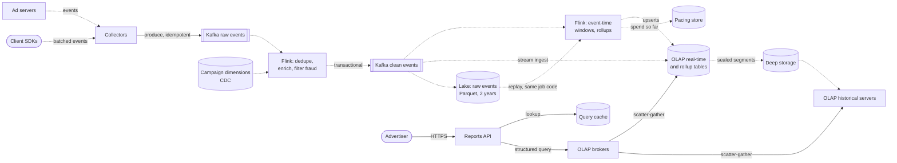

**Reading the diagram.** Dotted arrows are asynchronous data flow; solid arrows are synchronous requests. Collectors accept events and append them to the raw Kafka topic with idempotent producers. A first Flink job deduplicates by event ID, enriches events with campaign dimensions arriving by change data capture, applies fraud filters, and writes clean events transactionally. A second job computes event-time windowed rollups and writes idempotent upserts to the OLAP store and campaign spend to the pacing store; the OLAP store also ingests clean events directly, so recent raw events are queryable within seconds. Sealed segments move to deep storage (object storage) and are served by historical servers. The advertiser's query passes through the reports API, which checks a query cache and sends a structured query to OLAP brokers, which scatter it to real-time and historical servers and merge results. The lake keeps two years of raw events and can be replayed through the same aggregation code. Storage boundaries: both Kafka topics, the OLAP servers, deep storage, the pacing store and the lake. Failure points: Flink job failure (restart from checkpoint), OLAP real-time server loss (re-consume from Kafka offsets), broker overload (cache, limits). Scaling: Kafka partitions and Flink parallelism for ingestion; OLAP servers by advertiser hash and time for queries.

### 56.7.8 Detailed component design

#### Event time, watermarks and late data

The aggregation job assigns each event to a one-minute **tumbling window** by its event time (§29.8.2). A **watermark** (§29.8.3) declares "no events older than $T$ are still expected"; here it trails the largest event time seen by $\delta = 10$ s. When the watermark passes a window's end, the window fires its first result. Events that arrive later but within an **allowed lateness** of 120 s update the window and re-emit its full value; events later than that go to a **side output** of corrections that the daily close applies. This is the Dataflow model's separation of *what* is computed, *where* in event time, *when* in processing time results are emitted, and *how* refinements relate [Akidau et al. 2015].

```python
"""Event-time tumbling windows with a watermark, allowed lateness and deduplication.
Emits idempotent UPSERTs of the full window value, so replaying output is harmless."""
from collections import defaultdict

WINDOW, OUT_OF_ORDER, LATENESS = 60, 10, 120          # seconds

class WindowedCounter:
    def __init__(self):
        self.max_ts = float("-inf")
        self.state = defaultdict(lambda: [0, 0.0])     # (window_start, campaign) -> [clicks, spend]
        self.fired, self.seen_ids = set(), set()
        self.out, self.too_late = [], []

    def watermark(self):
        return self.max_ts - OUT_OF_ORDER               # "no event older than this is still expected"

    def on_event(self, event_id, ts, campaign, spend):
        if event_id in self.seen_ids:                   # producer retry or replay: drop the duplicate
            return
        start = ts - ts % WINDOW
        if start + WINDOW + LATENESS <= self.watermark():
            self.too_late.append(event_id)              # beyond allowed lateness: route to batch correction
            return
        self.seen_ids.add(event_id)
        key = (start, campaign)
        self.state[key][0] += 1
        self.state[key][1] += spend
        if key in self.fired:                           # late but allowed: re-emit the corrected full value
            self.out.append(("UPSERT", key, tuple(self.state[key]), "late-update"))
        self.max_ts = max(self.max_ts, ts)
        self._fire()

    def _fire(self):
        for key in sorted(self.state):
            if key not in self.fired and key[0] + WINDOW <= self.watermark():
                self.fired.add(key)                     # watermark passed window end: emit first result
                self.out.append(("UPSERT", key, tuple(self.state[key]), "on-time"))

if __name__ == "__main__":
    w = WindowedCounter()
    events = [("e1", 5, "c1", 0.5), ("e2", 50, "c1", 0.5), ("e3", 61, "c1", 0.5),
              ("e2", 50, "c1", 0.5),                   # duplicate delivery
              ("e4", 75, "c1", 0.5),                   # watermark 65 -> window [0,60) fires
              ("e5", 58, "c1", 0.5),                   # late but within lateness: correction
              ("e6", 200, "c1", 0.5),                  # watermark 190 -> window [60,120) fires
              ("e7", 30, "c1", 0.5)]                   # 30 falls in [0,60); 0+60+120 <= 190 -> too late
    for e in events:
        w.on_event(*e)
    for row in w.out:
        print(row)
    print("too late:", w.too_late)
```

Output:

```text
('UPSERT', (0, 'c1'), (2, 1.0), 'on-time')
('UPSERT', (0, 'c1'), (3, 1.5), 'late-update')
('UPSERT', (60, 'c1'), (2, 1.0), 'on-time')
too late: ['e7']
```

What to notice:

- The duplicate `e2` is dropped by event ID, so a producer retry cannot double-charge. In production the seen-ID set is keyed state with a TTL a little longer than window plus lateness, held in the stream processor's state backend and included in its checkpoints.
- Window [0, 60) fires when `e4` moves the watermark to 65, then is *corrected* when late `e5` arrives; because each output is the full value, the sink overwrites rather than adds, and a replay of the output converges to the same table.
- `e7` arrives after the watermark has passed the window end plus lateness, so it is not silently dropped but routed to corrections.
- A real job also purges state for windows past their lateness and emits early, speculative results for open windows if live panels need them.

Choosing $\delta$ and the lateness is a measured decision: plot the distribution of (arrival time − event time) per source. Server-side events are late by seconds; mobile SDK events can be late by hours. Mixing them in one watermark would make the server events wait for the phones, so the job keeps separate watermarks per source class, or treats mobile backfill as corrections.

#### Exactly-once aggregation

"Exactly once" here means the *effect* on the aggregates is as if each event were counted once, despite retries, crashes and replays (§32.9). The design composes three mechanisms, each covering a different hop:

1. **Producer to Kafka**: idempotent producers (§31.6.3) prevent duplicates from broker-level retries; client-level retries (an SDK resending a batch after a timeout) produce genuine duplicates with the same event ID, which only step 2 can remove.
2. **Inside the stream processor**: deduplication by event ID in keyed state, and Flink's checkpointing with asynchronous barrier snapshots (§29.9.2) makes state and input offsets consistent, so after a crash the job rewinds to the last checkpoint and reprocesses without double counting in its state.
3. **To the outside world**: output must not be duplicated on replay. Two options exist. **Transactional sinks** write to Kafka in transactions committed on checkpoint completion (two-phase commit, §31.11.2), with the freshness cost computed in §56.7.4. **Idempotent sinks** write full window values keyed by (window, dimensions) as upserts, so any number of replays converges; this is the design used for the OLAP rollup table, and it needs no transaction coordination with the OLAP store.

The OLAP store's own Kafka ingestion must also neither skip nor duplicate: Druid and Pinot both record, with each segment they publish, the Kafka offsets it covers, so a restarted ingestion task resumes exactly where the last published segment ended [Apache Druid Docs; Im et al. 2018].

#### Pre-aggregation versus an OLAP store

**Table 56.23 — Where to aggregate.**

| | Stream pre-aggregation into a key-value store | OLAP store over raw events | Hybrid (chosen) |
|---|---|---|---|
| What it is | Stream job computes fixed rollups; serve by key | Ingest events; aggregate at query time with columnar scans | Stream rollups for known grains, OLAP for raw and ad hoc |
| Query flexibility | Only the precomputed group-bys | Any filter and group-by | Precomputed fast path; flexible slow path |
| Query latency | ~1 ms lookups | 10–500 ms, depending on rows scanned | Mostly tens of ms |
| Storage | Smallest | Largest (raw) | Raw only for 7 days |
| Freshness | Window plus commit | Seconds (real-time ingestion) | Seconds for raw, ~1 min final rollups |
| Corrections | Recompute affected keys | Replace segments for the interval | Upserts plus segment replacement |
| Choose when | Fixed counters (pacing) | Exploration and drill-down | Customer reporting at scale |

The OLAP stores in this space (Druid, Pinot, ClickHouse) share a design shaped by this workload: immutable, time-partitioned **columnar segments**; dictionary encoding and bitmap or inverted indexes on dimensions so filters are cheap; optional **ingestion-time rollup**; and a split between real-time servers that index recent events in memory and historical servers that load sealed segments from deep storage [Yang et al. 2014; Im et al. 2018; ClickHouse Docs].

::: industry
**Druid: real-time and historical nodes over immutable segments.** The Druid paper describes an analytical store built for interactive queries on event streams: real-time nodes ingest from a message broker and make events queryable immediately, periodically hand off immutable columnar segments to deep storage, historical nodes load and serve those segments, broker nodes route queries and merge partial results, and coordinator nodes manage segment placement. The segment is the unit of distribution, replication and replacement, which is what makes batch corrections a matter of swapping segments for a time interval.
*Evidence: Primary* — [Yang et al. 2014]
:::

::: industry
**Pinot at LinkedIn: user-facing analytics.** The Pinot paper describes LinkedIn's real-time OLAP system serving analytics features to members (not only internal analysts), with a hybrid of real-time segments consumed from Kafka and offline segments built from batch data, and a pre-aggregation index (the star-tree) that trades storage for bounded query cost on group-by queries.
*Evidence: Primary* — [Im et al. 2018]
:::

#### Serving sub-second queries

Query latency is controlled by the number of rows each query touches and the number of servers it waits for:

1. **Rollup selection.** The reports API picks the coarsest table that answers the query: hour grain for a 30-day chart, minute grain for the last 6 hours, raw only for drill-down into the last few days (40× fewer rows, §56.7.4).
2. **Partition-aware routing.** Segments are partitioned by hash of `advertiser_id`, and every query filters on it, so the broker sends the query only to the servers holding that advertiser's partition instead of scattering to all of them, which shrinks fan-out and its tail (§16.7.3).
3. **Segment pruning and indexes.** Time ranges prune segments; sorted advertiser columns and bitmap indexes turn filters into range reads and bitmap intersections.
4. **Caching.** Results for intervals that are final (before `final_until`) never change and can be cached for hours; only the live edge is recomputed, so a dashboard refreshing every 30 seconds mostly hits the cache.
5. **Isolation.** Per-advertiser query rate limits and a cap on rows scanned protect the cluster from one expensive customer (§47.8).

#### Lambda or Kappa

**Figure 56.13 — Lambda versus Kappa for this platform.**

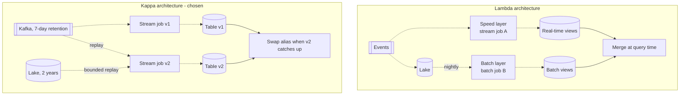

**Reading the diagram.** In the **Lambda** subgraph two different jobs compute the same metrics: a streaming speed layer for recent data and a batch layer that periodically recomputes from the lake; queries merge both views [Marz and Warren 2015]. Its cost is two implementations of the same logic that must agree. In the **Kappa** subgraph there is one job; to change logic or fix a bug, a second version replays history from Kafka (or from the lake as a bounded source through the same code) into a new table, and the serving alias is swapped when it catches up [Kreps 2014]. All arrows except the query merge and alias swap are asynchronous. Storage boundaries: Kafka, the lake and the output tables. Failure points: in Lambda, divergence between the two code paths; in Kappa, replay throughput and the retention window. Scaling: replay parallelism equals Kafka partitions or lake files.

The platform uses Kappa, because one code path is easier to keep correct for billing, Flink runs the same program over bounded and unbounded inputs, and seven days of Kafka retention plus the lake cover replays. The daily billing close is not a second implementation: it is the same aggregation run as a bounded job over the closed day, with the corrections side output applied, writing replacement segments for that day.

### 56.7.9 Data flow

**Figure 56.14 — Write path: a click from event to rollup.**

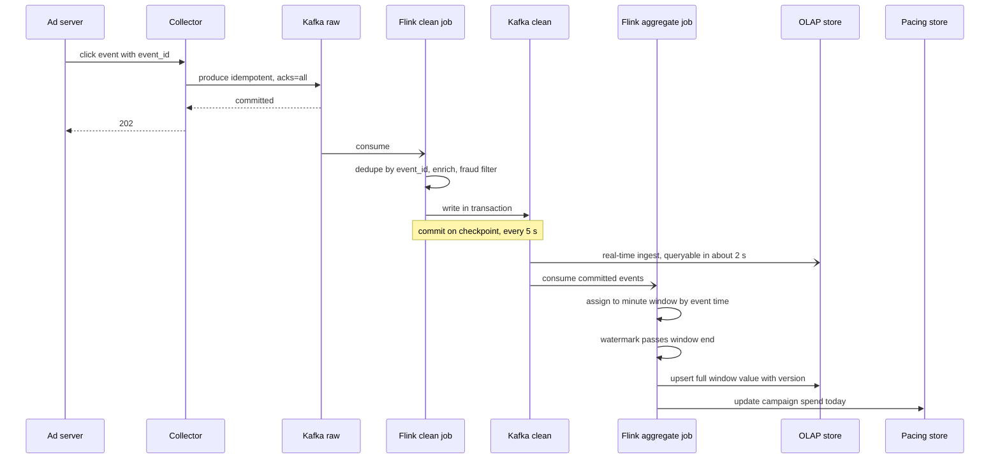

**Reading the diagram.** The collector acknowledges only after Kafka has durably replicated the event, the point at which the event cannot be lost. The clean job consumes asynchronously, deduplicates and enriches, and writes to the clean topic inside a transaction that commits with each checkpoint; downstream consumers read only committed data. Two consumers then act in parallel: the OLAP store ingests clean events for live raw queries, and the aggregation job windows them by event time, emitting full-value upserts when the watermark passes each window's end (and re-emitting for allowed late events), plus spend updates to the pacing store. Failure points: collector crash before acknowledgment (client retries; duplicate removed by event ID), clean-job crash (restart from checkpoint; uncommitted transaction aborted), OLAP ingestion restart (resumes from offsets stored with its last segment). Scaling: partitions of both topics bound the parallelism of both jobs.

**Figure 56.15 — Read path: a dashboard panel.**

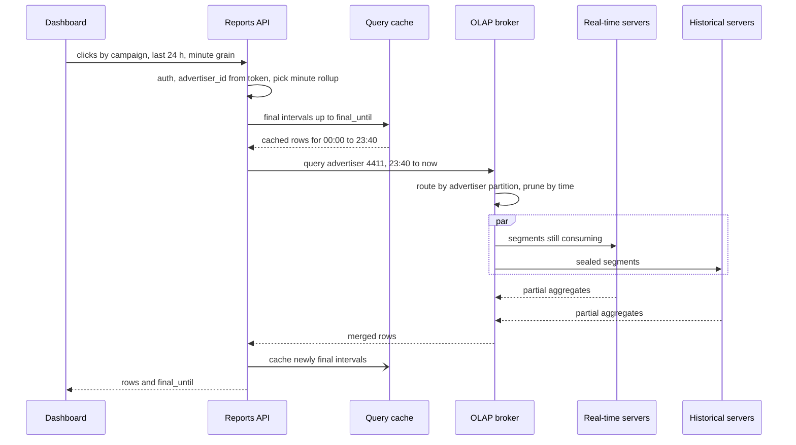

**Reading the diagram.** All calls are synchronous except the cache fill. The API derives the tenant from the token (never from the request body), chooses the rollup table, and splits the interval at `final_until`: final intervals come from the cache, and only the live edge goes to the broker. The broker routes by advertiser partition so only a few servers are involved, prunes segments by time, and merges partial aggregates from real-time and historical servers. Failure points: a slow server (replica selection, timeouts), cache miss storms after a deploy (warm the cache, coalesce identical queries), and a real-time server restart (its replica answers while it re-consumes). Scaling: add replicas of hot advertiser partitions and historical servers for longer retention.

### 56.7.10 Bottlenecks

1. **Hot keys in aggregation.** A single huge advertiser or a viral campaign concentrates events on one key; pre-aggregate locally before the keyed shuffle (two-phase aggregation) or salt the key (§29.6.3).
2. **State size and checkpoint duration.** Deduplication state for 2 million events/s over a few minutes of lateness is large; incremental checkpoints and a RocksDB-style state backend keep checkpoint time well inside the 5 s interval (§29.9.1).
3. **Real-time segment memory.** Consuming segments are held in memory until sealed; seal by size or time to bound memory.
4. **Late mobile backfill.** Hours-late events cannot all be held open in the stream; they flow to corrections and the daily close.
5. **Dashboard refresh storms.** Thousands of panels refreshing in sync; jitter refresh timers and cache final intervals.

### 56.7.11 Failure scenarios

**Table 56.24 — Real-time analytics failure scenarios.**

| What fails | Impact | Detection | Recovery | Prevention |
|---|---|---|---|---|
| Flink job crash | Live numbers pause | Checkpoint age; consumer lag | Restart from last checkpoint; replay since then | Regular savepoints; resource headroom |
| Watermark stalls (one idle or stuck partition) | No windows fire; dashboards freeze | `final_until` stops advancing | Mark idle sources; restart stuck consumer | Idle-source detection; per-partition lag alerts |
| Bug in aggregation logic | Wrong numbers in reports | Reconciliation against independent daily counts | Fix, replay into new table, swap alias (Kappa) | Shadow runs of new job versions; reconciliation checks |
| Duplicate events from SDK retries | Overcount and overbilling | Duplicate-ID rate metric | Dedupe in clean job; recompute affected day | Event IDs generated at source; idempotent ingestion |
| OLAP real-time server lost | Recent data missing on that replica | Server health; segment availability | Replica serves; replacement re-consumes from offsets | Two replicas of consuming segments |
| Clock skew on devices | Events land in wrong windows | Event-time minus arrival-time distribution | Clamp implausible timestamps; correct at close | Server-side receive time recorded alongside client time |
| Expensive customer query | Latency for others | Per-tenant query time and rows scanned | Throttle tenant | Rows-scanned caps, rate limits, rollup routing |

### 56.7.12 Scaling strategy

**At 10× events** (20 million/s): Kafka partitions, Flink parallelism and OLAP real-time servers scale out; the deduplication state grows tenfold, which favors deduplicating closer to the source (collectors keyed by event ID) and shorter lateness for server-side sources. Rollup storage grows with distinct dimension combinations rather than events, so it grows less than 10× if the advertiser base is stable.

**At 10× queries**: more replicas of hot partitions, a larger cache of final intervals, and materialized per-dashboard rollups for the most common panels.

**At 100×**: split into regional pipelines that aggregate locally and ship rollups (not raw events) to a global store for cross-region reports, so that cross-region bandwidth scales with the rollup rate instead of the event rate; move long-range history to open columnar tables in the lake queried by a separate engine, keeping the OLAP store for the last months.

### 56.7.13 Trade-offs

**Table 56.25 — Real-time analytics trade-offs.**

| Decision | Chosen | Alternative | Why |
|---|---|---|---|
| Time semantics | Event time with watermarks | Processing time | Reports must reflect when things happened; replays must give the same answer |
| Lateness | 10 s watermark, 120 s lateness, corrections after | Wait longer before firing | Freshness for 99% of events; correctness preserved by the close |
| Exactly-once output | Idempotent full-value upserts to OLAP; transactions inside Kafka | Transactions everywhere | Avoids coordinating transactions with the OLAP store |
| Aggregation location | Hybrid: stream rollups and OLAP raw | Only one | Fast common queries and flexible drill-down |
| Architecture | Kappa with lake replay | Lambda | One code path for billing logic |
| Checkpoint interval | 5 s | 30–60 s | Fits freshness budget; costs more checkpoint I/O |

### 56.7.14 Alternative designs

- **Lambda with a batch system of record.** Sound when trusted batch logic already exists; the cost is two implementations and periodic disagreements to explain.
- **Pure OLAP.** Ingest deduplicated events with ingestion-time rollup and aggregate only at query time: simpler, adequate at modest query load, costlier at thousands of queries per second over months.
- **Warehouse micro-batches.** Minutes of freshness and seconds of query latency with very little to operate; fine for internal analytics, not live customer dashboards.
- **Approximate distinct counts.** HyperLogLog sketches in rollups (§17.5) make unique-user counts mergeable across minutes and dimensions at about 1–2% error.

### 56.7.15 Interview discussion

**Table 56.26 — 45-minute pacing plan for the real-time analytics platform.**

| Minutes | Focus | What to produce |
|---|---|---|
| 0–5 | Scope | Advertiser dashboards, pacing, billing close; freshness and correctness targets |
| 5–10 | Estimates | 2M events/s, 86 TB/day, rollup ratio 30, 7.7k queries/s |
| 10–18 | Architecture | Figure 56.12: Kafka, clean job, aggregate job, OLAP, lake |
| 18–30 | Deep dive: correctness | Event time, watermarks, lateness, dedupe, exactly-once per hop |
| 30–38 | Deep dive: serving | Rollup selection, partition routing, caching final intervals |
| 38–45 | Wrap-up | Lambda versus Kappa, failures, 10× scaling |

**Likely follow-ups.**

- *"What if an event arrives an hour late?"* It is beyond allowed lateness, goes to the corrections side output, and is applied by the daily close; the API's `final_until` tells users which numbers are final.
- *"How do you guarantee a click is billed once?"* Event IDs at the source, deduplication in keyed state, checkpointed state and offsets, and idempotent full-value upserts; reconciliation at close.
- *"Why not just put everything in Druid or ClickHouse?"* You can at modest scale; stream rollups cut query cost and give exactly-once billing logic in one place.
- *"Lambda or Kappa?"* Kappa, because one code path for money is easier to keep correct; replay from Kafka or the lake covers fixes.

**What distinguishes senior and staff answers.** A senior answer uses event time, watermarks and an OLAP store correctly. A staff answer derives the checkpoint interval from the freshness budget, decomposes exactly-once into per-hop mechanisms and chooses idempotent sinks where transactions would couple systems, separates provisional from final numbers in the API, and plans replay and reconciliation as everyday operations rather than emergencies.

### 56.7.16 Production considerations

- **Observability.** Event-time lag (now minus watermark) per job and per source; checkpoint duration and age; duplicate and late-event rates; corrections volume; OLAP ingestion lag; query latency per tenant; daily reconciliation differences between independent counts.
- **Security.** Tenant isolation from the authenticated token in the API and enforced again as a mandatory filter in the query layer; no raw SQL for external users; audit logs of report access; personal data minimized in events (no raw user identifiers in the analytics store, §50.10).
- **Cost.** Kafka retention for replay, raw-event OLAP storage and query fan-out dominate; keep raw events queryable only for days, route queries to coarse rollups, and cache final intervals.
- **Operations.** Treat job upgrades as data migrations: run the new version in shadow, compare outputs, then swap. Rehearse a full replay of a day from the lake. Keep the billing close reproducible: same code, same inputs, same output.

## 56.8 Summary and revision notes

::: summary
- **Data platforms serve derived data.** Judge them by freshness, completeness and cost of the derived data as much as by request latency; trace each datum from source to user and budget every hop.
- **Search engine:** three pipelines (crawl, index, serve). Shard by document; serving cores $\approx \lambda(1-h)\,S\,c/U$, so cost scales with query rate × corpus size. A root–mixer–leaf tree with deadlines, hedged requests, partial results and canary requests tames the $0.99^{S}$ fan-out tail. Rank in stages (BM25 and static quality on leaves, learned ranking at the root, Chapter 81). Freshness comes from tiers (real-time, daily, base) plus a removal overlay; quality tiering cuts work per query.
- **Recommendation system:** a funnel (2,000 → 1,500 → 400 → 20) inside a 200 ms budget; parallel candidate sources with deadlines, merged by quota because scores are incomparable; item features replicated in ranker memory because per-candidate remote lookups are infeasible; hybrid precomputation with fallbacks; impressions logged with features as served and joined to delayed labels.
- **Logging and monitoring:** agents with disk buffers, distributors enforcing tenant quotas, Kafka sized by $B = (r/\rho)\,T_{\text{ret}}\,f$ with drain time $T_{\text{out}}\,r/(c-r)$. Default to columnar or label-indexed storage with skip indexes; full-text indexing costs about 5× the hot storage. Metrics cost is cardinality; enforce series limits. Alerting runs on a separate path with an external dead-man's switch.
- **Real-time analytics:** event-time windows, watermarks and allowed lateness with corrections; exactly-once decomposed per hop (idempotent producers, checkpointed dedupe state, idempotent full-value upserts); checkpoint interval chosen from the freshness budget; multiple rollup grains, partition-aware routing and caching of final intervals for sub-second queries; Kappa with replay from Kafka or the lake.
:::

## 56.9 Knowledge checkpoint

1. Why does the search serving fleet's size grow with query rate times corpus size, regardless of the shard count?
2. With 300 independent shards each meeting 40 ms at p99, what fraction of queries see all shards under 40 ms?
3. What problem does a removal overlay solve that a faster index build does not?
4. Why are doc IDs assigned in static-quality order within a shard?
5. Why can a recommendation orchestrator not merge candidate lists by score?
6. Why are item features cached in ranker memory but user features fetched remotely?
7. What is logged with each impression to prevent training–serving skew?
8. Why must an impression become a negative example only after the label window closes?
9. Kafka retains 24 h; ingesters run at 1.25× the average rate. How long are logs stale after a 6-hour storage outage?
10. Why are log-based alerts computed in the stream rather than by querying the log store?
11. What does a cardinality limit reject, and what does it keep accepting?
12. Why does a 30 s checkpoint interval break a 10 s freshness target for transactional output?
13. Why does the analytics job emit full window values rather than increments?
14. What does `final_until` tell a dashboard?
15. What is the main operational argument for Kappa over Lambda for billing data?

<details><summary>Answers</summary>

1. $S \times c$ is the CPU to search the whole corpus once; more shards make each shard's work smaller but not the total. Sharding sets latency; replicas set throughput.
2. $0.99^{300} = 4.9\%$.
3. Legal removals must take effect within an hour; the overlay is applied at serve time to every tier and cache, independent of build schedules.
4. Postings are walked best-first, so leaves can terminate early or on deadline and still return good candidates.
5. Scores from different sources have different scales and meanings; take quotas per source and let the ranker put candidates on one scale.
6. Item features are shared, change slowly and are needed for ~1,500 candidates per request ($1.56 \times 10^8$ lookups/s if remote); user features are one row per request.
7. The exact feature vector, model version, experiment arms, position, candidate source and request ID.
8. Positive labels can arrive late; labeling early records slow positives as negatives.
9. $6 / (1.25 - 1) = 24$ hours of catch-up; no loss, because backlog age stays under 24 h.
10. To keep alerting independent of the log store's availability and query latency, and to make it cheap and continuous.
11. It rejects new series beyond the tenant's limit; samples for existing series continue, so dashboards stay correct.
12. Read-committed consumers see output only after the transaction commits at the checkpoint, adding up to 30 s.
13. Full values make sinks idempotent: replays and late corrections overwrite and converge instead of double-counting.
14. Windows before it are final; later ones may still change as late events arrive.
15. One implementation of the money logic; fixes are replays of the same code, not reconciling two code paths.
</details>

## 56.10 Interview questions

### Basic

**Q1. In a web search engine, why are index servers separated from document servers?**

**Answer.** Every query touches postings on every index shard, but needs text only for the ten winning documents. Separating them lets the index (36 TB in §56.4.4) stay in memory on many replicated leaves while the much larger document store (120 TB) is read for ten documents per query on a smaller fleet. It also lets the two scale independently.

**Q2. What is the purpose of Kafka in a logging pipeline?**

**Answer.** It is a durable buffer between producers and storage: it absorbs incident bursts and storage outages without blocking applications or losing data, and lets several consumers (storage, stream-derived metrics, security) read the same data. Its retention must exceed the longest outage you want to survive, and ingesters need headroom to drain the backlog.

### Intermediate

**Q3. Allocate a 200 ms latency budget for a recommender and explain what happens when a stage misses its deadline.**

**Answer.** For example: context and user features 10 ms, candidate sources 40 ms in parallel, filtering 10, feature assembly 25, light ranker 10, heavy ranker 50, re-ranking 10, response 5, slack 40. Each stage gets a deadline from the remaining budget. A late candidate source is dropped from the merge; a feature-store timeout yields default features flagged in the log; an overloaded heavy ranker scores fewer candidates or the light ranker's order is used; total failure serves a precomputed list. The response sets `degraded`, and each fallback is counted.

**Q4. Compare an inverted-index log store with a label-indexed chunk store for a 70 TB/day platform.**

**Answer.** The inverted index makes any field or token search fast but roughly quintuples hot storage and dominates ingest CPU. The label store ingests cheaply into object storage and answers "this service, this time, grep" in about a second, but needle queries without label selectivity scan hundreds of terabytes. A columnar store with Bloom-filter skip indexes sits between them and is best for aggregations. A good design defaults to the cheap store, adds skip indexes for trace IDs and tokens, and offers full-text indexing only to tenants who need it.

### Advanced

**Q5. Design exactly-once campaign spend aggregation from mobile and server events.**

**Answer.** Generate event IDs at the source. Use idempotent producers to Kafka. In Flink, deduplicate by event ID in keyed state with a TTL longer than window plus lateness; assign events to event-time windows with a watermark per source class; checkpoint state and offsets together. Write rollups as full-value upserts keyed by window and dimensions (idempotent), and write cross-job topics transactionally with a checkpoint interval chosen from the freshness budget. Route events later than allowed lateness to a corrections output applied by a bounded daily close using the same code. Reconcile daily totals against an independent count before invoicing.

**Q6. Your search engine must handle 10× query volume next year. What do you change first?**

**Answer.** Reduce work per query before adding replicas: quality tiering (most queries search a small top tier, about a 63% CPU reduction at an 80% stop rate), larger results caches, cached postings intersections, and more aggressive early termination. Then add replicas per region with N+1 regional headroom, revisit index distribution bandwidth (more replicas means more copies per build), and add a tree level if the root's fan-in grows. Measure relevance with each change, since tiering and early termination trade recall for cost.

## 56.11 Practical exercises

1. **Fleet calculator.** Write a Python function that, given corpus size, postings per document, shard memory, per-shard CPU per query, query rate, cache hit ratio and region count, returns shard count, replicas per region and leaf servers. Reproduce §56.4.4, then compute the effect of quality tiering.
2. **Funnel simulator.** Simulate a recommendation request with four candidate sources whose latencies are log-normal, a 35 ms deadline, and the merge function of §56.5.8. Report the distribution of candidates per request and the fraction of requests missing each source.
3. **Cardinality audit.** Take a Prometheus `/metrics` page from any service you run, count series per metric, and compute how the total would change if a label with 10,000 values were added to the largest metric.
4. **Watermark tuning.** Extend the window code of §56.7.8 with per-source watermarks. Generate server events delayed by 0–2 s and mobile events delayed by a long-tailed distribution, and plot freshness against the fraction of events routed to corrections for several $\delta$ values.

## 56.12 Design challenges

1. **Code search.** Adapt §56.4 to searching 100 million source repositories with regular-expression queries. What replaces the word-level inverted index, how does freshness work on every push, and how does the serving tree change?
2. **Notifications as recommendations.** Redesign §56.5 for push notifications: one decision per user per hour, strict frequency caps, and no request from the user. Which stages become batch, and how is logging joined to delayed opens?
3. **Security analytics.** Combine §56.6 and §56.7 into a platform that detects suspicious login patterns within 30 seconds across 1 PB of logs per day, while keeping a year of searchable history for investigations. Which data is indexed, which is aggregated, and where do the detection rules run?

## 56.13 References

1. Brin, S., Page, L. *The Anatomy of a Large-Scale Hypertextual Web Search Engine*. Computer Networks and ISDN Systems 30(1–7), 1998.
2. Barroso, L. A., Dean, J., Hölzle, U. *Web Search for a Planet: The Google Cluster Architecture*. IEEE Micro 23(2), 2003.
3. Dean, J., Barroso, L. A. *The Tail at Scale*. Communications of the ACM 56(2), 2013.
4. Dean, J. *Challenges in Building Large-Scale Information Retrieval Systems*. Keynote, ACM WSDM, 2009.
5. Peng, D., Dabek, F. *Large-scale Incremental Processing Using Distributed Transactions and Notifications*. USENIX OSDI, 2010.
6. Busch, M., Gade, K., Larson, B., Lok, P., Luckenbill, S., Lin, J. *Earlybird: Real-Time Search at Twitter*. IEEE ICDE, 2012.
7. Covington, P., Adams, J., Sargin, E. *Deep Neural Networks for YouTube Recommendations*. ACM RecSys, 2016.
8. Eksombatchai, C., Jindal, P., Liu, J. Z., Liu, Y., Sharma, R., Sugnet, C., Ulrich, M., Leskovec, J. *Pixie: A System for Recommending 3+ Billion Items to 200+ Million Users in Real-Time*. The Web Conference (WWW), 2018.
9. Pelkonen, T., Franklin, S., Teller, J., Cavallaro, P., Huang, Q., Meza, J., Veeraraghavan, K. *Gorilla: A Fast, Scalable, In-Memory Time Series Database*. PVLDB 8(12), 2015.
10. Grafana Labs. *Grafana Loki documentation* (architecture, labels and cardinality). https://grafana.com/docs/loki/latest/
11. ClickHouse. *ClickHouse documentation* (MergeTree, sparse primary index, data-skipping indexes, TTL, ReplacingMergeTree). https://clickhouse.com/docs
12. Yang, F., Tschetter, E., Léauté, X., Ray, N., Merlino, G., Ganguli, D. *Druid: A Real-time Analytical Data Store*. ACM SIGMOD, 2014.
13. Im, J.-F., Gopalakrishna, K., Subramaniam, S., Shrivastava, M., Tumbde, A., Jiang, X., Dai, J., Lee, S., Pawar, N., Li, J., Aringunram, R. *Pinot: Realtime OLAP for 530 Million Users*. ACM SIGMOD, 2018.
14. Apache Druid. *Apache Druid documentation: Apache Kafka ingestion*. https://druid.apache.org/docs/latest/
15. Akidau, T., et al. *The Dataflow Model: A Practical Approach to Balancing Correctness, Latency, and Cost in Massive-Scale, Unbounded, Out-of-Order Data Processing*. PVLDB 8(12), 2015.
16. Kreps, J. *Questioning the Lambda Architecture*. O'Reilly Radar, 2014. https://www.oreilly.com/radar/questioning-the-lambda-architecture/
17. Marz, N., Warren, J. *Big Data: Principles and Best Practices of Scalable Realtime Data Systems*. Manning, 2015.

## 56.14 Open verification items

- Percolator: confirm the "about 50%" reduction in document age and the paper's wording on resource cost relative to the MapReduce pipeline.
- Druid and Pinot: confirm current documentation on offsets recorded with segment metadata (exactly-once Kafka ingestion); confirm star-tree and member-facing use cases as described in Im et al. 2018.
- Pixie: confirm that the paper describes the full pruned graph held in memory on each serving machine.
- ClickHouse DDL (tokenbf_v1 parameters, `TTL … TO VOLUME` with a `DateTime64` column via `toDateTime`, `Map(LowCardinality(String), String)`, default granule 8,192 rows): test on a current release.
- Illustrative ratios to replace with measurements: 3 bytes per posting, 4 KB of ingester memory per series, 1 GB/s per core scan rate, full-text index at 0.5× raw, 10:1 log compression.
