# Chapter 57 — Machine Learning Fundamentals for System Designers

> **Level:** 2 · **Track:** B (ML/AI) · **Estimated reading time:** 5 h

Book I treated software as instructions that people write. This chapter starts Book II with a different kind of component: one whose behavior is *learned from data*. A fraud check, a delivery-time estimate or a restaurant ranking can each be a few hundred lines of rules or a trained model. The model often wins, but it brings new failure modes. It can be confidently wrong, quietly degrade, leak the answer into its own inputs, or look excellent offline and lose money in production.

You do not need to become a researcher to design systems that contain models. You do need the vocabulary, the arithmetic of the main metrics, and a feel for what training and inference cost, because those decide your data pipelines, storage, latency budgets and launch process. This chapter assumes no prior machine learning (ML) knowledge. It builds on the probability, statistics, percentiles and vectors of Chapter 4 and cross-references them instead of repeating them.

**Running example — QuickBite's ML problems.** QuickBite is the hypothetical food-delivery platform from Chapter 2. Its numbers carry over: 2 million daily active users, 500,000 orders per day, 50,000 restaurants (§2.11). Book II adds these assumptions, used consistently in later chapters:

- **Fraud detection:** 0.5% of orders are fraudulent. The chargeback that confirms fraud arrives weeks after the order.
- **Delivery-time (ETA) prediction:** median order-to-door time is 35 minutes. An ETA appears next to every restaurant in search and on every order.
- **Recommendations:** the home feed ranks restaurants for each user.
- **Demand forecasting:** orders per city zone per 15 minutes, used to position couriers.
- **Support chatbot:** answers "where is my order?" and refund questions.

None of these numbers describes a real company.

## 57.1 Learning objectives

After this chapter you should be able to:

- Decide, with a checklist, whether a problem should be solved with rules or with a learned model.
- Classify a problem as supervised, unsupervised, self-supervised or reinforcement learning, and name a QuickBite example of each.
- Contrast the cost profile and system requirements of training and inference.
- Identify feature types and label sources, and spot label leakage in a feature list.
- Choose between random, time-based and group splits, and explain why production data usually needs time-based splits.
- Diagnose overfitting and underfitting from training and validation error, and use regularization to control variance.
- Explain loss functions and gradient descent well enough to implement logistic regression from scratch.
- Compute accuracy, precision, recall, F1, ROC-AUC, PR-AUC, log loss and Brier score by hand, and choose the right one for an imbalanced problem.
- Compute MAE, RMSE, MAPE and pinball loss, and NDCG, MAP, MRR, precision@k and recall@k.
- Size an A/B test with the sample-size formula, interpret its p-value and confidence interval, and avoid peeking and multiple-comparison errors.

## 57.2 Prerequisites

- Probability, expected value and the binomial distribution — §4.6 (every metric is a probability or an expectation).
- Mean, variance, standard deviation and the normal distribution — §4.7 (error metrics and test statistics).
- Percentiles — §4.8 (ETA promises are percentile promises).
- Vectors, dot products and matrices — §4.9 (a linear model is a dot product).
- Standard error of a mean — §4.18.4 (the root of every A/B test calculation).
- Canary and progressive delivery — §43.6 (how a model reaches production traffic). Helpful, not required.

## 57.3 What machine learning is

### 57.3.1 Learning a function from data

::: definition
**Definition — Machine learning.** A way of building a function $f$ that maps inputs $x$ to outputs $\hat{y}$ by choosing $f$ from a family of candidate functions so that it performs well on example data, instead of writing $f$ by hand. The chosen $f$ is the **model**; its adjustable numbers are **parameters** (or **weights**); choosing them is **training**; running the trained model on new inputs is **inference**.
:::

#### First-principles explanation

Think of a new dispatcher at QuickBite who must guess how long each order will take. Nobody gives them a formula. They watch thousands of deliveries and absorb patterns: long distances take longer, Friday 7 p.m. is slow, the noodle shop on Main Street is always late. After a month they guess well, even for restaurants they have never seen, because they have generalized from examples.

ML automates this. You collect examples of inputs (distance, time of day, restaurant, weather) paired with the right answer (the actual delivery time). You choose a family of functions, for example "a weighted sum of the inputs". An algorithm then searches that family for the member whose answers on the examples are closest to the truth. The point is not to memorize the examples. The point is to do well on *future* inputs, which is called **generalization**.

#### Why does this exist?

Some functions are easy to describe but impossible to write down. You can say what fraud is ("someone pays with a card that is not theirs"), but no engineer can list the thousands of interacting signals that reveal it. Fraudsters also adapt, so a hand-written rule set decays every month. When the mapping from input to output is complex, changes over time and is demonstrated by plenty of examples, learning it is cheaper and more accurate than writing it.

#### How it works internally

1. **Frame the problem.** Decide what $\hat{y}$ is (a number of minutes, a fraud probability, a ranked list) and which business decision it drives.
2. **Collect examples.** Each example is a row of **features** (inputs) and, for most problems, a **label** (the correct output) (§57.6).
3. **Choose a model family.** Linear models, decision-tree ensembles and neural networks are the common families (Chapter 58 covers neural networks).
4. **Train.** Minimize a **loss function** that measures how wrong the model is on the training examples (§57.9).
5. **Evaluate** on examples the model never saw (§57.7) with metrics that match the business goal (§57.10–§57.12).
6. **Deploy and serve** predictions under latency and cost limits (§57.5, Chapter 66).
7. **Monitor and retrain**, because the world drifts away from the training data (Chapter 70).

**Figure 57.1 — The ML workflow.**

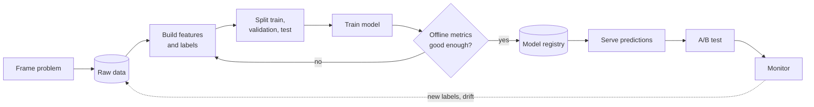

**Reading the diagram.** Rectangles are steps, cylinders are storage boundaries and the diamond is the gate between experimentation and production. Solid arrows are the synchronous flow of one iteration: data becomes features and labels, is split, trains a model and is evaluated offline. A failed gate loops back to feature work, which is where most iteration time goes. A passing model is stored in a **model registry** (Chapter 69), served (Chapter 66) and tested online (§57.14). The dotted arrow is asynchronous: production logs and late-arriving labels flow back into the raw data, closing the loop. Failure points are the arrow from raw data to features (bugs and leakage, §57.6) and the gap between offline and online evaluation (§57.13). Each step scales independently: feature building with data-processing engines (Chapter 61), training with accelerators (Chapter 65), serving with replicas (Chapter 66).

### 57.3.2 Rules versus learned models

A **rule-based system** encodes human knowledge as explicit conditions: "flag the order if the card was added less than 10 minutes ago and the basket exceeds \$150." A **learned model** encodes knowledge as parameters estimated from data. Both are functions from inputs to outputs. They differ in who writes the logic and how it changes.

**Figure 57.2 — Rules versus learned models.**

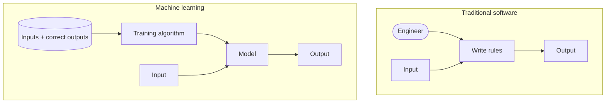

**Reading the diagram.** In the upper boundary, an engineer writes the rules and inputs flow through them synchronously to outputs. In the lower boundary, the *examples* (a storage boundary) and a training algorithm produce the model, which then maps new inputs to outputs exactly like the rule block does. To callers both are a function call; rules change when code is edited, a model when it is retrained on new data. The model's failure point is the data: stale, biased or leaky examples produce a confidently wrong function. Scaling the rule system means more engineers maintaining more rules; scaling the learned system means more data and compute.

### 57.3.3 When ML is and is not the right tool

::: concept
**Concept — Start without ML.** A model is a liability as well as an asset: it needs a data pipeline, labels, monitoring and retraining. Choose it when its accuracy gain pays for that operating cost, not because the problem sounds intelligent.
:::

**Table 57.1 — Decision checklist: rules or a learned model?**

| Question | Points toward rules | Points toward ML |
|---|---|---|
| Can an expert write the logic in under ~50 conditions? | Yes | No: many weak, interacting signals |
| Does the right answer change monthly (adversaries, tastes)? | Stable | Drifts; retraining is cheaper than rewriting |
| Do you have labeled examples, or can you get them? | Few or none | Thousands to millions |
| Is an occasional wrong answer acceptable? | No: must be exact (tax, billing) | Yes, and errors can be measured and bounded |
| Must every decision be explained precisely? | Regulatory requirement | Approximate explanations suffice (§71.7) |
| Does a small accuracy gain matter at your scale? | Low volume | 1% of 500,000 orders/day is 5,000 decisions |
| Can you monitor quality after launch? | No labels ever arrive | Labels or proxies arrive (§57.6) |

Use the checklist from the top. If the logic is short, stable and must be exact, write rules. If three or more rows point to ML and labels exist, prototype a model and compare it against the rule baseline with the metrics of §57.10–§57.12.

::: example
**Worked example — Three QuickBite problems against the checklist.**

1. *Delivery fee calculation.* The logic is short and stable, every answer must be exact and explainable to customers, and there is no "correct label" to learn from: the business *decides* the fee. **Rules.**
2. *Fraud detection.* Hundreds of weak signals (device, card age, address mismatch, basket), adversaries that adapt, labels from chargebacks, and a measurable cost per mistake. **ML**, with a few hard rules (blocked cards) kept in front of the model.
3. *ETA prediction.* A route engine gives a physics-based estimate, but restaurant preparation time, weather and courier behavior vary in ways no rule captures, and 500,000 actual delivery times arrive each day as free labels. **ML on top of the rule-based route engine**: the model predicts the correction.

**Interpretation.** Many good designs are hybrids. **Engineering implication.** Keep the rule baseline running in shadow after launch: it is the fallback when the model service fails (§39.5) and the yardstick that proves the model is still earning its operating cost.
:::

::: industry
**Google — "Rules of Machine Learning".** Google's published guide to ML engineering opens with the advice not to be afraid to launch a product without ML, and to use simple heuristics until there is enough data, then to prefer ML over a heuristic once the heuristic grows complex. The rationale is that the first model's biggest wins come from the pipeline and the data, which a heuristic launch lets you build.
*Evidence: Primary* — [Zinkevich, Google Developers]
:::

::: industry
**Uber — DeepETA.** Uber described its arrival-time system as a hybrid: a routing engine computes an ETA from the road graph, and a learned model (first gradient-boosted trees, later a deep network called DeepETA) predicts the *residual* between the routing engine's ETA and the observed arrival time. The routing engine supplies structure that rules capture well; the model supplies the corrections they cannot.
*Evidence: Primary* — [Hu et al. 2022, Uber Engineering]
:::

#### Common misconceptions

::: mistake
**Mistake — "ML will find the patterns, so data quality matters less."** A model learns whatever is in the data, including logging bugs, duplicated rows and labels that leaked from the future (§57.6.3). Garbage in produces confidently wrong out, and unlike a rule bug, nobody can read the model to find it.
:::

## 57.4 Learning paradigms

A **learning paradigm** describes *what kind of feedback* the learner gets. Four paradigms cover nearly every production system. Each is introduced with one QuickBite problem.

**Figure 57.3 — The paradigm map.**

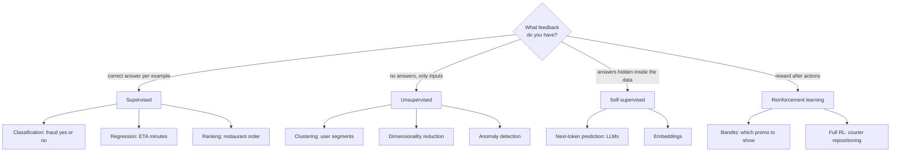

**Reading the diagram.** Start at the decision node and follow the edge that matches your feedback. Each paradigm (middle row) fans out into the tasks it is used for in QuickBite. It is a taxonomy, with no runtime protocols or storage. The practical failure point is picking a paradigm the data cannot support, for example planning supervised fraud detection before any confirmed fraud labels exist. Paradigms combine in practice: self-supervised embeddings often become features for a supervised ranker (Chapter 68).

### 57.4.1 Supervised learning

::: definition
**Definition — Supervised learning.** Learning from examples $(x_i, y_i)$ where each input $x_i$ comes with its correct output $y_i$, the **label**. The three main tasks are **classification** (predict a category), **regression** (predict a number) and **ranking** (predict an order of items).
:::

The analogy is a student with an answer key: every practice problem can be checked. **Classification** predicts one of a fixed set of classes; a binary classifier for fraud outputs a probability $P(\text{fraud} \mid x)$ that a threshold turns into a decision. **Regression** predicts a continuous value such as ETA in minutes. **Ranking** orders a set of candidates for a query, such as the restaurants on a user's home feed; the label is a relevance grade or a click.

*QuickBite example.* Fraud detection: features describe the order, the label is "chargeback received" (1) or not (0).

### 57.4.2 Unsupervised learning

::: definition
**Definition — Unsupervised learning.** Learning structure from inputs alone, with no labels. Main tasks: **clustering** (group similar examples), **dimensionality reduction** (compress many features into a few while keeping most of the information) and **anomaly detection** (find examples unlike the rest).
:::

The analogy is sorting a box of photos into piles without being told the categories. **Clustering** algorithms such as k-means put similar points together. **Dimensionality reduction** such as principal component analysis (PCA) finds the few directions along which the data varies most, so 200 features can become 10 [Hastie et al. 2009, ch. 14]. **Anomaly detection** scores how unusual each point is; it is useful precisely when labels for the rare event are scarce.

*QuickBite example.* Clustering restaurants by menu, price and delivery pattern into segments for the marketing team. Nobody labeled the segments; the algorithm proposes them and humans name them.

### 57.4.3 Self-supervised learning

::: definition
**Definition — Self-supervised learning.** Supervised learning on labels manufactured automatically from the input itself, typically by hiding part of the input and predicting it. No human labeling is needed, so the training set can be as large as the raw data.
:::

Cover a word in a sentence and guess it; cover the next word and guess it. Each sentence yields many free training examples. This is why self-supervision powers modern **large language models** (LLMs): next-token prediction over trillions of tokens of text needs no annotators (Chapter 72). It also produces **embeddings**, vectors in which similar items are close together (§4.9.2). To learn which items are related, a model can be trained to predict which item a user picks next, or which words appear around a word [Mikolov et al. 2013]. The resulting embeddings then serve as features for other models or as keys for vector search (Chapter 74).

*QuickBite example.* Learn a 64-dimensional embedding per dish by predicting which dishes appear in the same basket. Dishes that co-occur (burger and fries) end up near each other, which the recommender uses for "goes well with" suggestions.

### 57.4.4 Reinforcement learning and bandits

::: definition
**Definition — Reinforcement learning (RL).** An **agent** repeatedly observes the **state** of an **environment**, takes an **action**, and receives a **reward**. It learns a **policy** (a mapping from state to action) that maximizes cumulative reward [Sutton and Barto 2018]. A **multi-armed bandit** is the special case with no state transitions: each round the agent picks one of $K$ actions and sees only that action's reward.
:::

The analogy is a dog learning tricks from treats: no one shows it the correct answer, it only learns whether what it did was good. Two things make RL hard. Feedback is only for the action taken, so the agent must **explore** actions it is unsure about rather than always **exploiting** the best known one. And in full RL, actions change future states, so credit for a reward must be assigned across many earlier steps.

**Figure 57.4 — The agent–environment loop, and the bandit special case.**

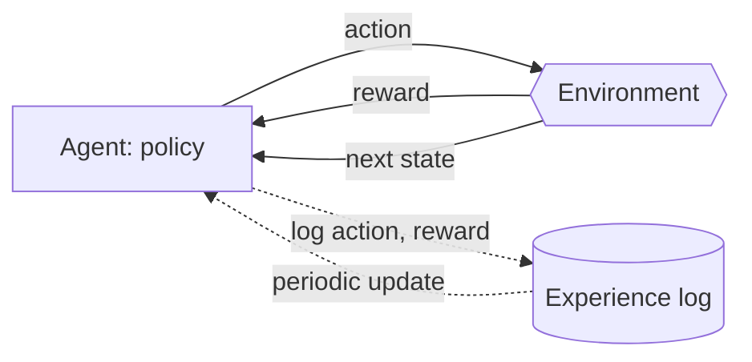

**Reading the diagram.** The agent (a service holding the policy) sends an action to the environment, an external system it does not control: users, couriers, the city. The environment returns a reward and, in full RL, a new state; both are synchronous in the conceptual loop. In production the update is asynchronous: actions and rewards are logged to an experience store and the policy is retrained or updated periodically (dotted arrows). For a bandit, delete the "next state" edge: each round is independent. The failure point is the reward: if it is a poor proxy, the agent optimizes the wrong thing very efficiently. Scaling is mostly logging volume and the cost of exploration, which spends real traffic on actions that may be worse.

Bandits are the RL that most companies actually ship. Choosing which of five promotional banners to show, with click-through as reward, is a bandit: an algorithm such as Thompson sampling shifts traffic toward the winner while still exploring, so it loses less reward than a fixed 20/20/20/20/20 test. Full RL fits problems with sequential consequences, such as repositioning idle couriers where a move now changes where couriers are later; it needs a simulator or very careful offline evaluation, which is why it is rarer in production.

*QuickBite example.* A bandit chooses the discount level (0%, 5%, 10%) shown to lapsed users, rewarded by order placed minus discount cost.

**Table 57.2 — The four paradigms at a glance.**

| Paradigm | Feedback | Typical tasks | QuickBite example | Main system cost |
|---|---|---|---|---|
| Supervised | Label per example | Classification, regression, ranking | Fraud, ETA, feed ranking | Collecting and joining labels |
| Unsupervised | None | Clustering, PCA, anomaly detection | Restaurant segments | Judging quality without labels |
| Self-supervised | Labels made from the input | Next-token, masked prediction, embeddings | Dish embeddings, chatbot LLM | Compute: huge datasets |
| Reinforcement / bandit | Reward for chosen action | Policy, exploration | Discount bandit | Exploration traffic, logging |

::: mistake
**Mistake — "Unsupervised means no evaluation."** Every model used for a decision needs a measurable outcome. Clusters are judged by whether the downstream campaign performs better; anomaly scores by how many flagged cases analysts confirm. If you can never measure success, you cannot tell a good model from a random one.
:::

## 57.5 Training versus inference

### 57.5.1 Two workloads, two systems

::: definition
**Definition — Training and inference.** **Training** is the batch computation that estimates a model's parameters from a dataset. **Inference** is running the trained model on new inputs to produce predictions. Training happens occasionally, offline, over many examples; inference happens continuously, often online, one request at a time.
:::

#### First-principles explanation

Training is writing the textbook; inference is looking something up in it. Writing is slow, done rarely and can happen overnight. Looking up must be fast, happens millions of times a day and must never be unavailable. The two phases share a model file and almost nothing else, so they need different systems.

#### How they differ

**Table 57.3 — Training versus inference as system workloads.**

| Property | Training | Inference |
|---|---|---|
| Trigger | Schedule, new data, or drift alert | Every user request or batch job |
| Input | Millions of labeled rows from the warehouse | One feature vector (or a small batch) |
| Optimize for | Throughput: examples per second | Latency (p99) and cost per prediction |
| Duration | Minutes to weeks | Milliseconds |
| Failure impact | A delayed model; retry the job | User-facing errors; needs a fallback |
| Hardware | Bursty; large CPU or GPU jobs | Steady; sized for peak RPS |
| State | Reads full history | Reads fresh features from an online store |
| Owner chapters | 61, 65, 69 | 62, 66, 67 |

**Figure 57.5 — The train/serve loop.**

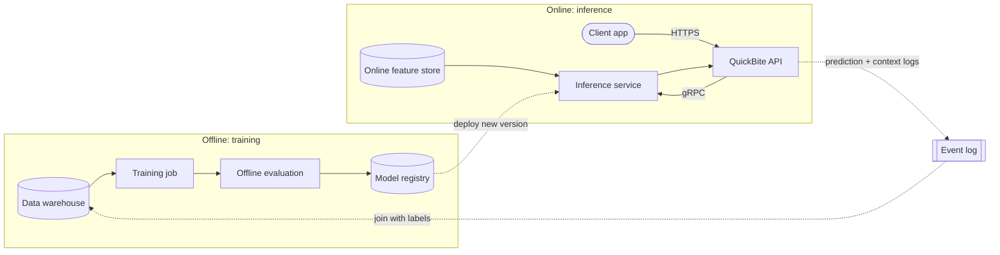

**Reading the diagram.** Two deployment boundaries. In the online boundary, the client calls the API over HTTPS and the API calls the inference service synchronously over gRPC; the inference service reads fresh features from an online feature store (a low-latency key-value store, Chapter 62) and returns a prediction within the request's latency budget. In the offline boundary, a training job reads history from the warehouse, is evaluated, and writes a versioned model to the registry. The dotted arrows are asynchronous: model deployment, prediction logging to an event log (§31.3) and the later join of logged predictions with labels. Failure points: an inference outage hits users directly (so the API needs a fallback such as the route-engine ETA), whereas a failed training job only delays freshness. A mismatch between how features are computed in the two boundaries causes **training–serving skew**, the model seeing different inputs in production than in training (Chapter 62). Scaling: inference scales horizontally with replicas sized for peak RPS; training scales with bigger or more parallel jobs (Chapter 65).

::: example
**Worked example — Where QuickBite's ETA compute actually goes.** Assumptions: the ETA model is retrained daily on the last 90 days of deliveries. The search page peaks at 2,000 RPS, each response showing 20 restaurants with an ETA (§2.4), and QuickBite's peak-to-average ratio is 9.6 (§18.11). (The 7,000 RPS browse peak of §2.11 counts all browse reads, not only search pages.)

1. Training examples per run: $90 \times 500{,}000 = 45{,}000{,}000$ deliveries.
2. Peak inference rate: $2{,}000 \times 20 = 40{,}000$ predictions per second.
3. Inference per day: $40{,}000 / 9.6 \times 86{,}400 = 3.6 \times 10^{8}$ predictions, about 8 times the training set *every day*.
4. If one prediction costs 5 µs of CPU for a tree ensemble (an assumed figure), peak needs $40{,}000 \times 5\ \mu\text{s} = 0.2$ CPU-seconds per second, under one core. If a neural model costs 200 µs, the same peak needs 8 cores before headroom.

**Interpretation.** Over a year, the model scores about $365 \times 3.6 \times 10^8 \approx 1.3 \times 10^{11}$ inputs but trains on $4.5 \times 10^7$ rows per run. **Engineering implication.** For high-traffic features, per-prediction cost dominates lifetime cost and latency budgets constrain model choice. Caching ETAs per (restaurant, zone, 5-minute bucket) can cut the 40,000 per second by orders of magnitude (Chapter 20). Chapter 60 develops these trade-offs into full architectures.
:::

::: mistake
**Mistake — Sizing the ML system by its training job.** Teams often plan GPUs for training and treat serving as an afterthought. For a model on a hot path, inference runs every second of every day and sits in the p99 of a user-facing request. Size it like any other latency-critical service (Chapter 23).
:::

## 57.6 Features and labels

### 57.6.1 Features

::: definition
**Definition — Feature.** A measurable input variable the model receives, computed from raw data at prediction time. A **feature vector** is the list of all features for one example. **Feature engineering** is the work of designing these inputs.
:::

Models consume numbers, so every input must become one or more numbers. Table 57.4 lists the common types.

**Table 57.4 — Feature types and how they become numbers.**

| Type | QuickBite example | Typical encoding |
|---|---|---|
| Numerical | Distance (km), basket value | As is, often scaled to mean 0, variance 1 |
| Categorical, low cardinality | Payment method (4 values) | One-hot: one 0/1 column per value |
| Categorical, high cardinality | Restaurant ID (50,000 values) | Learned embedding or target statistics |
| Ordinal | Customer tier: bronze < silver < gold | Integer rank |
| Temporal | Order timestamp | Hour of day, day of week, holiday flag |
| Aggregate (windowed) | Restaurant's mean prep time, last 7 days | Precomputed in a pipeline (Chapter 62) |
| Text | Dish description | Embedding vector (Chapter 74) |
| Geospatial | Drop-off location | Grid cell ID, distance to restaurant |

Aggregates are often the most predictive features and the most dangerous, because they must be computed using only data available *before* the prediction moment. That rule leads directly to leakage (§57.6.3).

### 57.6.2 Labels and their sources

::: definition
**Definition — Label.** The correct output for an example, used as the target in training and as the reference in evaluation. Labels are **explicit** when someone states them (an analyst marks an order as fraud, a user gives a rating), **implicit** when inferred from behavior (a click, an order, a skip), and **delayed** when the outcome is known only some time after the prediction.
:::

Explicit labels are accurate but expensive and scarce (Chapter 63 covers labeling pipelines). Implicit labels are free and plentiful but noisy: a click on a restaurant may mean interest or a mis-tap, and the absence of a click on an item the user never scrolled to means nothing. Delayed labels are the norm for business outcomes. For ETA the delay is the delivery itself (about 35 minutes). For fraud it is the chargeback, which can arrive weeks later.

**Figure 57.6 — Timeline of a fraud prediction and its delayed label.**

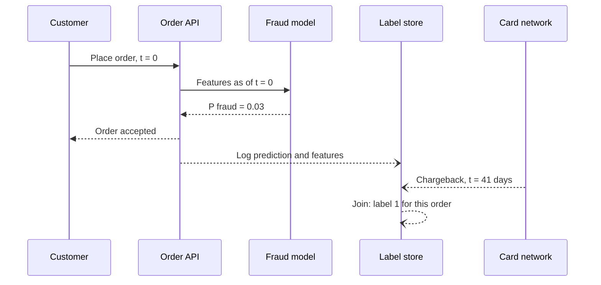

**Reading the diagram.** Solid arrows are the synchronous order path, which must finish within the checkout latency budget: the API sends features computed *as of t = 0* to the model and gets a probability back. Open-headed arrows are asynchronous. The prediction and its features are logged to a label store at once; the label arrives from an external card network 41 days later and is joined to the logged row. Until then the order looks legitimate in the data. The storage boundary is the label store, which must keep logged features long enough to meet their labels. Failure points: a training job that treats "no chargeback yet" as "not fraud" learns from wrong labels, and features recomputed later instead of logged at $t = 0$ can contain information from after the decision. Scaling: the store grows with orders × retention window.

::: example
**Worked example — How immature labels hide fraud.** Assume (for QuickBite) that chargebacks arrive with this delay: 40% within 15 days, 75% within 30 days, 95% within 60 days and 100% within 90 days. True fraud is 0.5% of orders.

1. Orders from 15 days ago: observed fraud rate $0.5\% \times 0.40 = 0.20\%$.
2. Orders from 30 days ago: $0.5\% \times 0.75 = 0.375\%$.
3. Orders from 60 days ago: $0.5\% \times 0.95 = 0.475\%$.
4. A training set built from "the last 30 days" mixes these maturities; for orders spread evenly over 0–30 days the average observed rate is well under half of the true 0.5%.

**Interpretation.** More than half of the recent fraud is labeled "legitimate". **Engineering implication.** Train and evaluate only on orders older than the label maturity window (here 90 days), or model the delay explicitly. Use faster proxy labels (analyst review, customer dispute tickets) for monitoring recent performance (§70.8).
:::

### 57.6.3 Label leakage

::: definition
**Definition — Leakage.** The presence in the training data of information that will not be available, in the same form, at prediction time, usually information that is caused by or computed from the label [Kaufman et al. 2012]. A leaky model scores brilliantly offline and fails in production.
:::

::: example
**Worked example — A fraud model with 0.99 AUC.** A data scientist builds QuickBite's first fraud model from the `orders` table and gets ROC-AUC 0.99 (§57.10.2), far better than the rule baseline's 0.80. The top three features by importance are:

1. `account_status = 'suspended'`. The trust team suspends accounts *after* confirming fraud. At checkout time a fraudster's new account is always `active`. The feature is a copy of the label.
2. `refund_amount`. Refunds are issued after the chargeback. It is zero at checkout for every order.
3. `customer_order_count`, read from today's snapshot. For a fraudster banned after one order it is 1; for an honest customer from six months ago it is now 40. At checkout time both had the same value.

All three describe the state of the world *after* the label was known. Dropping them and rebuilding every feature "as of" the order timestamp gives ROC-AUC 0.86, which is the honest number.

**Interpretation.** A suspiciously good offline metric is a bug report, not a celebration. **Engineering implication.** Build training rows by **point-in-time joins** (Chapter 62): every feature is the value that the online store held at the prediction timestamp, or better, the value that was actually logged at serving time (Figure 57.6).
:::

The general test is simple: for every feature, ask "could the serving system know this value, exactly as computed, at the moment it makes the prediction?"

::: mistake
**Mistake — Normalizing or imputing with statistics from the whole dataset.** Computing a feature's mean and variance over all rows, *then* splitting, lets test-set information into training. It is a small leak, but the same pattern with target statistics (mean fraud rate per restaurant computed over all rows) can be a large one. Fit every transformation on the training split only, as the scikit-learn `Pipeline` in §57.8 does.
:::

## 57.7 Train, validation and test splits

### 57.7.1 Split strategies

::: definition
**Definition — Train, validation and test sets.** The **training set** is used to fit parameters. The **validation set** is used to choose among models and settings (**hyperparameters**, such as polynomial degree or learning rate). The **test set** is used once, at the end, to estimate performance on future data. Because you choose models by validation score, the validation score is optimistically biased; the untouched test set is not.
:::

#### First-principles explanation

A teacher who hands out the exam questions as homework learns nothing about whether students understood the material. Evaluating a model on its own training data is the same mistake: a model that memorized every example scores perfectly. Held-out data simulates the future. The split must therefore resemble the relationship between the past you train on and the future you will serve.

#### How the strategies work

1. **Random split.** Shuffle rows and cut, for example 70/15/15. Valid when rows are independent and the world does not change over time.
2. **Time-based split.** Train on the oldest data, validate on the next period, test on the most recent. Mirrors production, where the model always predicts the future from the past.
3. **Group split.** Keep all rows that share a group (user, restaurant, device) on one side. Prevents the model scoring well by recognizing the same entity in both sets.
4. **k-fold cross-validation.** Split the training data into $k$ folds; train $k$ times, each time validating on a different fold; average the $k$ scores. Uses all data for both roles and gives a variance estimate, at $k$ times the training cost [Hastie et al. 2009, §7.10]. For time-ordered data use *forward-chaining* folds: train on months 1–3, validate on 4; train on 1–4, validate on 5; and so on.

**Figure 57.7 — Three split strategies over the same orders.**

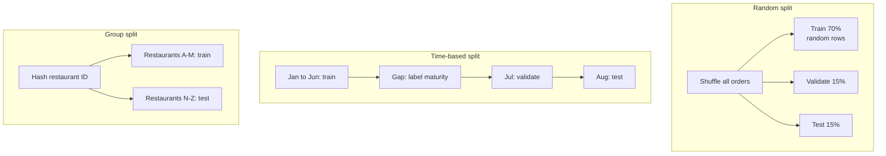

**Reading the diagram.** Each boundary is one strategy applied to the same order table; arrows show how rows are assigned, not runtime calls. The random split draws rows independently, so July orders appear in training and January orders in test. The time-based split moves left to right through the calendar and inserts a gap equal to the label maturity window (§57.6.2), so that every training label is final. The group split assigns all rows of a restaurant to one side by hashing its ID. Failure points: a random split on drifting data overstates performance, and a missing gap trains on immature labels. Scaling: splits are computed by partition filters in the warehouse (Chapter 61), so they cost almost nothing even at billions of rows.

**Table 57.5 — Choosing a split.**

| Strategy | Use when | Risk if misused |
|---|---|---|
| Random | Independent rows, stable world (image classification) | Optimistic on drifting or time-ordered data |
| Time-based | Any production system predicting the future | Fewer recent rows for training; needs a gap for delayed labels |
| Group | Entities repeat and the model must generalize to new ones | Must be combined with time if both apply |
| k-fold CV | Small datasets; choosing hyperparameters | $k$× training cost; must be forward-chaining for time data |

#### Code example: why time-based splits matter

The program below simulates 180 days of orders in which a new fraud pattern (driven by feature 3) ramps up from day 120. It compares a random split with a time-based split.

```python
import numpy as np
from sklearn.ensemble import HistGradientBoostingClassifier
from sklearn.metrics import roc_auc_score
from sklearn.model_selection import train_test_split

rng = np.random.default_rng(57)
n = 60_000
day = np.sort(rng.integers(0, 180, n))         # 180 days of orders, in time order
X = rng.normal(size=(n, 4))
# A new fraud pattern (driven by feature 3) ramps up from day 120 onward
new_attack = np.clip((day - 120) / 60, 0, 1)
logit = -4 + 2.0 * X[:, 0] + 0.8 * X[:, 1] + 2.5 * new_attack * X[:, 3]
y = (rng.random(n) < 1 / (1 + np.exp(-logit))).astype(int)

def test_auc(train_idx, test_idx):
    model = HistGradientBoostingClassifier(random_state=57)
    model.fit(X[train_idx], y[train_idx])
    return roc_auc_score(y[test_idx], model.predict_proba(X[test_idx])[:, 1])

idx = np.arange(n)
tr, te = train_test_split(idx, test_size=0.2, random_state=57)
cut = np.searchsorted(day, 150)                 # train days 0-149, test days 150-179
late = te[day[te] >= 150]                      # random-split test rows from the last month
print(f"random split: test AUC {test_auc(tr, te):.3f} (all days), "
      f"{test_auc(tr, late):.3f} (days 150-179)")
print(f"time split:   test AUC {test_auc(idx[:cut], idx[cut:]):.3f}")
```

Output:

```text
random split: test AUC 0.893 (all days), 0.871 (days 150-179)
time split:   test AUC 0.838
```

What to notice:

- On the *same* final month, the randomly split model scores 0.871 and the time-split model 0.838. The random split let the model train on rows from days 150–179 and learn the new attack before "seeing" it in test. In production you never have next month's data.
- The honest estimate of how the model will do next month is the time-split 0.838. Shipping on 0.893 sets an expectation the model cannot meet.
- The gap grows with drift. In fraud, search and recommendations, drift is constant, which is why time-based splits are the production default.

::: warning
**Warning — The test set wears out.** Every time you look at test-set results and change something, the test set becomes part of model selection. After a dozen rounds it is a second validation set. Keep a final holdout untouched until the launch decision, and let the A/B test (§57.14) be the final judge.
:::

## 57.8 Overfitting, underfitting and the bias–variance trade-off

### 57.8.1 Two ways to fail

::: definition
**Definition — Underfitting and overfitting.** A model **underfits** when it is too simple to capture the real pattern: error is high on both training and validation data. It **overfits** when it fits noise in the training data: training error is low but validation error is much higher. **Model capacity** is how flexible the model family is (more parameters, deeper trees, higher-degree polynomials).
:::

#### First-principles explanation

Picture three students preparing for an exam with last year's papers. One learns a single rule of thumb and gets everything roughly wrong (underfitting). One memorizes every answer word for word, including the typos, and fails when the questions change slightly (overfitting). The third learns the underlying ideas and does well on new questions (generalization). Capacity is the size of the student's notebook: too small and the ideas do not fit, too large and the typos fit too.

#### Mathematical foundations

::: formula
**Bias–variance decomposition of expected squared error**

$$E\big[(y - \hat{f}(x))^2\big] = \underbrace{\big(E[\hat{f}(x)] - f(x)\big)^2}_{\text{bias}^2} + \underbrace{E\big[(\hat{f}(x) - E[\hat{f}(x)])^2\big]}_{\text{variance}} + \sigma^2$$

| Symbol | Meaning | Units |
|---|---|---|
| $y$ | Observed target, $y = f(x) + \varepsilon$ | target units (minutes) |
| $f(x)$ | True underlying function | minutes |
| $\hat{f}(x)$ | Model trained on one random training set | minutes |
| $E[\cdot]$ | Average over many possible training sets (and noise) | — |
| bias² | Error from the model family being too simple | minutes² |
| variance | Error from sensitivity to the particular training sample | minutes² |
| $\sigma^2$ | Irreducible noise variance of $\varepsilon$ | minutes² |
:::

[Hastie et al. 2009, §7.3; Bishop 2006, §3.2.] Simple models have high bias and low variance; flexible models have low bias and high variance. Validation error is minimized somewhere in between, and it can never go below $\sigma^2$.

#### Code example: polynomial fits of delivery time

The program fits polynomials of increasing degree to 25 synthetic deliveries, where the true delivery time is a smooth function of distance plus noise with $\sigma = 2$ minutes (so $\sigma^2 = 4$ is the floor), and then adds an L2 penalty (ridge regression) to the most flexible model.

```python
import numpy as np
from sklearn.linear_model import LinearRegression, Ridge
from sklearn.metrics import mean_squared_error
from sklearn.pipeline import make_pipeline
from sklearn.preprocessing import PolynomialFeatures, StandardScaler

rng = np.random.default_rng(57)

def true_minutes(km):                    # the hidden "truth" the model must learn
    return 12 + 9 * np.sqrt(km) + 3 * np.sin(1.5 * km)

def sample(n):
    km = rng.uniform(0.5, 8.0, n)
    noise = rng.normal(0, 2.0, n)        # irreducible noise, sigma = 2 min
    return km.reshape(-1, 1), true_minutes(km) + noise

X_train, y_train = sample(25)            # small training set
X_val, y_val = sample(1000)              # large validation set

def fit_and_score(degree, regressor):
    model = make_pipeline(PolynomialFeatures(degree), StandardScaler(), regressor)
    model.fit(X_train, y_train)
    return (mean_squared_error(y_train, model.predict(X_train)),
            mean_squared_error(y_val, model.predict(X_val)))

print("degree  train_MSE  val_MSE")
for degree in [1, 2, 3, 5, 7, 9]:
    tr, va = fit_and_score(degree, LinearRegression())
    print(f"{degree:>6} {tr:>10.2f} {va:>8.2f}")

print("\ndegree 9 + ridge (L2) penalty")
print("   alpha  train_MSE  val_MSE")
for alpha in [1e-4, 1e-2, 1e-1, 1.0, 10.0, 100.0]:
    tr, va = fit_and_score(9, Ridge(alpha=alpha))
    print(f"{alpha:>8g} {tr:>10.2f} {va:>8.2f}")
```

Output:

```text
degree  train_MSE  val_MSE
     1       8.02     7.84
     2       7.73     7.48
     3       5.47     7.04
     5       3.39     4.97
     7       3.21     6.69
     9       2.94    16.16

degree 9 + ridge (L2) penalty
   alpha  train_MSE  val_MSE
  0.0001       3.67     6.17
    0.01       4.49     5.42
     0.1       5.99     6.06
       1       6.62     6.61
      10       8.16     8.20
     100      13.00    14.63
```

What to notice:

- Training error falls with every extra degree; validation error falls, bottoms out at degree 5 (4.97) and then rises sharply to 16.16 at degree 9. That U-shape is the bias–variance trade-off.
- At degree 9 the training MSE (2.94) is *below* the noise floor of 4. No honest model can beat the noise, so the model is fitting noise.
- Ridge regularization rescues the flexible model: $\alpha = 0.01$ cuts validation MSE from 16.16 to 5.42. Too much ($\alpha = 100$) underfits, with both errors high.
- The `Pipeline` fits the scaler on the training data only, avoiding the leakage of §57.6.3.

::: example
**Worked example — Reading the decomposition from the output.** Validation MSE estimates the left side of the formula; $\sigma^2 = 4$.

1. Degree 1: $7.84 - 4 = 3.84$ minutes² of reducible error. Training MSE (8.02) is just as high, so the error is mostly **bias**.
2. Degree 5: $4.97 - 4 = 0.97$ minutes². Little left to gain.
3. Degree 9: $16.16 - 4 = 12.16$ minutes², with training MSE only 2.94, so the error is mostly **variance**.

**Interpretation.** The best model's RMSE is $\sqrt{4.97} \approx 2.2$ minutes against a floor of 2.0. **Engineering implication.** When validation error is near the noise floor, more modeling effort is wasted; better *features* (which reduce $\sigma^2$ by explaining some of the "noise", such as restaurant load) are the only route to large gains.
:::

### 57.8.2 Regularization

::: formula
**Ridge (L2-regularized) objective**

$$J(\mathbf{w}) = \frac{1}{n}\sum_{i=1}^{n}\big(y_i - \hat{y}_i\big)^2 + \lambda \sum_{j=1}^{d} w_j^2$$

| Symbol | Meaning | Units |
|---|---|---|
| $J$ | Objective minimized during training | target units² |
| $\hat{y}_i = \mathbf{w}\cdot\mathbf{x}_i + b$ | Prediction for example $i$ | target units |
| $w_j$ | Weight of feature $j$ ($d$ features) | target units per feature unit |
| $\lambda$ | Regularization strength (scikit-learn's `alpha`) | dimensionless with scaled features |
| $n$ | Number of training examples | count |
:::

::: example
**Worked example — Why the penalty prefers small weights.** Two candidate models fit the same training data. Model A has weights $(3, -2)$ and MSE 5.0. Model B has weights $(40, -38)$ and MSE 4.6. Take $\lambda = 0.1$.

1. Model A: $J = 5.0 + 0.1 \times (9 + 4) = 6.3$.
2. Model B: $J = 4.6 + 0.1 \times (1{,}600 + 1{,}444) = 4.6 + 304.4 = 309.0$.

**Interpretation.** Large, opposing weights usually mean the model is canceling one feature against another to chase noise; the penalty makes that expensive. **Engineering implication.** $\lambda$ is a hyperparameter chosen on the validation set. L1 regularization (penalty $\lambda\sum|w_j|$, "lasso") also drives many weights to exactly zero, which removes features and shrinks the online feature-fetch cost. Other regularizers include early stopping, dropout and smaller trees (Chapter 58).
:::

**Figure 57.8 — Diagnosing a model from its training and validation error.**

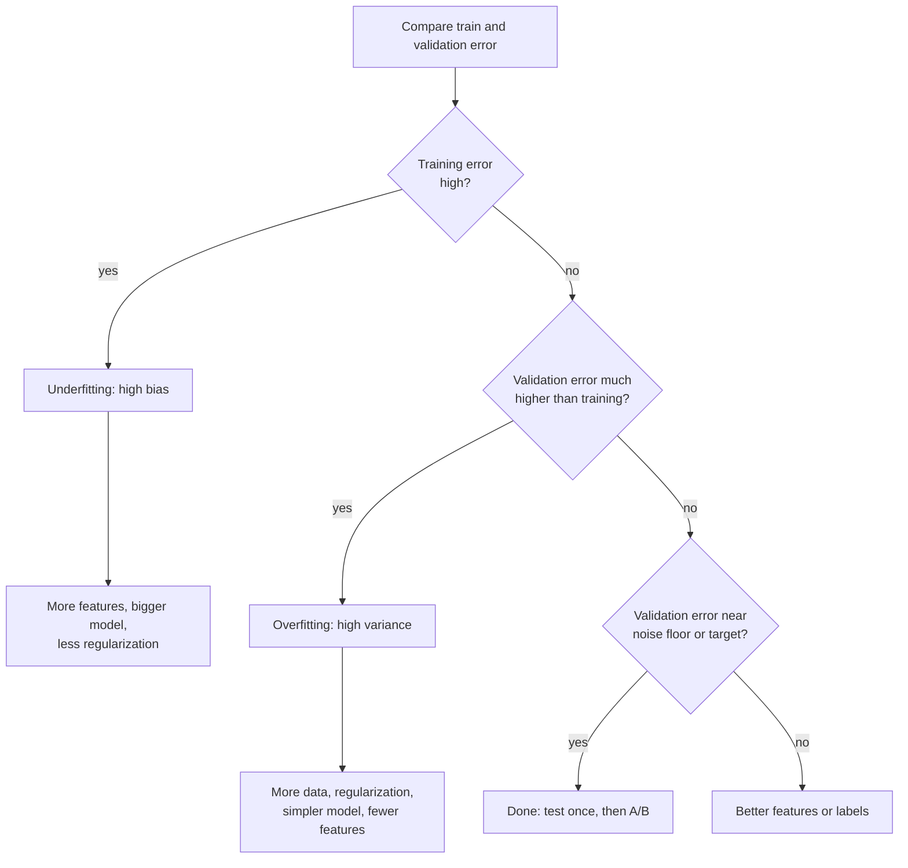

**Reading the diagram.** A decision flow, read top to bottom; each diamond is a check on the two error numbers from your evaluation job, and rectangles are actions. High training error means the model cannot even fit what it has seen, so add capacity. Low training error with much higher validation error means it memorized, so constrain it or add data. Both low but above target means the information is not in the features. There are no runtime protocols here, but each action has a system cost: more data means bigger pipelines (Chapter 61), more features means more online lookups (Chapter 62), a bigger model means more inference latency (§57.5).

::: mistake
**Mistake — "More data always fixes it."** More data reduces variance, so it helps an overfitting model. An underfitting model with high bias gets no better with ten times the rows; it needs more capacity or better features. Check which regime you are in before paying for a bigger pipeline.
:::

## 57.9 Loss functions and gradient descent

### 57.9.1 Loss functions

::: definition
**Definition — Loss function.** A function $L(y, \hat{y})$ that scores how bad a prediction is for one example. Training minimizes the average loss over the training set, called **empirical risk**. The loss must reflect what errors cost and must be differentiable for gradient-based training.
:::

Regression commonly uses **mean squared error** (MSE). Classification with probabilities uses **cross-entropy**, which for two classes is called **log loss** (or binary cross-entropy) [Goodfellow et al. 2016, §5.5; Murphy 2022, ch. 10].

::: formula
**Mean squared error and log loss**

$$\text{MSE} = \frac{1}{n}\sum_{i=1}^{n}(y_i - \hat{y}_i)^2 \qquad \text{LogLoss} = -\frac{1}{n}\sum_{i=1}^{n}\Big[y_i \ln p_i + (1 - y_i)\ln(1 - p_i)\Big]$$

| Symbol | Meaning | Units |
|---|---|---|
| $y_i$ | True value (regression) or class 0/1 (classification) | target units, or none |
| $\hat{y}_i$ | Predicted value | target units |
| $p_i$ | Predicted probability that $y_i = 1$ | probability, 0–1 |
| $\ln$ | Natural logarithm | — |
| MSE | Average squared error | target units² |
| LogLoss | Average negative log-likelihood | nats |
:::

::: example
**Worked example — How log loss punishes confident mistakes.** Four fraud predictions.

1. Fraud ($y = 1$), $p = 0.9$: loss $= -\ln 0.9 = 0.105$.
2. Fraud, $p = 0.5$: $-\ln 0.5 = 0.693$.
3. Fraud, $p = 0.1$: $-\ln 0.1 = 2.303$.
4. Legitimate ($y = 0$), $p = 0.01$: $-\ln 0.99 = 0.010$.

For MSE: ETA errors of 2, 2 and 10 minutes give $(4 + 4 + 100)/3 = 36$ minutes²; the single 10-minute miss contributes 93% of it.

**Interpretation.** Log loss rewards honest probabilities: saying 0.1 for an order that turns out fraudulent costs 22 times as much as saying 0.9. MSE is dominated by large errors. **Engineering implication.** Choose the loss to match the cost of errors: if a late ETA hurts more than an early one, use an asymmetric loss such as the pinball loss of §57.11. A constant prediction of the base rate is the baseline every classifier must beat: at 4.77% fraud its log loss is $-(0.0477 \ln 0.0477 + 0.9523 \ln 0.9523) = 0.192$.
:::

### 57.9.2 Gradient descent

::: definition
**Definition — Gradient descent.** An iterative method that minimizes a loss by repeatedly moving the parameters a small step in the direction that decreases the loss fastest: the negative **gradient**. The step size is the **learning rate**. **Batch** gradient descent uses all examples per step; **stochastic gradient descent** (SGD) uses one; **mini-batch** SGD uses a small batch (typically 32–1,024). One pass over the training set is an **epoch**.
:::

#### First-principles explanation

You are on a foggy hillside and want to reach the valley floor. You cannot see the valley, but you can feel the slope under your feet. Take a step downhill, feel again, repeat. The gradient is the slope; the learning rate is your stride. Too short a stride and you take all day; too long and you leap across the valley and up the other side. Mini-batches are like judging the slope from a few nearby points instead of surveying the whole hill: noisier, but each step is far cheaper, and the noise even helps avoid shallow dips.

::: formula
**Gradient descent update (with the logistic-regression gradient)**

$$\mathbf{w} \leftarrow \mathbf{w} - \eta\, \nabla_{\mathbf{w}} L \qquad \text{where for log loss with } p_i = \sigma(\mathbf{w}\cdot\mathbf{x}_i + b):\quad \nabla_{\mathbf{w}} L = \frac{1}{B}\sum_{i \in \text{batch}} (p_i - y_i)\,\mathbf{x}_i$$

| Symbol | Meaning | Units |
|---|---|---|
| $\mathbf{w}, b$ | Weights and bias | per feature unit; logit |
| $\eta$ | Learning rate | dimensionless |
| $\nabla_{\mathbf{w}} L$ | Gradient: vector of partial derivatives of loss | loss per weight unit |
| $\sigma(z) = 1/(1 + e^{-z})$ | Sigmoid: turns a score into a probability | probability |
| $B$ | Mini-batch size | examples |
:::

::: example
**Worked example — One gradient step by hand.** Logistic regression with one feature, $w = 0$, $b = 0$, one fraud example with $x = 2$, $y = 1$, and $\eta = 0.5$.

1. Score $z = 0 \times 2 + 0 = 0$, so $p = \sigma(0) = 0.5$ and loss $= -\ln 0.5 = 0.693$.
2. Error $p - y = -0.5$. Gradients: $\partial L/\partial w = -0.5 \times 2 = -1.0$; $\partial L/\partial b = -0.5$.
3. Update: $w = 0 - 0.5 \times (-1.0) = 0.5$; $b = 0 - 0.5 \times (-0.5) = 0.25$.
4. New score $z = 0.5 \times 2 + 0.25 = 1.25$, $p = 1/(1 + e^{-1.25}) = 0.777$, loss $= -\ln 0.777 = 0.252$.

**Interpretation.** One step cut the loss from 0.693 to 0.252 by moving the weight toward the feature that indicated fraud. **Engineering implication.** Each step costs one forward and one backward pass over a batch. Training cost is therefore roughly (examples × epochs × cost per example), which is the quantity Chapter 65 scales across GPUs.
:::

**Figure 57.9 — The mini-batch gradient descent loop.**

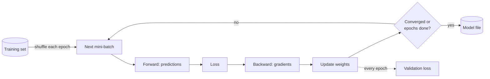

**Reading the diagram.** The training set (storage) is shuffled each epoch and fed in mini-batches. Each iteration is synchronous within one process: forward pass, loss, backward pass (gradients), weight update. The loop repeats until a stopping rule fires, and the final weights are written to a model file. The dotted branch is the periodic validation check, used for early stopping. Failure points: a learning rate that is too high makes the loss oscillate or diverge; a data loader slower than the update step starves the accelerator (Chapter 64). Scaling: data parallelism splits each batch across workers and averages their gradients (Chapter 65).

#### Code example: logistic regression from scratch

```python
import numpy as np
from sklearn.linear_model import LogisticRegression

rng = np.random.default_rng(57)

# Synthetic QuickBite orders: 3 standardized features
#   x0 = order value, x1 = account age (newer = smaller), x2 = failed card attempts
n = 20_000
X = rng.normal(size=(n, 3))
true_w, true_b = np.array([1.2, -1.5, 2.0]), -5.5
p_true = 1 / (1 + np.exp(-(X @ true_w + true_b)))
y = (rng.random(n) < p_true).astype(float)
print(f"fraud rate: {y.mean():.3%}")

def sigmoid(z):
    return 1 / (1 + np.exp(-z))

def log_loss(w, b, X, y, eps=1e-12):
    p = np.clip(sigmoid(X @ w + b), eps, 1 - eps)
    return -np.mean(y * np.log(p) + (1 - y) * np.log(1 - p))

def train(X, y, lr=0.5, epochs=30, batch=256, seed=0):
    r = np.random.default_rng(seed)
    w, b = np.zeros(X.shape[1]), 0.0
    history = [log_loss(w, b, X, y)]
    for _ in range(epochs):
        order = r.permutation(len(y))               # shuffle each epoch
        for start in range(0, len(y), batch):
            idx = order[start:start + batch]
            p = sigmoid(X[idx] @ w + b)
            err = p - y[idx]                         # dLoss/dz for log loss
            w -= lr * X[idx].T @ err / len(idx)      # gradient step on weights
            b -= lr * err.mean()                     # gradient step on bias
        history.append(log_loss(w, b, X, y))
    return w, b, history

w, b, hist = train(X, y)
for epoch in [0, 1, 2, 5, 10, 20, 30]:
    print(f"epoch {epoch:>2}: log loss {hist[epoch]:.4f}")
print("learned w:", np.round(w, 2), " b:", round(b, 2))

sk = LogisticRegression(C=1e6).fit(X, y)          # near-unregularized reference
print("sklearn w:", np.round(sk.coef_[0], 2), " b:", round(sk.intercept_[0], 2))

for lr in [0.001, 0.05, 0.5, 20.0]:
    *_, h = train(X, y, lr=lr, epochs=5)
    print(f"lr={lr:<6} loss after 5 epochs: {h[-1]:.4f}")
```

Output:

```text
fraud rate: 4.770%
epoch  0: log loss 0.6931
epoch  1: log loss 0.1328
epoch  2: log loss 0.1178
epoch  5: log loss 0.1084
epoch 10: log loss 0.1063
epoch 20: log loss 0.1055
epoch 30: log loss 0.1054
learned w: [ 1.24 -1.55  1.98]  b: -5.54
sklearn w: [ 1.23 -1.55  2.  ]  b: -5.56
lr=0.001  loss after 5 epochs: 0.6175
lr=0.05   loss after 5 epochs: 0.1590
lr=0.5    loss after 5 epochs: 0.1084
lr=20.0   loss after 5 epochs: 0.1368
```

What to notice:

- The synthetic fraud rate (4.8%) is higher than QuickBite's assumed 0.5% so the example converges in seconds; the mechanics are identical.
- The loss starts at $\ln 2 = 0.6931$ (every $p = 0.5$), falls fast in the first epoch and then flattens: most of the learning happens early, which is why training budgets have diminishing returns.
- The final loss 0.1054 beats the base-rate baseline of 0.192 computed in §57.9.1, and the learned weights recover the true ones (1.2, −1.5, 2.0, −5.5) and match scikit-learn to within SGD noise.
- The learning-rate sweep shows both failure modes: 0.001 has barely moved after 5 epochs, and 20.0 overshoots and ends worse than 0.5.
- The update line `X[idx].T @ err / len(idx)` is exactly the formula above: a matrix–vector product (§4.9.3), which is why accelerators that multiply matrices fast make training fast.

## 57.10 Classification metrics

A fraud model outputs a probability per order. The business needs a decision (block, review, allow) and a way to judge the model. This section uses one running set of ten scored orders (Table 57.6) and computes every metric by hand, then confirms with scikit-learn.

**Table 57.6 — Ten scored QuickBite orders (1 = fraud).**

| Order | 1 | 2 | 3 | 4 | 5 | 6 | 7 | 8 | 9 | 10 |
|---|---|---|---|---|---|---|---|---|---|---|
| Model probability $p$ | 0.95 | 0.85 | 0.80 | 0.70 | 0.60 | 0.45 | 0.40 | 0.30 | 0.20 | 0.10 |
| True label $y$ | 1 | 0 | 1 | 0 | 1 | 0 | 0 | 1 | 0 | 0 |

### 57.10.1 The confusion matrix

::: definition
**Definition — Confusion matrix.** For a binary classifier at a chosen **threshold** (predict positive if $p \geq t$), the four counts of outcomes: **true positives** (TP, fraud flagged), **false positives** (FP, legitimate order flagged), **false negatives** (FN, fraud missed) and **true negatives** (TN, legitimate order passed).
:::

**Figure 57.10 — The confusion matrix as outcomes of a decision.**

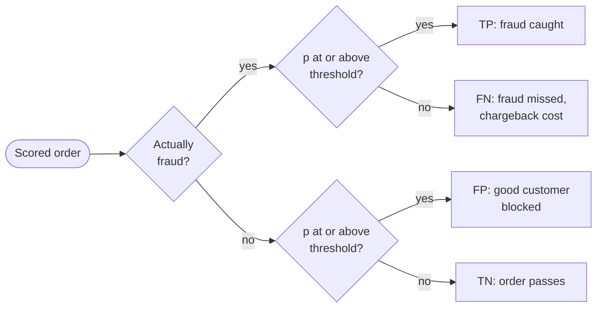

**Reading the diagram.** Every scored order travels left to right through two decisions: the truth (known only later, §57.6.2) and the model's thresholded prediction. The four leaves are the four cells of the matrix. The two error leaves are the failure points, and they cost different things: a false negative costs the chargeback and the food; a false positive costs a lost order and an angry customer. Moving the threshold moves orders between leaves; it cannot remove errors, only trade them. At scale, the counts are aggregated per day from the prediction log once labels arrive.

**Table 57.7 — Confusion matrix for Table 57.6 at threshold 0.5.**

| | Predicted fraud | Predicted legitimate |
|---|---|---|
| **Actual fraud** | TP = 3 (orders 1, 3, 5) | FN = 1 (order 8) |
| **Actual legitimate** | FP = 2 (orders 2, 4) | TN = 4 (orders 6, 7, 9, 10) |

::: formula
**Threshold metrics**

$$\text{Accuracy} = \frac{TP + TN}{N} \quad \text{Precision} = \frac{TP}{TP + FP} \quad \text{Recall} = \frac{TP}{TP + FN} \quad F_1 = \frac{2 \cdot \text{Precision} \cdot \text{Recall}}{\text{Precision} + \text{Recall}}$$

| Symbol | Meaning | Units |
|---|---|---|
| $TP, FP, FN, TN$ | Counts from the confusion matrix | orders |
| $N$ | Total examples, $TP + FP + FN + TN$ | orders |
| Precision | Of flagged orders, the fraction that are fraud | fraction |
| Recall (true positive rate, TPR) | Of fraud orders, the fraction flagged | fraction |
| $F_1$ | Harmonic mean of precision and recall | fraction |
:::

::: example
**Worked example — Threshold metrics for Table 57.7, and why accuracy misleads.**

1. Accuracy $= (3 + 4)/10 = 0.70$.
2. Precision $= 3/(3 + 2) = 0.60$: 60% of review-queue cases are real fraud.
3. Recall $= 3/(3 + 1) = 0.75$: the model catches three of the four frauds.
4. $F_1 = 2 \times 0.60 \times 0.75 / (0.60 + 0.75) = 0.90/1.35 = 0.667$.

Now take 10,000 real orders at QuickBite's 0.5% fraud rate: 50 fraud, 9,950 legitimate. A model flags 80 orders, of which 40 are fraud: TP = 40, FP = 40, FN = 10, TN = 9,910.

5. Accuracy $= (40 + 9{,}910)/10{,}000 = 99.50\%$.
6. A "model" that never flags anything: TP = 0, TN = 9,950, accuracy also $99.50\%$.
7. Precision $= 40/80 = 0.50$, recall $= 40/50 = 0.80$, $F_1 = 0.80/1.30 = 0.615$. The do-nothing model has recall 0.

**Interpretation.** Under heavy class imbalance, accuracy is dominated by the majority class and cannot tell a useful model from a useless one. **Engineering implication.** Report precision and recall at the operating threshold, and choose the threshold from costs: if a missed fraud costs \$60 and a blocked good order \$8, a threshold that flags 40 extra legitimate orders (\$320) to catch 10 more frauds (\$600) is worth it. Precision also sizes the human review queue: at 0.5 precision, analysts examine two orders per fraud.
:::

### 57.10.2 Ranking quality across thresholds: ROC-AUC and PR-AUC

Precision and recall depend on the threshold. To judge the score itself, sweep the threshold from high to low and trace a curve. The **ROC curve** plots recall (TPR) against the **false positive rate** $\text{FPR} = FP/(FP + TN)$. The **precision–recall (PR) curve** plots precision against recall. Each is summarized by the area under it.

::: formula
**ROC-AUC and average precision**

$$\text{ROC-AUC} = P\big(s_{+} > s_{-}\big) = \frac{\#\{(i, j): s_i > s_j,\ y_i = 1,\ y_j = 0\}}{n_{+}\, n_{-}} \qquad \text{AP} = \frac{1}{n_{+}}\sum_{k:\ y_{(k)} = 1} \text{Precision@}k$$

| Symbol | Meaning | Units |
|---|---|---|
| $s_{+}, s_{-}$ | Score of a random positive, of a random negative | probability |
| $n_{+}, n_{-}$ | Number of positives, negatives | examples |
| $y_{(k)}$ | Label of the example ranked $k$-th by score | 0/1 |
| Precision@$k$ | Fraction of positives among the top $k$ | fraction |
| AP | Average precision, the usual estimate of PR-AUC | fraction |
:::

(Ties in the ROC-AUC count score one half.) ROC-AUC 0.5 is random ordering and 1.0 is perfect. The baseline for AP is the positive rate itself: 0.005 for QuickBite's fraud.

::: example
**Worked example — ROC-AUC and AP for Table 57.6.** Positives are at ranks 1, 3, 5 and 8; $n_{+} = 4$, $n_{-} = 6$, so there are 24 positive–negative pairs.

1. Negatives ranked below each positive: rank 1 → 6; rank 3 → 5; rank 5 → 4; rank 8 → 2. Total 17.
2. ROC-AUC $= 17/24 = 0.708$.
3. Precision at each positive: $1/1$, $2/3$, $3/5$, $4/8$.
4. AP $= (1 + 0.667 + 0.600 + 0.500)/4 = 2.767/4 = 0.692$.

**Interpretation.** A randomly chosen fraud order outscores a randomly chosen legitimate one 70.8% of the time. **Engineering implication.** ROC-AUC tells you whether the model *orders* orders well; it says nothing about whether the scores are usable probabilities (§57.10.3) or whether precision is acceptable at the volume you can review.
:::

**When to prefer PR-AUC.** FPR divides by the number of negatives, which is huge under imbalance, so even thousands of false positives barely move the ROC curve. Precision divides by the number of *flagged* orders, so it feels every false positive. Davis and Goadrich showed that a curve dominates in ROC space if and only if it dominates in PR space, but that the two can rank non-dominating models differently, and that PR curves are more informative when positives are rare [Davis and Goadrich 2006; Saito and Rehmsmeier 2015]. The program below holds the score distributions fixed and changes only the fraud rate.

```python
import numpy as np
from sklearn.metrics import average_precision_score, roc_auc_score

rng = np.random.default_rng(57)
neg_scores = rng.normal(0.0, 1.0, 200_000)          # legitimate orders
pos_all = rng.normal(2.0, 1.0, 20_000)              # fraud scores 2 sd higher
for n_pos in [20_000, 2_000, 200]:                  # 9.1%, 1.0%, 0.1% fraud
    s = np.concatenate([pos_all[:n_pos], neg_scores])
    y = np.concatenate([np.ones(n_pos), np.zeros(len(neg_scores))])
    print(f"fraud rate {n_pos / len(y):6.2%}  ROC-AUC {roc_auc_score(y, s):.3f}  "
          f"PR-AUC {average_precision_score(y, s):.3f}")
```

Output:

```text
fraud rate  9.09%  ROC-AUC 0.921  PR-AUC 0.647
fraud rate  0.99%  ROC-AUC 0.919  PR-AUC 0.279
fraud rate  0.10%  ROC-AUC 0.915  PR-AUC 0.076
```

What to notice:

- The model is equally good at separating the classes in all three rows, so ROC-AUC stays at about 0.92.
- PR-AUC falls from 0.647 to 0.076 because, at 0.1% fraud, most flagged orders are false positives. That is the operational reality of the review queue, and only PR-AUC shows it.
- Rule: use PR-AUC (or precision at a fixed recall) for rare-event problems such as fraud and abuse; ROC-AUC is fine for comparing models on balanced problems or when the base rate will change.

### 57.10.3 Log loss and calibration

::: definition
**Definition — Calibration.** A classifier is **calibrated** if, among all examples it scores at probability $p$, a fraction $p$ are positive. A **reliability diagram** plots observed positive rate against mean predicted probability per bin; a calibrated model lies on the diagonal.
:::

Calibration matters whenever a probability is *used as a number*: expected-loss calculations (probability × order value), auction bids, or combining several models. Niculescu-Mizil and Caruana showed that common learners differ systematically: maximum-margin methods such as boosted trees push probabilities away from 0 and 1, naive Bayes pushes them toward 0 and 1, while neural networks and bagged trees were well calibrated; Platt scaling or isotonic regression fitted on held-out data corrected the distortions [Niculescu-Mizil and Caruana 2005]. Modern deep networks are often overconfident [Guo et al. 2017].

::: formula
**Brier score**

$$\text{Brier} = \frac{1}{n}\sum_{i=1}^{n}\big(p_i - y_i\big)^2$$

| Symbol | Meaning | Units |
|---|---|---|
| $p_i$ | Predicted probability of the positive class | probability |
| $y_i$ | Outcome, 0 or 1 | — |
| Brier | Mean squared error of probabilities; 0 is perfect | probability² |
:::

::: example
**Worked example — Log loss and Brier score for Table 57.6.**

1. Log loss terms for the four frauds: $-\ln 0.95 = 0.051$, $-\ln 0.80 = 0.223$, $-\ln 0.60 = 0.511$, $-\ln 0.30 = 1.204$; sum 1.989.
2. For the six legitimate orders, $-\ln(1 - p)$: $1.897$, $1.204$, $0.598$, $0.511$, $0.223$, $0.105$; sum 4.538.
3. Log loss $= (1.989 + 4.538)/10 = 0.653$.
4. Brier, frauds $(1 - p)^2$: $0.0025 + 0.04 + 0.16 + 0.49 = 0.6925$. Legitimate $p^2$: $0.7225 + 0.49 + 0.2025 + 0.16 + 0.04 + 0.01 = 1.625$. Brier $= 2.3175/10 = 0.232$.

**Interpretation.** Order 2, legitimate but scored 0.85, alone contributes 1.897 of the 6.527 total log loss (29%). **Engineering implication.** Log loss and Brier score evaluate the probabilities themselves, so they catch the overconfident model that ROC-AUC rewards. Monitor them in production alongside AUC.
:::

#### Code example: all classification metrics, then calibration

```python
import numpy as np
from sklearn.metrics import (accuracy_score, average_precision_score, brier_score_loss,
                             confusion_matrix, f1_score, log_loss, precision_score,
                             recall_score, roc_auc_score)

# The ten orders of Table 57.6: 1 = fraud, 0 = legitimate
y = np.array([1, 0, 1, 0, 1, 0, 0, 1, 0, 0])
p = np.array([0.95, 0.85, 0.80, 0.70, 0.60, 0.45, 0.40, 0.30, 0.20, 0.10])
pred = (p >= 0.5).astype(int)                       # threshold 0.5

tn, fp, fn, tp = confusion_matrix(y, pred).ravel()
print(f"TP={tp} FP={fp} FN={fn} TN={tn}")
print(f"accuracy  {accuracy_score(y, pred):.4f}")
print(f"precision {precision_score(y, pred):.4f}")
print(f"recall    {recall_score(y, pred):.4f}")
print(f"F1        {f1_score(y, pred):.4f}")
print(f"ROC-AUC   {roc_auc_score(y, p):.4f}")
print(f"PR-AUC/AP {average_precision_score(y, p):.4f}")
print(f"log loss  {log_loss(y, p):.4f}")
print(f"Brier     {brier_score_loss(y, p):.4f}")
```

Output:

```text
TP=3 FP=2 FN=1 TN=4
accuracy  0.7000
precision 0.6000
recall    0.7500
F1        0.6667
ROC-AUC   0.7083
PR-AUC/AP 0.6917
log loss  0.6527
Brier     0.2317
```

Every value matches the hand calculations. The second program shows that two models with *identical* ranking can differ greatly in calibration.

```python
import numpy as np
from sklearn.calibration import calibration_curve
from sklearn.metrics import brier_score_loss, roc_auc_score

rng = np.random.default_rng(57)
n = 100_000
true_p = 1 / (1 + np.exp(-rng.normal(-3.0, 1.5, n)))     # each order's real fraud probability
y = (rng.random(n) < true_p).astype(int)

logit = np.log(true_p / (1 - true_p))
calibrated = true_p                                        # a perfect probability model
overconfident = 1 / (1 + np.exp(-2.0 * (logit + 1.5)))    # same ranking, distorted scores

for name, p in [("calibrated", calibrated), ("overconfident", overconfident)]:
    frac_pos, mean_pred = calibration_curve(y, p, n_bins=5, strategy="quantile")
    print(f"{name:<13} AUC {roc_auc_score(y, p):.3f}  Brier {brier_score_loss(y, p):.4f}")
    for mp, fp in zip(mean_pred, frac_pos):
        print(f"    predicted {mp:.3f}  observed {fp:.3f}")
```

Output:

```text
calibrated    AUC 0.836  Brier 0.0706
    predicted 0.007  observed 0.006
    predicted 0.023  observed 0.021
    predicted 0.049  observed 0.047
    predicted 0.103  observed 0.102
    predicted 0.304  observed 0.309
overconfident AUC 0.836  Brier 0.1064
    predicted 0.001  observed 0.006
    predicted 0.012  observed 0.021
    predicted 0.052  observed 0.047
    predicted 0.213  observed 0.102
    predicted 0.702  observed 0.309
```

What to notice:

- The printed pairs are the points of a reliability diagram. The calibrated model's predicted and observed rates agree in every bin; the overconfident model says 0.702 where only 30.9% are fraud, and 0.001 where 0.6% are.
- ROC-AUC is identical (0.836) because the distortion is monotonic and preserves order. Only the Brier score (0.0706 versus 0.1064) and the reliability bins reveal the problem.
- If QuickBite priced "expected fraud loss = $p$ × order value" from the overconfident model, it would overstate the loss for its highest-risk orders by more than two times.

## 57.11 Regression metrics

### 57.11.1 MAE, RMSE and MAPE

**Table 57.8 — Five QuickBite deliveries (minutes).**

| Delivery | 1 | 2 | 3 | 4 | 5 |
|---|---|---|---|---|---|
| Actual $y$ | 25 | 30 | 40 | 35 | 60 |
| Predicted $\hat{y}$ | 28 | 27 | 41 | 38 | 45 |

::: formula
**Mean absolute error, root mean squared error, mean absolute percentage error**

$$\text{MAE} = \frac{1}{n}\sum|y_i - \hat{y}_i| \qquad \text{RMSE} = \sqrt{\frac{1}{n}\sum(y_i - \hat{y}_i)^2} \qquad \text{MAPE} = \frac{1}{n}\sum\left|\frac{y_i - \hat{y}_i}{y_i}\right|$$

| Symbol | Meaning | Units |
|---|---|---|
| $y_i, \hat{y}_i$ | Actual and predicted value | minutes |
| MAE | Typical absolute error; robust to outliers | minutes |
| RMSE | Error weighted toward large misses | minutes |
| MAPE | Average error relative to the actual value | fraction |
:::

::: example
**Worked example — Metrics for Table 57.8.** Errors $\hat{y} - y$: $+3, -3, +1, +3, -15$.

1. MAE $= (3 + 3 + 1 + 3 + 15)/5 = 25/5 = 5.00$ minutes.
2. RMSE $= \sqrt{(9 + 9 + 1 + 9 + 225)/5} = \sqrt{50.6} = 7.11$ minutes.
3. MAPE $= (3/25 + 3/30 + 1/40 + 3/35 + 15/60)/5 = (0.120 + 0.100 + 0.025 + 0.086 + 0.250)/5 = 11.6\%$.

**Interpretation.** RMSE exceeds MAE by 42% because of one 15-minute miss; the gap between them is a quick outlier detector. **Engineering implication.** Report MAE for "typical" accuracy and RMSE or a high percentile of absolute error (§4.8) for the bad experiences that drive support tickets.
:::

**MAPE's pathologies.** It is undefined when $y = 0$, which is common in demand forecasting (a zone with zero orders at 4 a.m.). It explodes for small actuals. And it is asymmetric: an under-forecast can be at most 100% wrong, while an over-forecast is unbounded, so a model tuned on MAPE learns to predict low [Hyndman and Koehler 2006]. For demand, prefer MAE scaled by the mean (weighted absolute percentage error) or a scaled error.

### 57.11.2 Quantile (pinball) loss for ETA percentiles

A customer is angrier about a late order than an early one, so QuickBite may promise a delivery time that it meets 90% of the time: the 0.9 **quantile** (90th percentile, §4.8) of the delivery-time distribution for that order, not its mean. The **pinball loss** trains and evaluates such a model [Koenker and Bassett 1978].

::: formula
**Pinball (quantile) loss**

$$L_q(y, \hat{y}) = \begin{cases} q\,(y - \hat{y}) & \text{if } y \geq \hat{y} \ \text{(late: under-prediction)}\\ (1 - q)\,(\hat{y} - y) & \text{if } y < \hat{y} \ \text{(early: over-prediction)} \end{cases}$$

| Symbol | Meaning | Units |
|---|---|---|
| $q$ | Target quantile, e.g. 0.9 | fraction |
| $y, \hat{y}$ | Actual and predicted delivery time | minutes |
| $L_q$ | Loss for one prediction; averaged over examples | minutes |
:::

::: example
**Worked example — Pinball loss at $q = 0.9$ for Table 57.8.**

1. Deliveries 1, 3, 4 arrived early by 3, 1, 3 minutes: $0.1 \times (3 + 1 + 3) = 0.7$.
2. Deliveries 2 and 5 were late by 3 and 15 minutes: $0.9 \times (3 + 15) = 16.2$.
3. Mean: $(0.7 + 16.2)/5 = 3.38$ minutes. At $q = 0.5$ the loss is $0.5 \times 25/5 = 2.50$, exactly half the MAE.

**Interpretation.** At $q = 0.9$, a minute late costs nine times a minute early, so the minimizing prediction sits where 90% of outcomes fall at or below it. **Engineering implication.** Train one model per promised quantile (or one model with several outputs), and monitor *coverage*: the fraction of deliveries that arrive within the promise should be close to $q$.
:::

```python
import numpy as np
from sklearn.ensemble import GradientBoostingRegressor
from sklearn.metrics import (mean_absolute_error, mean_absolute_percentage_error,
                             mean_pinball_loss, mean_squared_error)

actual = np.array([25, 30, 40, 35, 60])      # minutes, Table 57.8
pred   = np.array([28, 27, 41, 38, 45])
print(f"MAE {mean_absolute_error(actual, pred):.2f}  "
      f"RMSE {np.sqrt(mean_squared_error(actual, pred)):.2f}  "
      f"MAPE {mean_absolute_percentage_error(actual, pred):.2%}  "
      f"pinball q=0.9 {mean_pinball_loss(actual, pred, alpha=0.9):.2f}")

rng = np.random.default_rng(57)
def make(n):                                  # right-skewed delays: some badly late
    km = rng.uniform(0.5, 8.0, (n, 1))
    return km, 15 + 4 * km[:, 0] + rng.gamma(shape=2.0, scale=3.0, size=n)
X_tr, y_tr = make(5_000)
X_te, y_te = make(5_000)
for q in [0.5, 0.9]:
    m = GradientBoostingRegressor(loss="quantile", alpha=q, n_estimators=100,
                                  max_depth=2, random_state=57).fit(X_tr, y_tr)
    print(f"q={q}: coverage on test = {np.mean(y_te <= m.predict(X_te)):.3f}")
```

Output:

```text
MAE 5.00  RMSE 7.11  MAPE 11.61%  pinball q=0.9 3.38
q=0.5: coverage on test = 0.496
q=0.9: coverage on test = 0.905
```

What to notice: the metric values match the hand calculation, and a gradient-boosted model trained with the quantile loss delivers the coverage it was asked for (90.5% at $q = 0.9$) on unseen data.

## 57.12 Ranking metrics

Ranking models are judged by whether the relevant items are near the top, because users rarely scroll. All metrics here are computed per query (or per user session) and averaged across queries.

**Table 57.9 — The top 5 restaurants shown to one user, with graded relevance.**

| Rank | 1 | 2 | 3 | 4 | 5 | Not shown |
|---|---|---|---|---|---|---|
| Relevance grade (0–3) | 0 | 3 | 2 | 0 | 1 | 2 |

Grades come from logged behavior (3 = ordered, 2 = opened menu, 1 = viewed, 0 = ignored, an assumed scheme). A grade above 0 counts as relevant for the binary metrics, so there are 4 relevant restaurants, one of which the ranker failed to show.

::: formula
**Ranking metrics at cutoff $k$**

$$\text{P@}k = \frac{\text{rel in top }k}{k} \quad \text{R@}k = \frac{\text{rel in top }k}{R} \quad \text{AP} = \frac{1}{R}\sum_{i:\,\text{rel}_i>0}\text{P@}i \quad \text{RR} = \frac{1}{\text{rank of first rel}}$$

$$\text{DCG@}k = \sum_{i=1}^{k}\frac{2^{g_i} - 1}{\log_2(i + 1)} \qquad \text{NDCG@}k = \frac{\text{DCG@}k}{\text{IDCG@}k}$$

| Symbol | Meaning | Units |
|---|---|---|
| $R$ | Number of relevant items for the query | items |
| $g_i$ | Relevance grade of the item at rank $i$ | grade |
| AP; MAP | Average precision; its mean over queries | fraction |
| RR; MRR | Reciprocal rank; its mean over queries | fraction |
| IDCG@$k$ | DCG@$k$ of the ideal ordering of all items | gain |
:::

DCG comes from Järvelin and Kekäläinen, who discounted the gain of each result by its rank [Järvelin and Kekäläinen 2002]. Their original uses the grade as the gain; the exponential gain $2^{g} - 1$ used here is a common variant that rewards highly relevant items more. Say which one you report.

::: example
**Worked example — All ranking metrics for Table 57.9.** Relevant items sit at ranks 2, 3 and 5; $R = 4$.

1. P@3 $= 2/3 = 0.667$; R@3 $= 2/4 = 0.50$. P@5 $= 3/5 = 0.60$; R@5 $= 3/4 = 0.75$.
2. AP $= (1/2 + 2/3 + 3/5)/4 = 1.767/4 = 0.442$. The missed item contributes 0, which is why the divisor is $R$, not 3.
3. RR $= 1/2$. If two other users' first relevant items were at ranks 1 and 4, MRR $= (0.5 + 1 + 0.25)/3 = 0.583$.
4. DCG@5 $= 0 + 7/\log_2 3 + 3/\log_2 4 + 0 + 1/\log_2 6 = 4.417 + 1.500 + 0.387 = 6.303$.
5. Ideal order of all grades: 3, 2, 2, 1, 0. IDCG@5 $= 7/1 + 3/1.585 + 3/2 + 1/2.322 + 0 = 7 + 1.893 + 1.500 + 0.431 = 10.823$.
6. NDCG@5 $= 6.303/10.823 = 0.582$.

**Interpretation.** Putting an ignored restaurant at rank 1 cost the most: swapping ranks 1 and 2 alone would raise DCG@5 to $7 + 0 + 1.5 + 0 + 0.387 = 8.887$ and NDCG@5 to 0.821. **Engineering implication.** Use MRR when one good result is enough (search for a known restaurant), NDCG when grades and position both matter (the home feed), and recall@k for the candidate-generation stage, which only has to get relevant items into the top few hundred for the ranker (Chapter 68).
:::

```python
import numpy as np
from sklearn.metrics import ndcg_score

shown = np.array([0, 3, 2, 0, 1])            # grades in ranked order, Table 57.9
all_rels = np.array([0, 3, 2, 0, 1, 2])      # plus the relevant item not shown
R = np.sum(all_rels > 0)

def average_precision(rels, R):
    hits = np.cumsum(rels > 0)
    ranks = np.arange(1, len(rels) + 1)
    return np.sum((hits / ranks)[rels > 0]) / R

def dcg(rels, k):
    rels = rels[:k]
    return np.sum((2.0 ** rels - 1) / np.log2(np.arange(2, len(rels) + 2)))

print(f"P@5 {np.mean(shown > 0):.4f}  R@5 {np.sum(shown > 0) / R:.4f}  "
      f"AP {average_precision(shown, R):.4f}  RR {1 / (np.argmax(shown > 0) + 1):.4f}")
print(f"NDCG@5 exp gain {dcg(shown, 5) / dcg(np.sort(all_rels)[::-1], 5):.4f}")
print(f"NDCG@5 linear gain (sklearn) "
      f"{ndcg_score([all_rels], [[6, 5, 4, 3, 2, 1]], k=5):.4f}")
```

Output:

```text
P@5 0.6000  R@5 0.7500  AP 0.4417  RR 0.5000
NDCG@5 exp gain 0.5824
NDCG@5 linear gain (sklearn) 0.5761
```

What to notice: scikit-learn's `ndcg_score` uses linear gain, so it reports 0.576 rather than 0.582 for the same list. Two teams comparing "NDCG" with different gain functions are comparing different numbers.

## 57.13 Offline versus online evaluation

### 57.13.1 The offline–online gap

::: definition
**Definition — Offline and online evaluation.** **Offline evaluation** scores a model on held-out historical data (§57.7–§57.12). **Online evaluation** measures its effect on live users, usually with a controlled experiment (§57.14). The **offline–online gap** is the frequent failure of offline gains to appear online.
:::

The gap has three causes. *Proxy mismatch*: NDCG on logged clicks is not revenue. *Feedback*: historical logs only contain outcomes for items the old model chose to show, so a new model that ranks unseen items highly cannot be scored fairly offline. *System effects*: a better but slower model loses users to latency, and stale online features (training–serving skew, Chapter 62) make the deployed model weaker than the evaluated one.

Teams therefore track three kinds of metric. A **proxy metric** is fast and sensitive (click-through rate, NDCG). A **business metric** is what the company actually wants (orders, gross order value, retention). A **guardrail metric** must not get worse, whatever happens to the others: p99 latency, cancellation rate, delivery time, refund rate, crash rate [Kohavi et al. 2020].

**Figure 57.11 — The evaluation funnel from offline metric to launch.**

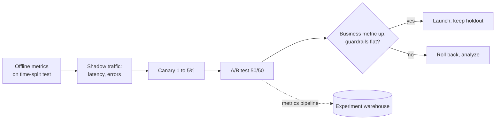

**Reading the diagram.** A model moves left to right through gates of increasing cost and realism. Offline metrics are cheap but only approximate. **Shadow** deployment runs the new model on real requests without using its output, which tests latency and errors (§66.12). A **canary** exposes a small slice of users and protects against outright breakage (§43.6). The A/B test is the only gate that measures causal business impact. Metrics flow asynchronously to an experiment warehouse. Failure points are each gate's blind spots: offline cannot see feedback effects; a canary is too small to detect a 1% revenue change. The launch keeps a small long-term **holdout** to measure effects that accumulate over months.

## 57.14 A/B testing statistics for ML launches

### 57.14.1 Hypothesis tests, p-values and confidence intervals

::: definition
**Definition — A/B test (online controlled experiment).** Users are randomly assigned to control (A, old model) or treatment (B, new model), and a metric is compared between the groups. Randomization makes the groups alike in everything except the model, so a difference larger than chance is caused by the model [Kohavi et al. 2020].
:::

The **null hypothesis** $H_0$ is "no difference". The **p-value** is the probability of a difference at least as large as observed *if $H_0$ were true*; it is not the probability that $H_0$ is true. Rejecting $H_0$ when $p < \alpha$ (commonly $\alpha = 0.05$) means accepting a 5% **false-positive** (type I) rate. **Power** $1 - \beta$ is the probability of detecting a real effect of a given size; missing it is a **type II** error. The **minimum detectable effect** (MDE) is the smallest effect the test is sized to detect with that power. The canary judge of §43.6.4 applies the same pooled two-proportion test to error rates, one-sided because only a regression matters there; a model A/B test is two-sided because the new model can move the metric either way.

::: formula
**Two-proportion z-test and confidence interval**

$$z = \frac{\hat{p}_B - \hat{p}_A}{\sqrt{\bar{p}(1 - \bar{p})\left(\frac{1}{n_A} + \frac{1}{n_B}\right)}} \qquad \text{CI}_{95\%} = (\hat{p}_B - \hat{p}_A) \pm 1.96\sqrt{\frac{\hat{p}_A(1 - \hat{p}_A)}{n_A} + \frac{\hat{p}_B(1 - \hat{p}_B)}{n_B}}$$

| Symbol | Meaning | Units |
|---|---|---|
| $\hat{p}_A, \hat{p}_B$ | Observed conversion rate in each arm | fraction |
| $\bar{p}$ | Pooled rate, all converters / all users | fraction |
| $n_A, n_B$ | Users per arm | users |
| $z$ | Test statistic; $\lvert z\rvert > 1.96$ means $p < 0.05$ two-sided | standard errors |
| 1.96 | Normal quantile for 95% two-sided | — |
:::

### 57.14.2 Power and sample size

::: formula
**Sample size per arm for a difference in proportions**

$$n = \frac{\big(z_{1-\alpha/2} + z_{1-\beta}\big)^2\,\big[p_A(1 - p_A) + p_B(1 - p_B)\big]}{(p_B - p_A)^2} \;\approx\; \frac{16\,\sigma^2}{\delta^2}\ \ (\alpha = 0.05,\ \text{power } 0.8)$$

| Symbol | Meaning | Units |
|---|---|---|
| $n$ | Users needed in each arm | users |
| $z_{1-\alpha/2}$ | 1.960 for $\alpha = 0.05$ two-sided | — |
| $z_{1-\beta}$ | 0.842 for power 0.8 | — |
| $p_A$; $p_B = p_A(1 + \text{MDE}_{rel})$ | Baseline rate; rate under the MDE | fraction |
| $\delta = p_B - p_A$; $\sigma^2 = p_A(1 - p_A)$ | Absolute MDE; metric variance | fraction; fraction² |
:::

::: example
**Worked example — Sizing QuickBite's new-ranker test.** The metric is the share of users who order from the recommendation feed during the test, with baseline $p_A = 0.10$ (assumed). The team wants to detect a +2% relative lift, so $p_B = 0.102$ and $\delta = 0.002$.

1. $(z_{0.975} + z_{0.8})^2 = (1.95996 + 0.84162)^2 = 2.80158^2 = 7.849$.
2. Variances: $0.10 \times 0.90 = 0.0900$; $0.102 \times 0.898 = 0.0916$; sum $0.1816$.
3. $n = 7.849 \times 0.1816 / 0.002^2 = 1.4254 / 0.000004 = 356{,}300$ users per arm (the code below gives 356,332 without rounding).
4. Rule of thumb: $16 \times 0.09 / 0.000004 = 360{,}000$. Close.
5. Halving the MDE to +1% needs four times the users: 1,419,070 per arm.
6. Traffic: about 4 million distinct users open the app in a week (assumed). Giving 10% to each arm enrolls about 400,000 per arm in 7 days, enough. Run a full week regardless, to cover weekday and weekend behavior.

**Interpretation.** Sample size scales with $1/\delta^2$: small effects are expensive. **Engineering implication.** Fix the MDE, $\alpha$, power and duration *before* starting, and decide whether the business would even act on an effect smaller than the MDE.
:::

::: example
**Worked example — Reading the result.** After 7 days: control 40,000 of 400,000 users converted (10.0%); treatment 40,800 of 400,000 (10.2%).

1. Pooled $\bar{p} = 80{,}800/800{,}000 = 0.101$. Standard error $= \sqrt{0.101 \times 0.899 \times 2/400{,}000} = \sqrt{4.540 \times 10^{-7}} = 0.000674$.
2. $z = 0.002/0.000674 = 2.97$, two-sided p-value 0.003.
3. 95% CI: $0.002 \pm 1.96 \times 0.000674 = [+0.0007, +0.0033]$, a relative lift between +0.7% and +3.3%.

**Interpretation.** The lift is statistically significant, and the interval excludes zero but is wide. **Engineering implication.** Launch only if guardrails (delivery time, p99 latency, cancellations) are also flat, and plan the capacity for the lower end of the interval, not the point estimate.
:::

```python
import numpy as np
from scipy.stats import norm

def n_per_arm(p0, rel_mde, alpha=0.05, power=0.80):
    p1 = p0 * (1 + rel_mde)
    z = norm.ppf(1 - alpha / 2) + norm.ppf(power)
    return int(np.ceil(z**2 * (p0 * (1 - p0) + p1 * (1 - p1)) / (p1 - p0) ** 2))

print("n per arm, p0=10%, MDE +2% relative:", n_per_arm(0.10, 0.02))
print("n per arm, p0=10%, MDE +1% relative:", n_per_arm(0.10, 0.01))

n_c, x_c, n_t, x_t = 400_000, 40_000, 400_000, 40_800
p_c, p_t = x_c / n_c, x_t / n_t
p_pool = (x_c + x_t) / (n_c + n_t)
z = (p_t - p_c) / np.sqrt(p_pool * (1 - p_pool) * (1 / n_c + 1 / n_t))
se = np.sqrt(p_c * (1 - p_c) / n_c + p_t * (1 - p_t) / n_t)
print(f"lift {p_t - p_c:+.4f}  z {z:.2f}  p-value {2 * (1 - norm.cdf(abs(z))):.4f}  "
      f"95% CI [{p_t - p_c - 1.96 * se:+.4f}, {p_t - p_c + 1.96 * se:+.4f}]")

# The peeking problem: 2,000 A/A tests (no real difference), checked 14 times
rng = np.random.default_rng(57)
sims, looks, per_look = 2_000, 14, 400_000 // 14
fp_once = fp_peek = 0
for _ in range(sims):
    a = rng.binomial(per_look, 0.10, looks).cumsum()
    b = rng.binomial(per_look, 0.10, looks).cumsum()
    n = per_look * np.arange(1, looks + 1)
    pool = (a + b) / (2 * n)
    zs = (b - a) / n / np.sqrt(pool * (1 - pool) * 2 / n)
    fp_once += abs(zs[-1]) > 1.96                 # test once, at the end
    fp_peek += np.any(np.abs(zs) > 1.96)          # stop at the first p < 0.05
print(f"false-positive rate, single test: {fp_once / sims:.3f}")
print(f"false-positive rate, 14 peeks:    {fp_peek / sims:.3f}")
```

Output:

```text
n per arm, p0=10%, MDE +2% relative: 356332
n per arm, p0=10%, MDE +1% relative: 1419070
lift +0.0020  z 2.97  p-value 0.0030  95% CI [+0.0007, +0.0033]
false-positive rate, single test: 0.057
false-positive rate, 14 peeks:    0.220
```

What to notice:

- The formula, the hand calculation and the code agree.
- With no real difference, testing once gives about the promised 5% false positives (0.057 here, within simulation noise). Checking twice a day and stopping at the first $p < 0.05$ gives 22%: more than four times the advertised error rate.

### 57.14.3 Traps: peeking, multiple comparisons, novelty, and the right unit

**Figure 57.12 — A/B test flow for a model launch.**

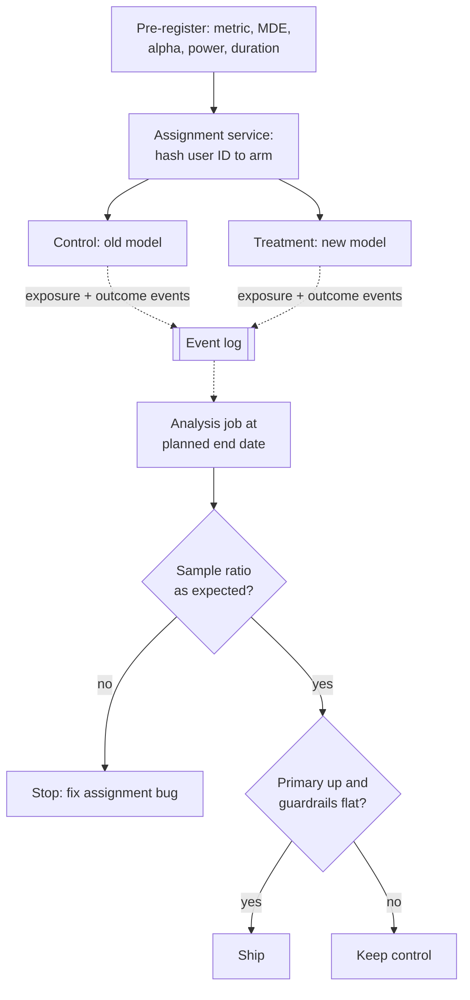

**Reading the diagram.** The plan is fixed first. A stateless assignment service hashes the user ID so that each user sees the same arm on every request (synchronous, in the request path; Chapter 43 covers the flag mechanics). Both arms log exposures and outcomes asynchronously to an event log (dotted). The analysis runs once at the planned end. Its first check is the **sample ratio mismatch** test: if a 50/50 split produced 51/49 on 800,000 users, assignment or logging is broken and no metric can be trusted. Failure points: assignment that is not sticky, logging that drops events in one arm only, and stopping early. Scaling: assignment is a hash, so it costs nothing; the analysis pipeline grows with events and the number of metrics.

- **Peeking.** Repeated looks inflate false positives, as the simulation shows. Analyze once at the planned sample size, or use a sequential method designed for continuous monitoring [Johari et al. 2017].
- **Multiple comparisons.** Testing 20 metrics at $\alpha = 0.05$ gives an expected one false "win" even when nothing changed. Name one primary metric in advance; for the rest, apply a correction such as Bonferroni ($\alpha/m$) or control the false discovery rate [Benjamini and Hochberg 1995].
- **Novelty and primacy effects.** Users click on anything new for a few days (novelty) or resist change (primacy). Run at least one or two full weeks and plot the effect by day since first exposure; an effect that decays toward zero is novelty.
- **Unit of randomization.** Randomize and analyze the same unit. Randomizing by user but counting sessions as independent understates the variance; use user-level metrics or the delta method [Kohavi et al. 2020]. When units interfere (couriers shared by both arms in one city), randomize by city and time slice instead (§55.5).
- **Interleaving for ranking.** Instead of splitting users, show each user one list that interleaves results from both rankers and credit each ranker for the clicks its items receive. Every user compares both models, so far fewer users are needed to tell which ranks better [Chapelle et al. 2012]. Interleaving says which ranker users prefer, not how much revenue changes, so it is used to screen candidates before an A/B test.

::: industry
**Microsoft Bing — a small change, measured properly.** Kohavi, Tang and Xu describe an engineer's low-priority idea to lengthen ad titles on Bing that sat in the backlog for months. When finally A/B tested, it raised revenue by about 12%, which they report as worth over \$100 million a year in the US, and it passed guardrails. Their point is that intuition is a poor predictor of impact, and only a controlled experiment reveals it.
*Evidence: Primary* — [Kohavi et al. 2020, ch. 1]
:::

::: industry
**Netflix — interleaving as a first stage.** Netflix described a two-stage process for ranking algorithms: interleaving experiments quickly prune a large set of candidates, and the survivors go to conventional A/B tests that measure long-term member behavior. It reported that interleaving reached the same conclusions with far smaller samples.
*Evidence: Primary* — [Netflix Technology Blog 2017]
:::

::: mistake
**Mistake — "p = 0.03, so there is a 97% chance the new model is better."** The p-value assumes no effect and asks how surprising the data are. It does not give the probability that the model is better. Report the confidence interval of the effect, which says how large the improvement plausibly is.
:::

## 57.15 Summary and revision notes

::: summary
- ML learns a function from examples; choose it over rules when logic is complex, drifts, has labels, tolerates measurable error and matters at your volume. Keep the rule baseline as fallback and yardstick.
- Paradigms differ by feedback: labels (supervised), none (unsupervised), labels made from the data (self-supervised, which powers LLMs and embeddings), rewards (RL; bandits in practice).
- Training is a throughput-bound batch job; inference is a latency-bound service that often costs more over the model's life.
- Labels are explicit, implicit or delayed. Leakage, a feature unavailable at prediction time, produces brilliant offline metrics and useless models; build features point-in-time.
- Use time-based splits, with a label-maturity gap, for production data; group splits when entities repeat.
- Training error far below validation error is overfitting (variance); both high is underfitting (bias). Regularization trades one for the other; nothing beats the noise floor.
- Gradient descent steps against the gradient of the loss; log loss for probabilities, MSE for numbers, pinball loss for quantiles.
- Under imbalance, accuracy is meaningless: report precision, recall, PR-AUC, and calibration (log loss, Brier, reliability bins).
- MAE for typical error, RMSE for large misses, avoid MAPE near zero; NDCG and MRR for ranking, stating the gain function.
- Offline metrics are proxies. Size A/B tests with $n \approx 16\sigma^2/\delta^2$, analyze once, pre-register one primary metric, watch guardrails and novelty.
:::

## 57.16 Knowledge checkpoint

1. Give two checklist reasons fraud suits ML and delivery fees suit rules.
2. Which paradigm trains dish embeddings from baskets, and why needs it no annotators?
3. Why can inference cost exceed training cost for an ETA model?
4. Name the leaky feature: `account_status`, `card_age_days`, `basket_value`.
5. Why does a random split overstate performance on drifting data?
6. Training MSE 2.9, validation MSE 16.2, noise variance 4. Diagnosis and two remedies?
7. One logistic step: $w = 0$, $b = 0$, $x = 1$, $y = 1$, $\eta = 1$. New $w$?
8. TP 30, FP 70, FN 20. Precision, recall and F1?
9. Why does ROC-AUC barely change when fraud falls from 1% to 0.1%, while PR-AUC drops?
10. Two models share ROC-AUC 0.84; Brier scores are 0.07 and 0.11. Which is better for expected-loss pricing?
11. Errors 2, 2 and 14 minutes: MAE and RMSE?
12. Pinball loss at $q = 0.9$ for a delivery 10 minutes late, and 10 minutes early?
13. First relevant results at ranks 1, 2 and 5 for three queries. MRR?
14. Baseline 20%, absolute MDE 1 point, $\alpha = 0.05$, power 0.8: users per arm (rule of thumb)?
15. Why does checking an A/B test daily inflate false positives?

<details><summary>Answers</summary>

1. Fraud: many interacting signals, adversarial drift, chargeback labels. Fees: short, stable, must be exact, no label to learn.
2. Self-supervised: the target (other dishes in the basket) comes from the data itself.
3. It scores every displayed restaurant: about 360 million predictions per day versus 45 million training rows per run.
4. `account_status`: set after fraud is confirmed.
5. Training contains rows from the test period, so the model has already seen future patterns.
6. Overfitting (training below the noise floor). Regularize, simplify, or add data.
7. $p = 0.5$, gradient $-0.5$, so $w = 0.5$.
8. Precision 0.30, recall 0.60, F1 $= 0.36/0.90 = 0.40$.
9. FPR divides by the huge negative count; precision divides by flagged orders, which become mostly false positives.
10. The one with Brier 0.07: with the same ranking, its probabilities are better calibrated.
11. MAE 6; RMSE $\sqrt{68} = 8.25$.
12. Late: $0.9 \times 10 = 9$; early: $0.1 \times 10 = 1$.
13. $(1 + 0.5 + 0.2)/3 = 0.567$.
14. $16 \times 0.16/0.0001 = 25{,}600$.
15. Each look is another chance for noise to cross the threshold; with 14 looks the simulated rate was 22%.
</details>

## 57.17 Interview questions

### Basic

**Q1. How would you evaluate a fraud model?**
**Answer.** On a time-based holdout older than the label-maturity window: precision and recall at the operating threshold, PR-AUC across thresholds, Brier score or reliability bins if probabilities drive decisions, then an A/B test on chargeback losses with good-customer block rate as a guardrail. Accuracy is useless at 0.5% fraud.

**Q2. What is overfitting and how do you detect it?**
**Answer.** Fitting noise: training error well below validation error. Remedies: regularization, simpler models, more data, early stopping.

### Intermediate

**Q3. Offline NDCG rose 4% but orders fell in the A/B test. Why?**
**Answer.** Proxy mismatch (clicks are not orders), logged-data bias (unseen items cannot be scored), higher latency, or training–serving skew. Check guardrails, compare online and offline feature values, and evaluate with interleaving and counterfactual methods.

**Q4. How do you choose a threshold?**
**Answer.** From costs and capacity: minimize $c_{FN} \cdot FN + c_{FP} \cdot FP$ on validation data, subject to review-queue capacity, then confirm online.

### Advanced

**Q5. Design the evaluation for an ETA model whose promise customers see.**
**Answer.** Train quantile models (pinball loss at $q = 0.5$ and $0.9$), split by time and hold out unseen restaurants. Offline: MAE, p90 absolute error, coverage by city and hour. Online: A/B on cancellations and support tickets, with guardrails on conversion. Monitor coverage daily; labels arrive within an hour.

**Q6. Your experiment platform shows 1 in 4 tests as wins. Concerns?**
**Answer.** Peeking, many uncorrected metrics, underpowered tests whose significant results overstate effects, sample ratio mismatch and novelty. Require pre-registration, one primary metric, fixed duration or sequential tests, SRM checks and holdouts.

## 57.18 Practical exercises

1. Rerun §57.8 with 250 training points. How do the U-curve and best degree move? Explain with bias–variance.
2. Add L2 regularization to the logistic regression of §57.9 and plot the weights versus $\lambda$.
3. Recalibrate the overconfident model of §57.10.3 with isotonic regression fitted on a held-out half; report the new Brier score.
4. Extend the peeking simulation to apply Bonferroni across 14 looks; report the false-positive rate and power for a +2% lift.

## 57.19 Design challenges

1. **Fraud labels for a new market.** QuickBite launches where chargeback data takes 90 days. Design the label sources, splits and launch metrics for the first quarter.
2. **Promise versus accuracy.** Product wants ETAs both accurate and rarely late. Define the metrics, model outputs and A/B guardrails, and explain the trade-off.

## 57.20 References

1. Benjamini, Y., Hochberg, Y. *Controlling the False Discovery Rate: A Practical and Powerful Approach to Multiple Testing*. Journal of the Royal Statistical Society, Series B 57(1), 1995.
2. Bishop, C. M. *Pattern Recognition and Machine Learning*. Springer, 2006.
3. Chapelle, O., Joachims, T., Radlinski, F., Yue, Y. *Large-Scale Validation and Analysis of Interleaved Search Evaluation*. ACM Transactions on Information Systems 30(1), 2012.
4. Davis, J., Goadrich, M. *The Relationship Between Precision-Recall and ROC Curves*. ICML, 2006.
5. Goodfellow, I., Bengio, Y., Courville, A. *Deep Learning*. MIT Press, 2016. https://www.deeplearningbook.org
6. Guo, C., Pleiss, G., Sun, Y., Weinberger, K. Q. *On Calibration of Modern Neural Networks*. ICML, 2017.
7. Hastie, T., Tibshirani, R., Friedman, J. *The Elements of Statistical Learning*, 2nd ed. Springer, 2009.
8. Hu, X., et al. *DeepETA: How Uber Predicts Arrival Times Using Deep Learning*. Uber Engineering Blog, 2022. https://www.uber.com/blog/deepeta-how-uber-predicts-arrival-times/
9. Hyndman, R. J., Koehler, A. B. *Another Look at Measures of Forecast Accuracy*. International Journal of Forecasting 22(4), 2006.
10. Järvelin, K., Kekäläinen, J. *Cumulated Gain-Based Evaluation of IR Techniques*. ACM Transactions on Information Systems 20(4), 2002.
11. Johari, R., Koomen, P., Pekelis, L., Walsh, D. *Peeking at A/B Tests: Why It Matters, and What to Do About It*. ACM KDD, 2017.
12. Kaufman, S., Rosset, S., Perlich, C., Stitelman, O. *Leakage in Data Mining: Formulation, Detection, and Avoidance*. ACM Transactions on Knowledge Discovery from Data 6(4), 2012.
13. Koenker, R., Bassett, G. *Regression Quantiles*. Econometrica 46(1), 1978.
14. Kohavi, R., Tang, D., Xu, Y. *Trustworthy Online Controlled Experiments: A Practical Guide to A/B Testing*. Cambridge University Press, 2020.
15. Mikolov, T., Chen, K., Corrado, G., Dean, J. *Efficient Estimation of Word Representations in Vector Space*. ICLR Workshop, 2013. https://arxiv.org/abs/1301.3781
16. Murphy, K. P. *Probabilistic Machine Learning: An Introduction*. MIT Press, 2022.
17. Netflix Technology Blog. *Innovating Faster on Personalization Algorithms at Netflix Using Interleaving*. 2017. https://netflixtechblog.com/interleaving-in-online-experiments-at-netflix-a04ee392ec55
18. Niculescu-Mizil, A., Caruana, R. *Predicting Good Probabilities with Supervised Learning*. ICML, 2005.
19. Saito, T., Rehmsmeier, M. *The Precision-Recall Plot Is More Informative than the ROC Plot When Evaluating Binary Classifiers on Imbalanced Datasets*. PLOS ONE 10(3), 2015.
20. Sutton, R. S., Barto, A. G. *Reinforcement Learning: An Introduction*, 2nd ed. MIT Press, 2018.
21. Zinkevich, M. *Rules of Machine Learning: Best Practices for ML Engineering*. Google Developers, accessed 2026. https://developers.google.com/machine-learning/guides/rules-of-ml

## 57.21 Open verification items

- Hu et al. 2022 (Uber DeepETA): full author list and canonical URL not checked (site unreachable); the residual-prediction design was confirmed only through search summaries.
- Netflix 2017 interleaving post: authors and any sample-size ratio not verified; the text claims only "far smaller samples".
- Kohavi et al. 2020, ch. 1: confirm the ~12% revenue and >\$100M/year figures for the Bing ad-title example.
- Section references to Hastie et al. (§7.3, §7.10, ch. 14), Bishop (§3.2), Goodfellow et al. (§5.5) and Murphy (ch. 10) should be checked against the printed editions.
