# Chapter 58 — Deep Learning Essentials for System Designers

> **Level:** 2–3 · **Track:** B (ML/AI) · **Estimated reading time:** 5 h

Chapter 57 treated a model as a function with parameters that gradient descent adjusts to reduce a loss. Deep learning keeps that recipe and changes the function: instead of a few hundred hand-chosen coefficients, a **neural network** stacks simple layers into a function with millions or billions of parameters, and learns its own features from raw inputs such as pixels, words or user IDs. That change is what makes deep learning powerful, and it is also what makes it a *systems* problem. A 7-billion-parameter model needs more than 100 GB of accelerator memory just to train, an embedding table for 100 million users is a 25 GB data structure that must be partitioned and served, and a single training run can consume tens of thousands of GPU-hours.

You do not need to invent architectures to design systems around them. You need to know what a layer computes, why training costs about three times inference, where the memory goes, which architectures parallelize, how to read a loss curve, and when a gradient-boosted tree is the better choice. This chapter gives you that, with arithmetic reused in Chapters 64, 65, 67, 68, 72–73 and 89. For a full textbook treatment of the mathematics, see Goodfellow et al. [2016].

The running example is **QuickBite**, the food-delivery company from Chapter 2. Its machine-learning problems include predicting delivery time (ETA), recommending restaurants and dishes, and detecting fraud. QuickBite's numbers below (2 million daily active users and 50,000 restaurants, §2.11; a search peak of 2,000 requests per second showing 20 restaurants each, §2.4) come from Chapter 2; anything new is stated as an assumption.

## 58.1 Learning objectives

After this chapter you should be able to:

- Compute the parameter count of a multilayer perceptron, an embedding table and a convolutional layer from their shapes.
- Explain backpropagation as reverse-mode differentiation on a computational graph, and show why a training step costs about three forward passes.
- Implement a small network with manual backpropagation and verify it with a numerical gradient check.
- Describe SGD with momentum, Adam and AdamW, learning-rate warmup and cosine decay, and the memory each optimizer adds.
- Size embedding tables and explain why they dominate memory in recommendation models.
- Explain why convolutions share weights, why recurrent networks cannot parallelize over time, and why attention can.
- Diagnose underfitting, overfitting, divergence and plateaus from loss curves, and choose remedies (learning rate, normalization, dropout, early stopping, gradient clipping).
- Estimate training memory (about 16 bytes per parameter for mixed-precision Adam, plus activations) and training compute (about $6ND$ FLOPs).
- Decide between gradient-boosted trees and deep learning for a given problem, and explain the cost and latency consequences.
- Explain what eager versus compiled execution in PyTorch, TensorFlow and JAX means for deployment.

## 58.2 Prerequisites

- Loss functions and gradient descent — §57.9; splits — §57.7; overfitting and regularization — §57.8; training versus inference — §57.5 (this chapter builds directly on them).
- Vectors, matrices and matrix multiplication — §4.9 (every layer is a matrix multiply).
- SIMD and accelerators — §5.11 (why matrix multiplies run fast on GPUs; Chapter 64 goes deeper).
- Back-of-the-envelope estimation — §2.11 (all sizing in this chapter uses the same method).
- Partitioning and caching — §14.6 and Chapter 20 (embedding tables are partitioned, cached key–value data).

Units: this chapter uses SI prefixes (1 GB = 10⁹ bytes) and counts one multiply–add as **2 FLOPs** (floating-point operations), the convention used by most papers and by PyTorch's FLOP counter.

## 58.3 Neurons and multilayer perceptrons

### 58.3.1 The artificial neuron and the linear layer

::: definition
**Definition — Neuron and linear layer.** An artificial **neuron** computes a weighted sum of its inputs plus a **bias**, then applies a nonlinear **activation function**: $y = \phi(\mathbf{w}^\top \mathbf{x} + b)$. A **linear layer** (also called a dense or fully connected layer) is $n_\text{out}$ neurons that read the same $n_\text{in}$ inputs; its weights form an $n_\text{in} \times n_\text{out}$ matrix $W$, so the layer computes $\mathbf{h} = \phi(\mathbf{x} W + \mathbf{b})$ for a whole input vector at once.
:::

#### First-principles explanation

Think of a QuickBite dispatcher estimating delivery time. She looks at the distance, how busy the kitchen is and whether it is raining, gives each a weight in her head, adds them up and adjusts for a fixed overhead. That is a linear model, trained with gradient descent in §57.9. A neuron is the same weighted sum followed by a "switch": the **activation function** decides how strongly the neuron fires. The most common switch today is the **rectified linear unit**, $\text{ReLU}(z) = \max(0, z)$: it passes positive values unchanged and outputs zero for negative ones. One neuron can learn a rule such as "if distance is long *and* it is raining, add time", but only if its threshold falls in the right place; many neurons together can carve the input space into many such regions.

#### Why does this exist?

Linear models cannot represent interactions or thresholds unless an engineer builds those features by hand ("distance × rain", "hour is in lunch rush"). Hand-crafted features are slow to invent, brittle, and impossible for raw pixels or text. A network of neurons learns its own intermediate features. The nonlinearity is essential: a stack of linear layers without activations collapses into one linear layer, because $(\mathbf{x}W_1)W_2 = \mathbf{x}(W_1W_2)$.

**Figure 58.1 — One neuron: weighted sum, bias and activation.**

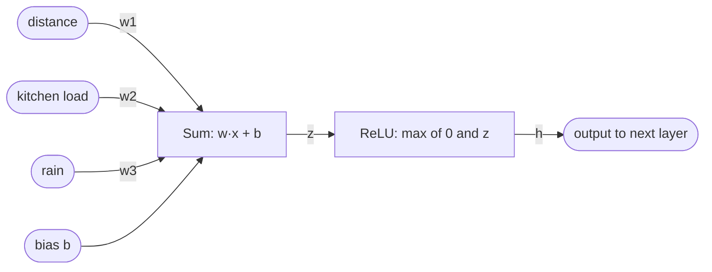

**Reading the diagram.** Three input features are multiplied by learned weights on the edges and summed with a learned bias. The pre-activation $z$ passes through ReLU, producing $h$, an input to every neuron of the next layer. Data flows left to right at inference; in training, gradients flow back along the same edges (§58.4). The weights live in memory next to the computation. The ReLU-specific failure is a **dead neuron**: if $z$ is negative for every input, output and gradient are always zero and the neuron never recovers. Scaling means more neurons (width) and layers (depth), expressed as matrix multiplies.

**Table 58.1 — Common activation functions.**

| Activation | Formula | Range | Where used | Systems note |
|---|---|---|---|---|
| ReLU | $\max(0, z)$ | $[0, \infty)$ | MLPs, CNNs | Cheapest; can "die" with large learning rates |
| Sigmoid | $1/(1+e^{-z})$ | $(0, 1)$ | Binary outputs, LSTM gates | Saturates; gradient at most 0.25 |
| Tanh | $(e^z - e^{-z})/(e^z + e^{-z})$ | $(-1, 1)$ | RNN states | Saturates at both ends |
| GELU / SiLU | $z \cdot \Phi(z)$ / $z \cdot \sigma(z)$ | about $(-0.3, \infty)$ | Transformers | Smooth; slightly more compute per element |
| Softmax | $e^{z_i} / \sum_j e^{z_j}$ | $(0,1)$, sums to 1 | Multi-class outputs, attention | Needs a numerically stable implementation |

### 58.3.2 Multilayer perceptrons and why depth helps

::: definition
**Definition — Multilayer perceptron (MLP).** A network of linear layers with nonlinear activations between them: input layer → one or more **hidden layers** → output layer. Each layer's output is the next layer's input. The **width** is the number of neurons per hidden layer and the **depth** is the number of layers with weights.
:::

#### How it works internally

1. Represent each example as a feature vector $\mathbf{x}$ of length $n_0$; stack $B$ examples into a **batch** matrix $X$ of shape $B \times n_0$.
2. Layer 1 computes $H_1 = \phi(X W_1 + \mathbf{b}_1)$, shape $B \times n_1$.
3. Each further hidden layer repeats this with its own $W_\ell, \mathbf{b}_\ell$.
4. The output layer omits the activation for regression (ETA in minutes) or applies sigmoid/softmax for classification (fraud probability, cuisine class).
5. The loss from Chapter 57 (mean squared error, cross-entropy) compares outputs with labels.

**Figure 58.2 — A QuickBite ETA multilayer perceptron.**

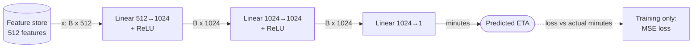

**Reading the diagram.** Features for a batch of $B$ orders arrive from a feature store (Chapter 62) as a $B \times 512$ matrix. Two hidden layers of 1,024 ReLU neurons transform them; the last layer emits the predicted minutes. Solid arrows are the synchronous forward computation used in training and serving; the dotted loss path exists only in training, once actual delivery times arrive as labels. The storage boundary is the feature store; a stale or missing feature there is the most common production failure (training–serving skew). The model scales by batching requests into one matrix multiply (§66.6).

#### Universal approximation and why depth helps

The **universal approximation theorem** [Cybenko 1989; Hornik et al. 1989] says that an MLP with a single hidden layer and enough neurons can approximate any continuous function on a bounded input region as closely as you like. The intuition with ReLU is visual: each neuron contributes a "hinge", and a sum of enough hinges can trace any curve as a piecewise-linear approximation, the way a polygon with enough sides approximates a circle.

The theorem says nothing about *how many* neurons are needed or whether gradient descent will find them. Depth makes the count practical: each layer composes the previous layer's features, so the number of linear regions a ReLU network can represent grows exponentially with depth but only polynomially with width [Montúfar et al. 2014]. Early layers learn simple features (edges, "is lunch hour"); later layers combine them (faces, "lunch hour at a busy kitchen in the rain"). The systems cost: layers run one after another, adding latency, and very deep networks need residual connections and normalization to train (§58.10).

#### Mathematical foundations

::: formula
**Parameter count of an MLP**

$$P = \sum_{\ell=1}^{L} \left( n_{\ell-1}\, n_\ell + n_\ell \right)$$

| Symbol | Meaning | Units |
|---|---|---|
| $P$ | Total trainable parameters | parameters |
| $L$ | Number of linear layers | layers |
| $n_{\ell-1}$ | Inputs to layer $\ell$ (fan-in); $n_0$ is the feature count | neurons |
| $n_\ell$ | Outputs of layer $\ell$ (fan-out) | neurons |
| $n_{\ell-1} n_\ell$ | Weights of layer $\ell$ | parameters |
| $n_\ell$ | Biases of layer $\ell$ | parameters |
:::

::: example
**Worked example — Parameters and memory of the QuickBite ETA MLP.** Widths are $[512, 1024, 1024, 1]$ as in Figure 58.2.

1. Layer 1: $512 \times 1024 + 1024 = 524{,}288 + 1{,}024 = 525{,}312$.
2. Layer 2: $1024 \times 1024 + 1024 = 1{,}048{,}576 + 1{,}024 = 1{,}049{,}600$.
3. Layer 3: $1024 \times 1 + 1 = 1{,}025$.
4. Total: $P = 525{,}312 + 1{,}049{,}600 + 1{,}025 = 1{,}575{,}937$ parameters (PyTorch reports the same number; see the code in §58.12).
5. Memory in 32-bit floats (FP32, 4 bytes): $1{,}575{,}937 \times 4 \approx 6.3$ MB.

**Interpretation.** The middle layer holds two-thirds of the parameters: count grows with the *product* of adjacent widths, so doubling every hidden width roughly quadruples the model. **Engineering implication.** A 6 MB model can be replicated to every CPU serving node with no GPU or sharding. At hidden width 4,096 and dozens of layers the same arithmetic gives billions of parameters, and every later section of this chapter starts to matter.
:::

#### Advantages, disadvantages and misconceptions

MLPs are general, simple to serve and inside every larger architecture (a transformer's feed-forward block is an MLP). They are data-hungry, ignore input structure (a pixel's neighbors mean nothing to them) and on small tabular datasets usually lose to gradient-boosted trees (§58.13).

::: mistake
**"More layers always means a better model."** Without residual connections and normalization, deep plain MLPs often train *worse* than shallow ones because gradients vanish or explode (§58.8, §58.10). Depth is a capacity budget you spend; it also adds latency, because layers run one after another.
:::

## 58.4 Backpropagation

### 58.4.1 Computational graphs and the chain rule

::: definition
**Definition — Backpropagation.** An algorithm that computes the gradient of a scalar loss with respect to every parameter of a network by applying the chain rule backward through the **computational graph** of the forward computation, reusing intermediate results so that the whole gradient costs only a small constant multiple of one forward pass [Rumelhart et al. 1986]. In modern frameworks it is implemented as **reverse-mode automatic differentiation** (autograd).
:::

#### First-principles explanation

Picture a post-mortem for a QuickBite order that arrived 10 minutes late. The courier was late because pickup was late, which was late because the kitchen was slow. Walking backward from the outcome, you multiply "how much the outcome depends on this step" by "how much this step depends on the one before". That is the chain rule, and one backward walk assigns blame to every step at once instead of re-running the evening once per step.

Gradient descent (Chapter 57) needs $\partial L / \partial \theta$ for every parameter $\theta$. Estimating each one by nudging it and re-running the network would cost one forward pass *per parameter*: 1.6 million forward passes for the ETA model, $7 \times 10^9$ for a 7B language model. Backpropagation gets all of them for about the cost of two more forward passes.

#### How it works internally

A **computational graph** records every operation of the forward pass as a node, with edges carrying tensors. For the two-layer network in the code below:

1. **Forward pass.** Compute $Z_1 = XW_1 + \mathbf{b}_1$, $H_1 = \text{ReLU}(Z_1)$, $\hat{Y} = H_1 W_2 + \mathbf{b}_2$, and $L = \frac{1}{B}\sum (\hat{y} - y)^2$. **Save** the intermediate tensors $X, Z_1, H_1, \hat{Y}$ — these saved tensors are the **activations** whose memory dominates large-batch training (§58.11).
2. **Seed.** Start with $\partial L/\partial L = 1$ and compute $\partial L/\partial \hat{Y} = \frac{2}{B}(\hat{Y} - Y)$.
3. **Linear layer backward.** For $\hat{Y} = H_1W_2 + \mathbf{b}_2$: the weight gradient is $\partial L/\partial W_2 = H_1^\top (\partial L/\partial \hat{Y})$; the bias gradient sums over the batch; the gradient passed backward is $\partial L/\partial H_1 = (\partial L/\partial \hat{Y}) W_2^\top$.
4. **Activation backward.** ReLU passes the gradient where $Z_1 > 0$ and blocks it elsewhere: $\partial L/\partial Z_1 = \partial L/\partial H_1 \odot \mathbb{1}[Z_1 > 0]$. This needs the saved $Z_1$.
5. **Repeat** for layer 1. Its input gradient $\partial L/\partial X$ is skipped because $X$ is data, not a parameter.
6. **Update.** The optimizer (§58.5) uses the gradients, then the graph and saved activations are freed.

**Figure 58.3 — Computational graph of a two-layer MLP with its backward pass.**

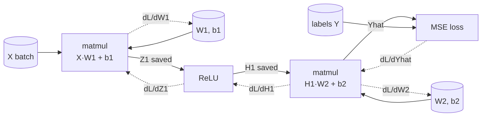

**Reading the diagram.** Rectangles are operations; cylinders are tensors in memory. Solid arrows are the forward pass, which saves $Z_1$ and $H_1$. Dotted arrows are the backward pass: from the loss, operations are visited in reverse, each sending a weight gradient to its parameters and an input gradient to the previous operation. Backward reads the saved tensors, so activations stay in memory until backward reaches them; that storage limits batch size. A NaN anywhere (an overflow in the loss, say) propagates into every gradient. To scale, the same graph runs on many devices with a gradient all-reduce before the update (Chapter 65).

### 58.4.2 Why backward costs about twice the forward pass

#### Mathematical foundations

A linear layer multiplies a $B \times n_\text{in}$ input by an $n_\text{in} \times n_\text{out}$ weight matrix: $B \cdot n_\text{in} \cdot n_\text{out}$ multiply–adds, or $2 B n_\text{in} n_\text{out}$ FLOPs. Backward performs **two** matrix multiplies of the same size: one for the weight gradient ($H^\top \cdot \delta$) and one for the input gradient ($\delta \cdot W^\top$). Element-wise operations (ReLU, bias, loss) are negligible next to the matrix multiplies.

::: formula
**FLOPs of a linear layer in training**

$$F_\text{fwd} = 2 B\, n_\text{in}\, n_\text{out} \qquad F_\text{bwd} \approx 2 F_\text{fwd} \qquad F_\text{step} \approx 3 F_\text{fwd} = 6 B\, n_\text{in}\, n_\text{out}$$

| Symbol | Meaning | Units |
|---|---|---|
| $F_\text{fwd}$ | Forward FLOPs of the layer for one batch | FLOPs |
| $F_\text{bwd}$ | Backward FLOPs (weight gradient + input gradient) | FLOPs |
| $F_\text{step}$ | FLOPs of one training step for the layer | FLOPs |
| $B$ | Batch size | examples |
| $n_\text{in}, n_\text{out}$ | Layer fan-in and fan-out | neurons |
:::

::: example
**Worked example — One training step of the ETA MLP.** Batch $B = 256$; the model has $P = 1{,}575{,}937$ parameters, almost all of them weights.

1. Forward: about $2 \times 256 \times 1{,}575{,}937 \approx 8.07 \times 10^8$ FLOPs. PyTorch's FLOP counter reports $805{,}830{,}656$, which is exactly $2 \times 256 \times 1{,}573{,}888$ weights (biases are not counted).
2. Backward, if the input gradient were needed for every layer: $2 \times 8.06 \times 10^8 = 1.61 \times 10^9$ FLOPs.
3. Layer 1's input is data, so its input-gradient multiply ($2 \times 256 \times 512 \times 1024 \approx 2.7 \times 10^8$ FLOPs) is skipped: backward is $1.34 \times 10^9$ FLOPs, or $1.67\times$ forward (measured, §58.12).
4. Per training example: $(8.06 \times 10^8 + 1.34 \times 10^9)/256 \approx 8.4$ MFLOPs, about $5.3$ FLOPs per parameter, close to the rule of thumb of 6.

**Interpretation.** Training costs about three forward passes, slightly less for shallow networks whose first layer is a large share of the work. **Engineering implication.** If inference on a dataset takes one hour, an epoch of training on it takes about three hours on the same hardware; this is where the $6N$ rule for training FLOPs per token comes from (§58.12).
:::

### 58.4.3 Runnable example: manual backpropagation with a gradient check

The program below builds a 3–16–1 ReLU network on synthetic QuickBite ETA data, computes gradients by hand, checks them against a **numerical gradient** (central differences, $\frac{L(\theta+\epsilon) - L(\theta-\epsilon)}{2\epsilon}$), and then trains with plain gradient descent using the hand-written gradients.

```python
import numpy as np

rng = np.random.default_rng(0)

# Toy QuickBite ETA data: 3 features -> delivery minutes (nonlinear target).
N, D, H = 256, 3, 16
X = rng.uniform(0.0, 1.0, size=(N, D))          # distance, prep load, rain (scaled 0..1)
y = (10 + 25 * X[:, :1] + 8 * X[:, 1:2] ** 2
     + 6 * X[:, :1] * X[:, 2:3])                 # minutes, shape (N, 1)
y = (y - y.mean()) / y.std()                     # standardize the label

def init(seed=1):
    r = np.random.default_rng(seed)
    return {"W1": r.normal(0, np.sqrt(2 / D), (D, H)), "b1": np.zeros(H),
            "W2": r.normal(0, np.sqrt(2 / H), (H, 1)), "b2": np.zeros(1)}

def forward(p, X, y):
    z1 = X @ p["W1"] + p["b1"]           # linear layer 1
    h1 = np.maximum(z1, 0.0)             # ReLU
    yhat = h1 @ p["W2"] + p["b2"]        # linear layer 2
    loss = np.mean((yhat - y) ** 2)      # mean squared error
    cache = (X, z1, h1, yhat, y)
    return loss, cache

def backward(p, cache):
    X, z1, h1, yhat, y = cache
    n = X.shape[0]
    dyhat = 2.0 * (yhat - y) / n         # dL/dyhat
    g = {"W2": h1.T @ dyhat,             # dL/dW2
         "b2": dyhat.sum(axis=0)}
    dh1 = dyhat @ p["W2"].T              # push gradient into hidden layer
    dz1 = dh1 * (z1 > 0)                 # ReLU passes gradient where z1 > 0
    g["W1"] = X.T @ dz1
    g["b1"] = dz1.sum(axis=0)
    return g

def numerical_grad(p, X, y, eps=1e-6):
    num = {}
    for k, v in p.items():
        gk = np.zeros_like(v)
        it = np.nditer(v, flags=["multi_index"])
        for _ in it:
            i = it.multi_index
            old = v[i]
            v[i] = old + eps; lp, _ = forward(p, X, y)
            v[i] = old - eps; lm, _ = forward(p, X, y)
            v[i] = old
            gk[i] = (lp - lm) / (2 * eps)  # central difference
        num[k] = gk
    return num

p = init()
loss, cache = forward(p, X, y)
ga = backward(p, cache)
gn = numerical_grad(p, X, y)
for k in p:
    rel = np.linalg.norm(ga[k] - gn[k]) / (np.linalg.norm(ga[k]) + np.linalg.norm(gn[k]))
    print(f"{k}: shape {p[k].shape}, relative error {rel:.1e}")
n_params = sum(v.size for v in p.values())
print(f"parameters: {n_params}")

# Plain gradient descent using our manual gradients.
lr = 0.05
for step in range(501):
    loss, cache = forward(p, X, y)
    if step % 100 == 0:
        print(f"step {step:3d}  loss {loss:.4f}")
    g = backward(p, cache)
    for k in p:
        p[k] -= lr * g[k]
```

Output (NumPy 2.x, runs in under a second):

```text
W1: shape (3, 16), relative error 3.0e-10
b1: shape (16,), relative error 3.1e-10
W2: shape (16, 1), relative error 1.2e-10
b2: shape (1,), relative error 1.1e-08
parameters: 81
step   0  loss 0.9701
step 100  loss 0.0383
step 200  loss 0.0061
step 300  loss 0.0045
step 400  loss 0.0039
step 500  loss 0.0036
```

What to notice:

- `forward` returns a `cache` of saved tensors; `backward` cannot run without it. That cache is the activation memory of §58.11, here a few kilobytes, in a large model hundreds of gigabytes.
- Each linear layer's backward is two matrix multiplies (`h1.T @ dyhat` and `dyhat @ p["W2"].T`), the source of the "backward ≈ 2× forward" rule. Layer 1 skips the second because `X` is data.
- `(z1 > 0)` is the entire ReLU backward: a mask, which is why ReLU networks are cheap to train.
- Relative errors near $10^{-10}$ mean the analytic gradient is correct; values above about $10^{-4}$ in double precision indicate a bug. The check costs two forward passes *per parameter*, which is fine for 81 parameters and is exactly why nobody trains this way.
- The initialization scale $\sqrt{2/\text{fan-in}}$ keeps activation variance roughly constant through ReLU layers [He et al. 2015]; with a much larger scale the first steps can diverge.

::: recommendation
**Trust autograd, test the boundaries.** You will almost never write backward passes by hand. You will write custom loss functions, custom layers and data transformations, and a gradient check (`torch.autograd.gradcheck` in PyTorch) on a tiny double-precision input is the cheapest unit test for them. Run it in CI for every custom operation.
:::

::: mistake
**"Backpropagation is how neural networks learn."** Backpropagation only *computes* gradients. The optimizer (§58.5) decides how to use them, and its settings change outcomes far more often than the backward pass does.
:::

## 58.5 Optimizers

### 58.5.1 SGD with momentum

::: definition
**Definition — Optimizer.** The algorithm that turns gradients into parameter updates. **Stochastic gradient descent (SGD)** updates $\theta \leftarrow \theta - \eta\, g$ using the gradient $g$ of a mini-batch and a **learning rate** $\eta$. **Momentum** keeps a running velocity $v \leftarrow \mu v + g$ and updates $\theta \leftarrow \theta - \eta v$, so consistent gradient directions accelerate and oscillating ones cancel [Polyak 1964; Sutskever et al. 2013].
:::

#### First-principles explanation

Plain SGD is a hiker who steps downhill wherever the local slope points. In a long, narrow valley that slope points mostly across the valley, so the hiker zig-zags between the walls. Momentum turns the hiker into a heavy ball: across-valley pushes alternate and cancel, while the consistent along-valley push accumulates. With $\mu = 0.9$, a constant gradient builds up to $1/(1-\mu) = 10$ times its single-step size.

#### How it works internally

Every training step has the same three phases, and the optimizer is the last one:

**Figure 58.4 — One training step: forward, backward, optimizer update.**

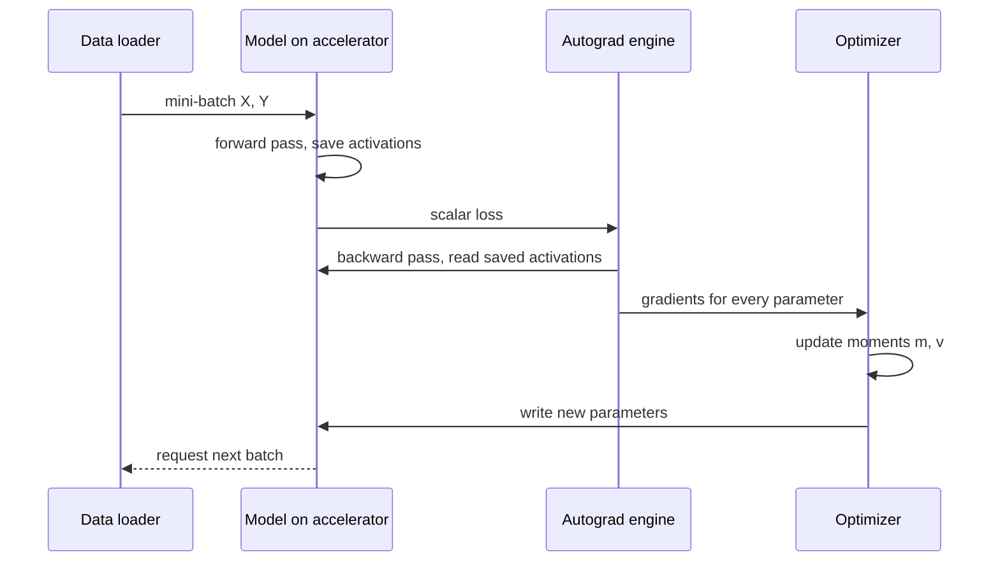

**Reading the diagram.** The data loader (CPU processes reading from storage) hands a mini-batch to the model on the accelerator. The forward pass computes the loss and stores activations; autograd consumes them to produce a gradient per parameter; the optimizer updates its state and overwrites the parameters. These steps are synchronous; the dotted request for the next batch is asynchronous, because a good loader prefetches batch $k+1$ while step $k$ computes. Storage: the dataset on disk or object storage, and four kinds of accelerator memory (§58.11). Failure points: a slow loader starves the accelerator (Chapter 64), and a NaN gradient corrupts the parameters in one update unless detected and skipped. Data parallelism inserts a gradient all-reduce before the optimizer (Chapter 65).

### 58.5.2 Adam and AdamW

::: definition
**Definition — Adam and AdamW.** **Adam** [Kingma and Ba 2015] keeps two running averages per parameter: the **first moment** $m$ (mean gradient, like momentum) and the **second moment** $v$ (mean squared gradient). It divides the first by the square root of the second, so every parameter gets its own effective step size. **AdamW** [Loshchilov and Hutter 2019] applies **weight decay** directly to the weights, decoupled from the adaptive step, instead of adding an L2 term to the gradient, which Adam's per-parameter scaling would otherwise distort.
:::

#### Why does this exist?

In real networks different parameters see gradients of wildly different sizes: the embedding of a rare restaurant receives a gradient only when that restaurant appears in a batch, while an output bias receives one every step. A single global learning rate is too big for some parameters and too small for others. Adam normalizes each parameter's step by its own recent gradient magnitude, so it works acceptably across a wide range of learning rates with little tuning. That robustness, not raw final accuracy, is why AdamW is the default for transformers and most new models. SGD with momentum remains common for CNNs, where it often generalizes slightly better when well tuned.

#### Mathematical foundations

::: formula
**AdamW update for one parameter at step $t$**

$$m_t = \beta_1 m_{t-1} + (1-\beta_1) g_t \qquad v_t = \beta_2 v_{t-1} + (1-\beta_2) g_t^2$$

$$\hat{m}_t = \frac{m_t}{1-\beta_1^t} \qquad \hat{v}_t = \frac{v_t}{1-\beta_2^t} \qquad \theta_t = \theta_{t-1} - \eta_t \left( \frac{\hat{m}_t}{\sqrt{\hat{v}_t} + \epsilon} + \lambda\, \theta_{t-1} \right)$$

| Symbol | Meaning | Units |
|---|---|---|
| $g_t$ | Gradient of the loss for this parameter at step $t$ | loss units per parameter unit |
| $m_t, v_t$ | First and second moment estimates (optimizer state) | as $g$ and $g^2$ |
| $\beta_1, \beta_2$ | Decay rates of the moments; defaults 0.9 and 0.999 | dimensionless |
| $\hat{m}_t, \hat{v}_t$ | Bias-corrected moments (both start at 0) | as $m$, $v$ |
| $\eta_t$ | Learning rate at step $t$ (from the schedule) | parameter units per step |
| $\epsilon$ | Small constant for numerical stability; default $10^{-8}$ | as $g$ |
| $\lambda$ | Decoupled weight-decay coefficient (0 gives plain Adam without L2) | per step, scaled by $\eta_t$ |
:::

::: example
**Worked example — Adam's first step and why bias correction matters.** One parameter has gradient $g_1 = 0.002$; $\eta = 10^{-3}$, $\beta_1 = 0.9$, $\beta_2 = 0.999$, $\lambda = 0$.

1. $m_1 = 0.1 \times 0.002 = 0.0002$; $v_1 = 0.001 \times 0.002^2 = 4 \times 10^{-9}$.
2. Bias correction: $\hat{m}_1 = 0.0002 / (1 - 0.9) = 0.002$; $\hat{v}_1 = 4\times10^{-9} / (1 - 0.999) = 4 \times 10^{-6}$; $\sqrt{\hat{v}_1} = 0.002$.
3. Step: $\eta \times 0.002 / 0.002 = 10^{-3}$. Had the gradient been $0.2$ instead, the step would still be $10^{-3}$.
4. Without bias correction: $m_1/\sqrt{v_1} = 0.0002 / 6.32 \times 10^{-5} = 3.16$, a step $3.16\times$ larger than intended at the most fragile moment of training.

**Interpretation.** Adam's step size is set by $\eta$, not by the gradient's scale: early steps are about $\eta$ per parameter in the direction of the gradient's sign. **Engineering implication.** This makes Adam forgiving of badly scaled features and losses, but it also means a learning rate that is fine for SGD can be far too large for Adam, and vice versa. Learning rates do not transfer between optimizers.
:::

### 58.5.3 Learning-rate schedules: warmup and cosine decay

Large models rarely use a constant learning rate. **Warmup** raises it linearly from near zero over the first hundreds or thousands of steps, because early on Adam's second-moment estimates are noisy and outputs poorly scaled, so full-size steps can push the network somewhere it never recovers from. **Cosine decay** [Loshchilov and Hutter 2017] then lowers it smoothly to a floor: big exploratory steps early, fine steps at the end. Step and linear decay are older alternatives.

::: formula
**Linear warmup followed by cosine decay**

$$\eta_t = \begin{cases} \eta_\text{max}\, \dfrac{t}{T_w} & t < T_w \\[2mm] \eta_\text{min} + \tfrac{1}{2}(\eta_\text{max} - \eta_\text{min})\left(1 + \cos\left(\pi\, \dfrac{t - T_w}{T - T_w}\right)\right) & T_w \le t \le T \end{cases}$$

| Symbol | Meaning | Units |
|---|---|---|
| $\eta_t$ | Learning rate at step $t$ | per step |
| $\eta_\text{max}, \eta_\text{min}$ | Peak and final learning rate | per step |
| $T_w$ | Warmup length | steps |
| $T$ | Total training steps | steps |
:::

::: example
**Worked example — A schedule for 100,000 steps.** $\eta_\text{max} = 3 \times 10^{-4}$, $\eta_\text{min} = 3 \times 10^{-5}$, $T_w = 2{,}000$, $T = 100{,}000$.

1. Step 1,000 (warmup): $3 \times 10^{-4} \times 1{,}000/2{,}000 = 1.5 \times 10^{-4}$.
2. Step 26,500, one quarter of the decay phase: $\cos(\pi/4) = 0.7071$, so $\eta = 3\times10^{-5} + 0.5 \times 2.7\times10^{-4} \times 1.7071 = 2.60 \times 10^{-4}$.
3. Step 51,000, halfway: $\cos(\pi/2) = 0$, so $\eta = 3\times10^{-5} + 1.35\times10^{-4} = 1.65 \times 10^{-4}$.
4. Step 100,000: $\cos\pi = -1$, so $\eta = \eta_\text{min} = 3 \times 10^{-5}$.

**Interpretation.** The rate stays near its peak for the first quarter of decay and falls fastest in the middle. **Engineering implication.** The schedule depends on $T$, so the total step count must be fixed before training starts. If a job is preempted and resumed, the scheduler state must be saved in the checkpoint along with the optimizer state, or the resumed run restarts warmup and can spike the loss (Chapter 65).
:::

### 58.5.4 Optimizer state memory

The optimizer keeps per-parameter state between steps, and that state is part of the model's training memory and of every checkpoint.

**Table 58.2 — Optimizers compared.**

| Optimizer | Extra state per parameter | Extra bytes (FP32 state) | Tuning sensitivity | Typical use |
|---|---|---|---|---|
| SGD | none | 0 | High (learning rate and schedule) | Rarely alone today |
| SGD + momentum | velocity $v$ | 4 | High | CNNs, some vision models |
| Adagrad (row-wise) | one accumulator per embedding row | about 0 per parameter | Medium | Sparse embedding tables |
| Adam / AdamW | $m$ and $v$ | 8 | Low to medium | Transformers, most new models |
| Memory-saving variants (Adafactor, 8-bit Adam) | factored or quantized moments | about 1–4 | Medium | Very large models under memory pressure |

::: example
**Worked example — Adam state for a 7B-parameter model.** $N = 7 \times 10^9$ parameters, FP32 moments.

1. $m$: $7 \times 10^9 \times 4$ bytes $= 28$ GB. $v$: another 28 GB. Total: **56 GB** of optimizer state.
2. That is two extra copies of the model in FP32, more than the 14 GB of the model itself in 16-bit precision.

**Interpretation.** For Adam, the optimizer state is the single largest fixed memory item in training. **Engineering implication.** This is the first thing that sharded data parallelism (ZeRO, FSDP; Chapter 65) partitions across GPUs, and why a training checkpoint is several times larger than the model you deploy: a 14 GB inference model may have a training checkpoint of about 84 GB (28 GB of FP32 master weights plus 56 GB of moments) or more.
:::

::: mistake
**"Switching from Adam to SGD saves half the training memory."** It saves the moment buffers (8 bytes per parameter), but parameters, gradients and, above all, activations remain. For a large-batch model whose memory is 70% activations (§58.11), the saving is small, and SGD may need far more tuning.
:::

## 58.6 Embeddings

### 58.6.1 From one-hot vectors to dense embeddings

::: definition
**Definition — Embedding and embedding table.** An **embedding** is a learned dense vector of $d$ real numbers that represents a discrete item (a user, restaurant, dish or word). An **embedding table** is a $V \times d$ matrix, one row per item in a **vocabulary** of size $V$; looking up item $i$ returns row $i$. The table is a parameter of the model and is trained by backpropagation like any weight matrix.
:::

#### First-principles explanation

A restaurant ID is a name, not a quantity: restaurant 40,312 is not "more" than restaurant 17. The naive encoding is a **one-hot vector**: 50,000 zeros with a single 1 at the restaurant's position. It is huge and says nothing about similarity: every pair of restaurants is equally different. An embedding replaces that with a short list of, say, 64 numbers per restaurant that the model learns. After training, two late-night noodle shops end up with similar vectors because similar users order from both, even though nobody told the model what "late-night" or "noodles" mean. Similarity becomes geometry: a dot product or cosine between vectors.

#### How it works internally

1. Assign each item an integer index (a dictionary from restaurant ID to row, or a hash of the ID modulo $V$).
2. Lookup: gather rows $E[i]$ for the batch's indices. Mathematically this equals multiplying the one-hot vector by the table, $\mathbf{e}_i^\top E$, but the implementation is a memory read, not a matrix multiply.
3. Feed the vectors into the rest of the network (concatenate with numeric features, or take dot products between a user vector and item vectors).
4. Backward: only the rows that appeared in the batch receive gradients, so the gradient is **sparse**. A batch of 4,096 orders touches at most 4,096 of 50,000 restaurant rows.

**Figure 58.5 — Embedding lookup in a QuickBite recommendation model.**

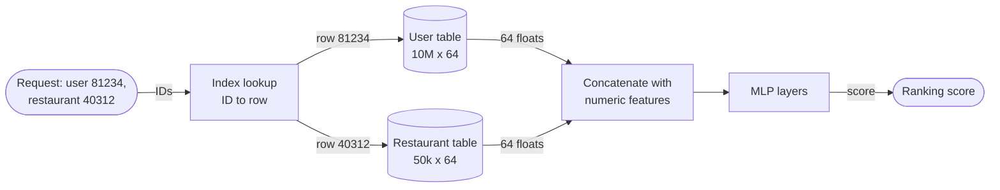

**Reading the diagram.** A ranking request carries raw IDs; an index step maps each to a row (unknown IDs go to a shared "out-of-vocabulary" row). Each table (a cylinder, because at scale it behaves like a data store) returns a 64-float vector; these join numeric features and an MLP scores them. All arrows are synchronous reads on the request path. Small tables live in the model process; large ones are partitioned across servers like a sharded key–value store (§14.6). Failure points: a new user with no trained row (**cold start**), and a stale index that silently maps IDs to the wrong rows after retraining. Scaling: hash-partition rows and cache hot ones (Chapter 20); skewed popularity lets a small cache serve most lookups.

#### Mathematical foundations

::: formula
**Embedding table size**

$$M_\text{emb} = V \times d \times s \qquad M_\text{train} \approx M_\text{emb} \times (1 + 1 + k)$$

| Symbol | Meaning | Units |
|---|---|---|
| $M_\text{emb}$ | Memory of the table's weights | bytes |
| $V$ | Vocabulary size (rows) | items |
| $d$ | Embedding dimension | floats per item |
| $s$ | Bytes per value: 4 (FP32), 2 (FP16/BF16), 1 (INT8) | bytes |
| $M_\text{train}$ | Weights + gradient + optimizer state, if all are dense | bytes |
| $k$ | Optimizer state copies: 0 (SGD), 2 (Adam) | copies |
:::

::: example
**Worked example — 100 million users at 64 dimensions.** $V = 10^8$, $d = 64$.

1. FP32 weights: $10^8 \times 64 \times 4 = 2.56 \times 10^{10}$ bytes $= 25.6$ GB.
2. FP16 for serving: 12.8 GB. INT8: 6.4 GB.
3. Training with dense Adam state: $25.6 \times (1 + 1 + 2) = 102.4$ GB, more than one 80 GB accelerator.
4. With row-wise Adagrad (one accumulator per row): state is $10^8 \times 4 = 0.4$ GB, and gradients exist only for the rows in the current batch.
5. Compare the MLP above it: a ranking MLP of a few million parameters is about 10–20 MB.

**QuickBite version.** Assume 10 million registered customers (against about 4 million weekly active users, Chapter 57), 50,000 restaurants and 5 million dishes (50,000 × 100 menu items, §2.11), all at $d = 64$ in FP32: users 2.56 GB, restaurants 12.8 MB, dishes 1.28 GB. The whole model fits on one server; the 100M-user version does not fit on one accelerator for training.

**Interpretation.** In large recommendation models the embedding tables are often more than 99% of the parameters but a tiny fraction of the FLOPs: a lookup reads 256 bytes and does almost no arithmetic. **Engineering implication.** Such models are **memory-capacity and bandwidth bound**. Tables are partitioned by rows across hosts, hot rows are cached, and values are compressed (FP16, INT8, hashing). §68.8 covers serving and Chapter 74 the vector search over the same vectors.
:::

::: industry
**Embeddings at industry scale.** YouTube's deep candidate-generation network learns embeddings for videos and search tokens and serves candidates by nearest-neighbor search over the learned vectors [Covington et al. 2016]. Meta's DLRM architecture combines embedding tables for categorical features with MLPs for dense features and explicitly uses model parallelism for the tables and data parallelism for the MLPs, because the tables are too large to replicate [Naumov et al. 2019].
*Evidence: Primary* — [Covington et al. 2016], [Naumov et al. 2019]
:::

#### Failure scenarios

**Table 58.3 — Embedding failure scenarios.**

| What goes wrong | Why | Detection | Recovery | Prevention |
|---|---|---|---|---|
| New users get poor recommendations | No trained row (cold start) | Metrics split by user age | Fall back to popularity or content features | Shared OOV row; feature-based towers |
| Quality collapses after a retrain | ID-to-row mapping changed but serving uses the old one | Offline–online prediction parity check | Roll back model and index together | Version the index with the model artifact |
| Serving memory OOM | Vocabulary grew; table size is $V \times d$ | Table-size metric per release | Shard the table; prune inactive rows | Capacity alert on $V$; hashing with fixed $V$ |
| Hash collisions blur items | Hashing trick maps many IDs to one row | Quality drop on long-tail items | Increase $V$ or use multiple hashes | Size $V$ from the ID distribution |

::: mistake
**"Embeddings are a kind of feature engineering you compute once."** Learned embeddings change every time the model is retrained, and vectors from two training runs live in different coordinate systems. Mixing a user vector from model v7 with item vectors from model v8 produces meaningless dot products. Treat the table, the ID index and the model as one versioned artifact (§69.8).
:::

## 58.7 Convolutional neural networks

### 58.7.1 Convolution, pooling and weight sharing

::: definition
**Definition — Convolution, pooling and receptive field.** A **convolutional layer** slides a small learned filter (for example $3 \times 3$ pixels across all input channels) over the input and computes a weighted sum at every position, producing an output **feature map** per filter. The same filter weights are used at every position (**weight sharing**). A **pooling** layer downsamples a feature map by taking the maximum or average of small windows. The **receptive field** of a unit is the region of the original input that can influence it [LeCun et al. 1998].
:::

#### First-principles explanation

To check whether a photo of a QuickBite dish contains a burger, you do not need a separate "bun detector" for the top-left corner and another for the bottom-right; a bun looks the same wherever it is. A convolution encodes exactly that assumption: one small detector, slid everywhere. Early layers detect edges and textures in small patches; pooling and stacking let later layers see larger regions and combine parts into objects. This built-in assumption, called an **inductive bias**, is why CNNs learn vision tasks from far less data than an MLP on raw pixels.

**Figure 58.6 — A small CNN pipeline for classifying dish photos.**


**Reading the diagram.** An RGB photo enters on the left as a $224 \times 224 \times 3$ tensor. Each convolution keeps the spatial size (with padding) and changes the channel count; each pooling halves height and width; global average pooling collapses the spatial grid to one vector per image; a linear layer maps it to 20 dish categories. All steps are synchronous tensor operations on one device. Activation memory is largest in the early, high-resolution layers ($224 \times 224 \times 64$ values per image), while most parameters sit in the later, high-channel layers. Failure points: images resized differently in serving than in training (a classic training–serving skew). Scaling: batch images; spatial positions are independent, so convolutions parallelize extremely well on GPUs.

#### Mathematical foundations

::: formula
**Parameters and FLOPs of a convolutional layer**

$$P_\text{conv} = K_h K_w C_\text{in} C_\text{out} + C_\text{out} \qquad F_\text{conv} = 2\, K_h K_w C_\text{in} C_\text{out}\, H_\text{out} W_\text{out}$$

| Symbol | Meaning | Units |
|---|---|---|
| $K_h, K_w$ | Filter height and width | pixels |
| $C_\text{in}, C_\text{out}$ | Input and output channels | channels |
| $H_\text{out}, W_\text{out}$ | Output feature-map height and width | pixels |
| $P_\text{conv}$ | Trainable parameters (weights + biases) | parameters |
| $F_\text{conv}$ | Forward FLOPs per image (2 per multiply–add) | FLOPs |
:::

::: example
**Worked example — A $3 \times 3$ convolution, 64 → 128 channels, $56 \times 56$ output.**

1. Parameters: $3 \times 3 \times 64 \times 128 + 128 = 73{,}728 + 128 = 73{,}856$.
2. FLOPs: $2 \times 9 \times 64 \times 128 \times 56 \times 56 = 2 \times 73{,}728 \times 3{,}136 = 462{,}422{,}016 \approx 0.46$ GFLOPs per image. PyTorch's FLOP counter reports exactly this number (§58.12).
3. Equivalent fully connected layer: $64 \times 56 \times 56 = 200{,}704$ inputs to $128 \times 56 \times 56 = 401{,}408$ outputs needs $200{,}704 \times 401{,}408 \approx 8.06 \times 10^{10}$ weights, 322 GB in FP32.
4. Ratio: $8.06 \times 10^{10} / 73{,}856 \approx 1.09$ million times more parameters without weight sharing and locality.

**Interpretation.** Each weight is reused $56 \times 56 = 3{,}136$ times per image, so a conv layer has few parameters but many FLOPs: about 6,300 FLOPs per parameter per image, versus 2 for a linear layer. **Engineering implication.** CNNs are **compute bound** with small models (ResNet-50 has about 25 million parameters, 100 MB in FP32 [He et al. 2016]) but billions of FLOPs per image. Serving cost scales with image resolution squared: halving the input side length cuts FLOPs by about 4×, often the cheapest latency lever.
:::

### 58.7.2 Receptive field and depth

With stride-1 $3 \times 3$ convolutions, each layer adds 2 pixels: after $L$ layers the receptive field is $1 + 2L$, so 5 layers see an $11 \times 11$ patch. Each pooling with stride 2 doubles the growth of every later layer, which is how deep CNNs reach whole-image context. Residual connections [He et al. 2016] made CNNs of 50–150 layers trainable by adding each block's input to its output, giving gradients a shortcut path.

::: industry
**From check reading to everything.** LeCun et al. [1998] describe a convolutional network (LeNet-5) that was deployed commercially to read handwritten amounts on bank checks. AlexNet's 2012 ImageNet win with GPU-trained CNNs [Krizhevsky et al. 2012] started the modern deep learning era; it was trained on two GPUs because the model did not fit in one GPU's 3 GB of memory, an early instance of the memory pressure that §58.11 quantifies.
*Evidence: Primary* — [LeCun et al. 1998], [Krizhevsky et al. 2012]
:::

## 58.8 Recurrent networks and LSTMs

### 58.8.1 Sequential dependency

::: definition
**Definition — Recurrent neural network (RNN).** A network that processes a sequence one element at a time, carrying a **hidden state** $\mathbf{h}_t = \phi(W_x \mathbf{x}_t + W_h \mathbf{h}_{t-1} + \mathbf{b})$ from step to step, with the same weights at every step. A **long short-term memory (LSTM)** network adds a separate **cell state** and learned **gates** (input, forget, output) that control what is written, kept and read [Hochreiter and Schmidhuber 1997].
:::

#### First-principles explanation

An RNN reads like a person reading a sentence word by word, keeping a running summary in their head. That summary is what lets it handle sequences of any length, such as a customer's last 50 QuickBite orders or the GPS pings of a courier. But you cannot start reading word 10 until you have the summary after word 9. The dependency $\mathbf{h}_t \leftarrow \mathbf{h}_{t-1}$ is a chain, and chains do not parallelize.

**Figure 58.7 — An RNN unrolled over time.**

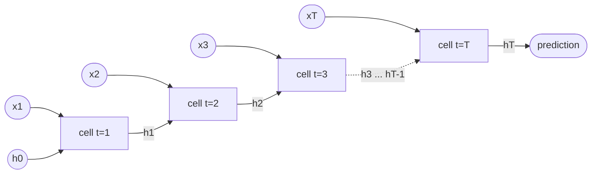

**Reading the diagram.** The same cell (same weights) is applied at each time step; inputs arrive from below and the hidden state flows left to right. Every solid arrow between cells is a hard synchronous dependency: step $t$ cannot start until step $t-1$ finishes. The dotted arrow abbreviates the steps in between. In training, backpropagation runs this chain in reverse (**backpropagation through time**), and all $T$ hidden states must be stored. Failure point: long chains make gradients vanish or explode. Scaling: you can parallelize across sequences in a batch but not across time within one sequence.

#### Mathematical foundations

::: formula
**Sequential latency and gradient decay in an RNN**

$$t_\text{seq} \ge T \times t_\text{step} \qquad \left\| \frac{\partial \mathbf{h}_T}{\partial \mathbf{h}_0} \right\| \lesssim \gamma^{T}$$

| Symbol | Meaning | Units |
|---|---|---|
| $t_\text{seq}$ | Minimum time to process one sequence | s |
| $T$ | Sequence length | steps |
| $t_\text{step}$ | Time for one recurrent step, however many devices you have | s |
| $\gamma$ | Bound on the per-step gain of the recurrence (largest singular value of $W_h$ times the activation's maximum slope) | dimensionless |
:::

::: example
**Worked example — Why RNNs are slow and forgetful.**

1. Latency: a 1,000-step sequence at 20 µs per step needs at least $1{,}000 \times 20$ µs $= 20$ ms, no matter how many GPUs you add.
2. Vanishing: with $\gamma = 0.9$, the gradient signal from 100 steps back is scaled by at most $0.9^{100} \approx 2.7 \times 10^{-5}$; the model effectively cannot learn dependencies that far apart.
3. Exploding: with $\gamma = 1.1$, $1.1^{100} \approx 13{,}781$; one large step can wreck the weights (§58.10 clipping).

**Interpretation.** Recurrence ties compute time to sequence length and makes long-range credit assignment exponentially hard [Bengio et al. 1994]. **Engineering implication.** RNNs underuse accelerators, which are built for wide parallel work; this is the main reason transformers displaced them for language. LSTMs fix much of the vanishing problem (the cell state is updated additively, giving gradients a near-identity path) but not the parallelism problem.
:::

::: industry
**LSTMs in production translation, then replaced.** Google's Neural Machine Translation system used deep stacked LSTMs (8 encoder and 8 decoder layers) and had to partition layers across GPUs to make training and serving fast enough [Wu et al. 2016]. The transformer paper a year later reported better translation quality at a fraction of the training cost, precisely by removing recurrence [Vaswani et al. 2017].
*Evidence: Primary* — [Wu et al. 2016], [Vaswani et al. 2017]
:::

RNNs and LSTMs remain reasonable for small on-device streaming models, which update state one event at a time with constant memory.

## 58.9 Transformers preview

### 58.9.1 Attention as content-based lookup

::: definition
**Definition — Attention.** A mechanism in which each position in a sequence computes a **query** vector, compares it with **key** vectors from all positions, and returns a weighted average of their **value** vectors, with weights given by softmax of the query–key dot products: $\text{Attention}(Q, K, V) = \text{softmax}(QK^\top/\sqrt{d_k})V$ [Bahdanau et al. 2015; Vaswani et al. 2017]. A **transformer** stacks layers of self-attention and MLPs, with residual connections and layer normalization.
:::

#### First-principles explanation

Attention is a **content-based lookup**, a soft version of a hash-table read. A hash table returns the one value whose key matches exactly; attention scores every key by similarity to the query and returns a blend of values, mostly from the best matches. When QuickBite's support model reads "my order from the noodle place never arrived, can I get a refund?", the token "refund" can attend directly to "never arrived" a few words earlier, without passing a message through every recurrent step in between.

**Figure 58.8 — Self-attention as content-based lookup.**

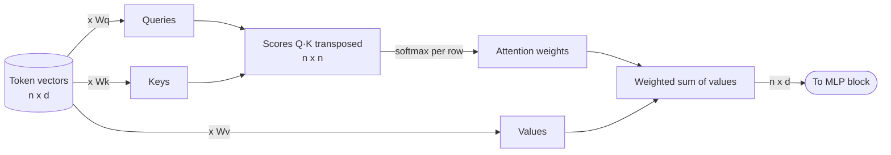

**Reading the diagram.** All $n$ token vectors are projected into queries, keys and values by three matrix multiplies. The score matrix compares every query with every key at once, softmax turns each row into weights, and a final matrix multiply blends the values. Every arrow is a batched matrix operation over all positions simultaneously, so there is no chain over time as in Figure 58.7. The storage cost is the $n \times n$ score matrix per head, and at inference the keys and values of past tokens are cached (the **KV cache**, §72.11). Failure point: memory and compute grow with $n^2$ for long inputs. Scaling: shard heads and matrices across devices (Chapter 65).

### 58.9.2 Why attention parallelizes

For a sequence of length $n$, attention costs about $2n^2 d$ FLOPs for the scores, more work than an RNN's $O(n d^2)$ when $n > d$, but it is done as a few large matrix multiplies with no sequential dependency, which is exactly what GPUs execute well (§5.11, Chapter 64). Training processes every position in parallel. Generation is still sequential *across output tokens*, which is why LLM serving has its own latency metrics (time to first token, time per output token). Chapter 72 covers tokenization, positional encoding, multi-head attention and the KV cache; Chapter 73 covers serving.

**Table 58.4 — Architecture families compared.**

| Family | Built-in assumption | Parallel over positions in training | Typical data | Cost driver |
|---|---|---|---|---|
| MLP | None | Not applicable (fixed-size input) | Tabular, embeddings | Parameters (memory) |
| CNN | Locality, translation invariance | Yes | Images, audio, some time series | FLOPs per pixel |
| RNN / LSTM | Sequential order | No | Streams, small on-device models | Sequence length × step latency |
| Transformer | Little; learns relations via attention | Yes | Text, code, increasingly everything | Parameters and $n^2$ attention |

## 58.10 Training dynamics

### 58.10.1 Learning rate and batch size

The learning rate is the most important hyperparameter: too small and training crawls, too large and the loss oscillates or explodes. The program below trains the same 4–64–64–1 ETA network with SGD and momentum 0.9 at four learning rates, with identical initialization and data order, and prints validation loss.

```python
import torch
from torch import nn

torch.set_num_threads(1)

def make_data(n, seed):
    g = torch.Generator().manual_seed(seed)
    X = torch.rand(n, 4, generator=g)               # distance, prep load, rain, hour (0..1)
    y = (10 + 25 * X[:, 0] + 8 * X[:, 1] ** 2 + 6 * X[:, 0] * X[:, 2]
         + 4 * torch.sin(6.28 * X[:, 3]))           # minutes
    y = y + torch.randn(n, generator=g) * 1.0       # label noise: 1 minute
    return X, y.unsqueeze(1)

Xtr, ytr = make_data(2048, seed=1)
Xva, yva = make_data(512, seed=2)
mu, sd = ytr.mean(), ytr.std()
ytr, yva = (ytr - mu) / sd, (yva - mu) / sd         # standardized; 1.0 = predict the mean

def train(lr, epochs=20, batch=64):
    torch.manual_seed(0)                            # same init and shuffles for every run
    model = nn.Sequential(nn.Linear(4, 64), nn.ReLU(),
                          nn.Linear(64, 64), nn.ReLU(),
                          nn.Linear(64, 1))
    opt = torch.optim.SGD(model.parameters(), lr=lr, momentum=0.9)
    loss_fn = nn.MSELoss()
    curve = []
    for epoch in range(1, epochs + 1):
        perm = torch.randperm(len(Xtr))
        for i in range(0, len(Xtr), batch):
            idx = perm[i:i + batch]
            loss = loss_fn(model(Xtr[idx]), ytr[idx])
            opt.zero_grad()
            loss.backward()
            opt.step()
        with torch.no_grad():
            val = loss_fn(model(Xva), yva).item()
        curve.append(val)
    return curve

print(f"noise floor = {(1 / sd.item()) ** 2:.4f} (1-minute noise, label sd {sd.item():.2f} min)")
print("validation MSE after epoch (standardized; 1.0 = predicting the mean)")
print(f"{'lr':>6} |" + "".join(f"{'ep' + str(e):>10}" for e in (1, 2, 5, 10, 20)))
for lr in (0.0003, 0.003, 0.03, 0.3):
    c = train(lr)
    print(f"{lr:>6} |" + "".join(f"{c[e - 1]:>10.4g}" for e in (1, 2, 5, 10, 20)))
```

Output (PyTorch 2.x on CPU, about 5 seconds):

```text
noise floor = 0.0122 (1-minute noise, label sd 9.05 min)
validation MSE after epoch (standardized; 1.0 = predicting the mean)
    lr |       ep1       ep2       ep5      ep10      ep20
0.0003 |     1.033      1.01    0.9441    0.7963    0.3284
 0.003 |    0.8868    0.5363   0.06209   0.05746   0.05526
  0.03 |    0.1031   0.05819   0.06231   0.04704   0.01755
   0.3 | 8.728e+06 3.626e+06     88.58     1.035      1.46
```

What to notice:

- **Too small (0.0003):** still at 0.33 after 20 epochs: slow progress that would get there eventually, at many times the compute bill.
- **Reasonable (0.003):** fast early progress, then a **plateau** near 0.055, about 4.5× the noise floor: underfitting for the budget.
- **Good (0.03):** reaches 0.018, close to the noise floor of 0.012 set by the 1-minute label noise, which no model can beat.
- **Too large (0.3):** the loss explodes to $8.7 \times 10^6$ in the first epoch, then settles near 1.0. Inspecting the final model shows all 64 units of both hidden layers **dead** (zero for every training input, Figure 58.1), so it outputs a constant. The run did not crash; only the loss curve reveals the failure.
- Same code and data, final losses about 80× apart: learning-rate sweeps come first in any tuning budget.

**Batch size and learning rate are coupled.** A mini-batch gradient is an average, so a batch $k$ times larger has about $\sqrt{k}$ times less noise and permits a larger step. Goyal et al. [2017] trained ImageNet ResNet-50 with batches of 8,192 by scaling the learning rate linearly with batch size and adding warmup.

::: formula
**Linear scaling rule for SGD**

$$\eta_\text{new} = \eta_\text{base} \times \frac{B_\text{new}}{B_\text{base}}$$

| Symbol | Meaning | Units |
|---|---|---|
| $\eta_\text{base}$ | Learning rate tuned at the base batch size | per step |
| $B_\text{base}, B_\text{new}$ | Base and new global batch sizes | examples per step |
| $\eta_\text{new}$ | Starting point for the learning rate at $B_\text{new}$ | per step |
:::

::: example
**Worked example — Scaling from 1 GPU to 32 GPUs.** A model trains with $B = 256$ and $\eta = 0.1$ on one GPU. Data parallelism over 32 GPUs keeps 256 per GPU, so $B_\text{new} = 8{,}192$.

1. $\eta_\text{new} = 0.1 \times 8{,}192/256 = 0.1 \times 32 = 3.2$.
2. Steps per epoch fall by 32×, so the number of updates is 32× smaller for the same data.
3. Add warmup (Goyal et al. used 5 epochs) because 3.2 is far too large for an untrained network.

**Interpretation.** The rule keeps the *per-example* contribution of each update roughly constant. It holds up to a problem-dependent **critical batch size** beyond which larger batches stop reducing the number of steps needed [McCandlish et al. 2018]. **Engineering implication.** Adding GPUs to a data-parallel job changes the global batch, so it changes the optimization problem, not just the speed. Re-tune or apply the rule with warmup, and check that time to target accuracy, not just samples per second, improved. Adam-family optimizers often scale more gently (closer to $\sqrt{k}$).
:::

### 58.10.2 Normalization, dropout and early stopping

- **Batch normalization** [Ioffe and Szegedy 2015] standardizes each feature to zero mean and unit variance *across the batch*, then applies a learned scale and shift, allowing higher learning rates and deeper CNNs. It uses batch statistics in training and stored running averages in inference, so the two modes differ, and tiny per-GPU batches give noisy statistics (synchronized batch norm fixes this at a communication cost).
- **Layer normalization** [Ba et al. 2016] standardizes across the features of *each example*, so it does not depend on the batch at all. That makes it the choice for transformers and for serving with any batch size.
- **Dropout** [Srivastava et al. 2014] zeroes each activation with probability $p$ during training and scales the survivors by $1/(1-p)$, so the network cannot rely on any single unit; at inference it is switched off. With $p = 0.1$, survivors are multiplied by $1/0.9 \approx 1.11$.
- **Early stopping** monitors validation loss and keeps the checkpoint with the best value, stopping after it fails to improve for a set number of evaluations (the **patience**). It is the cheapest regularizer and also a compute saver.

::: warning
**`model.eval()` is a production setting.** Batch norm and dropout behave differently in training and inference modes. Serving a model left in training mode gives random predictions (dropout) that depend on the other requests in the batch (batch norm). Make the mode explicit in the serving code path and test that two identical requests return identical outputs.
:::

### 58.10.3 Gradient clipping

::: formula
**Gradient clipping by global norm**

$$\mathbf{g} \leftarrow \mathbf{g} \cdot \min\left(1, \frac{c}{\lVert \mathbf{g} \rVert_2}\right)$$

| Symbol | Meaning | Units |
|---|---|---|
| $\mathbf{g}$ | Gradient vector of all parameters concatenated | as gradients |
| $\lVert \mathbf{g} \rVert_2$ | Global L2 norm of the gradient | as gradients |
| $c$ | Clipping threshold, commonly 1.0 for transformers | as gradients |
:::

::: example
**Worked example — Clipping a spike.** A bad batch produces $\lVert \mathbf{g} \rVert = 50$ with $c = 1$. The scale is $\min(1, 1/50) = 0.02$, so the update keeps its direction but is 50× smaller. A normal step with norm 0.6 is untouched. **Interpretation.** Clipping caps the damage of a rare outlier step without affecting normal training [Pascanu et al. 2013]. **Engineering implication.** Log the pre-clipping norm as a training metric: a rising fraction of clipped steps is an early warning of divergence, hours before the loss shows it.
:::

### 58.10.4 Reading loss curves

**Figure 58.9 — Diagnosing a training run from its loss curves.**

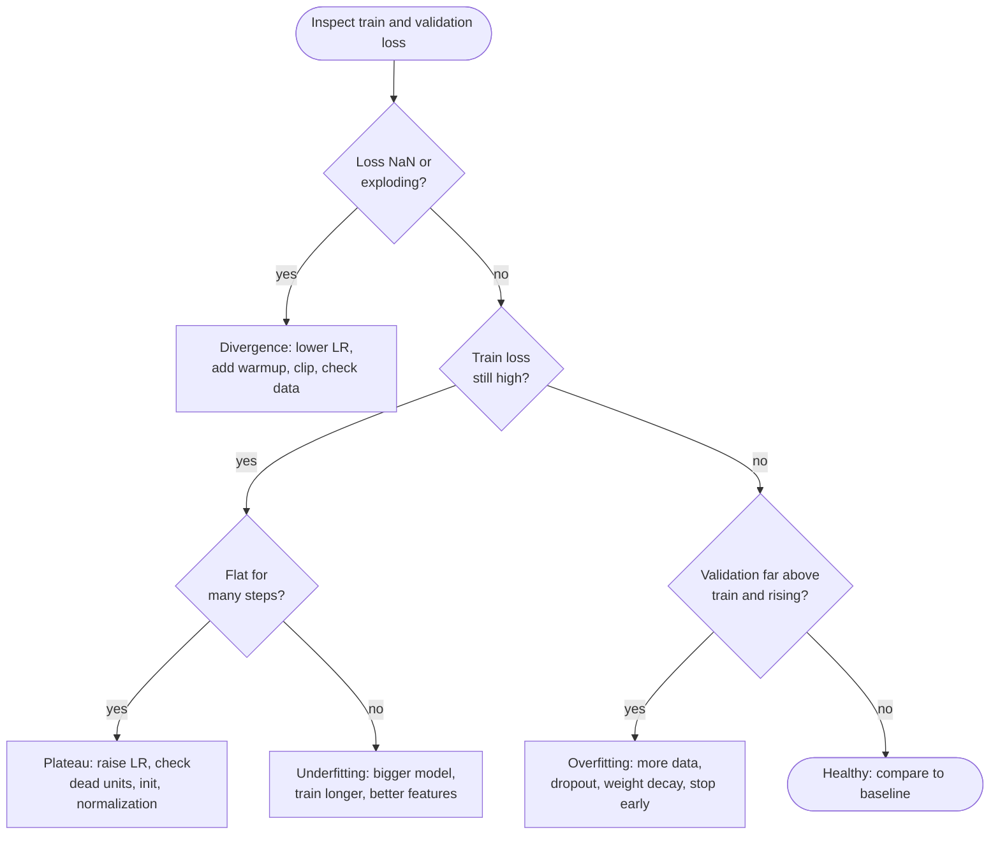

**Reading the diagram.** Start from the two curves every job should log, training and validation loss. The first decision catches divergence, which needs immediate action. If training loss is high, distinguish a plateau (flat, usually an optimization problem) from slow underfitting (capacity or data). If training loss is low, a growing gap to validation loss is overfitting. These are offline decisions by an engineer or automated monitor, using data from the experiment tracker (§69.7). Failure points: training loss alone hides overfitting, and a single run hides seed noise.

**Table 58.5 — Loss-curve symptoms and remedies.**

| Symptom | Likely cause | First remedies |
|---|---|---|
| Loss NaN or spikes to huge values | LR too high, no warmup, bad batch, FP16 overflow | Lower LR, warmup, clip gradients, loss scaling, skip bad batches |
| Both losses high and flat from the start | LR too low or too high (dead units), bad initialization, label bug | LR sweep, check labels, check that loss decreases on 10 examples |
| Both losses falling slowly and similar | Underfitting | Larger model, more steps, better features |
| Train falls, validation rises | Overfitting | More data, dropout, weight decay, early stopping |
| Sudden step changes | Schedule boundary, data-order or data-source change | Inspect schedule and data pipeline at that step |

## 58.11 Memory footprint of training

### 58.11.1 The four consumers of training memory

::: definition
**Definition — Training memory components.** Accelerator memory during training holds (1) **parameters**, (2) **gradients**, one per parameter, (3) **optimizer state** (§58.5.4) and (4) **activations** saved by the forward pass for the backward pass (§58.4). The first three scale with the parameter count; activations scale with batch size, sequence length or resolution, width and depth. **Mixed-precision training** [Micikevicius et al. 2018] computes in 16-bit floats (FP16 or BF16) while keeping an FP32 **master copy** of the weights for the update, and, for FP16, scales the loss so small gradients do not underflow.
:::

#### First-principles explanation

Inference is a relay race: each layer hands its output on and forgets its input. Training runs the race again backward, and each backward runner needs the baton its forward runner held, so every layer's activations stay in memory, alongside a gradient and optimizer notes for every weight. That is why a model that serves from 14 GB cannot train on an 80 GB accelerator.

**Figure 58.10 — Training memory breakdown for a 7B model, mixed-precision Adam.**

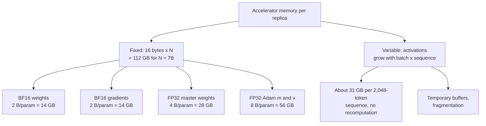

**Reading the diagram.** The fixed branch is set by the parameter count: 2 + 2 + 4 + 8 = 16 bytes per parameter, 112 GB before a single example is processed. The variable branch grows linearly with batch size and sequence length: one 2,048-token sequence stores about 31 GB (worked example below). Everything lives in accelerator memory (HBM, Chapter 64); host memory or NVMe is used only by offloading techniques. The failure mode is an out-of-memory error on the first step or the first long batch. Scaling options are to partition the fixed part across GPUs (ZeRO/FSDP), recompute activations instead of storing them (**activation checkpointing**) [Chen et al. 2016], or shard the model itself (Chapter 65).

#### Mathematical foundations

::: formula
**Training memory with mixed-precision Adam**

$$M_\text{train} \approx \underbrace{16\, N}_{\text{weights, grads, optimizer}} + M_\text{act} \qquad M_\text{act} \approx L \cdot s \cdot b \cdot h \left(34 + \frac{5 a s}{h}\right)$$

| Symbol | Meaning | Units |
|---|---|---|
| $M_\text{train}$ | Accelerator memory for one unsharded replica | bytes |
| $N$ | Parameter count | parameters |
| 16 | 2 (BF16 weights) + 2 (BF16 grads) + 4 (FP32 master) + 4 + 4 (Adam $m$, $v$) [Rajbhandari et al. 2020] | bytes/parameter |
| $M_\text{act}$ | Activation memory of a transformer, 16-bit, no recomputation [Korthikanti et al. 2023] | bytes |
| $L$ | Number of transformer layers | layers |
| $s$ | Sequence length | tokens |
| $b$ | Micro-batch size per accelerator | sequences |
| $h$ | Hidden size | values |
| $a$ | Attention heads; the $5as/h$ term is the $s \times s$ attention matrices | heads |
:::

::: example
**Worked example — 1B and 7B models.** Sequence length $s = 2{,}048$, micro-batch $b = 1$. The 1B model has $h = 2{,}048$, $L = 20$, $a = 16$; the 7B model has $h = 4{,}096$, $L = 32$, $a = 32$ (a Llama-2-7B-like shape; $12 L h^2 \approx 6.4 \times 10^9$ plus embeddings).

| Item | 1B model | 7B model |
|---|---|---|
| Weights, grads, optimizer: $16N$ | 16 GB | 112 GB |
| Activations per layer: $s h (34 + 5as/h)$ | $2048 \cdot 2048 \cdot (34 + 80) = 0.48$ GB | $2048 \cdot 4096 \cdot (34 + 80) = 0.96$ GB |
| Activations, all layers, $b = 1$ | $0.48 \times 20 = 9.6$ GB | $0.96 \times 32 = 30.6$ GB |
| Total at $b = 1$ | about 26 GB | about 143 GB |
| Activations at $b = 8$ | 77 GB | 245 GB |

1. 7B: $16 \times 7 \times 10^9 = 112$ GB already exceeds an 80 GB accelerator before any activations.
2. At $b = 8$ the 7B activations (245 GB) are more than twice the fixed 112 GB: **activations dominate at large batch**.
3. Attention kernels that never materialize the $s \times s$ matrix (FlashAttention, §73.9) remove the $5as/h$ term: $34/114 \approx 30\%$ of the original, about 9.1 GB per 2,048-token sequence for 7B.
4. Pure FP32 Adam is also 16 bytes per parameter (4 + 4 + 8): mixed precision does not shrink the fixed part; it halves activation memory and lets matrix multiplies use the much faster 16-bit tensor-core paths (Chapter 64).

**Interpretation.** A 1B model trains on one 80 GB accelerator at small batch; a 7B model cannot be trained on one without sharding or offloading, even though its 14 GB of BF16 weights serve comfortably on one. **Engineering implication.** Size training clusters from $16N$ plus activations, divided by the sharding degree: with ZeRO stage 3 over 8 GPUs, the 112 GB fixed part becomes 14 GB per GPU, leaving room for activations, which you then trim with activation checkpointing (recompute instead of store, at about one extra forward pass, roughly 33% more compute) and smaller micro-batches with gradient accumulation. Chapter 65 develops each technique; Chapter 89 collects the sizing formulas.
:::

::: industry
**ZeRO's memory accounting.** Rajbhandari et al. [2020] use the same 16-bytes-per-parameter accounting (they write it $2\Psi + 2\Psi + K\Psi$ with $K = 12$) and note that a 7.5B-parameter model needs 120 GB for model states alone. Their ZeRO stages partition optimizer state, then gradients, then parameters across data-parallel workers, cutting per-device memory roughly in proportion to the number of workers at the cost of extra communication.
*Evidence: Primary* — [Rajbhandari et al. 2020]
:::

::: mistake
**"The model is 14 GB, so a 24 GB GPU can fine-tune it."** Full fine-tuning with Adam needs the 112 GB fixed part plus activations. Parameter-efficient methods (LoRA, QLoRA; Chapter 76) exist precisely because they train a tiny fraction of the parameters, so only those need gradients and optimizer state.
:::

## 58.12 Compute cost of training and inference

### 58.12.1 FLOPs per example and per token

From §58.4.2: a forward pass costs 2 FLOPs per parameter per example (one multiply–add per weight), and backward costs twice that. For dense models whose FLOPs are dominated by matrix multiplies (MLPs, transformers at moderate sequence length), this gives two rules you will use constantly. They do not apply to embedding lookups, which read parameters without multiplying them, or to convolutions, which reuse each weight many times (§58.7).

::: formula
**Compute per example and total training compute**

$$C_\text{infer} \approx 2N \qquad C_\text{train/example} \approx 6N \qquad C_\text{train} \approx 6\, N\, D$$

| Symbol | Meaning | Units |
|---|---|---|
| $C_\text{infer}$ | Forward FLOPs per example (per token for a language model) | FLOPs |
| $C_\text{train/example}$ | Forward + backward FLOPs per example or token | FLOPs |
| $C_\text{train}$ | Total training compute | FLOPs |
| $N$ | Dense (non-embedding) parameters | parameters |
| $D$ | Training examples or tokens processed (dataset × epochs) | examples or tokens |
:::

::: example
**Worked example — Training a 7B language model and serving the QuickBite ETA model.**

*Training.* $N = 7 \times 10^9$, $D = 10^{12}$ tokens.

1. $C = 6 \times 7 \times 10^9 \times 10^{12} = 4.2 \times 10^{22}$ FLOPs.
2. Assume an accelerator with $10^{15}$ FLOP/s peak 16-bit throughput (the class of a 2023-era data-center GPU, as of 2026; Chapter 64) at 40% model FLOPs utilization (MFU): $4 \times 10^{14}$ FLOP/s achieved.
3. Time: $4.2 \times 10^{22} / 4 \times 10^{14} = 1.05 \times 10^8$ GPU-seconds $\approx 29{,}200$ GPU-hours; on 512 GPUs, about 57 hours.

*Inference.* The ETA MLP has $N \approx 1.58 \times 10^6$. Each search request shows 20 restaurants, each needing an ETA, at the §2.4 peak of 2,000 requests/s.

4. Predictions: $2{,}000 \times 20 = 40{,}000$/s. FLOPs: $40{,}000 \times 2 \times 1.58 \times 10^6 \approx 1.3 \times 10^{11}$ FLOP/s, about an eighth of one CPU server's sustained $10^{12}$ FLOP/s of vectorized arithmetic (step 5).
5. Training it on 90 million past orders (180 days × 500,000/day) for 10 epochs: $6 \times 1.58 \times 10^6 \times 9 \times 10^8 \approx 8.5 \times 10^{15}$ FLOPs: about 2.4 hours at a sustained $10^{12}$ FLOP/s on a CPU server, seconds of pure compute on one accelerator.

**Interpretation.** The same formula spans seven orders of magnitude: the LLM run is a capital project, the ETA model is a cron job whose cost is dominated by the data pipeline and feature joins, not FLOPs. **Engineering implication.** Always estimate $6ND$ before choosing hardware. Chapter 65 (§65.4) extends this to compute-optimal choices of $N$ and $D$ and to cluster sizing [Kaplan et al. 2020]; Chapter 73 shows that LLM *decoding* is limited by memory bandwidth rather than by $2N$ FLOPs.
:::

### 58.12.2 Measuring instead of estimating

PyTorch can count FLOPs of real operations, which is a good habit before trusting a rule of thumb.

```python
import torch
from torch import nn
from torch.utils.flop_counter import FlopCounterMode

torch.manual_seed(0)

def mlp_params(widths):
    # sum over layers of (fan_in * fan_out weights + fan_out biases)
    return sum(a * b + b for a, b in zip(widths[:-1], widths[1:]))

widths = [512, 1024, 1024, 1]                     # QuickBite ETA model sketch
layers = []
for a, b in zip(widths[:-1], widths[1:]):
    layers += [nn.Linear(a, b), nn.ReLU()]
model = nn.Sequential(*layers[:-1])               # no ReLU after the output layer
P = sum(p.numel() for p in model.parameters())
print(f"formula params {mlp_params(widths):,}   PyTorch params {P:,}")

for needs_input_grad in (False, True):
    x = torch.randn(256, widths[0], requires_grad=needs_input_grad)  # batch of 256
    with FlopCounterMode(display=False) as fwd:
        y = model(x)
    with FlopCounterMode(display=False) as bwd:
        y.sum().backward()
    F, B = fwd.get_total_flops(), bwd.get_total_flops()
    print(f"input grad needed: {needs_input_grad}")
    print(f"  forward  FLOPs {F:,} = {F / (256 * P):.2f} x params per sample")
    print(f"  backward FLOPs {B:,} = {B / F:.2f} x forward")
    print(f"  train step = {(F + B) / (256 * P):.2f} x params per sample")

conv = nn.Conv2d(64, 128, kernel_size=3, padding=1)
img = torch.randn(1, 64, 56, 56)
with FlopCounterMode(display=False) as c:
    conv(img)
print(f"conv params {sum(p.numel() for p in conv.parameters()):,}  forward FLOPs {c.get_total_flops():,}")
```

Output:

```text
formula params 1,575,937   PyTorch params 1,575,937
input grad needed: False
  forward  FLOPs 805,830,656 = 2.00 x params per sample
  backward FLOPs 1,343,225,856 = 1.67 x forward
  train step = 5.33 x params per sample
input grad needed: True
  forward  FLOPs 805,830,656 = 2.00 x params per sample
  backward FLOPs 1,611,661,312 = 2.00 x forward
  train step = 5.99 x params per sample
conv params 73,856  forward FLOPs 462,422,016
```

What to notice:

- The parameter formula of §58.3 and the conv formulas of §58.7 match PyTorch exactly.
- Backward is exactly 2× forward when every layer needs an input gradient, and 1.67× here when the first layer does not. Deep networks approach 2× because the first layer is a small share; the $6N$ rule is an upper-end estimate for shallow ones.
- FLOP counts are not time: small matrices, kernel-launch overhead and memory traffic make real steps far slower than FLOPs ÷ peak rate. The achieved fraction of peak is MFU (Chapter 64).

## 58.13 Traditional ML versus deep learning

### 58.13.1 Gradient-boosted trees and where they win

::: definition
**Definition — Gradient-boosted decision trees (GBDT).** An ensemble of shallow decision trees trained one after another, each fitted to the remaining errors (the negative gradient of the loss) of the trees before it. XGBoost [Chen and Guestrin 2016], LightGBM and CatBoost are the standard implementations.
:::

#### First-principles explanation

A decision tree asks threshold questions ("distance > 4 km? lunch hour?") that match how tabular features behave: sharp jumps, irrelevant columns, features on unrelated scales. Neural networks build smooth functions from many small adjustments and shine when the raw input has *structure* the architecture can exploit: spatial (images), sequential (text, audio) or relational (IDs that co-occur, learned as embeddings). So the question is less "which is more advanced" than "what does my data look like, how much is there, and what can I afford to serve?"

Grinsztajn, Oyallon and Varoquaux [2022] benchmarked tree ensembles against deep tabular architectures on 45 medium-sized datasets (around 10,000 training examples) and found trees still state of the art after extensive tuning of the networks. They traced the gap to tabular data itself: irregular target functions (networks prefer smooth ones), many uninformative features (which hurt MLPs more), and columns with individual meaning (MLPs are rotation-invariant).

### 58.13.2 Comparison and decision

**Table 58.6 — Gradient-boosted trees versus deep neural networks.**

| Row | Gradient-boosted trees | Deep neural networks |
|---|---|---|
| What it is | Additive ensemble of shallow trees | Stacked differentiable layers |
| How it works | Greedy splits on feature thresholds, each tree fits residuals | Backpropagation and gradient descent on all parameters |
| Advantages | Strong on small/medium tabular data; little preprocessing; fast to train; feature importance | Learns features from raw images, text, audio, IDs; scales with data; transfer learning and pretrained models |
| Disadvantages | Weak on unstructured inputs; high-cardinality IDs need encoding; no transfer learning | Data-hungry; sensitive to scaling and hyperparameters; harder to explain |
| Performance (latency) | Microseconds per prediction on CPU (hundreds of trees × depth comparisons) | Microseconds (small MLP) to seconds (LLM); often needs accelerators |
| Operational complexity | Low: CPU training and serving, one artifact | Higher: GPUs, embedding tables, framework runtimes, numerics |
| Cost | Low; training in minutes on CPUs | From low (small MLP) to very high ($6ND$, §58.12) |
| Use cases | Fraud scores, credit risk, ETA residuals, churn, ranking features | Vision, speech, language, recommendations with large ID spaces, multimodal |
| Choose when | Tabular features, under about $10^5$–$10^6$ rows, tight latency or explainability needs | Unstructured inputs, very large data, many sparse IDs, or a pretrained model fits the task |

**Figure 58.11 — Choosing between GBDT and deep learning.**

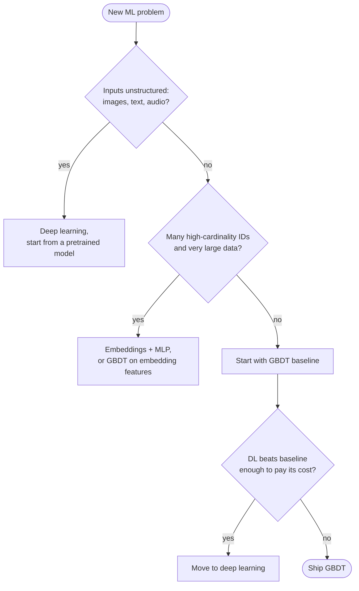

**Reading the diagram.** The first decision is input type: unstructured data goes to deep learning, usually fine-tuning a pretrained model. Tabular problems with huge ID spaces and data volumes (recommendations) favor embeddings, possibly feeding a GBDT. Everything else starts with a GBDT baseline, and deep learning must beat it by enough to pay for its operational cost. These are offline design decisions, not request-path steps. The failure point is skipping the baseline: you cannot tell whether a network's accuracy is good without one.

::: industry
**Airbnb's path from GBDT to neural networks.** Airbnb's search-ranking team reports that its gradient-boosted tree ranker was a strong baseline, that its first neural networks did not beat it, and that gains came only after iterating on architecture, feature normalization and training data [Haldar et al. 2019]. Uber describes moving delivery-time prediction from gradient-boosted trees to a deep model (DeepETA) that predicts a residual correction on top of its routing engine's estimate, to scale to more data at low serving latency [Hu et al. 2022]; §57.3 discusses the same hybrid design.
*Evidence: Primary* — [Haldar et al. 2019], [Hu et al. 2022]
:::

For QuickBite: fraud detection on a few hundred engineered features starts with GBDT; dish photos and the support chatbot are deep learning; restaurant recommendation over 10 million users is the hybrid case (Chapter 68); ETA starts with GBDT and earns its way to a neural model as data grows.

## 58.14 Frameworks briefly

**PyTorch** [Paszke et al. 2019] executes **eagerly**: each line of Python runs its operation immediately, as in NumPy, which makes debugging easy and dominates research and most new production work. **TensorFlow** [Abadi et al. 2016] began with static graphs defined before execution and later added eager mode; it remains widespread in established production stacks (TensorFlow Serving, TFX). **JAX** [Frostig et al. 2018] expresses models as pure functions that are traced and compiled by the **XLA** compiler, and is used heavily on TPUs.

The systems-relevant distinction is **eager versus compiled**. Eager execution launches one kernel per operation and pays Python overhead each time. Compilation captures a graph of many operations and optimizes it as a whole: fusing element-wise operations into one kernel, planning memory, and choosing kernels for the target hardware. PyTorch 2's `torch.compile` captures graphs from ordinary Python and compiles them with TorchInductor [Ansel et al. 2024]; JAX's `jit` and TensorFlow's `tf.function` do the same through XLA.

**Figure 58.12 — Eager versus compiled execution.**

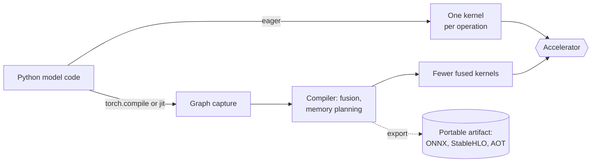

**Reading the diagram.** Eagerly, each operation becomes its own kernel launch. Compiled, a graph is captured once, optimized and lowered to fewer, larger kernels, cutting launch overhead and memory traffic. The dotted export path produces a framework-independent artifact for runtimes such as ONNX Runtime or TensorRT (§67.10–§67.11), the storage boundary between training and serving. Failure points: graph breaks (uncapturable code falls back to eager), recompilation when shapes change, and numerical differences between compiled and eager versions. Compilation is a one-time cost per shape, paid at startup.

What a system designer needs to know: (1) compile time is real, sometimes minutes, so warm models up before routing traffic to them and use a small set of fixed input shapes (padding or bucketing) to avoid recompiling; (2) the training framework need not be the serving runtime, so put export and **parity tests** (same input, same output within tolerance) in the deployment pipeline; (3) framework, CUDA driver and kernel library versions are part of the model artifact and must be pinned together (§69.4.5).

## 58.15 Summary and revision notes

::: summary
- A neural network is stacked linear layers with nonlinear activations; an MLP layer has $n_\text{in} n_\text{out} + n_\text{out}$ parameters. Depth composes features efficiently but adds sequential latency.
- Backpropagation is reverse-mode differentiation on the computational graph. It needs the forward activations saved, and backward costs about 2× forward, so a training step is about 3 forward passes: $\approx 6N$ FLOPs per example versus $2N$ for inference.
- Verify custom gradients with a numerical gradient check; in double precision, correct gradients give relative errors of about $10^{-7}$ or smaller.
- SGD+momentum keeps 1 extra state copy; Adam/AdamW keeps 2. Warmup protects early training; cosine decay anneals. Learning rates do not transfer between optimizers or batch sizes.
- Embedding tables ($V \times d$) turn IDs into learned vectors; 100M users × 64 dims is 25.6 GB in FP32. Such models are memory-bound, partitioned by row and cached.
- Convolutions share weights (few parameters, many FLOPs); RNNs cannot parallelize over time and suffer vanishing/exploding gradients; attention is a parallel content-based lookup with $n^2$ cost (§72.6).
- Read loss curves: NaN/explosion = divergence; flat = plateau; both high = underfitting; validation gap rising = overfitting. Use clipping, normalization, dropout and early stopping accordingly.
- Training memory ≈ $16N$ bytes (mixed-precision Adam) plus activations, which dominate at large batch: 7B needs 112 GB before activations.
- Training compute ≈ $6ND$: 7B on $10^{12}$ tokens is $4.2 \times 10^{22}$ FLOPs, about 29,000 GPU-hours at 40% MFU on a $10^{15}$ FLOP/s device.
- On medium tabular data, gradient-boosted trees usually beat neural networks and are cheaper to run; deep learning wins on unstructured data, huge ID spaces and very large datasets.
- Compiled execution (torch.compile, XLA) fuses kernels at the price of compile time and shape sensitivity; export plus parity tests bridge training and serving.
:::

## 58.16 Knowledge checkpoint

1. How many parameters does an MLP with widths $[100, 50, 10]$ have?
2. Why does a stack of linear layers without activations add no expressive power?
3. Which tensors must the forward pass keep for backward through $H = \text{ReLU}(XW + b)$?
4. Why is the backward pass of a linear layer about twice the forward FLOPs?
5. What does a gradient-check relative error of $10^{-2}$ suggest?
6. How many bytes of optimizer state does AdamW keep for a 1B-parameter model in FP32?
7. With warmup of 1,000 steps to $\eta_\text{max} = 10^{-3}$, what is $\eta$ at step 250?
8. What is the FP16 size of an embedding table of 20 million rows × 128 dimensions?
9. A $5 \times 5$ conv maps 32 to 64 channels with a $28 \times 28$ output. Parameters and forward FLOPs?
10. Why can a transformer train on all positions of a sequence in parallel but an RNN cannot?
11. Validation loss rises while training loss falls. Diagnosis and two remedies?
12. A gradient has norm 8 and the clipping threshold is 2. What is the scaling factor?
13. Estimate the fixed training memory for a 3B model with mixed-precision Adam.
14. Estimate training FLOPs for a 1B model on 20 billion tokens.

<details><summary>Answers</summary>

1. $100 \times 50 + 50 + 50 \times 10 + 10 = 5{,}050 + 510 = 5{,}560$.
2. The product of linear maps is a linear map: $(XW_1)W_2 = X(W_1W_2)$.
3. $X$ (for the weight gradient) and $Z = XW + b$ or an equivalent mask (for the ReLU gradient); $W$ is already in memory.
4. It performs two matrix multiplies of the same size as the forward one: the weight gradient and the input gradient.
5. A bug in the analytic gradient (or a nondifferentiable point hit by the perturbation); correct gradients give errors around $10^{-7}$ or less in double precision.
6. $2 \times 4 \times 10^9 = 8$ GB.
7. $10^{-3} \times 250/1{,}000 = 2.5 \times 10^{-4}$.
8. $2 \times 10^7 \times 128 \times 2 = 5.12$ GB.
9. Parameters $25 \times 32 \times 64 + 64 = 51{,}264$; FLOPs $2 \times 25 \times 32 \times 64 \times 784 = 80{,}281{,}600 \approx 80$ MFLOPs.
10. Attention computes all query–key interactions as matrix multiplies with no step-to-step dependency; an RNN's state at step $t$ depends on step $t-1$.
11. Overfitting: early stopping, more data or augmentation, dropout or weight decay.
12. $\min(1, 2/8) = 0.25$.
13. $16 \times 3 \times 10^9 = 48$ GB, plus activations.
14. $6 \times 10^9 \times 2 \times 10^{10} = 1.2 \times 10^{20}$ FLOPs.

</details>

## 58.17 Interview questions

### Basic

**Q1. Why does training cost about three times inference?**
**Answer.** Inference runs the forward pass: about $2N$ FLOPs per example. Training adds a backward pass with two matrix multiplies per layer (weight gradient and input gradient), about $4N$, for a total near $6N$. Training also stores activations, so it needs much more memory.

**Q2. What is an embedding, and why not one-hot encode user IDs?**
**Answer.** A learned dense vector per item, stored as a row of a $V \times d$ table. One-hot vectors are $V$-dimensional, sparse and carry no similarity; a lookup into a learned table is mathematically the same as multiplying the one-hot vector by a weight matrix, but costs one memory read and gives vectors whose distances reflect behavior.

### Intermediate

**Q3. A 7B model serves fine on one 80 GB GPU. Why can't your team fine-tune it on that GPU?**
**Answer.** Serving needs about 14 GB of BF16 weights plus a KV cache. Full fine-tuning with mixed-precision Adam needs about 16 bytes per parameter (112 GB) for weights, gradients, master weights and Adam moments, plus tens of GBs of activations. Options: shard with ZeRO/FSDP across several GPUs, use activation checkpointing, or use LoRA/QLoRA so that only small adapters have gradients and optimizer state.

**Q4. You move training from 8 to 64 GPUs with data parallelism and accuracy drops. Why?**
**Answer.** The global batch grew 8×, so updates per epoch fell 8× and the learning rate no longer fits (too small if unchanged, too aggressive if scaled without warmup). Apply the linear scaling rule with warmup, check the critical batch size, compare time-to-accuracy, and check batch-norm statistics if per-GPU batches shrank.

**Q5. The training loss went NaN at step 40,000 after a smooth run. How do you investigate?**
**Answer.** Check gradient-norm and clipping-rate metrics before the failure, the schedule at that step, the batch itself (corrupt or extreme records) and FP16 overflow events. Resume from the last good checkpoint, skip the batch, lower the learning rate or tighten clipping, consider BF16, and add NaN detection that skips steps and alerts.

### Advanced

**Q6. QuickBite wants one model for restaurant recommendations over 10M users. Size it and choose an architecture.**
**Answer.** Embeddings plus an MLP ranker: users $10^7 \times 64 \times 4 = 2.56$ GB FP32, restaurants 12.8 MB, MLP a few million parameters. Dense Adam would need about 10 GB for the user table alone, so use sparse or row-wise optimizers; one or a few GPUs suffice. Serve user vectors from a cache or key–value store, restaurant vectors from an ANN index (Chapter 74), and the ranker on CPUs. Version the ID index with the model, handle cold start with a default row plus content features, and prove the network against a GBDT baseline.

**Q7. When would you recommend against deep learning?**
**Answer.** Medium-sized tabular data, strict CPU latency budgets, explainability needs, teams without GPU operations, or a GBDT baseline within noise of the network. Tree ensembles remain state of the art on medium tabular benchmarks [Grinsztajn et al. 2022]; insist on the baseline before paying for GPUs and embedding infrastructure.

## 58.18 Practical exercises

1. **Extend the backprop program.** Add a second hidden layer and a softmax cross-entropy output to the §58.4.3 NumPy network, derive its backward pass and pass the gradient check.
2. **Optimizer comparison.** Change §58.10.1's sweep to AdamW at learning rates $10^{-4}$ to $10^{-1}$ and compare the best result and the width of the "good" range with SGD+momentum.
3. **Warmup and clipping.** Add linear warmup over the first epoch and `clip_grad_norm_(…, 1.0)` to the 0.3 learning-rate run. Does it still diverge? Log the gradient norm per step.
4. **Memory calculator.** Write a function that takes $N$, $L$, $h$, $a$, $s$, $b$ and optimizer type and returns fixed and activation memory; reproduce the table in §58.11 and add activation checkpointing as an option.
5. **GBDT versus MLP.** On a scikit-learn tabular dataset, compare `HistGradientBoostingRegressor` with an MLP of similar training time; report accuracy, training time and per-prediction latency.

## 58.19 Design challenges

1. **Dish-photo classifier.** QuickBite receives 200,000 new dish photos per day and wants automatic cuisine tags. Choose between a pretrained CNN and a vision transformer, estimate inference FLOPs per image and daily compute, and decide batch versus online serving.
2. **Training cluster for a 13B support model.** Size fixed and activation memory at sequence length 4,096, choose a sharding degree, estimate $6ND$ for 300 billion tokens, and state the checkpoint size and how often you would write it.

## 58.20 References

1. Abadi, M., et al. *TensorFlow: A System for Large-Scale Machine Learning*. USENIX OSDI, 2016.
2. Ansel, J., et al. *PyTorch 2: Faster Machine Learning Through Dynamic Python Bytecode Transformation and Graph Compilation*. ACM ASPLOS, 2024.
3. Ba, J. L., Kiros, J. R., Hinton, G. E. *Layer Normalization*. arXiv:1607.06450, 2016.
4. Bahdanau, D., Cho, K., Bengio, Y. *Neural Machine Translation by Jointly Learning to Align and Translate*. ICLR, 2015.
5. Bengio, Y., Simard, P., Frasconi, P. *Learning Long-Term Dependencies with Gradient Descent Is Difficult*. IEEE Transactions on Neural Networks 5(2), 1994.
6. Chen, T., Guestrin, C. *XGBoost: A Scalable Tree Boosting System*. ACM KDD, 2016.
7. Chen, T., Xu, B., Zhang, C., Guestrin, C. *Training Deep Nets with Sublinear Memory Cost*. arXiv:1604.06174, 2016.
8. Covington, P., Adams, J., Sargin, E. *Deep Neural Networks for YouTube Recommendations*. ACM RecSys, 2016.
9. Cybenko, G. *Approximation by Superpositions of a Sigmoidal Function*. Mathematics of Control, Signals and Systems 2(4), 1989.
10. Frostig, R., Johnson, M. J., Leary, C. *Compiling Machine Learning Programs via High-Level Tracing*. SysML, 2018.
11. Goodfellow, I., Bengio, Y., Courville, A. *Deep Learning*. MIT Press, 2016. https://www.deeplearningbook.org
12. Goyal, P., et al. *Accurate, Large Minibatch SGD: Training ImageNet in 1 Hour*. arXiv:1706.02677, 2017.
13. Grinsztajn, L., Oyallon, E., Varoquaux, G. *Why Do Tree-Based Models Still Outperform Deep Learning on Typical Tabular Data?* NeurIPS Datasets and Benchmarks Track, 2022.
14. Haldar, M., et al. *Applying Deep Learning to Airbnb Search*. ACM KDD, 2019.
15. He, K., Zhang, X., Ren, S., Sun, J. *Deep Residual Learning for Image Recognition*. CVPR, 2016.
16. He, K., Zhang, X., Ren, S., Sun, J. *Delving Deep into Rectifiers: Surpassing Human-Level Performance on ImageNet Classification*. ICCV, 2015.
17. Hochreiter, S., Schmidhuber, J. *Long Short-Term Memory*. Neural Computation 9(8), 1997.
18. Hornik, K., Stinchcombe, M., White, H. *Multilayer Feedforward Networks Are Universal Approximators*. Neural Networks 2(5), 1989.
19. Hu, X., et al. *DeepETA: How Uber Predicts Arrival Times Using Deep Learning*. Uber Engineering Blog, 2022. https://www.uber.com/blog/deepeta-how-uber-predicts-arrival-times/
20. Ioffe, S., Szegedy, C. *Batch Normalization: Accelerating Deep Network Training by Reducing Internal Covariate Shift*. ICML, 2015.
21. Kaplan, J., et al. *Scaling Laws for Neural Language Models*. arXiv:2001.08361, 2020.
22. Kingma, D. P., Ba, J. *Adam: A Method for Stochastic Optimization*. ICLR, 2015.
23. Korthikanti, V., et al. *Reducing Activation Recomputation in Large Transformer Models*. MLSys, 2023.
24. Krizhevsky, A., Sutskever, I., Hinton, G. E. *ImageNet Classification with Deep Convolutional Neural Networks*. NeurIPS, 2012.
25. LeCun, Y., Bottou, L., Bengio, Y., Haffner, P. *Gradient-Based Learning Applied to Document Recognition*. Proceedings of the IEEE 86(11), 1998.
26. Loshchilov, I., Hutter, F. *Decoupled Weight Decay Regularization*. ICLR, 2019.
27. Loshchilov, I., Hutter, F. *SGDR: Stochastic Gradient Descent with Warm Restarts*. ICLR, 2017.
28. McCandlish, S., Kaplan, J., Amodei, D., OpenAI Dota Team. *An Empirical Model of Large-Batch Training*. arXiv:1812.06162, 2018.
29. Micikevicius, P., et al. *Mixed Precision Training*. ICLR, 2018.
30. Montúfar, G., Pascanu, R., Cho, K., Bengio, Y. *On the Number of Linear Regions of Deep Neural Networks*. NeurIPS, 2014.
31. Naumov, M., et al. *Deep Learning Recommendation Model for Personalization and Recommendation Systems*. arXiv:1906.00091, 2019.
32. Pascanu, R., Mikolov, T., Bengio, Y. *On the Difficulty of Training Recurrent Neural Networks*. ICML, 2013.
33. Paszke, A., et al. *PyTorch: An Imperative Style, High-Performance Deep Learning Library*. NeurIPS, 2019.
34. Polyak, B. T. *Some Methods of Speeding up the Convergence of Iteration Methods*. USSR Computational Mathematics and Mathematical Physics 4(5), 1964.
35. Rajbhandari, S., Rasley, J., Ruwase, O., He, Y. *ZeRO: Memory Optimizations Toward Training Trillion Parameter Models*. SC, 2020.
36. Rumelhart, D. E., Hinton, G. E., Williams, R. J. *Learning Representations by Back-Propagating Errors*. Nature 323, 1986.
37. Srivastava, N., Hinton, G., Krizhevsky, A., Sutskever, I., Salakhutdinov, R. *Dropout: A Simple Way to Prevent Neural Networks from Overfitting*. JMLR 15, 2014.
38. Sutskever, I., Martens, J., Dahl, G., Hinton, G. *On the Importance of Initialization and Momentum in Deep Learning*. ICML, 2013.
39. Vaswani, A., et al. *Attention Is All You Need*. NeurIPS, 2017.
40. Wu, Y., et al. *Google's Neural Machine Translation System: Bridging the Gap between Human and Machine Translation*. arXiv:1609.08144, 2016.

## 58.21 Open verification items

- Grinsztajn et al. 2022: confirm the benchmark size (45 datasets) and the "around 10,000 training examples" medium-size regime as stated.
- Hu et al. 2022 (Uber DeepETA): confirm the prior gradient-boosted-tree model and the stated motivation (scale and latency); author list and URL not verified (same as UQ-285).
- Haldar et al. 2019: confirm the characterization that early neural models did not beat the GBDT baseline.
- The $10^{15}$ FLOP/s accelerator in §58.12 is an illustrative round number, not a specific product's specification.
