# Chapter 59 — The ML Lifecycle

> **Level:** 2 · **Track:** B (ML/AI) · **Estimated reading time:** 4 h

A trained model in a notebook is like a prototype engine on a test bench. It runs, but it is nowhere near a car: you still need a clean fuel supply, gauges, a way to swap engines without stopping, and a logbook of which parts went in. The **ML lifecycle** is the whole car: every stage from deciding what to predict, through collecting and checking data, training and evaluating, to deploying, watching and retraining the model, and back again.

Practitioners learned this the hard way. Google engineers observed that in mature ML systems the model code is a small fraction of the total, surrounded by data collection, validation, feature extraction, serving and monitoring infrastructure, and that most of the long-term cost hides in that surrounding code [Sculley et al. 2015]. Microsoft's study of its own product teams reached the same conclusion from the other side: data management, not modeling, was where teams struggled most [Amershi et al. 2019].

This chapter is the map of Book II's ML infrastructure. Each stage gets a first-principles explanation and a pointer to the chapter that treats it in depth: data engineering (Chapter 61), feature stores (Chapter 62), labeling (Chapter 63), training at scale (Chapter 65), serving (Chapter 66), MLOps platforms (Chapter 69), monitoring (Chapter 70) and responsible ML (Chapter 71). One running example threads through every stage: QuickBite's **delivery-time (ETA) prediction**. QuickBite is the hypothetical food-delivery platform from Chapter 2, at its design point of 2 million daily active users and 500,000 orders per day (§2.11). Every QuickBite number in this chapter is a teaching assumption, not a measurement of any real company.

## 59.1 Learning objectives

After this chapter you should be able to:

- Draw the ML lifecycle as a loop, name the artifact each stage produces, and explain why the loop never terminates for a production model.
- Frame a business problem as an ML problem with an objective, an offline metric, an online metric and guardrails, and decide when *not* to use ML.
- Design prediction-time logging so that training data matches what the model saw when it served.
- Write simple data validation checks and decide whether a failed check should block a pipeline; explain training–serving skew.
- Run an experiment loop that starts from baselines, budget a hyperparameter search, and evaluate a model by slice as well as in aggregate.
- Choose between batch scoring and online serving, and sequence shadow, canary and A/B rollouts for a new model.
- Compute how label delay limits monitoring, and pick a retraining cadence from the rate at which model quality decays.
- List what must be versioned to reproduce a model, and explain why fixed seeds are necessary but not sufficient.
- Place a team on Google's and Microsoft's MLOps maturity models and describe the handoffs between roles.

## 59.2 Prerequisites

- Supervised learning, features and labels, train/validation/test splits, overfitting — Chapter 57 (the lifecycle wraps around these ideas).
- Regression and classification metrics (MAE, RMSE, precision, recall) and online A/B testing — Chapter 57 (evaluation and deployment use them without re-deriving them).
- Mean, median, normal distribution and percentiles — §4.7, §4.8 (validation and monitoring checks are simple statistics).
- Batch and stream processing — §29.3, §29.8 (ingestion paths are summarized, not re-taught).
- Event logs and Kafka — §31.3 (prediction logs and label events travel through logs).
- Canary releases and feature flags — §43.6, §43.7 (models are released with the same machinery).
- Metrics, logs and alerting — §40.4, §40.5, §40.10 (model monitoring extends service monitoring).

## 59.3 The lifecycle as a loop

### 59.3.1 Stages and artifacts

::: definition
**Definition — ML lifecycle.** The repeating sequence of activities that turns a business problem into a deployed model and keeps that model useful: problem framing, data collection, ingestion, validation, feature engineering, training, evaluation, deployment, monitoring and retraining. Each stage consumes the artifacts of earlier stages and produces a versioned artifact of its own.

**Definition — Artifact.** Any persistent output of a lifecycle stage that a later stage depends on: a dataset snapshot, a validation report, a feature definition, a trained model file, an evaluation report, a deployment record.
:::

#### First-principles explanation

Think of a weather forecaster. She does not build one forecast and retire. Every morning new observations arrive, yesterday's forecast is scored against what actually happened, and the method is adjusted when it keeps missing. A model is a forecast machine for a world that keeps changing, so the activity that builds it must also repeat.

#### Why does this exist?

Traditional software encodes rules a programmer wrote; if the world changes, the code is still correct with respect to its specification. A model encodes rules *learned from data*, so its correctness is defined relative to the data it was trained on. When customers, restaurants, roads or fraudsters change, the model silently becomes wrong while every unit test still passes. Sculley et al. called this the "Changing Anything Changes Everything" (CACE) property: no input to a model is truly independent of the others, so a change anywhere in the data can change behavior everywhere [Sculley et al. 2015]. A lifecycle that loops is the engineering answer to a specification that drifts.

#### How it works internally

Each stage reads the artifacts of earlier stages and writes its own: framing produces a framing document (§59.4); collection, instrumented events (§59.5); ingestion, time-partitioned raw tables (§59.6); validation, a pass/fail report (§59.7); feature engineering, feature definitions and tables (§59.8); training, model files and experiment records (§59.9); evaluation, a report and a model card (§59.10); deployment, a deployment record (§59.11); monitoring, dashboards and alerts (§59.12). Retraining (§59.13) closes the loop by producing the next model. Table 59.1 summarizes the stages.

**Figure 59.1 — The ML lifecycle as a loop.**

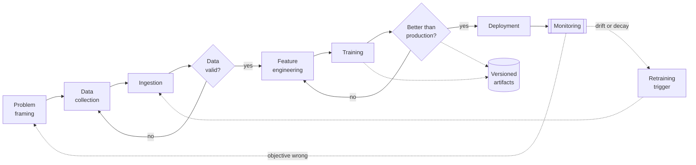

**Reading the diagram.** The main path runs left to right from framing to deployment; every step on it is a batch activity that produces an artifact. Two decision diamonds are **gates**: invalid data sends you back to collection (usually to fix instrumentation), and a candidate that does not beat production sends you back to features or training. Monitoring receives production data continuously and asynchronously (dotted arrows). It can trigger retraining, which re-enters the loop at ingestion with fresh data, or, more rarely and more expensively, reveal that the objective itself was wrong and send the team back to framing. The versioned-artifact store is the storage boundary that makes the loop auditable: every model points back to the data, code and configuration that produced it (§59.14). Failure points: a gate skipped under deadline pressure, and a monitoring arrow never built. Scaling: at maturity these arrows become automated pipelines (§59.15).

### 59.3.2 Why a loop and not a line

Three forces turn the line into a loop.

1. **The world drifts.** Input distributions change (a new city, a new app version), and so does the relationship between inputs and the label (a bridge closes, so the same distance now takes longer). Chapter 70 names these **data drift** and **concept drift**.
2. **The model changes the world.** An ETA shown to a customer changes which restaurant she orders from, so tomorrow's training data depends on today's model. These **feedback loops** are covered in §59.13.3.
3. **Learning is empirical.** You do not know in advance which features or model will work. Each pass through evaluation and production teaches you something that changes the next pass.

Amershi et al. described Microsoft's nine-stage workflow, from model requirements to monitoring, as highly non-linear, with feedback from almost every stage to earlier ones [Amershi et al. 2019]; Huyen likewise stresses that ML systems development is iterative and never finished [Huyen 2022].

### 59.3.3 The model is the small box

**Figure 59.2 — Where ML code sits in a production ML system (after Sculley et al. 2015).**

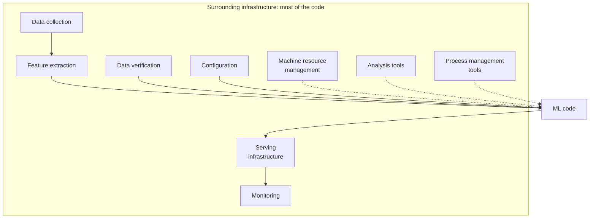

**Reading the diagram.** The boxes are the component names from Sculley et al.'s well-known figure, in which the "ML code" box is drawn tiny compared with everything around it. Solid arrows show the data path a prediction depends on: collection, feature extraction and verification feed the model, whose outputs pass through serving to monitoring. Dotted arrows show supporting systems (resource management, analysis tools, process management) that the model needs but that sit off the request path. Configuration feeds the model directly because, as the paper notes, ML configuration is often larger and more error-prone than the code. Each surrounding box is a failure point that offline accuracy says nothing about; most engineering effort, and most of this chapter, belongs to them.

**Table 59.1 — Lifecycle stages, the question each answers, and where they are treated in depth.**

| Stage | Question it answers | Main artifact | Deep treatment |
|---|---|---|---|
| Problem framing | What exactly do we predict, and how do we know it helps? | Framing document | §59.4; Ch 60 |
| Data collection | What do we record, and when? | Event schemas, prediction logs | §59.5; Ch 61 |
| Ingestion | How does data reach training storage? | Partitioned raw tables | §59.6; Ch 29, 61 |
| Validation | Is this data what we expect? | Validation report | §59.7; Ch 61, 63 |
| Feature engineering | What inputs does the model see? | Feature definitions | §59.8; Ch 62 |
| Training | Which model fits best within budget? | Model file, experiment log | §59.9; Ch 65 |
| Evaluation | Is it better, and for whom? | Evaluation report, model card | §59.10; Ch 57, 71 |
| Deployment | How does it reach users safely? | Deployment record | §59.11; Ch 66 |
| Monitoring | Is it still working? | Dashboards, alerts | §59.12; Ch 70 |
| Retraining | When do we build the next one? | Trigger policy | §59.13; Ch 69 |

::: industry
**Uber Michelangelo.** Uber described its internal ML platform as standardizing a six-step workflow: manage data, train models, evaluate models, deploy models, make predictions and monitor predictions. One of the first examples in the announcement was UberEATS estimated time of delivery, trained as gradient-boosted decision tree regression on request features (time of day, delivery location), historical features (average meal preparation time over the last seven days) and near-real-time features (average preparation time over the last hour). Uber built the platform because teams were rebuilding the same lifecycle stages ad hoc, without reliable pipelines from data to production.
*Evidence: Primary* — [Hermann and Del Balso 2017]
:::

::: mistake
**"Deployment is the finish line."** Deployment is the midpoint of the loop. A model that is deployed and never monitored or retrained is a slowly failing system with no alarm attached. Plan the monitoring and retraining stages before the first deployment, not after the first incident.
:::

## 59.4 Problem framing

### 59.4.1 From business objective to ML objective to metric

::: definition
**Definition — Problem framing.** The act of translating a business objective into (1) a prediction target, (2) the decision the prediction drives, (3) an offline metric that can be computed on historical data, (4) an online metric that measures business impact, and (5) guardrail metrics that must not get worse.
:::

#### First-principles explanation

Asking a model to "improve deliveries" is like asking a carpenter to "improve the house." The carpenter needs to know which wall, by how much, and what must not be damaged. Framing turns a wish into a specification. A useful test: could two engineers, given only your framing document, build models that you could compare with one number?

#### Why does this exist?

The commonest way an ML project fails is not a bad model but a good model of the wrong thing. A model that minimizes average error may still promise times that are systematically too early, which is what customers punish. Booking.com's account of 150 customer-facing models reports that gains in offline model performance often did not translate into business gains, and that careful problem construction was one of the main levers [Bernardi et al. 2019].

#### How it works internally

1. **State the business objective** in business units: "reduce 'where is my order?' contacts and order cancellations caused by broken promises."
2. **Name the decision** the prediction drives: "the ETA promised at checkout, and the ETA displayed next to each restaurant while browsing."
3. **Define the prediction target precisely**: what is measured, from when to when, for which population. "Minutes from order confirmation to courier handoff at the door, for completed orders."
4. **Choose the ML task**: regression, classification, ranking, or a quantile of a distribution.
5. **Choose offline metrics** that reflect the cost of errors (Chapter 57): here MAE, p90 absolute error, and the *late rate* (share of orders delivered more than 5 minutes after the promise).
6. **Choose online metrics and guardrails**: the late rate and support contacts per 1,000 orders (primary), checkout conversion and cancellations (guardrails).
7. **State constraints**: latency budget, freshness, interpretability, fairness, cost.

**Figure 59.3 — Framing QuickBite ETA: from business objective to metrics.**

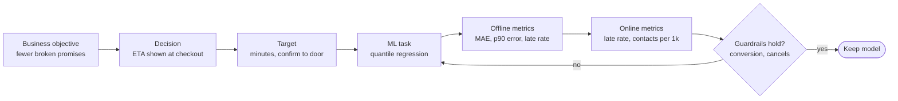

**Reading the diagram.** Each box narrows the one before it. The business objective is not measurable by a model; the decision says where the model's output is used; the target says exactly what is predicted; the task says what kind of model; the offline metrics can be computed on historical data before launch; the online metrics need a live experiment. The guardrail diamond is the failure point most teams forget: a model that cuts the late rate by padding every ETA by 15 minutes will lose customers at checkout. A failed guardrail sends you back to the task definition, typically to change the target quantile. All steps here are human decisions, recorded in a framing document that later stages cite.

Table 59.2 is the resulting framing card. Keep it to one page; it is the contract between product, data science and engineering.

**Table 59.2 — QuickBite ETA framing card (assumptions).**

| Item | Value |
|---|---|
| Business objective | Reduce support contacts and cancellations caused by late deliveries |
| Decision | ETA promised at checkout (500,000 orders/day) and shown per restaurant while browsing |
| Target | Minutes from order confirmation to handoff; mean ≈ 32 min |
| Current baseline | Rule: 10 min + kitchen prep estimate + 3 min per km |
| ML task | Regression of a chosen quantile (§59.4.2) |
| Offline metrics | MAE, p90 absolute error, late rate (actual > promise + 5 min) |
| Online metrics | Late rate; "where is my order" contacts per 1,000 orders |
| Guardrails | Checkout conversion; cancellation rate; per-city late rate |
| Constraints | p99 inference latency ≤ 50 ms at checkout; fall back to the rule if the model is down (§39.5) |
| Label availability | About 30–60 min after prediction, when the order is delivered |

### 59.4.2 Asymmetric costs choose the target

Most framing mistakes come from treating all errors as equal. For ETA, being late is worse than being early: a late order generates a support contact, a refund and a customer who may not return; an early promise that is too pessimistic loses a few conversions at checkout. If one kind of error costs more, you should not predict the mean; you should predict a **quantile**.

::: formula
**Cost-optimal quantile under asymmetric linear costs**

$$q^{*} = \frac{c_u}{c_u + c_o}$$

| Symbol | Meaning | Units |
|---|---|---|
| $q^{*}$ | Quantile of the delivery-time distribution that minimizes expected cost | fraction (0–1) |
| $c_u$ | Cost of *under*-predicting by one minute (the order arrives later than promised) | \$/minute |
| $c_o$ | Cost of *over*-predicting by one minute (the promise is longer than needed) | \$/minute |
:::

The result is the classic newsvendor solution: if you choose a promise $\hat{y}$, raising it by a small amount saves $c_u$ with probability $P(Y > \hat{y})$ and costs $c_o$ with probability $P(Y \le \hat{y})$. Setting the two equal gives $P(Y \le \hat{y}) = c_u/(c_u + c_o)$. A model trained with the **pinball (quantile) loss** at level $q^{*}$ estimates exactly this quantile (Chapter 57 covers loss functions).

::: example
**Worked example — How much padding should QuickBite's ETA carry?** Assume a late minute costs \$0.30 (support handling, refunds, lost future orders) and an unnecessary minute of promise costs \$0.10 (lost checkout conversions).

1. $q^{*} = 0.30 / (0.30 + 0.10) = 0.30 / 0.40 = 0.75$. Predict the 75th percentile.
2. Suppose, for one order, the model's predictive distribution is roughly normal with mean 32 min and standard deviation 5 min. The standard normal 75th percentile is $z_{0.75} \approx 0.674$.
3. Promise $= 32 + 0.674 \times 5 = 32 + 3.37 \approx 35.4$ min.
4. Check: with this promise, the order is late (beyond the promise) 25% of the time, instead of 50% with a mean prediction.

*Interpretation:* the business cost ratio, not the data scientist's taste, sets the padding. *Engineering implication:* the cost ratio belongs in the framing document and in the training configuration as a versioned parameter. If the support team halves its cost per contact, $q^{*}$ falls to $0.15/0.25 = 0.60$ and the promise shrinks to $32 + 0.253 \times 5 \approx 33.3$ min, with no change to any other code.
:::

### 59.4.3 When not to use ML

Machine learning is expensive to build and expensive to keep alive. Google's *Rules of Machine Learning* opens with "Don't be afraid to launch a product without machine learning" and advises that a simple heuristic gets a product launched and creates the data a model later needs [Zinkevich n.d.].

**Table 59.3 — Is ML the right tool? A decision checklist.**

| Question | If the answer is… | Then |
|---|---|---|
| Can a rule or lookup table meet the target? | Yes | Ship the rule; log data for a future model |
| Is there a measurable label, at volume? | No | Fix instrumentation or labeling first (Ch 63) |
| Does the pattern change faster than you can retrain? | Yes | Prefer rules plus human review, or online learning |
| Is an occasional wrong answer acceptable? | No | Use deterministic logic; ML can rank or assist only |
| Must every decision be explained exactly? | Yes | Rules or a simple, inspectable model (Ch 71) |
| Is the gain worth a pipeline, monitoring and an on-call rotation? | No | Stay with the rule |

For QuickBite, the rule baseline (10 min + prep estimate + 3 min/km) is the right first launch. It produces promises, and every delivered order produces a label against which a future model can be measured. The model earns its place only when it beats the rule by enough to pay for the rest of this chapter. The pipeline in §59.14.4 shows that it does, by about 1 minute of MAE on held-out data.

#### Failure scenarios

| What goes wrong | Why | Detection | Recovery | Prevention |
|---|---|---|---|---|
| Model optimizes the wrong target | Target defined as "prep + drive" but customers experience "confirm to door" | Offline metric improves, complaints do not | Re-define target; retrain | Write the target definition in the framing card and review with product |
| Guardrail regression | Padding ETAs lowers late rate but loses conversions | A/B guardrail metrics | Lower the quantile | Name guardrails before the experiment |
| Proxy metric diverges from goal | Offline MAE improves on average but p90 worsens in one city | Slice metrics (§59.10) | Re-weight or add features | Include tail and slice metrics in the framing |

::: mistake
**"Accuracy is the objective."** Accuracy, MAE and AUC are *proxies* for a business objective. A model can improve the proxy while the objective gets worse, for example by being more accurate on easy orders and less accurate on the late ones that drive complaints. Always pair the offline metric with an online metric and with guardrails.
:::

## 59.5 Data collection

### 59.5.1 Sources

::: definition
**Definition — Data collection (for ML).** Deciding which facts about the world to record, at what moment, with what identifiers and timestamps, so that features and labels can later be reconstructed exactly as they were at prediction time.
:::

#### First-principles explanation

A detective can only solve a case from the evidence that was bagged at the scene. If nobody wrote down the time the courier picked up the food, no amount of clever modeling can learn how long pickup takes. Data collection is bagging evidence before you know which case you will be asked to solve.

#### Why does this exist?

Product systems log what they need to *operate*: the current order status, the current courier location. Models need what happened *over time* and *at the moment of the decision*. Polyzotis et al. survey Google's experience and identify data understanding, validation, cleaning and preparation as the dominant, under-tooled challenges of production ML [Polyzotis et al. 2018]. Many of those problems start at collection.

For ETA, QuickBite has four kinds of source (Figure 59.4):

1. **Transactional databases**: orders, restaurants, menus (Chapter 11). They hold current state; history must come from change data capture (§32.6) or snapshots.
2. **Event streams**: order status changes, courier GPS pings, app interactions, published to Kafka (§31.3). They hold *what happened when*.
3. **Service logs**: the dispatch and ETA services' own logs, including every prediction made (§59.5.3).
4. **Third-party data**: weather, traffic and map routing from external providers (§2.4), with their own latency, cost and licensing terms.

**Figure 59.4 — Data sources for QuickBite ETA.**

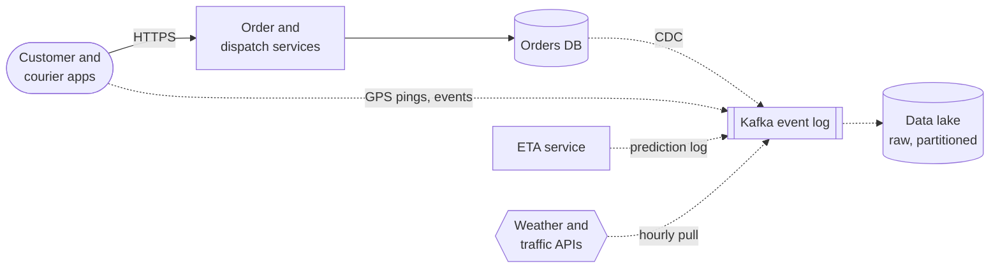

**Reading the diagram.** User actions arrive synchronously over HTTPS at the order and dispatch services, which write current state to the orders database. Everything the ML lifecycle needs reaches the event log asynchronously (dotted arrows): database changes via change data capture, GPS pings and app events directly, the ETA service's own prediction log, and third-party weather and traffic data pulled on a schedule. The data lake is the storage boundary where raw, time-partitioned history accumulates for training. Failure points: a CDC connector that falls behind (training data silently missing recent days), an app release that changes an event schema, and a third-party API outage that leaves gaps. Scaling: the event log is partitioned by order or courier ID (§31.5); the lake scales by adding storage, not by changing the producers.

### 59.5.2 Instrumentation for ML

Good ML instrumentation follows a few rules that ordinary product logging often breaks:

- **Log events, not just state.** "Order 812 picked up at 12:07:31" is reconstructible history; an `status = 'delivered'` column is not.
- **Carry stable join keys.** Every event carries the order ID, courier ID, restaurant ID and a request ID, so that predictions, features and labels can be joined later.
- **Record two timestamps.** *Event time* (when it happened) and *ingestion time* (when it was recorded) differ, sometimes by minutes for a phone that was offline. Training must use event time for correctness and ingestion time to know what was *available* when.
- **Version the schema.** Event schemas live in a registry and change compatibly (§30, §31), so a renamed field does not become a silent column of nulls.
- **Log the denominators.** Record orders that were *not* placed after an ETA was shown; otherwise a model of conversion only ever sees successes.

### 59.5.3 Logging features at prediction time

The single most valuable ML instrumentation habit is to log, for every prediction, the exact feature values the model used, the model version and the output. Later, when the label arrives, you join it to this record. The result is a training row that is guaranteed to match what the model saw.

**Figure 59.5 — Prediction-time logging and the delayed label join.**

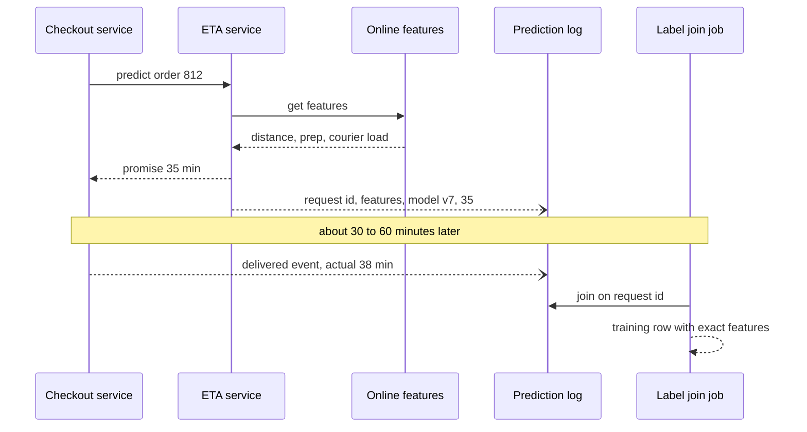

**Reading the diagram.** The checkout service calls the ETA service synchronously; the ETA service reads current feature values from the online feature store (Chapter 62) and returns a promise. The prediction record (request ID, the feature values as used, model version, output) is written asynchronously, so logging never adds to the user's latency. The label (actual delivery minutes) arrives much later as a separate event. A batch or streaming join keyed on the request ID creates the training row. Storage boundary: the prediction log is durable and append-only. Failure points: dropped log writes (training data becomes a biased sample), and orders that are never delivered (canceled), which produce no label and must be handled explicitly rather than silently dropped. Scaling: the log is partitioned by request ID and compacted into columnar files for training.

::: example
**Worked example — What does prediction logging cost?** Assume each checkout prediction record is 2 KB (about 60 features, IDs and metadata; SI units, 1 KB = 10³ bytes).

1. Checkout predictions: 500,000 per day × 2 KB = 1 GB/day; 365 GB per year. Cheap: log all of them.
2. Browse predictions: 60 million browse reads per day (§2.11) × 20 restaurant ETAs each = 1.2 billion predictions per day. At 1 KB each that is 1.2 TB/day, about 438 TB per year.
3. Sample 1% of browse requests (all 20 ETAs in each sampled request, so a whole page stays consistent): 12 GB/day.

*Interpretation:* log every high-value decision, sample high-volume ones by request, not by row. *Engineering implication:* the sampling rate is a versioned configuration; any model trained on browse data must know it, because the logged rows are a sample, not the population.
:::

::: mistake
**"We can recompute features later from the warehouse."** Recomputing features months later uses data that may have been corrected, backfilled or arrived late, so the values differ from what the model saw in production. That mismatch is one source of training–serving skew (§59.8.3). Recomputation also cannot reproduce third-party responses that were never stored. Log at prediction time whenever the volume allows.
:::

## 59.6 Data ingestion

### 59.6.1 Batch and streaming paths

::: definition
**Definition — Data ingestion.** Moving data from its sources into storage that training and analysis can read, either in periodic **batches** (for example, a nightly snapshot) or as a continuous **stream** of events.
:::

#### First-principles explanation

Batch ingestion is the postal service: everything accumulated today arrives together tomorrow morning. Streaming is a phone call: each fact arrives seconds after it happens. The post is cheaper and simpler; the phone call is needed when yesterday's news is too late.

#### How it works internally

Chapter 29 covers batch and stream processing in depth (§29.3, §29.8), including the Lambda and Kappa architectures that combine them (§29.10); Chapter 61 applies them to ML data platforms. For the lifecycle you need three ideas:

1. **Training mostly needs batch.** A model retrained weekly reads weeks of history; a nightly batch of yesterday's orders is fresh enough.
2. **Serving features often need streaming.** "Orders currently waiting at this restaurant" is useless if it is an hour old. Streaming aggregations feed the online feature store (Chapter 62).
3. **Both paths must produce the same values.** If the batch job computes "average prep time over the last hour" with different logic from the stream job, training and serving disagree (§59.8.3).

**Figure 59.6 — Batch and streaming ingestion paths for ETA.**

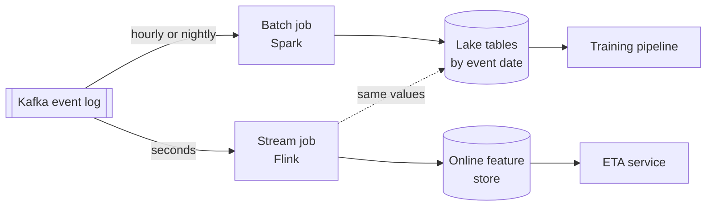

**Reading the diagram.** The event log is the single source for both paths. The batch path reads it on a schedule, writes partitioned lake tables keyed by event date, and feeds training. The streaming path computes rolling aggregates within seconds and writes them to the online store that the ETA service reads synchronously at request time. The dotted arrow is the discipline that prevents skew: the stream job also writes the values it served into the lake, so training can use the same numbers. Failure points: late events that miss a batch window, a stream job that restarts and double-counts (§29.8), and two code bases implementing one aggregate. Scaling: both jobs scale by partitions of the event log.

::: recommendation
**Recommendation — Partition by event time and keep raw data immutable.** Write ingested data into partitions keyed by event date and never modify a partition in place; corrections go into new versions (§59.14). Then "the training data as of 1 March" is a well-defined, reproducible set of files.
:::

## 59.7 Data validation

### 59.7.1 What to check

::: definition
**Definition — Data validation.** Automated checks that a batch of data conforms to expectations about its schema (columns and types), values (ranges, allowed categories, missing rates) and distribution (statistics compared with a reference), run before the data is used for training or serving.

**Definition — Expectation.** A declarative, testable statement about data, such as "`distance_km` is never null and lies in [0, 50]." Libraries such as TensorFlow Data Validation (TFDV) infer a schema of expectations from a reference dataset and check new data against it [Breck et al. 2019].
:::

#### First-principles explanation

A restaurant kitchen checks deliveries at the back door: is this the fish we ordered, is it cold, does it smell right? It does not wait until a customer complains. Data validation is the back-door check for a model's ingredients.

#### Why does this exist?

Bad data rarely crashes a training job. A column that switches from kilometers to meters, a field that becomes 8% null after an app release, or a new city code all produce a model that trains happily and predicts badly. Google's TFX paper describes data validation as a first-class pipeline component precisely because such errors are silent [Baylor et al. 2017], and Breck et al. report that at Google the validation system flags anomalies that would otherwise reach training [Breck et al. 2019].

**Table 59.4 — Data validation checks and what they catch.**

| Check | Example expectation | Catches |
|---|---|---|
| Schema | Columns and types match the registry | Renamed or dropped fields |
| Domain | `city` ∈ {north, south, east} | New or misspelled categories |
| Range | 0 < `distance_km` < 50 | Unit changes, sign errors |
| Missing rate | `prep_min` null in < 1% of rows | Broken producers |
| Mean shift | z-score of the batch mean below a threshold | Large systematic shifts |
| Distribution shift | Population stability index (PSI) < 0.2 | Subtler changes in shape |
| Label sanity | 5 < `minutes` < 180 | Corrupt labels, test orders |
| Freshness | Newest event < 2 hours old | Stalled ingestion |

### 59.7.2 Two simple statistics

::: formula
**Mean-shift z-score**

$$z = \frac{\bar{x}_{\text{new}} - \mu_{\text{ref}}}{\sigma_{\text{ref}} / \sqrt{n}}$$

| Symbol | Meaning | Units |
|---|---|---|
| $\bar{x}_{\text{new}}$ | Mean of the feature in the new batch | feature units |
| $\mu_{\text{ref}}$, $\sigma_{\text{ref}}$ | Mean and standard deviation in the reference data | feature units |
| $n$ | Number of non-missing values in the new batch | rows |
| $z$ | Shift measured in standard errors | dimensionless |
:::

::: formula
**Population stability index (PSI)**

$$\text{PSI} = \sum_{i=1}^{B} (q_i - p_i)\,\ln\frac{q_i}{p_i}$$

| Symbol | Meaning | Units |
|---|---|---|
| $B$ | Number of bins, typically the reference deciles ($B = 10$) | bins |
| $p_i$ | Fraction of reference rows in bin $i$ | fraction |
| $q_i$ | Fraction of new rows in bin $i$ | fraction |
| PSI | Divergence between the two binned distributions | dimensionless |
:::

A common industry rule of thumb reads PSI below 0.1 as stable, 0.1–0.2 as a moderate shift and above 0.2 as a significant shift. Chapter 70 discusses PSI alongside the Kolmogorov–Smirnov test and Jensen–Shannon divergence, and when each is appropriate.

::: example
**Worked example — Two checks on a batch of 5,000 orders.**

*Mean shift.* The reference mean distance is 3.20 km with standard deviation 2.26 km. A new batch of 5,000 orders has mean 3.30 km. Standard error $= 2.26/\sqrt{5{,}000} = 2.26/70.7 = 0.032$ km, so $z = (3.30 - 3.20)/0.032 = 3.1$. With $n = 5{,}000$, even a 3% shift is "statistically significant." That is why the code below uses a high threshold ($|z| > 4$) and why large-sample pipelines often alert on effect size (a percentage change) rather than on significance alone.

*PSI.* Suppose a unit bug moves 20% of rows from their deciles into the top bin. Then nine bins have $q_i = 0.08$ against $p_i = 0.10$, and the top bin has $q_{10} = 0.08 + 0.20 = 0.28$ against $0.10$.

1. Each of the nine bins: $(0.08 - 0.10)\ln(0.08/0.10) = (-0.02)(-0.223) = 0.00446$; nine of them sum to 0.0402.
2. Top bin: $(0.28 - 0.10)\ln(0.28/0.10) = 0.18 \times 1.030 = 0.185$.
3. PSI $= 0.040 + 0.185 = 0.225$, just over the 0.2 threshold.

*Interpretation:* PSI barely notices a catastrophic bug that a range check catches instantly, because PSI only sees which bin a value falls in, not how far beyond the last edge it lies. *Engineering implication:* layer the checks; range and schema checks for bugs, distribution checks for drift.
:::

### 59.7.3 Code example: validating a batch

The program builds expectations from a reference batch and checks a new batch with three injected bugs: an app release logs distance in meters for one city, the kitchen tablet stops sending prep time for 8% of orders, and a new city appears.

```python
import numpy as np

rng = np.random.default_rng(59)

def make_batch(n, rng, broken=False):
    city = rng.choice(["north", "south", "east"], size=n, p=[0.5, 0.3, 0.2])
    distance_km = rng.gamma(shape=2.0, scale=1.6, size=n)      # mean ~3.2 km
    prep_min = rng.normal(14.0, 4.0, size=n).clip(3, 45)
    if broken:
        distance_km[city == "east"] *= 1000.0                # bug 1: meters, not km
        prep_min[rng.random(n) < 0.08] = np.nan              # bug 2: 8% missing
        city[:150] = "west"                                  # bug 3: new city
    return {"city": city, "distance_km": distance_km, "prep_min": prep_min}

reference = make_batch(20_000, rng)
new_batch = make_batch(5_000, rng, broken=True)

def infer_expectations(ref):
    exp = {}
    for col, values in ref.items():
        if values.dtype.kind in "fi":
            v = values[~np.isnan(values)]
            exp[col] = {"type": "numeric", "min": 0.0,
                        "max": float(np.quantile(v, 0.999)) * 3,
                        "max_missing": 0.01,
                        "mean": float(v.mean()), "std": float(v.std()),
                        "edges": np.quantile(v, np.linspace(0, 1, 11))}
        else:
            exp[col] = {"type": "categorical", "domain": set(values.tolist())}
    return exp

def psi(ref_values, new_values, edges):
    e = edges.copy(); e[0], e[-1] = -np.inf, np.inf
    p = np.histogram(ref_values, e)[0] / len(ref_values)
    q = np.histogram(new_values, e)[0] / len(new_values)
    p, q = np.clip(p, 1e-6, None), np.clip(q, 1e-6, None)
    return float(np.sum((q - p) * np.log(q / p)))

def validate(batch, exp, ref):
    problems = []
    if set(batch) != set(exp):
        problems.append(f"schema: columns {sorted(set(batch) ^ set(exp))}")
    for col, rule in exp.items():
        x = batch[col]
        if rule["type"] == "categorical":
            unseen = set(x.tolist()) - rule["domain"]
            if unseen:
                frac = np.isin(x, list(unseen)).mean()
                problems.append(f"{col}: unseen values {sorted(unseen)} in {frac:.1%} of rows")
            continue
        missing = np.isnan(x).mean()
        if missing > rule["max_missing"]:
            problems.append(f"{col}: missing rate {missing:.1%} > {rule['max_missing']:.0%}")
        v = x[~np.isnan(x)]
        out = ((v < rule["min"]) | (v > rule["max"])).mean()
        if out > 0.001:
            problems.append(f"{col}: {out:.1%} of values outside [{rule['min']:.0f}, {rule['max']:.1f}]")
        z = (v.mean() - rule["mean"]) / (rule["std"] / np.sqrt(len(v)))
        if abs(z) > 4:
            problems.append(f"{col}: mean {v.mean():.2f} vs {rule['mean']:.2f} (z = {z:.0f})")
        ref_v = ref[col][~np.isnan(ref[col])]
        score = psi(ref_v, v, rule["edges"])
        if score > 0.2:
            problems.append(f"{col}: PSI {score:.2f} > 0.2")
    return problems

expectations = infer_expectations(reference)
print("reference batch:", validate(reference, expectations, reference) or "OK")
for p in validate(new_batch, expectations, reference):
    print("FAIL", p)
```

Output:

```text
reference batch: OK
FAIL city: unseen values ['west'] in 3.0% of rows
FAIL distance_km: 19.6% of values outside [0, 44.8]
FAIL distance_km: mean 640.06 vs 3.20 (z = 20124)
FAIL distance_km: PSI 0.22 > 0.2
FAIL prep_min: missing rate 7.9% > 1%
```

What to notice:

- `infer_expectations` mirrors what TFDV does: derive a schema from trusted data, then let humans review and tighten it. Expectations are artifacts and are versioned with the pipeline.
- The reference batch passes its own checks: a validation suite that fails on known-good data will be ignored.
- The unit bug trips three checks, but PSI (0.22) only just crosses its threshold, matching the worked example: distribution checks are weak bug detectors.
- The new city is 3.0% of rows. Whether that should *block* training is a policy decision: a new category may be legitimate growth, in which case you update the schema deliberately.

#### Failure scenarios

| What goes wrong | Why | Detection | Recovery | Prevention |
|---|---|---|---|---|
| Alert fatigue | Thresholds too tight for large batches | Many failures, none acted on | Re-tune to effect sizes | Calibrate on months of known-good data |
| Silent pass of bad data | Check on the wrong column, or schema auto-updated | Model quality drops later | Roll back data version and retrain | Review schema changes like code |
| Pipeline blocked by legitimate change | New city launched | Validation failure at launch | Approve schema change | Product launches notify the ML team |

::: recommendation
**Recommendation — Decide which checks block and which warn.** Schema, label sanity and large missing-rate failures should **block** training and serving updates. Moderate distribution shifts should **warn** and be reviewed, because blocking on every shift stops the pipeline exactly when the world changes and the model most needs retraining.
:::

## 59.8 Feature engineering

### 59.8.1 Transformations, windows and encodings

::: definition
**Definition — Feature engineering.** Computing model inputs (features) from raw data: transforming single values, aggregating events over time windows, and encoding categories as numbers.
:::

#### First-principles explanation

A model is a very literal student. Given a raw timestamp, it sees a number in the billions; given "hour of day" and "is peak," it sees something it can learn from. Feature engineering is the teacher translating raw facts into the language the student understands.

**Table 59.5 — Feature types for QuickBite ETA.**

| Type | Example | Computation | Freshness needed |
|---|---|---|---|
| Raw value | `distance_km` from routing | Map API at request time | Real time |
| Transformation | `log(distance_km)`, `hour_of_day` | Pure function of one record | Real time |
| Window aggregate | Restaurant mean prep time, last 7 days | Batch over event history | Daily |
| Window aggregate | Orders waiting at restaurant, last 15 min | Streaming over event log | Seconds |
| Categorical encoding | `city` one-hot; restaurant ID embedding (Ch 58) | Lookup table | Changes with new categories |
| Cross or ratio | Courier load × peak flag | Function of other features | As inputs |

Three practical rules follow.

1. **Windows are defined relative to the prediction time.** "Prep time over the last 7 days" means the 7 days *before* the order was placed. Using any later data is **label leakage**: the training set contains information the model will not have in production.
2. **Encodings need a policy for the unseen.** A one-hot encoder trained on three cities must do something defined when "west" appears: map it to an "other" bucket, not crash or emit zeros by accident.
3. **Prefer simple, stable features.** Every feature is a dependency that can break; Sculley et al. warn about "underutilized data dependencies," features that add little accuracy but much fragility [Sculley et al. 2015].

### 59.8.2 One definition, two execution paths

**Figure 59.7 — One feature definition serving both training and inference.**

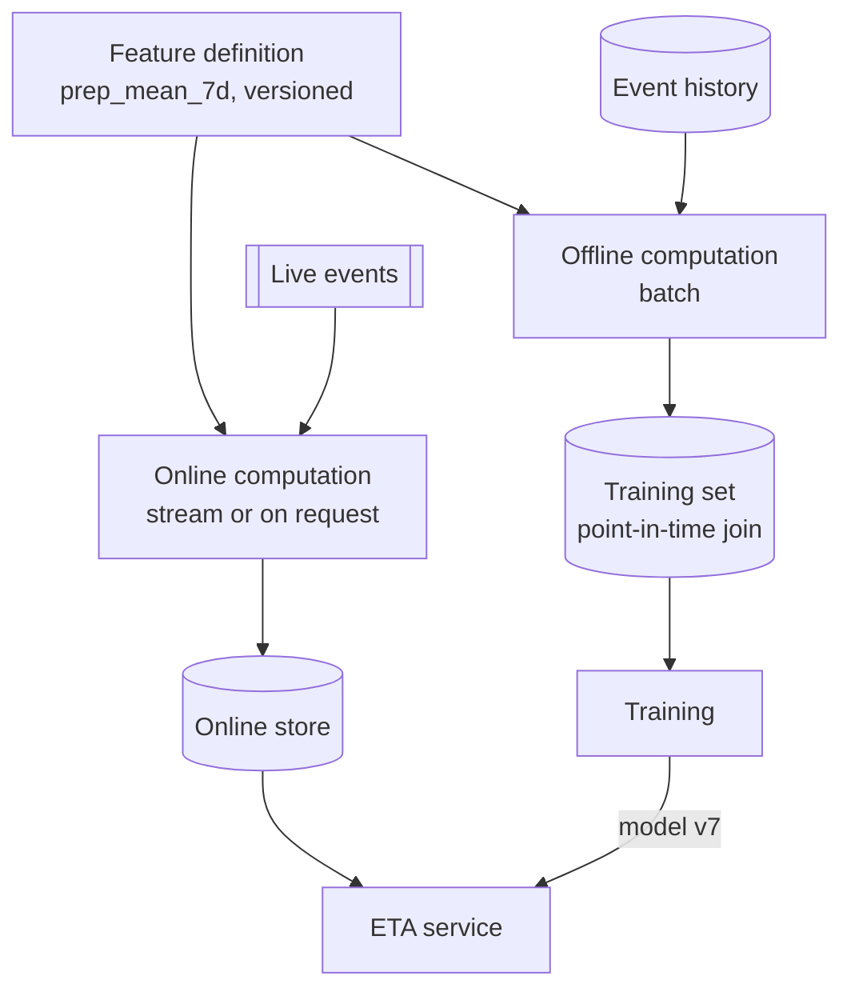

**Reading the diagram.** A single versioned definition drives two execution paths. The offline path computes historical values from the event history and joins them to labels *as of each order's timestamp* (a point-in-time join, Chapter 62), producing the training set. The online path computes the same feature from live events and stores the latest value for the ETA service to read synchronously. The trained model flows to the service with a version tag. The storage boundaries are the training set and the online store; the failure point is any divergence between the two paths: a different window boundary, time zone or null-handling rule. Feature stores (Chapter 62) exist largely to enforce this single definition at scale.

### 59.8.3 Training–serving skew, previewed

::: definition
**Definition — Training–serving skew.** A difference between model performance during training and performance during serving [Zinkevich n.d.], caused by a discrepancy between how the two pipelines handle data, by a change in the data between training and serving, or by a feedback loop between the model and the system it acts on.
:::

In practice the three causes look like this: (1) different code computes the same feature offline and online; (2) the data differs, for example training reads corrected warehouse data while serving reads raw live events; (3) a feedback loop changes the serving distribution. Its signature is a model that looks excellent offline and disappoints online, with no error anywhere in the logs. The defenses are a shared feature definition (Figure 59.7), prediction-time logging (§59.5.3), and a skew check that compares logged serving features with offline recomputation for the same requests. Chapter 62 treats point-in-time correctness and skew detection in depth.

::: mistake
**"A random train/test split tells me how the model will do in production."** Random splits put future orders in the training set and past orders in the test set, so window features and drifting trends leak information backwards in time. For any problem where time matters, split by time: train on the past, test on the most recent period. The pipeline in §59.14.4 shows a random split reporting an MAE of 2.37 minutes where an honest time split reports 3.22.
:::

## 59.9 Model training

### 59.9.1 Baselines first

::: definition
**Definition — Baseline.** The simplest credible predictor for a task, such as a constant (the training median), a hand-written rule or a linear model, against which every more complex model must show a measurable improvement.
:::

#### First-principles explanation

Before you buy a racing bicycle, time yourself walking and on an ordinary bike. If the racing bike saves ten seconds on a five-minute trip, it may not be worth the maintenance. Baselines are the walking and ordinary-bike times of ML.

#### Why does this exist?

Without a baseline, a model's MAE of 3.2 minutes is uninterpretable: is that good? Baselines also catch bugs: a gradient-boosted model that barely beats the training median usually has a data or feature problem, not a modeling problem. For QuickBite the ladder is: constant median (no information), the current production rule (domain knowledge), a regularized linear model, and gradient-boosted decision trees (GBDT), the usual first strong model for tabular data. Chapter 58 discusses when deep learning earns its additional cost over such models.

### 59.9.2 The experiment loop

**Figure 59.8 — The experiment loop.**

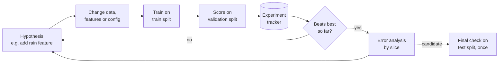

**Reading the diagram.** Each iteration starts from a written hypothesis, changes one thing, trains on the training split and scores on the validation split. Every run, including failures, is recorded in an experiment tracker (Chapter 69 covers tools such as MLflow) with its data version, code commit, configuration and metrics. Runs that improve the best result go to error analysis, which generates the next hypothesis. The test split is touched once, asynchronously and at the end, by the chosen candidate; reusing it for decisions turns it into a second validation set and makes its estimate optimistic. Failure points: unlogged runs that cannot be reproduced, and "improvements" smaller than run-to-run noise. Scaling: runs are independent, so the loop parallelizes across machines; large models move training itself onto many GPUs (Chapter 65).

::: recommendation
**Recommendation — Measure noise before celebrating.** Train the same configuration with three to five different seeds. If the spread of validation MAE is ±0.05 minutes, a 0.03-minute "gain" is noise.
:::

### 59.9.3 Hyperparameter search and its budget

**Hyperparameters** are settings chosen before training (learning rate, tree depth, regularization strength), as opposed to parameters learned from data. Three search strategies dominate:

**Table 59.6 — Hyperparameter search strategies.**

| Strategy | How it works | Advantages | Disadvantages | Choose when |
|---|---|---|---|---|
| Grid search | Every combination of listed values | Simple, exhaustive on the grid | Cost grows as $k^d$; wastes trials on unimportant settings | 1–2 hyperparameters |
| Random search | Sample each trial independently from ranges | Same budget explores more values of each important setting [Bergstra and Bengio 2012] | No learning between trials | Default starting point |
| Bayesian optimization | Fit a surrogate model of score vs settings; pick the most promising next trial [Snoek et al. 2012] | Fewer trials for expensive models | Sequential; harder to parallelize | Each trial costs hours |

Bergstra and Bengio showed that for most models only a few hyperparameters matter, so random search, which tries a new value of *every* hyperparameter in every trial, finds good settings with far fewer trials than a grid. Early-stopping methods such as Hyperband stop weak trials early to spend the budget on promising ones [Li et al. 2018].

::: formula
**Random search: probability of reaching the top fraction**

$$P(\text{hit}) = 1 - (1 - f)^{N}$$

| Symbol | Meaning | Units |
|---|---|---|
| $f$ | Fraction of the search space considered "good enough" (top-scoring region) | fraction |
| $N$ | Number of independent random trials | trials |
| $P(\text{hit})$ | Probability that at least one trial lands in that region | probability |
:::

::: formula
**Search compute budget**

$$C = N \times t \times p \qquad T_{\text{wall}} = \left\lceil \frac{N}{W} \right\rceil \times t$$

| Symbol | Meaning | Units |
|---|---|---|
| $N$ | Number of trials | trials |
| $t$ | Training time per trial | hours |
| $p$ | Price of one training node | \$/node-hour |
| $W$ | Number of trials run in parallel | nodes |
| $C$, $T_{\text{wall}}$ | Total cost; elapsed time | \$; hours |
:::

::: example
**Worked example — Grid or random search for the ETA model?** Assume four GBDT hyperparameters with five candidate values each, one trial takes 20 minutes ($t = 1/3$ h) on a node priced at \$0.80 per hour (an assumption, not a quoted price).

1. *Grid.* $N = 5^4 = 625$. $C = 625 \times 1/3 \times 0.80 = \$166.67$. With $W = 25$ nodes, $T_{\text{wall}} = \lceil 625/25 \rceil \times 20 = 25 \times 20 = 500$ min $\approx 8.3$ h.
2. *Random.* How many trials give a 95% chance of landing in the top 5%? Solve $1 - 0.95^N \ge 0.95$: $N \ge \ln 0.05 / \ln 0.95 = -2.996 / -0.0513 = 58.4$, so $N = 60$ (check: $1 - 0.95^{60} = 1 - 0.046 = 0.954$). $C = 60 \times 1/3 \times 0.80 = \$16$. With $W = 20$, $T_{\text{wall}} = 3 \times 20 = 60$ min.

*Interpretation:* random search reaches a near-top configuration for about a tenth of the cost and an eighth of the time. The guarantee is about the top 5% of the *sampled ranges*; if the ranges exclude the best region, no number of trials finds it. *Engineering implication:* budget search per retraining cycle. If the model retrains weekly, a 60-trial search every week costs about \$830 a year; a full grid every week would cost about \$8,700. Most teams search occasionally and retrain the chosen configuration on a schedule.
:::

## 59.10 Model evaluation

### 59.10.1 Aggregate metrics are necessary, not sufficient

Offline evaluation applies the metrics of Chapter 57 to a held-out test set that the model never influenced. For QuickBite the framing card (Table 59.2) fixes MAE, p90 absolute error and the late rate. Evaluate every candidate against the *production* model and the baselines on the *same* time-based test window. The end-to-end pipeline (§59.14.4) produces this comparison on synthetic data:

**Table 59.7 — Synthetic QuickBite results on the final 7-day test window (from §59.14.4).**

| Model | MAE (min) | p90 absolute error (min) |
|---|---|---|
| Training median (constant) | 7.88 | 16.97 |
| Production rule | 4.27 | 8.22 |
| Ridge regression | 3.69 | 8.24 |
| GBDT | 3.22 | 7.55 |

The GBDT beats the rule by about 1 minute of MAE. Ridge regression beats the rule on average but not on the p90 tail, a reminder that aggregate and tail metrics can disagree.

### 59.10.2 Slice-based evaluation and error analysis

::: definition
**Definition — Slice.** A subset of evaluation data defined by a feature value or combination (city, hour band, new restaurants, rainy days), on which metrics are computed separately.
:::

An average hides the people a model fails. The same synthetic GBDT, broken down by city:

| Slice | Orders | MAE (min) | p90 (min) |
|---|---|---|---|
| north | 2,071 | 2.18 | 4.87 |
| south | 1,312 | 2.33 | 5.30 |
| east | 817 | 7.31 | 11.38 |

The east slice is three times worse. **Error analysis** asks why: inspect the worst errors, group them, and form hypotheses. Here the synthetic world contains a bridge closure in the east city from day 60, after the training window ended; the model has never seen it. In real life the remedy might be a road-closure feature, a fresher training window, or a fallback to the rule for that city until retraining. Slice evaluation is also how you find such problems *before* customers do, which is why TFX includes sliced model analysis as a pipeline component [Baylor et al. 2017].

**Fairness slices.** Some slices correspond to groups of people. If ETAs are systematically too optimistic in lower-income neighborhoods, customers there receive worse service, and couriers serving them may be judged unfairly against unrealistic promises. Chapter 71 defines fairness metrics and mitigations; the lifecycle point is simply that such slices must be part of evaluation and monitoring from the first model.

### 59.10.3 Model cards

::: definition
**Definition — Model card.** A short document accompanying a trained model that reports its intended use, the factors (groups, conditions) across which it was evaluated, its metrics overall and per factor, the evaluation and training data, ethical considerations, and caveats [Mitchell et al. 2019].
:::

Mitchell et al. proposed model cards with nine sections: model details, intended use, factors, metrics, evaluation data, training data, quantitative analyses, ethical considerations, and caveats and recommendations. For an internal ETA model, a one-page card tells an on-call engineer what the model is for and *not* for (it does not predict grocery deliveries), which slices are weak, and which data window trained it. Generate the quantitative parts from the evaluation pipeline so the card cannot drift from the model.

::: industry
**Booking.com: offline gains are not business gains.** Booking.com's analysis of about 150 customer-facing models reports that improvements in offline model metrics frequently did not correlate with improvements in business metrics measured by randomized controlled trials, and that every model was therefore validated online.
*Evidence: Primary* — [Bernardi et al. 2019]
:::

::: mistake
**"The test set score is the production score."** A test set is a sample of the past. Production is the future, with drift, feedback loops and slices the test set under-represents. Offline evaluation decides what is *worth* testing online; only an online experiment measures business impact (§59.11).
:::

## 59.11 Model deployment

### 59.11.1 Batch scoring versus online serving

::: definition
**Definition — Batch scoring.** Running a model periodically over a large set of inputs and storing the predictions for later lookup.

**Definition — Online serving.** Running a model on demand, inside a request, using features available at that moment, and returning the prediction within a latency budget.
:::

**Table 59.8 — Batch scoring versus online serving.**

| Aspect | Batch scoring | Online serving |
|---|---|---|
| How it works | Scheduled job writes predictions to a table or cache | Service computes a prediction per request |
| Freshness | Hours to a day | Features as fresh as the online store |
| Latency at use | A key-value lookup (~1 ms) | Feature fetch + inference (QuickBite budget: p99 ≤ 50 ms) |
| Cost | Scores every entity, even unused ones | Scores only what is requested; must provision for peak |
| Failure mode | Stale predictions if the job fails | Errors or timeouts on the request path |
| QuickBite use | Daily demand forecast per restaurant | Checkout ETA, which depends on current courier load |

Many systems mix both: restaurant-level prep-time estimates are batch-scored nightly and become *features* of the online ETA model. Chapter 66 covers model servers, batching and autoscaling; Chapter 60 places these modes in the offline, nearline and online architecture.

### 59.11.2 Progressive rollout of a model

A new model is a new release and uses the machinery of §43.6 (canary releases) and §43.7 (feature flags), with one addition: a model can be *wrong* without being *broken*. The service returns 200 OK with a bad prediction, so error rates and latency are not enough; you must also compare prediction quality.

**Figure 59.9 — Progressive rollout of a new ETA model.**

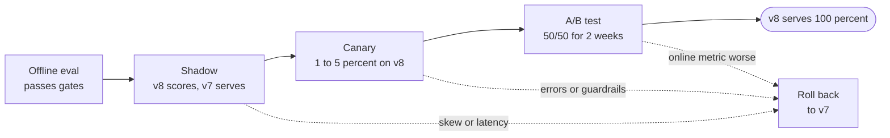

**Reading the diagram.** In **shadow** mode the new model (v8) receives a copy of live requests and its predictions are logged but never shown; the current model (v7) still serves. This checks latency, errors and skew on real traffic at zero user risk, and for ETA it even measures accuracy, because the delivery time is largely independent of which promise was displayed. A **canary** then serves a small share of traffic for real, guarding against operational failures (§43.6). The **A/B test** splits traffic evenly for long enough to measure the online metric and guardrails with statistical power (Chapter 57). Each stage can roll back asynchronously to v7, which stays deployed and warm. Failure points: shadow traffic doubling feature-store load, and an A/B test stopped early on a noisy result. Scaling: shadow and canary traffic shares are flags, not deployments.

::: warning
**Warning — Shadow mode cannot measure everything.** Shadow mode measures prediction quality only when the outcome does not depend on the prediction. For a recommendation or ranking model, what the user clicks depends on what was shown, so the shadow model's "accuracy" on logged clicks is biased toward the production model. Those models need an A/B test (Chapter 68).
:::

## 59.12 Monitoring

### 59.12.1 What to watch, and when you can see it

ML monitoring extends service monitoring (Chapter 40) with signals about data and predictions. They differ in how quickly they become available:

**Figure 59.10 — Monitoring signals ordered by how soon they are available.**

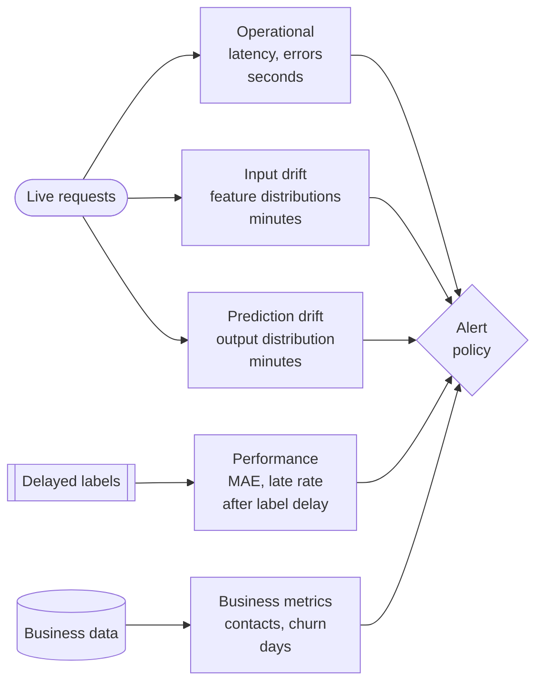

**Reading the diagram.** From top to bottom the signals arrive later but say more about what matters. Operational metrics (latency, error rate) are available within seconds, as for any service (§40.5). **Data drift** (feature distributions) and **prediction drift** (the distribution of the model's outputs) can be computed from live requests within minutes, without labels, but they are only *proxies*: inputs can shift without harming accuracy. **Performance** needs labels and so arrives only after the label delay. Business metrics arrive last, over days. All feed one alert policy that pages on operational failures and sends drift findings to review. Failure point: monitoring only the fast signals and missing slow accuracy decay; or only the slow ones and learning about a broken feature from customers. Chapter 70 covers the statistical tests and dashboards.

### 59.12.2 Label delay limits how fast you can detect decay

::: formula
**Time to detect a shift in model error**

$$n = \left(\frac{(z_{1-\alpha/2} + z_{1-\beta})\,\sigma}{\delta}\right)^{2} \qquad T_{\text{detect}} = L + \frac{n}{\lambda_s}$$

| Symbol | Meaning | Units |
|---|---|---|
| $\sigma$ | Standard deviation of per-prediction error | minutes |
| $\delta$ | Smallest shift in mean error you want to detect | minutes |
| $z_{1-\alpha/2}$, $z_{1-\beta}$ | Normal quantiles for false-alarm rate $\alpha$ and power $1 - \beta$ | dimensionless |
| $n$ | Labeled predictions needed | predictions |
| $\lambda_s$ | Rate of labeled predictions in the slice monitored | predictions/second |
| $L$ | Label delay (time from prediction until most labels arrive) | seconds |
| $T_{\text{detect}}$ | Earliest time a shift can be detected | seconds |
:::

::: example
**Worked example — How quickly can QuickBite see ETA decay?** Assume per-order error standard deviation $\sigma = 6$ min, a target shift $\delta = 0.5$ min, $\alpha = 0.05$ ($z = 1.96$) and 80% power ($z = 0.84$). Labels arrive when orders are delivered; waiting $L = 60$ min collects nearly all of them.

1. $n = ((1.96 + 0.84) \times 6 / 0.5)^2 = (2.8 \times 12)^2 = 33.6^2 = 1{,}129$ labeled orders.
2. Whole platform: $\lambda_s = 500{,}000 / 86{,}400 = 5.79$ orders/s on average. Collection time $= 1{,}129 / 5.79 = 195$ s $\approx 3.3$ min. $T_{\text{detect}} \approx 60 + 3.3 \approx 63$ min.
3. One city with 2% of orders: $\lambda_s = 0.116$ orders/s. Collection time $= 1{,}129 / 0.116 = 9{,}733$ s $\approx 2.7$ h. $T_{\text{detect}} \approx 3.7$ h.
4. Contrast fraud detection (Chapter 82), where a chargeback label can take weeks to arrive: with $L$ measured in weeks, labeled performance cannot catch a new attack in time.

*Interpretation:* for ETA, the label delay dominates at platform level and sample size dominates for small slices. *Engineering implication:* alert on platform-wide accuracy hourly, on city slices a few times a day, and for long-delay problems like fraud, rely on label-free proxies (prediction drift, input drift, early partial labels such as customer disputes) while labels mature.
:::

::: mistake
**"No drift alert means the model is fine."** Drift detectors watch inputs and outputs, not correctness. In the synthetic data, the east bridge closure changes the *relationship* between distance and time (concept drift) while the input distributions stay exactly the same. Only labeled performance, sliced by city, reveals it.
:::

## 59.13 Retraining

### 59.13.1 Scheduled versus triggered

::: definition
**Definition — Continuous training (CT).** Automatically retraining and validating a production model with fresh data, either on a schedule or when a trigger fires, through the same pipeline that produced the current model [Google Cloud 2020].
:::

A model's quality decays from the day it is trained, because the world it learned keeps moving. Retraining policies come in two kinds:

- **Scheduled**: retrain every day, week or month. Simple, predictable in cost, easy to staff. It wastes compute when nothing changed and reacts slowly to sudden shifts.
- **Triggered**: retrain when monitoring detects drift or performance decay, when enough new labeled data accumulates, or when the schema changes. It responds faster, but every trigger is an automated path to production that must be trusted.

Google's MLOps guidance lists on-demand, scheduled, new-data, performance-degradation and data-distribution triggers [Google Cloud 2020]. In practice teams combine a schedule (the default) with triggers (the exception), and every retrained candidate passes the same validation and evaluation gates as the first model.

::: formula
**Retraining interval from quality decay**

$$T_{\max} = \frac{\Delta}{r} - D \qquad T^{*} = \sqrt{\frac{2C}{k\,r}}$$

| Symbol | Meaning | Units |
|---|---|---|
| $r$ | Rate at which the error metric grows after training (assumed linear) | minutes of MAE/day |
| $\Delta$ | Tolerated increase in error before the model is unacceptable | minutes of MAE |
| $D$ | Pipeline delay: data lag + training + validation + rollout | days |
| $T_{\max}$ | Longest allowed retraining interval | days |
| $C$ | Cost of one retraining cycle (compute plus review time) | \$ |
| $k$ | Business cost of one extra minute of MAE for one day | \$/(minute·day) |
| $T^{*}$ | Interval minimizing retraining cost plus decay cost | days |
:::

The second expression comes from minimizing the cost per day $C/T + k\,r\,T/2$: retraining costs $C$ every $T$ days, and with linear decay the average excess error over an interval is $rT/2$.

::: example
**Worked example — How often should QuickBite retrain the ETA model?** Measure decay by evaluating old models on newer weeks (a backtest): assume MAE grows by $r = 0.05$ min/day. The framing card tolerates $\Delta = 0.5$ min of degradation; the pipeline takes $D = 2$ days (1 day of label and ingestion lag, 1 day of training, evaluation and canary).

1. $T_{\max} = 0.5 / 0.05 - 2 = 10 - 2 = 8$ days.
2. Assume one retraining cycle costs $C = \$1{,}000$ (compute plus an engineer reviewing the evaluation report) and each minute of extra MAE costs $k = \$2{,}000$ per day in support contacts and refunds across 500,000 orders.
3. $T^{*} = \sqrt{2 \times 1{,}000 / (2{,}000 \times 0.05)} = \sqrt{2{,}000 / 100} = \sqrt{20} = 4.5$ days.
4. Both bounds point to retraining more often than weekly; twice a week satisfies both.

*Interpretation:* cheaper retraining (lower $C$) pushes the optimal cadence shorter, as $\sqrt{C}$. Halving the review cost by automating the evaluation gates cuts $T^{*}$ from 4.5 to 3.2 days. *Engineering implication:* automating validation and evaluation is what makes frequent retraining affordable, and real decay is rarely linear: a bridge closure is a step, which is why scheduled retraining needs triggered retraining as a backstop.
:::

### 59.13.2 Feedback loops and their dangers

::: definition
**Definition — Feedback loop (ML).** A situation in which a model's predictions influence the data later used to train or evaluate it. Sculley et al. distinguish **direct feedback loops**, where a model influences its own future training data, from **hidden feedback loops**, where two systems influence each other through the world [Sculley et al. 2015].
:::

**Figure 59.11 — A hidden feedback loop around QuickBite ETA.**

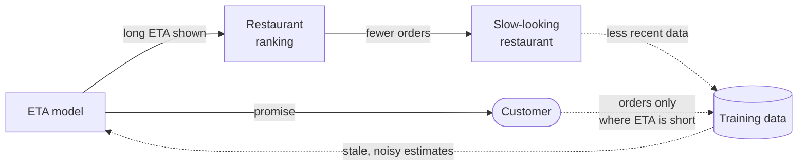

**Reading the diagram.** Solid arrows are immediate effects; dotted arrows close the loop through data over days or weeks. A restaurant with a long predicted ETA ranks lower and receives fewer orders, so the training data contains fewer recent observations for it, so its estimate stays stale and noisy, possibly long, which keeps it ranked low. Separately, customers order mostly where ETAs are short, so the data over-represents fast restaurants and under-represents the conditions where the model is weakest. The danger is that the loop is self-confirming: the model's error can never be corrected by data the model prevents from existing. Mitigations: reserve a small randomized exploration share (Chapter 68), log what was shown so later analysis can correct for selection, and monitor coverage (orders per restaurant) as well as accuracy.

::: warning
**Warning — Some feedback loops destroy labels.** A fraud model that blocks a transaction never learns whether it was fraud: the blocked case has no label. Retrained only on unblocked transactions, the model sees fewer and fewer examples of the patterns it blocks and can forget them. The standard remedy is a small, randomly selected holdout that is allowed through (or reviewed by humans) to keep unbiased labels flowing (Chapter 82).
:::

## 59.14 Versioning and reproducibility

### 59.14.1 What to version

::: definition
**Definition — Reproducibility (in ML).** The ability to re-create a model, or at least its evaluated behavior, from recorded inputs: the same data, code, configuration and environment produce a model whose predictions and metrics match the original within a stated tolerance.

**Definition — Lineage.** The recorded graph of which artifacts and runs produced which other artifacts, from raw data to a deployed model.
:::

A model is a function of five things. Version all five, or you cannot answer "why did the model change?"

**Table 59.9 — What to version for a reproducible model.**

| Input | What to record | Typical tool (Ch 61, 69) |
|---|---|---|
| Data | Snapshot ID or content hash of training data; the time window | Table-format snapshots, DVC, lakeFS |
| Code | Git commit of training and feature code | Git |
| Configuration | Hyperparameters, feature list, quantile, seeds | Config file in Git, logged per run |
| Model | Serialized model with a registry version | Model registry |
| Environment | Container image digest; library versions; hardware and thread count | Image registry (§42.5) |

**Figure 59.12 — Lineage graph for ETA model v8.**

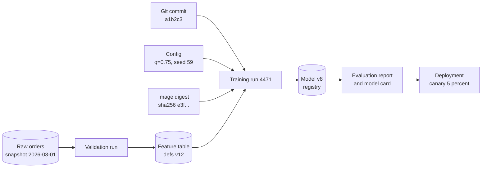

**Reading the diagram.** Each arrow is a recorded "was used by" relationship, stored in an ML metadata store (Chapter 69). Read it backwards to debug: if model v8 misbehaves, you can find the exact raw snapshot, feature definitions, code commit, configuration and container image that produced it, and the evaluation report that justified deploying it. Read it forwards for impact analysis: if the 1 March snapshot turns out to be corrupt, every model and deployment downstream of it is found in one query. The storage boundaries are the snapshot, feature table and registry, all immutable. The failure point is any artifact produced outside the pipeline (a notebook model uploaded by hand) that breaks the chain.

### 59.14.2 What "reproducible" means in practice

There are three useful levels:

1. **Re-runnable**: you can re-run the pipeline from recorded inputs. Necessary for debugging and audit.
2. **Statistically reproducible**: a re-run produces a model whose metrics match within run-to-run noise. This is the realistic target for most training, especially on GPUs.
3. **Bitwise reproducible**: a re-run produces identical bytes. Achievable for small CPU models with fixed seeds and a fixed environment; expensive or impossible for large distributed GPU training.

### 59.14.3 Seeds and nondeterminism

Fix every random seed: data shuffling, train/test splits, model initialization, subsampling. Seeds are necessary but not sufficient, because other sources of nondeterminism remain:

- **Parallel floating-point arithmetic.** Floating-point addition is not associative, so summing the same numbers in a different order, as parallel reductions on CPU threads or GPU atomics do, can change the last bits; across thousands of training steps those bits can change the model. PyTorch, for example, offers a deterministic-algorithms mode that trades speed for repeatability.
- **Environment differences.** Library versions, hardware and thread counts change both results and serialized bytes.
- **Data order and timing.** A query without `ORDER BY` can return rows in any order; asynchronous distributed workers apply updates in arrival order (Chapter 65).

### 59.14.4 Code example: a tiny end-to-end pipeline

The program runs the whole lifecycle on synthetic QuickBite data: generate 70 days of a 600-order daily sample, validate, split by time (56 days train, 7 validation, 7 test), train two baselines and two models, evaluate MAE and p90 error overall and by city, and record fingerprints of everything that produced the model. The synthetic world contains a slow upward drift and a bridge closure in the east city from day 60.

```python
import hashlib, json, pickle
import numpy as np
import sklearn
from sklearn.ensemble import HistGradientBoostingRegressor
from sklearn.linear_model import Ridge
from threadpoolctl import threadpool_limits

threadpool_limits(1)        # fixed thread count: part of the environment (see text)
SEED = 59
CONFIG = {"seed": SEED, "days": 70, "orders_per_day": 600,
          "train_days": 56, "valid_days": 7,
          "gbdt": {"max_iter": 200, "learning_rate": 0.05, "max_leaf_nodes": 31}}
CITIES = ["north", "south", "east"]

# ---------- 1. Generate: synthetic QuickBite orders, oldest day first ----------
def generate(cfg):
    rng = np.random.default_rng(cfg["seed"])
    n = cfg["days"] * cfg["orders_per_day"]
    day = np.repeat(np.arange(cfg["days"]), cfg["orders_per_day"])
    hour = rng.choice(np.arange(10, 23), size=n)
    city = rng.choice(3, size=n, p=[0.5, 0.3, 0.2])
    distance = rng.gamma(2.0, 1.6, size=n)                       # km
    prep = rng.normal(14, 4, size=n).clip(3, 45)                 # kitchen estimate, min
    rain = (rng.random(n) < 0.15).astype(float)
    peak = np.isin(hour, [12, 13, 19, 20]).astype(float)
    load = rng.poisson(2 + 3 * peak)                             # open orders per courier
    speed = np.where(peak == 1, 14.0, 22.0) * (1 - 0.3 * rain)   # km/h
    minutes = (6 + np.maximum(prep, 2.0 * load)                  # kitchen or courier wait
               + 60 * distance / speed                           # drive time
               + 0.03 * day                                      # slow drift: demand grows
               + 6.0 * ((city == 2) & (day >= 60))               # east: bridge closes day 60
               + rng.gamma(2.0, 2.0, size=n) - 4)                # right-skewed noise
    X = np.column_stack([distance, prep, rain, peak, load, hour,
                         city == 0, city == 1, city == 2]).astype(float)
    return day, X, minutes

# ---------- 2. Validate: schema and range checks before anything trains ----------
def validate(X, y):
    assert X.shape[1] == 9 and len(X) == len(y), "schema mismatch"
    assert not np.isnan(X).any() and not np.isnan(y).any(), "missing values"
    assert ((X[:, 0] > 0) & (X[:, 0] < 50)).all(), "distance out of range"
    assert ((y > 5) & (y < 180)).all(), "label out of range"
    return {"rows": len(y), "mean_minutes": round(float(y.mean()), 2)}

# ---------- 3. Split by time, never at random ----------
def time_split(day, cfg):
    t, v = cfg["train_days"], cfg["train_days"] + cfg["valid_days"]
    return day < t, (day >= t) & (day < v), day >= v

# ---------- 4. Evaluate: MAE and p90 absolute error ----------
def evaluate(y_true, y_pred):
    err = np.abs(y_true - y_pred)
    return {"MAE": round(float(err.mean()), 2),
            "p90": round(float(np.quantile(err, 0.9)), 2)}

def sha(b):
    return hashlib.sha256(b).hexdigest()[:12]

day, X, y = generate(CONFIG)
print("validation:", validate(X, y))
tr, va, te = time_split(day, CONFIG)

median = np.median(y[tr])                                  # baseline 1: constant
rule = lambda X: 10 + X[:, 1] + 3 * X[:, 0]                # baseline 2: hand-written
ridge = Ridge(alpha=1.0).fit(X[tr], y[tr])
gbdt = HistGradientBoostingRegressor(random_state=SEED, **CONFIG["gbdt"]).fit(X[tr], y[tr])
models = {"median": lambda X: np.full(len(X), median), "rule": rule,
          "ridge": ridge.predict, "gbdt": gbdt.predict}
for name, predict in models.items():
    print(f"{name:>6}  valid {evaluate(y[va], predict(X[va]))}"
          f"  test {evaluate(y[te], predict(X[te]))}")

# What a random split would have claimed (the mistake this chapter warns about)
rng = np.random.default_rng(SEED)
shuffled = rng.permutation(len(y)); cut = int(0.9 * len(y))
r_tr, r_te = shuffled[:cut], shuffled[cut:]
leaky = HistGradientBoostingRegressor(random_state=SEED, **CONFIG["gbdt"]).fit(X[r_tr], y[r_tr])
print("  gbdt random-split test", evaluate(y[r_te], leaky.predict(X[r_te])))

# Slice evaluation on the test window: is one city much worse?
pred = gbdt.predict(X[te])
for i, c in enumerate(CITIES):
    m = X[te][:, 6 + i] == 1
    print(f"  slice city={c:<5} n={m.sum():>4} {evaluate(y[te][m], pred[m])}")

# ---------- 5. Version: fingerprints of everything that produced the model ----------
manifest = {
    "data": sha(X[tr].tobytes() + y[tr].tobytes()),
    "config": sha(json.dumps(CONFIG, sort_keys=True).encode()),
    "env": f"numpy {np.__version__}, sklearn {sklearn.__version__}",
    "model_bytes": sha(pickle.dumps(gbdt)),
    "model_behavior": sha(np.round(pred, 6).tobytes()),
    "test_metrics": evaluate(y[te], pred),
}
print(json.dumps(manifest, indent=1))
```

Output (NumPy 2.5.3, scikit-learn 1.9.1, about 3 seconds on one CPU core):

```text
validation: {'rows': 42000, 'mean_minutes': 32.44}
median  valid {'MAE': 7.4, 'p90': 15.7}  test {'MAE': 7.88, 'p90': 16.97}
  rule  valid {'MAE': 4.01, 'p90': 7.1}  test {'MAE': 4.27, 'p90': 8.22}
 ridge  valid {'MAE': 3.03, 'p90': 6.56}  test {'MAE': 3.69, 'p90': 8.24}
  gbdt  valid {'MAE': 2.47, 'p90': 5.7}  test {'MAE': 3.22, 'p90': 7.55}
  gbdt random-split test {'MAE': 2.37, 'p90': 4.53}
  slice city=north n=2071 {'MAE': 2.18, 'p90': 4.87}
  slice city=south n=1312 {'MAE': 2.33, 'p90': 5.3}
  slice city=east  n= 817 {'MAE': 7.31, 'p90': 11.38}
{
 "data": "d5538a49044f",
 "config": "9ee4e7daf4f9",
 "env": "numpy 2.5.3, sklearn 1.9.1",
 "model_bytes": "b7ae2fe05d17",
 "model_behavior": "ab53871e5176",
 "test_metrics": {
  "MAE": 3.22,
  "p90": 7.55
 }
}
```

What to notice:

- **Baselines frame everything.** The GBDT's 3.22-minute test MAE means little alone; against the rule's 4.27 it is a 25% improvement, the number that justifies the model.
- **Validation MAE (2.47) is better than test MAE (3.22)** because the test week is further from the training data (drift) and contains the bridge closure. The gap is information, not a bug.
- **The random split is optimistic** (2.37 versus 3.22): it trains on rows from the test period, so the future leaks into training.
- **Slices find the failure.** The east city's MAE of 7.31 is hidden inside the 3.22 average.
- **Fingerprints identify inputs.** Re-running prints identical output. But run it with two threads instead of one and `model_bytes` changes (to `3fd104a85859` in our runs) while `model_behavior` and every metric stay the same: the serialized binning object records the thread count it was built with. A content hash of model bytes is a fragile identity; record a *behavioral* fingerprint (a hash of predictions on a fixed probe set) alongside it, and treat thread count as part of the environment.

## 59.15 MLOps maturity levels

### 59.15.1 Google's levels 0, 1 and 2

Maturity models describe how much of the lifecycle loop is automated. Google Cloud's widely cited guidance [Google Cloud 2020] defines three levels.

**Figure 59.13 — Google's MLOps maturity levels.**

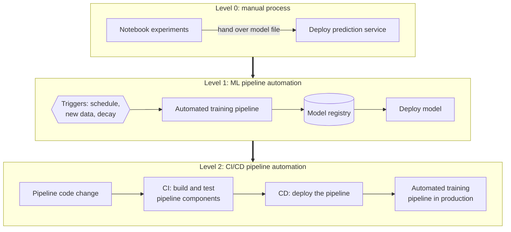

**Reading the diagram.** At **level 0**, a data scientist trains a model interactively and hands a file to engineers, who deploy only the prediction service; releases are rare, and there is no continuous training or active performance monitoring. At **level 1**, the *training pipeline* is what gets deployed, and it retrains continuously when triggers fire, with automated data and model validation, a feature store and a metadata store; the experimental and production pipelines are the same code. At **level 2**, the pipeline's own code goes through CI/CD: changes to components are built, tested and deployed automatically, so teams can try new ideas and ship new pipelines quickly. Thick arrows show progression, not data flow. The failure point at level 0 is the handover; at level 1, pipeline changes are still manual.

**Table 59.10 — Google's MLOps levels (as published, 2020).**

| Level | What is automated | Release cadence | Typical gap |
|---|---|---|---|
| 0 Manual process | Nothing; scripts and notebooks | A few times a year | Training–serving skew; no monitoring |
| 1 ML pipeline automation | Training, validation and deployment of *models* (CT) | As often as triggers fire | Pipeline changes are manual |
| 2 CI/CD pipeline automation | Building, testing and deploying *pipelines* too | Frequent pipeline and model releases | Requires mature platform and teams |

### 59.15.2 Microsoft's maturity model

Microsoft's Azure Architecture Center publishes a five-level model that grades people, model creation, model release and application integration [Microsoft n.d.].

**Table 59.11 — Microsoft's MLOps maturity model (summary).**

| Level | Name | Characteristics |
|---|---|---|
| 0 | No MLOps | Full lifecycle hard to manage; teams disparate; releases painful; models are black boxes after deployment |
| 1 | DevOps but no MLOps | Application releases automated, but each new model depends on the data team; limited feedback from production |
| 2 | Automated training | Training environment managed and traceable; models easy to reproduce; releases manual but low-friction |
| 3 | Automated model deployment | Releases automatic; traceability from deployment back to the original data |
| 4 | Full MLOps automated operations | Automated retraining and testing; production metrics drive improvement; approaching zero downtime |

The two models agree on the direction of travel: first make training reproducible, then automate deployment, then automate retraining driven by monitoring. Breck et al.'s **ML Test Score** complements both with 28 concrete tests in four groups (features and data, model development, infrastructure, monitoring); each test scores half a point if done manually and a full point if automated, and the overall score is the *minimum* across the four groups, so a team cannot compensate for missing monitoring with excellent model tests [Breck et al. 2017].

::: recommendation
**Recommendation — Climb one level at a time, for the models that matter.** QuickBite's ETA model, retrained twice a week (§59.13), justifies level 1 automation. A quarterly churn analysis does not. Maturity is per model, not a badge for the company.
:::

## 59.16 Roles and handoffs

The lifecycle crosses several specialties. Names vary by company; the responsibilities do not.

**Table 59.12 — Roles across the lifecycle.**

| Role | Owns | Hands off |
|---|---|---|
| Data engineer | Ingestion, pipelines, data quality, lake tables (Ch 61) | Validated, documented datasets |
| Data scientist | Framing with product, analysis, features, model choice, evaluation | Model candidate, evaluation report, model card |
| ML engineer | Production training pipeline, feature serving, model serving, monitoring hooks (Ch 62, 66) | Deployed, monitored model |
| ML platform team | Shared infrastructure: feature store, registry, orchestration, compute (Ch 69) | Self-service tools and paved paths |
| Product manager | Business objective, online metrics, guardrails | Framing card and launch decision |

**Figure 59.14 — Handoffs between roles for one ETA model release.**

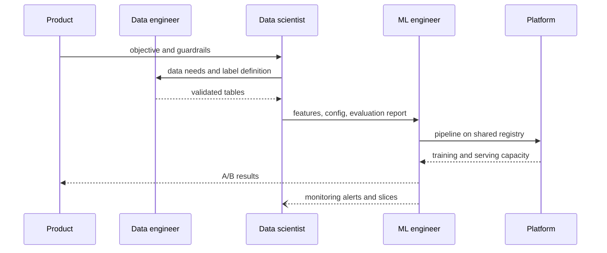

**Reading the diagram.** Each arrow is a handoff of an artifact, not of a conversation: a framing card, a data contract, validated tables, a configuration and evaluation report, a pipeline definition. Solid arrows are requests; dashed returns are deliveries; the final asynchronous arrow is the loop back from production to the data scientist when monitoring finds a weak slice. Failure points are the handoffs themselves: at Google level 0, the data scientist's notebook is reimplemented by an engineer, and the reimplementation becomes a source of training–serving skew. The scaling answer is to make handoffs exchange *pipeline code and versioned artifacts* rather than files and documents, so the thing the data scientist evaluated is the thing that runs.

::: industry
**Software engineering for ML at Microsoft.** Amershi et al. surveyed and interviewed Microsoft teams building AI features and found that data discovery, management and versioning were harder than for ordinary software, that model building required skills most software engineers did not have, and that ML components were harder to isolate as modules because models become entangled with each other and with their data. Their recommended responses include integrated, end-to-end tooling and shared processes across roles.
*Evidence: Primary* — [Amershi et al. 2019]
:::

## 59.17 Summary and revision notes

::: summary
- The ML lifecycle is a loop: framing → collection → ingestion → validation → features → training → evaluation → deployment → monitoring → retraining. It loops because the world drifts, models change the world, and learning is empirical.
- Model code is a small part of a production ML system; most cost and risk sit in data, configuration, serving and monitoring [Sculley et al. 2015].
- Frame before modeling: business objective → decision → precise target → task → offline metric → online metric → guardrails. Asymmetric costs choose a quantile: $q^{*} = c_u/(c_u + c_o)$.
- Log features, model version and output at prediction time, and join delayed labels by request ID.
- Validate data before training and serving: schema, domain, range, missing rate, mean shift, PSI. Range checks catch bugs; distribution checks catch drift.
- Use one feature definition for training and serving to prevent training–serving skew; split by time, not at random.
- Start from baselines; budget hyperparameter search ($C = N t p$); random search with about 60 trials reaches the top 5% of the sampled space with 95% probability.
- Evaluate by slice and document models with model cards; roll out through shadow, canary and A/B with the old model warm for rollback.
- Label delay bounds detection time: $T_{\text{detect}} = L + n/\lambda_s$. Drift signals are fast proxies; labeled performance is the truth.
- Retraining cadence follows decay rate and pipeline delay ($T_{\max} = \Delta/r - D$) and cost ($T^{*} = \sqrt{2C/(kr)}$). Beware feedback loops.
- Version data, code, configuration, model and environment; seeds are necessary but not sufficient for reproducibility.
- Google's levels 0–2 and Microsoft's levels 0–4 both describe automating training, then deployment, then retraining.
:::

## 59.18 Knowledge checkpoint

1. Name three reasons the ML lifecycle is a loop rather than a line.
2. What five items should a framing card fix before any model is trained?
3. Late ETA minutes cost \$0.40 and unnecessary minutes cost \$0.10. Which quantile should the model predict?
4. Why log features at prediction time rather than recompute them later?
5. Which validation check most reliably catches a unit change from kilometers to meters, and why is PSI weak at it?
6. What is training–serving skew, and what are its three causes?
7. A random search should reach the top 10% of the space with 95% probability. How many trials?
8. When does shadow mode measure accuracy correctly, and when does it not?
9. Labels arrive after 2 hours and you need 4,000 labeled predictions at 0.5 per second. When can you first detect a shift?
10. MAE grows 0.1 min/day, tolerance is 1 min, pipeline delay 3 days. What is $T_{\max}$?
11. Why is a hash of serialized model bytes a fragile model identity?

<details><summary>Answers</summary>

1. The world drifts (data and concept drift); the model's own predictions change future data (feedback loops); and model development is empirical, so production teaches lessons that change the next iteration.
2. The business objective, the decision the prediction drives, the precise target, the offline metric(s), and the online metric(s) with guardrails (plus constraints such as latency).
3. $q^{*} = 0.40/(0.40 + 0.10) = 0.8$, the 80th percentile.
4. Recomputation uses corrected, backfilled or late data and cannot reproduce third-party responses, so the values differ from what the model saw; that creates training–serving skew.
5. A range check: values 1,000× too large fall far outside the expected range. PSI only counts which bin a value falls into, so a huge outlier counts the same as one just past the last edge.
6. A difference between performance in training and in serving, caused by different data handling in the two pipelines, a change in data between training and serving, or a feedback loop.
7. $N \ge \ln 0.05/\ln 0.9 = 2.996/0.105 = 28.4$, so 29 trials.
8. When the outcome does not depend on what was shown (ETA delivery time, largely). Not when it does (clicks on recommendations), where an A/B test is needed.
9. $T = 2\text{ h} + 4{,}000/0.5\text{ s} = 2\text{ h} + 8{,}000\text{ s} \approx 2 + 2.2 = 4.2$ h.
10. $T_{\max} = 1/0.1 - 3 = 7$ days.
11. Behaviorally identical models can serialize differently (for example, recording thread count or library version); pair it with a hash of predictions on a fixed probe set.
</details>

## 59.19 Interview questions

### Basic

**Q1. Walk me through the lifecycle of an ML model in production.** **Answer.** Frame the problem with an objective, metric and guardrails; collect and ingest data with prediction-time logging; validate it; engineer features with one definition for training and serving; train from baselines upward; evaluate offline overall and by slice; deploy progressively through shadow, canary and A/B; monitor operational, drift and labeled performance signals; retrain on a schedule plus triggers. Every artifact is versioned so any model can be traced to its inputs.

**Q2. When would you not use ML?** **Answer.** When a rule meets the target, when there is no reliable label at volume, when errors are unacceptable or must be exactly explained, or when the gain does not pay for the pipeline, monitoring and on-call cost. Ship the rule and log data so a model can be evaluated against it later.

### Intermediate

**Q3. Your ETA model looked great offline and disappoints online. How do you investigate?** **Answer.** Suspect training–serving skew first: compare logged serving features with offline values for the same requests; check feature freshness and null handling. Check the evaluation: was the split random, leaking the future? Compare slices online and offline, and check that the online metric matches the offline target (mean versus the promised quantile). Finally check for feedback effects, such as ETAs changing which restaurants get orders.

**Q4. How do you choose a retraining cadence?** **Answer.** Backtest old models on newer data to estimate decay rate $r$; with tolerance $\Delta$ and pipeline delay $D$, retrain at least every $\Delta/r - D$ days; balance retraining cost against decay cost with $T^{*} = \sqrt{2C/(kr)}$. Add triggers on drift, schema change and slice-level decay for step changes that a schedule misses.

### Advanced

**Q5. Design monitoring for a fraud model whose labels take 60 days.** **Answer.** Labeled performance cannot catch fast attacks, so monitor label-free proxies: input drift and prediction-score distribution per merchant segment, block rate, early partial labels (disputes, manual-review outcomes), and operational metrics. Keep a small random holdout that is not blocked (or is reviewed) to obtain unbiased labels and break the feedback loop. Report labeled metrics as they mature, with cohort tracking by prediction date.

**Q6. Take a team from Google level 0 to level 1. What do you build first?** **Answer.** Prediction-time logging and data validation, so training data is trustworthy; then a single training pipeline (the same code for experiments and production) with versioned data, config and environment, writing to a model registry; then automated evaluation gates with slice metrics; then triggers. Measure progress by time from new data to a validated candidate.

## 59.20 Practical exercises

1. Run the §59.14.4 pipeline, then add a `closure` feature that is 1 for east-city orders from day 60. Retrain with training days extended to 63 and report the east slice MAE.
2. Change the GBDT to `loss="quantile", quantile=0.75` and compute the late rate (actual > prediction + 5 min) on the test window for both models.
3. Extend the §59.7.3 validator to check freshness (maximum event age) and to report which checks should block versus warn.
4. Using the label-delay formula, compute detection time for a city with 5% of orders and $\delta = 1$ min.

## 59.21 Design challenges

1. **Lifecycle for QuickBite demand forecasting.** Design the lifecycle for hourly per-restaurant demand forecasts used to schedule couriers: framing card, data sources, batch versus online scoring, slices, monitoring with a 1-hour label delay, and retraining policy.
2. **Self-service ML platform.** QuickBite has five models at Google level 0. Propose a one-year plan to reach level 1 for the two that matter most, naming the roles, artifacts and handoffs, and how you would measure the result with the ML Test Score.

## 59.22 References

1. Amershi, S., Begel, A., Bird, C., DeLine, R., Gall, H., Kamar, E., Nagappan, N., Nushi, B., Zimmermann, T. *Software Engineering for Machine Learning: A Case Study*. ICSE-SEIP, 2019.
2. Baylor, D., et al. *TFX: A TensorFlow-Based Production-Scale Machine Learning Platform*. KDD, 2017.
3. Bergstra, J., Bengio, Y. *Random Search for Hyper-Parameter Optimization*. Journal of Machine Learning Research 13, 2012.
4. Bernardi, L., Mavridis, T., Estevez, P. *150 Successful Machine Learning Models: 6 Lessons Learned at Booking.com*. KDD, 2019.
5. Breck, E., Cai, S., Nielsen, E., Salib, M., Sculley, D. *The ML Test Score: A Rubric for ML Production Readiness and Technical Debt Reduction*. IEEE International Conference on Big Data, 2017.
6. Breck, E., Polyzotis, N., Roy, S., Whang, S. E., Zinkevich, M. *Data Validation for Machine Learning*. SysML (MLSys), 2019.
7. Google Cloud. *MLOps: Continuous delivery and automation pipelines in machine learning*. Cloud Architecture Center, 2020. https://cloud.google.com/architecture/mlops-continuous-delivery-and-automation-pipelines-in-machine-learning
8. Hermann, J., Del Balso, M. *Meet Michelangelo: Uber's Machine Learning Platform*. Uber Engineering Blog, 2017.
9. Huyen, C. *Designing Machine Learning Systems*. O'Reilly, 2022.
10. Li, L., Jamieson, K., DeSalvo, G., Rostamizadeh, A., Talwalkar, A. *Hyperband: A Novel Bandit-Based Approach to Hyperparameter Optimization*. Journal of Machine Learning Research 18, 2018.
11. Microsoft. *Machine Learning operations maturity model*. Azure Architecture Center, n.d. https://learn.microsoft.com/en-us/azure/architecture/ai-ml/guide/mlops-maturity-model
12. Mitchell, M., Wu, S., Zaldivar, A., Barnes, P., Vasserman, L., Hutchinson, B., Spitzer, E., Raji, I. D., Gebru, T. *Model Cards for Model Reporting*. FAT\*, 2019.
13. Polyzotis, N., Roy, S., Whang, S. E., Zinkevich, M. *Data Lifecycle Challenges in Production Machine Learning: A Survey*. SIGMOD Record 47(2), 2018.
14. Sculley, D., Holt, G., Golovin, D., Davydov, E., Phillips, T., Ebner, D., Chaudhary, V., Young, M., Crespo, J.-F., Dennison, D. *Hidden Technical Debt in Machine Learning Systems*. NeurIPS, 2015.
15. Snoek, J., Larochelle, H., Adams, R. P. *Practical Bayesian Optimization of Machine Learning Algorithms*. NeurIPS, 2012.
16. Zinkevich, M. *Rules of Machine Learning: Best Practices for ML Engineering*. Google for Developers, n.d. https://developers.google.com/machine-learning/guides/rules-of-ml

## 59.23 Open verification items

- Google Cloud MLOps guide: confirm the current URL (the page may have moved within the Cloud Architecture Center) and the exact list of retraining triggers.
- Microsoft MLOps maturity model: confirm level names and characteristics against the current page (summarized from memory; network access was unavailable while writing).
- Polyzotis et al. 2018: the brief names it as "data management challenges in production ML"; the SIGMOD Record 2018 article cited here is titled "Data Lifecycle Challenges in Production Machine Learning: A Survey." Confirm the intended source.
- Hermann and Del Balso 2017: confirm the UberEATS feature examples quoted in §59.3 against the blog post.
- Bernardi et al. 2019: confirm the paraphrase of the offline-versus-business-metric finding.
- Breck et al. 2017: confirm the 28-test count and scoring rule (½ manual, 1 automated, minimum over sections).
