# Chapter 60 — ML System Architecture

> **Level:** 3 · **Track:** B (ML/AI) · **Estimated reading time:** 5 h

QuickBite's search page shows twenty restaurants, each with a delivery estimate such as "25–35 min". In Chapter 2 that estimate came from a lookup table of travel times between city zones (§2.4). The data science team has now trained a model that is about 30% more accurate on last month's orders. Shipping it looks like a one-line change: replace the table lookup with a call to the model. Six weeks later the team has built a feature pipeline, a streaming job, a model registry, a shadow deployment, a fallback path and a dashboard that compares promised with actual delivery times. And the model file they started with is still the smallest artifact in the repository.

This chapter explains why. A machine learning (ML) system is a software system whose most important behavior is learned from data rather than written by hand, and that single difference changes how it fails, how it is tested and where its complexity lives. You will learn the two pipelines every production ML system has (training and inference), the three places computation can run (offline, nearline and online), when to precompute predictions and when to compute them on request, and how to turn product goals into latency, throughput, freshness, quality and cost requirements with numbers attached. The chapter ends with the technical debt that accumulates in ML systems and a complete reference architecture for QuickBite's delivery-time prediction.

Chapters 57–59 cover models and their lifecycle; this chapter covers the *system* around the model. Later chapters own each component: data engineering (61), feature stores (62), serving (66), MLOps (69) and monitoring (70).

::: note
**QuickBite ML assumptions used in this chapter.** These extend the Book I design point and are teaching assumptions, not measurements of a real company. 2 million daily active users and 500,000 orders a day (§2.11); search peaks at 2,000 requests per second (RPS), each showing 20 restaurants (§2.4), so the search page needs up to 40,000 delivery-time predictions per second; peak-to-average ratio 9.6 (§18.11); a mean delivery takes 35 minutes; CPU capacity costs \$0.048 per vCPU-hour (a 16-vCPU node at \$0.77 per hour, §42.13); a data-center GPU costs an illustrative \$2.50 per hour. The delivery-time model is called the **ETA model** (estimated time of arrival).
:::

## 60.1 Learning objectives

After this chapter you should be able to:

- Explain five ways ML systems differ from traditional software (data-specified behavior, silent failure, entanglement, feedback loops and testing) and give a QuickBite example of each.
- Draw the reference architectures of a training pipeline and an inference pipeline and name the failure each component prevents.
- Place a computation in the offline, nearline or online tier, and choose between precomputed (batch) predictions and on-request (online) inference using a decision table.
- Write the functional and non-functional requirements of an ML system with numbers for latency, throughput, freshness, prediction quality, cost, explainability and compliance.
- Decompose a 100 ms p99 latency budget across network, feature fetch, model and post-processing, accounting for fan-out.
- Size an inference fleet from the request rate and per-prediction cost, and compute the cost per 1,000 predictions.
- Define prediction-quality service-level objectives (SLOs), design a fallback ladder, and compute blended quality under degradation.
- Decide whether an accuracy gain is worth its serving cost using a break-even calculation, and use a model cascade to buy most of the gain for a fraction of the cost.
- Recognize the hidden technical debt patterns of ML systems (glue code, pipeline jungles, dead experimental paths, undeclared consumers, configuration debt) and apply mitigations.

## 60.2 Prerequisites

- What a model, a feature, a label and inference are; offline versus online evaluation — Chapter 57 (this chapter uses the vocabulary without re-deriving it).
- Model sizes and the compute cost of a forward pass — Chapter 58 (needed for capacity estimates in §60.11).
- The ML lifecycle and maturity levels — Chapter 59 (this chapter turns its stages into components and data flows).
- Percentiles, tail latency and fan-out amplification — §4.8 (used in the latency budget of §60.10).
- Horizontal scaling and capacity planning with headroom — §18.4, §18.11 (used in §60.11).
- Caching patterns and time to live (TTL) — §20.7, §20.8 (precomputed predictions are a cache).
- Message brokers, Kafka and event-driven patterns — Chapters 30–32 (nearline computation runs on event streams).
- Graceful degradation, SLIs, SLOs and error budgets — §39.5–§39.7 (quality SLOs and fallback ladders build on them).
- Metrics, logs and traces — Chapter 40 (prediction logging builds on structured logging).

## 60.3 How ML systems differ from traditional software

### 60.3.1 Behavior specified by data

::: definition
**Definition — ML system.** A software system in which at least one decision is made by a **model**: a function whose parameters were fitted to historical data by a training algorithm rather than written by a programmer. The system comprises the model plus everything needed to produce, serve, monitor and update it: data collection, feature computation, training, evaluation, deployment, inference, logging and monitoring.
:::

#### First-principles explanation

Think of two ways to teach a new cook how long a dish takes. You can write a recipe card: "pizza 12 minutes, curry 20 minutes, add 5 minutes on Fridays." Or you can let the cook watch a thousand orders and form their own sense of timing. The recipe card is traditional software: every rule is visible, and when it is wrong you can point to the line. The watching cook is an ML model: the rules are real but implicit, spread across thousands of small adjustments, and they are only as good as the orders the cook happened to watch. If the cook trained during a quiet month, they will be confidently wrong on the first busy Friday.

In traditional software, **code specifies behavior**. In an ML system, code specifies a *learning procedure*, and **data specifies behavior**. The same training code run on two different datasets produces two different systems.

#### Why does this exist?

Some mappings are too complex or too changeable to write by hand. A delivery-time estimate depends on the restaurant's current kitchen backlog, the dish, the weather, traffic on the route, how many couriers are free nearby and the time of day. A hand-written rule set covering all interactions would be enormous and stale within weeks. A model learns the interactions from millions of past deliveries and can be retrained when the world changes.

#### How it works internally

**Figure 60.1 — Where behavior comes from: traditional software versus an ML system.**

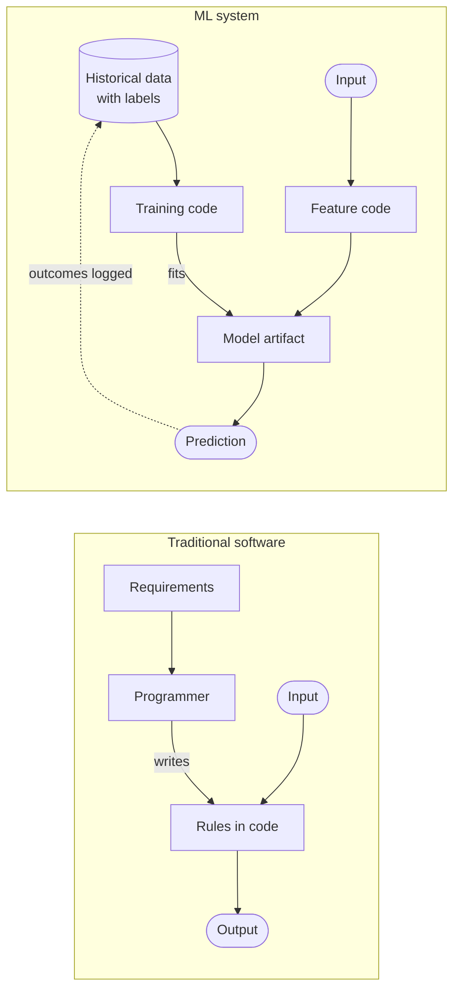

**Reading the diagram.** On the left, a programmer turns requirements into rules in code; inputs flow synchronously through those rules to outputs, and the code is the only place behavior lives. On the right, behavior is produced in two steps. Offline, training code reads historical data with labels from a storage boundary (the cylinder) and fits a model artifact. Online, inputs pass through feature code into the model, which returns a prediction (solid arrows, synchronous). The dotted arrow is the asynchronous loop that makes ML systems different: outcomes of today's predictions become tomorrow's training data. Failure points on the right include the data (wrong or stale), the feature code (computed differently in training and serving) and the loop itself (§60.3.4). Scaling the right side means scaling two separate paths: data volume for training and request rate for inference.

The consequence is that an ML system has three things that change independently and must be versioned together: **code** (training, feature and serving code), **data** (training datasets and live feature values) and **model** (the trained artifact with its parameters). Traditional release engineering handles only the first.

**Table 60.1 — Traditional software versus ML systems.**

| Property | Traditional software | ML system |
|---|---|---|
| Source of behavior | Code written by people | Data, through a training procedure |
| Specification | Explicit requirements, testable rules | Examples (labels) and a metric to optimize |
| Correctness | Binary per test case | Statistical: error rate over a distribution |
| Typical failure | Crash, exception, wrong status code | Plausible but wrong output, no error raised |
| What changes it | Code deploys | Code deploys, new data, retraining, a changing world |
| Versioned artifacts | Code, configuration | Code, configuration, data, features, model |
| Testing | Unit, integration, end-to-end | All of those plus data validation, model evaluation, skew and drift checks |
| Decay without changes | Rare (dependency rot) | Normal: accuracy falls as the world drifts |

### 60.3.2 Silent failures

::: definition
**Definition — Silent failure.** A failure in which the system keeps returning well-formed responses with normal latency and no errors, but the responses are wrong. Availability and latency SLIs stay green; only measures of output quality reveal the problem.
:::

A traditional service that receives a malformed field throws an exception and the error rate rises. An ML service that receives a malformed feature usually does not: a missing value is replaced by a default, a unit change (seconds instead of minutes) is just a larger number, and the model returns a confident prediction. Huyen calls this the defining operational difference: ML systems "fail silently" [Huyen 2022]. Paleyes, Urma and Lawrence's survey of deployment case studies finds monitoring for this kind of degradation among the most frequently reported challenges, alongside data management and the gap between offline metrics and business outcomes [Paleyes et al. 2022].

::: example
**Worked example — A unit change nobody noticed.** QuickBite's restaurant tablet app starts reporting preparation time in seconds instead of minutes after an update. The feature "average prep time, last hour" jumps from about 15 to about 900. The ETA model, trained on values between 5 and 60, sees an out-of-range input. A tree-based model clamps to its largest learned split, so every affected restaurant gets the maximum prep-time contribution, roughly +25 minutes.

1. Error rate: unchanged (0%). Latency: unchanged. CPU: unchanged.
2. Promised delivery times on affected restaurants rise by about 25 minutes; conversion for those restaurants falls.
3. The first signal arrives when actual delivery times are compared with promises, about 35 minutes later, or when the restaurants complain, days later.

**Interpretation.** No infrastructure metric moved. **Engineering implication.** Validate feature distributions at ingestion and at serving time (ranges, units, null rates), and monitor the prediction distribution itself, which shifted the moment the bug shipped and needs no labels (Chapter 70).
:::

### 60.3.3 Entanglement and the CACE principle

::: definition
**Definition — CACE (Changing Anything Changes Everything).** The principle, stated by Sculley et al., that in a model no input is truly independent: changing the distribution, scaling or presence of one feature, a hyperparameter, the training sample or the label definition can change the learned weights of all the others, and therefore the system's behavior everywhere [Sculley et al. 2015].
:::

In ordinary code, you can change one function and reason about its callers. In a model, features are mixed together during training. Suppose QuickBite adds a weather feature. The model may now rely less on "time of day", because rainy evenings were previously captured by the time feature. Downstream, a team that used the old model's sensitivity to time of day for staffing estimates sees its numbers move, although nobody touched their code. Sculley et al. call this **entanglement** and note that it makes isolated, incremental improvement impossible to reason about [Sculley et al. 2015].

Two related effects follow:

- **Correction cascades.** A team needs a slightly different prediction (ETAs for grocery orders) and trains a small model that takes the restaurant ETA model's output as input and corrects it. Now improving the base model can break the correction model, which learned the base model's old mistakes. Prefer adding the new case as a feature to the base model, or train a separate model from raw features.
- **Undeclared consumers.** Other systems silently read a model's output from a log or table. They become coupled to it without the owner knowing (§60.14).

Mitigations: isolate models by product surface where the cost is acceptable; monitor per-slice behavior (by city, restaurant type, time of day) after every change rather than only the global metric; and treat every model change as a release with a shadow or canary phase (Chapter 66).

### 60.3.4 Feedback loops

::: definition
**Definition — Feedback loop (ML).** A situation in which a model's predictions influence the data that will later be used to train it. A **direct loop** is visible in one system (a recommender trains on clicks on its own recommendations); a **hidden loop** runs through the world or through another system (two models that affect each other via user behavior).
:::

**Figure 60.2 — The ETA feedback loop at QuickBite.**

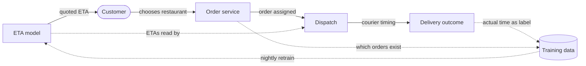

**Reading the diagram.** Solid arrows are the synchronous request path: the ETA model quotes a time, the customer chooses a restaurant, the order service records the order and dispatch assigns a courier. Dotted arrows are asynchronous and slow: actual delivery times become labels in the training data, and a nightly job retrains the model. Two loops close here. First, the model only receives labels for restaurants customers chose, which are disproportionately those with short quoted ETAs; restaurants that were quoted long ETAs get fewer orders and therefore fewer labels, so the model learns least where it is most pessimistic. Second, dispatch reads ETAs to decide when to send couriers, so the model's predictions change the very delivery times it is trying to predict. Failure points: self-reinforcing bias and oscillation after retraining; scaling does not help, design does.

Direct loops are managed with **exploration** (occasionally showing items or estimates the model would not choose, so you collect unbiased labels), by logging the **propensity** (the probability that the system showed what it showed, so training can reweight), and by keeping a small randomized holdout. Hidden loops are harder: document which systems consume each model's output and review interactions when either changes. Chapter 68 treats feedback loops in recommendation in depth.

### 60.3.5 Testing differences

A unit test asserts that `f(3) == 9`. A model has no such contract: it is *expected* to be wrong on some inputs. ML testing therefore adds checks on data and on statistical behavior. Breck et al.'s **ML Test Score** organizes 28 tests and monitors into four groups of seven: features and data, model development, ML infrastructure, and monitoring. A system's score is the *minimum* of the four group scores, so a team cannot compensate for no monitoring with excellent unit tests [Breck et al. 2017].

**Table 60.2 — What you test in an ML system, beyond ordinary software tests.**

| Layer | Example test for the QuickBite ETA model | Fails when |
|---|---|---|
| Data | Schema, ranges, null rate, units of `prep_time_last_hour` | Upstream app changes units or drops a field |
| Features | Training and serving compute identical values for a sampled set of orders | Feature code diverges (training–serving skew) |
| Model | Offline MAE better than the current model on a fixed holdout and on each city slice | A retrain regresses on a small city |
| Behavioral | Longer distance never decreases ETA, all else equal (monotonicity) | Model learns a spurious pattern |
| Infrastructure | Model loads, returns in < 20 ms p99 for a 20-row batch, is reproducible from its training run | Artifact or dependency mismatch |
| Monitoring | Alert fires if prediction mean shifts > 10% in an hour | Silent failure goes unnoticed |

#### Failure scenarios

**Table 60.3 — Failure scenarios specific to ML systems.**

| What goes wrong | Why | Detection | Recovery | Prevention |
|---|---|---|---|---|
| Wrong but well-formed predictions | Upstream data change (units, encoding) | Prediction and feature distribution monitors | Roll back to last good model or fallback heuristic | Data validation at ingestion and serving |
| Training–serving skew | Feature computed by two code paths | Compare logged serving features with recomputed training features | Retrain on logged features | One feature definition for both paths (Chapter 62) |
| Gradual accuracy decay | The world drifts (new restaurants, new city) | Quality SLO on delayed labels | Retrain; add features | Scheduled retraining and drift monitoring (Chapter 70) |
| Retrain makes things worse | Feedback loop or bad label batch | Offline gate plus canary on live traffic | Automatic rollback | Validation gates in the training pipeline (§60.5) |

#### Common misconceptions

::: mistake
**Mistake — "If the service is up and fast, the model is working."** Availability and latency SLIs say nothing about whether predictions are right. An ML service needs a third family of indicators for prediction quality (§60.12), plus input and output distribution monitors that work before labels arrive.
:::

::: mistake
**Mistake — "A better offline metric means a better product."** Offline metrics are computed on historical data that the previous model helped create (§60.3.4), and they ignore latency and cost. Bernardi et al. report from about 150 production models at Booking.com that gains in offline metrics often did not translate into business gains, and that added latency measurably hurt conversion [Bernardi et al. 2019]. Validate with an online experiment (Chapter 57).
:::

## 60.4 Data-centric versus model-centric architecture

### 60.4.1 Two ways to improve a model

::: definition
**Definition — Model-centric and data-centric development.** In **model-centric** development the dataset is held fixed and improvement comes from changing the model: architecture, loss function, hyperparameters. In **data-centric** development the model family is held roughly fixed and improvement comes from changing the data: label quality and definitions, coverage of rare cases, new or fresher features, cleaning and validation. A **data-centric architecture** is one whose components, interfaces and budgets are organized around producing, validating and versioning data, with training treated as one step among many.
:::

#### First-principles explanation

A restaurant can improve its food by buying a better oven or by buying better ingredients. Research papers mostly compare ovens: everyone uses the same benchmark dataset and competes on the model. Production teams mostly fight over ingredients: their dataset is not fixed, it is whatever their logging and pipelines produce, and it is usually the weakest part of the system.

#### Why does this matter architecturally?

Where the improvement comes from decides where the engineering effort and the system's complexity live. Sculley et al. illustrate a mature ML system as a small box labeled "ML code" surrounded by much larger boxes for configuration, data collection, feature extraction, data verification, machine resource management, analysis tools, process management, serving infrastructure and monitoring [Sculley et al. 2015]. Figure 60.3 redraws that idea as data flow.

**Figure 60.3 — The model is a small part of an ML system (after Sculley et al. 2015).**

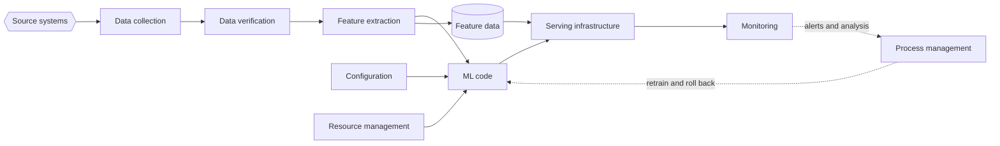

**Reading the diagram.** Data flows left to right from source systems (hexagon, outside your control) through collection, verification and feature extraction into the ML code, the only box that contains a learning algorithm. Configuration and resource management feed it. Its output, a model, is served by serving infrastructure that also reads feature data (cylinder, the storage boundary shared by training and serving). Monitoring watches serving, and process management (dotted, asynchronous) triggers retraining and rollbacks. Every other box is ordinary distributed-systems engineering, and every arrow is an interface that can break; failures cluster on the left (bad data) and at the shared feature store (skew). Each box scales independently, which is why ML platforms (Chapter 69) are collections of services.

### 60.4.2 QuickBite example: where the ETA error went

Suppose QuickBite's ETA team spends one quarter on improvements and measures each change by its effect on mean absolute error (MAE) in minutes on a fixed holdout. The figures are illustrative but typical in shape.

**Table 60.4 — One quarter of ETA improvements (illustrative).**

| Change | Kind | MAE before → after (min) | Engineering work |
|---|---|---|---|
| Gradient-boosted trees to a deep network | Model | 6.0 → 5.8 | Training code, GPU serving |
| Hyperparameter search | Model | 5.8 → 5.7 | Compute budget |
| Fix label: courier taps "delivered" late, so use GPS arrival time | Data | 5.7 → 5.1 | Label pipeline joining GPS trail |
| Add kitchen backlog in the last 15 minutes | Data (fresher feature) | 5.1 → 4.4 | Streaming job, online feature store |
| Add coverage for a new city by importing its first month | Data | 4.4 → 4.2 (new city 9.0 → 5.5) | Backfill, slice monitoring |

The two model-centric changes improved MAE by 0.3 minutes; the three data-centric changes by 1.5 minutes. The data changes also created the most architecture: a label pipeline, a streaming feature job and an online store. That is the pattern this chapter follows: in production, **the system is mostly a data system**, and the architecture should make data changes cheap, safe and observable.

**Table 60.5 — Model-centric versus data-centric architecture.**

| Row | Model-centric | Data-centric |
|---|---|---|
| What it is | Fixed data, iterate on the model | Fixed model family, iterate on data and features |
| How it works | Experiments vary architecture and hyperparameters | Pipelines vary labels, coverage, features and freshness |
| Advantages | Clean comparisons; reuses benchmark datasets | Larger gains on real problems; improvements transfer across models |
| Disadvantages | Diminishing returns on a noisy dataset | Requires validation, versioning and lineage for every dataset |
| Performance | Often raises inference cost (bigger models) | Often raises pipeline cost (fresher features) |
| Operational complexity | Concentrated in training and serving | Spread across ingestion, streaming, storage and labeling |
| Cost | GPU training and serving | Data engineering, storage, labeling |
| Use cases | Mature, clean datasets; perception tasks with large public data | Tabular business problems, new domains, noisy logs |
| Choose when | Error analysis shows the model cannot fit known patterns | Error analysis shows bad labels, missing signals or stale features |

::: recommendation
**Recommendation — Do error analysis before choosing a direction.** Sort the worst 1% of predictions and read them. If most are explained by a wrong label, a missing signal ("the kitchen was overloaded and nothing in the features says so") or stale data, invest in data. If the signals were all present and the model still missed, invest in the model. Chapter 63 covers labeling and data quality in depth.
:::

## 60.5 The training pipeline

### 60.5.1 Components

::: definition
**Definition — Training pipeline.** An automated, versioned sequence of steps that turns raw data into a validated, registered model artifact: data extraction, data validation, feature computation, training, evaluation and validation, and registration. Each step reads versioned inputs, writes versioned outputs and records metadata, so any model can be traced back to the exact data and code that produced it.
:::

#### First-principles explanation

A notebook that trains a model is like a chef cooking once for a food critic. A training pipeline is the restaurant kitchen: the same dish every night, with checked ingredients, a recipe card, a tasting step before plates leave, and a record of which batch of ingredients went into which plate. The pipeline exists so that tonight's model can be produced again tomorrow, compared with yesterday's, and rejected automatically if it is worse.

#### Why does this exist?

Models decay as the world changes, so they must be retrained regularly (Chapter 59). A retraining process that depends on a person running cells in a notebook fails in three ways: it is not reproducible, it skips checks under time pressure, and it cannot run at 02:00. Baylor et al. describe how Google built TFX after observing that teams kept rebuilding the same pieces (data analysis, transformation, validation, training, evaluation and serving) and that the glue between them, not the learning algorithm, caused most production problems [Baylor et al. 2017].

#### How it works internally

1. **Data extraction.** Read a training window (for QuickBite's ETA model, the last 90 days of delivered orders) from the data lake or warehouse (Chapter 61), joined with labels. Use point-in-time joins so that each example sees only feature values that existed when the prediction was made (Chapter 62).
2. **Data validation.** Compare the new dataset's schema and statistics with expectations and with the previous run: required columns, ranges, null rates, category vocabularies, and distribution distance. Stop the pipeline on a hard failure; warn on drift.
3. **Feature computation.** Apply the same transformation code that serving will use (normalization, bucketing, encodings, aggregates). Materialize the result as a versioned training dataset.
4. **Training.** Fit the model on the training split with configuration (hyperparameters, seed, feature list) recorded. Large models need distributed training (Chapter 65).
5. **Evaluation and validation.** Compute offline metrics on a holdout, overall and per slice (each city, each restaurant category, peak hours). Compare with the currently deployed model. Run behavioral tests (monotonicity in distance). Only a candidate that passes every gate is "blessed".
6. **Registration.** Store the artifact with its lineage (data version, code commit, configuration, metrics) in a **model registry**, which deployment reads from (Chapter 69).

An **orchestrator** (Airflow, Kubeflow Pipelines, Flyte and similar, Chapter 69) runs the steps as a directed acyclic graph, retries failures and records metadata. An **artifact store** (object storage) holds datasets and models; a **metadata store** holds lineage.

**Figure 60.4 — Reference architecture of a training pipeline.**

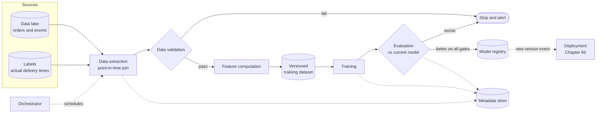

**Reading the diagram.** The orchestrator triggers the run (dotted: a scheduled, asynchronous kick-off). Extraction reads orders, events and labels from the data lake (storage boundary) using point-in-time joins. Two decision diamonds are **gates**: data validation and model evaluation. Either can stop the run and alert, which is the point: a bad night produces no model rather than a bad model. Feature computation writes a versioned training dataset, a second storage boundary that makes the run reproducible. The model registry is the hand-off to deployment, which is notified asynchronously. Every step writes lineage to the metadata store. Failure points: the source data (late or corrupted), the gates (too loose lets bad models through, too strict blocks every retrain), and the orchestrator itself. Scaling: extraction and feature computation scale with data volume on Spark or a warehouse (Chapter 29, Chapter 61); training scales with model size on GPUs (Chapter 65).

**Table 60.6 — Training pipeline components and the failure each prevents.**

| Component | Input → output | Failure it prevents | Owner chapter |
|---|---|---|---|
| Data extraction | Lake tables → training window | Label leakage via point-in-time joins | 61, 62 |
| Data validation | Dataset → pass, warn or fail | Training on corrupted or shifted data | 61, 63 |
| Feature computation | Raw columns → feature tensors | Training–serving skew (shared code) | 62 |
| Training | Features, configuration → model | Irreproducible models (recorded seeds and versions) | 58, 65 |
| Evaluation and validation | Model, holdout → metrics, verdict | Regressions overall or on a slice | 57, 70 |
| Registry | Model, lineage → versioned entry | Unknown provenance; no rollback target | 69 |

#### Mathematical foundations

How stale is the model that is serving right now? Three delays add up: the time since the training window closed, how long the pipeline takes, and the deployment rollout.

::: formula
**Model age at serving time**

$$A_{\max} = \Delta_{\text{retrain}} + T_{\text{pipe}} + T_{\text{deploy}} \qquad A_{\text{avg}} = \frac{\Delta_{\text{retrain}}}{2} + T_{\text{pipe}} + T_{\text{deploy}}$$

| Symbol | Meaning | Units |
|---|---|---|
| $\Delta_{\text{retrain}}$ | Interval between scheduled retraining runs | hours |
| $T_{\text{pipe}}$ | Duration of one pipeline run (extraction through registration) | hours |
| $T_{\text{deploy}}$ | Time from registration to full rollout (canary included) | hours |
| $A_{\max}$, $A_{\text{avg}}$ | Worst-case and average age of the newest data the serving model has learned from | hours |
:::

::: example
**Worked example — How old is QuickBite's ETA model?** Retraining runs nightly ($\Delta_{\text{retrain}} = 24$ h). The pipeline takes $T_{\text{pipe}} = 3$ h. A canary at 5% traffic for 2 h, then full rollout over 1 h, gives $T_{\text{deploy}} = 3$ h.

1. $A_{\max} = 24 + 3 + 3 = 30$ h.
2. $A_{\text{avg}} = 12 + 3 + 3 = 18$ h.
3. Switching to retraining every 6 h with the same pipeline: $A_{\max} = 6 + 3 + 3 = 12$ h; $A_{\text{avg}} = 3 + 3 + 3 = 9$ h. The pipeline and the rollout now dominate.

**Interpretation.** Retraining four times as often reduces average age only from 18 h to 9 h, because fixed pipeline and rollout times do not shrink, while compute cost roughly quadruples. **Engineering implication.** Model weights rarely need to be fresher than a day for ETA; what changes within minutes (kitchen backlog, courier supply) should reach the model as **fresh features** through nearline computation (§60.7), not through more frequent retraining.
:::

#### Real-world industry applications

::: industry
**Google — TFX.** Baylor et al. describe TFX as a platform that integrates data analysis, data transformation, data validation, a trainer, model evaluation and validation, and serving, so that teams configure one pipeline instead of writing glue. Two design choices matter for architecture: transformations are exported with the model so serving applies exactly the training-time logic, and model validation acts as a safety gate before any model reaches serving. They report deploying it for Google Play's app recommendations, where continuous training on fresh data replaced ad-hoc retraining.
*Evidence: Primary* — [Baylor et al. 2017]
:::

::: industry
**Uber — Michelangelo.** Hermann and Del Balso describe Uber's internal platform as supporting a six-step workflow: manage data, train models, evaluate models, deploy models, make predictions and monitor predictions. A shared feature store holds features computed by batch jobs (written to Hive for training and Cassandra for serving) and by streaming jobs over Kafka. Their worked example is UberEATS delivery-time prediction with gradient-boosted decision trees, using batch features such as a restaurant's average meal preparation time over the last seven days and near-real-time features such as the average over the last hour.
*Evidence: Primary* — [Hermann and Del Balso 2017]
:::

#### Failure scenarios

**Table 60.7 — Training pipeline failure scenarios.**

| What goes wrong | Why | Detection | Recovery | Prevention |
|---|---|---|---|---|
| Upstream table arrives late | Source job delayed | Freshness check on partitions | Skip the run; keep current model | Explicit data-availability sensors in the orchestrator |
| Label leakage | Feature uses data from after the prediction time | Suspiciously high offline metric | Rebuild dataset with point-in-time join | Point-in-time joins; leakage tests |
| Silent regression on a slice | Only global metric checked | Slice dashboard, user complaints | Roll back | Per-slice gates (each city) |

## 60.6 The inference pipeline

### 60.6.1 From request to response

::: definition
**Definition — Inference pipeline.** The online path that turns a request into a decision: assemble features (from the request and from stores), run the model, post-process the raw output, apply business rules, return the response, and log what was served so it can later be joined with the outcome and used for training and monitoring.
:::

#### First-principles explanation

A doctor's diagnosis is not only the doctor's judgment. Someone collects the patient's history (feature fetch), the doctor forms an opinion (model), the opinion is translated into a prescription with a dose (post-processing), the pharmacy checks it against rules such as allergies and maximum doses (business rules), and the chart records what was decided and why (logging). Skip the chart and nobody can learn from the outcome.

#### How it works internally

1. **Receive the request.** The search service calls the ETA service with a customer location, a list of 20 restaurant IDs and a request ID.
2. **Fetch features.** Request-time features come with the request (customer location, time, basket size). Precomputed features come from stores: per-restaurant prep-time averages and live kitchen backlog from the online feature store, travel time from the zone-pair grid. Fetches run in parallel with a deadline and defaults for missing values.
3. **Run the model.** Assemble a batch of 20 rows and run the model once. Batching rows from one request is nearly free and amortizes per-call overhead.
4. **Post-process.** Convert the model's raw output into a product value: calibrate, turn a point estimate into a range ("25–35 min") using predicted quantiles, round to five minutes.
5. **Apply business rules.** Enforce product and policy constraints that are not the model's job: minimum 15 minutes, maximum 90; hide restaurants that are closed; add padding during a declared storm.
6. **Respond** within the caller's deadline; on timeout, fall back (§60.12).
7. **Log** the request ID, model version, every feature value exactly as served, the raw and final output, and which fallback (if any) was used. Write asynchronously to a message broker (Chapter 30), never in the request path.

**Figure 60.5 — Inference pipeline for a search-page ETA request.**

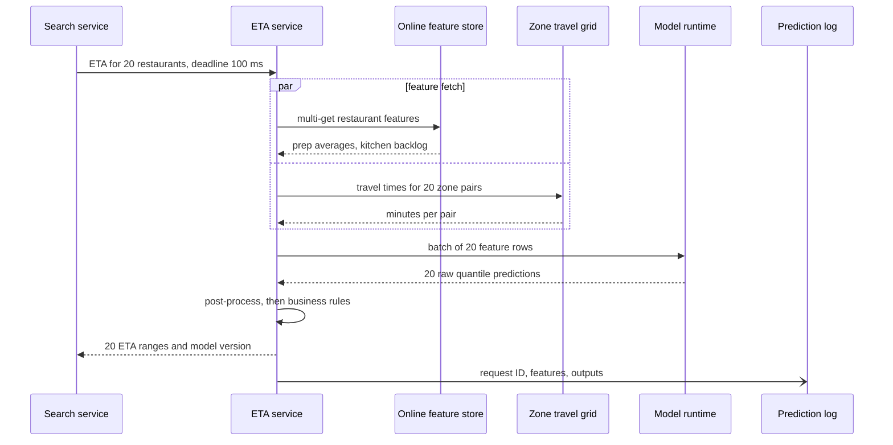

**Reading the diagram.** All calls except the last are synchronous RPCs within one data center. The `par` block shows the two feature fetches running in parallel, so the slower of the two sets the feature-fetch latency (fan-out, §4.8.4). The model runtime may be in-process or a separate model server (Chapter 66). Post-processing and business rules run inside the ETA service. The final arrow, an open arrowhead, is an asynchronous fire-and-forget write to the prediction log, which is the storage boundary connecting serving to training and monitoring. Failure points: either feature store (time out and use defaults), the model runtime (fall back to a heuristic) and the log (buffer locally and drop rather than block). Scaling: the ETA service and model runtime are stateless and scale horizontally; the feature store scales by partitioning on restaurant ID.

### 60.6.2 Logging for training

The prediction log is where serving feeds training. Logging the features **as served** rather than recomputing them later has three benefits: training sees exactly the values the model saw, which removes one source of training–serving skew; monitoring can compare served feature distributions with training distributions; and debugging can replay any request. The outcome (actual delivery time) arrives later on a different stream and is joined by order ID. This "log and wait" pattern is how most production systems build training data for online models (Chapter 62 compares it with point-in-time backfills).

::: formula
**Prediction log volume**

$$V_{\text{day}} = \bar{\lambda} \times s \times b \times 86{,}400$$

| Symbol | Meaning | Units |
|---|---|---|
| $\bar{\lambda}$ | Average predictions per second over the day | predictions/s |
| $s$ | Fraction of predictions logged (sampling rate) | dimensionless |
| $b$ | Bytes per logged prediction (features, outputs, identifiers) | bytes |
| $V_{\text{day}}$ | Log volume per day | bytes/day |
:::

::: example
**Worked example — Logging every search-page ETA.** Peak is 40,000 predictions/s; with QuickBite's peak-to-average ratio of 9.6, $\bar{\lambda} = 40{,}000 / 9.6 = 4{,}167$/s. A logged row holds about 40 feature values plus identifiers and outputs: $b = 300$ bytes.

1. Full logging ($s = 1$): $4{,}167 \times 1 \times 300 \times 86{,}400 = 1.08 \times 10^{11}$ bytes ≈ 108 GB/day (SI units).
2. Peak write rate: $40{,}000 \times 300 = 12$ MB/s, easily handled by a few Kafka partitions (§31.13).
3. Only about 1 in 720 search-page ETAs leads to an order (500,000 orders from $4{,}167 \times 86{,}400 = 3.6 \times 10^8$ predictions a day, a ratio of 0.0014), so most rows never get a label. Logging all ordered predictions plus a 10% sample of the rest: $s \approx 0.0014 + 0.1 \times 0.9986 = 0.101$, about $108 \times 0.101 \approx 11$ GB/day.

**Interpretation.** Full logging is affordable, but 99.86% of it never receives a label. **Engineering implication.** Log 100% of predictions that lead to an order (these are the training examples) and a sample of the rest for monitoring and for studying the feedback loop of §60.3.4. Keep the sample uniform and record the sampling rate so analyses can reweight.
:::

#### Failure scenarios

**Table 60.8 — Inference pipeline failure scenarios.**

| What goes wrong | Why | Detection | Recovery | Prevention |
|---|---|---|---|---|
| Feature store slow | Hot partition, GC pause | Per-dependency latency SLI | Defaults for missing features; fallback model | Deadlines, hedged reads (§23.7), replicas |
| Defaults used silently for hours | Feature store outage masked by defaults | Metric of "features defaulted per request" | Page owner; switch to fallback model trained for missing features | Alert on default rate, not only errors |
| Prediction log blocks requests | Synchronous logging to a slow broker | Latency rises with broker lag | Make logging asynchronous, drop on overflow | Bounded in-memory buffer, async producer |

::: mistake
**Mistake — Recomputing features at training time from the warehouse.** The warehouse value of "kitchen backlog at 19:02" is computed by a different job, from data that arrived late, with different rounding. Models trained on it learn a slightly different world from the one they serve in. Log what was served, or use a feature store that guarantees one definition for both paths (Chapter 62).
:::

## 60.7 Offline, nearline and online computation

### 60.7.1 Three tiers

::: definition
**Definition — Offline, nearline and online computation.** **Offline** computation runs on a schedule over large historical datasets, with no latency requirement on any single result (hours). **Online** computation runs inside a user request and must finish within the request's latency budget (milliseconds). **Nearline** computation runs in response to events, shortly after they happen but outside any request (seconds to minutes), and stores its results for online use.
:::

#### First-principles explanation

A restaurant kitchen works on three clocks. Overnight, the prep team makes stocks and sauces in bulk (offline). During service, each plate is assembled in the minute after it is ordered (online). In between, a cook watches the ticket rail and starts a fresh batch of fries whenever the queue grows (nearline): no customer is waiting on that decision, but it must happen within minutes to be useful.

#### Why does this exist?

Amatriain and Basilico described Netflix's recommendation architecture in these three tiers [Amatriain and Basilico 2013]. Online computation sees the latest context but must meet a strict latency limit, so it cannot run expensive algorithms and needs a fallback. Offline computation can run complex algorithms over large data, but its results go stale between runs. Nearline computation, triggered by user events, updates stored results within seconds or minutes without holding up a request. No single tier offers freshness, depth and low latency at once.

**Figure 60.6 — The three computation tiers (after Amatriain and Basilico 2013).**

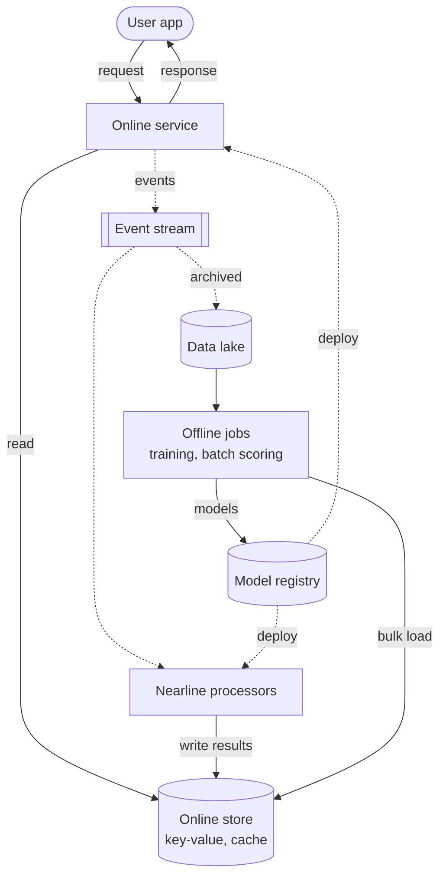

**Reading the diagram.** The online service answers requests synchronously and reads only the low-latency online store (key-value database or cache, Chapters 12 and 20). It emits events asynchronously (dotted) to a stream such as Kafka (Chapter 31). Nearline processors consume them and write updated features or predictions to the online store within seconds. The same events are archived in the data lake, where offline jobs train models and compute bulk results that are loaded into the online store or registered as models. Storage boundaries: online store (milliseconds), event stream (durable log), data lake (hours to years). Failure points: the online store is on the request path and needs a fallback; nearline lag silently adds staleness; a failed offline run leaves yesterday's results, usually acceptable. Tiers scale independently: replicas, stream partitions, cluster size.

**Table 60.9 — What belongs in each tier, for QuickBite.**

| Tier | Latency of result | QuickBite ETA examples | Typical technology |
|---|---|---|---|
| Offline | Hours | Training the ETA model; 7-day prep-time averages; zone-pair travel-time grid | Spark, warehouse SQL, GPU training (Ch 29, 61, 65) |
| Nearline | Seconds to minutes | Kitchen backlog over the last 15 minutes; free couriers per zone; re-predicting ETA for in-flight orders on each status event | Flink or Kafka Streams writing to the online store (Ch 29, 31) |
| Online | Milliseconds | Model inference for the 20 restaurants on a search page; business rules | Stateless service plus model runtime (Ch 66) |

#### Mathematical foundations

::: formula
**Feature freshness lag**

$$F_{\max} = \Delta_{\text{update}} + T_{\text{ingest}} + T_{\text{compute}} + T_{\text{publish}} + \text{TTL} \qquad F_{\text{avg}} \approx \frac{\Delta_{\text{update}}}{2} + T_{\text{ingest}} + T_{\text{compute}} + T_{\text{publish}} + \frac{\text{TTL}}{2}$$

| Symbol | Meaning | Units |
|---|---|---|
| $\Delta_{\text{update}}$ | Interval between recomputations (batch schedule or window slide) | s |
| $T_{\text{ingest}}$ | Delay from event to availability for processing (consumer lag) | s |
| $T_{\text{compute}}$ | Processing time per update | s |
| $T_{\text{publish}}$ | Time to write the result to the online store | s |
| TTL | Time to live of any cache in front of the store (0 if none) | s |
| $F_{\max}$, $F_{\text{avg}}$ | Worst-case and average age of the value a request reads | s |
:::

::: example
**Worked example — Kitchen backlog: nightly batch or nearline?** The kitchen backlog of a busy restaurant changes noticeably within about 10 minutes (600 s), so the product needs $F_{\max} \le 300$ s.

1. **Nightly batch:** $\Delta_{\text{update}} = 86{,}400$ s, $T_{\text{ingest}} = 3{,}600$ s (lake partition lands an hour late), $T_{\text{compute}} = 7{,}200$ s, $T_{\text{publish}} = 1{,}800$ s, no cache. $F_{\max} = 86{,}400 + 3{,}600 + 7{,}200 + 1{,}800 = 99{,}000$ s ≈ 27.5 h. Fails by a factor of 330.
2. **Nearline:** a sliding window recomputed every $\Delta_{\text{update}} = 60$ s, consumer lag $T_{\text{ingest}} = 2$ s, $T_{\text{compute}} = 1$ s, $T_{\text{publish}} = 0.05$ s, local cache TTL 30 s. $F_{\max} = 60 + 2 + 1 + 0.05 + 30 = 93$ s; $F_{\text{avg}} \approx 30 + 2 + 1 + 0.05 + 15 = 48$ s. Meets the requirement with margin.

**Interpretation.** The schedule interval dominates batch staleness; no amount of faster computing fixes a daily schedule. **Engineering implication.** Classify every feature by how quickly its value changes relative to the decision. Slow features (7-day averages) belong offline; fast ones (backlog, supply) belong nearline; and the cache TTL in front of a nearline feature is part of its freshness budget, not a free optimization.
:::

::: industry
**Netflix — offline, nearline and online.** Amatriain and Basilico's 2013 post describes offline jobs over Hadoop-based tooling for model training and batch computation, nearline computation triggered by member events and written to stores such as Cassandra, EVCache and MySQL, and online computation that must respond within a service-level limit and therefore needs a fallback, such as precomputed results, when it cannot. The architecture's lesson is the decomposition, not the specific tools, many of which Netflix has since replaced.
*Evidence: Primary* — [Amatriain and Basilico 2013]
:::

::: mistake
**Mistake — "Real-time ML means retraining in real time."** Almost all production "real-time ML" means online inference with fresh (nearline) features and a model retrained hourly or daily. Continual, online *training* exists (Huyen describes stateful training on fresh data [Huyen 2022]), but it is a separate, harder step that most systems do not need.
:::

## 60.8 Batch versus real-time ML

### 60.8.1 Precomputed predictions versus online inference

::: definition
**Definition — Batch prediction and online inference.** In **batch prediction** (offline inference) a scheduled job computes predictions for every key that might be requested (each user, each restaurant), stores them, and the request path only looks them up. In **online inference** the model runs inside the request on features available at that moment. **Online inference with streaming features** combines online inference with features maintained by nearline stream processing.
:::

#### First-principles explanation

A bakery can bake bread before opening (batch) or bake to order (online). Baking ahead is cheap and instant at the counter, but you bake loaves nobody buys, the bread is hours old, and you cannot bake for a customer you did not expect. Baking to order is fresh and personal, but every customer waits for the oven, and you need enough ovens for the lunch rush.

Batch prediction is, in system terms, a **precomputed cache** of model outputs with a refresh schedule instead of a TTL (§20.8). It inherits every cache trade-off: staleness, wasted computation for keys never read, and a miss path for new keys.

**Figure 60.7 — Batch prediction versus online inference with streaming features.**

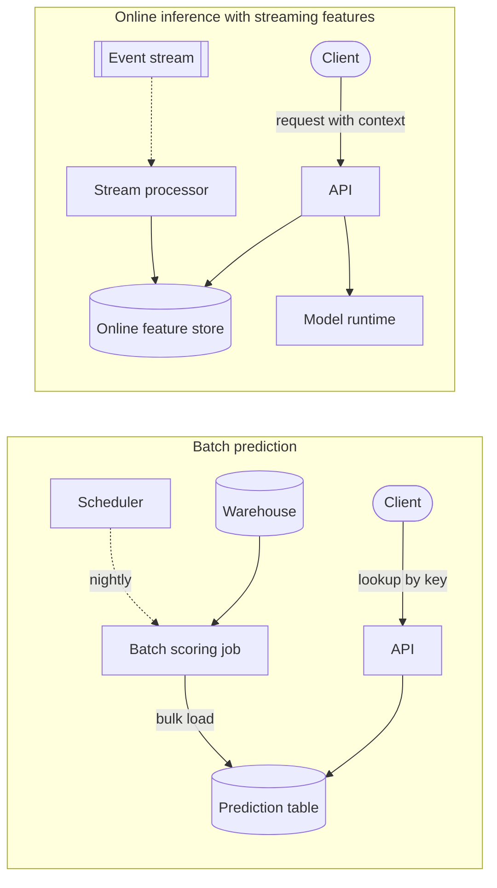

**Reading the diagram.** In the batch subgraph, a scheduler triggers (dotted, asynchronous) a job that scores every key from the warehouse and bulk-loads a prediction table; the request path is a synchronous key lookup (~1 ms) that never touches a model. In the online subgraph, a stream processor keeps the online feature store fresh, and each request synchronously reads features and calls the model runtime. The prediction table stores outputs; the feature store stores inputs, which is why the online path handles combinations nobody precomputed. Failure points: a failed batch job leaves stale predictions (usually tolerable); a failed runtime needs a fallback. Batch scales with the number of keys, online with the request rate.

#### Mathematical foundations

::: formula
**Compute rate of precomputation versus online inference**

$$R_{\text{batch}} = \frac{K}{\Delta} \qquad R_{\text{online}} = \bar{\lambda} \qquad \text{waste} = 1 - \frac{K_{\text{read}}}{K}$$

| Symbol | Meaning | Units |
|---|---|---|
| $K$ | Number of keys that must be precomputed (all possible requests) | keys |
| $\Delta$ | Refresh interval | s |
| $R_{\text{batch}}$ | Average predictions per second spent refreshing | predictions/s |
| $\bar{\lambda}$ | Average predictions per second requested online | predictions/s |
| $K_{\text{read}}$ | Keys actually read before the next refresh | keys |
| waste | Fraction of precomputed predictions never used | dimensionless |
:::

::: example
**Worked example — Precompute QuickBite's search ETAs?** Assume QuickBite operates in 20 cities with 3,000 restaurants each, and each restaurant delivers to 200 zones: $K = 20 \times 3{,}000 \times 200 = 1.2 \times 10^7$ restaurant–zone pairs. Kitchen backlog changes within minutes, so $\Delta = 300$ s.

1. $R_{\text{batch}} = 1.2 \times 10^7 / 300 = 40{,}000$ predictions/s, around the clock.
2. Online: $\bar{\lambda} = 4{,}167$/s on average, 40,000/s only at peak.
3. Precomputation costs $40{,}000 / 4{,}167 = 9.6$ times the online compute on average, is up to 5 minutes stale, and still ignores the customer's exact address and basket.

**Contrast — Restaurant recommendations for the home page.** One list per active user per day: $K = 2 \times 10^6$, $\Delta = 86{,}400$ s, $R_{\text{batch}} = 23$ predictions/s. Lookups cost ~1 ms. If 60% of users open the app before the next refresh, waste = 40%, which is cheap at this rate.

**Interpretation.** Precomputation is attractive when the key space is small relative to the request rate and the value changes slowly; it loses when keys are combinations (restaurant × zone × time) and values change quickly. **Engineering implication.** Use online inference with streaming features for search ETAs; use batch prediction for daily recommendations, with an online re-ranking step for context (Chapter 68). A precomputed zone-level ETA table remains useful as the fallback (§60.12).
:::

**Table 60.10 — Batch prediction versus online inference.**

| Row | Batch prediction | Online inference (with streaming features) |
|---|---|---|
| What it is | Predictions precomputed for all keys, looked up at request time | Model runs per request on current features |
| How it works | Scheduled job → prediction table → key lookup | Feature fetch → model → post-processing in the request |
| Advantages | ~1 ms lookups; any model size; easy to inspect before serving | Fresh; handles unseen combinations and request context |
| Disadvantages | Stale between runs; wasted work; no answer for new keys | Latency budget limits model size; needs fallbacks |
| Performance | Read latency of a key-value store | Feature fetch + model latency (tens of ms) |
| Operational complexity | Low: one batch job and a table | High: online store, stream jobs, model servers |
| Cost | Proportional to keys × refresh rate | Proportional to request rate; sized for peak |
| Use cases | Daily recommendations, churn scores, lead scoring | ETA, fraud at checkout, search ranking, ads |
| Choose when | Key space small or bounded; value tolerates hours of staleness | Inputs arrive with the request or change within minutes |

::: warning
**Warning — The new-key problem.** A restaurant that joins QuickBite at 10:00 has no precomputed prediction until the next batch run. Every batch design needs a miss path: a default, a heuristic, or an online call. Design it explicitly, or the newest (and most fragile) customers get the worst experience.
:::

## 60.9 ML system requirements

### 60.9.1 Functional and non-functional requirements

Requirements for an ML system follow the method of §1.6–§1.7 and §2.5, with three additions: prediction quality becomes a requirement with a number, freshness becomes a requirement for both features and models, and the system must specify what happens when the model is unavailable or wrong.

::: definition
**Definition — ML functional requirement.** A statement of what decision the system makes, for which entity, from which inputs, with what output format and which fallback, for example "return a delivery-time range in minutes for each of up to 50 restaurants for a customer location". **ML non-functional requirements** bound how well, how fast and at what cost the decision is made: latency, throughput, freshness, prediction quality, cost, explainability and compliance.
:::

**Table 60.11 — Requirements for QuickBite's ETA prediction service.**

| Requirement | Target | How it is measured | Drives |
|---|---|---|---|
| Functional: search ETA | Range (e.g. 25–35 min) for up to 50 restaurants per call | Contract tests | API, post-processing |
| Functional: checkout and tracking ETA | Point ETA at checkout; re-predicted on each order status event | Contract tests | Nearline re-prediction |
| Latency | p99 ≤ 100 ms per 20-restaurant call, measured at the ETA service | Server-side histogram (§40.5) | §60.10 budget |
| Throughput | 40,000 predictions/s at peak with N+1 zone redundancy | Load test | §60.11 fleet size |
| Feature freshness | Kitchen backlog and courier supply ≤ 5 min old ($F_{\max}$) | Age of value at read time | Nearline tier |
| Model freshness | Model trained on data ≤ 30 h old | Registry timestamp | Training cadence |
| Prediction quality | ≥ 80% of orders delivered within ±5 min of checkout ETA, 7-day rolling; MAE ≤ 4.5 min | Join of prediction log with delivery events | §60.12 quality SLO |
| Bias | Mean error within ±1 min overall and per city (no systematic over-promising) | Same join, by slice | Calibration, slice gates |
| Availability | 99.9% of calls return an ETA (model or fallback) | Error ratio | Fallback ladder |
| Cost | ≤ \$0.001 per order for ETA inference and features | Cost allocation (§51.4) | Model size, cascade |
| Explainability | Support agents can see the top contributing factors for a disputed order | Feature attributions stored with checkout prediction | Logging, Chapter 71 |
| Compliance | Customer location retained ≤ 90 days in training data; no protected attributes as features | Data retention jobs; feature review | Data pipeline, Chapter 50 |

Three requirements are specific to ML. **Prediction quality** needs a measurement window because labels arrive late (35 minutes here, months for fraud chargebacks). **Bias** matters separately from accuracy: an ETA that is accurate on average but always optimistic erodes trust more than one that errs evenly. **Explainability** and **compliance** constrain which features and models are allowed, so they must be known before feature engineering starts (Chapter 71).

::: tip
**Interview tip — Ask for the cost of a wrong prediction.** Before choosing a model, ask what an error costs in each direction. For ETAs, being 10 minutes late costs more (refunds, churn) than being 10 minutes early (a lost order at most). That asymmetry becomes the loss function (predict a high quantile, not the mean) and the business rules, and it shows the interviewer you treat quality as a product requirement.
:::

## 60.10 Latency budgets

### 60.10.1 Decomposing a p99 budget

::: definition
**Definition — Latency budget.** An allocation of an end-to-end latency objective (for example p99 ≤ 100 ms) to the stages of a request path, so that each stage's owner has a number to design and test against, with explicit slack for queueing and variance.
:::

The search service gives the ETA service 100 ms at p99 for a 20-restaurant call (this matches the "p99 < 100 ms for a batch of 20" ETA requirement of the ride-hailing case, §55.5). Inside the ETA service the time is spent in five stages. Summing per-stage p99 values *overestimates* the p99 of the sum, because the stages are rarely all slow at once, so a budget built this way is conservative; the slack covers queueing, garbage collection and retries.

**Figure 60.8 — A 100 ms p99 budget for one ETA call.**

```mermaid
gantt
  title ETA call budget, p99 in ms
  dateFormat x
  axisFormat %L
  section Network
  Inbound RPC and decode     :n1, 0, 5
  section Features
  Parallel feature fetch     :f1, 5, 35
  section Model
  Batch inference 20 rows    :m1, 35, 55
  section Post
  Calibrate and range        :p1, 55, 60
  Business rules             :r1, 60, 63
  section Return
  Encode and outbound RPC    :n2, 63, 70
  section Slack
  Queueing and variance      :s1, 70, 100
```

**Reading the diagram.** Time runs left to right in milliseconds from arrival at the ETA service. Each bar is a sequential, synchronous stage; the feature-fetch bar hides the parallel fan-out to two stores (Figure 60.5), whose slower branch sets its length, and it contains the storage boundaries. The asynchronous log write is off the critical path and not drawn. The feature fetch is the main failure point: the largest share and the most variance, because it crosses the network to stateful stores. The 30 ms of slack is deliberate. More replicas shorten queueing, not any bar's inherent length.

**Table 60.12 — ETA latency budget.**

| Stage | p99 budget (ms) | Share | Main levers |
|---|---|---|---|
| Inbound network, decode | 5 | 5% | Same-zone placement, binary encoding (gRPC) |
| Feature fetch (2 stores in parallel) | 30 | 30% | Multi-get, co-location, local cache, hedging |
| Model inference, 20 rows | 20 | 20% | Model size, compiled runtime (Ch 67), in-process model |
| Post-processing and rules | 8 | 8% | Simple arithmetic; avoid remote calls |
| Encode, outbound network | 7 | 7% | Response size |
| Slack | 30 | 30% | Kept for queueing, GC, one retry |

#### Mathematical foundations

::: formula
**Sequential budget and fan-out within a stage**

$$L_{\text{total}}^{(p99)} \le \sum_{i} L_{i}^{(p99)} + L_{\text{slack}} \qquad P(\text{stage within } L) = p^{N} \qquad p_{\text{required}} = P_{\text{target}}^{1/N}$$

| Symbol | Meaning | Units |
|---|---|---|
| $L_i^{(p99)}$ | p99 latency budget of stage $i$ | ms |
| $L_{\text{slack}}$ | Unallocated budget | ms |
| $N$ | Parallel calls a stage must wait for | count |
| $p$ | Probability that one call finishes within $L$ | dimensionless |
| $P_{\text{target}}$ | Desired probability that the whole stage finishes within $L$ | dimensionless |
:::

::: example
**Worked example — How many lookups does the feature fetch wait for?** The stage budget is 30 ms. Each store answers one call within 30 ms with probability $p = 0.99$.

1. Naive design: one call per key: 20 restaurant keys, 20 zone pairs and 1 customer key, $N = 41$. $P = 0.99^{41} = e^{41 \ln 0.99} = e^{-0.412} = 0.662$. The stage meets 30 ms only 66% of the time, so its p99 is far above budget.
2. Multi-get per store: $N = 2$. $P = 0.99^2 = 0.980$: the stage is within 30 ms at about its p98.
3. For the stage to be within 30 ms at p99, each store must achieve $p = 0.99^{1/2} = 0.995$, that is, 30 ms at its own p99.5.

**Interpretation.** The number of *calls*, not the number of keys, drives fan-out amplification (§4.8.4). **Engineering implication.** Batch keys into one multi-get per store, co-locate the stores in the same zone, and write store SLOs at p99.5 rather than p99, or hedge reads after 15 ms (§23.7). Then the 30 ms feature-fetch budget is credible.
:::

::: mistake
**Mistake — Spending the slack on a bigger model.** A model that takes 45 ms instead of 20 ms at p99 still "fits" in 100 ms on paper. In production the first GC pause, cold cache or feature-store hiccup then breaches the SLO. Budget the model against its share and treat slack as reserved for variance.
:::

## 60.11 Throughput and capacity

### 60.11.1 From request rate and model cost to a fleet

The **request rate** of an inference service is often given in queries per second (QPS), a synonym of RPS used in ML serving. Because one request may score many rows (20 restaurants here), size the fleet from **predictions per second** and the cost of one prediction, then apply the headroom rules of §18.11.

::: formula
**Inference fleet size and cost per 1,000 predictions**

$$N_{\text{cpu}} = \left\lceil \frac{\lambda_{\text{peak}} \, c}{k \, u} \right\rceil + N_{\text{red}} \qquad N_{\text{gpu}} = \left\lceil \frac{\lambda_{\text{peak}}}{u \, X_{\text{gpu}}} \right\rceil + N_{\text{red}} \qquad C_{1k} = \frac{1{,}000 \, H}{3{,}600 \, \bar{\lambda}}$$

| Symbol | Meaning | Units |
|---|---|---|
| $\lambda_{\text{peak}}$ | Peak predictions per second | predictions/s |
| $c$ | CPU time per prediction, from a load test (features and model) | vCPU-s |
| $k$ | vCPUs per node | vCPU |
| $u$ | Target utilization that keeps queueing within the latency budget | dimensionless |
| $X_{\text{gpu}}$ | Predictions per second one GPU sustains at a batch size that meets latency | predictions/s |
| $N_{\text{red}}$ | Extra nodes or GPUs for failure of one zone or instance | count |
| $H$ | Fleet cost per hour | \$/h |
| $\bar{\lambda}$ | Average predictions per second served | predictions/s |
| $C_{1k}$ | Cost per 1,000 predictions | \$ |
:::

::: example
**Worked example — Sizing the ETA fleet.** $\lambda_{\text{peak}} = 40{,}000$/s; $\bar{\lambda} = 4{,}167$/s; nodes of $k = 16$ vCPU at \$0.77/h; $u = 0.5$ (online latency service, §4.10.3).

**Option A — gradient-boosted trees on CPU.** A load test shows one vCPU sustains 10,000 predictions/s, so $c = 0.1$ ms.

1. Busy vCPUs: $40{,}000 \times 0.0001 = 4$. At $u = 0.5$: 8 vCPU, one node.
2. Zone redundancy needs at least one node in each of three zones: $N = 3$ nodes, 48 vCPU. $H = 3 \times 0.77 = \$2.31$/h.
3. $C_{1k} = 1{,}000 \times 2.31 / (3{,}600 \times 4{,}167) = \$0.000154$.

**Option B — a deep model,** $c = 2$ ms per prediction on CPU.

1. Busy vCPUs: $40{,}000 \times 0.002 = 80$; at $u = 0.5$: 160 vCPU = 10 nodes; plus $N_{\text{red}} = 1$: 11 nodes. $H = 11 \times 0.77 = \$8.47$/h; $C_{1k} = 8{,}470 / 15{,}001{,}200 = \$0.000565$.
2. On GPUs at $X_{\text{gpu}} = 25{,}000$/s (batch 64 within 10 ms, an assumed load-test result) and $u = 0.6$: $\lceil 40{,}000 / 15{,}000 \rceil = 3$, plus 1 spare = 4 GPUs at \$2.50/h, $H = \$10.00$/h; $C_{1k} = 10{,}000 / 15{,}001{,}200 = \$0.000667$.

**Per order.** About 720 search-page ETAs are served per order (§60.6.2). Option A: $720 \times 0.000154 / 1{,}000 = \$0.00011$; option B on CPU: \$0.00041. Both meet the \$0.001 requirement of Table 60.11.

**Interpretation.** For a tree model, the redundancy floor, not compute, sets the fleet; the deep model costs 3.7 times as much and, at this scale, is cheaper on CPUs than on GPUs because the GPUs would sit mostly idle off-peak. **Engineering implication.** Compute $C_{1k}$ before choosing hardware. GPUs win when per-prediction compute is large enough to fill them with batches; Chapter 64 explains why, and Chapter 66 covers autoscaling, which would cut both options' off-peak cost.
:::

### 60.11.2 Batching: a preview

Accelerators are efficient only on batches: one GPU kernel over 64 rows costs little more than over 1 row. A server can wait a few milliseconds to fill a batch, trading latency for throughput ($T(B) = t_0 + B t_1$, §4.18.6; §23.8.1). Crankshaw et al.'s Clipper adapted the batch size per model to stay within the latency objective [Crankshaw et al. 2017]. Every millisecond of batching delay comes out of the model's 20 ms budget in Table 60.12; Chapter 66 covers dynamic batching.

## 60.12 Prediction quality as a system property

### 60.12.1 Quality SLOs

::: definition
**Definition — Prediction-quality SLO.** A service-level objective on the correctness of predictions, measured as an indicator over a window once labels arrive (for example "≥ 80% of orders delivered within ±5 minutes of the checkout ETA, over 7 days"), together with proxy indicators available before labels arrive (prediction distribution, feature null rates, fallback rate).
:::

Availability and latency SLOs (§39.6) tell you whether the system answered; a quality SLO tells you whether the answer was good. Treat it like any SLO: it has an error budget (here 20% of orders may be outside ±5 minutes), a burn rate, an owner and a policy for what happens when it is exhausted (freeze model changes, roll back, retrain) [Huyen 2022]. Two differences from latency SLOs matter. Labels are **delayed** (35 minutes for ETA, up to 60–90 days for fraud chargebacks), so alerting relies on proxies; and quality varies by **slice**, so a global SLO must be backed by per-city indicators (Chapter 70).

### 60.12.2 Fallbacks and graceful degradation

Every ML-backed feature needs an answer for "what if the model cannot run, or is wrong?". Table 39.2 already lists the ETA model as a tier-2 dependency whose fallback is a static ETA range. In practice a **fallback ladder** of several steps degrades quality gradually.

**Figure 60.9 — The ETA fallback ladder.**

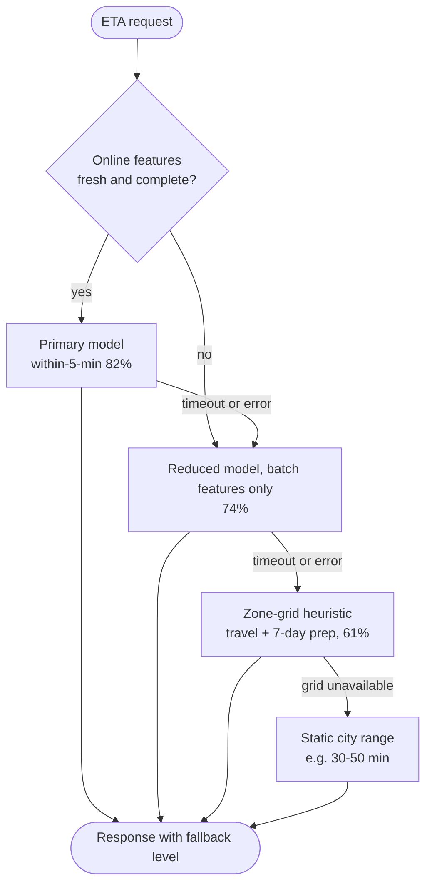

**Reading the diagram.** The request first checks whether the online features are fresh (age below the freshness requirement) and complete. If so, the primary model runs; if features are stale or the primary times out, a **reduced model**, trained on batch features only so it is not confused by missing values, runs instead. If the model runtime itself is down, a heuristic computes the travel time from the precomputed zone grid plus the restaurant's 7-day average prep time, a few lines of code with no model. The last rung is a static range per city that needs no dependencies at all. All arrows are synchronous within the 100 ms budget; each rung is cheaper than the one above, so degrading also sheds load. Every response records its fallback level, which feeds the blended-quality indicator below. Failure points: a fallback that shares a dependency with the primary (for example both reading the same store) fails together with it.

::: formula
**Blended prediction quality under degradation**

$$Q = \sum_{i} f_i \, q_i \qquad \sum_i f_i = 1$$

| Symbol | Meaning | Units |
|---|---|---|
| $f_i$ | Fraction of predictions served by rung $i$ of the ladder | dimensionless |
| $q_i$ | Quality of rung $i$ (here, fraction of orders within ±5 min) | dimensionless |
| $Q$ | Quality of the system as users experience it | dimensionless |
:::

::: example
**Worked example — Can QuickBite afford a feature-store outage?** Quality SLO: $Q \ge 0.80$. Rung qualities from Figure 60.9: $q = 0.82, 0.74, 0.61$.

1. Normal week: $f = (0.990, 0.008, 0.002)$. $Q = 0.990 \times 0.82 + 0.008 \times 0.74 + 0.002 \times 0.61 = 0.8118 + 0.0059 + 0.0012 = 0.8189$.
2. Feature store degraded for a day (1/7 of the window), during which 70% of requests fall to the reduced model. Over the week $f_2 = 0.008 + 0.7/7 = 0.108$, $f_1 = 0.890$, $f_3 = 0.002$: $Q = 0.890 \times 0.82 + 0.108 \times 0.74 + 0.002 \times 0.61 = 0.7298 + 0.0799 + 0.0012 = 0.8109$. Still within SLO.
3. If the outage instead forced the *heuristic* for 70% of a day: $f_1 = 0.890$, $f_2 = 0.008$, $f_3 = 0.102$: $Q = 0.7298 + 0.0059 + 0.0622 = 0.7979$. SLO breached.

**Interpretation.** The intermediate rung is worth building: it turns a breach into a survivable dip. **Engineering implication.** Measure each rung's quality offline, track $f_i$ in production as a metric, and alert on the fallback fraction, which moves immediately, rather than waiting for labels to show the quality drop 35 minutes later.
:::

## 60.13 Cost versus accuracy trade-offs

### 60.13.1 Diminishing returns

Model quality usually improves roughly logarithmically with model size, data and compute, while serving cost grows roughly linearly with compute per prediction, so each further point of accuracy costs more than the last (compare §4.18.4). A bigger model also consumes latency budget (§60.10), and the value of a point of accuracy differs enormously between products. The right question is not "which model is most accurate?" but "which accuracy is worth its cost at this prediction volume?".

::: formula
**Break-even for a more expensive model**

$$\Delta V \ge \Delta C \qquad \Delta C = (c_{\text{new}} - c_{\text{old}}) \frac{N}{1{,}000} + \Delta C_{\text{ops}}$$

| Symbol | Meaning | Units |
|---|---|---|
| $\Delta V$ | Business value of the quality gain, measured online, per month | \$/month |
| $c_{\text{new}}, c_{\text{old}}$ | Serving cost per 1,000 predictions of each model | \$ |
| $N$ | Predictions per month | predictions/month |
| $\Delta C_{\text{ops}}$ | Added engineering and operations cost per month | \$/month |
| $\Delta C$ | Added total cost per month | \$/month |
:::

::: example
**Worked example — Is +0.005 AUC worth 3× the serving cost?** Two QuickBite models, same question. Ignore $\Delta C_{\text{ops}}$ for simplicity.

**Fraud model at checkout.** $N = 15 \times 10^6$ orders/month; $c_{\text{old}} = \$0.05$, so serving costs \$750/month; at 3× it costs \$2,250, so $\Delta C = \$1{,}500$. Fraud losses are \$450,000/month (assumed). Replaying last quarter at the same manual-review capacity, the new model catches 2% more fraud dollars: $\Delta V = 0.02 \times 450{,}000 = \$9{,}000$. Net +\$7,500/month. **Ship it.**

**Restaurant ranking on the home page.** 6 million home-page loads a day × 200 candidates × 30 days: $N = 3.6 \times 10^{10}$; $c_{\text{old}} = \$0.0005$, so \$18,000/month; at 3×, \$54,000: $\Delta C = \$36{,}000$. An A/B test (Chapter 57) shows +0.05% orders: $0.0005 \times 15 \times 10^6 = 7{,}500$ orders × \$2 contribution margin = $\Delta V = \$15{,}000$. Net −\$21,000/month. **Do not ship as is.**

**Cascade rescue.** Score all 200 candidates with the old model and re-score only the top 30 (15%) with the new one: cost $= 1 + 3 \times 0.15 = 1.45$ times the original, $\Delta C = 0.45 \times 18{,}000 = \$8{,}100$. If the re-ranked top keeps 90% of the gain, $\Delta V = \$13{,}500$. Net +\$5,400/month. **Ship the cascade.**

**Interpretation.** The same AUC gain is worth shipping where each prediction carries a lot of value (a \$30 order at risk) and not where predictions are numerous and individually cheap. **Engineering implication.** Translate offline gains into money with an online test before arguing about hardware, and look for a structure (a cascade) that spends expensive computation only where it changes decisions.
:::

### 60.13.2 Cascades and two-stage models

::: definition
**Definition — Model cascade.** A sequence of models of increasing cost in which each stage either returns a confident answer or passes the input to the next stage. A **two-stage model** (retrieve then rank) is the ranking variant: a cheap model narrows many candidates to a few, and an expensive model orders the few.
:::

Viola and Jones introduced the idea in face detection: a cascade of increasingly complex classifiers rejects most image regions after a few cheap tests, so expensive computation is spent only on promising regions [Viola and Jones 2001]. Recommendation and search funnels (Chapter 68, §56.5) apply the same principle at the scale of millions of candidates.

**Figure 60.10 — A two-model cascade.**

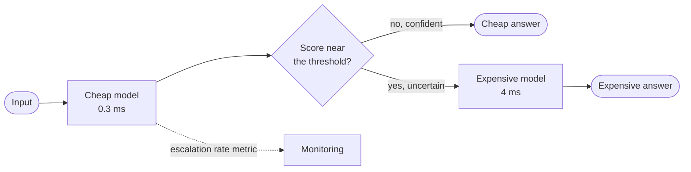

**Reading the diagram.** Every input passes synchronously through the cheap model. The decision diamond tests whether its score lies within a band around the decision threshold; confident inputs are answered at once, uncertain ones are escalated to the expensive model. No storage boundary is on the path; the dotted arrow reports the escalation rate to monitoring, because a rising escalation rate means drift in the cheap model and a rising bill. Failure points: the expensive stage, which needs its own fallback (answer with the cheap score), and a band that is set once and never re-tuned. Scaling: the two stages scale separately; the expensive fleet is sized for the escalation rate, not the full request rate.

::: formula
**Cascade cost and latency**

$$c = c_1 + r \, c_2 \qquad \bar{L} = L_1 + r \, L_2 \qquad L^{(p99)} \approx L_1 + L_2^{(p99)} \text{ when } r > 0.01$$

| Symbol | Meaning | Units |
|---|---|---|
| $c_1, c_2$ | Cost per 1,000 predictions of the cheap and expensive model | \$ |
| $r$ | Escalation rate: fraction of inputs sent to the expensive model | dimensionless |
| $L_1, L_2$ | Latency of each stage | ms |
| $c$, $\bar{L}$ | Average cost and latency of the cascade | \$, ms |
:::

#### Code example

The program below trains a cheap model (logistic regression on 3 features) and an expensive one (gradient-boosted trees on 6 features) on synthetic data whose labels depend on an interaction the cheap model cannot see. It then sweeps the escalation band and reports accuracy, cost and latency. Costs and latencies are assumptions, not measurements.

```python
"""Two-stage cascade: a cheap model answers confident cases, an expensive model the rest."""
import numpy as np
from sklearn.ensemble import GradientBoostingClassifier
from sklearn.linear_model import LogisticRegression

rng = np.random.default_rng(7)
N_TRAIN, N_TEST = 20_000, 20_000
X = rng.normal(size=(N_TRAIN + N_TEST, 6))
# True log-odds: a strong linear part plus an interaction a linear model cannot see.
logit = 3.0 * X[:, 0] - 2.0 * X[:, 1] + 1.5 * X[:, 2] + 3.0 * np.sin(2 * X[:, 3]) * X[:, 4]
y = (rng.random(len(X)) < 1 / (1 + np.exp(-logit))).astype(int)
X_tr, y_tr, X_te, y_te = X[:N_TRAIN], y[:N_TRAIN], X[N_TRAIN:], y[N_TRAIN:]

cheap = LogisticRegression().fit(X_tr[:, :3], y_tr)                 # 3 features
big = GradientBoostingClassifier(n_estimators=150, max_depth=3,
                                 random_state=7).fit(X_tr, y_tr)    # all 6
p_cheap = cheap.predict_proba(X_te[:, :3])[:, 1]
p_big = big.predict_proba(X_te)[:, 1]

# Assumed serving costs per prediction (illustrative, not measured).
LAT_CHEAP, LAT_BIG = 0.3, 4.0            # median latency, ms
COST_CHEAP, COST_BIG = 0.002, 0.030      # dollars per 1,000 predictions
jit_c = rng.lognormal(0.0, 0.25, N_TEST)  # per-request latency noise
jit_b = rng.lognormal(0.0, 0.25, N_TEST)

def report(name, escalate, pred):
    acc = (pred == y_te).mean()
    lat = LAT_CHEAP * jit_c * (name != "expensive only") + escalate * LAT_BIG * jit_b
    cost = COST_CHEAP * (name != "expensive only") + escalate.mean() * COST_BIG
    print(f"{name:<18}{escalate.mean():>9.1%}{acc:>9.4f}{cost:>9.4f}"
          f"{np.percentile(lat, 50):>8.2f}{np.percentile(lat, 99):>8.2f}")

print(f"{'policy':<18}{'escalated':>9}{'accuracy':>9}{'$ per 1k':>9}{'p50 ms':>8}{'p99 ms':>8}")
none, every = np.zeros(N_TEST, bool), np.ones(N_TEST, bool)
report("cheap only", none, p_cheap >= 0.5)
for band in (0.1, 0.2, 0.3, 0.4):
    esc = np.abs(p_cheap - 0.5) < band       # cheap model unsure -> escalate
    report(f"cascade band {band}", esc, np.where(esc, p_big >= 0.5, p_cheap >= 0.5))
report("expensive only", every, p_big >= 0.5)
```

Output (about 10 seconds on one CPU core):

```text
policy            escalated accuracy $ per 1k  p50 ms  p99 ms
cheap only             0.0%   0.8108   0.0020    0.30    0.54
cascade band 0.1      13.1%   0.8206   0.0059    0.31    6.09
cascade band 0.2      26.3%   0.8256   0.0099    0.34    6.51
cascade band 0.3      42.3%   0.8276   0.0147    0.39    6.88
cascade band 0.4      62.3%   0.8280   0.0207    3.54    7.18
expensive only       100.0%   0.8282   0.0300    4.00    7.15
```

What to notice:

- **Most of the gain for a fraction of the cost.** The expensive model adds 1.74 accuracy points over the cheap one (0.8282 − 0.8108). Band 0.2 recovers 1.48 points (85%) at \$0.0099 per 1,000, a third of the expensive model's cost; band 0.3 recovers 97% at half the cost. The formula agrees: $0.002 + 0.263 \times 0.030 = \$0.0099$.
- **Median latency drops, p99 does not.** Once more than 1% of inputs escalate, the p99 is set by the expensive path (6–7 ms), as the formula predicts. Cascades save cost and average latency; they do not rescue a p99 budget that the expensive model alone cannot meet.
- **The band is a dial.** Choosing it is a business decision on the cost–accuracy curve, made with the break-even rule above, and it must be re-tuned when either model is retrained, because the cheap model's confidence distribution changes.
- **Uncertainty must be meaningful.** The cascade works because the cheap model's probability near 0.5 identifies the hard cases. A poorly calibrated cheap model escalates the wrong inputs (Chapter 57 covers calibration).

::: warning
**Warning — Accuracy is not the only axis.** Bernardi et al. report from Booking.com that slower models cost conversion: in their experiments, an increase of about 30% in latency cost more than 0.5% in conversion rate [Bernardi et al. 2019]. A model that is more accurate but slower can lose money even when serving is free. Put latency into the break-even calculation through an online test.
:::

## 60.14 Hidden technical debt

### 60.14.1 The debt patterns

Sculley et al. argued that ML systems make it easy to incur technical debt that is invisible at the code level, because it lives in data dependencies, configuration and the interactions between systems [Sculley et al. 2015]. They observed that in a mature system the ML code can be a small fraction, with much of the rest glue code. Figure 60.11 contrasts the anti-pattern they call a pipeline jungle with a designed pipeline.

**Figure 60.11 — Pipeline jungle versus a designed feature pipeline.**

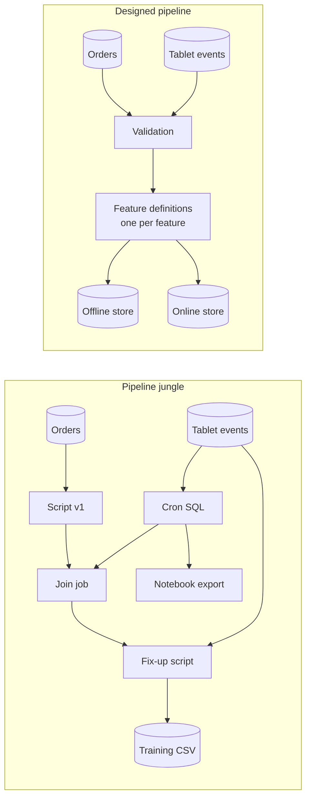

**Reading the diagram.** On the left, each new need added a script: a join job, a fix-up script that reads raw events again, and a notebook export that some other team consumes. There is no validation, the same source is read three times with different logic, and nobody knows which outputs are still used. All edges are batch jobs, so failures surface as wrong numbers days later. On the right, sources pass one validation step, each feature has one definition, and that definition materializes to both the offline store (training) and the online store (serving), the two storage boundaries. Failure points shrink to the validation step and the feature definitions, both testable. Scaling: the designed pipeline scales by adding feature definitions rather than scripts.

**Table 60.13 — Hidden technical debt in ML systems and its mitigations (categories from Sculley et al. 2015).**

| Debt | What it looks like at QuickBite | Mitigation |
|---|---|---|
| Glue code | Hundreds of lines converting data in and out of one training library's formats | Wrap libraries behind common interfaces; use a platform (Chapter 69) |
| Pipeline jungle | Scripts and joins accreted over years (Figure 60.11) | Redesign holistically; one feature definition for training and serving (Chapter 62) |
| Dead experimental code paths | `if experiment_weather_v2:` branches from last year's tests | Delete losing branches when an experiment ends; expiring flags (§43.7.3) |
| Undeclared consumers | The staffing team reads ETA predictions from the log table | Access control on prediction outputs; consumer registry; data contracts |
| Configuration debt | Feature lists, thresholds and per-city overrides in untested YAML | Review and test configuration like code; validate and diff configs |
| Unstable and underused data dependencies | A feature from a table another team redefines; features adding 0.01% accuracy | Version input signals; leave-one-feature-out evaluation, prune regularly |
| Correction cascades | Grocery ETA model correcting the restaurant ETA model | Add the case as a feature to the base model |
| Changes in the external world | Fixed decision thresholds tuned on last year's data | Learn thresholds on recent validation data; monitor prediction bias |

::: recommendation
**Recommendation — Make debt visible.** Score each production model with the ML Test Score rubric once a quarter and track the minimum section score as a team metric [Breck et al. 2017]. Keep a feature inventory with owners, consumers and last-used dates, and delete what nobody uses. Most of this debt is cheap to prevent at design review and expensive to remove later.
:::

## 60.15 Reference architecture: QuickBite ETA prediction end to end

The pieces of this chapter combine into one architecture. Figure 60.12 shows the training path, the feature paths in all three tiers, the online inference path with its fallback, and the feedback from deliveries to labels.

**Figure 60.12 — QuickBite ETA prediction: reference architecture.**

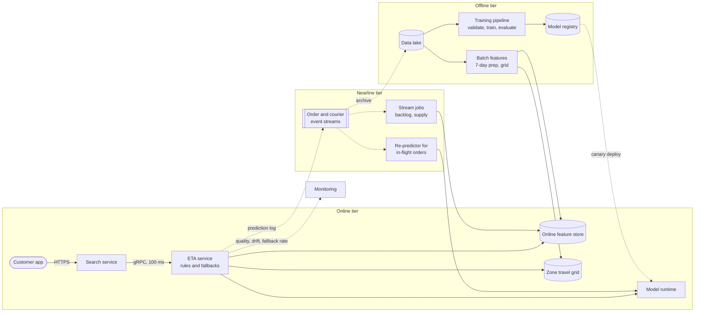

**Reading the diagram.** *Online tier (solid, synchronous):* the app calls search over HTTPS; search calls the ETA service over gRPC with a 100 ms deadline. The ETA service makes one multi-get each to the online feature store and the zone travel grid (storage boundaries), runs the in-process model runtime, applies post-processing, rules and the fallback ladder of Figure 60.9. *Nearline tier:* stream jobs over Kafka update kitchen backlog and courier supply within about a minute (§60.7); a re-predictor refreshes in-flight orders' ETAs on each status event. *Offline tier:* the lake feeds batch features and the nightly training pipeline of Figure 60.4, which registers validated models. *Feedback (dotted, asynchronous):* predictions are logged with their features, archived in the lake and joined with delivery outcomes as labels; models reach the runtime through a canary; monitoring tracks quality, drift and fallback rate. Failure points and responses: online store (reduced model), model runtime (grid heuristic), stream jobs (age checks flag stale features), training (gates keep the last good model). Scaling: the ETA service and runtime are stateless and scale on predictions per second (§60.11); the store partitions by restaurant; stream jobs scale by Kafka partitions.

How the requirements of Table 60.11 map onto the design:

- **Latency (100 ms p99):** in-process model, two multi-gets, the budget of Table 60.12.
- **Throughput (40,000/s):** a 3-node CPU fleet for the tree model (§60.11), autoscaled for the dinner peak.
- **Freshness:** nearline backlog and supply ($F_{\max} \approx 93$ s); model age ≤ 30 h.
- **Quality:** the prediction log joined with delivery events computes the within-±5-min SLI per city; per-slice gates in the training pipeline.
- **Availability:** a four-rung fallback ladder, each rung with fewer dependencies.
- **Cost:** about \$0.0001 of inference per order; the online store and stream jobs cost more, as is typical of a data-centric system.

::: industry
**Uber — UberEATS delivery-time prediction.** The Michelangelo post describes the delivery-time models as predicting, before an order is placed and again at each stage of the delivery, how long it will take, using gradient-boosted decision tree regression with request information, historical features and near-real-time features served from the platform's feature store. The QuickBite design above is a teaching architecture with the same structure; it is not a description of Uber's system.
*Evidence: Primary* — [Hermann and Del Balso 2017]
:::

## 60.16 Summary and revision notes

::: summary
- In ML systems, data specifies behavior. Code, data and model change independently and must be versioned together.
- ML systems fail silently. Monitor input and prediction distributions as well as availability and latency.
- CACE: changing any input changes everything. Watch for correction cascades, undeclared consumers and feedback loops, which need exploration, propensity logging and holdouts.
- Production gains come mostly from data. The model is a small box inside a data system.
- The training pipeline runs extraction, validation, features, training, evaluation and the registry, with gates. Model age is $\Delta/2 + T_{\text{pipe}} + T_{\text{deploy}}$ on average.
- The inference pipeline runs feature fetch, model, post-processing, business rules and the response. It logs features as served, asynchronously.
- Offline work takes hours, nearline seconds to minutes, online milliseconds. Feature freshness is schedule + ingest + compute + publish + TTL.
- Batch prediction is a cache, worth it when $K/\Delta$ is small relative to the request rate. Use online inference when inputs arrive with the request or change within minutes.
- Budget p99 by stage and keep about 30% slack. Fan-out counts calls, so use multi-gets.
- Fleet size is $\lambda c/(k u)$ plus redundancy. Compute the cost per 1,000 predictions before choosing GPUs.
- Quality is an SLO with delayed labels. Use a fallback ladder, where blended quality is $\sum f_i q_i$.
- Ship a costlier model only if $\Delta V \ge \Delta C$ online. Cascades buy most of the gain cheaply but do not fix p99.
- The debt patterns are glue code, pipeline jungles, dead paths, undeclared consumers and configuration. Mitigate them with one feature definition, deletion and the ML Test Score.
:::

## 60.17 Knowledge checkpoint

1. Name three versioned artifacts of an ML system that traditional software lacks.
2. Why did the prep-time unit change in §60.3.2 raise no alert?
3. State CACE and give one consequence.
4. Retraining every 12 h, pipeline 2 h, deploy 1 h: what are the maximum and average model ages?
5. A feature is refreshed every 120 s, with 5 s lag, 1 s compute and a 60 s cache TTL. What is $F_{\max}$?
6. $K = 5 \times 10^6$ keys are refreshed hourly. What is $R_{\text{batch}}$?
7. A stage waits on 10 parallel calls, each within budget with $p = 0.99$. What fraction of requests stay within budget?
8. 12,000 predictions/s at 0.5 ms CPU each, $k = 16$, $u = 0.5$: how many nodes before redundancy?
9. A fleet costs \$6/h and serves 2,000 predictions/s on average. What is $C_{1k}$?
10. Rungs at 0.85, 0.75 and 0.60 serve 95%, 4% and 1%. What is $Q$?
11. A cascade has $c_1 = 0.001$, $c_2 = 0.02$ and $r = 0.2$. What is the cost per 1,000?
12. Why does a cascade not reduce p99 when $r = 5\%$?

<details><summary>Answers</summary>

1. Training data, feature definitions and values, and the model artifact.
2. Responses stayed well-formed and fast. Only the prediction values shifted.
3. Changing any feature, hyperparameter or data slice can change all learned behavior. So incremental changes need slice-level evaluation and canaries.
4. $12 + 2 + 1 = 15$ h; $6 + 2 + 1 = 9$ h.
5. $120 + 5 + 1 + 60 = 186$ s.
6. $5 \times 10^6 / 3{,}600 = 1{,}389$/s.
7. $0.99^{10} = 0.904$.
8. $12{,}000 \times 0.0005 = 6$ busy vCPU; $6/(16 \times 0.5) = 0.75$, so 1 node.
9. $6{,}000 / (3{,}600 \times 2{,}000) = \$0.00083$.
10. $0.8075 + 0.030 + 0.006 = 0.8435$.
11. $0.001 + 0.2 \times 0.02 = \$0.005$.
12. More than 1% of requests take both stages, so the p99 falls on the expensive path.

</details>

## 60.18 Interview questions

### Basic

**Q1. How is an ML system different from a normal service?**
**Answer.** Its behavior comes from data, so it can be wrong while healthy. It decays as the world drifts, and its outputs can shape its future training data. That adds data validation, model evaluation, quality monitoring and retraining to normal engineering.

**Q2. When would you precompute predictions?**
**Answer.** When the key space is bounded and values tolerate hours of staleness, as with daily recommendations. You also need a miss path for new keys.

### Intermediate

**Q3. Split a 100 ms budget for a ranking call.**
**Answer.** Use roughly 5 ms network in, 30 ms features, 20 ms model, 8 ms post-processing and rules, 7 ms out, and 30 ms slack. Use multi-gets so fan-out stays at a few calls, and set store SLOs at p99.5.

**Q4. The feature store fails. What does your ETA service do?**
**Answer.** It walks a fallback ladder: a reduced model on batch features, then the zone-grid heuristic, then a static range. It logs the fallback level and alerts on the fallback fraction, and it keeps the quality SLO through blended quality.

### Advanced

**Q5. A bigger model gives +0.5% AUC at 3× serving cost. Decide.**
**Answer.** Measure $\Delta V$ online and compare it with $\Delta C$ at the real prediction volume. Check the latency impact too. If the gain is not worth it, try a cascade that applies the large model only to uncertain or top-ranked items.

**Q6. Audit a two-year-old ML system for hidden debt.**
**Answer.** Inventory features and their consumers, and find pipeline jungles and dead flags. Diff the training and serving feature code, and review configuration tests. Score it with the ML Test Score, then prioritize the lowest section.

## 60.19 Practical exercises

1. Extend the cascade program to choose the band that maximizes $\text{accuracy} \times 10 - \text{cost per 1,000}$, and plot accuracy against cost.
2. Write a feature validator that flags unit changes, using a ratio of medians, against the prep-time example.
3. Simulate a 3-store fan-out with log-normal latencies, and measure the stage p99 with and without hedging.
4. Recompute §60.11 for a doubled request rate, and find where GPUs become cheaper than CPUs.

## 60.20 Design challenges

1. **Fraud scoring at checkout.** You have 60 orders/s, a 50 ms budget and chargeback labels after 60 days. Design the tiers, quality SLO proxies and fallback.
2. **Dish recommendations.** Decide between batch and online inference for 2 million users, then compute $R_{\text{batch}}$, the waste and the online cost.
3. **ETA in a new country.** Design the cold-start data path, slice gates and fallback calibration.

## 60.21 References

1. Sculley, D., Holt, G., Golovin, D., Davydov, E., Phillips, T., Ebner, D., Chaudhary, V., Young, M., Crespo, J.-F., Dennison, D. *Hidden Technical Debt in Machine Learning Systems*. NeurIPS, 2015.
2. Amatriain, X., Basilico, J. *System Architectures for Personalization and Recommendation*. Netflix Technology Blog, 2013.
3. Huyen, C. *Designing Machine Learning Systems*. O'Reilly, 2022.
4. Paleyes, A., Urma, R.-G., Lawrence, N. D. *Challenges in Deploying Machine Learning: A Survey of Case Studies*. ACM Computing Surveys 55(6), 2022.
5. Hermann, J., Del Balso, M. *Meet Michelangelo: Uber's Machine Learning Platform*. Uber Engineering Blog, 2017.
6. Baylor, D., et al. *TFX: A TensorFlow-Based Production-Scale Machine Learning Platform*. KDD, 2017.
7. Breck, E., Cai, S., Nielsen, E., Salib, M., Sculley, D. *The ML Test Score: A Rubric for ML Production Readiness and Technical Debt Reduction*. IEEE Big Data, 2017.
8. Crankshaw, D., Wang, X., Zhou, G., Franklin, M. J., Gonzalez, J. E., Stoica, I. *Clipper: A Low-Latency Online Prediction Serving System*. NSDI, 2017.
9. Viola, P., Jones, M. *Rapid Object Detection using a Boosted Cascade of Simple Features*. CVPR, 2001.
10. Bernardi, L., Mavridis, T., Estevez, P. *150 Successful Machine Learning Models: 6 Lessons Learned at Booking.com*. KDD, 2019.
11. Dean, J., Barroso, L. A. *The Tail at Scale*. Communications of the ACM 56(2), 2013.

## 60.22 Open verification items

- Netflix 2013 post: the exact technologies named per tier (Cassandra, EVCache, MySQL; Hadoop tooling), checked against the post itself.
- Michelangelo 2017 post: the exact wording of the UberEATS delivery-time example (features, the GBDT model, per-stage re-prediction), and whether Hive and Cassandra are named as the offline and online stores.
- Booking.com: the "≈30% latency → >0.5% conversion" figure, against the paper.
- TFX: the Google Play continuous-training description, against the paper.
- The ML Test Score: confirm 28 tests in four sections of seven.
- Both URLs were not fetched (network blocked), so they are omitted.
