# Chapter 61 — Data Engineering for ML

> **Level:** 3 · **Track:** B (ML/AI) · **Estimated reading time:** 4.5 h

A restaurant kitchen is only as good as its supply chain. The chef can be brilliant, but if the fish arrives a day late, mislabeled, or mixed with yesterday's delivery, every plate suffers, and nobody can say afterwards which crate caused the food poisoning. An ML model is the chef. **Data engineering for ML** is the supply chain: the ingestion, storage, transformation, validation, versioning and governance that deliver the right data, at the right time, in a form that can be traced and reproduced.

Book I built the engines this chapter uses: batch and stream processing with Spark and Flink (Chapter 29), Kafka (Chapter 31), change data capture and the outbox (Chapter 32), columnar storage (§13.13), object storage (Chapter 15) and warehouses such as Dremel and Snowflake (Chapter 49). This chapter does not re-teach them. It asks a different question: *how do you assemble those engines into a platform that trains and serves models correctly?* ML adds demands that analytics alone does not: years of history at row level, features that are fresh to the minute, joins that never peek into the future, and the ability to rebuild the exact training set behind a model that is misbehaving in production six months later.

The running example is **QuickBite**, the hypothetical food-delivery platform from Chapters 2 and 57–60: 500,000 orders per day, about 2 million daily active users, 20,000 couriers at peak, and models for delivery-time (ETA) prediction, recommendations, fraud detection, demand forecasting and a support chatbot. Every QuickBite number is a teaching assumption, not a measurement of any real company.

## 61.1 Learning objectives

After this chapter you should be able to:

- List what ML needs from data infrastructure (history, freshness, point-in-time correctness, reproducibility, scale) and size a platform's yearly storage from a data inventory.
- Design event tracking schemas, CDC ingestion and schema-registry compatibility rules, and explain why ingestion is "exactly-once-ish."
- Build idempotent, partitioned batch pipelines; estimate the time and cost of a backfill; and run one safely.
- Compute the freshness of a streaming feature, including watermark delay and sink commit interval, and choose between Flink, Spark Structured Streaming and Beam.
- Compare data lakes, warehouses and lakehouses, and explain how Delta Lake, Apache Iceberg and Apache Hudi provide transactions, time travel and schema and partition evolution on object storage.
- Explain Parquet's row groups, column chunks, statistics and dictionary encoding; quantify the small-files problem; and compute compaction write amplification for copy-on-write and merge-on-read tables.
- Gate partitions on data-quality checks, quarantine bad ones, and write data contracts between producers and consumers.
- Use lineage, data versioning and table time travel to reproduce a training set exactly, and propagate deletions into training data.
- Orchestrate pipelines with idempotent tasks, retries and SLAs, and draw a reference ML data platform.

## 61.2 Prerequisites

- Batch processing, Spark, partitioning and shuffle — §29.3–§29.6 (every batch job in this chapter runs on these).
- Event time, windows, watermarks and exactly-once state — §29.8–§29.9 (streaming features build on them).
- Kafka topics, partitions, offsets and transactions — §31.5, §31.8, §31.11 (the event log is the platform's spine).
- Change data capture, the outbox and schema registries — §32.5, §32.6 (how operational data reaches the lake).
- Columnar storage, encodings and Parquet basics — §13.13 (file formats extend it).
- Object storage and lifecycle tiers — §15.4, §15.9 (lakes are built on it).
- Data platform layers, Dremel and Snowflake — §49.5, §49.6 (warehouses at scale).
- Idempotency keys — §22.15 (idempotent pipelines generalize them).
- The ML lifecycle, data validation basics and prediction logging — §59.5–§59.7, §60.6.2 (this chapter scales them up).

## 61.3 What ML needs from data infrastructure

### 61.3.1 Five requirements

::: definition
**Definition — ML data platform.** The infrastructure that ingests an organization's raw data, stores its full history in queryable tables, transforms it into features and labels on schedules and streams, validates and versions it, records where every dataset came from, enforces access and retention rules, and delivers training sets and serving features to ML systems.
:::

#### First-principles explanation

An analytics dashboard asks "how many orders did we deliver last week?" One number, computed from current tables, slightly wrong numbers tolerated. A model asks something harder: "for each of 45 million past orders, what did the world look like at the moment we predicted its ETA, and how long did it actually take?" That question needs history at row level, the state of every feature *as of* a past instant, and an answer that you can recompute identically next quarter.

#### Why does this exist?

Polyzotis et al. surveyed Google's production ML and found that data understanding, validation, cleaning and preparation dominate the effort and are under-served by tools built for analytics [Polyzotis et al. 2018]. Five requirements explain the gap:

1. **History for training.** Models learn from examples across seasons, promotions and outages. QuickBite's ETA model trains on 90 days of orders (§60.5); the demand forecaster needs two years to see two Christmases. Raw events must therefore be kept, cheaply, for years, not aggregated and discarded.
2. **Freshness for serving.** "Orders waiting at this kitchen" is useless if an hour old. Some features must be updated within seconds to minutes (§60.7), which needs streaming paths alongside batch ones.
3. **Point-in-time correctness.** A training example for an order placed at 19:02 may use only facts known at 19:02. Joining it to the restaurant's *current* rating, which includes reviews written after delivery, leaks the future into training (**label leakage**) and produces a model that looks excellent offline and disappoints online. Chapter 62 owns point-in-time joins; this chapter supplies their prerequisite: tables that remember every version of every row with the time it became known.
4. **Reproducibility.** When a model misbehaves you must rebuild its exact training set: the same rows, the same feature code, the same snapshot of each table. Analytics rarely needs to answer "what did this table contain last March?"; ML needs it routinely (§59.14).
5. **Scale and cost.** Raw event volume grows with users, and training reads it repeatedly. The platform must scan terabytes economically, which drives choices of file format, partitioning and compaction.

::: definition
**Definition — Point-in-time correctness.** The property that every feature value attached to a training example was computable from data available at the example's prediction time, so that training sees exactly the information that serving would have had.
:::

### 61.3.2 QuickBite's data inventory

A **data inventory** lists every source, its volume, how it arrives and who uses it. It is the first artifact of any platform design and doubles as the privacy inventory of §50.8.2.

**Table 61.1 — QuickBite data inventory (assumptions; SI units, 1 GB = 10⁹ bytes).**

| Source | Records/day | Bytes/record | Raw GB/day | Arrival path | Main ML consumers |
|---|---|---|---|---|---|
| Order status changes | 4 M (8 per order) | 1,000 | 4 | CDC → Kafka | ETA labels, fraud, demand |
| Courier GPS pings | 129.6 M (§2.11) | 100 | 13 | Stream → Kafka | ETA, dispatch |
| App interaction events | 100 M (50 per DAU) | 500 | 50 | Event SDK → Kafka | Recommendations |
| ETA prediction log | sampled (§60.6.2) | 300 | 11 | Service → Kafka | ETA training, monitoring |
| Payments and fraud signals | 1 M | 1,000 | 1 | Outbox → Kafka | Fraud |
| Menus and restaurants | 200 k changes | 1,000 | 0.2 | CDC → Kafka | Recommendations, ETA |
| Weather and traffic | hourly per zone | — | 0.5 | API pull | ETA, demand |
| Support conversations | 10 k (2% of orders) | 5,000 | 0.05 | Nightly export | Chatbot |
| **Total** | | | **≈ 80** | | |

App events and GPS pings are 79% of the bytes but feed only some models; order events are 5% of the bytes but supply nearly every label. Volume drives cost; value drives the quality checks and SLAs on each source.

**Figure 61.1 — QuickBite's data sources, platform and consumers.**

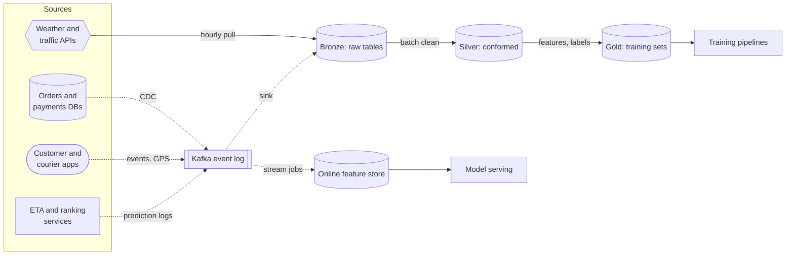

**Reading the diagram.** Sources on the left produce data in four ways: operational databases through change data capture, apps through event tracking, services through prediction logs (all asynchronous into Kafka, dotted), and third-party APIs through scheduled pulls. Kafka is the durable spine (§31.3). One sink lands every topic unchanged in **bronze** tables in object storage; batch jobs clean and conform them into **silver**, then derive features, labels and training sets in **gold**. Stream jobs read the same topics and keep the online feature store fresh for serving. Storage boundaries: Kafka (days of retention), the lakehouse tiers (years), the online store (current values only). Failure points: a stalled CDC connector or sink silently leaves partitions incomplete, and a schema change upstream propagates to every tier. Scaling: Kafka by partitions, the lake by object storage, compute per job. The bronze/silver/gold names, often called the **medallion architecture**, are a convention for successive refinement, not a standard.

#### Mathematical foundations

::: formula
**Yearly storage for retained event data**

$$S_{\text{year}} = 365 \times V_{\text{day}} \times \frac{k}{c}$$

| Symbol | Meaning | Units |
|---|---|---|
| $V_{\text{day}}$ | Raw (uncompressed, row-format) volume ingested per day | GB/day |
| $k$ | Number of retained copies across tiers (bronze, silver, gold) | dimensionless |
| $c$ | Average compression ratio of stored files relative to raw | dimensionless |
| $S_{\text{year}}$ | Storage added per year | GB/year |
:::

::: example
**Worked example — How much does QuickBite's lake grow per year?** Take $V_{\text{day}} = 80$ GB from Table 61.1. Assume an average compression ratio $c = 5$ for columnar files with dictionary encoding and Zstandard or Snappy compression (event data with repetitive IDs and enums often compresses 3–10×; measure your own), and $k = 3$ tiers each holding roughly the full volume.

1. Per day stored: $80 \times 3 / 5 = 48$ GB.
2. Per year: $365 \times 48 = 17{,}520$ GB ≈ 17.5 TB.
3. Cost: assume \$20 per TB-month for a standard object-storage tier (an assumption in the range of public list prices as of 2026; check your provider). At year end the bill is $17.5 \times 20 = \$350$ per month. Over the first year storage grows linearly, so the average stored is about 8.8 TB and the year's storage cost is about $8.8 \times 20 \times 12 \approx \$2{,}100$.
4. Retention to keep two years for demand forecasting doubles the standing volume to 35 TB, about \$700 per month.

*Interpretation:* raw storage is cheap at QuickBite's scale; a single badly written backfill (§61.5.3) can cost more in one afternoon than a month of storage. *Engineering implication:* do not discard raw history to save storage; spend design effort on compute efficiency (formats, partitioning, compaction) and on governance, because 50 GB/day of app events is personal data with retention obligations (§61.14). Table formats' time travel keeps old file versions too, which raises $k$ for frequently rewritten tables until snapshots expire (§61.8).
:::

**Table 61.2 — What ML asks of the platform, and where this chapter answers it.**

| Requirement | Mechanism | Section |
|---|---|---|
| History for training | Immutable raw tables, cheap object storage, retention tiers | 61.4, 61.8 |
| Freshness for serving | Streaming pipelines into the online store | 61.6 |
| Point-in-time correctness | Event-time partitions, versioned tables, as-of joins (Ch 62) | 61.5, 61.8 |
| Reproducibility | Idempotent jobs, snapshots, data versioning, lineage | 61.5, 61.12, 61.13 |
| Quality | Expectations, anomaly checks, quarantine, contracts | 61.11 |
| Compliance | Catalogs, PII tags, deletion propagation | 61.14 |
| Scale and cost | Columnar formats, compaction, partition design | 61.8, 61.9 |

::: mistake
**"The warehouse already has all the data, so ML is covered."** Analytics warehouses often hold current-state tables (one row per order, overwritten as status changes) and daily aggregates. A model needs every intermediate state with the time it became known; once overwritten, that history cannot be recovered. Keep raw, append-only event history even if no current dashboard needs it.
:::

## 61.4 Ingestion

### 61.4.1 Event tracking design and schemas

::: definition
**Definition — Event tracking.** Instrumenting applications and services to emit immutable records of things that happened (a search, a tap, a status change), each with an identity, timestamps, an actor and a typed payload, so that behavior can be reconstructed later.

**Definition — Event envelope.** The standard set of fields that every event carries regardless of type, wrapped around the type-specific payload.
:::

#### First-principles explanation

A ship's logbook is useful because every entry has the same shape: time, position, heading, who was on watch, then a note. Event tracking imposes the same discipline: a common envelope that every pipeline understands, and a typed payload that only the consumers of that event type need to parse.

#### Why does this exist?

Ad hoc logging ("print a JSON blob when the user taps") produces events with inconsistent names, missing IDs, ambiguous timestamps and silent type changes. Every downstream consumer then writes its own cleaning code, and the training set inherits every bug. A designed tracking plan prevents that at the source, where it is cheapest. §59.5.2 gave the rules for ML instrumentation; this section turns them into a schema.

#### How it works internally

**Table 61.3 — The QuickBite event envelope.**

| Field | Type | Purpose |
|---|---|---|
| `event_id` | UUID | Deduplication key; generated once on the client |
| `event_type`, `schema_version` | string, int | Routing and decoding |
| `event_time` | timestamp (UTC, ms) | When it happened, by the producer's clock |
| `received_time` | timestamp (UTC, ms) | When the collector accepted it; set server-side |
| `user_id`, `device_id`, `session_id` | string | Join keys; tagged as personal data |
| `request_id` | string | Joins events to predictions (§59.5.3) |
| `app_version`, `platform` | string | Slicing and blaming releases |
| `payload` | typed record | Event-specific fields |

A typed payload is declared in a schema language such as Apache Avro or Protocol Buffers and registered before the first event is sent:

```json
{
  "type": "record", "name": "RestaurantImpression", "namespace": "quickbite.events",
  "fields": [
    {"name": "restaurant_id", "type": "string"},
    {"name": "position", "type": "int"},
    {"name": "eta_shown_min", "type": ["null", "int"], "default": null},
    {"name": "ranking_model", "type": "string", "default": "unknown"}
  ]
}
```

What to notice:

- `eta_shown_min` is a union with `null` and a default, so old events without it still decode (§61.4.4).
- `ranking_model` records which model produced the list; without it, recommendation training cannot correct for the policy that chose what users saw (Chapter 68).
- Logging impressions, not just clicks, records the denominators (§59.5.2): a model of click-through needs the restaurants that were shown and *not* tapped.

**Client versus server tracking.** Events emitted by phones arrive late (offline devices), duplicated (retries) and occasionally forged. Events emitted by backend services are timely and trustworthy but miss pure-UI interactions. A common split: business facts (orders, payments, status changes) come from the server or CDC; interaction facts (impressions, scrolls) come from the client, through a **collector** service that validates, stamps `received_time` and writes to Kafka.

**Figure 61.2 — Ingestion paths into the event log.**

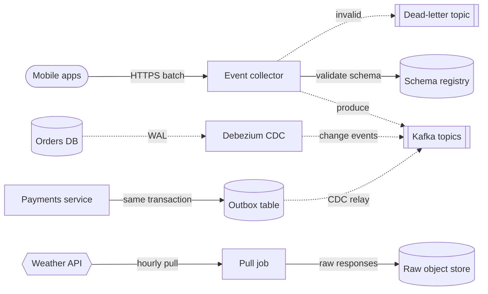

**Reading the diagram.** Apps send batches of events over HTTPS to a stateless collector (synchronous, so the app can retry on failure). The collector checks each event against its registered schema, stamps the receive time and produces to Kafka asynchronously; malformed events go to a dead-letter topic (§30.11) instead of being dropped silently. Operational tables reach Kafka through log-based CDC with Debezium (§32.6). Payments publishes deliberate domain events through a transactional outbox (§32.5), which avoids the dual-write problem. Third-party data is pulled on a schedule and stored as the raw responses. Storage boundaries: the source databases, the registry, Kafka, the raw store. Failure points: collector overload (apps buffer and retry, creating duplicates), a CDC connector that stalls, and a third-party API outage. Scaling: collectors behind a load balancer, Kafka by partitions keyed by user or order ID.

### 61.4.2 CDC from OLTP databases

Change data capture reads the database's write-ahead log and emits one event per committed row change, with the row's before and after images, the operation type and the log position (§32.6). For ML, CDC solves the history problem of §61.3.1: the orders table holds one row per order with its *current* status, while the CDC stream holds every transition with its commit time.

Two practices matter for ML specifically:

1. **Snapshot, then stream.** A new connector first copies the table (the initial snapshot) and then follows the log. The snapshot rows have no true history; mark them so that training does not mistake "first seen at connector start" for "created then."
2. **Materialize history as a versioned table.** Convert the change stream into a table with `valid_from` and `valid_to` columns per row version (a **slowly changing dimension of type 2**, in warehouse vocabulary). A point-in-time join then becomes a range predicate: the restaurant's row where `valid_from <= prediction_time < valid_to`.

::: warning
**Warning — Commit time is not event time.** A CDC event's timestamp is when the transaction committed, which can lag the business event (a courier's "picked up" tap that synced 3 minutes later). Carry the application's event time as a column whenever the table has one, and record both. Using commit time for labels shifts every QuickBite pickup duration by the sync delay.
:::

### 61.4.3 Third-party data

Weather, traffic and map data arrive from vendors with their own latency, outages, revisions and licenses. Three rules keep them usable for training:

- **Store the raw response with its fetch time.** Vendors revise history ("yesterday's rainfall was 12 mm, not 8"). A model served with the 8 mm forecast must train on 8 mm, so keep what you *received*, when you received it, not only the vendor's corrected archive.
- **Record the license and retention terms in the catalog** (§61.14). Some licenses forbid storing data beyond a period or training on it at all.
- **Plan for gaps.** An API outage leaves hours without weather. Mark missing intervals explicitly so features can default and training can exclude or flag them.

### 61.4.4 Schema registry and evolution

A **schema registry** stores every version of every event schema and checks each new version for compatibility before producers may use it (§32.6.3). **Backward compatibility** means consumers using the new schema can read data written with the old one; **forward compatibility** means consumers using the old schema can read new data; **full** means both. For ML data, which is replayed years later for training and backfills, use the *transitive* variants, which check a new version against all earlier versions rather than only the latest.

**Figure 61.3 — Registering and using an evolving schema.**

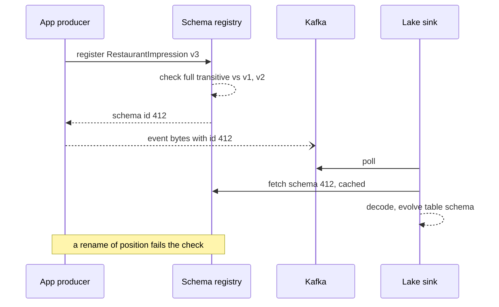

**Reading the diagram.** The producer registers a new schema version synchronously before deploying; the registry checks it against every earlier version and returns an ID, or rejects the change. Events are produced asynchronously with the schema ID embedded in each message rather than the full schema. The lake sink fetches the schema once per ID, caches it, decodes events and, when a new optional field appears, adds the column to the target table through the table format's schema evolution (§61.8.3). Failure points: a producer that bypasses the registry (the collector should reject unregistered IDs), and an incompatible change pushed by disabling the check. Scaling: the registry is read-mostly and cached in every client, so it is rarely a bottleneck.

**Table 61.4 — Safe and unsafe schema changes for long-lived ML data.**

| Change | Safe? | Why |
|---|---|---|
| Add an optional field with a default | Yes | Old data reads with the default |
| Remove an optional field | Yes, with care | Old readers use the default; training features lose the column from that date |
| Rename a field | No | Readers see a removed and a new field; history splits in two |
| Change a type (int → string) | No | Old and new data cannot share a column |
| Change units or meaning, same type | **Undetectable** | Passes every compatibility check; caught only by data validation (§61.11) |
| Reuse a removed field's name or number | No | Old bytes decode as the wrong field |

The last-but-one row is the important one for ML: registries check *syntax*, not *semantics*. Changing `prep_time` from minutes to seconds is compatible by every registry rule and catastrophic for a model. Only data contracts and distribution checks (§61.11) catch it.

### 61.4.5 Exactly-once-ish ingestion

End-to-end exactly-once delivery from a phone to a lake table is not achievable in general: the phone may send an event, lose the acknowledgment and resend it. What is achievable is **effectively-once results**: at-least-once delivery plus deduplication by a stable key (§30.8, §32.10). This chapter calls that **exactly-once-ish**, and it has three layers:

1. **Generate the identity at the source.** The app assigns `event_id` when the event happens, not when it is sent, so retries carry the same ID.
2. **Make each hop idempotent or transactional.** Kafka's idempotent producer removes broker-side duplicates from producer retries, and its transactions make a read-process-write cycle atomic within Kafka (§31.11). The lake sink commits files and the consumed offset range in one table transaction, so a restarted sink either sees its commit and skips it or redoes it; Kafka Connect sinks and Flink's two-phase-commit sinks both use variants of this.
3. **Deduplicate on `event_id` within a bounded window** in the first batch job (bronze to silver). Duplicates from a phone that retried after 3 days fall outside a 1-day window; measure the late-duplicate rate and size the window from it.

#### Failure scenarios

**Table 61.5 — Ingestion failure scenarios.**

| What goes wrong | Why | Detection | Recovery | Prevention |
|---|---|---|---|---|
| Duplicate events in training | Client retries, sink restarts | Duplicate `event_id` rate per partition | Rerun dedup for affected partitions | Source IDs, transactional sinks |
| Silent gap in a day | CDC connector stalled; sink lag | Row count vs forecast; consumer lag (§31.7.3) | Replay from Kafka within retention | Lag alerts; retention > max outage |
| Column suddenly null | Producer renamed a field | Null-rate check | Map old to new name in silver | Registry with full transitive mode |
| Unit change | New app version | Distribution check | Quarantine, correct, rerun (§61.5.4) | Data contract with semantic tests |
| Clock skew on devices | Phone clocks wrong | `received_time − event_time` distribution | Clamp or correct event time | Server-side time anchors |

## 61.5 Batch pipelines

### 61.5.1 Partitions as the unit of work

::: definition
**Definition — Partitioned table.** A table whose files are grouped by the value of one or more columns, usually event date (and sometimes hour), so that a job or query can read, write or replace one group without touching the others. In this chapter a **partition** is that group; the same word for a Kafka or database subset is qualified when needed.

**Definition — Idempotent partition overwrite.** A write that atomically replaces the entire contents of a target partition with the output computed from a fixed input, so that running the job once or many times leaves the same result.
:::

#### First-principles explanation

An accountant closes the books one month at a time. If March's numbers turn out wrong, she redoes March from March's receipts and replaces the March page; she does not add a correction line somewhere in June. A daily partition is a page of the ledger. A job for date $d$ reads inputs for $d$ (plus any fixed look-back), computes, and replaces page $d$. That shape makes retries, reruns and backfills safe.

#### Why does this exist?

Batch jobs fail midway, get retried by orchestrators (§61.15), and are rerun when logic changes. A job that *appends* its output duplicates rows on every retry; a job that does read-modify-write on a shared table can lose updates when two runs overlap. Kleppmann describes batch outputs as derived data recomputed from immutable inputs [Kleppmann 2017], and Beauchemin's "functional data engineering" essay turns that into a rule: pure tasks, immutable partitions, overwrite rather than append [Beauchemin 2018]. Idempotency at the request level (§22.15) becomes idempotency at the partition level.

#### How it works internally

1. **Partition by event time,** not processing time. Late events for 3 March go to the 3 March partition, which then needs reprocessing (§61.5.2), but training sees each event on the right day.
2. **Make the job a function of explicit parameters:** `(target_date, code_version, input_snapshots)`. Never read "now" or "latest" inside the job.
3. **Write to a staging location, validate, then commit atomically.** With a table format this is one transaction that removes the old files of the partition and adds the new ones (`INSERT OVERWRITE ... PARTITION`, Delta's `replaceWhere`, Iceberg's dynamic overwrite). On plain object storage without a table format there is no atomic multi-file replace, which is one reason table formats exist (§61.8).
4. **Gate publication on quality checks** (§61.11). A failing partition is quarantined and the previous good version, or nothing, stays visible.

**Figure 61.4 — Lifecycle of one daily partition.**

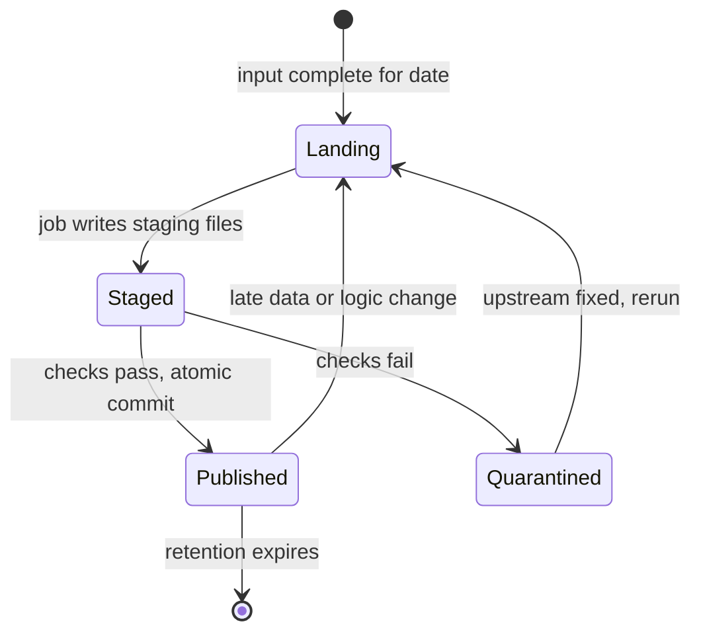

**Reading the diagram.** A partition starts when its inputs are complete (by a sensor on upstream partitions, or a watermark for streamed input). The job writes to a staging area that no consumer reads. Quality checks decide between an atomic commit to the published table and quarantine, where the data is kept for diagnosis but hidden from training. Both quarantine and late data send the partition back through the same path: there is one way to produce a partition, whether it is the first run, a retry or a backfill. Failure points: a commit without checks, and a "fix" applied by editing published files in place. Scaling: partitions are independent, so many dates run in parallel.

### 61.5.2 Hourly versus daily, and late data

Smaller partitions (hourly) give fresher batch data and cheaper reruns, but multiply files and scheduler tasks by 24. A common compromise is hourly ingestion into bronze and daily partitions for silver and gold. Late data needs a policy: either (a) rerun the last $L$ days of partitions every night, sized so that 99.9% of events arrive within $L$; or (b) track which partitions received late rows and rerun only those. QuickBite measures that 99.9% of app events arrive within 2 days and reruns a sliding 3-day window nightly.

### 61.5.3 Backfills

::: definition
**Definition — Backfill.** Running a pipeline over historical partitions, either to populate a new table or feature from the past or to recompute existing partitions after a logic change or bug fix.
:::

Backfills are where ML data engineering spends its money. A new feature is useless for training until it exists for the whole training window, so every new feature implies a backfill of at least 90 days at QuickBite, and often years.

::: formula
**Backfill wall-clock time and cost**

$$T_{\text{part}} = \frac{V_{\text{in}}}{E \times \theta} + t_0 \qquad T_{\text{backfill}} = \left\lceil \frac{D}{P} \right\rceil \times T_{\text{part}} \qquad C = D \times E \times T_{\text{part}} \times p_{\text{core}}$$

| Symbol | Meaning | Units |
|---|---|---|
| $V_{\text{in}}$ | Input bytes read per output partition (including look-back) | MB |
| $E$ | Cores per partition job | cores |
| $\theta$ | Effective processing throughput per core for this job | MB/s per core |
| $t_0$ | Fixed overhead per job (scheduling, cluster start, commit) | s |
| $D$ | Number of partitions to backfill | partitions |
| $P$ | Partition jobs run concurrently | jobs |
| $T_{\text{part}}$, $T_{\text{backfill}}$ | Time per partition job; total wall-clock time | s |
| $p_{\text{core}}$ | Price per core-second | \$/core-s |
| $C$ | Compute cost of the backfill | \$ |
:::

::: example
**Worked example — Backfilling a 7-day prep-time feature for one year.** The new feature is each restaurant's 7-day rolling median prep time, computed per day from silver order events joined with kitchen status events. One day of the needed silver input is 15 GB uncompressed in memory. The join and aggregation run at an effective $\theta = 5$ MB/s per core (shuffle-heavy work runs far below raw scan speed; §29.6.2). Use $E = 64$ cores per job, $t_0 = 120$ s, $P = 8$ concurrent jobs, $D = 365$, and an assumed $p_{\text{core}} = \$0.05$ per core-hour.

*Naive design: each day's job reads its 7-day window.*

1. $V_{\text{in}} = 7 \times 15{,}000 = 105{,}000$ MB.
2. $T_{\text{part}} = 105{,}000 / (64 \times 5) + 120 = 328 + 120 = 448$ s.
3. $T_{\text{backfill}} = \lceil 365/8 \rceil \times 448 = 46 \times 448 = 20{,}608$ s ≈ 5.7 h.
4. $C = 365 \times 64 \times 448 / 3{,}600 \times 0.05 = 2{,}907$ core-hours $\times 0.05 \approx \$145$.

*Better design: compute daily partial aggregates once, then roll them up.* Each day's job reads only its own day ($V_{\text{in}} = 15{,}000$ MB) and writes per-restaurant daily prep-time sketches (a mergeable quantile summary, so medians can be combined); a second, cheap job merges 7 sketches per restaurant.

1. $T_{\text{part}} = 15{,}000/320 + 120 = 47 + 120 = 167$ s.
2. $T_{\text{backfill}} = 46 \times 167 = 7{,}682$ s ≈ 2.1 h.
3. $C = 365 \times 64 \times 167/3{,}600 \times 0.05 \approx 1{,}084$ core-hours ≈ \$54.

*Interpretation:* overlapping windows multiply input reads by the window length; decomposing a window into mergeable daily pieces cut the work 2.7× here and would cut it about 26× for a 90-day window. The fixed overhead $t_0$ is now 72% of each job, so the next lever is fewer, larger jobs (process a week of dates per job). *Engineering implication:* design features as mergeable daily aggregates from the start, and run a 7-day sample backfill to measure $\theta$ before launching the year.
:::

::: warning
**Warning — Backfills compete with production.** A 512-core backfill sharing a cluster with the nightly training pipeline can make tonight's model late. Run backfills in a separate queue with a quota (§46.8), at low priority, and throttle writes so compaction and readers keep up.
:::

### 61.5.4 Code example: idempotent partitions, a backfill and a quality gate

The program simulates ten daily partitions of a per-restaurant feature table. On 7 March an app release logs prep time in seconds for 40% of orders. It shows four things: the quality gate quarantines that day while the other nine publish; retrying a partition with overwrite leaves the table unchanged while append triples it; rerunning one partition after the upstream fix publishes it; and a full backfill with new logic, run twice, produces byte-identical results. It uses only the standard library.

```python
"""Idempotent daily partitions, a backfill, and a quality gate that quarantines."""
import hashlib
import json
import random
import statistics
from datetime import date, timedelta

DAYS = [date(2026, 3, 1) + timedelta(days=i) for i in range(10)]
RESTAURANTS = [f"r{i:02d}" for i in range(20)]


def raw_orders(day, unit_bug=False):
    """Simulated raw order events for one day (seeded by the date)."""
    rng = random.Random(day.toordinal())
    rows = []
    for i in range(rng.randint(450, 550)):
        prep = round(rng.gammavariate(4.0, 3.5), 1)           # minutes
        if unit_bug and rng.random() < 0.4:                    # app release logs seconds
            prep = round(prep * 60, 1)
        rows.append({"order_id": f"{day:%m%d}-{i}",
                     "restaurant": rng.choice(RESTAURANTS),
                     "prep_min": prep,
                     "status": "canceled" if rng.random() < 0.05 else "delivered"})
    return rows


def transform(rows, version):
    """Daily per-restaurant features. v2 also excludes canceled orders."""
    agg = {}
    for r in rows:
        if version >= 2 and r["status"] == "canceled":
            continue
        n, s = agg.get(r["restaurant"], (0, 0.0))
        agg[r["restaurant"]] = (n + 1, s + r["prep_min"])
    return {k: {"orders": n, "avg_prep": round(s / n, 2)} for k, (n, s) in sorted(agg.items())}


def checksum(part):
    return hashlib.sha256(json.dumps(part, sort_keys=True).encode()).hexdigest()[:10]


class Lake:
    """Partitions keyed by date. A write replaces the whole partition atomically."""
    def __init__(self):
        self.published, self.quarantine, self.appended = {}, {}, {}

    def overwrite(self, day, part):          # idempotent: same input -> same state
        self.published[day] = part

    def append(self, day, part):             # NOT idempotent: retries duplicate rows
        self.appended.setdefault(day, []).append(part)


def quality_gate(rows, part, history):
    """Return a list of failed checks; empty means publish."""
    failures = []
    preps = [r["prep_min"] for r in rows]
    if sum(p > 120 for p in preps) / len(preps) > 0.01:
        failures.append("range: >1% of prep_min above 120")
    if history:
        med = statistics.median(history)
        if abs(len(rows) - med) / med > 0.3:
            failures.append(f"volume: {len(rows)} rows vs median {med:.0f}")
        mean_prep = statistics.mean(preps)
        if mean_prep > 1.5 * 14.0:                       # reference mean ~14 min
            failures.append(f"mean shift: avg prep {mean_prep:.1f} min")
    return failures


def run_partition(lake, day, version, history, unit_bug=False):
    rows = raw_orders(day, unit_bug)
    part = transform(rows, version)
    failures = quality_gate(rows, part, history)
    if failures:
        lake.quarantine[day] = {"part": part, "why": failures}
        lake.published.pop(day, None)          # never leave a stale or bad copy visible
        return "QUARANTINED", failures
    lake.quarantine.pop(day, None)
    lake.overwrite(day, part)
    history.append(len(rows))
    return "PUBLISHED", checksum(part)


if __name__ == "__main__":
    lake, history = Lake(), []
    bad_day = DAYS[6]
    print("1) Daily runs with logic v1 (2026-03-07 has a unit bug upstream)")
    for d in DAYS:
        status, info = run_partition(lake, d, 1, history, unit_bug=(d == bad_day))
        print(f"   {d}  {status:11s} {info}")
    print(f"   training window sees {len(lake.published)} of {len(DAYS)} days")

    print("2) Retry 2026-03-03 three times: overwrite vs append")
    d = DAYS[2]
    before = checksum(lake.published[d])
    for _ in range(3):
        run_partition(lake, d, 1, list(history))
        lake.append(d, transform(raw_orders(d), 1))
    rows_overwrite = sum(v["orders"] for v in lake.published[d].values())
    rows_append = sum(v["orders"] for p in lake.appended[d] for v in p.values())
    print(f"   overwrite checksum {before} -> {checksum(lake.published[d])}, "
          f"orders {rows_overwrite}; append orders {rows_append}")

    print("3) Upstream fixes 03-07; rerun only that partition")
    status, info = run_partition(lake, bad_day, 1, list(history))
    print(f"   {bad_day}  {status} {info}")

    print("4) Backfill all 10 days with logic v2 (exclude canceled), twice")
    runs = []
    for attempt in range(2):
        hist = []
        sums = [run_partition(lake, d, 2, hist)[1] for d in DAYS]
        runs.append(hashlib.sha256("".join(sums).encode()).hexdigest()[:10])
    print(f"   table checksum run 1 = {runs[0]}, run 2 = {runs[1]}, identical = {runs[0] == runs[1]}")
    total = sum(v["orders"] for p in lake.published.values() for v in p.values())
    print(f"   published partitions = {len(lake.published)}, quarantined = {len(lake.quarantine)}, "
          f"orders counted = {total}")
```

Output (Python 3, deterministic):

```text
1) Daily runs with logic v1 (2026-03-07 has a unit bug upstream)
   2026-03-01  PUBLISHED   63c2724a5e
   2026-03-02  PUBLISHED   0d7b86f8a0
   2026-03-03  PUBLISHED   0e14a6eb36
   2026-03-04  PUBLISHED   55c55fa0ae
   2026-03-05  PUBLISHED   7a79ee9e3f
   2026-03-06  PUBLISHED   5ef12c4da3
   2026-03-07  QUARANTINED ['range: >1% of prep_min above 120', 'mean shift: avg prep 356.5 min']
   2026-03-08  PUBLISHED   48cc8f3cf0
   2026-03-09  PUBLISHED   4f9f9751e9
   2026-03-10  PUBLISHED   08f450c97e
   training window sees 9 of 10 days
2) Retry 2026-03-03 three times: overwrite vs append
   overwrite checksum 0e14a6eb36 -> 0e14a6eb36, orders 489; append orders 1467
3) Upstream fixes 03-07; rerun only that partition
   2026-03-07  PUBLISHED f8b364167d
4) Backfill all 10 days with logic v2 (exclude canceled), twice
   table checksum run 1 = 5741ad21cc, run 2 = 5741ad21cc, identical = True
   published partitions = 10, quarantined = 0, orders counted = 4745
```

What to notice:

- `raw_orders` is seeded by the date, standing in for immutable input partitions: the same date always yields the same rows, which is what makes overwrite idempotent. In production the equivalent is reading a pinned table snapshot (§61.13).
- The quarantined day is removed from `published`, so the training window has a visible hole (9 of 10 days) rather than silently bad data. A hole is detectable; a mean prep time of 356 minutes in a training set is not, once it is averaged in.
- Three retries with overwrite leave checksum `0e14a6eb36` unchanged; three with append count 1,467 orders instead of 489.
- The backfill (step 4) recomputes every partition with logic v2 and is itself rerun to prove determinism: the table-level checksums match. Comparing a backfill's output with a second run, or with the old version on unchanged dates, is a cheap test worth automating.
- The gate's volume check uses the median of previously *published* days, so a bad day never becomes part of its own baseline.

## 61.6 Streaming pipelines for ML

### 61.6.1 Streaming features

::: definition
**Definition — Streaming feature.** A feature computed continuously from an event stream, typically as a windowed aggregate keyed by an entity (restaurant, courier, user), and published to an online store within seconds to minutes of the underlying events.
:::

#### First-principles explanation

A batch feature is a photograph developed overnight; a streaming feature is a live feed with a short delay, useful only if you know the delay and whether frames arrive out of order.

#### How it works internally

QuickBite's kitchen-backlog feature counts orders accepted but not yet ready per restaurant over a 15-minute window that slides every minute. A stream job keyed by `restaurant_id`:

1. Reads order status events from Kafka and assigns each to windows by **event time** (§29.8.1).
2. Advances a **watermark** at the maximum event time seen minus an out-of-orderness bound $\delta$ (§29.8.3); when the watermark passes a window's end, the window's result is emitted.
3. Sends events later than the watermark but within **allowed lateness** as updates, and events beyond it to a side output that the nightly batch job reconciles.
4. Writes each result twice: an idempotent upsert into the online store for serving, and an append into a lake table for training, so that training uses the values that serving saw (§59.6.1).
5. Keeps window state in a fault-tolerant state backend with periodic checkpoints (§29.9.2), so a restart resumes without double counting.

**Figure 61.5 — A streaming feature pipeline with two sinks.**

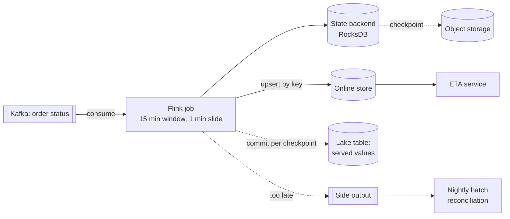

**Reading the diagram.** The job consumes the order-status topic and keeps per-restaurant window state in a local RocksDB backend, checkpointed asynchronously to object storage. Results go synchronously to the online store as upserts keyed by restaurant and window (idempotent, so replays after a restart overwrite rather than duplicate). The lake sink commits files transactionally once per checkpoint, which is what makes it exactly-once but also delays visibility. Events past allowed lateness go to a side output; the nightly batch job recomputes the authoritative history including them. Failure points: a stalled job (the ETA service must check feature age, §60.12.2), a watermark held back by one idle Kafka partition, and skewed keys (one huge restaurant chain, §29.6.3). Scaling: parallelism up to the topic's partition count.

#### Mathematical foundations

§60.7 gave the general freshness formula. For a windowed streaming feature, two terms deserve their own symbols: the watermark bound and the sink's commit interval.

::: formula
**Freshness of a windowed streaming feature**

$$F_{\max} \approx L + \delta + S + T_c$$

| Symbol | Meaning | Units |
|---|---|---|
| $L$ | Delay from event to processing (network, broker, consumer lag) | s |
| $\delta$ | Watermark out-of-orderness bound: how long the job waits for stragglers | s |
| $S$ | Window slide (how often a new result is emitted) | s |
| $T_c$ | Sink visibility delay: checkpoint or commit interval for transactional sinks, ≈ 0 for idempotent upserts | s |
| $F_{\max}$ | Worst-case age of the newest event reflected in the value a reader sees | s |
:::

::: example
**Worked example — Kitchen backlog in the online store and in the lake.** Measured $L = 5$ s at p99; 99.5% of status events arrive within 30 s of their event time, so $\delta = 30$ s; $S = 60$ s.

1. Online store, idempotent upsert: $T_c \approx 0.05$ s. $F_{\max} = 5 + 30 + 60 + 0.05 \approx 95$ s.
2. Lake table, transactional sink committing on 5-minute checkpoints: $T_c = 300$ s. $F_{\max} = 5 + 30 + 60 + 300 = 395$ s ≈ 6.6 min.
3. Halving $\delta$ to 15 s gains 15 s of freshness, but more events now arrive after their window is emitted; each becomes a late update or goes to the side output for batch reconciliation.

*Interpretation:* the online path meets QuickBite's 300 s requirement (§60.7) with margin; the lake path does not, and does not need to, because training tolerates minutes. *Engineering implication:* serve from idempotent upserts and train from transactional lake commits. Do not shorten checkpoints to 10 s to make the lake "real time": every checkpoint commits new small files (§61.9.3).
:::

### 61.6.2 Choosing an engine

Chapter 29 compares Spark and Flink as engines (§29.11). For ML feature pipelines the choice usually turns on four questions: the latency you need, whether batch and streaming logic must share code, your team's existing stack, and whether you want a managed service.

**Table 61.6 — Stream engines for ML features (as of 2026).**

| | Apache Flink | Spark Structured Streaming | Apache Beam |
|---|---|---|---|
| What it is | Native streaming engine | Streaming on Spark's SQL engine | Programming model plus SDKs |
| How it works | Record-at-a-time, checkpointed state | Micro-batches by default; continuous mode experimental | Pipelines run on a chosen runner (§61.10) |
| Advantages | Low latency, rich event-time and state | One engine and API for batch and stream | Portable; one model for batch and stream |
| Disadvantages | Separate stack if batch is on Spark | Latency floor of a micro-batch | Runner feature gaps; extra layer |
| Typical latency | Sub-second to seconds | Roughly 0.1–several seconds | That of the runner |
| Choose when | Freshness in seconds; large state | Team already on Spark; minute freshness | Google Cloud Dataflow, or portability |

::: mistake
**"Streaming replaces batch."** A streaming job sees each event once, at a moment when late data has not arrived and the logic is whatever was deployed that day. Training data needs reprocessing with new logic over years of history, which is batch work. Most ML platforms run both, ideally from one feature definition (Chapter 62), and treat the batch result as authoritative.
:::

## 61.7 ETL versus ELT

### 61.7.1 Where the transformation runs

::: definition
**Definition — ETL (extract, transform, load).** Data is transformed in a separate processing system before being loaded into the target store.

**Definition — ELT (extract, load, transform).** Raw data is loaded into the target store first and transformed there, usually with SQL, as a sequence of derived tables.
:::

#### First-principles explanation

ETL is a caterer delivering finished plates; ELT is moving the groceries into your kitchen and cooking there, so tomorrow's new recipe can still use the raw ingredients.

#### Why does this exist?

ETL dates from when warehouse storage and compute were expensive and inflexible: you loaded only cleaned, aggregated data. Cloud warehouses and lakehouses with elastic compute and cheap storage (§49.5.2) inverted the economics, so loading raw data and transforming it in place became the default for analytics [Reis and Housley 2022]. For ML, ELT has a decisive advantage: the raw history is in the store, so a new feature can be backfilled from it (§61.5.3).

**Figure 61.6 — ETL and ELT side by side.**

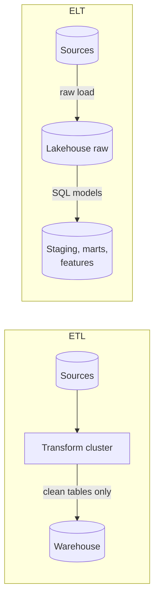

**Reading the diagram.** In ETL, the transformation runs outside the target, and only its output crosses the storage boundary; raw data is not retained in the warehouse. In ELT, raw data lands first, and transformations are SQL models inside the same store, materialized as staging tables, marts and feature tables. Failure points: in ETL a transformation bug loses information permanently; in ELT a bug is fixed by rerunning the models over retained raw data, but raw personal data now lives in the warehouse and must be governed (§61.14). Scaling: ELT scales with the warehouse's compute.

### 61.7.2 dbt-style transformation in the warehouse

Tools such as dbt express each derived table as a SQL `SELECT` (a **model**) in version control, infer the dependency graph from references between models, run them in order, and attach tests (`not_null`, `unique`, accepted values, relationships) that run after each build [dbt Docs]. Incremental models process only new partitions; snapshots record row versions (the type-2 history of §61.4.2). For ML this brings software practice to feature SQL: code review, tests, documentation and lineage from the same files. Its limits: SQL is awkward for sequence features, embeddings and per-row Python, which usually run in Spark or a feature platform (Chapter 62).

::: recommendation
**Recommendation — Use ELT, but keep ETL at the edges.** Load raw data and transform it in the lakehouse, except where something must be removed *before* storage: secrets, payment card numbers, or fields you have no lawful basis to keep (§50.9). That filtering belongs in the collector or the CDC connector.
:::

## 61.8 Data lakes, warehouses and lakehouses

### 61.8.1 Three ways to store analytical data

::: definition
**Definition — Data lake.** Files in open formats (Parquet, ORC, Avro, JSON) on object storage or a distributed file system, read directly by many engines, with no transactional layer of its own.

**Definition — Data warehouse.** A managed analytical database (BigQuery, Snowflake, Redshift and others; §49.6) that owns its storage format, metadata and query engine, and provides transactions, access control and fast SQL.

**Definition — Lakehouse.** A data lake whose files are managed by an open **table format** that adds a transactional metadata layer, giving warehouse features (ACID commits, schema enforcement, time travel, data skipping) on open files that any compatible engine can read [Armbrust et al. 2021].
:::

#### First-principles explanation

A lake is a storeroom with open shelves and no inventory: anyone can walk in, and nobody is sure which boxes are current. A warehouse (the database kind) has a strict front desk: orderly, but every request goes through it. A lakehouse keeps the open shelves and adds an inventory ledger: each change is one atomic entry, so anyone with the ledger knows exactly which boxes made up the table at any moment.

#### Why does this exist?

Hive-style lakes defined a table as "all files under this directory." That definition breaks in four ways that hurt ML: a reader listing the directory mid-write sees half a job's output; there is no atomic way to replace a partition; listing millions of objects is slow (§29.7); and there is no record of what the table contained yesterday. Warehouses solve all four but historically required copying data in, and ML training frameworks read files, not SQL results. Armbrust et al. argued that a metadata layer over open files can provide warehouse guarantees while keeping direct file access for ML and other engines [Armbrust et al. 2021]; Delta Lake [Armbrust et al. 2020], Apache Iceberg [Apache Iceberg Spec] and Apache Hudi [Apache Hudi Docs] are the three widely adopted implementations.

**Figure 61.7 — Lake, warehouse and lakehouse.**

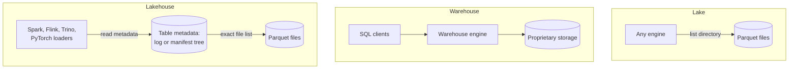

**Reading the diagram.** In the lake, engines discover a table by listing a directory, so they see whatever files exist at that instant, including partial writes. In the warehouse, every access goes through one engine that owns the storage. In the lakehouse, every engine first reads the table's metadata (a transaction log or a manifest tree), which names the exact set of files in the current snapshot, then reads those files directly from object storage. Storage boundary: object storage for files and metadata alike; only the pointer to the current metadata needs an atomic operation. Failure points: two writers racing (resolved by optimistic concurrency, §61.8.2) and metadata growing without maintenance. Scaling: data reads scale with object storage; commit rate per table is limited by the atomic pointer swap.

### 61.8.2 How table formats work

All three formats share one idea: **a table is a list of immutable data files, and the list is versioned.** A commit writes new data files, then atomically publishes a new version of the list. Readers pick a version and read exactly its files, which gives **snapshot isolation**: a reader never sees a half-finished commit, and a long training job reading version 412 is unaffected by commits 413 and 414. **Time travel** is reading an older version.

They differ in how the list is stored:

- **Delta Lake** keeps a `_delta_log` directory of numbered JSON files. Each file is one commit, containing actions such as `add` (a data file, with its partition values and column statistics), `remove`, `metaData` (schema) and `commitInfo`. Every 10 commits by default, a Parquet **checkpoint** summarizes the log so readers need not replay it from the start. A commit succeeds by creating the next numbered file atomically; on stores without put-if-absent, a coordination service supplies that guarantee [Armbrust et al. 2020].
- **Apache Iceberg** uses a tree. A **catalog** holds a pointer to the current table metadata file; that file lists schemas, partition specs and snapshots; each snapshot points to a **manifest list**, which points to **manifests**, which list data files with per-column lower and upper bounds and null counts. A commit writes new manifests and a new metadata file, then swaps the catalog pointer with compare-and-swap [Apache Iceberg Spec].
- **Apache Hudi** keeps a **timeline** of actions (commits, delta commits, compactions, cleans) in a `.hoodie` directory, and organizes data by **record key** into file groups, with an index from key to file group so that upserts find their target files quickly [Apache Hudi Docs].

**Figure 61.8 — The Apache Iceberg metadata tree.**

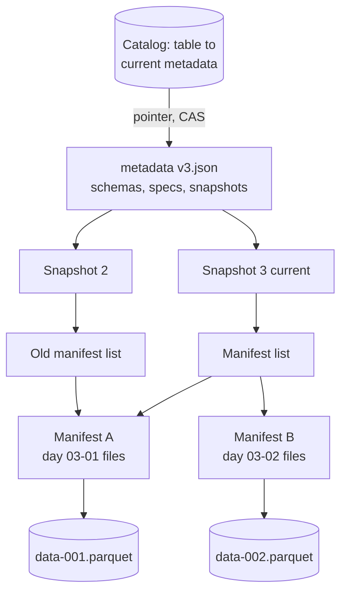

**Reading the diagram.** A reader asks the catalog for the table's current metadata file, picks a snapshot (the current one, or an older one for time travel), reads its manifest list, uses each manifest's partition summaries to skip manifests that cannot match the query, then uses per-file column bounds in the surviving manifests to skip data files, and finally reads the remaining Parquet files. Snapshots share unchanged manifests (Manifest A is referenced by both), so a commit that touches one day rewrites only one manifest. The only mutable object is the catalog pointer; everything else is written once. Failure points: a catalog unavailable for commits, and metadata bloat from thousands of tiny commits. Scaling: query planning reads kilobytes of metadata instead of listing millions of objects.

#### Optimistic concurrency

Writers do not lock. Each reads the current version, writes its files, and attempts to commit version $n+1$. If someone else committed first, the writer checks whether the other commit touched the same files or partitions; if not, it rebases and retries; if so, it fails with a conflict. This suits ML pipelines, where most commits are appends to different partitions, and hurts when many writers update the same rows.

#### Code example: a toy transaction log

```python
"""A toy table-format transaction log: atomic commits, conflicts, time travel."""


class ConflictError(Exception):
    pass


class Table:
    def __init__(self):
        self.log = []                   # log[v] = list of actions committed as version v

    def snapshot(self, version=None):
        """Replay add/remove actions up to a version: the set of live data files."""
        version = len(self.log) - 1 if version is None else version
        files = set()
        for actions in self.log[:version + 1]:
            for op, path in actions:
                files.add(path) if op == "add" else files.discard(path)
        return files

    def commit(self, read_version, actions):
        """Optimistic concurrency: succeed only if no newer commit touched our files.
        A real format writes log entry N+1 with put-if-absent (or a catalog swap)."""
        removed_by_us = {p for op, p in actions if op == "remove"}
        for v in range(read_version + 1, len(self.log)):
            touched = {p for _, p in self.log[v]}
            if removed_by_us & touched:
                raise ConflictError(f"conflict with version {v}")
        self.log.append(actions)
        return len(self.log) - 1


if __name__ == "__main__":
    t = Table()
    v0 = t.commit(-1, [("add", "d=03-01/a.parquet"), ("add", "d=03-01/b.parquet")])
    v1 = t.commit(v0, [("add", "d=03-02/c.parquet")])
    # Two writers both read version 1.
    compaction = [("remove", "d=03-01/a.parquet"), ("remove", "d=03-01/b.parquet"),
                  ("add", "d=03-01/ab.parquet")]
    gdpr_delete = [("remove", "d=03-01/b.parquet"), ("add", "d=03-01/b2.parquet")]
    v2 = t.commit(v1, gdpr_delete)
    try:
        t.commit(v1, compaction)
    except ConflictError as e:
        print("compaction:", e, "-> re-read snapshot and retry")
        t.commit(v2, [("remove", "d=03-01/a.parquet"), ("remove", "d=03-01/b2.parquet"),
                      ("add", "d=03-01/ab2.parquet")])
    for v in range(len(t.log)):
        print(f"version {v}: {sorted(t.snapshot(v))}")
    print("training set pinned to version 1 still reads:", sorted(t.snapshot(v1)))
```

Output:

```text
compaction: conflict with version 2 -> re-read snapshot and retry
version 0: ['d=03-01/a.parquet', 'd=03-01/b.parquet']
version 1: ['d=03-01/a.parquet', 'd=03-01/b.parquet', 'd=03-02/c.parquet']
version 2: ['d=03-01/a.parquet', 'd=03-01/b2.parquet', 'd=03-02/c.parquet']
version 3: ['d=03-01/ab2.parquet', 'd=03-02/c.parquet']
training set pinned to version 1 still reads: ['d=03-01/a.parquet', 'd=03-01/b.parquet', 'd=03-02/c.parquet']
```

What to notice:

- A deletion (rewriting `b` without one user's rows) and a compaction both read version 1. The deletion commits first; the compaction's attempt to remove `b` conflicts, so it re-reads version 2 and compacts `b2` instead. Had it blindly committed, the deleted user's rows would have reappeared in `ab`.
- Data files are never modified, only added and removed from the list, so every old version remains readable.
- The last line is the governance catch: a training set pinned to version 1 still contains the deleted user's rows until old snapshots expire and their files are physically removed (§61.14).

### 61.8.3 Schema evolution and partition evolution

**Schema evolution** adds, drops, renames or widens columns without rewriting data. Iceberg tracks columns by permanent numeric IDs rather than names, so a rename is a metadata change and a dropped-then-re-added name never resurrects old data [Apache Iceberg Spec]; Delta's column mapping mode provides similar behavior. Without ID-based mapping, renaming a column in a Parquet-based table makes old files appear to have a null column.

**Partition evolution** changes how new data is partitioned without rewriting old data. Iceberg's **hidden partitioning** defines partitions as transforms of columns (`day(event_time)`, `bucket(16, restaurant_id)`); queries filter on `event_time`, and the engine maps the filter to partitions. When QuickBite's GPS table outgrows daily partitions, it can switch to hourly from a given date: old files keep the daily spec, new files use the hourly spec, and queries span both. Delta's newer **liquid clustering** takes a different route, replacing fixed partitions with incrementally maintained clustering on chosen columns (as of 2026; check engine support).

### 61.8.4 Copy-on-write, merge-on-read and compaction

Files are immutable, so updating one row means writing something new. There are two strategies:

- **Copy-on-write (CoW).** Rewrite every file that contains an updated or deleted row. Reads stay simple and fast; writes are amplified.
- **Merge-on-read (MoR).** Write only the changes (Hudi log files, Iceberg delete files, Delta deletion vectors) and merge them with base files when reading; a periodic **compaction** rewrites base files with the changes applied.

**Figure 61.9 — Copy-on-write versus merge-on-read for one update batch.**

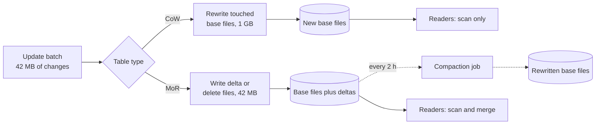

**Reading the diagram.** An upsert batch arrives (from CDC, every 15 minutes). In copy-on-write, the writer synchronously rewrites every base file containing a changed key and commits the new files; readers simply scan. In merge-on-read, the writer appends small delta files and commits quickly; readers must merge base files with any outstanding deltas; an asynchronous compaction job (dotted) periodically folds deltas into new base files. Storage boundary: everything lives in the table's object-storage location. Failure points: in CoW, slow commits that fall behind the CDC stream; in MoR, a stalled compaction that leaves readers merging hundreds of deltas. Scaling: CoW scales write cost with file size; MoR shifts cost to reads and to the compaction schedule.

::: formula
**Write amplification of upserts**

$$WA_{\text{CoW}} \approx \frac{F_{\text{touched}}}{u} \qquad WA_{\text{MoR}} \approx 1 + \frac{F_{\text{compact}}}{m \times u}$$

| Symbol | Meaning | Units |
|---|---|---|
| $u$ | Bytes of changed rows per update batch | MB |
| $F_{\text{touched}}$ | Bytes of base files containing at least one changed row | MB |
| $F_{\text{compact}}$ | Bytes rewritten by one compaction | MB |
| $m$ | Update batches between compactions | batches |
| $WA$ | Bytes written to storage per byte of changed data | dimensionless |
:::

::: example
**Worked example — Upserting QuickBite's orders table.** CDC produces 4 million status changes per day (Table 61.1) at about 1 KB each, merged into the silver orders table every 15 minutes: 96 batches, $u = 4{,}000/96 \approx 41.7$ MB each. Updates hit the open orders of the last day, which live in about 1 GB of base files (8 files of 128 MB). Order IDs are spread across all 8 files, so every batch touches every file.

1. CoW: $F_{\text{touched}} = 1{,}000$ MB. $WA = 1{,}000/41.7 \approx 24$. Daily writes: $96 \times 1$ GB = 96 GB to absorb 4 GB of change.
2. MoR, compacting every 2 hours ($m = 8$): $WA = 1 + 1{,}000/(8 \times 41.7) = 1 + 3.0 = 4.0$. Daily writes: 4 GB of deltas plus 12 compactions × 1 GB = 16 GB.
3. The price of MoR: a reader just before compaction merges 1 GB of base files with up to 8 delta files of 42 MB, about 33% more bytes plus merge CPU.

*Interpretation:* CoW writes 6× more than MoR here because each tiny batch rewrites the whole hot partition. *Engineering implication:* for high-frequency upserts (CDC tables, streaming features), use MoR with compaction sized so readers never merge more than a handful of deltas; for append-mostly tables read by many training jobs, CoW is simpler and reads fastest. Clustering files by order date and ID range so each batch touches fewer files reduces $F_{\text{touched}}$ under either strategy. The same read-versus-write amplification trade-off appears in LSM trees (§13.11).
:::

### 61.8.5 Comparing Delta Lake, Iceberg and Hudi

**Table 61.7 — Open table formats compared (as of 2026; features change quickly, so check current releases).**

| | Delta Lake | Apache Iceberg | Apache Hudi |
|---|---|---|---|
| What it is | Transaction log over Parquet; Linux Foundation project from Databricks | Open table spec with metadata tree; Apache project from Netflix | Table format and platform for upserts and incremental pulls; Apache project from Uber |
| How it works | Numbered JSON commits plus Parquet checkpoints | Catalog pointer → metadata → manifest list → manifests | Timeline of instants; record keys indexed to file groups |
| Advantages | Simple log; deep Spark integration; deletion vectors, liquid clustering | Engine-neutral spec; hidden partitioning; partition evolution; broad engine and warehouse support | Fast keyed upserts; MoR native; incremental queries; built-in table services |
| Disadvantages | Some features tied to newer protocol versions and Databricks first | Needs a catalog service; many tuning knobs | Most knobs and table services to operate |
| Performance | Excellent scans; MERGE costs depend on CoW vs deletion vectors | Excellent planning on huge tables via manifest pruning | Best for frequent upserts; reads depend on compaction |
| Operational complexity | Low to medium (OPTIMIZE, VACUUM) | Medium (expire snapshots, rewrite manifests and files) | Medium to high (compaction, clustering, cleaning, indexes) |
| Cost | Storage of retained versions until VACUUM | Same, until snapshot expiry | Same, plus index and log maintenance |
| Use cases | Spark-centric lakehouses, ML on Databricks | Multi-engine platforms; very large tables | CDC mirrors, streaming upserts, incremental ETL |
| Choose when | Your stack is Spark or Databricks | Many engines must share tables | Record-level upserts dominate |

All three now offer time travel, schema evolution, MoR-style deletes and interoperability layers (for example Delta UniForm writing Iceberg-compatible metadata, and Apache XTable translating between formats), so the choice matters less than it did in 2021. Choose on engine and catalog support in your stack.

::: industry
**Uber — Hudi for incremental processing.** Uber's Hadoop platform had to reflect upserts from operational databases and late-arriving trip updates without rewriting whole partitions every few hours. Uber built Hudi to support record-level upserts on HDFS and incremental pulls ("give me all records changed since commit $t$"), so downstream jobs process only changes. Trade-off: indexes, logs and compaction add operational machinery.
*Evidence: Primary* — [Rajaperumal and Chandar 2017]
:::

::: industry
**Databricks — Delta Lake on cloud object stores.** Armbrust et al. describe Delta Lake as motivated by the lack of atomic multi-object updates and consistent listing on object stores; the paper reports use by thousands of Databricks customers at exabyte scale, with the transaction log enabling time travel, upserts and faster metadata operations than listing.
*Evidence: Primary* — [Armbrust et al. 2020]
:::

::: industry
**Netflix — the origin of Iceberg.** Iceberg began at Netflix to fix Hive table problems at scale (slow directory listing, no atomic commits, unsafe concurrent writes) and was donated to the Apache Software Foundation, where it became a top-level project. Its spec is deliberately engine-neutral, which is why many warehouses now read and write Iceberg tables.
*Evidence: Secondary* — [Apache Iceberg Spec]
:::

## 61.9 File formats

### 61.9.1 Parquet, ORC and Avro

§13.13 explained why columnar layouts compress and scan well. Three open formats dominate ML data platforms. **Apache Parquet** is columnar and the default for lakehouse tables; its nested-data encoding (repetition and definition levels) comes from Google's Dremel [Melnik et al. 2010; Apache Parquet Docs]. **Apache ORC** is columnar, from the Hive ecosystem, organized in stripes with lightweight indexes [Apache ORC Docs]. **Apache Avro** is row-oriented with the schema in the file header, suited to writing one record at a time [Apache Avro Spec].

**Table 61.8 — File formats for ML data (as of 2026).**

| | Parquet | ORC | Avro |
|---|---|---|---|
| What it is | Columnar files | Columnar files | Row-oriented files and messages |
| How it works | Row groups → column chunks → pages; footer with stats | Stripes → column streams; row indexes every 10,000 rows | Header schema; blocks of rows with sync markers |
| Advantages | Universal engine support; nested data | Strong indexes; ACID in Hive | Cheap appends; robust schema evolution |
| Disadvantages | Slow single-row writes | Narrower support outside Hive and Trino | Scans read every column |
| Choose when | Silver, gold and training tables | Existing Hive or ORC estates | Kafka payloads, bronze landing |

### 61.9.2 Inside a Parquet file

**Figure 61.10 — Layout of a Parquet file.**

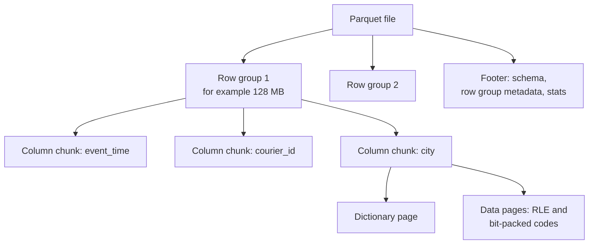

**Reading the diagram.** A file is a sequence of **row groups** (horizontal slices of rows), followed by a **footer**. Within a row group, each column is stored contiguously as a **column chunk**, divided into **pages**, the unit of encoding and compression. A low-cardinality column such as `city` has a **dictionary page** listing distinct values, and data pages store small integer codes run-length encoded and bit-packed (§13.13.2). The footer holds the schema and, per column chunk, the byte offsets and statistics (minimum, maximum, null count). A reader fetches the footer first, then only the chunks it needs. Failure points: a writer that crashes before writing the footer leaves an unreadable file, which is why table formats only register complete files. Scaling: row groups are the unit of parallel reading.

**Predicate pushdown** is the reader's use of those statistics: for `WHERE event_time BETWEEN 18:00 AND 19:00`, any row group whose `event_time` maximum is below 18:00 or minimum above 19:00 is skipped without reading its data. **Projection pushdown** reads only the referenced columns. Both depend on layout: statistics only help if the data is clustered on the filtered column. Table formats lift the same statistics into manifests or the log so whole files are skipped during planning (§61.8.2).

#### Code example: row-group statistics and pushdown

`pyarrow` is not installed in this book's environment (checked with `python3 -c "import pyarrow"`), so this is a pure-Python illustration of the mechanism rather than real Parquet I/O. It writes one day of 240,000 simulated GPS pings in 12 row groups, keeps per-column min/max as a footer would, and counts row groups read for a dinner-hour query in one city under three layouts.

```python
"""Row groups, min/max statistics and predicate pushdown (pure Python, no pyarrow)."""
import random

ROWS, GROUP = 240_000, 20_000              # 12 row groups
CITIES = ["north", "south", "east", "west"]


def make_rows(seed=61):
    rng = random.Random(seed)
    # one day of GPS pings: (seconds since midnight, courier id, city)
    return [(rng.randrange(86_400), rng.randrange(6_000), rng.choice(CITIES))
            for _ in range(ROWS)]


def write_file(rows):
    """Split into row groups; keep per-column min/max like a Parquet footer."""
    groups = []
    for i in range(0, len(rows), GROUP):
        g = rows[i:i + GROUP]
        cols = list(zip(*g))
        stats = [(min(c), max(c)) for c in cols]
        groups.append({"cols": cols, "stats": stats})
    return groups


def scan(groups, t_lo, t_hi, city):
    """SELECT count(*) WHERE t BETWEEN t_lo AND t_hi AND city = :city."""
    read, hits = 0, 0
    for g in groups:
        (tmin, tmax), _, (cmin, cmax) = g["stats"]
        if tmax < t_lo or tmin > t_hi or not (cmin <= city <= cmax):
            continue                                  # skipped using the footer only
        read += 1
        t, _, c = g["cols"]                           # read just the 2 needed columns
        hits += sum(t_lo <= ti <= t_hi and ci == city for ti, ci in zip(t, c))
    return read, hits


if __name__ == "__main__":
    rows = make_rows()
    q = (18 * 3600, 19 * 3600, "south")              # dinner hour, one city
    for name, layout in [("arrival order", rows),
                         ("sorted by time", sorted(rows)),
                         ("sorted by city, time", sorted(rows, key=lambda r: (r[2], r[0])))]:
        groups = write_file(layout)
        read, hits = scan(groups, *q)
        print(f"{name:22s} row groups read {read:2d}/{len(groups)}  matches {hits}")
```

Output:

```text
arrival order          row groups read 12/12  matches 2495
sorted by time         row groups read  1/12  matches 2495
sorted by city, time   row groups read  3/12  matches 2495
```

What to notice:

- All three layouts return the same 2,495 rows; only the work differs. Random arrival order makes every row group's time range span the whole day, so nothing is skipped.
- Sorting by time lets the footer prune 11 of 12 row groups. Sorting by (city, time) reads 3: the row groups that straddle a city boundary have time ranges spanning the whole day. Multi-column clustering (Z-ordering, Hilbert curves, liquid clustering) trades between such filters.
- Real Parquet adds page-level indexes and optional Bloom filters for point lookups on high-cardinality columns such as `courier_id`, which min/max cannot prune.

### 61.9.3 The small-files problem

Every file costs a fixed overhead regardless of size: object-store requests to open it and read its footer, a metadata entry, and a task in the engine's scheduler. Streaming sinks and over-partitioned batch jobs produce thousands of tiny files, and the fixed costs swamp the data.

::: formula
**Scan time with per-file overhead**

$$T_{\text{scan}} \approx \frac{n \times t_f + S/B}{p}$$

| Symbol | Meaning | Units |
|---|---|---|
| $n$ | Number of files scanned | files |
| $t_f$ | Fixed cost per file (open, footer read, task scheduling) | s |
| $S$ | Bytes scanned | MB |
| $B$ | Read throughput per reader | MB/s |
| $p$ | Parallel readers (assumes at least $p$ files or row groups to split) | readers |
:::

::: example
**Worked example — One day of GPS pings.** Raw volume is 13 GB/day (Table 61.1); as Parquet at $c = 5$ it is $S = 2{,}600$ MB. A streaming sink with 32 writers commits every minute: $n = 32 \times 1{,}440 = 46{,}080$ files averaging 56 KB. Take $t_f = 30$ ms (two object-store requests), $B = 100$ MB/s and $p = 64$.

1. Before compaction: $(46{,}080 \times 0.03 + 2{,}600/100)/64 = (1{,}382 + 26)/64 = 22.0$ s. Fixed overhead is 98% of the work.
2. After compaction to 128 MB files: $n = \lceil 2{,}600/128 \rceil = 21$. $(21 \times 0.03 + 26)/64 = 0.42$ s if row groups split finely; with one row group per file only 21 readers are busy, so about $26/21 + 0.03 \approx 1.3$ s.
3. A training job reading 90 days repeats the uncompacted cost 90 times: about 33 minutes of wall-clock time on 64 readers, versus about 2 minutes compacted, and 4.1 million file entries in table metadata.

*Interpretation:* the data takes 26 reader-seconds to read; the files take 1,382. *Engineering implication:* size files at 128 MB–1 GB, compact streaming tables on a schedule (hourly for this table), and choose the sink's commit interval with both freshness (§61.6.1) and file count in mind. Compaction itself costs a rewrite of the data, the write amplification computed in §61.8.4.
:::

## 61.10 Apache Beam and the unified batch/stream model

::: definition
**Definition — Apache Beam.** An open-source programming model and set of SDKs (Java, Python, Go) for data pipelines in which batch is the special case of streaming over bounded input. A pipeline is written once and executed by a **runner**: Google Cloud Dataflow, Apache Flink, Apache Spark or a local direct runner [Apache Beam Docs].
:::

Beam implements the Dataflow Model of Akidau et al.: every pipeline answers *what* is computed, *where* in event time (windows), *when* in processing time (watermarks and triggers) and *how* refinements relate (accumulation) [Akidau et al. 2015; §29.8.3]. The ML attraction is the "one definition, two execution paths" ideal of §59.8.2: the same feature transform runs as a backfill over two years of bounded files and as a streaming job over Kafka, with identical windowing semantics. TensorFlow Transform and TFX use Beam for exactly this purpose: preprocessing that computes full-pass statistics (vocabularies, means) over training data in batch, then exports them for use at serving [Baylor et al. 2017].

**Figure 61.11 — One Beam pipeline, several runners.**

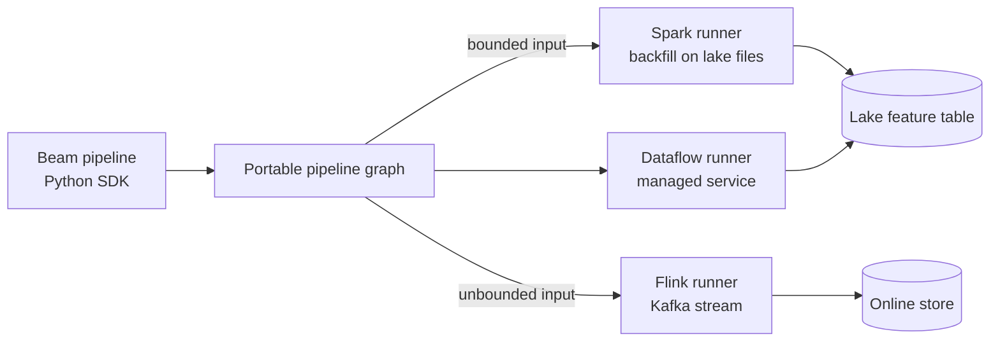

**Reading the diagram.** The pipeline is written once in an SDK and translated into a portable graph of transforms. Runners execute that graph on their engines: the same code reads bounded lake files for a backfill on Spark, or an unbounded Kafka topic on Flink, or runs on the managed Dataflow service. Outputs land in the lake feature table or the online store. Failure points: features supported by one runner and not another (check the runner capability matrix), and cross-language overhead when Python transforms run inside a Java engine. Scaling: delegated to each runner.

::: warning
**Warning — Portability is not free.** Beam adds a layer to debug, and tuning still happens in the runner. Spark teams often get most of the benefit by sharing code between Spark batch and Structured Streaming. Choose Beam for Dataflow or genuine engine portability.
:::

## 61.11 Data quality and validation at pipeline scale

### 61.11.1 Expectations, anomaly detection and quarantine

§59.7 introduced expectations, mean-shift z-scores and PSI on a single batch. At platform scale the same ideas become infrastructure:

1. **Declarative expectations per table,** versioned with the pipeline code: completeness, uniqueness, ranges, allowed values, referential integrity. Amazon's Deequ computes such constraints as aggregation queries on Spark, so checking a billion rows costs a few scans, and can suggest constraints by profiling data [Schelter et al. 2018]. Google's TFX data validation infers a schema from training data and checks every new span against it, including skew between training and serving data [Breck et al. 2019].
2. **Anomaly detection on data metrics.** Each run records metrics (row count, null rates, means, distinct counts); a check compares today's metric with its history (a trailing median with a tolerance, or a seasonal forecast), which catches "only 60% of the usual Saturday volume" without a hand-set threshold.
3. **Severity levels.** *Blocking* checks quarantine the partition (§61.5.4); *warning* checks publish and alert. A check that blocks too often gets ignored or disabled, so start with few blocking checks on things that are definitely wrong (schema, keys, impossible values).
4. **Circuit breaking downstream.** When a partition is quarantined, dependent jobs must not run on the hole as if it were complete. The orchestrator treats "input partition published" as the precondition (§61.15), so the breaker opens automatically, and training waits or runs on the last complete window.

::: definition
**Definition — Data contract.** An agreement, enforced in code, between a data producer and its consumers that specifies a dataset's schema, semantics (units, meanings, allowed values), quality expectations, freshness SLA, ownership and the process for changing any of them.
:::

**Figure 61.12 — A data contract enforced at three points.**

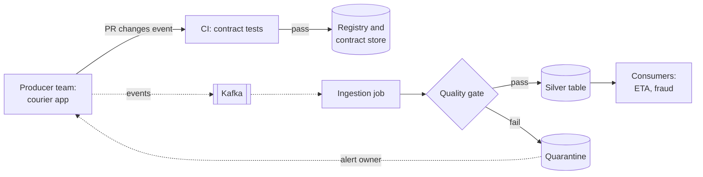

**Reading the diagram.** The contract is checked three times. First, in the producer's CI: a change to the event schema or semantics runs the contract's tests before merge, so breaking changes are caught by the team that can fix them. Second, at the registry, which enforces compatibility (§61.4.4). Third, at the ingestion quality gate, which checks the data itself and routes failures to quarantine with an alert to the *producer* team named in the contract. Consumers read only gated tables. Failure points: contracts without an owner, and semantic changes (units) that only the gate can catch. Scaling: contracts are per dataset, so the number of owners grows with the platform.

::: industry
**Amazon — Deequ.** Schelter et al. describe a library, used at Amazon, that expresses data-quality checks as declarative constraints compiled to Spark aggregations, supports incremental computation of metrics as data grows, and detects anomalies in metric time series.
*Evidence: Primary* — [Schelter et al. 2018]
:::

::: mistake
**"Validation means checking the schema."** Schema checks catch the cheap failures. The expensive ones (a unit change, a duplicated join, a filter that silently drops a city) produce well-typed data. Every important table needs at least one volume check, one distribution check and one semantic check.
:::

## 61.12 Data lineage

::: definition
**Definition — Data lineage.** A graph recording which jobs read which datasets to produce which other datasets, with versions and run times. **Column-level lineage** records which input columns each output column was derived from.
:::

When the ETA model's error jumps, the debugging question is "what changed upstream?" Lineage answers it: walk from the training set back through features to sources and list every job or schema that changed since the last good model. It also answers compliance questions ("which models were trained on data containing `phone_number`?") and impact analysis ("who breaks if I drop this column?").

**OpenLineage** is an open specification in which jobs emit run events (`START`, `COMPLETE`, `FAIL`) naming the job, the run and its input and output datasets, with extensible **facets** for schema, data-quality metrics and column-level lineage [OpenLineage Spec]. Integrations for Spark, Airflow, dbt and Flink emit events automatically to a compatible backend such as Marquez.

**Figure 61.13 — Lineage from a model back to its sources.**

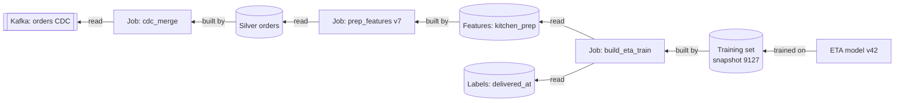

**Reading the diagram.** Arrows point from each artifact back to what produced it. Every job run emits an OpenLineage event listing its inputs and outputs with versions, and the backend stitches events into this graph. Starting at model v42, an engineer sees that it trained on snapshot 9127 of the training set, built from `kitchen_prep` features by job version 7, which read the silver orders table, produced by the CDC merge job. Failure points: jobs that do not emit events (hand-run notebooks) create gaps. Scaling: the graph grows by runs, so backends keep detailed run history for a limited period.

## 61.13 Data versioning

Data versioning gives datasets what Git gives code: immutable identifiers for states, and the ability to return to one. Three mechanisms are common:

- **Table-format time travel** (§61.8.2): every commit is a snapshot ID; read `VERSION AS OF` or `TIMESTAMP AS OF`. Cheap and automatic, but bounded by snapshot retention, typically days to weeks.
- **DVC** (Data Version Control) stores small pointer files containing content hashes in Git and the data itself in object storage, so a Git commit pins code and data together; it suits file-based datasets such as images or exported training sets [DVC Docs].
- **lakeFS** exposes Git-like branches, commits and merges over an entire object-storage bucket, so a pipeline can write to a branch, validate, then merge atomically into `main` [lakeFS Docs].

::: example
**Worked example — Reproducing the ETA model trained on 3 March.** In September, ETA error on long-distance orders rises. You need the exact training set of model v42.

1. The model registry entry for v42 records a **training manifest**: Git commit `a91f3c2` of the feature code, the training set table and its snapshot ID 9127, the query window (1 December–28 February), and the random seed (§59.14).
2. Time travel to snapshot 9127 works only if it has not expired. QuickBite's default snapshot retention is 7 days, so for September the snapshot is gone. The fix, made in advance: training sets are **materialized** as their own immutable tables and **tagged** (Iceberg tags and Delta's retention settings keep a named snapshot beyond normal expiry), with retention tied to the model's life.
3. Size check: 90 days × 500,000 orders × 60 features × 4 bytes ≈ 10.8 GB uncompressed per training set. Keeping one per production model version (say 26 a year) costs about 0.3 TB a year, about \$6 per month at \$20 per TB-month (§61.3.2). Reproducibility is cheap; recomputing from sources is not even possible once late data and corrections have changed them.
4. Rebuild check: load the tagged table, recompute the row count and a column checksum, and compare with the values stored in the manifest at training time.

*Interpretation:* "We can reconstruct it from the raw data" is false once raw data has been corrected, deleted or expired. *Engineering implication:* pin and retain the *materialized* training set, not just a query.
:::

## 61.14 Governance

Governance is the set of rules and mechanisms that decide who may use which data for what, for how long. Its core components on an ML platform:

1. **A catalog** (Unity Catalog, Apache Polaris, AWS Glue, Hive Metastore and others, as of 2026) lists every table with schema, owner, description, contract, lineage and tags, and is the commit authority for table formats (§61.8.2).
2. **Access control** at table, column and row level, granted to roles and to pipelines' service identities rather than to people ad hoc; column masking hides personal fields from most consumers.
3. **PII tagging.** Columns are tagged by class (identifier, contact, location, payment) at ingestion, often from the data contract, and tags propagate through column-level lineage so derived columns inherit them (§50.8.2).
4. **Retention.** Each table has a retention rule tied to its purpose: QuickBite keeps raw GPS for 90 days, then only aggregates by zone (§50.10).
5. **Deletion propagation.** An erasure request (§50.9.3) must reach the lakehouse: delete rows by user ID in every tagged table, then **expire old snapshots and vacuum** deleted files, because time travel otherwise keeps the data readable (§61.8.2, code output). Training sets materialized before the deletion still contain the user. Common policies are to rebuild retained training sets on a schedule (for example monthly) excluding deleted IDs, or to key personal fields with crypto-shredding so deleting the key makes old copies unreadable (§32.3.5). Whether a model trained on the data must also be retrained is a legal question to settle with counsel; record the decision in the catalog.

::: warning
**Warning — Time travel versus the right to erasure.** Long snapshot retention, tagged training sets and DVC caches all preserve deleted users' data. Make the retention of every versioned copy explicit, and include it in the deletion pipeline's completion time (§50.9.3).
:::

## 61.15 Orchestration

An **orchestrator** runs pipelines as dependency graphs on schedules or events, retries failures, enforces SLAs and records history. Three styles are common (as of 2026; Chapter 69 covers ML-specific orchestration):

- **Apache Airflow** defines **DAGs** of tasks in Python; a scheduler runs each task instance for a logical date, which maps naturally to daily partitions and backfills (`airflow dags backfill`) [Apache Airflow Docs].
- **Dagster** centers on **software-defined assets**: you declare the tables and models to exist and how each is computed from others; the orchestrator derives the graph, tracks each asset partition's materialization, and can rerun only stale partitions [Dagster Docs].
- **Prefect** orchestrates ordinary Python functions as flows and tasks with retries and caching, with less up-front structure [Prefect Docs].

**Figure 61.14 — Daily ML data assets with partition-level dependencies.**

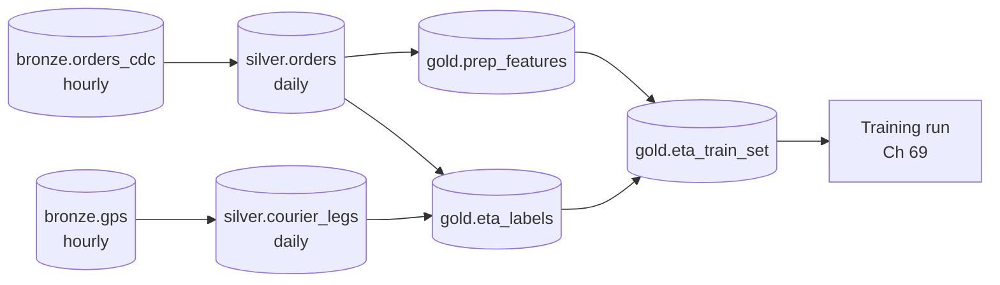

**Reading the diagram.** Each node is a partitioned table (an asset); each edge says that a partition of the target depends on specific partitions of its inputs (a daily silver partition needs 24 hourly bronze partitions). The orchestrator materializes a partition only when all of its input partitions are published, which is the circuit breaker of §61.11: a quarantined `silver.orders` day blocks its features, labels and the training set. Failure points: the scheduler itself (run it highly available) and tasks that are not idempotent, which make retries dangerous. Scaling: tasks run on separate compute (Kubernetes, Spark), not on the orchestrator.

Four rules make orchestration safe: every task is idempotent on its partition (§61.5.1); retries use exponential backoff with a cap (§22.12); every asset has a freshness **SLA** ("`gold.eta_train_set` for date $d$ published by 04:00 on $d+1$") with alerts on misses, not only on failures; and backfills run through the same DAG with lower priority (§61.5.3).

## 61.16 Reference architecture: QuickBite ML data platform

**Figure 61.15 — QuickBite ML data platform.**

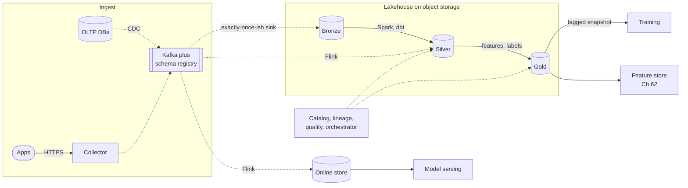

**Reading the diagram.** Apps send events through the collector; databases stream changes through CDC; both land in Kafka with registered schemas. A transactional sink writes bronze Iceberg tables hourly; Spark and dbt jobs produce gated silver and gold daily partitions; Flink computes streaming features into the online store and appends the served values to silver. Training reads tagged gold snapshots; the feature store (Chapter 62) unifies offline and online definitions. The control plane, a catalog, lineage backend, quality service and orchestrator, governs silver and gold. Failure points and responses: Kafka retention of 7 days covers sink outages; quarantine blocks bad days; the online store has a fallback (§60.12.2). Scaling: each engine scales independently on shared storage.

**Table 61.9 — Design decisions and their reasons.**

| Decision | Choice | Reason |
|---|---|---|
| Table format | Iceberg, MoR for CDC tables | Spark, Flink and Trino share tables; upserts every 15 min (§61.8.4) |
| Partitioning | `day(event_time)`, hourly in bronze | Backfills and late data by day; partition evolution if needed |
| File size | 128–512 MB, hourly compaction of streamed tables | Small-file overhead (§61.9.3) |
| Quality | Contracts plus blocking gates on silver | Unit and volume bugs stop at silver (§61.11) |
| Versioning | Tagged gold training sets per model | Reproduction after snapshot expiry (§61.13) |
| Storage | ≈ 17.5 TB/year, two-year retention for orders | Demand forecasting history (§61.3.2) |

::: industry
**QuickBite (illustrative).** This architecture is a teaching design assembled from the published systems cited in this chapter; it is not a description of any company's platform.
*Evidence: Illustrative*
:::

## 61.17 Summary and revision notes

::: summary
- ML needs history, freshness, point-in-time correctness, reproducibility and scale. Keep raw, append-only history; storage is cheap ($S_{\text{year}} = 365 V k/c$, ≈ 17.5 TB/year for QuickBite).
- Design events with an envelope (`event_id`, event and receive times, join keys) and typed, registered schemas. Registries catch syntax, not semantics.
- Ingestion is exactly-once-ish: source IDs, transactional sinks, bounded deduplication.
- Batch jobs are functions of (partition, code version, input snapshot) that overwrite partitions atomically. Backfill cost is $D \cdot E \cdot T_{\text{part}}$; mergeable daily aggregates beat overlapping windows.
- Streaming freshness is $L + \delta + S + T_c$; serve from idempotent upserts, train from transactional lake commits.
- ELT keeps raw data for backfills; filter secrets at the edge.
- Table formats version a list of immutable files: snapshot isolation, time travel, schema and partition evolution. CoW amplifies writes; MoR amplifies reads; compaction balances them.
- Parquet's row groups, column chunks and footer statistics enable pushdown, if data is clustered. Small files cost $n t_f$; compact to 128 MB–1 GB.
- Gate partitions on expectations, quarantine failures, enforce contracts, record lineage, materialize and tag training sets, and propagate deletions through snapshots.
- Orchestrate idempotent tasks with partition-level dependencies, retries and freshness SLAs.
:::

## 61.18 Knowledge checkpoint

1. Why does an ML platform keep every status change of an order rather than the current row?
2. Give two fields of an event envelope and the failure each prevents.
3. Why is a change from minutes to seconds not caught by a schema registry?
4. What three layers make ingestion exactly-once-ish?
5. A job appends its output and is retried twice. What happens, and what is the fix?
6. Backfill: $D = 100$, $P = 10$, $T_{\text{part}} = 300$ s. How long does it take?
7. A streaming feature has $L = 3$ s, $\delta = 20$ s, $S = 30$ s, and a lake sink with 120 s checkpoints. What is $F_{\max}$ in the lake?
8. What makes a lakehouse different from a lake?
9. CoW: 2 GB of touched files for 50 MB of changes. What is $WA$?
10. Why can sorting by time make a query skip 11 of 12 row groups?
11. 10,000 files at 20 ms each plus 1,000 MB at 100 MB/s, on 50 readers. Estimate $T_{\text{scan}}$.
12. Why must training sets be tagged or materialized rather than relying on time travel?
13. Name two ways deleted users' data survives a row deletion in a lakehouse.

<details><summary>Answers</summary>

1. Training needs the state known at each prediction time and labels from transitions; overwritten state is unrecoverable.
2. `event_id` prevents duplicate counting; `received_time` alongside `event_time` reveals lateness and device clock skew.
3. Registries check types and compatibility, not units or meaning.
4. IDs generated at the source; idempotent or transactional hops; bounded deduplication on `event_id`.
5. The partition holds three copies of the rows. Overwrite the partition atomically.
6. $\lceil 100/10 \rceil \times 300 = 3{,}000$ s = 50 min.
7. $3 + 20 + 30 + 120 = 173$ s.
8. A transactional metadata layer (table format) that defines exactly which files form each snapshot.
9. $2{,}000/50 = 40$.
10. Footer min/max statistics show that 11 groups' time ranges exclude the predicate.
11. $(10{,}000 \times 0.02 + 10)/50 = 210/50 = 4.2$ s.
12. Snapshots expire after days; old data is corrected or deleted, so a later rebuild differs.
13. Old snapshots still reference the files until expiry and vacuum; previously materialized training sets and caches still contain the rows.

</details>

## 61.19 Interview questions

### Basic

**Q1. What is the difference between a data lake and a lakehouse?**
**Answer.** A lake is open files on object storage defined by directory listings, with no transactions. A lakehouse adds a table format (Delta, Iceberg, Hudi) whose versioned metadata gives atomic commits, snapshot isolation, time travel, schema evolution and file-level statistics, while engines still read open Parquet files directly.

**Q2. Why partition by event date?**
**Answer.** So each fact lands on the day it happened: point-in-time training windows are exact, late data reprocesses only the affected days, and jobs can overwrite one day idempotently.

### Intermediate

**Q3. Design ingestion for app clickstream used by recommendations.**
**Answer.** A typed envelope with client-generated `event_id`, event and receive times and join keys; a collector that validates against a registry with full transitive compatibility and dead-letters bad events; Kafka keyed by user; a transactional sink to hourly bronze; dedup and impression-level silver tables; volume and null-rate gates; PII tags.

**Q4. A new feature needs two years of history. How do you backfill it?**
**Answer.** Express it as mergeable daily aggregates; measure $\theta$ on a week; size $E$ and $P$ from the formula; run in a low-priority queue through the orchestrator with partition overwrite; validate against a second run or overlapping production days; then switch training to the new column.

### Advanced

**Q5. CDC upserts every 15 minutes are making the silver orders table slow and expensive. What do you change?**
**Answer.** Compute write amplification: CoW rewrites the hot files each batch. Switch to merge-on-read (delete files or deletion vectors), schedule compaction so readers merge few deltas, cluster by date and key to touch fewer files, and consider fewer, larger batches if freshness allows.

**Q6. A regulator asks which models used a deleted customer's data, and to prove deletion. How does your platform answer?**
**Answer.** Column-level lineage from PII-tagged sources to training sets and model versions; the deletion pipeline's ledger showing row deletes, snapshot expiry and vacuum per table; retention records for tagged training sets and their rebuild dates; and the documented policy on retraining.

## 61.20 Practical exercises

1. Extend the §61.5.4 program with a late-arriving-data rerun of the last 3 days and show the checksums change only for affected days.
2. Add a page-level index to the pushdown program and measure the rows read for a single-courier lookup.
3. Write a toy merge-on-read table: base dictionaries plus delta lists, a reader that merges, and a compactor; measure bytes written for $m = 1, 4, 16$.
4. Draw the OpenLineage events (inputs, outputs, facets) for one run of `build_eta_train`.

## 61.21 Design challenges

1. **Fraud features in seconds.** Design ingestion and streaming for card-velocity features at 60 orders/s peak with labels arriving after 60 days; compute $F_{\max}$ and the lake's small-file count per day.
2. **Two-year demand forecasting history.** Plan storage, partitioning, compaction and retention, including what happens to GPS data after 90 days.
3. **Erasure at scale.** Design deletion propagation for 1,000 requests per day across bronze, silver, gold and tagged training sets, with a 30-day completion SLA.

## 61.22 References

1. Armbrust, M., Ghodsi, A., Xin, R., Zaharia, M. *Lakehouse: A New Generation of Open Platforms that Unify Data Warehousing and Advanced Analytics*. CIDR, 2021.
2. Armbrust, M., Das, T., et al. *Delta Lake: High-Performance ACID Table Storage over Cloud Object Stores*. PVLDB 13(12), 2020.
3. Apache Software Foundation. *Apache Iceberg Table Spec*. https://iceberg.apache.org/spec/
4. Apache Software Foundation. *Apache Hudi Documentation*. https://hudi.apache.org/docs/
5. Apache Software Foundation. *Apache Parquet Documentation*. https://parquet.apache.org/docs/
6. Apache Software Foundation. *Apache ORC Documentation*. https://orc.apache.org/docs/
7. Apache Software Foundation. *Apache Avro Specification*. https://avro.apache.org/docs/
8. Melnik, S., Gubarev, A., Long, J. J., Romer, G., Shivakumar, S., Tolton, M., Vassilakis, T. *Dremel: Interactive Analysis of Web-Scale Datasets*. PVLDB 3(1), 2010.
9. Akidau, T., Bradshaw, R., Chambers, C., Chernyak, S., Fernández-Moctezuma, R. J., Lax, R., McVeety, S., Mills, D., Perry, F., Schmidt, E., Whittle, S. *The Dataflow Model*. PVLDB 8(12), 2015.
10. Apache Software Foundation. *Apache Beam Documentation*. https://beam.apache.org/documentation/
11. Schelter, S., Lange, D., Schmidt, P., Celikel, M., Biessmann, F., Grafberger, A. *Automating Large-Scale Data Quality Verification*. PVLDB 11(12), 2018.
12. Breck, E., Polyzotis, N., Roy, S., Whang, S. E., Zinkevich, M. *Data Validation for Machine Learning*. SysML, 2019.
13. Polyzotis, N., Roy, S., Whang, S. E., Zinkevich, M. *Data Lifecycle Challenges in Production Machine Learning: A Survey*. SIGMOD Record 47(2), 2018.
14. Baylor, D., et al. *TFX: A TensorFlow-Based Production-Scale Machine Learning Platform*. KDD, 2017.
15. OpenLineage. *OpenLineage Specification*. https://openlineage.io/
16. Iterative. *DVC Documentation*. https://dvc.org/doc
17. Treeverse. *lakeFS Documentation*. https://docs.lakefs.io/
18. dbt Labs. *dbt Documentation*. https://docs.getdbt.com/
19. Apache Software Foundation. *Apache Airflow Documentation*. https://airflow.apache.org/docs/
20. Dagster Labs. *Dagster Documentation*. https://docs.dagster.io/
21. Prefect. *Prefect Documentation*. https://docs.prefect.io/
22. Rajaperumal, P., Chandar, V. *Hudi: Uber Engineering's Incremental Processing Framework on Apache Hadoop*. Uber Engineering Blog, 2017.
23. Beauchemin, M. *Functional Data Engineering: A Modern Paradigm for Batch Data Processing*. Medium, 2018.
24. Kleppmann, M. *Designing Data-Intensive Applications*, chapters 10–11. O'Reilly, 2017.
25. Reis, J., Housley, M. *Fundamentals of Data Engineering*. O'Reilly, 2022.

## 61.23 Open verification items

- Delta Lake paper: full author list, and the "thousands of customers, exabyte scale" wording.
- Uber Hudi blog post: exact title, authors and year.
- Beauchemin's "Functional Data Engineering" post: exact title and year.
- Iceberg format v3 (deletion vectors, row lineage) and Delta liquid clustering and UniForm status, as of 2026.
- Delta's default checkpoint interval (10 commits) and default VACUUM retention (7 days) in current releases.
- Engine latency ranges in Table 61.6 and file-size defaults (128 MB row groups) are typical values, not benchmarks.
- No URLs were fetched to verify; documentation URLs are the projects' canonical sites.
