# Chapter 62 — Feature Engineering and Feature Stores

> **Level:** 3 · **Track:** B (ML/AI) · **Estimated reading time:** 5 h

QuickBite's delivery-time (ETA) model scored beautifully in its offline evaluation: a mean absolute error (MAE) of 3.2 minutes on held-out orders. In production the same model missed by 4.4 minutes, and nothing crashed. Retrained on correctly joined data, it scored 4.3 minutes both offline and online: slightly better in production, and, more importantly, honest. The cause was one line of SQL in the training pipeline: a feature called "restaurant's average delivery time yesterday" had been joined to each order by calendar date, so every training order could see a summary of a day that included its own outcome. The production service, of course, never sees tomorrow's summary of today. The model had learned to trust a feature that, at serving time, was less informative than it had been in training.

This chapter is about the data a model eats and the infrastructure that prepares it. You will first learn the craft of **feature engineering**: turning raw facts into numbers a model can learn from, and the traps hidden in encodings, windows and crosses. Then you will learn where each transformation should run (inside the model, in a batch job, in a stream processor or at request time) and how to build the three kinds of feature pipeline. The second half covers **feature stores**: the systems that keep one definition of a feature, compute it for both training and serving, produce leak-free training data with **point-in-time joins**, serve it in milliseconds, and detect **training–serving skew**. You will size an online store for QuickBite, measure freshness against cost, and finish with published architectures from Uber, Airbnb and the Feast open-source project, plus the governance that keeps thousands of features from becoming a liability.

Chapter 59 (§59.8) previewed feature engineering and skew, and Chapter 60 placed the feature store in the inference path; this chapter owns the deep treatment. Chapter 85 (§85.4) designs a feature store end to end as a case study, so here the emphasis is on concepts, mechanisms and architecture.

::: note
**QuickBite assumptions used in this chapter.** These reuse the Book II design point and are teaching assumptions, not measurements of a real company. 500,000 orders a day; about 60 orders/s at peak; search peaks at 2,000 requests per second (RPS), each showing 20 restaurants, so up to 40,000 ETA predictions per second (§60.6); peak-to-average ratio 9.6 (§18.11); 10 million registered customers (Ch 58); about 50,000 restaurants with about 100 dishes each (§2.11, Ch 58); 20,000 couriers active at peak (§2.11). New in this chapter: 50,000 registered couriers and 4,000 delivery zones (20 cities × 200 zones). CPU capacity costs \$0.048 per vCPU-hour (§60.11). Storage sizes use SI units (1 GB = 10⁹ bytes).
:::

## 62.1 Learning objectives

After this chapter you should be able to:

- Apply the main feature transformations (scaling, log transforms, bucketing, one-hot, target and hashed encodings, embeddings, time-window aggregates and crosses) and name the failure mode of each.
- Decide whether a transformation belongs inside the model, in a batch pipeline, in a streaming pipeline or at request time, using freshness and cost as criteria.
- Design batch, streaming and on-demand feature pipelines for concrete QuickBite features.
- Explain the five problems a feature store solves and draw its reference architecture: registry, offline store, online store, materialization, serving API and monitoring.
- Implement a point-in-time (as-of) join, explain entity, event and availability timestamps and TTLs, and demonstrate the leakage caused by a naive join.
- List the sources of training–serving skew, detect skew by comparing served with recomputed features, and choose prevention patterns.
- Set a staleness budget per feature, measure feature age, and trade freshness against compute and operational cost.
- Size an online store (bytes and reads per second) and fit feature retrieval into the latency budget of §60.10.
- Describe Feast's concepts and the published designs of Uber's Michelangelo and Airbnb's Zipline, and decide when you do not need a feature store.
- Put ownership, documentation, deprecation, access control and PII handling in place for a shared feature catalog.

## 62.2 Prerequisites

- Features, labels and label leakage — §57.6 (this chapter assumes the vocabulary and generalizes leakage to time).
- Time-based train/test splits — §57.7 (point-in-time correctness is the same idea applied to every feature).
- Embeddings — §58.6 (embeddings appear here as features and as stored values).
- The lifecycle preview of features and skew — §59.8, and prediction-time logging — §59.5.3.
- Offline, nearline and online tiers and the freshness-lag formula — §60.7; the 100 ms ETA latency budget — §60.10.
- Key-value stores — §12.4; partitioning and hot partitions — §14.6, §14.10 (the online store is a partitioned key-value store).
- Caching and TTL — §20.7, §20.8 (an online feature store behaves like a cache of computed values).
- Stream processing and windows — §29.8; Kafka topics and partitions — §31.5 (streaming features are windowed aggregations over Kafka).
- Columnar storage — §13.13; lakehouse tables — Chapter 61 (the offline store lives there).

## 62.3 Feature engineering

### 62.3.1 What a feature is, and why engineering it matters

::: definition
**Definition — Feature engineering.** The process of turning raw data (records, events, text, images) into **features**, the numeric inputs a model consumes, by transforming single values, encoding categories, aggregating events over time windows and combining existing features. A **feature value** is always tied to an **entity** (the thing it describes, such as a restaurant) and a **time** (the moment it was true).
:::

#### First-principles explanation

Think of a doctor reading a patient chart. The raw data is a stack of lab printouts with timestamps. A good nurse summarizes it: "blood pressure trending up over the last three visits," "allergic to penicillin," "age 67." Each summary is a feature. The doctor's skill (the model) matters, but a badly prepared chart, or one that accidentally includes tomorrow's test results, leads to bad decisions no matter how skilled the doctor is.

Two properties in that analogy carry through the chapter. Every summary is *about someone* (the entity) and *as of some moment* (the time). Almost every production failure in this chapter comes from losing track of one of them.

#### Why does this exist?

Models learn patterns in the representation they are given. A linear model cannot discover that delivery time grows with the logarithm of distance unless you hand it $\log(\text{distance})$; a gradient-boosted tree (GBDT) cannot use a restaurant ID with 50,000 values without an encoding; no model can know a kitchen is backed up right now unless a pipeline counts recent orders. Deep learning reduces the hand-crafting for images and text (Chapter 58), but for tabular business problems such as ETA, fraud and ranking, engineered features remain the largest lever on accuracy, and the largest source of production incidents.

**Figure 62.1 — From raw data to feature families.**

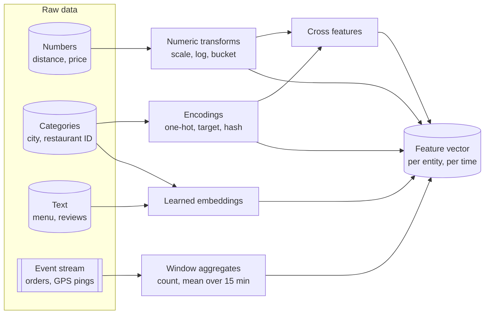

**Reading the diagram.** Four kinds of raw input (left) feed five families of transformation. Numbers become scaled, logged or bucketed values; categories become encodings or learned embeddings; text becomes embeddings; event streams become time-window aggregates; crosses combine outputs of other transforms. All arrows are offline or pipeline data flow, not request/response calls; the event stream is the only input that is a log rather than a table, which is why window aggregates carry the hardest correctness and freshness problems. The single storage boundary on the right is the assembled feature vector, keyed by entity and time. Failure points: encodings break on unseen categories, windows leak future data, and crosses multiply cardinality. Scaling pressure falls on window aggregates, whose cost grows with event volume.

### 62.3.2 Numeric transforms and bucketing

Most raw numbers need one of four treatments.

1. **Standardization**, $z = (x - \mu)/\sigma$, puts features on a comparable scale. Linear models, neural networks and distance-based methods need it; tree models do not, because a split threshold is unaffected by a monotone rescaling.
2. **Log and power transforms** compress long tails. Restaurant order counts range from 2 to 20,000 a week; $\log(1 + x)$ turns that 10,000× range into about 1.1 to 9.9, so a linear model's single weight fits the whole range.
3. **Clipping** caps outliers at, say, the 1st and 99th percentiles, so one GPS glitch reporting a 900 km delivery does not dominate a gradient.
4. **Bucketing** (discretization) replaces a number with the index of the interval that contains it: distance → {0–1 km, 1–3 km, 3–6 km, >6 km}. It lets a linear model learn a non-linear, even non-monotone, effect and makes a value robust to small noise, at the cost of losing resolution inside a bucket. Quantile buckets (equal counts) are usually better than equal-width buckets for skewed data.

The systems lesson is that every one of these transforms has **fitted parameters**: $\mu$, $\sigma$, clip thresholds and bucket boundaries are computed from training data. They must be computed on the training split only, versioned with the model, and applied identically at serving time. A serving path that recomputes $\mu$ from today's traffic produces training–serving skew (§62.9) even though "the same formula" runs in both places.

### 62.3.3 Categorical encodings

A category such as `city = "Lisbon"` or `restaurant_id = 40312` has no numeric meaning. Table 62.1 compares the main encodings.

**Table 62.1 — Categorical encodings compared.**

| Encoding | How it works | Best for | Main risk |
|---|---|---|---|
| One-hot | One 0/1 column per category | Few categories (city, weekday) | Width explodes; unseen categories |
| Ordinal | Integer per category | Ordered categories (size S/M/L); trees | Implies a false order for unordered data |
| Target (mean) encoding | Replace category with mean label for it | High cardinality, tree models | Label leakage; noisy for rare categories |
| Hashing trick | Hash category into one of $m$ buckets | Huge or open vocabularies | Collisions merge unrelated categories |
| Learned embedding | Look up a trained vector (Ch 58) | Very high cardinality, deep models | Needs data per ID; cold start |

**One-hot encoding** is safe and interpretable but has two production traps: a new category at serving time (a 21st city) must map to an explicit "other" column rather than crash or silently produce all zeros, and the column order must be frozen with the model.

**Target encoding** (also called mean encoding [Micci-Barreca 2001]) replaces each category with a statistic of the label for that category: restaurant 40312 becomes "its mean delivery time." It is powerful for GBDTs with high-cardinality IDs, and it is the most common accidental leak in tabular ML. If you compute the restaurant's mean over the whole training set, each row's own label is inside the mean, so the model learns to read its answer from the feature. Rare categories make it worse: a restaurant with one order has a "mean" equal to that order's label. Three defenses are standard: compute the encoding **out-of-fold** (for each fold, using only the other folds), or in time order using only *earlier* rows (the "ordered target statistics" of CatBoost [Prokhorenkova et al. 2018]); **smooth** toward the global mean; and in production, compute it as a time-window aggregate with a point-in-time join (§62.8), which makes it an ordinary historical feature rather than a special case.

::: formula
**Smoothed target encoding**

$$\text{enc}(c) = \frac{n_c \, \bar{y}_c + m \, \bar{y}}{n_c + m}$$

| Symbol | Meaning | Units |
|---|---|---|
| $n_c$ | Number of training rows with category $c$ (from earlier time only) | rows |
| $\bar{y}_c$ | Mean label over those rows | label units (minutes) |
| $\bar{y}$ | Global mean label | label units (minutes) |
| $m$ | Smoothing strength: pseudo-rows of the global mean | rows |
| $\text{enc}(c)$ | Encoded value of category $c$ | label units (minutes) |
:::

::: example
**Worked example — Smoothing a slow restaurant's encoding.** QuickBite's global mean delivery time is $\bar{y} = 35$ min; use $m = 20$.

1. A new restaurant has $n_c = 3$ past orders averaging $\bar{y}_c = 52$ min: $\text{enc} = (3 \times 52 + 20 \times 35)/(3 + 20) = (156 + 700)/23 = 37.2$ min.
2. An established restaurant with the same mean but $n_c = 300$: $\text{enc} = (15{,}600 + 700)/320 = 50.9$ min.

**Interpretation.** Three slow orders barely move the estimate; three hundred dominate the prior. **Engineering implication.** Smoothing turns a noisy, leak-prone feature into a sensible one, but $m$ and $\bar{y}$ are fitted parameters: version them with the model and compute $n_c$ and $\bar{y}_c$ only from data before each row's timestamp.
:::

The **hashing trick** [Weinberger et al. 2009] maps a category to `hash(value) mod m` and uses the bucket index as the feature (or the index into an embedding table). It needs no vocabulary file, handles unseen values gracefully (they land in some bucket) and bounds memory. The price is **collisions**: unrelated categories share a bucket and therefore a weight.

::: formula
**Probability that a category collides under hashing**

$$P_{\text{collide}} = 1 - \left(1 - \frac{1}{m}\right)^{n-1} \approx 1 - e^{-(n-1)/m}$$

| Symbol | Meaning | Units |
|---|---|---|
| $n$ | Number of distinct categories hashed | count |
| $m$ | Number of hash buckets | count |
| $P_{\text{collide}}$ | Probability that a given category shares its bucket with at least one other | dimensionless |
:::

::: example
**Worked example — Hashing 50,000 restaurant IDs.**

1. $m = 2^{18} = 262{,}144$: $(n-1)/m = 49{,}999/262{,}144 = 0.191$; $e^{-0.191} = 0.826$; $P = 17.4\%$.
2. $m = 2^{20} = 1{,}048{,}576$: $(n-1)/m = 0.0477$; $e^{-0.0477} = 0.953$; $P = 4.7\%$.

**Interpretation.** With a quarter-million buckets, about one restaurant in six shares a weight with another. Quadrupling the buckets cuts that to about one in twenty. **Engineering implication.** Size $m$ at roughly 20× the expected cardinality when collisions hurt (IDs with strong individual effects), and accept smaller tables when collisions merely add noise (rare n-grams). Hashing also makes a collision silent: monitor per-bucket counts to spot a hot bucket.
:::

### 62.3.4 Text and embeddings as features

Text such as a dish name ("spicy tuna roll") or a review becomes features in three ways of increasing power: counts of words or hashed n-grams; a pretrained text-encoder embedding (a fixed-length vector, typically a few hundred dimensions); or an embedding learned jointly with the task model (§58.6). Embeddings also come from other models: QuickBite's recommendation model learns a 64-dimensional vector per customer and per restaurant, and the ETA model may consume the restaurant vector as an input.

Embeddings as features introduce two infrastructure concerns. **Size**: a 64-dimensional FP32 vector is 256 bytes, versus 8 bytes for a scalar, so embedding views dominate online-store memory (§62.11). **Version coupling**: embeddings from model version 7 live in a different vector space from version 8. A consumer model trained on v7 vectors and served v8 vectors receives meaningless inputs with no error raised. Treat an embedding as a feature whose definition includes the producing model's version, and materialize a new feature version when that model changes. Orr et al. discuss how feature stores must evolve to manage such embedding ecosystems [Orr et al. 2021].

### 62.3.5 Time-window aggregates

::: definition
**Definition — Time-window aggregate.** A feature computed by applying an aggregation function (count, sum, mean, max, distinct count, last value) to an entity's events whose timestamps fall in a window defined relative to a reference time, for example "number of orders placed at this restaurant in the 15 minutes before $t$."
:::

Window aggregates are the most predictive features in most event-driven businesses: recent behavior predicts near-future behavior. They also concentrate the hard problems. A window has a **length** (15 minutes, 30 days), a **type** (tumbling, hopping or sliding, §29.8) and, crucially, a **reference time**. In serving, the reference time is "now." In training, it must be the timestamp of each training example; using any later time is leakage. A useful habit is to name features with their window and aggregation, for example `restaurant__orders_count__15m` or `restaurant__rating_mean__30d`, so that both the semantics and the freshness requirement are visible in the name.

Long windows are cheap to serve but expensive to compute naively (summing 30 days of events for every restaurant every hour). The standard optimization stores **partial aggregates** per small time bucket ("tiles," for example per-hour sums and counts) and combines the tiles that cover the window; the bucket size bounds the window-edge error. Airbnb's Zipline talks describe partial-aggregate tiling for backfills [Zanoyan et al. 2019].

### 62.3.6 Cross features

A **cross feature** combines two or more features into one, most commonly by taking the Cartesian product of categories (`city × hour_of_day`) or the product of numbers (`courier_load × is_peak`). Crosses let linear and shallow models represent interactions such as "rush hour in Lisbon is different from rush hour in Porto." Google's Wide & Deep model paired a wide linear part over crossed features with a deep network over embeddings [Cheng et al. 2016]. Crosses multiply cardinality: 20 cities × 24 hours is 480 values, but `customer × restaurant` is $10^7 \times 5 \times 10^4 = 5 \times 10^{11}$ possible pairs, of which only the observed ones can be stored. Such pair features become their own entity in the online store and are often its largest table (§62.11). Deep models learn many crosses implicitly; recommendation architectures that cross features explicitly are covered in Chapter 68.

#### Common misconceptions

::: mistake
**Mistake — "More features always help."** Each feature is a data dependency with its own pipeline, freshness requirement and failure mode. Sculley et al. call features that add little accuracy but much fragility "underutilized data dependencies" [Sculley et al. 2015]. Remove features whose ablation changes the metric by less than its noise, and require an owner for every feature that stays.
:::

::: mistake
**Mistake — "Target encoding is just another category statistic."** Computed over the full dataset, it contains each row's own label. Offline metrics improve dramatically and production metrics do not. Compute it out-of-fold or strictly from earlier data.
:::

## 62.4 Feature transformations and where they run

### 62.4.1 Four execution locations

::: definition
**Definition — Batch, streaming and on-demand features.** A **batch feature** is computed on a schedule from data at rest (a warehouse or lakehouse table) and loaded into stores. A **streaming feature** is computed continuously from an event stream and updated within seconds of each event. An **on-demand feature** (also called a request-time feature) is computed during the prediction request from inputs that exist only then, optionally combined with stored features. An **in-model transformation** is part of the model artifact itself and runs wherever the model runs.
:::

#### First-principles explanation

A restaurant decides where each step of a dish happens. Stock is simmered overnight in bulk (batch). The fryer runs continuously and keeps a tray of fresh fries (streaming). The steak is cooked only when ordered, to the customer's chosen doneness (on demand). Salt is added by the cook at the moment of plating, the same way every time, because it is part of the recipe (in-model). The choice depends on how quickly the ingredient goes stale, how expensive it is to prepare, and whether the input exists before the order.

#### How it works internally

Three questions decide the location of each transformation.

1. **Does the input exist before the request?** Distance from *this* customer's address to each restaurant does not; it must be on demand.
2. **How fast does the value change relative to the decision?** A 30-day rating changes slowly: batch. Orders waiting in a kitchen change within minutes: streaming (§60.7 makes the same classification for nearline computation).
3. **Is it a pure function of other features with fitted parameters?** Standardization, bucketing and vocabulary lookups are best shipped *inside* the model artifact (for example as preprocessing layers or a scikit-learn `Pipeline`), so training and serving cannot disagree about them.

**Figure 62.2 — Choosing where a transformation runs.**

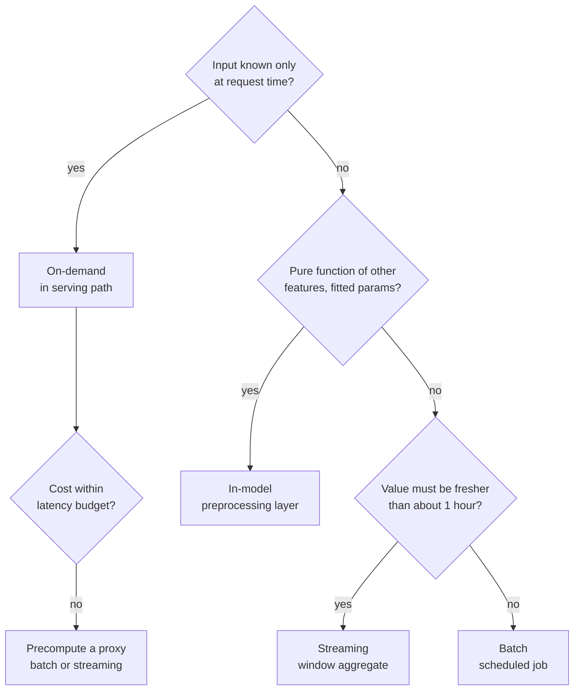

**Reading the diagram.** This is a design-time decision tree, not a runtime flow. Request-time inputs force on-demand computation, but only if the computation fits the latency budget (§60.10); otherwise you precompute an approximation, such as zone-to-zone travel time instead of door-to-door routing. Pure transforms with fitted parameters go into the model artifact. Remaining aggregates split by freshness: under about an hour usually justifies streaming; otherwise batch is cheaper and simpler. The threshold is a rule of thumb, not a law: §62.10 shows how to compute it. Failure points: putting a slow call on the request path, and computing the same transform in two places.

**Table 62.2 — Where transformations run.**

| Location | Freshness | Cost profile | Training data path | QuickBite example |
|---|---|---|---|---|
| In-model | As fresh as its inputs | Per prediction, usually tiny | Same code, inside artifact | Standardize distance; bucket hour |
| On-demand | Exact at request | Per prediction; adds latency | Replay logged inputs, or log outputs | Customer–restaurant distance |
| Streaming | Seconds | Always-on cluster and state | Backfill from event log or log outputs | Courier load per zone, 15 min |
| Batch | Hours to a day | Periodic, cheap per value | Recompute historically | Restaurant 30-day rating |

#### Advantages and disadvantages

Moving a transformation *earlier* (toward batch) makes it cheaper and easier to backfill but staler. Moving it *later* (toward on-demand) makes it fresh and exact but puts it on the latency budget and makes historical values harder to reproduce, because the inputs existed only in the request. Huyen describes the industry's gradual move from batch toward streaming features for exactly this freshness-versus-complexity reason [Huyen 2022]. The usual remedy for on-demand features is to log the request inputs (or the computed outputs) so training can use exactly what serving saw (§62.9).

::: mistake
**Mistake — "Put everything in the model and the problem goes away."** In-model transforms solve skew for pure functions, but a model cannot compute "orders in the last 15 minutes" from a single request; that needs state outside the model. In-model and feature-store transforms are complementary.
:::

## 62.5 Feature pipelines

### 62.5.1 Three pipeline shapes

::: definition
**Definition — Feature pipeline and materialization.** A **feature pipeline** is the job that computes feature values from source data according to a feature definition. **Materialization** is writing computed values into a store: the offline store keeps the full history with timestamps; the online store keeps the latest value per entity for low-latency reads.
:::

QuickBite's ETA model uses one feature of each kind, shown in Figure 62.3.

- **Restaurant 30-day rating** (`restaurant__rating_mean__30d`): batch. A nightly Spark job (§29.5) reads 30 days of ratings from the lakehouse, computes the mean per restaurant, appends rows `(restaurant_id, value, event_timestamp)` to the offline store and upserts the latest value into the online store.
- **Courier 15-minute load** (`zone__orders_per_free_courier__15m`): streaming. A Flink job (§29.9) consumes order-created and courier-status topics from Kafka (§31.5), keys by zone, maintains a 15-minute window sliding every minute, and writes each update to the online store and to a log that lands in the offline store.
- **Order-time distance** (`customer_restaurant__distance_km`): on demand. The ETA service computes haversine distance from the request's customer location and each restaurant's stored coordinates. Nothing is precomputed; the value is logged with the prediction.

**Figure 62.3 — QuickBite's three feature pipelines.**

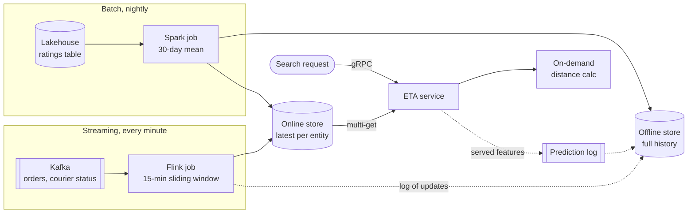

**Reading the diagram.** The batch subgraph reads data at rest and writes to both stores once a night; a failed run leaves yesterday's values, which is tolerable for a 30-day mean. The streaming subgraph consumes Kafka continuously and writes to the online store within seconds; its updates also flow asynchronously (dotted) into the offline store so that training sees the same values. The on-demand computation runs inside the ETA service on the synchronous request path, and its outputs reach the offline store only through the asynchronous prediction log. Storage boundaries: lakehouse, Kafka, offline store, online store, prediction log. Failure points: a stalled Flink job silently ages the courier-load feature (monitor freshness, §62.10); a skipped batch run is visible as a stale event timestamp. Scaling: Spark by cluster size, Flink by Kafka partitions keyed by zone, the on-demand step with ETA replicas.

### 62.5.2 How each pipeline works

**Batch materialization.** Each run computes values "as of" a timestamp (usually the end of the processed interval) and stamps them with that event time, not with the wall-clock time the job ran. Runs must be idempotent: re-running for the same interval overwrites the same rows rather than appending duplicates. A **backfill** is the same job run over historical intervals to create history for a new feature, which is only possible if the source data and the definition are both available for the past.

**Streaming aggregation.** The job keeps per-key window state, emits an update when the window advances, and must handle late events (the watermark machinery of §29.8). Two subtleties matter for features. First, the event timestamp of an emitted value is the window end, while the time it becomes readable online is later; that gap is the feature's freshness lag (§62.10). Second, historical values for training cannot come from the online store, which keeps only the latest value; they come either from logging every emitted update or from re-running the same windowing logic over the archived event log (Kappa-style replay, §29.10).

**On-demand computation.** On-demand features must be cheap (microseconds to a few milliseconds), deterministic and side-effect free. Feature stores increasingly let you register them as functions (Feast's on-demand feature views, §62.12) so that the same code runs in serving and when building training data from logged request inputs.

#### Mathematical foundations

::: formula
**Daily cost of batch materialization**

$$C_{\text{day}} = R \times \left( V_{\text{scan}} \, p_{\text{scan}} + K_{\text{write}} \, p_{\text{write}} \right)$$

| Symbol | Meaning | Units |
|---|---|---|
| $R$ | Materialization runs per day | runs/day |
| $V_{\text{scan}}$ | Source data scanned per run | TB |
| $p_{\text{scan}}$ | Price per TB scanned (warehouse) | \$/TB |
| $K_{\text{write}}$ | Entity rows written to the online store per run | rows |
| $p_{\text{write}}$ | Price per row written to the online store | \$/row |
| $C_{\text{day}}$ | Materialization cost per day | \$/day |
:::

::: example
**Worked example — Customer 90-day order features: daily, hourly or incremental?** Order events are about 1 GB/day (500,000 orders × 2 KB, §2.11), so a 90-day scan is $V_{\text{scan}} = 0.09$ TB. Use illustrative prices of $p_{\text{scan}} = \$6$/TB and $p_{\text{write}} = \$1$ per million rows (managed key-value store, as of 2026; check your provider). There are 10 million customers.

1. Daily full refresh: $C = 1 \times (0.09 \times 6 + 10^7 \times 10^{-6}) = 0.54 + 10.00 = \$10.54$/day.
2. Hourly full refresh: $C = 24 \times 10.54 = \$252.96$/day, about \$92,000/year.
3. Hourly incremental, writing only customers who ordered in the hour ($500{,}000/24 = 20{,}833$ rows): $24 \times (0.54 + 0.021) = \$13.46$/day, plus one daily full refresh (\$10.54) so that values change when old orders leave the window: \$24.00/day.

**Interpretation.** Writes, not scans, dominate: rewriting 10 million unchanged rows every hour costs 24× more for no information. Incremental materialization delivers hourly freshness for about 2.3× the daily cost instead of 24×. **Engineering implication.** Materialize only entities whose value changed, but remember that window features change without new events when old events expire; a periodic full refresh or an explicit expiry rule keeps them honest.
:::

#### Failure scenarios

**Table 62.3 — Feature pipeline failure scenarios.**

| What goes wrong | Why | Detection | Recovery | Prevention |
|---|---|---|---|---|
| Batch run skipped | Upstream table late; scheduler outage | Max event timestamp per view older than schedule | Re-run for missed interval | Freshness alert; sensor on upstream partition |
| Duplicate rows offline | Non-idempotent append on retry | Row count per (entity, timestamp) > 1 | Deduplicate by created timestamp | Overwrite partitions; dedup key |
| Streaming job lag | Hot zone key; checkpoint stalls | Consumer lag; feature age p99 | Scale out; restart from checkpoint | Key salting; lag SLO |
| Backfill differs from live | Backfill code differs from streaming code | Compare backfilled with logged values | Re-backfill with shared logic | One definition compiled to both engines |

## 62.6 Why feature stores exist

### 62.6.1 Five recurring problems

::: definition
**Definition — Feature store.** A data system that manages features as shared, versioned products: it stores feature definitions and metadata in a registry, computes or ingests values, keeps their history in an offline store for building point-in-time-correct training data, keeps their latest values in an online store for low-latency serving, and serves both through one API.
:::

#### First-principles explanation

Before supermarkets, every household bought flour, milled it differently and labeled it in its own way. A central pantry with labeled jars, dated contents and one recipe card per jar means a new cook can reuse yesterday's work, everyone gets the same ingredient, and nobody uses milk past its date. A feature store is that pantry for model inputs.

#### Why does this exist?

Without one, each model team writes its own SQL for training and its own service code for serving. At Uber, Hermann and Del Balso reported that many modeling problems used identical or similar features and that sharing features across teams was a goal of Michelangelo's feature store [Hermann and Del Balso 2017]. Five problems recur:

1. **Reuse.** The fraud, ETA and ranking teams each compute "restaurant orders last hour" differently, with three pipelines to run and three subtly different answers.
2. **Consistency.** Training code (SQL over the warehouse) and serving code (Java over a cache) compute the same feature separately and drift apart: training–serving skew (§62.9).
3. **Point-in-time training data.** Joining labels with feature history *as of each example's time* is easy to get wrong and expensive to get right (§62.8).
4. **Low-latency serving.** Warehouses answer in seconds; inference needs single-digit milliseconds for dozens of keys (§62.11).
5. **Governance.** Nobody knows who owns a feature, whether it contains personal data, or which models break if it is deleted (§62.15). Sculley et al. name the resulting tangle the **pipeline jungle** [Sculley et al. 2015].

**Figure 62.4 — Pipeline jungle versus feature store.**

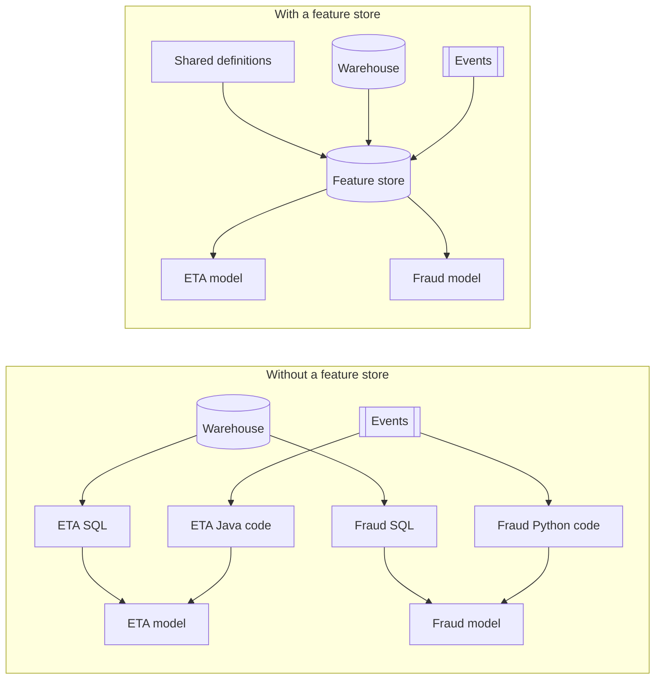

**Reading the diagram.** On the left, each model has two private pipelines (one for training from the warehouse, one for serving from events), so four code paths compute overlapping features and each pair can disagree. On the right, one set of definitions drives one store fed by the same sources, and both models read from it in training and in serving. Arrows are data flows; synchronous serving reads and asynchronous ingestion are separated in Figure 62.5. The failure point on the left is divergence between paired paths; on the right it is the store itself, which becomes shared, critical infrastructure needing an SLO. Scaling on the right is by adding definitions, not pipelines.

::: warning
**Trade-off — A feature store is shared infrastructure.** It concentrates risk: an online-store outage now affects every model that reads from it, and a bad definition change propagates to every consumer. Budget for an on-call rotation, versioned definitions and per-consumer fallbacks before migrating critical models.
:::

## 62.7 Feature store architecture

### 62.7.1 Components

**Figure 62.5 — Reference feature store architecture.**

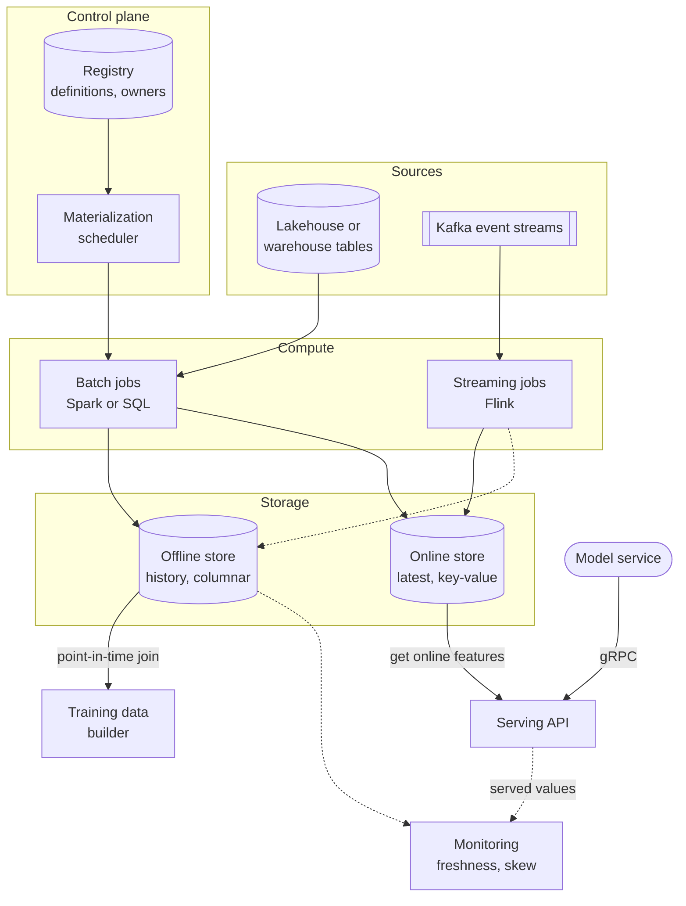

**Reading the diagram.** Sources (top) are lakehouse tables and Kafka streams. The control plane holds the **registry**, the catalog of definitions, entities, owners and versions, and a **scheduler** that triggers materialization. Compute runs batch jobs (writing history to the offline store and latest values to the online store) and streaming jobs (writing the online store synchronously and logging to the offline store asynchronously, dotted). The **offline store** is a columnar, append-only history in the lakehouse (Chapter 61); the **training-data builder** performs point-in-time joins over it. The **online store** is a partitioned key-value store (§12.4) holding the latest value per entity; the **serving API** answers model services over gRPC. **Monitoring** compares served values with offline history and tracks freshness. Failure points: the online store and serving API are on the request path; a stalled job silently ages values. Scaling: offline by storage and job parallelism, online by partitions and replicas.

**Table 62.4 — Feature store components.**

| Component | Holds or does | Typical technology (as of 2026) | Key requirement |
|---|---|---|---|
| Registry | Definitions, schemas, entities, owners, versions | Database or files in Git plus a catalog | Single source of truth |
| Offline store | Full timestamped history | Parquet/Delta/Iceberg tables, BigQuery, Snowflake, Redshift | Cheap scans; time-travel |
| Online store | Latest value per entity key | Redis, DynamoDB, Cassandra-class stores, Bigtable | p99 of a few ms; high read RPS |
| Materialization | Moves computed values into stores | Spark, SQL, Flink; orchestrator (Ch 69) | Idempotent; incremental |
| Serving API | Assembles feature vectors per request | SDK in-process or gRPC service | Multi-get; defaults; deadlines |
| Monitoring | Freshness, null rate, drift, skew | Metrics pipeline (Ch 40), drift jobs (Ch 70) | Alerts per view and owner |

### 62.7.2 The online read path

**Figure 62.6 — Online feature retrieval for one ETA request.**

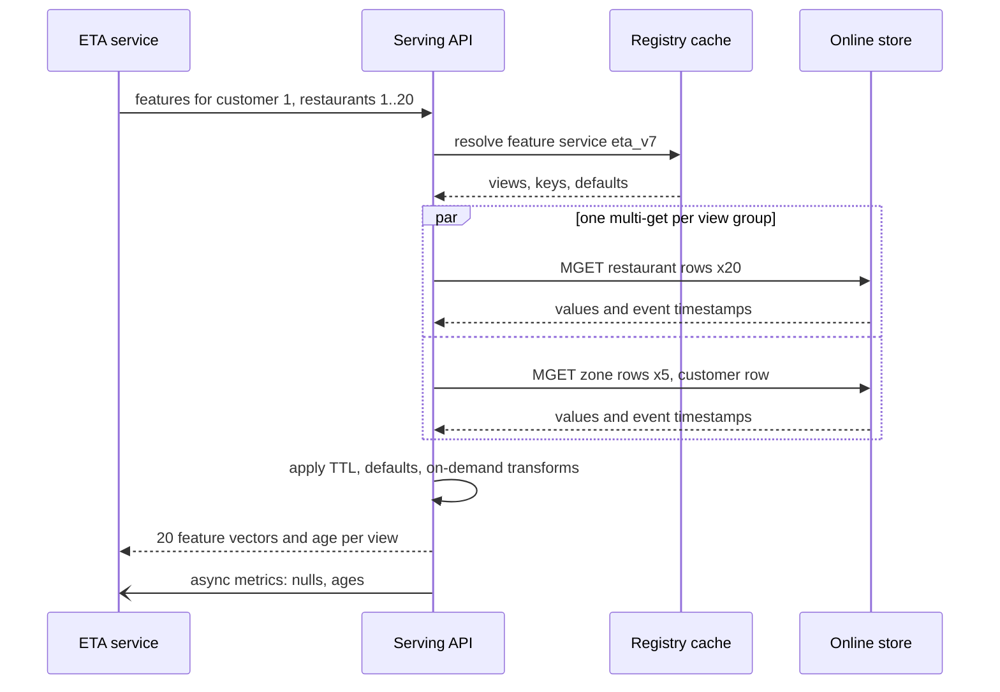

**Reading the diagram.** The ETA service makes one synchronous call. The serving API resolves the requested **feature service** (the named, versioned list of features a model needs) from a locally cached registry, so the registry is not on the hot path. It issues one multi-get per group of co-located views in parallel (the `par` block), receives each value with its event timestamp, replaces values older than the view's TTL with defaults, runs any on-demand transforms, and returns vectors plus their ages. Metrics leave asynchronously. Failure points: a slow store partition (hedge or time out to defaults), a registry cache that serves a stale definition. Scaling: the API is stateless; the store scales by partitioning on entity key.

The serving API can be a library inside the model service (lower latency, harder upgrades) or a separate service (one extra hop of about 1 ms, centrally upgraded). Return the event timestamp or age with every value: without it, the model service cannot tell a fresh zero from a three-day-old one.

## 62.8 Point-in-time correctness

### 62.8.1 Entities, timestamps and the as-of join

::: definition
**Definition — Point-in-time correct join (as-of join).** A join that attaches to each training example, identified by an entity key and a timestamp $t$, the most recent feature value for that entity whose timestamp is at or before $t$ (and, stricter, that was *available* to the serving system by $t$), ignoring values older than a time to live (TTL). It reproduces exactly what a serving system could have known at the moment of each prediction.
:::

#### First-principles explanation

Imagine judging a stock-picker by giving them old newspapers. If you hand them Tuesday's paper to make Monday's picks, they will look like a genius. A training set built with a naive join is Tuesday's paper: each example sees feature values computed after the moment it was supposed to predict. The model learns to rely on information that, in production, does not yet exist.

#### Why does this exist?

Feature values change over time, and the offline store keeps every version. Training labels arrive with their own timestamps. A plain SQL join on entity key (or on entity key and calendar date) picks the wrong version: the latest one, or one stamped later than the example. Kleppmann calls this the **time-dependence of joins**: when the joined record can change, a join's result depends on which version you use, and reprocessing gives a different answer unless you record the version that was current at event time [Kleppmann 2017]. Zinkevich gives the same warning for ML: data in a table you join at training time may have changed since serving time [Zinkevich n.d., Rule #31].

Three timestamps must be kept apart:

- The **entity (or example) timestamp**: when the prediction happened (order placed at 19:10).
- The **event timestamp** of a feature value: the time at which that value became true (the 30-day window ending at midnight).
- The **availability (created) timestamp**: when the value was actually written and readable (the nightly job finished at 03:00).

#### How it works internally

Table 62.5 shows the feature history for one restaurant; Table 62.6 shows what four join strategies attach to three of its orders.

**Table 62.5 — Feature rows for restaurant R17: `avg_prep_min_1d` (mean prep time over the previous day).**

| event_timestamp | Summarizes | Value (min) | Available at |
|---|---|---|---|
| Mar 01 00:00 | Feb 28 | 13.0 | Mar 01 03:00 |
| Mar 02 00:00 | Mar 01 | 14.0 | Mar 02 03:00 |
| Mar 03 00:00 | Mar 02 (kitchen fault) | 22.5 | Mar 03 03:00 |
| Mar 04 00:00 | Mar 03 | 15.0 | Mar 04 03:00 |

**Table 62.6 — What each join attaches to three R17 orders.**

| Order | Placed | Actual prep (label) | Naive: latest | Naive: same date | PIT on event time | PIT on availability |
|---|---|---|---|---|---|---|
| A | Mar 02 01:30 | 13 | 15.0 | 22.5 | 14.0 | 13.0 |
| B | Mar 02 19:10 | 24 | 15.0 | 22.5 | 14.0 | 14.0 |
| C | Mar 03 12:00 | 16 | 15.0 | 15.0 | 22.5 | 22.5 |

Read it row by row. "Naive: latest" gives every order the value from March 4, a value from the future for all three. "Naive: same date" joins on the order's calendar date and picks the row that *summarizes* that date: order B gets 22.5, a summary that includes B's own slow prep. This is the leak of the chapter's opening story. "PIT on event time" correctly uses the newest row stamped at or before the order, but for order A it uses the 00:00 value that the nightly job did not publish until 03:00. In production at 01:30 the online store still held 13.0. Only "PIT on availability" reproduces what serving saw for every order.

**Figure 62.7 — The as-of join on a timeline.**

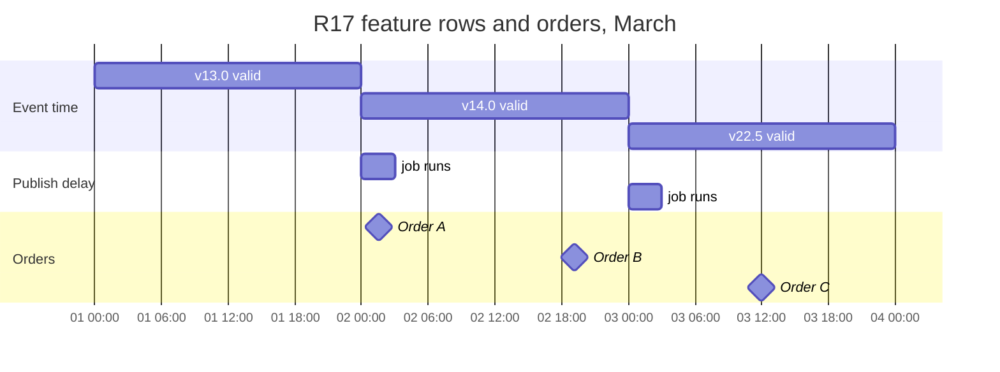

**Reading the diagram.** Time runs left to right. The top bars show the interval in which each value is the latest by event time. The middle bars are the three-hour publication delay of the nightly job: during them the online store still serves the previous value. The diamonds are orders. An as-of join drops a vertical line at each order and takes the value whose bar the line crosses, shifting each bar's start right by the publication delay when joining on availability. Order A falls inside a publication delay, which is why the two PIT variants disagree for it. There are no synchronous calls here; the storage boundary is the offline store, which must keep both timestamps for this join to be possible.

#### Mathematical foundations

::: formula
**As-of join with availability delay and TTL**

$$x_i = \begin{cases} v(e_i, t^{*}) & \text{if } t^{*} \text{ exists} \\ \text{default} & \text{otherwise} \end{cases} \qquad t^{*} = \max \{\, t : (e_i, t) \in F,\; t + \delta \le t_i,\; t_i - t \le \text{TTL} \,\}$$

| Symbol | Meaning | Units |
|---|---|---|
| $e_i$, $t_i$ | Entity key and timestamp of training example $i$ | key, timestamp |
| $F$ | Set of (entity, event timestamp) rows in the feature view's history | rows |
| $v(e, t)$ | Feature value for entity $e$ with event timestamp $t$ | feature units |
| $\delta$ | Availability delay: time from event timestamp to readable online (0 if joining on event time only) | s |
| TTL | Maximum age of a value that may be used | s |
| $x_i$ | Feature value attached to example $i$ | feature units |
:::

::: example
**Worked example — Joining orders A and a late order D.** Use Table 62.5 with $\delta = 3$ h and TTL = 48 h.

1. Order A at Mar 02 01:30. Candidates must satisfy $t + 3\text{ h} \le$ 01:30 on Mar 02, so $t \le$ Mar 01 22:30. Rows: Mar 01 00:00 qualifies; Mar 02 00:00 does not. Age $= 25.5$ h $\le 48$ h. $x_A = 13.0$.
2. Order D at Mar 06 12:00 (the job failed on Mar 05 and Mar 06). The newest row is Mar 04 00:00, available Mar 04 03:00 ≤ Mar 06 12:00, but its age is $60$ h $> 48$ h. $x_D = $ default.
3. With $\delta = 0$, order A would get 14.0 (Mar 02 00:00 $\le$ 01:30), a value no production request at 01:30 could have read.

**Interpretation.** The availability delay changes only examples that fall inside publication windows, but for a nightly job those are every order between midnight and 03:00, which for a late-night menu may be a large share. TTL turns silent staleness into an explicit default that the model has seen in training. **Engineering implication.** Store a created (availability) timestamp next to every event timestamp, join on it for any feature with a material publication delay, and set TTL from the feature's staleness budget (§62.10). Use the same TTL in the online store, so serving and training apply the same rule.
:::

### 62.8.2 Runnable example: leakage from a naive join

The program below simulates 60 days of QuickBite orders for 300 restaurants whose kitchen delay drifts from day to day. The feature is the restaurant's mean delivery time over the previous day, materialized at midnight. It trains a linear ETA model twice: once on a naive join by calendar date and once on a point-in-time join, then evaluates each both "offline" (with its own join) and "in serving" (with what production can actually see, which is always the point-in-time value).

```python
import bisect
import numpy as np

rng = np.random.default_rng(62)
N_REST, DAYS = 300, 60
HOUR = 3600.0
DAY = 24 * HOUR

# Each restaurant's true kitchen delay drifts day to day (random walk).
base = 12 + 4 * rng.standard_normal(N_REST)
drift = np.cumsum(1.5 * rng.standard_normal((DAYS, N_REST)), axis=0)
kitchen = np.clip(base + drift, 5, None)          # minutes, per day

# Orders: (restaurant, timestamp in seconds, distance_km, label minutes)
orders = []
for d in range(DAYS):
    n = rng.poisson(4, N_REST)                     # orders per restaurant per day
    for r in range(N_REST):
        for _ in range(n[r]):
            ts = d * DAY + rng.uniform(10, 23) * HOUR
            dist = rng.uniform(0.5, 6.0)
            y = kitchen[d, r] + 3.0 * dist + 8 + rng.normal(0, 4)
            orders.append((r, ts, dist, y))
orders.sort(key=lambda o: o[1])

# Feature view: restaurant mean delivery minutes over the last 1 day,
# materialized once per day at midnight (event timestamp = end of day).
feat = {r: ([], []) for r in range(N_REST)}        # r -> (timestamps, values)
by_day = {}
for r, ts, dist, y in orders:
    by_day.setdefault((r, int(ts // DAY)), []).append(y)
for r in range(N_REST):
    for d in range(DAYS):
        ys = by_day.get((r, d))
        if ys:
            feat[r][0].append((d + 1) * DAY)       # value valid from midnight
            feat[r][1].append(float(np.mean(ys)))

TTL = 3 * DAY
DEFAULT = 25.0

def pit_lookup(r, ts):
    """Latest feature value with feature_ts <= ts, within TTL; else default."""
    times, vals = feat[r]
    i = bisect.bisect_right(times, ts) - 1
    if i < 0 or ts - times[i] > TTL:
        return DEFAULT
    return vals[i]

def naive_same_day(r, ts):
    """Join on (restaurant, calendar date): picks the row stamped at the end
    of the order's own day, which already contains this order's label."""
    times, vals = feat[r]
    target = (int(ts // DAY) + 1) * DAY
    i = bisect.bisect_left(times, target)
    if i < len(times) and times[i] == target:
        return vals[i]
    return DEFAULT

def build(rows, lookup):
    X = np.array([[1.0, dist, lookup(r, ts)] for r, ts, dist, y in rows])
    y = np.array([o[3] for o in rows])
    return X, y

def mae(X, y, w):
    return float(np.mean(np.abs(X @ w - y)))

split = 45 * DAY
train = [o for o in orders if o[1] < split]
test = [o for o in orders if o[1] >= split]
print(f"orders: {len(orders):,} (train {len(train):,}, test {len(test):,})")

# A few rows for one restaurant: what each join attaches.
print("restaurant 7, day 20 orders:")
for r, ts, dist, y in [o for o in orders if o[0] == 7 and int(o[1] // DAY) == 20][:3]:
    print(f"  {ts / HOUR - 20 * 24:5.1f}h label {y:5.1f} | "
          f"naive {naive_same_day(r, ts):5.1f} | pit {pit_lookup(r, ts):5.1f}")

Xtr, ytr = build(train, pit_lookup)
w0, *_ = np.linalg.lstsq(Xtr[:, :2], ytr, rcond=None)
Xs, ys = build(test, pit_lookup)
print(f"{'distance only':21s} serving MAE {mae(Xs[:, :2], ys, w0):.2f} min")
for name, lookup in [("naive same-day join", naive_same_day),
                     ("point-in-time join", pit_lookup)]:
    Xtr, ytr = build(train, lookup)
    w, *_ = np.linalg.lstsq(Xtr, ytr, rcond=None)
    Xoff, yoff = build(test, lookup)          # offline eval, same join
    Xsrv, ysrv = build(test, pit_lookup)      # what serving can see
    print(f"{name:21s} weight on feature {w[2]:.2f} | "
          f"offline MAE {mae(Xoff, yoff, w):.2f} min | "
          f"serving MAE {mae(Xsrv, ysrv, w):.2f} min")
```

Output:

```text
orders: 72,008 (train 54,206, test 17,802)
restaurant 7, day 20 orders:
   10.5h label  19.0 | naive  21.4 | pit  22.2
   11.4h label  19.2 | naive  21.4 | pit  22.2
   11.5h label  12.3 | naive  21.4 | pit  22.2
distance only         serving MAE 7.66 min
naive same-day join   weight on feature 0.91 | offline MAE 3.22 min | serving MAE 4.38 min
point-in-time join    weight on feature 0.75 | offline MAE 4.34 min | serving MAE 4.34 min
```

What to notice:

- `pit_lookup` is the as-of join: `bisect_right` finds the newest timestamp at or before the order in $O(\log n)$, and the TTL check returns a default for stale values. At scale the same logic becomes a sort-merge per entity partition in Spark or a warehouse `ASOF JOIN`.
- `naive_same_day` attaches the value stamped at the *end* of the order's day. For restaurant 7 on day 20 it attaches 21.4, a mean that includes those very orders' labels; the point-in-time value 22.2 summarizes day 19.
- The naive model puts more weight on the feature (0.91 versus 0.75) because, in training, the feature partly contains the answer. Its offline MAE of 3.22 minutes is a mirage: served the values production actually has, it scores 4.38.
- The point-in-time model's offline and serving MAE agree (4.34), which is the real goal: **offline evaluation you can trust**. Both models beat distance alone (7.66), so the feature is valuable; only the naive model's estimate of its value is wrong.
- The gap here is modest because the leak is diluted across about four orders per restaurant per day. With a one-order-per-day entity, or with target encoding over all data, it becomes dramatic.

#### Real-world industry applications

::: industry
**Feast — point-in-time retrieval.** Feast's historical retrieval takes an "entity dataframe" of entity keys and event timestamps and, for each row, returns the latest feature values at or before that timestamp, scanning back no further than the feature view's TTL. Its documentation describes the TTL as relative to each row's timestamp, not to the time the query runs.
*Evidence: Primary* — [Feast Docs: Point-in-time joins]
:::

::: industry
**Airbnb Zipline — point-in-time features for training and serving.** Airbnb engineers described Zipline as a declarative feature framework that generates point-in-time-correct feature values for every prediction timestamp in the training data, and serves the same definitions online, without "time-traveling" the whole warehouse for each example.
*Evidence: Secondary* — conference talks [Simha and Zanoyan 2018; Zanoyan et al. 2019]
:::

#### Failure scenarios

**Table 62.7 — Point-in-time failure scenarios.**

| What goes wrong | Why | Detection | Recovery | Prevention |
|---|---|---|---|---|
| Offline metric much better than online | Feature joined from the future | Compare offline with shadow or canary metric | Rebuild training set with PIT join | PIT join enforced by tooling |
| Small leak at window edges | Joined on event time, ignoring publish delay | Logged served values differ near midnight | Join on availability timestamp | Store created timestamp |
| Many defaults in training, few online | TTL shorter offline than online | Null-rate comparison by view | Align TTLs | One TTL in the definition |
| Overwritten history | Offline store updated in place | Same key and time with changed value | Restore from table time-travel | Append-only offline store |

::: mistake
**Mistake — "We use a time-based split, so we can't leak."** A time split stops future *examples* from entering training; it does nothing about future *feature values* joined to past examples. You need both.
:::

## 62.9 Training–serving skew

### 62.9.1 Sources of skew

::: definition
**Definition — Training–serving skew.** A difference between a model's performance in training and in serving [Zinkevich n.d.]. In feature terms: the feature vector the model receives in production differs, for the same entity and moment, from the vector it would have received in training, or the population of vectors differs in ways training did not represent.
:::

#### First-principles explanation

A pilot trained in a simulator whose altimeter reads in feet is then put in a cockpit that reads in meters. Every instrument works; every reading is plausible; the landing is still wrong. Skew is rarely a crash. It is a model faithfully applying what it learned to inputs that mean something slightly different.

#### Why does this exist?

Training and serving are different programs, often in different languages, reading different stores at different times. Table 62.8 lists the sources seen most often.

**Table 62.8 — Sources of training–serving skew.**

| Source | QuickBite example | Typical signature |
|---|---|---|
| Different code paths | Offline SQL computes `hour_of_day` in local time; online Java uses UTC | 100% of rows differ by a constant |
| Different data freshness | Offline uses complete, corrected data; online reads a lagging stream | A fraction of rows differ, biased one way |
| Missing-value handling | Offline imputes the mean; online fills 0 | Rows differ exactly where inputs are missing |
| Fitted parameters recomputed | Online recomputes bucket boundaries from today's data | Gradual divergence after deployment |
| Upstream schema or unit change | Distance service switches from km to meters | Sudden shift on one feature |
| Feature drift | Ratings inflate across the platform | Served equals recomputed, but differs from training |
| Feedback loop | The model's ETAs change which restaurants get orders (§60.3.4) | Population shifts over weeks |

The last two are not bugs in a pipeline: served and recomputed values agree, but the world has moved since training. Distinguishing **skew** (two computations disagree on the same input) from **drift** (one computation, changing inputs) is the first job of a detector, because the fixes differ: fix the code for skew, retrain or adapt for drift (Chapter 70 owns drift detection).

### 62.9.2 Detection: log, recompute, compare

The reliable detector follows Zinkevich's advice to measure skew explicitly [Zinkevich n.d., Rule #37]. Log the feature vector exactly as served, with request ID and timestamp (§59.5.3). Later, recompute the same features offline for the same entities and timestamps with the training pipeline (a point-in-time join). Then compare per feature, row by row.

**Figure 62.8 — Skew detection by recomputation.**

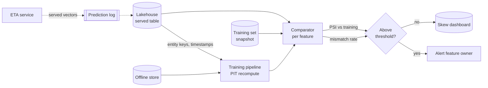

**Reading the diagram.** The ETA service writes served vectors asynchronously (dotted) to the prediction log, which lands in the lakehouse. A scheduled job feeds the logged keys and timestamps to the *training* pipeline, which recomputes each feature with a point-in-time join over the offline store. The comparator joins served and recomputed rows by request ID and computes two statistics per feature: the row-level mismatch rate (skew) and the population stability index against the training snapshot (shift). The alert routes to the feature's owner from the registry. Everything here is offline and batch; it never touches the request path. Failure points: an unsampled log, or a recompute that shares the serving bug (then both agree and the detector is blind). Scaling: sample a few thousand requests per hour per model.

::: formula
**Skew and shift statistics per feature**

$$\text{mismatch}_f = \frac{1}{N} \sum_{i=1}^{N} \mathbb{1}\big[\, |s_{i,f} - r_{i,f}| > \tau_f \,\big] \qquad \text{PSI}_f = \sum_{b=1}^{B} (a_b - e_b) \ln \frac{a_b}{e_b}$$

| Symbol | Meaning | Units |
|---|---|---|
| $s_{i,f}$, $r_{i,f}$ | Served and recomputed value of feature $f$ for logged request $i$ | feature units |
| $\tau_f$ | Tolerance for numerical noise | feature units |
| $N$ | Number of audited requests | count |
| $e_b$, $a_b$ | Share of training and served values in bin $b$ | dimensionless |
| $B$ | Number of bins (often deciles of the training distribution) | count |
:::

::: example
**Worked example — Reading PSI.** A feature's training distribution falls 25% in each of four bins; served values fall 10%, 20%, 30% and 40%.

1. Bin 1: $(0.10 - 0.25)\ln(0.10/0.25) = (-0.15)(-0.916) = 0.137$.
2. Bin 2: $(-0.05)\ln(0.8) = (-0.05)(-0.223) = 0.011$.
3. Bin 3: $(0.05)\ln(1.2) = 0.05 \times 0.182 = 0.009$.
4. Bin 4: $(0.15)\ln(1.6) = 0.15 \times 0.470 = 0.071$.
5. Sum: $\text{PSI} = 0.228$.

**Interpretation.** A common rule of thumb reads PSI below 0.1 as stable, 0.1–0.2 as moderate and above 0.2 as a significant shift, so this feature has moved. **Engineering implication.** PSI says the population moved; it cannot say why, and it misses bugs that keep the distribution similar. Pair it with the row-level mismatch rate, which is the only direct measure of skew.
:::

### 62.9.3 Runnable example: a skew detector

The program audits 20,000 logged ETA requests. Five features were served; three contain planted problems (a UTC/local-time bug, an 8% stream lag and zero-filling of missing values) and one has genuinely drifted since training.

```python
import numpy as np

rng = np.random.default_rng(7)
N = 20_000                                   # logged requests to audit

# Raw facts for each logged request (what an offline job can replay).
dist = rng.gamma(2.0, 1.5, N)                                 # km
hour_local = rng.integers(10, 23, N)                          # local hour
backlog_true = rng.poisson(6, N).astype(float)               # orders waiting
prep_hist = np.where(rng.random(N) < 0.05, np.nan,            # 5% new restaurants
                     rng.normal(14, 3, N))
rating = np.clip(rng.normal(4.3, 0.3, N), 1, 5)

# Offline recomputation: the reference definitions.
recomputed = {
    "distance_km": dist,
    "hour_of_day": hour_local.astype(float),
    "backlog_15m": backlog_true,
    "prep_mean_7d": np.where(np.isnan(prep_hist), 14.0, prep_hist),  # global mean
    "rating_30d": rating,
}

# Values the online service actually served and logged.
lag = rng.random(N) < 0.08                    # stream lag on 8% of reads
served = {
    "distance_km": dist.copy(),
    "hour_of_day": ((hour_local - 1) % 24).astype(float),   # UTC, not local
    "backlog_15m": np.where(lag, np.maximum(backlog_true - rng.integers(1, 4, N), 0),
                            backlog_true),
    "prep_mean_7d": np.where(np.isnan(prep_hist), 0.0, prep_hist),  # fills 0
    "rating_30d": rating.copy(),
}

# Training distribution (last month): rating has since drifted upward
# in the live data, which is drift, not skew.
train = {k: v.copy() for k, v in recomputed.items()}
train["rating_30d"] = np.clip(rng.normal(4.1, 0.3, N), 1, 5)

def psi(expected, actual, bins=10):
    edges = np.unique(np.quantile(expected, np.linspace(0, 1, bins + 1)))
    e = np.histogram(np.clip(expected, edges[0], edges[-1]), edges)[0] / len(expected)
    a = np.histogram(np.clip(actual, edges[0], edges[-1]), edges)[0] / len(actual)
    e, a = np.clip(e, 1e-4, None), np.clip(a, 1e-4, None)
    return float(np.sum((a - e) * np.log(a / e)))

print(f"{'feature':13s} {'mismatch':>8s} {'mean|diff|':>10s} {'PSI':>6s}  verdict")
for name in served:
    s, r = served[name], recomputed[name]
    mismatch = float(np.mean(np.abs(s - r) > 1e-6 + 0.01 * np.abs(r)))
    mean_diff = float(np.mean(np.abs(s - r)))
    p = psi(train[name], s)
    verdict = []
    if mismatch > 0.01:
        verdict.append("SKEW: code path or freshness")
    if p > 0.2:
        verdict.append("SHIFT vs training")
    print(f"{name:13s} {mismatch:8.1%} {mean_diff:10.3f} {p:6.2f}  "
          f"{'; '.join(verdict) or 'ok'}")
```

Output:

```text
feature       mismatch mean|diff|    PSI  verdict
distance_km       0.0%      0.000   0.00  ok
hour_of_day     100.0%      1.000   0.11  SKEW: code path or freshness
backlog_15m       8.4%      0.166   0.01  SKEW: code path or freshness
prep_mean_7d      5.0%      0.697   0.05  SKEW: code path or freshness
rating_30d        0.0%      0.000   0.43  SHIFT vs training
```

What to notice:

- The time-zone bug changes every row by exactly one hour, yet its PSI is only 0.11, below the usual alert threshold, because shifting a fairly flat distribution by one bin changes the histogram little. A distribution monitor alone would miss it.
- The missing-value bug affects exactly the 5% of rows where the input is missing; the mismatch rate pinpoints it, and its mean difference (0.70 minutes over all rows) understates how wrong those 5% are (14 minutes each).
- The stream lag shows up as an 8.4% mismatch with served values biased low: a freshness problem rather than a code problem. The fix is in operations (§62.10), not in the definition.
- `rating_30d` has no skew at all (served equals recomputed) but a PSI of 0.43: the world drifted. Retraining, not debugging, is the response.

### 62.9.4 Prevention patterns

1. **Single definition, two executions.** Define each feature once in the registry and generate both the batch and the streaming or online computation from it; for pure transforms, ship them inside the model (§62.4). This removes the largest class of skew. Zinkevich: reuse code between training and serving whenever possible [Zinkevich n.d., Rule #32].
2. **Log and wait.** Log features as served and build future training sets from the logs once labels arrive. Training then sees exactly what serving saw, including its staleness and defaults [Zinkevich n.d., Rule #29]. The cost is time: a new feature has no history until it has been served and logged for weeks.
3. **Backfill with point-in-time joins** for new features, accepting a residual risk that the backfill differs from what serving would have produced; validate the backfill against a few days of logged values before trusting it.
4. **Test the paths.** Breck et al.'s ML Test Score includes checking that training and serving compute the same feature values [Breck et al. 2017]; make that a CI test on fixed inputs plus the production audit above.
5. **Treat missing values as part of the definition**: the default, the TTL and the "missing" indicator belong to the feature, not to each consumer.

**Figure 62.9 — Log-and-wait versus backfill for building training data.**

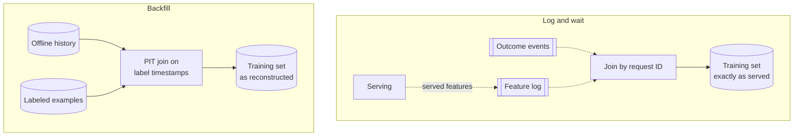

**Reading the diagram.** In log-and-wait (top), serving writes features asynchronously to a log; outcomes arrive later on another stream; a join by request ID produces training rows whose features are exactly what the model saw. In backfill (bottom), a point-in-time join over offline history reconstructs features for historical labeled examples. Log-and-wait is skew-free by construction but cannot provide history for a brand-new feature; backfill gives history immediately but is only as faithful as the offline computation. Storage boundaries: the feature log and the offline history. Failure points: unsampled or dropped logs (top), definition mismatch (bottom). Most mature systems backfill to start and switch to logging once enough has accumulated (§60.6.2).

## 62.10 Feature freshness

### 62.10.1 Staleness budgets and how to measure them

::: definition
**Definition — Feature freshness and staleness budget.** The **age** of a served feature value is the time between its event timestamp and the moment it is read. A **staleness budget** is the maximum age, at a stated percentile, that a feature may have without materially hurting predictions, for example "courier zone load: p99 age ≤ 120 s."
:::

Freshness is a property of each feature, not of the store. A 30-day rating can be a day old with no measurable harm; a 15-minute courier load that is 30 minutes old describes a different situation. Chapter 60 derived the maximum lag of a pipeline, $F_{\max} = \Delta_{\text{update}} + T_{\text{ingest}} + T_{\text{compute}} + T_{\text{publish}} + \text{TTL}_{\text{cache}}$ (§60.7). Use it at design time, and measure the real thing in production in two places:

1. **At write:** materialization lag $=$ write time $-$ event timestamp, per view, emitted by the pipeline.
2. **At read:** feature age $=$ read time $-$ event timestamp, emitted by the serving API (Figure 62.6) as a histogram per view. This is the number the budget applies to; it includes everything, including a stalled job that writes nothing (age keeps growing).

Set the budget empirically: retrain or re-evaluate the model with the feature artificially delayed by several amounts and see where accuracy starts to fall.

**Figure 62.10 — Where freshness is lost and measured.**

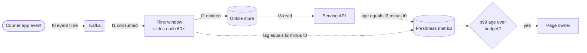

**Reading the diagram.** An event is created at $t_0$, consumed by the streaming job at $t_1$ (consumer lag), included in a window emission at $t_2$ (window slide plus compute), and read by the serving API at $t_3$. The two dotted measurement paths are asynchronous: the job reports materialization lag and the serving API reports age at read. Only the read-side metric catches a job that has stopped emitting. The alert compares the p99 age with the feature's staleness budget and pages the owner from the registry. Failure points: Kafka consumer lag, a stalled window operator, a slow online-store write. Scaling: add Kafka partitions and Flink parallelism to reduce $t_1 - t_0$; shorten the slide to reduce $t_2 - t_1$ at higher compute cost.

### 62.10.2 Freshness versus cost

::: formula
**Compute cost of a freshness level**

$$C_{\text{batch}} = \frac{86{,}400}{\Delta} \times v \times h \times p \qquad C_{\text{stream}} = 24 \times v_s \times p$$

| Symbol | Meaning | Units |
|---|---|---|
| $\Delta$ | Batch interval | s |
| $v$, $h$ | vCPUs used by one batch run and its duration including startup | vCPU, h |
| $v_s$ | vCPUs reserved by an always-on streaming job | vCPU |
| $p$ | Price per vCPU-hour | \$/vCPU-h |
| $C_{\text{batch}}$, $C_{\text{stream}}$ | Daily compute cost | \$/day |
:::

::: example
**Worked example — Courier zone load: hourly, 5-minute or streaming?** Staleness budget: $F_{\max} \le 120$ s. Price $p = \$0.048$ per vCPU-hour (§60.11).

1. **Hourly batch from the lakehouse:** $\Delta = 3{,}600$, $T_{\text{ingest}} = 900$ (partition lands 15 min late), $T_{\text{compute}} = 600$, $T_{\text{publish}} = 60$: $F_{\max} = 5{,}160$ s (86 min). Cost: $24 \times 16 \times 0.25 \times 0.048 = \$4.61$/day.
2. **5-minute micro-batch from Kafka:** $\Delta = 300$, $T_{\text{ingest}} = 5$, $T_{\text{compute}} = 60$, $T_{\text{publish}} = 10$: $F_{\max} = 375$ s. Cost: $288 \times 8 \times 0.05 \times 0.048 = \$5.53$/day.
3. **Streaming, 15-minute window sliding every 60 s:** $F_{\max} = 60 + 2 + 1 + 0.05 = 63$ s. Cost: $24 \times 12 \times 0.048 = \$13.82$/day.

**Interpretation.** Only streaming meets the 120 s budget. It costs about 3× the hourly job in compute, yet the difference is roughly \$3,000 a year. An illustrative offline experiment that delays the feature by these amounts gives ETA MAE of 4.30 min (63 s), 4.38 (6 min) and 4.55 (86 min), versus 4.70 without the feature. **Engineering implication.** For a handful of features, compute is not the real cost of freshness; operations are: always-on state, checkpoints, on-call, and a separate backfill path for training. Choose streaming for the few features whose accuracy curve demands it, and keep everything else in batch.
:::

::: mistake
**Mistake — Putting a cache in front of a streaming feature for "free" latency.** A 5-minute cache TTL adds up to 5 minutes of age to a feature engineered to be 60 s fresh. The cache TTL belongs inside the staleness budget (§60.7, §20.8).
:::

## 62.11 Online serving performance

### 62.11.1 Key design and batch reads

The online store is a partitioned key-value store whose access pattern is almost entirely "get the latest values for these $k$ entity keys." Three design rules follow.

1. **One row per entity per view group.** Store all features of an entity that are read together under one key, for example `eta_restaurant:v3:{restaurant_id}`, with the value a compact serialized record (protobuf or a fixed float array) plus one event timestamp per view. A key per *feature* multiplies lookups by the feature count.
2. **Batch every request.** Use one multi-get (Redis `MGET` or pipelining, DynamoDB `BatchGetItem`, Cassandra parallel partition reads) per view group, issued in parallel. §60.10 showed why the number of *calls*, not keys, drives tail latency.
3. **Partition by entity key, and plan for hot keys.** Hash partitioning spreads entities evenly (§14.6), but a popular restaurant appears on thousands of search pages per second. Replica reads and a small in-process cache with a TTL inside the staleness budget absorb it (§14.10, §20.15).

**Figure 62.11 — Online read fan-out for one ETA request.**

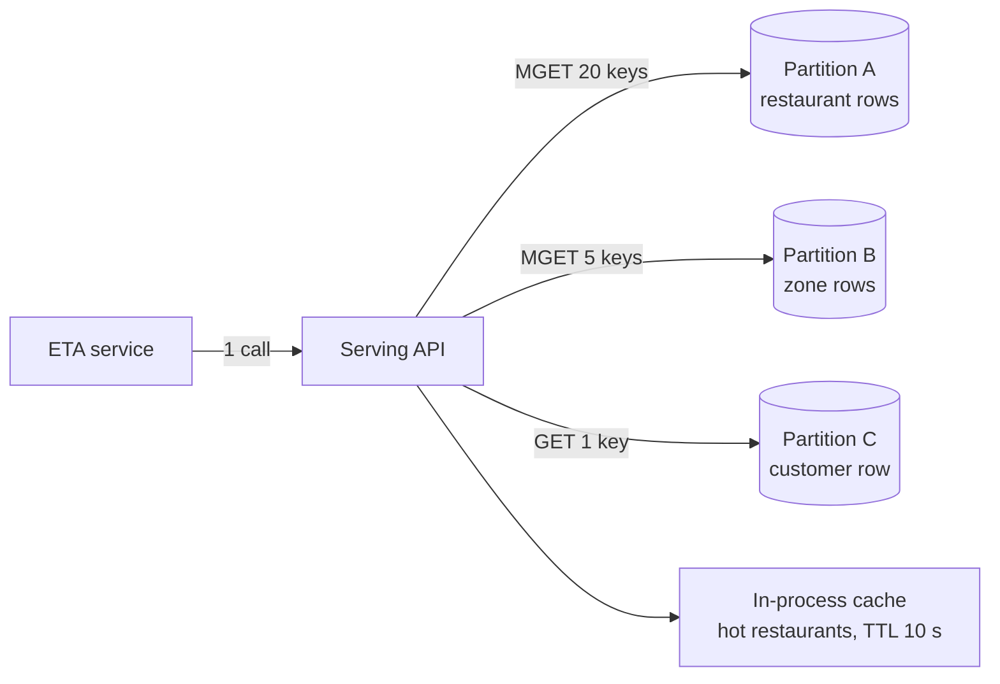

**Reading the diagram.** One synchronous call from the ETA service becomes three parallel batched reads, one per view group, plus local cache hits for hot restaurants. A multi-get that spans partitions is split by the client or a proxy into per-partition sub-requests, so co-locating view groups by key prefix matters less than limiting the number of view groups. Storage boundaries: three logical tables in one online store, plus the process-local cache. Failure points: the slowest partition sets the latency; a cache TTL adds age. Scaling: add partitions for memory, replicas for read throughput.

#### Mathematical foundations

::: formula
**Online read load**

$$Q_{\text{keys}} = R \times \sum_{v} k_v \qquad Q_{\text{values}} = R \times \sum_{v} k_v f_v \qquad Q_{\text{calls}} = R \times G$$

| Symbol | Meaning | Units |
|---|---|---|
| $R$ | Prediction requests per second | requests/s |
| $k_v$ | Distinct entity keys per request for view $v$ | keys |
| $f_v$ | Features in view $v$ | features |
| $G$ | Batched calls per request (view groups) | calls |
| $Q_{\text{keys}}$, $Q_{\text{values}}$, $Q_{\text{calls}}$ | Key lookups, feature values and store calls per second | per s |
:::

::: example
**Worked example — ETA read load at peak.** $R = 2{,}000$ search requests/s, each scoring 20 restaurants (40,000 predictions/s). Views: restaurant batch (20 keys, 12 features), restaurant streaming (20 keys, 3), zone load (5 distinct zones, 4), customer (1 key, 6).

1. Keys per request: $20 + 20 + 5 + 1 = 46$; $Q_{\text{keys}} = 92{,}000$/s.
2. Values per request: $240 + 60 + 20 + 6 = 326$; $Q_{\text{values}} = 652{,}000$/s.
3. With the two restaurant views stored in one row, the restaurant row count drops to 20 keys per request ($Q_{\text{keys}} = 52{,}000$/s), and $G = 3$ calls: $Q_{\text{calls}} = 6{,}000$/s.
4. Tail risk with per-call $p = 0.99$ of meeting the deadline: $0.99^3 = 0.970$ for three batched calls versus $0.99^{46} = 0.630$ for one call per key.

**Interpretation.** A key-per-feature design would issue 652,000 lookups/s; entity rows and batching turn that into 6,000 calls/s. **Engineering implication.** Count calls and keys separately when sizing, and design the row layout around what a model reads together.
:::

::: formula
**Online store memory**

$$M = \frac{r}{u} \sum_{v} E_v \left( f_v \, b_v + o \right)$$

| Symbol | Meaning | Units |
|---|---|---|
| $E_v$ | Entities (keys) in view $v$ | count |
| $f_v$, $b_v$ | Features per entity and bytes per feature value | count, bytes |
| $o$ | Per-key overhead: key, timestamps, store metadata | bytes |
| $r$ | Copies kept (replication factor) | count |
| $u$ | Target memory utilization (headroom) | fraction |
| $M$ | Provisioned memory | bytes |
:::

::: example
**Worked example — Sizing QuickBite's online store.** Use $o = 80$ bytes, $b = 8$ bytes per scalar and 4 bytes per FP32 embedding element.

**Table 62.9 — QuickBite online store sizing.**

| View | Entities | Payload per entity | Bytes per entity | Total |
|---|---|---|---|---|
| Customer profile | 10 M | 40 × 8 = 320 B | 400 B | 4.00 GB |
| Customer embedding | 10 M | 64 × 4 = 256 B | 336 B | 3.36 GB |
| Customer × restaurant affinity | 80 M pairs | 4 × 8 = 32 B | 112 B | 8.96 GB |
| Dish | 5 M | 20 × 8 = 160 B | 240 B | 1.20 GB |
| Restaurant (batch + stream) | 50,000 | 150 × 8 = 1,200 B | 1,280 B | 0.064 GB |
| Courier | 50,000 | 30 × 8 = 240 B | 320 B | 0.016 GB |
| Zone | 4,000 | 30 × 8 = 240 B | 320 B | 0.001 GB |
| **Sum (one copy)** | | | | **17.60 GB** |

1. One copy: 17.60 GB. With $r = 3$ (primary and two replicas): 52.8 GB. At $u = 0.6$: $M = 52.8 / 0.6 = 88.0$ GB.
2. That fits 6 nodes with 16 GB of usable memory each (96 GB): 2 partitions × 3 replicas.
3. Throughput check: 92,000 keys/s spread over 6 nodes is about 15,000 keys/s per node, far below what a single in-memory key-value node typically serves (on the order of 100,000 simple operations per second, illustrative; benchmark yours).

**Interpretation.** Memory, not throughput, sizes this store, and the affinity table (the affinity cross feature of §62.3.6, 80 million pairs) is half of it while being read for only a few models. **Engineering implication.** Place large, rarely read views on a disk-backed key-value store (DynamoDB- or Cassandra-class, single-digit millisecond reads) and keep small, hot views in memory; a tiered online store is cheaper than sizing RAM for the largest table.
:::

### 62.11.2 Fitting the latency budget

§60.10 gave the ETA service's feature fetch 30 ms at p99 across two stores. The online feature store's share should be specified as a store SLO at p99.5 (because the stage waits for several calls) of about 10 ms, leaving room for the serving API's own work, deserialization and on-demand transforms. Hedged reads after the store's p95 (§23.7) and a deadline that falls back to defaults keep the tail bounded. Defaults must be the same values training used for missing features, or every timeout becomes a small skew event.

## 62.12 Feast architecture

### 62.12.1 Concepts and components

**Feast** is an open-source feature store originally developed by Gojek with Google Cloud and released in 2019. It is a useful reference because its concepts map directly onto Figure 62.5 [Feast Docs]. As of 2026, its core concepts are:

- **Entity:** the business object features describe, with its join key (`restaurant_id`).
- **Data source:** where feature rows come from (a warehouse table, Parquet files, a push or Kafka source), with an event-timestamp column and optionally a created-timestamp column used to break ties between rows with the same event time.
- **Feature view:** a named group of features from one source for one or more entities, with a schema and a **TTL** that bounds how far back point-in-time retrieval looks.
- **On-demand feature view:** a function over request data and other views, executed at retrieval time in both serving and training retrieval.
- **Feature service:** a named set of features one model version consumes.
- **Registry:** the stored catalog of all definitions, updated by `feast apply` from Python definition files kept in Git.
- **Offline and online stores:** pluggable; offline options include BigQuery, Snowflake, Redshift, Spark and files; online options include Redis, DynamoDB, Bigtable, Cassandra-compatible stores and SQLite for development.
- **Materialization:** `feast materialize` or `materialize-incremental` copies the latest values per entity from the offline store to the online store.

```python
# illustrative: Feast feature definitions (feature_repo/eta.py); not executed here
from datetime import timedelta
from feast import Entity, FeatureService, FeatureView, Field, FileSource
from feast.types import Float32, Int64

restaurant = Entity(name="restaurant", join_keys=["restaurant_id"])

ratings_source = FileSource(
    path="s3://quickbite-lake/features/restaurant_rating_30d.parquet",
    timestamp_field="event_timestamp",
    created_timestamp_column="created_at",
)

restaurant_stats = FeatureView(
    name="restaurant_stats",
    entities=[restaurant],
    ttl=timedelta(days=2),
    schema=[Field(name="rating_mean_30d", dtype=Float32),
            Field(name="orders_count_30d", dtype=Int64)],
    source=ratings_source,
)

eta_v7 = FeatureService(name="eta_v7", features=[restaurant_stats])

# Training: point-in-time join against orders (entity_df has restaurant_id,
# event_timestamp and the label):
#   store.get_historical_features(entity_df=orders, features=eta_v7).to_df()
# Serving:
#   store.get_online_features(features=eta_v7,
#                             entity_rows=[{"restaurant_id": 17}]).to_dict()
```

What to notice:

- The same `FeatureService` names the features for both retrieval paths, which is the single-definition pattern of §62.9.4.
- `ttl` is applied relative to each training row's timestamp and to the read time online, so both paths treat stale values the same way.
- Feast mostly *serves and joins* features that other pipelines computed; transformation support (on-demand views, stream feature views) has grown over time, but heavy batch and streaming computation typically still runs in Spark, SQL or Flink.

**Figure 62.12 — Feast components.**

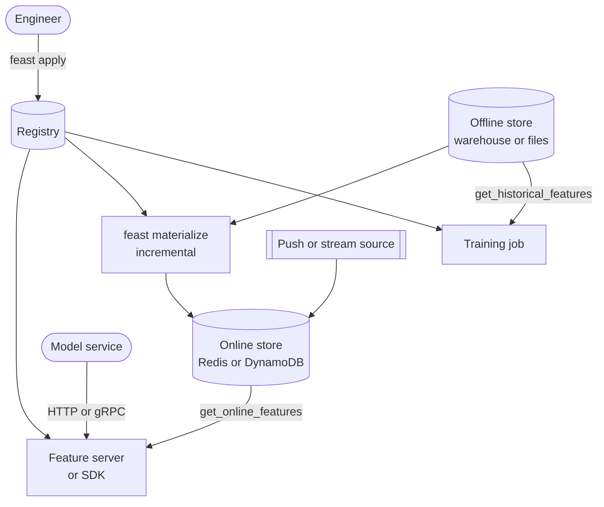

**Reading the diagram.** An engineer registers definitions with `feast apply`. Training jobs call historical retrieval, which performs the point-in-time join in the offline store's engine. Materialization (scheduled by your orchestrator) copies the latest values to the online store; push or stream sources write fresh values directly. Model services read through the Python SDK or a feature server over HTTP or gRPC. Synchronous paths are the two retrievals; materialization and pushes are batch or streaming writes. Failure points: an unscheduled materialization (stale online values), registry drift between environments. Scaling is inherited from the chosen stores.

## 62.13 Other published architectures

### 62.13.1 Michelangelo, Zipline and managed platforms

::: industry
**Uber Michelangelo — shared feature store with batch and near-real-time paths.** Hermann and Del Balso's 2017 post describes a feature store shared across teams, with features computed by batch jobs (stored in HDFS/Hive for training and bulk-loaded into Cassandra for serving) and by near-real-time jobs (Kafka streams processed by Samza, written to Cassandra and logged back to HDFS for training). A domain-specific language (DSL) selected and transformed features as part of the model configuration, applied identically in training and serving. The post reports approximately 10,000 features in the store at the time. Later Uber talks call the feature-engineering platform **Palette**.
*Evidence: Primary* — [Hermann and Del Balso 2017]; Palette name from conference talks (see open verification items)
:::

::: industry
**Airbnb Zipline and Chronon — declarative features with point-in-time backfills.** Airbnb's talks describe Zipline as a declarative framework in which engineers define features once as aggregations over sources, and the system both backfills point-in-time-correct training data and serves the same features online. In 2024 Airbnb open-sourced **Chronon**, its feature platform, which continues this declarative design (as of 2026).
*Evidence: Secondary* — conference talks [Simha and Zanoyan 2018; Zanoyan et al. 2019]; Chronon announcement [Airbnb 2024]
:::

::: industry
**Managed platforms (as of 2026).** **Tecton** was founded by members of the Michelangelo team to offer a managed feature platform and was a major contributor to Feast; Databricks announced an agreement to acquire Tecton in August 2025. **Databricks** stores feature tables as Delta tables governed by Unity Catalog, with an online serving option. **Amazon SageMaker Feature Store** (launched 2020) organizes features into feature groups, each with a record identifier and an event-time field, and provides an online store and an S3-based offline store.
*Evidence: Primary* — vendor documentation [AWS Docs: SageMaker Feature Store; Databricks Docs: Feature engineering]; acquisition from public announcements (see open verification items)
:::

**Table 62.10 — Published feature store designs at a glance.**

| System | Definition style | Offline | Online | Streaming path |
|---|---|---|---|---|
| Michelangelo (2017) | DSL in model config | HDFS/Hive | Cassandra | Kafka → Samza |
| Zipline / Chronon | Declarative aggregations | Hive/Spark | Key-value store | Kafka-based |
| Feast | Python definitions | Pluggable warehouse | Pluggable KV | Push/stream sources |
| SageMaker Feature Store | Feature groups | S3 tables | Managed online store | Ingest API |

The common shape is clear: one definition, an append-only offline history, a key-value online store, and a streaming path for fresh aggregates. The differences lie in how much computation the platform owns, from Feast's "bring your own pipelines" to Zipline's "declare the aggregation and we compute both paths."

## 62.14 Feature store versus data warehouse

**Table 62.11 — Feature store versus data warehouse.**

| Row | Data warehouse / lakehouse | Feature store |
|---|---|---|
| What it is | Analytical store of business data | Serving and management layer for model inputs |
| How it works | SQL over columnar tables | Registry + offline history + online KV + PIT joins |
| Advantages | Flexible queries; one source of truth | Consistency, reuse, PIT training data, ms serving |
| Disadvantages | Seconds per query; no PIT semantics built in | Extra system; definitions must be curated |
| Performance | Seconds; high scan throughput | Online p99 a few ms; offline like the warehouse |
| Operational complexity | Already run by data teams | New on-call service on the request path |
| Cost | Pay per scan or cluster | Warehouse cost plus online store and jobs |
| Use cases | BI, reporting, ad-hoc analysis | Online inference with shared, fresh features |
| Choose when | Batch scoring; few models | Many models, online serving, freshness needs |

A feature store usually *sits on top of* the warehouse; its offline store is often just warehouse tables with timestamps. You probably **do not need a feature store** when you have one or two models, predictions are batch-scored (§60.8), features come straight from the request, or a single team owns both training and serving code. In those cases, a disciplined set of warehouse tables with event timestamps, an as-of join helper and logged serving features gives most of the benefit. Adopt one when a second team wants your features, when online inference needs fresh aggregates, or when skew incidents start recurring.

## 62.15 Feature governance

### 62.15.1 Treating features as products

A shared catalog of thousands of features is an asset only if each entry is trustworthy. Governance means five practices.

1. **Ownership.** Every feature view has an owning team and on-call contact in the registry; alerts route there (Figures 62.8 and 62.10).
2. **Documentation.** Description, entity, window, source, freshness budget, default value, units, and lineage to source tables, generated into a searchable catalog.
3. **Versioning and deprecation.** Definitions are immutable once consumed; a change creates a new version. The registry records which feature services (and so which models) use each version, so a deprecation can name every consumer and set a removal date. Sculley et al.'s **undeclared consumers** are the risk this removes [Sculley et al. 2015].
4. **Access control.** Read permissions per view, enforced by the serving API and the offline store; fraud features may be visible to fraud models only.
5. **Personal data (PII).** Tag views containing personal data, keep raw identifiers out of features where possible (derive "orders in last 30 days" rather than storing addresses), honor deletion requests in both stores, and record the purpose of use for each consumer. Chapter 71 covers privacy techniques.

**Figure 62.13 — Lifecycle of a feature view.**

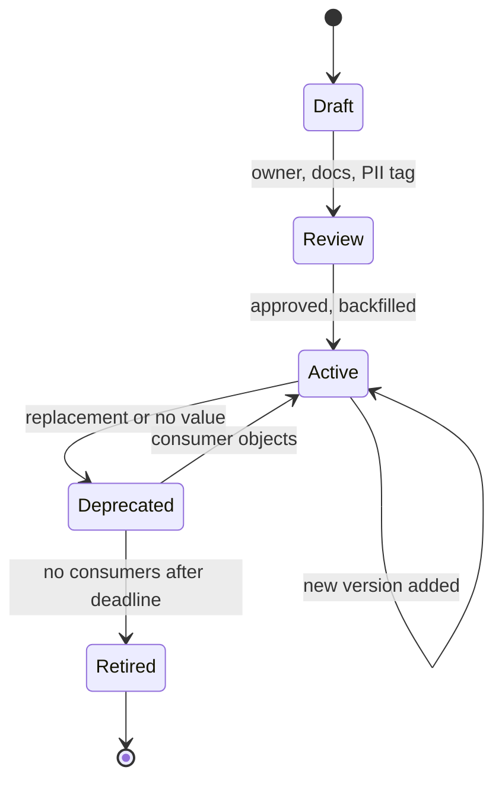

**Reading the diagram.** A feature starts as a draft and must pass review (owner, documentation and PII classification) before it is backfilled and becomes active. Changes create a new active version rather than editing the old one. Deprecation starts a countdown during which the registry lists remaining consumers; a feature returns to active if a consumer cannot migrate. Retirement deletes the online data and stops materialization; offline history is kept for reproducibility according to retention policy. All transitions are registry operations, not request-path events; the failure point is retiring a feature that an undeclared consumer still reads, which is why consumption must be recorded at the serving API.

## 62.16 Summary and revision notes

::: summary
- A feature value belongs to an **entity** and a **time**; most feature bugs lose track of one of them.
- Numeric transforms, encodings and bucket boundaries have fitted parameters: fit on training data, version with the model, apply identically in serving. Target encoding leaks unless computed out-of-fold or from earlier data; hashing trades memory for collisions ($P \approx 1 - e^{-(n-1)/m}$).
- Run each transformation where its inputs exist and its freshness requires: in-model, on demand, streaming or batch. Prefer batch unless the accuracy-versus-staleness curve demands streaming.
- A feature store provides reuse, one definition for training and serving, point-in-time training data, millisecond serving and governance, through a registry, offline store, online store, materialization jobs, serving API and monitoring.
- Point-in-time joins attach the latest value at or before each example's time, preferably by availability time, within a TTL. Naive joins inflate offline metrics (3.22 versus an honest 4.34 min MAE in the simulation).
- Detect skew row by row (served versus recomputed); distribution statistics such as PSI detect shift but can miss skew. Prevent it with single definitions, log-and-wait and tested defaults.
- Measure feature age at read time against a per-feature staleness budget; the real cost of freshness is operational.
- Size online stores by memory (17.6 GB per copy for QuickBite) and design keys so that one request is a few batched calls.
:::

## 62.17 Knowledge checkpoint

1. Why must standardization parameters be versioned with the model?
2. How does target encoding leak, and name two defenses.
3. With 50,000 categories in $2^{20}$ hash buckets, roughly what fraction collide?
4. Which QuickBite feature should be computed on demand, and why?
5. Name the five problems a feature store solves.
6. Distinguish event timestamp from availability timestamp.
7. In Table 62.6, why does order A get different values from the two point-in-time joins?
8. What does a feature view's TTL do in training and in serving?
9. Why did the naive model in §62.8.2 put more weight on the feature?
10. Why did the time-zone bug in §62.9.3 escape the PSI check?
11. What is log-and-wait, and what is its main limitation?
12. Why must feature age be measured at read time rather than only at write time?
13. Why did memory, not throughput, size QuickBite's online store?
14. When do you not need a feature store?

<details><summary>Answers</summary>

1. Serving must apply the same $\mu$ and $\sigma$ as training; recomputing them from live traffic creates skew.
2. The category mean includes each row's own label; use out-of-fold or time-ordered statistics, and smoothing.
3. About $1 - e^{-0.048} \approx 4.7\%$.
4. Customer–restaurant distance: its input (the customer's current location) exists only in the request.
5. Reuse, consistency, point-in-time training data, low-latency serving, governance.
6. Event time is when the value became true; availability time is when it was readable by serving.
7. Order A falls inside the 3-hour publication delay, so serving still held the previous value.
8. It sets the maximum age of a usable value relative to the example timestamp (training) or read time (serving); older values become defaults.
9. In training the feature partly contained the label, so it looked more predictive than it is in serving.
10. Shifting a flat distribution by one hour barely changes the histogram; only the row-level comparison catches it.
11. Log served features and join them with later outcomes; it gives no history for a new feature.
12. A stalled job writes nothing, so write-side lag stops reporting while read-side age keeps growing.
13. 92,000 keys/s is light for six in-memory nodes, but 17.6 GB × 3 copies / 0.6 needs 88 GB.
14. With few models, batch scoring, request-only features or one team owning both paths.

</details>

## 62.18 Interview questions

### Basic

**Q1. What is a feature store, and what are its offline and online stores for?** **Answer.** A system that manages feature definitions and values for both training and serving. The offline store keeps full timestamped history in columnar tables for point-in-time training data and batch scoring; the online store keeps the latest value per entity in a key-value store for millisecond inference reads. Both are fed from one definition.

**Q2. What is training–serving skew? Give two causes.** **Answer.** A difference between the features (or performance) seen in training and in serving. Causes: separate code paths (UTC versus local time), different freshness (a lagging stream online), or different missing-value handling.

### Intermediate

**Q3. How would you build training data for a fraud model that uses "card transactions in the last hour"?** **Answer.** Store the feature's history with event and availability timestamps. Take labeled transactions with their timestamps as the entity table and perform an as-of join: for each, the latest window value available before the transaction, within a TTL. Split by time. Validate against a few days of logged served values, then switch to log-and-wait.

**Q4. A streaming feature's p99 age is 9 minutes against a 2-minute budget. How do you investigate?** **Answer.** Decompose the age: consumer lag ($t_1 - t_0$), window slide and compute ($t_2 - t_1$), write latency, and any cache TTL. Check for hot keys, checkpoint stalls or a job that stopped emitting (age growing linearly). Fix the dominant term, then alert on read-side age.

### Advanced

**Q5. Design feature retrieval for 40,000 ETA predictions/s within 30 ms p99.** **Answer.** Group features into entity rows per view group (restaurant, zone, customer), giving three parallel multi-gets per request (6,000 calls/s, 52,000 keys/s). Store SLO about 10 ms at p99.5; hedge after p95; local cache with a 10 s TTL for hot restaurants, counted in the staleness budget; deadlines that fall back to training-identical defaults; return ages; log served vectors asynchronously.

**Q6. Your team proposes adopting a feature store for one batch-scored churn model. Respond.** **Answer.** Probably not yet: batch scoring needs no online store, and one team owns both paths. Use timestamped warehouse tables, an as-of join helper and a time-based split. Revisit when online inference, a second consuming team or recurring skew incidents appear; at that point adopt an existing store rather than building one.

## 62.19 Practical exercises

1. Modify the §62.8.2 program so the feature is published at 03:00 rather than midnight, implement a join on availability time, and measure how many training rows change.
2. Add a "missing indicator" feature to the skew detector and show that it exposes the zero-fill bug through PSI as well.
3. Re-size Table 62.9 with 128-dimensional FP16 customer embeddings and 200 million affinity pairs; which views would you move to a disk-backed store?
4. Write a smoothed, time-ordered target encoding for restaurant ID with NumPy and compare its validation MAE with a full-data encoding.

## 62.20 Design challenges

1. **Fraud features at checkout.** Design features for QuickBite's fraud model (0.5% fraud rate, about 60 orders/s at peak) that need sub-second freshness for "orders per card in 10 minutes." Specify pipelines, PIT training data, TTLs, a skew audit and a 20 ms retrieval budget.
2. **Feature platform migration.** Three teams maintain separate ETA, ranking and fraud pipelines with overlapping restaurant features. Plan a migration to a shared feature store: registry design, ownership, versioning, backfill validation, rollout order and fallback if the online store fails.

## 62.21 References

1. Airbnb. *Chronon, Airbnb's ML Feature Platform, Is Now Open Source*. The Airbnb Tech Blog, 2024.
2. Amazon Web Services. *Amazon SageMaker Feature Store*. Amazon SageMaker Developer Guide, n.d. https://docs.aws.amazon.com/sagemaker/latest/dg/feature-store.html
3. Breck, E., Cai, S., Nielsen, E., Salib, M., Sculley, D. *The ML Test Score: A Rubric for ML Production Readiness and Technical Debt Reduction*. IEEE International Conference on Big Data, 2017.
4. Cheng, H.-T., et al. *Wide & Deep Learning for Recommender Systems*. Workshop on Deep Learning for Recommender Systems (DLRS), 2016.
5. Databricks. *Feature engineering and serving*. Databricks documentation, n.d.
6. Feast Authors. *Feast documentation: concepts (entities, data sources, feature views, feature retrieval, point-in-time joins)*. n.d. https://docs.feast.dev
7. Hermann, J., Del Balso, M. *Meet Michelangelo: Uber's Machine Learning Platform*. Uber Engineering Blog, 2017.
8. Huyen, C. *Designing Machine Learning Systems*. O'Reilly, 2022.
9. Kleppmann, M. *Designing Data-Intensive Applications*. O'Reilly, 2017.
10. Micci-Barreca, D. *A Preprocessing Scheme for High-Cardinality Categorical Attributes in Classification and Prediction Problems*. ACM SIGKDD Explorations 3(1), 2001.
11. Orr, L., Sanyal, A., Ling, X., Goel, K., Leszczynski, M. *Managing ML Pipelines: Feature Stores and the Coming Wave of Embedding Ecosystems*. Proceedings of the VLDB Endowment 14(12) (tutorial), 2021.
12. Prokhorenkova, L., Gusev, G., Vorobev, A., Dorogush, A. V., Gulin, A. *CatBoost: Unbiased Boosting with Categorical Features*. NeurIPS, 2018.
13. Sculley, D., Holt, G., Golovin, D., Davydov, E., Phillips, T., Ebner, D., Chaudhary, V., Young, M., Crespo, J.-F., Dennison, D. *Hidden Technical Debt in Machine Learning Systems*. NeurIPS, 2015.
14. Simha, N., Zanoyan, V. *Zipline: Airbnb's Machine Learning Data Management Platform*. Spark+AI Summit, 2018.
15. Weinberger, K., Dasgupta, A., Langford, J., Smola, A., Attenberg, J. *Feature Hashing for Large Scale Multitask Learning*. ICML, 2009.
16. Zanoyan, V., Shapiro, E. *Zipline: A Declarative Feature Engineering Framework*. Strange Loop, 2019; also presented at Data Council.
17. Zinkevich, M. *Rules of Machine Learning: Best Practices for ML Engineering*. Google for Developers, n.d. https://developers.google.com/machine-learning/guides/rules-of-ml

## 62.22 Open verification items

- Zipline talks: exact titles, speakers, venues and years (Spark+AI Summit 2018; Strange Loop 2019; Data Council slides labeled SF20, possibly 2020 rather than 2019); the tiling claim comes from the Data Council slides.
- Uber "Palette" name: confirm the talk (e.g., 2019) that introduced it; confirm the "approximately 10,000 features" figure and the Samza/Cassandra/Hive details in the 2017 post.
- Databricks–Tecton: announced August 2025 per press reports; confirm against Databricks' own announcement and whether it was an asset acquisition.
- Chronon announcement title and date (2024); Orr et al. 2021 venue details.
- Feast: current API names (`timestamp_field`, `created_timestamp_column`, `FeatureService` in retrieval calls) and the list of supported stores; docs.feast.dev was not reachable while writing.
- Zinkevich rule numbers (#29, #31, #32, #37).
- Prices (\$6/TB scanned, \$1 per million writes) and the 100,000 ops/s per-node figure are illustrative.
