# Chapter 63 — Data Labeling, Quality and Data-Centric AI

> **Level:** 3 · **Track:** B (ML/AI) · **Estimated reading time:** 4.5 h

A cook with a mediocre oven and excellent ingredients usually beats a cook with a superb oven and spoiled ingredients. Machine learning works the same way. The model is the oven; the labeled examples are the ingredients. Most of what you learned in Chapters 57–60 assumed that someone had already handed you a clean table of features and **labels** (the correct answers, §57.6.2). This chapter is about where those labels come from, how wrong they are, how to measure and repair them, and how to build the pipelines and operations that produce them at a predictable cost.

The running example is **QuickBite**, the hypothetical food-delivery platform of Chapter 2 and Chapters 57–60. Its shared assumptions are unchanged: 500,000 orders per day, about 60 orders/s at peak, a 0.5% fraud rate on orders and a 35-minute median delivery time. This chapter adds one assumption of its own: **4% of orders produce a written review**, so QuickBite receives about 20,000 reviews per day that a moderation model must screen. Every QuickBite number is a teaching assumption, not a measurement of any real company.

## 63.1 Learning objectives

After this chapter you should be able to:

- Explain the data-centric view of ML and decide, from error analysis, whether to invest in labels or in the model.
- Classify a label source as natural, delayed, human or programmatic, and compute a label-maturity window from a delay distribution.
- Design a human labeling pipeline (task, guidelines, queue, gold questions, adjudication) and estimate its throughput, headcount and cost.
- Compute percent agreement, Cohen's κ, Fleiss' κ and Krippendorff's α, and explain when each is appropriate.
- Aggregate noisy labels with majority vote and with the Dawid–Skene EM algorithm, and say why the second usually wins.
- Build a weak-supervision pipeline from labeling functions and evaluate them by coverage, overlap, conflict and accuracy.
- Run an active-learning loop and estimate the labeling cost it saves.
- Detect likely label errors with confident learning and loss-based filtering.
- Downsample a rare class and correct the model's probabilities afterwards.
- Decide when synthetic data helps and recognize distribution mismatch and model collapse.
- Document a dataset with a datasheet or data card, and operate labeling at scale with attention to cost, privacy, annotator well-being and LLM-assisted labeling.

## 63.2 Prerequisites

- Features, labels, label sources and leakage — §57.6 (this chapter goes deeper on labels; leakage is owned there).
- Classification metrics, calibration and log loss — §57.10 (used to evaluate label quality and to recalibrate after sampling).
- The ML lifecycle, data validation, label delay and feedback loops — §59.5, §59.7, §59.12.2, §59.13.2 (labeling is one stage of that loop).
- Data-centric versus model-centric architecture — §60.4 (the architectural argument this chapter turns into practice).
- Probability, conditional probability and Bayes' rule — §4.6 (Dawid–Skene and the calibration correction are applications of Bayes' rule).
- Message queues and work distribution — Chapter 30 (a labeling queue is a work queue with humans as consumers).
- Privacy engineering — Chapter 50 (annotation exposes raw data to people outside the core team).

Data quality checks at pipeline scale (schema validation, freshness, completeness, distribution tests) belong to Chapter 61. Fairness of labels and datasets is treated in Chapter 71. Human preference data for aligning large language models (RLHF and its successors) is a specialized labeling problem owned by Chapter 76; this chapter only previews it in §63.14.

## 63.3 Data-centric AI

### 63.3.1 Why data quality often beats model changes

::: definition
**Definition — Data-centric AI.** An approach to building ML systems in which the model architecture is held roughly fixed and the main lever for improvement is the systematic engineering of the data: label definitions and consistency, coverage of rare cases, removal of errors, and the documentation and versioning of datasets. The contrast is **model-centric** development, in which the dataset is held fixed and the model is iterated (§60.4.1).
:::

#### First-principles explanation

Think of a model as a student and the labeled dataset as the answer key it studies from. If 10% of the answers in the key are wrong, a brilliant student learns the wrong answers faithfully; a cleverer student learns them *more* faithfully. Large neural networks can fit completely random labels on their training set [Zhang et al. 2017], so a model's capacity is no protection against a bad answer key. Fixing the key helps every student at once.

#### Why does this exist?

For a decade, ML research progressed by holding benchmark datasets fixed (ImageNet, GLUE) and competing on models. That is a sensible scientific protocol, but production teams do not have a fixed dataset; they have whatever their logging, labeling and pipelines produce. Andrew Ng popularized the term *data-centric AI* in a 2021 talk and the associated NeurIPS workshop and competition, arguing that for many applied problems, especially those with small datasets, systematically improving label consistency yields larger gains than changing the model [Ng 2021]. In the talk he showed industrial visual-inspection projects in which model-centric work on a fixed dataset added almost nothing while data-centric work on the same baseline added several points of accuracy, and in one case many more (the exact figures are listed in §63.21). The idea is older than the name: practitioners have long known that "garbage in, garbage out", and the hidden-technical-debt literature (§60.14) located most of an ML system's cost in data dependencies [Sculley et al. 2015].

Sambasivan et al. interviewed 53 practitioners building high-stakes AI systems and named the failure mode **data cascades**: compounding, delayed problems that start with undervalued data work (poorly specified labels, unmeasured annotator quality, missing documentation) and surface much later as model failures. They reported that such cascades were close to universal in their sample [Sambasivan et al. 2021].

#### How it works internally

A data-centric iteration replaces "try another model" with five steps:

1. **Train a reasonable baseline** with an off-the-shelf model (gradient-boosted trees for tabular data, a pretrained network for text or images).
2. **Do error analysis**: read the worst-scoring examples, grouped by slice (city, restaurant category, review language).
3. **Diagnose the cause** of each cluster of errors: wrong label, ambiguous label definition, missing coverage, missing feature.
4. **Fix the data**: relabel, rewrite the guideline, add examples of the rare case, add the feature (Chapter 62).
5. **Version the dataset** and retrain with the *same* model so that the change in the metric is attributable to the data.

**Figure 63.1 — Model-centric and data-centric iteration loops.**

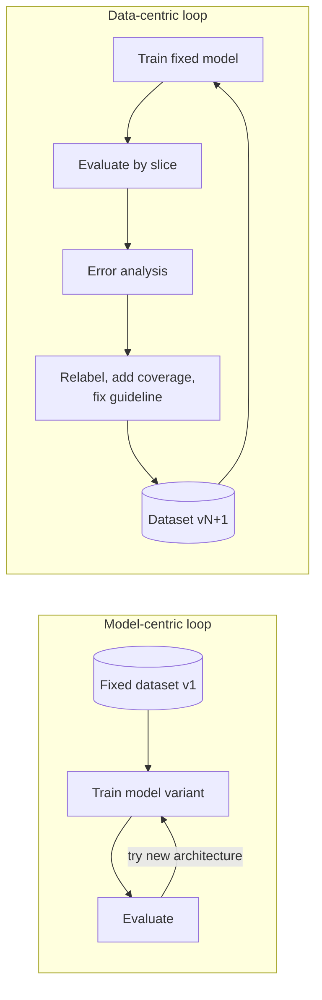

**Reading the diagram.** The left subgraph is the classic research loop: one dataset (cylinder, a storage boundary that never changes), with iteration only between training and evaluation. The right subgraph moves the loop through the data: evaluation is by slice, error analysis routes failures to fixes in labels and coverage, and each fix produces a new dataset version that the *same* model is retrained on. All arrows are batch, offline steps; nothing here is on the serving path. The failure point of the left loop is a ceiling set by label noise; the failure point of the right loop is unversioned datasets, which make results irreproducible (§59.14). The right loop scales with labeling capacity, which is why the rest of this chapter is about labeling pipelines.

### 63.3.2 QuickBite's three labeled datasets

QuickBite's ML problems show the three typical label situations. Each will reappear throughout the chapter.

**Table 63.1 — Where QuickBite's labels come from.**

| Problem | Label | Source | Delay | Main quality problems |
|---|---|---|---|---|
| Fraud detection | 1 if a fraud chargeback arrives | Card network chargeback feed | 15–90 days | Late arrival; non-fraud chargebacks ("friendly fraud", disputes about food); blocked orders never get a label |
| ETA prediction | Minutes from order to delivery | Delivery events from the courier app | ~35 min | Courier taps "delivered" late; canceled orders have no label; batched deliveries |
| Review moderation | Keep or remove (spam, abuse, personal data) | Human annotators | Hours to days | Ambiguous guidelines; annotator disagreement; rare positive class |

**Fraud labels from chargebacks.** A chargeback is the card network reversing a payment after the cardholder disputes it. It is a *natural* label (nobody is paid to produce it) but a dirty one. Chargeback **reason codes** distinguish "card not present fraud" from "goods not received" or "not as described"; only the first should become a fraud label, so the label pipeline must filter by reason code. A customer who disputes an order they really placed ("friendly fraud") produces a fraud-coded chargeback on a legitimate order, which is label noise. And orders that the current model *blocked* never produce a chargeback at all, so the training data contains labels only for orders the old model let through, a selection bias that feeds back into the next model (§59.13.2).

**ETA labels from delivery events.** The label is computed by joining the `order_placed` and `order_delivered` events. Chapter 60 showed that replacing the courier's "delivered" tap with GPS arrival time cut ETA error more than a model change did (Table 60.4). Canceled orders are **censored**: their true delivery time is unknown, and silently dropping them biases the training set toward easy orders.

**Moderation labels for reviews.** No natural signal says whether a review is abusive, so QuickBite must pay people to decide. Here every label has a cost, a latency and a measurable disagreement rate, and the problem looks like the classic annotation problem studied since the 1960s.

#### Real-world industry applications

::: industry
**Data-centric AI in visual inspection.** In his 2021 talk, Ng described manufacturing inspection projects (for example, steel-sheet defects) where a team fixed the model and improved label consistency, for instance by rewriting the definition of a defect so that annotators drew boxes the same way, and obtained larger accuracy gains than another team that held the data fixed and searched over models. The broader lesson he drew was that small, consistent datasets often beat large, noisy ones.
*Evidence: Primary* — [Ng 2021]
:::

::: industry
**Data cascades.** Sambasivan et al.'s interview study of AI practitioners working in high-stakes domains (health, conservation, finance and others) described cascades triggered by data collection practices, by brittle real-world conditions and by poorly documented data, and found that they were rarely caught by standard model metrics.
*Evidence: Primary* — [Sambasivan et al. 2021]
:::

#### Common misconceptions

::: mistake
**Mistake — "More data always beats better data."** More data helps when the extra examples carry the same signal-to-noise ratio. Adding 1 million weakly labeled rows with 30% noise to 50,000 clean rows can lower accuracy on the cases that matter, because the noisy majority dominates the loss. Measure label quality before scaling label quantity.
:::

::: mistake
**Mistake — "Data-centric means no model work."** It means attributing gains correctly. Hold the model fixed while you change data, hold the data fixed while you change the model, and version both. Error analysis decides which lever to pull next (§60.4.2).
:::

## 63.4 Sources of labels

### 63.4.1 Four kinds of label

::: definition
**Definition — Label sources.** A **natural label** is produced by the world as a side effect of the product: a delivery completes, a user clicks, a payment is reversed. A **delayed label** is any label (usually natural) that becomes known a significant time after the prediction. An **explicit human label** is produced by a person who is asked to judge an example against a written guideline. A **programmatic label** is produced by code: a heuristic, a rule, a lookup in a knowledge base, or another model.
:::

#### First-principles explanation

Picture four ways a teacher could get the answers to a test. The world grades some questions itself (did the parcel arrive on time?). Some answers arrive by post weeks later (did the bank reverse the payment?). Some must be graded by hand by a hired marker. Some can be graded roughly by a rule of thumb ("any answer containing a phone number is spam"). Real systems mix all four, and each has a different cost, delay and error profile.

**Table 63.2 — Comparison of label sources.**

| Row | Natural | Delayed natural | Explicit human | Programmatic |
|---|---|---|---|---|
| What it is | Outcome logged by the product | Outcome that arrives later | Judgment by an annotator | Output of rules or models |
| QuickBite example | ETA from delivery events | Fraud from chargebacks | Review moderation | "Contains a phone number → spam" |
| Cost per label | ≈ 0 | ≈ 0 | \$0.05–\$5+ (task-dependent) | ≈ 0 after writing the rule |
| Latency | Minutes | Weeks to months | Hours to days | Seconds |
| Typical noise | Instrumentation errors, censoring | Immaturity, reason-code noise | Disagreement, fatigue | Systematic bias, low coverage |
| Volume | All traffic | All traffic | Budget-limited | All matching traffic |
| Choose when | Outcome is observable | Outcome is observable but slow | No outcome exists; judgment needed | Domain knowledge is cheap to encode |

The human-label cost range is deliberately wide: a two-second binary judgment on a crowd platform and an hour of a radiologist's time are both "explicit human labels". Use your own pilot measurement, never a book's range, for budgeting (§63.5.3).

**Figure 63.2 — Label sources flowing into a label store.**

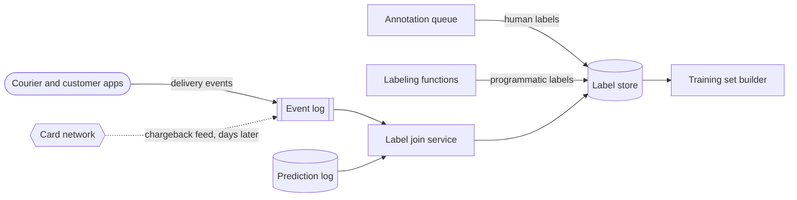

**Reading the diagram.** Natural labels arrive as events from QuickBite's apps into an event log (Kafka, Chapter 31). The external card network (hexagon) sends chargebacks asynchronously (dotted arrow), days or weeks after the order. A label join service matches each outcome to the prediction that was logged at serving time (§59.5.3), so that the label lands next to the exact features the model saw. Human labels from the annotation queue (§63.5) and programmatic labels from labeling functions (§63.8) are written to the same label store, a versioned table keyed by example ID, label source and label version. The training set builder reads the store with point-in-time rules (Chapter 62). Failure points: the join (missing or duplicated prediction IDs), the external feed (late or reformatted files) and the store's retention (features must be kept until labels mature). The store scales with examples × label sources × versions; keeping the source on every row is what lets you later weight or drop a bad source.

### 63.4.2 Label delay and its effect

A delayed label creates a window during which a positive example looks negative. Chapter 57 introduced the effect with an assumed QuickBite chargeback-delay distribution: 40% of eventual fraud chargebacks arrive within 15 days, 75% within 30, 95% within 60 and 100% within 90 (§57.6.2). Here we turn it into a design rule for building training sets.

::: formula
**Label completeness and the maturity window**

$$\pi_{\text{obs}}(a) = \pi \cdot F(a) \qquad C(a_1, a_2) = \frac{1}{a_2 - a_1}\int_{a_1}^{a_2} F(a)\,da \qquad W_\varepsilon = \min\{a : F(a) \ge 1 - \varepsilon\}$$

| Symbol | Meaning | Units |
|---|---|---|
| $a$ | Age of an example: time since the prediction | days |
| $F(a)$ | Fraction of eventual positive labels that have arrived by age $a$ (delay CDF) | dimensionless |
| $\pi$ | True positive rate in the population (fraud prevalence) | fraction |
| $\pi_{\text{obs}}(a)$ | Observed positive rate among examples of age $a$ | fraction |
| $C(a_1, a_2)$ | Average label completeness of a training window covering ages $a_1$ to $a_2$, uniform traffic assumed | fraction |
| $\varepsilon$ | Tolerated fraction of missing positives | fraction |
| $W_\varepsilon$ | Label-maturity window: minimum age before an example is used | days |
:::

::: example
**Worked example — How old must QuickBite's fraud training data be?** Use the delay distribution above, interpolated linearly between the points (and $F(0) = 0$). Fraud prevalence $\pi = 0.5\%$, so QuickBite sees $500{,}000 \times 0.005 = 2{,}500$ fraudulent orders per day.

1. **Naive window, ages 0–30 days.** Area under $F$: from 0 to 15 days, a triangle, $15 \times 0.40 / 2 = 3.0$; from 15 to 30 days, a trapezoid, $15 \times (0.40 + 0.75)/2 = 8.625$. $C(0, 30) = (3.0 + 8.625)/30 = 0.3875$. The observed fraud rate is $0.5\% \times 0.3875 = 0.194\%$: **61% of the fraud in the window is labeled "legitimate"**.
2. **Maturity window.** With $\varepsilon = 0.05$, $W_{0.05} = 60$ days ($F(60) = 0.95$).
3. **Matured window, ages 60–240 days** (180 days of data). From 60 to 90 days $F$ rises from 0.95 to 1.00, average 0.975; from 90 to 240 days $F = 1$. $C = (30 \times 0.975 + 150 \times 1.0)/180 = 179.25/180 = 0.9958$.
4. Positives in the matured window: $2{,}500 \times 180 \times 0.9958 = 448{,}125$. Missing positives: $2{,}500 \times 180 - 448{,}125 = 1{,}875$, mislabeled among about $497{,}500 \times 180 = 89.55$ million negatives, a noise rate of $0.0021\%$ among negatives.
5. **The price.** The freshest example the model learns from is 60 days old, and with a weekly retrain plus a week of rollout, a fraud pattern can run for 60 + 14 = 74 days before any model has trained on it.

**Interpretation.** The naive window does not just lose data; it teaches the model that recent fraud patterns are legitimate, which is exactly backwards. The matured window is nearly clean but stale. **Engineering implication.** Train on matured windows; cover the 60-day blind spot with faster, noisier signals: analyst-reviewed cases, customer dispute tickets and rules written by the fraud team, used as labels with their own source tag (§63.4.1). Alternatively, model the delay explicitly, as in delayed-feedback models that jointly estimate whether and when a positive will arrive [Chapelle 2014].
:::

**Figure 63.3 — Timeline of a fraud model trained on matured labels.**

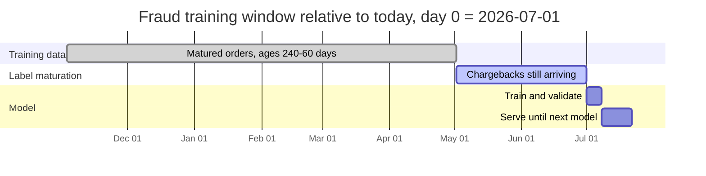

**Reading the diagram.** Time runs left to right. The training data (done) covers 180 days of orders that are at least 60 days old. The most recent 60 days of orders (active) exist in the prediction log but are excluded because their chargebacks are still arriving. Training and validation take about a week, and the model then serves for two weeks until the next one replaces it. Everything here is batch; the only synchronous component is the serving model. The storage boundary is the prediction log, which must retain features for at least 240 days. The failure point is the gap between the end of the training data and the end of serving: a new attack that starts during the active bar is invisible to every model trained in this schedule. Scaling the schedule (daily retrains) shortens the serving bar but not the 60-day maturation bar; only faster labels shrink that.

#### Failure scenarios

**Table 63.3 — Label-source failure scenarios.**

| What goes wrong | Why | Detection | Recovery | Prevention |
|---|---|---|---|---|
| Recent fraud labeled legitimate | Training window younger than maturity window | Positive rate by order age falls toward zero for recent cohorts | Rebuild training set with matured cutoff | Enforce $W_\varepsilon$ in the training set builder |
| Non-fraud chargebacks become fraud labels | Reason codes ignored | Label rate jumps after a merchant dispute wave | Relabel by reason code | Explicit reason-code mapping, reviewed by the fraud team |
| Blocked orders never labeled | Selection bias from the deployed model | Positive rate of training data drifts with model threshold | Use analyst labels for a sample of blocked orders | Keep a small, low-risk exploration sample (§59.13.2) |
| ETA labels biased toward easy orders | Canceled orders dropped silently | Cancellation rate rises while ETA error falls | Model cancellations separately; impute censored labels | Treat censored rows explicitly in the label pipeline |
| Label join drops rows | Prediction IDs missing in logs | Join rate below 99% | Backfill from raw logs | Monitor join rate as a data-quality check (Chapter 61) |

::: mistake
**Mistake — Evaluating on the most recent month "because it is most realistic".** For a delayed label, the most recent month is the *least* realistic: its positives have not arrived yet. A fraud model evaluated on last month's orders is graded against immature truth: most of its correct flags are not yet confirmed, so they count as false positives, and recall is measured against a fraction of the real fraud. Evaluate on the newest *matured* window.
:::

## 63.5 Labeling pipelines

### 63.5.1 Task design and guidelines

::: definition
**Definition — Labeling pipeline.** The system that turns unlabeled examples into trusted labels: it selects examples, presents them to annotators as **tasks** in a labeling tool, collects one or more **judgments** per example, checks annotator quality against **gold questions** (examples whose answer is known), resolves disagreements by **adjudication**, and writes versioned labels with provenance to a label store.
:::

#### First-principles explanation

A labeling pipeline is a factory whose machines are people. Like any factory it has an intake (which examples to label), a work order (the guideline), workstations (the tool), a conveyor (the queue), quality inspection (gold questions and agreement checks) and a supervisor for disputed items (adjudication). Unlike machines, the workers interpret their instructions, get tired, learn, and disagree in patterned ways, so the factory must measure them continuously.

#### Why does this exist?

Ad hoc labeling, such as an engineer labeling a spreadsheet over a weekend, fails in three predictable ways: the label definition drifts as the labeler sees more examples, nobody can tell how accurate the labels are, and nobody can reproduce or extend the dataset six months later. A pipeline makes the definition explicit, the quality measurable and the output versioned.

#### How it works internally

1. **Define the task.** Write the label schema: the classes, whether they are exclusive, and what "unsure" means. For QuickBite moderation: `keep`, `remove:spam`, `remove:abuse`, `remove:personal_data`, plus an `unsure` escape hatch. A binary question ("Should this review be removed?") is faster and more consistent than a free-form one; split a complex judgment into several simple ones.
2. **Write the guideline.** Give a definition for each class, five to ten worked examples per class, and, most important, the **boundary cases**: "a review that names the courier is *not* personal data; a review that includes the courier's phone number *is*." Version the guideline; every label records the guideline version under which it was made.
3. **Pilot.** Have three to five annotators label the same 200 examples, measure agreement (§63.6), read every disagreement and revise the guideline. Repeat until agreement plateaus. Most of the quality of a labeling project is set here.
4. **Select examples.** Sample from production with stratification by slice (language, city, model score band) or by an active-learning policy (§63.9).
5. **Queue and assign.** Put tasks on a queue; assign each example to $r$ annotators (the **redundancy**), never twice to the same person, and mix in gold questions at a fixed rate $g$.
6. **Check quality online.** Score each annotator on gold questions and on agreement with peers; warn, retrain or remove annotators who fall below threshold.
7. **Aggregate.** Combine the $r$ judgments into one label with a confidence (§63.7).
8. **Adjudicate.** Send items with low aggregate confidence, or with disagreement on a high-stakes class, to an expert.
9. **Publish.** Write the label, its confidence, the judgments, the annotator IDs (pseudonymous), the guideline version and the tool version to the label store, and cut a dataset version.

**Figure 63.4 — Architecture of a human labeling pipeline.**


**Reading the diagram.** Examples flow left to right. The selector draws from production data, optionally ranked by an active-learning scorer. A redaction step removes personal data before any human sees the example (§63.14). Tasks wait on a queue (a work queue in the sense of Chapter 30, with visibility timeouts so an abandoned task returns to the queue), mixed with items from the gold set. Annotators reach the labeling tool over HTTPS; each judgment is stored with its annotator and guideline version. Quality control reads judgments asynchronously, compares them with gold answers and peers, and feeds back to annotators. The aggregator turns judgments into labels with a confidence; a decision node sends low-confidence items to expert adjudication. Accepted labels land in the label store, and dataset versions are consumed asynchronously (dotted) by training. Failure points: a stale guideline, gold questions that annotators learn to recognize, a queue that starves adjudication, and redaction that misses personal data. The pipeline scales horizontally by adding annotators; the bottlenecks are adjudicators and gold-set maintenance, which scale with experts, not with crowd size.

**Figure 63.5 — One review through the labeling queue.**

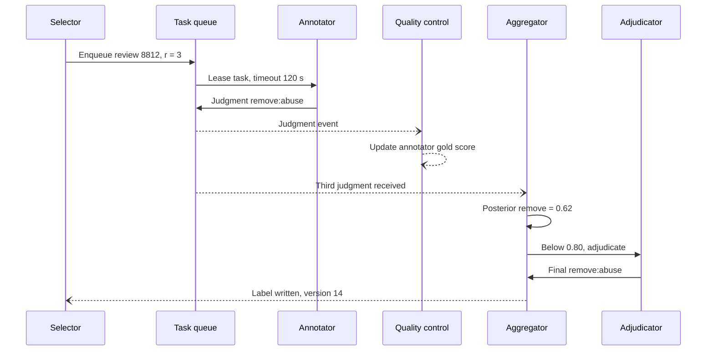

**Reading the diagram.** The selector enqueues one review that needs three judgments. Each annotator leases the task with a 120-second visibility timeout (if the annotator abandons it, the queue re-offers it), and submits a judgment synchronously. Judgments flow asynchronously (open arrows) to quality control, which updates the annotator's running accuracy, and to the aggregator once all three have arrived. The aggregated posterior of 0.62 is below the 0.80 confidence threshold, so the item goes to an adjudicator, whose decision is final. The label is written with a dataset version. Failure points: leases that expire repeatedly (a task nobody wants, usually an ambiguous one, which is a signal to fix the guideline), and an adjudication backlog. Scaling: annotators are stateless consumers of the queue; adjudication is a second, smaller queue.

#### Tooling

Labeling tools range from open-source projects that a team hosts itself (Label Studio and CVAT are widely used, as of 2026) to managed services from cloud providers and labeling vendors. What matters for system design is less the brand than five properties: a task-definition format that is versioned with the guideline; an API for creating tasks and reading judgments, so the tool is a component rather than a silo; per-annotator audit logs; support for gold questions and redundancy; and access control fine enough to keep sensitive data inside a security boundary (§63.14).

### 63.5.2 Throughput and cost

::: formula
**Labeling effort, headcount and cost**

$$H = \frac{N \cdot r \cdot t \cdot (1 + g)}{3600 \cdot u} \qquad H_{\text{adj}} = \frac{N \cdot a \cdot t_{\text{adj}}}{3600 \cdot u} \qquad \text{Cost} = H\,w + H_{\text{adj}}\,w_{\text{adj}} \qquad n_{\text{ann}} = \left\lceil \frac{H}{D \cdot h} \right\rceil$$

| Symbol | Meaning | Units |
|---|---|---|
| $N$ | Examples to label | examples |
| $r$ | Judgments per example (redundancy) | judgments/example |
| $t$ | Median time per judgment | seconds |
| $g$ | Gold-question overhead: gold tasks per real task | fraction |
| $u$ | Productive fraction of paid time (breaks, training, tool latency excluded) | fraction |
| $a$ | Fraction of examples sent to adjudication | fraction |
| $t_{\text{adj}}$ | Time per adjudication | seconds |
| $w$, $w_{\text{adj}}$ | Loaded hourly cost of an annotator and of an adjudicator | \$/hour |
| $H$, $H_{\text{adj}}$ | Paid annotator and adjudicator hours | hours |
| $D$ | Working days available | days |
| $h$ | Paid hours per person per day | hours/day |
| $n_{\text{ann}}$ | Annotators needed | people |
:::

::: example
**Worked example — QuickBite's first moderation dataset.** QuickBite wants 30,000 labeled reviews in two working weeks to train its first moderation model. Assumptions from a 200-item pilot: $t = 20$ s, $r = 3$, $g = 0.10$, $u = 0.80$, $a = 0.08$, $t_{\text{adj}} = 60$ s. Assumed loaded costs (illustrative; real rates vary several-fold by region and vendor): $w = \$15$/h, $w_{\text{adj}} = \$40$/h. $D = 10$ days, $h = 8$ h/day.

1. Judgment-seconds: $30{,}000 \times 3 \times 20 \times 1.10 = 1{,}980{,}000$ s $= 550$ productive hours.
2. Paid annotator hours: $H = 550 / 0.80 = 687.5$ h.
3. Adjudication: $30{,}000 \times 0.08 \times 60 = 144{,}000$ s $= 40$ productive hours; $H_{\text{adj}} = 40/0.80 = 50$ h.
4. Cost: $687.5 \times 15 + 50 \times 40 = \$10{,}312.50 + \$2{,}000 = \$12{,}312.50$, or **\$0.41 per final label**.
5. Headcount: $687.5 / (10 \times 8) = 8.6$, so **9 annotators**; adjudication needs $50/80 = 0.63$ of one expert.
6. Throughput per annotator: $3600 \times 0.80 / (20 \times 1.10) = 130.9$ judgments per paid hour; the team of 9 produces about $9 \times 8 \times 130.9 / 3 \approx 3{,}140$ finished labels per day.

**Interpretation.** Redundancy is the largest multiplier: dropping from $r = 3$ to $r = 1$ would cut annotator cost by two-thirds, but would leave no way to measure disagreement or to aggregate. **Engineering implication.** Use $r = 3$ for the initial dataset and for a continuing audit sample; once annotator accuracy is measured, label routine production traffic with $r = 1$ and send only low-confidence or high-stakes items for more judgments (dynamic redundancy). Steady state, at 20,000 reviews per day QuickBite cannot label everything; it labels a sample (§63.9, §63.11).
:::

#### Failure scenarios

**Table 63.4 — Labeling-pipeline failure scenarios.**

| What goes wrong | Why | Detection | Recovery | Prevention |
|---|---|---|---|---|
| Labels change meaning over time | Guideline edited without versioning | Label rate shifts on a date with no data change | Relabel affected batch | Version guidelines; store version on every label |
| Annotators recognize gold questions | Small, reused gold set | Gold accuracy ≫ peer agreement | Rotate gold set | Grow gold set from adjudicated items |
| Spammers click randomly | Pay per task, no checks | Gold accuracy near chance; very short task times | Remove judgments, relabel | Gold questions, minimum time, qualification tests |
| Adjudication backlog | Experts are scarce | Queue age of adjudication tasks | Temporarily raise confidence threshold | Size adjudication capacity from $a$ |
| Annotators anchor on a pre-label | Tool shows model prediction | Agreement with model ≫ agreement with gold | Re-label sample blind | Blind audit sample; show pre-labels only where measured safe |

::: mistake
**Mistake — Treating the guideline as documentation written once.** The guideline is the label definition; it *is* the specification of what the model learns. Every guideline change is a dataset change and needs a version, a changelog and, often, relabeling of old examples near the changed boundary.
:::

## 63.6 Human annotation quality

### 63.6.1 Why agreement, and why not just percent agreement

::: definition
**Definition — Inter-annotator agreement (IAA).** A statistic that measures how consistently independent annotators assign the same label to the same examples. **Percent agreement** is the raw fraction of matching judgments. **Chance-corrected** agreement coefficients (Cohen's κ, Fleiss' κ, Krippendorff's α) subtract the agreement that would be expected if annotators labeled at random with their observed label frequencies, and rescale so that 1 means perfect agreement and 0 means chance-level agreement.
:::

#### First-principles explanation

On most labeling tasks you have no answer key, so you cannot measure accuracy directly. What you can measure is whether two people, working independently from the same guideline, give the same answer. If they rarely do, at least one of them is wrong much of the time, and probably the guideline is ambiguous. Agreement is therefore an upper-bound proxy for label quality: low agreement proves a problem; high agreement does not prove correctness (two annotators can share the same misunderstanding).

Raw agreement is misleading when one class dominates. If 95% of reviews are fine and two lazy annotators both answer "keep" for everything, they agree 95% of the time while providing no information. Chance correction asks: how much better than that are they?

### 63.6.2 Cohen's κ for two annotators

::: formula
**Cohen's kappa** [Cohen 1960]

$$\kappa = \frac{p_o - p_e}{1 - p_e} \qquad p_o = \frac{1}{N}\sum_{k} n_{kk} \qquad p_e = \sum_{k} \frac{n_{k\cdot}}{N}\cdot\frac{n_{\cdot k}}{N}$$

| Symbol | Meaning | Units |
|---|---|---|
| $N$ | Examples labeled by both annotators | examples |
| $n_{jk}$ | Examples that annotator A put in class $j$ and annotator B in class $k$ | examples |
| $n_{k\cdot}$, $n_{\cdot k}$ | Row and column totals: A's and B's counts for class $k$ | examples |
| $p_o$ | Observed (percent) agreement | fraction |
| $p_e$ | Agreement expected by chance from each annotator's own class frequencies | fraction |
| $\kappa$ | Chance-corrected agreement; 1 perfect, 0 chance, below 0 worse than chance | dimensionless |
:::

**Table 63.5 — Two QuickBite moderators label the same 200 reviews.**

| | B: keep | B: remove | A total |
|---|---|---|---|
| **A: keep** | 140 | 12 | 152 |
| **A: remove** | 18 | 30 | 48 |
| **B total** | 158 | 42 | 200 |

::: example
**Worked example — Cohen's κ for the moderation pilot.**

1. Observed agreement: $p_o = (140 + 30)/200 = 0.850$.
2. Chance agreement on "keep": $(152/200)(158/200) = 0.760 \times 0.790 = 0.6004$. On "remove": $(48/200)(42/200) = 0.240 \times 0.210 = 0.0504$. $p_e = 0.6004 + 0.0504 = 0.6508$.
3. $\kappa = (0.850 - 0.6508)/(1 - 0.6508) = 0.1992/0.3492 = 0.570$.

**Interpretation.** 85% raw agreement sounds high, but more than three-quarters of it (0.651 of 0.850) is what two annotators with these class frequencies would reach by chance. κ = 0.57 is "moderate" on the widely quoted Landis–Koch scale (0.41–0.60 moderate, 0.61–0.80 substantial, above 0.80 almost perfect) [Landis and Koch 1977]; those bands are conventions, not laws. **Engineering implication.** Do not start production labeling at κ = 0.57 for a safety-relevant class. Read the 30 disagreements, find the boundary cases the guideline does not settle (sarcasm? a complaint that names the courier?), revise and re-pilot. Teams commonly aim for κ ≥ 0.7–0.8 on well-defined tasks before scaling.
:::

::: warning
**Warning — The prevalence paradox.** κ depends on class balance. Suppose two annotators label 200 reviews, agree on "keep" 190 times, and disagree on the other 10 (5 each way), never both choosing "remove". Then $p_o = 0.95$ but $p_e = (195/200)^2 + (5/200)^2 = 0.9513$ and $\kappa = -0.026$. High agreement with near-zero κ means the annotators agree only on the easy majority and *never* on the rare class, which for moderation is the class that matters [Feinstein and Cicchetti 1990]. Always report per-class agreement (or the confusion matrix) alongside κ, and oversample the rare class in pilots so κ is measured where it matters.
:::

### 63.6.3 Fleiss' κ for many annotators

Cohen's κ compares two fixed annotators. In a crowd pipeline, each item is labeled by $n$ annotators drawn from a larger pool, so "annotator A" is not the same person across items. Fleiss generalized chance-corrected agreement to this setting [Fleiss 1971]. (With two annotators Fleiss' κ is not identical to Cohen's κ, because it pools the two annotators' class frequencies; it reduces to Scott's π.)

::: formula
**Fleiss' kappa**

$$P_i = \frac{1}{n(n-1)}\sum_{j} n_{ij}(n_{ij}-1) \qquad \bar P = \frac{1}{N}\sum_i P_i \qquad p_j = \frac{1}{Nn}\sum_i n_{ij} \qquad \kappa_F = \frac{\bar P - \sum_j p_j^2}{1 - \sum_j p_j^2}$$

| Symbol | Meaning | Units |
|---|---|---|
| $N$ | Items | items |
| $n$ | Annotators per item (same for every item) | annotators |
| $n_{ij}$ | Annotators who put item $i$ in class $j$ | annotators |
| $P_i$ | Fraction of annotator pairs on item $i$ that agree | fraction |
| $\bar P$ | Mean pairwise agreement over items | fraction |
| $p_j$ | Overall share of judgments in class $j$ | fraction |
| $\kappa_F$ | Fleiss' kappa | dimensionless |
:::

**Table 63.6 — Three annotators per review, three classes (counts $n_{ij}$).**

| Review | keep | spam | abuse | $P_i$ |
|---|---|---|---|---|
| 1 | 3 | 0 | 0 | 1.000 |
| 2 | 0 | 3 | 0 | 1.000 |
| 3 | 2 | 1 | 0 | 0.333 |
| 4 | 1 | 0 | 2 | 0.333 |
| 5 | 1 | 1 | 1 | 0.000 |
| Total | 7 | 5 | 3 | |

::: example
**Worked example — Fleiss' κ for five reviews.** Here $N = 5$, $n = 3$, so $n(n-1) = 6$.

1. Review 3: $[2 \times 1 + 1 \times 0 + 0]/6 = 2/6 = 0.333$. Review 5: no pair agrees, $P_5 = 0$. $\bar P = (1 + 1 + 0.333 + 0.333 + 0)/5 = 0.5333$.
2. Class shares from the 15 judgments: $p_{\text{keep}} = 7/15 = 0.4667$, $p_{\text{spam}} = 5/15 = 0.3333$, $p_{\text{abuse}} = 3/15 = 0.2000$. Chance agreement $\bar P_e = 0.2178 + 0.1111 + 0.0400 = 0.3689$.
3. $\kappa_F = (0.5333 - 0.3689)/(1 - 0.3689) = 0.1644/0.6311 = 0.261$.

**Interpretation.** Only "fair" agreement: annotators split on three of the five reviews. **Engineering implication.** With so few items the estimate is very uncertain; agreement statistics need hundreds of items (and enough examples of each class) before you act on the second decimal place.
:::

### 63.6.4 Krippendorff's α

Real pipelines rarely have the same number of annotators on every item: tasks are abandoned, some items get extra judgments, and labels may be ordinal (a 1–5 severity) rather than nominal. Krippendorff's α handles any number of annotators, missing judgments and different measurement levels (nominal, ordinal, interval, ratio) through a distance function [Krippendorff 2018]. For nominal labels the distance is 0 for a match and 1 otherwise.

::: formula
**Krippendorff's alpha (nominal)**

$$\alpha = 1 - \frac{D_o}{D_e} = 1 - (n_{\cdot\cdot} - 1)\,\frac{\sum_{c \ne k} o_{ck}}{\sum_{c \ne k} n_c\, n_k} \qquad o_{ck} = \sum_u \frac{\text{number of } (c, k) \text{ ordered pairs in unit } u}{m_u - 1}$$

| Symbol | Meaning | Units |
|---|---|---|
| $u$ | A unit (item) with at least two judgments | — |
| $m_u$ | Judgments on unit $u$ | judgments |
| $o_{ck}$ | Coincidence count: weighted number of times values $c$ and $k$ were paired within a unit | pairs |
| $n_c$ | Total of row $c$ of the coincidence matrix (pairable judgments with value $c$) | judgments |
| $n_{\cdot\cdot}$ | Total pairable judgments | judgments |
| $D_o$, $D_e$ | Observed and expected disagreement | dimensionless |
| $\alpha$ | Krippendorff's alpha; 1 perfect, 0 chance | dimensionless |
:::

::: example
**Worked example — α for the same five reviews.** All 15 judgments are pairable, $n_{\cdot\cdot} = 15$, $m_u = 3$, so each ordered pair weighs $1/2$.

1. Off-diagonal coincidences. Review 3 (keep, keep, spam): 4 ordered keep–spam pairs × 1/2 = 2. Review 4 (keep, abuse, abuse): 4 pairs × 1/2 = 2. Review 5 (keep, spam, abuse): 6 ordered pairs, all different, × 1/2 = 3. Total $\sum_{c \ne k} o_{ck} = 7$.
2. Expected: $n_c = (7, 5, 3)$; $\sum_{c \ne k} n_c n_k = 15^2 - (49 + 25 + 9) = 142$.
3. $\alpha = 1 - 14 \times 7/142 = 1 - 98/142 = 0.310$.

**Interpretation.** α (0.310) is slightly higher than Fleiss' κ (0.261) on the same data because α's expected disagreement includes a small-sample correction ($n_{\cdot\cdot} - 1$ rather than $n_{\cdot\cdot}$). Krippendorff recommends relying on data with α ≥ 0.800 and drawing only tentative conclusions for 0.667 ≤ α < 0.800 [Krippendorff 2018]. **Engineering implication.** Prefer α when your pipeline has missing judgments or ordinal labels; it is the most general of the three coefficients.
:::

**Figure 63.6 — Choosing an agreement statistic.**

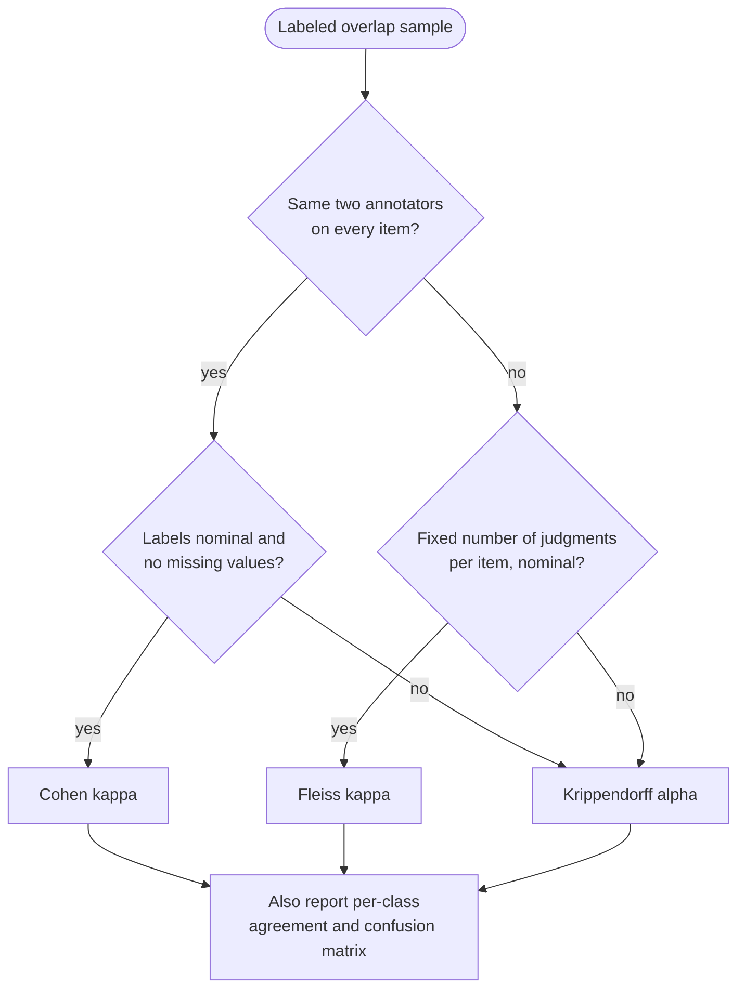

**Reading the diagram.** Start from a sample of items with overlapping judgments. Two fixed annotators with complete nominal labels call for Cohen's κ; a rotating pool with a fixed number of nominal judgments calls for Fleiss' κ; anything with missing judgments or ordinal or interval labels calls for Krippendorff's α. Every path ends at the same box: a single coefficient hides which class annotators disagree on, so report per-class agreement as well. This is an offline analysis on a stored sample; its failure points are a sample too small or too imbalanced to estimate agreement on the rare class. It scales trivially: these statistics are counts over a table.

### 63.6.5 Code example: agreement statistics from scratch

The program implements the three coefficients, checks Cohen's κ against scikit-learn, and reproduces the worked examples.

```python
import numpy as np
from sklearn.metrics import cohen_kappa_score

def cohen_kappa(a, b):
    """Cohen's kappa for two raters over the same items (nominal labels)."""
    a, b = np.asarray(a), np.asarray(b)
    cats = np.union1d(a, b)
    p_o = np.mean(a == b)                                  # observed agreement
    p_a = np.array([np.mean(a == c) for c in cats])         # rater A marginals
    p_b = np.array([np.mean(b == c) for c in cats])         # rater B marginals
    p_e = float(np.sum(p_a * p_b))                          # chance agreement
    return p_o, p_e, (p_o - p_e) / (1 - p_e)

def fleiss_kappa(counts):
    """counts[i, j] = number of raters who put item i in category j."""
    counts = np.asarray(counts, dtype=float)
    n = counts.sum(axis=1)[0]                               # raters per item
    P_i = (np.sum(counts**2, axis=1) - n) / (n * (n - 1))
    P_bar = P_i.mean()
    p_j = counts.sum(axis=0) / counts.sum()
    P_e = np.sum(p_j**2)
    return P_bar, P_e, (P_bar - P_e) / (1 - P_e)

def krippendorff_alpha_nominal(units):
    """units: list of lists of labels (missing ratings simply omitted)."""
    cats = sorted({v for u in units for v in u})
    idx = {c: i for i, c in enumerate(cats)}
    o = np.zeros((len(cats), len(cats)))                    # coincidence matrix
    for u in units:
        m = len(u)
        if m < 2:
            continue                                        # unpairable unit
        for i in range(m):
            for j in range(m):
                if i != j:
                    o[idx[u[i]], idx[u[j]]] += 1 / (m - 1)
    n_c = o.sum(axis=1)
    n = n_c.sum()
    d_o = (o.sum() - np.trace(o)) / n
    d_e = (n**2 - np.sum(n_c**2)) / (n * (n - 1))
    return 1 - d_o / d_e

# Two moderators, 200 reviews: (A, B) cell counts from Table 63.5
cells = {("ok", "ok"): 140, ("ok", "rm"): 12, ("rm", "ok"): 18, ("rm", "rm"): 30}
a = [x for (x, _), k in cells.items() for _ in range(k)]
b = [y for (_, y), k in cells.items() for _ in range(k)]
p_o, p_e, k = cohen_kappa(a, b)
print(f"Cohen:  p_o={p_o:.4f} p_e={p_e:.4f} kappa={k:.4f} sklearn={cohen_kappa_score(a, b):.4f}")

# Same raw agreement level, rare positive class: the prevalence paradox
cells2 = {("ok", "ok"): 190, ("ok", "rm"): 5, ("rm", "ok"): 5, ("rm", "rm"): 0}
a2 = [x for (x, _), k in cells2.items() for _ in range(k)]
b2 = [y for (_, y), k in cells2.items() for _ in range(k)]
p_o, p_e, k = cohen_kappa(a2, b2)
print(f"Rare:   p_o={p_o:.4f} p_e={p_e:.4f} kappa={k:.4f}")

# Three raters, five reviews, categories (ok, spam, abusive): Table 63.6
counts = [[3, 0, 0], [0, 3, 0], [2, 1, 0], [1, 0, 2], [1, 1, 1]]
P_bar, P_e, fk = fleiss_kappa(counts)
print(f"Fleiss: P_bar={P_bar:.4f} P_e={P_e:.4f} kappa={fk:.4f}")
units = [["ok"]*3, ["spam"]*3, ["ok", "ok", "spam"], ["ok", "ab", "ab"], ["ok", "spam", "ab"]]
print(f"Krippendorff alpha (complete) = {krippendorff_alpha_nominal(units):.4f}")
units_missing = [["ok"]*3, ["spam"]*2, ["ok", "ok", "spam"], ["ok", "ab"], ["ok", "spam", "ab"]]
print(f"Krippendorff alpha (2 ratings missing) = {krippendorff_alpha_nominal(units_missing):.4f}")
```

Output:

```text
Cohen:  p_o=0.8500 p_e=0.6508 kappa=0.5704 sklearn=0.5704
Rare:   p_o=0.9500 p_e=0.9512 kappa=-0.0256
Fleiss: P_bar=0.5333 P_e=0.3689 kappa=0.2606
Krippendorff alpha (complete) = 0.3099
Krippendorff alpha (2 ratings missing) = 0.1600
```

What to notice:

- The hand-written κ matches `sklearn.metrics.cohen_kappa_score` exactly, and all four statistics match the worked examples.
- The "rare" case has 95% raw agreement and κ below zero: the prevalence paradox in two lines.
- Krippendorff's α accepts units with different numbers of judgments. Dropping one "spam" judgment from review 2 and one "abuse" judgment from review 4 leaves review 4 as a single disagreeing pair, and α falls to 0.16: with so few items, every judgment moves the estimate.

**Table 63.7 — Agreement statistics compared.**

| Row | Percent agreement | Cohen's κ | Fleiss' κ | Krippendorff's α |
|---|---|---|---|---|
| What it is | Fraction of matches | Chance-corrected, two raters | Chance-corrected, $n$ raters per item | Chance-corrected disagreement ratio |
| Annotators | Any | Exactly two, fixed | Fixed count, rotating people | Any, including missing |
| Label types | Nominal | Nominal (weighted κ for ordinal) | Nominal | Nominal, ordinal, interval, ratio |
| Advantages | Intuitive | Standard, well understood | Fits crowd pipelines | Most general |
| Disadvantages | Inflated by imbalance | Prevalence paradox; two raters only | Needs equal judgments per item | Less familiar; more computation |
| Choose when | Never alone | Pilot with two experts | Fixed-redundancy crowd tasks | Production pipelines with gaps |

::: mistake
**Mistake — Reading high agreement as high accuracy.** Two annotators who share a misreading of the guideline agree perfectly and are both wrong. Agreement measures *reliability*; accuracy needs gold questions adjudicated by experts. Track both.
:::

## 63.7 Aggregating noisy labels

### 63.7.1 Majority vote

::: definition
**Definition — Label aggregation.** Combining several noisy judgments of the same example into a single label (a **hard label**) or a probability distribution over labels (a **soft label**). **Majority vote** picks the most frequent judgment. **Model-based aggregation** estimates each annotator's reliability and weights their judgments accordingly.
:::

#### First-principles explanation

If three independent witnesses each identify the right suspect 80% of the time, the chance that at least two of them pick the right one is higher than 80%. That is the whole argument for redundancy. Its two hidden assumptions are that witnesses are equally reliable and that their mistakes are independent. Both are false for annotators: some are much better than others, and ambiguous guidelines make everyone err on the same items.

::: formula
**Accuracy of majority vote with independent, equally accurate annotators**

$$P_{\text{MV}}(r, p) = \sum_{k = (r+1)/2}^{r} \binom{r}{k} p^{k} (1-p)^{r-k} \qquad (r \text{ odd, two classes})$$

| Symbol | Meaning | Units |
|---|---|---|
| $r$ | Judgments per item (odd, to avoid ties) | judgments |
| $p$ | Accuracy of each annotator | probability |
| $k$ | Number of correct judgments | judgments |
| $P_{\text{MV}}$ | Probability that the majority is correct | probability |
:::

::: example
**Worked example — How much does redundancy buy?** Annotators with $p = 0.80$:

1. $r = 1$: $P = 0.800$.
2. $r = 3$: $P = 0.8^3 + 3 \times 0.8^2 \times 0.2 = 0.512 + 0.384 = 0.896$.
3. $r = 5$: $P = 0.8^5 + 5 \times 0.8^4 \times 0.2 + 10 \times 0.8^3 \times 0.2^2 = 0.3277 + 0.4096 + 0.2048 = 0.942$.

**Interpretation.** Going from one to three judgments cuts the error from 20% to 10.4% at 3× the cost; going to five cuts it to 5.8% at 5× the cost. **Engineering implication.** Returns diminish quickly, and the formula is an upper bound: correlated errors on ambiguous items make real gains smaller. Sheng et al. showed that repeated labeling pays off most when individual labels are noisy and when the repeat labels are spent selectively on uncertain examples [Sheng et al. 2008]; fix the guideline before buying more judgments.
:::

### 63.7.2 The Dawid–Skene model

Dawid and Skene, studying clinicians who disagreed about patient histories, proposed estimating each observer's error rates and the true labels together, without any ground truth, using the EM algorithm [Dawid and Skene 1979]. It remains the standard baseline for crowd label aggregation.

::: formula
**Dawid–Skene model and EM updates**

$$\text{E-step: } T_{ik} \propto \pi_k \prod_{j \in A(i)} \theta^{(j)}_{k,\,y_{ij}} \qquad \text{M-step: } \pi_k = \frac{1}{N}\sum_i T_{ik}, \quad \theta^{(j)}_{kl} = \frac{\sum_{i:\, j \in A(i)} T_{ik}\,[y_{ij} = l]}{\sum_{i:\, j \in A(i)} T_{ik}}$$

| Symbol | Meaning | Units |
|---|---|---|
| $N$ | Items | items |
| $A(i)$ | Annotators who labeled item $i$ | set |
| $y_{ij}$ | Label annotator $j$ gave item $i$ | class |
| $\pi_k$ | Prior probability of true class $k$ | probability |
| $\theta^{(j)}_{kl}$ | Annotator $j$'s confusion matrix: probability of answering $l$ when the truth is $k$ | probability |
| $T_{ik}$ | Posterior probability that item $i$'s true class is $k$ (normalized over $k$) | probability |
| $[\cdot]$ | 1 if the condition holds, else 0 | — |
:::

#### How it works internally

1. **Initialize** the posteriors $T$ with the soft majority vote (the fraction of votes for each class).
2. **M-step.** Treat $T$ as fractional truth. Estimate the class prior and, for each annotator, a confusion matrix: of the items that are (fractionally) class $k$, how often did this annotator answer $l$?
3. **E-step.** For each item, combine the prior with every judgment, weighting by how informative that annotator's answer is (the ratio of the confusion entries), and normalize.
4. **Repeat** until the posteriors stop changing. Output $\arg\max_k T_{ik}$ as the hard label and $T_{ik}$ as its confidence.

::: example
**Worked example — One review, three disagreeing annotators.** The prior probability of "remove" is 0.30. Annotator 1 (accuracy 0.95) says *keep*; annotators 6 and 7 (accuracies 0.60 and 0.55) say *remove*. Assume symmetric confusion matrices.

1. Prior odds remove:keep $= 0.30/0.70 = 0.4286$.
2. Annotator 1 says keep: likelihood ratio $P(\text{keep} \mid \text{remove}) / P(\text{keep} \mid \text{keep}) = 0.05/0.95 = 0.0526$.
3. Annotator 6 says remove: $0.60/0.40 = 1.50$. Annotator 7: $0.55/0.45 = 1.222$.
4. Posterior odds $= 0.4286 \times 0.0526 \times 1.50 \times 1.222 = 0.0414$, so $P(\text{remove}) = 0.0414/1.0414 = 0.040$.

**Interpretation.** Majority vote says "remove" (two against one). Dawid–Skene says "keep" with 96% confidence, because one expert outweighs two near-random annotators. **Engineering implication.** Aggregation needs per-annotator reliability estimates, which in turn need enough overlap between annotators; schedule tasks so that every annotator shares items with several others.
:::

**Figure 63.7 — The Dawid–Skene EM loop.**

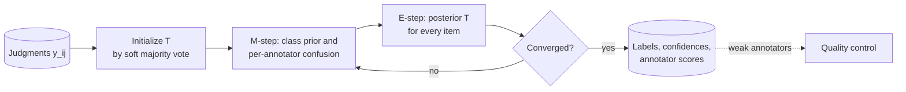

**Reading the diagram.** The input is the stored table of judgments (a sparse item × annotator matrix). Initialization uses majority vote; the loop alternates the M-step (estimate parameters from current beliefs about the truth) and the E-step (update beliefs about the truth from the parameters) until convergence, typically tens of iterations. Outputs are hard labels, confidences for routing to adjudication, and annotator confusion matrices, which flow asynchronously to quality control. It is a batch job; each iteration is linear in the number of judgments, so millions of judgments take seconds to minutes. Failure points: annotators with very few items get unstable confusion estimates (smooth them), EM can converge to a label-swapped solution if most annotators are adversarial, and the model assumes errors are independent given the true class.

### 63.7.3 Code example: majority vote versus Dawid–Skene

The simulation creates 3,000 reviews (30% "remove"), seven annotators with accuracies from 0.95 down to 0.50 (a pure random clicker), and gives each review to three randomly chosen annotators.

```python
import numpy as np

rng = np.random.default_rng(63)
N, K = 3000, 2                         # reviews, classes (0 = keep, 1 = remove)
acc = np.array([0.95, 0.90, 0.80, 0.70, 0.60, 0.55, 0.50])  # 7 annotators
J, R = len(acc), 3                     # each review gets 3 random annotators
y = (rng.random(N) < 0.30).astype(int) # 30% of reviews need removal

# labels[i, j] = label from annotator j on item i, or -1 if not asked
labels = -np.ones((N, J), dtype=int)
for i in range(N):
    for j in rng.choice(J, size=R, replace=False):
        correct = rng.random() < acc[j]
        labels[i, j] = y[i] if correct else 1 - y[i]

def majority_vote(labels):
    votes = np.stack([(labels == k).sum(axis=1) for k in range(K)], axis=1)
    return votes.argmax(axis=1), votes / votes.sum(axis=1, keepdims=True)

def dawid_skene(labels, iters=50):
    _, T = majority_vote(labels)                     # init: soft majority vote
    for _ in range(iters):
        # M-step: class priors and one confusion matrix per annotator
        prior = T.mean(axis=0)
        conf = np.full((J, K, K), 0.01)              # small smoothing
        for j in range(J):
            seen = labels[:, j] >= 0
            for l in range(K):
                conf[j, :, l] += T[seen][labels[seen, j] == l].sum(axis=0)
        conf /= conf.sum(axis=2, keepdims=True)      # rows: true class
        # E-step: posterior over the true class of every item
        logT = np.tile(np.log(prior), (N, 1))
        for j in range(J):
            seen = labels[:, j] >= 0
            logT[seen] += np.log(conf[j][:, labels[seen, j]]).T
        logT -= logT.max(axis=1, keepdims=True)
        T = np.exp(logT)
        T /= T.sum(axis=1, keepdims=True)
    return T.argmax(axis=1), conf, prior

mv, _ = majority_vote(labels)
ds, conf, prior = dawid_skene(labels)
print(f"majority vote accuracy: {np.mean(mv == y):.3f}")
print(f"Dawid-Skene accuracy:   {np.mean(ds == y):.3f}")
print(f"estimated prior of 'remove': {prior[1]:.3f} (true 0.300)")
est_acc = prior[0] * conf[:, 0, 0] + prior[1] * conf[:, 1, 1]
for j in range(J):
    print(f"annotator {j}: true acc {acc[j]:.2f}  estimated {est_acc[j]:.2f}")
```

Output:

```text
majority vote accuracy: 0.810
Dawid-Skene accuracy:   0.880
estimated prior of 'remove': 0.345 (true 0.300)
annotator 0: true acc 0.95  estimated 0.95
annotator 1: true acc 0.90  estimated 0.91
annotator 2: true acc 0.80  estimated 0.78
annotator 3: true acc 0.70  estimated 0.67
annotator 4: true acc 0.60  estimated 0.60
annotator 5: true acc 0.55  estimated 0.53
annotator 6: true acc 0.50  estimated 0.52
```

What to notice:

- With no ground truth at all, EM recovers every annotator's accuracy to within 0.03, and those estimates are exactly what quality control needs to retrain or remove the random clicker.
- Dawid–Skene cuts the error rate from 19.0% to 12.0%, more than a third, at zero extra labeling cost. The same gain from majority vote would need more judgments per item.
- The estimated prior (0.345) is biased toward "remove" because the weak annotators flip many "keep" items; with three judgments per item there is limited information. Gold questions anchor such estimates.
- The `-1` sentinel and the `seen` masks implement the sparse design: each annotator sees only about 43% of the items.

Extensions relax the model's assumptions: item difficulty and annotator expertise [Whitehill et al. 2009], annotators who sometimes spam [Hovy et al. 2013], and learning the classifier and annotator models jointly [Raykar et al. 2010].

::: mistake
**Mistake — Discarding the soft labels.** The posterior $T_{ik}$ is information. A review that is 55% "remove" is genuinely ambiguous; training on it as a hard "remove" overstates certainty. Keep confidences in the label store, route low-confidence items to adjudication, and consider training on soft labels or weighting by confidence.
:::

## 63.8 Weak supervision

### 63.8.1 Labeling functions and the label model

::: definition
**Definition — Weak supervision.** Training with labels produced by noisy, programmatic sources instead of (or in addition to) hand labels. In **data programming**, domain experts write **labeling functions** (LFs): small programs that vote for a class or **abstain** on each example. A **label model** estimates the accuracy (and possibly correlations) of the LFs from their agreements and disagreements, without ground truth, and outputs a probabilistic label per example; a discriminative **end model** is then trained on those labels [Ratner et al. 2016; Ratner et al. 2017].
:::

#### First-principles explanation

A senior moderator cannot label 20,000 reviews a day, but can tell you in an afternoon the rules of thumb they use: "a phone number is almost always spam", "slurs mean remove", "a three-word five-star review is fine". Each rule is wrong sometimes and silent most of the time. Weak supervision captures those rules as code, lets a statistical model figure out how much to trust each one, and uses the result to label far more data than any person could. It is Dawid–Skene (§63.7.2) with programs as annotators.

#### Why does this exist?

Hand labeling is slow to change. When QuickBite redefines "personal data" to include courier license plates, hand labels must be redone; a labeling function is a one-line edit followed by a re-run. Ratner et al. built Snorkel to make this workflow practical, reporting that subject-matter experts could build models faster with LFs than by hand labeling and reach comparable quality on their tasks [Ratner et al. 2017].

#### How it works internally

1. Experts write LFs; each maps an example to a class or ABSTAIN.
2. Apply all LFs to the unlabeled pool, producing a sparse **label matrix** $\Lambda$ (examples × LFs).
3. Evaluate each LF on a small hand-labeled **development set** (a few hundred examples) and on the unlabeled matrix (coverage, overlap, conflict).
4. Fit the label model on $\Lambda$, which estimates LF accuracies from the pattern of agreements, and output probabilistic labels.
5. Train the end model on the probabilistic labels with a noise-aware loss, using ordinary features (text, metadata), so that it generalizes to examples on which every LF abstained.
6. Iterate: inspect end-model errors on the dev set and write LFs that fix them.

**Figure 63.8 — A weak-supervision pipeline.**

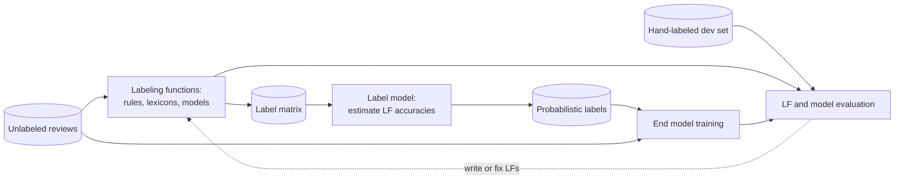

**Reading the diagram.** Unlabeled reviews (cylinder, left) pass through labeling functions, which may be regular expressions, keyword lists, lookups or existing models, producing a sparse label matrix. The label model reads only that matrix and outputs probabilistic labels, which, together with the raw reviews' features, train the end model. A small hand-labeled dev set is the only ground truth; it evaluates both the LFs and the end model, and the evaluation feeds back (dotted, human-in-the-loop) into writing and fixing LFs. Everything is batch. Failure points: LFs that are correlated (two keyword lists sharing most words) are counted as independent evidence unless the label model accounts for it; low total coverage leaves the end model with few examples of a class; and a dev set that is too small hides LF errors. The pipeline scales with compute (LFs are embarrassingly parallel over examples), not with people.

### 63.8.2 Evaluating labeling functions

::: formula
**Labeling-function statistics**

$$\text{cov}_j = \frac{|\{i : \lambda_j(x_i) \ne \varnothing\}|}{N} \qquad \text{ovl}_j = \frac{|\{i : \lambda_j(x_i) \ne \varnothing,\ \exists k \ne j:\ \lambda_k(x_i) \ne \varnothing\}|}{N}$$

$$\text{con}_j = \frac{|\{i : \lambda_j(x_i) \ne \varnothing,\ \exists k \ne j:\ \lambda_k(x_i) \notin \{\varnothing, \lambda_j(x_i)\}\}|}{N} \qquad \text{acc}_j = \frac{|\{i \in \text{dev} : \lambda_j(x_i) = y_i\}|}{|\{i \in \text{dev} : \lambda_j(x_i) \ne \varnothing\}|}$$

| Symbol | Meaning | Units |
|---|---|---|
| $\lambda_j(x_i)$ | Output of labeling function $j$ on example $i$ | class or $\varnothing$ |
| $\varnothing$ | Abstain | — |
| $N$ | Unlabeled examples | examples |
| $\text{cov}_j$ | Coverage: fraction where LF $j$ votes | fraction |
| $\text{ovl}_j$ | Overlap: fraction where LF $j$ and at least one other LF vote | fraction |
| $\text{con}_j$ | Conflict: fraction where LF $j$ and another LF vote differently | fraction |
| $\text{acc}_j$ | Empirical accuracy on the dev set, where LF $j$ votes | fraction |
:::

**Table 63.8 — QuickBite moderation labeling functions on 100,000 reviews (illustrative).**

| Labeling function | Votes | Coverage | Overlap | Conflict | Dev accuracy |
|---|---|---|---|---|---|
| `phone_or_url` | remove | 2.5% | 1.2% | 0.3% | 0.91 |
| `profanity_lexicon` | remove | 4.0% | 1.8% | 0.6% | 0.82 |
| `toxicity_model_gt_0.9` | remove | 3.0% | 2.2% | 0.4% | 0.85 |
| `short_positive` (≤ 6 words, rating ≥ 4) | keep | 30.0% | 6.0% | 0.5% | 0.97 |
| `trusted_reviewer` (≥ 20 accepted reviews) | keep | 25.0% | 8.0% | 0.9% | 0.95 |

::: example
**Worked example — Reading `profanity_lexicon`.** Applied to 100,000 reviews, the LF fires on 4,000; on 1,800 of those another LF also votes, and on 600 another LF votes *keep*.

1. Coverage $= 4{,}000/100{,}000 = 4.0\%$; overlap $= 1.8\%$; conflict $= 0.6\%$.
2. Conflict rate among its own votes: $600/4{,}000 = 15\%$, by far the highest in the table. Most conflicts are with `trusted_reviewer`: long-standing customers who swear about late food.
3. On the 1,000-review dev set it fires 40 times and is right 33 times: accuracy $33/40 = 0.825$.
4. Combined: a review flagged by `profanity_lexicon` (accuracy 0.82) and by `trusted_reviewer` (0.95), with a 5% prior of "remove", has posterior odds $(0.05/0.95) \times (0.82/0.18) \times (0.05/0.95) = 0.0126$, so $P(\text{remove}) \approx 1.2\%$ under a naive independent-vote model.

**Interpretation.** The LF is useful but blunt: swearing about food is not abuse. **Engineering implication.** Refine it (profanity *directed at a person*), or let the label model down-weight it; then check whether the end model, trained on probabilistic labels, catches abusive reviews that no LF covers. A dev-set accuracy based on 40 firings has a wide confidence interval (roughly ±0.12), so grow the dev set where LFs disagree.
:::

#### Real-world industry applications

::: industry
**Snorkel DryBell at Google.** Bach et al. describe deploying weak supervision for content classification at Google. LFs were written over existing organizational resources (internal models, knowledge graphs, heuristics) that could not be served directly in production, the label model ran at scale on Google's batch infrastructure, and the resulting end models, trained only on servable features, reached quality comparable to models trained on large hand-labeled sets for the tasks reported.
*Evidence: Primary* — [Bach et al. 2019]
:::

::: warning
**Warning — Weak supervision bakes in the experts' blind spots.** If no LF covers a kind of abuse (say, coded slurs in a minority language), the label model never sees it labeled, and the end model learns that it is acceptable. Monitor end-model recall on a hand-labeled, stratified sample of production traffic, and review per-slice coverage as part of fairness review (Chapter 71).
:::

## 63.9 Active learning

### 63.9.1 Choosing which examples to label

::: definition
**Definition — Active learning.** A labeling strategy in which the model chooses which unlabeled examples a human should label next, with the aim of reaching a target model quality with fewer labels than random sampling would need. In **pool-based** active learning the model scores a large pool of unlabeled examples and sends the most informative batch to annotators; the model is retrained and the cycle repeats [Settles 2009].
:::

#### First-principles explanation

A tutor helping a student prepare for an exam does not assign a random page of the textbook. They find what the student gets wrong or is unsure about and practice that. Random sampling spends most of the labeling budget on examples the model already handles; at QuickBite, 95% of reviews are clean and easy, so most randomly sampled labels teach the moderation model nothing new. Active learning spends the budget near the decision boundary, where a label changes the model.

#### How it works internally

1. Label a small random **seed set** (both classes must be present).
2. Train a model on the labeled set.
3. Score the unlabeled pool with an **acquisition function** and pick the top batch of $b$ examples.
4. Send the batch to annotators (§63.5); add the labels.
5. Repeat from step 2 until the budget is spent or the quality target is met.

Common acquisition functions [Settles 2009]:

- **Uncertainty sampling** [Lewis and Gale 1994]: pick the examples the model is least sure about, measured as *least confidence*, *margin* or *entropy* (formula below).
- **Query by committee** [Seung et al. 1992]: train several models (different seeds, bootstrap samples or model families) and pick examples on which they disagree most.
- **Diversity** or **core-set** sampling: pick examples that cover the feature space, for instance cluster centers in an embedding space, so a batch does not contain 25 near-duplicates of the same confusing review [Sener and Savarese 2018].
- **Hybrid**: pre-filter by uncertainty, then choose a diverse subset; this is the usual production choice for batch active learning.

::: formula
**Uncertainty scores for one example**

$$u_{\text{LC}} = 1 - \max_k p_k \qquad u_{\text{M}} = p_{(1)} - p_{(2)} \qquad u_{\text{H}} = -\sum_k p_k \ln p_k$$

| Symbol | Meaning | Units |
|---|---|---|
| $p_k$ | Model's predicted probability of class $k$ | probability |
| $p_{(1)}$, $p_{(2)}$ | Largest and second-largest predicted probabilities | probability |
| $u_{\text{LC}}$ | Least-confidence score: larger is more uncertain | probability |
| $u_{\text{M}}$ | Margin: *smaller* is more uncertain | probability |
| $u_{\text{H}}$ | Entropy: larger is more uncertain | nats |
:::

::: example
**Worked example — Which ticket to label?** QuickBite's support-intent model gives ticket A the probabilities (late order, missing item, refund) $= (0.50, 0.30, 0.20)$ and ticket B $(0.48, 0.47, 0.05)$.

1. Least confidence: A $= 0.50$, B $= 0.52$. B is slightly more uncertain.
2. Margin: A $= 0.50 - 0.30 = 0.20$, B $= 0.48 - 0.47 = 0.01$. B is far more uncertain.
3. Entropy: A $= -(0.5\ln 0.5 + 0.3\ln 0.3 + 0.2\ln 0.2) = 0.347 + 0.361 + 0.322 = 1.030$ nats; B $= 0.352 + 0.355 + 0.150 = 0.857$ nats. A is more uncertain.

**Interpretation.** The measures disagree because they ask different questions: margin asks "is the top decision close?", entropy asks "is the model confused overall?". **Engineering implication.** For a model whose output is a single decision (route the ticket), margin is usually the right signal; for two classes all three rank examples identically, by closeness to $p = 0.5$.
:::

**Figure 63.9 — The pool-based active-learning loop.**

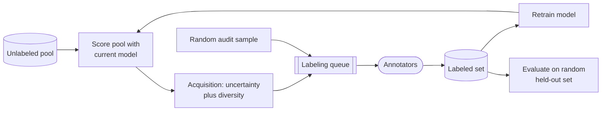

**Reading the diagram.** The current model scores the whole unlabeled pool (a batch inference job); the acquisition step chooses a batch that is uncertain and diverse; the batch goes through the ordinary labeling queue to annotators; new labels join the labeled set, the model is retrained, and the loop repeats. Two components keep it honest: a random audit sample enters the same queue so that some labels are drawn from the true distribution, and evaluation uses a random held-out set, never the actively chosen examples, whose distribution is deliberately skewed. All steps are asynchronous batch jobs; one cycle typically takes hours (dominated by human labeling), so batch size trades model freshness against annotator idle time. Failure points: a stale model choosing batches (if retraining lags), batches of near-duplicates, and evaluation contaminated by acquisition bias. Scaling: scoring a pool of millions is cheap compared with labeling; the expensive resource is still people.

### 63.9.2 Code example: random versus uncertainty sampling

The simulation mimics QuickBite moderation: 12,000 synthetic reviews with 30 features and about 5% positives (needs removal), 8,000 in the pool and 4,000 for testing. Both strategies start from the same 50 random labels and add 25 labels per round. Quality is PR-AUC (§57.10.2), appropriate for a rare positive class. Results are averaged over ten seeds.

```python
import warnings
import numpy as np
from sklearn.datasets import make_classification
from sklearn.linear_model import LogisticRegression
from sklearn.metrics import average_precision_score
from sklearn.model_selection import train_test_split

warnings.filterwarnings("ignore")
# Imbalanced like a moderation queue: about 5% of reviews need removal
X, y = make_classification(n_samples=12000, n_features=30, n_informative=8,
                           n_redundant=4, weights=[0.95], class_sep=1.5,
                           flip_y=0.01, random_state=63)
X_pool, X_test, y_pool, y_test = train_test_split(X, y, test_size=4000,
                                                  random_state=63, stratify=y)
BUDGETS = [100, 200, 400, 800, 1600]
SEED_SIZE, BATCH = 50, 25

def fit(idx):
    return LogisticRegression(max_iter=2000).fit(X_pool[idx], y_pool[idx])

def run(strategy, seed):
    rng = np.random.default_rng(seed)
    labeled = list(rng.choice(len(X_pool), SEED_SIZE, replace=False))
    while len(set(y_pool[labeled])) < 2:          # need both classes to start
        labeled.append(int(rng.integers(len(X_pool))))
    curve = {}
    while len(labeled) <= BUDGETS[-1]:
        model = fit(labeled)
        if len(labeled) in BUDGETS:
            p_test = model.predict_proba(X_test)[:, 1]
            curve[len(labeled)] = average_precision_score(y_test, p_test)
        unlabeled = np.setdiff1d(np.arange(len(X_pool)), labeled)
        if strategy == "random":
            pick = rng.choice(unlabeled, BATCH, replace=False)
        else:   # uncertainty (margin) sampling: closest to p = 0.5
            p = model.predict_proba(X_pool[unlabeled])[:, 1]
            pick = unlabeled[np.argsort(np.abs(p - 0.5))[:BATCH]]
        labeled.extend(int(i) for i in pick)
    return curve, y_pool[labeled].mean()

full = fit(np.arange(len(X_pool)))
print(f"all {len(X_pool)} labels: PR-AUC "
      f"{average_precision_score(y_test, full.predict_proba(X_test)[:, 1]):.3f}")
res = {s: [run(s, seed) for seed in range(10)] for s in ("random", "uncertainty")}
print("labels  random  uncertainty")
for b in BUDGETS:
    r = np.mean([c[b] for c, _ in res["random"]])
    u = np.mean([c[b] for c, _ in res["uncertainty"]])
    print(f"{b:6d}  {r:.3f}   {u:.3f}")
for s in res:
    print(f"positive share of labels bought ({s}): "
          f"{np.mean([pos for _, pos in res[s]]):.1%}")
```

Output (about 20 seconds on a laptop CPU):

```text
all 8000 labels: PR-AUC 0.725
labels  random  uncertainty
   100  0.542   0.573
   200  0.589   0.631
   400  0.618   0.685
   800  0.668   0.721
  1600  0.689   0.722
positive share of labels bought (random): 5.3%
positive share of labels bought (uncertainty): 22.4%
```

What to notice:

- Uncertainty sampling with 400 labels (0.685) matches random sampling with 1,600 (0.689), and with 800 labels it essentially matches a model trained on all 8,000 (0.721 versus 0.725).
- The mechanism is visible in the last two lines: uncertainty sampling buys about four times as many positives (22.4% versus 5.3%), because the rare class lives near the decision boundary. For imbalanced problems, much of active learning's benefit is that it is a smart way to oversample the rare class.
- Evaluation always uses the untouched random test split; the actively labeled set is deliberately unrepresentative.

### 63.9.3 How much does active learning save?

::: formula
**Labeling savings from active learning**

$$S = 1 - \frac{n_{\text{AL}}(q^*)}{n_{\text{rand}}(q^*)} \qquad \Delta C = \bigl(n_{\text{rand}}(q^*) - n_{\text{AL}}(q^*)\bigr)\,c_{\ell} - C_{\text{AL}}$$

| Symbol | Meaning | Units |
|---|---|---|
| $q^*$ | Target model quality (here PR-AUC) | dimensionless |
| $n_{\text{rand}}(q^*)$, $n_{\text{AL}}(q^*)$ | Labels needed to reach $q^*$ with random and with active sampling | labels |
| $S$ | Fractional labeling savings | fraction |
| $c_{\ell}$ | Cost per final label (§63.5.2) | \$/label |
| $C_{\text{AL}}$ | Extra cost of running the loop: pool scoring, retraining, engineering | \$ |
| $\Delta C$ | Net saving | \$ |
:::

::: example
**Worked example — Budgeting QuickBite's moderation labels.** From the simulation, for $q^* \approx 0.685$: $n_{\text{rand}} = 1{,}600$, $n_{\text{AL}} = 400$.

1. $S = 1 - 400/1{,}600 = 0.75$.
2. Suppose a pilot on real reviews shows the same shape at production scale: random sampling would need 40,000 labels to reach the launch target, active learning 10,000. At $c_\ell = \$0.41$ (§63.5.2): $40{,}000 \times 0.41 = \$16{,}400$ versus $10{,}000 \times 0.41 = \$4{,}100$, a gross saving of \$12,300.
3. Loop cost: 30 rounds, each scoring a pool of 2 million reviews with a small model (minutes of CPU) and retraining (minutes), plus about one engineer-week to build and monitor the loop. Assume $C_{\text{AL}} \approx \$5{,}000$ including engineering time.
4. Net saving $\Delta C \approx \$12{,}300 - \$5{,}000 = \$7{,}300$, and the loop is reusable for every later relabeling campaign.

**Interpretation.** Savings are real but smaller than the headline 75% once the loop's own cost is counted, and they are dataset-specific. **Engineering implication.** Never assume the savings ratio; measure it on a pilot by running both strategies side by side for a few rounds against a random held-out set, as the simulation does.
:::

#### Failure scenarios and misconceptions

::: warning
**Warning — Sampling bias.** The actively labeled set is deliberately unlike production traffic. Training on it can distort calibration (the model sees far more positives than reality), and evaluating on it gives meaningless numbers. Keep a random audit stream, recalibrate on random data (§63.11), and record the acquisition policy in the dataset's documentation (§63.13).
:::

::: mistake
**Mistake — Active learning from a cold start.** With 20 labels the model's uncertainty is itself unreliable, and uncertainty sampling can fixate on one region of the space while ignoring another cluster of positives it has never seen. Start with a random or stratified seed set of a few hundred labels, include diversity in the acquisition, and keep some random sampling throughout.
:::

## 63.10 Label noise

### 63.10.1 Types and impact

::: definition
**Definition — Label noise.** A difference between the label recorded in the dataset and the true class. Noise is **uniform** (symmetric) when a wrong label is equally likely to be any other class, **class-conditional** when the probability of a flip depends on the true class (for example, "missing item" tickets are often filed as "refund"), and **instance-dependent** when it depends on the example itself (ambiguous reviews are mislabeled more often than clear ones) [Frénay and Verleysen 2014].
:::

**Table 63.9 — Kinds of label noise at QuickBite.**

| Kind | Example | Typical cause | Effect on the model |
|---|---|---|---|
| Uniform | Random mis-clicks in the labeling tool | Fatigue, UI errors | Mostly lowers accuracy; large models can memorize it |
| Class-conditional | "Missing item" filed as "refund" | Agents use the label that triggers the right workflow | Systematic confusion between two classes |
| Instance-dependent | Sarcastic reviews labeled "keep" | Hard examples | Errors concentrated on exactly the hard cases |
| Delayed-label noise | Recent fraud labeled legitimate | Label immaturity (§63.4.2) | Model learns that new fraud patterns are safe |
| Definition drift | "Personal data" redefined mid-project | Guideline change | Inconsistent labels across time |

Noise hurts in three places. In **training**, deep networks fit noisy labels after they fit the clean pattern, so noise degrades generalization the longer you train [Zhang et al. 2017; Arpit et al. 2017]. In **evaluation**, noisy *test* labels make the measured metric wrong; Northcutt, Athalye and Mueller estimated an average of a few percent label errors across the test sets of ten widely used benchmarks and showed that this can change which model looks best [Northcutt et al. 2021b]. In **decisions**, class-conditional noise produces biased probabilities, which matters whenever a threshold is set on the model's score.

### 63.10.2 Detecting noise: confident learning and loss-based filtering

#### First-principles explanation

A model trained on mostly-correct labels learns the true pattern. When it then looks at an example it has *not* trained on and says "I am 90% sure this is a missing-item ticket" while the label says "refund", one of them is probably wrong, and the more confident the model and the more systematic the confusion, the more likely it is the label. Two rules make this reliable: score each example with a model that did not see it (out-of-fold predictions), and judge "confident" relative to how confident the model usually is for that class, because some classes are inherently harder.

::: formula
**Confident learning: per-class thresholds and the confident joint** [Northcutt et al. 2021a]

$$t_j = \frac{1}{|X_{\tilde y = j}|}\sum_{x \in X_{\tilde y = j}} \hat p(\tilde y = j \mid x) \qquad C_{ij} = \bigl|\{x \in X_{\tilde y = i} : \arg\max_{l:\ \hat p_l(x) \ge t_l} \hat p_l(x) = j\}\bigr|$$

| Symbol | Meaning | Units |
|---|---|---|
| $\tilde y$ | Given (possibly noisy) label | class |
| $X_{\tilde y = j}$ | Examples whose given label is $j$ | set |
| $\hat p_l(x)$ | Out-of-fold predicted probability of class $l$ for example $x$ | probability |
| $t_j$ | Threshold for class $j$: average self-confidence of examples labeled $j$ | probability |
| $C_{ij}$ | Confident joint: examples labeled $i$ whose confident prediction is $j$ | examples |
:::

Off-diagonal cells of $C$ ($i \ne j$) are the likely label errors; normalized, $C$ estimates the joint distribution of given and true labels, and therefore the noise rates themselves. A simpler alternative, **loss-based filtering**, ranks examples by their out-of-fold loss $-\ln \hat p_{\tilde y}(x)$ and inspects the top of the list.

::: example
**Worked example — Is this ticket mislabeled?** In the program below the class thresholds come out as $t = (0.663, 0.623, 0.747)$ for (late order, missing item, refund). A ticket labeled *refund* has out-of-fold probabilities $(0.05, 0.70, 0.25)$.

1. Which classes clear their thresholds? Late order: $0.05 < 0.663$, no. Missing item: $0.70 \ge 0.623$, yes. Refund: $0.25 < 0.747$, no.
2. The confident class is *missing item*; the given label is *refund*; the ticket counts in $C_{\text{refund},\,\text{missing}}$, an off-diagonal cell.
3. Note that 0.70 would *not* clear a refund-class threshold of 0.747; per-class thresholds matter.

**Interpretation.** The ticket is flagged as a likely "missing item" filed as "refund". **Engineering implication.** Flagged items should go to human review (§63.5) rather than be silently relabeled; the confident joint also tells the support team *which* confusion is systematic, which is usually a process fix (a workflow that rewards picking "refund") rather than a labeling fix.
:::

**Figure 63.10 — A label-error detection pipeline.**

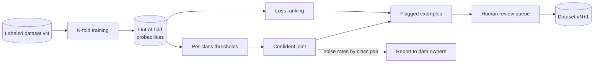

**Reading the diagram.** The dataset is split into $K$ folds; each fold is scored by a model trained on the others, producing out-of-fold probabilities (stored, because they are reused). Thresholds and the confident joint are computed from them, as is a loss ranking. Flagged examples go through the ordinary human review queue, and corrected labels produce a new dataset version, never an in-place edit. The confident joint also yields per-class-pair noise rates, reported asynchronously to the teams that own the labeling process. All batch. Failure points: a model too weak to be confident (flags become random), in-fold scoring (the model has memorized the noisy labels and flags nothing), and auto-relabeling without review, which can delete the hard, correct examples a model most needs. Scaling: $K$ training runs per dataset version; for large datasets use a cheaper model for detection than for production.

### 63.10.3 Code example: finding label errors

The program builds 5,000 synthetic support tickets in three intents, corrupts 25% of "missing item" labels to "refund" and 10% of "late order" labels to "missing item" (class-conditional noise), then applies confident learning and loss ranking.

```python
import warnings
import numpy as np
from sklearn.datasets import make_classification
from sklearn.linear_model import LogisticRegression
from sklearn.model_selection import cross_val_predict, train_test_split

warnings.filterwarnings("ignore")
rng = np.random.default_rng(63)
# Three support-ticket intents: 0 = late order, 1 = missing item, 2 = refund
X, y_true = make_classification(n_samples=5000, n_features=20, n_informative=10,
                                n_classes=3, n_clusters_per_class=1,
                                class_sep=1.5, random_state=63)
X_tr, X_te, y_tr_true, y_te = train_test_split(X, y_true, test_size=1000,
                                               random_state=63)
# Inject asymmetric noise: 25% of "missing item" tickets labeled "refund",
# 10% of "late order" tickets labeled "missing item"
y_tr = y_tr_true.copy()
flip1 = (y_tr_true == 1) & (rng.random(len(y_tr)) < 0.25)
flip0 = (y_tr_true == 0) & (rng.random(len(y_tr)) < 0.10)
y_tr[flip1], y_tr[flip0] = 2, 1
is_noisy = y_tr != y_tr_true
print(f"training labels: {len(y_tr)}, corrupted: {is_noisy.sum()} ({is_noisy.mean():.1%})")

# 1. Out-of-fold predicted probabilities (never score a row with a model that saw it)
model = LogisticRegression(max_iter=2000)
P = cross_val_predict(model, X_tr, y_tr, cv=5, method="predict_proba")

# 2. Per-class thresholds: average self-confidence of rows given that label
K = P.shape[1]
t = np.array([P[y_tr == j, j].mean() for j in range(K)])

# 3. Confident joint: count row under (given label i, confident true label j)
C = np.zeros((K, K), dtype=int)
flag = np.zeros(len(y_tr), dtype=bool)
for n in range(len(y_tr)):
    above = np.where(P[n] >= t)[0]
    if len(above) == 0:
        continue
    j = above[np.argmax(P[n, above])]
    C[y_tr[n], j] += 1
    flag[n] = j != y_tr[n]                 # off-diagonal: likely mislabeled
print("thresholds:", np.round(t, 3))
print("confident joint (rows = given label, cols = estimated true label):")
print(C)

def report(name, f):
    tp = (f & is_noisy).sum()
    print(f"{name:<22} flagged {f.sum():4d}  precision {tp / f.sum():.3f}  "
          f"recall {tp / is_noisy.sum():.3f}")
report("confident learning", flag)

# 4. Loss-based baseline: flag the same number of highest-loss rows
loss = -np.log(P[np.arange(len(y_tr)), y_tr] + 1e-12)
top = np.zeros(len(y_tr), dtype=bool)
top[np.argsort(-loss)[:flag.sum()]] = True
report("highest-loss rows", top)

# 5. Does cleaning help? Retrain without flagged rows, test on clean labels
acc_noisy = model.fit(X_tr, y_tr).score(X_te, y_te)
acc_clean = model.fit(X_tr[~flag], y_tr[~flag]).score(X_te, y_te)
acc_oracle = model.fit(X_tr, y_tr_true).score(X_te, y_te)
print(f"test accuracy: noisy {acc_noisy:.3f}  pruned {acc_clean:.3f}  "
      f"true labels {acc_oracle:.3f}")
```

Output:

```text
training labels: 4000, corrupted: 470 (11.8%)
thresholds: [0.663 0.623 0.747]
confident joint (rows = given label, cols = estimated true label):
[[ 689   14   44]
 [  79  696   11]
 [  21  226 1167]]
confident learning     flagged  395  precision 0.780  recall 0.655
highest-loss rows      flagged  395  precision 0.742  recall 0.623
test accuracy: noisy 0.899  pruned 0.930  true labels 0.964
```

What to notice:

- The largest off-diagonal cell, 226 tickets labeled *refund* that look like *missing item*, recovers the injected systematic confusion without being told about it; the second largest (79, *missing item* that looks like *late order*) recovers the other one.
- Confident learning beats an equal-sized loss ranking on precision (0.78 versus 0.74), because per-class thresholds adjust for the refund class's higher typical confidence.
- Simply dropping the 395 flagged rows recovers almost half of the accuracy lost to noise (0.899 → 0.930, against 0.964 with true labels), with no human effort. Sending them to review instead would recover more.
- This is the core idea of the open-source `cleanlab` library by the confident-learning authors, which adds calibrated noise-rate estimation and ranking options [Northcutt et al. 2021a].

::: industry
**Label errors in benchmark test sets.** Applying confident learning followed by crowd verification to the test sets of ten popular benchmarks (including ImageNet, CIFAR, MNIST, Amazon Reviews and QuickDraw), Northcutt, Athalye and Mueller found label errors in every one, averaging a few percent, and showed that correcting them can reorder model rankings, with smaller models sometimes beating larger ones on the corrected labels.
*Evidence: Primary* — [Northcutt et al. 2021b]
:::

::: mistake
**Mistake — Removing every high-loss example.** High loss also marks rare but correctly labeled examples (the unusual fraud pattern, the new slang). Automatic pruning can delete exactly the minority cases a model needs most, and can affect some user groups more than others. Route flags to review, cap automated removal, and compare slice metrics before and after cleaning (Chapter 71).
:::

## 63.11 Class imbalance and sampling

### 63.11.1 Stratification and downsampling

::: definition
**Definition — Class imbalance.** A dataset in which one class is much rarer than another, such as QuickBite fraud at 0.5% of orders or abusive reviews at a few percent. **Stratified sampling** draws separately from each class or slice so that each is represented in fixed proportions. **Negative downsampling** keeps all positive examples and a random fraction $\beta$ of negatives, to shrink the training set and rebalance it [He and Garcia 2009].
:::

#### First-principles explanation

If you want to learn what fraud looks like, a dataset of 90 million orders with 450,000 frauds is mostly a very expensive way of storing legitimate orders. Most of the negatives are near-identical and easy; a random twentieth of them carries almost the same information. Downsampling throws away redundant negatives, which makes training up to an order of magnitude cheaper and gives the rare class more weight in the loss. The catch is that the model now believes fraud is far more common than it is, so its probabilities must be corrected before they drive decisions.

#### How it works internally

1. **Stratify splits.** Train, validation and test splits keep the natural class ratio within each time window (§57.7), so that evaluation reflects production.
2. **Downsample only the training split.** Keep every positive; keep each negative with probability $\beta$; record $\beta$ in the dataset metadata.
3. **Train** on the downsampled set.
4. **Correct** the model's output with the formula below (or, equivalently, train with weight $1/\beta$ on each kept negative).
5. **Verify calibration** on the untouched validation split with reliability bins (§57.10.3).

Alternatives work at the algorithm level: **class weights** in the loss (cost-sensitive learning), **oversampling** positives, or synthesizing positives by interpolation (SMOTE [Chawla et al. 2002]). He and Garcia's survey compares sampling, cost-sensitive and algorithmic approaches and argues for evaluating with precision–recall measures rather than accuracy [He and Garcia 2009].

::: formula
**Calibration correction after negative downsampling**

$$p = \frac{\beta\, p_s}{\beta\, p_s + (1 - p_s)} \qquad \Longleftrightarrow \qquad \frac{p}{1-p} = \beta \cdot \frac{p_s}{1 - p_s}$$

| Symbol | Meaning | Units |
|---|---|---|
| $\beta$ | Fraction of negatives kept during training | fraction |
| $p_s$ | Model's predicted probability of the positive class, trained on the downsampled data | probability |
| $p$ | Corrected probability under the true class ratio | probability |
:::

The correction follows from Bayes' rule: downsampling multiplies the number of negatives, and therefore the prior odds of the negative class, by $\beta$, while leaving the class-conditional feature distributions unchanged; so the posterior odds of a positive are inflated by $1/\beta$ and must be multiplied back by $\beta$.

::: example
**Worked example — Downsampling QuickBite's fraud training data.** A 180-day matured window (§63.4.2) holds $500{,}000 \times 180 = 90$ million orders, of which $0.5\%$, or 450,000, are fraud. Keep $\beta = 0.05$ of negatives.

1. Negatives kept: $89{,}550{,}000 \times 0.05 = 4{,}477{,}500$. Training rows: $450{,}000 + 4{,}477{,}500 = 4{,}927{,}500$, about **18× fewer** than 90 million.
2. Prevalence in the training set: $450{,}000 / 4{,}927{,}500 = 9.13\%$, versus 0.5% in production.
3. The model scores an order $p_s = 0.30$. Correct it: $p = 0.05 \times 0.30 / (0.05 \times 0.30 + 0.70) = 0.015/0.715 = 0.021$.
4. Check with odds: $0.30/0.70 = 0.4286$; $\times\, 0.05 = 0.02143$; $p = 0.02143/1.02143 = 0.021$.

**Interpretation.** A score that looks like "30% fraud" is really about 2.1% fraud in production, still four times the base rate but nothing like 30%. **Engineering implication.** Any consumer of the score that compares it with a cost (block if expected loss > friction cost, §57.10) must receive the corrected probability. Put the correction in the model artifact itself, not in downstream services, and record $\beta$ in the model card so that a later retrain with a different $\beta$ cannot silently shift every threshold.
:::

**Figure 63.11 — Downsampling in training and correction in serving.**

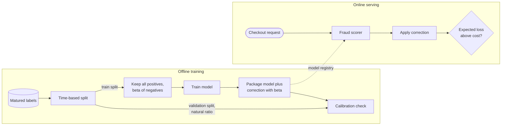

**Reading the diagram.** Offline, matured labels are split by time; only the training split is downsampled. The model is packaged together with its correction (which needs only $\beta$) and checked for calibration on a validation split that keeps the natural class ratio. The package reaches the online scorer asynchronously through the model registry (Chapter 69). Online, the checkout request is scored synchronously and the corrected probability feeds the decision. Failure points: applying the correction twice (once in the model, once in a downstream service), forgetting it entirely (thresholds tuned on uncorrected scores become wrong after a retrain with a new $\beta$), and downsampling the validation split, which makes calibration checks meaningless. Scaling: downsampling is a cheap filter in the training-data job (Chapter 61), and its main effect is to cut training cost roughly in proportion to $\beta$.

::: industry
**Negative downsampling for ad click prediction at Facebook.** He et al. describe training click-prediction models on data in which negative examples (no click) were downsampled, and recalibrating the predictions with $q = p/(p + (1-p)/w)$, where $w$ is the negative sampling rate (the same formula as above). They studied how prediction quality varied with the sampling rate, treating the rate as a trade-off between training cost and accuracy rather than a free choice.
*Evidence: Primary* — [He et al. 2014]
:::

::: mistake
**Mistake — Downsampling the test set.** A test set with 9% fraud reports precision that production, at 0.5% fraud, will never see: at a fixed false-positive rate, precision falls roughly in proportion to prevalence. Evaluate at the natural ratio, or re-weight negatives by $1/\beta$ when computing metrics.
:::

## 63.12 Synthetic data

### 63.12.1 Kinds and uses

::: definition
**Definition — Synthetic data.** Training or evaluation examples that were generated rather than observed. **Augmentation** transforms real examples while preserving their label (crop or flip an image, paraphrase a sentence). **Simulation** generates examples from a model of the world (a traffic simulator, a game engine, a scripted attack). **Generative synthetic data** samples new examples from a learned generative model (a GAN, a diffusion model, a large language model). **Privacy-motivated** synthetic data aims to preserve a dataset's statistical properties without exposing real records.
:::

#### First-principles explanation

Pilots train in flight simulators because crashing a real aircraft to learn from it is unaffordable. Synthetic data serves the same purpose: it supplies examples that are rare, dangerous, expensive or private in the real world. Its weakness is the simulator's: the model learns the simulator's world, and only the parts of that world that match reality transfer.

**Table 63.10 — Synthetic data approaches.**

| Row | Augmentation | Simulation | Generative models | Privacy-motivated synthesis |
|---|---|---|---|---|
| What it is | Label-preserving transforms | Rule- or physics-based generator | Samples from a learned model | Generator trained to mimic a sensitive table |
| QuickBite example | Paraphrase moderation examples | Simulated courier routes during a road closure | LLM-written abusive reviews in a new language | Synthetic orders shared with a vendor |
| Advantages | Cheap; labels free; robustness | Covers rare and unsafe scenarios | Fills gaps in coverage quickly | Data can leave the security boundary |
| Disadvantages | Only small variations | Sim-to-real gap | Mismatch, bias, collapse | Not private by default; utility loss |
| Choose when | Model must be invariant to the transform | Real events are rare or dangerous | Bootstrapping a class with few examples | Sharing data under privacy constraints |

**Augmentation** is the oldest and safest form: a model that must not care whether an image is flipped can be shown flipped copies [Shorten and Khoshgoftaar 2019]. **Simulation** can close large gaps when the simulator is randomized widely enough that reality looks like one more variation; domain randomization trained object detectors on simulated images alone that transferred to real robots [Tobin et al. 2017]. **Generative** synthesis with large language models is now a common way to bootstrap text classifiers, for example to create abusive-review examples in a language with few real ones, but generated examples share the generator's style and blind spots. **Privacy** is the most misunderstood use: a generator trained on real records can memorize and reproduce them, and Stadler, Oprisanu and Troncoso showed that synthetic data does not by itself provide a better privacy–utility trade-off than traditional anonymization; formal guarantees need differential privacy in the generator (Chapter 71) [Stadler et al. 2022].

### 63.12.2 Risks: distribution mismatch and model collapse

The first risk is **distribution mismatch**: synthetic examples are cleaner, more typical and more uniform than real ones. A moderation model trained largely on LLM-written abuse learns the LLM's idea of abuse; real abusers misspell, use coded language and mix languages. Always evaluate on real held-out data, and track the share of synthetic data in every dataset version.

The second risk is **model collapse**. Shumailov et al. showed, for language models, variational autoencoders and Gaussian mixtures, that when each generation of a model is trained on data generated by the previous generation, the tails of the original distribution disappear first and the models converge toward a narrow, distorted distribution; they argued that access to genuine human-generated data becomes increasingly valuable as generated content spreads [Shumailov et al. 2024].

**Figure 63.12 — How recursive training on generated data loses the tails.**

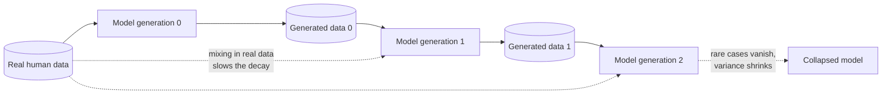

**Reading the diagram.** Each generation is trained on what the previous one produced (solid arrows). Because a finite sample of generated data under-represents rare events, and the generator's own approximation errors compound, rare cases vanish a little more each round and the distribution narrows toward the dotted endpoint. The dotted arrows from real human data show the mitigation: keeping genuine data in every generation's training mix slows or prevents the decay. Storage boundaries are the generated datasets; the failure point is the absence of provenance: if you cannot tell which reviews on your platform were written by people, you cannot keep generated text out of the next training set. For QuickBite the practical rule is to tag the source of every example (human, generated, augmented) in the label store and cap the generated share per dataset version.

::: mistake
**Mistake — "Synthetic data is anonymous."** A synthetic record can be a near-copy of a real one, and membership-inference attacks can reveal whether a person's record was in the generator's training data. Treat synthetic data derived from personal data as personal data unless it was generated with a formal privacy guarantee and audited.
:::

## 63.13 Dataset documentation

### 63.13.1 Datasheets, data cards and data statements

::: definition
**Definition — Dataset documentation.** A structured, versioned description of a dataset that records why it was created, what it contains, how it was collected, labeled and processed, what it should and should not be used for, and who maintains it. **Datasheets for datasets** are a question-based template [Gebru et al. 2021]; **data cards** are modular, stakeholder-oriented summaries developed at Google [Pushkarna et al. 2022]; **data statements** are a schema for natural-language datasets that describes the language variety and the speakers and annotators [Bender and Friedman 2018].
:::

#### First-principles explanation

Electronic components ship with a datasheet that says what voltage they tolerate and in which conditions they fail. Gebru et al. borrowed that idea: a dataset is a component in many systems, and an engineer who picks it up later needs to know its operating conditions. Without documentation, the knowledge that "this moderation set only covers English reviews from three cities, labeled under guideline v3, with an active-learning skew toward borderline cases" lives in one person's head and leaves with them, which is exactly the documentation gap that Sambasivan et al. found behind data cascades (§63.3.1).

#### How it works internally

A datasheet answers questions in seven groups [Gebru et al. 2021]: **motivation** (why, by whom, funded by whom), **composition** (what an instance is, how many, missing data, sensitive content), **collection process**, **preprocessing, cleaning and labeling**, **uses** (including uses to avoid), **distribution** and **maintenance**. For a labeled dataset the labeling section is the heart of it: guideline version, annotator pool and training, redundancy, aggregation method, agreement statistics per class, adjudication rate, label sources and their shares, known noise rates (from §63.10), and sampling or acquisition policy (from §63.9 and §63.11).

**Table 63.11 — Documentation frameworks compared.**

| Row | Datasheets for datasets | Data cards | Data statements |
|---|---|---|---|
| What it is | Question-driven document | Modular summary cards | Schema for language datasets |
| Origin | Gebru et al., 2018 preprint, CACM 2021 | Pushkarna et al., FAccT 2022 | Bender and Friedman, TACL 2018 |
| Audience | Dataset creators and consumers | Many stakeholders, from engineers to policy | NLP researchers and practitioners |
| Strength | Comprehensive; forces reflection during creation | Scannable; adapts depth to reader | Captures speaker and annotator demographics |
| Weakness | Long; can become a box-ticking exercise | Needs tooling and templates | Specific to language data |
| Choose when | Any dataset that will outlive its creator | Platforms with many datasets and consumers | Text and speech datasets |

**Figure 63.13 — Documentation gates in a dataset's lifecycle.**

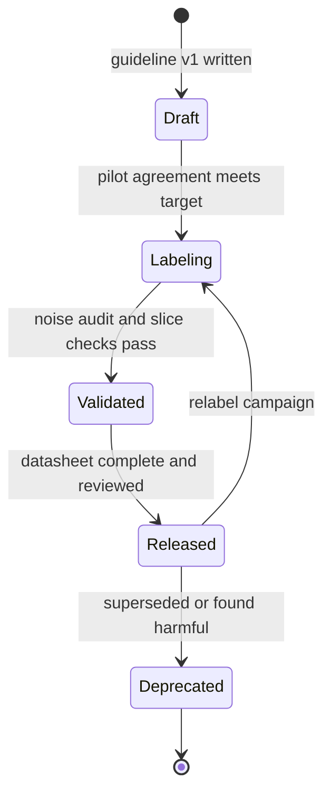

**Reading the diagram.** Each state is a status of one dataset version in the registry; each transition is a gate with an owner. A dataset cannot enter labeling until the pilot's agreement meets its target (§63.6), cannot be validated until a noise audit (§63.10) and slice checks (Chapter 61) pass, and cannot be released for training until its datasheet is complete and reviewed. A released dataset can go back to labeling (a relabel campaign produces a new version) or be deprecated, which must notify every model trained on it, using lineage from the model registry (Chapter 69). The failure point is a release gate that is not enforced in tooling; then documentation becomes optional and decays. Scaling: with hundreds of datasets, gates must be automated checks on metadata fields, not meetings.

#### Real-world industry applications

::: industry
**Data cards at Google.** Pushkarna, Zaldivar and Kjartansson describe the design of data cards through iterative work with dataset creators and consumers across product, research and policy teams at Google, and propose principles and a framework for writing them, including adapting the depth of each section to different readers.
*Evidence: Primary* — [Pushkarna et al. 2022]
:::

::: recommendation
**Recommendation — Generate what you can, write what you must.** Fill counts, class balance, agreement statistics, label-source shares and noise estimates automatically from the pipeline's metadata on every version. Reserve human writing for motivation, intended and prohibited uses, known limitations and sensitive content. Link the datasheet from the model card of every model trained on the dataset (§59.10.3).
:::

## 63.14 Labeling operations at scale

### 63.14.1 Vendors versus in-house

::: definition
**Definition — Labeling operations.** The organizational and operational side of labeling: who the annotators are (employees, contractors, vendor workforces or crowd platforms), how they are recruited, trained, paid, supervised and protected, how data reaches them securely, and how the cost, quality and throughput of the whole operation are measured.
:::

**Table 63.12 — Sourcing annotators.**

| Row | In-house experts | Managed vendor | Crowd platform | LLM-assisted with human review |
|---|---|---|---|---|
| What it is | Employees with domain knowledge | Contracted, trained workforce | Open marketplace of workers | Model pre-labels; people verify a share |
| Cost per label | Highest | Medium | Lowest human option | Lowest overall |
| Quality control | Direct | Contracted SLAs plus your audits | Gold questions, redundancy, aggregation | Calibration against gold; human audits |
| Data security | Strongest | Contractual and technical controls | Weakest; public tasks only | Depends on model hosting |
| Ramp-up | Slow (hiring) | Weeks | Hours | Days (prompt and calibration) |
| Choose when | Sensitive data, expert judgment, guideline authorship | Steady high volume with moderate expertise | Simple, non-sensitive, high-volume tasks | Well-defined tasks with measured LLM accuracy |

Most mature teams mix them: in-house experts write guidelines, build gold sets and adjudicate; a vendor or LLM-assisted pipeline produces volume; and agreement and gold metrics are owned by the in-house team, never only by the vendor whose invoice depends on them.

### 63.14.2 Security and personal data in annotation

Annotation is a data-export path: it shows raw production data to people outside the core team, often in another company and country. QuickBite's reviews and support tickets contain names, phone numbers, addresses and sometimes payment complaints with partial card details. Treat the labeling tool as a production system inside the security architecture of Chapter 50.

**Figure 63.14 — Annotation inside a security boundary.**

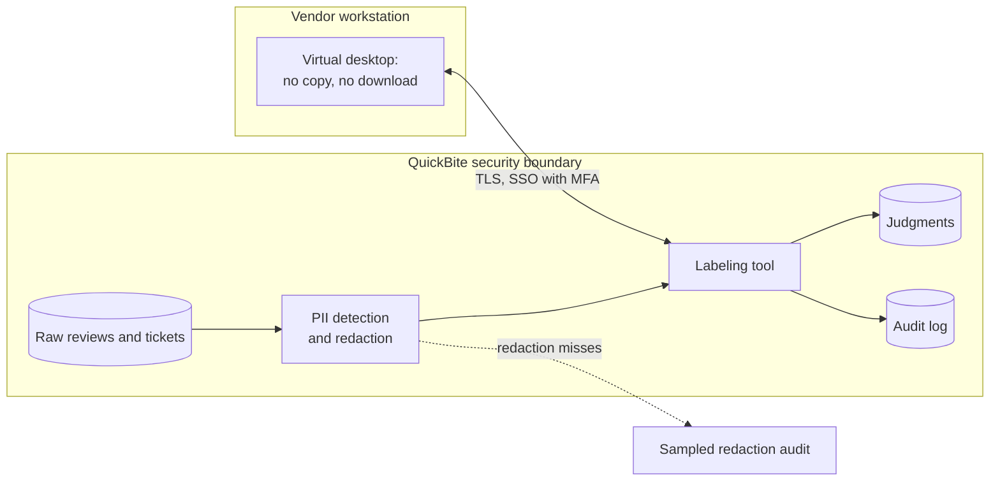

**Reading the diagram.** Raw data never leaves QuickBite's boundary. A redaction service detects and masks personal data (names, phone numbers, addresses, card fragments) before tasks are created; the labeling tool runs inside the boundary and records every view and judgment in an audit log. Vendor annotators reach it from a virtual desktop that blocks copying, downloading and screenshots where the platform allows, over TLS with single sign-on and multi-factor authentication (Chapter 10). A sampled audit checks for redaction misses asynchronously. Failure points: redaction recall below 100% (it always is, so audit it), task screenshots shared outside the tool, overly broad access (every annotator can see every queue) and retention (judgments copied into vendor systems). Scaling the workforce does not widen the boundary: more annotators means more seats on the same controlled tool, with access limited per queue and per region for data-residency rules.

::: recommendation
**Recommendation — Minimize what annotators see.** Show only the fields the judgment needs (the review text, not the customer's order history); mask identifiers; set a retention period on judgments and tasks; require a data-processing agreement with every vendor; and give each annotator access only to the queues they work on. For data that cannot be adequately redacted, use in-house annotators.
:::

### 63.14.3 Annotator well-being and fair work

Labeling is human work, and some of it is harmful. Content moderators who review violent, sexual or hateful material face risks of psychological harm documented in a growing literature [Steiger et al. 2021], and much annotation is performed as low-paid, invisible piecework [Gray and Suri 2019]. QuickBite's review moderation is milder than social-media moderation, but its "abuse" queue includes slurs and threats against couriers.

Practical measures: blur or gray-scale images by default and reveal on demand; cap daily exposure time to the most harmful queues and rotate annotators between queues; give a "skip and escalate" option without penalty; provide access to counseling; pay for training and calibration time, not just for completed tasks; set productivity targets from measured task times so that quotas do not push people into rushing (which also destroys label quality); and include annotators' feedback on guideline ambiguity in the revision loop. Well-being and label quality are linked: tired, rushed and distressed annotators produce noisier labels.

### 63.14.4 LLM-assisted labeling with human review

Large language models can now label many text tasks zero-shot or with a few examples. Gilardi, Alizadeh and Kubli found that a general-purpose LLM outperformed crowd workers on most of the text-annotation tasks they studied, at a small fraction of the cost [Gilardi et al. 2023]. That makes LLM pre-labeling attractive, but it introduces risks that are easy to miss:

- **Correlated errors.** An LLM's mistakes are systematic, not independent; aggregating several prompts to the same model does not average them out the way independent annotators do (§63.7.1).
- **Automation bias.** Annotators shown an LLM's pre-label accept it more often than they would reach the same answer alone, so "human review" can degrade into rubber-stamping.
- **Circularity.** If the same model (or model family) labels the training data and the evaluation data, the evaluation measures agreement with the labeler, not correctness. LLM-as-a-judge biases, such as preferring longer answers or answers in a particular position, are documented for evaluation tasks [Zheng et al. 2023] and covered in Chapter 78.
- **Silent drift.** A hosted model's version changes can change labels overnight; pin the model version and record it with every label, like a guideline version.
- **Privacy.** Sending reviews to an external model API is a data transfer subject to the same rules as sending them to a vendor (§63.14.2).

**Figure 63.15 — LLM pre-labeling with confidence routing and human audit.**

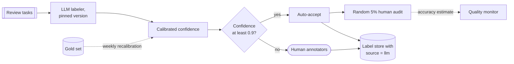

**Reading the diagram.** Tasks are labeled by a pinned LLM version, whose raw confidence is mapped to a calibrated probability using a gold set (recalibrated weekly, dotted, asynchronous). A decision node auto-accepts high-confidence labels and sends the rest to human annotators, who label blind, without seeing the LLM's answer. A random 5% of auto-accepted labels is also labeled blind by humans, giving a continuous accuracy estimate to a quality monitor. Every label is written with its source, so that LLM-produced labels can be weighted, filtered or excluded from evaluation sets. Failure points: calibration drift after a model update, a gold set that no longer reflects production, and audit samples too small to detect a drop on a rare class. Scaling: the LLM tier scales with API capacity and cost; human capacity is sized from the fraction routed to people.

::: formula
**Cost and quality of a hybrid LLM–human labeling pipeline**

$$c = c_{\text{llm}} + (1 - f)\,c_h + f\,s\,c_h \qquad A = f\,a_{\text{llm}} + (1 - f)\,a_h$$

| Symbol | Meaning | Units |
|---|---|---|
| $c_{\text{llm}}$ | LLM labeling cost per item | \$/item |
| $c_h$ | Cost of one human judgment | \$/judgment |
| $f$ | Fraction of items auto-accepted | fraction |
| $s$ | Audit rate on auto-accepted items | fraction |
| $a_{\text{llm}}$ | Accuracy of auto-accepted LLM labels, measured on gold | fraction |
| $a_h$ | Accuracy of a single human judgment on the routed items | fraction |
| $c$, $A$ | Expected cost per item and expected label accuracy | \$/item, fraction |
:::

::: example
**Worked example — Labeling 10,000 reviews per day.** One human judgment costs $c_h = \$15 \times 22\,\text{s} / (3600 \times 0.80) = \$0.115$ (§63.5.2, with $r = 1$). Assume (as of 2026, varying widely by model and provider) $c_{\text{llm}} = \$0.002$ per review. Calibration on a 2,000-item gold set shows that 70% of reviews get confidence ≥ 0.9, with accuracy 0.97 in that bucket; humans are 0.93 accurate on the remainder. Audit rate $s = 0.05$.

1. Cost: $c = 0.002 + 0.30 \times 0.115 + 0.70 \times 0.05 \times 0.115 = 0.002 + 0.0345 + 0.0040 = \$0.0405$ per review.
2. All-human single judgment: \$0.115 per review. Saving: $1 - 0.0405/0.115 = 65\%$; per day $10{,}000 \times (0.115 - 0.0405) = \$745$.
3. Accuracy: $A = 0.70 \times 0.97 + 0.30 \times 0.93 = 0.679 + 0.279 = 0.958$.
4. Audit precision: $0.05 \times 7{,}000 = 350$ audited labels per day; the 95% interval on a 0.97 accuracy estimate is $\pm 1.96\sqrt{0.97 \times 0.03 / 350} = \pm 0.018$.

**Interpretation.** The hybrid is cheaper *and* more accurate than single human judgment, but only because the LLM is restricted to the bucket where it was measured to be good. **Engineering implication.** The audit is what keeps the claim true. Measure accuracy per class, not just overall (a 0.97 bucket can hide a 0.70 accuracy on the rare "abuse" class); never use LLM-sourced labels as the evaluation set for a model trained on them; and re-run calibration whenever the model version, the prompt or the guideline changes.
:::

::: note
**Note — Preference data for LLMs (preview).** Aligning large language models uses a special kind of label: human (or AI) judgments of which of two model responses is better, used to train a reward model or to optimize the model directly [Ouyang et al. 2022]. Everything in this chapter applies (guidelines, agreement, annotator quality, well-being, LLM-assisted labeling), but preference judgments are more subjective, agreement between annotators is typically lower than on classification tasks, and the data is consumed by different training algorithms. Chapter 76 owns this topic.
:::
