# Chapter 63 — Data Labeling, Quality and Data-Centric AI

> **Level:** 3 · **Track:** B (ML/AI) · **Estimated reading time:** 4 h

A cook with a mediocre oven and excellent ingredients usually beats a cook with a superb oven and spoiled ingredients. In machine learning the model is the oven and the labeled examples are the ingredients. Chapters 57–60 assumed someone had already handed you a table of features and **labels** (§57.6.2). This chapter is about where labels come from, how wrong they are, how to measure and repair them, and how to run the pipelines and operations that produce them at a predictable cost.

The running example is **QuickBite**, the hypothetical food-delivery platform of Chapters 2 and 57–60, with its shared assumptions unchanged: 500,000 orders per day, a 0.5% fraud rate and a 35-minute median delivery time. This chapter adds one assumption: **4% of orders produce a written review**, about 20,000 reviews per day for a moderation model to screen. All QuickBite numbers are teaching assumptions, not measurements of any real company.

## 63.1 Learning objectives

After this chapter you should be able to:

- Explain the data-centric view of ML and use error analysis to choose between label work and model work.
- Classify label sources and compute a label-maturity window from a delay distribution.
- Design a human labeling pipeline and estimate its throughput, headcount and cost.
- Compute Cohen's κ, Fleiss' κ and Krippendorff's α, and choose among them.
- Aggregate noisy labels with majority vote and Dawid–Skene EM.
- Build and evaluate labeling functions for weak supervision.
- Run active learning and estimate the labeling cost it saves.
- Detect label errors with confident learning and loss-based filtering.
- Downsample a rare class and correct the model's probabilities.
- Judge when synthetic data helps, document datasets, and operate labeling at scale, including LLM-assisted labeling.

## 63.2 Prerequisites

- Features, labels, label delay and leakage — §57.6 (leakage is owned there).
- Classification metrics and calibration — §57.10 (used to judge labels and recalibrate).
- Label delay, data validation and feedback loops — §59.7, §59.12.2, §59.13.2.
- Data-centric versus model-centric architecture — §60.4.
- Conditional probability and Bayes' rule — §4.6 (Dawid–Skene and recalibration apply it).
- Work queues — Chapter 30; privacy engineering — Chapter 50.

Pipeline-scale data quality checks belong to Chapter 61, fairness to Chapter 71, and preference data for aligning LLMs to Chapter 76 (previewed in §63.14).

## 63.3 Data-centric AI

### 63.3.1 Why data quality often beats model changes

::: definition
**Definition — Data-centric AI.** An approach in which the model is held roughly fixed and the main lever for improvement is the systematic engineering of the data: label definitions and consistency, coverage of rare cases, removal of errors, and the documentation and versioning of datasets. **Model-centric** development holds the data fixed and iterates on the model (§60.4.1).
:::

#### First-principles explanation

A model is a student and the labeled dataset is its answer key. If 10% of the key is wrong, a brilliant student learns the wrong answers faithfully. Large neural networks can fit completely random labels [Zhang et al. 2017], so capacity is no protection against a bad key. Fixing the key helps every student at once.

#### Why does this exist?

ML research long progressed by holding benchmarks fixed and competing on models. Production teams have no fixed dataset; they have whatever their logging and labeling produce. Andrew Ng popularized the term *data-centric AI* in a 2021 talk and an associated NeurIPS workshop and competition, arguing that for many applied problems, particularly with small datasets, systematically improving label consistency yields larger gains than changing the model [Ng 2021]. Sambasivan et al. interviewed 53 practitioners in high-stakes domains and named the failure mode **data cascades**: compounding, delayed problems that start with undervalued data work and surface later as model failures; they found such cascades in almost every project they studied [Sambasivan et al. 2021].

#### How it works internally

1. Train a reasonable baseline with an off-the-shelf model.
2. Do error analysis on the worst examples, grouped by slice.
3. Diagnose each error cluster: wrong label, ambiguous definition, missing coverage, missing feature.
4. Fix the data: relabel, rewrite the guideline, add rare cases, add the feature.
5. Version the dataset and retrain the *same* model, so the metric change is attributable to the data.

**Figure 63.1 — Model-centric and data-centric iteration loops.**

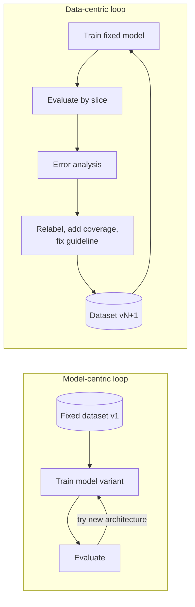

**Reading the diagram.** On the left the dataset (cylinder) never changes and iteration runs only between training and evaluation; its ceiling is set by label noise. On the right the loop runs through the data: error analysis routes failures to label and coverage fixes, each producing a new dataset version for the same model. All steps are offline batch jobs. The right loop's failure point is unversioned data (§59.14); it scales with labeling capacity.

### 63.3.2 QuickBite's three labeled datasets

**Table 63.1 — Where QuickBite's labels come from.**

| Problem | Label | Source | Delay | Main quality problems |
|---|---|---|---|---|
| Fraud detection | 1 if a fraud chargeback arrives | Card network feed | 15–90 days | Late arrival; non-fraud chargebacks; blocked orders never labeled |
| ETA prediction | Minutes from order to delivery | Courier app events | ~35 min | Late "delivered" taps; canceled orders unlabeled |
| Review moderation | Keep or remove | Human annotators | Hours to days | Ambiguous guidelines; disagreement; rare positives |

**Fraud labels from chargebacks.** A chargeback is a payment reversal after a cardholder dispute: a free, natural label, but a dirty one. Only fraud **reason codes** should become fraud labels ("goods not received" is not fraud). "Friendly fraud", a customer disputing an order they really placed, puts fraud labels on legitimate orders. Orders the current model *blocked* never get a chargeback, so training data covers only orders the old model let through, a selection bias that feeds the next model (§59.13.2).

**ETA labels from delivery events.** The label joins `order_placed` and `order_delivered` events. Replacing the courier's late "delivered" tap with GPS arrival time cut ETA error more than a model change did (Table 60.4). Canceled orders are **censored**; dropping them silently biases training toward easy orders.

**Moderation labels for reviews.** No natural signal says whether a review is abusive, so QuickBite pays people to decide. Every label has a cost, a latency and a measurable disagreement rate.

::: industry
**Data-centric AI in visual inspection.** In his 2021 talk Ng described manufacturing-inspection projects, such as steel-sheet defect detection, in which improving label consistency on a fixed model (for example, agreeing on how to box a defect) produced larger accuracy gains than model search on fixed data.
*Evidence: Primary* — [Ng 2021]
:::

::: mistake
**Mistake — "More data always beats better data."** Extra data helps only at a similar signal-to-noise ratio. Adding a million rows with 30% label noise to 50,000 clean rows can lower accuracy on the cases that matter. Measure label quality before scaling quantity, and hold the model fixed while you change data so gains are attributable (§60.4.2).
:::

## 63.4 Sources of labels

### 63.4.1 Four kinds of label

::: definition
**Definition — Label sources.** A **natural label** is produced by the product as a side effect (a delivery completes, a payment is reversed). A **delayed label** becomes known long after the prediction. An **explicit human label** is a person's judgment against a written guideline. A **programmatic label** is produced by code: a rule, a lookup or another model.
:::

**Table 63.2 — Comparison of label sources.**

| Row | Natural | Delayed natural | Explicit human | Programmatic |
|---|---|---|---|---|
| QuickBite example | ETA from delivery events | Fraud from chargebacks | Review moderation | "Phone number → spam" |
| Cost per label | ≈ 0 | ≈ 0 | Cents to dollars | ≈ 0 after writing |
| Latency | Minutes | Weeks to months | Hours to days | Seconds |
| Typical noise | Instrumentation, censoring | Immaturity, reason codes | Disagreement, fatigue | Systematic bias, low coverage |
| Choose when | Outcome is observable | Outcome is slow | No outcome exists | Knowledge is cheap to encode |

Human-label cost varies by orders of magnitude, from a two-second crowd judgment to an hour of a radiologist's time; budget from your own pilot (§63.5.2).

**Figure 63.2 — Label sources flowing into a label store.**

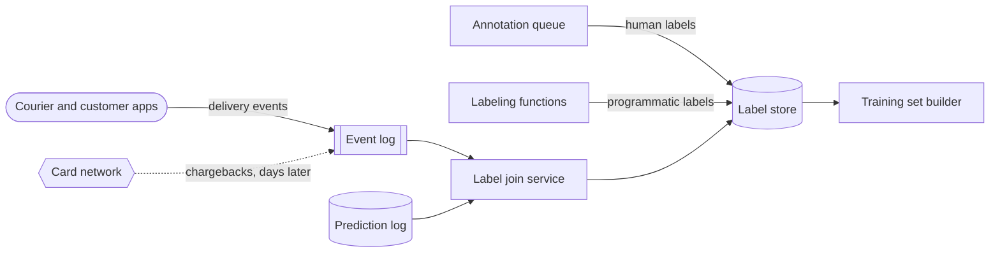

**Reading the diagram.** App events and asynchronous chargebacks from the external card network (dotted) enter an event log (Chapter 31). A join service matches each outcome to the logged prediction and its serving-time features (§59.5.3). Human and programmatic labels land in the same versioned label store, each row tagged with its source. Failure points: the join (missing prediction IDs), the external feed and feature retention. Tagging the source lets you later reweight or drop a bad one.

### 63.4.2 Label delay and its effect

Chapter 57 assumed this QuickBite chargeback delay: 40% of eventual fraud chargebacks arrive within 15 days, 75% within 30, 95% within 60 and 100% within 90 (§57.6.2). Here it becomes a rule for building training sets.

::: formula
**Label completeness and the maturity window**

$$\pi_{\text{obs}}(a) = \pi \cdot F(a) \qquad C(a_1, a_2) = \frac{1}{a_2 - a_1}\int_{a_1}^{a_2} F(a)\,da \qquad W_\varepsilon = \min\{a : F(a) \ge 1 - \varepsilon\}$$

| Symbol | Meaning | Units |
|---|---|---|
| $a$ | Age of an example since its prediction | days |
| $F(a)$ | Fraction of eventual positives that have arrived by age $a$ | fraction |
| $\pi$ | True positive (fraud) rate | fraction |
| $\pi_{\text{obs}}(a)$ | Observed positive rate at age $a$ | fraction |
| $C(a_1, a_2)$ | Mean label completeness of a window of ages $a_1$–$a_2$ (uniform traffic) | fraction |
| $\varepsilon$ | Tolerated fraction of missing positives | fraction |
| $W_\varepsilon$ | Label-maturity window | days |
:::

::: example
**Worked example — How old must fraud training data be?** Interpolate $F$ linearly with $F(0) = 0$. At $\pi = 0.5\%$, QuickBite sees $500{,}000 \times 0.005 = 2{,}500$ frauds per day.

1. **Naive window, ages 0–30 days.** Area under $F$: $15 \times 0.40/2 = 3.0$ plus $15 \times (0.40 + 0.75)/2 = 8.625$. $C = 11.625/30 = 0.3875$; observed fraud rate $0.5\% \times 0.3875 = 0.194\%$. **61% of the window's fraud is labeled legitimate.**
2. **Maturity window.** With $\varepsilon = 0.05$, $W = 60$ days.
3. **Matured window, ages 60–240 days.** $F$ averages 0.975 over days 60–90 and is 1 after: $C = (30 \times 0.975 + 150)/180 = 0.9958$.
4. Positives observed: $2{,}500 \times 180 \times 0.9958 = 448{,}125$; the 1,875 missing ones hide among 89.55 million negatives (0.0021% noise).
5. **The price:** the freshest training example is 60 days old; with weekly retraining and a week of rollout, a new fraud pattern can run 74 days before any model learns it.

**Interpretation.** The naive window teaches the model that recent fraud is legitimate. **Engineering implication.** Train on matured windows and cover the blind spot with faster, noisier labels tagged by source (analyst reviews, dispute tickets, fraud-team rules), or model the delay explicitly [Chapelle 2014].
:::

**Figure 63.3 — Timeline of a fraud model trained on matured labels.**

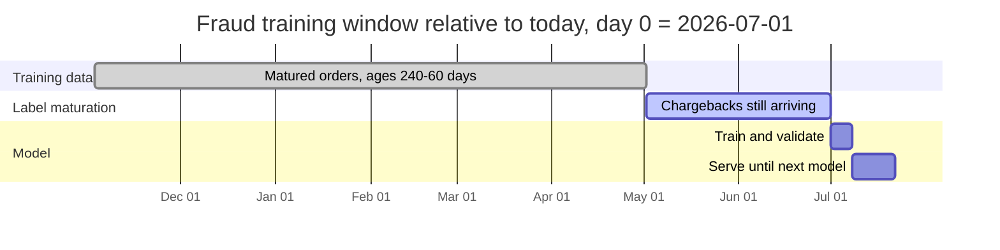

**Reading the diagram.** Training uses 180 days of orders at least 60 days old; the latest 60 days sit in the prediction log, excluded while chargebacks arrive. The model then trains for a week and serves for two. The prediction log must retain features for 240 days. An attack starting inside the active bar is invisible to every model on this schedule; daily retraining shortens the serving bar, but only faster labels shorten maturation.

**Table 63.3 — Label-source failure scenarios.**

| What goes wrong | Why | Detection | Recovery | Prevention |
|---|---|---|---|---|
| Recent fraud labeled legitimate | Window younger than $W_\varepsilon$ | Positive rate falls for recent cohorts | Rebuild with matured cutoff | Enforce $W_\varepsilon$ in the builder |
| Non-fraud chargebacks as fraud | Reason codes ignored | Label rate jumps after a dispute wave | Relabel by reason code | Reviewed reason-code mapping |
| Blocked orders never labeled | Selection bias | Training positive rate tracks threshold | Analyst labels on a sample | Small exploration sample (§59.13.2) |
| Label join drops rows | Missing prediction IDs | Join rate below 99% | Backfill from raw logs | Monitor join rate (Chapter 61) |

::: mistake
**Mistake — Evaluating on the most recent month "because it is most realistic".** Its positives have not arrived: correct flags count as false positives and recall is measured against a fraction of the real fraud. Evaluate on the newest *matured* window.
:::

## 63.5 Labeling pipelines

### 63.5.1 Task design, guidelines and architecture

::: definition
**Definition — Labeling pipeline.** The system that turns unlabeled examples into trusted labels: it selects examples, presents them as **tasks** in a labeling tool, collects one or more **judgments** per example, checks annotators against **gold questions** (examples with known answers), resolves disagreements by **adjudication**, and writes versioned labels with provenance to a label store.
:::

#### First-principles explanation

A labeling pipeline is a factory whose machines are people. It has an intake (which examples), a work order (the guideline), workstations (the tool), a conveyor (the queue), inspection (gold questions, agreement) and a supervisor for disputes (adjudication). Unlike machines, the workers interpret instructions, tire, learn and disagree in patterned ways, so the factory measures them continuously.

#### How it works internally

1. **Define the task.** For QuickBite: `keep`, `remove:spam`, `remove:abuse`, `remove:personal_data`, plus `unsure`. Split complex judgments into simple ones.
2. **Write the guideline**: definitions, examples per class and, above all, **boundary cases** ("naming the courier is not personal data; the courier's phone number is"). Every label records its guideline version.
3. **Pilot**: three to five annotators label the same 200 items; measure agreement (§63.6), read every disagreement, revise, repeat until agreement plateaus. Most quality is set here.
4. **Select** examples by stratified sampling or active learning (§63.9).
5. **Queue** each example for $r$ different annotators (the **redundancy**), mixing in gold questions at rate $g$.
6. **Check quality** against gold and peers; retrain or remove weak annotators.
7. **Aggregate** judgments into a label with a confidence (§63.7); **adjudicate** low-confidence or high-stakes items.
8. **Publish** labels with judgments, pseudonymous annotator IDs and guideline version, and cut a dataset version.

**Figure 63.4 — Architecture of a human labeling pipeline.**

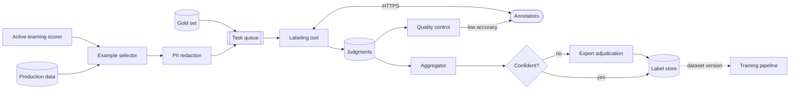

**Reading the diagram.** Selected examples are redacted (§63.14) and queued with gold items; the queue leases tasks with a visibility timeout so abandoned tasks return (Chapter 30). Annotators work in the tool over HTTPS; judgments feed quality control and the aggregator, which sends low-confidence items to experts. Training consumes dataset versions asynchronously. Failure points: stale guidelines, memorized gold items, adjudication backlog, missed PII. Annotators scale horizontally; experts are the bottleneck.

Labeling tools range from self-hosted open-source projects (Label Studio and CVAT are widely used, as of 2026) to managed services. What matters is versioned task definitions, an API for tasks and judgments, per-annotator audit logs, gold and redundancy support, and fine-grained access control.

### 63.5.2 Throughput and cost

::: formula
**Labeling effort, headcount and cost**

$$H = \frac{N \cdot r \cdot t \cdot (1 + g)}{3600 \cdot u} \qquad H_{\text{adj}} = \frac{N \cdot a \cdot t_{\text{adj}}}{3600 \cdot u} \qquad \text{Cost} = H\,w + H_{\text{adj}}\,w_{\text{adj}} \qquad n_{\text{ann}} = \left\lceil \frac{H}{D \cdot h} \right\rceil$$

| Symbol | Meaning | Units |
|---|---|---|
| $N$ | Examples to label | examples |
| $r$ | Judgments per example | judgments |
| $t$ | Median time per judgment | seconds |
| $g$ | Gold tasks per real task | fraction |
| $u$ | Productive fraction of paid time | fraction |
| $a$, $t_{\text{adj}}$ | Fraction adjudicated; time per adjudication | fraction; seconds |
| $w$, $w_{\text{adj}}$ | Loaded hourly cost of annotator and adjudicator | \$/hour |
| $H$, $H_{\text{adj}}$ | Paid annotator and adjudicator hours | hours |
| $D$, $h$ | Working days; paid hours per person per day | days; hours/day |
| $n_{\text{ann}}$ | Annotators needed | people |
:::

::: example
**Worked example — QuickBite's first moderation dataset.** Goal: 30,000 labeled reviews in 10 working days. Pilot measurements: $t = 20$ s, $r = 3$, $g = 0.10$, $u = 0.80$, $a = 0.08$, $t_{\text{adj}} = 60$ s. Assumed costs (illustrative; rates vary several-fold by region and vendor): $w = \$15$/h, $w_{\text{adj}} = \$40$/h; $h = 8$.

1. Judgment time: $30{,}000 \times 3 \times 20 \times 1.10 = 1{,}980{,}000$ s $= 550$ h; paid $H = 550/0.80 = 687.5$ h.
2. Adjudication: $30{,}000 \times 0.08 \times 60 = 144{,}000$ s $= 40$ h; paid $H_{\text{adj}} = 50$ h.
3. Cost: $687.5 \times 15 + 50 \times 40 = \$10{,}312.50 + \$2{,}000 = \$12{,}312.50$, **\$0.41 per final label**.
4. Headcount: $687.5/80 = 8.6$, so **9 annotators**, plus $50/80 = 0.63$ of an expert.
5. Throughput: $3600 \times 0.80/(20 \times 1.10) = 130.9$ judgments per paid hour; 9 annotators finish about $9 \times 8 \times 130.9/3 \approx 3{,}140$ labels per day.

**Interpretation.** Redundancy is the biggest multiplier; $r = 1$ would cut annotator cost by two-thirds but remove any way to measure disagreement. **Engineering implication.** Use $r = 3$ for the initial set and a continuing audit sample, then $r = 1$ with **dynamic redundancy** (extra judgments only for low-confidence or high-stakes items). At 20,000 reviews per day QuickBite must label a sample, not everything (§63.9, §63.11).
:::

**Table 63.4 — Labeling-pipeline failure scenarios.**

| What goes wrong | Why | Detection | Recovery | Prevention |
|---|---|---|---|---|
| Labels change meaning | Unversioned guideline edit | Label rate shifts on a date | Relabel the batch | Version on every label |
| Gold items recognized | Small, reused gold set | Gold accuracy ≫ peer agreement | Rotate gold | Grow gold from adjudications |
| Random clicking | Pay per task, no checks | Chance-level gold accuracy; very short times | Drop judgments | Gold, minimum time, qualification |
| Anchoring on pre-labels | Tool shows model output | Agreement with model ≫ with gold | Blind relabel sample | Blind audit stream |

::: mistake
**Mistake — Treating the guideline as documentation written once.** The guideline *is* the specification of what the model learns. Every change is a dataset change and needs a version, a changelog and often relabeling near the changed boundary.
:::

## 63.6 Human annotation quality

### 63.6.1 Agreement and why raw agreement misleads

::: definition
**Definition — Inter-annotator agreement (IAA).** How consistently independent annotators give the same label to the same examples. **Percent agreement** is the raw match rate. **Chance-corrected** coefficients (Cohen's κ, Fleiss' κ, Krippendorff's α) subtract the agreement expected if annotators labeled randomly at their observed class frequencies, so that 1 is perfect and 0 is chance.
:::

Without an answer key you cannot measure accuracy, but you can measure whether two people using the same guideline agree. Low agreement proves a problem, usually an ambiguous guideline. Raw agreement misleads under imbalance: if 95% of reviews are fine, two annotators who always answer "keep" agree 95% of the time while conveying nothing.

### 63.6.2 Cohen's κ for two annotators

::: formula
**Cohen's kappa** [Cohen 1960]

$$\kappa = \frac{p_o - p_e}{1 - p_e} \qquad p_o = \frac{1}{N}\sum_{k} n_{kk} \qquad p_e = \sum_{k} \frac{n_{k\cdot}}{N}\cdot\frac{n_{\cdot k}}{N}$$

| Symbol | Meaning | Units |
|---|---|---|
| $N$ | Examples labeled by both annotators | examples |
| $n_{jk}$ | Examples A put in class $j$ and B in class $k$ | examples |
| $n_{k\cdot}$, $n_{\cdot k}$ | A's and B's totals for class $k$ | examples |
| $p_o$, $p_e$ | Observed and chance agreement | fraction |
| $\kappa$ | Chance-corrected agreement | dimensionless |
:::

**Table 63.5 — Two QuickBite moderators label the same 200 reviews.**

| | B: keep | B: remove | A total |
|---|---|---|---|
| **A: keep** | 140 | 12 | 152 |
| **A: remove** | 18 | 30 | 48 |
| **B total** | 158 | 42 | 200 |

::: example
**Worked example — Cohen's κ for the moderation pilot.**

1. $p_o = (140 + 30)/200 = 0.850$.
2. $p_e = (152/200)(158/200) + (48/200)(42/200) = 0.6004 + 0.0504 = 0.6508$.
3. $\kappa = (0.850 - 0.6508)/(1 - 0.6508) = 0.1992/0.3492 = 0.570$.

**Interpretation.** Of the 85% raw agreement, 65 points are what these class frequencies give by chance. κ = 0.57 is "moderate" on the Landis–Koch convention (0.41–0.60 moderate, 0.61–0.80 substantial, above 0.80 almost perfect) [Landis and Koch 1977]. **Engineering implication.** Do not scale labeling at 0.57 for a safety-relevant class: read the 30 disagreements, settle the boundary cases in the guideline and re-pilot. Teams commonly target 0.7–0.8 for well-defined tasks.
:::

::: warning
**Warning — The prevalence paradox.** Two annotators agree on "keep" 190 times out of 200 and split the other 10 (5 each way). Then $p_o = 0.95$, $p_e = (195/200)^2 + (5/200)^2 = 0.9513$ and $\kappa = -0.026$: they never agree on the rare class, the one that matters [Feinstein and Cicchetti 1990]. Report per-class agreement alongside κ, and oversample the rare class in pilots.
:::

### 63.6.3 Fleiss' κ and Krippendorff's α

Crowd pipelines give each item to $n$ annotators drawn from a pool. Fleiss extended chance-corrected agreement to that setting [Fleiss 1971]; with two annotators it reduces to Scott's π, not to Cohen's κ, because it pools class frequencies.

::: formula
**Fleiss' kappa**

$$P_i = \frac{\sum_{j} n_{ij}(n_{ij}-1)}{n(n-1)} \qquad \bar P = \frac{1}{N}\sum_i P_i \qquad p_j = \frac{1}{Nn}\sum_i n_{ij} \qquad \kappa_F = \frac{\bar P - \sum_j p_j^2}{1 - \sum_j p_j^2}$$

| Symbol | Meaning | Units |
|---|---|---|
| $N$, $n$ | Items; annotators per item | items; annotators |
| $n_{ij}$ | Annotators who put item $i$ in class $j$ | annotators |
| $P_i$, $\bar P$ | Pairwise agreement on item $i$; its mean | fraction |
| $p_j$ | Share of all judgments in class $j$ | fraction |
| $\kappa_F$ | Fleiss' kappa | dimensionless |
:::

**Table 63.6 — Three annotators per review, three classes.**

| Review | keep | spam | abuse | $P_i$ |
|---|---|---|---|---|
| 1 | 3 | 0 | 0 | 1.000 |
| 2 | 0 | 3 | 0 | 1.000 |
| 3 | 2 | 1 | 0 | 0.333 |
| 4 | 1 | 0 | 2 | 0.333 |
| 5 | 1 | 1 | 1 | 0.000 |
| Total | 7 | 5 | 3 | |

::: example
**Worked example — Fleiss' κ for five reviews.** $n(n-1) = 6$.

1. Review 3: $(2 \times 1)/6 = 0.333$; review 5: no agreeing pair. $\bar P = (1 + 1 + 0.333 + 0.333 + 0)/5 = 0.5333$.
2. $p = (7, 5, 3)/15 = (0.4667, 0.3333, 0.2000)$; $\sum p_j^2 = 0.2178 + 0.1111 + 0.0400 = 0.3689$.
3. $\kappa_F = (0.5333 - 0.3689)/(1 - 0.3689) = 0.261$.

**Interpretation.** "Fair" agreement. **Engineering implication.** Five items are far too few to act on; agreement estimates need hundreds of items with enough of each class.
:::

Real pipelines have missing judgments and sometimes ordinal labels (a 1–5 severity). **Krippendorff's α** handles any number of annotators per item, missing data and nominal, ordinal, interval or ratio labels via a distance function [Krippendorff 2018]; for nominal labels the distance is 0 for a match and 1 otherwise.

::: formula
**Krippendorff's alpha (nominal)**

$$\alpha = 1 - \frac{D_o}{D_e} = 1 - (n_{\cdot\cdot} - 1)\,\frac{\sum_{c \ne k} o_{ck}}{\sum_{c \ne k} n_c\, n_k} \qquad o_{ck} = \sum_u \frac{\#\,(c, k)\ \text{pairs in unit}\ u}{m_u - 1}$$

| Symbol | Meaning | Units |
|---|---|---|
| $m_u$ | Judgments on unit (item) $u$, at least 2 | judgments |
| $o_{ck}$ | Coincidences: ordered value pairs $(c, k)$ within units, weighted | pairs |
| $n_c$, $n_{\cdot\cdot}$ | Pairable judgments with value $c$; in total | judgments |
| $D_o$, $D_e$ | Observed and expected disagreement | dimensionless |
:::

::: example
**Worked example — α for the same five reviews.** $n_{\cdot\cdot} = 15$, $m_u = 3$, each ordered pair weighs 1/2.

1. Disagreeing coincidences: review 3 has 4 ordered keep–spam pairs (weight 2), review 4 has 4 (weight 2), review 5 has 6 (weight 3): total 7.
2. $\sum_{c \ne k} n_c n_k = 15^2 - (49 + 25 + 9) = 142$.
3. $\alpha = 1 - 14 \times 7/142 = 0.310$.

**Interpretation.** α exceeds Fleiss' κ (0.261) slightly because of its small-sample correction. Krippendorff advises relying on α ≥ 0.800 and drawing only tentative conclusions for 0.667–0.800 [Krippendorff 2018]. **Engineering implication.** Use α in production pipelines with gaps or ordinal labels.
:::

### 63.6.4 Code example: agreement statistics from scratch

```python
import numpy as np
from sklearn.metrics import cohen_kappa_score

def cohen_kappa(a, b):
    """Cohen's kappa for two raters over the same items (nominal labels)."""
    a, b = np.asarray(a), np.asarray(b)
    cats = np.union1d(a, b)
    p_o = np.mean(a == b)                                  # observed agreement
    p_a = np.array([np.mean(a == c) for c in cats])         # rater A marginals
    p_b = np.array([np.mean(b == c) for c in cats])         # rater B marginals
    p_e = float(np.sum(p_a * p_b))                          # chance agreement
    return p_o, p_e, (p_o - p_e) / (1 - p_e)

def fleiss_kappa(counts):
    """counts[i, j] = number of raters who put item i in category j."""
    counts = np.asarray(counts, dtype=float)
    n = counts.sum(axis=1)[0]                               # raters per item
    P_i = (np.sum(counts**2, axis=1) - n) / (n * (n - 1))
    P_bar = P_i.mean()
    p_j = counts.sum(axis=0) / counts.sum()
    P_e = np.sum(p_j**2)
    return P_bar, P_e, (P_bar - P_e) / (1 - P_e)

def krippendorff_alpha_nominal(units):
    """units: list of lists of labels (missing ratings simply omitted)."""
    cats = sorted({v for u in units for v in u})
    idx = {c: i for i, c in enumerate(cats)}
    o = np.zeros((len(cats), len(cats)))                    # coincidence matrix
    for u in units:
        m = len(u)
        if m < 2:
            continue                                        # unpairable unit
        for i in range(m):
            for j in range(m):
                if i != j:
                    o[idx[u[i]], idx[u[j]]] += 1 / (m - 1)
    n_c = o.sum(axis=1)
    n = n_c.sum()
    d_o = (o.sum() - np.trace(o)) / n
    d_e = (n**2 - np.sum(n_c**2)) / (n * (n - 1))
    return 1 - d_o / d_e

# Two moderators, 200 reviews: (A, B) cell counts from Table 63.5
cells = {("ok", "ok"): 140, ("ok", "rm"): 12, ("rm", "ok"): 18, ("rm", "rm"): 30}
a = [x for (x, _), k in cells.items() for _ in range(k)]
b = [y for (_, y), k in cells.items() for _ in range(k)]
p_o, p_e, k = cohen_kappa(a, b)
print(f"Cohen:  p_o={p_o:.4f} p_e={p_e:.4f} kappa={k:.4f} sklearn={cohen_kappa_score(a, b):.4f}")

# Same raw agreement level, rare positive class: the prevalence paradox
cells2 = {("ok", "ok"): 190, ("ok", "rm"): 5, ("rm", "ok"): 5, ("rm", "rm"): 0}
a2 = [x for (x, _), k in cells2.items() for _ in range(k)]
b2 = [y for (_, y), k in cells2.items() for _ in range(k)]
p_o, p_e, k = cohen_kappa(a2, b2)
print(f"Rare:   p_o={p_o:.4f} p_e={p_e:.4f} kappa={k:.4f}")

# Three raters, five reviews, categories (ok, spam, abusive): Table 63.6
counts = [[3, 0, 0], [0, 3, 0], [2, 1, 0], [1, 0, 2], [1, 1, 1]]
P_bar, P_e, fk = fleiss_kappa(counts)
print(f"Fleiss: P_bar={P_bar:.4f} P_e={P_e:.4f} kappa={fk:.4f}")
units = [["ok"]*3, ["spam"]*3, ["ok", "ok", "spam"], ["ok", "ab", "ab"], ["ok", "spam", "ab"]]
print(f"Krippendorff alpha (complete) = {krippendorff_alpha_nominal(units):.4f}")
units_missing = [["ok"]*3, ["spam"]*2, ["ok", "ok", "spam"], ["ok", "ab"], ["ok", "spam", "ab"]]
print(f"Krippendorff alpha (2 ratings missing) = {krippendorff_alpha_nominal(units_missing):.4f}")
```

Output:

```text
Cohen:  p_o=0.8500 p_e=0.6508 kappa=0.5704 sklearn=0.5704
Rare:   p_o=0.9500 p_e=0.9512 kappa=-0.0256
Fleiss: P_bar=0.5333 P_e=0.3689 kappa=0.2606
Krippendorff alpha (complete) = 0.3099
Krippendorff alpha (2 ratings missing) = 0.1600
```

What to notice:

- The hand-written κ matches `sklearn.metrics.cohen_kappa_score`, and every value matches the worked examples.
- The "rare" case: 95% raw agreement, κ below zero.
- α accepts units with different numbers of judgments. Dropping one judgment each from reviews 2 and 4 leaves review 4 as a single disagreeing pair, and α falls to 0.16: with few items, every judgment moves the estimate.

**Table 63.7 — Agreement statistics compared.**

| Row | Percent agreement | Cohen's κ | Fleiss' κ | Krippendorff's α |
|---|---|---|---|---|
| Annotators | Any | Two, fixed | Fixed count, rotating | Any, with gaps |
| Label types | Nominal | Nominal (weighted κ: ordinal) | Nominal | Nominal to ratio |
| Disadvantages | Inflated by imbalance | Prevalence paradox | Equal judgments per item | Less familiar |
| Choose when | Never alone | Two-expert pilots | Fixed-redundancy crowds | Production pipelines |

::: mistake
**Mistake — Reading high agreement as high accuracy.** Agreement measures *reliability*. Two annotators who share a misreading agree perfectly and are both wrong; accuracy needs expert-adjudicated gold questions. Track both.
:::

## 63.7 Aggregating noisy labels

### 63.7.1 Majority vote

::: definition
**Definition — Label aggregation.** Combining several noisy judgments of one example into a **hard label** or a **soft label** (a probability per class). **Majority vote** picks the most frequent judgment; **model-based aggregation** estimates each annotator's reliability and weights judgments accordingly.
:::

If three independent witnesses each pick the right suspect 80% of the time, the chance that at least two are right exceeds 80%. That is the case for redundancy, resting on two assumptions that annotators violate: equal reliability and independent errors.

::: formula
**Accuracy of majority vote (independent, equally accurate annotators)**

$$P_{\text{MV}}(r, p) = \sum_{k = (r+1)/2}^{r} \binom{r}{k} p^{k} (1-p)^{r-k} \qquad (r \text{ odd, two classes})$$

| Symbol | Meaning | Units |
|---|---|---|
| $r$ | Judgments per item | judgments |
| $p$ | Accuracy of each annotator | probability |
| $k$ | Number of correct judgments | judgments |
| $P_{\text{MV}}$ | Probability the majority is correct | probability |
:::

::: example
**Worked example — How much does redundancy buy?** With $p = 0.80$: $r = 1$ gives 0.800; $r = 3$ gives $0.8^3 + 3(0.8^2)(0.2) = 0.512 + 0.384 = 0.896$; $r = 5$ gives $0.3277 + 0.4096 + 0.2048 = 0.942$.

**Interpretation.** Error falls from 20% to 10.4% at 3× cost and to 5.8% at 5× cost. **Engineering implication.** Returns diminish fast, and correlated errors on ambiguous items make real gains smaller. Repeated labeling pays most when spent selectively on uncertain items [Sheng et al. 2008]; fix the guideline before buying judgments.
:::

### 63.7.2 The Dawid–Skene model

Dawid and Skene, studying clinicians who disagreed about patient records, estimated each observer's error rates and the true labels jointly with the EM algorithm and no ground truth [Dawid and Skene 1979]. It remains the standard baseline for crowd aggregation.

::: formula
**Dawid–Skene EM updates**

$$\text{E: } T_{ik} \propto \pi_k \prod_{j \in A(i)} \theta^{(j)}_{k,\,y_{ij}} \qquad \text{M: } \pi_k = \frac{1}{N}\sum_i T_{ik}, \quad \theta^{(j)}_{kl} = \frac{\sum_{i:\, j \in A(i)} T_{ik}\,[y_{ij} = l]}{\sum_{i:\, j \in A(i)} T_{ik}}$$

| Symbol | Meaning | Units |
|---|---|---|
| $A(i)$ | Annotators who labeled item $i$ | set |
| $y_{ij}$ | Label from annotator $j$ on item $i$ | class |
| $\pi_k$ | Prior of true class $k$ | probability |
| $\theta^{(j)}_{kl}$ | Annotator $j$'s probability of answering $l$ when truth is $k$ | probability |
| $T_{ik}$ | Posterior that item $i$ is class $k$ | probability |
| $[\cdot]$ | 1 if true, else 0 | — |
:::

Initialize $T$ with the soft majority vote; the M-step estimates the prior and each annotator's confusion matrix from the current beliefs; the E-step recomputes each item's posterior, weighting each judgment by how informative that annotator is; repeat until stable.

::: example
**Worked example — One review, three disagreeing annotators.** Prior P(remove) = 0.30. Annotator 1 (accuracy 0.95) says *keep*; annotators 6 and 7 (0.60, 0.55) say *remove*. Symmetric confusions.

1. Prior odds remove:keep $= 0.30/0.70 = 0.4286$.
2. Likelihood ratios: annotator 1, $0.05/0.95 = 0.0526$; annotator 6, $0.60/0.40 = 1.50$; annotator 7, $0.55/0.45 = 1.222$.
3. Posterior odds $= 0.4286 \times 0.0526 \times 1.50 \times 1.222 = 0.0414$; $P(\text{remove}) = 0.040$.

**Interpretation.** Majority vote says remove; Dawid–Skene says keep with 96% confidence, because one expert outweighs two near-random annotators. **Engineering implication.** Reliability estimates need overlap, so schedule tasks so every annotator shares items with several others.
:::

**Figure 63.5 — The Dawid–Skene EM loop.**

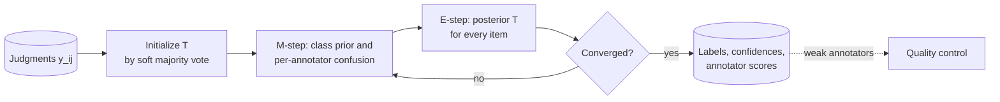

**Reading the diagram.** A batch job reads the sparse item × annotator judgment table, alternates M- and E-steps (each linear in judgments) until convergence, and writes labels, confidences (for adjudication routing) and annotator confusion matrices, which flow asynchronously to quality control. Failure points: annotators with few items (smooth their estimates), mostly adversarial crowds (label-swapped solutions) and correlated errors, which the model assumes away.

### 63.7.3 Code example: majority vote versus Dawid–Skene

Seven simulated annotators with accuracies from 0.95 down to 0.50 (a random clicker) label 3,000 reviews (30% "remove"), three random annotators per review.

```python
import numpy as np

rng = np.random.default_rng(63)
N, K = 3000, 2                         # reviews, classes (0 = keep, 1 = remove)
acc = np.array([0.95, 0.90, 0.80, 0.70, 0.60, 0.55, 0.50])  # 7 annotators
J, R = len(acc), 3                     # each review gets 3 random annotators
y = (rng.random(N) < 0.30).astype(int) # 30% of reviews need removal

# labels[i, j] = label from annotator j on item i, or -1 if not asked
labels = -np.ones((N, J), dtype=int)
for i in range(N):
    for j in rng.choice(J, size=R, replace=False):
        correct = rng.random() < acc[j]
        labels[i, j] = y[i] if correct else 1 - y[i]

def majority_vote(labels):
    votes = np.stack([(labels == k).sum(axis=1) for k in range(K)], axis=1)
    return votes.argmax(axis=1), votes / votes.sum(axis=1, keepdims=True)

def dawid_skene(labels, iters=50):
    _, T = majority_vote(labels)                     # init: soft majority vote
    for _ in range(iters):
        # M-step: class priors and one confusion matrix per annotator
        prior = T.mean(axis=0)
        conf = np.full((J, K, K), 0.01)              # small smoothing
        for j in range(J):
            seen = labels[:, j] >= 0
            for l in range(K):
                conf[j, :, l] += T[seen][labels[seen, j] == l].sum(axis=0)
        conf /= conf.sum(axis=2, keepdims=True)      # rows: true class
        # E-step: posterior over the true class of every item
        logT = np.tile(np.log(prior), (N, 1))
        for j in range(J):
            seen = labels[:, j] >= 0
            logT[seen] += np.log(conf[j][:, labels[seen, j]]).T
        logT -= logT.max(axis=1, keepdims=True)
        T = np.exp(logT)
        T /= T.sum(axis=1, keepdims=True)
    return T.argmax(axis=1), conf, prior

mv, _ = majority_vote(labels)
ds, conf, prior = dawid_skene(labels)
print(f"majority vote accuracy: {np.mean(mv == y):.3f}")
print(f"Dawid-Skene accuracy:   {np.mean(ds == y):.3f}")
print(f"estimated prior of 'remove': {prior[1]:.3f} (true 0.300)")
est_acc = prior[0] * conf[:, 0, 0] + prior[1] * conf[:, 1, 1]
for j in range(J):
    print(f"annotator {j}: true acc {acc[j]:.2f}  estimated {est_acc[j]:.2f}")
```

Output:

```text
majority vote accuracy: 0.810
Dawid-Skene accuracy:   0.880
estimated prior of 'remove': 0.345 (true 0.300)
annotator 0: true acc 0.95  estimated 0.95
annotator 1: true acc 0.90  estimated 0.91
annotator 2: true acc 0.80  estimated 0.78
annotator 3: true acc 0.70  estimated 0.67
annotator 4: true acc 0.60  estimated 0.60
annotator 5: true acc 0.55  estimated 0.53
annotator 6: true acc 0.50  estimated 0.52
```

What to notice:

- With no ground truth, EM recovers every annotator's accuracy within 0.03, which is exactly what quality control needs to remove the random clicker.
- Error falls from 19.0% to 12.0% at zero extra labeling cost.
- The prior estimate (0.345) is biased because weak annotators flip many "keep" items and three judgments carry limited information; gold questions anchor it.
- The `-1` sentinel and `seen` masks implement the sparse design: each annotator sees about 3/7 of the items.

Extensions model item difficulty [Whitehill et al. 2009], spamming annotators [Hovy et al. 2013] and joint training of classifier and annotator models [Raykar et al. 2010].

::: mistake
**Mistake — Discarding soft labels.** A review that is 55% "remove" is genuinely ambiguous. Store confidences, route low ones to adjudication, and consider training on soft labels.
:::

## 63.8 Weak supervision

### 63.8.1 Labeling functions and the label model

::: definition
**Definition — Weak supervision.** Training with labels from noisy programmatic sources. In **data programming**, experts write **labeling functions** (LFs) that vote for a class or **abstain**; a **label model** estimates LF accuracies from their agreements and disagreements, without ground truth, and outputs probabilistic labels; a discriminative **end model** is trained on them [Ratner et al. 2016; Ratner et al. 2017].
:::

#### First-principles explanation

A senior moderator cannot label 20,000 reviews a day, but can state the rules of thumb they use in an afternoon: "a phone number is almost always spam", "a three-word five-star review is fine". Each rule is sometimes wrong and usually silent. Weak supervision turns the rules into code, lets a statistical model decide how far to trust each, and labels far more data than people could. It is Dawid–Skene with programs as annotators. It also makes definitions cheap to change: when "personal data" expands to include license plates, an LF is a one-line edit and a re-run, while hand labels must be redone. Ratner et al. built Snorkel around this workflow [Ratner et al. 2017].

#### How it works internally

1. Apply all LFs to the unlabeled pool, giving a sparse **label matrix** (examples × LFs).
2. Evaluate each LF on the matrix and on a small hand-labeled **dev set**.
3. Fit the label model and output probabilistic labels.
4. Train the end model on ordinary features with a noise-aware loss, so it generalizes to examples where every LF abstained.
5. Inspect dev-set errors and write or fix LFs.

**Figure 63.6 — A weak-supervision pipeline.**

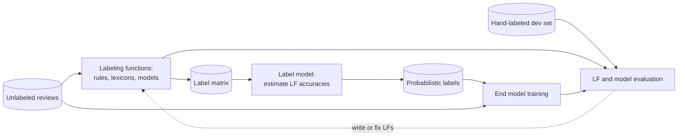

**Reading the diagram.** LFs (regexes, lexicons, lookups, existing models) turn unlabeled reviews into a label matrix; the label model reads only that matrix; its probabilistic labels plus the raw features train the end model. The small dev set is the only ground truth, and evaluation feeds back (dotted, human-in-the-loop) into LF authoring. All batch, scaling with compute. Failure points: correlated LFs counted as independent evidence, low coverage of a class, and a dev set too small to expose LF errors.

### 63.8.2 Evaluating labeling functions

::: formula
**Labeling-function statistics** (each a fraction of the $N$ unlabeled examples, except accuracy)

$$\text{cov}_j = \frac{\#\{\lambda_j \ne \varnothing\}}{N} \qquad \text{ovl}_j = \frac{\#\{\lambda_j \ne \varnothing,\ \text{another LF votes}\}}{N} \qquad \text{con}_j = \frac{\#\{\lambda_j \ne \varnothing,\ \text{another LF votes differently}\}}{N} \qquad \text{acc}_j = \frac{\#\{\text{dev}: \lambda_j = y\}}{\#\{\text{dev}: \lambda_j \ne \varnothing\}}$$

| Symbol | Meaning | Units |
|---|---|---|
| $\lambda_j$ | Output of LF $j$ on an example | class or $\varnothing$ |
| $\varnothing$ | Abstain | — |
| $\text{cov}_j$, $\text{ovl}_j$, $\text{con}_j$ | Coverage, overlap, conflict | fraction |
| $\text{acc}_j$ | Empirical accuracy on the dev set where LF $j$ votes | fraction |
:::

**Table 63.8 — QuickBite moderation LFs on 100,000 reviews (illustrative).**

| Labeling function | Votes | Coverage | Overlap | Conflict | Dev accuracy |
|---|---|---|---|---|---|
| `phone_or_url` | remove | 2.5% | 1.2% | 0.3% | 0.91 |
| `profanity_lexicon` | remove | 4.0% | 1.8% | 0.6% | 0.82 |
| `toxicity_model_gt_0.9` | remove | 3.0% | 2.2% | 0.4% | 0.85 |
| `short_positive` | keep | 30.0% | 6.0% | 0.5% | 0.97 |
| `trusted_reviewer` | keep | 25.0% | 8.0% | 0.9% | 0.95 |

::: example
**Worked example — Reading `profanity_lexicon`.** It fires on 4,000 of 100,000 reviews; on 1,800 another LF votes, on 600 another LF votes *keep*.

1. Coverage 4.0%, overlap 1.8%, conflict 0.6%.
2. Conflicts are $600/4{,}000 = 15\%$ of its votes, the highest in the table; most are with `trusted_reviewer`: loyal customers swearing about late food.
3. Dev accuracy: right on 33 of 40 firings, 0.825, with a 95% interval of about ±0.12.
4. If it votes *remove* and `trusted_reviewer` votes *keep*, with a 5% prior, an independent-vote model gives odds $(0.05/0.95)(0.82/0.18)(0.05/0.95) = 0.0126$, so P(remove) ≈ 1.2%.

**Interpretation.** Swearing about food is not abuse. **Engineering implication.** Narrow the LF (profanity *directed at a person*) or let the label model down-weight it, and grow the dev set where LFs conflict.
:::

::: industry
**Snorkel DryBell at Google.** Bach et al. describe weak supervision for content classification at Google: LFs drew on organizational resources (internal models, knowledge graphs, heuristics) that could not be served in production, and end models trained only on servable features reached quality comparable to models trained on large hand-labeled sets for the tasks reported.
*Evidence: Primary* — [Bach et al. 2019]
:::

::: warning
**Warning — Weak supervision bakes in the experts' blind spots.** If no LF covers coded slurs in a minority language, the end model learns that they are acceptable. Monitor recall on a hand-labeled, stratified sample of production and review per-slice coverage (Chapter 71).
:::

## 63.9 Active learning

### 63.9.1 Choosing which examples to label

::: definition
**Definition — Active learning.** A strategy in which the model chooses which unlabeled examples people label next, aiming to reach a target quality with fewer labels than random sampling. In **pool-based** active learning the model scores a pool, sends the most informative batch to annotators, retrains and repeats [Settles 2009].
:::

#### First-principles explanation

A good tutor does not assign random textbook pages; they find what the student gets wrong and practice that. At QuickBite 95% of reviews are clean and easy, so most randomly sampled labels teach the moderation model nothing. Active learning spends the budget near the decision boundary, where a label changes the model.

#### How it works internally

1. Label a random **seed set** containing both classes.
2. Train; score the unlabeled pool with an **acquisition function**; send the top batch of $b$ examples to annotators.
3. Add the labels, retrain and repeat until the budget or quality target is reached.

Acquisition functions [Settles 2009]: **uncertainty sampling** picks the examples the model is least sure of [Lewis and Gale 1994]; **query by committee** picks those on which several models disagree [Seung et al. 1992]; **diversity** or **core-set** sampling covers the feature space so a batch is not 25 near-duplicates [Sener and Savarese 2018]. Production systems usually pre-filter by uncertainty and then pick a diverse subset.

::: formula
**Uncertainty scores**

$$u_{\text{LC}} = 1 - \max_k p_k \qquad u_{\text{M}} = p_{(1)} - p_{(2)} \qquad u_{\text{H}} = -\sum_k p_k \ln p_k$$

| Symbol | Meaning | Units |
|---|---|---|
| $p_k$ | Predicted probability of class $k$ | probability |
| $p_{(1)}$, $p_{(2)}$ | Largest and second-largest probabilities | probability |
| $u_{\text{LC}}$ | Least confidence (larger = more uncertain) | probability |
| $u_{\text{M}}$ | Margin (*smaller* = more uncertain) | probability |
| $u_{\text{H}}$ | Entropy (larger = more uncertain) | nats |
:::

::: example
**Worked example — Which support ticket to label?** The intent model gives ticket A (late, missing, refund) $= (0.50, 0.30, 0.20)$ and ticket B $= (0.48, 0.47, 0.05)$.

1. Least confidence: A 0.50, B 0.52.
2. Margin: A $0.20$, B $0.01$; B is far more uncertain.
3. Entropy: A $= 0.347 + 0.361 + 0.322 = 1.030$ nats; B $= 0.352 + 0.355 + 0.150 = 0.857$ nats; A is more uncertain.

**Interpretation.** Margin asks whether the top decision is close; entropy asks whether the model is confused overall. **Engineering implication.** For a single routing decision use margin; with two classes all three rank examples identically, by closeness to 0.5.
:::

**Figure 63.7 — The pool-based active-learning loop.**


**Reading the diagram.** A batch job scores the pool, acquisition picks an uncertain and diverse batch, and the batch goes through the ordinary labeling queue; new labels trigger retraining. A random audit sample shares the queue so some labels reflect the true distribution, and evaluation uses a random held-out set, never the deliberately skewed actively chosen data. One cycle takes hours, dominated by people. Failure points: retraining lag (stale batches), near-duplicate batches, contaminated evaluation.

### 63.9.2 Code example: random versus uncertainty sampling

The simulation mimics moderation: 12,000 synthetic reviews, about 5% positive, 8,000 in the pool and 4,000 for testing. Both strategies start from the same 50 random labels and add 25 per round; quality is PR-AUC (§57.10.2), averaged over ten seeds.

```python
import warnings
import numpy as np
from sklearn.datasets import make_classification
from sklearn.linear_model import LogisticRegression
from sklearn.metrics import average_precision_score
from sklearn.model_selection import train_test_split

warnings.filterwarnings("ignore")
# Imbalanced like a moderation queue: about 5% of reviews need removal
X, y = make_classification(n_samples=12000, n_features=30, n_informative=8,
                           n_redundant=4, weights=[0.95], class_sep=1.5,
                           flip_y=0.01, random_state=63)
X_pool, X_test, y_pool, y_test = train_test_split(X, y, test_size=4000,
                                                  random_state=63, stratify=y)
BUDGETS = [100, 200, 400, 800, 1600]
SEED_SIZE, BATCH = 50, 25

def fit(idx):
    return LogisticRegression(max_iter=2000).fit(X_pool[idx], y_pool[idx])

def run(strategy, seed):
    rng = np.random.default_rng(seed)
    labeled = list(rng.choice(len(X_pool), SEED_SIZE, replace=False))
    while len(set(y_pool[labeled])) < 2:          # need both classes to start
        labeled.append(int(rng.integers(len(X_pool))))
    curve = {}
    while len(labeled) <= BUDGETS[-1]:
        model = fit(labeled)
        if len(labeled) in BUDGETS:
            p_test = model.predict_proba(X_test)[:, 1]
            curve[len(labeled)] = average_precision_score(y_test, p_test)
        unlabeled = np.setdiff1d(np.arange(len(X_pool)), labeled)
        if strategy == "random":
            pick = rng.choice(unlabeled, BATCH, replace=False)
        else:   # uncertainty (margin) sampling: closest to p = 0.5
            p = model.predict_proba(X_pool[unlabeled])[:, 1]
            pick = unlabeled[np.argsort(np.abs(p - 0.5))[:BATCH]]
        labeled.extend(int(i) for i in pick)
    return curve, y_pool[labeled].mean()

full = fit(np.arange(len(X_pool)))
print(f"all {len(X_pool)} labels: PR-AUC "
      f"{average_precision_score(y_test, full.predict_proba(X_test)[:, 1]):.3f}")
res = {s: [run(s, seed) for seed in range(10)] for s in ("random", "uncertainty")}
print("labels  random  uncertainty")
for b in BUDGETS:
    r = np.mean([c[b] for c, _ in res["random"]])
    u = np.mean([c[b] for c, _ in res["uncertainty"]])
    print(f"{b:6d}  {r:.3f}   {u:.3f}")
for s in res:
    print(f"positive share of labels bought ({s}): "
          f"{np.mean([pos for _, pos in res[s]]):.1%}")
```

Output (about 20 seconds on a laptop CPU):

```text
all 8000 labels: PR-AUC 0.725
labels  random  uncertainty
   100  0.542   0.573
   200  0.589   0.631
   400  0.618   0.685
   800  0.668   0.721
  1600  0.689   0.722
positive share of labels bought (random): 5.3%
positive share of labels bought (uncertainty): 22.4%
```

What to notice:

- Uncertainty sampling with 400 labels (0.685) matches random sampling with 1,600 (0.689); with 800 it nearly matches all 8,000 labels (0.721 versus 0.725).
- It buys about four times as many positives (22.4% versus 5.3%), because the rare class lives near the boundary: for imbalanced problems, active learning is largely a smart way to oversample the rare class.
- Evaluation always uses the untouched random test split.

### 63.9.3 How much does active learning save?

::: formula
**Labeling savings from active learning**

$$S = 1 - \frac{n_{\text{AL}}(q^*)}{n_{\text{rand}}(q^*)} \qquad \Delta C = \bigl(n_{\text{rand}}(q^*) - n_{\text{AL}}(q^*)\bigr)\,c_{\ell} - C_{\text{AL}}$$

| Symbol | Meaning | Units |
|---|---|---|
| $q^*$ | Target model quality | dimensionless |
| $n_{\text{rand}}$, $n_{\text{AL}}$ | Labels needed to reach $q^*$ randomly and actively | labels |
| $S$ | Fractional labeling savings | fraction |
| $c_{\ell}$ | Cost per final label | \$/label |
| $C_{\text{AL}}$ | Cost of running the loop (scoring, retraining, engineering) | \$ |
| $\Delta C$ | Net saving | \$ |
:::

::: example
**Worked example — Budgeting moderation labels.** From the simulation at $q^* \approx 0.685$: $n_{\text{rand}} = 1{,}600$, $n_{\text{AL}} = 400$, so $S = 1 - 400/1{,}600 = 0.75$.

1. Suppose a pilot on real reviews shows the same shape: 40,000 random labels or 10,000 active ones to reach the launch target. At $c_\ell = \$0.41$ (§63.5.2): \$16,400 versus \$4,100, a gross saving of \$12,300.
2. Loop cost: 30 rounds of scoring a 2-million-review pool and retraining (minutes of CPU each) plus about an engineer-week; assume $C_{\text{AL}} \approx \$5{,}000$.
3. Net: $\Delta C \approx \$7{,}300$, and the loop is reusable for later campaigns.

**Interpretation.** Real savings are smaller than the headline 75% once the loop's cost counts, and they are dataset-specific. **Engineering implication.** Measure the ratio with a side-by-side pilot against a random held-out set before budgeting on it.
:::

::: warning
**Warning — Sampling bias and cold starts.** The actively labeled set is deliberately unrepresentative: training on it distorts calibration, and evaluating on it is meaningless. With only a few dozen seed labels, uncertainty estimates are unreliable and the loop can fixate on one region while missing another cluster of positives. Start from a stratified seed of a few hundred, keep a random audit stream, recalibrate on random data (§63.11) and record the acquisition policy in the datasheet (§63.13).
:::

## 63.10 Label noise

### 63.10.1 Types and impact

::: definition
**Definition — Label noise.** A difference between the recorded label and the true class. It is **uniform** when a wrong label is equally likely to be any class, **class-conditional** when the flip probability depends on the true class, and **instance-dependent** when it depends on the example (ambiguous reviews are mislabeled more often) [Frénay and Verleysen 2014].
:::

**Table 63.9 — Label noise at QuickBite.**

| Kind | Example | Typical cause | Effect |
|---|---|---|---|
| Uniform | Mis-clicks in the tool | Fatigue, UI errors | Lower accuracy; memorized by large models |
| Class-conditional | "Missing item" filed as "refund" | Agents pick the label that triggers the right workflow | Systematic confusion |
| Instance-dependent | Sarcastic reviews labeled "keep" | Hard examples | Errors on exactly the hard cases |
| Delayed | Recent fraud labeled legitimate | Immaturity (§63.4.2) | New fraud learned as safe |

Noise hurts in three places. In **training**, deep networks fit the clean pattern first and memorize noise later, so noise degrades generalization the longer you train [Zhang et al. 2017; Arpit et al. 2017]. In **evaluation**, noisy test labels make the metric wrong: Northcutt, Athalye and Mueller found label errors in the test sets of ten widely used benchmarks, averaging a few percent, enough to change model rankings [Northcutt et al. 2021b]. In **decisions**, class-conditional noise biases probabilities that thresholds depend on.

### 63.10.2 Detecting noise: confident learning

A model trained on mostly correct labels learns the true pattern. If, on an example it did *not* train on, it is confident in "missing item" while the label says "refund", the label is suspect, especially if that confusion is systematic. Two rules make this reliable: use **out-of-fold** predictions, and judge confidence relative to each class's usual confidence.

::: formula
**Confident learning: per-class thresholds and the confident joint** [Northcutt et al. 2021a]

$$t_j = \frac{1}{|X_{\tilde y = j}|}\sum_{x \in X_{\tilde y = j}} \hat p_j(x) \qquad C_{ij} = \bigl|\{x \in X_{\tilde y = i} : \arg\max_{l:\ \hat p_l(x) \ge t_l} \hat p_l(x) = j\}\bigr|$$

| Symbol | Meaning | Units |
|---|---|---|
| $\tilde y$ | Given (possibly noisy) label | class |
| $X_{\tilde y = j}$ | Examples labeled $j$ | set |
| $\hat p_l(x)$ | Out-of-fold predicted probability of class $l$ | probability |
| $t_j$ | Class threshold: mean self-confidence of examples labeled $j$ | probability |
| $C_{ij}$ | Confident joint: examples labeled $i$ confidently predicted $j$ | examples |
:::

Off-diagonal cells of $C$ are likely label errors; normalized, $C$ estimates the noise rates. **Loss-based filtering** is simpler: rank examples by out-of-fold loss $-\ln \hat p_{\tilde y}(x)$ and inspect the top.

::: example
**Worked example — Is this ticket mislabeled?** In the program below $t = (0.663, 0.623, 0.747)$ for (late, missing, refund). A ticket labeled *refund* has $\hat p = (0.05, 0.70, 0.25)$.

1. Above threshold: late $0.05 < 0.663$, no; missing $0.70 \ge 0.623$, yes; refund $0.25 < 0.747$, no.
2. Confident class *missing item* ≠ given *refund*: the ticket lands in the off-diagonal cell $C_{\text{refund},\text{missing}}$.
3. Note that 0.70 would not clear the refund threshold of 0.747; per-class thresholds matter.

**Interpretation.** Flagged as a likely "missing item" filed as "refund". **Engineering implication.** Send flags to human review, not silent relabeling; and report the systematic confusion to the support team, since the fix is usually a workflow that rewards picking "refund".
:::

**Figure 63.8 — A label-error detection pipeline.**

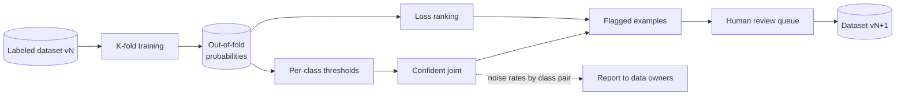

**Reading the diagram.** K models, each trained without one fold, produce stored out-of-fold probabilities; thresholds, the confident joint and a loss ranking flag examples, which go through human review into a new dataset version, never an in-place edit. Noise rates per class pair go asynchronously to the owners of the labeling process. Failure points: a weak model (random flags), in-fold scoring (memorized noise, nothing flagged) and auto-relabeling that deletes hard but correct examples. Cost: K training runs per version; use a cheaper model for detection.

### 63.10.3 Code example: finding label errors

5,000 synthetic tickets in three intents; 25% of "missing item" labels are flipped to "refund" and 10% of "late order" to "missing item".

```python
import warnings
import numpy as np
from sklearn.datasets import make_classification
from sklearn.linear_model import LogisticRegression
from sklearn.model_selection import cross_val_predict, train_test_split

warnings.filterwarnings("ignore")
rng = np.random.default_rng(63)
# Three support-ticket intents: 0 = late order, 1 = missing item, 2 = refund
X, y_true = make_classification(n_samples=5000, n_features=20, n_informative=10,
                                n_classes=3, n_clusters_per_class=1,
                                class_sep=1.5, random_state=63)
X_tr, X_te, y_tr_true, y_te = train_test_split(X, y_true, test_size=1000,
                                               random_state=63)
# Inject asymmetric noise: 25% of "missing item" tickets labeled "refund",
# 10% of "late order" tickets labeled "missing item"
y_tr = y_tr_true.copy()
flip1 = (y_tr_true == 1) & (rng.random(len(y_tr)) < 0.25)
flip0 = (y_tr_true == 0) & (rng.random(len(y_tr)) < 0.10)
y_tr[flip1], y_tr[flip0] = 2, 1
is_noisy = y_tr != y_tr_true
print(f"training labels: {len(y_tr)}, corrupted: {is_noisy.sum()} ({is_noisy.mean():.1%})")

# 1. Out-of-fold predicted probabilities (never score a row with a model that saw it)
model = LogisticRegression(max_iter=2000)
P = cross_val_predict(model, X_tr, y_tr, cv=5, method="predict_proba")

# 2. Per-class thresholds: average self-confidence of rows given that label
K = P.shape[1]
t = np.array([P[y_tr == j, j].mean() for j in range(K)])

# 3. Confident joint: count row under (given label i, confident true label j)
C = np.zeros((K, K), dtype=int)
flag = np.zeros(len(y_tr), dtype=bool)
for n in range(len(y_tr)):
    above = np.where(P[n] >= t)[0]
    if len(above) == 0:
        continue
    j = above[np.argmax(P[n, above])]
    C[y_tr[n], j] += 1
    flag[n] = j != y_tr[n]                 # off-diagonal: likely mislabeled
print("thresholds:", np.round(t, 3))
print("confident joint (rows = given label, cols = estimated true label):")
print(C)

def report(name, f):
    tp = (f & is_noisy).sum()
    print(f"{name:<22} flagged {f.sum():4d}  precision {tp / f.sum():.3f}  "
          f"recall {tp / is_noisy.sum():.3f}")
report("confident learning", flag)

# 4. Loss-based baseline: flag the same number of highest-loss rows
loss = -np.log(P[np.arange(len(y_tr)), y_tr] + 1e-12)
top = np.zeros(len(y_tr), dtype=bool)
top[np.argsort(-loss)[:flag.sum()]] = True
report("highest-loss rows", top)

# 5. Does cleaning help? Retrain without flagged rows, test on clean labels
acc_noisy = model.fit(X_tr, y_tr).score(X_te, y_te)
acc_clean = model.fit(X_tr[~flag], y_tr[~flag]).score(X_te, y_te)
acc_oracle = model.fit(X_tr, y_tr_true).score(X_te, y_te)
print(f"test accuracy: noisy {acc_noisy:.3f}  pruned {acc_clean:.3f}  "
      f"true labels {acc_oracle:.3f}")
```

Output:

```text
training labels: 4000, corrupted: 470 (11.8%)
thresholds: [0.663 0.623 0.747]
confident joint (rows = given label, cols = estimated true label):
[[ 689   14   44]
 [  79  696   11]
 [  21  226 1167]]
confident learning     flagged  395  precision 0.780  recall 0.655
highest-loss rows      flagged  395  precision 0.742  recall 0.623
test accuracy: noisy 0.899  pruned 0.930  true labels 0.964
```

What to notice:

- The largest off-diagonal cells (226 refund-looks-like-missing, 79 missing-looks-like-late) recover both injected confusions without being told about them.
- At equal flag counts, confident learning beats loss ranking on precision (0.78 versus 0.74), because per-class thresholds adjust for the refund class's higher typical confidence.
- Dropping the 395 flagged rows recovers about half of the accuracy lost to noise (0.899 → 0.930, against 0.964 with true labels). Reviewing them would recover more.
- The open-source `cleanlab` library by the confident-learning authors implements refined versions of these steps [Northcutt et al. 2021a].

::: mistake
**Mistake — Removing every high-loss example.** High loss also marks rare but correct examples: the new fraud pattern, new slang. Automatic pruning can delete exactly the minority cases a model needs and affect some user groups more than others. Route flags to review, cap automatic removal and compare slice metrics before and after cleaning (Chapter 71).
:::

## 63.11 Class imbalance and sampling

### 63.11.1 Stratification and negative downsampling

::: definition
**Definition — Class imbalance.** A dataset in which one class is much rarer than another, such as fraud at 0.5% of orders. **Stratified sampling** draws separately from each class or slice in fixed proportions. **Negative downsampling** keeps every positive and a random fraction $\beta$ of negatives [He and Garcia 2009].
:::

#### First-principles explanation

Ninety million orders containing 450,000 frauds are mostly an expensive way to store legitimate orders; a random twentieth of the negatives carries almost the same information. Downsampling makes training up to an order of magnitude cheaper and gives the rare class more weight. The catch: the model now believes fraud is far more common than it is, so its probabilities must be corrected before they drive decisions.

#### How it works internally

1. Split by time and keep the natural class ratio in validation and test (§57.7).
2. Downsample only the training split; record $\beta$ in the dataset metadata.
3. Train, then correct outputs with the formula below (equivalently, weight kept negatives by $1/\beta$).
4. Verify calibration on the untouched validation split (§57.10.3).

Alternatives include class weights in the loss (cost-sensitive learning), oversampling positives and interpolating synthetic positives with SMOTE [Chawla et al. 2002]; He and Garcia's survey compares them and recommends precision–recall evaluation over accuracy [He and Garcia 2009].

::: formula
**Calibration correction after negative downsampling**

$$p = \frac{\beta\, p_s}{\beta\, p_s + (1 - p_s)} \qquad \Longleftrightarrow \qquad \frac{p}{1-p} = \beta \cdot \frac{p_s}{1 - p_s}$$

| Symbol | Meaning | Units |
|---|---|---|
| $\beta$ | Fraction of negatives kept | fraction |
| $p_s$ | Predicted positive probability from the model trained on downsampled data | probability |
| $p$ | Corrected probability under the true class ratio | probability |
:::

By Bayes' rule, downsampling multiplies the prior odds of a negative by $\beta$ while leaving class-conditional feature distributions unchanged, so posterior odds of a positive are inflated by $1/\beta$ and must be multiplied back by $\beta$.

::: example
**Worked example — Downsampling QuickBite's fraud data.** A 180-day matured window (§63.4.2) holds 90 million orders, 450,000 of them fraud. Keep $\beta = 0.05$.

1. Negatives kept: $89{,}550{,}000 \times 0.05 = 4{,}477{,}500$; training rows $4{,}927{,}500$, about **18× fewer**.
2. Training prevalence: $450{,}000/4{,}927{,}500 = 9.13\%$, versus 0.5% in production.
3. The model scores an order $p_s = 0.30$: $p = 0.015/(0.015 + 0.70) = 0.021$.
4. Odds check: $0.4286 \times 0.05 = 0.02143$; $p = 0.02143/1.02143 = 0.021$.

**Interpretation.** "30% fraud" is really about 2.1%: four times the base rate, nowhere near 30%. **Engineering implication.** Any expected-loss decision (§57.10) needs the corrected probability. Ship the correction inside the model artifact and record $\beta$ in the model card, so a retrain with a different $\beta$ cannot silently shift every threshold.
:::

**Figure 63.9 — Downsampling in training, correction in serving.**

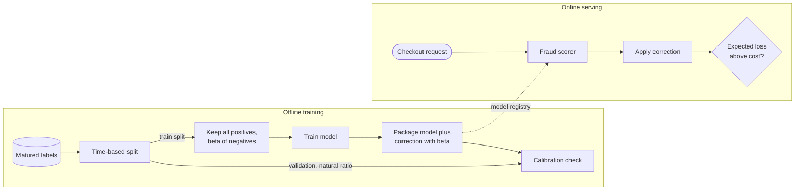

**Reading the diagram.** Offline, only the training split is downsampled; the packaged model carries its correction and is checked on a natural-ratio validation split. The package reaches serving asynchronously through the model registry (Chapter 69); online, checkout requests are scored synchronously and the corrected probability drives the decision. Failure points: correcting twice, not at all, or downsampling the validation split. Training cost falls roughly in proportion to $\beta$.

::: industry
**Negative downsampling at Facebook.** He et al. describe downsampling negative (no-click) examples when training ad click-prediction models and recalibrating with $q = p/(p + (1-p)/w)$, where $w$ is the negative sampling rate (the formula above), and study how prediction quality varies with the rate.
*Evidence: Primary* — [He et al. 2014]
:::

::: mistake
**Mistake — Downsampling the test set.** At 9% prevalence, measured precision is far higher than production will see at 0.5%. Evaluate at the natural ratio, or weight negatives by $1/\beta$ in the metrics.
:::

## 63.12 Synthetic data

### 63.12.1 Kinds and uses

::: definition
**Definition — Synthetic data.** Examples that were generated rather than observed. **Augmentation** applies label-preserving transforms to real examples; **simulation** generates them from a model of the world; **generative** synthesis samples from a learned model (GAN, diffusion model, LLM); **privacy-motivated** synthesis aims to preserve a dataset's statistics without exposing real records.
:::

Like a flight simulator, synthetic data supplies examples that are rare, dangerous, expensive or private, and only the parts of its world that match reality transfer.

**Table 63.10 — Synthetic data approaches.**

| Row | Augmentation | Simulation | Generative models | Privacy-motivated |
|---|---|---|---|---|
| QuickBite example | Paraphrased moderation examples | Courier routes during a road closure | LLM-written abuse in a new language | Synthetic orders for a vendor |
| Advantages | Cheap; free labels | Rare and unsafe scenarios | Fills coverage gaps fast | Data can leave the boundary |
| Disadvantages | Small variations only | Sim-to-real gap | Mismatch, bias, collapse | Not private by default |
| Choose when | Model must be invariant to the transform | Real events are rare or dangerous | Bootstrapping a sparse class | Sharing under privacy constraints |

Augmentation is the oldest and safest form [Shorten and Khoshgoftaar 2019]. Simulation can close large gaps when randomized widely enough that reality looks like one more variation; domain randomization trained detectors on simulated images alone that worked on a real robot [Tobin et al. 2017]. LLM-generated text is now a common way to bootstrap text classifiers, but it shares the generator's style and blind spots. Privacy is the most misunderstood use: generators can memorize training records, and Stadler, Oprisanu and Troncoso found that synthetic data does not by itself offer a better privacy–utility trade-off than traditional anonymization; formal guarantees need differential privacy (Chapter 71) [Stadler et al. 2022].

### 63.12.2 Risks: distribution mismatch and model collapse

**Distribution mismatch**: synthetic examples are cleaner and more typical than real ones. A moderation model trained mostly on LLM-written abuse learns the LLM's idea of abuse, while real abusers misspell, use coded language and mix languages. Evaluate on real held-out data and track the synthetic share of every dataset version.

**Model collapse**: Shumailov et al. showed for language models, variational autoencoders and Gaussian mixtures that when each generation trains on the previous generation's output, the tails of the original distribution vanish first and the models converge to a narrow, distorted distribution; genuine human data becomes more valuable as generated content spreads [Shumailov et al. 2024].

**Figure 63.10 — Recursive training on generated data loses the tails.**

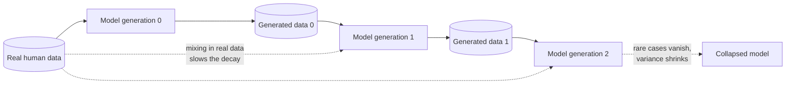

**Reading the diagram.** Each generation trains on its predecessor's output (solid arrows); finite samples under-represent rare events and approximation errors compound, so the distribution narrows toward the dotted endpoint. Mixing real data into every generation (dotted arrows from the left) slows or prevents the decay. The failure point is missing provenance: if QuickBite cannot tell human-written reviews from generated ones, it cannot keep generated text out of the next training set. Tag every example's source in the label store and cap the generated share per version.

::: mistake
**Mistake — "Synthetic data is anonymous."** A synthetic record can be a near-copy of a real one, and membership inference can reveal whether a person was in the generator's training data. Treat synthetic data derived from personal data as personal data unless it carries a formal, audited privacy guarantee.
:::

## 63.13 Dataset documentation

::: definition
**Definition — Dataset documentation.** A structured, versioned description of why a dataset exists, what it contains, how it was collected, labeled and processed, what it should and should not be used for, and who maintains it. **Datasheets for datasets** are a question-based template [Gebru et al. 2021]; **data cards** are modular summaries for many stakeholders, developed at Google [Pushkarna et al. 2022]; **data statements** describe language datasets' language variety, speakers and annotators [Bender and Friedman 2018].
:::

Electronic components ship with datasheets; Gebru et al. argued that datasets, components of many systems, need the same. Otherwise the knowledge that "this set covers English reviews from three cities, labeled under guideline v3, skewed toward borderline cases by active learning" leaves with one person, the documentation gap behind many data cascades (§63.3.1).

A datasheet answers questions on **motivation**, **composition**, **collection**, **preprocessing, cleaning and labeling**, **uses** (including uses to avoid), **distribution** and **maintenance** [Gebru et al. 2021]. For labeled data the labeling section is the heart: guideline version, annotator pool and training, redundancy, aggregation method, per-class agreement, adjudication rate, label-source shares, estimated noise rates (§63.10) and the sampling or acquisition policy (§63.9, §63.11).

**Table 63.11 — Documentation frameworks compared.**

| Row | Datasheets | Data cards | Data statements |
|---|---|---|---|
| Origin | Gebru et al., CACM 2021 | Pushkarna et al., FAccT 2022 | Bender and Friedman, TACL 2018 |
| Audience | Creators and consumers | Many stakeholders, engineers to policy | NLP practitioners |
| Strength | Comprehensive; prompts reflection | Scannable; depth adapts to reader | Speaker and annotator demographics |
| Weakness | Long; can become box-ticking | Needs templates and tooling | Language data only |

**Figure 63.11 — Documentation gates in a dataset's lifecycle.**

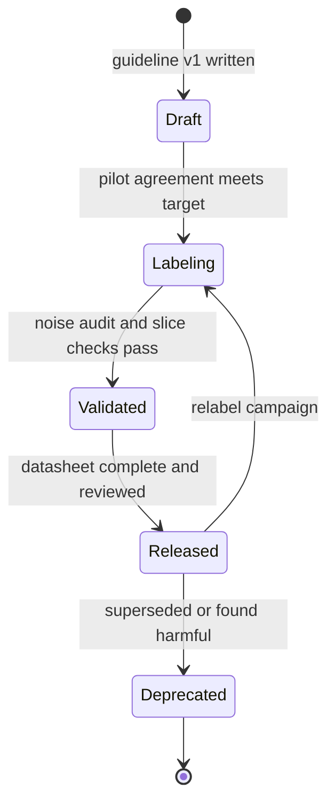

**Reading the diagram.** States are statuses of one dataset version in a registry; transitions are owned gates: pilot agreement (§63.6) before labeling, a noise audit (§63.10) and slice checks (Chapter 61) before validation, and a reviewed datasheet before release. Relabeling produces a new version; deprecation must notify every model trained on the dataset via registry lineage (§69.8.3). The failure point is a gate not enforced in tooling; at hundreds of datasets, gates must be automated metadata checks.

::: industry
**Data cards at Google.** Pushkarna, Zaldivar and Kjartansson describe designing data cards iteratively with dataset creators and consumers across product, research and policy teams at Google, and propose principles and a framework that adapt each section's depth to its readers.
*Evidence: Primary* — [Pushkarna et al. 2022]
:::

::: recommendation
**Recommendation — Generate what you can, write what you must.** Fill counts, class balance, agreement, label-source shares and noise estimates automatically from pipeline metadata on every version; reserve human writing for motivation, intended and prohibited uses, and limitations. Link the datasheet from every model card trained on it (§59.10.3).
:::

## 63.14 Labeling operations at scale

### 63.14.1 Vendors versus in-house

::: definition
**Definition — Labeling operations.** The organizational side of labeling: who the annotators are (employees, vendor workforces, crowd workers or models), how they are trained, paid, supervised and protected, how data reaches them securely, and how cost, quality and throughput are measured.
:::

**Table 63.12 — Sourcing annotators.**

| Row | In-house experts | Managed vendor | Crowd platform | LLM-assisted with review |
|---|---|---|---|---|
| Cost per label | Highest | Medium | Lowest human option | Lowest overall |
| Quality control | Direct | SLAs plus your audits | Gold, redundancy, aggregation | Calibration and human audits |
| Data security | Strongest | Contractual and technical controls | Weakest; public data only | Depends on model hosting |
| Ramp-up | Slow (hiring) | Weeks | Hours | Days |
| Choose when | Sensitive data, expert judgment, guidelines | Steady, moderate-expertise volume | Simple, non-sensitive tasks | Well-defined tasks with measured accuracy |

Mature teams mix them: in-house experts write guidelines, build gold sets and adjudicate; vendors or LLMs supply volume; quality metrics stay in-house.

### 63.14.2 Security and personal data in annotation

Annotation is a data-export path: it shows production data to people outside the core team, often in another company and country. QuickBite's reviews and tickets contain names, phone numbers, addresses and card fragments, so the labeling tool is a production system inside the security architecture of Chapter 50.

**Figure 63.12 — Annotation inside a security boundary.**

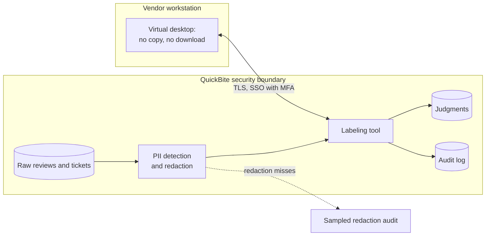

**Reading the diagram.** Raw data never leaves QuickBite's boundary: personal data is masked before tasks are created, and the tool, running inside the boundary, logs every view and judgment. Vendor annotators connect from locked-down virtual desktops over TLS with single sign-on and multi-factor authentication (Chapter 10). A sampled audit catches redaction misses asynchronously. Failure points: imperfect redaction recall, screenshots, over-broad queue access and judgments retained in vendor systems. Adding annotators adds seats on the same tool, with per-queue and per-region access for data residency.

::: recommendation
**Recommendation — Minimize what annotators see.** Show only the fields the judgment needs, mask identifiers, set retention on tasks and judgments, sign a data-processing agreement with every vendor, and restrict each annotator to their queues. Data that cannot be adequately redacted stays with in-house annotators.
:::

### 63.14.3 Annotator well-being

Some labeling is harmful work. Content moderators exposed to violent, sexual or hateful material face documented psychological risks [Steiger et al. 2021], and much annotation is low-paid, invisible piecework [Gray and Suri 2019]. QuickBite's "abuse" queue includes slurs and threats against couriers. Practical measures: blur images by default; cap daily exposure to the worst queues and rotate people; allow "skip and escalate" without penalty; provide counseling; pay for training and calibration time; set quotas from measured task times; and feed annotators' reports of guideline ambiguity into revisions. Well-being and quality are linked: rushed, distressed annotators produce noisier labels.

### 63.14.4 LLM-assisted labeling with human review

Gilardi, Alizadeh and Kubli found that a general-purpose LLM outperformed crowd workers on most text-annotation tasks they studied, at a small fraction of the cost [Gilardi et al. 2023]. LLM pre-labeling is therefore attractive, with risks that are easy to miss:

- **Correlated errors.** An LLM errs systematically; re-asking the same model does not average errors away as independent annotators do (§63.7.1).
- **Automation bias.** Reviewers shown a pre-label tend to accept it, so "human review" can become rubber-stamping; reviewers should label blind.
- **Circularity.** If one model family labels both training and evaluation data, evaluation measures agreement with the labeler. LLM-as-a-judge biases such as position and length preferences are documented [Zheng et al. 2023] (Chapter 78).
- **Silent drift.** A hosted model update can change labels overnight; pin and record the model version like a guideline version.
- **Privacy.** Sending reviews to an external API is a data transfer, governed like a vendor (§63.14.2).

**Figure 63.13 — LLM pre-labeling with confidence routing and human audit.**


**Reading the diagram.** A pinned LLM labels each task; its confidence is calibrated against a gold set (weekly, asynchronous). High-confidence labels are auto-accepted; the rest go to humans, who label blind. A random 5% of auto-accepted items is labeled blind by humans to estimate accuracy continuously. Every label records its source so LLM labels can be weighted or excluded from evaluation sets. Failure points: calibration drift after a model update, a stale gold set and audits too small for rare classes. Human capacity is sized from the routed fraction.

::: formula
**Cost and quality of a hybrid LLM–human pipeline**

$$c = c_{\text{llm}} + (1 - f)\,c_h + f\,s\,c_h \qquad A = f\,a_{\text{llm}} + (1 - f)\,a_h$$

| Symbol | Meaning | Units |
|---|---|---|
| $c_{\text{llm}}$ | LLM cost per item | \$/item |
| $c_h$ | Cost of one human judgment | \$/judgment |
| $f$ | Fraction auto-accepted | fraction |
| $s$ | Audit rate on auto-accepted items | fraction |
| $a_{\text{llm}}$, $a_h$ | Accuracy of auto-accepted LLM labels; of a human judgment on routed items | fraction |
| $c$, $A$ | Expected cost per item; expected accuracy | \$/item; fraction |
:::

::: example
**Worked example — Labeling 10,000 reviews per day.** One human judgment costs $c_h = 15 \times 22/(3600 \times 0.80) = \$0.115$ (§63.5.2, $r = 1$). Assume $c_{\text{llm}} = \$0.002$ (as of 2026; varies widely). Calibration on a 2,000-item gold set: 70% of reviews reach confidence ≥ 0.9, with accuracy 0.97; humans are 0.93 accurate on the rest. $s = 0.05$.

1. $c = 0.002 + 0.30 \times 0.115 + 0.70 \times 0.05 \times 0.115 = 0.002 + 0.0345 + 0.0040 = \$0.0405$.
2. Versus \$0.115 all-human: 65% cheaper, $10{,}000 \times 0.0745 = \$745$ saved per day.
3. $A = 0.70 \times 0.97 + 0.30 \times 0.93 = 0.958$.
4. Audit: $0.05 \times 7{,}000 = 350$ labels per day, a 95% interval of $\pm 1.96\sqrt{0.97 \times 0.03/350} = \pm 0.018$.

**Interpretation.** The hybrid is cheaper *and* more accurate than single human judgment only because the LLM is confined to the bucket where it measured well. **Engineering implication.** The audit keeps the claim true. Measure per class (0.97 overall can hide 0.70 on "abuse"), never evaluate a model on labels from the same LLM, and recalibrate whenever model, prompt or guideline changes.
:::

::: note
**Note — Preference data for LLMs (preview).** Aligning LLMs uses judgments of which of two responses is better, used to train a reward model or optimize the model directly [Ouyang et al. 2022]. Guidelines, agreement, annotator quality, well-being and LLM-assisted labeling all apply, but judgments are more subjective, agreement is typically lower and the consumers are different training algorithms. Chapter 76 owns this topic.
:::

## 63.15 Summary and revision notes

::: summary
- **Data-centric AI** holds the model fixed and engineers the data; error analysis decides whether the next gain is in labels, coverage, features or the model. Version datasets so gains are attributable.
- Labels are **natural**, **delayed**, **human** or **programmatic**. Delayed labels need a **maturity window** $W_\varepsilon$; QuickBite's fraud labels need 60 days for 95% completeness, and a naive 30-day window labels 61% of its fraud as legitimate.
- A **labeling pipeline** is task design, versioned guidelines, a queue, gold questions, aggregation, adjudication and versioned output. Cost scales with $N \cdot r \cdot t$; the first QuickBite moderation set costs about \$0.41 per label with $r = 3$.
- **Agreement**: percent agreement is inflated by imbalance; Cohen's κ (two raters), Fleiss' κ (fixed count, rotating raters) and Krippendorff's α (any design, missing data, ordinal labels) correct for chance. Report per-class agreement.
- **Aggregation**: majority vote assumes equal, independent annotators; Dawid–Skene EM learns each annotator's confusion matrix without ground truth (81% → 88% accuracy in the simulation).
- **Weak supervision** turns expert heuristics into labeling functions, evaluated by coverage, overlap, conflict and dev-set accuracy, combined by a label model.
- **Active learning** labels where the model is uncertain; in the simulation it matched random sampling with a quarter of the labels, largely by oversampling the rare class. Always evaluate on random data.
- **Confident learning** flags likely label errors from out-of-fold probabilities and per-class thresholds; route flags to review rather than deleting them.
- **Downsampling** negatives by $\beta$ requires the correction $p = \beta p_s / (\beta p_s + 1 - p_s)$; evaluate at the natural class ratio.
- **Synthetic data** helps with rare or private cases but risks mismatch, privacy leakage and **model collapse**; track provenance.
- **Document** datasets with datasheets, data cards or data statements, gated in tooling.
- **Operations**: mix in-house experts with vendor or LLM-assisted volume; redact personal data; protect annotators; confine LLM labels to calibrated high-confidence buckets with blind human audits.
:::

## 63.16 Knowledge checkpoint

1. Name the four kinds of label source and give a QuickBite example of each.
2. With $F(15) = 0.40$ and $F(30) = 0.75$, what fraction of fraud in a 0–30-day window is observed?
3. Why must the evaluation set for a delayed-label problem be matured?
4. In the labeling cost formula, which parameter is the largest lever, and what is dynamic redundancy?
5. Two annotators have $p_o = 0.90$ and $p_e = 0.60$. What is κ?
6. Explain the prevalence paradox in one sentence.
7. When would you choose Krippendorff's α over Fleiss' κ?
8. Compute majority-vote accuracy for $r = 3$, $p = 0.7$.
9. Why can Dawid–Skene outvote two annotators with one?
10. Define coverage and conflict for a labeling function.
11. Why should an active-learning project keep a random held-out set and a random audit stream?
12. Why must confident learning use out-of-fold probabilities?
13. A model trained with $\beta = 0.1$ outputs $p_s = 0.5$. What is the corrected probability?
14. What is model collapse, and what mitigates it?
15. Name three risks of LLM-assisted labeling.

<details><summary>Answers</summary>

1. Natural (ETA from delivery events), delayed (fraud from chargebacks), human (review moderation), programmatic (a rule that labels reviews containing phone numbers as spam).
2. $C = (3.0 + 8.625)/30 = 0.3875$, so 38.75% observed and 61% missing.
3. Recent examples' positives have not arrived; correct predictions count as false positives and recall is measured against a fraction of the truth.
4. Redundancy $r$ multiplies everything; dynamic redundancy uses $r = 1$ and adds judgments only for low-confidence or high-stakes items.
5. $(0.90 - 0.60)/0.40 = 0.75$.
6. When one class dominates, chance agreement is so high that κ can be near zero or negative even with very high raw agreement.
7. With missing judgments, varying judgments per item, or ordinal/interval labels.
8. $0.7^3 + 3(0.7^2)(0.3) = 0.343 + 0.441 = 0.784$.
9. It weights each judgment by that annotator's estimated reliability; a 0.95-accurate "keep" outweighs two near-random "removes".
10. Coverage: fraction of examples where the LF does not abstain. Conflict: fraction where it votes and another LF votes a different class.
11. Actively chosen examples are deliberately unrepresentative; evaluation and calibration need the true distribution, and random labels catch regions the acquisition function ignores.
12. A model scored on rows it trained on has memorized their noisy labels and will not flag them.
13. $p = 0.05/(0.05 + 0.5) = 0.091$.
14. Progressive loss of the data distribution's tails when models are trained recursively on generated data; keep real human data in every generation and track provenance.
15. Correlated errors, automation bias in reviewers, circular evaluation, silent drift after model updates, privacy of data sent to an API (any three).
</details>

## 63.17 Interview questions

### Basic

**Q1. Your classifier's accuracy is stuck. How do you decide between a bigger model and better data?**
**Answer.** Do error analysis by slice. If errors trace to wrong labels, missing coverage or missing signals, fix the data and retrain the same model; if the signals were present and the model still missed, change the model. Check test-label quality first.

**Q2. What is Cohen's κ and why not use percent agreement?**
**Answer.** κ = $(p_o - p_e)/(1 - p_e)$, agreement corrected for what annotators would achieve by chance given their class frequencies. Percent agreement is inflated when one class dominates; κ exposes annotators who agree only on the easy majority.

### Intermediate

**Q3. Design the labeling pipeline for a review-moderation model at 20,000 reviews per day.**
**Answer.** Versioned guideline piloted to κ ≥ 0.7; redaction before tasks; a queue with $r = 3$ for the seed set and audits, $r = 1$ plus dynamic redundancy in steady state; 10% gold questions; Dawid–Skene aggregation with adjudication below 0.8 confidence; active learning plus a random stream to choose what to label; label store with source, guideline and annotator provenance; per-class agreement and gold accuracy on a dashboard; datasheet per version.

**Q4. Fraud chargebacks arrive over 90 days. How do you build training and evaluation sets?**
**Answer.** Compute the delay CDF, choose a maturity window (60 days for 95%), and train and evaluate only on matured orders with a time-based split. Downsample negatives in training and correct probabilities. Cover the blind spot with faster proxy labels tagged by source and with label-free drift monitoring (§70.8.2); consider delayed-feedback models. Address blocked-order selection bias with analyst labels on a sample.

### Advanced

**Q5. Leadership wants to replace human annotators with an LLM. What do you propose?**
**Answer.** A hybrid: calibrate the LLM against an expert gold set per class, auto-accept only buckets with measured accuracy above the human baseline, route the rest to blind human labeling, audit a random share of auto-accepted labels, pin model versions, keep LLM labels out of evaluation sets, and route data through the same privacy controls as a vendor. Report cost and accuracy with the hybrid formula, and recalibrate on any change of model, prompt or guideline.

**Q6. Your dataset has about 10% label noise. Walk through finding and fixing it at scale.**
**Answer.** Get out-of-fold probabilities with K-fold training, compute per-class thresholds and the confident joint, and rank flags by off-diagonal margin. Send top flags to expert review, not auto-deletion; cap automatic pruning and compare slice metrics. Use the confident joint's class-pair rates to fix the source process (guidelines, workflows). Version the cleaned dataset and verify on a separately relabeled test set.

## 63.18 Practical exercises

1. Extend the agreement program with weighted κ for a 1–5 severity scale and compare linear and quadratic weights.
2. Make annotators in the Dawid–Skene simulation correlated (two share a misreading on 10% of items) and measure how both aggregators degrade.
3. Add query-by-committee and a diversity filter to the active-learning simulation; plot all learning curves.
4. Apply the confident-learning program at noise rates of 5%, 20% and 35% and plot flag precision and recall.

## 63.19 Design challenges

1. **Moderation in a new language.** QuickBite launches in a market whose reviews are in a language none of its moderators speak. Design labeling sources (vendor, weak supervision, LLM-assisted), quality checks and a budget for the first quarter.
2. **Fraud labels without chargebacks.** For cash-on-delivery orders no chargeback exists. Define a label, its delay and its noise, and design the pipeline.
3. **ETA labels with censoring.** Ten percent of orders are canceled after pickup. Design the label pipeline and explain how training treats censored orders.

## 63.20 References

1. Arpit, D., et al. *A Closer Look at Memorization in Deep Networks*. ICML, 2017.
2. Bach, S. H., et al. *Snorkel DryBell: A Case Study in Deploying Weak Supervision at Industrial Scale*. SIGMOD, 2019.
3. Bender, E. M., Friedman, B. *Data Statements for Natural Language Processing: Toward Mitigating System Bias and Enabling Better Science*. Transactions of the ACL 6, 2018.
4. Chapelle, O. *Modeling Delayed Feedback in Display Advertising*. KDD, 2014.
5. Chawla, N. V., et al. *SMOTE: Synthetic Minority Over-sampling Technique*. Journal of Artificial Intelligence Research 16, 2002.
6. Cohen, J. *A Coefficient of Agreement for Nominal Scales*. Educational and Psychological Measurement 20(1), 1960.
7. Dawid, A. P., Skene, A. M. *Maximum Likelihood Estimation of Observer Error-Rates Using the EM Algorithm*. Journal of the Royal Statistical Society, Series C (Applied Statistics) 28(1), 1979.
8. Feinstein, A. R., Cicchetti, D. V. *High Agreement but Low Kappa: I. The Problems of Two Paradoxes*. Journal of Clinical Epidemiology 43(6), 1990.
9. Fleiss, J. L. *Measuring Nominal Scale Agreement Among Many Raters*. Psychological Bulletin 76(5), 1971.
10. Frénay, B., Verleysen, M. *Classification in the Presence of Label Noise: A Survey*. IEEE Transactions on Neural Networks and Learning Systems 25(5), 2014.
11. Gebru, T., et al. *Datasheets for Datasets*. Communications of the ACM 64(12), 2021.
12. Gilardi, F., Alizadeh, M., Kubli, M. *ChatGPT Outperforms Crowd Workers for Text-Annotation Tasks*. PNAS 120(30), 2023.
13. Gray, M. L., Suri, S. *Ghost Work: How to Stop Silicon Valley from Building a New Global Underclass*. Houghton Mifflin Harcourt, 2019.
14. He, H., Garcia, E. A. *Learning from Imbalanced Data*. IEEE Transactions on Knowledge and Data Engineering 21(9), 2009.
15. He, X., et al. *Practical Lessons from Predicting Clicks on Ads at Facebook*. ADKDD Workshop at KDD, 2014.
16. Hovy, D., et al. *Learning Whom to Trust with MACE*. NAACL-HLT, 2013.
17. Krippendorff, K. *Content Analysis: An Introduction to Its Methodology*, 4th ed. SAGE, 2018 (2nd ed. 2004).
18. Landis, J. R., Koch, G. G. *The Measurement of Observer Agreement for Categorical Data*. Biometrics 33(1), 1977.
19. Lewis, D. D., Gale, W. A. *A Sequential Algorithm for Training Text Classifiers*. SIGIR, 1994.
20. Ng, A. *A Chat with Andrew on MLOps: From Model-centric to Data-centric AI*. DeepLearning.AI live event (video), 2021.
21. Northcutt, C. G., Jiang, L., Chuang, I. L. *Confident Learning: Estimating Uncertainty in Dataset Labels*. Journal of Artificial Intelligence Research 70, 2021. (Cited as Northcutt et al. 2021a.)
22. Northcutt, C. G., Athalye, A., Mueller, J. *Pervasive Label Errors in Test Sets Destabilize Machine Learning Benchmarks*. NeurIPS Datasets and Benchmarks Track, 2021. (Cited as Northcutt et al. 2021b.)
23. Ouyang, L., et al. *Training Language Models to Follow Instructions with Human Feedback*. NeurIPS, 2022.
24. Pushkarna, M., Zaldivar, A., Kjartansson, O. *Data Cards: Purposeful and Transparent Dataset Documentation for Responsible AI*. ACM FAccT, 2022.
25. Ratner, A., et al. *Data Programming: Creating Large Training Sets, Quickly*. NeurIPS, 2016.
26. Ratner, A., et al. *Snorkel: Rapid Training Data Creation with Weak Supervision*. Proceedings of the VLDB Endowment 11(3), 2017.
27. Raykar, V. C., et al. *Learning from Crowds*. Journal of Machine Learning Research 11, 2010.
28. Sambasivan, N., et al. *"Everyone wants to do the model work, not the data work": Data Cascades in High-Stakes AI*. ACM CHI, 2021.
29. Sener, O., Savarese, S. *Active Learning for Convolutional Neural Networks: A Core-Set Approach*. ICLR, 2018.
30. Settles, B. *Active Learning Literature Survey*. Computer Sciences Technical Report 1648, University of Wisconsin–Madison, 2009.
31. Seung, H. S., Opper, M., Sompolinsky, H. *Query by Committee*. COLT, 1992.
32. Sheng, V. S., Provost, F., Ipeirotis, P. G. *Get Another Label? Improving Data Quality and Data Mining Using Multiple, Noisy Labelers*. KDD, 2008.
33. Shorten, C., Khoshgoftaar, T. M. *A Survey on Image Data Augmentation for Deep Learning*. Journal of Big Data 6, 2019.
34. Shumailov, I., et al. *AI Models Collapse When Trained on Recursively Generated Data*. Nature 631, 2024.
35. Stadler, T., Oprisanu, B., Troncoso, C. *Synthetic Data – Anonymisation Groundhog Day*. USENIX Security Symposium, 2022.
36. Steiger, M., et al. *The Psychological Well-Being of Content Moderators*. ACM CHI, 2021.
37. Tobin, J., et al. *Domain Randomization for Transferring Deep Neural Networks from Simulation to the Real World*. IEEE/RSJ IROS, 2017.
38. Whitehill, J., et al. *Whose Vote Should Count More: Optimal Integration of Labels from Labelers of Unknown Expertise*. NeurIPS, 2009.
39. Zhang, C., et al. *Understanding Deep Learning Requires Rethinking Generalization*. ICLR, 2017.
40. Zheng, L., et al. *Judging LLM-as-a-Judge with MT-Bench and Chatbot Arena*. NeurIPS Datasets and Benchmarks Track, 2023.

## 63.21 Open verification items

- Ng 2021: exact title, date and venue of the talk, and the specific steel-defect figures (reported secondhand as a ~76% baseline improved to ~93% by data work, with no gain from model work); the chapter states the result only qualitatively.
- Sambasivan et al. 2021: the participant count (53) and the "nearly all projects" prevalence wording, against the paper.
- Bach et al. 2019: the wording of the quality comparison with hand-labeled models.
- Gilardi et al. 2023: number of tasks on which the LLM beat crowd workers, and the cost ratio.
- Northcutt et al. 2021b: the average test-set error rate across the ten benchmarks.
- He et al. 2014: the negative downsampling rates studied and their reported effect.
- Pushkarna et al. 2022: the name and structure of the data-card framework.
- Steiger et al. 2021: full title and subtitle.
- Label Studio and CVAT as widely used tools (as of 2026).
