# Chapter 64 — GPU Architecture and Performance

> **Level:** 3–4 · **Track:** B (ML/AI) · **Estimated reading time:** 5 h

Chapter 58 gave you two numbers for any neural network: about $6N$ floating-point operations (FLOPs) per training example and about 16 bytes of accelerator memory per parameter. They tell you *how much* work a model needs, not *how long* it takes, and that gap is where most ML money goes. Dividing $6ND$ by a GPU's advertised peak usually underestimates runtime two- to fivefold; serving a large language model one request at a time uses under 1% of the arithmetic you pay for.

This chapter explains why. You will open the GPU up: thousands of simple arithmetic lanes scheduled 32 threads at a time and fed by a memory hierarchy whose largest level, high-bandwidth memory (HBM), is too slow to keep the arithmetic busy for most operations. You will learn the **roofline model**, the precision formats from FP32 down to FP4, the utilization metrics that separate a busy GPU from a productive one, and the interconnects that join GPUs into servers. Chapters 65 (distributed training), 67 (model optimization) and 73 (LLM inference) build on this foundation.

QuickBite's GPU workloads serve as examples: the deep ETA model of §60.11 and a 7-billion-parameter support-chatbot model it adapts by continued pre-training on 50 billion tokens (§65.9.1) and serves (the 7B shape of §58.11), at an illustrative \$2.50 per GPU-hour (§60.11). These are teaching assumptions, not measurements of a real company.

The reference GPU is the NVIDIA H100 SXM, fully documented in a vendor whitepaper and widely deployed as of 2026; newer generations and other vendors appear where published figures exist. Units: SI prefixes for bandwidth and capacity (1 GB = 10⁹ bytes, 1 TB/s = 10¹² bytes/s) unless KiB/MiB is stated; one multiply–add counts as 2 FLOPs, as in Chapter 58.

## 64.1 Learning objectives

After this chapter you should be able to:

- Explain why a GPU is a throughput-oriented processor and why dense matrix multiplication matches its design.
- Describe streaming multiprocessors, warps, SIMT execution, occupancy and warp divergence, and calculate occupancy from a kernel's register use.
- Name each level of the GPU memory hierarchy with its approximate capacity and bandwidth, and explain why HBM bandwidth limits most non-matrix operations.
- Read CUDA-style code: grids, blocks, threads, shared memory, coalesced access, streams, and explain kernel-launch overhead and kernel fusion.
- Compute arithmetic intensity, the ridge point and attainable FLOP/s, and classify GEMM, elementwise operations, attention and LLM decoding on a roofline.
- Compare FP32, TF32, FP16, BF16, FP8 (E4M3/E5M2), INT8 and FP4/microscaling formats by bit layout, range and precision, and explain loss scaling.
- Distinguish nvidia-smi "utilization", SM activity, occupancy, model FLOPs utilization (MFU) and hardware FLOPs utilization (HFU), and compute MFU for a training run.
- Diagnose whether a workload is compute-bound or memory-bound and choose remedies (batching, fusion, mixed precision, IO-aware kernels, activation checkpointing).
- Compare PCIe, NVLink, NVSwitch and InfiniBand/RoCE, and estimate transfer and all-reduce times.
- Choose between MIG, MPS, time-slicing and vGPU for sharing a GPU, and summarize how TPUs, Trainium and AMD Instinct differ from NVIDIA GPUs.

## 64.2 Prerequisites

- CPU cores, caches, the memory hierarchy and SIMD — §5.3–§5.5 and §5.11 (a GPU is the same ideas pushed to an extreme; this chapter assumes you know what a cache line and a vector register are).
- Memory latency, bandwidth and bytes in flight — §5.9 (the same Little's Law reasoning explains how GPUs hide latency).
- Training memory and FLOPs — §58.11 and §58.12 ($16N$ bytes, $2N$ and $6N$ FLOPs, mixed precision; this chapter turns FLOPs into time).
- MFU and throughput — §4.18.5 (the $X = \text{MFU} \cdot F_\text{peak}/2P$ relation is extended here).
- GPU scheduling in a cluster — §46.11 (device plugins, topology-aware placement; this chapter supplies the device internals).
- RDMA and InfiniBand — §49.10 (inter-server GPU traffic uses them).

## 64.3 CPU versus GPU

### 64.3.1 Latency-oriented and throughput-oriented design

::: definition
**Definition — Latency-oriented and throughput-oriented processors.** A **latency-oriented** processor (a CPU) spends its transistors on making one thread finish as soon as possible: large caches, branch prediction, out-of-order execution and high clock rates. A **throughput-oriented** processor (a GPU) spends them on as many arithmetic units as possible and makes each thread slow but cheap, completing the most total work per second when given tens of thousands of independent threads. A **GPU** (graphics processing unit) is a throughput-oriented processor with its own high-bandwidth memory, attached to a host CPU.
:::

#### First-principles explanation

Think of a sports car and a freight train. The sports car (a CPU core) gets one passenger across town fast, weaving through traffic. The train (a GPU) is useless for one passenger but moves ten thousand tonnes at once. A web request or a database transaction is one passenger on a twisting route: a CPU's job. Multiplying two 4,096 × 4,096 matrices is $2 \times 4096^3 \approx 137$ billion independent operations of identical cargo: a train's job.

#### Why does this exist?

GPUs began as graphics chips: shading millions of pixels with the same small program is massively parallel. NVIDIA exposed that hardware to general programs through CUDA in 2007 [NVIDIA CUDA C++ Programming Guide], and in 2012 a GPU-trained network won ImageNet [Krizhevsky et al. 2012]. Deep learning is dense linear algebra (§58.3), so hardware built for pixels fit; vendors have since added tensor cores, 16- to 4-bit formats and stacked HBM.

#### How it works internally

Both chips spend similar transistor and power budgets (up to about 700 W for a data-center GPU) differently:

1. **Control logic.** A CPU core devotes a large share of its area to predicting branches, reordering instructions and speculating. A GPU issues instructions in order and shares one instruction stream across 32 threads (§64.4), so control is amortized.
2. **Caches.** A CPU has megabytes of cache per core; a GPU has far less per thread and instead keeps enough threads in flight that some compute while others wait (latency hiding, §64.5.3).
3. **Arithmetic.** A CPU core executes a few vector instructions per cycle, each 8–16 FP32 lanes wide (AVX-512, §5.11). A GPU has thousands of FP32 lanes plus tensor cores that each perform a small matrix multiply per cycle.
4. **Memory.** A CPU socket reads DDR5 DRAM at roughly 300–600 GB/s (§5.9); a data-center GPU reads HBM stacked next to the die at 3–8 TB/s, about ten times more, but holds only 80–192 GB.

**Figure 64.1 — Where the transistors go: CPU core versus GPU.**

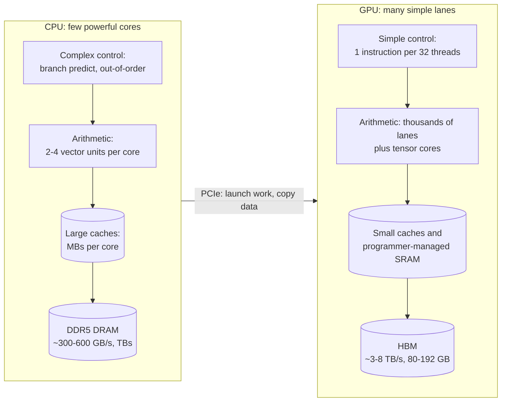

**Reading the diagram.** Each side runs from instruction control through arithmetic and caches to main memory. The CPU spends area on control and large caches so one thread rarely waits; the GPU spends it on arithmetic lanes, with small caches plus a program-managed scratchpad (shared memory). Main memory is the storage boundary on each side: DDR5 holds terabytes at hundreds of GB/s, HBM tens to low hundreds of GB at several TB/s. The CPU launches GPU work and copies data over PCIe, asynchronously. Failure points: work that does not fill the lanes, or data arriving slowly over PCIe. Scaling: CPUs add cores and sockets; GPUs add more GPUs over NVLink and networks (§64.14).

### 64.3.2 Why matrix multiplication suits GPUs

Three properties make dense matrix multiplication (**GEMM**, general matrix multiply) the ideal GPU workload:

1. **Massive independent parallelism.** Each of the $M \times N$ output elements of $C = AB$ is an independent dot product of length $K$; a 4,096 × 4,096 output has 16.8 million of them.
2. **No data-dependent branches.** Every thread runs the same instructions, so groups of 32 threads never diverge (§64.4.4).
3. **High data reuse.** Each input element is used $N$ (or $M$) times. Loading a tile of $A$ and a tile of $B$ into on-chip memory once and reusing them many times means the arithmetic grows as $n^3$ while memory traffic grows only as $n^2$ (§64.9). This is the property that lets a GEMM keep thousands of lanes busy despite limited memory bandwidth.

Pointer chasing, branchy code, small batches and operations that touch each byte once fit GPUs poorly.

**Table 64.1 — CPU versus data-center GPU (approximate, as of 2026).**

| Aspect | Server CPU (one socket) | Data-center GPU (H100 SXM class) |
|---|---|---|
| What it is | Latency-oriented general processor | Throughput-oriented accelerator |
| How it works | Tens to ~200 cores, out-of-order, SIMD | 132 SMs, 32-thread warps, tensor cores |
| Advantages | Any code, branches, huge memory | Massive parallel arithmetic, HBM bandwidth |
| Disadvantages | Low FLOP/s per watt for dense math | Needs thousands of threads, small memory, PCIe hop |
| Performance | ~1–10 TFLOP/s FP32 with SIMD | 67 TFLOP/s FP32; 989 TFLOP/s BF16 tensor (dense) |
| Memory | TBs DDR5, ~0.3–0.6 TB/s | 80 GB HBM3, 3.35 TB/s |
| Operational complexity | Familiar | Drivers, CUDA versions, thermal and ECC failures |
| Cost | Cents per core-hour | Dollars per GPU-hour (\$2.50 assumed, §60.11) |
| Use cases | Services, databases, tree models, light inference | Training, large-model inference, batch embedding |
| Choose when | Work is small, branchy or latency-critical per item | Work is dense, batched and parallel |

GPU figures come from the H100 datasheet and architecture whitepaper [NVIDIA 2022a; NVIDIA 2022b]; CPU figures follow §5.9 and vary widely by part.

::: mistake
**"GPUs are faster than CPUs."** A single GPU thread is much *slower* than a CPU thread: lower clock, no out-of-order execution, and hundreds of cycles to reach memory. A GPU is faster only in aggregate, on work that offers tens of thousands of independent threads. QuickBite's ETA model at batch size 1 (§60.11) runs faster on a CPU core than on a GPU once you count the PCIe copy and kernel launches; it pays off on a GPU only when requests are batched.
:::

## 64.4 GPU organization

### 64.4.1 Streaming multiprocessors, CUDA cores and tensor cores

::: definition
**Definition — Streaming multiprocessor (SM).** The GPU's basic processing unit, roughly a "core" in CPU terms but far wider. Each SM contains warp schedulers, a large register file, scalar arithmetic lanes (**CUDA cores**: FP32, INT32 and FP64 units), **tensor cores** (units that execute a small matrix multiply–accumulate per instruction), load/store units, special-function units (for exp, sin, reciprocal square root) and a block of on-chip SRAM shared between L1 cache and programmer-managed **shared memory**. A GPU is many identical SMs sharing an L2 cache and HBM.
:::

#### First-principles explanation

Picture a factory with 132 workshops (SMs), each with four benches (processing blocks). At each bench a foreman (warp scheduler) directs a crew of 32 workers who always do the same step together (a warp), next to a machine that multiplies small matrices in one cycle (a tensor core). The workshops share a stockroom (L2) and a warehouse down the road (HBM).

#### How it works internally

The H100 SXM5 configuration [NVIDIA 2022b]:

1. **132 SMs** are enabled (the full GH100 die has 144; the rest absorb manufacturing defects), grouped into graphics processing clusters that share some front-end logic.
2. **Each SM has four processing blocks.** Each block has one warp scheduler that can issue one instruction per clock, 32 FP32 lanes (128 per SM), 16 INT32 and 16 FP64 lanes, one fourth-generation tensor core (4 per SM) and a 16,384-entry slice of the register file (65,536 32-bit registers, 256 KB, per SM).
3. **Each SM has 256 KB of combined L1 data cache and shared memory**, of which up to 228 KB can be configured as shared memory.
4. **All SMs share a 50 MB L2 cache** and five HBM3 stacks (80 GB, 3.35 TB/s).
5. Hopper adds a **Tensor Memory Accelerator (TMA)** that copies tiles between HBM and shared memory asynchronously, **thread block clusters** whose blocks can read each other's shared memory, and a **Transformer Engine** that chooses FP8 or 16-bit formats per layer (§64.10).

**Figure 64.2 — Organization of a data-center GPU (H100 SXM5 counts).**

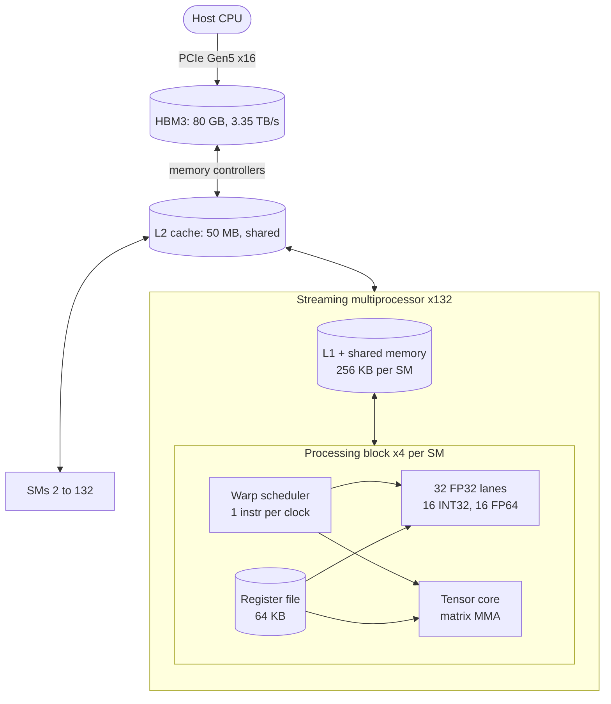

**Reading the diagram.** HBM is the GPU's main memory (a storage boundary: host data must be copied here first), reached through the shared L2 cache to which every SM connects. Inside an SM, four processing blocks each own a warp scheduler, register-file slice, scalar lanes and a tensor core, and share the SM's L1/shared memory. On-chip paths are synchronous; the host's PCIe path is asynchronous (copies and launches are queued, §64.6.4). Failure points: uncorrectable HBM errors (fatal to the job), thermal throttling. Scaling: more SMs and clock within a GPU, more GPUs beyond it (§64.14).

### 64.4.2 Warps and SIMT

::: definition
**Definition — Warp and SIMT.** A **warp** is a group of 32 threads that an SM schedules together; all 32 execute the same instruction in the same cycle on their own data. NVIDIA calls this **SIMT** (single instruction, multiple threads): like SIMD (§5.11), one instruction drives many lanes, but each lane is programmed as an independent thread with its own registers and its own (possibly different) branch outcome. AMD's equivalent is a **wavefront** of 64 threads on its data-center GPUs (32 on some consumer parts).
:::

#### First-principles explanation

A rowing crew of 32 pulls on one coxswain's call. If half must row and half hold water, the coxswain calls the two strokes one after the other and each half idles during the other's. SIMT presents 32 independent threads to the programmer while the hardware runs them as one wide instruction stream.

#### How it works internally

1. A kernel launch creates thread blocks (§64.6); each block is assigned to one SM and split into warps of 32 consecutive threads.
2. Each warp scheduler holds many resident warps (up to 16 per scheduler on H100, 64 per SM) and, every clock, picks one that is **eligible** (its operands are ready) and issues its next instruction.
3. A warp that issues a load from HBM waits hundreds of cycles; the scheduler simply issues from other eligible warps meanwhile. Switching warps costs nothing because every resident warp keeps its registers in the register file. This **zero-cost context switch** is how GPUs hide memory latency, in contrast to a CPU, which hides it with caches and out-of-order execution.
4. A per-warp **active mask** records which of the 32 lanes participate in the current instruction (§64.4.4).

### 64.4.3 Occupancy

::: definition
**Definition — Occupancy.** The ratio of warps resident on an SM to the maximum the SM supports (64 warps, 2,048 threads per SM on H100). Occupancy is limited by whichever resource a kernel exhausts first: registers per thread, shared memory per block, threads per block or blocks per SM (32 on H100).
:::

Latency hiding needs eligible warps, but occupancy is a means, not a goal: well-tuned GEMM kernels often run at low occupancy, using many registers per thread for tiles and keeping tensor cores busy through **instruction-level parallelism** [NVIDIA CUDA C++ Best Practices Guide].

::: formula
**Occupancy limited by registers and shared memory**

$$W_\text{reg} = \left\lfloor \frac{R_\text{SM}}{32\, r} \right\rfloor \qquad W_\text{smem} = \left\lfloor \frac{S_\text{SM}}{s_\text{blk}} \right\rfloor w_\text{blk} \qquad \text{occupancy} = \frac{\min(W_\text{reg}, W_\text{smem}, W_\text{max})}{W_\text{max}}$$

| Symbol | Meaning | Units |
|---|---|---|
| $R_\text{SM}$ | Registers per SM (65,536 on H100) | 32-bit registers |
| $r$ | Registers used per thread (compiler reports it) | registers/thread |
| $S_\text{SM}$ | Shared memory available per SM (up to 228 KB on H100) | KB |
| $s_\text{blk}$ | Shared memory used per thread block | KB/block |
| $w_\text{blk}$ | Warps per thread block (threads per block ÷ 32) | warps |
| $W_\text{max}$ | Maximum resident warps per SM (64 on H100) | warps |
:::

::: example
**Worked example — Occupancy of three kernels on H100.** (Ignoring register allocation granularity, which can lower the result slightly; Nsight Compute reports the exact figure.)

1. Elementwise kernel, 32 registers/thread, no shared memory: $W_\text{reg} = \lfloor 65{,}536 / (32 \times 32) \rfloor = 64$ warps. Occupancy $64/64 = 100\%$.
2. Same kernel compiled with 128 registers/thread: $W_\text{reg} = \lfloor 65{,}536 / 4{,}096 \rfloor = 16$ warps. Occupancy $16/64 = 25\%$.
3. A tiled kernel with 256-thread blocks ($w_\text{blk} = 8$) using 48 KB of shared memory and 64 registers/thread: $W_\text{smem} = \lfloor 228/48 \rfloor \times 8 = 4 \times 8 = 32$; $W_\text{reg} = \lfloor 65{,}536/2{,}048 \rfloor = 32$. Occupancy $32/64 = 50\%$.

**Interpretation.** Doubling registers per thread from 64 to 128 halves the warps available to hide memory latency. **Engineering implication.** For memory-bound kernels (elementwise, reductions), high occupancy usually helps because more loads are in flight; for compute-bound GEMMs, library kernels deliberately trade occupancy for register tiling. Do not tune occupancy blindly: check whether the kernel is memory- or compute-bound first (§64.12).
:::

### 64.4.4 Warp divergence

::: definition
**Definition — Warp divergence.** When threads of one warp take different branches of a conditional, the warp executes each taken path in turn with the non-participating lanes masked off, so the warp's time is the *sum* of the paths rather than the maximum. Threads in *different* warps can branch freely without penalty.
:::

**Figure 64.3 — A divergent branch inside one warp.**

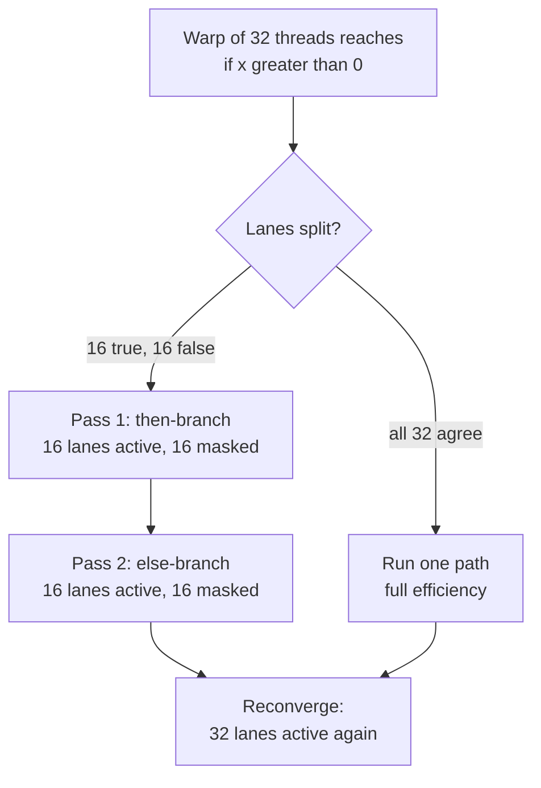

**Reading the diagram.** A warp evaluates a condition per lane. If all lanes agree, one path runs at full width; otherwise the "then" lanes run, then the "else" lanes, sequentially, before reconverging, so a 50/50 split costs both branches. Independent thread scheduling (since Volta) gives each thread its own program counter but does not remove this cost [NVIDIA CUDA C++ Programming Guide]. The failure is silent: correct but slow code. Remedy: arrange data so a warp's threads make the same decision.

::: example
**Worked example — Cost of divergence.** A kernel's branch has a "then" path of 200 cycles and an "else" path of 100 cycles.

1. Data sorted so each warp is uniform: half the warps take 200 cycles, half 100; average 150 cycles per warp.
2. Data random, so every warp contains both cases: every warp takes $200 + 100 = 300$ cycles.
3. Slowdown: $300/150 = 2\times$.

**Interpretation.** The arithmetic work is identical; the layout of data across warps doubled the time. **Engineering implication.** Variable-length work (ragged sequences, sparse features, early-exit loops) should be bucketed or padded so warps stay uniform; this is one reason ML frameworks pad and bucket sequences by length.
:::

### 64.4.5 Peak FLOP/s from the hardware

::: formula
**Peak arithmetic throughput**

$$F_\text{peak} = n_\text{SM} \times o_\text{clk} \times f$$

| Symbol | Meaning | Units |
|---|---|---|
| $F_\text{peak}$ | Peak throughput for one precision and unit type | FLOP/s |
| $n_\text{SM}$ | Number of enabled SMs | SMs |
| $o_\text{clk}$ | FLOPs per clock per SM for that unit (2 per FMA lane) | FLOPs/clock/SM |
| $f$ | Clock frequency at which the rate is quoted (boost clock) | Hz |
:::

::: example
**Worked example — H100 SXM FP32 and tensor-core peaks.**

1. FP32 on CUDA cores: 128 lanes × 2 FLOPs per FMA = 256 FLOPs/clock/SM. At a boost clock of about 1.98 GHz: $132 \times 256 \times 1.98 \times 10^9 = 66.9 \times 10^{12}$, matching the datasheet's 67 TFLOP/s [NVIDIA 2022a].
2. Dense FP16/BF16 on tensor cores: the whitepaper gives H100 twice A100's 1,024 dense FP16 FMA per clock per SM, so 2,048 FMA = 4,096 FLOPs/clock/SM [NVIDIA 2022b]. The datasheet's 989 TFLOP/s then implies $989 \times 10^{12} / (132 \times 4{,}096) \approx 1.83$ GHz.
3. Ratio: $4{,}096 / 256 = 16\times$ per clock, about 15× in practice after the clock difference.

**Interpretation.** More than 93% of the GPU's 16-bit arithmetic capability lives in its tensor cores. **Engineering implication.** Code that does its math on CUDA cores (FP32 without TF32, custom scalar loops) can use at most about 7% of the GPU's dense BF16 peak. Getting work onto tensor cores, with the right shapes and precisions (§64.7), is the first lever.
:::

## 64.5 GPU memory hierarchy

### 64.5.1 Levels, capacities and bandwidths

::: definition
**Definition — GPU memory hierarchy.** From fastest and smallest to slowest and largest: **registers** (private to a thread), **shared memory / L1** (on-chip SRAM private to an SM; shared memory is explicitly managed by the program, L1 is a hardware cache), the **L2 cache** (on-chip SRAM shared by all SMs), and **HBM** (high-bandwidth memory: DRAM dies stacked on the same package as the GPU and connected through thousands of wires, the GPU's main memory). Host memory, reached over PCIe, sits below HBM.
:::

The analogy is a chef (an SM): ingredients in hand (registers), the cutting board (shared memory), the kitchen's walk-in fridge shared by all chefs (L2), and the warehouse across town (HBM), served by a very wide road that is nevertheless the slowest link in the chain.

**Table 64.2 — Memory hierarchy of the H100 SXM5 (as of 2026; whitepaper and datasheet values, latencies approximate).**

| Level | Capacity | Bandwidth | Approximate latency | Managed by |
|---|---|---|---|---|
| Registers | 256 KB per SM; 33.8 MB total | Several operands per lane per clock | ~1 cycle | Compiler |
| Shared memory / L1 | 256 KB per SM (up to 228 KB shared); 33.8 MB total | ~128 B/clock/SM; ~33 TB/s aggregate | ~20–30 cycles | Program (shared), hardware (L1) |
| L2 cache | 50 MB | Several times HBM (not officially quoted) | ~200 cycles | Hardware |
| HBM3 | 80 GB | 3.35 TB/s | ~400–700 cycles | Program (allocations) |
| Host DRAM over PCIe Gen5 x16 | TBs | ~64 GB/s per direction | ~1–2 µs | Program (copies) |

Sources: capacities, HBM and PCIe bandwidth [NVIDIA 2022a; NVIDIA 2022b]; aggregate shared-memory bandwidth computed as $132 \times 128 \text{ B} \times 1.98 \text{ GHz}$; latencies are order-of-magnitude values from microbenchmark studies of recent NVIDIA GPUs [Jia et al. 2018] and vary by generation and load.

**Figure 64.4 — The GPU memory hierarchy, with the H100's numbers.**

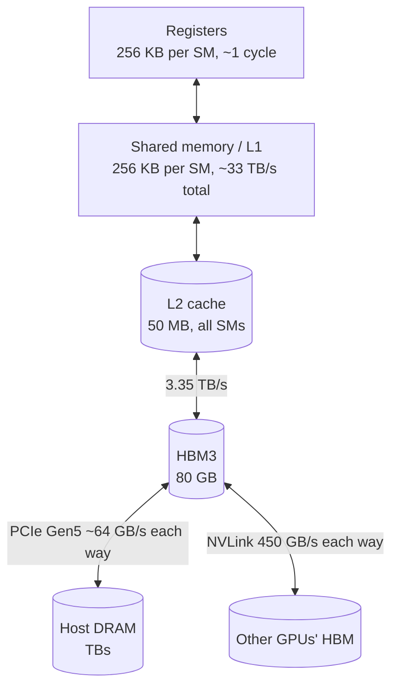

**Reading the diagram.** Each level up is smaller and faster; each arrow is a bandwidth bottleneck. Registers and shared memory sit in each SM, L2 is shared on-chip, HBM is on-package. Two exits leave the GPU: PCIe to host memory (about 50 times slower than HBM) and NVLink to other GPUs (§64.14). Loads are synchronous for the issuing warp; copy engines (TMA, `cudaMemcpyAsync`) move data asynchronously. Storage boundary: HBM holds model, optimizer state and activations; nothing on-chip survives a kernel. Failure points: HBM capacity (out-of-memory), HBM bandwidth (memory-bound kernels), PCIe (starved input). Scaling: more HBM per generation, more GPUs.

### 64.5.2 Why HBM bandwidth is the bottleneck

A GEMM reuses each byte from HBM hundreds of times on-chip; most other operations (bias, activation, normalization, reading LLM weights while decoding) use each byte once or twice, so the 3.35 TB/s road, not the 989 TFLOP/s, sets their speed. Peak arithmetic has grown faster than memory bandwidth across generations: the **memory wall** [Gholami et al. 2024].

**Table 64.3 — Compute-to-bandwidth ratio across NVIDIA data-center generations (dense 16-bit tensor FLOP/s, as of 2026; vendor datasheets).**

| GPU | Dense FP16/BF16 | HBM bandwidth | HBM capacity | FLOPs per byte |
|---|---|---|---|---|
| V100 SXM2 (2017) | 125 TFLOP/s | 0.9 TB/s | 16–32 GB | ~139 |
| A100 SXM 80 GB (2020) | 312 TFLOP/s | 2.0 TB/s | 80 GB | ~153 |
| H100 SXM (2022) | 989 TFLOP/s | 3.35 TB/s | 80 GB | ~295 |
| H200 SXM (2024) | 989 TFLOP/s | 4.8 TB/s | 141 GB | ~206 |
| B200 (2024–2025) | ~2,250 TFLOP/s | ~8 TB/s | ~180–192 GB | ~280 |

The last column is the ridge point of §64.9. The H200 kept the H100's compute and raised bandwidth 43%, a response to memory-bound LLM inference (§64.12).

### 64.5.3 Latency hiding and bytes in flight

A GPU hides HBM latency the way §5.9 showed a CPU socket must: by keeping enough requests in flight. Little's Law (§4.11) gives the amount.

::: formula
**Bytes in flight needed to saturate memory**

$$Q = B \times t_\text{lat}$$

| Symbol | Meaning | Units |
|---|---|---|
| $Q$ | Bytes that must be outstanding at any instant | bytes |
| $B$ | Memory bandwidth to saturate | bytes/s |
| $t_\text{lat}$ | Loaded memory latency | s |
:::

::: example
**Worked example — How many loads must an H100 keep in flight?** Assume a loaded HBM latency of about 500 ns (an order-of-magnitude figure).

1. $Q = 3.35 \times 10^{12} \times 500 \times 10^{-9} = 1.68 \times 10^6$ bytes, about 1.7 MB in flight.
2. Per SM: $1.68 \text{ MB} / 132 \approx 12.7$ KB.
3. One warp loading one FP32 per thread requests 128 bytes, so each SM needs about $12{,}700 / 128 \approx 99$ warp-loads outstanding: for example 32 resident warps each with about 3 independent loads in flight.

**Interpretation.** A CPU socket needs about 34 KB in flight (§5.9); an H100 needs about 50 times more. **Engineering implication.** Memory-bound kernels need either high occupancy or several independent loads per thread (vectorized 16-byte loads, loop unrolling), or asynchronous bulk copies (TMA), or they will not reach HBM bandwidth at all.
:::

::: mistake
**"80 GB of HBM means the model can use 80 GB."** The CUDA context, the framework's caching allocator, communication buffers (NCCL) and memory fragmentation consume several GB. Plan for roughly 90% of nominal capacity and measure the peak with the framework's memory profiler.
:::

## 64.6 The CUDA programming model

### 64.6.1 Kernels, grids, blocks and threads

::: definition
**Definition — CUDA execution hierarchy.** A **kernel** is a function that runs on the GPU, launched from the host. A launch creates a **grid** of **thread blocks**; each block contains up to 1,024 **threads**. Every thread runs the same kernel code and finds its own data from its indices (`blockIdx`, `threadIdx`, `blockDim`). Threads in one block run on one SM, can share **shared memory** and can synchronize with a barrier (`__syncthreads()`); blocks are independent and may run in any order on any SM [NVIDIA CUDA C++ Programming Guide].
:::

Because blocks are independent, the hardware can spread them over however many SMs exist: the same program runs on a 20-SM laptop GPU and a 132-SM data-center GPU. AMD's HIP mirrors this model almost one-to-one.

**Figure 64.5 — From a kernel launch to warps on SMs.**

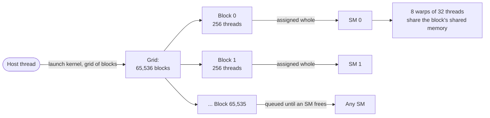

**Reading the diagram.** The host launches a kernel asynchronously with a grid of blocks. The block scheduler assigns each whole block to an SM with room for its registers and shared memory; the rest wait, so a grid can be far larger than the GPU. Each block becomes warps of 32 threads (§64.4.2). Shared memory is scoped to the block and discarded when it ends. Failure points: a block too large for an SM fails to launch; fewer blocks than SMs leaves SMs idle. Scaling: grids spread automatically over more SMs.

### 64.6.2 A kernel in CUDA style

The listing below is illustrative CUDA C++ (it is not run in this book). It adds a bias and applies ReLU to a matrix, one thread per element.

```text
// illustrative CUDA C++: y[i] = max(x[i] + bias[i % cols], 0)
__global__ void bias_relu(const float* x, const float* bias, float* y,
                          int n, int cols) {
    int i = blockIdx.x * blockDim.x + threadIdx.x;   // global thread index
    if (i < n) {                                     // guard the last block
        float v = x[i] + bias[i % cols];             // consecutive i -> coalesced
        y[i] = v > 0.0f ? v : 0.0f;
    }
}

// host side
int threads = 256;                                   // 8 warps per block
int blocks  = (n + threads - 1) / threads;          // enough blocks to cover n
cudaMemcpyAsync(d_x, h_x, n * sizeof(float), cudaMemcpyHostToDevice, stream);
bias_relu<<<blocks, threads, 0, stream>>>(d_x, d_bias, d_y, n, cols);
cudaMemcpyAsync(h_y, d_y, n * sizeof(float), cudaMemcpyDeviceToHost, stream);
cudaStreamSynchronize(stream);                       // wait for all three
```

What to notice:

- Each thread computes a global index; the `if (i < n)` guard handles sizes that are not multiples of 256.
- A warp's 32 threads read 32 consecutive floats: a **coalesced** access (§64.6.3).
- 2 FLOPs per 8 bytes moved makes the kernel hopelessly memory-bound (§64.9); frameworks fuse such operations into the preceding matrix multiply.
- `<<<blocks, threads, shared_bytes, stream>>>` queues work on a **stream**, in order and asynchronously to the host.

### 64.6.3 Memory coalescing

::: definition
**Definition — Memory coalescing.** The hardware combines the global-memory accesses of a warp's 32 threads into as few transactions as possible. Memory is transferred in 32-byte **sectors**; if the 32 threads read 32 consecutive 4-byte words (128 bytes), the warp needs 4 sectors. Strided or scattered addresses touch more sectors and waste bandwidth on bytes nobody uses [NVIDIA CUDA C++ Best Practices Guide].
:::

The following program counts the sectors one warp touches for common access patterns.

```python
"""Count the 32-byte memory sectors one warp touches for different access patterns."""
WARP, SECTOR, ELEM = 32, 32, 4            # threads, bytes per sector, bytes per float32

def sectors(addresses):
    return len({a // SECTOR for a in addresses})

patterns = {
    "contiguous  x[i]":          [ELEM * t for t in range(WARP)],
    "offset by 1 x[i+1]":        [ELEM * (t + 1) for t in range(WARP)],
    "stride 2    x[2*i]":        [ELEM * 2 * t for t in range(WARP)],
    "stride 32   x[32*i]":       [ELEM * 32 * t for t in range(WARP)],
    "column of a 1024-wide row-major matrix": [ELEM * 1024 * t for t in range(WARP)],
}
useful = WARP * ELEM                      # 128 bytes actually needed
print(f"{'pattern':40s} {'sectors':>7s} {'bytes moved':>11s} {'efficiency':>10s}")
for name, addrs in patterns.items():
    s = sectors(addrs)
    print(f"{name:40s} {s:7d} {s * SECTOR:11d} {useful / (s * SECTOR):10.1%}")
```

Output:

```text
pattern                                  sectors bytes moved efficiency
contiguous  x[i]                               4         128     100.0%
offset by 1 x[i+1]                             5         160      80.0%
stride 2    x[2*i]                             8         256      50.0%
stride 32   x[32*i]                           32        1024      12.5%
column of a 1024-wide row-major matrix        32        1024      12.5%
```

What to notice:

- Misaligned but contiguous access costs one extra sector: minor.
- Reading a column of a row-major matrix uses 12.5% of the bytes moved, up to 8× slower for a memory-bound kernel; transpose through shared memory or assign threads along rows.
- Caches can rescue some reuse, but the rule holds: **adjacent threads should touch adjacent addresses.**

### 64.6.4 Streams, launch overhead and kernel fusion

A **stream** is an ordered queue of GPU work; different streams may overlap, so the next batch can be copied while the current one computes. Each kernel launch costs a few microseconds of host time and a small GPU gap: noise for large kernels, dominant for the hundreds of small kernels in an eager training or decoding step. **CUDA Graphs** record a launch sequence once and replay it with one call.

**Figure 64.6 — Overlapping copies and compute with two streams.**

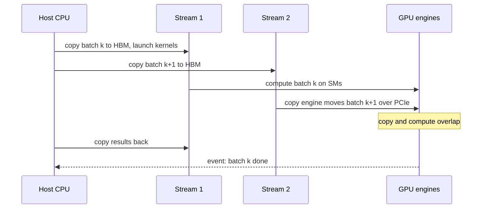

**Reading the diagram.** The host enqueues work and returns immediately. Stream 1 runs batch $k$'s kernels while the copy engine, driven by stream 2, transfers batch $k+1$ over PCIe. Ordering holds only within a stream; cross-stream dependencies need events (the dotted completion arrow). Host buffers must be **pinned** (page-locked) for asynchronous copies. Failure points: pageable memory silently serializes copies; a missing event causes a race. Scaling: more streams overlap more work, up to the engines' capacity.

::: formula
**Memory traffic of elementwise operations**

$$T_\text{mem} = \frac{b \cdot n \cdot (k_\text{in} + k_\text{out})}{B} \qquad T_\text{kernel} \approx \max(T_\text{mem}, T_\text{compute}) + t_\text{launch}$$

| Symbol | Meaning | Units |
|---|---|---|
| $T_\text{mem}$ | Time to move the kernel's data through HBM | s |
| $b$ | Bytes per element (2 for BF16) | bytes |
| $n$ | Elements per tensor | elements |
| $k_\text{in}, k_\text{out}$ | Full-size tensors read and written | tensors |
| $B$ | Achieved HBM bandwidth | bytes/s |
| $t_\text{launch}$ | Per-kernel launch and gap overhead, a few µs | s |
:::

::: example
**Worked example — Fusing bias + GELU + scale.** A transformer activation of $n = 2^{28} \approx 268$ million BF16 elements (537 MB) goes through three elementwise steps: add a bias, apply GELU, multiply by a scale. Use $B = 3.35$ TB/s.

1. Unfused: three kernels, each reads one tensor and writes one: $k_\text{in} + k_\text{out} = 2$ per kernel, 6 tensor passes in total: $6 \times 537 \text{ MB} = 3.22$ GB, so $T = 3.22 / 3{,}350 \text{ GB/s} = 0.96$ ms.
2. Fused: one kernel reads $x$ once and writes $y$ once: $2 \times 537 \text{ MB} = 1.07$ GB, so $0.32$ ms.
3. Speed-up $0.96 / 0.32 = 3\times$, with identical arithmetic.
4. For a small tensor of $2^{20}$ elements (2 MB): fused memory time is $4 \text{ MB} / 3{,}350 \text{ GB/s} = 1.25$ µs, smaller than a ~5 µs launch overhead, so the unfused version is launch-bound: about $3 \times 5 = 15$ µs versus about 6 µs fused.

**Interpretation.** Elementwise chains cost memory passes, not FLOPs; each extra kernel adds one read and one write of the whole tensor plus a launch. **Engineering implication.** Let a compiler fuse them (torch.compile/TorchInductor, XLA; §67.12), use fused library kernels (fused optimizers, fused layer norm), and capture small-kernel workloads such as LLM decoding in CUDA Graphs.
:::

::: mistake
**"Host-side timing measures the kernel."** Kernel launches return immediately, so `t1 - t0` around a launch measures queueing, not execution. Synchronize (or use CUDA events) before reading the clock, and warm up first so one-time compilation and allocation are excluded.
:::

## 64.7 Tensor cores and matrix math

::: definition
**Definition — Tensor core and MMA.** A **tensor core** is a unit inside each SM processing block that executes a **matrix multiply–accumulate (MMA)**, $D = A \times B + C$, on small tiles (for example $16 \times 8 \times 16$ per warp-level instruction) in one operation. Its inputs are low-precision (FP16, BF16, TF32, FP8, INT8, FP4 depending on generation) while the accumulator $C$, $D$ is usually FP32: this is **mixed-precision** math [NVIDIA CUDA C++ Programming Guide; Micikevicius et al. 2018].
:::

A CUDA core is a calculator that does one multiply–add per step; a tensor core is a spreadsheet that fills a small grid of multiply–adds per step. Low-precision inputs make each multiplier small and cheap, so many fit; FP32 accumulation keeps the long sums of a dot product accurate, because rounding errors in a sum of thousands of terms would otherwise pile up.

**Figure 64.7 — A tiled GEMM on tensor cores.**

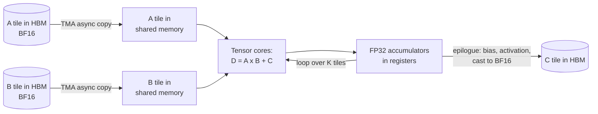

**Reading the diagram.** Each thread block owns one output tile of $C$. It streams tiles of $A$ and $B$ from HBM into shared memory asynchronously (double-buffered), feeds the tensor cores, and keeps FP32 running sums in registers across the $K$ loop. The **epilogue** then applies bias or activation (a free fusion, §64.6.4), rounds to BF16 and writes the tile once. Storage boundaries: HBM at the ends, SRAM and registers between. Failure points: misaligned shapes that leave the tensor-core path, FP16 overflow in the epilogue. Scaling: more blocks for a larger $C$; libraries (cuBLAS, CUTLASS) pick tile sizes.

**Why dimensions should be multiples of 8 or 16.** Tensor-core instructions consume fixed-size fragments, and the fastest loads are 16 bytes wide. NVIDIA's guidance is to make GEMM dimensions (batch × sequence, hidden size, vocabulary, channels) multiples of 8 for FP16/BF16 and of 16 for INT8/FP8, which is 16 bytes in each case; older libraries otherwise fell back to slower paths, and current ones still waste work on padding [NVIDIA Deep Learning Performance Guide]. Two further effects reward "round" shapes: **tile quantization** (a dimension one element over a multiple of the tile size needs a whole extra, nearly empty tile) and **wave quantization** (a tile count slightly above a multiple of the SM count leaves most SMs idle for the last wave).

::: example
**Worked example — Tile and wave quantization on 132 SMs.** A GEMM produces a $4{,}097 \times 4{,}097$ output with $128 \times 128$ tiles.

1. Tiles per dimension: $\lceil 4{,}097/128 \rceil = 33$, versus 32 for 4,096. Tiles: $33^2 = 1{,}089$ versus $1{,}024$, 6.3% more tile work for 0.05% more useful output.
2. Waves: $1{,}089 / 132 = 8.25$, so 9 waves with the last one 25% full. Efficiency $8.25/9 = 92\%$. For 4,096: $1{,}024 / 132 = 7.76$, 8 waves, 97%.
3. Combined, the 4,097 shape takes about 9 waves versus 8: roughly 12% slower for one extra row and column.

**Interpretation.** GPU time is quantized in tiles and waves, so tiny shape changes can cost double-digit percentages. **Engineering implication.** Pad vocabulary and hidden sizes to multiples of 64 or 128, choose batch sizes that are multiples of 8, and benchmark candidate shapes; profilers report the actual tile and grid choice.
:::

## 64.8 FLOPS and memory bandwidth

Vendor datasheets give **peak** rates: the arithmetic every unit could do if each issued every cycle at boost clock. Real kernels reach a fraction of it. A large, well-shaped BF16 GEMM from a vendor library gets closest; everything else is lower, and sustained clocks drop under power or thermal limits.

**Table 64.4 — H100 SXM peak throughput by precision (datasheet, as of 2026).**

| Precision and unit | Dense | Quoted "with sparsity" |
|---|---|---|
| FP64 (CUDA cores) | 34 TFLOP/s | — |
| FP64 tensor core | 67 TFLOP/s | — |
| FP32 (CUDA cores) | 67 TFLOP/s | — |
| TF32 tensor core | 495 TFLOP/s | 989 TFLOP/s |
| BF16 / FP16 tensor core | 989 TFLOP/s | 1,979 TFLOP/s |
| FP8 tensor core | 1,979 TFLOP/s | 3,958 TFLOP/s |
| INT8 tensor core | 1,979 TOPS | 3,958 TOPS |
| HBM3 bandwidth | 3.35 TB/s | — |

Source: [NVIDIA 2022a]; the datasheet marks the larger figures as "with sparsity".

::: warning
**Dense versus sparse FLOPS.** Since the A100, NVIDIA datasheets headline tensor-core figures *with sparsity*: the rate achieved only when one operand has **2:4 structured sparsity** (in every group of four weights, two are zero), which the hardware skips. Ordinary training and most inference use dense matrices and get *half* the headline number. Always check the footnote, divide by two if it says "with sparsity", and compare accelerators at the same precision and density. Some vendor materials also quote whole-system figures (8 or 72 GPUs) or the next-lower precision; normalize to per-chip, dense, same-format numbers before any comparison.
:::

::: mistake
**"FP8 doubles my training speed."** FP8 doubles *peak* tensor-core throughput over BF16. Only the GEMMs speed up; elementwise operations, attention softmax, communication and data loading do not, and scaling factors add overhead. End-to-end gains are therefore smaller than 2×; measure step time.
:::

## 64.9 The roofline model

### 64.9.1 Arithmetic intensity, ridge point and attainable FLOP/s

::: definition
**Definition — Roofline model.** A performance model that bounds a kernel's attainable throughput by the lesser of the processor's peak arithmetic rate and the product of its memory bandwidth and the kernel's **arithmetic intensity** (FLOPs performed per byte moved to or from memory) [Williams et al. 2009]. Plotted on log–log axes, attainable FLOP/s rises along a slanted "memory roof" and flattens at the "compute roof"; the corner is the **ridge point**.
:::

#### First-principles explanation

A bakery's ovens can bake 1,000 loaves an hour, but its van brings flour for only 300. Flour-heavy bread is limited by the van; bread needing little flour but long baking is limited by the ovens. Arithmetic intensity is loaves per sack of flour (FLOPs per byte); the ridge point is where van and ovens match. Below it, faster ovens are wasted money.

::: formula
**Roofline: arithmetic intensity, ridge point and attainable throughput**

$$I = \frac{W}{Q} \qquad I^{*} = \frac{F_\text{peak}}{B} \qquad P = \min\left(F_\text{peak},\; I \cdot B\right) \qquad t \ge \max\left(\frac{W}{F_\text{peak}}, \frac{Q}{B}\right)$$

| Symbol | Meaning | Units |
|---|---|---|
| $W$ | Work: floating-point operations performed by the kernel | FLOPs |
| $Q$ | Bytes moved between HBM and the chip | bytes |
| $I$ | Arithmetic intensity | FLOPs/byte |
| $F_\text{peak}$ | Peak compute rate for the precision used (dense) | FLOP/s |
| $B$ | Peak (or measured) memory bandwidth | bytes/s |
| $I^{*}$ | Ridge point: intensity where both limits meet | FLOPs/byte |
| $P$ | Attainable throughput | FLOP/s |
| $t$ | Lower bound on kernel time | s |
:::

::: example
**Worked example — Ridge points.** H100 SXM, dense BF16: $I^{*} = 989 \times 10^{12} / 3.35 \times 10^{12} = 295$ FLOPs/byte. With FP8 (1,979 TFLOP/s), $I^{*} = 591$. A100 80 GB, BF16: $312 / 2.04 = 153$.

**Interpretation.** On an H100 a BF16 kernel must do about 300 FLOPs for every byte it reads or writes in HBM to be compute-bound; switching the same kernel to FP8 doubles the requirement, because the bytes shrink by half but the compute roof doubles. **Engineering implication.** Faster formats and newer GPUs raise the ridge, pushing more operations into the memory-bound region; reducing bytes (fusion, lower-precision storage, caching in SRAM) matters more with each generation.
:::

**Figure 64.8 — Where common ML operations land relative to the H100 BF16 ridge point.**

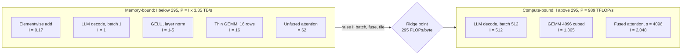

**Reading the diagram.** This is a roofline flattened onto one axis. Operations left of the ridge attain intensity × 3.35 TB/s: the elementwise add reaches 0.6 TFLOP/s (0.06% of peak) at best. Operations on the right can reach the 989 TFLOP/s compute roof. The arrow shows the remedies that move work rightward: batching, fusion and tiling into on-chip memory (FlashAttention moves attention from 62 to about 2,048). Intensities come from the calculator in §64.9.3. Failure point: a model dominated by left-side operations shows low MFU however fast its tensor cores. Scaling: the compute roof rises with precision and generation, the memory roof with HBM bandwidth.

### 64.9.2 Worked examples: GEMM, elementwise, attention and decode

::: formula
**GEMM work, traffic and intensity**

$$W_\text{GEMM} = 2MNK \qquad Q_\text{GEMM} = b\,(MK + KN + MN) \qquad I_\text{GEMM} = \frac{2MNK}{b\,(MK + KN + MN)}$$

| Symbol | Meaning | Units |
|---|---|---|
| $M, N, K$ | $C_{M \times N} = A_{M \times K} B_{K \times N}$ | elements |
| $b$ | Bytes per element (2 for BF16) | bytes |
| $W_\text{GEMM}$ | FLOPs (one multiply and one add per term) | FLOPs |
| $Q_\text{GEMM}$ | Ideal traffic: each matrix read or written once | bytes |
:::

::: example
**Worked example — Four operations on an H100 (BF16, $I^{*} = 295$).**

1. *Square GEMM*, $M = N = K = 4{,}096$: $W = 2 \times 4{,}096^3 = 1.37 \times 10^{11}$ FLOPs; $Q = 2 \times 3 \times 4{,}096^2 = 1.01 \times 10^8$ bytes; $I = 1{,}365$. Compute-bound; $t \ge 1.37 \times 10^{11} / 989 \times 10^{12} = 139$ µs.
2. *Thin GEMM*, $M = 16$ tokens through a $4{,}096 \times 4{,}096$ weight: $W = 5.4 \times 10^8$; $Q \approx 2 \times 4{,}096^2 = 3.4 \times 10^7$ bytes (the weight dominates); $I \approx 16$. Memory-bound at $16 \times 3.35 = 53$ TFLOP/s, 5% of peak. When the weight dominates, $I \approx M$: intensity equals the number of rows sharing each weight.
3. *Elementwise add* of two BF16 tensors: 1 FLOP per element, 6 bytes (two reads, one write): $I = 1/6 = 0.17$; attainable $0.17 \times 3.35 = 0.56$ TFLOP/s.
4. *Attention*, one head, sequence $s = 4{,}096$, head dimension $d = 128$: $W = 4s^2d = 8.6 \times 10^9$ FLOPs ($QK^\top$ and $PV$). A naive kernel writes the $s \times s$ score matrix and the softmax output to HBM and reads them back: $Q \approx 2(4sd + 4s^2) = 1.38 \times 10^8$ bytes, $I = 62$: memory-bound. A fused, tiled kernel keeps scores on-chip: $Q \approx 2 \times 4sd = 4.2 \times 10^6$, $I = s/2 = 2{,}048$ in this idealized count: compute-bound [Dao et al. 2022].
5. *LLM decode* step for a 7B model, batch 1: each step reads all 14 GB of BF16 weights for $2N = 1.4 \times 10^{10}$ FLOPs: $I = 1$. Time per token $\ge 14 \times 10^9 / 3.35 \times 10^{12} = 4.2$ ms, at most 239 tokens/s, no matter how fast the tensor cores are. At batch $B$ the same weight read serves $B$ sequences, so $I \approx B$; decoding becomes compute-bound only near $B \approx 295$, ignoring the KV-cache reads that grow with batch (§73.3).

**Interpretation.** Intensity spans four orders of magnitude across operations of the same model. **Engineering implication.** Before optimizing, compute $I$ for the operations that dominate time. Below the ridge, cut bytes or raise reuse (batch, fuse, tile); above it, use faster formats and better kernels.
:::

### 64.9.3 Runnable roofline calculator

```python
"""Roofline calculator: arithmetic intensity, attainable FLOP/s, bound type."""
from dataclasses import dataclass

@dataclass
class GPU:
    name: str
    peak_flops: float      # dense FLOP/s for the precision used
    hbm_bw: float          # bytes/s

    @property
    def ridge(self):       # FLOPs/byte where the two roofs meet
        return self.peak_flops / self.hbm_bw

def roofline(gpu, flops, bytes_moved):
    ai = flops / bytes_moved                          # FLOPs per byte
    attainable = min(gpu.peak_flops, ai * gpu.hbm_bw)
    t_min = max(flops / gpu.peak_flops, bytes_moved / gpu.hbm_bw)
    bound = "compute" if ai >= gpu.ridge else "memory"
    return ai, attainable, t_min, bound

def gemm(m, n, k, b=2):            # C[m,n] = A[m,k] @ B[k,n], each tensor touched once
    return 2 * m * n * k, b * (m * k + k * n + m * n)

def elementwise(n_elems, flops_per_elem=1, b=2, n_inputs=1):
    return flops_per_elem * n_elems, b * n_elems * (n_inputs + 1)

def attention_naive(s, d, b=2):    # one head: S=QK^T, P=softmax(S), O=PV; S and P go to HBM
    flops = 4 * s * s * d                                  # two s x s x d GEMMs
    return flops, b * (4 * s * d + 4 * s * s)              # Q,K,V,O + write/read S and P

def attention_fused(s, d, b=2):    # FlashAttention-style ideal: S, P stay on chip
    return 4 * s * s * d, b * 4 * s * d

def decode_step(n_params, batch, b=2):  # LLM decode: weights read once per step
    return 2 * n_params * batch, b * n_params   # ignores KV-cache reads

h100 = GPU("H100 SXM, BF16 dense", 989e12, 3.35e12)
print(f"{h100.name}: ridge point = {h100.ridge:.0f} FLOPs/byte\n")

work = {
    "GEMM 4096^3":                gemm(4096, 4096, 4096),
    "GEMM 16x4096x4096 (thin)":   gemm(16, 4096, 4096),
    "Elementwise add, 268M elts": elementwise(2**28, 1, n_inputs=2),
    "GELU, 268M elts (~8 FLOPs)": elementwise(2**28, 8),
    "Attention naive s=4096,d=128": attention_naive(4096, 128),
    "Attention fused s=4096,d=128": attention_fused(4096, 128),
    "Decode 7B, batch 1":         decode_step(7e9, 1),
    "Decode 7B, batch 64":        decode_step(7e9, 64),
    "Decode 7B, batch 512":       decode_step(7e9, 512),
}
print(f"{'workload':30s} {'AI':>8s} {'attainable':>12s} {'% peak':>7s} {'t_min':>10s}  bound")
for name, (f, by) in work.items():
    ai, att, t, bound = roofline(h100, f, by)
    print(f"{name:30s} {ai:8.2f} {att/1e12:9.1f} TF {100*att/h100.peak_flops:6.1f}% "
          f"{t*1e6:8.1f} us  {bound}")
```

Output:

```text
H100 SXM, BF16 dense: ridge point = 295 FLOPs/byte

workload                             AI   attainable  % peak      t_min  bound
GEMM 4096^3                     1365.33     989.0 TF  100.0%    139.0 us  compute
GEMM 16x4096x4096 (thin)          15.88      53.2 TF    5.4%     10.1 us  memory
Elementwise add, 268M elts         0.17       0.6 TF    0.1%    480.8 us  memory
GELU, 268M elts (~8 FLOPs)         2.00       6.7 TF    0.7%    320.5 us  memory
Attention naive s=4096,d=128      62.06     207.9 TF   21.0%     41.3 us  memory
Attention fused s=4096,d=128    2048.00     989.0 TF  100.0%      8.7 us  compute
Decode 7B, batch 1                 1.00       3.4 TF    0.3%   4179.1 us  memory
Decode 7B, batch 64               64.00     214.4 TF   21.7%   4179.1 us  memory
Decode 7B, batch 512             512.00     989.0 TF  100.0%   7247.7 us  compute
```

What to notice:

- Decode at batch 1 and batch 64 take the *same* minimum time (4.18 ms, one read of the weights) while doing 64× more work: batching is nearly free until the ridge. At batch 512 the step becomes compute-bound and time grows.
- Fusing attention cuts the lower bound from 41 µs to 8.7 µs by removing bytes, not FLOPs.
- The roofline is an upper bound. Real kernels sit below it because of launch overhead, imperfect overlap, cache misses and the tail effects of §64.7. Its value is telling you which roof to work on.
- To use it for another GPU or precision, change `peak_flops` and `hbm_bw`; for FP8 storage pass `b=1`.

::: mistake
**"Our model is 70% matrix multiplies by FLOPs, so it is compute-bound."** Time, not FLOPs, is what matters. Elementwise operations are a tiny share of FLOPs but, at intensities near 1, can take a large share of step time. Profile by time per operator.
:::

## 64.10 Precision formats

### 64.10.1 Bit layouts: range versus precision

::: definition
**Definition — Floating-point format.** A binary floating-point number stores a **sign** bit, an **exponent** field (which sets the number's scale, and therefore the format's **range**) and a **mantissa** or significand field (which sets the digits within that scale, and therefore its **precision**). For a format with $e$ exponent bits and $m$ mantissa bits, **machine epsilon**, the gap between 1 and the next representable number, is $2^{-m}$. Spending bits on the exponent buys range; spending them on the mantissa buys precision.
:::

Think of a ruler with a fixed number of tick marks. Exponent bits decide how long the ruler is (from a hair's width to a mountain); mantissa bits decide how finely it is marked. FP16 is a short, finely marked ruler; BF16 is a very long, coarsely marked one with the same number of ticks.

**Figure 64.9 — Bit layouts of ML number formats (sign, exponent, mantissa).**

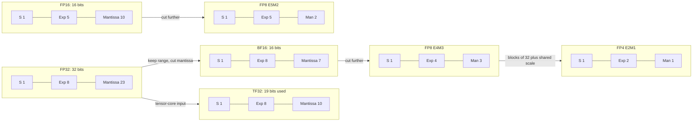

**Reading the diagram.** Each box is one format's sign, exponent and mantissa fields; arrows show derivation, not data flow. BF16 is FP32 with the mantissa cut to 7 bits, keeping FP32's range. TF32 is a tensor-core input mode reading FP32 with 10 mantissa bits. FP16 spends 5 bits on exponent and 10 on mantissa: more precise than BF16 but overflowing at 65,504. FP8 mirrors the trade-off: E4M3 for precision (weights, activations), E5M2 for range (gradients) [Micikevicius et al. 2022]. FP4 has eight magnitudes and needs a scale per small block (§64.10.4). Failure modes: overflow to infinity or NaN, underflow to zero.

**Table 64.5 — Numeric properties of ML formats.**

| Format | Bits (S/E/M) | Largest finite | Smallest normal | Epsilon | Hardware since |
|---|---|---|---|---|---|
| FP32 | 1/8/23 | $3.4 \times 10^{38}$ | $1.2 \times 10^{-38}$ | $1.2 \times 10^{-7}$ | All |
| TF32 | 1/8/10 | $\approx 3.4 \times 10^{38}$ | $1.2 \times 10^{-38}$ | $9.8 \times 10^{-4}$ | A100 (tensor cores) |
| FP16 | 1/5/10 | 65,504 | $6.1 \times 10^{-5}$ | $9.8 \times 10^{-4}$ | Volta tensor cores |
| BF16 | 1/8/7 | $3.4 \times 10^{38}$ | $1.2 \times 10^{-38}$ | $7.8 \times 10^{-3}$ | A100, TPU v2 onward |
| FP8 E4M3 | 1/4/3 | 448 | $1.6 \times 10^{-2}$ | 0.125 | H100 |
| FP8 E5M2 | 1/5/2 | 57,344 | $6.1 \times 10^{-5}$ | 0.25 | H100 |
| INT8 | 8-bit integer | 127 (× scale) | 1 (× scale) | uniform steps | Turing onward |
| FP4 E2M1 | 1/2/1 | 6 (× block scale) | 1 (× block scale) | 0.5 | Blackwell |

Values for FP32 to FP8 match `torch.finfo` in the program below; FP8 per [Micikevicius et al. 2022], FP4 per [OCP 2023].

**Table 64.6 — Choosing a precision.**

| Aspect | FP32 / TF32 | FP16 | BF16 | FP8 (E4M3/E5M2) | INT8 | FP4 / MX formats |
|---|---|---|---|---|---|---|
| What it is | Full precision; TF32 tensor-core mode | IEEE half precision | FP32 range, short mantissa | 8-bit floats | Scaled integers | 4-bit floats, block scales |
| How it works | Native; TF32 rounds inputs to 10 bits | Needs loss scaling | Drop-in for FP32 range | Per-tensor or block scales | Per-tensor or per-channel scales | Shared scale per 16–32 values |
| Advantages | Robust | Precise for 16 bits | No loss scaling | 2× BF16 peak, half the bytes | Mature inference support | 2× FP8 peak, quarter of BF16 bytes |
| Disadvantages | Slow, 4 bytes | Overflow above 65,504 | Coarse precision | Scaling recipes, accuracy risk | Calibration, outliers | Accuracy risk, newest hardware only |
| Performance (H100) | 67 / 495 TFLOP/s | 989 TFLOP/s | 989 TFLOP/s | 1,979 TFLOP/s | 1,979 TOPS | Not on H100 |
| Operational complexity | Low | Medium | Low | High | Medium | High |
| Cost | Highest per FLOP | Low | Low | Lower | Lower | Lowest |
| Use cases | Master weights, optimizer, reductions | Older GPUs, inference | Default training compute | Large-scale training GEMMs, inference | CNN and LLM inference | LLM inference, emerging training |
| Choose when | Accuracy debugging, small models | Hardware lacks BF16 | Training on A100/H100/TPU | Validated recipe exists | Inference with calibration data | Serving very large models (Chapter 73) |

### 64.10.2 Mixed precision and loss scaling

Mixed-precision training (§58.11) runs matrix multiplies in 16-bit and keeps an FP32 master copy of the weights, because an update much smaller than a weight disappears in 16-bit arithmetic: in FP16, $1 + 10^{-4}$ rounds to exactly 1. FP16 adds a second problem. Many gradient values are smaller than its smallest subnormal ($6 \times 10^{-8}$) and would underflow to zero. **Loss scaling** multiplies the loss by a factor $S$ before backpropagation, which by the chain rule scales every gradient by $S$, shifting them into FP16's range; the optimizer divides by $S$ in FP32 before the update [Micikevicius et al. 2018]. BF16, with FP32's exponent range, does not need it, which is the main reason it became the default training format on hardware that supports it [Kalamkar et al. 2019].

::: formula
**Dynamic loss scaling**

$$g = \frac{\nabla_\theta (S \cdot L)}{S} \qquad S \leftarrow \begin{cases} S / 2 & \text{if any gradient is inf or NaN (skip the step)} \\ 2S & \text{after } n \text{ consecutive finite steps} \end{cases}$$

| Symbol | Meaning | Units |
|---|---|---|
| $L$ | Training loss | dimensionless |
| $S$ | Loss scale (power of two, so scaling is exact) | dimensionless |
| $\nabla_\theta$ | Gradient with respect to parameters, computed in FP16 | per parameter |
| $g$ | Unscaled gradient used by the FP32 optimizer | per parameter |
| $n$ | Growth interval (2,000 steps by default in PyTorch's `GradScaler`) | steps |
:::

::: example
**Worked example — Choosing $S$.** A layer's gradients range from $10^{-9}$ to $10^{-2}$.

1. Without scaling, every gradient below about $6 \times 10^{-8}$ becomes zero: values from $10^{-9}$ up to that threshold are lost.
2. With $S = 2^{16} = 65{,}536$: the smallest becomes $6.6 \times 10^{-5}$ (above FP16's smallest normal) and the largest $655$ (far below 65,504). Nothing underflows or overflows.
3. If one batch produced a gradient of 2.0, then $2 \times 65{,}536 = 131{,}072 > 65{,}504$: overflow. The scaler skips that step and halves $S$ to 32,768. A gradient of 2.0 would still overflow ($2 \times 32{,}768 = 65{,}536 > 65{,}504$), so if it recurs the scaler halves again to 16,384, giving 32,768, which fits.

**Interpretation.** Loss scaling slides the gradient distribution into the representable window; dynamic scaling finds the largest safe shift automatically and costs only occasional skipped steps. **Engineering implication.** Monitor the loss-scale value and skipped-step count; a scale that keeps collapsing signals exploding gradients, not a scaling problem. On BF16 hardware, avoid the issue entirely.
:::

**Figure 64.10 — One training step with dynamic loss scaling.**

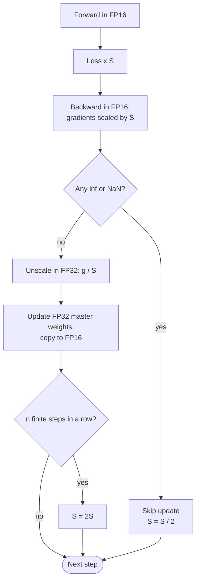

**Reading the diagram.** Forward and backward run in FP16 with the loss multiplied by $S$. On any overflow the update is skipped and $S$ halves; otherwise gradients are unscaled in FP32, FP32 master weights are updated and copied to FP16. After $n$ clean steps $S$ doubles. In data-parallel training the overflow flag is all-reduced so replicas skip together. Failure point: repeated skips stall training.

### 64.10.3 Runnable demonstration: range, underflow and accumulation

```python
"""Range versus precision of training number formats (runs on CPU)."""
import torch

torch.manual_seed(0)
fmts = {"FP32": torch.float32, "FP16": torch.float16, "BF16": torch.bfloat16,
        "FP8 E4M3": torch.float8_e4m3fn, "FP8 E5M2": torch.float8_e5m2}

print(f"{'format':9s} {'bits':>4s} {'max':>10s} {'min normal':>11s} {'eps':>10s}")
for name, dt in fmts.items():
    fi = torch.finfo(dt)
    print(f"{name:9s} {fi.bits:4d} {fi.max:10.3g} {fi.tiny:11.3g} {fi.eps:10.3g}")

# 1. Range: a large activation and a tiny gradient
x = torch.tensor([70_000.0, 1e-8, 1.0 + 1 / 256])
for name in ("FP16", "BF16"):
    print(f"\n{name}: 70000 -> {x[0].to(fmts[name]).item():.6g}, "
          f"1e-8 -> {x[1].to(fmts[name]).item():.3g}, "
          f"1+1/256 -> {x[2].to(fmts[name]).item():.6f}")

# 2. FP16 loss scaling rescues gradients that would underflow
grads = torch.logspace(-9, -3, 7)                 # 1e-9 ... 1e-3
S = 2.0 ** 16                                     # loss scale 65,536
plain = grads.half().float()                      # cast without scaling
scaled = (grads * S).half().float() / S           # scale, cast, unscale in FP32
print("\ngradient    FP16 plain   FP16 with scale 2^16")
for g, p, s in zip(grads, plain, scaled):
    print(f"{g.item():8.0e}   {p.item():10.3g}   {s.item():10.3g}")

# 3. Accumulating in low precision loses small updates
acc16, acc_bf16, acc32 = (torch.tensor(1.0, dtype=d) for d in
                          (torch.float16, torch.bfloat16, torch.float32))
for _ in range(1000):
    acc16 += torch.tensor(1e-4, dtype=torch.float16)
    acc_bf16 += torch.tensor(1e-4, dtype=torch.bfloat16)
    acc32 += 1e-4
print(f"\n1.0 + 1000 x 1e-4: FP32 {acc32.item():.4f}  FP16 {acc16.item():.4f}  "
      f"BF16 {acc_bf16.item():.4f}")

# 4. FP8 needs a per-tensor scale: map the tensor's max |x| onto E4M3's max 448
t = torch.randn(4096) * 0.02                      # weight-like values
scale = 448.0 / t.abs().max()
fp8 = (t * scale).to(torch.float8_e4m3fn)
back = fp8.float() / scale
rel_err = ((back - t).norm() / t.norm()).item()
naive = t.to(torch.float8_e4m3fn).float()
print(f"\nE4M3 scaled relative error {rel_err:.3%}; "
      f"unscaled zeros {(naive == 0).float().mean().item():.1%} of values")
```

Output (PyTorch 2.x on CPU):

```text
format    bits        max  min normal        eps
FP32        32    3.4e+38    1.18e-38   1.19e-07
FP16        16   6.55e+04     6.1e-05   0.000977
BF16        16   3.39e+38    1.18e-38    0.00781
FP8 E4M3     8        448      0.0156      0.125
FP8 E5M2     8   5.73e+04     6.1e-05       0.25

FP16: 70000 -> inf, 1e-8 -> 0, 1+1/256 -> 1.003906

BF16: 70000 -> 70144, 1e-8 -> 1e-08, 1+1/256 -> 1.000000

gradient    FP16 plain   FP16 with scale 2^16
   1e-09            0        1e-09
   1e-08            0        1e-08
   1e-07     1.19e-07        1e-07
   1e-06     1.01e-06        1e-06
   1e-05        1e-05        1e-05
   1e-04       0.0001       0.0001
   1e-03        0.001        0.001

1.0 + 1000 x 1e-4: FP32 1.1000  FP16 1.0000  BF16 1.0000

E4M3 scaled relative error 2.740%; unscaled zeros 4.4% of values
```

What to notice:

- **Range:** 70,000 overflows FP16 to infinity but survives in BF16 (as 70,144, showing BF16's coarse precision). $10^{-8}$ underflows FP16 but not BF16.
- **Precision:** $1 + 1/256$ is exact in FP16 but rounds to 1 in BF16 (epsilon 1/128).
- **Loss scaling** recovers the gradients that plain FP16 flushes to zero (and makes $10^{-7}$ accurate instead of 19% off).
- **Accumulation:** adding $10^{-4}$ a thousand times to 1.0 does nothing in either 16-bit format, because each addend is below half an epsilon. This is why optimizers update FP32 master weights and tensor cores accumulate in FP32.
- **FP8** cannot be used by casting: about 4% of small weights become zero. Scaling each tensor so its maximum maps to 448 keeps the error near 3%. Production FP8 recipes track scales per tensor (NVIDIA's Transformer Engine uses a history of recent maxima) or per block.

### 64.10.4 INT8, FP4 and microscaling formats

**INT8** represents a real value as $x \approx s \cdot q$ with an integer $q \in [-128, 127]$ and a scale $s$ per tensor or per channel; it is the mature inference format (Chapter 67 owns quantization, §67.4–§67.6; Chapter 73 owns LLM-specific methods). Below 8 bits, one scale per tensor cannot cover the spread of values, so the **OCP Microscaling (MX) specification** defines block formats: each block of 32 elements shares one 8-bit power-of-two scale (E8M0), with elements in FP8 (MXFP8), FP6 (MXFP6), FP4 (MXFP4, E2M1) or INT8 (MXINT8) [OCP 2023; Rouhani et al. 2023]. MXFP4 thus stores $32 \times 4 + 8 = 136$ bits per 32 values, 4.25 bits per value. NVIDIA's Blackwell GPUs support MX formats and an NVIDIA-specific FP4 variant with smaller blocks and an FP8 scale [NVIDIA 2024].

::: example
**Worked example — Bytes for a 70B-parameter model's weights.**

1. BF16: $70 \times 10^9 \times 2 = 140$ GB, two 80 GB GPUs before any KV cache.
2. FP8 or INT8: 70 GB, one 80 GB GPU with 10 GB left (too little for a large KV cache).
3. MXFP4 at 4.25 bits: $70 \times 10^9 \times 4.25 / 8 = 37.2$ GB.

**Interpretation.** Each halving of bits halves weight memory and, for memory-bound decoding (§64.9), roughly halves time per token. **Engineering implication.** Low-bit formats are chosen first for memory and bandwidth, second for FLOPs; accuracy must be validated per model (Chapters 67 and 73).
:::

::: mistake
**"BF16 is strictly better than FP16."** BF16 has 8 times coarser precision (7 versus 10 mantissa bits). For inference of models trained in FP16, or for values that need precision more than range, FP16 can be more accurate. BF16 wins for *training* because it removes overflow and underflow risk without loss scaling.
:::

## 64.11 Utilization metrics

::: definition
**Definition — GPU utilization metrics.** **nvidia-smi "GPU utilization"** is the percentage of time in the sample period during which at least one kernel was running, regardless of how many SMs it used [NVIDIA nvidia-smi documentation]. **SM activity** is the fraction of time an average SM had at least one warp resident; **SM occupancy** the average resident warps relative to the maximum (§64.4.3); **tensor pipe activity** the fraction of cycles tensor cores were busy; **DRAM activity** the fraction of cycles HBM was transferring (all exposed by NVIDIA's Data Center GPU Manager, DCGM). **Model FLOPs utilization (MFU)** is the throughput of the *model's* required FLOPs divided by the hardware peak; **hardware FLOPs utilization (HFU)** also counts FLOPs the implementation performs beyond the model's needs, such as activation recomputation [Chowdhery et al. 2022].
:::

A restaurant with its lights on all day is "100% utilized" by the nvidia-smi definition even if one cook is making toast. SM activity asks how many cooks are in the kitchen; MFU asks how many meals were served versus what a full kitchen could produce.

**Table 64.7 — What each metric tells you.**

| Metric | Source | 100% means | Can be high while performance is poor? |
|---|---|---|---|
| GPU utilization | nvidia-smi, NVML | A kernel was always running | Yes: one tiny kernel at a time scores 100% |
| SM activity | DCGM `DCGM_FI_PROF_SM_ACTIVE` | Every SM always had a warp | Yes: warps may be stalled on memory |
| SM occupancy | DCGM `DCGM_FI_PROF_SM_OCCUPANCY` | Maximum warps resident | Yes, see §64.4.3 |
| Tensor activity | DCGM `DCGM_FI_PROF_PIPE_TENSOR_ACTIVE` | Tensor cores busy every cycle | Rarely; close to useful math |
| DRAM activity | DCGM `DCGM_FI_PROF_DRAM_ACTIVE` | HBM saturated | High is good for memory-bound kernels |
| MFU | Computed from tokens/s | Peak FLOP/s spent on the model | No; the end-to-end efficiency measure |

::: formula
**Model and hardware FLOPs utilization for a dense transformer**

$$\text{MFU} = \frac{X \cdot (6N + 12\,L\,h\,s)}{n \cdot F_\text{peak}} \qquad \text{HFU} = \frac{X \cdot (6N + 12\,L\,h\,s + c_\text{re})}{n \cdot F_\text{peak}}$$

| Symbol | Meaning | Units |
|---|---|---|
| $X$ | Training throughput of the whole job | tokens/s |
| $N$ | Non-embedding parameters | parameters |
| $12 L h s$ | Attention-score FLOPs per token (forward + backward) [Chowdhery et al. 2022] | FLOPs/token |
| $L, h, s$ | Layers, hidden size, sequence length | —, values, tokens |
| $c_\text{re}$ | Extra FLOPs per token from recomputation, $2N + 4Lhs$ for full activation checkpointing | FLOPs/token |
| $n$ | Number of GPUs | GPUs |
| $F_\text{peak}$ | Dense peak per GPU at the training precision | FLOP/s |
:::

::: example
**Worked example — MFU of QuickBite's 7B continued pre-training run.** 64 H100s (BF16, $F_\text{peak} = 989$ TFLOP/s), $N = 7 \times 10^9$, $L = 32$, $h = 4{,}096$, $s = 4{,}096$, measured $X = 600{,}000$ tokens/s; full activation checkpointing; nvidia-smi shows 100% on every GPU (assumed figures).

1. Model FLOPs per token: $6N = 4.2 \times 10^{10}$; attention $12 \times 32 \times 4{,}096 \times 4{,}096 = 6.4 \times 10^9$; total $4.84 \times 10^{10}$.
2. Achieved model FLOP/s: $600{,}000 \times 4.84 \times 10^{10} = 2.91 \times 10^{16}$.
3. Peak: $64 \times 989 \times 10^{12} = 6.33 \times 10^{16}$. **MFU** $= 2.91 / 6.33 = 46\%$ (40% if the attention term is left out, as the $6N$ shortcut of §58.12 does).
4. Recomputation: $c_\text{re} = 2N + 4Lhs = 1.4 \times 10^{10} + 2.1 \times 10^{9} = 1.61 \times 10^{10}$. **HFU** $= 600{,}000 \times 6.45 \times 10^{10} / 6.33 \times 10^{16} = 61\%$.
5. Cost: QuickBite's 50-billion-token run (§65.9.1) takes $5 \times 10^{10}/600{,}000 = 83{,}300$ s $= 23.1$ h, $\times 64 = 1{,}480$ GPU-hours, about \$3,700 at \$2.50/GPU-hour. At 20% MFU it would cost about \$8,500.

**Interpretation.** The GPUs report 100% "utilization" while performing 46% of their possible useful arithmetic; 15 points of HFU go to recomputing activations, which buys memory, not progress. **Engineering implication.** Report MFU (and state whether attention FLOPs are included) as the efficiency metric for training; use HFU and DCGM tensor and DRAM activity to find where the rest went. PaLM reported 46.2% MFU and 57.8% HFU for its 540B model on TPU v4 [Chowdhery et al. 2022].
:::

::: mistake
**"nvidia-smi says 100%, so we need more GPUs."** It says a kernel was always resident. A data-loader-starved job can show 100% when kernels run back to back on tiny batches, and 20% MFU. Check MFU, tensor activity and step-time breakdown before buying capacity; §70.12 covers GPU monitoring in production.
:::

## 64.12 Compute-bound versus memory-bound workloads

A kernel is **compute-bound** when its arithmetic intensity exceeds the ridge point and its time approaches $W/F_\text{peak}$; it is **memory-bound** when intensity is below the ridge and time approaches $Q/B$. A whole training or inference step can also be **overhead-bound** (launch gaps, Python, synchronization) or **input-bound** (data loading, PCIe, network) [NVIDIA CUDA C++ Best Practices Guide].

**Figure 64.11 — Diagnosing what limits a GPU workload.**

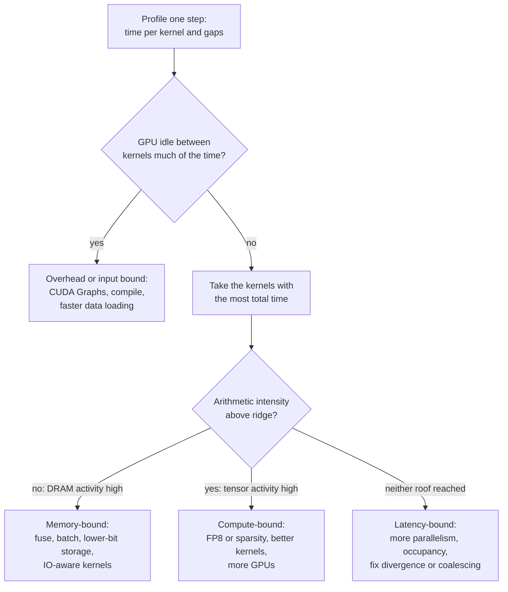

**Reading the diagram.** Start from a profiler trace (PyTorch Profiler, Nsight Systems) of a steady-state step. Gaps in the GPU timeline mean the host, input pipeline or synchronization is the bottleneck. Otherwise rank kernels by time and place each on the roofline: high DRAM activity means memory-bound, high tensor activity compute-bound, neither latency-bound. Failure points: optimizing a kernel that is 2% of step time, or profiling a warm-up step. Repeat after each fix; removing one bottleneck exposes the next.

**Batch size moves the bound.** A weight layer's intensity is roughly the number of rows sharing each weight read (§64.9.2). Growing the batch is nearly free until the ridge (about 300 rows on an H100 in BF16), then time grows linearly. Hence QuickBite's GPU-served ETA model needs batches of 64 (§60.11), and inference servers batch dynamically (§66.6).

**LLM prefill versus decode (preview of Chapter 73).** **Prefill** processes a 2,000-token prompt at once: intensity about 2,000, compute-bound. **Decode** generates one token per sequence per step: intensity about the batch size, memory-bound unless hundreds of sequences are batched, and burdened further by KV-cache reads. The phases want different settings, motivating continuous batching and disaggregated prefill/decode (§73.6, §73.12).

## 64.13 Memory optimization

HBM limits both capacity and bandwidth; the main techniques trade one resource for another (Chapters 65, 67 and 73 own the details).

- **Mixed precision** (§64.10) halves activation memory and bytes per operation; with Adam, fixed memory stays near 16 bytes per parameter (§58.11).
- **Activation checkpointing** stores some activations and recomputes the rest in backward [Chen et al. 2016], costing about one extra forward pass (the HFU–MFU gap of §64.11); selective recomputation of the memory-heavy, cheap parts keeps most of the saving for a few percent of compute [Korthikanti et al. 2023].
- **Fused kernels** remove intermediate tensors from HBM (§64.6.4): fused optimizers, fused layer norm, GEMM epilogues.
- **IO-aware algorithms** restructure an operation around the memory hierarchy. **FlashAttention** computes exact attention in tiles that fit in shared memory, using an online softmax that rescales partial results, so the $s \times s$ score matrix never reaches HBM [Dao et al. 2022]. It reduces HBM traffic and removes the quadratic activation memory; recomputing scores in backward is cheaper than storing them.

**Figure 64.12 — FlashAttention keeps the attention matrix on-chip.**

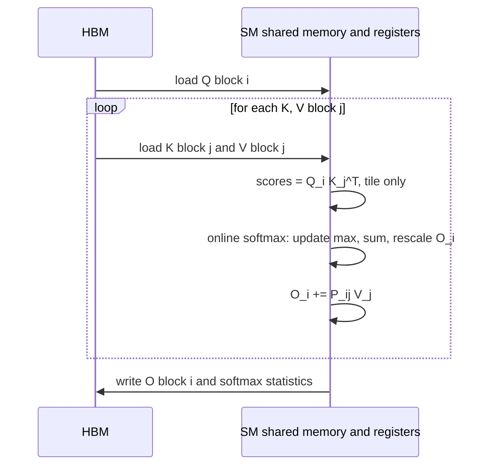

**Reading the diagram.** A thread block loads its query rows once, then streams key and value blocks from HBM. Each score tile is computed, normalized with a running maximum and sum (so the softmax is exact) and multiplied by its value block on-chip; only the output and two statistics per row return to HBM. Blocks run in parallel across SMs. The storage boundary is the point: the quadratic matrix exists only in SRAM, one tile at a time. Failure points: tiles exceeding shared memory, generation-specific kernels. Scaling: memory grows linearly with sequence length; later versions exploit Hopper's asynchronous features and FP8 (§73.9).

::: example
**Worked example — Attention memory for QuickBite's chatbot at $s = 8{,}192$.** 32 heads, BF16, one sequence, one layer.

1. Naive score matrices: $32 \times 8{,}192^2 \times 2 = 4.3$ GB per layer, and both the scores and the softmax output must be stored for backward: about 8.6 GB per layer, 275 GB across 32 layers.
2. FlashAttention stores the output and two FP32 statistics per row per head: $32 \times 8{,}192 \times 2 \times 4 = 2.1$ MB of statistics per layer.

**Interpretation.** Long-context training is impossible without IO-aware attention. **Engineering implication.** Use the framework's fused attention (for example PyTorch's `scaled_dot_product_attention`) by default and confirm in the profiler that the fused kernel was selected.
:::

## 64.14 Multi-GPU communication

### 64.14.1 Interconnects

When work outgrows one GPU (Chapter 65), GPUs exchange gradients, activations and parameters over interconnect tiers whose bandwidth falls roughly tenfold at each step outward.

::: definition
**Definition — GPU interconnects.** **PCIe** is the general expansion bus between CPU, GPUs, NICs and storage. **NVLink** is NVIDIA's point-to-point GPU-to-GPU link; **NVSwitch** is a switch chip that connects all GPUs in a server (or rack) so every pair communicates at full NVLink bandwidth. **InfiniBand** and **RoCE** carry GPU traffic between servers using RDMA (§49.10); with **GPUDirect RDMA** the NIC reads and writes GPU memory directly, bypassing host memory.
:::

**Table 64.8 — Interconnect bandwidth per GPU (as of 2026; vendor specifications).**

| Link | Per direction | Total bidirectional | Scope |
|---|---|---|---|
| PCIe Gen4 x16 | ~32 GB/s | ~64 GB/s | CPU, NIC, GPU in one server |
| PCIe Gen5 x16 | ~64 GB/s | ~128 GB/s | CPU, NIC, GPU in one server |
| NVLink 3 (A100) | 300 GB/s | 600 GB/s | GPUs in one server |
| NVLink 4 (H100) | 450 GB/s | 900 GB/s | GPUs in one server, via NVSwitch |
| NVLink 5 (Blackwell) | 900 GB/s | 1.8 TB/s | Up to 72 GPUs per NVLink domain (GB200 NVL72) |
| InfiniBand NDR / 400 GbE RoCE | 50 GB/s per NIC | 100 GB/s | Between servers, typically one NIC per GPU |
| InfiniBand XDR / 800 GbE | 100 GB/s per NIC | 200 GB/s | Between servers |

Sources: [NVIDIA 2022a; NVIDIA 2022b; NVIDIA 2024]; network rates are line rates (bits ÷ 8) before protocol overhead.

**Figure 64.13 — Inside an 8-GPU H100 server (DGX/HGX H100 style).**

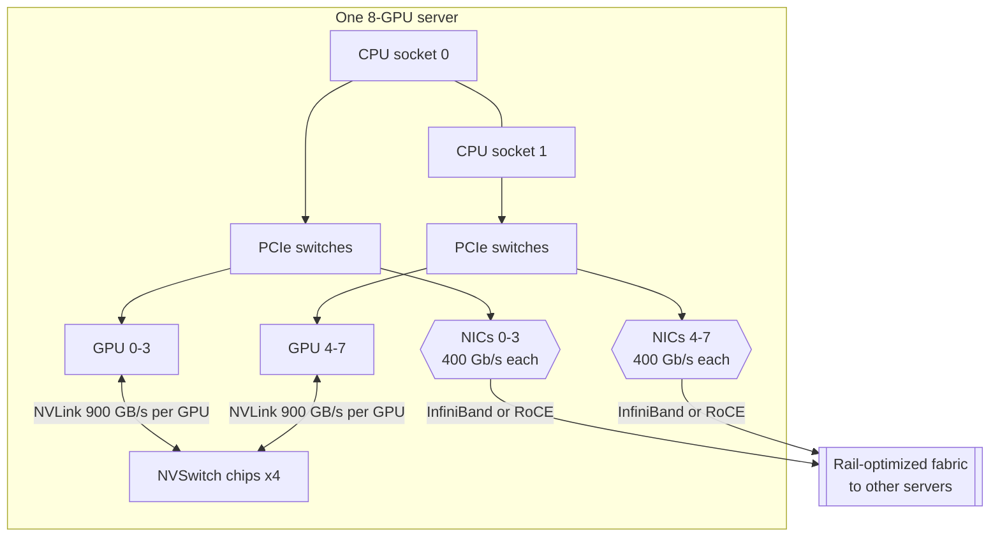

**Reading the diagram.** Each GPU connects to the NVSwitch chips (four in DGX H100) with 900 GB/s of NVLink bandwidth, so any pair talks at full speed. Each GPU shares a PCIe switch with a 400 Gb/s NIC; GPUDirect RDMA moves GPU memory to other servers without the CPU, which only launches work and feeds data. Synchronous collectives run over NVLink inside the server and over the fabric between servers. Failure points: one degraded NIC or link slows every collective it joins; a GPU falling off the bus fails the job. Scaling: rail-optimized fabrics connect NIC $i$ of every server to the same leaf group (§46.11.2, §49.10.4); Blackwell NVL72 racks extend NVLink to 72 GPUs.

::: formula
**Transfer time and ring all-reduce time**

$$T_\text{xfer} = \alpha + \frac{S}{B_\text{link}} \qquad T_\text{AR} \approx 2\,\frac{p-1}{p} \cdot \frac{S}{B_\text{link}}$$

| Symbol | Meaning | Units |
|---|---|---|
| $\alpha$ | Fixed latency per transfer (µs scale) | s |
| $S$ | Bytes to move (for all-reduce, the gradient size) | bytes |
| $B_\text{link}$ | Per-direction bandwidth per GPU on the slowest link | bytes/s |
| $p$ | GPUs in the ring | GPUs |
:::

::: example
**Worked example — Moving 7B gradients.** BF16 gradients of a 7B model: $S = 14$ GB. Ignore $\alpha$ (negligible at this size).

1. *Point to point, 1 GB:* PCIe Gen5 x16: $10^9 / 64 \times 10^9 = 15.6$ ms. NVLink 4: $10^9 / 450 \times 10^9 = 2.2$ ms; 7× faster.
2. *All-reduce across 8 GPUs over NVLink 4:* $2 \times \tfrac{7}{8} \times 14 \times 10^9 / 450 \times 10^9 = 54$ ms.
3. *Same over PCIe Gen5:* $24.5 \times 10^9 / 64 \times 10^9 = 383$ ms.
4. *Across 16 servers with one 400 Gb/s NIC per GPU (50 GB/s):* a single ring that crossed each server boundary through one NIC would need roughly $2 \times 14 \times 10^9 / 50 \times 10^9 = 560$ ms. NCCL instead runs one ring per NIC, so the eight NICs of a server share the traffic: about $560/8 = 70$ ms (§65.6.2).

**Interpretation.** Compared with a step time of a few seconds, NVLink makes gradient exchange nearly free inside a server; the network between servers is ten times slower and must be overlapped with backward computation or reduced by sharding and hierarchical collectives. **Engineering implication.** Keep the most communication-heavy parallelism (tensor parallelism) inside the NVLink domain and data parallelism across the network; Chapter 65 develops collectives, NCCL and parallelism layouts in depth.
:::

## 64.15 GPU sharing and scheduling

A whole H100 for a model that needs 5% of it wastes \$2.40 of every \$2.50 hour. Four mechanisms share a GPU; §46.11 covers how a cluster scheduler exposes them.

**Table 64.9 — GPU sharing mechanisms.**

| Aspect | MIG | MPS | Time-slicing | vGPU |
|---|---|---|---|---|
| What it is | Hardware partitions of one GPU | Concurrent kernels from many processes | Processes take turns | GPU shared among virtual machines |
| How it works | Up to 7 instances, each with dedicated SMs, L2 slices and HBM | One server process merges contexts; optional compute limits | Driver context-switches on a timer | Hypervisor driver; time-sliced or MIG-backed |
| Isolation | Strong: memory, cache, faults | Weak: shared fault domain | Compute in turn; memory shared | VM-level |
| Advantages | Predictable latency, QoS | High throughput for small kernels | Simple, any GPU | Fits VM-based clouds and VDI |
| Disadvantages | Fixed profiles, reconfiguration drains work | One crash affects all clients | No memory isolation, switching overhead | Licensing, hypervisor support |
| Choose when | Multi-tenant small inference, notebooks | One team's cooperating processes | Dev and bursty, low-stakes work | Workloads must run in VMs |

On an H100 80 GB, MIG profiles range from seven 1g.10gb instances (one-seventh of the compute, 10 GB each) to one 7g.80gb; A100, H100 and later data-center GPUs support it [NVIDIA MIG User Guide]. QuickBite could serve its deep ETA model and dish classifier from MIG slices of one GPU with guaranteed latency, while its notebook users share another GPU by time-slicing.

## 64.16 Other accelerators

Other accelerators also exist to keep matrix units fed, with different trade-offs (published facts only):

- **Google TPU.** TPU v1 (inference, deployed 2015) used a $256 \times 256$ **systolic array** of 65,536 8-bit multiply–accumulate units delivering 92 TOPS [Jouppi et al. 2017]. Later generations added BF16 training, HBM and inter-chip links; TPU v4 joins 4,096 chips with optical circuit switches that reconfigure the 3D-torus topology, and adds SparseCores for embeddings [Jouppi et al. 2023]. TPUs are programmed through XLA (JAX, TensorFlow, PyTorch/XLA).
- **AWS Trainium and Inferentia.** AWS-designed chips for training and inference, programmed through the AWS Neuron SDK and available as EC2 instances (Trn and Inf families); Trn1 instances have 16 Trainium chips [AWS Docs: Trainium].
- **AMD Instinct.** GPUs with the same SIMT model (64-thread wavefronts) programmed with ROCm and HIP. The MI300X has 192 GB of HBM3 at 5.3 TB/s [AMD 2023], more capacity than an H100, which suits large-model inference.

**Figure 64.14 — Data flow through a systolic array.**

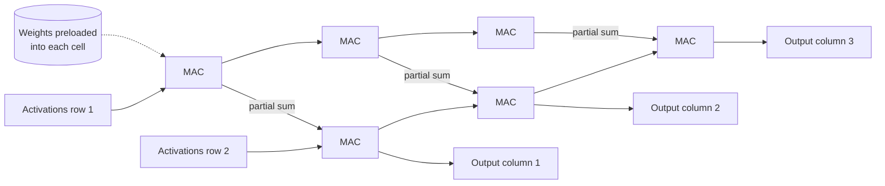

**Reading the diagram.** Each cell is a multiply–accumulate unit holding one preloaded weight (dotted arrow). Activations flow left to right; partial sums flow top to bottom, gaining one product per cell; finished dot products leave at the bottom. Data moves only between neighbors each clock, so each value read from memory is reused across a whole row or column with no register file or cache: high intensity, little control logic. Failure points: matrices smaller than the array idle cells; non-matrix work needs separate vector units. Scaling: more arrays per chip, more chips over inter-chip links.

**Table 64.10 — Accelerator families compared.**

| Aspect | NVIDIA GPU | Google TPU | AWS Trainium/Inferentia | AMD Instinct |
|---|---|---|---|---|
| Compute model | SIMT SMs plus tensor cores | Systolic matrix units plus vector units | Matrix and vector engines (Neuron cores) | SIMT compute units plus matrix cores |
| Software | CUDA, cuDNN, NCCL | XLA (JAX, TensorFlow, PyTorch/XLA) | Neuron SDK | ROCm, HIP, RCCL |
| Availability | Every cloud, on-premises | Google Cloud only | AWS only | Several clouds, on-premises |
| Choose when | Broadest ecosystem and kernels | JAX/XLA shops at large scale | Cost-optimized AWS workloads | Large HBM capacity, second source |

## 64.17 Summary and revision notes

::: summary
- GPUs are throughput-oriented: many simple lanes, little control logic, latency hidden by switching among resident warps. Dense GEMM suits them because it is parallel, branch-free and reuses each byte many times.
- An H100 SXM has 132 SMs, each with four warp schedulers, 128 FP32 lanes, 4 tensor cores, 256 KB of registers and 256 KB of L1/shared memory; 50 MB L2; 80 GB HBM3 at 3.35 TB/s. More than 90% of its 16-bit arithmetic is in tensor cores.
- Warps of 32 threads execute in lockstep (SIMT); divergence serializes branches. Occupancy is limited by registers and shared memory and is a diagnostic, not a goal.
- Coalesce memory accesses, fuse elementwise chains, and remove launch overhead with CUDA Graphs or compilation.
- Roofline: $I = W/Q$, ridge $I^{*} = F_\text{peak}/B$ (295 FLOPs/byte for H100 BF16), $P = \min(F_\text{peak}, I B)$. GEMM is compute-bound; elementwise ops, small-batch layers, naive attention and LLM decode are memory-bound.
- Formats trade range (exponent) for precision (mantissa). BF16 has FP32's range and needs no loss scaling; FP16 needs it; FP8 needs per-tensor or block scales; MX formats share one scale per 32 values.
- Read datasheets carefully: "with sparsity" figures are twice the dense rate.
- nvidia-smi utilization says only that a kernel was running. MFU $= X(6N + 12Lhs)/(nF_\text{peak})$ measures useful work; HFU adds recomputation.
- Batch size raises intensity for weight-bound layers; prefill is compute-bound, decode memory-bound.
- Interconnects: PCIe ~64 GB/s, NVLink 4 450 GB/s per direction, 400 Gb/s NICs 50 GB/s. Ring all-reduce moves $2(p-1)/p \cdot S$ bytes per GPU.
- Share GPUs with MIG (isolation), MPS (throughput), time-slicing (simplicity) or vGPU (VMs). TPUs use systolic arrays; Trainium and AMD Instinct offer alternative stacks.
:::

## 64.18 Knowledge checkpoint

1. Why can a GPU switch between warps at no cost while a CPU context switch costs microseconds?
2. A kernel uses 96 registers per thread on an H100. What is its maximum occupancy from registers alone?
3. Threads of a warp read `x[i * 4]` (FP32). What fraction of moved bytes is useful?
4. What is the ridge point of a GPU with 400 TFLOP/s and 2 TB/s?
5. What is the arithmetic intensity of $C = AB$ with $M = N = K = 1{,}024$ in BF16, and is it compute-bound on an H100?
6. Why does LLM decoding at batch 1 run at under 1% of an H100's peak?
7. Give FP16's and BF16's exponent and mantissa bits, and the consequence of each.
8. A datasheet lists 2,000 TFLOP/s FP8 "with sparsity". What dense FP8 rate should you plan with?
9. A 13B model trains at 4,000 tokens/s per GPU on H100s (BF16). Estimate MFU with the $6N$ shortcut.
10. Why can nvidia-smi show 100% while MFU is 20%?
11. How long does a ring all-reduce of 2 GB take across 8 GPUs at 450 GB/s per direction?
12. Which sharing mechanism gives memory and fault isolation between tenants?
13. Why does FlashAttention perform *more* FLOPs in backward than a naive kernel yet run faster?

<details><summary>Answers</summary>

1. All resident warps keep their state in the register file; nothing is saved or restored. A CPU context switch saves registers and often disturbs caches and TLBs.
2. $\lfloor 65{,}536 / (96 \times 32) \rfloor = 21$ warps; $21/64 \approx 33\%$ (lower after allocation granularity).
3. Each thread uses 4 of every 16 bytes read; addresses span 512 bytes = 16 sectors, so $128/512 = 25\%$.
4. $400 \times 10^{12} / 2 \times 10^{12} = 200$ FLOPs/byte.
5. $W = 2 \times 1{,}024^3 = 2.15 \times 10^9$; $Q = 2 \times 3 \times 1{,}024^2 = 6.29 \times 10^6$; $I = 341 > 295$: just compute-bound.
6. Intensity is about 1 FLOP/byte (every weight read for one multiply–add), so attainable throughput is $1 \times 3.35 = 3.35$ TFLOP/s, 0.3% of 989.
7. FP16: 5 and 10, overflows above 65,504 and underflows small gradients, needs loss scaling. BF16: 8 and 7, FP32 range but epsilon $2^{-7}$.
8. 1,000 TFLOP/s.
9. $6 \times 13 \times 10^9 \times 4{,}000 = 3.12 \times 10^{14}$; $3.12/9.89 = 32\%$.
10. It counts time with any kernel running, not SMs or tensor cores used; small, memory-bound or stalled kernels still count as "busy".
11. $2 \times \tfrac{7}{8} \times 2 \times 10^9 / 450 \times 10^9 = 7.8$ ms.
12. MIG.
13. It recomputes attention scores instead of reading a stored $s \times s$ matrix from HBM; the operation is memory-bound, so trading cheap FLOPs for expensive bytes wins.

</details>

## 64.19 Interview questions

### Basic

**Q1. Why are GPUs used for deep learning instead of CPUs?**
**Answer.** Deep learning is dominated by large matrix multiplies: millions of independent multiply–adds with high data reuse and no branches. GPUs devote their area to thousands of arithmetic lanes and tensor cores and feed them from HBM at several TB/s, giving an order of magnitude or more higher throughput per chip and per watt. CPUs still win for small, branchy or latency-critical work, such as unbatched tree-model inference.

**Q2. What is the roofline model?**
**Answer.** Attainable FLOP/s is the minimum of peak compute and arithmetic intensity times memory bandwidth. Operations below the ridge point ($F_\text{peak}/B$) are memory-bound and speed up only by moving fewer bytes; those above are compute-bound and speed up with faster math (lower precision, better kernels).

### Intermediate

**Q3. Your training job shows 100% GPU utilization but MFU is 25%. How do you investigate?**
**Answer.** Profile one steady-state step. Check for gaps (data loading, host overhead, synchronization). Rank kernels by time; compare DCGM tensor-pipe and DRAM activity. Look for unfused elementwise chains, non-fused attention, FP32 math off tensor cores, poor shapes (not multiples of 8, wave quantization), communication not overlapped with backward, and recomputation (compare HFU). Fix the largest time share first and re-measure.

**Q4. Why is LLM decoding memory-bound, and what helps?**
**Answer.** Each step reads every weight to produce one token per sequence, about 1 FLOP per byte at batch 1, far below the ~300 ridge. Remedies raise intensity or cut bytes: batch many sequences (continuous batching), quantize weights and KV cache, use GPUs with higher bandwidth, speculative decoding, and CUDA Graphs for launch overhead (Chapter 73).

### Advanced

**Q5. Choose a precision recipe for training a 30B model on H100s.**
**Answer.** BF16 compute with FP32 master weights, optimizer state and reductions as the default; no loss scaling needed. Consider FP8 for GEMMs with a validated recipe (E4M3 forward, E5M2 or E4M3 gradients, delayed or block scaling) after a BF16 baseline, comparing loss curves over a substantial run. Keep sensitive operations (softmax, normalization, loss) in higher precision. Expect less than 2× end-to-end gain, and monitor for divergence.

**Q6. Design the GPU layout for training a 70B model on 256 H100s.**
**Answer.** Fixed memory is $16 \times 70 \times 10^9 = 1.12$ TB, so shard it. Keep tensor parallelism (8-way) inside each NVLink/NVSwitch server, because it exchanges activations every layer; use pipeline or FSDP/ZeRO sharding plus data parallelism across servers over the 400 Gb/s rail-optimized fabric, overlapping gradient reduce-scatter with backward. Use activation checkpointing selectively, fused attention, BF16 (or FP8). Estimate step time from $6ND$ at an assumed 40% MFU and check the all-reduce time against it (Chapter 65).

## 64.20 Practical exercises

1. **Roofline for your model.** Extend the §64.9.3 calculator with a layer list for a transformer block (QKV projection, attention, output projection, MLP, layer norms) at batch sizes 1, 8, 64 and 512; report which operations are memory-bound at each.
2. **Precision explorer.** Extend the §64.10.3 program to simulate MXFP4: split a tensor into blocks of 32, compute a power-of-two scale per block, round to the E2M1 values $\{0, 0.5, 1, 1.5, 2, 3, 4, 6\}$, and compare the error with one per-tensor scale.
3. **Occupancy table.** Write a function that computes occupancy from registers per thread, threads per block and shared memory per block for H100 limits, and plot occupancy against registers from 32 to 255.
4. **MFU from logs.** Given tokens/s, model shape and GPU count, compute MFU with and without the attention term, and HFU with full and no checkpointing.

## 64.21 Design challenges

1. **QuickBite inference fleet.** The chatbot (7B, BF16) must serve 200 concurrent conversations with p99 time per output token under 50 ms. Using the roofline, estimate tokens/s per H100 at batch 1, 32 and 128, decide the number of GPUs, and compare an H200 (4.8 TB/s) on cost per token at \$2.50 versus an assumed \$3.50 per hour.
2. **Shared GPU platform.** Design how QuickBite's data-science team (40 notebook users), three small CPU-unfriendly models and nightly fine-tuning jobs share 16 H100s. Choose MIG profiles, time-slicing or whole GPUs per workload, and state isolation and utilization trade-offs (§46.11).

## 64.22 References

1. AMD. *AMD Instinct MI300X Accelerator Data Sheet*. AMD, 2023.
2. AWS Docs: Trainium. *AWS Trainium and Amazon EC2 Trn1 Instances*. Amazon Web Services documentation. https://aws.amazon.com/machine-learning/trainium/
3. Chen, T., Xu, B., Zhang, C., Guestrin, C. *Training Deep Nets with Sublinear Memory Cost*. arXiv:1604.06174, 2016.
4. Chowdhery, A., et al. *PaLM: Scaling Language Modeling with Pathways*. arXiv:2204.02311, 2022.
5. Dao, T., Fu, D. Y., Ermon, S., Rudra, A., Ré, C. *FlashAttention: Fast and Memory-Efficient Exact Attention with IO-Awareness*. NeurIPS, 2022.
6. Gholami, A., Yao, Z., Kim, S., Hooper, C., Mahoney, M. W., Keutzer, K. *AI and Memory Wall*. IEEE Micro, 2024.
7. Jia, Z., Maggioni, M., Staiger, B., Scarpazza, D. P. *Dissecting the NVIDIA Volta GPU Architecture via Microbenchmarking*. arXiv:1804.06826, 2018.
8. Jouppi, N. P., et al. *In-Datacenter Performance Analysis of a Tensor Processing Unit*. ACM/IEEE ISCA, 2017.
9. Jouppi, N. P., et al. *TPU v4: An Optically Reconfigurable Supercomputer for Machine Learning with Hardware Support for Embeddings*. ACM/IEEE ISCA, 2023.
10. Kalamkar, D., et al. *A Study of BFLOAT16 for Deep Learning Training*. arXiv:1905.12322, 2019.
11. Korthikanti, V., et al. *Reducing Activation Recomputation in Large Transformer Models*. MLSys, 2023.
12. Krizhevsky, A., Sutskever, I., Hinton, G. E. *ImageNet Classification with Deep Convolutional Neural Networks*. NeurIPS, 2012.
13. Micikevicius, P., et al. *Mixed Precision Training*. ICLR, 2018.
14. Micikevicius, P., et al. *FP8 Formats for Deep Learning*. arXiv:2209.05433, 2022.
15. NVIDIA (2022a). *NVIDIA H100 Tensor Core GPU Datasheet*. NVIDIA, 2022.
16. NVIDIA (2022b). *NVIDIA H100 Tensor Core GPU Architecture* (whitepaper). NVIDIA, 2022.
17. NVIDIA (2024). *NVIDIA Blackwell Architecture Technical Brief*. NVIDIA, 2024.
18. NVIDIA. *CUDA C++ Programming Guide*. https://docs.nvidia.com/cuda/cuda-c-programming-guide/
19. NVIDIA. *CUDA C++ Best Practices Guide*. https://docs.nvidia.com/cuda/cuda-c-best-practices-guide/
20. NVIDIA. *Deep Learning Performance Guide: Matrix Multiplication Background*. https://docs.nvidia.com/deeplearning/performance/
21. NVIDIA. *Multi-Instance GPU User Guide*. https://docs.nvidia.com/datacenter/tesla/mig-user-guide/
22. NVIDIA. *nvidia-smi documentation* (NVIDIA System Management Interface). NVIDIA.
23. Open Compute Project (OCP). *OCP Microscaling Formats (MX) Specification, Version 1.0*. OCP, 2023.
24. Rouhani, B. D., et al. *Microscaling Data Formats for Deep Learning*. arXiv:2310.10537, 2023.
25. Williams, S., Waterman, A., Patterson, D. *Roofline: An Insightful Visual Performance Model for Multicore Architectures*. Communications of the ACM 52(4), 2009.

## 64.23 Open verification items

- H100 clock figures (1.98 GHz FP32 boost; the ~1.83 GHz implied for tensor-core rates) and the "2× A100's 1,024 FP16 FMA/clock/SM" statement should be checked against the H100 whitepaper.
- Latencies in Table 64.2 (shared memory, L2, HBM in cycles) are order-of-magnitude values; confirm against microbenchmark studies of Hopper.
- B200 figures in Table 64.3 (dense BF16 ~2.25 PFLOP/s, ~8 TB/s, 180–192 GB) vary between NVIDIA documents; verify per SKU.
- Exact title of the Blackwell technical brief (NVIDIA 2024) and NVFP4 block size and scale format.
- PaLM's 46.2% MFU / 57.8% HFU figures; Gholami et al. 2024 volume and issue.
- MI300X 5.3 TB/s and Trn1 chip count against current vendor pages.
