# Chapter 65 — Distributed ML Training

> **Level:** 4 · **Track:** B (ML/AI) · **Estimated reading time:** 6 h

Chapter 58 ended with two uncomfortable numbers. Training a 7-billion-parameter language model needs about 112 GB of accelerator memory before it has processed a single token, and its full training run needs about $4.2 \times 10^{22}$ floating-point operations, which one GPU would take more than three years to perform. Neither number is unusual: they describe a mid-sized open model of 2023. Every large model you have heard of was therefore trained on hundreds or thousands of accelerators working as one machine, and the engineering that makes that possible is the subject of this chapter.

Distributing training is not like scaling a web service. A web tier scales by adding independent replicas that never talk to each other (§18.4). Training replicas talk to each other on *every step*, several times a second, exchanging gigabytes; they must stay in lockstep, so the slowest one sets the pace; and one failed GPU among 16,000 stops all of them. You will learn the five ways to split the work (data, tensor, pipeline, sequence and expert parallelism), the memory-sharding techniques ZeRO and FSDP, how they combine into "3D" and "4D" parallelism, and how to survive the hardware failures that arrive every few hours at scale. Every technique comes with the arithmetic you need to choose it: bytes per GPU, bytes on the wire per step, idle time, and days of wall-clock time.

This chapter builds on Chapter 58 (training memory and FLOPs, §58.11–§58.12), Chapter 64 (GPU architecture, number formats and interconnects), §49.9–§49.10 (MPI collectives, the α–β cost model, ring and tree all-reduce, RDMA) and Chapter 46 (gang scheduling, Slurm and Kubernetes for training). It owns parallelism strategies and training fault tolerance; serving (Chapter 66), recommender-specific training (Chapter 68) and fine-tuning (Chapter 76) are covered elsewhere.

::: note
**Assumptions used in this chapter.** Units are SI (1 GB = 10⁹ bytes); one multiply–add is 2 FLOPs (§58.2). An "H100-class" accelerator is modeled with round numbers that match Chapter 58: 80 GB of HBM, a dense BF16 peak of $10^{15}$ FLOP/s, NVLink at 450 GB/s per direction within an 8-GPU node, and one 400 Gb/s (50 GB/s) InfiniBand or RoCE network interface per GPU across nodes (Chapter 64; as of 2026). Achieved bandwidth is taken as 80% of peak (360 GB/s and 40 GB/s). A GPU-hour costs an illustrative \$2.50 (Chapter 60). The **7B model** has hidden size $h = 4{,}096$, $L = 32$ layers and $a = 32$ attention heads; the **70B model** has $h = 8{,}192$ and $L = 80$ (Llama-2-like shapes). QuickBite's ML numbers are those of Chapters 57–60; new QuickBite numbers are labeled as assumptions.
:::

## 65.1 Learning objectives

After this chapter you should be able to:

- Explain the memory wall and the compute wall, and compute when a model needs more than one GPU for each reason.
- Estimate training compute with $C \approx 6ND$, convert it to wall-clock time and cost for a given cluster and MFU, and relate it to the Kaplan and Chinchilla scaling laws.
- Describe how PyTorch DistributedDataParallel works, including gradient bucketing and overlap with the backward pass, and compute its all-reduce volume and time on NVLink and InfiniBand.
- Choose among all-reduce, reduce-scatter, all-gather and all-to-all, and explain how NCCL uses topology.
- Explain parameter servers, synchronous versus asynchronous SGD and staleness, and where parameter servers are still used.
- Compute per-GPU memory for DDP and ZeRO stages 1–3 (FSDP), and their communication cost.
- Explain Megatron-style tensor parallelism, GPipe and 1F1B pipeline parallelism (with the bubble fraction), sequence and context parallelism, and expert parallelism with capacity factors.
- Design a 3D parallel layout (TP × PP × DP) for a 70B model on 512 GPUs and justify each degree.
- Size checkpoints, choose a checkpoint interval with the Young/Daly formula, and compute goodput under realistic failure rates.
- Diagnose communication, straggler and data-loading bottlenecks, and specify a training job for Slurm, Kubernetes or Ray.

## 65.2 Prerequisites

- Training memory (16 bytes per parameter plus activations) and training FLOPs ($6ND$) — §58.11–§58.12 (this chapter divides both across GPUs).
- Optimizers, Adam state and learning-rate warmup — §58.5 (the state that ZeRO shards; warmup for large batches).
- GPU memory hierarchy, BF16/FP8, tensor cores, MFU, NVLink, NVSwitch and InfiniBand — Chapter 64 (the hardware constants used throughout).
- MPI collectives, the α–β model, ring versus tree all-reduce — §49.9; RDMA and network topologies — §49.10 (the cost model for every communication estimate here).
- Gang scheduling, topology-aware placement, Slurm versus Kubernetes — §46.10–§46.12 (how training jobs get their GPUs).
- Checkpoint intervals in stream processing — §29.9 (the same Young formula, applied here to training).
- Failure detection — §27.10; redundancy and correlated failures — §39.4 (the reliability vocabulary used in §65.15–§65.16).

## 65.3 Why distribute training

### 65.3.1 The memory wall and the compute wall

::: definition
**Definition — Memory wall and compute wall (for training).** A model hits the **memory wall** when the bytes needed to train it on one accelerator (weights, gradients, optimizer state and activations, §58.11) exceed that accelerator's memory. It hits the **compute wall** when the floating-point operations of a full training run, divided by one accelerator's achieved throughput, exceed the time you can wait. **Distributed training** spreads either the bytes, the operations, or both, across many accelerators that cooperate on one model.
:::

#### First-principles explanation

Imagine one cook preparing a 2,000-guest banquet. Two separate problems appear. The kitchen counter is too small to hold all the ingredients at once (memory), and even with infinite counter space, one cook chopping for 2,000 guests would finish next month (compute). Hiring more cooks helps with both, but in different ways: to finish sooner you give each cook a share of the guests (**data parallelism**); to fit the ingredients you give each cook a share of the recipe (**model parallelism**). And every extra cook adds conversation: they must agree on the seasoning, pass dishes along the line, and wait for the slowest. Distributed training is the discipline of choosing the split that minimizes that conversation.

#### Why does this exist?

Model size and data size have both grown faster than a single accelerator. Between 2018 and 2024, the largest published dense language models grew from hundreds of millions of parameters to hundreds of billions, and training sets from a few billion tokens to about 15 trillion [Dubey et al. 2024]. Accelerator memory grew from 32 GB to around 80–192 GB over the same years (Chapter 64). The scaling laws of §65.4 explain why the industry accepted this cost: loss falls predictably as compute grows, so whoever can apply more compute to one model gets a better model.

#### How it works internally

**Figure 65.1 — The two walls and the parallelism each one calls for.**


**Reading the diagram.** The model and dataset enter at the top. The first decision is a memory test: the fixed $16N$ bytes of mixed-precision Adam plus activations (§58.11) against one accelerator's HBM. Failing it pushes you to a technique that splits the model's state. The second decision is a time test: $6ND$ FLOPs (§58.12) at one GPU's achieved rate against the time you can wait. Failing it pushes you to data parallelism, which processes different examples on different GPUs. Both exits create network traffic (the subroutine shapes): data parallelism exchanges gradients once per step, model splitting exchanges weights or activations per layer, which is far more frequent and is why model splitting needs the fastest links. All arrows are synchronous decisions in a planning process; the failure point of a wrong decision is either an out-of-memory error on step one or a job that would finish next year. Scaling options compound: large jobs hit both walls and use both kinds of parallelism (§65.13).

#### Mathematical foundations

::: formula
**Minimum GPUs for memory and for time**

$$G_\text{mem} = \left\lceil \frac{16\,N + M_\text{act}}{M_\text{GPU}\, f} \right\rceil \qquad G_\text{time} = \left\lceil \frac{6\,N\,D}{R\; \text{MFU}\; T_\text{max}} \right\rceil$$

| Symbol | Meaning | Units |
|---|---|---|
| $G_\text{mem}$ | GPUs needed just to hold the training state, assuming perfect sharding | GPUs |
| $G_\text{time}$ | GPUs needed to finish within the deadline, assuming perfect scaling | GPUs |
| $N$ | Parameters | parameters |
| $M_\text{act}$ | Activation memory for one micro-batch (§58.11) | bytes |
| $M_\text{GPU}$ | Accelerator memory | bytes |
| $f$ | Usable fraction of memory after framework buffers and fragmentation (about 0.8–0.9) | — |
| $D$ | Training tokens | tokens |
| $R$ | Peak 16-bit throughput per GPU | FLOP/s |
| MFU | Model FLOPs utilization: achieved useful FLOP/s divided by peak (Chapter 64) | — |
| $T_\text{max}$ | Acceptable wall-clock training time | s |
:::

::: example
**Worked example — Why a 7B and a 70B model cannot train on one GPU.** Use $M_\text{GPU} = 80$ GB, $f = 0.85$, sequence length 2,048 for 7B and 4,096 for 70B, micro-batch 1, peak $10^{15}$ FLOP/s at 40% MFU.

1. *7B memory.* $16 \times 7 \times 10^9 = 112$ GB of model state. Activations without recomputation: $0.96$ GB per layer × 32 layers $= 30.6$ GB (§58.11). Total 143 GB. $G_\text{mem} = \lceil 143 / 68 \rceil = 3$ GPUs at minimum.
2. *70B memory.* $16 \times 70 \times 10^9 = 1{,}120$ GB of model state. Activations per layer at $s = 4{,}096$, $h = 8{,}192$, $a = 64$: $s h (34 + 5as/h) = 4{,}096 \times 8{,}192 \times (34 + 160) = 6.5$ GB, × 80 layers $= 521$ GB. Total about 1,641 GB: $G_\text{mem} = \lceil 1{,}641/68 \rceil = 25$ GPUs before any thought of speed.
3. *7B time.* $C = 6 \times 7 \times 10^9 \times 10^{12} = 4.2 \times 10^{22}$ FLOPs for 1 trillion tokens. One GPU achieves $4 \times 10^{14}$ FLOP/s: $1.05 \times 10^8$ s $= 1{,}215$ days, 3.3 years.
4. *70B time.* Chinchilla-style 1.4 trillion tokens (§65.4): $C = 6 \times 7 \times 10^{10} \times 1.4 \times 10^{12} = 5.88 \times 10^{23}$ FLOPs: $1.47 \times 10^9$ s on one GPU, about 46.6 years.
5. *Deadline of 30 days* ($2.59 \times 10^6$ s): $G_\text{time} = \lceil 4.2 \times 10^{22} / (4 \times 10^{14} \times 2.59 \times 10^6) \rceil = 41$ GPUs for 7B, and $\lceil 5.88 \times 10^{23} / 1.036 \times 10^{21} \rceil = 568$ GPUs for 70B.

**Interpretation.** For both models the compute wall, not the memory wall, sets the cluster size: memory needs 3 or 25 GPUs, time needs 41 or 568. **Engineering implication.** Size the cluster from $G_\text{time}$, then choose the model-splitting technique that makes each GPU's share of memory fit, with the least communication. Once $G_\text{time}$ GPUs exist, you have far more aggregate memory than the model needs; the question becomes how to *use* it without moving too many bytes.
:::

**Table 65.1 — Training budgets for the chapter's two reference models.**

| Quantity | 7B model, 1T tokens | 70B model, 1.4T tokens |
|---|---|---|
| Model state at 16 B/param | 112 GB | 1,120 GB |
| Activations per sequence, no recomputation | 30.6 GB ($s$ = 2,048) | 521 GB ($s$ = 4,096) |
| Training compute $6ND$ | $4.2 \times 10^{22}$ FLOPs | $5.88 \times 10^{23}$ FLOPs |
| One GPU at 40% MFU | 3.3 years | 46.6 years |
| GPU-hours at 40% MFU | 29,167 | 408,333 |
| Cost at \$2.50/GPU-hour | about \$73,000 | about \$1.0 million |

::: mistake
**"Memory is the reason we distribute."** For most large training runs, time is the binding constraint. Memory determines *how* you split the model; compute determines *how many* GPUs you buy. Teams that size clusters by memory alone discover that the job fits but finishes next year.
:::

#### Failure scenarios

| What goes wrong | Why | Detection | Recovery | Prevention |
|---|---|---|---|---|
| Out-of-memory error on step 1 | Model state or activations exceed HBM | CUDA OOM in logs | Shard more, recompute activations, smaller micro-batch | Compute $G_\text{mem}$ before launch; dry-run one step |
| Out-of-memory error after hours | A longer-than-usual batch or memory fragmentation | OOM at a later step; memory high-water mark | Cap sequence length; restart from checkpoint | Pack sequences to a fixed length; test the worst-case batch |
| Run takes 3× the plan | MFU assumed 40%, achieved 13% | Tokens/s per GPU against plan | Profile (§65.17) | Benchmark MFU on a small slice of the cluster first |

## 65.4 Training FLOPs estimation

### 65.4.1 Where $6ND$ comes from

::: definition
**Definition — Training compute.** The total floating-point operations to train a model, written $C$. For dense transformers, $C \approx 6ND$, where $N$ is the number of non-embedding parameters and $D$ the number of training tokens [Kaplan et al. 2020]. A **scaling law** is an empirical power law relating a model's loss to $N$, $D$ or $C$.
:::

#### First-principles explanation

Every weight in a dense layer takes part in one multiply–add per token in the forward pass: 2 FLOPs per parameter per token. The backward pass does that work twice: once to compute the gradient with respect to the layer's input (to pass backward) and once with respect to the weight (to update it). So a training step costs 2 + 4 = 6 FLOPs per parameter per token (§58.4.2). Multiply by the tokens processed and you have the whole run. Chapter 58 verified the 2× backward ratio with PyTorch's FLOP counter.

Two refinements matter. Attention adds FLOPs that do not correspond to parameters: about $2 \cdot L \cdot s \cdot h$ per token in the forward pass for the score and weighted-sum matrix products (Kaplan et al. write $2 n_\text{layer} n_\text{ctx} d_\text{attn}$). For the 7B model at $s = 2{,}048$ that is $2 \times 32 \times 2{,}048 \times 4{,}096 = 5.4 \times 10^8$ against $2N = 1.4 \times 10^{10}$, about 4%; at $s = 32{,}768$ it is 61%, so long-context training must count it. Second, activation recomputation (§65.14) runs parts of the forward pass again; those FLOPs are real work for the hardware but not useful work for the model. **MFU** counts only the $6N$ model FLOPs; **hardware FLOPs utilization (HFU)** counts recomputation too [Chowdhery et al. 2022].

#### Mathematical foundations

::: formula
**Training compute, wall-clock time and the compute-optimal split**

$$C \approx 6\,N\,D \qquad T_\text{wall} = \frac{C}{G \cdot R \cdot \text{MFU}} \qquad D_\text{opt} \approx 20\, N_\text{opt} \;\Rightarrow\; N_\text{opt} \approx \sqrt{\frac{C}{120}}$$

| Symbol | Meaning | Units |
|---|---|---|
| $C$ | Training compute | FLOPs |
| $N$ | Non-embedding parameters | parameters |
| $D$ | Training tokens | tokens |
| $T_\text{wall}$ | Wall-clock training time, excluding failures (§65.16) | s |
| $G$ | Number of GPUs | GPUs |
| $R$ | Peak 16-bit throughput per GPU | FLOP/s |
| MFU | Achieved fraction of peak | — |
| $N_\text{opt}$, $D_\text{opt}$ | Compute-optimal parameters and tokens for budget $C$ [Hoffmann et al. 2022] | parameters, tokens |
:::

::: example
**Worked example — A 7B model on 1 trillion tokens.**

1. $C = 6 \times 7 \times 10^9 \times 10^{12} = 4.2 \times 10^{22}$ FLOPs.
2. On $G = 512$ GPUs at $R = 10^{15}$ FLOP/s and MFU 40%: aggregate $512 \times 4 \times 10^{14} = 2.048 \times 10^{17}$ FLOP/s.
3. $T_\text{wall} = 4.2 \times 10^{22} / 2.048 \times 10^{17} = 205{,}078$ s $= 57.0$ hours, 2.4 days; $29{,}167$ GPU-hours; about \$72,900 at \$2.50/GPU-hour.
4. At MFU 25% the same run takes 91 hours and costs \$116,700: near 40% MFU each point of MFU is worth about \$1,800 on this run and about \$25,000 on the 70B run (cost scales as $1/\text{MFU}$).
5. Compute-optimal split of the same budget: $N_\text{opt} = \sqrt{4.2 \times 10^{22}/120} = 1.87 \times 10^{10}$ parameters on $D_\text{opt} = 3.74 \times 10^{11}$ tokens. Chinchilla's rule says this budget would reach a lower loss with an 18.7B model on 374 billion tokens.
6. Why train 7B on 1T tokens anyway? A 7B model is 2.7× cheaper to *serve* than an 18.7B model ($2N$ FLOPs per generated token, Chapter 73). Over-training a smaller model trades extra training compute for permanently cheaper inference.

**Interpretation.** The formula turns any training plan into GPU-hours in three multiplications, and the MFU term converts engineering quality directly into money. **Engineering implication.** Put $6ND$, the GPU count and a measured MFU into every training proposal; and decide $N$ and $D$ with both training and lifetime serving cost in view, not training loss alone.
:::

#### Scaling-law context

Kaplan et al. [2020] fit loss as power laws in $N$, $D$ and $C$ over more than seven orders of magnitude of compute, and concluded that most of a larger budget should go to a larger model. Hoffmann et al. [2022] trained over 400 models and found that model size and tokens should grow in equal proportion; their **Chinchilla** model (70B parameters, 1.4 trillion tokens, about 20 tokens per parameter) outperformed the 280B-parameter Gopher trained with the same compute. Since then, open models have deliberately trained far past 20 tokens per parameter because inference cost dominates their lifetime: Llama 3's 8B model saw about 15 trillion tokens, nearly 1,900 tokens per parameter [Dubey et al. 2024]. For a system designer the laws matter for one reason: they make the payoff of compute predictable, so organizations plan clusters, and the parallelism that uses them, years ahead.

**Figure 65.2 — From a compute budget to a cluster plan.**


**Reading the diagram.** A compute budget enters on the left. A scaling law chooses the parameter count and token count, nudged asynchronously (dotted) by the expected serving volume, which favors a smaller, longer-trained model. The choice produces two plans: memory (bytes per GPU) and time (GPU count from $6ND$). Both feed the parallel layout of §65.13. A benchmark on a slice of the cluster measures the real MFU; if it falls short, the layout is revised (dotted feedback) before committing the full cluster. No storage boundaries appear, because this is a planning flow; the main failure point is skipping the benchmark and discovering the real MFU after a week. Scaling: the same flow applies from a 64-GPU fine-tune to a 16,000-GPU pre-training run.

::: industry
**Llama 3 compute budget.** Meta reports training its flagship 405B-parameter model on about 15.6 trillion tokens with about $3.8 \times 10^{25}$ FLOPs, on up to 16,384 H100 GPUs, and reports achieved BF16 MFU of 38–43% depending on configuration [Dubey et al. 2024]. Checking with $6ND$: $6 \times 4.05 \times 10^{11} \times 1.56 \times 10^{13} = 3.79 \times 10^{25}$, matching the reported figure. The paper also states that the 405B size was chosen as roughly compute-optimal for that budget using its own scaling-law experiments.
*Evidence: Primary* — [Dubey et al. 2024]
:::

::: mistake
**Counting embedding parameters in $N$ for $6ND$.** An embedding lookup reads a row without multiplying it, so a model with a 1-billion-parameter embedding table and a 100-million-parameter MLP costs about $6 \times 10^8$ FLOPs per example, not $6.6 \times 10^9$. This matters most for recommenders (§65.8, Chapter 68), whose parameters are mostly embeddings.
:::

## 65.5 Single machine, multi-GPU

### 65.5.1 DataParallel versus DistributedDataParallel

::: definition
**Definition — Data parallelism, DataParallel and DDP.** In **data parallelism**, every worker holds a full copy (**replica**) of the model, processes a different slice of each batch, and the workers average their gradients before every optimizer step so the replicas stay identical. PyTorch offers two implementations. **`DataParallel` (DP)** is a single process that drives several GPUs with threads. **`DistributedDataParallel` (DDP)** runs one process per GPU and averages gradients with a collective all-reduce [Li et al. 2020]. The set of processes is the **process group**; each process has a **rank** (0 to $p-1$), and $p$ is the **world size**.
:::

#### First-principles explanation

Picture four students each marking a quarter of the exam papers using the same marking scheme, then meeting to agree on changes to the scheme. `DataParallel` is a head teacher who photocopies the scheme for the others at the start of every session, collects their notes, and makes all the changes alone: simple, but the head teacher becomes the bottleneck. DDP gives each student a permanent copy and has them exchange notes in a circle, each arriving at the same changes independently; nobody is in charge and nobody waits for a photocopier.

#### How it works internally

`DataParallel`, on every iteration: (1) replicates the model from GPU 0 to every GPU; (2) scatters the batch; (3) runs forward passes in threads, which contend for Python's global interpreter lock; (4) gathers the outputs on GPU 0 and computes the loss there; (5) runs backward and reduces gradients onto GPU 0, which steps the optimizer. GPU 0 does extra work and holds extra memory, every step pays the replication cost, and it cannot span machines. PyTorch's documentation recommends DDP even on a single machine.

DDP: (1) at construction, rank 0 **broadcasts** its weights so all replicas start identical; (2) each process loads its own shard of data, typically through a `DistributedSampler`; (3) forward and backward run independently; (4) **autograd hooks** fire as each parameter's gradient is ready and add it to a **bucket**; when a bucket is full, an asynchronous all-reduce starts for it while backward continues on earlier layers; (5) after the last bucket completes, every process divides by $p$ and runs an identical optimizer step. Because every process applies the same averaged gradient to the same weights, the replicas stay bit-for-bit identical without ever exchanging weights again.

**Figure 65.3 — DataParallel versus DistributedDataParallel on one 4-GPU machine.**


**Reading the diagram.** On the left, GPU 0 is a hub: it copies weights out at the start of every step and receives outputs and gradients back, so its links and memory are the bottleneck and the threads share one interpreter lock. Only two workers are drawn for space. On the right, four symmetric processes exchange gradient buckets with neighbors through NCCL all-reduce over NVLink; no rank is special after the initial broadcast. All arrows are synchronous within a step. Storage boundaries: none; everything stays in GPU memory. Failure points: on the left, GPU 0 running out of memory first; on the right, any one rank stalling, which stalls the collective for all. Scaling: DDP extends unchanged across machines because it is already a set of processes talking over a network library.

### 65.5.2 Gradient bucketing and overlap with backward

Two engineering choices make DDP fast [Li et al. 2020]. **Bucketing** concatenates many small gradient tensors into buckets (25 MB by default, `bucket_cap_mb`) so that each all-reduce lands on the bandwidth-efficient side of the latency/bandwidth crossover of §49.9.2; a LayerNorm's 4,096 gradients (8 KB) sent alone would be all latency. **Overlap** exploits the order of backward: gradients of the last layers are ready first, so DDP assigns parameters to buckets in roughly reverse order and launches each bucket's all-reduce the moment it fills, while the GPU keeps computing gradients for earlier layers. Only the final bucket's communication is exposed after backward ends.

**Figure 65.4 — DDP timeline: bucketed all-reduce overlapping the backward pass.**

```mermaid
gantt
  title One DDP step, time in ms
  dateFormat x
  axisFormat %L
  section Compute stream
  Forward                    :f, 0, 80
  Backward layers 20 to 15   :b1, 80, 120
  Backward layers 14 to 8    :b2, 120, 160
  Backward layers 7 to 1     :b3, 160, 200
  Optimizer step             :o, 225, 235
  section NCCL stream
  All-reduce bucket 1        :a1, 120, 150
  All-reduce bucket 2        :a2, 160, 190
  All-reduce bucket 3        :a3, 200, 225
```

**Reading the diagram.** Time runs left to right. The compute stream runs the forward pass, then backward in reverse layer order. A separate CUDA stream for NCCL launches bucket 1's all-reduce as soon as the last layers' gradients fill it, overlapping with backward of the middle layers, and so on. Only bucket 3 (the first layers, whose gradients are ready last) is exposed, delaying the optimizer step by 25 ms. Both streams are asynchronous with respect to the CPU; the optimizer step synchronizes on all buckets. Failure points: if communication per bucket exceeds the backward compute that hides it, the NCCL stream falls behind and exposed time grows; if ranks register buckets in different orders (for example because of control flow that skips a layer), the all-reduces mismatch and the job hangs. Scaling: larger per-GPU batches lengthen backward and hide more communication; more GPUs barely change per-GPU bytes but add latency.

::: recommendation
**DDP settings that matter.** Use one process per GPU launched by `torchrun` (§65.16). Keep the default bucket size unless profiling shows exposed communication; larger buckets reduce latency overhead but delay the first all-reduce. Set `find_unused_parameters=False` unless the model genuinely skips parameters, because the search costs a graph traversal per step. Use the `no_sync()` context for all but the last micro-batch when accumulating gradients, so you all-reduce once per optimizer step rather than once per micro-batch.
:::

::: industry
**PyTorch DDP design.** Li et al. [2020] describe DDP's bucketing, the reverse-order bucket assignment, overlap of all-reduce with backward via autograd hooks, and the `no_sync` mechanism for skipping synchronization, and report near-linear scaling to 256 GPUs for the models they evaluated. They also document the main correctness hazard: all processes must produce the same bucket order, or collectives mismatch.
*Evidence: Primary* — [Li et al. 2020]
:::

::: mistake
**"`DataParallel` is fine because it is one line."** It is one line and usually slower than DDP even on one machine, with unbalanced memory on GPU 0. Write DDP from the start; the same script then runs on 1, 8 or 512 GPUs.
:::

## 65.6 Data parallelism

### 65.6.1 The synchronous data-parallel step

::: definition
**Definition — Synchronous data-parallel SGD.** Each of $p$ workers computes the gradient of the loss on its local micro-batch of $b$ examples; an all-reduce sums the $p$ gradients; each worker divides by $p$ and applies the same update. The update equals single-worker SGD on a **global batch** of $B = p \cdot b \cdot k$ examples, where $k$ is the number of **gradient-accumulation** micro-batches per step.
:::

**Figure 65.5 — One synchronous data-parallel training step across two nodes.**

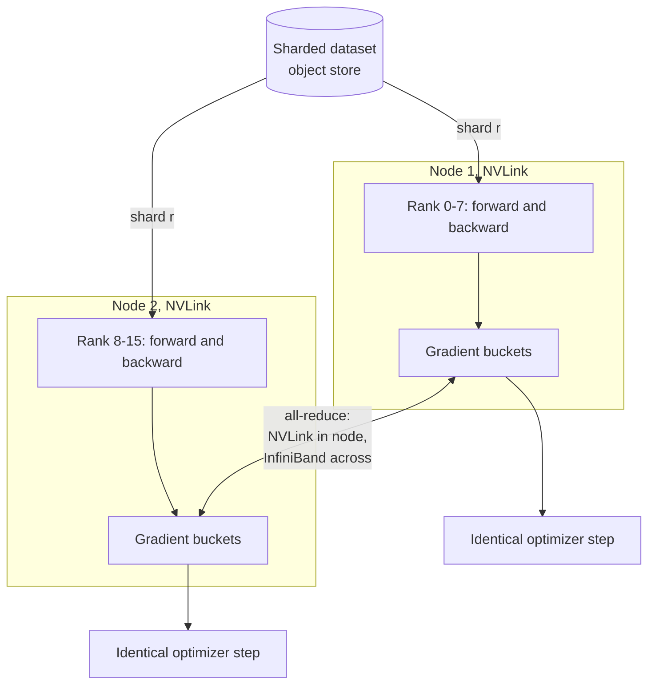

**Reading the diagram.** Each rank reads a disjoint shard of the dataset from object storage (the storage boundary), runs forward and backward, and fills gradient buckets. The bidirectional edge is the all-reduce: within a node it rides NVLink; between nodes, RDMA over InfiniBand or RoCE (§49.10). It is synchronous: no rank can step until every rank has contributed. Each rank then performs the same optimizer step on the same averaged gradient. Failure points: one slow rank (a straggler, §65.17) delays all; a dead rank hangs the all-reduce until a timeout fires (§65.16); a data loader that falls behind starves the GPU. Scaling: adding ranks adds throughput while each rank's gradient traffic stays about twice the model's gradient size.

### 65.6.2 Communication volume and time

#### Mathematical foundations

::: formula
**Data-parallel gradient all-reduce per step (ring, bandwidth term)**

$$V = 2\,\frac{p-1}{p}\, S \qquad S = N\, q \qquad T_\text{AR} \approx \frac{V}{B_\text{link}} \qquad B_\text{eff,inter} \approx g \cdot B_\text{NIC}$$

| Symbol | Meaning | Units |
|---|---|---|
| $V$ | Bytes each GPU sends (and receives) per all-reduce | bytes |
| $p$ | Data-parallel degree (replicas) | GPUs |
| $S$ | Gradient bytes per replica | bytes |
| $q$ | Bytes per gradient value (2 for BF16, 4 for FP32) | bytes |
| $T_\text{AR}$ | All-reduce time, ignoring latency terms (§49.9.2) | s |
| $B_\text{link}$ | Achieved bandwidth of the bottleneck link per GPU | bytes/s |
| $B_\text{eff,inter}$ | Effective cross-node bandwidth when whole nodes join the ring and NCCL runs one channel per NIC | bytes/s |
| $g$ | GPUs (and NICs) per node | count |
:::

The volume per GPU is nearly independent of $p$, which is why data parallelism scales: going from 8 to 8,000 replicas barely changes each GPU's bytes (it does add latency terms). NCCL reports the quantity $V/T$ as **bus bandwidth**, so you can compare it directly with link speeds.

::: example
**Worked example — All-reduce for a 1B model on NVLink and InfiniBand.** The 1B model of §58.11 fits on one GPU, so plain DDP applies. Gradients are all-reduced in BF16: $S = 10^9 \times 2 = 2$ GB. Each GPU processes 8 sequences of 2,048 tokens = 16,384 tokens per step.

1. *Compute per step:* $6 \times 10^9 \times 16{,}384 = 9.83 \times 10^{13}$ FLOPs at $4 \times 10^{14}$ FLOP/s $= 246$ ms, of which backward is about two thirds, 164 ms.
2. *One node, $p = 8$, NVLink at 360 GB/s:* $V = 2 \times \frac{7}{8} \times 2 = 3.5$ GB; $T = 3.5 / 360 = 9.7$ ms, 4% of the step and fully hidden behind backward.
3. *Eight nodes, $p = 64$, one shared 40 GB/s NIC per node:* $V = 2 \times \frac{63}{64} \times 2 = 3.94$ GB. Every ring crosses each node boundary, so the node's whole share passes through its single NIC: $T = 3.94/40 = 98$ ms. That still hides behind 164 ms of backward, but only just.
4. *Eight nodes, one 40 GB/s NIC per GPU (a "rail-optimized" AI cluster):* NCCL runs eight rings, one per NIC, so $B_\text{eff,inter} \approx 8 \times 40 = 320$ GB/s and $T \approx 3.94 / 320 = 12.3$ ms, close to the single-node time.
5. *Small per-GPU batch:* at 2,048 tokens per GPU, compute is 31 ms and backward 20 ms. With one NIC per node the 98 ms all-reduce is now exposed: step $\approx 10 + \max(20, 98) = 108$ ms, so the GPUs compute only $31/108 = 29\%$ of the time. Accumulating $k = 8$ micro-batches with `no_sync` restores 16,384 tokens per all-reduce.

**Interpretation.** Data-parallel communication is cheap when per-GPU batches are large and cross-node bandwidth is provisioned per GPU, and dominant when either is small. **Engineering implication.** AI clusters attach one high-speed NIC per GPU for exactly this reason (Chapter 64); on clusters that cannot, raise the tokens per all-reduce with gradient accumulation, or use the hierarchical and sharded schemes of §65.9.
:::

#### Code example: ring all-reduce and DDP averaging, simulated

The program below simulates four GPUs on a CPU. Part 1 implements ring all-reduce exactly as Figure 49.8 describes (reduce-scatter, then all-gather) and checks the sum and the bytes sent. Part 2 trains four replicas of a small network on four shards of each batch, averages their gradients with that ring, and compares the result with ordinary single-process training on the whole batch.

```python
"""Simulated data-parallel training: ring all-reduce plus DDP gradient averaging (CPU only)."""
import copy
import numpy as np
import torch
from torch import nn


def ring_allreduce(grads):
    """Sum-all-reduce a list of equal-length 1-D arrays, one per simulated GPU.

    Phase 1 (reduce-scatter): p-1 steps; afterwards rank r owns the full sum of chunk (r+1) % p.
    Phase 2 (all-gather):     p-1 steps; finished chunks circulate until every rank has all of them.
    Returns the reduced buffers and the number of elements each rank sent.
    """
    p = len(grads)
    bufs = [np.array_split(g.astype(np.float64).copy(), p) for g in grads]
    sent = [0] * p
    for s in range(p - 1):                                    # reduce-scatter
        msgs = [(r, (r + 1) % p, (r - s) % p) for r in range(p)]
        payload = [bufs[src][k].copy() for src, _, k in msgs]  # all sends are simultaneous
        for (src, dst, k), data in zip(msgs, payload):
            bufs[dst][k] += data
            sent[src] += data.size
    for s in range(p - 1):                                    # all-gather
        msgs = [(r, (r + 1) % p, (r + 1 - s) % p) for r in range(p)]
        payload = [bufs[src][k].copy() for src, _, k in msgs]
        for (src, dst, k), data in zip(msgs, payload):
            bufs[dst][k] = data                               # overwrite, do not add
            sent[src] += data.size
    return [np.concatenate(b) for b in bufs], sent


# --- 1. Correctness and traffic of the ring on random vectors -------------------------
rng = np.random.default_rng(65)
p, n = 4, 1_000_003                                           # n not divisible by p on purpose
vecs = [rng.standard_normal(n) for _ in range(p)]
out, sent = ring_allreduce(vecs)
ref = np.sum(vecs, axis=0)
print(f"ring all-reduce, p={p}, n={n:,}")
print(f"  max |ring - numpy sum| = {max(np.abs(o - ref).max() for o in out):.2e}")
print(f"  elements sent per rank = {sent}")
print(f"  formula 2(p-1)/p * n   = {2 * (p - 1) / p * n:,.0f}")

# --- 2. DDP semantics: average of shard gradients == full-batch gradient -------------
torch.manual_seed(0)
X = torch.randn(256, 16)                                      # one global batch
w_true = torch.randn(16, 1)
y = X @ w_true + 0.1 * torch.randn(256, 1)
base = nn.Sequential(nn.Linear(16, 32), nn.ReLU(), nn.Linear(32, 1))
loss_fn = nn.MSELoss()

single = copy.deepcopy(base)                                  # reference: one process
replicas = [copy.deepcopy(base) for _ in range(p)]            # simulated GPUs
opt_single = torch.optim.SGD(single.parameters(), lr=0.05)
opts = [torch.optim.SGD(m.parameters(), lr=0.05) for m in replicas]

for step in range(20):
    opt_single.zero_grad()
    loss_fn(single(X), y).backward()
    opt_single.step()

    shards = zip(X.chunk(p), y.chunk(p))                      # DistributedSampler equivalent
    for m, o, (xs, ys) in zip(replicas, opts, shards):
        o.zero_grad()
        loss_fn(m(xs), ys).backward()                         # local gradients differ per rank
    flat = [torch.cat([q.grad.flatten() for q in m.parameters()]).numpy() for m in replicas]
    summed, _ = ring_allreduce(flat)
    for m, o, g in zip(replicas, opts, summed):
        avg = torch.from_numpy(g / p).float()                 # all-reduce(sum) / world size
        i = 0
        for q in m.parameters():
            q.grad.copy_(avg[i:i + q.numel()].view_as(q))
            i += q.numel()
        o.step()

def flat_params(m):
    return torch.cat([q.detach().flatten() for q in m.parameters()])

drift = max((flat_params(m) - flat_params(replicas[0])).abs().max().item() for m in replicas)
gap = (flat_params(replicas[0]) - flat_params(single)).abs().max().item()
print("DDP simulation, 4 workers x 64 examples, 20 SGD steps")
print(f"  max parameter difference between replicas   = {drift:.1e}")
print(f"  max difference from single-process training = {gap:.1e}")
print(f"  final loss: single {loss_fn(single(X), y).item():.5f}, "
      f"replica 0 {loss_fn(replicas[0](X), y).item():.5f}")
```

Output:

```text
ring all-reduce, p=4, n=1,000,003
  max |ring - numpy sum| = 1.78e-15
  elements sent per rank = [1500004, 1500005, 1500005, 1500004]
  formula 2(p-1)/p * n   = 1,500,004
DDP simulation, 4 workers x 64 examples, 20 SGD steps
  max parameter difference between replicas   = 0.0e+00
  max difference from single-process training = 1.8e-07
  final loss: single 0.17703, replica 0 0.17703
```

What to notice:

- Each rank sends $2\frac{p-1}{p}n$ elements, matching the formula; the one-element differences come from uneven chunks when $n$ is not divisible by $p$ (real libraries pad).
- Ring sums differ from NumPy's only in the last bits ($10^{-15}$), because floating-point addition is not associative and the ring adds in a different order (§59.14).
- Replicas stay exactly identical (difference 0), because each applies the same averaged gradient: the property DDP relies on to avoid ever re-sending weights.
- Data-parallel training matches single-process training on the full batch to $10^{-7}$ (FP32 rounding), because the loss is a mean over examples, so the mean of the shard means is the full-batch gradient. That is the sense in which data parallelism is "mathematically the same model, just faster".

### 65.6.3 Large batches and learning-rate scaling

Data parallelism raises the global batch: 512 GPUs at 8 sequences each is 4,096 sequences per step. A larger batch gives a less noisy gradient but takes fewer steps per epoch, so with an unchanged learning rate it makes less progress per example processed.

::: formula
**Linear scaling rule with warmup [Goyal et al. 2017]**

$$\eta(B) = \eta_0 \cdot \frac{B}{B_0} \qquad \eta_t = \eta(B)\cdot\min\!\left(1,\ \frac{t}{t_\text{warm}}\right)$$

| Symbol | Meaning | Units |
|---|---|---|
| $\eta_0$, $B_0$ | Learning rate tuned at a reference batch size | —, examples |
| $B$ | New global batch size | examples |
| $\eta(B)$ | Scaled peak learning rate | — |
| $t$, $t_\text{warm}$ | Current step; warmup length | steps |
:::

::: example
**Worked example — ImageNet in one hour.** Goyal et al. [2017] used $\eta_0 = 0.1$ for $B_0 = 256$ on ResNet-50.

1. On 256 GPUs with 32 images each: $B = 8{,}192$, so $\eta = 0.1 \times 8{,}192 / 256 = 3.2$.
2. Starting at 3.2 diverged early in training, so the learning rate ramped linearly from 0.1 to 3.2 over the first 5 epochs.
3. Steps per epoch fell from $1.28 \times 10^6 / 256 = 5{,}000$ to 156, which is what let 256 GPUs finish 90 epochs in about an hour with accuracy matching the small-batch baseline.
4. The paper reports that accuracy degraded beyond about 8K for this model and recipe.

**Interpretation.** The rule keeps the expected update per example roughly constant; warmup avoids instability while the weights are still changing fast. **Engineering implication.** Data parallelism has a statistical ceiling, the **critical batch size**, above which more replicas cost more GPU-hours for the same loss [McCandlish et al. 2018]; layer-wise adaptive optimizers such as LARS and LAMB raise it [You et al. 2020]. LLM pre-training typically uses global batches of a few million tokens, sometimes increased during training [Dubey et al. 2024].
:::

#### Failure scenarios

| What goes wrong | Why | Detection | Recovery | Prevention |
|---|---|---|---|---|
| Job hangs at step 0 or mid-run | One rank crashed or took a different code path, so a collective never completes | No progress; NCCL watchdog timeout | Kill and restart from checkpoint | Collective timeouts; identical control flow on all ranks |
| Replicas silently diverge | Rank-dependent randomness in the update, or non-deterministic skipping of a parameter | Parameter checksums differ across ranks | Re-broadcast from rank 0 and investigate | Periodic cross-rank checksum assertions |
| Loss spikes after scaling out | Learning rate not rescaled, or no warmup | Loss curve against the small-scale baseline | Lower peak LR, longer warmup | Linear scaling rule plus warmup; LAMB for very large batches |
| Duplicate or skipped data | Sampler not seeded per epoch, or not resumed after restart | Example-ID audit | Restore sampler state | `set_epoch()`; checkpoint the data-loader position (§65.15) |

## 65.7 Collectives recap and NCCL

### 65.7.1 The five collectives of distributed training

§49.9 introduced MPI collectives and their α–β costs. Training uses five, summarized here with the bytes each GPU sends for a full tensor of $S$ bytes.

**Table 65.2 — Collectives used in distributed training.**

| Collective | Result | Bytes sent per GPU (ring) | Used by |
|---|---|---|---|
| All-reduce | Every rank gets the sum of all tensors | $2\frac{p-1}{p}S$ | DDP gradients; tensor-parallel activations |
| Reduce-scatter | Rank $r$ gets the sum of chunk $r$ only | $\frac{p-1}{p}S$ | ZeRO-2/3 and FSDP gradients; sequence parallelism |
| All-gather | Every rank gets every rank's chunk | $\frac{p-1}{p}S$ | ZeRO-3/FSDP parameters; sequence parallelism |
| Broadcast | Every rank gets rank 0's tensor | about $S$ | Initial weights; configuration |
| All-to-all | Rank $r$ sends a different chunk to each rank | $\frac{p-1}{p}S$ | Expert parallelism (MoE); Ulysses context parallelism |

The key identity is **all-reduce = reduce-scatter + all-gather**. The ring algorithm is literally those two phases. ZeRO and FSDP exploit the split: they keep only the reduce-scatter result (a shard of the summed gradient) and perform the all-gather later, on parameters instead of gradients.

**Figure 65.6 — All-reduce decomposed into reduce-scatter and all-gather (4 ranks).**

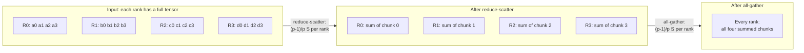

**Reading the diagram.** On the left each of four ranks holds a full gradient tensor split into four chunks. Reduce-scatter leaves each rank with the sum of one chunk, a quarter of the data. All-gather then shares those summed chunks so every rank has the full result. Each phase sends $(p-1)/p$ of the tensor per rank, totaling the all-reduce volume. Both phases are synchronous collectives in GPU memory. The scaling point is the middle state: a system that only *needs* its own shard of the summed gradient (because it only updates its own shard of the weights, §65.9) can stop after reduce-scatter and halve the communication at that moment.

### 65.7.2 NCCL: algorithms and topology awareness

**NCCL** (NVIDIA Collective Communications Library; AMD's equivalent is RCCL) implements these collectives on GPUs. Three ideas make it fast.

1. **Algorithm choice by size.** NCCL implements rings, which are bandwidth-optimal but whose latency grows linearly with ranks, and **double binary trees**, which have logarithmic latency while using the bandwidth of both trees, and switches by message size and scale; NVIDIA introduced the trees in NCCL 2.4 for large-scale runs [Jeaugey 2019]. Newer versions add in-network reductions: NVLink SHARP inside NVSwitch systems and SHARP in InfiniBand switches perform the sum in the switch, so each GPU sends its data once rather than twice (Chapter 64).
2. **Topology detection.** At start-up NCCL discovers PCIe switches, NVLink and NICs, and builds **channels** (parallel rings or trees) that keep traffic on NVLink inside a node and place one channel per NIC across nodes, with GPUDirect RDMA moving data between GPU memory and the NIC without host copies (§49.10). This is the mechanism behind the $g \cdot B_\text{NIC}$ term in §65.6.2.
3. **Pipelining and streams.** A large collective is cut into chunks that flow through the ring like a pipeline, and collectives run on their own CUDA streams so frameworks can overlap them with computation.

**Figure 65.7 — Topology-aware all-reduce on a rail-optimized cluster.**

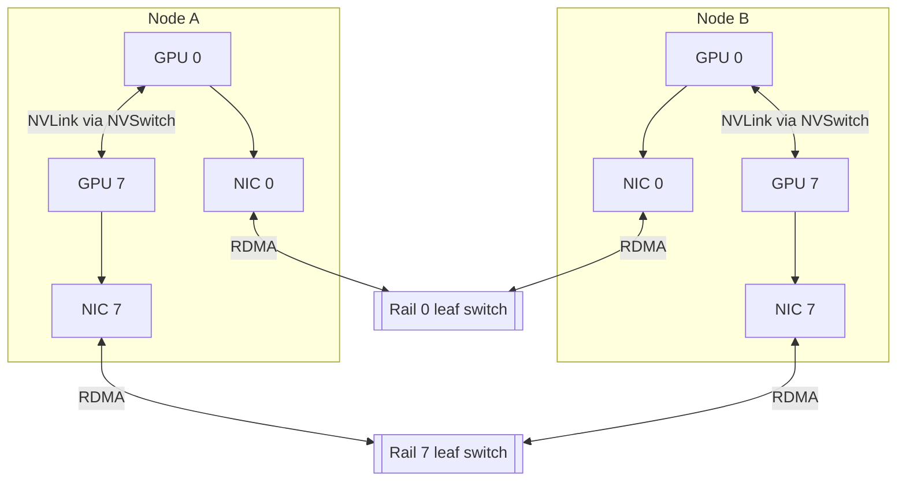

**Reading the diagram.** Each node has eight GPUs joined by NVLink through NVSwitch (only GPUs 0 and 7 drawn) and one NIC per GPU. In a **rail-optimized** network, NIC $i$ of every node connects to leaf switch $i$ (rail $i$), so GPU $i$ on any node reaches GPU $i$ on any other node in one switch hop. NCCL places channel $i$ on rail $i$: intra-node steps use NVLink, inter-node steps use RDMA over that rail, and all eight rails work in parallel. Traffic is synchronous within each collective step. Failure points: a flapping NIC or rail switch slows one channel and therefore the whole collective; a scheduler that splits a job across distant leaf groups adds spine hops (§46.11.2, §49.10.4). Scaling: rails add nodes without changing the per-GPU path length, up to the leaf switch radix, after which spine layers are added.

::: recommendation
**Debugging collectives.** Set `NCCL_DEBUG=INFO` once at start-up to see which transports, rings and trees NCCL chose; run `nccl-tests` (`all_reduce_perf`) on every new node pool and compare its bus bandwidth with the link speed before admitting the nodes to training; and alert when a job's all-reduce bus bandwidth drops by more than about 10%, which usually means one bad link or NIC.
:::

::: mistake
**Comparing NCCL "algorithm bandwidth" with link speed.** `nccl-tests` prints algorithm bandwidth ($S/T$) and bus bandwidth ($V/T$). Only bus bandwidth is comparable with the link rate; algorithm bandwidth for all-reduce is about half of it at large $p$, which looks like a broken network when it is not.
:::

## 65.8 Parameter servers

### 65.8.1 Architecture, synchronous and asynchronous SGD

::: definition
**Definition — Parameter server.** An architecture in which **server** nodes hold the model's parameters, partitioned by key, and **worker** nodes repeatedly **pull** the parameters they need, compute gradients on their data, and **push** the gradients back; servers apply the updates [Li et al. 2014]. In **asynchronous SGD** each push is applied as it arrives, so a worker's gradient may have been computed on parameters that are several updates old; that age is the gradient's **staleness**.
:::

#### First-principles explanation

A parameter server is a shared notebook in the middle of the room. Each student copies the pages they need, works on a problem, and walks back to write corrections in the notebook, without waiting for anyone. Nobody is blocked by a slow classmate, but a student may be correcting a page that someone else already changed. All-reduce, by contrast, is the circle meeting of §65.5: everybody waits, and everybody leaves with the same notes.

**Figure 65.8 — Parameter-server training with sharded sparse parameters.**

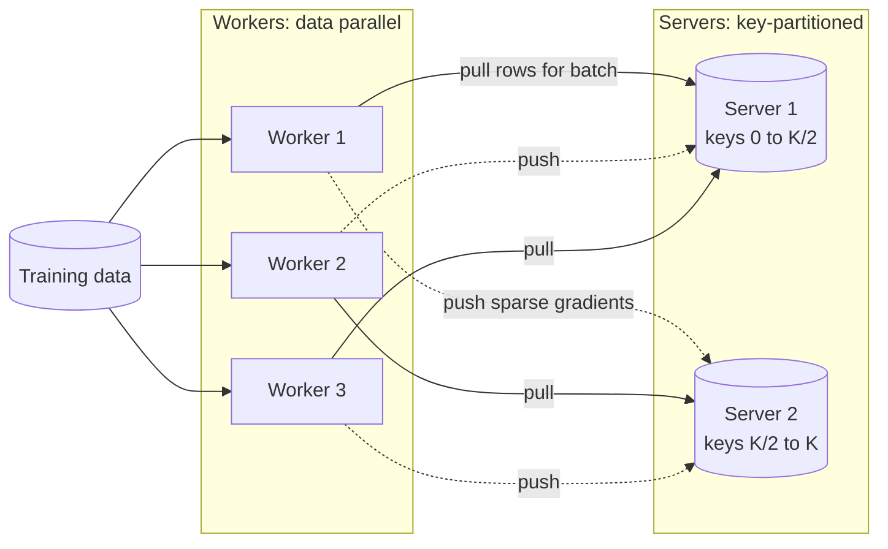

**Reading the diagram.** Workers read their own data partitions and pull only the parameter rows their batch touches (solid, synchronous request/response). After computing gradients they push them back (dotted: in the asynchronous variant nobody waits for the push to be applied). Servers own disjoint key ranges, the storage boundary of the design; Li et al. place keys with consistent hashing and replicate server state for fault tolerance (§14.8). Failure points: a hot key (a very popular item's embedding) overloads one server; a slow worker produces stale gradients rather than stalling others. Scaling: add servers to hold more parameters and add workers for throughput, independently.

#### Mathematical foundations

::: formula
**Staleness and sparse traffic**

$$\mathbb{E}[\tau] \approx W - 1 \qquad V_\text{sparse} \approx 2 \cdot b \cdot u \cdot d \cdot q \quad\text{vs.}\quad V_\text{dense} \approx 2\,S$$

| Symbol | Meaning | Units |
|---|---|---|
| $\tau$ | Staleness: updates applied between a worker's pull and its push | updates |
| $W$ | Workers of similar speed in asynchronous SGD | workers |
| $V_\text{sparse}$ | Bytes per worker per step for pull plus push of touched rows | bytes |
| $b$ | Examples per worker batch | examples |
| $u$ | Distinct embedding rows touched per example | rows |
| $d$ | Embedding dimension | values |
| $q$ | Bytes per value | bytes |
| $S$ | Total parameter bytes (what dense all-reduce would move) | bytes |
:::

::: example
**Worked example — Why recommenders still use parameter-server ideas.** A recommendation model has $10^9$ embedding rows of $d = 128$ in FP32: $S = 10^9 \times 128 \times 4 = 512$ GB of embeddings. A worker batch of $b = 4{,}096$ examples touches about $u = 50$ rows each.

1. Dense all-reduce of the table would move about $2 \times 512 = 1{,}024$ GB per worker per step: impossible.
2. Sparse pull and push: $2 \times 4{,}096 \times 50 \times 128 \times 4 = 210$ MB per step, about 5,000 times less (fewer still after deduplicating repeated rows).
3. With 64 asynchronous workers, a gradient is on average about 63 updates stale, but each update touches only 0.02% of rows, so two workers rarely collide on the same row.
4. QuickBite comparison: 10 million customers at $d = 64$ in FP32 is 2.56 GB (§58.6). It fits in one GPU, so QuickBite's recommender can use plain data parallelism today and needs sharded embeddings only if it grows two orders of magnitude.

**Interpretation.** Staleness that would wreck a dense model is tolerable for sparse embeddings because updates rarely overlap. **Engineering implication.** Use all-reduce for dense layers and sharded, pull/push-style embedding tables for huge sparse ones: the hybrid that DLRM-style systems use (Chapter 68).
:::

Asynchronous SGD was the standard for large models around 2012, when Google's DistBelief trained with "Downpour SGD" across many model replicas [Dean et al. 2012]. Two developments moved dense deep learning back to synchronous all-reduce: GPUs made each worker fast enough that network bandwidth, not stragglers, dominated, and bandwidth-optimal rings (§49.9.2) removed the central server's bandwidth bottleneck. Middle grounds exist: **stale synchronous parallel** lets fast workers run ahead by at most $s$ steps [Ho et al. 2013].

::: industry
**Parameter servers in production recommenders.** Li et al. [2014] describe a third-generation parameter server handling sparse logistic regression and topic models with billions of parameters across many machines. Meta's DLRM paper keeps the same split, placing embedding tables with model parallelism and MLPs with data parallelism [Naumov et al. 2019]. Chapter 68 covers the embedding-sharding systems that descend from these designs.
*Evidence: Primary* — [Li et al. 2014; Naumov et al. 2019]
:::

| Approach | Advantages | Disadvantages | Choose when |
|---|---|---|---|
| Synchronous all-reduce | Deterministic math; no central bottleneck; bandwidth-optimal | Slowest worker sets pace; one failure stalls all | Dense models on GPUs (almost all deep learning) |
| Asynchronous parameter server | Tolerates stragglers; elastic workers | Stale gradients hurt dense convergence; hot servers | Huge sparse embeddings; heterogeneous or preemptible workers |
| Bounded staleness | Middle ground | Extra tuning parameter $s$ | Clusters with variable worker speed |

## 65.9 Sharded data parallelism: ZeRO and FSDP

### 65.9.1 What each stage shards

::: definition
**Definition — ZeRO and FSDP.** The **Zero Redundancy Optimizer (ZeRO)** removes the redundant copies that data parallelism keeps on every replica by partitioning them across the $p$ data-parallel ranks [Rajbhandari et al. 2020]. **Stage 1** ($P_{os}$) shards the optimizer state; **stage 2** ($P_{os+g}$) also shards gradients; **stage 3** ($P_{os+g+p}$) also shards the parameters, gathering each layer's weights only while it is being computed. **PyTorch Fully Sharded Data Parallel (FSDP)** is PyTorch's implementation of stage 3 (and, configured otherwise, of stage 2 or of hybrid sharding) [Zhao et al. 2023].
:::

#### First-principles explanation

In plain DDP, 64 students each carry the complete 112 GB encyclopedia, though each only edits one sixty-fourth of it. ZeRO tears the encyclopedia into 64 volumes. Each student keeps one volume and borrows the others for a moment when needed, reading volume 12 only while working on chapter 12, then handing it back. Borrowing costs some walking (communication), but nobody needs a bookcase large enough for the whole set.

**Figure 65.9 — Per-GPU model state under DDP and ZeRO stages (4 ranks).**

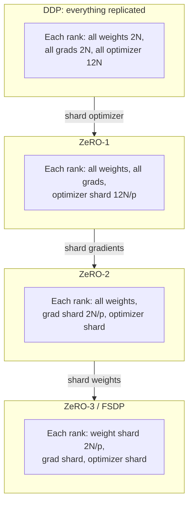

**Reading the diagram.** Read top to bottom: each stage removes one more replicated item. DDP holds 16 bytes per parameter on every rank; ZeRO-1 keeps one $p$-th of the 12 bytes of FP32 master weights and Adam moments; ZeRO-2 also keeps one $p$-th of gradients by reduce-scattering them instead of all-reducing; ZeRO-3 keeps one $p$-th of the weights too and all-gathers them per layer when needed. All state lives in GPU memory (offload to host or NVMe is §65.14). Failure points: higher stages add collectives to the critical path, so a slow link hurts more. Scaling: per-GPU model state falls as $1/p$, so the largest trainable model grows with the cluster.

#### How it works internally (FSDP, one training step)

1. The model is wrapped in **units**, usually one per transformer block. Each unit's parameters are flattened and sharded: rank $r$ holds slice $r$.
2. *Forward:* before unit $i$ runs, an **all-gather** assembles its full weights; after it runs, the gathered weights are freed. FSDP **prefetches** unit $i+1$'s all-gather while unit $i$ computes.
3. *Backward:* unit $i$'s weights are all-gathered again, its gradients computed, then **reduce-scattered** so each rank keeps only its gradient shard; full gradients are freed.
4. *Optimizer:* each rank updates only its shard, using its shard of the optimizer state. No final all-gather is needed: the next forward gathers the updated shards.

**Figure 65.10 — FSDP lifecycle of one transformer block on one rank.**

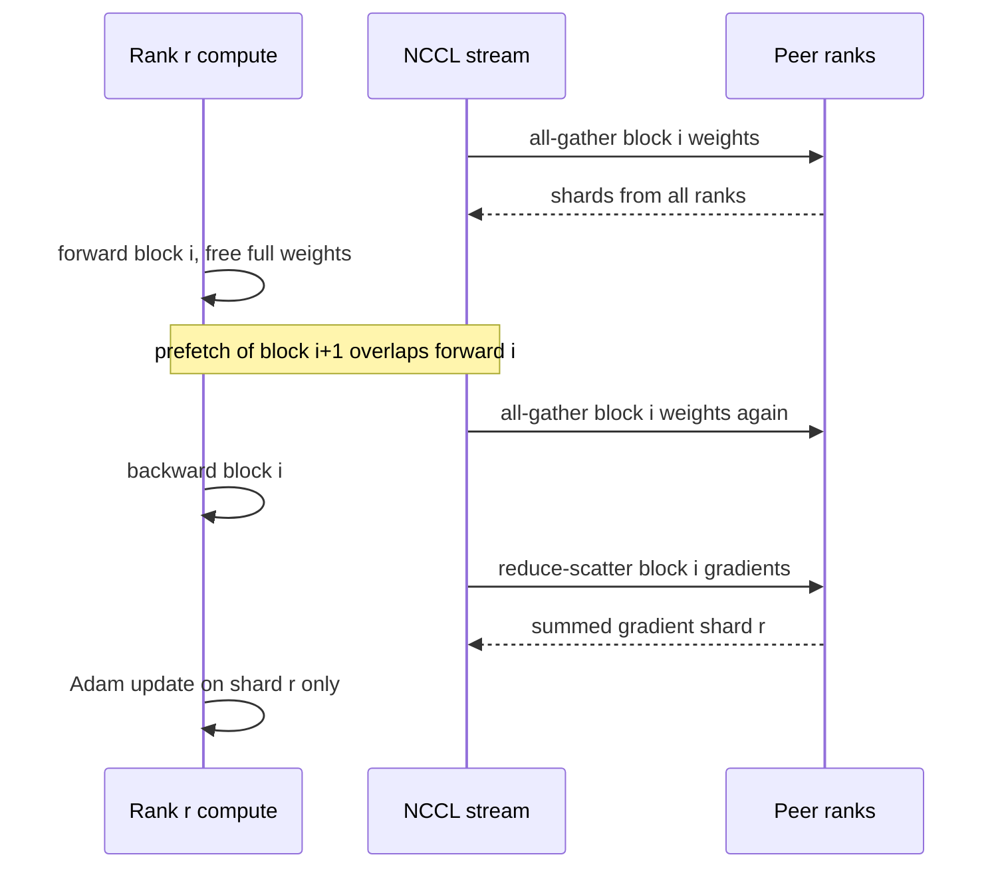

**Reading the diagram.** Three participants: the rank's compute stream, its NCCL communication stream, and the other ranks. Weights for block $i$ exist in full only between the gather and the free, so peak memory is one or two blocks of full weights plus the shards. The backward pass needs a second gather because the weights were freed after forward (FSDP can keep them for the last block, or for all blocks with stage-2 behavior). Gradient reduce-scatter returns only shard $r$. Arrows between streams are asynchronous (CUDA events order them). Failure points: insufficient prefetch exposes the gathers on the critical path; ranks wrapping units differently mismatch collectives and hang. Scaling: memory per rank falls with $p$, but each gather is latency-bound once shards get small, so very large $p$ uses **hybrid sharding** (§65.9.2).

#### Mathematical foundations

::: formula
**Model-state memory per GPU and communication per step [Rajbhandari et al. 2020]**

$$M_\text{DDP} = 16N \quad M_1 = 4N + \frac{12N}{p} \quad M_2 = 2N + \frac{14N}{p} \quad M_3 = \frac{16N}{p}$$

$$V_\text{DDP} = V_1 = V_2 \approx 2\,\frac{p-1}{p}\,(2N) \qquad V_3 \approx 3\,\frac{p-1}{p}\,(2N)$$

| Symbol | Meaning | Units |
|---|---|---|
| $M_\text{DDP}$, $M_1$, $M_2$, $M_3$ | Model-state bytes per GPU for DDP and ZeRO stages 1–3 (excludes activations) | bytes |
| $N$ | Parameters | parameters |
| $p$ | Data-parallel (sharding) degree | GPUs |
| $V$ | Bytes sent per GPU per step, BF16 weights and gradients | bytes |
:::

Stages 1 and 2 cost no extra communication: an all-reduce *is* a reduce-scatter (to get gradient shards) plus an all-gather (of the updated parameter shards). Stage 3 adds one more all-gather, because weights are gathered once for forward and again for backward: 1.5× DDP's traffic.

**Table 65.3 — Model-state memory per GPU for a 7B model (GB; activations excluded).**

| GPUs $p$ | DDP | ZeRO-1 | ZeRO-2 | ZeRO-3 / FSDP |
|---|---|---|---|---|
| 8 | 112.0 | 38.5 | 26.3 | 14.0 |
| 64 | 112.0 | 29.3 | 15.5 | 1.75 |

::: example
**Worked example — QuickBite continues pre-training a 7B model for its support chatbot.** Assumption: QuickBite adapts an open 7B model on 50 billion tokens of anonymized support transcripts, menus and policies (domain-adaptive pre-training; fine-tuning proper is Chapter 76) on 64 GPUs.

1. *Memory, from Table 65.3:* DDP needs 112 GB, impossible. ZeRO-1 on 64 GPUs needs 29.3 GB, ZeRO-2 15.5 GB, ZeRO-3 1.75 GB, each plus activations: 30.6 GB per 2,048-token sequence without recomputation, or about 9.1 GB with selective recomputation (§65.14). ZeRO-2 with selective recomputation and micro-batch 2 uses about $15.5 + 18.2 = 33.7$ GB; ZeRO-3 frees room for micro-batch 6.
2. *Compute:* $6 \times 7 \times 10^9 \times 5 \times 10^{10} = 2.1 \times 10^{21}$ FLOPs; on 64 GPUs at $4 \times 10^{14}$ FLOP/s: $8.2 \times 10^4$ s $= 22.8$ hours, 1,458 GPU-hours, about \$3,650.
3. *Communication per step, ZeRO-3:* $V_3 = 3 \times \frac{63}{64} \times 14 = 41.3$ GB per GPU. On a rail-optimized cluster ($\approx 320$ GB/s effective): 129 ms. With 16,384 tokens per GPU per step, compute is $6 \times 7 \times 10^9 \times 16{,}384 / 4 \times 10^{14} = 1.72$ s, so communication is 7.5% of compute and overlaps with it.
4. *ZeRO-2 instead:* $V_2 = 27.6$ GB, 86 ms, at the price of 13.8 GB more memory per GPU.

**Interpretation.** ZeRO-3 turns a model that cannot train under DDP into one with memory to spare, at 1.5× DDP's traffic, which large per-GPU batches hide. **Engineering implication.** For models up to tens of billions of parameters on fast networks, FSDP or ZeRO alone is often the simplest sufficient answer, with no model code changes. Tensor and pipeline parallelism (§65.10–§65.11) become necessary when even one layer's activations or weights, or the communication of full sharding at very large $p$, no longer fit.
:::

### 65.9.2 Hybrid sharding and practical choices

**Hybrid sharded data parallelism (HSDP)** shards within a group (typically a node, over NVLink) and replicates across groups, all-reducing only gradient shards across nodes [Zhao et al. 2023]. It caps the all-gathers on the slow cross-node network and reduces the number of ranks each collective spans. FSDP also supports CPU offload of parameters, a rate limiter that bounds how many all-gathers run ahead of compute (to cap memory), and mixed-precision policies for parameters, reductions and buffers separately. DeepSpeed implements ZeRO 1–3 plus offload (§65.14).

::: industry
**ZeRO and FSDP results.** Rajbhandari et al. [2020] report training models of over 100B parameters with ZeRO on 400 GPUs at super-linear speedup relative to a smaller baseline, because sharding frees memory for larger per-GPU batches; ZeRO was used to train Microsoft's 17B-parameter Turing-NLG. Zhao et al. [2023] report that PyTorch FSDP matches DDP's throughput on models that fit in DDP and trains much larger models with near-linear scaling in TFLOPS, and describe the production lessons (unit wrapping, prefetch order, rate limiting) that shaped its design.
*Evidence: Primary* — [Rajbhandari et al. 2020; Zhao et al. 2023]
:::

::: mistake
**"ZeRO-3 shards activations too."** ZeRO shards *model state*: weights, gradients and optimizer state. Activations are still per-micro-batch and per-rank; they are reduced by activation checkpointing (§65.14) or split by tensor, sequence and context parallelism (§65.10–§65.12).
:::

| What goes wrong | Why | Detection | Recovery | Prevention |
|---|---|---|---|---|
| Throughput collapses at large $p$ | Shards so small that all-gathers are latency-bound | Exposed all-gather time in profile | Switch to HSDP | Shard within nodes, replicate across |
| Out-of-memory error despite ZeRO-3 | Activations, not model state, dominate | Memory snapshot by category | Activation checkpointing; smaller micro-batch | Budget activations explicitly (§65.14) |
| Checkpoint unusable on a different GPU count | Saved per-rank shards with a fixed layout | Load fails or mismatched shapes | Convert offline | Save resharding-capable distributed checkpoints (§65.15) |

## 65.10 Tensor parallelism

### 65.10.1 Megatron-style column and row splitting

::: definition
**Definition — Tensor parallelism (TP).** Splitting the weight matrices *inside* each layer across $t$ GPUs, so that every GPU computes a slice of every matrix multiplication for the same examples, and the slices are combined with collectives. **Megatron-LM** splits a transformer's MLP and attention blocks so that each block needs exactly one all-reduce in the forward pass and one in the backward pass [Shoeybi et al. 2019].
:::

#### First-principles explanation

Four accountants must total a giant spreadsheet. Rather than give each a quarter of the *rows* (data parallelism), you give each a quarter of the *columns*: everyone works on every row at the same time, and they must combine their partial totals before anyone can move to the next sheet. That combination happens many times per step, so the accountants must sit at the same desk.

#### How it works internally

The MLP computes $Z = \text{GeLU}(XA)\,B$. Megatron splits $A$ by **columns** into $[A_1, \dots, A_t]$: GPU $i$ computes $Y_i = \text{GeLU}(XA_i)$ with no communication, because GeLU is applied element-wise to its own columns. It splits $B$ by **rows**: GPU $i$ computes $Y_i B_i$, a partial sum of $Z$; one **all-reduce** sums the partials. Attention is split by heads: the $Q$, $K$, $V$ projections are column-parallel (each GPU owns $a/t$ heads), attention runs locally per head, and the output projection is row-parallel, followed by one all-reduce. In the backward pass the mirror-image all-reduce happens at each block's input. Per transformer layer: two all-reduces forward, two backward.

**Figure 65.11 — Megatron tensor-parallel MLP on two GPUs.**

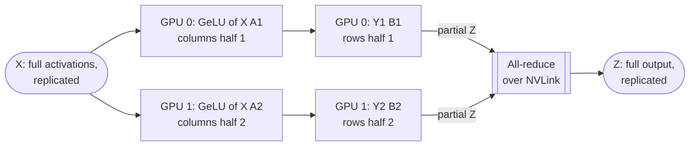

**Reading the diagram.** The input $X$ is identical on both GPUs. Each GPU multiplies by its half of $A$'s columns and applies GeLU locally: no communication. Each then multiplies by its half of $B$'s rows, producing a partial sum of the output. The all-reduce (synchronous, over NVLink) adds the partial sums so both GPUs hold the full $Z$ for the next block. Every weight exists on exactly one GPU, so weight, gradient and optimizer memory divide by $t$, and so do the large intermediate activations. Failure points: the all-reduce sits on the critical path (the next layer needs $Z$), so a slow link stalls computation directly. Scaling: $t$ is limited by the head count and, in practice, by the NVLink domain.

#### Mathematical foundations

::: formula
**Tensor-parallel traffic per transformer layer per micro-batch**

$$V_\text{TP} = 4 \cdot 2\,\frac{t-1}{t} \cdot (2\,s\,b\,h) \qquad C_\text{layer} \approx \frac{6 \cdot 12 h^2 \cdot s\,b}{t}$$

| Symbol | Meaning | Units |
|---|---|---|
| $V_\text{TP}$ | Bytes each GPU sends per layer (2 forward + 2 backward all-reduces, BF16) | bytes |
| $t$ | Tensor-parallel degree | GPUs |
| $s$, $b$, $h$ | Sequence length, micro-batch, hidden size | tokens, sequences, values |
| $C_\text{layer}$ | Training FLOPs per GPU per layer ($12h^2$ parameters per layer) | FLOPs |
:::

::: example
**Worked example — Why tensor parallelism stays inside a node.** 70B model: $h = 8{,}192$, $s = 4{,}096$, $b = 1$, $t = 8$.

1. Activation tensor: $2 s b h = 2 \times 4{,}096 \times 8{,}192 = 67.1$ MB.
2. $V_\text{TP} = 4 \times 2 \times \frac{7}{8} \times 67.1 = 470$ MB per layer per GPU.
3. Compute per GPU per layer: $6 \times 12 \times 8{,}192^2 \times 4{,}096 / 8 = 2.47 \times 10^{12}$ FLOPs, 6.2 ms at $4 \times 10^{14}$ FLOP/s.
4. NVLink at 360 GB/s: $470 / 360 = 1.3$ ms, 21% of compute.
5. Across nodes at each GPU's own 40 GB/s NIC: 11.7 ms, nearly twice the compute.
6. Over 80 layers the cross-node version adds about 0.9 s per micro-batch; because the next operation needs each all-reduce's result, little of it can be hidden.

**Interpretation.** Tensor parallelism communicates activations four times per layer on the critical path, so it is viable only on the fastest links. **Engineering implication.** Set $t$ at most to the GPUs in one NVLink domain (8 on most servers as of 2026; larger NVLink domains such as rack-scale systems raise the limit, Chapter 64), which is the first rule of Narayanan et al. [2021].
:::

**Sequence parallelism** [Korthikanti et al. 2023] extends TP to the parts it left replicated: LayerNorm and dropout activations. It splits those along the sequence dimension and replaces each all-reduce with a reduce-scatter plus an all-gather, which moves the same bytes but divides the remaining activation memory by $t$.

::: industry
**Megatron-LM.** Shoeybi et al. [2019] trained an 8.3B-parameter GPT-2-style model using 8-way tensor parallelism within DGX servers combined with data parallelism across 512 V100 GPUs, sustaining 15.1 PFLOP/s with 76% scaling efficiency relative to one GPU. The method needs only a few communication operations inserted into PyTorch code, no compiler.
*Evidence: Primary* — [Shoeybi et al. 2019]
:::

::: mistake
**"Tensor parallelism reduces communication because each GPU holds less."** It reduces *memory*; it increases communication, from once per step (DDP) to four times per layer. Use the smallest $t$ that makes memory fit.
:::

## 65.11 Pipeline parallelism

### 65.11.1 Micro-batches, GPipe and 1F1B

::: definition
**Definition — Pipeline parallelism (PP).** Assigning consecutive groups of layers (**stages**) to different GPUs, passing activations forward and gradients backward between neighboring stages, and splitting each mini-batch into $m$ **micro-batches** so stages work on different micro-batches at once. Time during which a stage has no work is the **pipeline bubble**.
:::

#### First-principles explanation

An assembly line with four stations builds one car at a time slowly: while station 4 works, stations 1–3 stand idle. Feed it a stream of cars and every station stays busy except while the line fills in the morning and drains at night. Pipeline parallelism is that line: layers are stations, micro-batches are cars, and the morning-and-night idle time is the bubble.

#### How it works internally

**GPipe** [Huang et al. 2019] runs all $m$ forward micro-batches through the pipeline, then all $m$ backward passes, and steps the optimizer once (a **flush**), so the update is mathematically the same as one large batch. It must store activations for all $m$ micro-batches in flight; GPipe pairs pipelining with activation recomputation to afford that. **1F1B** (one-forward-one-backward), introduced in PipeDream [Narayanan et al. 2019], starts each micro-batch's backward pass as soon as possible, so after a warm-up each stage alternates one forward and one backward. The bubble is the same as GPipe's, but each stage holds at most $p$ micro-batches of activations instead of $m$. (PipeDream's original asynchronous variant also avoided flushes, using **weight stashing** to keep versions consistent; production systems mostly use the synchronous, flushed 1F1B.) **Interleaved 1F1B** gives each GPU $v$ non-contiguous chunks of layers (for example layers 1–5 and 41–45), which divides the bubble by $v$ at the cost of $v$ times more point-to-point messages [Narayanan et al. 2021].

**Figure 65.12 — GPipe schedule: 4 stages, 4 micro-batches (backward takes 2 units).**

```mermaid
gantt
  title GPipe fill and drain, time units of 10
  dateFormat x
  axisFormat %L
  section GPU 0
  F1 :a1, 0, 10
  F2 :a2, 10, 20
  F3 :a3, 20, 30
  F4 :a4, 30, 40
  B4 :a5, 130, 150
  B3 :a6, 150, 170
  B2 :a7, 170, 190
  B1 :a8, 190, 210
  section GPU 1
  F1 :b1, 10, 20
  F2 :b2, 20, 30
  F3 :b3, 30, 40
  F4 :b4, 40, 50
  B4 :b5, 110, 130
  B3 :b6, 130, 150
  B2 :b7, 150, 170
  B1 :b8, 170, 190
  section GPU 2
  F1 :c1, 20, 30
  F2 :c2, 30, 40
  F3 :c3, 40, 50
  F4 :c4, 50, 60
  B4 :c5, 90, 110
  B3 :c6, 110, 130
  B2 :c7, 130, 150
  B1 :c8, 150, 170
  section GPU 3
  F1 :d1, 30, 40
  F2 :d2, 40, 50
  F3 :d3, 50, 60
  F4 :d4, 60, 70
  B4 :d5, 70, 90
  B3 :d6, 90, 110
  B2 :d7, 110, 130
  B1 :d8, 130, 150
```

**Reading the diagram.** Each row is a GPU holding one stage; F$i$ and B$i$ are the forward and backward passes of micro-batch $i$. Forward passes ripple down the stages one unit apart; backward passes ripple back up. Activations travel GPU 0 → 3 and gradients 3 → 0 as synchronous point-to-point sends. The gaps are the bubble: GPU 0 idles from 40 to 130 while the pipeline drains and refills. Each GPU works 12 of 21 time units, so the bubble is $9/21 = 3/7$, exactly $(p-1)/(m+p-1)$. Failure points: one slow stage slows every micro-batch behind it, so stages must be balanced (the first and last stages also hold embeddings and the output layer). Scaling: more micro-batches shrink the bubble; with 1F1B, each GPU would start a backward pass as soon as its first micro-batch returned, holding fewer activations.

#### Mathematical foundations

::: formula
**Pipeline bubble fraction**

$$\beta = \frac{p-1}{m+p-1} \qquad \beta_\text{interleaved} = \frac{p-1}{v\,m + p - 1} \qquad V_\text{PP} = 2\,s\,b\,h \ \text{per micro-batch per boundary, each way}$$

| Symbol | Meaning | Units |
|---|---|---|
| $\beta$ | Fraction of pipeline time each GPU is idle (fill plus drain) | — |
| $p$ | Pipeline stages | GPUs |
| $m$ | Micro-batches per optimizer step | count |
| $v$ | Model chunks per GPU in the interleaved schedule | count |
| $V_\text{PP}$ | BF16 activation (or gradient) bytes crossing a stage boundary | bytes |
:::

Narayanan et al. [2021] state the same result as the ratio of bubble time to ideal compute time, $(p-1)/m$, or $(p-1)/(vm)$ interleaved; the forms above are the fraction of *total* time.

::: example
**Worked example — How many micro-batches does an 8-stage pipeline need?** $p = 8$.

1. $m = 8$: $\beta = 7/15 = 46.7\%$. Almost half the GPU time is wasted.
2. $m = 32$: $\beta = 7/39 = 17.9\%$.
3. $m = 64$: $\beta = 7/71 = 9.9\%$.
4. $m = 32$, interleaved with $v = 4$: $\beta = 7/135 = 5.2\%$, better than $m = 64$ without interleaving.
5. Point-to-point traffic for the 70B model at $s = 4{,}096$, $b = 1$: 67.1 MB per boundary per micro-batch, 1.7 ms at 40 GB/s, against a stage compute time of tens to hundreds of milliseconds.

**Interpretation.** The bubble shrinks only by feeding many micro-batches per step, but $m$ times the micro-batch size times the data-parallel degree is the global batch, which the optimizer caps (§65.6.3). **Engineering implication.** Use as few stages as memory allows, keep $m \ge 4p$ as GPipe recommends, and interleave when the global batch limits $m$. Because pipeline traffic is small and point-to-point, PP is the parallelism that crosses nodes comfortably.
:::

::: industry
**GPipe and PipeDream.** Huang et al. [2019] trained a 557M-parameter AmoebaNet and a 6B-parameter, 128-layer multilingual transformer with GPipe, and observed that the bubble becomes negligible when $m \ge 4p$. Narayanan et al. [2019] introduced 1F1B scheduling with weight stashing in PipeDream and an automatic partitioner that balances stages using profiled layer times.
*Evidence: Primary* — [Huang et al. 2019; Narayanan et al. 2019]
:::

| What goes wrong | Why | Detection | Recovery | Prevention |
|---|---|---|---|---|
| Low MFU with PP | Too few micro-batches; large bubble | Per-stage idle time in trace | Increase $m$, interleave | Plan $m \ge 4p$ |
| One stage out of memory | First stage holds $p$ micro-batches of activations plus embeddings | Memory per stage | Rebalance layers; recompute | Profile per-stage memory before launch |
| Throughput set by one stage | Unbalanced layers (embedding, output head) | Stage compute times differ | Move layers between stages | Partition by measured time, not layer count |

## 65.12 Sequence, context and expert parallelism

### 65.12.1 Context parallelism for long sequences

::: definition
**Definition — Context parallelism (CP).** Splitting each training sequence along its length across $c$ GPUs for *all* layers, so each GPU stores the activations of $s/c$ tokens. Attention still needs every query to see every earlier key and value, so the GPUs exchange key and value blocks: around a ring, overlapped with attention compute (**ring attention**) [Liu et al. 2024], or by all-to-all that regroups the sequence by attention head (**DeepSpeed-Ulysses**) [Jacobs et al. 2023]. Megatron's narrower **sequence parallelism** (§65.10) splits only the non-tensor-parallel regions.
:::

Activation memory grows linearly with $s$ even with FlashAttention (Chapter 73), so a 128K-token context multiplies it by 32 relative to 4K. Tensor parallelism cannot help beyond the NVLink domain, and pipeline parallelism does not shrink per-layer activations. Context parallelism attacks $s$ directly.

::: example
**Worked example — 70B at 131,072 tokens.** With attention that never materializes the $s \times s$ matrix, activations per layer are about $34\,s\,b\,h$ bytes (§58.11).

1. $34 \times 131{,}072 \times 1 \times 8{,}192 = 36.5$ GB per layer for one sequence.
2. TP 8 with sequence parallelism: 4.56 GB per layer. With 16 pipeline stages each GPU holds 5 layers: 22.8 GB per in-flight micro-batch, too much once 1F1B keeps several in flight.
3. Add $c = 16$: $22.8 / 16 = 1.43$ GB per micro-batch.
4. Cost: each GPU must see all other GPUs' keys and values once per layer. With grouped-query attention (8 key/value heads of 128 dimensions, 2,048 values per token for K and V together), all $131{,}072$ tokens' keys and values are $131{,}072 \times 2{,}048 \times 2$ bytes $= 537$ MB per layer, sent in blocks that overlap with attention compute, which grows as $s^2$.

**Interpretation.** At long context, activations, not weights, decide the layout, and CP is the axis that divides them. **Engineering implication.** Add CP only for long-context phases; Llama 3 used context parallelism of 16 only for its 128K-token stage [Dubey et al. 2024].
:::

### 65.12.2 Expert parallelism and mixture-of-experts

::: definition
**Definition — Mixture of experts (MoE) and expert parallelism (EP).** An MoE layer replaces one MLP with $E$ **expert** MLPs and a **router** (gate) that sends each token to its top-$k$ experts; only those experts compute on it [Lepikhin et al. 2021; Fedus et al. 2022]. **Expert parallelism** places different experts on different GPUs and moves tokens to their experts with an **all-to-all**, then back with a second all-to-all. Each expert accepts at most its **capacity** of tokens per batch; overflow tokens are **dropped** (they skip the layer through the residual connection).
:::

#### First-principles explanation

A hospital does not send every patient to every specialist. A triage nurse (the router) sends each patient to the one or two specialists who are most relevant, so the hospital can employ many specialists while each patient sees few. The model gains parameters (knowledge) without gaining FLOPs per token. The systems cost is the corridor traffic: patients walk to specialists in other buildings (all-to-all), and if everyone wants the same cardiologist, a queue forms (load imbalance) and some patients are turned away (dropped tokens).

**Figure 65.13 — Expert-parallel MoE layer on four GPUs.**

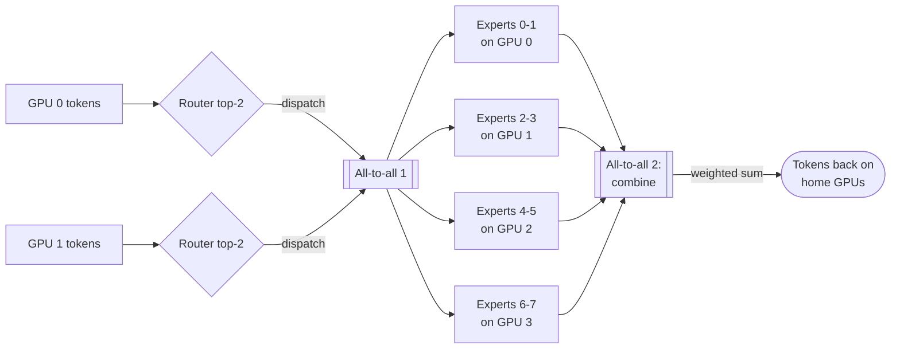

**Reading the diagram.** Each GPU's router (only two drawn) scores its own tokens and picks the top 2 of 8 experts per token. The first all-to-all sends each token's hidden vector to the GPUs holding its chosen experts (two experts per GPU). Experts run their MLPs on whatever tokens arrive, up to capacity. The second all-to-all returns results to the tokens' home GPUs, where they are combined using the router's weights. Both all-to-alls are synchronous and repeat in backward, four per MoE layer per step. Failure points: a popular expert overflows and drops tokens; the busiest GPU sets the layer's time; all-to-all across nodes is sensitive to network congestion. Scaling: add experts and GPUs together; parameters grow with $E$, FLOPs per token stay fixed by $k$.

::: formula
**Expert capacity and all-to-all traffic**

$$C_e = \text{cf} \cdot \frac{k\,T}{E} \qquad V_\text{A2A} = 4 \cdot \frac{e-1}{e} \cdot T_\text{local}\, k\, h\, q \ \text{ per MoE layer per GPU}$$

| Symbol | Meaning | Units |
|---|---|---|
| $C_e$ | Expert capacity: maximum tokens one expert processes per batch | tokens |
| cf | Capacity factor (1.0–1.25 typical in Switch Transformer) | — |
| $k$ | Experts per token (top-$k$) | count |
| $T$, $T_\text{local}$ | Tokens per batch globally; per GPU | tokens |
| $E$ | Number of experts | count |
| $V_\text{A2A}$ | Bytes each GPU sends per MoE layer: dispatch and combine, forward and backward | bytes |
| $e$ | Expert-parallel degree | GPUs |
| $h$, $q$ | Hidden size; bytes per value | values, bytes |
:::

::: example
**Worked example — 64 experts on 64 GPUs.** $E = e = 64$, $k = 2$, $T_\text{local} = 8{,}192$ tokens, $h = 4{,}096$, BF16, cf $= 1.25$.

1. Global tokens: $T = 64 \times 8{,}192 = 524{,}288$. Average load per expert: $2 \times 524{,}288 / 64 = 16{,}384$; capacity $C_e = 1.25 \times 16{,}384 = 20{,}480$.
2. If the router sends the most popular expert twice the average, 32,768 tokens, it drops $32{,}768 - 20{,}480 = 12{,}288$, 37.5% of its tokens.
3. Traffic: $4 \times \frac{63}{64} \times 8{,}192 \times 2 \times 4{,}096 \times 2 = 528$ MB per MoE layer per GPU; at 40 GB/s, 13 ms per layer, which must be overlapped or kept within a node where possible.

**Interpretation.** Capacity trades dropped tokens against wasted padding and memory, and imbalance turns directly into drops and stragglers. **Engineering implication.** Add an auxiliary **load-balancing loss** that penalizes uneven routing (Switch Transformer uses $\alpha E \sum_i f_i P_i$ with $\alpha = 0.01$, where $f_i$ is the fraction of tokens routed to expert $i$ and $P_i$ its mean router probability), monitor per-expert load and drop rate as first-class training metrics, and place expert groups to keep all-to-all on NVLink when possible.
:::

::: industry
**GShard and Switch Transformer.** Lepikhin et al. [2021] trained a 600B-parameter multilingual translation MoE with top-2 gating on 2,048 TPU v3 cores in about four days, using capacity limits, an auxiliary balancing loss and automatic sharding annotations. Fedus et al. [2022] simplified routing to top-1 ("switch") routing, scaled to 1.6 trillion parameters, and reported pre-training speedups of up to 7× over a dense T5 baseline at equal FLOPs per token.
*Evidence: Primary* — [Lepikhin et al. 2021; Fedus et al. 2022]
:::

## 65.13 Combining them: 3D and 4D parallelism

### 65.13.1 Choosing TP × PP × DP

::: definition
**Definition — 3D and 4D parallelism.** Using tensor, pipeline and data parallelism at once, with $G = t \cdot p_\text{pp} \cdot d$ GPUs; **4D** adds context parallelism ($G = t \cdot c \cdot p_\text{pp} \cdot d$), and MoE models add expert parallelism. Narayanan et al. [2021] call the 3D combination **PTD-P**.
:::

The degrees are mapped onto the hardware hierarchy by communication intensity: the chattiest axis (TP, four all-reduces per layer) on NVLink inside a node; CP next; PP (small point-to-point sends) across nodes; DP (one all-reduce per step, overlappable) outermost, usually combined with ZeRO-1 or FSDP sharding of the optimizer state.

**Figure 65.14 — 3D layout of a 70B model on 512 GPUs: TP 8 × PP 4 × DP 16.**

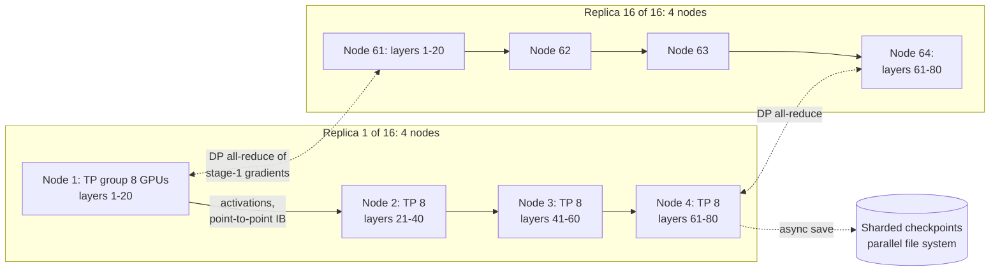

**Reading the diagram.** Each data-parallel replica is a 4-stage pipeline spread over 4 nodes; inside every node, 8 GPUs form a tensor-parallel group over NVLink. Solid arrows are synchronous point-to-point activation and gradient transfers between stages over InfiniBand. Dotted arrows are the data-parallel all-reduces between the same stage of different replicas (overlapped with backward), drawn only for stages 1 and 4, and the asynchronous checkpoint writes to the parallel file system (storage boundary, §65.15). Failure points: one GPU failure stops its TP group, hence its pipeline, hence (through the DP all-reduce) the whole job. Scaling: more replicas raise throughput until the global batch limit; more stages fit a larger model at the cost of bubble.

### 65.13.2 A worked plan and the calculator

::: example
**Worked example — 70B on 512 GPUs (64 nodes × 8 × 80 GB).** Global batch 4 million tokens (1,024 sequences of 4,096), 1.4 trillion tokens.

1. *TP = 8*, the node size (§65.10). Per GPU this divides the per-layer weights by 8.
2. *PP*: with TP 8 alone, model state is $1{,}120/8 = 140$ GB per GPU, too much. With PP 4: $70 \times 10^9 / 32 = 2.19 \times 10^9$ parameters per GPU. Plus ZeRO-1 over DP: $4 \times 2.19 + 12 \times 2.19 / 16 = 8.75 + 1.64 = 10.4$ GB.
3. *Activations* with sequence parallelism and selective recomputation: $34\,s h / t = 34 \times 4{,}096 \times 8{,}192 / 8 = 143$ MB per layer per micro-batch; 20 layers per stage; up to 4 micro-batches in flight on stage 1 under 1F1B: $143 \times 20 \times 4 = 11.4$ GB. Total about 22 GB per GPU plus buffers: comfortable.
4. *DP* $= 512 / (8 \times 4) = 16$. Each replica processes $1{,}024/16 = 64$ sequences per step: with micro-batch 1, $m = 64$, bubble $3/67 = 4.5\%$.
5. *DP traffic*: each GPU's BF16 gradients are $2 \times 2.19 = 4.38$ GB; $V = 2 \times \frac{15}{16} \times 4.38 = 8.2$ GB, 205 ms at 40 GB/s, against a step of $6 \times 7 \times 10^{10} \times 4.19 \times 10^6 / 2.048 \times 10^{17} = 8.6$ s: 2.4%, and overlapped.
6. *Time*: 33.2 days at 40% MFU (§65.4). Alternatives: PP 2 and DP 32 (about 31 GB per GPU, half the bubble stages), or TP 8 with FSDP across nodes and no PP; benchmark the two or three candidates on 64 GPUs before committing (Figure 65.2).

**Interpretation.** Every degree is set by one constraint: TP by the NVLink domain, PP by memory, DP by what is left, and $m$ by the global batch. **Engineering implication.** Choose the smallest TP and PP that fit memory, because each wastes efficiency (communication or bubble), and let DP absorb the rest.
:::

The calculator below reproduces the numbers used in this chapter: memory per GPU for DDP and ZeRO stages, per-layer activations, the pipeline bubble, $6ND$ training time and the checkpoint interval of §65.15.

```python
"""Distributed-training planning calculator: memory per GPU, pipeline bubble, 6ND time."""
import math

GB = 1e9  # SI gigabytes, as in the rest of the book


def model_state_gb(n_params, gpus, stage):
    """Bytes per GPU for weights + gradients + Adam state (mixed precision, K = 12).

    stage 0 = plain DDP, 1 = shard optimizer state, 2 = + gradients, 3 = + parameters
    (ZeRO stages 1-3; stage 3 is what PyTorch FSDP FULL_SHARD does).
    """
    w, g, k = 2 * n_params, 2 * n_params, 12 * n_params   # BF16 weights, BF16 grads, FP32 master+m+v
    if stage >= 1:
        k /= gpus
    if stage >= 2:
        g /= gpus
    if stage >= 3:
        w /= gpus
    return (w + g + k) / GB


def act_gb_per_layer(s, b, h, a, t=1, recompute="none"):
    """Transformer activation memory per layer (Korthikanti et al. 2023), 16-bit.

    t = tensor-parallel size, with sequence parallelism so every term is divided by t.
    recompute: 'none' stores everything, 'selective' recomputes attention scores,
    'full' keeps only the layer input (2sbh bytes).
    """
    if recompute == "full":
        return 2 * s * b * h / t / GB
    attn_scores = 0 if recompute == "selective" else 5 * a * s / h
    return s * b * h * (34 + attn_scores) / t / GB


def bubble(p, m, v=1):
    """Fraction of pipeline time idle: (p-1)/(v*m + p-1); v = interleaved chunks per GPU."""
    return (p - 1) / (v * m + p - 1)


def train_days(n_params, tokens, gpus, peak_flops, mfu):
    """Wall-clock days from C = 6ND."""
    c = 6 * n_params * tokens
    return c, c / (gpus * peak_flops * mfu) / 86_400


print("Model-state memory per GPU (GB), 7B parameters, mixed-precision Adam")
print(f"{'GPUs':>5} {'DDP':>8} {'ZeRO-1':>8} {'ZeRO-2':>8} {'ZeRO-3':>8}")
for gpus in (8, 64):
    row = [model_state_gb(7e9, gpus, s) for s in range(4)]
    print(f"{gpus:>5} " + " ".join(f"{x:8.2f}" for x in row))

print("\nActivations per layer, 7B shape (s=2048, b=1, h=4096, a=32), GB")
for t, rc in [(1, "none"), (1, "selective"), (1, "full"), (8, "selective")]:
    print(f"  TP={t} recompute={rc:<9} {act_gb_per_layer(2048, 1, 4096, 32, t, rc):.3f}")

print("\nPipeline bubble fraction (p-1)/(v*m + p-1)")
for p, m, v in [(8, 8, 1), (8, 32, 1), (8, 64, 1), (8, 32, 4), (4, 64, 1)]:
    print(f"  p={p} m={m:>2} v={v}: {bubble(p, m, v):6.1%}")

print("\nTraining time from C = 6ND (peak 1e15 FLOP/s per GPU)")
for name, n, d, gpus, mfu in [("7B, 1T tokens", 7e9, 1e12, 512, 0.40),
                              ("7B, 1T tokens", 7e9, 1e12, 1, 0.40),
                              ("70B, 1.4T tokens", 70e9, 1.4e12, 512, 0.40),
                              ("70B, 1.4T tokens", 70e9, 1.4e12, 512, 0.30)]:
    c, days = train_days(n, d, gpus, 1e15, mfu)
    print(f"  {name:<17} {gpus:>4} GPUs MFU {mfu:.0%}: C={c:.2e} FLOPs, {days:8.1f} days, "
          f"{days * 24 * gpus:>12,.0f} GPU-hours")

print("\nChinchilla-optimal split of the 7B/1T budget (D = 20 N)")
c = 6 * 7e9 * 1e12
n_opt = math.sqrt(c / 120)
print(f"  N = {n_opt:.2e} parameters, D = {20 * n_opt:.2e} tokens")


def checkpoint_interval(delta, mtbf, restart):
    """Young (1974) and Daly (2006) intervals, and the expected wasted fraction at Young's."""
    young = math.sqrt(2 * delta * mtbf)
    x = delta / (2 * mtbf)
    daly = young * (1 + math.sqrt(x) / 3 + x / 9) - delta if delta < 2 * mtbf else mtbf
    waste = delta / young + (young / 2 + restart) / mtbf
    return young, daly, waste


print("\nCheckpoint interval (checkpoint stall 20 s, restart 600 s)")
for label, mtbf_h in [("16,384 GPUs, MTBF 3.1 h", 3.1), ("512 GPUs, MTBF 99 h", 99)]:
    y, d, w = checkpoint_interval(20, mtbf_h * 3600, 600)
    print(f"  {label:<24} Young {y:6.0f} s  Daly {d:6.0f} s  waste {w:5.1%}  goodput {1 - w:5.1%}")
```

Output:

```text
Model-state memory per GPU (GB), 7B parameters, mixed-precision Adam
 GPUs      DDP   ZeRO-1   ZeRO-2   ZeRO-3
    8   112.00    38.50    26.25    14.00
   64   112.00    29.31    15.53     1.75

Activations per layer, 7B shape (s=2048, b=1, h=4096, a=32), GB
  TP=1 recompute=none      0.956
  TP=1 recompute=selective 0.285
  TP=1 recompute=full      0.017
  TP=8 recompute=selective 0.036

Pipeline bubble fraction (p-1)/(v*m + p-1)
  p=8 m= 8 v=1:  46.7%
  p=8 m=32 v=1:  17.9%
  p=8 m=64 v=1:   9.9%
  p=8 m=32 v=4:   5.2%
  p=4 m=64 v=1:   4.5%

Training time from C = 6ND (peak 1e15 FLOP/s per GPU)
  7B, 1T tokens      512 GPUs MFU 40%: C=4.20e+22 FLOPs,      2.4 days,       29,167 GPU-hours
  7B, 1T tokens        1 GPUs MFU 40%: C=4.20e+22 FLOPs,   1215.3 days,       29,167 GPU-hours
  70B, 1.4T tokens   512 GPUs MFU 40%: C=5.88e+23 FLOPs,     33.2 days,      408,333 GPU-hours
  70B, 1.4T tokens   512 GPUs MFU 30%: C=5.88e+23 FLOPs,     44.3 days,      544,444 GPU-hours

Chinchilla-optimal split of the 7B/1T budget (D = 20 N)
  N = 1.87e+10 parameters, D = 3.74e+11 tokens

Checkpoint interval (checkpoint stall 20 s, restart 600 s)
  16,384 GPUs, MTBF 3.1 h  Young    668 s  Daly    655 s  waste 11.4%  goodput 88.6%
  512 GPUs, MTBF 99 h      Young   3776 s  Daly   3762 s  waste  1.2%  goodput 98.8%
```

What to notice:

- The memory table matches Table 65.3 and the ZeRO paper's formulas; the jump from ZeRO-2 to ZeRO-3 matters most at small $p$ relative to model size.
- Full recomputation cuts per-layer activations 56-fold (0.956 to 0.017 GB) at the cost of a second forward pass; selective recomputation keeps 30% for a few percent of compute (§65.14).
- At 30% instead of 40% MFU the 70B run takes 11 more days: the planning number with the largest error bars is MFU, not FLOPs.

**Table 65.4 — Parallelism strategies compared.**

| Strategy | Splits | Communication | Where it runs | Main cost | Choose when |
|---|---|---|---|---|---|
| DDP | Data | All-reduce of gradients once per step | Anywhere | Full model state per GPU | Model state fits one GPU |
| ZeRO-1/2 | Data; optimizer state (+ gradients) | Same as DDP | Anywhere | None extra in bytes | Optimizer state does not fit |
| ZeRO-3/FSDP | Data; all model state | 1.5× DDP; gathers per layer | Fast networks; HSDP across | Latency at large $p$ | Up to tens of billions of parameters |
| Tensor (+SP) | Matrices within layers | 4 all-reduces per layer, critical path | One NVLink domain | Exposed communication | Layers or activations too big per GPU |
| Pipeline | Layers into stages | Point-to-point activations | Across nodes | Bubble; balancing | Model too big for TP within a node |
| Context | Sequence | K/V exchange per layer | Within or across nodes | Attention traffic | Sequences beyond ~32K tokens |
| Expert | Experts of MoE layers | 4 all-to-alls per MoE layer | Within node preferred | Imbalance, drops | MoE models |

::: recommendation
**Rules of thumb for a parallel layout.** (1) Start with FSDP/ZeRO; add model parallelism only when it does not fit or does not scale. (2) TP ≤ GPUs per NVLink domain. (3) PP as small as memory allows, with $m \ge 4p$ or interleaving. (4) DP takes the rest; keep the global batch below the critical batch size. (5) CP only for long sequences; EP only for MoE. (6) Map the chattiest axis to the fastest links, and ask the scheduler for topology-aware placement (§46.11.2). (7) Benchmark candidates on a slice before the full run.
:::

::: industry
**Megatron-LM at 3,072 GPUs and Llama 3 at 16,384.** Narayanan et al. [2021] trained a 1-trillion-parameter GPT model on 3,072 A100 GPUs with PTD-P at 502 PFLOP/s, 163 TFLOP/s per GPU (52% of peak), and derived the layout rules above. Meta reports a 4D layout for Llama 3 405B: TP 8, PP 16, and DP 64 or 128 for 8K-token training, with CP 16 added for 128K-token training, at 38–43% BF16 MFU [Dubey et al. 2024].
*Evidence: Primary* — [Narayanan et al. 2021; Dubey et al. 2024]
:::

