# Chapter 65 — Distributed ML Training

> **Level:** 4 · **Track:** B (ML/AI) · **Estimated reading time:** 6 h

Chapter 58 ended with two uncomfortable numbers. Training a 7-billion-parameter language model needs about 112 GB of accelerator memory before it sees a single token, and its full training run needs about $4.2 \times 10^{22}$ floating-point operations, more than three years of work for one GPU. Every large model is therefore trained on hundreds or thousands of accelerators working as one machine; this chapter is about how.

Distributing training is not like scaling a web service, whose replicas never talk to each other (§18.4). Training replicas exchange gigabytes on *every step*, must stay in lockstep so the slowest sets the pace, and one failed GPU among 16,000 stops them all. You will learn the ways to split the work (data, tensor, pipeline, context and expert parallelism), the memory-sharding techniques ZeRO and FSDP, how they combine into 3D and 4D layouts, and how to survive failures that arrive every few hours at scale, each with the arithmetic needed to choose it.

This chapter owns parallelism strategies and training fault tolerance. Serving (Chapter 66), recommender training (Chapter 68) and fine-tuning (Chapter 76) are covered elsewhere.

::: note
**Assumptions used in this chapter.** Units are SI (1 GB = 10⁹ bytes); one multiply–add is 2 FLOPs (§58.2). An "H100-class" accelerator is modeled with round numbers that match Chapter 58: 80 GB of HBM, a dense BF16 peak of $10^{15}$ FLOP/s, NVLink at 450 GB/s per direction within an 8-GPU node, and one 400 Gb/s (50 GB/s) InfiniBand or RoCE NIC per GPU across nodes (Table 64.8; as of 2026). Achieved bandwidth is 80% of peak (360 and 40 GB/s). A GPU-hour costs an illustrative \$2.50 (Chapter 60). The **7B model** has $h = 4{,}096$, $L = 32$, $a = 32$; the **70B model** has $h = 8{,}192$, $L = 80$, $a = 64$ (Llama-2-like shapes). New QuickBite numbers are labeled as assumptions.
:::

## 65.1 Learning objectives

After this chapter you should be able to:

- Compute when a model hits the memory wall and the compute wall.
- Estimate training compute with $C \approx 6ND$, convert it to time and cost, and relate it to the Kaplan and Chinchilla scaling laws.
- Explain DDP's bucketing and overlap, and compute all-reduce volume and time on NVLink and InfiniBand.
- Use all-reduce, reduce-scatter, all-gather and all-to-all, and explain NCCL's topology awareness.
- Explain parameter servers, asynchronous SGD and staleness, and where they are still used.
- Compute per-GPU memory and traffic for DDP and ZeRO stages 1–3 (FSDP).
- Explain tensor, pipeline (with the bubble fraction), context and expert parallelism.
- Design a TP × PP × DP layout for a 70B model on 512 GPUs.
- Size checkpoints, choose an interval with Young/Daly, and compute goodput.
- Diagnose bottlenecks and specify a training job for Slurm, Kubernetes or Ray.

## 65.2 Prerequisites

- Training memory (16 bytes per parameter plus activations) and training FLOPs ($6ND$) — §58.11–§58.12 (this chapter divides both across GPUs).
- Optimizers, Adam state and learning-rate warmup — §58.5 (the state that ZeRO shards; warmup for large batches).
- GPU memory hierarchy, BF16/FP8, tensor cores, MFU, NVLink, NVSwitch and InfiniBand — Chapter 64 (the hardware constants used throughout).
- MPI collectives, the α–β model, ring versus tree all-reduce — §49.9; RDMA and network topologies — §49.10 (the cost model for every communication estimate here).
- Gang scheduling, topology-aware placement, Slurm versus Kubernetes — §46.10–§46.12 (how training jobs get their GPUs).
- Checkpoint intervals in stream processing — §29.9 (the same Young formula, applied here to training).
- Failure detection — §27.10; redundancy and correlated failures — §39.4 (the reliability vocabulary used in §65.15–§65.16).

## 65.3 Why distribute training

### 65.3.1 The memory wall and the compute wall

::: definition
**Definition — Memory wall and compute wall (for training).** A model hits the **memory wall** when the bytes needed to train it on one accelerator (weights, gradients, optimizer state and activations, §58.11) exceed that accelerator's memory. It hits the **compute wall** when the floating-point operations of a full training run, divided by one accelerator's achieved throughput, exceed the time you can wait. **Distributed training** spreads either the bytes, the operations, or both, across many accelerators that cooperate on one model.
:::

#### First-principles explanation

One cook preparing a 2,000-guest banquet faces two problems: the counter cannot hold all the ingredients (memory), and chopping for 2,000 guests would take a month (compute). More cooks help in different ways: give each a share of the guests (**data parallelism**) or a share of the recipe (**model parallelism**). Every extra cook adds conversation, and distributed training is the discipline of choosing the split that minimizes it.

#### Why does this exist?

Between 2018 and 2024 the largest dense language models grew from hundreds of millions of parameters to hundreds of billions, and training sets to about 15 trillion tokens [Dubey et al. 2024], while accelerator memory grew only from 32 GB to 80–192 GB (Chapter 64). The scaling laws of §65.4 explain why: loss falls predictably as compute grows.

#### How it works internally

**Figure 65.1 — The two walls and the parallelism each one calls for.**

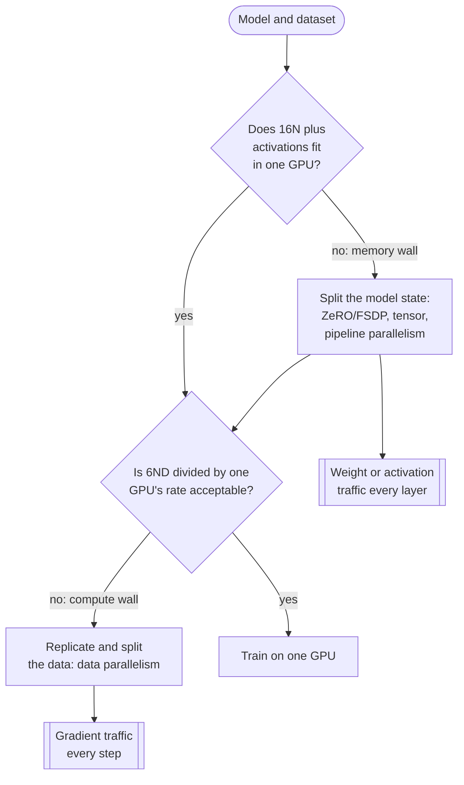

**Reading the diagram.** The first decision is a memory test: $16N$ bytes plus activations (§58.11) against one GPU's HBM; failing it calls for splitting the model's state. The second is a time test: $6ND$ FLOPs (§58.12) at one GPU's rate against the deadline; failing it calls for data parallelism. Both exits create network traffic (subroutine shapes): gradients once per step for data parallelism, weights or activations per layer for model splitting, which is why the latter needs the fastest links. These are planning decisions, so the arrows are synchronous and there is no storage boundary; a wrong decision fails as an out-of-memory error on step one or a job that finishes next year. Large jobs hit both walls and combine both kinds of parallelism (§65.13).

#### Mathematical foundations

::: formula
**Minimum GPUs for memory and for time**

$$G_\text{mem} = \left\lceil \frac{16\,N + M_\text{act}}{M_\text{GPU}\, f} \right\rceil \qquad G_\text{time} = \left\lceil \frac{6\,N\,D}{R\; \text{MFU}\; T_\text{max}} \right\rceil$$

| Symbol | Meaning | Units |
|---|---|---|
| $G_\text{mem}$ | GPUs needed just to hold the training state, assuming perfect sharding | GPUs |
| $G_\text{time}$ | GPUs needed to finish within the deadline, assuming perfect scaling | GPUs |
| $N$ | Parameters | parameters |
| $M_\text{act}$ | Activation memory for one micro-batch (§58.11) | bytes |
| $M_\text{GPU}$ | Accelerator memory | bytes |
| $f$ | Usable fraction of memory after framework buffers and fragmentation (about 0.8–0.9) | — |
| $D$ | Training tokens | tokens |
| $R$ | Peak 16-bit throughput per GPU | FLOP/s |
| MFU | Model FLOPs utilization: achieved useful FLOP/s divided by peak (§64.11) | — |
| $T_\text{max}$ | Acceptable wall-clock training time | s |
:::

::: example
**Worked example — Why a 7B and a 70B model cannot train on one GPU.** Use $M_\text{GPU} = 80$ GB, $f = 0.85$, sequence length 2,048 for 7B and 4,096 for 70B, micro-batch 1, peak $10^{15}$ FLOP/s at 40% MFU.

1. *7B memory.* $16 \times 7 \times 10^9 = 112$ GB plus 30.6 GB of activations (§58.11) is 143 GB: $G_\text{mem} = \lceil 143 / 68 \rceil = 3$.
2. *70B memory.* $16 \times 70 \times 10^9 = 1{,}120$ GB of model state. Activations per layer at $s = 4{,}096$, $h = 8{,}192$, $a = 64$: $s h (34 + 5as/h) = 4{,}096 \times 8{,}192 \times (34 + 160) = 6.5$ GB, × 80 layers $= 521$ GB. Total 1,641 GB: $G_\text{mem} = 25$.
3. *7B time.* $C = 6 \times 7 \times 10^9 \times 10^{12} = 4.2 \times 10^{22}$ FLOPs for 1 trillion tokens. One GPU achieves $4 \times 10^{14}$ FLOP/s: $1.05 \times 10^8$ s $= 1{,}215$ days, 3.3 years.
4. *70B time.* Chinchilla-style 1.4 trillion tokens (§65.4): $C = 6 \times 7 \times 10^{10} \times 1.4 \times 10^{12} = 5.88 \times 10^{23}$ FLOPs: $1.47 \times 10^9$ s on one GPU, about 46.6 years.
5. *Deadline of 30 days* ($2.59 \times 10^6$ s): $G_\text{time} = \lceil 4.2 \times 10^{22} / (4 \times 10^{14} \times 2.59 \times 10^6) \rceil = 41$ GPUs for 7B, and $\lceil 5.88 \times 10^{23} / 1.036 \times 10^{21} \rceil = 568$ GPUs for 70B.

**Interpretation.** For both models the compute wall sets the cluster size: memory needs 3 or 25 GPUs, time needs 41 or 568. **Engineering implication.** Size the cluster from $G_\text{time}$, then choose the splitting technique that makes each GPU's share of memory fit with the least communication.
:::

::: mistake
**"Memory is the reason we distribute."** For most large runs, time is the binding constraint: memory decides *how* you split, compute decides *how many* GPUs you buy.
:::

## 65.4 Training FLOPs estimation

### 65.4.1 Where $6ND$ comes from

::: definition
**Definition — Training compute.** The total floating-point operations to train a model, written $C$. For dense transformers, $C \approx 6ND$, where $N$ is the number of non-embedding parameters and $D$ the number of training tokens [Kaplan et al. 2020]. A **scaling law** is an empirical power law relating a model's loss to $N$, $D$ or $C$.
:::

#### First-principles explanation

Every weight in a dense layer does one multiply–add per token in the forward pass: 2 FLOPs per parameter per token. Backward does that work twice, once for the gradient with respect to the layer's input and once with respect to the weight, so a training step costs 2 + 4 = 6 FLOPs per parameter per token (§58.4.2, verified there with PyTorch's FLOP counter).

Two refinements matter. Attention adds about $2Lsh$ forward FLOPs per token that do not correspond to parameters [Kaplan et al. 2020]: for the 7B model at $s = 2{,}048$ that is $5.4 \times 10^8$ against $2N = 1.4 \times 10^{10}$, about 4%, but at $s = 32{,}768$ it is 61%. And activation recomputation (§65.14) repeats forward work: **MFU** counts only model FLOPs (this chapter uses the $6N$ shortcut; §64.11 adds PaLM's attention term, $12Lhs$ per token for forward and backward, so always state which convention a quoted MFU uses), while **hardware FLOPs utilization (HFU)** counts recomputation too [Chowdhery et al. 2022].

#### Mathematical foundations

::: formula
**Training compute, wall-clock time and the compute-optimal split**

$$C \approx 6\,N\,D \qquad T_\text{wall} = \frac{C}{G \cdot R \cdot \text{MFU}} \qquad D_\text{opt} \approx 20\, N_\text{opt} \;\Rightarrow\; N_\text{opt} \approx \sqrt{\frac{C}{120}}$$

| Symbol | Meaning | Units |
|---|---|---|
| $C$ | Training compute | FLOPs |
| $N$ | Non-embedding parameters | parameters |
| $D$ | Training tokens | tokens |
| $T_\text{wall}$ | Wall-clock training time, excluding failures (§65.16) | s |
| $G$ | Number of GPUs | GPUs |
| $R$ | Peak 16-bit throughput per GPU | FLOP/s |
| MFU | Achieved fraction of peak | — |
| $N_\text{opt}$, $D_\text{opt}$ | Compute-optimal parameters and tokens for budget $C$ [Hoffmann et al. 2022] | parameters, tokens |
:::

::: example
**Worked example — A 7B model on 1 trillion tokens.**

1. $C = 6 \times 7 \times 10^9 \times 10^{12} = 4.2 \times 10^{22}$ FLOPs.
2. On $G = 512$ GPUs at $R = 10^{15}$ FLOP/s and MFU 40%: aggregate $512 \times 4 \times 10^{14} = 2.048 \times 10^{17}$ FLOP/s.
3. $T_\text{wall} = 4.2 \times 10^{22} / 2.048 \times 10^{17} = 205{,}078$ s $= 57.0$ hours, 2.4 days; $29{,}167$ GPU-hours; about \$72,900 at \$2.50/GPU-hour.
4. At MFU 25% the same run takes 91 hours and costs \$116,700: near 40% MFU each point of MFU is worth about \$1,800 on this run and about \$25,000 on the 70B run (cost scales as $1/\text{MFU}$).
5. Compute-optimal split of the same budget: $N_\text{opt} = \sqrt{4.2 \times 10^{22}/120} = 1.87 \times 10^{10}$ parameters on $D_\text{opt} = 3.74 \times 10^{11}$ tokens. Chinchilla's rule says this budget would reach a lower loss with an 18.7B model on 374 billion tokens.
6. Why train 7B on 1T tokens anyway? It is 2.7× cheaper to *serve* than 18.7B ($2N$ FLOPs per token, Chapter 73): extra training buys permanently cheaper inference.

**Interpretation.** Three multiplications turn a training plan into GPU-hours, and MFU converts engineering quality into money. **Engineering implication.** Put $6ND$, the GPU count and a measured MFU into every training proposal, and choose $N$ and $D$ with lifetime serving cost in view.
:::

#### Scaling-law context

Kaplan et al. [2020] fit loss as power laws in $N$, $D$ and $C$ and concluded that most of a larger budget should go to a larger model. Hoffmann et al. [2022], training over 400 models, found that parameters and tokens should grow in equal proportion; their **Chinchilla** (70B parameters, 1.4 trillion tokens, about 20 tokens per parameter) beat the 280B Gopher at equal compute. Open models now train far past that ratio because inference dominates their lifetime cost: Llama 3's 8B model saw about 15 trillion tokens [Dubey et al. 2024]. For a system designer, the laws make the payoff of compute predictable, so clusters are planned years ahead.

**Figure 65.2 — From a compute budget to a cluster plan.**

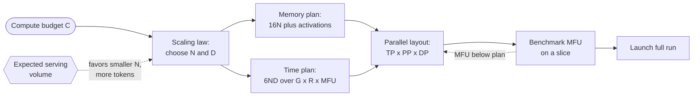

**Reading the diagram.** A scaling law turns the budget into $N$ and $D$, nudged (dotted) by expected serving volume toward a smaller, longer-trained model. That yields a memory plan and a time plan, which feed the parallel layout of §65.13. A benchmark on a slice measures real MFU and, if short, sends the layout back for revision (dotted feedback). This is a planning flow with no storage boundary; its failure point is skipping the benchmark and discovering the real MFU a week into the run. The same flow applies from 64 to 16,000 GPUs.

::: industry
**Llama 3 compute budget.** Meta reports training its flagship 405B-parameter model on about 15.6 trillion tokens with about $3.8 \times 10^{25}$ FLOPs, on up to 16,384 H100 GPUs, and reports achieved BF16 MFU of 38–43% depending on configuration [Dubey et al. 2024]. Checking with $6ND$: $6 \times 4.05 \times 10^{11} \times 1.56 \times 10^{13} = 3.79 \times 10^{25}$, matching the reported figure. The paper also states that the 405B size was chosen as roughly compute-optimal for that budget using its own scaling-law experiments.
*Evidence: Primary* — [Dubey et al. 2024]
:::

::: mistake
**Counting embedding parameters in $N$.** A lookup reads a row without multiplying it: a 1-billion-parameter embedding table plus a 100-million-parameter MLP costs about $6 \times 10^8$ FLOPs per example, not $6.6 \times 10^9$ (§65.8, Chapter 68).
:::

## 65.5 Single machine, multi-GPU

### 65.5.1 DataParallel versus DistributedDataParallel

::: definition
**Definition — Data parallelism, DataParallel and DDP.** In **data parallelism**, every worker holds a full copy (**replica**) of the model, processes a different slice of each batch, and the workers average their gradients before every optimizer step so the replicas stay identical. PyTorch offers two implementations. **`DataParallel` (DP)** is a single process that drives several GPUs with threads. **`DistributedDataParallel` (DDP)** runs one process per GPU and averages gradients with a collective all-reduce [Li et al. 2020]. The set of processes is the **process group**; each process has a **rank** (0 to $p-1$), and $p$ is the **world size**.
:::

#### First-principles explanation

Four students each mark a quarter of the exams and must agree on changes to the marking scheme. `DataParallel` is a head teacher who photocopies the scheme for everyone every session and makes all the changes alone, becoming the bottleneck. DDP gives each student a permanent copy; they exchange notes in a circle and each arrives at the same changes.

#### How it works internally

`DataParallel`, on every iteration, replicates the model from GPU 0, scatters the batch, runs forward passes in threads that contend for Python's interpreter lock, gathers outputs and gradients on GPU 0, and steps the optimizer there. GPU 0 is overloaded, every step pays the replication cost, and it cannot span machines; PyTorch recommends DDP even on one machine.

DDP: (1) at construction, rank 0 **broadcasts** its weights; (2) each process reads its own data shard through a `DistributedSampler`; (3) forward and backward run independently; (4) **autograd hooks** add each ready gradient to a **bucket**, and a full bucket starts an asynchronous all-reduce while backward continues; (5) after the last bucket, every process divides by $p$ and takes an identical optimizer step. Same averaged gradient, same weights: replicas stay identical without ever exchanging weights again.

**Figure 65.3 — DataParallel versus DistributedDataParallel on one 4-GPU machine.**

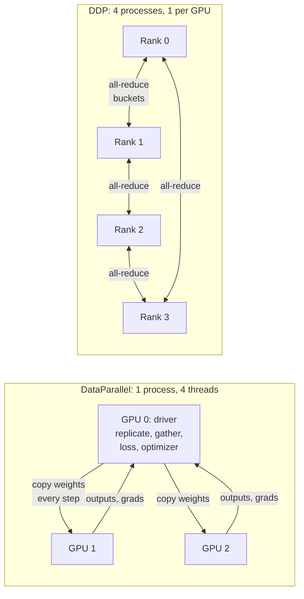

**Reading the diagram.** On the left (two workers drawn), GPU 0 is a hub that copies weights out every step and receives outputs and gradients back, so its links and memory are the bottleneck. On the right, four symmetric processes exchange gradient buckets with neighbors through NCCL all-reduce over NVLink. All arrows are synchronous within a step and all data stays in GPU memory. Failure points: GPU 0 running out of memory on the left; any stalled rank stalling the collective on the right. DDP scales across machines unchanged because it is already a set of networked processes.

### 65.5.2 Gradient bucketing and overlap with backward

Two choices make DDP fast [Li et al. 2020]. **Bucketing** packs small gradient tensors into buckets (25 MB by default) so each all-reduce lands on the bandwidth-efficient side of the crossover of §49.9.2; a LayerNorm's 8 KB of gradients sent alone would be all latency. **Overlap** exploits backward's order: the last layers' gradients are ready first, so buckets are filled in reverse order and each is all-reduced as soon as it fills, while earlier layers are still computing. Only the final bucket is exposed.

**Figure 65.4 — DDP timeline: bucketed all-reduce overlapping the backward pass.**

```mermaid
gantt
  title One DDP step, time in ms
  dateFormat x
  axisFormat %L
  section Compute stream
  Forward                    :f, 0, 80
  Backward layers 20 to 15   :b1, 80, 120
  Backward layers 14 to 8    :b2, 120, 160
  Backward layers 7 to 1     :b3, 160, 200
  Optimizer step             :o, 225, 235
  section NCCL stream
  All-reduce bucket 1        :a1, 120, 150
  All-reduce bucket 2        :a2, 160, 190
  All-reduce bucket 3        :a3, 200, 225
```

**Reading the diagram.** The compute stream runs forward, then backward in reverse layer order. A separate NCCL stream all-reduces bucket 1 as soon as the last layers fill it, overlapping backward of the middle layers. Only bucket 3 (the first layers, ready last) is exposed, delaying the optimizer step by 25 ms, which synchronizes on all buckets. Failure points: buckets whose communication exceeds the compute hiding them, and ranks registering buckets in different orders, which mismatches the all-reduces and hangs the job. Scaling: larger per-GPU batches lengthen backward and hide more communication.

::: recommendation
**DDP settings that matter.** Launch one process per GPU with `torchrun` (§65.16). Keep the default bucket size unless profiling shows exposed communication. Leave `find_unused_parameters=False` unless the model really skips parameters. When accumulating gradients, wrap all but the last micro-batch in `no_sync()` so you all-reduce once per optimizer step.
:::

::: industry
**PyTorch DDP design.** Li et al. [2020] describe bucketing, reverse-order bucket assignment, overlap through autograd hooks and `no_sync`, report near-linear scaling to 256 GPUs, and document the main hazard: all processes must produce the same bucket order.
*Evidence: Primary* — [Li et al. 2020]
:::

## 65.6 Data parallelism

### 65.6.1 The synchronous data-parallel step

::: definition
**Definition — Synchronous data-parallel SGD.** Each of $p$ workers computes the gradient of the loss on its local micro-batch of $b$ examples; an all-reduce sums the $p$ gradients; each worker divides by $p$ and applies the same update. The update equals single-worker SGD on a **global batch** of $B = p \cdot b \cdot k$ examples, where $k$ is the number of **gradient-accumulation** micro-batches per step.
:::

**Figure 65.5 — One synchronous data-parallel training step across two nodes.**

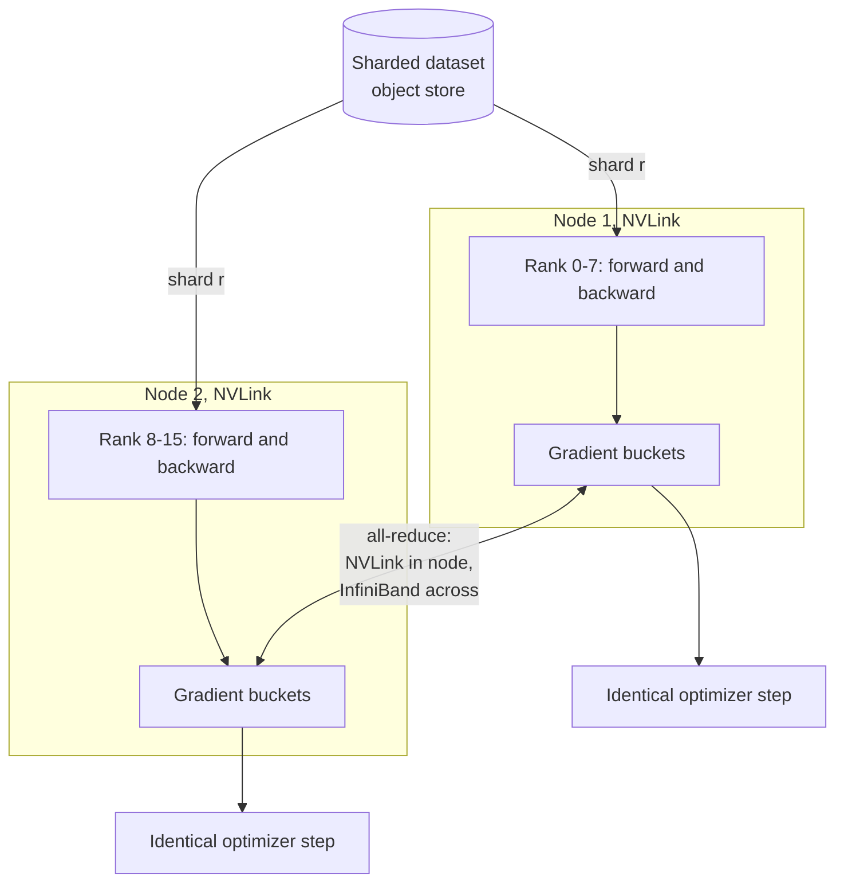

**Reading the diagram.** Each rank reads a disjoint shard from object storage (the storage boundary), runs forward and backward, and fills gradient buckets. The all-reduce rides NVLink within a node and RDMA over InfiniBand or RoCE between nodes (§49.10); it is synchronous, so no rank steps until all have contributed. Failure points: a straggler delays all (§65.17), a dead rank hangs the all-reduce until a timeout (§65.16), a slow data loader starves the GPU. Scaling: ranks add throughput while each rank's traffic stays about twice its gradient size.

### 65.6.2 Communication volume and time

#### Mathematical foundations

::: formula
**Data-parallel gradient all-reduce per step (ring, bandwidth term)**

$$V = 2\,\frac{p-1}{p}\, S \qquad S = N\, q \qquad T_\text{AR} \approx \frac{V}{B_\text{link}} \qquad B_\text{eff,inter} \approx g \cdot B_\text{NIC}$$

| Symbol | Meaning | Units |
|---|---|---|
| $V$ | Bytes each GPU sends (and receives) per all-reduce | bytes |
| $p$ | Data-parallel degree (replicas) | GPUs |
| $S$ | Gradient bytes per replica | bytes |
| $q$ | Bytes per gradient value (2 for BF16, 4 for FP32) | bytes |
| $T_\text{AR}$ | All-reduce time, ignoring latency terms (§49.9.2) | s |
| $B_\text{link}$ | Achieved bandwidth of the bottleneck link per GPU | bytes/s |
| $B_\text{eff,inter}$ | Effective cross-node bandwidth when whole nodes join the ring and NCCL runs one channel per NIC | bytes/s |
| $g$ | GPUs (and NICs) per node | count |
:::

Per-GPU volume is nearly independent of $p$, which is why data parallelism scales (more replicas add only latency terms). NCCL reports $V/T$ as **bus bandwidth**, directly comparable with link speeds.

::: example
**Worked example — All-reduce for a 1B model on NVLink and InfiniBand.** The 1B model of §58.11 fits on one GPU, so plain DDP applies. Gradients are all-reduced in BF16: $S = 10^9 \times 2 = 2$ GB. Each GPU processes 8 sequences of 2,048 tokens = 16,384 tokens per step.

1. *Compute per step:* $6 \times 10^9 \times 16{,}384 = 9.83 \times 10^{13}$ FLOPs at $4 \times 10^{14}$ FLOP/s $= 246$ ms, of which backward is about two thirds, 164 ms.
2. *One node, $p = 8$, NVLink at 360 GB/s:* $V = 2 \times \frac{7}{8} \times 2 = 3.5$ GB; $T = 3.5 / 360 = 9.7$ ms, 4% of the step and fully hidden behind backward.
3. *Eight nodes, $p = 64$, one shared 40 GB/s NIC per node:* $V = 2 \times \frac{63}{64} \times 2 = 3.94$ GB. Every ring crosses each node boundary, so the node's whole share passes through its single NIC: $T = 3.94/40 = 98$ ms. That still hides behind 164 ms of backward, but only just.
4. *Eight nodes, one 40 GB/s NIC per GPU (a "rail-optimized" AI cluster):* NCCL runs eight rings, one per NIC, so $B_\text{eff,inter} \approx 8 \times 40 = 320$ GB/s and $T \approx 3.94 / 320 = 12.3$ ms, close to the single-node time.
5. *Small per-GPU batch:* at 2,048 tokens per GPU, compute is 31 ms and backward 20 ms. With one NIC per node the 98 ms all-reduce is now exposed: step $\approx 10 + \max(20, 98) = 108$ ms, so the GPUs compute only $31/108 = 29\%$ of the time. Accumulating $k = 8$ micro-batches with `no_sync` restores 16,384 tokens per all-reduce.

**Interpretation.** Data-parallel communication is cheap when per-GPU batches are large and cross-node bandwidth is provisioned per GPU. **Engineering implication.** AI clusters attach one NIC per GPU for this reason (Chapter 64); elsewhere, raise the tokens per all-reduce with gradient accumulation or use the schemes of §65.9.
:::

#### Code example: ring all-reduce and DDP averaging, simulated

The program below simulates four GPUs on a CPU. Part 1 implements ring all-reduce exactly as Figure 49.8 describes (reduce-scatter, then all-gather) and checks the sum and the bytes sent. Part 2 trains four replicas of a small network on four shards of each batch, averages their gradients with that ring, and compares the result with ordinary single-process training on the whole batch.

```python
"""Simulated data-parallel training: ring all-reduce plus DDP gradient averaging (CPU only)."""
import copy
import numpy as np
import torch
from torch import nn


def ring_allreduce(grads):
    """Sum-all-reduce a list of equal-length 1-D arrays, one per simulated GPU.

    Phase 1 (reduce-scatter): p-1 steps; afterwards rank r owns the full sum of chunk (r+1) % p.
    Phase 2 (all-gather):     p-1 steps; finished chunks circulate until every rank has all of them.
    Returns the reduced buffers and the number of elements each rank sent.
    """
    p = len(grads)
    bufs = [np.array_split(g.astype(np.float64).copy(), p) for g in grads]
    sent = [0] * p
    for s in range(p - 1):                                    # reduce-scatter
        msgs = [(r, (r + 1) % p, (r - s) % p) for r in range(p)]
        payload = [bufs[src][k].copy() for src, _, k in msgs]  # all sends are simultaneous
        for (src, dst, k), data in zip(msgs, payload):
            bufs[dst][k] += data
            sent[src] += data.size
    for s in range(p - 1):                                    # all-gather
        msgs = [(r, (r + 1) % p, (r + 1 - s) % p) for r in range(p)]
        payload = [bufs[src][k].copy() for src, _, k in msgs]
        for (src, dst, k), data in zip(msgs, payload):
            bufs[dst][k] = data                               # overwrite, do not add
            sent[src] += data.size
    return [np.concatenate(b) for b in bufs], sent


# --- 1. Correctness and traffic of the ring on random vectors -------------------------
rng = np.random.default_rng(65)
p, n = 4, 1_000_003                                           # n not divisible by p on purpose
vecs = [rng.standard_normal(n) for _ in range(p)]
out, sent = ring_allreduce(vecs)
ref = np.sum(vecs, axis=0)
print(f"ring all-reduce, p={p}, n={n:,}")
print(f"  max |ring - numpy sum| = {max(np.abs(o - ref).max() for o in out):.2e}")
print(f"  elements sent per rank = {sent}")
print(f"  formula 2(p-1)/p * n   = {2 * (p - 1) / p * n:,.0f}")

# --- 2. DDP semantics: average of shard gradients == full-batch gradient -------------
torch.manual_seed(0)
X = torch.randn(256, 16)                                      # one global batch
w_true = torch.randn(16, 1)
y = X @ w_true + 0.1 * torch.randn(256, 1)
base = nn.Sequential(nn.Linear(16, 32), nn.ReLU(), nn.Linear(32, 1))
loss_fn = nn.MSELoss()

single = copy.deepcopy(base)                                  # reference: one process
replicas = [copy.deepcopy(base) for _ in range(p)]            # simulated GPUs
opt_single = torch.optim.SGD(single.parameters(), lr=0.05)
opts = [torch.optim.SGD(m.parameters(), lr=0.05) for m in replicas]

for step in range(20):
    opt_single.zero_grad()
    loss_fn(single(X), y).backward()
    opt_single.step()

    shards = zip(X.chunk(p), y.chunk(p))                      # DistributedSampler equivalent
    for m, o, (xs, ys) in zip(replicas, opts, shards):
        o.zero_grad()
        loss_fn(m(xs), ys).backward()                         # local gradients differ per rank
    flat = [torch.cat([q.grad.flatten() for q in m.parameters()]).numpy() for m in replicas]
    summed, _ = ring_allreduce(flat)
    for m, o, g in zip(replicas, opts, summed):
        avg = torch.from_numpy(g / p).float()                 # all-reduce(sum) / world size
        i = 0
        for q in m.parameters():
            q.grad.copy_(avg[i:i + q.numel()].view_as(q))
            i += q.numel()
        o.step()

def flat_params(m):
    return torch.cat([q.detach().flatten() for q in m.parameters()])

drift = max((flat_params(m) - flat_params(replicas[0])).abs().max().item() for m in replicas)
gap = (flat_params(replicas[0]) - flat_params(single)).abs().max().item()
print("DDP simulation, 4 workers x 64 examples, 20 SGD steps")
print(f"  max parameter difference between replicas   = {drift:.1e}")
print(f"  max difference from single-process training = {gap:.1e}")
print(f"  final loss: single {loss_fn(single(X), y).item():.5f}, "
      f"replica 0 {loss_fn(replicas[0](X), y).item():.5f}")
```

Output:

```text
ring all-reduce, p=4, n=1,000,003
  max |ring - numpy sum| = 1.78e-15
  elements sent per rank = [1500004, 1500005, 1500005, 1500004]
  formula 2(p-1)/p * n   = 1,500,004
DDP simulation, 4 workers x 64 examples, 20 SGD steps
  max parameter difference between replicas   = 0.0e+00
  max difference from single-process training = 1.8e-07
  final loss: single 0.17703, replica 0 0.17703
```

What to notice:

- Each rank sends $2\frac{p-1}{p}n$ elements, matching the formula; the one-element differences come from uneven chunks when $n$ is not divisible by $p$ (real libraries pad).
- Ring sums differ from NumPy's only in the last bits ($10^{-15}$), because floating-point addition is not associative and the ring adds in a different order (§59.14).
- Replicas stay exactly identical (difference 0), because each applies the same averaged gradient: the property DDP relies on to avoid ever re-sending weights.
- Data-parallel training matches single-process full-batch training to $10^{-7}$ (FP32 rounding): with a mean loss and equal shards, the mean of the shard gradients is the full-batch gradient.

### 65.6.3 Large batches and learning-rate scaling

Data parallelism raises the global batch (512 GPUs × 8 sequences = 4,096 per step). A larger batch gives a less noisy gradient but fewer steps per epoch, so with an unchanged learning rate it makes less progress per example.

::: formula
**Linear scaling rule with warmup [Goyal et al. 2017]**

$$\eta(B) = \eta_0 \cdot \frac{B}{B_0} \qquad \eta_t = \eta(B)\cdot\min\!\left(1,\ \frac{t}{t_\text{warm}}\right)$$

| Symbol | Meaning | Units |
|---|---|---|
| $\eta_0$, $B_0$ | Learning rate tuned at a reference batch size | —, examples |
| $B$ | New global batch size | examples |
| $\eta(B)$ | Scaled peak learning rate | — |
| $t$, $t_\text{warm}$ | Current step; warmup length | steps |
:::

::: example
**Worked example — ImageNet in one hour.** Goyal et al. [2017] used $\eta_0 = 0.1$ for $B_0 = 256$ on ResNet-50.

1. On 256 GPUs with 32 images each: $B = 8{,}192$, so $\eta = 0.1 \times 8{,}192 / 256 = 3.2$.
2. Starting at 3.2 diverged early in training, so the learning rate ramped linearly from 0.1 to 3.2 over the first 5 epochs.
3. Steps per epoch fell from $1.28 \times 10^6 / 256 = 5{,}000$ to 156, which is what let 256 GPUs finish 90 epochs in about an hour with accuracy matching the small-batch baseline.
4. The paper reports that accuracy degraded beyond about 8K for this model and recipe.

**Interpretation.** The rule keeps the update per example roughly constant; warmup avoids early instability. **Engineering implication.** Data parallelism has a statistical ceiling, the **critical batch size**, beyond which more replicas cost more GPU-hours for the same loss [McCandlish et al. 2018]; layer-wise adaptive optimizers such as LAMB raise it [You et al. 2020]. LLM pre-training uses global batches of a few million tokens [Dubey et al. 2024].
:::

#### Failure scenarios

| What goes wrong | Why | Detection | Recovery | Prevention |
|---|---|---|---|---|
| Job hangs at step 0 or mid-run | One rank crashed or took a different code path, so a collective never completes | No progress; NCCL watchdog timeout | Kill and restart from checkpoint | Collective timeouts; identical control flow on all ranks |
| Loss spikes after scaling out | Learning rate not rescaled, or no warmup | Loss curve against the small-scale baseline | Lower peak LR, longer warmup | Linear scaling rule plus warmup; LAMB for very large batches |
| Duplicate or skipped data | Sampler not seeded per epoch, or not resumed after restart | Example-ID audit | Restore sampler state | `set_epoch()`; checkpoint the data-loader position (§65.15) |

## 65.7 Collectives recap and NCCL

### 65.7.1 The five collectives of distributed training

§49.9 introduced MPI collectives and their α–β costs. Training uses five, summarized here with the bytes each GPU sends for a full tensor of $S$ bytes.

**Table 65.1 — Collectives used in distributed training.**

| Collective | Result | Bytes sent per GPU (ring) | Used by |
|---|---|---|---|
| All-reduce | Every rank gets the sum of all tensors | $2\frac{p-1}{p}S$ | DDP gradients; tensor-parallel activations |
| Reduce-scatter | Rank $r$ gets the sum of chunk $r$ only | $\frac{p-1}{p}S$ | ZeRO-2/3 and FSDP gradients; sequence parallelism |
| All-gather | Every rank gets every rank's chunk | $\frac{p-1}{p}S$ | ZeRO-3/FSDP parameters; sequence parallelism |
| Broadcast | Every rank gets rank 0's tensor | about $S$ | Initial weights; configuration |
| All-to-all | Rank $r$ sends a different chunk to each rank | $\frac{p-1}{p}S$ | Expert parallelism (MoE); Ulysses context parallelism |

The key identity is **all-reduce = reduce-scatter + all-gather**, the ring's two phases. ZeRO and FSDP keep only the reduce-scatter result (a gradient shard) and all-gather parameters instead.

**Figure 65.6 — All-reduce decomposed into reduce-scatter and all-gather (4 ranks).**

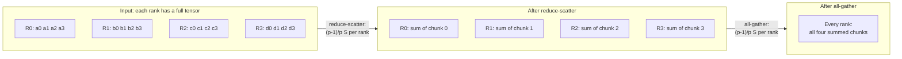

**Reading the diagram.** Each of four ranks starts with a full tensor in four chunks. Reduce-scatter leaves each rank with the sum of one chunk; all-gather shares the summed chunks so every rank has the full result. Each synchronous phase sends $(p-1)/p$ of the tensor per rank, all within GPU memory. The middle state is the scaling point: a rank that updates only its own weight shard (§65.9) can stop after reduce-scatter.

### 65.7.2 NCCL: algorithms and topology awareness

**NCCL** (NVIDIA Collective Communications Library; AMD's equivalent is RCCL) relies on three ideas.

1. **Algorithm choice by size.** Rings are bandwidth-optimal but their latency grows linearly with ranks; **double binary trees**, added in NCCL 2.4, have logarithmic latency [Jeaugey 2019]. NCCL switches by size and scale. In-network reductions (NVLink SHARP, InfiniBand SHARP) sum inside the switch so each GPU sends its data once rather than twice (Chapter 64).
2. **Topology detection.** NCCL discovers PCIe, NVLink and NICs and builds **channels** (parallel rings or trees) that keep traffic on NVLink inside a node and put one channel per NIC across nodes, using GPUDirect RDMA (§49.10): the $g \cdot B_\text{NIC}$ term of §65.6.2.
3. **Pipelining and streams.** Large collectives flow through the ring in chunks, on their own CUDA streams, so frameworks can overlap them with compute.

**Figure 65.7 — Topology-aware all-reduce on a rail-optimized cluster.**

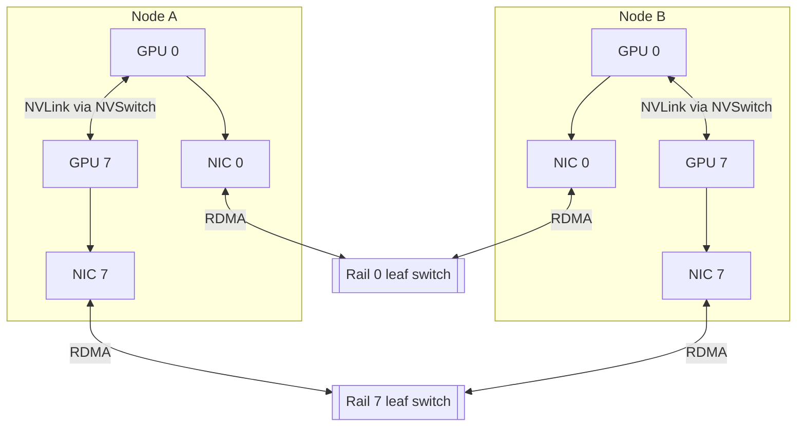

**Reading the diagram.** Each node's eight GPUs (two drawn) share NVLink through NVSwitch, with one NIC per GPU. In a **rail-optimized** network, NIC $i$ of every node connects to leaf switch $i$, so GPU $i$ reaches GPU $i$ anywhere in one hop; NCCL places channel $i$ on rail $i$ and all rails work in parallel, synchronously per collective step. Failure points: a flapping NIC slows its channel and hence the collective; scattered placement adds spine hops (§46.11.2, §49.10.4). Scaling: rails grow to the leaf switch radix, then spine layers are added.

::: recommendation
**Debugging collectives.** Use `NCCL_DEBUG=INFO` to see the chosen transports and algorithms; run `nccl-tests` on every new node pool and compare *bus* bandwidth (not algorithm bandwidth, which is about half for all-reduce) with the link speed; alert when a job's bus bandwidth drops by about 10%, usually one bad link or NIC.
:::

## 65.8 Parameter servers

### 65.8.1 Architecture, synchronous and asynchronous SGD

::: definition
**Definition — Parameter server.** An architecture in which **servers** hold key-partitioned parameters and **workers** **pull** what they need, compute gradients, and **push** them back for the servers to apply [Li et al. 2014]. In **asynchronous SGD** pushes apply on arrival, so a gradient may come from parameters several updates old: its **staleness**.
:::

#### First-principles explanation

A parameter server is a shared notebook: each student copies the pages they need, works, and writes corrections back without waiting for anyone. Nobody is blocked by a slow classmate, but someone may correct a page another already changed. All-reduce is the circle meeting of §65.5, where everybody waits.

**Figure 65.8 — Parameter-server training with sharded sparse parameters.**

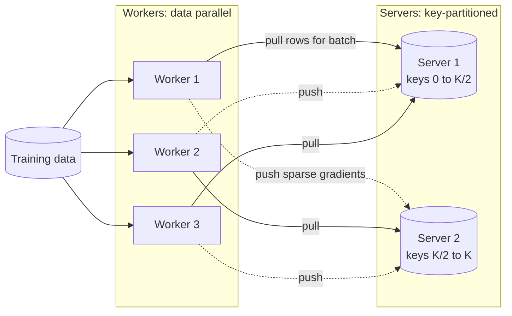

**Reading the diagram.** Workers pull only the rows their batch touches (solid, synchronous) and push gradients back (dotted: asynchronously applied). Servers own disjoint key ranges, the storage boundary; Li et al. place keys by consistent hashing and replicate server state (§14.8). Failure points: a hot key overloads one server; a slow worker produces stale gradients instead of stalling others. Servers scale capacity and workers scale throughput, independently.

#### Mathematical foundations

::: formula
**Staleness and sparse traffic**

$$\mathbb{E}[\tau] \approx W - 1 \qquad V_\text{sparse} \approx 2 \cdot b \cdot u \cdot d \cdot q \quad\text{vs.}\quad V_\text{dense} \approx 2\,S$$

| Symbol | Meaning | Units |
|---|---|---|
| $\tau$ | Staleness: updates applied between a worker's pull and its push | updates |
| $W$ | Workers of similar speed in asynchronous SGD | workers |
| $V_\text{sparse}$ | Bytes per worker per step for pull plus push of touched rows | bytes |
| $b$ | Examples per worker batch | examples |
| $u$ | Distinct embedding rows touched per example | rows |
| $d$ | Embedding dimension | values |
| $q$ | Bytes per value | bytes |
| $S$ | Total parameter bytes (what dense all-reduce would move) | bytes |
:::

::: example
**Worked example — Why recommenders still use parameter-server ideas.** A recommendation model has $10^9$ embedding rows of $d = 128$ in FP32: $S = 10^9 \times 128 \times 4 = 512$ GB of embeddings. A worker batch of $b = 4{,}096$ examples touches about $u = 50$ rows each.

1. Dense all-reduce of the table would move about $2 \times 512 = 1{,}024$ GB per worker per step: impossible.
2. Sparse pull and push: $2 \times 4{,}096 \times 50 \times 128 \times 4 = 210$ MB per step, about 5,000 times less (fewer still after deduplicating repeated rows).
3. With 64 asynchronous workers, a gradient is on average about 63 updates stale, but each update touches only 0.02% of rows, so two workers rarely collide on the same row.
4. QuickBite comparison: 10 million customers at $d = 64$ in FP32 is 2.56 GB (§58.6). It fits in one GPU, so QuickBite's recommender can use plain data parallelism today and needs sharded embeddings only if it grows two orders of magnitude.

**Interpretation.** Staleness that would wreck a dense model is tolerable for sparse embeddings because updates rarely overlap. **Engineering implication.** Use all-reduce for dense layers and sharded, pull/push-style embedding tables for huge sparse ones: the hybrid that DLRM-style systems use (Chapter 68).
:::

Asynchronous SGD was standard around 2012, when Google's DistBelief used "Downpour SGD" [Dean et al. 2012]. Dense deep learning moved back to synchronous all-reduce once bandwidth-optimal rings (§49.9.2) removed the central server bottleneck and stale gradients proved costly for dense models. **Stale synchronous parallel** is a middle ground: fast workers may run ahead by at most $s$ steps [Ho et al. 2013].

::: industry
**Parameter servers in production recommenders.** Li et al. [2014] describe a third-generation parameter server for sparse models with billions of parameters. Meta's DLRM keeps the split, with model-parallel embedding tables and data-parallel MLPs [Naumov et al. 2019]; Chapter 68 covers its descendants.
*Evidence: Primary* — [Li et al. 2014; Naumov et al. 2019]
:::

## 65.9 Sharded data parallelism: ZeRO and FSDP

### 65.9.1 What each stage shards

::: definition
**Definition — ZeRO and FSDP.** The **Zero Redundancy Optimizer (ZeRO)** partitions data parallelism's redundant copies across the $p$ ranks [Rajbhandari et al. 2020]: **stage 1** shards optimizer state, **stage 2** also gradients, **stage 3** also parameters, gathering each layer's weights only while it computes. **PyTorch Fully Sharded Data Parallel (FSDP)** implements stage 3 (and, configured otherwise, stage 2 or hybrid sharding) [Zhao et al. 2023].
:::

#### First-principles explanation

In plain DDP, 64 students each carry a complete 112 GB encyclopedia though each edits only one sixty-fourth of it. ZeRO tears it into 64 volumes: each student keeps one and briefly borrows the others when needed. Borrowing costs walking (communication), but nobody needs a bookcase for the whole set.

**Figure 65.9 — Per-GPU model state under DDP and ZeRO stages (4 ranks).**

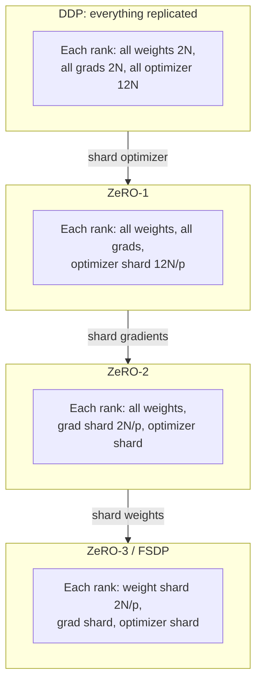

**Reading the diagram.** Each stage, top to bottom, removes one more replicated item: ZeRO-1 keeps a $1/p$ share of the 12 bytes of FP32 master weights and Adam moments; ZeRO-2 also reduce-scatters gradients instead of all-reducing them; ZeRO-3 also shards weights and all-gathers them per layer when needed. All state lives in GPU memory (offload is §65.14). Failure point: higher stages put more collectives on the critical path. Scaling: model state per GPU falls as $1/p$.

#### How it works internally (FSDP, one training step)

1. The model is wrapped in **units** (usually one per transformer block) whose flattened parameters are sharded: rank $r$ holds slice $r$.
2. *Forward:* an **all-gather** assembles unit $i$'s weights, which are freed after use; unit $i+1$'s gather is **prefetched** meanwhile.
3. *Backward:* weights are gathered again, gradients computed and **reduce-scattered**, so each rank keeps only its gradient shard.
4. *Optimizer:* each rank updates its own shard; the next forward gathers the updated shards.

**Figure 65.10 — FSDP lifecycle of one transformer block on one rank.**

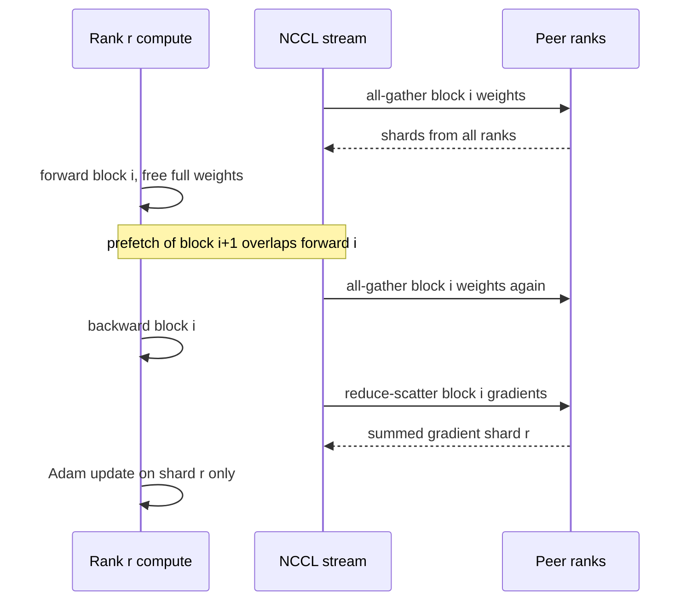

**Reading the diagram.** The rank's compute stream, its NCCL stream and the peer ranks interact asynchronously, ordered by CUDA events. Block $i$'s full weights exist only between gather and free, so peak memory is one or two full blocks plus shards; backward needs a second gather because forward freed them. The reduce-scatter returns only shard $r$. Failure points: too little prefetch exposes gathers; ranks wrapping units differently hang. Scaling: once shards get small each gather is latency-bound, so very large $p$ uses **hybrid sharding** (§65.9.2).

#### Mathematical foundations

::: formula
**Model-state memory per GPU and communication per step [Rajbhandari et al. 2020]**

$$M_\text{DDP} = 16N \quad M_1 = 4N + \frac{12N}{p} \quad M_2 = 2N + \frac{14N}{p} \quad M_3 = \frac{16N}{p}$$

$$V_\text{DDP} = V_1 = V_2 \approx 2\,\frac{p-1}{p}\,(2N) \qquad V_3 \approx 3\,\frac{p-1}{p}\,(2N)$$

| Symbol | Meaning | Units |
|---|---|---|
| $M_\text{DDP}$, $M_1$, $M_2$, $M_3$ | Model-state bytes per GPU for DDP and ZeRO stages 1–3 (excludes activations) | bytes |
| $N$ | Parameters | parameters |
| $p$ | Data-parallel (sharding) degree | GPUs |
| $V$ | Bytes sent per GPU per step, BF16 weights and gradients | bytes |
:::

Stages 1 and 2 cost no extra communication, since an all-reduce *is* a gradient reduce-scatter plus a parameter all-gather. Stage 3 gathers weights for forward and again for backward: 1.5× DDP's traffic.

**Table 65.2 — Model-state memory per GPU for a 7B model (GB; activations excluded).**

| GPUs $p$ | DDP | ZeRO-1 | ZeRO-2 | ZeRO-3 / FSDP |
|---|---|---|---|---|
| 8 | 112.0 | 38.5 | 26.3 | 14.0 |
| 64 | 112.0 | 29.3 | 15.5 | 1.75 |

::: example
**Worked example — QuickBite continues pre-training a 7B model for its support chatbot.** Assumption: QuickBite adapts an open 7B model on 50 billion tokens of anonymized support transcripts, menus and policies (domain-adaptive pre-training; fine-tuning proper is Chapter 76) on 64 GPUs.

1. *Memory, from Table 65.2:* DDP needs 112 GB, impossible. ZeRO-1 on 64 GPUs needs 29.3 GB, ZeRO-2 15.5 GB, ZeRO-3 1.75 GB, each plus activations: 30.6 GB per 2,048-token sequence without recomputation, or about 9.1 GB with selective recomputation (§65.14). ZeRO-2 with selective recomputation and micro-batch 2 uses about $15.5 + 18.2 = 33.7$ GB; ZeRO-3 frees room for micro-batch 6.
2. *Compute:* $6 \times 7 \times 10^9 \times 5 \times 10^{10} = 2.1 \times 10^{21}$ FLOPs; on 64 GPUs at $4 \times 10^{14}$ FLOP/s: $8.2 \times 10^4$ s $= 22.8$ hours, 1,458 GPU-hours, about \$3,650.
3. *Communication per step, ZeRO-3:* $V_3 = 3 \times \frac{63}{64} \times 14 = 41.3$ GB per GPU. On a rail-optimized cluster ($\approx 320$ GB/s effective): 129 ms. With 16,384 tokens per GPU per step, compute is $6 \times 7 \times 10^9 \times 16{,}384 / 4 \times 10^{14} = 1.72$ s, so communication is 7.5% of compute and overlaps with it.
4. *ZeRO-2 instead:* $V_2 = 27.6$ GB, 86 ms, at the price of 13.8 GB more memory per GPU.

**Interpretation.** ZeRO-3 turns an impossible DDP job into one with memory to spare, at 1.5× DDP's traffic, which large per-GPU batches hide. **Engineering implication.** Up to tens of billions of parameters on fast networks, FSDP or ZeRO alone is often sufficient, with no model code changes; tensor and pipeline parallelism (§65.10–§65.11) become necessary when a layer's activations or full sharding's communication no longer fit.
:::

### 65.9.2 Hybrid sharding and practical choices

**Hybrid sharded data parallelism (HSDP)** shards within a group (typically a node) and replicates across groups, all-reducing only gradient shards across nodes [Zhao et al. 2023], which keeps the frequent all-gathers on NVLink. FSDP also offers CPU offload, a rate limiter on how far all-gathers run ahead of compute, and separate precision policies for parameters and reductions; DeepSpeed implements ZeRO 1–3 plus offload (§65.14).

::: industry
**ZeRO and FSDP results.** Rajbhandari et al. [2020] report training models of over 100B parameters on 400 GPUs with super-linear speedup, because sharding frees memory for larger per-GPU batches; ZeRO also trained Microsoft's 17B-parameter Turing-NLG. Zhao et al. [2023] report that FSDP matches DDP on models that fit DDP and scales much larger models near-linearly in TFLOPS.
*Evidence: Primary* — [Rajbhandari et al. 2020; Zhao et al. 2023]
:::

::: mistake
**"ZeRO-3 shards activations too."** ZeRO shards *model state* only. Activations are reduced by recomputation (§65.14) or split by tensor, sequence and context parallelism (§65.10–§65.12).
:::

## 65.10 Tensor parallelism

### 65.10.1 Megatron-style column and row splitting

::: definition
**Definition — Tensor parallelism (TP).** Splitting each layer's weight matrices across $t$ GPUs, which compute slices of every matrix multiply for the same examples and combine them with collectives. **Megatron-LM** splits MLP and attention blocks so each needs one all-reduce forward and one backward [Shoeybi et al. 2019].
:::

#### First-principles explanation

Four accountants total a giant spreadsheet. Instead of a quarter of the *rows* each (data parallelism), each takes a quarter of the *columns*, and they must combine partial totals before moving to the next sheet. They combine so often that they must share a desk.

#### How it works internally

The MLP computes $Z = \text{GeLU}(XA)\,B$. Megatron splits $A$ by **columns**, so GPU $i$ computes $Y_i = \text{GeLU}(XA_i)$ with no communication (GeLU is element-wise), and $B$ by **rows**, so GPU $i$ computes a partial sum $Y_i B_i$; one **all-reduce** sums the partials. Attention splits by heads: column-parallel $Q$, $K$, $V$ projections ($a/t$ heads per GPU) and a row-parallel output projection, then one all-reduce. Backward mirrors this at each block's input: two all-reduces forward and two backward per layer.

**Figure 65.11 — Megatron tensor-parallel MLP on two GPUs.**


**Reading the diagram.** $X$ is replicated. Each GPU multiplies by its half of $A$'s columns and applies GeLU locally, then by its half of $B$'s rows, producing a partial sum of $Z$. A synchronous all-reduce over NVLink adds the partials so both GPUs hold $Z$. Each weight lives on one GPU, so weight, gradient, optimizer and intermediate-activation memory divide by $t$. Failure point: the all-reduce is on the critical path, so a slow link stalls compute directly. Scaling: $t$ is limited by head count and, in practice, the NVLink domain.

#### Mathematical foundations

::: formula
**Tensor-parallel traffic per transformer layer per micro-batch**

$$V_\text{TP} = 4 \cdot 2\,\frac{t-1}{t} \cdot (2\,s\,b\,h) \qquad C_\text{layer} \approx \frac{6 \cdot 12 h^2 \cdot s\,b}{t}$$

| Symbol | Meaning | Units |
|---|---|---|
| $V_\text{TP}$ | Bytes each GPU sends per layer (2 forward + 2 backward all-reduces, BF16) | bytes |
| $t$ | Tensor-parallel degree | GPUs |
| $s$, $b$, $h$ | Sequence length, micro-batch, hidden size | tokens, sequences, values |
| $C_\text{layer}$ | Training FLOPs per GPU per layer ($12h^2$ parameters per layer) | FLOPs |
:::

::: example
**Worked example — Why tensor parallelism stays inside a node.** 70B model: $h = 8{,}192$, $s = 4{,}096$, $b = 1$, $t = 8$.

1. Activation tensor: $2 s b h = 2 \times 4{,}096 \times 8{,}192 = 67.1$ MB.
2. $V_\text{TP} = 4 \times 2 \times \frac{7}{8} \times 67.1 = 470$ MB per layer per GPU.
3. Compute per GPU per layer: $6 \times 12 \times 8{,}192^2 \times 4{,}096 / 8 = 2.47 \times 10^{12}$ FLOPs, 6.2 ms at $4 \times 10^{14}$ FLOP/s.
4. NVLink at 360 GB/s: $470 / 360 = 1.3$ ms, 21% of compute.
5. Across nodes at each GPU's own 40 GB/s NIC: 11.7 ms, nearly twice the compute.
6. Over 80 layers the cross-node version adds about 0.9 s per micro-batch; because the next operation needs each all-reduce's result, little of it can be hidden.

**Interpretation.** Tensor parallelism communicates activations four times per layer on the critical path, so it is viable only on the fastest links. **Engineering implication.** Set $t$ at most to the GPUs in one NVLink domain (8 on most servers as of 2026; larger NVLink domains such as rack-scale systems raise the limit, Chapter 64), which is the first rule of Narayanan et al. [2021].
:::

**Sequence parallelism** [Korthikanti et al. 2023] splits the regions TP leaves replicated (LayerNorm, dropout) along the sequence, replacing each all-reduce with a reduce-scatter plus all-gather: the same bytes, but all activation memory divided by $t$.

::: industry
**Megatron-LM.** Shoeybi et al. [2019] trained an 8.3B-parameter GPT-2-style model with 8-way tensor parallelism inside servers and data parallelism across 512 V100 GPUs, sustaining 15.1 PFLOP/s at 76% scaling efficiency, using only a few communication operations inserted into PyTorch code.
*Evidence: Primary* — [Shoeybi et al. 2019]
:::

::: mistake
**"Tensor parallelism reduces communication because each GPU holds less."** It reduces *memory*; it increases communication, from once per step (DDP) to four times per layer. Use the smallest $t$ that makes memory fit.
:::

## 65.11 Pipeline parallelism

### 65.11.1 Micro-batches, GPipe and 1F1B

::: definition
**Definition — Pipeline parallelism (PP).** Assigning consecutive layer groups (**stages**) to different GPUs, passing activations and gradients between neighbors, and splitting each batch into $m$ **micro-batches** so stages work concurrently. Idle stage time is the **pipeline bubble**.
:::

#### First-principles explanation

An assembly line building one car at a time leaves three of four stations idle. Feed it a stream of cars and every station stays busy except while the line fills and drains. Layers are stations, micro-batches are cars, and the fill-and-drain idle time is the bubble.

#### How it works internally

**GPipe** [Huang et al. 2019] runs all $m$ forward micro-batches, then all backward passes, then one optimizer step (a **flush**), so the update equals one large batch; it stores activations for all $m$ micro-batches, using recomputation to afford it. **1F1B**, from PipeDream [Narayanan et al. 2019], starts each backward pass as early as possible so each stage alternates one forward and one backward: the same bubble, but at most $p$ micro-batches of activations instead of $m$. (PipeDream's asynchronous variant avoided flushes with **weight stashing**; production systems mostly use flushed 1F1B.) **Interleaved 1F1B** gives each GPU $v$ non-contiguous layer chunks, dividing the bubble by $v$ for $v$ times more point-to-point messages [Narayanan et al. 2021].

**Figure 65.12 — GPipe schedule: 4 stages, 4 micro-batches (backward takes 2 units).**

```mermaid
gantt
  title GPipe fill and drain, time units of 10
  dateFormat x
  axisFormat %L
  section GPU 0
  F1 :a1, 0, 10
  F2 :a2, 10, 20
  F3 :a3, 20, 30
  F4 :a4, 30, 40
  B4 :a5, 130, 150
  B3 :a6, 150, 170
  B2 :a7, 170, 190
  B1 :a8, 190, 210
  section GPU 1
  F1 :b1, 10, 20
  F2 :b2, 20, 30
  F3 :b3, 30, 40
  F4 :b4, 40, 50
  B4 :b5, 110, 130
  B3 :b6, 130, 150
  B2 :b7, 150, 170
  B1 :b8, 170, 190
  section GPU 2
  F1 :c1, 20, 30
  F2 :c2, 30, 40
  F3 :c3, 40, 50
  F4 :c4, 50, 60
  B4 :c5, 90, 110
  B3 :c6, 110, 130
  B2 :c7, 130, 150
  B1 :c8, 150, 170
  section GPU 3
  F1 :d1, 30, 40
  F2 :d2, 40, 50
  F3 :d3, 50, 60
  F4 :d4, 60, 70
  B4 :d5, 70, 90
  B3 :d6, 90, 110
  B2 :d7, 110, 130
  B1 :d8, 130, 150
```

**Reading the diagram.** Each row is a GPU holding one stage; F$i$ and B$i$ are micro-batch $i$'s forward and backward passes. Activations flow GPU 0 → 3 and gradients 3 → 0 as synchronous point-to-point sends. The gaps are the bubble: each GPU works 12 of 21 units, so $\beta = 9/21 = (p-1)/(m+p-1)$. Failure point: one slow stage slows every micro-batch, so stages must be balanced (the first and last also hold embeddings and the output layer). Scaling: more micro-batches shrink the bubble; 1F1B would start backward passes earlier and hold fewer activations.

#### Mathematical foundations

::: formula
**Pipeline bubble fraction**

$$\beta = \frac{p-1}{m+p-1} \qquad \beta_\text{interleaved} = \frac{p-1}{v\,m + p - 1} \qquad V_\text{PP} = 2\,s\,b\,h \ \text{per micro-batch per boundary, each way}$$

| Symbol | Meaning | Units |
|---|---|---|
| $\beta$ | Fraction of pipeline time each GPU is idle (fill plus drain) | — |
| $p$ | Pipeline stages | GPUs |
| $m$ | Micro-batches per optimizer step | count |
| $v$ | Model chunks per GPU in the interleaved schedule | count |
| $V_\text{PP}$ | BF16 activation (or gradient) bytes crossing a stage boundary | bytes |
:::

Narayanan et al. [2021] state the same result as the ratio of bubble time to ideal compute time, $(p-1)/m$, or $(p-1)/(vm)$ interleaved; the forms above are the fraction of *total* time.

::: example
**Worked example — How many micro-batches does an 8-stage pipeline need?** $p = 8$.

1. $m = 8$: $\beta = 7/15 = 46.7\%$. Almost half the GPU time is wasted.
2. $m = 32$: $\beta = 7/39 = 17.9\%$.
3. $m = 64$: $\beta = 7/71 = 9.9\%$.
4. $m = 32$, interleaved with $v = 4$: $\beta = 7/135 = 5.2\%$, better than $m = 64$ without interleaving.
5. Point-to-point traffic for the 70B model at $s = 4{,}096$, $b = 1$: 67.1 MB per boundary per micro-batch, 1.7 ms at 40 GB/s, against a stage compute time of tens to hundreds of milliseconds.

**Interpretation.** Only many micro-batches shrink the bubble, but $m$ × micro-batch × DP degree is the global batch, which the optimizer caps (§65.6.3). **Engineering implication.** Use as few stages as memory allows, keep $m \ge 4p$, and interleave when the batch limits $m$. Pipeline traffic is small and point-to-point, so PP crosses nodes comfortably.
:::

::: industry
**GPipe and PipeDream.** Huang et al. [2019] trained a 557M-parameter AmoebaNet and a 6B-parameter, 128-layer multilingual transformer with GPipe, noting the bubble is negligible when $m \ge 4p$. PipeDream introduced 1F1B with weight stashing and a profiler-driven stage partitioner [Narayanan et al. 2019].
*Evidence: Primary* — [Huang et al. 2019; Narayanan et al. 2019]
:::

| What goes wrong | Why | Detection | Recovery | Prevention |
|---|---|---|---|---|
| Low MFU with PP | Too few micro-batches; large bubble | Per-stage idle time in trace | Increase $m$, interleave | Plan $m \ge 4p$ |
| One stage out of memory | First stage holds $p$ micro-batches of activations plus embeddings | Memory per stage | Rebalance layers; recompute | Profile per-stage memory before launch |

## 65.12 Sequence, context and expert parallelism

### 65.12.1 Context parallelism for long sequences

::: definition
**Definition — Context parallelism (CP).** Splitting each sequence along its length across $c$ GPUs for *all* layers, so each GPU stores activations for $s/c$ tokens. Because every query must see earlier keys and values, GPUs exchange key/value blocks around a ring overlapped with compute (**ring attention**) [Liu et al. 2024], or regroup by head with all-to-all (**DeepSpeed-Ulysses**) [Jacobs et al. 2023].
:::

Activation memory grows linearly with $s$ even with FlashAttention (Chapter 73); TP stops at the NVLink domain and PP does not shrink per-layer activations, so CP attacks $s$ directly.

::: example
**Worked example — 70B at 131,072 tokens.** With attention that never materializes the $s \times s$ matrix, activations per layer are about $34\,s\,b\,h$ bytes (§58.11).

1. $34 \times 131{,}072 \times 1 \times 8{,}192 = 36.5$ GB per layer for one sequence.
2. TP 8 with sequence parallelism: 4.56 GB per layer. With 16 pipeline stages each GPU holds 5 layers: 22.8 GB per in-flight micro-batch, too much once 1F1B keeps several in flight.
3. Add $c = 16$: $22.8 / 16 = 1.43$ GB per micro-batch.
4. Cost: each GPU must see every other GPU's keys and values once per layer. With grouped-query attention (8 key/value heads × 128 dimensions, 2,048 values per token for K and V), that is $131{,}072 \times 2{,}048 \times 2$ bytes $= 537$ MB per layer, overlapped with attention compute that grows as $s^2$.

**Interpretation.** At long context, activations, not weights, decide the layout, and CP is the axis that divides them. **Engineering implication.** Add CP only for long-context phases; Llama 3 used context parallelism of 16 only for its 128K-token stage [Dubey et al. 2024].
:::

### 65.12.2 Expert parallelism and mixture-of-experts

::: definition
**Definition — Mixture of experts (MoE) and expert parallelism (EP).** An MoE layer replaces one MLP with $E$ **expert** MLPs and a **router** that sends each token to its top-$k$ experts [Lepikhin et al. 2021; Fedus et al. 2022]. **Expert parallelism** places experts on different GPUs and moves tokens to them and back with two **all-to-alls**. Each expert accepts at most its **capacity** per batch; overflow tokens are **dropped** (they skip the layer via the residual connection).
:::

#### First-principles explanation

A triage nurse (the router) sends each patient to the one or two most relevant specialists, so a hospital employs many specialists while each patient sees few: more parameters without more FLOPs per token. The cost is corridor traffic (all-to-all), and if everyone wants the same cardiologist, a queue forms (imbalance) and some patients are turned away (dropped tokens).

**Figure 65.13 — Expert-parallel MoE layer on four GPUs.**


**Reading the diagram.** Each GPU's router (two drawn) picks the top 2 of 8 experts per token. The first all-to-all sends tokens to the GPUs holding their experts, which process up to capacity; the second returns results to home GPUs, combined with the router's weights. Both are synchronous and repeat in backward. Failure points: a popular expert drops tokens, the busiest GPU sets the layer's time, and cross-node all-to-all is congestion-sensitive. Scaling: parameters grow with $E$ while FLOPs per token stay fixed by $k$.

::: formula
**Expert capacity and all-to-all traffic**

$$C_e = \text{cf} \cdot \frac{k\,T}{E} \qquad V_\text{A2A} = 4 \cdot \frac{e-1}{e} \cdot T_\text{local}\, k\, h\, q \ \text{ per MoE layer per GPU}$$

| Symbol | Meaning | Units |
|---|---|---|
| $C_e$ | Expert capacity: maximum tokens one expert processes per batch | tokens |
| cf | Capacity factor (1.0–1.25 typical in Switch Transformer) | — |
| $k$ | Experts per token (top-$k$) | count |
| $T$, $T_\text{local}$ | Tokens per batch globally; per GPU | tokens |
| $E$ | Number of experts | count |
| $V_\text{A2A}$ | Bytes each GPU sends per MoE layer: dispatch and combine, forward and backward | bytes |
| $e$ | Expert-parallel degree | GPUs |
| $h$, $q$ | Hidden size; bytes per value | values, bytes |
:::

::: example
**Worked example — 64 experts on 64 GPUs.** $E = e = 64$, $k = 2$, $T_\text{local} = 8{,}192$ tokens, $h = 4{,}096$, BF16, cf $= 1.25$.

1. Global tokens: $T = 64 \times 8{,}192 = 524{,}288$. Average load per expert: $2 \times 524{,}288 / 64 = 16{,}384$; capacity $C_e = 1.25 \times 16{,}384 = 20{,}480$.
2. If the router sends the most popular expert twice the average, 32,768 tokens, it drops $32{,}768 - 20{,}480 = 12{,}288$, 37.5% of its tokens.
3. Traffic: $4 \times \frac{63}{64} \times 8{,}192 \times 2 \times 4{,}096 \times 2 = 528$ MB per MoE layer per GPU; at 40 GB/s, 13 ms per layer, which must be overlapped or kept within a node where possible.

**Interpretation.** Capacity trades dropped tokens against padding and memory; imbalance becomes drops and stragglers. **Engineering implication.** Add an auxiliary **load-balancing loss** (Switch Transformer uses $\alpha E \sum_i f_i P_i$, $\alpha = 0.01$, with $f_i$ the fraction of tokens routed to expert $i$ and $P_i$ its mean router probability), monitor per-expert load and drop rate, and keep all-to-all on NVLink where possible.
:::

::: industry
**GShard and Switch Transformer.** Lepikhin et al. [2021] trained a 600B-parameter translation MoE with top-2 gating on 2,048 TPU v3 cores in about four days, with capacity limits and an auxiliary loss. Fedus et al. [2022] simplified to top-1 routing, scaled to 1.6 trillion parameters, and reported up to 7× pre-training speedups over a dense T5 baseline at equal FLOPs per token.
*Evidence: Primary* — [Lepikhin et al. 2021; Fedus et al. 2022]
:::

## 65.13 Combining them: 3D and 4D parallelism

### 65.13.1 Choosing TP × PP × DP

::: definition
**Definition — 3D and 4D parallelism.** Using tensor, pipeline and data parallelism at once, with $G = t \cdot p_\text{pp} \cdot d$ GPUs; **4D** adds context parallelism ($G = t \cdot c \cdot p_\text{pp} \cdot d$), and MoE models add expert parallelism. Narayanan et al. [2021] call the 3D combination **PTD-P**.
:::

Degrees map onto the hardware by communication intensity: TP (four all-reduces per layer) on NVLink, CP next, PP (small point-to-point sends) across nodes, and DP (one overlappable all-reduce per step) outermost, usually with ZeRO-1 or FSDP sharding.

**Figure 65.14 — 3D layout of a 70B model on 512 GPUs: TP 8 × PP 4 × DP 16.**

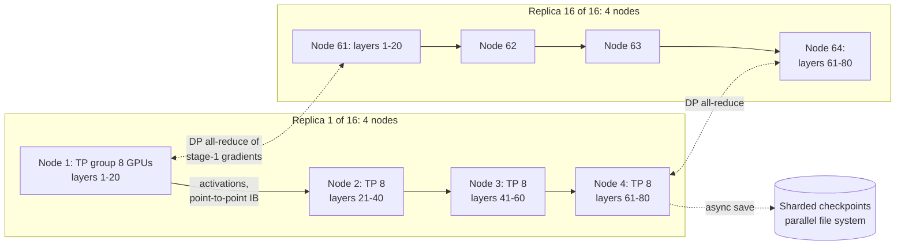

**Reading the diagram.** Each replica is a 4-stage pipeline over 4 nodes, each node a TP group of 8 GPUs on NVLink. Solid arrows are synchronous stage-to-stage transfers over InfiniBand; dotted arrows are the overlapped DP all-reduces between matching stages of different replicas (two drawn) and asynchronous checkpoint writes to the parallel file system (storage boundary, §65.15). Failure point: one GPU stops its TP group, its pipeline and, through the DP all-reduce, the job. Scaling: replicas add throughput up to the batch limit; stages fit bigger models at the cost of bubble.

### 65.13.2 A worked plan and the calculator

::: example
**Worked example — 70B on 512 GPUs (64 nodes × 8 × 80 GB).** Global batch 4 million tokens (1,024 sequences of 4,096), 1.4 trillion tokens.

1. *TP = 8*, the node size (§65.10). Per GPU this divides the per-layer weights by 8.
2. *PP*: with TP 8 alone, model state is $1{,}120/8 = 140$ GB per GPU, too much. With PP 4: $70 \times 10^9 / 32 = 2.19 \times 10^9$ parameters per GPU. Plus ZeRO-1 over DP: $4 \times 2.19 + 12 \times 2.19 / 16 = 8.75 + 1.64 = 10.4$ GB.
3. *Activations* with sequence parallelism and selective recomputation: $34\,s h / t = 34 \times 4{,}096 \times 8{,}192 / 8 = 143$ MB per layer per micro-batch; 20 layers per stage; up to 4 micro-batches in flight on stage 1 under 1F1B: $143 \times 20 \times 4 = 11.4$ GB. Total about 22 GB per GPU plus buffers: comfortable.
4. *DP* $= 512 / (8 \times 4) = 16$. Each replica processes $1{,}024/16 = 64$ sequences per step: with micro-batch 1, $m = 64$, bubble $3/67 = 4.5\%$.
5. *DP traffic*: each GPU's BF16 gradients are $2 \times 2.19 = 4.38$ GB; $V = 2 \times \frac{15}{16} \times 4.38 = 8.2$ GB, 205 ms at 40 GB/s, against a step of $6 \times 7 \times 10^{10} \times 4.19 \times 10^6 / 2.048 \times 10^{17} = 8.6$ s: 2.4%, and overlapped.
6. *Time*: 33.2 days at 40% MFU (§65.4). Benchmark alternatives (PP 2 × DP 32 at about 31 GB per GPU; TP 8 with FSDP and no PP) on 64 GPUs first (Figure 65.2).

**Interpretation.** Every degree is set by one constraint: TP by the NVLink domain, PP by memory, DP by what is left, and $m$ by the global batch. **Engineering implication.** Choose the smallest TP and PP that fit memory, because each wastes efficiency (communication or bubble), and let DP absorb the rest.
:::

The calculator below reproduces the numbers used in this chapter: memory per GPU for DDP and ZeRO stages, per-layer activations, the pipeline bubble, $6ND$ training time and the checkpoint interval of §65.15.

```python
"""Distributed-training planning calculator: memory per GPU, pipeline bubble, 6ND time."""
import math

GB = 1e9  # SI gigabytes, as in the rest of the book


def model_state_gb(n_params, gpus, stage):
    """Bytes per GPU for weights + gradients + Adam state (mixed precision, K = 12).

    stage 0 = plain DDP, 1 = shard optimizer state, 2 = + gradients, 3 = + parameters
    (ZeRO stages 1-3; stage 3 is what PyTorch FSDP FULL_SHARD does).
    """
    w, g, k = 2 * n_params, 2 * n_params, 12 * n_params   # BF16 weights, BF16 grads, FP32 master+m+v
    if stage >= 1:
        k /= gpus
    if stage >= 2:
        g /= gpus
    if stage >= 3:
        w /= gpus
    return (w + g + k) / GB


def act_gb_per_layer(s, b, h, a, t=1, recompute="none"):
    """Transformer activation memory per layer (Korthikanti et al. 2023), 16-bit.

    t = tensor-parallel size, with sequence parallelism so every term is divided by t.
    recompute: 'none' stores everything, 'selective' recomputes attention scores,
    'full' keeps only the layer input (2sbh bytes).
    """
    if recompute == "full":
        return 2 * s * b * h / t / GB
    attn_scores = 0 if recompute == "selective" else 5 * a * s / h
    return s * b * h * (34 + attn_scores) / t / GB


def bubble(p, m, v=1):
    """Fraction of pipeline time idle: (p-1)/(v*m + p-1); v = interleaved chunks per GPU."""
    return (p - 1) / (v * m + p - 1)


def train_days(n_params, tokens, gpus, peak_flops, mfu):
    """Wall-clock days from C = 6ND."""
    c = 6 * n_params * tokens
    return c, c / (gpus * peak_flops * mfu) / 86_400


print("Model-state memory per GPU (GB), 7B parameters, mixed-precision Adam")
print(f"{'GPUs':>5} {'DDP':>8} {'ZeRO-1':>8} {'ZeRO-2':>8} {'ZeRO-3':>8}")
for gpus in (8, 64):
    row = [model_state_gb(7e9, gpus, s) for s in range(4)]
    print(f"{gpus:>5} " + " ".join(f"{x:8.2f}" for x in row))

print("\nActivations per layer, 7B shape (s=2048, b=1, h=4096, a=32), GB")
for t, rc in [(1, "none"), (1, "selective"), (1, "full"), (8, "selective")]:
    print(f"  TP={t} recompute={rc:<9} {act_gb_per_layer(2048, 1, 4096, 32, t, rc):.3f}")

print("\nPipeline bubble fraction (p-1)/(v*m + p-1)")
for p, m, v in [(8, 8, 1), (8, 32, 1), (8, 64, 1), (8, 32, 4), (4, 64, 1)]:
    print(f"  p={p} m={m:>2} v={v}: {bubble(p, m, v):6.1%}")

print("\nTraining time from C = 6ND (peak 1e15 FLOP/s per GPU)")
for name, n, d, gpus, mfu in [("7B, 1T tokens", 7e9, 1e12, 512, 0.40),
                              ("7B, 1T tokens", 7e9, 1e12, 1, 0.40),
                              ("70B, 1.4T tokens", 70e9, 1.4e12, 512, 0.40),
                              ("70B, 1.4T tokens", 70e9, 1.4e12, 512, 0.30)]:
    c, days = train_days(n, d, gpus, 1e15, mfu)
    print(f"  {name:<17} {gpus:>4} GPUs MFU {mfu:.0%}: C={c:.2e} FLOPs, {days:8.1f} days, "
          f"{days * 24 * gpus:>12,.0f} GPU-hours")

print("\nChinchilla-optimal split of the 7B/1T budget (D = 20 N)")
c = 6 * 7e9 * 1e12
n_opt = math.sqrt(c / 120)
print(f"  N = {n_opt:.2e} parameters, D = {20 * n_opt:.2e} tokens")


def checkpoint_interval(delta, mtbf, restart):
    """Young (1974) and Daly (2006) intervals, and the expected wasted fraction at Young's."""
    young = math.sqrt(2 * delta * mtbf)
    x = delta / (2 * mtbf)
    daly = young * (1 + math.sqrt(x) / 3 + x / 9) - delta if delta < 2 * mtbf else mtbf
    waste = delta / young + (young / 2 + restart) / mtbf
    return young, daly, waste


print("\nCheckpoint interval (checkpoint stall 20 s, restart 600 s)")
for label, mtbf_h in [("16,384 GPUs, MTBF 3.1 h", 3.1), ("512 GPUs, MTBF 99 h", 99)]:
    y, d, w = checkpoint_interval(20, mtbf_h * 3600, 600)
    print(f"  {label:<24} Young {y:6.0f} s  Daly {d:6.0f} s  waste {w:5.1%}  goodput {1 - w:5.1%}")
```

Output:

```text
Model-state memory per GPU (GB), 7B parameters, mixed-precision Adam
 GPUs      DDP   ZeRO-1   ZeRO-2   ZeRO-3
    8   112.00    38.50    26.25    14.00
   64   112.00    29.31    15.53     1.75

Activations per layer, 7B shape (s=2048, b=1, h=4096, a=32), GB
  TP=1 recompute=none      0.956
  TP=1 recompute=selective 0.285
  TP=1 recompute=full      0.017
  TP=8 recompute=selective 0.036

Pipeline bubble fraction (p-1)/(v*m + p-1)
  p=8 m= 8 v=1:  46.7%
  p=8 m=32 v=1:  17.9%
  p=8 m=64 v=1:   9.9%
  p=8 m=32 v=4:   5.2%
  p=4 m=64 v=1:   4.5%

Training time from C = 6ND (peak 1e15 FLOP/s per GPU)
  7B, 1T tokens      512 GPUs MFU 40%: C=4.20e+22 FLOPs,      2.4 days,       29,167 GPU-hours
  7B, 1T tokens        1 GPUs MFU 40%: C=4.20e+22 FLOPs,   1215.3 days,       29,167 GPU-hours
  70B, 1.4T tokens   512 GPUs MFU 40%: C=5.88e+23 FLOPs,     33.2 days,      408,333 GPU-hours
  70B, 1.4T tokens   512 GPUs MFU 30%: C=5.88e+23 FLOPs,     44.3 days,      544,444 GPU-hours

Chinchilla-optimal split of the 7B/1T budget (D = 20 N)
  N = 1.87e+10 parameters, D = 3.74e+11 tokens

Checkpoint interval (checkpoint stall 20 s, restart 600 s)
  16,384 GPUs, MTBF 3.1 h  Young    668 s  Daly    655 s  waste 11.4%  goodput 88.6%
  512 GPUs, MTBF 99 h      Young   3776 s  Daly   3762 s  waste  1.2%  goodput 98.8%
```

What to notice:

- The memory table matches Table 65.2 and the ZeRO formulas.
- Full recomputation cuts per-layer activations 56-fold at the cost of a second forward pass; selective keeps 30% for a few percent of compute (§65.14).
- At 30% instead of 40% MFU the 70B run takes 11 more days: MFU, not FLOPs, has the largest error bars.

**Table 65.3 — Parallelism strategies compared.**

| Strategy | Splits | Communication | Where it runs | Main cost | Choose when |
|---|---|---|---|---|---|
| DDP | Data | All-reduce of gradients once per step | Anywhere | Full model state per GPU | Model state fits one GPU |
| ZeRO-1/2 | Data; optimizer state (+ gradients) | Same as DDP | Anywhere | None extra in bytes | Optimizer state does not fit |
| ZeRO-3/FSDP | Data; all model state | 1.5× DDP; gathers per layer | Fast networks; HSDP across | Latency at large $p$ | Up to tens of billions of parameters |
| Tensor (+SP) | Matrices within layers | 4 all-reduces per layer, critical path | One NVLink domain | Exposed communication | Layers or activations too big per GPU |
| Pipeline | Layers into stages | Point-to-point activations | Across nodes | Bubble; balancing | Model too big for TP within a node |
| Context | Sequence | K/V exchange per layer | Within or across nodes | Attention traffic | Sequences beyond ~32K tokens |
| Expert | Experts of MoE layers | 4 all-to-alls per MoE layer | Within node preferred | Imbalance, drops | MoE models |

::: recommendation
**Rules of thumb.** (1) Start with FSDP/ZeRO; add model parallelism only when needed. (2) TP ≤ GPUs per NVLink domain. (3) PP as small as memory allows, with $m \ge 4p$ or interleaving. (4) DP takes the rest, below the critical batch size. (5) CP only for long sequences, EP only for MoE. (6) Request topology-aware placement (§46.11.2). (7) Benchmark candidates on a slice first.
:::

::: industry
**Megatron-LM at 3,072 GPUs and Llama 3 at 16,384.** Narayanan et al. [2021] trained a 1-trillion-parameter GPT on 3,072 A100s with PTD-P at 502 PFLOP/s (163 TFLOP/s, 52% of peak, per GPU). Llama 3 405B used TP 8, PP 16 and DP 64 or 128 for 8K-token training, adding CP 16 for 128K tokens, at 38–43% BF16 MFU [Dubey et al. 2024].
*Evidence: Primary* — [Narayanan et al. 2021; Dubey et al. 2024]
:::

## 65.14 Mixed precision and memory techniques

### 65.14.1 BF16 and FP8 training

Chapter 64 covers the formats. **BF16 mixed precision** is the default: BF16 matrix multiplies, FP32 master weights and optimizer state, and none of the loss scaling that the original FP16 recipe needs [Micikevicius et al. 2018] (§64.10.2). Distribution adds one decision, the precision of *reductions*: summing thousands of ranks' gradients in BF16 loses low-order bits, so frameworks may reduce in FP32 at twice the traffic (FSDP's `reduce_dtype`). **FP8 training** [Micikevicius et al. 2022] runs matrix multiplies in 8-bit floats with scaling factors, roughly doubling peak throughput over BF16 where supported; DeepSeek-AI [2024] trained DeepSeek-V3, a 671B-parameter MoE with 37B active parameters, largely in FP8 with block-wise scaling.

### 65.14.2 Activation checkpointing

::: definition
**Definition — Activation checkpointing (recomputation).** Storing only selected activations during the forward pass (for example, each layer's input) and recomputing the rest during the backward pass [Chen et al. 2016]. **Selective recomputation** recomputes only the cheap-to-compute, memory-heavy parts, such as the attention scores [Korthikanti et al. 2023].
:::

::: formula
**Checkpointing trade-off**

$$M(k) \approx \frac{L}{k}\, a_\text{in} + k\, a_\text{layer} \qquad k^{*} = \sqrt{\frac{L\, a_\text{in}}{a_\text{layer}}} \qquad \frac{C_\text{full recompute}}{C} \approx \frac{8N}{6N} = 1.33$$

| Symbol | Meaning | Units |
|---|---|---|
| $M(k)$ | Activation memory when a checkpoint is kept every $k$ layers | bytes |
| $L$ | Layers | count |
| $a_\text{in}$ | Bytes of one layer's input ($2sbh$ in BF16) | bytes |
| $a_\text{layer}$ | Bytes of one layer's full activations | bytes |
| $k^{*}$ | Segment length minimizing $M$ | layers |
| $C_\text{full recompute}/C$ | Compute with one extra forward pass relative to normal training | — |
:::

::: example
**Worked example — 7B, $s = 2{,}048$, $b = 1$.** $a_\text{in} = 2 \times 2{,}048 \times 4{,}096 = 16.8$ MB, $a_\text{layer} = 0.956$ GB, $L = 32$.

1. No checkpointing: $32 \times 0.956 = 30.6$ GB.
2. $k^{*} = \sqrt{32 \times 0.0168 / 0.956} = 0.75$, so checkpoint every layer ($k = 1$): $M = 32 \times 0.0168 + 0.956 = 1.49$ GB, a 20-fold reduction.
3. Cost: one extra forward pass, $8N$ instead of $6N$ FLOPs per token, 33% more compute; MFU falls from 40% to 30% while HFU stays 40%.
4. Selective recomputation: $0.285 \times 32 = 9.1$ GB at a few percent of extra compute [Korthikanti et al. 2023].

**Interpretation.** Memory falls 20× for a third more compute, or 3.4× for almost nothing. **Engineering implication.** Default to selective recomputation; use full recomputation only where memory requires it.
:::

### 65.14.3 CPU and NVMe offload

**ZeRO-Offload** keeps optimizer state and the Adam update on the CPU, moving gradients down and weights up over PCIe each step [Ren et al. 2021]; **ZeRO-Infinity** extends offload to NVMe [Rajbhandari et al. 2021]. For the 7B model that is 14 GB each way per step, at least 0.28 s at about 50 GB/s achieved per direction on PCIe Gen5 x16 (64 GB/s peak, §64.14), plus the CPU's Adam update. Offload suits fine-tuning on few GPUs; in large clusters, sharding across GPUs is faster.

## 65.15 Checkpointing

### 65.15.1 What to save and how fast

::: definition
**Definition — Training checkpoint.** A durable snapshot sufficient to resume as if training had not stopped: weights, optimizer state, scheduler and step, random-number-generator states, data-loader position and parallel layout. In a **sharded checkpoint** every rank writes its own shard in parallel, with metadata that lets a different layout reload it (**resharding**). An **asynchronous checkpoint** stages state in host memory and writes it in the background.
:::

**Figure 65.15 — Asynchronous sharded checkpoint.**

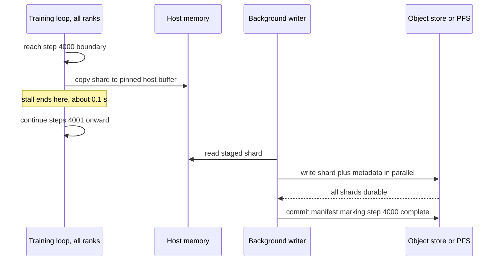

**Reading the diagram.** Every rank copies its shard to pinned host memory (synchronous, the only stall) and resumes training. A background writer streams the shard to durable storage (the storage boundary, §49.11) asynchronously. Only when all shards are durable is a manifest committed, the atomic marker that makes the checkpoint usable, so a crash mid-write leaves the previous one valid. Failure points: host memory too small to stage; storage too slow, so checkpoints overlap. Scaling: write bandwidth grows with ranks until storage saturates.

::: example
**Worked example — Checkpoint size and write time for the 70B job.** Save FP32 master weights and Adam moments ($12N$) plus BF16 weights for convenient evaluation ($2N$).

1. Size: $14 \times 70 \times 10^9 = 980$ GB per checkpoint.
2. Rank 0 gathers and writes it all at 2 GB/s: 490 s with 511 GPUs idle, 70 GPU-hours per checkpoint.
3. Sharded, 512 ranks each write $980/512 = 1.9$ GB, limited by an assumed 100 GB/s aggregate storage bandwidth: 9.8 s.
4. Asynchronous: copy 1.9 GB per GPU to host at about 25 GB/s: about 0.08 s of stall; the 9.8 s write overlaps training.
5. Keeping 5 recent plus one daily checkpoint for 34 days: about 39 checkpoints, 38 TB.

**Interpretation.** Layout, not size, decides cost: the same terabyte costs 8 minutes or a tenth of a second of training. **Engineering implication.** Use sharded asynchronous checkpoints (PyTorch Distributed Checkpoint, DeepSpeed, Megatron), commit with a manifest, and size storage for checkpoint bursts.
:::

### 65.15.2 The optimal checkpoint interval

Checkpoint too often and you pay the stall repeatedly; too rarely and failures discard more work. Training uses Young's approximation (§29.9), refined by Daly.

::: formula
**Young/Daly optimal checkpoint interval and wasted fraction**

$$\tau_\text{Young} = \sqrt{2\,\delta\,M} \qquad \tau_\text{Daly} = \sqrt{2\delta M}\left[1 + \tfrac{1}{3}\sqrt{\tfrac{\delta}{2M}} + \tfrac{1}{9}\tfrac{\delta}{2M}\right] - \delta \qquad w \approx \frac{\delta}{\tau} + \frac{\tau/2 + R}{M}$$

| Symbol | Meaning | Units |
|---|---|---|
| $\tau$ | Time between checkpoints | s |
| $\delta$ | Training time lost per checkpoint (the stall) | s |
| $M$ | Mean time between failures of the *whole job* | s |
| $R$ | Restart time: detect, reschedule, reload, warm up | s |
| $w$ | Expected fraction of wall-clock time wasted | — |
:::

::: example
**Worked example — Interval for a 16,384-GPU and a 512-GPU job.** From Llama 3's statistics (§65.16), 419 unexpected interruptions in 54 days on 16,384 GPUs is a job MTBF of 3.1 hours, or about 50,700 GPU-hours per interruption. Take $\delta = 20$ s (synchronous sharded checkpoint) and $R = 600$ s.

1. 16,384 GPUs, $M = 11{,}160$ s: $\tau_\text{Young} = \sqrt{2 \times 20 \times 11{,}160} = 668$ s; Daly gives 655 s. Waste: $20/668 + (334 + 600)/11{,}160 = 3.0\% + 8.4\% = 11.4\%$.
2. 512 GPUs at the same per-GPU rate, $M = 99$ h $= 356{,}400$ s: $\tau = 3{,}776$ s (about an hour); waste $0.5\% + 0.7\% = 1.2\%$.
3. 16,384 GPUs with asynchronous checkpoints ($\delta = 0.1$ s): $\tau = 47$ s; waste $0.2\% + 0.2\% + 5.4\%$ from restarts.

**Interpretation.** Job MTBF falls in proportion to GPU count, and at 16K GPUs restart time, not checkpoint cost, dominates the waste. **Engineering implication.** At scale, invest first in cheap checkpoints (asynchronous, in-memory) and then in fast restarts (hot spares, pre-pulled images, fast reload), which is where §65.16 begins.
:::

## 65.16 Fault tolerance and recovery

### 65.16.1 Failure rates at scale

**Table 65.4 — Llama 3 405B pre-training interruptions over a 54-day snapshot [Dubey et al. 2024].**

| Statistic | Reported value |
|---|---|
| Cluster | Up to 16,384 H100 GPUs |
| Total interruptions | 466 (47 planned, 419 unexpected) |
| Unexpected interruptions attributed to confirmed or suspected hardware issues | About 78% |
| Largest category | GPU issues, 58.7% of unexpected interruptions (faulty GPUs 30.1%, GPU HBM3 memory 17.2%) |
| Interruptions needing significant manual intervention | 3 |
| Effective training time | Higher than 90% |

At this scale failures are routine (about one every three hours), so recovery must be automatic; most are hardware, and some are silent: **silent data corruption** yields wrong numbers rather than crashes, caught only by loss spikes, NaNs or cross-replica checksums. The paper also reports a diurnal 1–2% throughput variation from temperature and power swings of tens of megawatts when GPUs pause together.

### 65.16.2 Detection, restart and elastic training

::: definition
**Definition — Goodput (training).** The fraction of wall-clock time spent on training progress that is kept, excluding checkpoint stalls, work lost since the last checkpoint, restarts and maintenance. **Elastic training** continues with a different number of workers, within bounds, when workers join or leave.
:::

**Figure 65.16 — Training job lifecycle with automatic recovery.**

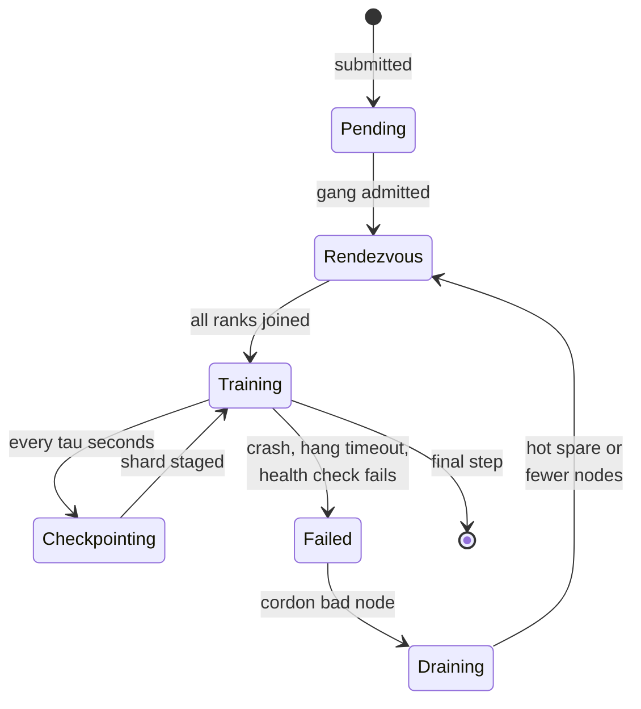

**Reading the diagram.** After gang admission (§46.10), ranks meet at a **rendezvous** store (etcd or PyTorch's c10d store) to agree on membership. Training checkpoints periodically. Failure arrives as a crash, a hang caught by the NCCL watchdog's timeout, or a failed health check (driver-reported GPU errors, `nccl-tests`, thermals). The faulty node is cordoned and the job re-enters rendezvous with a hot spare, or fewer nodes if elastic, reloading the last complete checkpoint. Transitions are asynchronous events. Scaling: recovery time must stay constant as failure frequency grows with GPU count.

**TorchElastic** (`torchrun`) runs an agent per node that starts and monitors workers and, on a failure, restarts *all* of them (up to `--max-restarts`) after a new rendezvous; `--nnodes=MIN:MAX` admits a varying node count [PyTorch Docs: torchrun]. Elasticity is easy for pure data parallelism and hard for TP and PP layouts, so large jobs prefer **hot spares**: pre-validated idle nodes that keep the layout unchanged.

::: example
**Worked example — Goodput of the 70B run.** Ideal compute time 33.2 days (797 h) on 512 GPUs; job MTBF 99 h; synchronous checkpoints with $\delta = 20$ s every hour.

1. Expected failures: about $797/99 \approx 8$.
2. Lost per failure: half an interval plus restart, $30 + 10 = 40$ min; total 5.3 h.
3. Checkpoint stalls: 797 checkpoints × 20 s = 4.4 h.
4. Goodput: $797 / (797 + 5.3 + 4.4) = 98.8\%$, consistent with the calculator's 1.2% waste.
5. At 16,384 GPUs the same reliability gives 88.6%; asynchronous checkpoints plus 2-minute restarts from hot spares cut waste to about $0.2\% + 0.2\% + 120/11{,}160 = 1.5\%$.

**Interpretation.** Reliability engineering optional at 512 GPUs is the difference between 88% and 98% at 16K. **Engineering implication.** Track goodput next to MFU; their product is what the budget buys.
:::

| What goes wrong | Why | Detection | Recovery | Prevention |
|---|---|---|---|---|
| Hang, no crash | Dead NIC or stuck kernel; collective waits forever | NCCL watchdog timeout; no step progress | Kill, cordon, restart | Collective timeouts of minutes, not hours |
| Loss spike or NaN | Silent data corruption or numerical instability | Loss and gradient-norm monitors | Roll back to earlier checkpoint, skip batch | Cross-replica checksums; burn-in tests |
| Corrupt latest checkpoint | Crash during write | Missing manifest; load error | Use previous checkpoint | Manifest commit; keep several checkpoints |

## 65.17 Bottlenecks and profiling

A training step is as slow as the slowest of four things: compute, exposed communication, the slowest rank, and input data. Measure MFU first, then find which of the four is missing.

::: formula
**Measured MFU and the straggler penalty**

$$\text{MFU} = \frac{6\,N\,X}{G\,R} \qquad \Pr[\text{slow step}] = 1 - (1-q)^{G} \qquad \mathbb{E}[T_\text{step}] \approx T_0\left(1 + \Pr[\text{slow step}]\,(\sigma - 1)\right)$$

| Symbol | Meaning | Units |
|---|---|---|
| $X$ | Measured training throughput of the whole job | tokens/s |
| $G$, $R$ | GPUs; peak FLOP/s per GPU | GPUs, FLOP/s |
| $q$ | Probability that a given GPU is slow in a given step (throttling, OS jitter, a slow link) | — |
| $\sigma$ | Slowdown factor of a slow GPU | — |
| $T_0$ | Step time with no stragglers | s |
:::

::: example
**Worked example — Diagnosing a 7B job on 512 GPUs.**

1. Measured 9,000 tokens/s per GPU: MFU $= 6 \times 7 \times 10^9 \times 9{,}000 / 10^{15} = 37.8\%$, close to the 40% plan.
2. Measured 5,000 tokens/s per GPU: MFU 21%. The profile shows the GPUs idle 30% of each step waiting in all-reduce, but only on some steps.
3. Stragglers: if each GPU independently has a 0.1% chance per step of running 1.5× slower, then $1 - 0.999^{512} = 40\%$ of steps contain at least one, and expected step time rises by $0.40 \times 0.5 = 20\%$. At 16,384 GPUs, essentially every step has one.
4. Data loading: 4.6 million tokens/s at 4 bytes each is 18 MB/s, trivial for text; images at 512 × 2,000 per second × 110 KB need 113 GB/s of reads plus decoding, which can starve the GPUs.

**Interpretation.** Synchronous steps turn rare per-GPU hiccups into common job-wide slowdowns. **Engineering implication.** Monitor per-rank step time, replace persistently slow nodes, and prefetch and pre-tokenize data.
:::

The **PyTorch profiler** and **Nsight Systems** show whether NCCL kernels overlap compute; bus bandwidth (§65.7) and per-rank step-time histograms locate bad links and stragglers. Typical MFU for large dense transformers is about 35–55%: Llama 3 reports 38–43% [Dubey et al. 2024] and PaLM 46.2% on TPU v4 [Chowdhery et al. 2022]. Below 30%, look for exposed communication, bubbles, recomputation, small micro-batches or a data stall.

::: mistake
**Optimizing the average rank.** Every step runs at the speed of the slowest rank, so a fleet with a fine median but a slow p99.9 GPU loses throughput on most steps (§4.8).
:::

## 65.18 Orchestrating training jobs

Chapter 46 owns cluster scheduling. A training job needs gang admission (§46.10), topology-aware placement (§46.11.2), a rendezvous, restart policies and shared storage.

**Table 65.5 — Orchestrators for training jobs (as of 2026).**

| Orchestrator | Gang and topology | Failure handling | Strengths | Choose when |
|---|---|---|---|---|
| Slurm | Native: a job gets all its nodes at once; topology plugin for switch-aware placement | Requeue; `srun` restart; scripts | Simple, HPC-proven, low overhead | Dedicated research or pre-training clusters |
| Kubernetes + Kueue or Volcano | Kueue job-level admission with quota and topology-aware scheduling; Volcano gang scheduler | Pod restart policies; JobSet or PyTorchJob operators; requeue | Shares a cluster with serving and pipelines; cloud-native tooling | Multi-team platforms; mixed workloads |
| Ray Train | Placement groups reserve resources together on a Ray cluster | Worker restarts and checkpoint hooks | Python-native; integrates data loading and tuning | Teams already on Ray; heterogeneous pipelines |

**Figure 65.17 — A training job on Kubernetes with Kueue admission.**

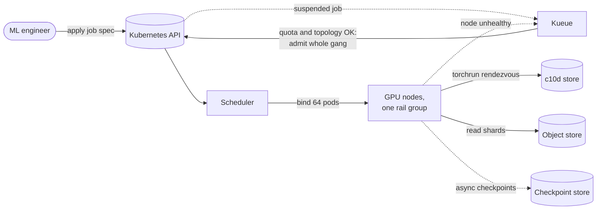

**Reading the diagram.** The job starts suspended; Kueue admits it asynchronously only when quota exists for every pod and, with topology-aware scheduling, when they fit one rail group; the scheduler then binds all pods. Pods meet at a rendezvous store, read shards from object storage, and write checkpoints asynchronously. Storage boundaries: API state, rendezvous, data and checkpoint stores. Failure points: a node health event sends the job back to Kueue for requeue; without admission control a partial gang would deadlock. Admission is per job, so large gangs do not overload the scheduler.

A Slurm job spec for the 70B plan of §65.13, launching one `torchrun` agent per node:

```bash
#!/bin/bash
#SBATCH --job-name=llm70b-pretrain
#SBATCH --nodes=64
#SBATCH --ntasks-per-node=1          # one torchrun agent per node
#SBATCH --gpus-per-node=8
#SBATCH --cpus-per-task=96
#SBATCH --exclusive
#SBATCH --time=48:00:00              # resubmitted from the latest checkpoint
#SBATCH --requeue

head=$(scontrol show hostnames "$SLURM_JOB_NODELIST" | head -n 1)
srun torchrun \
  --nnodes=64 --nproc-per-node=8 \
  --rdzv-backend=c10d --rdzv-endpoint="${head}:29500" --rdzv-id="$SLURM_JOB_ID" \
  --max-restarts=3 \
  train.py --tp 8 --pp 4 --dp 16 --micro-batch 1 --global-batch-tokens 4194304 \
           --ckpt-dir /lustre/ckpt/llm70b --ckpt-interval-s 3600 --resume latest
```

What to notice:

- `--exclusive` and one task per node give each `torchrun` agent all 8 GPUs, so TP groups stay inside NVLink domains.
- The c10d rendezvous on the first node plus `--max-restarts` gives in-job restarts; `--requeue` and a bounded `--time` let the scheduler restart the whole job from `--resume latest`.
- The layout flags multiply to $8 \times 4 \times 16 = 512$ GPUs, matching `--nodes` × `--gpus-per-node`; a mismatch is the most common launch error.

::: recommendation
**Platform choice.** A cluster dedicated to large training runs is simplest on Slurm; GPUs shared with inference and serving teams fit Kubernetes with Kueue and a training operator. Either way, wire node health checks into the scheduler so failed nodes are cordoned automatically.
:::

## 65.19 Summary and revision notes

::: summary
- Time, not memory, usually sets cluster size: $G_\text{time} = 6ND / (R \cdot \text{MFU} \cdot T_\text{max})$ exceeds $G_\text{mem}$.
- $C \approx 6ND$; wall-clock $= C/(G R\,\text{MFU})$. Chinchilla's compute-optimal ratio is about 20 tokens per parameter; models meant for heavy serving are trained far beyond it.
- DDP all-reduces gradients in buckets that overlap backward; each GPU sends $2\frac{p-1}{p}S$ bytes per step. One NIC per GPU makes cross-node all-reduce nearly as fast as NVLink. Large batches need learning-rate scaling and warmup, up to a critical batch size.
- All-reduce = reduce-scatter + all-gather. ZeRO-1/2 shard optimizer state and gradients at DDP's traffic; ZeRO-3/FSDP shard everything at 1.5× traffic: $16N/p$ bytes per GPU.
- Tensor parallelism: four all-reduces per layer on the critical path, so keep it inside an NVLink domain. Pipeline parallelism: bubble $(p-1)/(m+p-1)$; use $m \ge 4p$, 1F1B and interleaving. Context parallelism splits long sequences; expert parallelism moves tokens with all-to-all and needs capacity limits and load balancing.
- 3D/4D layouts map the chattiest axis to the fastest links: TP in node, PP across nodes, DP outermost with sharded optimizer state.
- Selective recomputation cuts activation memory about 3× for a few percent of compute; full recomputation about 20× for 33%.
- Sharded asynchronous checkpoints reduce stalls from minutes to sub-second; choose the interval with $\sqrt{2\delta M}$. Job MTBF falls linearly with GPU count (about 3 hours at 16K GPUs in Llama 3), so restart time dominates waste at scale.
- Track MFU × goodput; find stragglers by per-rank step time; orchestrate with gang admission and topology-aware placement (Slurm, Kubernetes + Kueue/Volcano, or Ray).
:::

## 65.20 Knowledge checkpoint

1. A model has $N = 13 \times 10^9$. How much model-state memory does mixed-precision Adam need without sharding?
2. How long does $6ND$ say a 13B model on 2T tokens takes on 1,024 GPUs at $10^{15}$ FLOP/s and 40% MFU?
3. What is the compute-optimal model size for $C = 10^{24}$ FLOPs under the 20-tokens-per-parameter rule?
4. Why does DDP all-reduce gradients in reverse layer order?
5. BF16 gradients of a 3B model are all-reduced across 32 GPUs. How many bytes does each GPU send?
6. Give ZeRO-2's per-GPU model state for $N = 13 \times 10^9$ on 16 GPUs.
7. Why does ZeRO-3 send 1.5× DDP's bytes?
8. How many all-reduces per transformer layer does Megatron tensor parallelism need per training step?
9. Bubble fraction for $p = 4$, $m = 16$? With $v = 2$ interleaving?
10. With $E = 32$, $k = 1$, $T = 65{,}536$ and cf $= 1.0$, what is the expert capacity?
11. A checkpoint stalls training for 30 s and the job MTBF is 6 h. What is Young's interval?
12. 512 GPUs; each has a 0.2% chance per step of being 2× slow. What is the expected step-time inflation?

<details><summary>Answers</summary>

1. $16 \times 13 \times 10^9 = 208$ GB.
2. $6 \times 1.3 \times 10^{10} \times 2 \times 10^{12} = 1.56 \times 10^{23}$; divided by $1{,}024 \times 4 \times 10^{14} = 4.1 \times 10^{17}$: $3.81 \times 10^5$ s, about 4.4 days.
3. $N = \sqrt{10^{24}/120} = 9.1 \times 10^{10}$, about 91B parameters on 1.8T tokens.
4. Last layers' gradients are ready first, so their buckets can be communicated while earlier layers are still computing.
5. $2 \times \frac{31}{32} \times 6$ GB $= 11.6$ GB.
6. $2 \times 13 + 14 \times 13/16 = 26 + 11.4 = 37.4$ GB.
7. Weights are all-gathered for forward and again for backward, plus the gradient reduce-scatter: three $\frac{p-1}{p} \cdot 2N$ transfers instead of two.
8. Four: two in forward (attention and MLP), two in backward.
9. $3/19 = 15.8\%$; $3/35 = 8.6\%$.
10. $65{,}536/32 = 2{,}048$ tokens.
11. $\sqrt{2 \times 30 \times 21{,}600} = 1{,}138$ s, about 19 minutes.
12. $1 - 0.998^{512} = 64\%$ of steps are slow; expected inflation $0.64 \times 1 = 64\%$.

</details>

## 65.21 Interview questions

### Basic

**Q1. What is the difference between data and model parallelism?**
**Answer.** Data parallelism replicates the model and splits examples, exchanging gradients once per step. Model parallelism (tensor, pipeline) splits the model itself, exchanging activations per layer or per stage. Use data parallelism when the model fits; split the model when it does not.

**Q2. Why is DDP preferred to `DataParallel`?**
**Answer.** One process per GPU avoids the interpreter lock and GPU-0 bottleneck, weights are never re-copied, bucketed all-reduce overlaps backward, and it spans machines.

### Intermediate

**Q3. You must train a 30B model on 64 × 80 GB GPUs. What do you try first?**
**Answer.** $16 \times 30 = 480$ GB of state; FSDP over 64 gives 7.5 GB per GPU plus activations with selective recomputation. Benchmark MFU; if all-gathers are exposed, use hybrid sharding within nodes. Add TP 2–8 only if activations do not fit.

**Q4. Your 1,024-GPU job's MFU dropped from 42% to 30% overnight. How do you investigate?**
**Answer.** Check per-rank step times for stragglers, NCCL bus bandwidth for a degraded link, data-loader wait and recent configuration changes; health-check and replace the slowest nodes.

### Advanced

**Q5. Design the parallel layout for a 70B model on 512 GPUs.**
**Answer.** TP 8 inside each node; PP 4 so model state is about 10 GB per GPU with ZeRO-1; DP 16. With a 4M-token batch, 64 micro-batches give a 4.5% bubble. Use selective recomputation and sequence parallelism; DP all-reduce is 2% of the step. Benchmark against PP 2 × DP 32 and TP 8 + FSDP.

**Q6. How would you get goodput above 95% on a 16K-GPU run?**
**Answer.** Job MTBF is hours, so use frequent asynchronous checkpoints; cut restart time with hot spares, fast reload and automated cordoning; detect hangs with collective timeouts and silent corruption with loss and checksum monitors.

## 65.22 Practical exercises

1. Extend the ring simulation to a two-level hierarchical all-reduce (reduce-scatter in node, all-reduce across nodes, all-gather in node) and count bytes per link class.
2. Add tensor- and pipeline-parallel memory to the calculator and reproduce the 70B plan of §65.13.
3. Simulate 1,000 steps of 512 workers with a straggler probability and plot throughput against $q$.
4. Compute the Daly interval and goodput for your own cluster's failure history.

## 65.23 Design challenges

1. **QuickBite chatbot training platform.** Design the cluster, layout, checkpointing and scheduling for monthly 7B training on 50B tokens, sharing GPUs with serving.
2. **A 1T-parameter MoE on 4,096 GPUs.** Choose EP, TP, PP and DP; compute all-to-all traffic and the capacity factor; plan load-balancing metrics.
3. **Spot-instance training.** Train a 13B model on preemptible GPUs with a 2-hour mean time to preemption; choose elasticity, checkpoint interval and storage.

## 65.24 References

1. Li, S., Zhao, Y., Varma, R., Salpekar, O., Noordhuis, P., Li, T., Paszke, A., Smith, J., Vaughan, B., Damania, P., Chintala, S. *PyTorch Distributed: Experiences on Accelerating Data Parallel Training*. PVLDB 13(12), 2020.
2. Rajbhandari, S., Rasley, J., Ruwase, O., He, Y. *ZeRO: Memory Optimizations Toward Training Trillion Parameter Models*. SC, 2020.
3. Zhao, Y., et al. *PyTorch FSDP: Experiences on Scaling Fully Sharded Data Parallel*. PVLDB 16(12), 2023.
4. Shoeybi, M., Patwary, M., Puri, R., LeGresley, P., Casper, J., Catanzaro, B. *Megatron-LM: Training Multi-Billion Parameter Language Models Using Model Parallelism*. arXiv:1909.08053, 2019.
5. Narayanan, D., et al. *Efficient Large-Scale Language Model Training on GPU Clusters Using Megatron-LM*. SC, 2021.
6. Huang, Y., et al. *GPipe: Efficient Training of Giant Neural Networks using Pipeline Parallelism*. NeurIPS, 2019.
7. Narayanan, D., et al. *PipeDream: Generalized Pipeline Parallelism for DNN Training*. SOSP, 2019.
8. Korthikanti, V., et al. *Reducing Activation Recomputation in Large Transformer Models*. MLSys, 2023.
9. Lepikhin, D., et al. *GShard: Scaling Giant Models with Conditional Computation and Automatic Sharding*. ICLR, 2021.
10. Fedus, W., Zoph, B., Shazeer, N. *Switch Transformers: Scaling to Trillion Parameter Models with Simple and Efficient Sparsity*. JMLR 23, 2022.
11. Kaplan, J., et al. *Scaling Laws for Neural Language Models*. arXiv:2001.08361, 2020.
12. Hoffmann, J., et al. *Training Compute-Optimal Large Language Models*. NeurIPS, 2022.
13. Goyal, P., et al. *Accurate, Large Minibatch SGD: Training ImageNet in 1 Hour*. arXiv:1706.02677, 2017.
14. Li, M., et al. *Scaling Distributed Machine Learning with the Parameter Server*. OSDI, 2014.
15. Dubey, A., et al. (Llama Team, Meta). *The Llama 3 Herd of Models*. arXiv:2407.21783, 2024.
16. Young, J. W. *A First Order Approximation to the Optimum Checkpoint Interval*. Communications of the ACM 17(9), 1974.
17. Daly, J. T. *A Higher Order Estimate of the Optimum Checkpoint Interval for Restart Dumps*. Future Generation Computer Systems 22(3), 2006.
18. Chowdhery, A., et al. *PaLM: Scaling Language Modeling with Pathways*. JMLR 24, 2023 (arXiv:2204.02311, 2022).
19. McCandlish, S., Kaplan, J., Amodei, D., OpenAI Dota Team. *An Empirical Model of Large-Batch Training*. arXiv:1812.06162, 2018.
20. You, Y., et al. *Large Batch Optimization for Deep Learning: Training BERT in 76 Minutes*. ICLR, 2020.
21. Dean, J., et al. *Large Scale Distributed Deep Networks*. NeurIPS, 2012.
22. Ho, Q., et al. *More Effective Distributed ML via a Stale Synchronous Parallel Parameter Server*. NeurIPS, 2013.
23. Naumov, M., et al. *Deep Learning Recommendation Model for Personalization and Recommendation Systems*. arXiv:1906.00091, 2019.
24. Micikevicius, P., et al. *Mixed Precision Training*. ICLR, 2018.
25. Micikevicius, P., et al. *FP8 Formats for Deep Learning*. arXiv:2209.05433, 2022.
26. DeepSeek-AI. *DeepSeek-V3 Technical Report*. arXiv:2412.19437, 2024.
27. Chen, T., Xu, B., Zhang, C., Guestrin, C. *Training Deep Nets with Sublinear Memory Cost*. arXiv:1604.06174, 2016.
28. Ren, J., et al. *ZeRO-Offload: Democratizing Billion-Scale Model Training*. USENIX ATC, 2021.
29. Rajbhandari, S., et al. *ZeRO-Infinity: Breaking the GPU Memory Wall for Extreme Scale Deep Learning*. SC, 2021.
30. Liu, H., Zaharia, M., Abbeel, P. *Ring Attention with Blockwise Transformers for Near-Infinite Context*. ICLR, 2024.
31. Jacobs, S. A., et al. *DeepSpeed Ulysses: System Optimizations for Enabling Training of Extreme Long Sequence Transformer Models*. arXiv:2309.14509, 2023.
32. Jeaugey, S. *Massively Scale Your Deep Learning Training with NCCL 2.4*. NVIDIA Technical Blog, 2019.
33. PyTorch Docs: torchrun (Elastic Launch). https://pytorch.org/docs/stable/elastic/run.html

## 65.25 Open verification items

- Llama 3 reliability figures (466/47/419 interruptions, 78% hardware, 58.7% GPU, 30.1% faulty GPU, 17.2% HBM3, 3 manual interventions, >90% effective time, diurnal 1–2%), the 3.8 × 10²⁵ FLOPs and 38–43% MFU, and the 4D layouts: check against Dubey et al. 2024.
- Megatron-LM 2019 (15.1 PFLOP/s, 76% efficiency) and SC 2021 (502 PFLOP/s, 52%) figures.
- ZeRO's "over 100B on 400 GPUs, super-linear" and Turing-NLG attribution; Switch's "up to 7×"; GShard's "2,048 TPU v3 cores, four days".
- PaLM MFU 46.2% and PaLM's JMLR venue; DDP "near-linear to 256 GPUs".
- Jeaugey 2019 blog title; FSDP PVLDB volume; torchrun URL (not fetched).
- Achieved-bandwidth assumptions (360 and 40 GB/s, 320 GB/s rail-optimized) are teaching approximations.
