# Chapter 66 — Model Serving

> **Level:** 3 · **Track:** B (ML/AI) · **Estimated reading time:** 5 h

A trained model is a file. On QuickBite's laptop-sized test bench the ETA model answers in a tenth of a millisecond, the dish-photo classifier in 50 milliseconds, and both look finished. In production the same files must answer 40,000 times a second at dinner and 4,000 times a second at 3 a.m.; survive a node failure, a bad release and a feature store that slows down; change version every night without a single failed request; and cost a fraction of a cent per order. **Model serving** is the engineering that turns the file into that service.

This chapter owns general model serving: everything between "the model is in the registry" and "a prediction reached the client", for models that are not large language models. You will learn the four inference modes (online, asynchronous, streaming and batch), the anatomy of a model server, and what each widely used server (NVIDIA Triton, TorchServe, TensorFlow Serving, KServe, Ray Serve and BentoML) is for. The quantitative core is **dynamic batching**: you will derive its latency and throughput, simulate it, and measure a real batch curve with PyTorch. You will then decide between CPUs and GPUs by cost per 1,000 predictions, share GPUs among models, autoscale with headroom, load and warm models quickly, route traffic between versions, and roll out safely with shadow traffic, canaries, A/B tests and interleaving. The chapter ends with batch inference at scale, reliability and observability for serving, and a reference architecture for QuickBite's ETA service at 40,000 predictions per second.

Chapter 60 placed the model runtime inside the inference pipeline (§60.6), set its latency budget (§60.10) and fleet-sizing formula (§60.11). Chapter 64 explained why GPUs need batches. Chapter 67 makes each model cheaper (quantization, distillation, compilation), Chapter 68 serves recommenders, and Chapter 73 owns large language model (LLM) serving: key–value (KV) cache management and continuous batching are previewed here only.

::: note
**QuickBite assumptions used in this chapter.** These reuse the Book II design point; they are teaching assumptions, not measurements of a real company. Search peaks at 2,000 requests per second (RPS), each scoring 20 restaurants: **40,000 ETA predictions/s at peak**, about 360 million a day, an average of 4,167/s (peak-to-average ratio 9.6, §18.11), about 720 ETA predictions per order (§60.6.2). The primary ETA model is gradient-boosted trees costing 0.1 ms of CPU per prediction; a deep challenger costs 2 ms per prediction on CPU or runs at 25,000 predictions/s per GPU at batch 64 (§60.11). The ETA service's p99 budget is 100 ms, of which the model stage gets 20 ms (Table 60.12). Prices: \$0.77 per hour for a 16-vCPU node (\$0.048 per vCPU-hour) and \$2.50 per GPU-hour (§60.11, Chapter 64). QuickBite receives 200,000 new dish photos per day (§58.19). Sizes use SI units (1 GB = 10⁹ bytes).
:::

## 66.1 Learning objectives

After this chapter you should be able to:

- Choose among online, asynchronous, streaming and batch inference for a product requirement, and justify the choice with latency, freshness and cost.
- Draw the components of a model server and explain what each does on the request path and the control path.
- Compare Triton, TorchServe, TensorFlow Serving, KServe, Ray Serve and BentoML by purpose and architecture, and state their status as of 2026.
- Derive the latency and throughput of dynamic batching, pick a maximum batch size and maximum queue delay from a latency budget, and verify the choice by simulation.
- Compute cost per 1,000 predictions on CPUs and GPUs and decide when GPUs pay off.
- Explain model sharding, multi-model serving, model multiplexing and GPU sharing with MIG and MPS.
- Size an autoscaled inference fleet with headroom for reaction time, and estimate cold-start time from model size and storage bandwidth.
- Design version routing and a safe rollout (shadow, canary, A/B, interleaving) with automated analysis and rollback.
- Size a batch-inference job and make its output writes idempotent.
- Apply timeouts, fallbacks, circuit breakers, load shedding and hedging to an inference service, and instrument it for observability.

## 66.2 Prerequisites

- The inference pipeline, latency budgets and fleet sizing — §60.6, §60.10, §60.11 (this chapter implements the model-runtime box of those sections).
- Fallbacks and cascades — §60.12.2, §60.13.2 (serving reliability builds on the fallback ladder).
- Online feature fetch — §62.7.2, §62.11 (most of an online prediction's latency is often feature retrieval, not the model).
- GPU utilization, the roofline and GPU sharing — §64.9, §64.11, §64.12, §64.15 (why batching helps and why "100% utilized" can mean idle).
- Batching model $T(B) = t_0 + B t_1$ — §4.18.6, §23.8.1 (the formulas this chapter extends).
- Queueing and Little's Law — §4.10, §4.11 (queue delay near saturation).
- Load balancing — §19.4 (least-loaded routing to replicas with queues).
- Autoscaling and Kubernetes — §18.8, §42.12 (HPA, KEDA, node autoscalers, reaction time).
- Canary statistics — §43.6 (two-proportion tests and sample size).
- Timeouts, backpressure, load shedding and circuit breakers — §22.9–§22.13; hedged requests — §23.7.

## 66.3 Inference modes

### 66.3.1 Four ways to run a model

::: definition
**Definition — Inference modes.** **Online (synchronous) inference** computes a prediction inside a client's request and returns it in the response, within a latency budget of milliseconds. **Asynchronous inference** accepts a request, places it on a queue, and delivers the result later by callback, polling or a result store, within seconds to minutes. **Streaming inference** is triggered by events on a log such as Kafka, scores each event (or a micro-batch) as it arrives, and writes results to another stream or store, with no client waiting. **Batch (offline) inference** scores a large, bounded dataset on a schedule and writes the predictions to storage, where online services look them up.
:::

#### First-principles explanation

Think of a bakery. A coffee is made while the customer waits (online). A wedding cake ordered for Saturday goes into a queue and the customer is called when it is ready (asynchronous). A fresh tray comes out whenever the oven timer rings, with nobody asking (streaming). The day's bread is baked at 4 a.m. and served from the shelf (batch).

Two questions decide: **does someone wait for the answer?** and **can it be computed before the question is asked?** Enumerable inputs known in advance (every restaurant's prep time tomorrow) go to batch; inputs known only at request time (this customer, this basket, now) go online; event-triggered work that tolerates seconds of delay streams; work too slow for a request that someone still needs (an image-moderation verdict) is asynchronous.

#### Why does this exist?

Latency, freshness and cost pull in different directions. Online inference is freshest but pays for peak capacity; batch is cheapest per prediction but stale and scores inputs nobody asks about; asynchronous and streaming modes absorb bursts in a queue (§30.3), so capacity can be sized nearer the average. Section 60.8 introduced batch versus online; this section adds the queue-based modes.

#### How it works internally

1. **Online.** An RPC (HTTP or gRPC) reaches a model-server replica through a load balancer; every stage spends part of the client's deadline (§22.11).
2. **Asynchronous.** The API enqueues the job and returns a job ID (HTTP 202); workers pull jobs, write results to a store keyed by job ID, and the client polls or gets a webhook. Queue depth drives autoscaling.
3. **Streaming.** A Kafka consumer or Flink job scores events per partition (§31.5) and writes predictions to a topic or key-value store; consumer lag is the health signal.
4. **Batch.** A scheduler (§61.15) launches a Spark or Ray job that scores an input partition in large batches and writes an output partition atomically.

**Figure 66.1 — The four inference modes.**

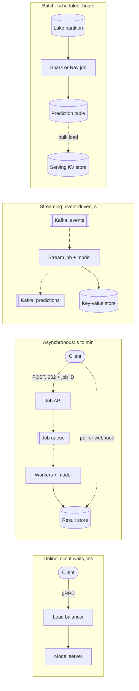

**Reading the diagram.** *Online* (solid, synchronous): the client waits while its RPC passes a load balancer to a replica; failure point: any slow stage breaks the deadline; scale with replicas. *Asynchronous*: the queue (dotted) decouples arrival from processing; workers write to a result store, the storage boundary the client polls; failure point: a growing queue; scale workers on its depth. *Streaming*: a stream job consumes Kafka events and writes predictions to a topic or key-value store; failure point: consumer lag; scale with partitions. *Batch*: a scheduled job turns a lake partition into a prediction table bulk-loaded into a serving store; failure point: a late run leaves stale predictions; scale with workers.

#### QuickBite's inference modes

**Table 66.1 — QuickBite's models and the mode each uses.**

| Model | Input known in advance? | Who waits | Mode | Freshness |
|---|---|---|---|---|
| Search-page ETA (20 restaurants) | No: customer location, live backlog | Customer, 100 ms | Online | Request time |
| Restaurant prep-time baseline | Yes: 50,000 restaurants × 96 quarter-hours | Nobody | Batch, nightly | ≤ 24 h |
| In-flight order ETA refresh | No: courier status events | Nobody; app reads latest | Streaming | ~seconds |
| Fraud score at checkout | No: basket, payment, device | Checkout, 150 ms | Online | Request time |
| Dish-photo tagging | Photo uploaded | Restaurant, minutes | Asynchronous | Minutes |
| Home-page candidate list | Mostly: 4 million weekly active users | Nobody | Batch, then online re-rank | Hours + request |

The prep-time baseline shows why batch wins when the input space is enumerable: 50,000 × 96 = 4.8 million predictions a night, versus 360 million online ETA calls a day that each need it as a feature. The home-page list is the common hybrid: precompute candidates in batch, re-rank online (Chapter 68).

#### Alternatives and trade-offs

**Table 66.2 — Inference modes compared.**

| Aspect | Online | Asynchronous | Streaming | Batch |
|---|---|---|---|---|
| What it is | Prediction inside a request | Queued job, result later | Prediction per event on a log | Scheduled scoring of a dataset |
| How it works | RPC → server → model → response | API → queue → workers → result store | Consumer → model → topic or store | Scheduler → Spark/Ray → table |
| Advantages | Freshest inputs; any input | Absorbs bursts; long models fit | Fresh without a waiting client; decoupled | Cheapest per prediction; easy retries |
| Disadvantages | Peak-sized capacity; tight budget | Client must poll or accept callback | Ordering, lag and replay to manage | Stale; scores inputs never requested |
| Performance | ms p99; batches small | s–min; large batches | Seconds of lag; micro-batches | Hours; maximal batches |
| Operational complexity | High: SLOs, autoscaling, fallbacks | Medium: queue, retries, idempotency | Medium–high: offsets, rebalances | Low–medium: job orchestration |
| Cost | Highest (peak, headroom) | Medium (sized near average) | Medium | Lowest (spot, full utilization) |
| Use cases | ETA, fraud, ranking | Image or document processing | Re-prediction on status change, alerts | Prep-time baselines, candidate lists |
| Choose when | Input known only at request time and a user waits | Work too slow for a request, someone needs it | Inputs are events, seconds of delay OK | Input space enumerable, staleness OK |

#### Failure scenarios

**Table 66.3 — Inference-mode failure scenarios.**

| What goes wrong | Why | Detection | Recovery | Prevention |
|---|---|---|---|---|
| Online p99 breach at peak | Replicas saturated; queues grow | Latency SLI, queue time metric | Shed load to fallback; scale out | Headroom (§66.9), load shedding |
| Async queue grows for hours | Poison job retried forever | Oldest-message age | Dead-letter it | Retry limits |
| Streaming lag after a rebalance | Consumers reload the model | Consumer lag | Add consumers | Cooperative rebalancing (§31.12) |
| Batch run fails at 05:00 | Bad input partition, spot preemption | Job status, freshness of output table | Re-run the idempotent job; serve yesterday's table | Data validation gates; checkpointed jobs |
| Online and batch disagree | Different feature code in each path | Skew monitor (§62.9) | Fix the path that diverged | One feature definition for both paths |

::: mistake
**Mistake — "Real-time" means online inference.** Product managers say "real-time" for anything that looks fresh. A courier-status ETA refreshed by a streaming job within 3 seconds is real-time to the customer, yet no request waits on the model. Ask who waits and how stale the answer may be; the mode follows from those two numbers, not from the word.
:::

## 66.4 Anatomy of a model server

### 66.4.1 Components

::: definition
**Definition — Model server.** A **model server** is a long-running process that loads one or more trained models into memory and exposes them as a network service. It accepts inference requests over HTTP or gRPC, applies pre- and post-processing, schedules requests (usually through a batching queue) onto a **model runtime** (an execution engine such as ONNX Runtime, TensorRT, LibTorch or XGBoost), and returns predictions. A **model repository** is the storage location and layout from which the server loads models and versions; **health** and **metrics** endpoints let orchestrators and monitoring observe it.
:::

#### First-principles explanation

A model server is a restaurant kitchen. The front of house (request handler) takes and checks orders; prep cooks (pre-processing) cut inputs to shape; the pass (batching queue) holds tickets so the chef can cook four steaks in one pan; the chef (runtime) does the heavy work; plating (post-processing) finishes it; the pantry (model repository) holds the recipes; a manager with a clipboard is health checks and metrics.

#### Why does this exist?

You can call `model.predict()` inside your web service, and for small models that is often right (§66.16). A dedicated server earns its place when: the model needs a GPU and its process must batch requests from many clients; several models or versions must share one machine's memory; the runtime is in a different language from the service; or the platform team wants one way to deploy, observe and roll back every model. Clipper [Crankshaw et al. 2017] and TensorFlow-Serving [Olston et al. 2017] were early, influential designs that separated a model-agnostic serving layer (batching, caching, versioning) from model-specific execution; today's servers follow the same split.

#### How it works internally

1. **Request handling.** A network front end (HTTP/REST and gRPC) parses the request, validates shapes and types against the model's signature, and checks the deadline. Most servers speak the **Open Inference Protocol** (also called the KServe V2 protocol): `POST /v2/models/{name}[/versions/{v}]/infer` with named input tensors [KServe Docs].
2. **Pre-processing.** Converts the request into tensors: tokenizing text, decoding and resizing images, normalizing features, mapping categorical values to indices. It must match training exactly, or you create training–serving skew (§62.9). It runs on CPU and can be the bottleneck for GPU models.
3. **Scheduling and batching.** A per-model queue groups requests into batches under a size limit and a delay limit (§66.6), and assigns them to one of several **model instances** (copies of the model, possibly on different GPUs or CUDA streams).
4. **Model runtime.** Executes the forward pass. The runtime is chosen per model format: TensorRT or ONNX Runtime for compiled graphs, LibTorch or TorchScript for PyTorch, the TensorFlow runtime for SavedModels, a forest-inference library for trees.
5. **Post-processing.** Turns raw outputs into answers: softmax and top-k, calibration, clipping an ETA into a range, attaching the model version and explanation fields.
6. **Model repository and lifecycle manager.** Watches a directory or object-store prefix, loads new versions, unloads old ones according to a version policy, and reports which versions are ready.
7. **Health and metrics.** Liveness (`/v2/health/live`: is the process up?) and readiness (`/v2/health/ready`: are the models loaded and warmed?), and Prometheus metrics such as request counts, queue time, compute time and batch sizes.

**Figure 66.2 — Anatomy of a model server.**

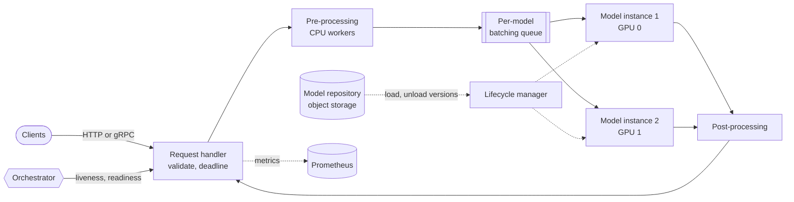

**Reading the diagram.** The request path (solid arrows) is synchronous: clients call the request handler over HTTP or gRPC; requests are validated, pre-processed on CPU workers, queued per model, batched and executed on one of two model instances, post-processed and returned. The batching queue is the heart of the server and its main failure point: when arrivals exceed instance capacity it grows and latency rises without any error. The control path (dotted, asynchronous) runs beside it: the lifecycle manager loads and unloads versions from the model repository, the storage boundary, and metrics are scraped into Prometheus. The orchestrator probes liveness and readiness; a replica that is not ready receives no traffic. Scaling: add instances inside a server (more GPUs or streams), or add server replicas behind a load balancer.

#### Where pre-processing runs

Decoding and resizing a JPEG costs a few milliseconds of CPU, which can exceed the GPU time of the classification. Pre-processing can run in each client (every client reimplements it), in the server's CPU workers (one implementation; size the CPU-to-GPU ratio for it), or in a separate **transformer** stage (KServe's transformer, Triton's ensembles). QuickBite decodes dish photos on CPU workers in the same pod.

::: recommendation
**Recommendation — Make the model signature a contract.** Store the input and output names, shapes, types and the pre-processing version with each model in the registry, validate requests against it in the request handler, and fail loudly on mismatch. A silently reordered feature vector is the most expensive bug in serving because nothing crashes.
:::

#### Common misconceptions

::: mistake
**Mistake — A model server is just a web server around `predict()`.** The difference is the scheduler. A plain web framework runs one request per worker thread, so a GPU receives batches of 1 and runs at a few percent of its capability while requests queue in the framework. A model server's batching queue and instance scheduler are what turn many small requests into the large matrix multiplications GPUs need (§64.12).
:::

## 66.5 Model servers compared

### 66.5.1 Runtimes, servers and platforms

The products are easier to compare once you separate three layers. An **inference runtime** executes a model graph (TensorRT, ONNX Runtime, LibTorch). An **inference server** wraps runtimes with the machinery of §66.4: protocols, batching, model repository, metrics. A **serving platform** deploys servers onto a cluster and adds autoscaling, traffic splitting and a declarative API. Some products are frameworks in which you write the serving logic in Python and the framework provides replicas, batching and composition.

**Figure 66.3 — Where each product sits.**

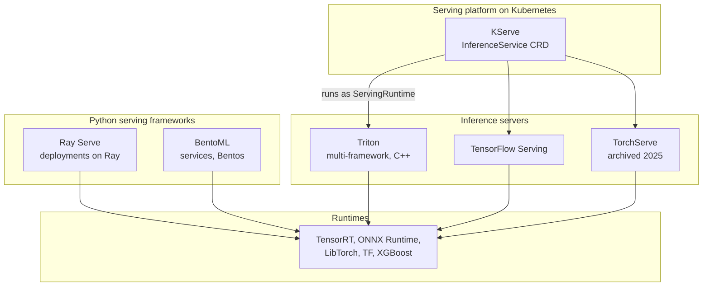

**Reading the diagram.** Arrows mean "deploys or calls"; all are in-process or local except KServe's, which creates Kubernetes resources that run a server image. KServe is a control plane: it does not execute models itself but launches a server (Triton, TensorFlow Serving, TorchServe or others) as a **serving runtime**. Ray Serve and BentoML are Python frameworks that call runtimes directly from user code. The three inference servers wrap runtimes with batching and model management. No storage is drawn; all load models from a repository or object store. Failure points differ by layer: a runtime crash takes down one server; a platform misconfiguration can affect every model. Scaling happens at the platform or framework layer (replicas) and at the server layer (instances per GPU).

### 66.5.2 The six servers

**NVIDIA Triton Inference Server.** An open-source C++ server that runs many frameworks through **backends**: TensorRT, ONNX Runtime, PyTorch, TensorFlow, OpenVINO, Python for custom code, and a forest-inference backend for trees [NVIDIA Triton Docs]. Each model directory holds numbered versions and a `config.pbtxt` declaring inputs, outputs, `max_batch_size`, an **instance group** (copies per device) and a **dynamic batcher** (`max_queue_delay_microseconds`, preferred sizes). Triton runs several models and instances concurrently per GPU, chains steps as **ensembles**, and ships load-testing tools (Perf Analyzer, Model Analyzer). *As of 2026*: in March 2025 NVIDIA renamed it **NVIDIA Dynamo-Triton** as part of its Dynamo inference platform, whose separate Dynamo framework targets distributed LLM serving (Chapter 73); NVIDIA states that Triton continues to be supported under the new name [NVIDIA Dynamo-Triton].

**TorchServe.** A PyTorch server from AWS and Meta: model archives (`.mar`) with Python **handlers**, and batching via `batchSize` and `maxBatchDelay`. *As of 2026*: the project's README carries a "Limited Maintenance" notice stating that it is no longer actively maintained, and the GitHub repository was archived (read-only) on 7 August 2025 [TorchServe GitHub]. Plan migrations off it (to Triton, Ray Serve or a KServe runtime).

**TensorFlow Serving.** Google's C++ server for SavedModels [Olston et al. 2017]. Its abstractions are worth learning: a **servable** is anything clients query (a model version, a lookup table); **loaders** load and unload one; **sources** discover *aspired versions* on storage; a **manager** applies a **version policy**, availability-preserving (load new before unloading old) or resource-preserving (unload first). It has a batcher (`max_batch_size`, `batch_timeout_micros`) and remains maintained for TensorFlow users as of 2026.

**KServe.** A Kubernetes platform: you declare an `InferenceService` with a `predictor` (optionally a `transformer` and an `explainer`), and a controller deploys it with a **ServingRuntime** (Triton, TensorFlow Serving, MLServer for scikit-learn and XGBoost, Hugging Face, or your own image); a storage initializer downloads the model from `storageUri`. Modes include serverless on Knative (scale to zero), raw Deployments (HPA or KEDA) and ModelMesh for dense multi-model serving; canaries are a field, `canaryTrafficPercent` [KServe Docs]. *As of 2026*: KServe was accepted as a Cloud Native Computing Foundation (CNCF) incubating project in 2025, after starting as KFServing in Kubeflow, and recent releases add LLM-oriented features [CNCF 2025].

**Ray Serve.** A Python library on Ray: a **deployment** is a class whose replicas are Ray actors, and deployments call each other through handles, so **model composition** is ordinary Python. It offers `@serve.batch` (maximum batch size, wait timeout), autoscaling on ongoing requests per replica, fractional GPUs and **model multiplexing** [Ray Serve Docs]; on Kubernetes it runs via KubeRay.

**BentoML.** A Python packaging and serving framework: a service class whose `batchable` APIs get **adaptive batching** (maximum batch size and latency), built into a **Bento**, a versioned bundle of code, model references and dependencies that becomes a container image [BentoML Docs]. *As of 2026*: the open-source project remains Apache-2.0 licensed; Modular was reported in February 2026 to have acquired BentoML (see Open verification items).

#### Alternatives and trade-offs

**Table 66.4 — Model servers compared (as of 2026).**

| Aspect | Triton (Dynamo-Triton) | TorchServe | TF Serving | KServe | Ray Serve | BentoML |
|---|---|---|---|---|---|---|
| What it is | Multi-framework inference server | PyTorch server | TensorFlow server | Kubernetes serving platform | Python serving library on Ray | Python packaging and serving framework |
| How it works | C++ core, backends, batcher | Python handlers, `.mar` | Servables, managers | CRD → runtime pods | Ray actors, handles | Service → Bento → image |
| Advantages | Throughput, GPU features, many formats | Simple for PyTorch | Mature version management | Declarative, canary, scale to zero | Composition, multiplexing, Python | Fast path from notebook to image |
| Disadvantages | Config-heavy; custom logic in Python backend is slower | Archived, no fixes | TensorFlow only | Needs Kubernetes expertise; layers to debug | Ray cluster to operate | Less control of low-level GPU scheduling |
| Performance | Highest for GPU models | Moderate | High for TF | Inherits from runtime | Good; Python overhead per call | Good; inherits from runtime |
| Operational complexity | Medium | Low (but unmaintained) | Medium | High | Medium–high | Low–medium |
| Cost | Free; GPU efficiency lowers cost | Free | Free | Free; cluster overhead | Free; Ray overhead | Free; managed option paid |
| Choose when | You need maximum GPU throughput | Only to keep an existing system running | Your models are TensorFlow | You run Kubernetes and want one API for all models | Logic between models is complex | You want packaging conventions fast |

::: industry
**Uber — Michelangelo's online prediction service.** Uber's ML platform deploys models into prediction-service containers that load them from storage; several models can run in one container, which supports safe transitions and side-by-side A/B tests, and clients address a model by identifier or tag. Batch scoring ran as Spark jobs.
*Evidence: Primary* — [Hermann and Del Balso 2017]
:::

::: warning
**Warning — Product names and maintenance status change quickly.** Within two years one major server was archived and another renamed. Wrap the server behind the Open Inference Protocol and your own client library, keep model artifacts in standard formats (ONNX, TorchScript or exported programs, SavedModel), and treat the server as a replaceable component.
:::

## 66.6 Dynamic batching

### 66.6.1 Why batching pays and what it costs

::: definition
**Definition — Dynamic batching.** **Dynamic batching** is a server-side scheduling policy that combines individual inference requests arriving within a short window into one batch for a single model execution. A batch is dispatched when it reaches a **maximum batch size** $B_{\max}$ or when the oldest request has waited a **maximum queue delay** $D_{\max}$, whichever comes first (and, in most servers, as soon as an execution instance is free if the queue is non-empty and delay is zero). **Adaptive batching** adjusts $B_{\max}$ online to keep latency within an objective.
:::

#### First-principles explanation

An elevator could leave with each passenger who arrives, or it could wait a few seconds for more. Waiting costs the first passenger a little time but moves many more people per trip. If the lobby is crowded, the elevator fills instantly and waiting costs nothing; if the lobby is empty, waiting a long time is pointless. Dynamic batching is an elevator with two rules: leave when full, or leave when the first passenger has waited $D_{\max}$.

The reason it pays on accelerators is the roofline (§64.9). At batch 1 a dense layer reads each weight once for one multiply–add, so the GPU is memory-bound and its arithmetic units idle. At batch 64 the same weight read serves 64 rows. Time per batch therefore grows much more slowly than batch size until the layer becomes compute-bound (§64.12): $T(B) = t_0 + B t_1$ with a large $t_0$ (weight reads, kernel launches, framework overhead) and a small $t_1$.

#### Why does this exist?

Without a batcher, a GPU serving one request at a time spends most of each execution on fixed cost. Clipper introduced adaptive batching for online serving, increasing batch size additively and cutting it multiplicatively (AIMD) when latency exceeded the objective [Crankshaw et al. 2017]; TensorFlow-Serving's batcher used a size and a timeout [Olston et al. 2017]. Every server in §66.5 now implements the pattern.

#### How it works internally

1. A request arrives and is appended to the model's queue with its arrival time (and, in some servers, a priority and deadline).
2. When an instance is free, the scheduler looks at the queue. If it holds $B_{\max}$ rows, it dispatches a full batch at once.
3. Otherwise it waits until either $B_{\max}$ rows have arrived or the oldest has waited $D_{\max}$; then it dispatches whatever is queued (up to $B_{\max}$). Triton can also prefer certain batch sizes (for example multiples of 8 that suit tensor cores).
4. The batch is padded or concatenated into one tensor, executed, and the outputs are split and returned to each request.
5. If all instances are busy, requests keep accumulating; batches then fill without waiting, so **under heavy load the queue itself does the batching**.

**Figure 66.4 — Two batches formed by size and by delay.**

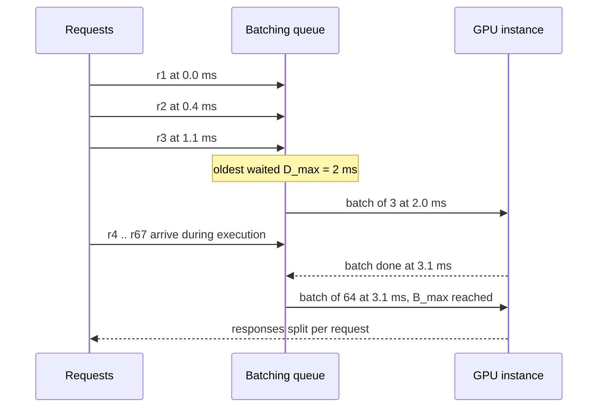

**Reading the diagram.** Time runs downward. Three requests arrive into the queue (synchronous appends inside the server); none fills the batch, so the delay rule fires when the oldest has waited 2 ms and the GPU runs a batch of 3. While that batch executes, 64 or more requests arrive; when the instance becomes free, the size rule fires immediately with a full batch of 64, without waiting. Responses are split and returned (dashed reply arrows). The queue is in memory, so a crash loses queued requests: clients must retry. The failure point is the queue growing faster than batches drain; scale with more instances or replicas.

#### Mathematical foundations

A request's latency has three parts: waiting for the instance to finish earlier work, waiting for its own batch to close, and the batch's execution time.

::: formula
**Dynamic batching latency and throughput**

$$L = W_{\text{busy}} + W_{\text{fill}} + T(B) \qquad T(B) = t_0 + B\,t_1 \qquad X(B) = \frac{B}{t_0 + B\,t_1}$$

$$L_{\text{worst}} \approx D_{\max} + 2\,T(B_{\max}) \quad (\text{one batch in flight}) \qquad \text{stable only if } \lambda < X(B_{\max})$$

| Symbol | Meaning | Units |
|---|---|---|
| $L$ | Latency of one request inside the server | ms |
| $W_{\text{busy}}$ | Wait for the batch already executing to finish, $\le T(B_{\max})$ | ms |
| $W_{\text{fill}}$ | Wait for the request's own batch to close, $\le D_{\max}$ | ms |
| $T(B)$ | Execution time of a batch of $B$ rows | ms |
| $t_0$, $t_1$ | Fixed time per batch; marginal time per row | ms, ms/row |
| $X(B)$ | Throughput of one instance at batch size $B$ | rows/s |
| $B_{\max}$, $D_{\max}$ | Maximum batch size and maximum queue delay | rows, ms |
| $\lambda$ | Arrival rate of rows at the instance | rows/s |
| $L_{\text{worst}}$ | Approximate worst case when the queue holds no backlog | ms |
:::

Note the asymmetry: $D_{\max}$ only adds latency when the lobby is empty, while $B_{\max}$ sets the throughput ceiling $X(B_{\max})$ when it is full. Beyond the ceiling no delay setting helps; the queue grows without bound (§4.10.3).

::: example
**Worked example — Choosing $B_{\max}$ and $D_{\max}$ for the deep ETA model on a GPU.** A load test of the deep ETA model on one GPU gives the batch curve below, which fits $t_0 = 1.0$ ms and $t_1 = 0.025$ ms per row (assumed, illustrative values consistent with §60.11). The model stage's p99 budget is 20 ms (Table 60.12). Three GPUs share the 40,000 rows/s peak, so each receives $\lambda = 13{,}333$ rows/s; we want peak utilization at most 0.7.

**Table 66.5 — Assumed GPU batch curve for the deep ETA model.**

| $B$ (rows) | $T(B)$ (ms) | $X(B)$ (rows/s) | Rows/s per ms of latency |
|---|---|---|---|
| 1 | 1.025 | 976 | 952 |
| 8 | 1.200 | 6,667 | 5,556 |
| 32 | 1.800 | 17,778 | 9,877 |
| 64 | 2.600 | 24,615 | 9,467 |
| 128 | 4.200 | 30,476 | 7,256 |
| 256 | 7.400 | 34,595 | 4,675 |

1. Capacity: we need $X(B_{\max}) \ge 13{,}333 / 0.7 = 19{,}048$ rows/s. $B_{\max} = 32$ gives 17,778, too little; $B_{\max} = 64$ gives 24,615, enough (peak utilization $13{,}333 / 24{,}615 = 0.54$).
2. Latency with $B_{\max} = 64$, $D_{\max} = 2$ ms: $L_{\text{worst}} \approx 2 + 2 \times 2.6 = 7.2$ ms, well inside 20 ms.
3. The alternative $B_{\max} = 256$ has more throughput (34,595) but $L_{\text{worst}} \approx 2 + 2 \times 7.4 = 16.8$ ms leaves only 3 ms for variance and queueing; reject.
4. Ceiling: $1/t_1 = 40{,}000$ rows/s per GPU, never reachable because $t_0$ is paid per batch.

**Interpretation.** Throughput per GPU rises 25-fold from batch 1 to 64, while the worst-case model latency stays under 8 ms. The last column shows diminishing returns: past 64 rows each extra millisecond of latency buys fewer rows per second. **Engineering implication.** Pick the smallest $B_{\max}$ that meets peak demand with headroom, then the largest $D_{\max}$ that keeps $L_{\text{worst}}$ within the budget; re-measure the curve whenever the model, runtime or GPU changes, because $t_0$ and $t_1$ come from a load test, not from the formula.
:::

#### Code example: a dynamic batching simulator

The simulator below runs one GPU instance with the batch curve of Table 66.5 under Poisson arrivals of single-row requests. It applies the size and delay rules of §66.6.1 and reports latency percentiles, mean batch size, throughput and the fraction of time the GPU is executing.

```python
"""Dynamic batching simulator: one GPU, Poisson arrivals, size and delay limits."""
import numpy as np

T0, T1 = 1.0e-3, 0.025e-3        # batch time T(B) = t0 + B*t1 (s), from a load test
N = 200_000                      # requests per run, one row each

def simulate(rate, max_batch, max_delay, seed=1):
    rng = np.random.default_rng(seed)
    arr = np.cumsum(rng.exponential(1.0 / rate, N))   # Poisson arrivals
    lat = np.empty(N)
    sizes = []
    t_free, i = 0.0, 0
    while i < N:
        ready = max(t_free, arr[i])             # instance free and a request waiting
        j = i + max_batch - 1                   # request that would fill the batch
        t_full = arr[j] if j < N else np.inf
        close = max(ready, min(arr[i] + max_delay, t_full))
        k = np.searchsorted(arr, close, side="right")
        n = min(k - i, max_batch)
        done = close + T0 + T1 * n
        lat[i:i + n] = done - arr[i:i + n]
        sizes.append(n)
        t_free, i = done, i + n
    busy = sum(T0 + T1 * b for b in sizes) / (t_free - arr[0])
    return (np.percentile(lat, 50) * 1e3, np.percentile(lat, 99) * 1e3,
            np.mean(sizes), N / (t_free - arr[0]), busy)

print(f"{'rate/s':>7}{'B_max':>6}{'delay ms':>9}{'p50 ms':>10}{'p99 ms':>10}"
      f"{'mean B':>8}{'served/s':>10}{'busy':>6}")
runs = [(2_000, 1, 0.0), (2_000, 64, 0.0), (2_000, 64, 1.0), (2_000, 64, 2.0), (2_000, 64, 4.0),
        (15_000, 64, 0.0), (15_000, 64, 2.0), (15_000, 64, 4.0),
        (30_000, 64, 0.0), (30_000, 128, 0.0), (30_000, 128, 2.0)]
for rate, max_batch, delay_ms in runs:
    p50, p99, mean_b, served, busy = simulate(rate, max_batch, delay_ms / 1e3)
    print(f"{rate:>7,}{max_batch:>6}{delay_ms:>9.1f}{p50:>10.2f}{p99:>10.2f}"
          f"{mean_b:>8.1f}{served:>10,.0f}{busy:>6.0%}")
```

Output (about 3 seconds on one CPU core; deterministic for the fixed seed):

```text
 rate/s B_max delay ms    p50 ms    p99 ms  mean B  served/s  busy
  2,000     1      0.0  52701.84 104388.30     1.0       976  100%
  2,000    64      0.0      1.58      2.16     2.2     2,009   95%
  2,000    64      1.0      1.85      2.18     3.0     2,009   72%
  2,000    64      2.0      2.40      3.23     5.0     2,009   45%
  2,000    64      4.0      3.50      5.33     9.0     2,008   27%
 15,000    64      0.0      2.43      3.48    24.2    15,061  100%
 15,000    64      2.0      2.84      3.95    31.2    15,061   86%
 15,000    64      4.0      4.44      6.47    59.3    15,059   63%
 30,000    64      0.0    745.81   1476.24    64.0    24,609  100%
 30,000   128      0.0      6.84     11.26   121.7    30,107  100%
 30,000   128      2.0      6.84     11.26   121.9    30,107  100%
```

What to notice:

- **No batching collapses at 2,000 rows/s.** With $B_{\max} = 1$ the instance serves 976 rows/s, so the queue grows for the whole run and latencies reach tens of seconds. Any batching at all fixes this.
- **The queue batches for you.** With $D_{\max} = 0$ the mean batch grows from 2.2 at 2,000/s to 24 at 15,000/s because requests accumulate while the GPU is busy; with one instance, zero delay gives the lowest latency below saturation.
- **Delay buys GPU time, not latency.** At 2,000 rows/s a 2 ms delay raises p50 by 0.8 ms but cuts busy time from 95% to 45%. That freed time is what a second model on the same GPU (§66.8) or fewer GPUs can use. The 95% "busy" GPU at batch 2.2 is the nvidia-smi trap of §64.11: always running, mostly wasted.
- **$B_{\max}$ sets the ceiling.** At 30,000 rows/s, $B_{\max} = 64$ caps throughput at 24,609 rows/s and latency explodes to seconds; $B_{\max} = 128$ serves the load at 11 ms p99. Near saturation the delay setting is irrelevant because batches are always full.
- **Limitations.** Real servers add several instances, timing variance and multi-row requests (20 rows per ETA call); confirm with a load test (§23.5).

#### Code example: measuring a real batch curve on CPU

The curve in Table 66.5 is assumed. The program below measures one on your machine for a small multilayer perceptron with about 300,000 parameters, roughly the size of a deep ETA model over 64 features.

```python
"""Time a small MLP on CPU at several batch sizes; fit T(B) = t0 + B*t1."""
import time
import numpy as np
import torch

torch.manual_seed(0)
torch.set_num_threads(1)                     # one core: steadier numbers
model = torch.nn.Sequential(                 # ETA-sized deep model: 64 features in
    torch.nn.Linear(64, 512), torch.nn.ReLU(),
    torch.nn.Linear(512, 512), torch.nn.ReLU(),
    torch.nn.Linear(512, 1)).eval()

def batch_ms(b, reps=50):
    x = torch.randn(b, 64)
    with torch.inference_mode():
        for _ in range(10):                  # warm-up: allocator, kernel selection
            model(x)
        times = []
        for _ in range(reps):
            t = time.perf_counter()
            model(x)
            times.append(time.perf_counter() - t)
    return 1e3 * float(np.median(times))

sizes = [1, 2, 4, 8, 16, 32, 64, 128, 256, 512, 1024]
ms = [batch_ms(b) for b in sizes]
print(f"{'batch':>6}{'ms/batch':>10}{'us/row':>9}{'rows/s':>10}")
for b, t in zip(sizes, ms):
    print(f"{b:>6}{t:>10.3f}{1e3 * t / b:>9.2f}{1e3 * b / t:>10,.0f}")
t1, t0 = np.polyfit(sizes, ms, 1)            # least-squares line through the points
print(f"fit: t0 = {t0:.3f} ms per batch, t1 = {1e3 * t1:.2f} us per row, "
      f"ceiling 1/t1 = {1e3 / t1:,.0f} rows/s")
```

Output from one run (about 3 seconds on a 4-core cloud VM; your numbers will differ, and a second run on the same VM differed by up to 30%):

```text
 batch  ms/batch   us/row    rows/s
     1     0.045    44.92    22,264
     2     0.039    19.57    51,111
     4     0.053    13.35    74,915
     8     0.072     9.01   111,036
    16     0.143     8.95   111,738
    32     0.215     6.71   149,128
    64     0.366     5.72   174,876
   128     0.670     5.23   191,080
   256     1.235     4.83   207,240
   512     2.431     4.75   210,611
  1024     4.818     4.70   212,552
fit: t0 = 0.051 ms per batch, t1 = 4.66 us per row, ceiling 1/t1 = 214,761 rows/s
```

What to notice:

- **The shape, not the numbers.** Cost per row falls about eightfold from batch 1 to 64 in this run, then flattens once fixed overhead (dispatch, operator launch, weight reads) is amortized. Expect the same shape anywhere, with the knee elsewhere.
- **CPU batching helps too.** Scoring 20 restaurants as one batch is several times cheaper than 20 calls; the ETA service scores a search page as one batch.
- **Warm-up and medians.** The first calls are slower (memory allocation, kernel selection), so the program discards them and reports the median; benchmarking without warm-up overstates $t_0$ (§23.5.4, §66.10).
- **A line is an approximation.** Some sizes (16 here) show steps from matrix tiling; GPUs show stronger steps (§64.4). Decide from measured points.

#### Failure scenarios

**Table 66.6 — Dynamic batching failure scenarios.**

| What goes wrong | Why | Detection | Recovery | Prevention |
|---|---|---|---|---|
| p99 rises with no error | $D_{\max}$ or $B_{\max}$ too large for budget | Queue-time and compute-time histograms | Lower $D_{\max}$, then $B_{\max}$ | Derive both from $L_{\text{worst}}$ |
| Latency explodes at peak | $\lambda > X(B_{\max})$ | Queue depth growing; batch size pinned at $B_{\max}$ | Shed or scale out | Capacity test at $1.3\times$ peak |
| Out-of-memory at large batches | Activation memory grows with $B$ | GPU OOM errors on big requests | Cap rows per request | Test $B_{\max}$ with the largest input shapes |
| Padding waste | Variable-length inputs padded to the longest | Low useful-token fraction | Bucket by length | Sequence bucketing; ragged batching |
| One slow client starves others | Large requests fill batches | Per-client latency | Priority levels or separate queues | Per-tenant queues and limits |

::: mistake
**Mistake — Tuning $D_{\max}$ to "improve throughput".** With one instance per GPU, a work-conserving batcher already fills batches under load; a delay raises latency at low load and changes nothing at high load. Its real benefits are freeing GPU time for co-located models and avoiding many tiny concurrent batches when several instances share a GPU. Increase $B_{\max}$ (or add instances) to raise the ceiling.
:::

::: note
**Preview — LLM batching is different.** A transformer generating text runs hundreds of decode steps per request with different output lengths, so request-level batching leaves slots idle when short requests finish. **Continuous (iteration-level) batching** admits and retires requests at every decode step, and the KV cache, not compute, limits the batch. Chapter 73 owns these mechanisms.
:::

## 66.7 CPU versus GPU serving

### 66.7.1 When GPUs pay off

::: definition
**Definition — Cost per 1,000 predictions.** The fully loaded hourly price of the serving hardware divided by the predictions it serves per hour, times 1,000. It depends on the device's throughput at a batch size that meets the latency objective *and* on the utilization the fleet actually achieves, including idle redundancy.
:::

A GPU is a bus and a CPU core a taxi: the full bus is cheaper per passenger, the bus with three riders is not. GPUs pay off when each prediction needs much arithmetic (a CNN, not a tree walk), when traffic fills batches within the budget (§66.6), and when the redundancy floor does not leave them idle. The formula below is the per-device form of §60.11's fleet cost.

::: formula
**Cost per 1,000 predictions and the GPU break-even speedup**

$$C_{1k} = \frac{1{,}000 \; p}{3{,}600 \; X \; u} \qquad S^{*} = \frac{p_{\text{gpu}}}{p_{\text{cpu}}} \cdot \frac{u_{\text{cpu}}}{u_{\text{gpu}}}$$

| Symbol | Meaning | Units |
|---|---|---|
| $p$ | Price of one device (one vCPU or one GPU with its share of host) | \$/h |
| $X$ | Predictions per second one device sustains within the latency budget | predictions/s |
| $u$ | Average utilization the fleet achieves | dimensionless |
| $C_{1k}$ | Cost per 1,000 predictions | \$ |
| $S^{*}$ | Throughput ratio $X_{\text{gpu}}/X_{\text{cpu}}$ above which the GPU is cheaper | dimensionless |
:::

::: example
**Worked example — QuickBite's ETA trees versus a dish-photo classifier.** Prices: \$0.048 per vCPU-hour, \$2.50 per GPU-hour. Planned utilization: CPU 0.5, GPU 0.6. Then $S^{*} = (2.50 / 0.048) \times (0.5 / 0.6) = 52.1 \times 0.833 = 43.4$: a GPU must do the work of 43 vCPUs to be cheaper.

**Dish classifier** (a ResNet-50-class CNN, about 8 GFLOP per image; assumed load tests): one vCPU classifies 20 images/s (50 ms each); one GPU 6,000 images/s at batch 64 in FP16.

1. CPU: $C_{1k} = 1{,}000 \times 0.048 / (3{,}600 \times 20 \times 0.5) = 48 / 36{,}000 = \$0.00133$.
2. GPU: $C_{1k} = 1{,}000 \times 2.50 / (3{,}600 \times 6{,}000 \times 0.6) = 2{,}500 / 12{,}960{,}000 = \$0.000193$.
3. Speedup $6{,}000 / 20 = 300 > 43.4$: the GPU is $0.00133 / 0.000193 = 6.9$ times cheaper, and 50 ms per image on CPU would also miss a tight latency budget.

**ETA trees** (0.1 ms per prediction): one vCPU does 10,000/s; assume a GPU forest-inference backend does 500,000/s in large batches.

4. Per device the GPU is 50 times faster, barely above $S^{*} = 43.4$, so even at 0.6 utilization it would save only $1 - 43.4/50 = 13\%$.
5. But utilization is not 0.6. Zone redundancy requires at least three GPUs (\$7.50/h) for a peak of 40,000/s, which is 2.7% of their capacity. At the average 4,167/s: $C_{1k} = 1{,}000 \times 7.50 / (3{,}600 \times 4{,}167) = \$0.000500$, versus \$0.000154 for the three-node CPU fleet of §60.11: the GPUs cost 3.2 times more.

**Interpretation.** Arithmetic per prediction decides whether a GPU *can* win; traffic and the redundancy floor decide whether it *does*. **Engineering implication.** Serve tree models and small MLPs on CPUs inside the calling service; serve convolutional networks, transformers and large ranking models on GPUs once traffic fills at least a few GPUs; for low volume, as with 200,000 dish photos a day (200,000 × 50 ms = 2.8 vCPU-hours, about \$0.13 a day on CPU), keep the CPU and spend engineering elsewhere.
:::

**Figure 66.5 — Choosing CPU or GPU for a model.**

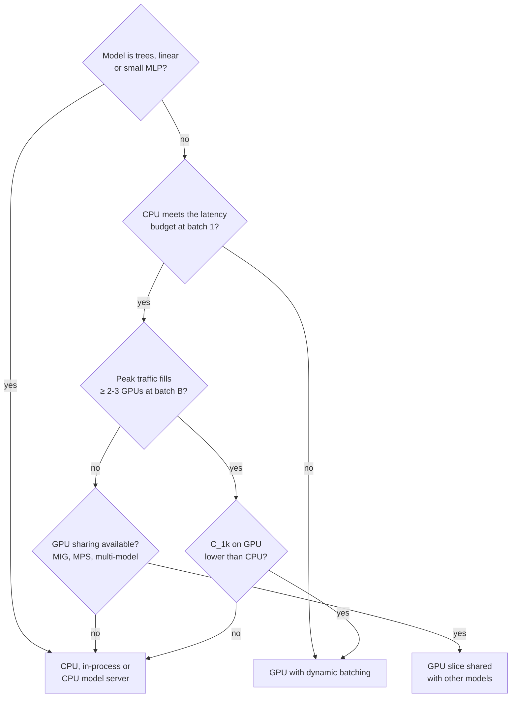

**Reading the diagram.** Decisions flow top to bottom (no runtime traffic). Small-arithmetic models stay on CPU; models that miss the budget on CPU go to GPUs at any price; models whose traffic cannot fill GPUs share one (§66.8); the rest compare $C_{1k}$. Failure point: using benchmark throughput at a batch size the budget does not allow. Scaling: re-run the decision as traffic grows.

::: mistake
**Mistake — Comparing a GPU at batch 256 with a CPU at batch 1.** Benchmarks quote GPU throughput at the batch size that maximizes it. Use the throughput at the batch size your latency budget and traffic actually produce (§66.6), and compare the CPU at its best batch size too; the CPU also gains several times from batching (§66.6.1).
:::

## 66.8 Model-parallel and multi-model serving

### 66.8.1 One model too big, many models too small

::: definition
**Definition — Model-parallel serving, multi-model serving and multiplexing.** **Model-parallel serving** splits one model's weights across several devices because they do not fit on one: **tensor parallelism** splits each layer's matrices, **pipeline parallelism** places consecutive layers on different devices, and **embedding sharding** places rows of large embedding tables on different hosts. **Multi-model serving** hosts many models in one server process or GPU. **Model multiplexing** routes each request for one of many models to a replica that already has that model loaded, loading it on demand and evicting the least recently used model when memory is full.
:::

A billion-user embedding table (10⁹ × 128 × 4 bytes = 512 GB, §65.8) cannot fit on an 80 GB GPU and must be split; QuickBite's 300 per-chain demand models are each small and mostly idle, and a replica each would pay the floor of §66.7 three hundred times.

**Large models.** Tensor parallelism inside one server keeps per-layer exchanges on NVLink (§64.14); pipeline parallelism adds a hop per stage and needs several requests in flight. Recommenders replicate dense layers and shard embeddings (Chapter 68); Chapter 73 owns LLM parallelism.

**Many models.** Memory decides how many fit: an 80 GB GPU with 10 GB reserved holds $\lfloor 70 / 1.5 \rfloor = 46$ models of 1.5 GB, and their summed busy fractions must stay below the target utilization. Beyond that, models load on demand and the least recently used is evicted; a miss pays the load time of §66.10, so the router sends a model's requests to replicas already holding it (Ray Serve multiplexing, KServe ModelMesh) [Ray Serve Docs; KServe Docs]. INFaaS went further: clients state a latency and accuracy requirement, and the system picks among *variants* of a model (different hardware, batch size, precision) and scales them, so users need not choose [Romero et al. 2021].

**GPU sharing** (§64.15): **MIG** splits an A100/H100-class GPU into up to seven isolated instances (predictable latency); **MPS** runs kernels from several processes concurrently without isolation (cooperating models). Nexus showed how a cluster scheduler can pack DNN models onto shared GPUs with batch-aware "squishy" bin packing that accounts for how each model's latency grows with batch size [Shen et al. 2019].

**Figure 66.6 — Three ways to map models to GPUs.**

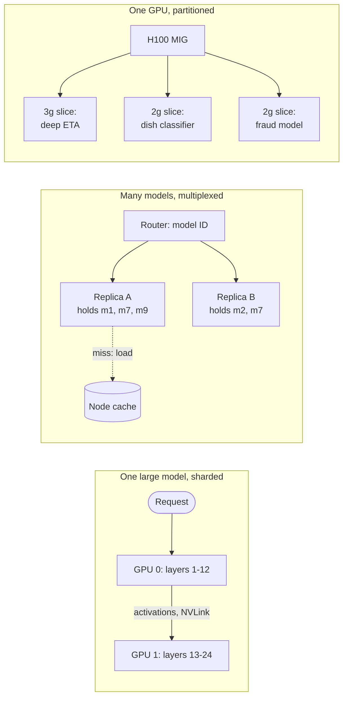

**Reading the diagram.** *Sharded*: GPU 0 computes the first layers and sends activations synchronously over NVLink to GPU 1; either failing fails the model, so scale by replicating shard groups. *Multiplexed*: the router sends each request to a replica holding its model; a miss loads from the node cache (dotted), the storage boundary and latency failure point; popular models occupy several replicas. *Partitioned*: MIG slices isolate memory and compute, so one model's overload does not touch the others, but slice sizes are fixed until reconfiguration.

::: warning
**Warning — Co-location trades isolation for cost.** Packing models onto one GPU with MPS or time-slicing means a burst for one model raises the others' latency, and one process crash can affect all MPS clients (§64.15). Use MIG or separate GPUs for models with strict latency objectives; pack the rest.
:::

## 66.9 Autoscaling inference

### 66.9.1 Signals, reaction time and headroom

::: definition
**Definition — Inference autoscaling.** Automatically changing the number of model-server replicas (and the nodes or GPUs beneath them) to track load, using a signal proportional to load, a target value for it, and limits on how fast and how far to scale. **Scale to zero** removes all replicas when there is no traffic and starts one on the next request, paying a **cold start**.
:::

Choose the signal carefully (§18.8, §42.12):

**Table 66.7 — Autoscaling signals for model serving.**

| Signal | Good for | Problem |
|---|---|---|
| Request or prediction rate (RPS) | Stateless CPU models; predictable cost per prediction | Ignores request size (20 rows vs 1) |
| CPU utilization | In-process CPU models | Pre-processing or GC can dominate |
| GPU utilization (nvidia-smi) | Rarely | Reads near 100% at batch 2 (§64.11, §66.6) |
| Queue depth or ongoing requests per replica | GPU servers with batching; async workers | Needs a server metric; target from load test |
| Latency (p95, p99) | Alerting, a guardrail | Lags; rises only after saturation, so scaling starts late |

For a batching GPU server, scale on **in-flight requests (or queued rows) per replica**, targeting the concurrency at which the load test still meets the objective; Ray Serve does this [Ray Serve Docs], and KEDA scales on any Prometheus query, including to and from zero [KEDA Docs]. **Reaction time** (metrics, decision, node provisioning, image pull, model load, warm-up) must be absorbed by existing replicas.

::: formula
**Target utilization and replicas with headroom for reaction time**

$$u_{\text{target}} = \frac{u_{\max}}{1 + g} \qquad g = \max\!\left(r\,T_{\text{react}},\; s\right) \qquad N = \left\lceil \frac{\lambda \, c}{k \, u_{\text{target}}} \right\rceil$$

| Symbol | Meaning | Units |
|---|---|---|
| $u_{\max}$ | Highest utilization at which the load test still meets the latency objective | dimensionless |
| $r$ | Fractional growth rate of load during a ramp | 1/min |
| $T_{\text{react}}$ | Time from load change to a new replica serving | min |
| $s$ | Largest sudden step in load, as a fraction | dimensionless |
| $g$ | Growth the existing fleet must absorb | dimensionless |
| $u_{\text{target}}$ | Utilization the autoscaler should hold | dimensionless |
| $\lambda$, $c$, $k$ | Load, CPU time per prediction, vCPUs per node | predictions/s, vCPU-s, vCPU |
| $N$ | Nodes (or replicas) to run | count |
:::

::: example
**Worked example — Autoscaling the deep ETA model on CPU.** Option B of §60.11: $c = 2$ ms per prediction, 16-vCPU nodes. A load test shows p99 within budget up to $u_{\max} = 0.75$. Reaction time: 30 s metrics, 15 s decision, 120 s node provisioning, 60 s image pull, model load and warm-up: $T_{\text{react}} = 3.75$ min. The dinner ramp rises at most 2% per minute; a marketing push can add 30% within two minutes.

1. Ramp: $r T_{\text{react}} = 0.02 \times 3.75 = 0.075$. Step: $s = 0.30$. So $g = 0.30$.
2. $u_{\text{target}} = 0.75 / 1.30 = 0.577$; use 0.55.
3. Peak: $N = \lceil 40{,}000 \times 0.002 / (16 \times 0.55) \rceil = \lceil 80 / 8.8 \rceil = \lceil 9.09 \rceil = 10$ nodes (§60.11, at $u = 0.5$ with one redundancy node, sized 11).
4. Check the step: 30% more load on 10 nodes is $52{,}000 \times 0.002 / 160 = 0.65 < 0.75$. Holds.
5. Off-peak at 4,167/s: $\lceil 8.33 / 8.8 \rceil = 1$, but the floor of one node per zone keeps 3.
6. Without the step allowance ($u_{\text{target}} = 0.75$): 7 nodes at peak, and the push would drive them to $104 / 112 = 0.93$, where p99 explodes (§4.10.3).

**Interpretation.** The step, not the ramp, sets headroom, because a 4-minute reaction time is long compared with a 2-minute surge. **Engineering implication.** Shorten $T_{\text{react}}$ before buying headroom: keep warm spare nodes (placeholder pods, §42.12), pre-pull images and cache models on nodes (§66.10). Each minute removed lets $u_{\text{target}}$ rise. Predictive scaling on the known dinner curve helps the ramp; only headroom helps the surprise.
:::

**Figure 66.7 — The inference autoscaling loop.**

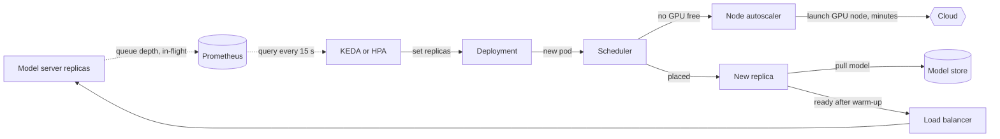

**Reading the diagram.** Replicas export queue depth (dotted, asynchronous) to Prometheus; KEDA or the HPA sets the replica count. A pod with no free GPU waits for the node autoscaler, the slowest step; a placed pod pulls its model from the model store (storage boundary) and joins the load balancer after warm-up. Failure points: stale metrics freeze scaling; GPU shortages leave pods Pending; early readiness sends traffic to cold replicas. Limits: GPU quota and model-store bandwidth.

**Scale to zero.** It saves money for mostly idle models (development, per-tenant, asynchronous workers), but the first request waits a full cold start (§66.10). QuickBite's dish-photo workers scale to zero overnight on queue depth; the ETA service never does. MArk combined predictive autoscaling of instances with serverless functions to absorb bursts while new instances started [Zhang et al. 2019].

::: mistake
**Mistake — Scaling a GPU server on GPU utilization.** At low load a work-conserving batcher keeps the GPU "busy" with tiny batches (95% busy in the §66.6 simulation at 8% of capacity), so the autoscaler sees a hot GPU and adds replicas that are not needed; at high load the signal saturates at 100% and cannot show how far over capacity you are. Scale on queue depth or in-flight requests per replica.
:::

## 66.10 Model loading and warm-up

### 66.10.1 Where cold-start time goes

::: definition
**Definition — Model cold start and warm-up.** A **cold start** is the time from deciding to start a replica until it serves traffic within its latency objective: node provisioning, container image pull, model download, deserialization and transfer to device memory, runtime initialization, and **warm-up**, the deliberate execution of representative requests so that one-time costs (memory allocation, kernel selection, lazy compilation, cache population) are paid before real traffic arrives.
:::

A model is not a program you start; it is gigabytes you must move over the network and PCIe, and its first predictions are slow until allocators and kernels are warm. This dominates $T_{\text{react}}$ in §66.9.

::: formula
**Cold-start time of a model replica**

$$T_{\text{cold}} = T_{\text{node}} + T_{\text{image}} + \frac{S}{B_{\text{store}}} + \frac{S}{B_{\text{load}}} + T_{\text{init}} + T_{\text{warm}}$$

| Symbol | Meaning | Units |
|---|---|---|
| $T_{\text{node}}$ | Provisioning a node, zero if a spare node exists | s |
| $T_{\text{image}}$ | Pulling the container image, zero if cached on the node | s |
| $S$ | Model artifact size | GB |
| $B_{\text{store}}$ | Download bandwidth from the model store or node cache | GB/s |
| $B_{\text{load}}$ | Effective deserialization and host-to-device copy bandwidth | GB/s |
| $T_{\text{init}}$ | Runtime and device context initialization | s |
| $T_{\text{warm}}$ | Warm-up requests | s |
:::

::: example
**Worked example — Starting a replica of the home-page ranking model.** The model holds QuickBite's embedding tables (2.56 GB of customers and 1.28 GB of dishes, §58.6) plus dense layers: $S = 4$ GB. Assumed: GPU node provisioning 120 s; a 5 GB serving image pulled at 0.25 GB/s; object storage at 0.4 GB/s with parallel ranged reads (0.1 GB/s with one stream); node-local NVMe at 2 GB/s; effective load 4 GB/s; initialization 5 s; 200 warm-up requests over several batch sizes, 10 s.

1. Fully cold: $120 + 5/0.25 + 4/0.4 + 4/4 + 5 + 10 = 120 + 20 + 10 + 1 + 5 + 10 = 166$ s.
2. Same, but downloading with one stream: $4/0.1 = 40$ s instead of 10: 196 s.
3. Warm node, image cached, model on local NVMe: $0 + 0 + 4/2 + 1 + 5 + 10 = 18$ s.
4. If the server compiled a TensorRT engine at start-up instead of loading a prebuilt one, add minutes; build engines in the deployment pipeline for each GPU type.

**Interpretation.** Node provisioning is 72% of a fully cold start; moving the model bytes is 7–21%. **Engineering implication.** Keep spare GPU capacity warm, pre-pull images, cache models on nodes, and parallelize downloads; together they cut $T_{\text{cold}}$ from about 3 minutes to under 20 seconds, which in §66.9 lets the target utilization rise.
:::

**Figure 66.8 — Cold start of a GPU model replica: cold node versus warm node.**

```mermaid
gantt
  title Seconds from scale-up decision to serving
  dateFormat x
  axisFormat %S
  section Cold node
  Provision GPU node    :a1, 0, 120000
  Pull image            :a2, after a1, 20000
  Download model        :a3, after a2, 10000
  Load to GPU and init  :a4, after a3, 6000
  Warm-up               :a5, after a4, 10000
  section Warm node
  Read model from NVMe  :b1, 0, 2000
  Load to GPU and init  :b2, after b1, 6000
  Warm-up               :b3, after b2, 10000
```

**Reading the diagram.** Time runs left to right; bars are sequential, synchronous start-up steps. The cold row crosses two storage boundaries (image registry, object store) and is dominated by provisioning; the warm row reads a node-local cache and is dominated by warm-up. Failure points: capacity shortages stall the first bar; simultaneous downloads saturate the store. Scaling: keep capacity warm and bytes near the GPU.

#### Techniques

- **Node-local caching.** A DaemonSet or KServe's model cache pre-downloads popular models to local NVMe, so new replicas skip the object store.
- **Lazy loading.** Memory-map the model file and start serving while pages load, or load large embedding tables in the background and answer early requests with a fallback. Useful on CPU; on GPUs the weights must be resident before the first batch.
- **Warm-up before ready.** Triton can run warm-up requests declared in the model configuration before marking the model ready [NVIDIA Triton Docs]; elsewhere, send synthetic requests in a start-up hook. The readiness probe (§42.7.3) must pass only after warm-up.
- **Avoid thundering herds.** Stagger rollouts and limit concurrent downloads, so 50 new replicas do not pull 200 GB from one bucket at once.

::: mistake
**Mistake — "Ready" when the process starts.** If readiness reports true as soon as the server process is up, the load balancer sends traffic to a replica whose model is still downloading or whose first requests take seconds. The p99 spike after every deployment or scale-up is the symptom. Tie readiness to "all required models loaded and warmed".
:::

## 66.11 Model versioning and routing

### 66.11.1 From registry to traffic

::: definition
**Definition — Model version, alias and version pinning.** A **model version** is an immutable, numbered artifact in the model registry with its training data, code, metrics and signature. An **alias** (or stage) such as `champion` or `challenger` (the QuickBite names of §69.6.2) is a movable pointer to one version. **Version pinning** means a deployment or client names an exact version (`eta:42`) rather than an alias, so what runs changes only through a reviewed deployment. **Traffic splitting** routes fractions of requests to different versions by weight, by user hash or by request header.
:::

The registry (§69.8) records *what exists*, the deployment *what runs*, the router *who gets which*. A GitOps manifest (§43.10) pins versions and weights (`eta:42` at 95%, `eta:43` at 5%); promotion in the registry opens a pull request rather than changing traffic directly, so every change is reviewed and revertible.

**Figure 66.9 — From registry to version-aware routing.**

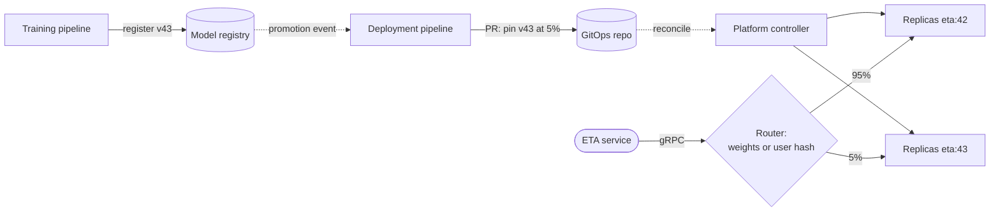

**Reading the diagram.** The control path is asynchronous: v43 is registered (storage boundary), a promotion event opens a pull request pinning it at 5%, and the controller creates v43 replicas beside v42. The request path is synchronous: the router splits gRPC traffic by weight or user hash. Failure points: a hand-moved alias bypasses review; random per-request routing shows one customer two models' answers. Scaling: versions scale independently; the router is stateless.

Three rules: **route by a stable key** (user hash) when users see the prediction; **return and log the model version** with every prediction (§66.15); **keep model and features compatible**, shipping a new feature everywhere before the version that needs it (expand then contract, §43.13.2).

## 66.12 Safe deployment

### 66.12.1 Shadow, canary, A/B, interleaving and rollback

A model can be healthy as a process (low latency, no errors) and still harmful (miscalibrated ETAs that make customers abandon orders). Safe deployment therefore tests three things in increasing order of cost: **does it run** (latency, errors, memory), **does it predict well** (accuracy against labels, prediction distribution), and **does it help the business** (orders, conversion). Each stage below answers one of them [Huyen 2022].

::: definition
**Definition — Shadow deployment, canary, A/B test and interleaving.** In **shadow deployment** (dark launch) the new model receives a copy of production requests and its predictions are logged but never used. A **canary** sends a small fraction of real traffic to the new model and compares guardrail metrics with the old one, rolling back automatically on regression (§43.6). An **A/B test** randomizes users between models long enough to measure a business metric with statistical power (§57.14). **Interleaving**, for rankers, merges the two models' ranked lists into one list shown to the same user and credits each model with the clicks on its items.
:::

**Figure 66.10 — The progressive rollout of a model version.**

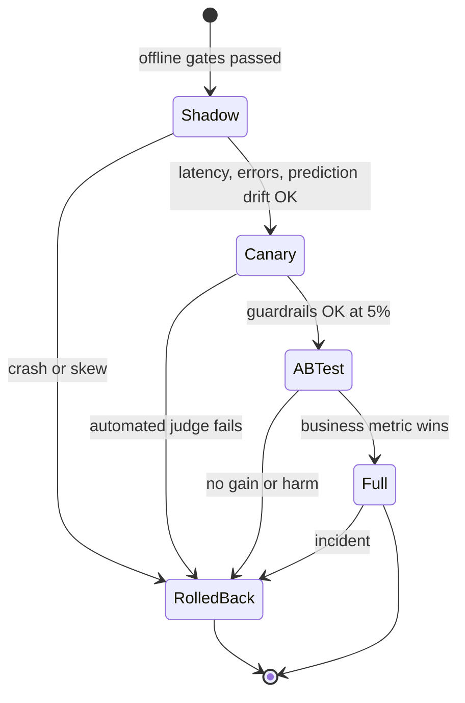

**Reading the diagram.** States are stages; automated checks gate transitions. Shadow tests the system and compares predictions on identical inputs with no user impact; the canary judges guardrails on a small slice of users; the A/B test measures business impact. Every stage can roll back, quickly only if the old version is still loaded. Failure points: shadows that trigger side effects; canaries judged before labels arrive. Scaling: shadow doubles inference for the mirrored fraction, so mirror a sample.

**Shadow traffic.** Mirror requests asynchronously so the shadow cannot slow the primary path, and disable side effects. Both models score the *same* requests, so you can compare them **paired**, which is far more sensitive than comparing two user groups.

::: formula
**Sample size to detect a regression in a continuous ML metric**

$$n_{\text{two-group}} = \frac{2\,(z_{1-\alpha} + z_{1-\beta})^2\,\sigma^2}{\delta^2} \qquad n_{\text{paired}} = \frac{(z_{1-\alpha} + z_{1-\beta})^2\,\sigma_d^2}{\delta^2}$$

| Symbol | Meaning | Units |
|---|---|---|
| $\delta$ | Smallest regression worth catching (for example in mean absolute error) | min |
| $\sigma$ | Standard deviation of the per-order metric in each group | min |
| $\sigma_d$ | Standard deviation of the per-order difference between the two models on the same order | min |
| $z_{1-\alpha}$, $z_{1-\beta}$ | Normal quantiles for the one-sided false-positive rate and the power | dimensionless |
| $n$ | Labeled orders needed (per group for two-group) | orders |
:::

::: example
**Worked example — How long must the ETA canary run?** Catch an increase of $\delta = 0.2$ min in mean absolute error, one-sided $\alpha = 0.05$ ($z = 1.645$), power 0.8 ($z = 0.842$). Assumed: absolute errors have $\sigma = 6$ min; the per-order difference between two similar models has $\sigma_d = 1.5$ min.

1. $(1.645 + 0.842)^2 = 2.487^2 = 6.185$.
2. Two-group canary: $n = 2 \times 6.185 \times 36 / 0.04 = 11{,}133$ orders per group. At 5% of 500,000 orders a day the canary receives 25,000 orders a day, so about 11 hours of order volume, plus the 35-minute label delay, before the judge can decide.
3. Paired shadow comparison: $n = 6.185 \times 2.25 / 0.04 = 348$ orders, a few minutes of dinner traffic.

**Interpretation.** Comparing two models on the same orders removes the order-to-order variation that dominates $\sigma$, cutting the sample 32-fold. **Engineering implication.** Judge accuracy in shadow (paired), judge the system and guardrails in the canary within minutes using latency, error rate and prediction-distribution metrics (two-proportion tests, §43.6.4), and keep the slow two-group comparison for effects shadow cannot see, such as customers reacting to different ETAs.
:::

**Canary guardrails for ML.** Beyond latency and errors, compare the **prediction distribution** (quantiles, population stability index, §70.5.1), **fallback rate** and **feature-default rate**; they move within minutes, long before labels. A rollout controller (Argo Rollouts, Flagger, KServe's canary field) can shift weights in steps (1%, 5%, 25%, 50%, 100%) on these checks.

**Interleaving for rankers.** For a restaurant ranker, team-draft interleaving alternately lets each model pick its next-best restaurant not yet shown, builds one list, and records which model contributed each clicked item [Chapelle et al. 2012]. Because each user compares both rankers directly, user-to-user variance cancels and decisions need far fewer users than an A/B test; interleaving measures preference, though, not revenue, so it is a fast first filter before an A/B test.

::: industry
**Netflix — Interleaving as a first stage of ranking experiments.** Netflix described a two-stage process in which interleaving quickly prunes candidate ranking algorithms with a small number of users, and the survivors go to a conventional A/B test that measures member engagement. They reported that interleaving reached decisions with a much smaller sample than A/B testing and that its preferences agreed well with A/B results.
*Evidence: Primary* — [Parks et al. 2017]
:::

**Rollback.** Keep the previous version loaded (TensorFlow Serving's availability-preserving policy [Olston et al. 2017]; two Deployments, or two models in one server), so rollback is a routing change taking seconds, not a cold start taking minutes. Roll back on guardrail failure automatically, and on business-metric harm by decision.

## 66.13 Batch inference at scale

### 66.13.1 Throughput, workers and idempotent output

::: definition
**Definition — Batch inference job.** A scheduled distributed job that reads a bounded input dataset, loads the model once per worker, scores rows in large batches, and writes predictions to an output table or key-value store, so that a re-run produces the same result.
:::

With no latency objective, batches are as large as memory allows and spot capacity is fine because tasks retry (§51.6.2). In Spark, load the model once per executor and apply it over Arrow batches (`mapInPandas`), never per row (§29.5); in Ray Data, `map_batches` with an actor pool keeps one model per GPU actor while CPU tasks read and decode.

::: formula
**Batch inference job duration**

$$T_{\text{job}} = T_{\text{start}} + \frac{N}{W \, X \, u}$$

| Symbol | Meaning | Units |
|---|---|---|
| $N$ | Rows to score | rows |
| $W$ | Workers (GPUs or executors) | count |
| $X$ | Rows per second per worker at a large batch | rows/s |
| $u$ | Fraction of time workers compute (not reading, writing or waiting) | dimensionless |
| $T_{\text{start}}$ | Cluster start, model loading and output commit | s |
:::

::: example
**Worked example — Nightly home-page candidates.** Score 200 candidate restaurants for each of 4 million weekly active users with a deep ranking model at an assumed $X = 50{,}000$ rows/s per GPU, $W = 8$ GPUs, $u = 0.8$, $T_{\text{start}} = 300$ s.

1. $N = 4 \times 10^6 \times 200 = 8 \times 10^8$ rows.
2. Compute: $8 \times 10^8 / (8 \times 50{,}000 \times 0.8) = 8 \times 10^8 / 320{,}000 = 2{,}500$ s.
3. $T_{\text{job}} = 300 + 2{,}500 = 2{,}800$ s ≈ 47 min.
4. Cost: $8 \times (2{,}800 / 3{,}600) \times 2.50 = \$15.6$ per night.
5. Output: the top 50 per user, $2 \times 10^8$ rows, written to a new partition.

**Interpretation.** Eight hundred million predictions cost about \$0.00002 per 1,000, about an eighth of the online ETA fleet's \$0.000154 (§66.7). **Engineering implication.** Push every prediction whose inputs are known in advance into batch, and size $W$ from the deadline: a run that must finish in 30 minutes needs $\lceil 8 \times 10^8 / (1{,}500 \times 50{,}000 \times 0.8) \rceil = 14$ GPUs.
:::

**Figure 66.11 — An idempotent batch inference pipeline.**

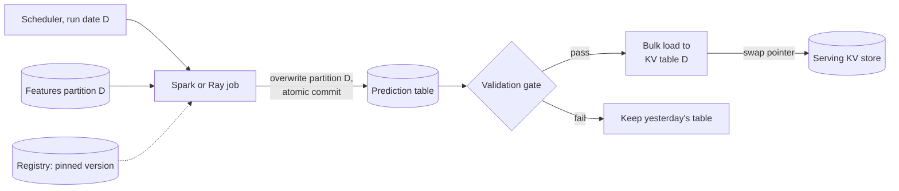

**Reading the diagram.** The job for run date D reads one input partition and a pinned model version (dotted, read once) and **overwrites partition D** with an atomic commit (§61.8), so a retry replaces rather than appends. A validation gate checks counts, nulls and prediction distribution before a bulk load and an atomic pointer swap. Storage boundaries: features, prediction table, serving store. Failure points: partial writes (atomic commit) and bad models (the gate keeps yesterday's table). Scaling: add workers.

::: mistake
**Mistake — Appending batch predictions.** A job that appends rows and is retried after a spot preemption writes some users' predictions twice, and a downstream "latest prediction" query may pick either. Key outputs by (run date, entity, model version), overwrite whole partitions, and record the run's model version and input snapshot (§61.5.1, §22.15).
:::

## 66.14 Reliability

### 66.14.1 Timeouts, fallbacks, breakers, shedding and hedging

Serving reliability applies the patterns of Chapter 22 with one ML-specific advantage: there is almost always a cheaper, slightly worse answer available (§60.12.2).

1. **Deadlines.** Propagate the caller's remaining budget (§22.11); the server drops a queued request whose deadline has passed instead of computing an answer nobody will read. Clockwork showed that because DNN execution time is highly predictable, a server can decide at admission whether a request can meet its deadline and reject it early, keeping tail latency close to the objective [Gujarati et al. 2020].
2. **Fallbacks.** On timeout or error, the caller drops one rung of the ladder: reduced model, heuristic, static range (Figure 60.9). Fallbacks must not share the failing dependency.
3. **Circuit breakers.** When the model server's error or timeout rate crosses a threshold, the caller's breaker opens and goes straight to the fallback for a cool-down period, so a sick server is not hammered while it recovers (§22.13).
4. **Overload protection.** Bound the queue: a request that cannot finish within the budget should be rejected at once, which is cheaper for everyone than a timeout.
5. **Hedging.** Send a second copy of a slow request to another replica after the p95 delay and use the first answer (§23.7) [Dean and Barroso 2013]. It suits cheap CPU models; on a saturated GPU fleet it adds load exactly when capacity is short, so cap it with a hedging budget.

::: formula
**Queue limit from the latency budget**

$$Q_{\max} = X(B_{\max}) \times \left(L_{\text{budget}} - T(B_{\max})\right)$$

| Symbol | Meaning | Units |
|---|---|---|
| $X(B_{\max})$ | Instance throughput at full batches | rows/s |
| $L_{\text{budget}}$ | Model-stage latency budget | s |
| $T(B_{\max})$ | Execution time of the request's own batch | s |
| $Q_{\max}$ | Rows that can be queued and still finish within budget | rows |
:::

::: example
**Worked example — Admission limit for the deep ETA GPU server.** $X(64) = 24{,}615$ rows/s, $T(64) = 2.6$ ms, model budget 20 ms.

1. $Q_{\max} = 24{,}615 \times (0.020 - 0.0026) = 24{,}615 \times 0.0174 = 428$ rows.
2. An ETA request carries 20 rows, so about 21 requests may wait; the 22nd is rejected immediately with a "resource exhausted" status, and the ETA service answers with the reduced model in under 1 ms.

**Interpretation.** Rejecting the 22nd request costs it a slightly worse ETA; queueing it would make it, and every request behind it, miss the budget. **Engineering implication.** Configure queue limits from the formula (Triton supports queue policies with maximum queue size and timeouts [NVIDIA Triton Docs]) and treat rejections as a scaling signal, not an error.
:::

**Figure 66.12 — Reliability layers around a model call.**

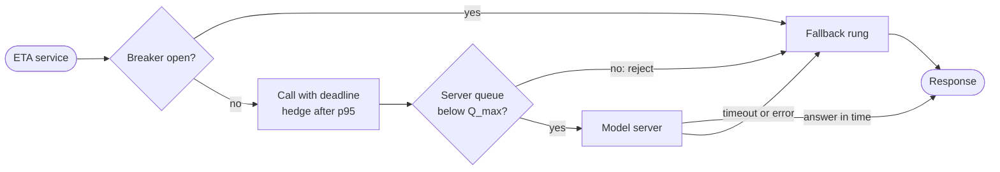

**Reading the diagram.** An open breaker goes straight to the fallback; otherwise the caller calls synchronously with a deadline, hedging if slow. The server admits only below $Q_{\max}$, else rejects at once; timeouts and errors also fall back, so every path ends in a response. Failure points: a fallback sharing the model's feature store; hedges during overload. Scaling: rejections and breaker openings feed autoscaling and alerts.

## 66.15 Observability for serving

Serving needs the RED metrics of any service (§23.3.3) plus model-specific signals. Break latency into its parts, because "p99 rose" has five different fixes.

**Table 66.8 — What to measure in a model server.**

| Signal | Metrics | Why |
|---|---|---|
| Latency breakdown | Network, queue, pre-processing, compute, post-processing time per request (histograms) | Locates the slow stage; queue time rising first means capacity |
| Batching | Batch-size histogram, queue depth, rejections | Shows whether batching works and how close to $X(B_{\max})$ |
| GPU | DCGM SM activity, tensor activity, memory used, temperature, errors (§64.11) | Efficiency and hardware faults |
| Model | Version served, prediction distribution, fallback rate, feature-default rate | Catches silent model failures (Chapter 70) |
| Logging | Features as served, prediction, version, request ID | Training data, skew checks, replay (§60.6.2) |

Log the model version and fallback level with every prediction and trace span (§40.6); export per-model, per-version metrics with bounded cardinality (§40.5.3), not per-user labels. The prediction log is also the training set of the next model, so it is a product, with a schema and an owner: QuickBite logs every ordered prediction and a 10% sample of the rest, about 11 GB a day (§60.6.2).

## 66.16 Reference architecture: QuickBite ETA serving at 40,000 predictions/s

The primary ETA model is gradient-boosted trees at 0.1 ms per prediction (§60.11). By §66.7 a separate GPU server would cost more and add a network hop longer than the inference itself, so the model runs **in-process** inside the ETA service, with a challenger deep model in shadow on a small GPU pool.

**Figure 66.13 — QuickBite ETA serving.**

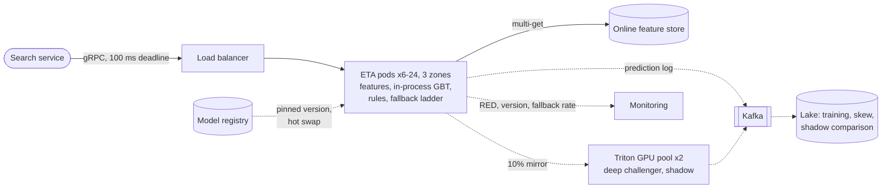

**Reading the diagram.** The search service calls the ETA service over gRPC with a 100 ms deadline (synchronous). Each pod fetches features with one multi-get to the online store (the storage boundary on the critical path), scores the 20 restaurants as one batch in-process, applies rules and the fallback ladder, and responds. Asynchronously, pods log predictions to Kafka and mirror 10% of requests to the shadow Triton pool, whose predictions are logged but never returned; the lake joins both with delivery outcomes for training, skew checks and the paired comparison of §66.12. A sidecar watches the registry, downloads a new pinned version (about 20 MB), warms it and swaps it atomically, keeping the previous one loaded for rollback. Failure points: the feature store (reduced model), a bad model version (automatic rollback), the shadow pool (dropped mirror only). Scaling: pods scale on RPS; the feature store by partition.

::: example
**Worked example — Sizing the ETA pods.** Per request: 1 ms of CPU for decoding, feature merge and rules, plus $20 \times 0.1 = 2$ ms of inference: 3 ms. Pods have 4 vCPUs.

1. Peak busy CPU: $2{,}000 \times 0.003 = 6$ vCPU. At $u_{\text{target}} = 0.5$: 12 vCPU = 3 pods.
2. Zone failure: losing one of three zones leaves 8 vCPU at $6 / 8 = 0.75 = u_{\max}$. Acceptable, but with no room for a surge, so run a minimum of 6 pods (2 per zone), which also allows rolling deployments and gives $6 / 24 = 0.25$ at peak.
3. HPA on RPS per pod, 6–24 pods; the 30% surge of §66.9 on 6 pods gives $7.8 / 24 = 0.33$.
4. Cost: about 6 pods × 4 vCPU × \$0.048 = \$1.15/h of pod capacity on nodes shared with other services (dedicated 16-vCPU nodes would set the three-node floor of §60.11, \$2.31/h, which Table 66.9's per-order cost assumes), plus 2 shadow GPUs at \$5.00/h while a challenger is evaluated.
:::

**Table 66.9 — How the design meets the requirements.**

| Requirement | Mechanism |
|---|---|
| 100 ms p99, model stage ≤ 20 ms | In-process trees: ~2 ms for 20 rows; no network hop |
| 40,000 predictions/s | 6–24 pods on RPS-based HPA; minimum survives a zone loss |
| Safe model changes | Pinned versions via GitOps; shadow then canary by user hash; instant rollback |
| Availability | Four-rung fallback ladder; breaker around the shadow pool and feature store |
| Learning loop | Prediction log with version and fallback level, joined with outcomes |
| Cost | About \$0.0001 of inference per order (§60.11) |

If the deep challenger wins its A/B test, it moves to Triton on GPUs: 3 GPUs plus 1 spare at $B_{\max} = 64$, $D_{\max} = 2$ ms (§66.6), with queue limits from §66.14 and the in-process trees retained as the first fallback rung.

## 66.17 Summary and revision notes

::: summary
- Choose the inference mode from two questions: who waits, and can the answer be computed before the question? Online for request-time inputs with a waiting user; asynchronous for slow work someone needs; streaming for event-triggered predictions; batch for enumerable inputs where staleness is acceptable.
- A model server = request handler, pre-processing, per-model batching queue, model instances on a runtime, post-processing, a lifecycle manager over a model repository, and health and metrics endpoints.
- As of 2026: Triton (renamed Dynamo-Triton) for maximum GPU throughput across formats; TorchServe archived (August 2025); TensorFlow Serving for TensorFlow; KServe (CNCF incubating) as a Kubernetes platform; Ray Serve for Python composition and multiplexing; BentoML for packaging.
- Dynamic batching: $L = W_{\text{busy}} + W_{\text{fill}} + T(B)$, $X(B) = B/(t_0 + B t_1)$, $L_{\text{worst}} \approx D_{\max} + 2T(B_{\max})$. $B_{\max}$ sets the throughput ceiling; $D_{\max}$ trades latency for GPU time; under load the queue batches by itself.
- $C_{1k} = 1{,}000\,p/(3{,}600\,X\,u)$; a GPU must beat a vCPU by $S^{*} \approx 43$ at QuickBite's prices. Trees and small MLPs belong on CPU; CNNs and transformers on GPU once traffic fills them.
- Shard models that do not fit; pack, multiplex or MIG-partition models that are too small.
- Autoscale on queue depth or in-flight requests, not GPU utilization; $u_{\text{target}} = u_{\max}/(1+g)$ covers growth during the reaction time, which cold start dominates.
- $T_{\text{cold}}$ is mostly node provisioning; cache images and models on warm nodes and mark ready only after warm-up.
- Pin versions in GitOps, route by user hash, log the version with every prediction.
- Roll out shadow → canary → A/B; judge accuracy paired in shadow (32× fewer orders in the example), guardrails in the canary, business impact in A/B; interleave for rankers; keep the old version loaded for instant rollback.
- Batch jobs: $T_{\text{job}} = T_{\text{start}} + N/(WXu)$; overwrite partitions atomically.
- Reliability: deadlines, fallback ladder, circuit breakers, $Q_{\max} = X(T_{\text{budget}} - T(B_{\max}))$ admission limits, budgeted hedging.
:::

## 66.18 Knowledge checkpoint

1. QuickBite wants an ETA for every in-flight order refreshed when the courier's status changes. Which inference mode, and why?
2. Name the seven components of a model server.
3. Which of the six servers in §66.5 should a new project avoid, and why?
4. With $t_0 = 1$ ms and $t_1 = 0.025$ ms, what is $X(128)$?
5. Why does $D_{\max} > 0$ not raise throughput for a single-instance server below saturation?
6. A batch of 64 takes 2.6 ms and $D_{\max} = 2$ ms. Estimate the worst-case model latency without backlog.
7. Compute $S^{*}$ for a GPU at \$2.00/h against vCPUs at \$0.04/h, both at utilization 0.5.
8. Why are tree models usually served on CPU even if a GPU library is 50 times faster per device?
9. Why is GPU utilization a poor autoscaling signal for a batching server?
10. $u_{\max} = 0.8$, largest step 25%. What is $u_{\text{target}}$?
11. A 6 GB model downloads at 0.3 GB/s and loads at 3 GB/s; initialization and warm-up take 12 s on a warm node with a cached image. What is $T_{\text{cold}}$?
12. Why does a paired shadow comparison need far fewer orders than a two-group canary?
13. Compute $Q_{\max}$ for $X = 10{,}000$ rows/s, budget 30 ms, $T(B_{\max}) = 5$ ms.

<details><summary>Answers</summary>

1. Streaming: the trigger is an event, nobody waits on the model, and seconds of delay are acceptable; the result is written to a store the app reads.
2. Request handler, pre-processing, batching queue and scheduler, model instances on a runtime, post-processing, lifecycle manager with model repository, health and metrics endpoints.
3. TorchServe: archived in August 2025 and no longer maintained, so no bug or security fixes.
4. $128 / (1 + 3.2) = 128 / 4.2$ ms $= 30{,}476$ rows/s.
5. A work-conserving batcher already sends everything queued whenever the instance frees up, and requests accumulate during execution; waiting only adds latency. It does free GPU time.
6. $2 + 2 \times 2.6 = 7.2$ ms.
7. $(2.00/0.04) \times (0.5/0.5) = 50$.
8. The redundancy floor (at least one GPU per zone) leaves the GPUs mostly idle, so cost per prediction is higher, and a network hop costs more than the inference.
9. It reads near 100% when the GPU runs many tiny batches, and saturates at 100% when overloaded, so it neither shows spare capacity nor the size of an overload.
10. $0.8 / 1.25 = 0.64$.
11. $6/0.3 + 6/3 + 12 = 20 + 2 + 12 = 34$ s.
12. Both models score the same orders, so order-to-order variation cancels; the difference has far smaller variance than the metric.
13. $10{,}000 \times 0.025 = 250$ rows.

</details>

## 66.19 Interview questions

### Basic

**Q1. What is the difference between online and batch inference, and how do you choose?**
**Answer.** Online inference computes a prediction inside a request within milliseconds; batch inference precomputes predictions for a known set of inputs on a schedule. Choose batch when the input space is enumerable and staleness is acceptable (cheaper, simpler); online when inputs are only known at request time. Many systems combine them: batch candidates or baseline features, online re-ranking.

**Q2. What is dynamic batching and what are its two knobs?**
**Answer.** The server groups requests arriving close together into one execution to amortize fixed per-batch cost. $B_{\max}$ caps batch size and sets the throughput ceiling; $D_{\max}$ caps how long the oldest request waits. Pick $B_{\max}$ from peak load with headroom and $D_{\max}$ from the latency budget.

### Intermediate

**Q3. Your GPU model server's p99 doubled after a traffic increase, with no errors. How do you diagnose it?**
**Answer.** Break latency down: if queue time rose while compute time is flat and batch sizes are pinned at $B_{\max}$, arrivals exceed $X(B_{\max})$: scale out, raise $B_{\max}$ if the budget allows, or shed to a fallback. If compute time rose, check for larger inputs, padding, a co-located model on the same GPU, or thermal throttling. If pre-processing rose, the CPU side is the bottleneck. Confirm with a load test.

**Q4. How would you roll out a new ETA model safely?**
**Answer.** Offline gates per slice; shadow on mirrored traffic to test latency, errors and paired accuracy; a canary by user hash at 1–5% with automated guardrails (latency, errors, prediction distribution, fallback rate); an A/B test for business metrics such as conversion and late-order rate; then full rollout with the previous version kept loaded for instant rollback. Pin versions in GitOps and log the version with every prediction.

### Advanced

**Q5. Design serving for 300 small per-chain demand models with uneven traffic.**
**Answer.** Do not give each model a deployment. Use a multi-model server with on-demand loading and LRU eviction, a node-local model cache, and a router that sends a model's requests to replicas that already hold it (multiplexing), replicating popular models across replicas. Size memory by models per replica and compute by summed load. Monitor load-miss rate and cold-load latency; pin the few hottest models.

**Q6. Size a GPU fleet for a vision model at 20,000 images/s peak with a 50 ms p99 budget.**
**Answer.** Measure the batch curve; choose $B_{\max}$ and $D_{\max}$ so that $D_{\max} + 2T(B_{\max})$ plus pre-processing fits 50 ms with slack. With, say, 6,000 images/s per GPU at batch 64 and $u_{\text{target}} = 0.6$: $\lceil 20{,}000/3{,}600 \rceil = 6$ GPUs, plus one per zone of redundancy. Check pre-processing CPU (JPEG decode) per GPU, scale on queue depth, keep warm spare capacity because GPU nodes start slowly, and compare $C_{1k}$ with CPU.

## 66.20 Practical exercises

1. **Simulator extensions.** Add a second GPU instance and log-normal execution-time jitter to the §66.6 simulator. Show when a nonzero $D_{\max}$ starts to help, and plot p99 against arrival rate for three $B_{\max}$ values.
2. **Your batch curve.** Run the §66.6 timing program with 1, 2 and 4 threads and with a larger hidden size; report where per-row cost flattens and fit $t_0$, $t_1$.
3. **Autoscaling table.** For reaction times of 1, 2, 4 and 8 minutes and steps of 10–50%, tabulate $u_{\text{target}}$ and peak nodes for the deep ETA model.
4. **Canary calculator.** Write a function that returns two-group and paired sample sizes for a given $\delta$, $\sigma$, $\sigma_d$, $\alpha$ and power, and the canary duration at a given traffic share.

## 66.21 Design challenges

1. **Dish-photo moderation.** Restaurants upload 200,000 photos a day, peaking at 30 per second, and expect a verdict within 2 minutes. Choose the mode, server, hardware and autoscaling (including scale to zero), and compute cost per 1,000 photos.
2. **Fraud scoring at checkout.** Design serving for the fraud model at 60 orders/s with a 150 ms budget, including the fallback when the model is unavailable, a shadow evaluation plan given 60–90-day chargeback labels, and the rollback procedure.

## 66.22 References

1. BentoML. *BentoML Documentation*. https://docs.bentoml.com/
2. Chapelle, O., Joachims, T., Radlinski, F., Yue, Y. *Large-Scale Validation and Analysis of Interleaved Search Evaluation*. ACM Transactions on Information Systems 30(1), 2012.
3. CNCF. *KServe Becomes a CNCF Incubating Project*. Cloud Native Computing Foundation Blog, 2025. https://www.cncf.io/blog/2025/11/11/kserve-becomes-a-cncf-incubating-project/
4. Crankshaw, D., Wang, X., Zhou, G., Franklin, M. J., Gonzalez, J. E., Stoica, I. *Clipper: A Low-Latency Online Prediction Serving System*. USENIX NSDI, 2017.
5. Dean, J., Barroso, L. A. *The Tail at Scale*. Communications of the ACM 56(2), 2013.
6. Gujarati, A., Karimi, R., Alzayat, S., Hao, W., Kaufmann, A., Vigfusson, Y., Mace, J. *Serving DNNs like Clockwork: Performance Predictability from the Bottom Up*. USENIX OSDI, 2020.
7. Hermann, J., Del Balso, M. *Meet Michelangelo: Uber's Machine Learning Platform*. Uber Engineering Blog, 2017.
8. Huyen, C. *Designing Machine Learning Systems*. O'Reilly, 2022.
9. KEDA. *KEDA Documentation: Scalers*. https://keda.sh/docs/
10. KServe. *KServe Documentation*. https://kserve.github.io/website/
11. NVIDIA. *NVIDIA Dynamo-Triton* (formerly Triton Inference Server), product page. https://developer.nvidia.com/dynamo-triton
12. NVIDIA. *Triton Inference Server User Guide* (model configuration, dynamic batcher, model repository). https://docs.nvidia.com/deeplearning/triton-inference-server/user-guide/docs/
13. Olston, C., et al. *TensorFlow-Serving: Flexible, High-Performance ML Serving*. Workshop on ML Systems at NIPS, 2017. arXiv:1712.06139
14. Parks, J., Aurisset, J., Ramm, M. *Innovating Faster on Personalization Algorithms at Netflix Using Interleaving*. Netflix Technology Blog, 2017.
15. Ray Project. *Ray Serve Documentation* (batching, autoscaling, model multiplexing). https://docs.ray.io/en/latest/serve/
16. Romero, F., Li, Q., Yadwadkar, N. J., Kozyrakis, C. *INFaaS: Automated Model-less Inference Serving*. USENIX ATC, 2021.
17. Shen, H., Chen, L., Jin, Y., Zhao, L., Kong, B., Philipose, M., Krishnamurthy, A., Sundaram, R. *Nexus: A GPU Cluster Engine for Accelerating DNN-Based Video Analysis*. ACM SOSP, 2019.
18. TorchServe. *pytorch/serve* GitHub repository (Limited Maintenance notice; archived 7 August 2025). https://github.com/pytorch/serve
19. Zhang, C., Yu, M., Wang, W., Yan, F. *MArk: Exploiting Cloud Services for Cost-Effective, SLO-Aware Machine Learning Inference Serving*. USENIX ATC, 2019.

## 66.23 Open verification items

- BentoML's reported acquisition by Modular (February 2026) comes from third-party sources only; confirm against an official announcement.
- KServe's CNCF incubation date (CNCF pages give 29 September and 11 November 2025).
- Triton details not re-checked against the docs (host blocked): backend list, `model_warmup`, queue-policy fields, Open Inference Protocol paths.
- Ray Serve parameter names (`@serve.batch`, ongoing-requests autoscaling, multiplexing API) against current docs.
- Netflix interleaving sample-size claims and the Michelangelo multi-model container wording against the original posts.
- TensorFlow Serving's version-policy names and the full author list of Olston et al. 2017.
- All throughput figures (Table 66.5, 500,000 tree rows/s, 6,000 images/s, 50,000 ranking rows/s) are assumptions, not benchmarks.
