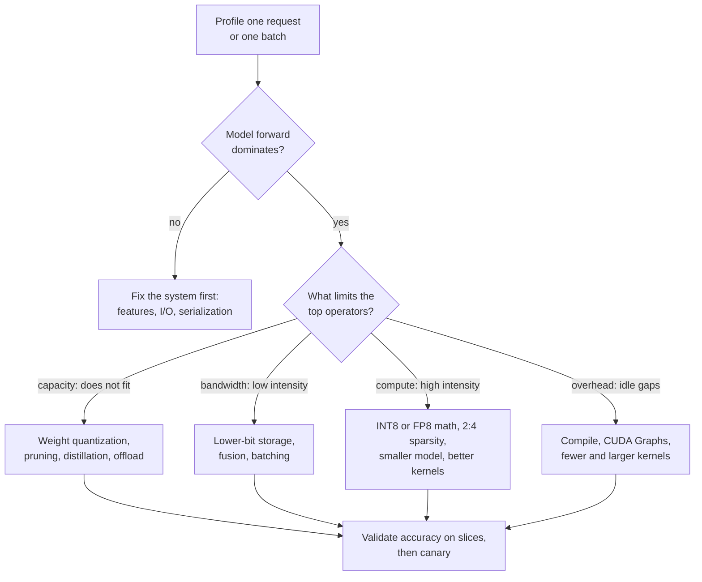
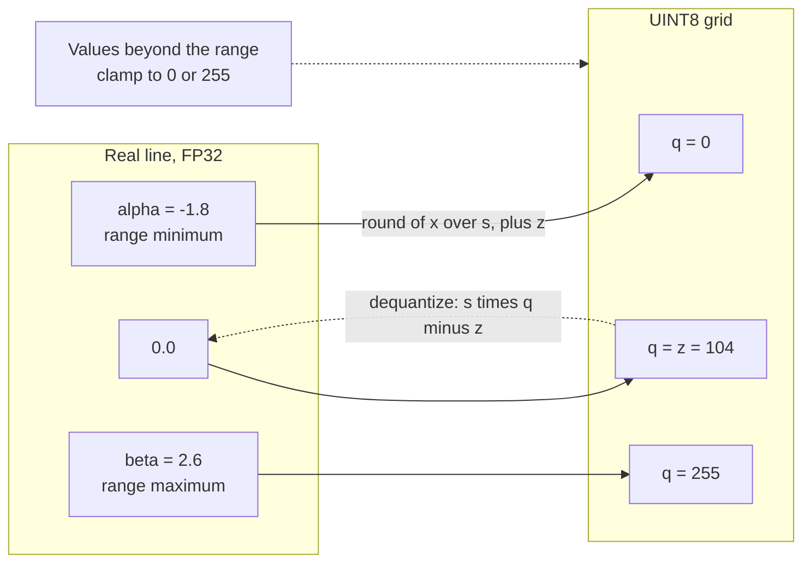
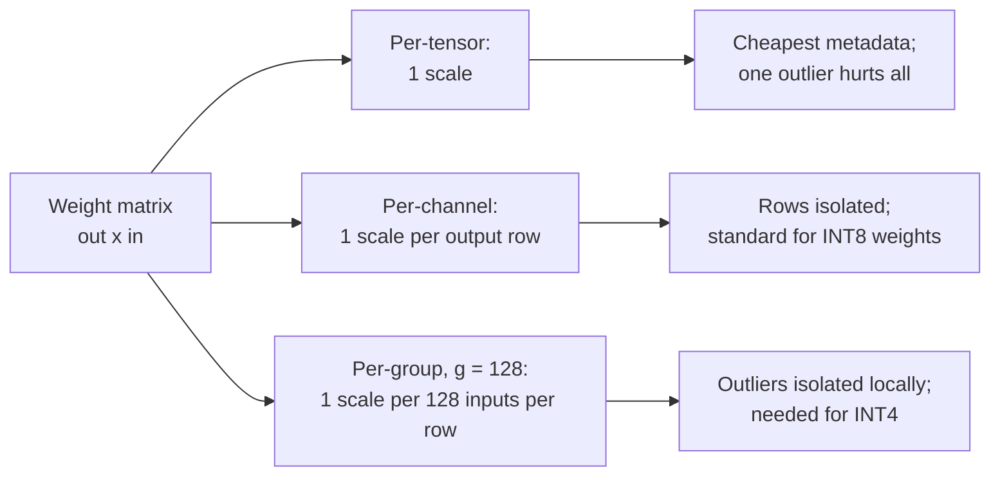
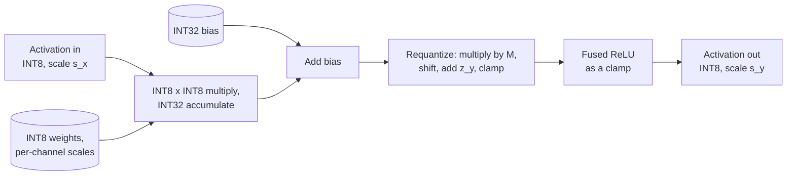

# Chapter 67 — ML Model Optimization

> **Level:** 4 · **Track:** B (ML/AI) · **Estimated reading time:** 5 h

A trained model is a first draft. It was built to learn, in 32-bit or 16-bit floating point, with every weight it might need and a graph of operations written for a researcher's convenience. Serving it as-is usually works, and usually costs two to ten times more than it needs to: more memory than the hardware has, more bytes moved per prediction than the latency budget allows, and more servers than the business case assumed.

**Model optimization** closes that gap. You will learn to shrink the numbers (quantization), remove weights (pruning), train a smaller model to imitate a large one (distillation), choose architectures that are cheap by construction, and hand the model to a compiler or runtime (ONNX Runtime, TensorRT, torch.compile) that fuses operations, picks kernels and plans memory for a specific device. Each technique answers a specific bottleneck, so the chapter starts with measurement and ends with a release workflow that proves the optimized model is still good enough.

Chapter 64 explained why a GPU is fast or slow (the roofline, precision formats, memory-bound versus compute-bound kernels); this chapter uses those results rather than re-deriving them. Chapter 66 serves the optimized model, and Chapter 73 owns the techniques that exist only for large language model (LLM) generation: the KV cache, PagedAttention, speculative decoding and continuous batching. LLM *weight* quantization (GPTQ, AWQ) is a model-level technique and lives here.

::: note
**Assumptions used in this chapter.** Units are SI (1 GB = 10⁹ bytes; 1 TB/s = 10¹² bytes/s); one multiply–add is 2 FLOPs (§58.12). The reference GPU is an NVIDIA H100 SXM: 80 GB HBM at 3.35 TB/s, 989 TFLOP/s dense BF16, 1,979 TFLOP/s dense FP8 and INT8 (Table 64.4, as of 2026). QuickBite numbers reuse earlier chapters: the deep ETA model is the 512–1,024–1,024–1 MLP of §58.12.2 ($N \approx 1.58$ million), served at 40,000 predictions/s peak and costing 2 ms of CPU per prediction on 16-vCPU nodes at \$0.77/hour (§60.11); the support chatbot is a 7B model with $h = 4{,}096$ and $L = 32$ (§58.11); the 70B shape has $h = 8{,}192$, $L = 80$ and 8 key–value heads (Llama-2-like, §65). New numbers are labeled as assumptions. Latencies measured on a laptop or CI machine are machine-dependent; sizes and accuracy figures in the code are deterministic.
:::

## 67.1 Learning objectives

After this chapter you should be able to:

- Profile an inference workload and decide whether memory capacity, memory bandwidth, compute or overhead limits it before choosing an optimization.
- Derive and apply the affine quantization formulas (scale and zero-point), compare symmetric and asymmetric schemes and per-tensor, per-channel and per-group granularity, and bound the quantization error.
- Choose between dynamic quantization, static post-training quantization and quantization-aware training, and explain calibration and the straight-through estimator.
- Explain weight-only INT8/INT4 quantization for LLMs and how GPTQ, AWQ, SmoothQuant, LLM.int8() and FP8 deal with outliers; compute model memory at FP16, INT8 and INT4.
- Distinguish unstructured, structured and 2:4 sparsity and explain why unstructured sparsity rarely speeds up dense hardware.
- Write the knowledge-distillation loss with temperature and plan a student model against a quality target.
- Explain ONNX graphs, opsets and execution providers; TensorRT engine building; and what ML compilers (XLA, TorchInductor, TVM, MLIR) do, including the memory-traffic savings of operator fusion.
- Trade latency against throughput with batch size, concurrency and CUDA Graphs, and choose between TensorRT, ONNX Runtime and torch.compile.
- Run an optimization through measurement, accuracy validation on slices and a canary release.

## 67.2 Prerequisites

- FLOPs per prediction ($2N$), parameter counts and the ETA MLP — §58.3 and §58.12 (the starting model and its cost).
- The roofline model, arithmetic intensity and the ridge point — §64.9 (every speed-up in this chapter is a move along it).
- Precision formats FP32, BF16, FP16, FP8, INT8, FP4 and microscaling — §64.10 (this chapter decides *when* to use them).
- Compute-bound versus memory-bound diagnosis — §64.12; kernel launch overhead and fusion — §64.6.4.
- Inference fleet sizing and batching — §60.11 (the cost model that optimization changes).
- Canary releases and progressive delivery — §43.6 (the release mechanics reused in §67.16).

## 67.3 Why optimize models

### 67.3.1 The six reasons, and what each one costs you

::: definition
**Definition — Model optimization.** Any transformation of a trained model, or of how it is executed, that reduces inference latency, memory, cost or energy while keeping prediction quality within an agreed tolerance. **Model compression** (quantization, pruning, distillation, low-rank factorization) changes the model's parameters or architecture; **model compilation** (graph rewriting, operator fusion, kernel selection, memory planning) changes how the same mathematics runs on a particular device.
:::

#### First-principles explanation

Think of moving house. You can pack fewer things (pruning), pack them more tightly (quantization), replace bulky furniture with flat-pack equivalents (distillation and efficient architectures), or plan the route and load order so the van makes fewer trips (compilation). Which helps depends on whether the problem is the size of the van, the number of trips or the time spent loading. Optimizing without knowing which is like buying a bigger van when the bottleneck is the stairs.

#### Why does this exist?

Six pressures push teams to optimize a model after training:

1. **Latency.** A request has a budget (QuickBite's ETA model gets 20 ms of a 100 ms page budget, §60.11). A model that is accurate but slow is unusable on the synchronous path.
2. **Throughput.** Predictions per second per server set fleet size: halving per-prediction cost halves the fleet once redundancy floors are met.
3. **Memory.** A 70B model in BF16 needs 140 GB for weights alone, more than one 80 GB GPU (§64.10.4). Fitting on fewer devices removes communication and cost.
4. **Cost.** Serving dominates the lifetime cost of a popular model: training happens once, inference runs on every request for years.
5. **Energy.** Moving a byte from DRAM costs far more energy than an arithmetic operation on it [Han et al. 2016], so fewer bytes per prediction means less power per prediction.
6. **Edge deployment.** Phones, cars and point-of-sale devices have a few gigabytes of RAM, no data-center GPU and a battery. Models deployed there must be small by construction.

#### How it works internally: profile first

Optimization starts with a profile, not a technique. A **profiler** (PyTorch Profiler, Nsight Systems, `perf` and flame graphs, §23.4, or an application trace, §40.6) splits one request's time into its parts. Three questions decide what to do next:

1. **Is the model even the bottleneck?** In many online services, feature fetching, serialization and network hops take more time than the forward pass.
2. **Within the model, which operators take the time?** Rank by measured time, not by FLOPs (§64.9).
3. **For the top operators, which resource is saturated?** Memory capacity (the model does not fit), memory bandwidth (low arithmetic intensity), compute (high intensity) or overhead (gaps between kernels, Python, launch costs) (§64.12).

**Figure 67.1 — Matching the bottleneck to a family of techniques.**



**Reading the diagram.** The flow starts from a measured profile of a representative request or batch. If the forward pass is not the dominant cost, model optimization cannot pay off and the fix belongs in the serving system (Chapter 66) or feature path (Chapter 62). Otherwise, the limiting resource of the most expensive operators chooses the technique family: capacity problems need fewer bytes stored, bandwidth problems need fewer bytes moved, compute problems need cheaper arithmetic or less of it, and overhead problems need fewer, larger launches. Every branch converges on the same gate: accuracy validation on data slices and a canary release (§67.16). All steps are offline engineering work; nothing here is on the request path. The failure point is skipping the profile and applying a technique to a resource that was not the bottleneck.

**Table 67.1 — Optimization techniques at a glance.**

| Technique | Changes | Typical gain | Accuracy risk | Section |
|---|---|---|---|---|
| Dynamic INT8 quantization | Weights stored INT8; activations quantized per call | 2–4× smaller; 1.5–3× faster on CPU | Low | §67.5 |
| Static INT8 / FP8 quantization | Weights and activations low-bit | 2–4× smaller; up to 2× math throughput | Low–medium | §67.5 |
| Weight-only INT4 (GPTQ, AWQ) | LLM weights 4-bit | ~3.9× smaller than FP16 | Medium | §67.6 |
| Pruning (2:4 structured) | Half the weights zero in a fixed pattern | Up to 2× GEMM math on supporting GPUs | Medium; needs fine-tuning | §67.7 |
| Distillation | New, smaller model | Proportional to size reduction | Medium; needs training | §67.8 |
| Compilation and fusion | Graph and kernels, not parameters | 1.2–3× on memory- or overhead-bound models | Very low (numerics only) | §67.10–§67.12 |

Gains are indicative ranges from the cited sources and common experience, not guarantees; measure on your model and hardware.

#### Mathematical foundations

Most inference speed-ups come from moving fewer bytes, and they apply only to the fraction of time spent moving those bytes. Amdahl's law (§4.12.1) makes that precise.

::: formula
**Speed-up bound from reducing bytes moved**

$$S = \frac{1}{(1 - f) + f \cdot \dfrac{b_\text{new}}{b_\text{old}}} \qquad S_\text{max} = \frac{b_\text{old}}{b_\text{new}} \quad (f = 1)$$

| Symbol | Meaning | Units |
|---|---|---|
| $S$ | End-to-end speed-up of the step | dimensionless |
| $f$ | Fraction of step time spent in memory-bound reads of the data being compressed | dimensionless |
| $b_\text{old}, b_\text{new}$ | Bits per value before and after compression | bits |
| $S_\text{max}$ | Bound when the whole step is limited by those reads | dimensionless |
:::

::: example
**Worked example — INT4 weights for QuickBite's 7B chatbot at batch 1.** Decoding one token at batch 1 reads every weight once: 14 GB in BF16, at least 4.2 ms per token on an H100 (§64.9.2). INT4 with one FP16 scale per group of 128 weights stores $4 + 16/128 = 4.125$ bits per weight.

1. Weight bytes: $7 \times 10^9 \times 4.125 / 8 = 3.61$ GB; the minimum read time falls to $3.61 \times 10^9 / 3.35 \times 10^{12} = 1.08$ ms.
2. Ratio: $b_\text{old}/b_\text{new} = 16/4.125 = 3.88 = S_\text{max}$.
3. Suppose a profile shows weight reads are $f = 0.8$ of the step (the rest is KV-cache reads, small kernels and launch gaps; assumed). Then $S = 1/(0.2 + 0.8/3.88) = 1/(0.2 + 0.206) = 2.46$.
4. With $f = 0.9$: $S = 1/(0.1 + 0.232) = 3.01$.

**Interpretation.** A 3.9× reduction in weight bytes yields a 2.5–3× faster token, because the untouched 10–20% of the step now dominates. **Engineering implication.** After compressing weights, profile again: the next bottleneck (KV cache, Chapter 73; launch overhead, §67.14) is now where the remaining time goes.
:::

The same reasoning sizes a CPU fleet. §60.11 sized QuickBite's deep ETA model at 2 ms of CPU per prediction, 11 nodes in all.

::: example
**Worked example — What INT8 does to the ETA fleet.** Assume a profile splits the 2 ms into 1.5 ms of model forward and 0.5 ms of feature parsing and serialization, and that dynamic INT8 quantization makes the forward pass 2× faster (§67.5 measures 2–3.5× on one core; take the conservative end).

1. New CPU time per prediction: $c = 0.5 + 1.5/2 = 1.25$ ms.
2. Busy vCPUs at 40,000 predictions/s: $40{,}000 \times 0.00125 = 50$; at the 50% utilization target, 100 vCPUs, so $\lceil 100/16 \rceil = 7$ nodes plus one for redundancy: 8 nodes, versus 11.
3. Cost: $8 \times 0.77 = \$6.16$/hour versus \$8.47/hour; $2.31 \times 8{,}760 = \$20{,}200$ per year.

**Interpretation.** A 2× faster forward pass gives 1.6× less CPU per prediction and 27% fewer nodes; the redundancy node and the unoptimized 0.5 ms cap the gain. **Engineering implication.** Report savings in fleet cost, not in kernel speed-up, and decide whether the next 0.5 ms (feature parsing) is the better target.
:::

::: mistake
**"Quantization makes the model 4× faster."** It makes the *weights* 4× smaller than FP32. Speed-up depends on whether those bytes were the bottleneck ($f$), whether the hardware has fast low-precision instructions, and whether dequantization overhead eats the gain. Some quantized models run slower than the original when the runtime lacks kernels for the format.
:::

## 67.4 Quantization fundamentals

### 67.4.1 Affine quantization: scale and zero-point

::: definition
**Definition — Quantization.** Mapping real values onto a small set of representable levels, here a $b$-bit integer grid. **Uniform affine quantization** maps a real value $x$ to an integer $q = \text{clamp}(\text{round}(x/s) + z,\; q_\text{min},\; q_\text{max})$ with a real **scale** $s$ (the step between adjacent levels) and an integer **zero-point** $z$ (the integer that represents real 0); **dequantization** recovers $\hat{x} = s(q - z)$ [Jacob et al. 2018; Nagel et al. 2021]. **Symmetric** quantization fixes $z = 0$; **asymmetric** quantization lets $z$ shift the grid to fit a lopsided range.
:::

#### First-principles explanation

Picture a thermometer with only 256 marks. You choose where the lowest and highest marks sit (the range), which fixes the spacing between marks (the scale). A reading between two marks is rounded to the nearer one. If you place the marks to cover −40 °C to 50 °C, every reading is within half a mark of the truth. If one sensor once read 500 °C and you stretch the marks to cover it, the spacing grows tenfold and every everyday reading gets ten times less precise. That trade between **range** and **resolution** is all of quantization.

#### Why does this exist?

Inference does not need 24 bits of mantissa. Trained weights and activations tolerate small perturbations, and integer arithmetic is cheaper in silicon area, energy and bandwidth: INT8 halves bytes against FP16 and, on hardware with INT8 instructions, doubles peak throughput (Table 64.4). Jacob et al. showed that a network can run with integer-only arithmetic, a scheme adopted by mobile inference runtimes [Jacob et al. 2018].

#### How it works internally

1. **Pick a range** $[\alpha, \beta]$ for the tensor: from the weights directly, or from activation statistics gathered on sample data (**calibration**, §67.4.3). Extend it to include 0 so that zero, which is everywhere (padding, ReLU outputs), is represented exactly.
2. **Compute the scale** so the range spans the integer grid, and the **zero-point** so that real 0 lands on an integer.
3. **Quantize**: divide by $s$, round to the nearest integer, add $z$, clamp to the grid.
4. **Compute** in integers (§67.4.4), or **dequantize** back to floating point before computing (weight-only schemes, §67.6).

**Figure 67.2 — The affine mapping between real values and an 8-bit grid.**



**Reading the diagram.** The left box is the floating-point range observed for one tensor; the right box is the 256-level unsigned grid. Solid arrows are the quantization step $q = \text{round}(x/s) + z$, which sends the range minimum to 0, real zero to the zero-point 104 and the maximum to 255; the dotted arrow is dequantization, which turns an integer back into an approximate real value. The scale $s = 4.4/255$ is the spacing between levels. The failure point is the clamp: any value outside $[\alpha, \beta]$ is saturated to the nearest end, an error that can be far larger than the rounding error. The numbers are those of the worked example below.

#### Mathematical foundations

::: formula
**Affine quantization: scale, zero-point, quantize and dequantize**

$$s = \frac{\beta - \alpha}{q_\text{max} - q_\text{min}} \qquad z = \text{round}\!\left(q_\text{min} - \frac{\alpha}{s}\right) \qquad q = \text{clamp}\!\left(\text{round}\!\left(\frac{x}{s}\right) + z,\; q_\text{min},\; q_\text{max}\right) \qquad \hat{x} = s\,(q - z)$$

Symmetric variant: $s = \max|x| / q_\text{max}$, $z = 0$, grid $[-q_\text{max}, q_\text{max}]$ (for INT8, $[-127, 127]$; dropping −128 keeps the grid symmetric).

| Symbol | Meaning | Units |
|---|---|---|
| $x$ | Real value (weight or activation) | tensor units |
| $[\alpha, \beta]$ | Clipping range, extended to contain 0 | tensor units |
| $q_\text{min}, q_\text{max}$ | Integer grid limits: 0 and 255 for UINT8, −128 (or −127) and 127 for INT8 | integers |
| $s$ | Scale: real distance between adjacent levels | tensor units per level |
| $z$ | Zero-point: the integer that represents real 0 | integer |
| $q$ | Stored integer | integer |
| $\hat{x}$ | Dequantized approximation of $x$ | tensor units |
:::

::: example
**Worked example — Quantizing six values to 8 bits.** $x = [-1.8, -0.5, 0.0, 0.3, 1.2, 2.6]$.

*Asymmetric UINT8* ($\alpha = -1.8$, $\beta = 2.6$, grid 0–255):

1. $s = (2.6 - (-1.8))/255 = 4.4/255 = 0.017255$.
2. $z = \text{round}(0 + 1.8/0.017255) = \text{round}(104.32) = 104$.
3. $x = 1.2$: $1.2/0.017255 = 69.55 \to 70$; $q = 70 + 104 = 174$; $\hat{x} = 0.017255 \times 70 = 1.20784$; error $+0.0078$.
4. $x = 0.3$: $17.39 \to 17$; $q = 121$; $\hat{x} = 0.29333$; error $-0.0067$.
5. $x = -1.8$: $-104.32 \to -104$; $q = 0$; $\hat{x} = -1.79451$. Because $z$ was rounded, the range minimum itself is off by 0.0055.

*Symmetric INT8* (grid −127 to 127):

6. $s = 2.6/127 = 0.020472$; $x = -0.5$: $-24.42 \to -24$, $\hat{x} = -0.49134$, error $+0.0087$.
7. The negative half of the grid reaches only $-1.8/0.020472 = -88$: levels −127 to −89 are never used, about 15% of the grid wasted.

Maximum absolute errors: 0.0078 (asymmetric) and 0.0087 (symmetric), each below half its scale (0.0086 and 0.0102). The NumPy program in §67.4.5 reproduces every number.

**Interpretation.** Asymmetric quantization fits a lopsided range with a finer step; symmetric wastes part of the grid but keeps $z = 0$. **Engineering implication.** Use symmetric for weights, which are roughly centered on zero, because $z = 0$ removes cross terms from integer matrix multiplication (§67.4.4); use asymmetric for one-sided activations such as ReLU outputs.
:::

### 67.4.2 Quantization error and granularity

Within the range, rounding moves each value by at most half a step. Treating that error as uniform noise gives the mean squared error and the **signal-to-quantization-noise ratio (SQNR)**, which converts to a rule you can do in your head: each extra bit buys about 6 dB, and each doubling of the range relative to the typical value costs about 6 dB.

::: formula
**Quantization error bound, noise power and SQNR**

$$|x - \hat{x}| \le \frac{s}{2} \ \ (\alpha \le x \le \beta) \qquad \text{MSE} \approx \frac{s^2}{12} \qquad \text{SQNR}_\text{dB} \approx 6.02\,b + 4.77 - 20\log_{10}\frac{A}{\sigma}$$

| Symbol | Meaning | Units |
|---|---|---|
| $s$ | Scale (step size) | tensor units |
| MSE | Mean squared rounding error, assuming error uniform on $[-s/2, s/2]$ | tensor units² |
| $b$ | Bit width | bits |
| $A$ | Clipping threshold for symmetric quantization, $\max|x|$ by default | tensor units |
| $\sigma$ | Root-mean-square value of the tensor | tensor units |
| SQNR | $10\log_{10}(\text{signal power}/\text{noise power})$ | dB |
:::

::: example
**Worked example — How much does an outlier cost?** A weight matrix has Gaussian rows, an overall root-mean-square value $\sigma \approx 0.12$, and $\max|x| \approx 4\sigma$ within each row.

1. INT8, per-row range $A = 4\sigma$: $\text{SQNR} \approx 6.02 \times 8 + 4.77 - 20\log_{10} 4 = 48.2 + 4.8 - 12.0 = 40.9$ dB (noise power 1/12,000 of signal).
2. One outlier weight of 2.5 sets a *per-tensor* range: $A/\sigma = 2.5/0.12 = 20.8$, so $\text{SQNR} \approx 53.0 - 26.4 = 26.6$ dB, about 14 dB worse: the outlier has cost $14.3/6.02 \approx 2.4$ bits of precision for every other weight.
3. INT4 with groups of 32 values, $A \approx 3\sigma$: $6.02 \times 4 + 4.77 - 9.5 = 19.3$ dB.
4. Uniform data on $[-1, 1]$ in INT8: $s = 1/127$, predicted MSE $s^2/12 = 5.17 \times 10^{-6}$; the program in §67.4.5 measures $5.17 \times 10^{-6}$ on a million samples.

The program in §67.4.5 measures 41.0 dB per-channel, 26.5 dB per-tensor with the outlier and 20.3 dB for INT4 groups of 32.

**Interpretation.** Precision is lost not to the bit width alone but to the ratio of the range to typical values. **Engineering implication.** Shrink $A/\sigma$ before adding bits: use finer granularity (per-channel, per-group), clip outliers by calibration, or move them elsewhere (SmoothQuant, §67.6.4).
:::

::: definition
**Definition — Quantization granularity.** The set of values that share one scale (and zero-point). **Per-tensor**: one scale for the whole tensor. **Per-channel** (per-axis): one scale per output channel of a weight, that is, per row of a linear layer's weight matrix or per filter of a convolution. **Per-group** (block-wise): one scale per contiguous group of $g$ values along the input dimension, typically $g = 32$–128; the OCP microscaling formats are per-group with $g = 32$ (§64.10.4) [Nagel et al. 2021].
:::

**Figure 67.3 — Three granularities for a weight matrix.**



**Reading the diagram.** One weight matrix (output channels × input features) can share scales at three levels. Moving right along each branch reduces the number of values that an outlier can damage and increases the metadata: per-tensor stores one number; per-channel stores one per row, negligible for large layers; per-group stores $\text{out} \times \text{in}/g$ scales, for example 0.125 extra bits per weight with FP16 scales and $g = 128$. Per-channel scales fold neatly into integer matrix multiplication because each output element uses one row scale; per-group scales require the kernel to rescale partial sums every $g$ inputs, so they need dedicated kernels. Activations are usually per-tensor or per-token, because their ranges change every request.

### 67.4.3 Calibration: choosing the range

**Calibration** sets the clipping range for activations by running a few hundred representative inputs through the model and recording statistics at each quantization point. The choice of range is a trade between **rounding error** (large range, coarse step) and **clipping error** (small range, saturated outliers) [Nagel et al. 2021]:

- **Min–max**: the observed extremes. No clipping on the calibration set, but a single outlier inflates the step.
- **Percentile**: clip at, say, the 99.99th percentile of absolute values.
- **MSE search**: try candidate thresholds and keep the one that minimizes reconstruction error on the calibration data.
- **Entropy (KL divergence)**: keep the threshold whose quantized histogram is closest to the original distribution; TensorRT's default INT8 calibrator uses this idea [NVIDIA TensorRT docs].

::: example
**Worked example — Clip or not?** An activation's calibration data has maximum 40 but its 99.99th percentile is 8 (a rare spike). Symmetric INT8.

1. Min–max: $s = 40/127 = 0.315$; rounding MSE $= s^2/12 = 0.0083$.
2. Clip at 8: $s = 8/127 = 0.063$; rounding MSE $= 0.00033$. Clipped values are $10^{-4}$ of the data; if their mean squared excess beyond 8 is 25 (assumed), clipping adds $10^{-4} \times 25 = 0.0025$. Total $0.0028$.

**Interpretation.** Clipping wins threefold here because the rare spike was costing every value precision. If the spikes carry meaning (LLM outlier features, §67.6.3), clipping them destroys accuracy instead. **Engineering implication.** Choose the calibration method by measuring task accuracy, not reconstruction error alone, and use calibration data that matches production traffic: a calibration set without night-time orders will misjudge night-time feature ranges.
:::

### 67.4.4 Integer-only inference

For a linear layer $y = Wx$ with both operands quantized, the products can be computed entirely in integers, with one rescale at the end [Jacob et al. 2018].

::: formula
**Integer matrix multiply with requantization**

$$q_y = z_y + M \sum_{k} (q_{w,k} - z_w)(q_{x,k} - z_x) \qquad M = \frac{s_w\, s_x}{s_y} = M_0 \cdot 2^{-n},\ \ 0.5 \le M_0 < 1$$

| Symbol | Meaning | Units |
|---|---|---|
| $q_w, q_x, q_y$ | INT8 weights, inputs and outputs | integers |
| $z_w, z_x, z_y$ | Zero-points ($z_w = 0$ for symmetric weights) | integers |
| $s_w, s_x, s_y$ | Scales of weights, inputs and outputs | real |
| $\sum_k$ | Dot product accumulated in INT32 to avoid overflow | integer |
| $M$ | Real requantization multiplier, stored as an integer $M_0$ and a bit shift $n$ | dimensionless |
:::

::: example
**Worked example — Requantizing one output.** $s_w = 0.01$, $s_x = 0.05$, $s_y = 0.1$, $z_y = 0$; the INT32 accumulator holds 12,345.

1. $M = 0.01 \times 0.05 / 0.1 = 0.005 = 0.64 \times 2^{-7}$, so $n = 7$ and $M_0 = 0.64$, stored as the 32-bit integer $\text{round}(0.64 \times 2^{31}) = 1{,}374{,}389{,}535$.
2. $q_y = \text{round}(0.005 \times 12{,}345) = \text{round}(61.73) = 62$ (one integer multiply, then a rounding right shift).
3. Check: the real output is $s_y \cdot q_y = 6.2$, versus the exact $0.01 \times 0.05 \times 12{,}345 = 6.17$.
4. A dot product of 4,096 INT8 products of up to $127 \times 127 = 16{,}129$ each can reach $6.6 \times 10^7$: far beyond INT16, safely inside INT32's $2.1 \times 10^9$.

**Interpretation.** No floating-point unit is needed, which is why integer-only inference suits microcontrollers and mobile digital signal processors. **Engineering implication.** Use symmetric weights ($z_w = 0$): an asymmetric weight zero-point adds a term that depends on the input and costs extra work per output. Bias is added in INT32 with scale $s_w s_x$.
:::

**Figure 67.4 — Dataflow of a quantized linear layer.**



**Reading the diagram.** Cylinders are parameters stored with the model; rectangles are steps of one fused kernel. INT8 activations and weights meet in an integer multiply–accumulate whose INT32 result never leaves on-chip registers. Bias is added in INT32, then one requantization step converts to the next layer's INT8 scale; a ReLU becomes a clamp to the zero-point and costs nothing. Data stays INT8 between layers, so each layer reads and writes a quarter of the FP32 bytes. Failure points: an overflowing accumulator if INT16 is used, and a mismatch between the calibration-time scale $s_y$ and real traffic, which saturates outputs silently.

### 67.4.5 Runnable example: INT8 quantization from scratch

```python
"""INT8 quantization from scratch: affine vs symmetric, per-tensor vs per-channel."""
import numpy as np

def affine_params(lo, hi, qmin=0, qmax=255):
    """Scale and zero-point that map [lo, hi] onto the integer grid [qmin, qmax]."""
    lo, hi = min(lo, 0.0), max(hi, 0.0)          # range must contain 0 exactly
    scale = (hi - lo) / (qmax - qmin)
    zero_point = int(np.clip(round(qmin - lo / scale), qmin, qmax))
    return scale, zero_point

def symmetric_params(absmax, qmax=127):
    return absmax / qmax, 0                       # zero-point fixed at 0

def quantize(x, scale, zp, qmin, qmax):
    return np.clip(np.round(x / scale) + zp, qmin, qmax).astype(np.int32)

def dequantize(q, scale, zp):
    return scale * (q - zp)

# --- 1. The six-value worked example -------------------------------------
x = np.array([-1.8, -0.5, 0.0, 0.3, 1.2, 2.6])
s_a, z_a = affine_params(x.min(), x.max())                 # UINT8 [0, 255]
q_a = quantize(x, s_a, z_a, 0, 255)
s_s, z_s = symmetric_params(np.abs(x).max())               # INT8 [-127, 127]
q_s = quantize(x, s_s, z_s, -127, 127)
print(f"affine:    scale={s_a:.6f} zero_point={z_a}")
print(f"symmetric: scale={s_s:.6f} zero_point={z_s}")
print(" x      q_aff  x_hat_aff  err_aff   q_sym  x_hat_sym  err_sym")
for xi, qa, qs in zip(x, q_a, q_s):
    xa, xs = dequantize(qa, s_a, z_a), dequantize(qs, s_s, z_s)
    print(f"{xi:5.2f} {qa:6d} {xa:10.5f} {xa - xi:8.5f} {qs:7d} {xs:10.5f} {xs - xi:8.5f}")
print(f"max |err| affine {np.abs(dequantize(q_a, s_a, z_a) - x).max():.5f} "
      f"(bound s/2 = {s_a / 2:.5f}); symmetric "
      f"{np.abs(dequantize(q_s, s_s, z_s) - x).max():.5f} (bound {s_s / 2:.5f})")

# --- 2. A weight matrix whose channels have very different ranges ----------
rng = np.random.default_rng(0)
out_ch, in_ch = 64, 256
channel_std = rng.uniform(0.01, 0.2, size=(out_ch, 1))     # per-row spread differs
W = rng.normal(0.0, 1.0, size=(out_ch, in_ch)) * channel_std
W[3, 7] = 2.5                                              # one outlier weight

def sqnr_db(ref, approx):
    return 10 * np.log10(np.sum(ref ** 2) / np.sum((ref - approx) ** 2))

# per-tensor symmetric INT8
s_t, _ = symmetric_params(np.abs(W).max())
W_t = dequantize(quantize(W, s_t, 0, -127, 127), s_t, 0)
# per-channel (per output row) symmetric INT8
s_c = np.abs(W).max(axis=1, keepdims=True) / 127
W_c = dequantize(quantize(W, s_c, 0, -127, 127), s_c, 0)
# per-group INT4 (groups of 32 along the input dim), symmetric [-7, 7]
G = 32
Wg = W.reshape(out_ch, in_ch // G, G)
s_g = np.abs(Wg).max(axis=2, keepdims=True) / 7
W_g = dequantize(quantize(Wg, s_g, 0, -7, 7), s_g, 0).reshape(out_ch, in_ch)

x_in = rng.normal(size=(in_ch, 32))                        # a batch of activations
y_ref = W @ x_in
print("\nscheme                    weight SQNR   output SQNR   zeroed weights")
for name, Wq in [("per-tensor INT8", W_t), ("per-channel INT8", W_c),
                 ("per-group(32) INT4", W_g)]:
    zeroed = np.mean((Wq == 0) & (W != 0))
    print(f"{name:24s} {sqnr_db(W, Wq):9.1f} dB {sqnr_db(y_ref, Wq @ x_in):10.1f} dB "
          f"{100 * zeroed:12.1f}%")

# --- 3. Measured error versus the uniform-noise model s^2/12 ---------------
u = rng.uniform(-1, 1, size=1_000_000)
s_u, _ = symmetric_params(1.0)
mse = np.mean((dequantize(quantize(u, s_u, 0, -127, 127), s_u, 0) - u) ** 2)
print(f"\nuniform data: measured MSE {mse:.3e}, model s^2/12 = {s_u ** 2 / 12:.3e}")
```

Output:

```text
affine:    scale=0.017255 zero_point=104
symmetric: scale=0.020472 zero_point=0
 x      q_aff  x_hat_aff  err_aff   q_sym  x_hat_sym  err_sym
-1.80      0   -1.79451  0.00549     -88   -1.80157 -0.00157
-0.50     75   -0.50039 -0.00039     -24   -0.49134  0.00866
 0.00    104    0.00000  0.00000       0    0.00000  0.00000
 0.30    121    0.29333 -0.00667      15    0.30709  0.00709
 1.20    174    1.20784  0.00784      59    1.20787  0.00787
 2.60    255    2.60549  0.00549     127    2.60000  0.00000
max |err| affine 0.00784 (bound s/2 = 0.00863); symmetric 0.00866 (bound 0.01024)

scheme                    weight SQNR   output SQNR   zeroed weights
per-tensor INT8               26.5 dB       26.7 dB         12.8%
per-channel INT8              41.0 dB       41.1 dB          1.7%
per-group(32) INT4            20.3 dB       20.1 dB         12.9%

uniform data: measured MSE 5.172e-06, model s^2/12 = 5.167e-06
```

What to notice:

- Real zero maps exactly to the zero-point in both schemes, as the range extension in `affine_params` guarantees.
- One outlier weight (2.5 against typical rows of 0.01–0.2) drives per-tensor INT8 to round 12.8% of all weights to zero; per-channel scales confine the damage to row 3 and gain 14.5 dB.
- Per-group INT4 with 16 levels is about as accurate as per-tensor INT8 with 255 levels here, because granularity matters as much as bit width.
- Weight SQNR and output SQNR agree closely: for a linear layer, weight error passes through to the output nearly unchanged in relative terms when inputs are uncorrelated. Correlated inputs break this, which is what GPTQ exploits (§67.6.2).

::: mistake
**"INT8 has 256 levels, so error is 1/256 of the value."** Error is half a step of the *range*, not of the value. A weight of 0.01 in a tensor whose range is ±2.5 is rounded to zero. Small values in wide-range tensors suffer most, which is why granularity and outlier handling dominate quantization quality.
:::

