# Chapter 67 — ML Model Optimization

> **Level:** 4 · **Track:** B (ML/AI) · **Estimated reading time:** 5 h

A trained model is a first draft: built to learn, in 32-bit or 16-bit floating point, with a graph of operations written for a researcher's convenience. Serving it as-is usually works and often costs several times more than it needs to: more memory than the hardware has, more bytes moved per prediction than the latency budget allows, more servers than the business case assumed.

**Model optimization** closes that gap. You will learn to shrink the numbers (quantization), remove weights (pruning), train a smaller model to imitate a large one (distillation), choose architectures that are cheap by construction, and hand the model to a compiler or runtime (ONNX Runtime, TensorRT, torch.compile) that fuses operations, picks kernels and plans memory for a specific device. Each technique answers a specific bottleneck, so the chapter starts with measurement and ends with a release workflow.

This chapter uses Chapter 64's roofline, precision formats and memory-bound analysis without re-deriving them. Chapter 66 serves the optimized model; Chapter 73 owns techniques specific to large language model (LLM) generation (KV cache, PagedAttention, speculative decoding, continuous batching). LLM *weight* quantization (GPTQ, AWQ) is a model-level technique and lives here.

::: note
**Assumptions used in this chapter.** Units are SI (1 GB = 10⁹ bytes; 1 TB/s = 10¹² bytes/s); one multiply–add is 2 FLOPs (§58.12). The reference GPU is an NVIDIA H100 SXM: 80 GB HBM at 3.35 TB/s, 989 TFLOP/s dense BF16, 1,979 TFLOP/s dense FP8 and INT8 (Table 64.4, as of 2026). QuickBite numbers reuse earlier chapters: the deep ETA model is the 512–1,024–1,024–1 MLP of §58.12.2 ($N \approx 1.58$ million), served at 40,000 predictions/s peak and costing 2 ms of CPU per prediction on 16-vCPU nodes at \$0.77/hour (§60.11); the support chatbot is a 7B model with $h = 4{,}096$ and $L = 32$ (§58.11); the 70B shape has $h = 8{,}192$, $L = 80$ and 8 key–value heads (Llama-2-like, §65). New numbers are labeled as assumptions. Code timings are machine-dependent; sizes and accuracy figures are deterministic.
:::

## 67.1 Learning objectives

After this chapter you should be able to:

- Profile an inference workload and decide whether memory capacity, memory bandwidth, compute or overhead limits it before choosing an optimization.
- Derive and apply the affine quantization formulas (scale and zero-point), compare symmetric and asymmetric schemes and per-tensor, per-channel and per-group granularity, and bound the quantization error.
- Choose between dynamic quantization, static post-training quantization and quantization-aware training, and explain calibration and the straight-through estimator.
- Explain weight-only INT8/INT4 quantization for LLMs and how GPTQ, AWQ, SmoothQuant, LLM.int8() and FP8 deal with outliers; compute model memory at FP16, INT8 and INT4.
- Distinguish unstructured, structured and 2:4 sparsity and explain why unstructured sparsity rarely speeds up dense hardware.
- Write the knowledge-distillation loss with temperature and plan a student model against a quality target.
- Explain ONNX graphs, opsets and execution providers; TensorRT engine building; and what ML compilers (XLA, TorchInductor, TVM, MLIR) do, including the memory-traffic savings of operator fusion.
- Trade latency against throughput with batch size, concurrency and CUDA Graphs, and choose between TensorRT, ONNX Runtime and torch.compile.
- Run an optimization through measurement, accuracy validation on slices and a canary release.

## 67.2 Prerequisites

- FLOPs per prediction ($2N$), parameter counts and the ETA MLP — §58.3 and §58.12 (the starting model and its cost).
- The roofline model, arithmetic intensity and the ridge point — §64.9 (every speed-up in this chapter is a move along it).
- Precision formats FP32, BF16, FP16, FP8, INT8, FP4 and microscaling — §64.10 (this chapter decides *when* to use them).
- Compute-bound versus memory-bound diagnosis — §64.12; kernel launch overhead and fusion — §64.6.4.
- Inference fleet sizing and batching — §60.11 (the cost model that optimization changes).
- Canary releases and progressive delivery — §43.6 (the release mechanics reused in §67.16).

## 67.3 Why optimize models

### 67.3.1 The six reasons, and what each one costs you

::: definition
**Definition — Model optimization.** Any transformation of a trained model, or of how it is executed, that reduces inference latency, memory, cost or energy while keeping prediction quality within an agreed tolerance. **Model compression** (quantization, pruning, distillation, low-rank factorization) changes the model's parameters or architecture; **model compilation** (graph rewriting, operator fusion, kernel selection, memory planning) changes how the same mathematics runs on a particular device.
:::

#### First-principles explanation

Think of moving house. You can pack fewer things (pruning), pack them more tightly (quantization), replace bulky furniture with flat-pack equivalents (distillation and efficient architectures), or plan the route and load order so the van makes fewer trips (compilation). Which helps depends on whether the problem is the size of the van, the number of trips or the time spent loading. Optimizing without knowing which is like buying a bigger van when the bottleneck is the stairs.

#### Why does this exist?

Six pressures push teams to optimize after training:

1. **Latency.** QuickBite's ETA model gets 20 ms of the page budget (§60.11); an accurate but slow model is unusable on the synchronous path.
2. **Throughput.** Predictions per second per server set fleet size.
3. **Memory.** A 70B model in BF16 needs 140 GB for weights alone, more than one 80 GB GPU (§64.10.4).
4. **Cost.** Training happens once; inference runs on every request for years.
5. **Energy.** Moving a byte from DRAM costs far more energy than an arithmetic operation on it [Han et al. 2016].
6. **Edge deployment.** Phones and point-of-sale devices have a few gigabytes of RAM, no data-center GPU and a battery.

#### How it works internally: profile first

Optimization starts with a profile, not a technique. A **profiler** (PyTorch Profiler, Nsight Systems, `perf` and flame graphs, §23.4, or an application trace, §40.6) splits one request's time into its parts. Three questions decide what to do next:

1. **Is the model even the bottleneck?** In many online services, feature fetching, serialization and network hops take more time than the forward pass.
2. **Within the model, which operators take the time?** Rank by measured time, not by FLOPs (§64.9).
3. **For the top operators, which resource is saturated?** Memory capacity (the model does not fit), memory bandwidth (low arithmetic intensity), compute (high intensity) or overhead (gaps between kernels, Python, launch costs) (§64.12).

**Figure 67.1 — Matching the bottleneck to a family of techniques.**

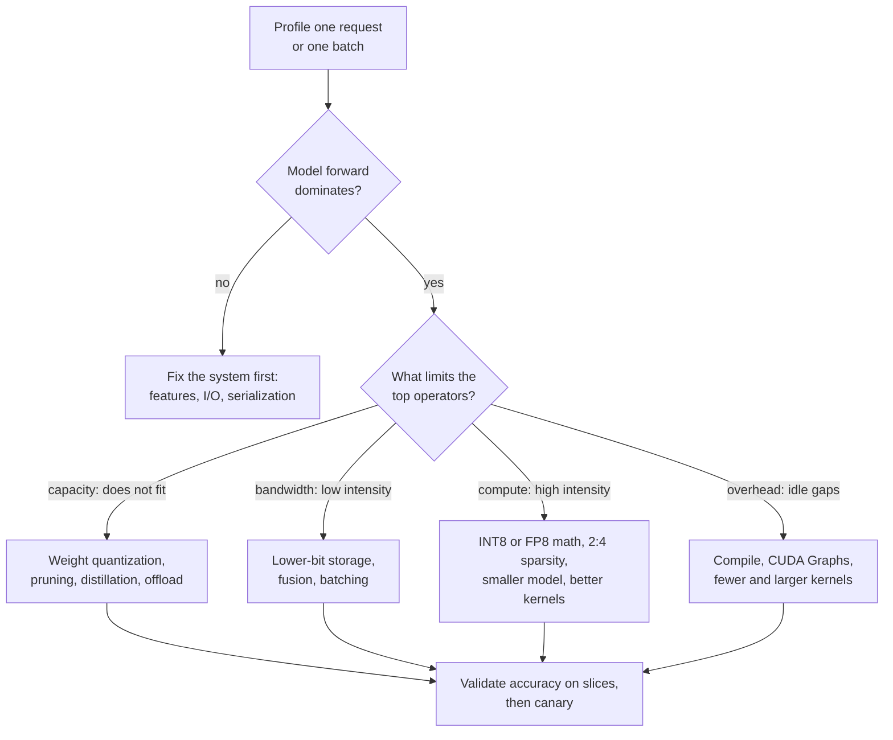

**Reading the diagram.** The flow starts from a measured profile. If the forward pass is not the dominant cost, the fix belongs in the serving system (Chapter 66) or feature path (Chapter 62). Otherwise the limiting resource chooses the family: capacity needs fewer bytes stored, bandwidth fewer bytes moved, compute cheaper arithmetic, overhead fewer and larger launches. Every branch converges on one gate: accuracy validation on slices and a canary (§67.16). All steps are offline engineering work. The failure point is skipping the profile and optimizing a resource that was not the bottleneck.

**Table 67.1 — Optimization techniques at a glance.**

| Technique | Changes | Typical gain | Accuracy risk | Section |
|---|---|---|---|---|
| Dynamic INT8 quantization | Weights stored INT8; activations quantized per call | 2–4× smaller; 1.5–3× faster on CPU | Low | §67.5 |
| Static INT8 / FP8 quantization | Weights and activations low-bit | 2–4× smaller; up to 2× math throughput | Low–medium | §67.5 |
| Weight-only INT4 (GPTQ, AWQ) | LLM weights 4-bit | ~3.9× smaller than FP16 | Medium | §67.6 |
| Pruning (2:4 structured) | Half the weights zero in a fixed pattern | Up to 2× GEMM math on supporting GPUs | Medium; needs fine-tuning | §67.7 |
| Distillation | New, smaller model | Proportional to size reduction | Medium; needs training | §67.8 |
| Compilation and fusion | Graph and kernels, not parameters | 1.2–3× on memory- or overhead-bound models | Very low (numerics only) | §67.10–§67.12 |

Gains are indicative ranges, not guarantees; measure on your model and hardware.

#### Mathematical foundations

Most inference speed-ups come from moving fewer bytes, and they apply only to the fraction of time spent moving those bytes. Amdahl's law (§4.12.1) makes that precise.

::: formula
**Speed-up bound from reducing bytes moved**

$$S = \frac{1}{(1 - f) + f \cdot \dfrac{b_\text{new}}{b_\text{old}}} \qquad S_\text{max} = \frac{b_\text{old}}{b_\text{new}} \quad (f = 1)$$

| Symbol | Meaning | Units |
|---|---|---|
| $S$ | End-to-end speed-up of the step | dimensionless |
| $f$ | Fraction of step time spent in memory-bound reads of the data being compressed | dimensionless |
| $b_\text{old}, b_\text{new}$ | Bits per value before and after compression | bits |
| $S_\text{max}$ | Bound when the whole step is limited by those reads | dimensionless |
:::

::: example
**Worked example — INT4 weights for QuickBite's 7B chatbot at batch 1.** Decoding one token at batch 1 reads every weight once: 14 GB in BF16, at least 4.2 ms per token on an H100 (§64.9.2). INT4 with one FP16 scale per group of 128 weights stores $4 + 16/128 = 4.125$ bits per weight.

1. Weight bytes: $7 \times 10^9 \times 4.125 / 8 = 3.61$ GB; the minimum read time falls to $3.61 \times 10^9 / 3.35 \times 10^{12} = 1.08$ ms.
2. Ratio: $b_\text{old}/b_\text{new} = 16/4.125 = 3.88 = S_\text{max}$.
3. Suppose a profile shows weight reads are $f = 0.8$ of the step (the rest is KV-cache reads, small kernels and launch gaps; assumed). Then $S = 1/(0.2 + 0.8/3.88) = 1/(0.2 + 0.206) = 2.46$.
4. With $f = 0.9$: $S = 1/(0.1 + 0.232) = 3.01$.

**Interpretation.** A 3.9× reduction in weight bytes yields a 2.5–3× faster token, because the untouched 10–20% of the step now dominates. **Engineering implication.** After compressing weights, profile again: the next bottleneck (KV cache, Chapter 73; launch overhead, §67.14) is now where the remaining time goes.
:::

The same reasoning sizes a CPU fleet. §60.11 sized QuickBite's deep ETA model at 2 ms of CPU per prediction, 11 nodes in all.

::: example
**Worked example — What INT8 does to the ETA fleet.** Assume a profile splits the 2 ms into 1.5 ms of model forward and 0.5 ms of feature parsing and serialization, and that dynamic INT8 quantization makes the forward pass 2× faster (§67.5 measures 2–3.5× on one core; take the conservative end).

1. New CPU time per prediction: $c = 0.5 + 1.5/2 = 1.25$ ms.
2. Busy vCPUs at 40,000 predictions/s: $40{,}000 \times 0.00125 = 50$; at the 50% utilization target, 100 vCPUs, so $\lceil 100/16 \rceil = 7$ nodes plus one for redundancy: 8 nodes, versus 11.
3. Cost: $8 \times 0.77 = \$6.16$/hour versus \$8.47/hour; $2.31 \times 8{,}760 = \$20{,}200$ per year.

**Interpretation.** A 2× faster forward pass gives 1.6× less CPU per prediction and 27% fewer nodes; the redundancy node and the unoptimized 0.5 ms cap the gain. **Engineering implication.** Report savings in fleet cost, not in kernel speed-up, and decide whether the next 0.5 ms (feature parsing) is the better target.
:::

::: mistake
**"Quantization makes the model 4× faster."** It makes the *weights* 4× smaller than FP32. Speed-up depends on whether those bytes were the bottleneck ($f$), whether the hardware has fast low-precision instructions, and whether dequantization overhead eats the gain. Some quantized models run slower than the original when the runtime lacks kernels for the format.
:::

## 67.4 Quantization fundamentals

### 67.4.1 Affine quantization: scale and zero-point

::: definition
**Definition — Quantization.** Mapping real values onto a small set of representable levels, here a $b$-bit integer grid. **Uniform affine quantization** maps a real value $x$ to an integer $q = \text{clamp}(\text{round}(x/s) + z,\; q_\text{min},\; q_\text{max})$ with a real **scale** $s$ (the step between adjacent levels) and an integer **zero-point** $z$ (the integer that represents real 0); **dequantization** recovers $\hat{x} = s(q - z)$ [Jacob et al. 2018; Nagel et al. 2021]. **Symmetric** quantization fixes $z = 0$; **asymmetric** quantization lets $z$ shift the grid to fit a lopsided range.
:::

#### First-principles explanation

Picture a thermometer with only 256 marks. You choose where the lowest and highest marks sit (the range), which fixes the spacing between marks (the scale). A reading between two marks is rounded to the nearer one. If you place the marks to cover −40 °C to 50 °C, every reading is within half a mark of the truth. If one sensor once read 500 °C and you stretch the marks to cover it, the spacing grows tenfold and every everyday reading gets ten times less precise. That trade between **range** and **resolution** is all of quantization.

#### Why does this exist?

Inference does not need 24 bits of mantissa. Trained weights and activations tolerate small perturbations, and integer arithmetic is cheaper in silicon area, energy and bandwidth: INT8 halves bytes against FP16 and, on hardware with INT8 instructions, doubles peak throughput (Table 64.4). Jacob et al. showed that a network can run with integer-only arithmetic, a scheme adopted by mobile inference runtimes [Jacob et al. 2018].

#### How it works internally

1. **Pick a range** $[\alpha, \beta]$ for the tensor: from the weights directly, or from activation statistics gathered on sample data (**calibration**, §67.4.3). Extend it to include 0 so that zero, which is everywhere (padding, ReLU outputs), is represented exactly.
2. **Compute the scale** so the range spans the integer grid, and the **zero-point** so that real 0 lands on an integer.
3. **Quantize**: divide by $s$, round to the nearest integer, add $z$, clamp to the grid.
4. **Compute** in integers (§67.4.4), or **dequantize** back to floating point before computing (weight-only schemes, §67.6).

**Figure 67.2 — The affine mapping between real values and an 8-bit grid.**

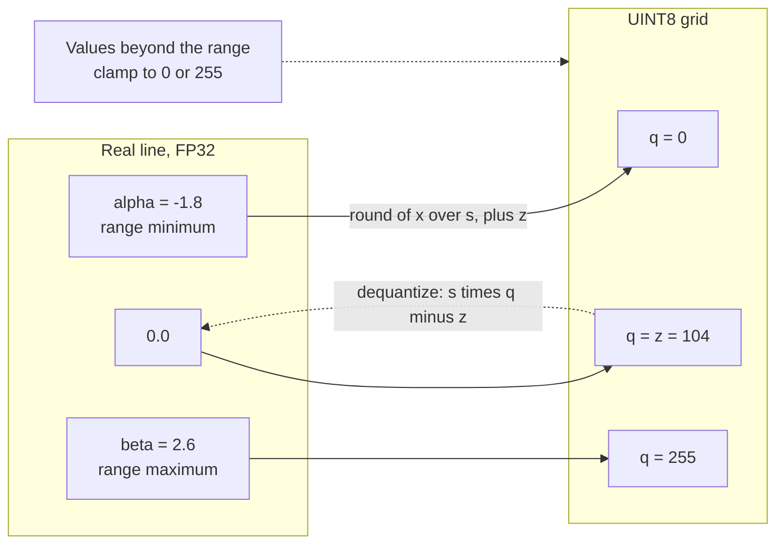

**Reading the diagram.** The left box is one tensor's floating-point range; the right box is the 256-level unsigned grid. Solid arrows are quantization, $q = \text{round}(x/s) + z$, sending the minimum to 0, real zero to the zero-point 104 and the maximum to 255; the dotted arrow is dequantization back to an approximate real value. The scale $s = 4.4/255$ is the spacing between levels. The failure point is the clamp: a value outside $[\alpha, \beta]$ saturates, an error far larger than rounding. Numbers come from the worked example below.

#### Mathematical foundations

::: formula
**Affine quantization: scale, zero-point, quantize and dequantize**

$$s = \frac{\beta - \alpha}{q_\text{max} - q_\text{min}} \qquad z = \text{round}\!\left(q_\text{min} - \frac{\alpha}{s}\right) \qquad q = \text{clamp}\!\left(\text{round}\!\left(\frac{x}{s}\right) + z,\; q_\text{min},\; q_\text{max}\right) \qquad \hat{x} = s\,(q - z)$$

Symmetric variant: $s = \max|x| / q_\text{max}$, $z = 0$, grid $[-q_\text{max}, q_\text{max}]$ (for INT8, $[-127, 127]$; dropping −128 keeps the grid symmetric).

| Symbol | Meaning | Units |
|---|---|---|
| $x$ | Real value (weight or activation) | tensor units |
| $[\alpha, \beta]$ | Clipping range, extended to contain 0 | tensor units |
| $q_\text{min}, q_\text{max}$ | Integer grid limits: 0 and 255 for UINT8, −128 (or −127) and 127 for INT8 | integers |
| $s$ | Scale: real distance between adjacent levels | tensor units per level |
| $z$ | Zero-point: the integer that represents real 0 | integer |
| $q$ | Stored integer | integer |
| $\hat{x}$ | Dequantized approximation of $x$ | tensor units |
:::

::: example
**Worked example — Quantizing six values to 8 bits.** $x = [-1.8, -0.5, 0.0, 0.3, 1.2, 2.6]$.

*Asymmetric UINT8* ($\alpha = -1.8$, $\beta = 2.6$, grid 0–255):

1. $s = (2.6 - (-1.8))/255 = 4.4/255 = 0.017255$.
2. $z = \text{round}(0 + 1.8/0.017255) = \text{round}(104.32) = 104$.
3. $x = 1.2$: $1.2/0.017255 = 69.55 \to 70$; $q = 70 + 104 = 174$; $\hat{x} = 0.017255 \times 70 = 1.20784$; error $+0.0078$.
4. $x = 0.3$: $17.39 \to 17$; $q = 121$; $\hat{x} = 0.29333$; error $-0.0067$.
5. $x = -1.8$: $-104.32 \to -104$; $q = 0$; $\hat{x} = -1.79451$. Because $z$ was rounded, the range minimum itself is off by 0.0055.

*Symmetric INT8* (grid −127 to 127):

6. $s = 2.6/127 = 0.020472$; $x = -0.5$: $-24.42 \to -24$, $\hat{x} = -0.49134$, error $+0.0087$.
7. The negative half of the grid reaches only $-1.8/0.020472 = -88$: levels −127 to −89 are never used, about 15% of the grid wasted.

Maximum absolute errors: 0.0078 (asymmetric) and 0.0087 (symmetric), each below half its scale (0.0086 and 0.0102). The NumPy program in §67.4.5 reproduces every number.

**Interpretation.** Asymmetric quantization fits a lopsided range with a finer step; symmetric wastes part of the grid but keeps $z = 0$. **Engineering implication.** Use symmetric for weights, which are roughly centered on zero, because $z = 0$ removes cross terms from integer matrix multiplication (§67.4.4); use asymmetric for one-sided activations such as ReLU outputs.
:::

### 67.4.2 Quantization error and granularity

Within the range, rounding moves each value by at most half a step. Treating that error as uniform noise gives the mean squared error and the **signal-to-quantization-noise ratio (SQNR)**, which converts to a rule you can do in your head: each extra bit buys about 6 dB, and each doubling of the range relative to the typical value costs about 6 dB.

::: formula
**Quantization error bound, noise power and SQNR**

$$|x - \hat{x}| \le \frac{s}{2} \ \ (\alpha \le x \le \beta) \qquad \text{MSE} \approx \frac{s^2}{12} \qquad \text{SQNR}_\text{dB} \approx 6.02\,b + 4.77 - 20\log_{10}\frac{A}{\sigma}$$

| Symbol | Meaning | Units |
|---|---|---|
| $s$ | Scale (step size) | tensor units |
| MSE | Mean squared rounding error, assuming error uniform on $[-s/2, s/2]$ | tensor units² |
| $b$ | Bit width | bits |
| $A$ | Clipping threshold for symmetric quantization, $\max|x|$ by default | tensor units |
| $\sigma$ | Root-mean-square value of the tensor | tensor units |
| SQNR | $10\log_{10}(\text{signal power}/\text{noise power})$ | dB |
:::

::: example
**Worked example — How much does an outlier cost?** A weight matrix has Gaussian rows, an overall root-mean-square value $\sigma \approx 0.12$, and $\max|x| \approx 4\sigma$ within each row.

1. INT8, per-row range $A = 4\sigma$: $\text{SQNR} \approx 6.02 \times 8 + 4.77 - 20\log_{10} 4 = 48.2 + 4.8 - 12.0 = 40.9$ dB (noise power 1/12,000 of signal).
2. One outlier weight of 2.5 sets a *per-tensor* range: $A/\sigma = 2.5/0.12 = 20.8$, so $\text{SQNR} \approx 53.0 - 26.4 = 26.6$ dB, about 14 dB worse: the outlier has cost $14.3/6.02 \approx 2.4$ bits of precision for every other weight.
3. INT4 with groups of 32 values, $A \approx 3\sigma$: $6.02 \times 4 + 4.77 - 9.5 = 19.3$ dB.
4. Uniform data on $[-1, 1]$ in INT8: $s = 1/127$, predicted MSE $s^2/12 = 5.17 \times 10^{-6}$.

The program in §67.4.5 measures 41.0 dB, 26.5 dB and 20.3 dB for steps 1–3, and an MSE of $5.17 \times 10^{-6}$ for step 4.

**Interpretation.** Precision is lost not to the bit width alone but to the ratio of the range to typical values. **Engineering implication.** Shrink $A/\sigma$ before adding bits: use finer granularity (per-channel, per-group), clip outliers by calibration, or move them elsewhere (SmoothQuant, §67.6.4).
:::

::: definition
**Definition — Quantization granularity.** The set of values that share one scale (and zero-point). **Per-tensor**: one scale for the whole tensor. **Per-channel** (per-axis): one scale per output channel of a weight, that is, per row of a linear layer's weight matrix or per filter of a convolution. **Per-group** (block-wise): one scale per contiguous group of $g$ values along the input dimension, typically $g = 32$–128; the OCP microscaling formats are per-group with $g = 32$ (§64.10.4) [Nagel et al. 2021].
:::

**Figure 67.3 — Three granularities for a weight matrix.**

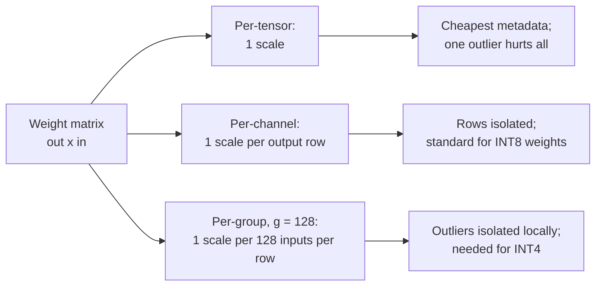

**Reading the diagram.** One weight matrix (output channels × input features) can share scales at three levels. Finer levels limit how many values an outlier damages and add metadata: one number, one per row, or $\text{out} \times \text{in}/g$ scales (0.125 extra bits per weight with FP16 scales and $g = 128$). Per-channel scales fold neatly into integer GEMMs because each output uses one row scale; per-group scales force the kernel to rescale partial sums every $g$ inputs, so they need dedicated kernels. Activations are usually per-tensor or per-token, because their ranges change with every request.

### 67.4.3 Calibration: choosing the range

**Calibration** sets the clipping range for activations by running a few hundred representative inputs through the model and recording statistics at each quantization point. The choice of range is a trade between **rounding error** (large range, coarse step) and **clipping error** (small range, saturated outliers) [Nagel et al. 2021]:

- **Min–max**: the observed extremes. No clipping on the calibration set, but a single outlier inflates the step.
- **Percentile**: clip at, say, the 99.99th percentile of absolute values.
- **MSE search**: try candidate thresholds and keep the one that minimizes reconstruction error on the calibration data.
- **Entropy (KL divergence)**: keep the threshold whose quantized histogram is closest to the original distribution; TensorRT's default INT8 calibrator uses this idea [NVIDIA TensorRT docs].

::: example
**Worked example — Clip or not?** An activation's calibration data has maximum 40 but its 99.99th percentile is 8 (a rare spike). Symmetric INT8.

1. Min–max: $s = 40/127 = 0.315$; rounding MSE $= s^2/12 = 0.0083$.
2. Clip at 8: $s = 8/127 = 0.063$; rounding MSE $= 0.00033$. Clipped values are $10^{-4}$ of the data; if their mean squared excess beyond 8 is 25 (assumed), clipping adds $10^{-4} \times 25 = 0.0025$. Total $0.0028$.

**Interpretation.** Clipping wins threefold because the rare spike was costing every value precision; if spikes carry meaning (LLM outlier features, §67.6.3), clipping destroys accuracy instead. **Engineering implication.** Choose the calibration method by task accuracy, and use calibration data that matches production: a set without night-time orders will misjudge night-time feature ranges.
:::

### 67.4.4 Integer-only inference

For a linear layer $y = Wx$ with both operands quantized, the products can be computed entirely in integers, with one rescale at the end [Jacob et al. 2018].

::: formula
**Integer matrix multiply with requantization**

$$q_y = z_y + M \sum_{k} (q_{w,k} - z_w)(q_{x,k} - z_x) \qquad M = \frac{s_w\, s_x}{s_y} = M_0 \cdot 2^{-n},\ \ 0.5 \le M_0 < 1$$

| Symbol | Meaning | Units |
|---|---|---|
| $q_w, q_x, q_y$ | INT8 weights, inputs and outputs | integers |
| $z_w, z_x, z_y$ | Zero-points ($z_w = 0$ for symmetric weights) | integers |
| $s_w, s_x, s_y$ | Scales of weights, inputs and outputs | real |
| $\sum_k$ | Dot product accumulated in INT32 to avoid overflow | integer |
| $M$ | Real requantization multiplier, stored as an integer $M_0$ and a bit shift $n$ | dimensionless |
:::

::: example
**Worked example — Requantizing one output.** $s_w = 0.01$, $s_x = 0.05$, $s_y = 0.1$, $z_y = 0$; the INT32 accumulator holds 12,345.

1. $M = 0.01 \times 0.05 / 0.1 = 0.005 = 0.64 \times 2^{-7}$, so $n = 7$ and $M_0 = 0.64$, stored as the 32-bit integer $\text{round}(0.64 \times 2^{31}) = 1{,}374{,}389{,}535$.
2. $q_y = \text{round}(0.005 \times 12{,}345) = \text{round}(61.73) = 62$ (one integer multiply, then a rounding right shift).
3. Check: the real output is $s_y \cdot q_y = 6.2$, versus the exact $0.01 \times 0.05 \times 12{,}345 = 6.17$.
4. A dot product of 4,096 INT8 products of up to $127 \times 127 = 16{,}129$ each can reach $6.6 \times 10^7$: far beyond INT16, safely inside INT32's $2.1 \times 10^9$.

**Interpretation.** No floating-point unit is needed, which is why integer-only inference suits microcontrollers and mobile digital signal processors. **Engineering implication.** Use symmetric weights ($z_w = 0$): an asymmetric weight zero-point adds a term that depends on the input and costs extra work per output. Bias is added in INT32 with scale $s_w s_x$.
:::

**Figure 67.4 — Dataflow of a quantized linear layer.**

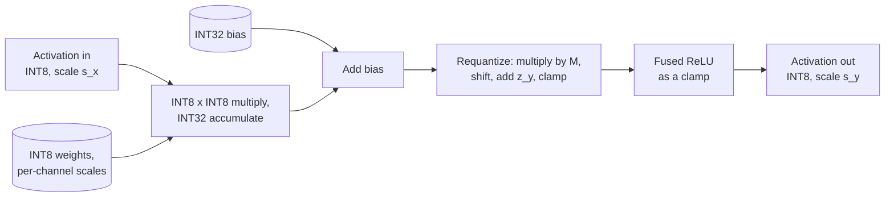

**Reading the diagram.** Cylinders are parameters stored with the model; rectangles are steps of one fused kernel. INT8 activations and weights meet in an integer multiply–accumulate whose INT32 result never leaves on-chip registers. Bias is added in INT32, then one requantization step converts to the next layer's INT8 scale; a ReLU becomes a clamp to the zero-point and costs nothing. Data stays INT8 between layers, so each layer reads and writes a quarter of the FP32 bytes. Failure points: an overflowing accumulator if INT16 is used, and a mismatch between the calibration-time scale $s_y$ and real traffic, which saturates outputs silently.

### 67.4.5 Runnable example: INT8 quantization from scratch

```python
"""INT8 quantization from scratch: affine vs symmetric, per-tensor vs per-channel."""
import numpy as np

def affine_params(lo, hi, qmin=0, qmax=255):
    """Scale and zero-point that map [lo, hi] onto the integer grid [qmin, qmax]."""
    lo, hi = min(lo, 0.0), max(hi, 0.0)          # range must contain 0 exactly
    scale = (hi - lo) / (qmax - qmin)
    zero_point = int(np.clip(round(qmin - lo / scale), qmin, qmax))
    return scale, zero_point

def symmetric_params(absmax, qmax=127):
    return absmax / qmax, 0                       # zero-point fixed at 0

def quantize(x, scale, zp, qmin, qmax):
    return np.clip(np.round(x / scale) + zp, qmin, qmax).astype(np.int32)

def dequantize(q, scale, zp):
    return scale * (q - zp)

# --- 1. The six-value worked example -------------------------------------
x = np.array([-1.8, -0.5, 0.0, 0.3, 1.2, 2.6])
s_a, z_a = affine_params(x.min(), x.max())                 # UINT8 [0, 255]
q_a = quantize(x, s_a, z_a, 0, 255)
s_s, z_s = symmetric_params(np.abs(x).max())               # INT8 [-127, 127]
q_s = quantize(x, s_s, z_s, -127, 127)
print(f"affine:    scale={s_a:.6f} zero_point={z_a}")
print(f"symmetric: scale={s_s:.6f} zero_point={z_s}")
print(" x      q_aff  x_hat_aff  err_aff   q_sym  x_hat_sym  err_sym")
for xi, qa, qs in zip(x, q_a, q_s):
    xa, xs = dequantize(qa, s_a, z_a), dequantize(qs, s_s, z_s)
    print(f"{xi:5.2f} {qa:6d} {xa:10.5f} {xa - xi:8.5f} {qs:7d} {xs:10.5f} {xs - xi:8.5f}")
print(f"max |err| affine {np.abs(dequantize(q_a, s_a, z_a) - x).max():.5f} "
      f"(bound s/2 = {s_a / 2:.5f}); symmetric "
      f"{np.abs(dequantize(q_s, s_s, z_s) - x).max():.5f} (bound {s_s / 2:.5f})")

# --- 2. A weight matrix whose channels have very different ranges ----------
rng = np.random.default_rng(0)
out_ch, in_ch = 64, 256
channel_std = rng.uniform(0.01, 0.2, size=(out_ch, 1))     # per-row spread differs
W = rng.normal(0.0, 1.0, size=(out_ch, in_ch)) * channel_std
W[3, 7] = 2.5                                              # one outlier weight

def sqnr_db(ref, approx):
    return 10 * np.log10(np.sum(ref ** 2) / np.sum((ref - approx) ** 2))

# per-tensor symmetric INT8
s_t, _ = symmetric_params(np.abs(W).max())
W_t = dequantize(quantize(W, s_t, 0, -127, 127), s_t, 0)
# per-channel (per output row) symmetric INT8
s_c = np.abs(W).max(axis=1, keepdims=True) / 127
W_c = dequantize(quantize(W, s_c, 0, -127, 127), s_c, 0)
# per-group INT4 (groups of 32 along the input dim), symmetric [-7, 7]
G = 32
Wg = W.reshape(out_ch, in_ch // G, G)
s_g = np.abs(Wg).max(axis=2, keepdims=True) / 7
W_g = dequantize(quantize(Wg, s_g, 0, -7, 7), s_g, 0).reshape(out_ch, in_ch)

x_in = rng.normal(size=(in_ch, 32))                        # a batch of activations
y_ref = W @ x_in
print("\nscheme                    weight SQNR   output SQNR   zeroed weights")
for name, Wq in [("per-tensor INT8", W_t), ("per-channel INT8", W_c),
                 ("per-group(32) INT4", W_g)]:
    zeroed = np.mean((Wq == 0) & (W != 0))
    print(f"{name:24s} {sqnr_db(W, Wq):9.1f} dB {sqnr_db(y_ref, Wq @ x_in):10.1f} dB "
          f"{100 * zeroed:12.1f}%")

# --- 3. Measured error versus the uniform-noise model s^2/12 ---------------
u = rng.uniform(-1, 1, size=1_000_000)
s_u, _ = symmetric_params(1.0)
mse = np.mean((dequantize(quantize(u, s_u, 0, -127, 127), s_u, 0) - u) ** 2)
print(f"\nuniform data: measured MSE {mse:.3e}, model s^2/12 = {s_u ** 2 / 12:.3e}")
```

Output:

```text
affine:    scale=0.017255 zero_point=104
symmetric: scale=0.020472 zero_point=0
 x      q_aff  x_hat_aff  err_aff   q_sym  x_hat_sym  err_sym
-1.80      0   -1.79451  0.00549     -88   -1.80157 -0.00157
-0.50     75   -0.50039 -0.00039     -24   -0.49134  0.00866
 0.00    104    0.00000  0.00000       0    0.00000  0.00000
 0.30    121    0.29333 -0.00667      15    0.30709  0.00709
 1.20    174    1.20784  0.00784      59    1.20787  0.00787
 2.60    255    2.60549  0.00549     127    2.60000  0.00000
max |err| affine 0.00784 (bound s/2 = 0.00863); symmetric 0.00866 (bound 0.01024)

scheme                    weight SQNR   output SQNR   zeroed weights
per-tensor INT8               26.5 dB       26.7 dB         12.8%
per-channel INT8              41.0 dB       41.1 dB          1.7%
per-group(32) INT4            20.3 dB       20.1 dB         12.9%

uniform data: measured MSE 5.172e-06, model s^2/12 = 5.167e-06
```

What to notice:

- Real zero maps exactly to the zero-point in both schemes, as the range extension in `affine_params` guarantees.
- One outlier weight (2.5 against typical rows of 0.01–0.2) drives per-tensor INT8 to round 12.8% of all weights to zero; per-channel scales confine the damage to row 3 and gain 14.5 dB.
- Per-group INT4 with 16 levels is about as accurate as per-tensor INT8 with 255 levels here, because granularity matters as much as bit width.
- Weight SQNR and output SQNR agree closely: for a linear layer, weight error passes through to the output nearly unchanged in relative terms when inputs are uncorrelated. Correlated inputs break this, which is what GPTQ exploits (§67.6.2).

::: mistake
**"INT8 has 256 levels, so error is 1/256 of the value."** Error is half a step of the *range*, not of the value. A weight of 0.01 in a tensor whose range is ±2.5 is rounded to zero. Small values in wide-range tensors suffer most, which is why granularity and outlier handling dominate quantization quality.
:::

## 67.5 Dynamic quantization, static quantization and quantization-aware training

### 67.5.1 Three ways to get a quantized model

::: definition
**Definition — Post-training quantization (PTQ) and quantization-aware training (QAT).** **PTQ** quantizes an already-trained model without further training. In **dynamic quantization**, weights are quantized ahead of time and each activation's range is computed at run time, per call; in **static quantization**, activation ranges are fixed in advance by calibration (§67.4.3). **QAT** inserts **fake quantization** (quantize-then-dequantize) into the forward pass during training or fine-tuning so the weights learn to tolerate rounding; gradients pass through the non-differentiable rounding with the **straight-through estimator (STE)**, which treats rounding as the identity in the backward pass [Bengio et al. 2013; Jacob et al. 2018].
:::

#### First-principles explanation

Dynamic quantization is a tailor who measures each customer as they walk in: always a good fit, but measuring takes time. Static quantization measures a sample of customers beforehand and cuts standard sizes: fast, but a customer unlike the sample gets a poor fit. QAT has the customer wear the standard size during training, so they grow into it.

#### How it works internally

**Figure 67.5 — Three quantization pipelines.**

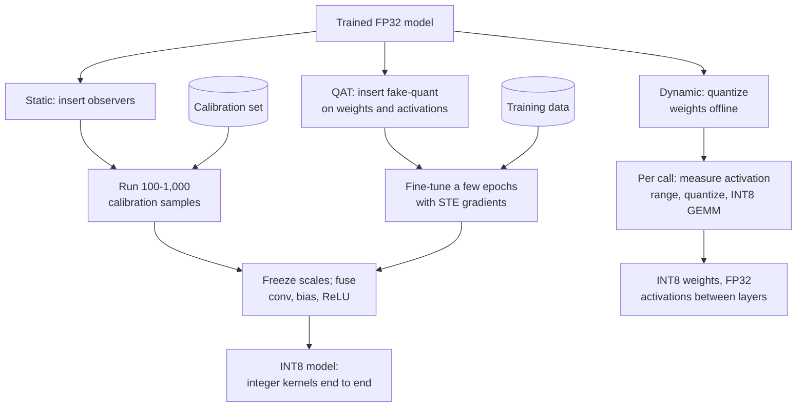

**Reading the diagram.** All three pipelines start from one FP32 checkpoint and run offline. Dynamic quantization needs no data; its range measurement runs on the request path, adding a small cost, and activations stay FP32 between layers. Static quantization reads a calibration set (a storage boundary that must resemble production traffic) and freezes scales so every layer runs integer kernels. QAT fine-tunes with fake quantization on training data, then converts as static PTQ does. Failure points: an unrepresentative calibration set, and a training pipeline that is no longer reproducible.

**Table 67.2 — Choosing a quantization method.**

| | Dynamic PTQ | Static PTQ | QAT |
|---|---|---|---|
| Data needed | None | 100–1,000 unlabeled samples | Training set and pipeline |
| Activations | Quantized per call | Fixed scales | Fixed scales, learned tolerance |
| Speed-up | Moderate; range computation per call | Highest for INT8 | Same as static |
| Accuracy loss | Usually small | Small to moderate | Smallest |
| Engineering cost | Minutes | Hours | Days |
| Best for | Linear-heavy models on CPU: MLPs, LSTMs, transformers at small batch | CNNs, models whose activation ranges are stable | Models that lose too much accuracy with PTQ; INT4 and below |

Start with the cheapest method that meets the accuracy target; move right only when measurement shows you must [Krishnamoorthi 2018; Nagel et al. 2021].

### 67.5.2 Runnable example: dynamic quantization of the ETA MLP

The program trains the 512–1,024–1,024–1 ETA MLP of §58.12.2 on synthetic data for a few seconds, then quantizes every linear layer to INT8 dynamically and compares size, latency and accuracy.

```python
"""Dynamic INT8 quantization of the ETA MLP (512-1024-1024-1) on CPU.
Timings depend on your CPU; sizes and accuracy are deterministic."""
import io, time, warnings
import torch
from torch import nn

warnings.filterwarnings("ignore")          # torch.ao.quantization prints deprecation notices
torch.manual_seed(0)
torch.set_num_threads(1)                   # one core: comparable, repeatable timings

# Synthetic stand-in for QuickBite ETA data: 512 features -> minutes (median ~35)
n_train, n_test, d = 10_000, 2_000, 512
X = torch.randn(n_train + n_test, d)
w_true = torch.randn(d, 1) / d ** 0.5
y = 35 + 8 * torch.tanh(X @ w_true) + 3 * torch.sin(X[:, :1] * X[:, 1:2]) \
    + 0.5 * torch.randn(n_train + n_test, 1)
Xtr, ytr, Xte, yte = X[:n_train], y[:n_train], X[n_train:], y[n_train:]

model = nn.Sequential(nn.Linear(512, 1024), nn.ReLU(),
                      nn.Linear(1024, 1024), nn.ReLU(), nn.Linear(1024, 1))
with torch.no_grad():
    model[-1].bias.fill_(35.0)             # start near the median ETA
opt = torch.optim.Adam(model.parameters(), lr=1e-3)
for epoch in range(3):                     # a few seconds on one CPU core
    perm = torch.randperm(n_train)
    for i in range(0, n_train, 256):
        idx = perm[i:i + 256]
        loss = nn.functional.mse_loss(model(Xtr[idx]), ytr[idx])
        opt.zero_grad(); loss.backward(); opt.step()
model.eval()

qmodel = torch.ao.quantization.quantize_dynamic(model, {nn.Linear}, dtype=torch.qint8)

def size_mb(m):
    buf = io.BytesIO(); torch.save(m.state_dict(), buf); return buf.tell() / 1e6

def latency_ms(m, batch, reps=300):
    x = torch.randn(batch, d)
    with torch.inference_mode():
        for _ in range(20): m(x)                       # warm-up
        times = []
        for _ in range(reps):
            t0 = time.perf_counter(); m(x); times.append(time.perf_counter() - t0)
    times.sort()
    return 1e3 * times[len(times) // 2]                # median

with torch.inference_mode():
    p32, p8 = model(Xte), qmodel(Xte)
mae32 = (p32 - yte).abs().mean().item()
mae8 = (p8 - yte).abs().mean().item()
drift = (p8 - p32).abs()

print(f"{'':22s}{'FP32':>10s}{'INT8 dynamic':>14s}")
print(f"{'state_dict size (MB)':22s}{size_mb(model):10.2f}{size_mb(qmodel):14.2f}")
for b in (1, 64):
    print(f"{'latency b=' + str(b) + ' (ms)':22s}{latency_ms(model, b):10.3f}"
          f"{latency_ms(qmodel, b):14.3f}")
print(f"{'test MAE (min)':22s}{mae32:10.3f}{mae8:14.3f}")
print(f"FP32 vs INT8 prediction gap: mean {drift.mean():.4f} min, "
      f"p99 {drift.quantile(0.99):.4f} min, max {drift.max():.4f} min")
```

Output on one x86 core (latencies vary by machine and run):

```text
                            FP32  INT8 dynamic
state_dict size (MB)        6.31          1.59
latency b=1 (ms)           0.301         0.106
latency b=64 (ms)          1.983         0.892
test MAE (min)             1.620         1.626
FP32 vs INT8 prediction gap: mean 0.0869 min, p99 0.3183 min, max 0.4990 min
```

What to notice:

- Size falls 3.97×: 1.58 million weights go from 4 bytes to 1, while biases and per-tensor scales stay in FP32.
- Latency fell 2.2–2.8× here; across repeated runs on the same machine the ratio ranged from about 2× to 3.5×. Treat any single timing as one sample and benchmark on production hardware.
- Mean absolute error moved from 1.620 to 1.626 minutes (0.4%), but individual predictions moved by up to half a minute. Aggregate accuracy hides per-prediction changes; §67.16 validates by slice.
- `torch.ao.quantization` is deprecated in recent PyTorch releases in favor of the separate torchao library (as of 2026); the concepts and results carry over, the import path changes.

### 67.5.3 Quantization-aware training and the straight-through estimator

Rounding has zero gradient almost everywhere, so a quantized forward pass blocks learning. The STE keeps the quantized value in the forward pass but pretends rounding was the identity in the backward pass; most implementations also zero the gradient for values that were clamped, since nudging them does not change the output.

**Figure 67.6 — Fake quantization in the forward and backward passes.**

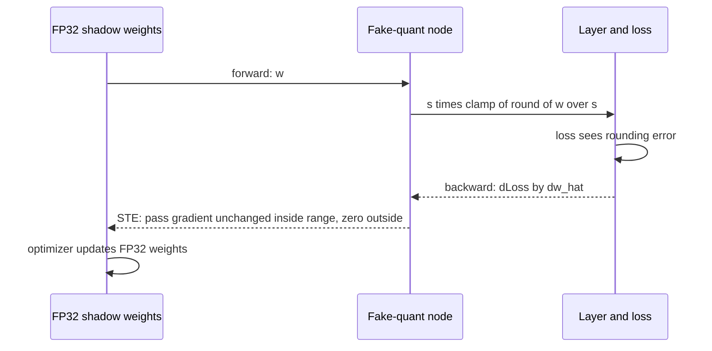

**Reading the diagram.** The model keeps full-precision **shadow weights**. Forward, the fake-quant node rounds them to the INT8 grid and dequantizes, so the loss sees real quantization error. Backward (dotted arrows), the STE passes the gradient through inside the clipping range and zeroes it outside. The optimizer updates the FP32 weights, which cross rounding boundaries over many steps; after training they are quantized once. Scales may be fixed by calibration or learned.

```python
"""Fake quantization with a straight-through estimator (STE)."""
import torch

torch.manual_seed(0)

def fake_quant_ste(x, scale, qmin=-127, qmax=127):
    q = torch.clamp(torch.round(x / scale), qmin, qmax) * scale   # quantize-dequantize
    return x + (q - x).detach()           # forward: q; backward: d/dx = 1 (identity)

w = torch.tensor([0.013, -0.402, 0.951, 1.30], requires_grad=True)
scale = 1.0 / 127                          # INT8 grid covering [-1, 1]

# 1. Naive: gradient through round() is zero almost everywhere
y_naive = (torch.clamp(torch.round(w / scale), -127, 127) * scale).sum()
y_naive.backward()
print("naive grad:", w.grad.tolist())

# 2. STE: forward sees quantized values, backward passes gradients through
w.grad = None
y_ste = fake_quant_ste(w, scale)
print("forward values:", [round(v, 4) for v in y_ste.tolist()])
y_ste.sum().backward()
print("STE grad:  ", w.grad.tolist())

# 3. PyTorch's built-in op agrees in forward and also zeroes grads outside the range
w.grad = None
y_pt = torch.fake_quantize_per_tensor_affine(w, scale, 0, -127, 127)
y_pt.sum().backward()
print("torch op:  ", [round(v, 4) for v in y_pt.tolist()], "grad", w.grad.tolist())
```

Output:

```text
naive grad: [0.0, 0.0, 0.0, 0.0]
forward values: [0.0157, -0.4016, 0.9528, 1.0]
STE grad:   [1.0, 1.0, 1.0, 1.0]
torch op:   [0.0157, -0.4016, 0.9528, 1.0] grad [1.0, 1.0, 1.0, 0.0]
```

What to notice:

- `x + (q - x).detach()` equals `q` in value but has the gradient of `x`: the whole STE in one line.
- The weight 1.30 lies outside the grid's range and is clamped to 1.0; PyTorch's op gives it zero gradient, the simple version does not.
- QAT costs a training run, so it is reserved for cases where PTQ measurably fails: small models with little redundancy (MobileNet-class networks), 4-bit and lower, or integer-only edge targets.

::: mistake
**"Quantization-aware training means training from scratch in INT8."** QAT trains in floating point with simulated quantization, almost always as a short fine-tune of an existing model. Real low-precision *training* (FP8 GEMMs with BF16 master weights, §64.10) is a different technique aimed at training speed.
:::

## 67.6 LLM weight quantization

### 67.6.1 Weight-only quantization and the memory arithmetic

Large language models change the quantization problem in two ways. First, decoding at small batch is memory-bandwidth-bound (§64.9.2): time per token is set by bytes of weights read, so shrinking weights speeds generation even if arithmetic stays in BF16. Second, models beyond a few billion parameters develop **outlier features**: a few activation dimensions with magnitudes far larger than the rest, which wreck per-tensor activation quantization [Dettmers et al. 2022].

::: definition
**Definition — Weight-only quantization (W8A16, W4A16).** Weights are stored in 8 or 4 bits with per-channel or per-group scales; activations stay in 16-bit floating point. A kernel loads low-bit weights, dequantizes them in registers and multiplies in BF16 or FP16. The notation W$x$A$y$ gives weight and activation bit widths; **W8A8** quantizes both and uses integer or FP8 tensor cores.
:::

::: formula
**Weight memory at a given precision**

$$M_\text{w} = N \cdot \frac{b + b_s / g}{8}$$

| Symbol | Meaning | Units |
|---|---|---|
| $M_\text{w}$ | Weight memory | bytes |
| $N$ | Parameter count | parameters |
| $b$ | Bits per stored weight | bits |
| $b_s$ | Bits of metadata per group: 16 for an FP16 scale, 20 with a 4-bit zero-point | bits |
| $g$ | Weights per group sharing that metadata ($g \to \infty$ for per-tensor) | weights |
:::

::: example
**Worked example — A 70B model at FP16, INT8 and INT4.** H100s with 80 GB each.

**Table 67.3 — Weight memory for a 70B-parameter model.**

| Format | Bits per weight | Weight memory | H100s for weights | Left for KV cache |
|---|---|---|---|---|
| FP16 / BF16 | 16 | 140 GB | 2 | 20 GB on two GPUs |
| INT8 or FP8, per-channel | ≈ 8.0 | 70 GB | 1 | 10 GB |
| INT4, $g = 128$, FP16 scale | 4.125 | 36.1 GB | 1 | 43.9 GB |
| INT4, $g = 128$, scale + zero | 4.156 | 36.4 GB | 1 | 43.6 GB |
| INT3, $g = 128$ | 3.125 | 27.3 GB | 1 | 52.7 GB |

1. FP16: $70 \times 10^9 \times 2 = 140$ GB; two GPUs and tensor parallelism (§65.10) before serving a single request.
2. INT4, $g = 128$: $70 \times 10^9 \times (4 + 16/128)/8 = 36.1$ GB; one GPU.
3. KV cache at FP16 for this shape (80 layers, 8 KV heads of 128 dimensions) is $2 \times 80 \times 8 \times 128 \times 2 = 327{,}680$ bytes per token (Chapter 73 derives it). The 43.9 GB left holds about 134,000 tokens of context across all concurrent requests; the INT8 model's 10 GB holds about 30,000.
4. Embedding and output layers are often kept at 16 bits; for a 32,000-token vocabulary they add about 0.8 GB over INT4.

**Interpretation.** INT4 does not just halve cost against INT8; it turns a GPU with no room for requests into one with room for many. **Engineering implication.** Size LLM serving from weights *plus* KV cache, and quantize weights first because they are the fixed cost; Chapter 73 quantizes the KV cache itself.
:::

### 67.6.2 GPTQ: second-order error compensation

Rounding each weight to its nearest grid point (**round-to-nearest, RTN**) treats weights independently. But a layer's output is $y = Wx$, and its inputs are correlated, so an error in one weight can be offset by adjusting others that see similar inputs. **GPTQ** quantizes a layer's weights one input column at a time and, after each column, updates the not-yet-quantized columns to compensate, using the inverse of the Hessian $H = 2XX^\top$ of the layer's squared reconstruction error on a small calibration set [Frantar et al. 2023]. It builds on Optimal Brain Surgeon [Hassibi and Stork 1993], made fast by a fixed column order, lazy batched updates and a Cholesky formulation.

::: formula
**GPTQ / OBS update after quantizing weight $q$**

$$\boldsymbol{\delta} = -\frac{w_q - \text{quant}(w_q)}{[H^{-1}]_{qq}} \, (H^{-1})_{:,q} \qquad H = 2XX^\top$$

| Symbol | Meaning | Units |
|---|---|---|
| $w_q$ | The weight being quantized (one input position of a row) | weight units |
| $\text{quant}(w_q)$ | Its value on the quantization grid | weight units |
| $H$ | Hessian of the layer's squared output error; $X$ holds calibration inputs | input units² |
| $(H^{-1})_{:,q}$ | Column $q$ of the inverse Hessian | — |
| $\boldsymbol{\delta}$ | Update added to the remaining (unquantized) weights of the row | weight units |
:::

::: example
**Worked example — Two correlated inputs.** One output $y = w_1 x_1 + w_2 x_2$; inputs have unit variance and correlation $\rho = 0.9$; $w = (0.537, 0.232)$; grid step 0.1. The expected squared output error for weight errors $d$ is $d^\top \Sigma d = d_1^2 + d_2^2 + 2\rho d_1 d_2$.

1. RTN: $(0.5, 0.2)$, $d = (-0.037, -0.032)$: error $= 0.001369 + 0.001024 + 2(0.9)(0.001184) = 0.00452$.
2. GPTQ: quantize $w_1 \to 0.5$. For $H \propto \begin{pmatrix} 1 & \rho \\ \rho & 1 \end{pmatrix}$, $(H^{-1})_{21}/(H^{-1})_{11} = -\rho$, so $\delta_2 = -\rho \times (0.5 - 0.537) = +0.0333$, giving $w_2' = 0.2653$, which rounds to 0.3.
3. Now $d = (-0.037, +0.068)$: error $= 0.001369 + 0.004624 - 2(0.9)(0.002516) = 0.00146$.
4. Ratio: $0.00452/0.00146 = 3.1\times$ less output error, although $w_2$ moved *away* from its nearest grid point.

**Interpretation.** GPTQ minimizes the error of the layer's output, not of each weight. **Engineering implication.** Calibration data matters: the Hessian encodes which inputs co-occur, so calibrate on text resembling production prompts (a few hundred sequences suffice).
:::

::: industry
**GPTQ at 175B scale.** Frantar et al. quantized OPT-175B and BLOOM-176B to 3–4 bits per weight in about four GPU-hours with negligible perplexity increase at 4 bits, fitting OPT-175B on a single 80 GB GPU, and reported end-to-end generation speed-ups of about 3.25× on A100 and 4.5× on A6000 GPUs against FP16, from reduced memory traffic.
*Evidence: Primary* — [Frantar et al. 2023]
:::

### 67.6.3 Outliers: LLM.int8() and AWQ

**LLM.int8()** observed that from about 6.7B parameters, a handful of hidden dimensions carry activation outliers in most layers, and per-tensor INT8 activation quantization collapses accuracy. Its **mixed-precision decomposition** multiplies those outlier columns in FP16 and the rest (more than 99.9% of values) in INT8 with vector-wise scales, preserving accuracy up to 175B parameters [Dettmers et al. 2022]. It saves memory, but the split GEMM is slower than plain FP16 in many settings.

**AWQ** (activation-aware weight quantization) observed that about 1% of weight channels matter most: those multiplied by large activations. Instead of keeping them in FP16 (awkward for kernels), it scales each salient input channel's weights up by $s > 1$ before quantization and divides the matching activation by $s$, which leaves the product unchanged but shrinks the *relative* rounding error of the salient weights. The scales are found by a small grid search on calibration activations, with no backpropagation and no Hessian, so AWQ is fast and less prone to overfitting the calibration set [Lin et al. 2024].

### 67.6.4 SmoothQuant and FP8: quantizing activations too

Weight-only formats speed memory-bound decoding but not compute-bound prefill or large-batch serving, where the GEMMs still run in 16 bits. **SmoothQuant** enables W8A8 by migrating quantization difficulty from activations (outliers in a few channels) to weights (easy to quantize), using a per-channel scale that is mathematically exact [Xiao et al. 2023].

::: formula
**SmoothQuant scaling**

$$Y = (X\,\text{diag}(\mathbf{s})^{-1}) \cdot (\text{diag}(\mathbf{s})\,W) \qquad s_j = \frac{\max|X_{:,j}|^{\alpha}}{\max|W_{j,:}|^{1-\alpha}}$$

| Symbol | Meaning | Units |
|---|---|---|
| $X$ | Activations, tokens × input channels | activation units |
| $W$ | Weights, input channels × output channels | weight units |
| $s_j$ | Smoothing factor for input channel $j$, folded into the previous layer offline | dimensionless |
| $\alpha$ | Migration strength, typically 0.5 (0.75 or more for models with severe outliers) | dimensionless |
:::

::: example
**Worked example — Balancing one outlier channel.** Channel $j$ has $\max|X_{:,j}| = 60$ while other channels peak near 2; its weights peak at $\max|W_{j,:}| = 0.5$. $\alpha = 0.5$.

1. $s_j = \sqrt{60}/\sqrt{0.5} = 7.746/0.7071 = 10.95$.
2. New activation maximum: $60/10.95 = 5.48$. New weight maximum: $0.5 \times 10.95 = 5.48$.
3. The per-tensor activation range falls from 60 to about 5.5, an 11× smaller step for every other channel: about $20\log_{10} 11 = 21$ dB of SQNR, or 3.5 bits.

**Interpretation.** The product is unchanged; only where the difficulty sits has moved, from activations shared by all tokens to one weight row that per-channel weight quantization handles easily. **Engineering implication.** Smoothing factors are computed once from calibration data and folded into the preceding normalization layer, so inference pays nothing for them.
:::

**Figure 67.7 — SmoothQuant moves outliers from activations into weights.**

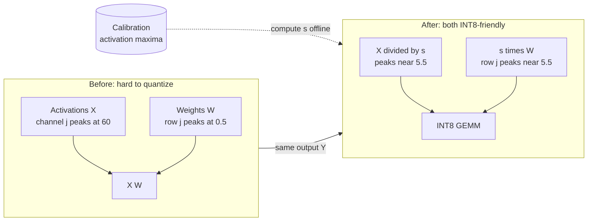

**Reading the diagram.** The left group is a linear layer with an outlier activation channel; the right group is the same layer after smoothing. The scale vector is computed offline from calibration statistics (dotted arrow) and folded into the previous normalization layer and this layer's weights, so inference runs no extra operation. The output is unchanged in exact arithmetic, but both operands now have modest ranges suited to INT8. Failure point: an outlier channel absent from calibration data reappears in production.

**FP8 inference.** On Hopper-class and newer GPUs, FP8 (E4M3) weights and activations with per-tensor or per-block scales give W8A8-like speed with less tuning than INT8, because the floating-point format tolerates a wider range within a tensor (§64.10) [Micikevicius et al. 2022]. As of 2026, FP8 is a common default for data-center LLM serving on such GPUs, with INT4 weight-only formats used where memory is the constraint.

**Table 67.4 — LLM quantization methods compared.**

| Method | Weights / activations | Needs | Strength | Watch out for |
|---|---|---|---|---|
| RTN, per-group | W8 or W4 / A16 | Nothing | Instant baseline | Quality drops at 4 bits for smaller models |
| GPTQ | W4 or W3 / A16 | ~100s of calibration sequences, GPU-hours | Strong at 3–4 bits | Can overfit calibration domain |
| AWQ | W4 / A16 | Calibration activations | Fast, robust, kernel-friendly | Gains are for memory-bound decode |
| LLM.int8() | W8 / A8 + FP16 outliers | Nothing | Accurate at 8 bits | Often slower than FP16 |
| SmoothQuant | W8 / A8 | Calibration maxima | Speeds compute-bound phases too | Needs INT8 kernels for every GEMM |
| FP8 (E4M3) | W8 / A8 | Scales per tensor or block | Simple, accurate, fast on new GPUs | Hardware support required |

::: mistake
**"4-bit weights mean 4× less memory for the whole server."** Weights shrink; the KV cache, activations, runtime buffers and CUDA context do not. A 70B INT4 model on one 80 GB GPU leaves 44 GB for everything else, and long-context requests can fill it. Plan memory as weights plus KV cache plus overhead (Chapter 73).
:::

## 67.7 Pruning

### 67.7.1 Unstructured, structured and 2:4 sparsity

::: definition
**Definition — Pruning and sparsity.** **Pruning** sets a subset of a model's weights to zero and removes them from storage or computation; **sparsity** is the fraction of zeros. **Unstructured** pruning removes individual weights anywhere; **structured** pruning removes whole units (channels, attention heads, layers), leaving a smaller dense model; **semi-structured N:M sparsity** keeps at most N non-zeros in every group of M consecutive weights, such as **2:4** [Mishra et al. 2021]. **Magnitude pruning** removes the weights with the smallest absolute values [Han et al. 2016].
:::

#### First-principles explanation

A text with every third letter deleted at random is half as long on paper but no faster to read, because you still scan every position. Deleting whole sentences makes it genuinely shorter. Dense hardware reads a matrix like the first reader: a zero costs the same as any other number unless the hardware or the format skips it.

#### How it works internally

Iterative magnitude pruning trains, removes the smallest weights, fine-tunes to recover, and repeats, gradually raising sparsity [Han et al. 2016; Zhu and Gupta 2017]. The **lottery ticket hypothesis** adds a scientific twist: dense networks contain sparse subnetworks (often 10–20% of the weights on small vision tasks) that, reset to their original initialization and trained alone, match the full network's accuracy [Frankle and Carbin 2019]. It explains why pruning works; it is not a cheap way to find small models, because finding the ticket requires training the big one.

**Figure 67.8 — Iterative pruning and the three sparsity patterns.**

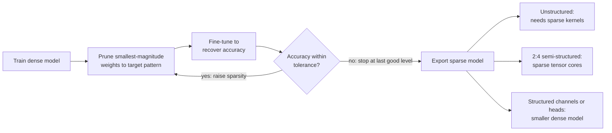

**Reading the diagram.** The loop runs offline on training data: each pass prunes to a higher sparsity, fine-tunes and checks accuracy, stopping at the last level that passes. The export branches show what the hardware can exploit. Unstructured zeros help only with sparse kernels at high sparsity; 2:4 patterns map to sparse tensor cores on NVIDIA GPUs since Ampere; structured pruning yields a smaller dense model that runs faster everywhere. The failure point is pruning without fine-tuning, or measuring sparsity instead of latency.

::: formula
**Storage of sparse formats relative to dense**

$$\frac{M_\text{CSR}}{M_\text{dense}} \approx (1 - \text{sp})\,\frac{b_v + b_i}{b_v} \qquad \frac{M_{2:4}}{M_\text{dense}} = \frac{2\,b_v + 2 \times 2}{4\,b_v}$$

| Symbol | Meaning | Units |
|---|---|---|
| sp | Sparsity: fraction of weights that are zero | dimensionless |
| $b_v$ | Bits per stored value | bits |
| $b_i$ | Bits per column index in compressed sparse row (CSR) format | bits |
| $2 \times 2$ | 2:4 metadata: a 2-bit position for each of the 2 kept values per group of 4 | bits |
:::

::: example
**Worked example — When does sparsity save memory?**

1. CSR with FP16 values and 16-bit indices: break-even when $(1 - \text{sp}) \times 2 = 1$, so sp = 50%. At 50% unstructured sparsity the model is *no smaller*; at 90% it is $0.1 \times 2 = 0.2$ of dense.
2. INT8 values with 16-bit indices: break-even at sp $= 2/3$.
3. 2:4 with FP16: $(32 + 4)/64 = 0.5625$, a 1.78× reduction, with regular structure the tensor cores exploit for up to 2× GEMM math throughput.

**Interpretation.** Unstructured sparsity must be very high to pay for its indices, and its irregular access pattern defeats the coalesced loads and tiles of dense kernels (§64.6.3). **Engineering implication.** On GPUs, prefer 2:4 (with fine-tuning) or structured pruning; reserve unstructured sparsity for CPUs with sparse kernels at high sparsity or for compression before storage.
:::

```python
"""Magnitude pruning: unstructured 50% versus 2:4, and why dense matmul time does not move."""
import time
import torch

torch.manual_seed(0)
torch.set_num_threads(1)
W = torch.randn(1024, 1024)
X = torch.randn(1024, 256)

def unstructured_mask(w, sparsity):
    k = int(w.numel() * sparsity)                       # number of weights to drop
    threshold = w.abs().flatten().kthvalue(k).values
    return (w.abs() > threshold).float()

def two_four_mask(w):
    g = w.abs().reshape(-1, 4)                          # groups of 4 along each row
    keep = g.topk(2, dim=1).indices                     # 2 largest of every 4
    m = torch.zeros_like(g).scatter_(1, keep, 1.0)
    return m.reshape(w.shape)

def rel_err(a, b):
    return ((a - b).norm() / a.norm()).item()

def ms(fn, reps=50):
    fn(); t0 = time.perf_counter()
    for _ in range(reps): fn()
    return 1e3 * (time.perf_counter() - t0) / reps

Y = W @ X
for name, mask in [("unstructured 50%", unstructured_mask(W, 0.5)),
                   ("2:4 structured", two_four_mask(W))]:
    Wp = W * mask
    print(f"{name:17s} zeros {100 * (Wp == 0).float().mean():.1f}%  "
          f"output rel. error {rel_err(Y, Wp @ X):.3f}  "
          f"dense matmul {ms(lambda: Wp @ X):.2f} ms (unpruned {ms(lambda: W @ X):.2f} ms)")
m24 = two_four_mask(W).reshape(-1, 4).sum(dim=1)
print("every group of 4 keeps exactly 2:", bool((m24 == 2).all()))
```

Output (timings machine-dependent):

```text
unstructured 50%  zeros 50.0%  output rel. error 0.267  dense matmul 4.38 ms (unpruned 3.92 ms)
2:4 structured    zeros 50.0%  output rel. error 0.363  dense matmul 3.84 ms (unpruned 3.77 ms)
every group of 4 keeps exactly 2: True
```

What to notice:

- Half the weights are zero, and the dense matmul takes the same time: dense kernels multiply zeros like any other number.
- Without fine-tuning, pruning random weights loses 27–36% of the output signal. Trained networks are more redundant than random matrices, but the recovery step is never optional.
- 2:4 errs more than unstructured pruning at equal sparsity, because it may not keep two large weights that share a group. That is the price of a hardware-friendly pattern.

::: industry
**Deep Compression and 2:4 sparse tensor cores.** Han, Mao and Dally combined magnitude pruning, weight sharing via 5–8-bit clustered quantization, and Huffman coding to shrink AlexNet 35× (240 MB to 6.9 MB) and VGG-16 49× (552 MB to 11.3 MB) without accuracy loss on ImageNet, mainly to fit models in on-chip memory. Mishra et al. later showed that a train–prune 2:4–retrain recipe preserves accuracy across vision, translation and language models, with Ampere sparse tensor cores doubling peak math throughput for the pruned GEMMs.
*Evidence: Primary* — [Han et al. 2016; Mishra et al. 2021]
:::

::: mistake
**"90% sparse means 10× faster."** Speed comes from skipped work that the hardware can actually skip. On GPUs, unstructured sparse kernels typically beat dense ones only at very high sparsity, and the datasheet's "with sparsity" figures assume 2:4 patterns (§64.8).
:::

## 67.8 Knowledge distillation

### 67.8.1 Soft targets, temperature and student sizing

::: definition
**Definition — Knowledge distillation.** Training a smaller **student** model to match the output distribution of a larger **teacher** model, usually in addition to the true labels. The teacher's probabilities, softened by a **temperature** $T > 1$, are **soft targets** that reveal how the teacher ranks wrong answers [Hinton et al. 2015].
:::

#### First-principles explanation

A textbook answer key says only "B". A teacher's marked-up answer says "B, though C was tempting and A was never plausible". The second carries more information per example, so a student learns faster from it. Temperature makes the teacher spell out the "tempting" part, which an over-confident softmax would round to almost zero.

::: formula
**Distillation loss with temperature**

$$p_i^{(T)} = \frac{e^{z_i/T}}{\sum_j e^{z_j/T}} \qquad \mathcal{L} = \alpha\, T^2\, \text{KL}\!\left(p^{(T)}_\text{teacher} \,\|\, p^{(T)}_\text{student}\right) + (1 - \alpha)\, \text{CE}\!\left(y,\, p^{(1)}_\text{student}\right)$$

| Symbol | Meaning | Units |
|---|---|---|
| $z_i$ | Logit for class $i$ | dimensionless |
| $T$ | Temperature; $T = 1$ is the ordinary softmax | dimensionless |
| KL | Kullback–Leibler divergence between teacher and student soft distributions | nats |
| CE | Cross-entropy against the hard label $y$ | nats |
| $\alpha$ | Weight of the distillation term | dimensionless |
| $T^2$ | Keeps soft-target gradients comparable in size as $T$ changes [Hinton et al. 2015] | dimensionless |
:::

::: example
**Worked example — Distilling QuickBite's support-intent classifier.** Classes: refund, late order, missing item. Teacher logits $(5.0, 2.0, 1.0)$; student logits $(3.0, 2.5, 0.5)$; true label refund; $\alpha = 0.7$, $T = 4$.

1. Teacher at $T = 1$: $(0.936, 0.047, 0.017)$: almost a hard label. At $T = 4$: $(0.543, 0.257, 0.200)$: "late order" is clearly the runner-up.
2. Student at $T = 4$: $(0.414, 0.365, 0.221)$. $\text{KL} = \sum p_t \ln(p_t/p_s) = 0.0376$; $T^2\,\text{KL} = 0.601$.
3. Hard-label term: $\text{CE} = -\ln 0.592 = 0.524$ (student at $T = 1$ gives refund 0.592).
4. $\mathcal{L} = 0.7 \times 0.601 + 0.3 \times 0.524 = 0.421 + 0.157 = 0.578$.

**Interpretation.** The KL term pushes the student to lower "late order" relative to "refund" while keeping the teacher's ordering of wrong classes. **Engineering implication.** Teacher logits can be computed once over a large *unlabeled* corpus and stored, so the student trains on far more data than was ever labeled.
:::

**Figure 67.9 — Offline distillation pipeline.**

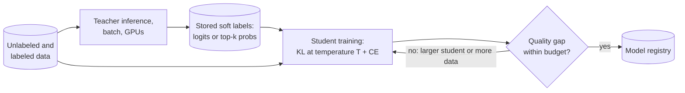

**Reading the diagram.** Teacher inference is an offline batch job (Chapter 66) writing soft labels to storage; keeping only top-k probabilities makes LLM soft labels affordable. The student trains from stored soft and hard labels, so the expensive teacher runs once. The gate compares student and teacher on the same slices; failing students grow or get more data. Failure points: soft labels from an outdated teacher, and aggregate-only evaluation.

::: example
**Worked example — Choosing a student for a re-ranker.** QuickBite re-ranks the top 50 dishes for each browse request at 7,000 RPS: 350,000 candidates/s. A 110M-parameter cross-encoder teacher reads 64 tokens per candidate. Assumed quality, measured as NDCG@10 offline (illustrative numbers):

**Table 67.5 — Student size versus quality and serving cost (illustrative).**

| Model | Parameters | FLOPs per candidate ($2N \times 64$) | NDCG@10 | H100s at 40% of BF16 peak |
|---|---|---|---|---|
| Teacher | 110M | $1.41 \times 10^{10}$ | 0.420 | 12.4 |
| Student, distilled | 22M | $2.82 \times 10^{9}$ | 0.414 | 2.5 |
| Same size, labels only | 22M | $2.82 \times 10^{9}$ | 0.405 | 2.5 |
| Student, distilled | 5.5M | $7.0 \times 10^{8}$ | 0.401 | 0.6 |

1. Teacher compute: $350{,}000 \times 1.41 \times 10^{10} = 4.93 \times 10^{15}$ FLOP/s; one H100 at 40% of 989 TFLOP/s delivers $3.96 \times 10^{14}$: 12.4 GPUs.
2. The 22M student needs $4.93/5 = 0.99 \times 10^{15}$ FLOP/s: 2.5 GPUs. Distillation recovers 0.009 of the 0.015 NDCG the same student loses when trained on labels alone.

**Interpretation.** A 5× smaller model costs 1.4% relative quality when distilled. **Engineering implication.** Plot quality against serving cost for several student sizes, pick the knee, and confirm with an online test (§57.14).
:::

::: industry
**DistilBERT.** Hugging Face distilled BERT-base into a 6-layer student that is 40% smaller and 60% faster while retaining 97% of BERT's score on the GLUE language-understanding benchmark, using a loss that combines soft-target distillation, masked-language modeling and a hidden-state alignment term.
*Evidence: Primary* — [Sanh et al. 2019]
:::

For LLMs, distillation trains a small model on a large model's token distributions or generated outputs; Chapter 76 covers the data pipelines. Check the teacher model's license terms before distilling from it.

## 67.9 Efficient architectures

Sometimes the best compression is a model designed to be cheap. Two ideas recur.

**Depthwise separable convolutions** split a standard convolution into a per-channel spatial filter (**depthwise**) and a 1×1 channel-mixing convolution (**pointwise**), the building block of MobileNets [Howard et al. 2017].

::: formula
**Cost of depthwise separable versus standard convolution**

$$\frac{D_K^2\, M\, D_F^2 + M\, N\, D_F^2}{D_K^2\, M\, N\, D_F^2} = \frac{1}{N} + \frac{1}{D_K^2}$$

| Symbol | Meaning | Units |
|---|---|---|
| $D_K$ | Kernel width and height | pixels |
| $M, N$ | Input and output channels | channels |
| $D_F$ | Output feature-map width and height | pixels |
:::

::: example
**Worked example — A 3×3 layer with 256 channels on a 56×56 map.** Standard: $9 \times 256 \times 256 \times 3{,}136 = 1.85 \times 10^9$ multiply–adds. Separable: $9 \times 256 \times 3{,}136 + 256 \times 256 \times 3{,}136 = 7.2 \times 10^6 + 2.06 \times 10^8 = 2.13 \times 10^8$. Ratio $1/256 + 1/9 = 0.115$: 8.7× fewer operations, matching the "8 to 9 times" Howard et al. report for 3×3 kernels.

**Interpretation.** Almost all remaining cost is the 1×1 pointwise convolution, a plain GEMM. **Engineering implication.** FLOP savings do not translate one-for-one into speed: depthwise layers have low arithmetic intensity (§64.9) and can be memory-bound on GPUs, so benchmark on the target device.
:::

**Low-rank factorization** replaces an $m \times n$ weight with $U_{m \times r} V_{r \times n}$, cutting parameters and FLOPs from $mn$ to $r(m + n)$ [Denton et al. 2014]. For $1{,}024 \times 1{,}024$ at $r = 128$: 262,144 versus 1,048,576, a 4× reduction; it saves memory only when $r < mn/(m + n) = 512$. Accuracy depends on how fast the weight's singular values decay: factorize, fine-tune, measure. The same idea underlies LoRA adapters (Chapter 76).

## 67.10 ONNX and ONNX Runtime

### 67.10.1 A portable graph and a pluggable runtime

::: definition
**Definition — ONNX and ONNX Runtime.** **ONNX** (Open Neural Network Exchange) is an open file format for ML models: a protocol-buffer graph of **nodes** (operators such as `MatMul`, `Conv`, `Softmax`), **initializers** (weights) and typed inputs and outputs. Operator semantics are versioned by **opset**: a model declares the opset it uses, and a runtime must support it [ONNX docs]. **ONNX Runtime (ORT)** is an inference engine that loads an ONNX graph, rewrites it (constant folding, redundant-node removal, operator fusions) and partitions it across **execution providers (EPs)**, back-ends for specific hardware such as CPU, CUDA, TensorRT, OpenVINO, DirectML and Core ML [ONNX Runtime docs].
:::

ONNX solves a coupling problem: research trains in PyTorch, but production may run in C#, Java or C++, on CPUs, GPUs or phones. Exporting once to a standard graph decouples the training framework from the serving stack.

**Figure 67.10 — Export, optimize and partition with ONNX Runtime.**

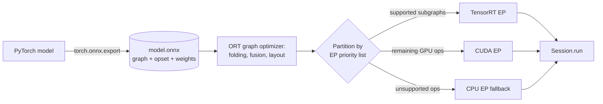

**Reading the diagram.** Export writes a self-contained file, the storage boundary between training and serving. At session creation ORT optimizes the graph and assigns each node to the first execution provider in the priority list that supports it; consecutive nodes on one EP form a subgraph. Data crossing between GPU and CPU subgraphs is copied over PCIe, so one unsupported operator mid-model can dominate latency. Scale with more sessions or processes; concurrent `run` calls on one session are thread-safe.

**Export pitfalls.** Most ONNX incidents happen at export:

- **Frozen shapes.** Undeclared dynamic axes bake in the example's batch size or sequence length.
- **Data-dependent control flow.** Tracing keeps only the branch the example input took.
- **Operators and opsets.** Unsupported or custom operators fail to export or fall back to CPU; an opset newer than the deployed runtime fails to load.
- **Preprocessing outside the graph.** Tokenizers and feature scaling must be replicated exactly in serving code (training–serving skew, §59.8.3).
- **Size limits.** Protocol buffers cap a file at 2 GB, so larger models store weights as external data files.

::: recommendation
**Gate every export with a parity test.** Run the original and exported models on a few thousand real inputs, including edge cases (empty lists, maximum lengths, batch sizes 1 and maximum), and assert that outputs match within a tolerance (for FP32, a maximum absolute difference around $10^{-4}$ relative to output scale). Keep the test in CI next to the export script.
:::

## 67.11 TensorRT

::: definition
**Definition — TensorRT engine.** NVIDIA's **TensorRT** compiles a network (usually imported from ONNX) into an **engine**: a serialized plan of fused layers, chosen kernels and memory layout for one GPU model and TensorRT version. Building performs **layer and tensor fusion**, **precision selection** (FP32, FP16, BF16, INT8, FP8 and, on recent versions, INT4 weights, as of 2026), **kernel auto-tuning** (timing candidate implementations, called tactics, on the actual GPU) and memory planning [NVIDIA TensorRT docs].
:::

**Figure 67.11 — Building and deploying a TensorRT engine.**

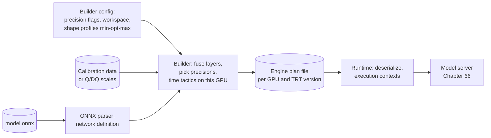

**Reading the diagram.** The build runs on the same GPU model as production, because auto-tuning times real kernels there; it takes minutes, longer for large models. Inputs are the ONNX graph, a configuration with allowed precisions and dynamic-shape **optimization profiles** (minimum, optimal and maximum shapes), and a calibration set or explicit quantize/dequantize (Q/DQ) nodes. The plan file is a storage boundary tied to the GPU architecture and TensorRT version, so changing either requires a rebuild. At run time the server deserializes the engine and creates one execution context per concurrent stream.

The three biggest wins come from fusion (a convolution, bias, batch-norm and ReLU become one kernel; batch-norm folds into the convolution's weights), lower precision where accuracy allows, and choosing the fastest kernel for the exact shapes. For LLMs, NVIDIA's TensorRT-LLM adds the generation-specific machinery of Chapter 73.

::: warning
**Engines are build artifacts, not models.** Keep the ONNX file and build configuration as the source of truth, and build engines in CI for every (GPU type, TensorRT version, profile) you deploy, keyed by those values in the model registry. Copying an engine to another GPU type, or upgrading the container without rebuilding, causes load failures or silently slower kernels.
:::

## 67.12 ML compilers and operator fusion

### 67.12.1 What an ML compiler does

::: definition
**Definition — ML compiler.** A compiler that takes a model's computation graph, rewrites it at a high level (operator fusion, constant folding, layout changes, algebraic simplification), lowers it through progressively hardware-specific intermediate representations (IRs), and generates or selects kernels for a target device, often searching over tile sizes and schedules (**autotuning**).
:::

**Figure 67.12 — The common structure of ML compilers.**

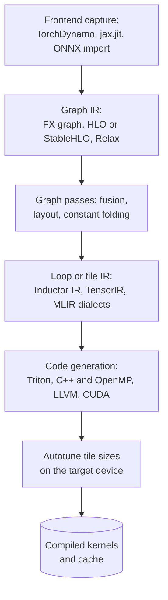

**Reading the diagram.** Every compiler here follows this funnel at compile time: capture a graph, rewrite operators, lower them to loops or tiles, emit kernels, and autotune parameters by timing them on the device. Compiled kernels are cached on disk, a storage boundary to warm before a replica takes traffic, because first compilation takes seconds to minutes. Failure points: graphs that cannot be captured whole (graph breaks) and recompilation when input shapes change.

- **XLA** compiles graphs expressed in its HLO IR (now via StableHLO in OpenXLA) for CPUs, GPUs and TPUs; it is the compiler under JAX and TensorFlow and, through PyTorch/XLA, PyTorch on TPUs [OpenXLA docs].
- **TorchInductor** is the default back-end of `torch.compile`. TorchDynamo captures FX graphs by analyzing Python bytecode, inserting **guards** that trigger recompilation when assumptions (shapes, types) change and **graph breaks** where it cannot trace; Inductor generates Triton kernels for GPUs and C++/OpenMP for CPUs [Ansel et al. 2024].
- **TVM** imports models from many frameworks and searches over loop schedules with a learned cost model to generate kernels for CPUs, GPUs and accelerators without hand-written libraries [Chen et al. 2018].
- **MLIR** is not a compiler for one framework but infrastructure for building compilers from reusable **dialects** (IR layers) [Lattner et al. 2021]; StableHLO, the Triton compiler and several accelerator toolchains are built on it.

### 67.12.2 Operator fusion: the memory-traffic arithmetic

Fusion's benefit comes from the roofline: chains of elementwise and reduction operators are memory-bound (§64.9), so their time is bytes over bandwidth, and fusion removes the intermediate bytes. Chapter 64 derived the per-kernel traffic (§64.6.4); here is the saving for a whole chain.

::: formula
**Memory-traffic bound on fusion speed-up**

$$S_\text{fuse} \le \frac{\sum_{k=1}^{K} (i_k + o_k)\, b\, n / B + K\, t_\text{launch}}{(i_\text{ext} + o_\text{ext})\, b\, n / B + t_\text{launch}}$$

| Symbol | Meaning | Units |
|---|---|---|
| $K$ | Kernels in the unfused chain | kernels |
| $i_k, o_k$ | Full-size tensors read and written by kernel $k$ | tensors |
| $i_\text{ext}, o_\text{ext}$ | Tensors the fused kernel must read from and write to HBM | tensors |
| $b, n$ | Bytes per element; elements per tensor | bytes; elements |
| $B$ | Achieved HBM bandwidth | bytes/s |
| $t_\text{launch}$ | Launch overhead per kernel, about 5 µs (§64.6.4) | s |
:::

::: example
**Worked example — Residual add + RMSNorm in QuickBite's 7B chatbot.** Eager PyTorch runs seven kernels: add the residual (reads 2 tensors, writes 1), square (1, 1), mean over the hidden dimension (reads 1, writes a small vector), add epsilon and reciprocal square root (small), multiply by the normalizer (1, 1), multiply by the learned weight (1, 1): 10 full-tensor passes. A fused kernel reads $x$ and the residual and writes the new residual and the normalized output: 4 passes. $B = 3.35$ TB/s, BF16.

*Prefill*, 16,384 tokens per batch: one tensor is $16{,}384 \times 4{,}096 \times 2 = 134$ MB.

1. Unfused: $10 \times 134 \text{ MB} / 3.35 \text{ TB/s} = 0.40$ ms; fused: $4 \times 134 / 3{,}350 = 0.16$ ms; launch overhead is negligible. $S_\text{fuse} = 2.5$.
2. Two norms per layer × 32 layers = 64 sites: 25.6 ms versus 10.3 ms per forward pass. The GEMMs take at least $2 \times 7 \times 10^9 \times 16{,}384 / 989 \times 10^{12} = 232$ ms, so fusion saves roughly 6% of prefill.

*Decode*, batch 64: one tensor is $64 \times 4{,}096 \times 2 = 524$ KB, about 0.16 µs per pass.

3. Unfused: $10 \times 0.16 + 7 \times 5 = 36.6$ µs; fused: $0.6 + 5 = 5.6$ µs; $S_\text{fuse} = 6.5$, almost all from launches.
4. Over 64 sites: 2.3 ms versus 0.36 ms per decode step, against 4.2 ms to read the BF16 weights (§64.9.2): fusion removes about 30% of the step.

**Interpretation.** The same fusion is a 6% gain for large tensors and a 30% gain for small ones, because small tensors are launch-bound, not bandwidth-bound. **Engineering implication.** Compile (or use fused kernels) everywhere, but expect the largest returns in small-batch, latency-sensitive paths, and pair them with CUDA Graphs (§67.14) to remove the remaining launches.
:::

::: industry
**PyTorch 2 and TorchInductor.** Ansel et al. describe TorchDynamo's bytecode-level graph capture with guards and TorchInductor's Triton code generation, and report geometric-mean speed-ups of 2.27× for inference and 1.41× for training on an NVIDIA A100 across more than 180 real-world models, largely from fusion and reduced overhead.
*Evidence: Primary* — [Ansel et al. 2024]
:::

## 67.13 Memory optimization at inference

Inference memory is weights, live activations, runtime workspace and, for generative models, the KV cache. Four levers apply:

- **Weight sharing.** Tie the input embedding and output projection (one matrix, used twice); serve many fine-tuned variants as one shared base model plus small adapters (Chapters 73 and 76); load several small models into one process instead of one GPU each (§64.15).
- **Activation memory planning.** Runtimes (ORT, TensorRT, Inductor) compute tensor lifetimes and reuse buffers, so peak activation memory is the largest set of simultaneously live tensors, not their sum.
- **Lower-precision storage of large tables.** QuickBite's user-embedding table of 10 million rows × 64 dimensions is 2.56 GB in FP32 (§58.6). Row-wise INT8 with an FP16 scale and offset per row needs $10^7 \times (64 + 4) = 0.68$ GB, 3.8× less, so it fits beside the model on every replica instead of in a remote store.
- **KV-cache memory** grows with batch × context length and often exceeds the weights in LLM serving; Chapter 73 owns its paging, sharing and quantization.

When a model still does not fit, **offloading** keeps some weights in CPU memory or NVMe and streams them to the GPU when needed.

::: formula
**Lower bound on step time with offloaded weights**

$$t_\text{step} \ge \frac{M_\text{off}}{B_\text{link}} \qquad t_\text{token} \ge \frac{M_\text{off}}{B_\text{link} \cdot \text{batch}}$$

| Symbol | Meaning | Units |
|---|---|---|
| $M_\text{off}$ | Weight bytes that must cross the link every forward pass | bytes |
| $B_\text{link}$ | Achieved host-to-GPU bandwidth (PCIe Gen5 x16 is about 64 GB/s per direction) | bytes/s |
| batch | Sequences sharing each streamed weight | sequences |
:::

::: example
**Worked example — Offloading a 70B INT4 model.** All 36.1 GB of weights stream over PCIe Gen5 at 64 GB/s each forward pass.

1. $t_\text{step} \ge 36.1/64 = 0.56$ s: at batch 1, under two tokens per second.
2. At batch 256 for an overnight summarization job: $0.56/256 = 2.2$ ms per token-equivalent.

**Interpretation.** PCIe is about 50 times slower than HBM, so offloading trades a capacity problem for a bandwidth problem. **Engineering implication.** Offload for large-batch offline jobs or single-user local inference, not for interactive services.
:::

## 67.14 Latency versus throughput optimization

### 67.14.1 Batch size, concurrency and graph capture

Latency and throughput per dollar pull the knobs in opposite directions (§4.18.6):

- **Batch size.** With $T(B) = t_0 + B\,t_1$, throughput $B/T(B)$ rises toward $1/t_1$ as $B$ grows while each request waits for the whole batch. Below the ridge point, larger batches are almost free (§64.9.3); QuickBite's GPU-served ETA model runs batch 64 in about 2.6 ms (25,000 predictions/s, §60.11). Dynamic batching belongs to Chapter 66.
- **Concurrency.** Two or more model instances or CUDA streams per GPU overlap one batch's transfers and CPU work with another's compute, raising throughput when one instance leaves gaps, at some cost to tail latency.
- **Graph capture.** At small batch, each step is hundreds of tiny kernels and the CPU cannot launch them fast enough. **CUDA Graphs** record the sequence of kernels once and replay it with one launch [NVIDIA CUDA C++ Programming Guide]; `torch.compile(mode="reduce-overhead")` uses them, and TensorRT and LLM engines can capture their launches the same way.

**Figure 67.13 — Eager launches versus CUDA Graph replay for one decode step.**

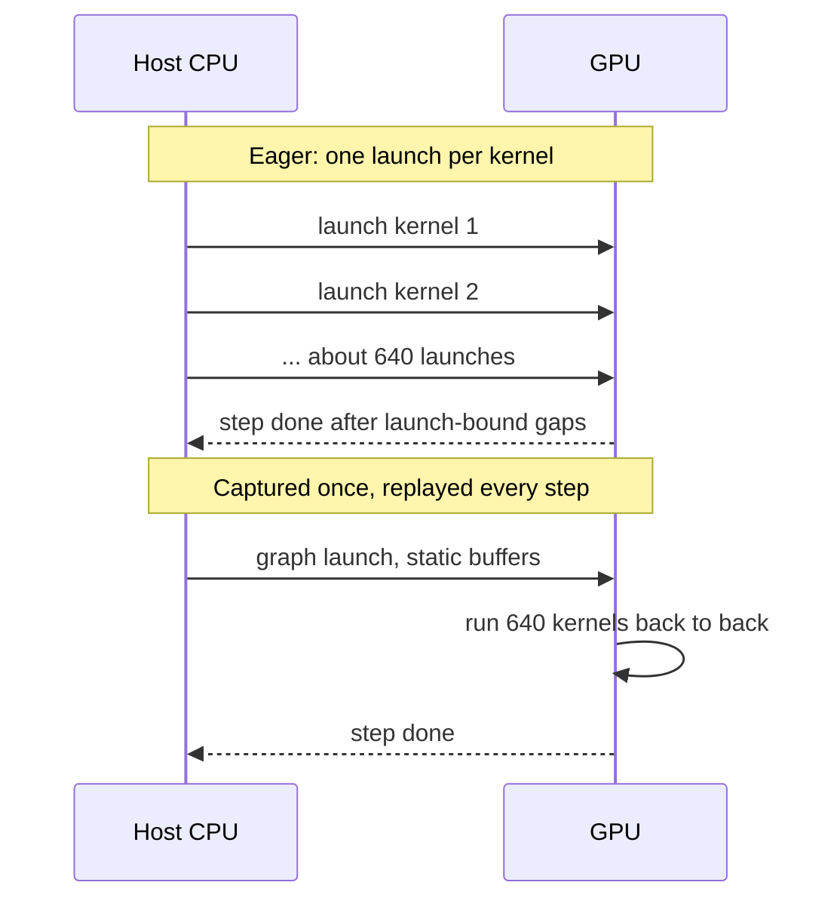

**Reading the diagram.** In eager mode the host issues every kernel; if launching takes longer than the kernel runs, the GPU idles between kernels and the step is overhead-bound (§64.12). With CUDA Graphs, a warm-up step is captured into a graph whose kernels, arguments and memory addresses are fixed; later steps copy new inputs into the same static buffers and replay the graph with one call. The dotted arrows are asynchronous completion notifications. Failure points: shapes must match the captured graph (servers capture one graph per batch-size bucket), and any host-side logic inside the step is frozen at capture time.

::: example
**Worked example — Is a 7B INT4 decode step launch-bound?** Assume 32 layers × 20 kernels = 640 launches per step at 5 µs of host time each (§64.6.4).

1. Launch time: $640 \times 5 = 3.2$ ms. GPU work at batch 1 with INT4 weights: at least 1.08 ms of weight reads (§67.3).
2. Eager: step ≈ 3.2 ms, about 310 tokens/s: the GPU is idle two-thirds of the time, and the INT4 work bought almost nothing.
3. Graph replay: one launch of a few µs, step ≈ 1.1–1.3 ms, about 800 tokens/s.

**Interpretation.** Quantization moved the bottleneck from HBM to the CPU. **Engineering implication.** Pair every bandwidth optimization with an overhead check; in production LLM engines graph capture is standard (Chapter 73).
:::

## 67.15 TensorRT versus ONNX Runtime versus torch.compile

**Table 67.6 — Comparing three optimization stacks (as of 2026).**

| | TensorRT | ONNX Runtime | torch.compile (TorchInductor) |
|---|---|---|---|
| What it is | NVIDIA's inference compiler and runtime | Cross-platform inference engine for ONNX graphs | PyTorch's just-in-time graph compiler |
| How it works | Builds a per-GPU engine: fusion, precision selection, tactic auto-tuning | Graph rewrites, then partitions nodes across execution providers | Captures graphs from Python bytecode; generates Triton or C++ kernels |
| Advantages | Usually fastest on NVIDIA GPUs; mature INT8/FP8 | Runs on CPUs, GPUs, NPUs and phones from one file; many languages | Stays in PyTorch; one line to try; handles dynamic Python |
| Disadvantages | NVIDIA only; engines tied to GPU and version; long builds | Export pitfalls; speed depends on the EP | Graph breaks and recompiles; warm-up compile time; needs Python at serving time unless exported |
| Performance | Highest ceiling on NVIDIA hardware | Good on CPU; near TensorRT when using its TensorRT EP | Good; strongest on memory- or overhead-bound models |
| Operational complexity | High: build matrix per GPU, version and shape profile | Medium: export and parity tests | Low to medium: compile caches, warm-up |
| Cost | Free; vendor lock-in | Free, open source | Free, open source |
| Use cases | High-volume GPU serving, vision, LLMs via TensorRT-LLM | Heterogeneous fleets, CPU serving, edge and desktop apps | PyTorch-native services, fast iteration, training too |
| Choose when | GPU cost dominates and the model is stable | You need portability or CPU and edge targets | You want speed without leaving PyTorch |

These are not exclusive: ORT can delegate subgraphs to TensorRT, and torch.compile can lower to TensorRT through the Torch-TensorRT back-end. A common path is torch.compile during development, then ORT or TensorRT for a stable, high-volume model once its gains justify a separate build pipeline.

## 67.16 An optimization workflow

### 67.16.1 Measure, choose, validate, canary

**Figure 67.14 — From baseline to production for an optimized model.**

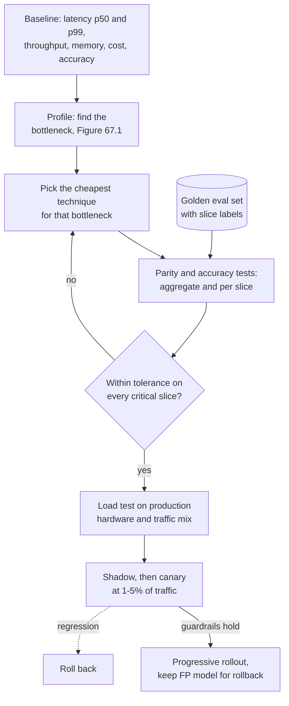

**Reading the diagram.** The workflow is the release process for a model change (Chapter 66, §66.12; §43.6), with two optimization-specific gates. First, accuracy is compared per slice against a golden evaluation set, a storage boundary that must be versioned with the model. Second, speed is measured on production hardware with production traffic shapes, because laptop speed-ups do not transfer. The shadow and canary stages run online; the dotted arrow is an automated rollback triggered by quality or latency guardrails. Keep the unoptimized model deployable until the optimized one has run through a full traffic cycle.

::: example
**Worked example — Releasing the INT8 ETA model.** Tolerances agreed with the product team (assumed): mean absolute error (MAE) may rise by at most 1% overall and 3% in any city or distance bucket; p99 latency must not rise.

1. Overall: MAE 1.620 → 1.626 minutes, +0.4% (§67.5.2). Passes.
2. Slices: suppose long-distance orders (over 8 km, 6% of orders) rise 4.1% because their features sit at the edge of calibration ranges. Fails; per-slice testing caught what the aggregate hid.
3. Fix: keep the first linear layer, which sees the raw distance features, in FP32 (**mixed-precision quantization**); two-thirds of the weights stay INT8, so much of the speed-up remains (measure it). The slice now rises 1.2%. Passes.
4. Canary at 5% of traffic for 24 hours, comparing on-time-within-5-minutes rates once deliveries complete (35-minute label delay, §60.12), then roll out.

**Interpretation.** The model that ships is partly quantized, and that is normal. **Engineering implication.** Make slice tolerances part of the model's release contract and automate them in the pipeline (Chapter 69).
:::

**Table 67.7 — Failure scenarios in model optimization.**

| What goes wrong | Why | Detection | Recovery | Prevention |
|---|---|---|---|---|
| Accuracy drops on one segment after INT8 | Calibration data missed that segment's ranges | Per-slice evaluation; canary slice metrics | Roll back; recalibrate or keep layer in FP | Stratified calibration set; slice gates |
| Optimized model slower in production | Unsupported operator falls back to CPU; no low-precision kernels on that hardware | Profiler shows host copies; latency regression in load test | Pin the provider; replace the operator | Benchmark on production hardware |
| Engine fails to load after upgrade | TensorRT engine tied to GPU and version | Startup errors; readiness probe failures | Rebuild engine; redeploy old image | Build engines in CI per GPU and version |
| Latency spikes after deploy | Compilation or autotuning on first requests | p99 spike on new replicas only | Drain replica; warm up | Warm-up requests before readiness; persistent compile cache |
| Exported model gives wrong answers for long inputs | Tracing froze a shape or a control-flow branch | Parity tests at edge-case shapes | Re-export with dynamic axes | Parity test suite in CI |

::: mistake
**"Offline accuracy matched, so the optimized model is equivalent."** Aggregate metrics average away slice regressions, and small numeric changes can flip decisions near thresholds (a fraud score crossing 0.9, a ranking swapping two items). Compare decisions, not just scores, and run a canary.
:::

## 67.17 Summary and revision notes

::: summary
- Profile first. Optimize the resource that limits the top operators: capacity (quantize, prune, distill, offload), bandwidth (lower-bit storage, fusion, batching), compute (INT8/FP8, 2:4 sparsity, smaller models) or overhead (compilation, CUDA Graphs). Speed-up is bounded by $1/((1 - f) + f\,b_\text{new}/b_\text{old})$.
- Affine quantization: $s = (\beta - \alpha)/(q_\text{max} - q_\text{min})$, $z = \text{round}(q_\text{min} - \alpha/s)$; error $\le s/2$ in range, MSE $\approx s^2/12$, SQNR $\approx 6.02b + 4.77 - 20\log_{10}(A/\sigma)$. Outliers cost bits; finer granularity (per-channel, per-group) wins them back.
- Symmetric weights ($z = 0$) keep integer GEMMs simple; INT32 accumulation and one requantization multiplier make integer-only inference possible.
- Dynamic PTQ needs no data and suits linear-heavy CPU models; static PTQ needs representative calibration data; QAT fine-tunes with fake quantization and the straight-through estimator when PTQ fails.
- LLM weights: INT4 with $g = 128$ is 4.125 bits per weight; a 70B model drops from 140 GB to 36 GB. GPTQ compensates rounding error using the Hessian, AWQ protects salient channels by scaling, SmoothQuant moves activation outliers into weights for W8A8, LLM.int8() keeps outlier columns in FP16, and FP8 is the simple W8A8 option on new GPUs.
- Unstructured sparsity rarely speeds dense hardware and needs about 50% sparsity just to break even on storage; 2:4 sparsity and structured pruning are what GPUs exploit. Always fine-tune after pruning.
- Distillation: $\alpha T^2\,\text{KL}$ on softened teacher outputs plus $(1 - \alpha)$ cross-entropy; choose the student at the knee of the quality–cost curve.
- ONNX decouples training from serving; ORT partitions graphs across execution providers; TensorRT builds per-GPU engines; torch.compile, XLA and TVM fuse and generate kernels. Fusion saves bytes for large tensors and launches for small ones.
- Release optimized models like any model change: per-slice accuracy gates, production-hardware load tests, shadow and canary, rollback to the unoptimized model.
:::

## 67.18 Knowledge checkpoint

1. Compute the scale and zero-point for UINT8 asymmetric quantization of the range $[-0.6, 3.4]$.
2. Why is symmetric quantization preferred for weights in integer GEMMs?
3. INT8 per-tensor SQNR is 40 dB. Estimate it if one outlier quadruples the range.
4. A 13B model is served with INT4 weights, $g = 64$, FP16 scales. How much weight memory?
5. Decode spends 70% of step time reading weights. What end-to-end speed-up does BF16 → INT8 weight-only give at best?
6. What does the straight-through estimator do?
7. When does dynamic quantization fit better than static quantization?
8. Why can GPTQ move a weight away from its nearest grid point and still reduce error?
9. With $\alpha = 0.5$, activation max 32 and weight max 0.5, what SmoothQuant factor results?
10. At what sparsity does CSR with INT8 values and 16-bit indices break even with dense INT8?
11. Teacher logits $(2, 0)$. What are the soft targets at $T = 1$ and $T = 2$?
12. Why must a TensorRT engine be rebuilt after a GPU change?

<details><summary>Answers</summary>

1. $s = 4.0/255 = 0.01569$; $z = \text{round}(0.6/0.01569) = \text{round}(38.25) = 38$.
2. With $z_w = 0$, the integer dot product needs no correction term that depends on the inputs, so kernels stay simple and fast.
3. Quadrupling $A$ costs $20\log_{10} 4 = 12$ dB: about 28 dB.
4. $13 \times 10^9 \times (4 + 16/64)/8 = 13 \times 10^9 \times 4.25/8 = 6.9$ GB.
5. $1/(0.3 + 0.7 \times 0.5) = 1/0.65 = 1.54\times$.
6. Uses the quantized value in the forward pass and treats rounding as the identity (zero outside the clipping range) in the backward pass, so gradients reach the full-precision weights.
7. When no representative calibration data exists, activation ranges vary widely between requests, or the model is dominated by linear layers on CPU where computing ranges per call is cheap.
8. It minimizes the layer's output error; with correlated inputs, moving one weight can cancel errors already made in others.
9. $s = \sqrt{32}/\sqrt{0.5} = 5.66/0.707 = 8$; both maxima become 4.
10. $(1 - \text{sp}) \times 24/8 = 1$, so sp $= 2/3$.
11. $T = 1$: $e^2/(e^2 + 1) = 0.881$, so $(0.881, 0.119)$. $T = 2$: $e/(e + 1) = 0.731$, so $(0.731, 0.269)$.
12. Kernel choices are auto-tuned for, and compiled to, one GPU architecture and TensorRT version.

</details>

## 67.19 Interview questions

### Basic

**Q1. What is the difference between post-training quantization and quantization-aware training?**
**Answer.** PTQ quantizes a trained model using weights and optionally calibration data, in minutes to hours. QAT simulates quantization during a fine-tune so weights adapt to rounding, using the straight-through estimator; it costs a training run and recovers accuracy when PTQ loses too much, especially at 4 bits or for small models.

**Q2. Why doesn't 50% unstructured sparsity make a model twice as fast on a GPU?**
**Answer.** Dense kernels multiply zeros like any other value, sparse formats need indices that cancel the storage saving at 50%, and irregular access defeats coalescing and tiling. Speed needs hardware-supported patterns (2:4) or structured pruning that produces a smaller dense model.

### Intermediate

**Q3. Your CPU-served model is 40% slower than its latency objective. How do you approach it?**
**Answer.** Profile end to end; if the forward pass dominates, try torch.compile or ORT graph optimizations, then dynamic INT8 for linear layers. Validate accuracy per slice, load-test on production hardware and canary. If still too slow, distill a smaller model or remove features with high fetch cost.

**Q4. You quantized an LLM to INT4 with AWQ, and decoding got only 20% faster. Why?**
**Answer.** Weight reads may not dominate: KV-cache reads at long context, launch overhead at small batch, or dequantization cost in compute-bound large batches. Check the profile; add CUDA Graphs, quantize the KV cache (Chapter 73) or use FP8 W8A8 for large-batch regimes.

### Advanced

**Q5. Design the optimization plan for serving a 70B chat model on H100s at the lowest cost per token.**
**Answer.** Start from memory: BF16 weights need two GPUs and leave 20 GB for KV cache; FP8 fits one GPU with 10 GB; INT4 with $g = 128$ leaves 44 GB. Pick FP8 if quality holds and requests need compute-bound prefill; INT4 AWQ/GPTQ if memory and decode dominate. Validate on task evaluations and safety sets, then add continuous batching, KV-cache management and CUDA Graphs (Chapter 73). Compare cost per million tokens at the target latency, not raw throughput.

**Q6. How would you build a platform service that optimizes models automatically for many teams?**
**Answer.** Accept a model plus evaluation contract (metrics, slices, tolerances, latency target). Run a search over techniques (compile, dynamic and static INT8, FP8, engine builds per GPU type) in a job queue; gate each candidate on parity and slice tolerances; benchmark on production hardware; register the winner with lineage to the original; hand off to canary deployment. Keep the original deployable and record every build key.

## 67.20 Practical exercises

1. Extend the NumPy program to search clipping thresholds by MSE for a heavy-tailed activation sample and compare with min–max and 99.99th-percentile clipping.
2. Apply dynamic quantization to only the second layer of the ETA MLP and measure size, latency and the maximum prediction change.
3. Train a 64-unit student MLP on the ETA teacher's predictions and compare its MAE to the same student trained on labels alone.
4. Use `torch.compile` on the ETA MLP, measure first-call compile time and steady-state latency on your machine, and explain both.

## 67.21 Design challenges

1. **QuickBite courier app on-device model.** A photo check that confirms a delivery runs on couriers' phones with 3 GB of RAM and a 100 ms budget. Choose architecture, quantization, runtime (ORT Mobile, Core ML or TFLite-class) and an update and validation strategy.
2. **Chatbot cost halving.** The 7B chatbot runs in BF16 on H100s. Halve cost per conversation without reducing a human-rated quality score by more than 2%: compare FP8, INT4 weight-only and a distilled 3B model, with the measurements and gates you would use.

## 67.22 References

1. Ansel, J., et al. *PyTorch 2: Faster Machine Learning Through Dynamic Python Bytecode Transformation and Graph Compilation*. ASPLOS, 2024.
2. Bengio, Y., Léonard, N., Courville, A. *Estimating or Propagating Gradients Through Stochastic Neurons for Conditional Computation*. arXiv:1308.3432, 2013.
3. Chen, T., Moreau, T., Jiang, Z., et al. *TVM: An Automated End-to-End Optimizing Compiler for Deep Learning*. USENIX OSDI, 2018.
4. Denton, E., Zaremba, W., Bruna, J., LeCun, Y., Fergus, R. *Exploiting Linear Structure Within Convolutional Networks for Efficient Evaluation*. NeurIPS, 2014.
5. Dettmers, T., Lewis, M., Belkada, Y., Zettlemoyer, L. *LLM.int8(): 8-bit Matrix Multiplication for Transformers at Scale*. NeurIPS, 2022.
6. Frankle, J., Carbin, M. *The Lottery Ticket Hypothesis: Finding Sparse, Trainable Neural Networks*. ICLR, 2019.
7. Frantar, E., Ashkboos, S., Hoefler, T., Alistarh, D. *GPTQ: Accurate Post-Training Quantization for Generative Pre-trained Transformers*. ICLR, 2023.
8. Han, S., Mao, H., Dally, W. J. *Deep Compression: Compressing Deep Neural Networks with Pruning, Trained Quantization and Huffman Coding*. ICLR, 2016.
9. Hassibi, B., Stork, D. G. *Second Order Derivatives for Network Pruning: Optimal Brain Surgeon*. NeurIPS (NIPS 5), 1993.
10. Hinton, G., Vinyals, O., Dean, J. *Distilling the Knowledge in a Neural Network*. arXiv:1503.02531, 2015.
11. Howard, A. G., Zhu, M., Chen, B., et al. *MobileNets: Efficient Convolutional Neural Networks for Mobile Vision Applications*. arXiv:1704.04861, 2017.
12. Jacob, B., Kligys, S., Chen, B., et al. *Quantization and Training of Neural Networks for Efficient Integer-Arithmetic-Only Inference*. IEEE/CVF CVPR, 2018.
13. Krishnamoorthi, R. *Quantizing Deep Convolutional Networks for Efficient Inference: A Whitepaper*. arXiv:1806.08342, 2018.
14. Lattner, C., Amini, M., Bondhugula, U., et al. *MLIR: Scaling Compiler Infrastructure for Domain Specific Computation*. IEEE/ACM CGO, 2021.
15. Lin, J., Tang, J., Tang, H., et al. *AWQ: Activation-aware Weight Quantization for On-Device LLM Compression and Acceleration*. MLSys, 2024.
16. Micikevicius, P., et al. *FP8 Formats for Deep Learning*. arXiv:2209.05433, 2022.
17. Mishra, A., Latorre, J. A., Pool, J., et al. *Accelerating Sparse Deep Neural Networks*. arXiv:2104.08378, 2021.
18. Nagel, M., Fournarakis, M., Amjad, R. A., et al. *A White Paper on Neural Network Quantization*. arXiv:2106.08295, 2021.
19. NVIDIA. *CUDA C++ Programming Guide* (CUDA Graphs). https://docs.nvidia.com/cuda/cuda-c-programming-guide/
20. NVIDIA. *TensorRT Documentation* (Developer Guide). https://docs.nvidia.com/deeplearning/tensorrt/
21. ONNX. *ONNX Documentation* (IR specification and operator schemas). https://onnx.ai/onnx/
22. ONNX Runtime. *ONNX Runtime Documentation* (graph optimizations, execution providers, quantization). https://onnxruntime.ai/docs/
23. OpenXLA. *XLA Documentation*. https://openxla.org/xla
24. PyTorch. *PyTorch Documentation: torch.compile and Quantization*. https://pytorch.org/docs/stable/
25. Sanh, V., Debut, L., Chaumond, J., Wolf, T. *DistilBERT, a Distilled Version of BERT: Smaller, Faster, Cheaper and Lighter*. arXiv:1910.01108, 2019.
26. Xiao, G., Lin, J., Seznec, M., et al. *SmoothQuant: Accurate and Efficient Post-Training Quantization for Large Language Models*. ICML, 2023.
27. Zhu, M., Gupta, S. *To Prune, or Not to Prune: Exploring the Efficacy of Pruning for Model Compression*. arXiv:1710.01878, 2017.

## 67.23 Open verification items

- PyTorch 2 paper headline figures (2.27× inference, 1.41× training geometric mean on A100, 180+ models): confirm against the ASPLOS 2024 text.
- GPTQ speed-ups (about 3.25× A100, 4.5× A6000) and "about four GPU-hours" for 175B: confirm against the ICLR 2023 version.
- `torch.ao.quantization` deprecation and migration to torchao: confirm the release in which eager-mode APIs are removed.
- TensorRT INT4 weight support and cross-GPU "hardware compatibility" options vary by version; check current release notes.
- Typical eager launch overhead (~5 µs per kernel) and 20 kernels per decoder layer are assumptions; measure on the target stack.
