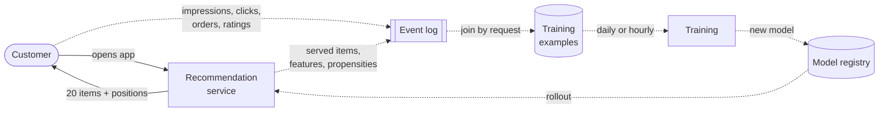
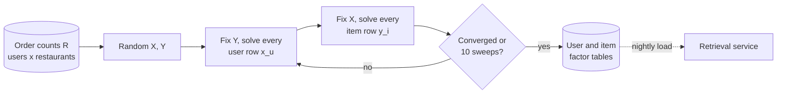
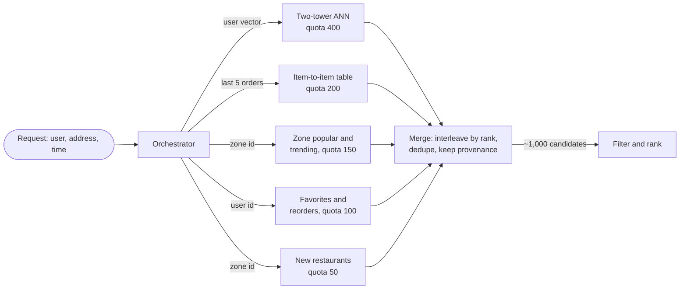
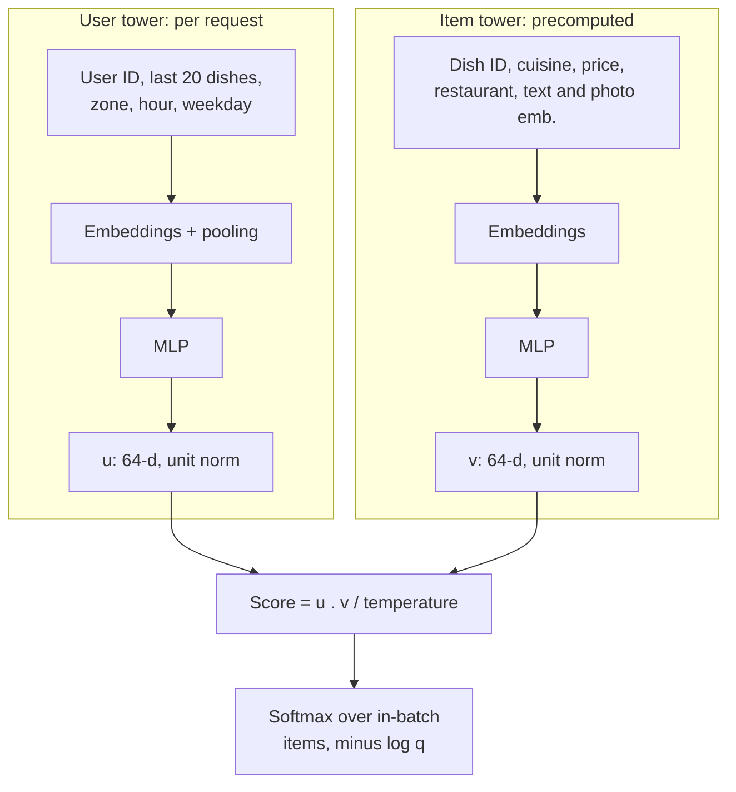
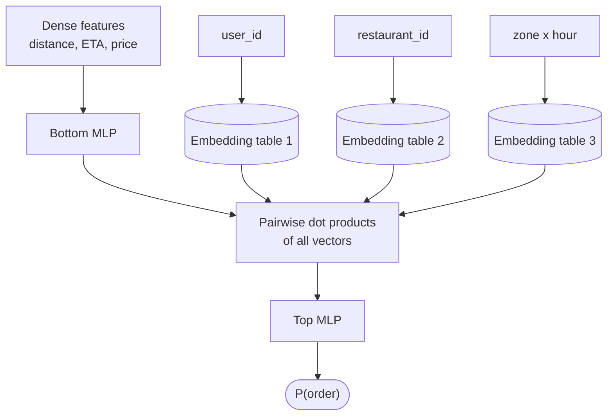
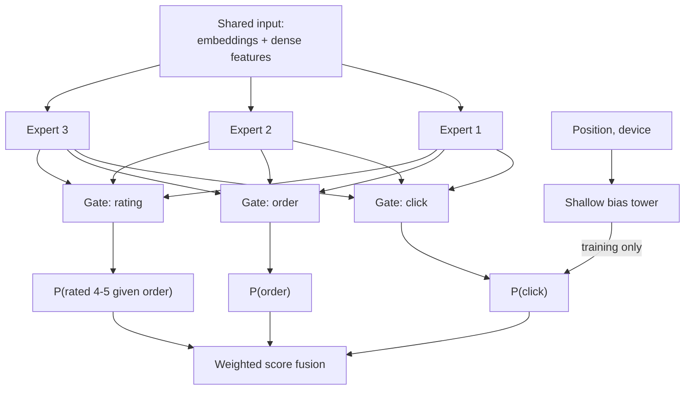

# Chapter 68 — Recommendation and Ranking Systems Architecture

> **Level:** 4 · **Track:** B (ML/AI) · **Estimated reading time:** 6 h

A QuickBite customer opens the app at 7:40 p.m. on a rainy Tuesday. Within a fraction of a second the home screen shows twenty restaurants and a row of "dishes for you", picked from 50,000 restaurants and about 5 million dishes. Most of those dishes cannot reach this customer tonight, most of the rest she would never want, and the system has never asked her a single question about her tastes. Everything it knows comes from what she and millions of other customers did: what they opened, ordered, ignored and rated. Choosing those twenty items well is worth more to a marketplace than almost any other model it runs, because every order starts with something the customer saw.

Chapter 56 (§56.5) designed the serving system behind such a feed as a data platform: the orchestrator, the parallel candidate sources, the latency budget, feature placement and impression logging, with the models treated as black boxes of known cost. This chapter opens the boxes. You will learn what the recommendation problem actually optimizes, why every large recommender is a **multi-stage funnel**, how candidate generators (matrix factorization, item-to-item tables, two-tower networks) find a few hundred plausible items among millions, how ranking models (gradient-boosted trees, Wide & Deep, DLRM, DCN, multi-task networks) order them, and how re-ranking turns a scored list into a good page. The second half covers what makes recommenders unlike other ML systems: embedding tables that dwarf the rest of the model, the need to **explore**, feedback loops in which the model writes its own training data, real-time personalization, evaluation that offline metrics alone cannot settle, and cold start. The chapter ends with a reference architecture for QuickBite.

Vector search internals (HNSW, IVF-PQ) belong to Chapter 74 and are previewed only. Complete product case studies (YouTube, Instagram, Netflix, advertising) are in Chapter 81. Model servers, dynamic batching and rollout mechanics are in Chapter 66.

::: note
**QuickBite assumptions used in this chapter.** These reuse the Book II design point and are teaching assumptions, not measurements of a real company: 10 million registered customers (Ch 58), about 4 million weekly and 2 million daily active users (§2.11, Ch 57); 50,000 restaurants with about 100 dishes each, so about 5 million dishes (§58.6); 500,000 orders a day; 4,000 delivery zones (Ch 62); 7,000 browse requests per second (RPS) at peak (§2.11) with a browse p99 target of 300 ms (§2.5); about 10% of weekly users order from the recommendation feed (§57.14); CPU at \$0.048 per vCPU-hour (§60.11). **New in this chapter:** 2,500 recommendation requests per second at peak (home feed plus dish modules, a subset of browse traffic); about 1,200 restaurants, so about 120,000 dishes, can deliver to a typical urban address at dinner time; the recommendation service has a 120 ms server-side p99 budget. Sizes use SI units (1 GB = 10⁹ bytes).
:::

## 68.1 Learning objectives

After this chapter you should be able to:

- Frame a recommendation problem: choose between implicit and explicit feedback, and pick an objective from clicks to long-term value.
- Size a multi-stage funnel: compute per-stage cost and latency, and justify each stage's candidate count.
- Implement matrix factorization (explicit loss and implicit ALS), item-to-item similarity and popularity sources, and merge several retrieval sources.
- Train a two-tower retrieval model with in-batch negatives and logQ correction, and explain how it is served with approximate nearest neighbor (ANN) search.
- Compare pointwise, pairwise and listwise ranking; GBDT, Wide & Deep, DLRM and DCN rankers; build a multi-task ranker and calibrate its outputs.
- Size and shard embedding tables, and explain DLRM's hybrid model-parallel and data-parallel training.
- Re-rank for diversity and fairness with maximal marginal relevance (MMR).
- Compare ε-greedy, UCB and Thompson sampling by regret, and design a contextual bandit.
- Identify position, popularity and selection bias, and correct them with inverse propensity scoring (IPS).
- Choose between offline metrics, A/B tests, interleaving and long-term holdouts, and design for cold start.

## 68.2 Prerequisites

- Ranking metrics (precision, recall, NDCG) — §57.12; A/B testing statistics — §57.14 (every evaluation in §68.14 uses them).
- Log loss and calibration — §57.10.3 (needed for §68.7.5).
- Embeddings and embedding-table size — §58.6 (the building block of every model here).
- Feature stores, cross features and point-in-time correctness — §62.3, §62.8 (where ranking features come from).
- Parameter servers and sparse gradients — §65.8 (how huge embedding tables are trained).
- Model serving and dynamic batching — §66.6–§66.7 (how rankers run in production).
- The systems view of a recommender: orchestrator, latency budget, logging — §56.5 (this chapter assumes it and does not repeat it).

## 68.3 The recommendation problem

### 68.3.1 Feedback and objectives

::: definition
**Definition — Recommender system, explicit and implicit feedback.** A **recommender system** chooses and orders items (restaurants, dishes, videos, products) for a user in a context, without an explicit query. **Explicit feedback** is a deliberate statement of preference, such as a star rating. **Implicit feedback** is behavior from which preference is inferred: impressions, clicks, menu opens, add-to-cart events, orders, reorders and dwell time.
:::

#### First-principles explanation

Think of a good waiter in a restaurant you visit every week. She never handed you a questionnaire, yet she knows you order the spicy dishes, skip dessert on weekdays and try the special when it is fish. She learned from what you did, not what you said, and she also learned from other customers who order like you. A recommender is that waiter at the scale of millions of customers and millions of dishes, with one more difficulty: she only ever sees your reaction to the dishes she chose to suggest.

#### Why does this exist?

Search answers a question the user can phrase. Most browsing is not like that: a hungry customer does not know which of 120,000 deliverable dishes she wants, and scrolling through them is impossible. The engineering problem is to **estimate, for one user at one moment, the value of showing each item, and then choose a set of items**, under a latency budget of tens of milliseconds and with training data that the system's own past choices produced.

#### How it works internally

Implicit and explicit feedback have different shapes, and the shape dictates the model.

1. **Explicit ratings are sparse and biased.** QuickBite receives a written review on 4% of orders (Ch 63) and star ratings on perhaps a few times that. Users rate what they chose to order, and they rate more often when delighted or furious.
2. **Implicit feedback is plentiful but positive-only.** An order says "I wanted this"; the absence of an order says almost nothing. The customer may dislike the dish, may never have seen it, or may have ordered it elsewhere. Unobserved does not mean negative.
3. **Implicit signals have confidence, not grades.** Ordering from a restaurant ten times is stronger evidence than ordering once, and a 2-second menu glance is weaker than a 40-second read. Hu, Koren and Volinsky separate a binary **preference** from a real-valued **confidence** for exactly this reason (§68.5.2) [Hu et al. 2008].
4. **Every signal is conditioned on exposure.** The user could only click what was shown, at the position it was shown. That is the root of the biases in §68.12.

**Figure 68.1 — The recommendation loop: the model writes its own training data.**



**Reading the diagram.** The solid arrows are the synchronous request: the app asks the recommendation service for a page and receives items with positions. Everything else is asynchronous. The app logs what the customer did, the service logs what it served (with the features it used and, ideally, the probability of having shown each item), and a join job (§56.5.8) turns the two into labeled examples in the training store. Training produces a model that is registered and rolled out, and the next page is chosen by that model. The storage boundaries are the event log, the training store and the registry. The distinctive failure point is not a crash but the loop itself: if the service only ever shows popular restaurants, the training data contains only popular restaurants, and the next model is even more confident about them (§68.12). Scaling concerns sit on the serving side (requests per second) and the logging side (impressions per day), covered in §56.5.4.

#### Objectives: what "good" means

The label you train on is a decision about what the business values. **Table 68.1** lists QuickBite's options from fastest and noisiest to slowest and truest.

**Table 68.1 — Candidate objectives for QuickBite recommendations.**

| Objective | Delay | Volume per day | What it rewards | Risk if optimized alone |
|---|---|---|---|---|
| Click (open restaurant) | Seconds | Millions | Attractive photos and names | Clickbait: opens without orders |
| Menu dwell time | Minutes | Millions | Interesting menus | Long browsing, no decision |
| Order | Minutes | Up to 500,000 | Conversion | Cheap, fast, repetitive picks |
| Order rated 4–5 stars | Hours | Tens of thousands | Satisfaction | Few labels; rating bias |
| Reorder within 30 days | 30 days | Thousands | Durable fit | Too slow to train on directly |
| Customer retention, lifetime value | Months | — | The business goal | Needs surrogates and holdouts (§68.14) |

YouTube's published candidate and ranking models illustrate the move from clicks to engagement depth: the ranker was trained to predict **expected watch time** rather than click probability, by weighting positive (clicked) impressions by their watch time in a logistic regression, because click-through rate rewarded deceptive thumbnails [Covington et al. 2016]. QuickBite's analogue is to predict orders, and to combine several predictions (click, order, good rating) into one score (§68.7.4).

::: mistake
**"The model's objective is the business objective."** A model can only optimize a label that arrives fast enough to train on. Orders arrive in minutes; retention arrives in months. In practice you train on short-term proxies, combine them with weights chosen by experiment, and check the long-term effect with holdouts (§68.14.3). Optimizing a proxy hard enough eventually breaks it (Goodhart's law).
:::

### 68.3.2 QuickBite's recommendation surfaces

**Table 68.2 — QuickBite recommendation surfaces.**

| Surface | Items | Eligible per request | Primary label | Notes |
|---|---|---|---|---|
| Home feed | Restaurants | ~1,200 deliverable now | Order from restaurant | Ranked list of 20, paginated |
| Dishes for you | Dishes | ~120,000 deliverable | Dish added and ordered | The large-catalog problem: the funnel of §68.4 |
| Reorder carousel | Past orders | 5–50 | Reorder | Small; a ranking problem only |
| "Goes well with" in cart | Dishes from the same restaurant | ~100 | Added to cart | Item-to-item (§68.5.3) |
| Search results | Restaurants and dishes | Query-dependent | Order | Query relevance plus personalization (Chapter 16, §81.7) |

Two marketplace facts shape every design choice that follows. First, **eligibility is geographic and temporal**: a restaurant 12 km away, or closed, or with a 60-minute kitchen backlog is not a candidate, however perfect the match. Second, **supply is finite**: a restaurant that every customer is shown at 7:30 p.m. gets more orders than its kitchen can cook, so delivery times rise, which hurts the very customers it was recommended to. Recommendation quality in a marketplace includes the operational health of the other side.

## 68.4 The multi-stage funnel

### 68.4.1 Why stages exist

::: definition
**Definition — Multi-stage recommendation funnel.** A pipeline in which progressively more expensive models score progressively fewer items: **candidate generation** (retrieval) selects hundreds to thousands of items from the full catalog; **filtering** removes ineligible items; **ranking**, often split into a light and a heavy ranker, scores each candidate with rich features; **re-ranking** turns scores into a final list under list-level objectives and business rules.
:::

#### First-principles explanation

A company hiring for one position does not interview 10,000 applicants. A keyword screen reduces them to 500 in seconds each, a recruiter's 10-minute read to 50, a phone screen to 10, and only those get a full day of interviews. Each step is cheap enough for the number of people it sees, and each step only needs to be good enough not to throw away the eventual hire. A recommendation funnel is the same: the cost per item rises by orders of magnitude from stage to stage, and the number of items falls by a similar factor.

#### Why does this exist?

The best ranking model available, one with hundreds of features and cross-feature interactions, costs about 100 µs of CPU per candidate. Applied to every deliverable dish, that is 12 seconds of CPU per request. The funnel exists so that the expensive model sees only the few hundred items that could plausibly win. YouTube's 2016 system made the two-stage shape (candidate generation, then ranking) the standard description [Covington et al. 2016]; Chapter 60 traces the idea to cascaded classifiers in computer vision (§60.13).

#### How it works internally

1. **Eligibility.** A geographic index returns the restaurants that deliver to this address and are open now; their dishes form the eligible set (here about 120,000 of 5 million).
2. **Candidate generation.** Several sources run in parallel, each returning a few hundred items: embedding retrieval (§68.6), item-to-item from the last order (§68.5.3), trending in the zone (§68.5.4), the customer's own favorites. Merged and deduplicated, about 1,000 candidates remain (§56.5.8 shows the merge code).
3. **Filtering.** Business and safety rules: out of stock, allergens the customer declared, restaurants paused for quality, items already shown in this session.
4. **Light ranking.** A small model (often a GBDT with tens of features, or a distilled network) scores all candidates and keeps the top 300.
5. **Heavy ranking.** The full multi-task model (§68.7) predicts click, order and rating probabilities for 300 candidates.
6. **Re-ranking.** Diversity, freshness, provider fairness and capacity rules choose the 20 to show (§68.10).

**Figure 68.2 — QuickBite's dish funnel: item counts and per-item cost at each stage.**


**Reading the diagram.** Data flows left to right on the synchronous request path; each arrow is labeled with the operation or per-item cost of the stage it enters. The catalog is the only storage boundary drawn (the feature stores and indexes behind each stage are in Figure 68.17). Candidate generation is the only parallel stage: its four sources run concurrently under one deadline, and a late source is dropped rather than waited for (§56.5.4). Each later stage is sequential. Failure points: a retrieval source that silently returns nothing reduces quality without raising errors; a heavy ranker overload is absorbed by shrinking its input from 300 to 150 or by serving light-ranker order. Scaling is per stage: the heavy ranker dominates CPU and is scaled first.

#### Mathematical foundations

::: formula
**Funnel compute cost and fleet size**

$$C_\text{req} = \sum_{s} N_s \, c_s + \sum_{s} f_s \qquad \text{Cores} = \frac{\lambda_\text{peak} \, C_\text{req}}{\rho}$$

| Symbol | Meaning | Units |
|---|---|---|
| $C_\text{req}$ | CPU time consumed by one recommendation request | core-seconds |
| $N_s$ | Items scored by stage $s$ | items |
| $c_s$ | CPU cost per item at stage $s$ | core-seconds per item |
| $f_s$ | Fixed per-request cost of stage $s$ (index lookups, RPC overhead) | core-seconds |
| $\lambda_\text{peak}$ | Peak request rate | requests/s |
| $\rho$ | Target CPU utilization | fraction |
:::

::: example
**Worked example — From 5 million dishes to 20, at 2,500 requests per second.** Assumed costs: eligibility lookup 2 ms fixed; retrieval by brute-force dot products of a 64-dimensional user vector against 120,000 dish vectors, $1.2 \times 10^5 \times 64 \times 2 = 1.54 \times 10^7$ FLOPs, about 1.5 ms at an effective 10 GFLOP/s per core, plus 1 ms for the other sources; filtering 1 µs per item; light ranker 5 µs per item; heavy ranker 100 µs per item; re-ranking 0.5 ms fixed. Utilization target $\rho = 0.5$.

1. Retrieval: $2 + 1.5 + 1 = 4.5$ ms. Filtering: $1{,}000 \times 1\ \mu\text{s} = 1$ ms.
2. Light ranker: $900 \times 5\ \mu\text{s} = 4.5$ ms. Heavy ranker: $300 \times 100\ \mu\text{s} = 30$ ms. Re-rank: 0.5 ms.
3. $C_\text{req} = 4.5 + 1 + 4.5 + 30 + 0.5 = 40.5$ ms of CPU per request.
4. Fleet: $2{,}500 \times 0.0405 / 0.5 = 202.5$, about **203 cores**, roughly seven 32-core servers; at \$0.048 per vCPU-hour, about \$9.70 an hour at peak.
5. Without a funnel, the heavy ranker on all 120,000 eligible dishes: $1.2 \times 10^5 \times 100\ \mu\text{s} = 12$ s per request; $2{,}500 \times 12 / 0.5 = 60{,}000$ cores, about 296 times more. On the whole 5-million-dish catalog it would be 500 CPU-seconds per request.

**Interpretation.** The heavy ranker is 74% of the funnel's CPU while seeing 0.25% of the eligible items. **Engineering implication.** The two levers that matter are the heavy ranker's input size and its per-item cost; doubling its input from 300 to 600 raises the fleet by about 74%. Each earlier stage exists only to make that number small without losing the items the heavy ranker would have ranked first.
:::

The CPU budget and the latency budget are different constraints. **Table 68.3** allocates QuickBite's 120 ms server-side p99, following the method of §56.5.4 (which also explains why per-stage percentiles do not add).

**Table 68.3 — Latency allocation for one QuickBite recommendation request.**

| Stage | Allocation (p99) | Runs on | Degraded mode if late |
|---|---|---|---|
| Request context, user and session features | 10 ms | Online feature store (Ch 62) | Defaults; flag in log |
| Candidate generation (parallel sources) | 20 ms | ANN service, key–value tables | Drop late source |
| Filtering and item-feature assembly | 10 ms | In-process caches | Skip optional rules |
| Light ranker | 10 ms | Ranker replica | Keep retrieval order |
| Heavy ranker (300 items, batched, 4 threads) | 35 ms | Ranker replica | Score 150; or light scores |
| Re-ranking | 5 ms | Orchestrator | Rules only, no MMR |
| Response and asynchronous logging | 5 ms | Orchestrator | Drop log, count drops |
| Slack | 25 ms | — | — |

#### How the stages must agree

A funnel is only as good as its weakest early stage. If retrieval misses the item the heavy ranker would have put first, no ranker can recover it. Two rules follow.

- **Train each stage for its role.** Retrieval is measured by **recall@K** of the items users eventually engaged with (§57.12), because its job is not to miss; rankers are measured by NDCG or log loss on what they are given, because their job is order.
- **Train later stages on what earlier stages actually produce.** A heavy ranker trained only on shown items never sees the kinds of candidates the light ranker usually rejects; when retrieval changes, the ranker meets inputs it has never been trained on. Logging a sample of the full candidate set with scores (§56.5.8) lets you train and evaluate each stage on its real input distribution.

::: recommendation
**Recommendation — Distill the heavy ranker into the light one.** Train the light ranker to reproduce the heavy ranker's scores on logged candidate sets, not only to predict labels. The light ranker's job is to keep what the heavy ranker would rank highly, so imitating the heavy ranker is the most direct way to raise the funnel's end-to-end recall (Chapter 67 covers distillation).
:::

#### Failure scenarios

**Table 68.4 — Funnel failure scenarios.**

| What goes wrong | Why | Detection | Recovery | Prevention |
|---|---|---|---|---|
| Quality falls, no errors | A retrieval source returns empty lists after an index rebuild | Per-source candidate counts and share of shown items | Roll back index | Index validation before swap; source-level alerts |
| Heavy ranker latency spikes | Candidate count grew after adding a source | Ranker p99 and input-size histogram | Cap ranker input | Hard per-stage quotas |
| New ranker wins offline, loses online | Trained on shown items only; real input differs | Offline evaluation on logged full candidate sets | Retrain on sampled candidate logs | Log candidates, not only impressions |
| Stage mismatch after a retrieval change | Light ranker drops what the new source finds | Recall of heavy-ranker top items through the light stage | Retrain or distill light ranker | Evaluate funnel end to end |

## 68.5 Candidate generation

### 68.5.1 Collaborative filtering

::: definition
**Definition — Collaborative filtering (CF) and candidate generation.** **Collaborative filtering** predicts a user's interest in an item from the interactions of many users with many items, without needing to know what the items are. **Candidate generation** (retrieval) is the funnel stage that uses CF and other cheap methods to select, from the whole eligible catalog, the few hundred items worth ranking.
:::

The intuition is "customers like you also ordered". If you and another customer both ordered from the same five Thai and Vietnamese restaurants, the sixth one she loves is a good bet for you. **User-based** CF finds similar users and recommends what they liked; **item-based** CF finds items similar to the ones you liked. Both work from the **interaction matrix** $R$: one row per user, one column per item, an entry where they interacted. For QuickBite that matrix has $10^7 \times 5 \times 10^4 = 5 \times 10^{11}$ customer–restaurant cells, of which perhaps $2 \times 10^8$ are non-zero (20 restaurants per customer): 99.96% empty. Every CF method is a way of generalizing from that sparse 0.04%.

### 68.5.2 Matrix factorization

#### First-principles explanation

Suppose every restaurant could be described by a few hidden "taste dials" (how spicy, how healthy, how cheap, how late-night) and every customer by how much they care about each dial. A customer's affinity for a restaurant would be the dials multiplied pairwise and summed. Matrix factorization learns both sets of dials from the interaction matrix alone; nobody names them, and they rarely line up with human words, but they capture the structure that makes some customers like some restaurants.

::: definition
**Definition — Matrix factorization (MF).** A model that approximates the interaction matrix $R$ ($U \times I$) by the product of a user-factor matrix $X$ ($U \times k$) and an item-factor matrix $Y$ ($I \times k$), $R \approx XY^\top$, so that the predicted affinity is the dot product $\hat{r}_{ui} = \mathbf{x}_u^\top \mathbf{y}_i$ of two $k$-dimensional embeddings. Koren, Bell and Volinsky popularized it for recommendation after the Netflix Prize [Koren et al. 2009].
:::

#### Mathematical foundations

For **explicit** ratings the loss is computed only over observed entries, with user and item biases that absorb "this customer rates everything high" and "this restaurant is generally loved".

::: formula
**Biased matrix factorization for explicit ratings, and its SGD update** [Koren et al. 2009]

$$\min_{X, Y, b} \sum_{(u,i) \in \mathcal{K}} \left(r_{ui} - \mu - b_u - b_i - \mathbf{x}_u^\top \mathbf{y}_i\right)^2 + \lambda\left(\lVert \mathbf{x}_u \rVert^2 + \lVert \mathbf{y}_i \rVert^2 + b_u^2 + b_i^2\right)$$

$$e_{ui} = r_{ui} - \hat{r}_{ui}, \qquad b_u \leftarrow b_u + \gamma(e_{ui} - \lambda b_u), \qquad \mathbf{x}_u \leftarrow \mathbf{x}_u + \gamma(e_{ui}\,\mathbf{y}_i - \lambda \mathbf{x}_u)$$

| Symbol | Meaning | Units |
|---|---|---|
| $\mathcal{K}$ | Set of observed (user, item) ratings | pairs |
| $r_{ui}$, $\hat{r}_{ui}$ | Observed and predicted rating | stars (1–5) |
| $\mu$ | Global mean rating | stars |
| $b_u$, $b_i$ | User and item bias | stars |
| $\mathbf{x}_u$, $\mathbf{y}_i$ | User and item factor vectors | $k$ reals each |
| $\lambda$ | Regularization strength | dimensionless |
| $\gamma$ | SGD learning rate | dimensionless |
| $e_{ui}$ | Prediction error | stars |
:::

::: example
**Worked example — One SGD step on a QuickBite rating.** A customer rates a ramen shop 5 stars. Current values: $\mu = 3.6$, $b_u = 0.3$, $b_i = -0.2$, $\mathbf{x}_u = (0.5, 0.5)$, $\mathbf{y}_i = (0.6, 0.4)$; $\gamma = 0.01$, $\lambda = 0.05$.

1. Prediction: $\mathbf{x}_u^\top \mathbf{y}_i = 0.30 + 0.20 = 0.50$; $\hat{r} = 3.6 + 0.3 - 0.2 + 0.5 = 4.2$.
2. Error: $e = 5 - 4.2 = 0.8$.
3. Bias update: $b_u \leftarrow 0.3 + 0.01(0.8 - 0.05 \times 0.3) = 0.3 + 0.00785 = 0.30785$.
4. Factor update: $\mathbf{x}_u \leftarrow (0.5 + 0.01(0.8 \times 0.6 - 0.025),\ 0.5 + 0.01(0.8 \times 0.4 - 0.025)) = (0.50455, 0.50295)$.

**Interpretation.** The update moves the customer's vector toward the ramen shop's vector, more along the dimension where the shop is strongest. **Engineering implication.** Each step touches two rows of two tables, so SGD on MF is sparse and parallelizes well (§65.8); but QuickBite's explicit ratings are too few (tens of thousands a day) to be the main signal, so the production model uses implicit feedback.
:::

For **implicit** feedback, every cell matters: an unobserved cell is weak evidence of disinterest, not missing data. Hu, Koren and Volinsky turn counts into a binary preference with a confidence weight and fit all $U \times I$ cells, which is only affordable because of a closed-form alternating solution [Hu et al. 2008].

::: formula
**Implicit-feedback matrix factorization and its ALS update** [Hu et al. 2008]

$$\min_{X, Y} \sum_{u,i} c_{ui}\left(p_{ui} - \mathbf{x}_u^\top \mathbf{y}_i\right)^2 + \lambda\left(\sum_u \lVert \mathbf{x}_u \rVert^2 + \sum_i \lVert \mathbf{y}_i \rVert^2\right), \quad p_{ui} = [r_{ui} > 0], \quad c_{ui} = 1 + \alpha r_{ui}$$

$$\mathbf{x}_u = \left(Y^\top C^u Y + \lambda I\right)^{-1} Y^\top C^u \mathbf{p}_u \qquad \text{cost per sweep} \approx \text{nnz}\cdot k^2 + (U + I)\,k^3$$

| Symbol | Meaning | Units |
|---|---|---|
| $r_{ui}$ | Raw interaction count (orders) | count |
| $p_{ui}$ | Binary preference: 1 if any interaction | 0 or 1 |
| $c_{ui}$ | Confidence in that preference | weight |
| $\alpha$ | Confidence scaling (Hu et al. used 40 for TV watching; tune it) | per count |
| $C^u$ | Diagonal matrix of user $u$'s confidences over all items | weights |
| $\mathbf{p}_u$ | User $u$'s preference vector over all items | 0/1 vector |
| nnz | Non-zero entries of $R$ | entries |
| $k$ | Number of latent factors | dimensions |
:::

::: example
**Worked example — Confidence and the cost of one ALS sweep for QuickBite.** With $\alpha = 2$: a customer who ordered from a restaurant 3 times gets $p = 1$ with $c = 1 + 2 \times 3 = 7$; a restaurant never ordered from gets $p = 0$ with $c = 1$, so it counts, but seven times less. For the sweep cost, take $U = 10^7$ customers, $I = 5 \times 10^4$ restaurants, nnz $= 2 \times 10^8$ and $k = 64$.

1. Gram terms: Hu et al. compute $Y^\top C^u Y = Y^\top Y + Y^\top (C^u - I) Y$, where $Y^\top Y$ is shared by all users and the correction touches only user $u$'s non-zeros: $2 \times 10^8 \times 64^2 = 8.2 \times 10^{11}$ operations.
2. Solves: one $64 \times 64$ system per user and per item, about $k^3$ each: $(10^7 + 5 \times 10^4) \times 2.6 \times 10^5 = 2.6 \times 10^{12}$ operations.
3. Total about $3.4 \times 10^{12}$ operations per sweep; 10 sweeps are $3.4 \times 10^{13}$, minutes on a modest Spark cluster (§29.5).

**Interpretation.** Cost is linear in the number of non-zeros, not in the $5 \times 10^{11}$ cells, because of the shared Gram matrix. **Engineering implication.** Implicit ALS is a cheap nightly batch job for QuickBite, and every per-user solve is independent, so it parallelizes by user partition. Its weakness is that it knows only IDs: a restaurant that opened today has no column and no vector (§68.15).
:::

**Figure 68.3 — Alternating least squares: each half-step is a set of independent ridge regressions.**



**Reading the diagram.** The input is the order-count matrix in the data lake; the output is two factor tables. Each "fix and solve" box is embarrassingly parallel: with $Y$ fixed, every user's vector is an independent least-squares problem, so a batch engine partitions users across workers and broadcasts $Y$ (small: 50,000 × 64 floats). The loop is synchronous within the batch job; the load into the retrieval service is asynchronous (dotted). Failure points are mostly silent: a bad $\alpha$ or $\lambda$ produces vectors that are valid numbers but recommend only popular restaurants, so the job must gate on an offline recall@K check before publishing. Scaling: users partition across workers; items rarely need partitioning at QuickBite's size.

#### Code example

The program below builds a synthetic world of 800 customers and 300 restaurants with hidden tastes and a popularity head, holds out one ordered restaurant per customer, trains implicit ALS, and compares recall@10 (the share of customers whose held-out restaurant appears in their top 10) with a popularity baseline.

```python
"""Implicit-feedback matrix factorization: weighted ALS (Hu, Koren & Volinsky 2008)
on synthetic QuickBite order counts, compared with a popularity baseline."""
import numpy as np

rng = np.random.default_rng(7)
U, I, K_TRUE = 800, 300, 6                    # customers, restaurants, hidden taste dims

# Synthetic world: hidden tastes plus a Zipf-like popularity head
taste_u = rng.normal(size=(U, K_TRUE))
taste_i = rng.normal(size=(I, K_TRUE))
popularity = -0.5 * np.log(np.arange(1, I + 1))  # restaurant 0 is the most popular
rate = np.exp(1.2 * taste_u @ taste_i.T / np.sqrt(K_TRUE) + popularity - 2.5)
R = rng.poisson(3 * rate).astype(float)          # order counts over three months

# Hold out one ordered restaurant per customer as the test item
test = {}
for u in range(U):
    ordered = np.flatnonzero(R[u])
    if len(ordered) >= 2:
        test[u] = rng.choice(ordered)
        R[u, test[u]] = 0.0

def implicit_als(R, k=8, alpha=2.0, lam=10.0, iters=10, seed=0):
    """Minimize sum_ui c_ui (p_ui - x_u . y_i)^2 + lam (|X|^2 + |Y|^2)
    with preference p_ui = [r_ui > 0] and confidence c_ui = 1 + alpha * r_ui."""
    g = np.random.default_rng(seed)
    X = 0.01 * g.normal(size=(R.shape[0], k))
    Y = 0.01 * g.normal(size=(R.shape[1], k))
    P, C, reg = (R > 0).astype(float), 1.0 + alpha * R, lam * np.eye(k)
    for _ in range(iters):
        for u in range(R.shape[0]):               # fix Y: each user is a ridge regression
            X[u] = np.linalg.solve((Y.T * C[u]) @ Y + reg, (Y.T * C[u]) @ P[u])
        for i in range(R.shape[1]):               # fix X: each item is a ridge regression
            Y[i] = np.linalg.solve((X.T * C[:, i]) @ X + reg, (X.T * C[:, i]) @ P[:, i])
    return X, Y

def recall_at_k(scores, R, test, k=10):
    hits = 0
    for u, j in test.items():
        s = np.where(R[u] > 0, -np.inf, scores[u])  # never re-recommend training items
        hits += j in np.argpartition(-s, k)[:k]
    return hits / len(test)

X, Y = implicit_als(R)
pop_scores = np.tile((R > 0).sum(axis=0), (U, 1)).astype(float)
print(f"customers evaluated: {len(test)}, train density: {(R > 0).mean():.3f}")
print(f"random      recall@10: {10 / (I - (R > 0).sum(1).mean()):.3f} (expected)")
print(f"popularity  recall@10: {recall_at_k(pop_scores, R, test):.3f}")
print(f"ALS (k=8)   recall@10: {recall_at_k(X @ Y.T, R, test):.3f}")
```

Output (about one second on a laptop CPU):

```text
customers evaluated: 800, train density: 0.045
random      recall@10: 0.035 (expected)
popularity  recall@10: 0.159
ALS (k=8)   recall@10: 0.241
```

What to notice:

- Popularity is a strong baseline (4.5 times random) because real demand is skewed; ALS beats it by 52% relative because it also captures taste. Always report the popularity baseline: a personalized model that cannot beat it is not worth serving.
- Each user update solves a $k \times k$ system with a confidence-weighted Gram matrix. This dense version recomputes $Y^\top C^u Y$ in full; production implementations use the shared-Gram trick from the worked example so the cost scales with non-zeros.
- Hyperparameters matter: in a sweep on this data, $\alpha = 40$ (the value from Hu et al.'s TV data) gave recall@10 of only 0.14, worse than popularity, while $\alpha = 2$ gave 0.24. Confidence scaling depends on what a count means in your domain.
- Training items are masked at scoring time. Forgetting this inflates recall, because the model happily "recommends" what the customer already ordered.

### 68.5.3 Item-to-item collaborative filtering

Amazon's item-to-item method precomputes, for every item, a list of items that the same customers interacted with, and at request time looks up the lists for the items in the customer's recent history [Linden et al. 2003]. Its strength is operational: the expensive work is an offline job over item pairs, the online cost is a few key–value reads, the result is explainable ("because you ordered pad thai"), and it reacts instantly to what the customer did a minute ago, because the input is her latest action rather than a nightly user vector.

::: formula
**Item–item cosine similarity on binary interactions**

$$\text{sim}(i, j) = \frac{\lvert U_i \cap U_j \rvert}{\sqrt{\lvert U_i \rvert \, \lvert U_j \rvert}}$$

| Symbol | Meaning | Units |
|---|---|---|
| $U_i$ | Set of customers who ordered item $i$ in the window | customers |
| $\lvert U_i \cap U_j \rvert$ | Customers who ordered both (co-occurrence count) | customers |
| $\text{sim}(i, j)$ | Similarity, from 0 (never together) to 1 (always together) | dimensionless |
:::

::: example
**Worked example — Why raw co-counts are not enough.** In one month, 400 customers ordered *green curry* (A); 100 ordered *mango sticky rice* (B), 50 of them also ordering A; 10,000 ordered a *cola* (C), 600 of them also ordering A.

1. Raw co-counts rank cola first: 600 versus 50, a factor of 12.
2. Cosine: $\text{sim}(A, B) = 50 / \sqrt{400 \times 100} = 50/200 = 0.25$; $\text{sim}(A, C) = 600 / \sqrt{400 \times 10{,}000} = 600/2{,}000 = 0.30$.
3. The gap shrinks from 12× to 1.2×. Half of B's buyers bought A; only 6% of cola buyers did.

**Interpretation.** Normalization removes most of the "everyone buys cola" effect, but not all of it. **Engineering implication.** Production item-to-item tables add a popularity penalty or use lift, require a minimum co-occurrence count (also a privacy safeguard, §56.5.16) and restrict pairs to the same restaurant for in-cart suggestions.
:::

The offline job is quadratic in the worst case, because a customer with $n$ items contributes $n(n-1)/2$ pairs. Linden et al. note that the actual cost is far lower because most customers have few items; in practice the job caps each customer's history (for example the last 50 items) and drops pairs below a count threshold, and a streaming job keeps the counts fresh between nightly rebuilds.

### 68.5.4 Popularity, trending and freshness sources

Some of the most valuable candidates come from the simplest sources. **Popular in your zone** (orders in the last 7 days per delivery zone) is the backbone of cold start (§68.15). **Trending** is popularity with a short half-life (hours), which surfaces the new ramen shop everyone is trying this week. **Your favorites** returns restaurants the customer has ordered from repeatedly; in food delivery, repeat ordering is a large share of demand, so a model that never recommends the familiar is wrong. **New and nearby** guarantees fresh restaurants a path into the funnel, which no collaborative source can provide because they have no history. These sources are computed by streaming counters per zone (§61.6) with exponential decay (§68.13) and served as small in-memory lists.

### 68.5.5 Multiple sources and merging

**Figure 68.4 — Candidate sources for QuickBite's dish module and how they merge.**



**Reading the diagram.** The orchestrator fans out one synchronous request to five sources, each keyed by a different part of the request: the user's embedding, her recent orders, her zone, her ID. Each source returns a ranked list up to its **quota**. The merge interleaves the lists by rank rather than by score, because an ANN cosine and a co-occurrence count are not on a common scale, deduplicates, and records which source proposed each item (provenance), which is logged so each source's contribution to orders can be measured (§56.5.8 gives the code). Storage boundaries sit inside each source: an ANN index in memory, key–value tables for item-to-item and favorites, small per-zone lists. Failure points: any one source can time out and is dropped; a source that silently degrades shows up only in the per-source share of ordered items. Scaling: each source scales independently, and quotas cap the ranker's load regardless of how many sources are added.

Quotas are product decisions in disguise. The "new restaurants" quota of 50 guarantees exposure for supply that no learned model would surface. Measure each source by its **marginal recall**: the share of eventually ordered items that only this source retrieved. A source with near-zero marginal recall costs latency and can be removed; a source with high marginal recall but low quota is a candidate for a larger one.

::: industry
**Item-to-item at Amazon.** Linden, Smith and York describe Amazon's item-to-item collaborative filtering: an offline table of similar items built from customers' purchases, with online recommendation cost depending only on the number of items in the customer's history, not on the number of customers or catalog size. They contrast it with user-based CF and clustering, which either scale with the customer base or lose quality.
*Evidence: Primary* — [Linden et al. 2003]
:::

## 68.6 Two-tower models

### 68.6.1 Architecture and training objective

::: definition
**Definition — Two-tower (dual-encoder) model.** A retrieval model with two neural networks: a **user (query) tower** that maps user and context features to a vector $\mathbf{u}$, and an **item tower** that maps item features to a vector $\mathbf{v}$ in the same space. Relevance is their similarity, $s(u, i) = \mathbf{u}^\top \mathbf{v}_i$, usually after normalizing both to unit length. The towers interact only through this final dot product.
:::

#### First-principles explanation

Matrix factorization gives each customer and each dish a vector, but only from IDs. A two-tower model computes those vectors from *features* instead: the customer's recent orders, time of day and zone on one side; the dish's cuisine, price, photo and description embeddings on the other. It is like two translators who each turn a different language (people, dishes) into one shared language, where "this customer, tonight" and "this dish" land close together if she is likely to order it. Because the towers never look at each other until the end, every dish can be translated once in advance; at request time only the customer needs translating.

#### Why does this exist?

Three limits of MF motivate it. Features generalize: a new dish with a known cuisine, price and photo gets a sensible vector on day one (§68.15). Context matters: the same customer wants coffee at 8 a.m. and pizza at 11 p.m., and a nightly user vector cannot know the time. And the separation is what makes retrieval over millions of items affordable: precomputed item vectors plus an ANN index turn "score every dish" into a sublinear search.

#### How it works internally

1. **Item tower, offline.** Every eligible dish is encoded once per model version and stored, with its ID, in an ANN index.
2. **User tower, online.** Per request, the user tower encodes the user, session and context features into $\mathbf{u}$ (a small MLP: well under a millisecond).
3. **Retrieval.** The ANN index returns the dishes with the highest $\mathbf{u}^\top \mathbf{v}$ among those passing a geographic filter.
4. **Training** treats retrieval as classification over the whole corpus: given a user, which item did she engage with? The ideal loss is a softmax over all $I$ items, too expensive when $I$ is millions, so it is approximated with sampled negatives.

**Figure 68.5 — A two-tower retrieval model for QuickBite dishes.**



**Reading the diagram.** Two independent networks share no weights (they may share embedding tables for IDs that appear on both sides, such as dish IDs in the history). The user tower consumes request-time features; the item tower consumes catalog features. The only interaction is the dot product, divided by a **temperature** that sharpens the softmax. During training both towers run on every batch and the loss sits at the bottom; during serving the item tower runs offline in batch and the user tower runs online, so the diagram splits across the storage boundary of the ANN index (Figure 68.6). The failure point specific to this design is that anything requiring user–item interaction (for example, "this dish is cheaper than what she usually orders") cannot be expressed by a dot product of separately computed vectors; that is the ranker's job (§68.7). Scaling: the item tower's cost is per catalog change, the user tower's per request.

#### Mathematical foundations: in-batch negatives and sampling bias

The cheapest negatives are already in memory: in a batch of $B$ (user, positive item) pairs, each user's positive serves as a negative for the other $B - 1$ users. But items enter a batch in proportion to their popularity, so popular items are over-represented as negatives and the model learns to push them down too hard. Yi et al. correct this by subtracting the log of each item's sampling probability from its logit, the **logQ correction** [Yi et al. 2019].

::: formula
**In-batch softmax with logQ correction** [Yi et al. 2019]

$$s^c(u, j) = \frac{\mathbf{u}^\top \mathbf{v}_j}{\tau} - \log q_j \qquad \mathcal{L} = -\frac{1}{B}\sum_{b=1}^{B} \log \frac{\exp\!\left(s^c(u_b, i_b)\right)}{\sum_{j=1}^{B} \exp\!\left(s^c(u_b, i_j)\right)}$$

| Symbol | Meaning | Units |
|---|---|---|
| $\mathbf{u}$, $\mathbf{v}_j$ | Unit-norm user and item embeddings | $d$ reals |
| $\tau$ | Temperature (for example 0.05–0.1) | dimensionless |
| $q_j$ | Probability that item $j$ appears in a batch slot (its share of training positives) | probability |
| $s^c$ | Corrected logit | dimensionless |
| $B$ | Batch size; $(u_b, i_b)$ is the $b$-th positive pair | pairs |
| $\mathcal{L}$ | Mean cross-entropy loss over the batch | nats |
:::

::: example
**Worked example — How much a popular negative is pushed down.** A customer's positive is a rare dish A ($q_A = 0.001$). The batch also holds B, a very popular dish ($q_B = 0.02$), and C and D ($q_C = 0.002$, $q_D = 0.0005$). Scores $\mathbf{u}^\top\mathbf{v}/\tau$: A 2.0, B 1.5, C 0.5, D 0.0.

1. Uncorrected softmax: $e^{2.0}, e^{1.5}, e^{0.5}, e^{0} = 7.389, 4.482, 1.649, 1.000$; sum 14.519. Probabilities 0.509, 0.309, 0.114, 0.069. Loss $-\ln 0.509 = 0.675$.
2. Corrected logits ($-\log q$ = 6.908, 3.912, 6.215, 7.601): A 8.908, B 5.412, C 6.715, D 7.601. Probabilities 0.708, 0.022, 0.079, 0.192. Loss 0.345.
3. The gradient of the loss with respect to a negative's logit equals its probability: B is pushed down with weight 0.309 uncorrected but only 0.022 corrected, 14 times less.

**Interpretation.** Without correction the model is punished for scoring B highly simply because B shows up in many batches; it learns something closer to "how surprising is this pair" than "how likely is this order". **Engineering implication.** Estimate $q_j$ from the training stream; Yi et al. do it in streaming fashion by tracking the average gap between an item's appearances in a hashed array, so new items get estimates without a separate counting job.
:::

Two refinements are common. **Mixed negatives** add uniformly sampled items to the in-batch ones so that rare items are seen as negatives at all. **Hard negatives** (items the current model scores highly but the user did not engage with) sharpen the model, but too many of them teach it to separate near-identical items and hurt recall; they are used sparingly.

#### Code example

The program trains a tiny two-tower model on synthetic data (2,000 users, 1,000 dishes in 20 cuisines, Zipf-like popularity), once with plain in-batch softmax and once with the logQ correction, and reports recall@K on one held-out interaction per user.

```python
"""Tiny two-tower retrieval model trained with in-batch negatives,
with and without logQ sampling-bias correction (Yi et al. 2019). CPU, ~10 s."""
import numpy as np
import torch
import torch.nn as nn
import torch.nn.functional as F

torch.set_num_threads(1)                     # tiny tensors: one thread is fastest and repeatable
U, I, CUISINES, D = 2000, 1000, 20, 32
rng = np.random.default_rng(0)

# Synthetic world: each dish has a cuisine, users like a few cuisines, popularity is Zipf-like
cuisine = rng.integers(0, CUISINES, size=I)
user_pref = rng.dirichlet(np.full(CUISINES, 0.3), size=U)
log_pop = -0.7 * np.log(np.arange(1, I + 1))
rng.shuffle(log_pop)
true_logit = np.log(user_pref[:, cuisine] + 1e-9) + log_pop       # log p(dish | user) + const
probs = np.exp(true_logit - true_logit.max(1, keepdims=True))
probs /= probs.sum(1, keepdims=True)

pairs = np.array([(u, i) for u in range(U) for i in rng.choice(I, size=30, p=probs[u])])
test_pairs = np.array([(u, rng.choice(I, p=probs[u])) for u in range(U)])
q = np.bincount(pairs[:, 1], minlength=I) / len(pairs)            # P(dish appears in a batch slot)
log_q = torch.tensor(np.log(q + 1e-6), dtype=torch.float32)

class Tower(nn.Module):
    def __init__(self, n_ids, n_cat=None):
        super().__init__()
        self.id_emb = nn.Embedding(n_ids, D)
        self.cat_emb = nn.Embedding(n_cat, D) if n_cat else None
        self.mlp = nn.Sequential(nn.Linear(D, 64), nn.ReLU(), nn.Linear(64, D))
    def forward(self, ids, cats=None):
        x = self.id_emb(ids)
        if self.cat_emb is not None:
            x = x + self.cat_emb(cats)                             # content feature: cuisine
        return F.normalize(self.mlp(x), dim=-1)                    # unit vectors: dot = cosine

def train(correct_logq, epochs=5, batch=512, temp=0.1):
    torch.manual_seed(0)
    users, items = Tower(U), Tower(I, CUISINES)
    opt = torch.optim.Adam([*users.parameters(), *items.parameters()], lr=3e-3)
    cuis, data = torch.tensor(cuisine), torch.tensor(pairs)
    for _ in range(epochs):
        for b in torch.randperm(len(data)).split(batch):
            u, i = data[b, 0], data[b, 1]
            s = users(u) @ items(i, cuis[i]).T / temp              # [B, B]: row user, column dish
            if correct_logq:
                s = s - log_q[i][None, :]                          # logQ correction per column
            dup = (i[None, :] == i[:, None]) & ~torch.eye(len(i), dtype=torch.bool)
            s = s.masked_fill(dup, -1e9)                           # same dish twice is not a negative
            loss = F.cross_entropy(s, torch.arange(len(i)))       # positive is on the diagonal
            opt.zero_grad(); loss.backward(); opt.step()
    with torch.no_grad():
        return users(torch.arange(U)).numpy(), items(torch.arange(I), cuis).numpy()

def recall_at(scores, k):
    top = np.argpartition(-scores, k, axis=1)[:, :k]
    return np.mean([t in top[u] for u, t in test_pairs])

def report(name, scores):
    print(f"{name:<24} recall@10 {recall_at(scores, 10):.3f}  recall@50 {recall_at(scores, 50):.3f}")

report("popularity", np.tile(q, (U, 1)))
for flag in (False, True):
    uv, iv = train(flag)
    report(f"two-tower, logQ={flag}", uv @ iv.T)
report("oracle (true p)", probs)
```

Output:

```text
popularity               recall@10 0.146  recall@50 0.312
two-tower, logQ=False    recall@10 0.068  recall@50 0.232
two-tower, logQ=True     recall@10 0.193  recall@50 0.391
oracle (true p)          recall@10 0.248  recall@50 0.512
```

What to notice:

- Without correction the model is *worse than popularity*: it has learned to demote exactly the popular dishes that the held-out orders, drawn from the true distribution, often are. With correction it recovers 78% of the oracle's recall@10 (0.193 of 0.248).
- The oracle line is the ceiling: even knowing the true probabilities, only 25% of held-out orders are in the top 10, because real choices are noisy. Report recall against such a ceiling, or at least against popularity, never alone.
- The diagonal of the $B \times B$ score matrix holds the positives; masking duplicates stops a popular dish that appears twice in a batch from being its own negative.
- Recall@50 is the number that matters for a retrieval source with a quota of hundreds; recall@10 is shown for comparison with ranking metrics.

### 68.6.2 Serving: precomputed item embeddings and ANN retrieval

**Figure 68.6 — Two-tower serving: offline item encoding, online user encoding, ANN search.**


**Reading the diagram.** Offline, a batch job runs the item tower over the catalog and builds an ANN index; new dishes arrive by stream and are encoded and inserted within minutes. The index is loaded asynchronously into the search service and swapped atomically. Online, the request fetches features, the user tower produces $\mathbf{u}$ synchronously, and the ANN search returns the top 400 dishes that satisfy the geographic filter. The storage boundaries are the feature store and the index. The critical failure point is a **version mismatch**: user vectors from model v13 searched against an index built by v12 are meaningless, because the two towers' spaces are only aligned with each other within one training run. Both carry the model version, and the orchestrator refuses mismatched pairs. Scaling: the ANN service replicates for throughput and shards by item for size.

**ANN in one paragraph (preview of Chapter 74).** Exact search computes $\mathbf{u}^\top \mathbf{v}$ for every item. At QuickBite's 120,000 eligible dishes that is about 1.5 ms of CPU (§68.4), so exact search is a defensible choice; a pre-filter by deliverability is what makes it so. At tens of millions of items it is not, and ANN indexes trade a little recall for orders of magnitude less work: graph indexes such as HNSW walk a navigable small-world graph from a coarse layer to fine ones, and inverted-file indexes with product quantization (IVF-PQ) search only a few clusters of compressed vectors [Malkov and Yashunin 2020; Jégou et al. 2011]. Measure ANN quality as recall against exact search at the same K, and combine it with filters carefully: filtering after search can return too few eligible items, so geography is usually a partition key or a pre-filter.

::: industry
**YouTube's candidate generation.** Covington, Adams and Sargin frame candidate generation as extreme multiclass classification over millions of videos, trained with sampled softmax, with the user vector produced by a network over watch history, search tokens and demographics, and serving by nearest-neighbor search over the learned video vectors. Their "example age" feature lets the model learn the strong preference for fresh content. Yi et al. later described a two-tower model with streaming frequency estimation and logQ correction for YouTube recommendation.
*Evidence: Primary* — [Covington et al. 2016; Yi et al. 2019]
:::

::: mistake
**"Retrain the user tower more often; the item index can wait."** The towers form one space only within a training run. Retraining one tower without re-encoding the other drifts the two spaces apart, and recall collapses without any error. Version the two towers, the ID vocabulary and the index as one artifact (§58.6, Chapter 69).
:::

## 68.7 Ranking models

### 68.7.1 Pointwise, pairwise and listwise learning to rank

::: definition
**Definition — Learning to rank (LTR).** Training a model whose scores order a set of candidates well. **Pointwise** methods predict a label for each item independently (probability of order, via log loss). **Pairwise** methods learn from pairs within one request, penalizing the model when a less relevant item outscores a more relevant one (RankNet's logistic loss on score differences [Burges et al. 2005]). **Listwise** methods optimize a loss defined on the whole ranked list, typically a smooth surrogate for NDCG (LambdaRank and LambdaMART weight each pair's gradient by the NDCG change of swapping it [Burges 2010]).
:::

**Table 68.5 — Pointwise, pairwise and listwise ranking.**

| | Pointwise | Pairwise | Listwise |
|---|---|---|---|
| Learns | $P(\text{order} \mid u, i)$ | $P(i \succ j \mid u)$ | Order of the whole list |
| Output meaning | Calibratable probability | Relative score only | Relative score only |
| Strength | Scores combine across tasks and surfaces; feeds auctions | Matches "which is better" feedback | Directly targets top-heavy metrics |
| Weakness | Ignores that only order matters | Scores not comparable across requests | Needs grouped data; harder to calibrate |
| Typical use | Deep multi-task rankers in feeds and ads | Search, pairwise human labels | GBDT rankers (LambdaMART) in search |

Feed and ads rankers are mostly pointwise because they need **probabilities**: the scores are multiplied by values, combined across tasks, compared with thresholds and fed to auctions, all of which require calibrated numbers (§68.7.5). Search rankers, where only order within one query matters, use pairwise and listwise losses more often (Chapter 16, §81.7).

### 68.7.2 Gradient-boosted tree rankers

A gradient-boosted decision tree (GBDT) ensemble with a LambdaMART objective (implemented in LightGBM and XGBoost [Ke et al. 2017; Chen and Guestrin 2016]) is the strongest first ranker for most teams: it consumes hand-built numeric features (distance, ETA, price relative to the user's usual spend, the restaurant's 7-day conversion rate, the user's order count in this cuisine) without normalization, trains in minutes on a CPU and scores a candidate in a few microseconds. Its limits are that it cannot learn from raw high-cardinality IDs or sequences, so every interaction must be engineered as a feature. A common production pattern combines both worlds: the GBDT is the light ranker, and a deep network with embeddings is the heavy one. Facebook's ads team described an earlier hybrid in which boosted trees transformed features for a logistic regression [He et al. 2014].

### 68.7.3 Deep ranking: Wide & Deep and DLRM

Deep rankers exist to learn from sparse, high-cardinality features (user, restaurant, dish, zone, the IDs in a history sequence) through embeddings (§58.6), and to learn interactions between features automatically.

- **Wide & Deep** joins a linear model over hand-crossed sparse features (the *wide* part, which memorizes specific co-occurrences such as "installed app A and was shown app B") with an MLP over embeddings (the *deep* part, which generalizes to unseen combinations), trained jointly with one logistic output. It was deployed for app recommendation in Google Play [Cheng et al. 2016].
- **DLRM** (Deep Learning Recommendation Model) passes dense features through a bottom MLP, looks up one embedding per sparse feature, computes the **dot product of every pair** of these vectors as explicit second-order interactions, concatenates the results and feeds a top MLP that outputs a probability [Naumov et al. 2019].

**Figure 68.7 — DLRM-style ranking model.**



**Reading the diagram.** Data flows top to bottom for one candidate. Dense numeric features go through a small MLP to a vector of the embedding dimension; each sparse feature selects one row of its own embedding table (cylinders, because at scale they are distributed stores, §68.8). The interaction layer computes all pairwise dot products: with $n$ vectors, $n(n-1)/2$ scalars, for example 351 for 27 vectors. The top MLP turns these into a probability. Everything runs synchronously in the ranker. The failure points are the tables: a missing row (new restaurant) must map to a default or hashed row, and an ID mapping that differs between training and serving silently corrupts every score. Scaling: the MLPs are small and compute-bound; the tables are huge and memory-bound, which is why they are parallelized differently (Figure 68.9).

DCN and DCN-V2 replace the fixed pairwise dot product with learned cross layers that model higher-order interactions; §68.9 covers them.

### 68.7.4 Multi-task ranking

A QuickBite customer can open a restaurant, order, and later rate the meal. Training one model per label triples the serving cost and ignores that the tasks share structure. A **multi-task** ranker shares lower layers and has one output head per task. When tasks conflict (clicks reward eye-catching photos, ratings reward food quality), a shared bottom forces a compromise; **Multi-gate Mixture-of-Experts (MMoE)** gives each task its own learned gate over a set of shared expert networks so tasks can use different mixtures [Ma et al. 2018]. Zhao et al. describe a multitask ranker for YouTube's "what to watch next" built on MMoE, with a separate shallow tower that models position-induced bias (§68.12) [Zhao et al. 2019].

**Figure 68.8 — Multi-task ranker with MMoE and score fusion.**



**Reading the diagram.** Each expert is a small MLP over the same input. Each task's gate is a softmax that weights the experts' outputs for that task, so the click head can lean on one expert and the rating head on another. Heads output calibrated probabilities. The shallow tower sees position and device and adds a bias to the click logit during training only; at serving it is dropped (all positions treated alike), so the main model learns relevance without position. Fusion combines the heads into one ranking score. All paths are synchronous within one forward pass. Failure points: one task with far more labels (clicks) can dominate the shared experts, which is monitored by per-task offline metrics; a head that becomes uncalibrated skews the fused score. Scaling: experts add compute linearly, gates are negligible.

::: formula
**Score fusion of multi-task predictions**

$$\text{score}(u, i) = \sum_{k} w_k \, \hat{p}_k(u, i)$$

| Symbol | Meaning | Units |
|---|---|---|
| $\hat{p}_k$ | Calibrated probability from head $k$ (click, order, order and good rating) | probability |
| $w_k$ | Weight of task $k$, chosen by online experiment | value units per event |
| score | Expected value of showing item $i$ to user $u$ | value units |
:::

::: example
**Worked example — Weights are a product decision.** Restaurant A: $P(\text{click}) = 0.30$, $P(\text{order}) = 0.020$, $P(\text{good rating} \mid \text{order}) = 0.70$. Restaurant B: 0.18, 0.025, 0.92. The third task's probability is $P(\text{order}) \times P(\text{good} \mid \text{order})$: A $0.014$, B $0.023$.

1. Weights $(0.1, 1.0, 0.5)$: A $= 0.030 + 0.020 + 0.007 = 0.057$; B $= 0.018 + 0.025 + 0.0115 = 0.0545$. A ranks first.
2. Weights $(0.05, 1.0, 0.5)$: A $= 0.015 + 0.020 + 0.007 = 0.042$; B $= 0.009 + 0.025 + 0.0115 = 0.0455$. B ranks first.

**Interpretation.** Halving the click weight flips the order toward the restaurant that converts and satisfies, at the cost of fewer opens. **Engineering implication.** Fusion weights are tuned by A/B tests against the business metric and guardrails, versioned with the model, and only meaningful if every head is calibrated; a head that overpredicts by 2× silently doubles its weight.
:::

### 68.7.5 Calibration

A model is **calibrated** when, among items it scores 0.03, about 3% convert (§57.10.3). Ranking by a single model's score does not need calibration, since any monotone transform keeps the order; fusion, thresholds, auctions and comparisons across surfaces do. The most common source of miscalibration in recommenders is deliberate: training data is **negative-downsampled** because impressions without an order outnumber orders 100 to 1, and keeping 10% of negatives cuts training cost almost tenfold. The model then overpredicts and must be corrected [He et al. 2014].

::: formula
**Recalibration after negative downsampling** [He et al. 2014]

$$p = \frac{p'}{p' + (1 - p')/w}$$

| Symbol | Meaning | Units |
|---|---|---|
| $p'$ | Model output trained on downsampled data | probability |
| $w$ | Fraction of negatives kept | fraction |
| $p$ | Corrected probability on the true distribution | probability |
:::

::: example
**Worked example — Correcting a 10% negative sample.** The model, trained keeping $w = 0.1$ of negatives, predicts $p' = 0.20$ for a restaurant.

1. $(1 - p')/w = 0.80/0.1 = 8.0$.
2. $p = 0.20/(0.20 + 8.0) = 0.0244$.
3. Check with odds: $0.20/0.80 = 0.25$; true odds $= 0.25 \times 0.1 = 0.025$; $p = 0.025/1.025 = 0.0244$.

**Interpretation.** The uncorrected model would claim an 8-fold higher order rate. **Engineering implication.** Apply the correction in the serving graph, not in downstream code, so every consumer sees calibrated output; then monitor the **calibration ratio** (sum of predictions divided by sum of outcomes, per surface and segment) and refit a Platt or isotonic layer [Platt 1999] when it drifts from 1.
:::
