# Chapter 68 — Recommendation and Ranking Systems Architecture

> **Level:** 4 · **Track:** B (ML/AI) · **Estimated reading time:** 6 h

A QuickBite customer opens the app at 7:40 p.m. on a rainy Tuesday. Within a fraction of a second the home screen shows twenty restaurants and a row of "dishes for you", picked from 50,000 restaurants and about 5 million dishes. Most of those dishes cannot reach this customer tonight, most of the rest she would never want, and the system has never asked her a single question about her tastes. Everything it knows comes from what she and millions of other customers did: what they opened, ordered, ignored and rated. Choosing those twenty items well is worth more to a marketplace than almost any other model it runs, because every order starts with something the customer saw.

Chapter 56 (§56.5) designed the serving system behind such a feed as a data platform: the orchestrator, the parallel candidate sources, the latency budget, feature placement and impression logging, with the models treated as black boxes of known cost. This chapter opens the boxes: the objective, the **multi-stage funnel**, candidate generators, ranking and re-ranking models, then what makes recommenders unusual: huge embedding tables, **exploration**, feedback loops, real-time personalization, evaluation and cold start. It ends with a reference architecture for QuickBite.

Vector search internals (HNSW, IVF-PQ) belong to Chapter 74 and are previewed only. Complete product case studies (YouTube, Instagram, Netflix, advertising) are in Chapter 81. Model servers, dynamic batching and rollout mechanics are in Chapter 66.

::: note
**QuickBite assumptions used in this chapter.** These reuse the Book II design point and are teaching assumptions, not measurements of a real company: 10 million registered customers (Ch 58), about 4 million weekly and 2 million daily active users (§2.11, Ch 57); 50,000 restaurants with about 100 dishes each, so about 5 million dishes (§58.6); 500,000 orders a day; 4,000 delivery zones (Ch 62); 7,000 browse requests per second (RPS) at peak (§2.11) with a browse p99 target of 300 ms (§2.5); about 10% of weekly users order from the recommendation feed (§57.14); CPU at \$0.048 per vCPU-hour (§60.11). **New in this chapter:** 2,500 recommendation requests per second at peak (home feed plus dish modules, a subset of browse traffic); about 1,200 restaurants, so about 120,000 dishes, can deliver to a typical urban address at dinner time; the recommendation service has a 120 ms server-side p99 budget. Sizes use SI units (1 GB = 10⁹ bytes).
:::

## 68.1 Learning objectives

After this chapter you should be able to:

- Frame a recommendation problem: choose between implicit and explicit feedback, and pick an objective from clicks to long-term value.
- Size a multi-stage funnel: compute per-stage cost and latency, and justify each stage's candidate count.
- Implement matrix factorization (explicit loss and implicit ALS), item-to-item similarity and popularity sources, and merge several retrieval sources.
- Train a two-tower retrieval model with in-batch negatives and logQ correction, and explain how it is served with approximate nearest neighbor (ANN) search.
- Compare pointwise, pairwise and listwise ranking; GBDT, Wide & Deep, DLRM and DCN rankers; build a multi-task ranker and calibrate its outputs.
- Size and shard embedding tables, and explain DLRM's hybrid model-parallel and data-parallel training.
- Re-rank for diversity and fairness with maximal marginal relevance (MMR).
- Compare ε-greedy, UCB and Thompson sampling by regret, and design a contextual bandit.
- Identify position, popularity and selection bias, and correct them with inverse propensity scoring (IPS).
- Choose between offline metrics, A/B tests, interleaving and long-term holdouts, and design for cold start.

## 68.2 Prerequisites

- Ranking metrics (precision, recall, NDCG) — §57.12; A/B testing statistics — §57.14 (every evaluation in §68.14 uses them).
- Log loss and calibration — §57.10.3 (needed for §68.7.5).
- Embeddings and embedding-table size — §58.6 (the building block of every model here).
- Feature stores, cross features and point-in-time correctness — §62.3, §62.8 (where ranking features come from).
- Parameter servers and sparse gradients — §65.8 (how huge embedding tables are trained).
- Model serving and dynamic batching — §66.6–§66.7 (how rankers run in production).
- The systems view of a recommender: orchestrator, latency budget, logging — §56.5 (this chapter assumes it and does not repeat it).

## 68.3 The recommendation problem

### 68.3.1 Feedback and objectives

::: definition
**Definition — Recommender system, explicit and implicit feedback.** A **recommender system** chooses and orders items (restaurants, dishes, videos, products) for a user in a context, without an explicit query. **Explicit feedback** is a deliberate statement of preference, such as a star rating. **Implicit feedback** is behavior from which preference is inferred: impressions, clicks, menu opens, add-to-cart events, orders, reorders and dwell time.
:::

#### First-principles explanation

Think of a waiter in a restaurant you visit weekly. She never handed you a questionnaire, yet she knows you like spicy dishes, learned from what you did and from customers who order like you. A recommender is that waiter at the scale of millions, with one handicap: she only sees your reaction to the dishes she chose to suggest.

#### Why does this exist?

Search answers a question the user can phrase. Most browsing is not like that: a hungry customer does not know which of 120,000 deliverable dishes she wants, and scrolling through them is impossible. The engineering problem is to **estimate, for one user at one moment, the value of showing each item, and then choose a set of items**, under a latency budget of tens of milliseconds and with training data that the system's own past choices produced.

#### How it works internally

Implicit and explicit feedback have different shapes, and the shape dictates the model.

1. **Explicit ratings are sparse and biased.** Only 4% of QuickBite orders get a written review (Ch 63), and people rate more when delighted or furious.
2. **Implicit feedback is plentiful but positive-only.** An order says "I wanted this"; no order says almost nothing (unseen, ordered elsewhere, not hungry).
3. **Implicit signals have confidence, not grades.** Ordering from a restaurant ten times is stronger evidence than ordering once, and a 2-second menu glance is weaker than a 40-second read. Hu, Koren and Volinsky separate a binary **preference** from a real-valued **confidence** for exactly this reason (§68.5.2) [Hu et al. 2008].
4. **Every signal is conditioned on exposure.** The user could only click what was shown, at the position it was shown. That is the root of the biases in §68.12.

**Figure 68.1 — The recommendation loop: the model writes its own training data.**


**Reading the diagram.** Solid arrows are the synchronous request for a page; everything else is asynchronous. The app logs what the customer did, the service logs what it served (features and the probability of showing each item), and a join job (§56.5.8) produces labeled examples. Training yields a model that is registered and rolled out. Storage boundaries: event log, training store, registry. The distinctive failure point is the loop itself: show only popular restaurants and the next model is even more confident about them (§68.12). Serving and logging scale separately (§56.5.4).

#### Objectives: what "good" means

The label you train on is a decision about what the business values. Table 68.1 lists QuickBite's options from fastest and noisiest to slowest and truest.

**Table 68.1 — Candidate objectives for QuickBite recommendations.**

| Objective | Delay | Volume per day | What it rewards | Risk if optimized alone |
|---|---|---|---|---|
| Click (open restaurant) | Seconds | Millions | Attractive photos and names | Clickbait: opens without orders |
| Menu dwell time | Minutes | Millions | Interesting menus | Long browsing, no decision |
| Order | Minutes | Up to 500,000 | Conversion | Cheap, fast, repetitive picks |
| Order rated 4–5 stars | Hours | Tens of thousands | Satisfaction | Few labels; rating bias |
| Reorder within 30 days | 30 days | Thousands | Durable fit | Too slow to train on directly |
| Customer retention, lifetime value | Months | — | The business goal | Needs surrogates and holdouts (§68.14) |

YouTube's ranker predicted **expected watch time** rather than click probability, by weighting clicked impressions by watch time in a logistic regression, because click-through rate rewarded deceptive thumbnails [Covington et al. 2016]. QuickBite's analogue is to combine click, order and rating predictions into one score (§68.7.4).

::: mistake
**"The model's objective is the business objective."** A model can only optimize a label that arrives fast enough to train on. Orders arrive in minutes; retention arrives in months. In practice you train on short-term proxies, combine them with weights chosen by experiment, and check the long-term effect with holdouts (§68.14.3). Optimizing a proxy hard enough eventually breaks it (Goodhart's law).
:::

### 68.3.2 QuickBite's recommendation surfaces

**Table 68.2 — QuickBite recommendation surfaces.**

| Surface | Items | Eligible per request | Primary label | Notes |
|---|---|---|---|---|
| Home feed | Restaurants | ~1,200 deliverable now | Order from restaurant | Ranked list of 20, paginated |
| Dishes for you | Dishes | ~120,000 deliverable | Dish added and ordered | The large-catalog problem: the funnel of §68.4 |
| Reorder carousel | Past orders | 5–50 | Reorder | Small; a ranking problem only |
| "Goes well with" in cart | Dishes from the same restaurant | ~100 | Added to cart | Item-to-item (§68.5.3) |
| Search results | Restaurants and dishes | Query-dependent | Order | Query relevance plus personalization (Chapter 16, §81.7) |

Two marketplace facts shape every design choice that follows. First, **eligibility is geographic and temporal**: a restaurant 12 km away, or closed, or with a 60-minute kitchen backlog is not a candidate, however perfect the match. Second, **supply is finite**: a restaurant that every customer is shown at 7:30 p.m. gets more orders than its kitchen can cook, so delivery times rise, which hurts the very customers it was recommended to. Recommendation quality in a marketplace includes the operational health of the other side.

## 68.4 The multi-stage funnel

### 68.4.1 Why stages exist

::: definition
**Definition — Multi-stage recommendation funnel.** A pipeline in which progressively more expensive models score progressively fewer items: **candidate generation** (retrieval) selects hundreds to thousands of items from the full catalog; **filtering** removes ineligible items; **ranking**, often split into a light and a heavy ranker, scores each candidate with rich features; **re-ranking** turns scores into a final list under list-level objectives and business rules.
:::

#### First-principles explanation

A company hiring for one position does not give 10,000 applicants a day of interviews: a keyword screen, a recruiter's read and a phone screen cut them to 10 first. Each step is cheap enough for the number it sees and only needs to keep the eventual hire. In a funnel, cost per item rises by orders of magnitude per stage while the item count falls by a similar factor.

#### Why does this exist?

The best ranker costs about 100 µs of CPU per candidate; applied to every deliverable dish, that is 12 seconds per request. YouTube's 2016 system made the two-stage shape (candidate generation, then ranking) standard [Covington et al. 2016]; §60.13 traces it to cascaded classifiers.

#### How it works internally

1. **Eligibility.** A geographic index returns the restaurants that deliver to this address and are open now; their dishes form the eligible set (here about 120,000 of 5 million).
2. **Candidate generation.** Several sources run in parallel (§68.5–§68.6); merged and deduplicated, about 1,000 candidates remain.
3. **Filtering.** Out of stock, declared allergens, paused restaurants, items already shown this session.
4. **Light ranking.** A GBDT or distilled network keeps the top 300.
5. **Heavy ranking.** The multi-task model (§68.7) predicts click, order and rating probabilities.
6. **Re-ranking.** Diversity, freshness, provider fairness and capacity rules choose the 20 to show (§68.10).

**Figure 68.2 — QuickBite's dish funnel: item counts and per-item cost at each stage.**

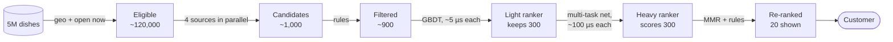

**Reading the diagram.** Data flows left to right on the synchronous path; arrows carry each stage's operation or per-item cost. The catalog is the only storage boundary drawn (others are in Figure 68.14). Only candidate generation is parallel, under one deadline that drops late sources (§56.5.4). Failure points: a source silently returning nothing; heavy-ranker overload, absorbed by scoring 150 items or serving light-ranker order. The heavy ranker dominates CPU and is scaled first.

#### Mathematical foundations

::: formula
**Funnel compute cost and fleet size**

$$C_\text{req} = \sum_{s} N_s \, c_s + \sum_{s} f_s \qquad \text{Cores} = \frac{\lambda_\text{peak} \, C_\text{req}}{\rho}$$

| Symbol | Meaning | Units |
|---|---|---|
| $C_\text{req}$ | CPU time consumed by one recommendation request | core-seconds |
| $N_s$ | Items scored by stage $s$ | items |
| $c_s$ | CPU cost per item at stage $s$ | core-seconds per item |
| $f_s$ | Fixed per-request cost of stage $s$ (index lookups, RPC overhead) | core-seconds |
| $\lambda_\text{peak}$ | Peak request rate | requests/s |
| $\rho$ | Target CPU utilization | fraction |
:::

::: example
**Worked example — From 5 million dishes to 20, at 2,500 requests per second.** Assumed costs: eligibility lookup 2 ms fixed; retrieval by brute-force dot products of a 64-dimensional user vector against 120,000 dish vectors, $1.2 \times 10^5 \times 64 \times 2 = 1.54 \times 10^7$ FLOPs, about 1.5 ms at an effective 10 GFLOP/s per core, plus 1 ms for the other sources; filtering 1 µs per item; light ranker 5 µs per item; heavy ranker 100 µs per item; re-ranking 0.5 ms fixed. Utilization target $\rho = 0.5$.

1. Retrieval: $2 + 1.5 + 1 = 4.5$ ms. Filtering: $1{,}000 \times 1\ \mu\text{s} = 1$ ms.
2. Light ranker: $900 \times 5\ \mu\text{s} = 4.5$ ms. Heavy ranker: $300 \times 100\ \mu\text{s} = 30$ ms. Re-rank: 0.5 ms.
3. $C_\text{req} = 4.5 + 1 + 4.5 + 30 + 0.5 = 40.5$ ms of CPU per request.
4. Fleet: $2{,}500 \times 0.0405 / 0.5 = 202.5$, about **203 cores**, roughly seven 32-core servers; at \$0.048 per vCPU-hour, about \$9.70 an hour at peak.
5. Without a funnel, the heavy ranker on all 120,000 eligible dishes: $1.2 \times 10^5 \times 100\ \mu\text{s} = 12$ s per request; $2{,}500 \times 12 / 0.5 = 60{,}000$ cores, about 296 times more. On the whole 5-million-dish catalog it would be 500 CPU-seconds per request.

**Interpretation.** The heavy ranker is 74% of the funnel's CPU while seeing 0.25% of the eligible items. **Engineering implication.** The two levers that matter are the heavy ranker's input size and its per-item cost; doubling its input from 300 to 600 raises the fleet by about 74%. Each earlier stage exists only to make that number small without losing the items the heavy ranker would have ranked first.
:::

The CPU budget and the latency budget are different constraints. Table 68.3 allocates QuickBite's 120 ms server-side p99, following the method of §56.5.4 (which also explains why per-stage percentiles do not add).

**Table 68.3 — Latency allocation for one QuickBite recommendation request.**

| Stage | Allocation (p99) | Runs on | Degraded mode if late |
|---|---|---|---|
| Request context, user and session features | 10 ms | Online feature store (Ch 62) | Defaults; flag in log |
| Candidate generation (parallel sources) | 20 ms | ANN service, key–value tables | Drop late source |
| Filtering and item-feature assembly | 10 ms | In-process caches | Skip optional rules |
| Light ranker | 10 ms | Ranker replica | Keep retrieval order |
| Heavy ranker (300 items, batched, 4 threads) | 35 ms | Ranker replica | Score 150; or light scores |
| Re-ranking | 5 ms | Orchestrator | Rules only, no MMR |
| Response and asynchronous logging | 5 ms | Orchestrator | Drop log, count drops |
| Slack | 25 ms | — | — |

#### How the stages must agree

A funnel is only as good as its weakest early stage. If retrieval misses the item the heavy ranker would have put first, no ranker can recover it. Two rules follow.

- **Train each stage for its role.** Retrieval is measured by **recall@K** of the items users eventually engaged with (§57.12), because its job is not to miss; rankers are measured by NDCG or log loss on what they are given, because their job is order.
- **Train later stages on what earlier stages actually produce.** A ranker trained only on shown items meets unfamiliar inputs when retrieval changes; log a sample of full candidate sets with scores (§56.5.8).

::: recommendation
**Recommendation — Distill the heavy ranker into the light one.** The light ranker's job is to keep what the heavy ranker would rank highly, so train it on the heavy ranker's scores over logged candidate sets (distillation, Chapter 67).
:::

#### Failure scenarios

**Table 68.4 — Funnel failure scenarios.**

| What goes wrong | Why | Detection | Recovery | Prevention |
|---|---|---|---|---|
| Quality falls, no errors | A retrieval source returns empty lists after an index rebuild | Per-source candidate counts and share of shown items | Roll back index | Index validation before swap; source-level alerts |
| New ranker wins offline, loses online | Trained on shown items only; real input differs | Offline evaluation on logged full candidate sets | Retrain on sampled candidate logs | Log candidates, not only impressions |
| Stage mismatch after a retrieval change | Light ranker drops what the new source finds | Recall of heavy-ranker top items through the light stage | Retrain or distill light ranker | Evaluate funnel end to end |

## 68.5 Candidate generation

### 68.5.1 Collaborative filtering

::: definition
**Definition — Collaborative filtering (CF) and candidate generation.** **Collaborative filtering** predicts a user's interest in an item from the interactions of many users with many items, without needing to know what the items are. **Candidate generation** (retrieval) is the funnel stage that uses CF and other cheap methods to select, from the whole eligible catalog, the few hundred items worth ranking.
:::

The intuition is "customers like you also ordered". **User-based** CF finds similar users; **item-based** CF finds items similar to those you liked. Both work from the **interaction matrix** $R$ (users × items). For QuickBite that matrix has $10^7 \times 5 \times 10^4 = 5 \times 10^{11}$ customer–restaurant cells, of which perhaps $2 \times 10^8$ are non-zero (20 restaurants per customer): 99.96% empty. Every CF method is a way of generalizing from that sparse 0.04%.

### 68.5.2 Matrix factorization

#### First-principles explanation

Describe every restaurant by a few hidden "taste dials" (spicy, healthy, cheap, late-night) and every customer by how much each dial matters to her; affinity is the dials multiplied pairwise and summed. Matrix factorization learns both sets of dials from interactions alone, unnamed.

::: definition
**Definition — Matrix factorization (MF).** A model that approximates the interaction matrix $R$ ($U \times I$) by the product of a user-factor matrix $X$ ($U \times k$) and an item-factor matrix $Y$ ($I \times k$), $R \approx XY^\top$, so that the predicted affinity is the dot product $\hat{r}_{ui} = \mathbf{x}_u^\top \mathbf{y}_i$ of two $k$-dimensional embeddings. Koren, Bell and Volinsky popularized it for recommendation after the Netflix Prize [Koren et al. 2009].
:::

#### Mathematical foundations

For **explicit** ratings the loss is computed only over observed entries, with user and item biases that absorb "this customer rates everything high" and "this restaurant is generally loved".

::: formula
**Biased matrix factorization for explicit ratings, and its SGD update** [Koren et al. 2009]

$$\min_{X, Y, b} \sum_{(u,i) \in \mathcal{K}} \left(r_{ui} - \mu - b_u - b_i - \mathbf{x}_u^\top \mathbf{y}_i\right)^2 + \lambda\left(\lVert \mathbf{x}_u \rVert^2 + \lVert \mathbf{y}_i \rVert^2 + b_u^2 + b_i^2\right)$$

$$e_{ui} = r_{ui} - \hat{r}_{ui}, \qquad b_u \leftarrow b_u + \gamma(e_{ui} - \lambda b_u), \qquad \mathbf{x}_u \leftarrow \mathbf{x}_u + \gamma(e_{ui}\,\mathbf{y}_i - \lambda \mathbf{x}_u)$$

| Symbol | Meaning | Units |
|---|---|---|
| $\mathcal{K}$ | Set of observed (user, item) ratings | pairs |
| $r_{ui}$, $\hat{r}_{ui}$ | Observed and predicted rating | stars (1–5) |
| $\mu$ | Global mean rating | stars |
| $b_u$, $b_i$ | User and item bias | stars |
| $\mathbf{x}_u$, $\mathbf{y}_i$ | User and item factor vectors | $k$ reals each |
| $\lambda$ | Regularization strength | dimensionless |
| $\gamma$ | SGD learning rate | dimensionless |
| $e_{ui}$ | Prediction error | stars |
:::

::: example
**Worked example — One SGD step on a QuickBite rating.** A customer rates a ramen shop 5 stars. Current values: $\mu = 3.6$, $b_u = 0.3$, $b_i = -0.2$, $\mathbf{x}_u = (0.5, 0.5)$, $\mathbf{y}_i = (0.6, 0.4)$; $\gamma = 0.01$, $\lambda = 0.05$.

1. Prediction: $\mathbf{x}_u^\top \mathbf{y}_i = 0.30 + 0.20 = 0.50$; $\hat{r} = 3.6 + 0.3 - 0.2 + 0.5 = 4.2$.
2. Error: $e = 5 - 4.2 = 0.8$.
3. Bias update: $b_u \leftarrow 0.3 + 0.01(0.8 - 0.05 \times 0.3) = 0.3 + 0.00785 = 0.30785$.
4. Factor update: $\mathbf{x}_u \leftarrow (0.5 + 0.01(0.8 \times 0.6 - 0.025),\ 0.5 + 0.01(0.8 \times 0.4 - 0.025)) = (0.50455, 0.50295)$.

**Interpretation.** The update moves the customer's vector toward the ramen shop's vector, more along the dimension where the shop is strongest. **Engineering implication.** Each step touches two rows of two tables, so SGD on MF is sparse and parallelizes well (§65.8); but QuickBite's explicit ratings are too few (tens of thousands a day) to be the main signal, so the production model uses implicit feedback.
:::

For **implicit** feedback, every cell matters: an unobserved cell is weak evidence of disinterest, not missing data. Hu, Koren and Volinsky turn counts into a binary preference with a confidence weight and fit all $U \times I$ cells, which is only affordable because of a closed-form alternating solution [Hu et al. 2008].

::: formula
**Implicit-feedback matrix factorization and its ALS update** [Hu et al. 2008]

$$\min_{X, Y} \sum_{u,i} c_{ui}\left(p_{ui} - \mathbf{x}_u^\top \mathbf{y}_i\right)^2 + \lambda\left(\sum_u \lVert \mathbf{x}_u \rVert^2 + \sum_i \lVert \mathbf{y}_i \rVert^2\right), \quad p_{ui} = [r_{ui} > 0], \quad c_{ui} = 1 + \alpha r_{ui}$$

$$\mathbf{x}_u = \left(Y^\top C^u Y + \lambda I\right)^{-1} Y^\top C^u \mathbf{p}_u \qquad \text{cost per sweep} \approx \text{nnz}\cdot k^2 + (U + I)\,k^3$$

| Symbol | Meaning | Units |
|---|---|---|
| $r_{ui}$ | Raw interaction count (orders) | count |
| $p_{ui}$ | Binary preference: 1 if any interaction | 0 or 1 |
| $c_{ui}$ | Confidence in that preference | weight |
| $\alpha$ | Confidence scaling (Hu et al. used 40 for TV watching; tune it) | per count |
| $C^u$ | Diagonal matrix of user $u$'s confidences over all items | weights |
| $\mathbf{p}_u$ | User $u$'s preference vector over all items | 0/1 vector |
| nnz | Non-zero entries of $R$ | entries |
| $k$ | Number of latent factors | dimensions |
:::

::: example
**Worked example — Confidence and the cost of one ALS sweep for QuickBite.** With $\alpha = 2$: a customer who ordered from a restaurant 3 times gets $p = 1$ with $c = 1 + 2 \times 3 = 7$; a restaurant never ordered from gets $p = 0$ with $c = 1$, so it counts, but seven times less. For the sweep cost, take $U = 10^7$ customers, $I = 5 \times 10^4$ restaurants, nnz $= 2 \times 10^8$ and $k = 64$.

1. Gram terms: Hu et al. compute $Y^\top C^u Y = Y^\top Y + Y^\top (C^u - I) Y$, where $Y^\top Y$ is shared by all users and the correction touches only user $u$'s non-zeros: $2 \times 10^8 \times 64^2 = 8.2 \times 10^{11}$ operations.
2. Solves: one $64 \times 64$ system per user and per item, about $k^3$ each: $(10^7 + 5 \times 10^4) \times 2.6 \times 10^5 = 2.6 \times 10^{12}$ operations.
3. Total about $3.4 \times 10^{12}$ operations per sweep; 10 sweeps are $3.4 \times 10^{13}$, minutes on a modest Spark cluster (§29.5).

**Interpretation.** Cost is linear in the number of non-zeros, not in the $5 \times 10^{11}$ cells, because of the shared Gram matrix. **Engineering implication.** Implicit ALS is a cheap nightly batch job for QuickBite, and every per-user solve is independent, so it parallelizes by user partition. Its weakness is that it knows only IDs: a restaurant that opened today has no column and no vector (§68.15).
:::

**Figure 68.3 — Alternating least squares: each half-step is a set of independent ridge regressions.**

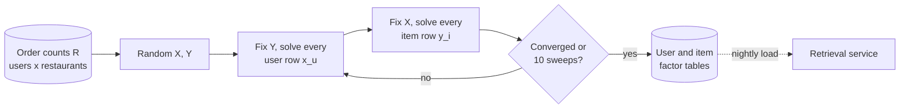

**Reading the diagram.** Input: the order-count matrix in the lake; output: two factor tables. Each half-step is embarrassingly parallel: with $Y$ fixed (and broadcast, 50,000 × 64 floats), every user is an independent least-squares problem. The loop is synchronous inside the batch job; loading into retrieval is asynchronous. Failures are silent: a bad $\alpha$ or $\lambda$ yields valid numbers that recommend only popular restaurants, so publishing is gated on an offline recall@K check. Scaling: partition users across workers.

#### Code example

The program below builds a synthetic world of 800 customers and 300 restaurants with hidden tastes and a popularity head, holds out one ordered restaurant per customer, trains implicit ALS, and compares recall@10 (the share of customers whose held-out restaurant appears in their top 10) with a popularity baseline.

```python
"""Implicit-feedback matrix factorization: weighted ALS (Hu, Koren & Volinsky 2008)
on synthetic QuickBite order counts, compared with a popularity baseline."""
import numpy as np

rng = np.random.default_rng(7)
U, I, K_TRUE = 800, 300, 6                    # customers, restaurants, hidden taste dims

# Synthetic world: hidden tastes plus a Zipf-like popularity head
taste_u = rng.normal(size=(U, K_TRUE))
taste_i = rng.normal(size=(I, K_TRUE))
popularity = -0.5 * np.log(np.arange(1, I + 1))  # restaurant 0 is the most popular
rate = np.exp(1.2 * taste_u @ taste_i.T / np.sqrt(K_TRUE) + popularity - 2.5)
R = rng.poisson(3 * rate).astype(float)          # order counts over three months

# Hold out one ordered restaurant per customer as the test item
test = {}
for u in range(U):
    ordered = np.flatnonzero(R[u])
    if len(ordered) >= 2:
        test[u] = rng.choice(ordered)
        R[u, test[u]] = 0.0

def implicit_als(R, k=8, alpha=2.0, lam=10.0, iters=10, seed=0):
    """Minimize sum_ui c_ui (p_ui - x_u . y_i)^2 + lam (|X|^2 + |Y|^2)
    with preference p_ui = [r_ui > 0] and confidence c_ui = 1 + alpha * r_ui."""
    g = np.random.default_rng(seed)
    X = 0.01 * g.normal(size=(R.shape[0], k))
    Y = 0.01 * g.normal(size=(R.shape[1], k))
    P, C, reg = (R > 0).astype(float), 1.0 + alpha * R, lam * np.eye(k)
    for _ in range(iters):
        for u in range(R.shape[0]):               # fix Y: each user is a ridge regression
            X[u] = np.linalg.solve((Y.T * C[u]) @ Y + reg, (Y.T * C[u]) @ P[u])
        for i in range(R.shape[1]):               # fix X: each item is a ridge regression
            Y[i] = np.linalg.solve((X.T * C[:, i]) @ X + reg, (X.T * C[:, i]) @ P[:, i])
    return X, Y

def recall_at_k(scores, R, test, k=10):
    hits = 0
    for u, j in test.items():
        s = np.where(R[u] > 0, -np.inf, scores[u])  # never re-recommend training items
        hits += j in np.argpartition(-s, k)[:k]
    return hits / len(test)

X, Y = implicit_als(R)
pop_scores = np.tile((R > 0).sum(axis=0), (U, 1)).astype(float)
print(f"customers evaluated: {len(test)}, train density: {(R > 0).mean():.3f}")
print(f"random      recall@10: {10 / (I - (R > 0).sum(1).mean()):.3f} (expected)")
print(f"popularity  recall@10: {recall_at_k(pop_scores, R, test):.3f}")
print(f"ALS (k=8)   recall@10: {recall_at_k(X @ Y.T, R, test):.3f}")
```

Output (about one second on a laptop CPU):

```text
customers evaluated: 800, train density: 0.045
random      recall@10: 0.035 (expected)
popularity  recall@10: 0.159
ALS (k=8)   recall@10: 0.241
```

What to notice:

- Popularity is a strong baseline (4.5 times random) because real demand is skewed; ALS beats it by 52% relative because it also captures taste. Always report the popularity baseline: a personalized model that cannot beat it is not worth serving.
- This dense version recomputes $Y^\top C^u Y$ per user; production code uses the shared-Gram trick so cost scales with non-zeros.
- Hyperparameters matter: in a sweep on this data, $\alpha = 40$ (the value from Hu et al.'s TV data) gave recall@10 of only 0.14, worse than popularity, while $\alpha = 2$ gave 0.24. Confidence scaling depends on what a count means in your domain.
- Training items are masked at scoring time; otherwise recall is inflated by "recommending" past orders.

### 68.5.3 Item-to-item collaborative filtering

Amazon's item-to-item method precomputes, for every item, a list of items that the same customers interacted with, and at request time looks up the lists for the items in the customer's recent history [Linden et al. 2003]. Its strength is operational: the expensive work is an offline job over item pairs, the online cost is a few key–value reads, the result is explainable ("because you ordered pad thai"), and it reacts instantly to what the customer did a minute ago, because the input is her latest action rather than a nightly user vector.

::: formula
**Item–item cosine similarity on binary interactions**

$$\text{sim}(i, j) = \frac{\lvert U_i \cap U_j \rvert}{\sqrt{\lvert U_i \rvert \, \lvert U_j \rvert}}$$

| Symbol | Meaning | Units |
|---|---|---|
| $U_i$ | Set of customers who ordered item $i$ in the window | customers |
| $\lvert U_i \cap U_j \rvert$ | Customers who ordered both (co-occurrence count) | customers |
| $\text{sim}(i, j)$ | Similarity, from 0 (never together) to 1 (always together) | dimensionless |
:::

::: example
**Worked example — Why raw co-counts are not enough.** In one month, 400 customers ordered *green curry* (A); 100 ordered *mango sticky rice* (B), 50 of them also ordering A; 10,000 ordered a *cola* (C), 600 of them also ordering A.

1. Raw co-counts rank cola first: 600 versus 50, a factor of 12.
2. Cosine: $\text{sim}(A, B) = 50 / \sqrt{400 \times 100} = 50/200 = 0.25$; $\text{sim}(A, C) = 600 / \sqrt{400 \times 10{,}000} = 600/2{,}000 = 0.30$.
3. The gap shrinks from 12× to 1.2×. Half of B's buyers bought A; only 6% of cola buyers did.

**Interpretation.** Normalization removes most of the "everyone buys cola" effect, but not all of it. **Engineering implication.** Production item-to-item tables add a popularity penalty or use lift, require a minimum co-occurrence count (also a privacy safeguard, §56.5.16) and restrict pairs to the same restaurant for in-cart suggestions.
:::

A customer with $n$ items contributes $n(n-1)/2$ pairs, so the job caps each history (say, the last 50 items), drops rare pairs, and a streaming job refreshes counts between nightly rebuilds.

### 68.5.4 Popularity, trending and freshness sources

Simple sources are among the most valuable. **Popular in your zone** (7-day orders) anchors cold start (§68.15); **trending** is popularity with a half-life of hours; **your favorites** matters because repeat ordering is a large share of food demand; **new and nearby** gives fresh restaurants, which no collaborative source can surface, a path into the funnel. All are streaming per-zone counters with decay (§68.13), served as small in-memory lists.

### 68.5.5 Multiple sources and merging

**Figure 68.4 — Candidate sources for QuickBite's dish module and how they merge.**


**Reading the diagram.** The orchestrator fans out synchronously to five sources keyed by different parts of the request (embedding, recent orders, zone, ID); each returns a ranked list up to its **quota**. The merge interleaves by rank, not score (scores are not comparable), deduplicates and logs provenance (code in §56.5.8). Storage lives inside each source: ANN index, key–value tables, per-zone lists. Failure points: a timed-out source is dropped; a silently degraded one shows only in its share of ordered items. Sources scale independently; quotas cap ranker load.

Quotas are product decisions in disguise. Measure each source by its **marginal recall**, the share of ordered items only it retrieved; near-zero means it can be removed.

::: industry
**Item-to-item at Amazon.** Linden, Smith and York describe an offline similar-items table built from purchases, whose online cost depends only on the number of items in the customer's history, not on customers or catalog size.
*Evidence: Primary* — [Linden et al. 2003]
:::

## 68.6 Two-tower models

### 68.6.1 Architecture and training objective

::: definition
**Definition — Two-tower (dual-encoder) model.** A retrieval model with two neural networks: a **user (query) tower** that maps user and context features to a vector $\mathbf{u}$, and an **item tower** that maps item features to a vector $\mathbf{v}$ in the same space. Relevance is their similarity, $s(u, i) = \mathbf{u}^\top \mathbf{v}_i$, usually after normalizing both to unit length. The towers interact only through this final dot product.
:::

#### First-principles explanation

Two translators turn different languages (people, dishes) into one shared language in which "this customer, tonight" lands near the dishes she is likely to order. Unlike MF, the vectors come from *features* (recent orders, hour, zone; cuisine, price, photo), and because the towers meet only at the end, every dish is translated once in advance.

#### Why does this exist?

Features give new dishes sensible vectors on day one (§68.15); context lets 8 a.m. differ from 11 p.m.; and precomputed item vectors plus an ANN index make retrieval over millions of items sublinear.

#### How it works internally

1. **Item tower, offline.** Every eligible dish is encoded once per model version and stored, with its ID, in an ANN index.
2. **User tower, online.** Per request, the user tower encodes the user, session and context features into $\mathbf{u}$ (a small MLP: well under a millisecond).
3. **Retrieval.** The ANN index returns the dishes with the highest $\mathbf{u}^\top \mathbf{v}$ among those passing a geographic filter.
4. **Training** treats retrieval as classification over the whole corpus: given a user, which item did she engage with? The ideal loss is a softmax over all $I$ items, too expensive when $I$ is millions, so it is approximated with sampled negatives.

**Figure 68.5 — A two-tower retrieval model for QuickBite dishes.**

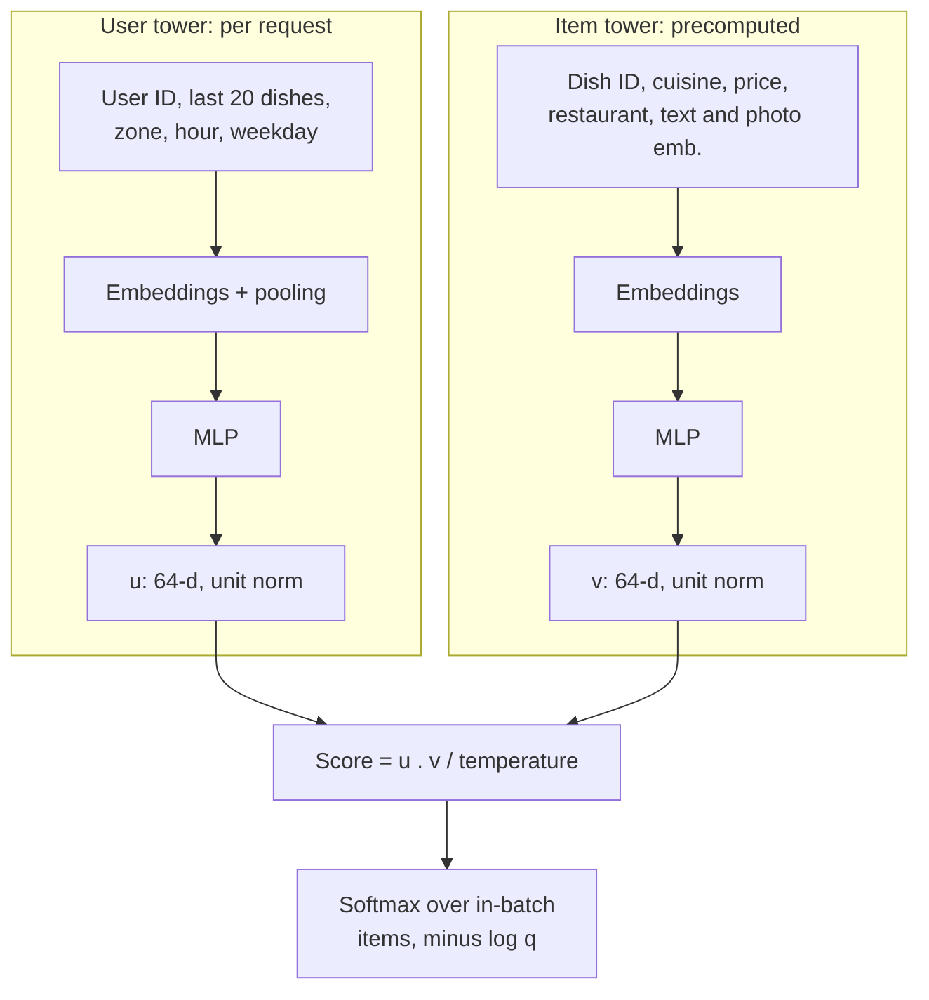

**Reading the diagram.** The towers share no weights (except, optionally, ID tables used on both sides). Their only interaction is the dot product divided by a **temperature**. In training both run per batch; in serving the item tower runs offline and the user tower online, split by the ANN index (Figure 68.6). The design's blind spot: user–item comparisons ("cheaper than her usual") cannot be expressed by separately computed vectors, which is the ranker's job (§68.7). Item-tower cost scales with catalog changes, user-tower cost with requests.

#### Mathematical foundations: in-batch negatives and sampling bias

The cheapest negatives are already in memory: in a batch of $B$ (user, positive item) pairs, each user's positive serves as a negative for the other $B - 1$ users. But items enter a batch in proportion to their popularity, so popular items are over-represented as negatives and the model learns to push them down too hard. Yi et al. correct this by subtracting the log of each item's sampling probability from its logit, the **logQ correction** [Yi et al. 2019].

::: formula
**In-batch softmax with logQ correction** [Yi et al. 2019]

$$s^c(u, j) = \frac{\mathbf{u}^\top \mathbf{v}_j}{\tau} - \log q_j \qquad \mathcal{L} = -\frac{1}{B}\sum_{b=1}^{B} \log \frac{\exp\!\left(s^c(u_b, i_b)\right)}{\sum_{j=1}^{B} \exp\!\left(s^c(u_b, i_j)\right)}$$

| Symbol | Meaning | Units |
|---|---|---|
| $\mathbf{u}$, $\mathbf{v}_j$ | Unit-norm user and item embeddings | $d$ reals |
| $\tau$ | Temperature (for example 0.05–0.1) | dimensionless |
| $q_j$ | Probability that item $j$ appears in a batch slot (its share of training positives) | probability |
| $s^c$ | Corrected logit | dimensionless |
| $B$ | Batch size; $(u_b, i_b)$ is the $b$-th positive pair | pairs |
| $\mathcal{L}$ | Mean cross-entropy loss over the batch | nats |
:::

::: example
**Worked example — How much a popular negative is pushed down.** A customer's positive is a rare dish A ($q_A = 0.001$). The batch also holds B, a very popular dish ($q_B = 0.02$), and C and D ($q_C = 0.002$, $q_D = 0.0005$). Scores $\mathbf{u}^\top\mathbf{v}/\tau$: A 2.0, B 1.5, C 0.5, D 0.0.

1. Uncorrected softmax: $e^{2.0}, e^{1.5}, e^{0.5}, e^{0} = 7.389, 4.482, 1.649, 1.000$; sum 14.519. Probabilities 0.509, 0.309, 0.114, 0.069. Loss $-\ln 0.509 = 0.675$.
2. Corrected logits ($-\log q$ = 6.908, 3.912, 6.215, 7.601): A 8.908, B 5.412, C 6.715, D 7.601. Probabilities 0.708, 0.022, 0.079, 0.192. Loss 0.345.
3. The gradient of the loss with respect to a negative's logit equals its probability: B is pushed down with weight 0.309 uncorrected but only 0.022 corrected, 14 times less.

**Interpretation.** Without correction the model is punished for scoring B highly simply because B shows up in many batches; it learns something closer to "how surprising is this pair" than "how likely is this order". **Engineering implication.** Estimate $q_j$ from the training stream; Yi et al. do it in streaming fashion by tracking the average gap between an item's appearances in a hashed array, so new items get estimates without a separate counting job.
:::

**Mixed negatives** add uniformly sampled items so rare items appear as negatives at all; **hard negatives** (high-scoring but not engaged) sharpen the model but hurt recall in excess.

#### Code example

The program trains a tiny two-tower model on synthetic data (2,000 users, 1,000 dishes in 20 cuisines, Zipf-like popularity), once with plain in-batch softmax and once with the logQ correction, and reports recall@K on one held-out interaction per user.

```python
"""Tiny two-tower retrieval model trained with in-batch negatives,
with and without logQ sampling-bias correction (Yi et al. 2019). CPU, ~10 s."""
import numpy as np
import torch
import torch.nn as nn
import torch.nn.functional as F

torch.set_num_threads(1)                     # tiny tensors: one thread is fastest and repeatable
U, I, CUISINES, D = 2000, 1000, 20, 32
rng = np.random.default_rng(0)

# Synthetic world: each dish has a cuisine, users like a few cuisines, popularity is Zipf-like
cuisine = rng.integers(0, CUISINES, size=I)
user_pref = rng.dirichlet(np.full(CUISINES, 0.3), size=U)
log_pop = -0.7 * np.log(np.arange(1, I + 1))
rng.shuffle(log_pop)
true_logit = np.log(user_pref[:, cuisine] + 1e-9) + log_pop       # log p(dish | user) + const
probs = np.exp(true_logit - true_logit.max(1, keepdims=True))
probs /= probs.sum(1, keepdims=True)

pairs = np.array([(u, i) for u in range(U) for i in rng.choice(I, size=30, p=probs[u])])
test_pairs = np.array([(u, rng.choice(I, p=probs[u])) for u in range(U)])
q = np.bincount(pairs[:, 1], minlength=I) / len(pairs)            # P(dish appears in a batch slot)
log_q = torch.tensor(np.log(q + 1e-6), dtype=torch.float32)

class Tower(nn.Module):
    def __init__(self, n_ids, n_cat=None):
        super().__init__()
        self.id_emb = nn.Embedding(n_ids, D)
        self.cat_emb = nn.Embedding(n_cat, D) if n_cat else None
        self.mlp = nn.Sequential(nn.Linear(D, 64), nn.ReLU(), nn.Linear(64, D))
    def forward(self, ids, cats=None):
        x = self.id_emb(ids)
        if self.cat_emb is not None:
            x = x + self.cat_emb(cats)                             # content feature: cuisine
        return F.normalize(self.mlp(x), dim=-1)                    # unit vectors: dot = cosine

def train(correct_logq, epochs=5, batch=512, temp=0.1):
    torch.manual_seed(0)
    users, items = Tower(U), Tower(I, CUISINES)
    opt = torch.optim.Adam([*users.parameters(), *items.parameters()], lr=3e-3)
    cuis, data = torch.tensor(cuisine), torch.tensor(pairs)
    for _ in range(epochs):
        for b in torch.randperm(len(data)).split(batch):
            u, i = data[b, 0], data[b, 1]
            s = users(u) @ items(i, cuis[i]).T / temp              # [B, B]: row user, column dish
            if correct_logq:
                s = s - log_q[i][None, :]                          # logQ correction per column
            dup = (i[None, :] == i[:, None]) & ~torch.eye(len(i), dtype=torch.bool)
            s = s.masked_fill(dup, -1e9)                           # same dish twice is not a negative
            loss = F.cross_entropy(s, torch.arange(len(i)))       # positive is on the diagonal
            opt.zero_grad(); loss.backward(); opt.step()
    with torch.no_grad():
        return users(torch.arange(U)).numpy(), items(torch.arange(I), cuis).numpy()

def recall_at(scores, k):
    top = np.argpartition(-scores, k, axis=1)[:, :k]
    return np.mean([t in top[u] for u, t in test_pairs])

def report(name, scores):
    print(f"{name:<24} recall@10 {recall_at(scores, 10):.3f}  recall@50 {recall_at(scores, 50):.3f}")

report("popularity", np.tile(q, (U, 1)))
for flag in (False, True):
    uv, iv = train(flag)
    report(f"two-tower, logQ={flag}", uv @ iv.T)
report("oracle (true p)", probs)
```

Output:

```text
popularity               recall@10 0.146  recall@50 0.312
two-tower, logQ=False    recall@10 0.068  recall@50 0.232
two-tower, logQ=True     recall@10 0.193  recall@50 0.391
oracle (true p)          recall@10 0.248  recall@50 0.512
```

What to notice:

- Without correction the model is *worse than popularity*: it has learned to demote exactly the popular dishes that the held-out orders, drawn from the true distribution, often are. With correction it recovers 78% of the oracle's recall@10 (0.193 of 0.248).
- The oracle is the ceiling (noisy choices cap recall@10 at 0.25); report recall against it or popularity, never alone.
- Positives sit on the diagonal of the $B \times B$ matrix; masking duplicates stops a dish appearing twice from being its own negative.

### 68.6.2 Serving: precomputed item embeddings and ANN retrieval

**Figure 68.6 — Two-tower serving: offline item encoding, online user encoding, ANN search.**

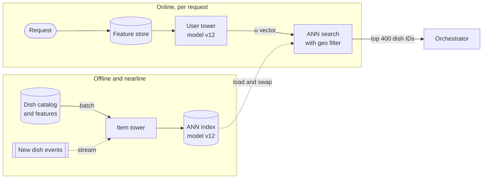

**Reading the diagram.** Offline, the item tower encodes the catalog into an ANN index; new dishes stream in within minutes; the index loads asynchronously and swaps atomically. Online, the user tower produces $\mathbf{u}$ and the search returns the top 400 dishes passing the geographic filter. Storage boundaries: feature store and index. The critical failure is a **version mismatch**: v13 user vectors against a v12 index are meaningless, so both carry the version and mismatches are refused. The ANN service replicates for throughput and shards by item for size.

**ANN preview (Chapter 74).** Exact search over QuickBite's 120,000 eligible dishes costs about 1.5 ms (§68.4), a defensible choice. At tens of millions of items, ANN indexes trade a little recall for far less work: HNSW walks a layered proximity graph; IVF-PQ searches a few clusters of compressed vectors [Malkov and Yashunin 2020; Jégou et al. 2011]. Measure recall against exact search, and pre-filter by geography, because post-filtering can leave too few eligible items.

::: industry
**YouTube's candidate generation.** Covington, Adams and Sargin frame candidate generation as extreme multiclass classification over millions of videos with sampled softmax, a user network over watch and search history, and nearest-neighbor serving. Yi et al. later described a two-tower model with streaming frequency estimation and logQ correction for YouTube.
*Evidence: Primary* — [Covington et al. 2016; Yi et al. 2019]
:::

::: mistake
**"Retrain the user tower more often; the item index can wait."** The towers form one space only within a training run. Retraining one tower without re-encoding the other drifts the two spaces apart, and recall collapses without any error. Version the two towers, the ID vocabulary and the index as one artifact (§58.6, Chapter 69).
:::

## 68.7 Ranking models

### 68.7.1 Pointwise, pairwise and listwise learning to rank

::: definition
**Definition — Learning to rank (LTR).** Training a model whose scores order a set of candidates well. **Pointwise** methods predict a label for each item independently (probability of order, via log loss). **Pairwise** methods learn from pairs within one request, penalizing the model when a less relevant item outscores a more relevant one (RankNet's logistic loss on score differences [Burges et al. 2005]). **Listwise** methods optimize a loss defined on the whole ranked list, typically a smooth surrogate for NDCG (LambdaRank and LambdaMART weight each pair's gradient by the NDCG change of swapping it [Burges 2010]).
:::

**Table 68.5 — Pointwise, pairwise and listwise ranking.**

| | Pointwise | Pairwise | Listwise |
|---|---|---|---|
| Learns | $P(\text{order} \mid u, i)$ | $P(i \succ j \mid u)$ | Order of the whole list |
| Output meaning | Calibratable probability | Relative score only | Relative score only |
| Strength | Scores combine across tasks and surfaces; feeds auctions | Matches "which is better" feedback | Directly targets top-heavy metrics |
| Weakness | Ignores that only order matters | Scores not comparable across requests | Needs grouped data; harder to calibrate |
| Typical use | Deep multi-task rankers in feeds and ads | Search, pairwise human labels | GBDT rankers (LambdaMART) in search |

Feed and ads rankers are mostly pointwise because they need **probabilities**: the scores are multiplied by values, combined across tasks, compared with thresholds and fed to auctions, all of which require calibrated numbers (§68.7.5). Search rankers, where only order within one query matters, use pairwise and listwise losses more often (Chapter 16, §81.7).

### 68.7.2 Gradient-boosted tree rankers

A gradient-boosted decision tree (GBDT) with a LambdaMART objective (LightGBM, XGBoost [Ke et al. 2017; Chen and Guestrin 2016]) is the strongest first ranker for most teams: it uses hand-built features (distance, ETA, price versus the user's usual spend, 7-day conversion) without normalization, trains in minutes and scores in microseconds. It cannot learn from raw IDs or sequences, so it often becomes the light ranker while a deep network with embeddings is the heavy one.

### 68.7.3 Deep ranking: Wide & Deep and DLRM

Deep rankers exist to learn from sparse, high-cardinality features (user, restaurant, dish, zone, the IDs in a history sequence) through embeddings (§58.6), and to learn interactions between features automatically.

- **Wide & Deep** joins a linear model over hand-crossed sparse features (the *wide* part, which memorizes specific co-occurrences such as "installed app A and was shown app B") with an MLP over embeddings (the *deep* part, which generalizes to unseen combinations), trained jointly with one logistic output. It was deployed for app recommendation in Google Play [Cheng et al. 2016].
- **DLRM** (Deep Learning Recommendation Model) passes dense features through a bottom MLP, looks up one embedding per sparse feature, computes the **dot product of every pair** of these vectors as explicit second-order interactions, concatenates the results and feeds a top MLP that outputs a probability [Naumov et al. 2019].

**Figure 68.7 — DLRM-style ranking model.**


**Reading the diagram.** Data flows top to bottom for one candidate. Dense features pass a bottom MLP; each sparse feature selects a row of its table (cylinders: at scale, distributed stores, §68.8). The interaction layer computes $n(n-1)/2$ pairwise dot products (351 for 27 vectors), and the top MLP outputs a probability, all synchronously. Failure points are the tables: unseen IDs need a default row, and a training–serving ID-mapping mismatch silently corrupts scores. MLPs are compute-bound, tables memory-bound, so they are parallelized differently (Figure 68.9).

DCN and DCN-V2 replace the fixed pairwise dot product with learned cross layers that model higher-order interactions; §68.9 covers them.

### 68.7.4 Multi-task ranking

A QuickBite customer can open a restaurant, order, and later rate the meal. Training one model per label triples the serving cost and ignores that the tasks share structure. A **multi-task** ranker shares lower layers and has one output head per task. When tasks conflict (clicks reward eye-catching photos, ratings reward food quality), a shared bottom forces a compromise; **Multi-gate Mixture-of-Experts (MMoE)** gives each task its own learned gate over a set of shared expert networks so tasks can use different mixtures [Ma et al. 2018]. Zhao et al. describe a multitask ranker for YouTube's "what to watch next" built on MMoE, with a separate shallow tower that models position-induced bias (§68.12) [Zhao et al. 2019].

**Figure 68.8 — Multi-task ranker with MMoE and score fusion.**

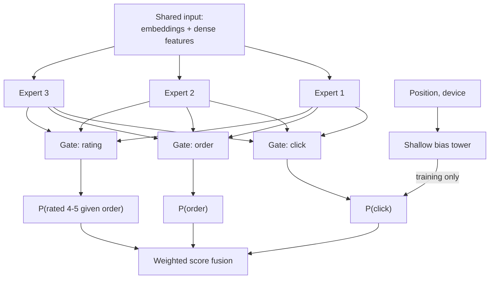

**Reading the diagram.** Experts are small MLPs over the same input; each task's softmax gate mixes them differently. The shallow tower adds a position bias to the click logit in training only and is dropped at serving, so the main model learns position-free relevance. Fusion combines the heads; everything is one synchronous forward pass. Failure points: the label-rich click task can dominate shared experts (watch per-task metrics), and an uncalibrated head skews fusion. Experts add compute linearly.

::: formula
**Score fusion of multi-task predictions**

$$\text{score}(u, i) = \sum_{k} w_k \, \hat{p}_k(u, i)$$

| Symbol | Meaning | Units |
|---|---|---|
| $\hat{p}_k$ | Calibrated probability from head $k$ (click, order, order and good rating) | probability |
| $w_k$ | Weight of task $k$, chosen by online experiment | value units per event |
| score | Expected value of showing item $i$ to user $u$ | value units |
:::

::: example
**Worked example — Weights are a product decision.** Restaurant A: $P(\text{click}) = 0.30$, $P(\text{order}) = 0.020$, $P(\text{good rating} \mid \text{order}) = 0.70$. Restaurant B: 0.18, 0.025, 0.92. The third task's probability is $P(\text{order}) \times P(\text{good} \mid \text{order})$: A $0.014$, B $0.023$.

1. Weights $(0.1, 1.0, 0.5)$: A $= 0.030 + 0.020 + 0.007 = 0.057$; B $= 0.018 + 0.025 + 0.0115 = 0.0545$. A ranks first.
2. Weights $(0.05, 1.0, 0.5)$: A $= 0.015 + 0.020 + 0.007 = 0.042$; B $= 0.009 + 0.025 + 0.0115 = 0.0455$. B ranks first.

**Interpretation.** Halving the click weight flips the order toward the restaurant that converts and satisfies, at the cost of fewer opens. **Engineering implication.** Fusion weights are tuned by A/B tests against the business metric and guardrails, versioned with the model, and only meaningful if every head is calibrated; a head that overpredicts by 2× silently doubles its weight.
:::

### 68.7.5 Calibration

A model is **calibrated** when, among items it scores 0.03, about 3% convert (§57.10.3). Ranking by a single model's score does not need calibration, since any monotone transform keeps the order; fusion, thresholds, auctions and comparisons across surfaces do. The most common source of miscalibration in recommenders is deliberate: training data is **negative-downsampled** because impressions without an order outnumber orders 100 to 1, and keeping 10% of negatives cuts training cost almost tenfold. The model then overpredicts and must be corrected [He et al. 2014].

::: formula
**Recalibration after negative downsampling** [He et al. 2014]

$$p = \frac{p'}{p' + (1 - p')/w}$$

| Symbol | Meaning | Units |
|---|---|---|
| $p'$ | Model output trained on downsampled data | probability |
| $w$ | Fraction of negatives kept | fraction |
| $p$ | Corrected probability on the true distribution | probability |
:::

::: example
**Worked example — Correcting a 10% negative sample.** The model, trained keeping $w = 0.1$ of negatives, predicts $p' = 0.20$ for a restaurant.

1. $(1 - p')/w = 0.80/0.1 = 8.0$.
2. $p = 0.20/(0.20 + 8.0) = 0.0244$.
3. Check with odds: $0.20/0.80 = 0.25$; true odds $= 0.25 \times 0.1 = 0.025$; $p = 0.025/1.025 = 0.0244$.

**Interpretation.** The uncorrected model would claim an 8-fold higher order rate. **Engineering implication.** Apply the correction in the serving graph, not in downstream code, so every consumer sees calibrated output; then monitor the **calibration ratio** (sum of predictions divided by sum of outcomes, per surface and segment) and refit a Platt or isotonic layer [Platt 1999] when it drifts from 1.
:::

## 68.8 Embedding tables at scale

In a large recommender almost all parameters are embedding rows, and almost all FLOPs are in the MLPs (§58.6). The two halves therefore have opposite bottlenecks: tables are bound by memory capacity and bandwidth, MLPs by compute. Every design decision in this section follows from that split.

::: formula
**Embedding memory, hashing collisions and all-to-all traffic**

$$M = \sum_{t} V_t \, d_t \, s \,(1 + k) \qquad P_\text{collide} \approx 1 - e^{-n/m} \qquad A = b \, T \, d \, s_c$$

| Symbol | Meaning | Units |
|---|---|---|
| $M$ | Memory for all tables, weights plus optimizer state | bytes |
| $V_t$, $d_t$ | Rows and dimension of table $t$ | rows, values |
| $s$, $s_c$ | Bytes per stored value; bytes per communicated value | bytes |
| $k$ | Optimizer state copies per value (Adam 2, SGD 0; row-wise Adagrad about 0) | copies |
| $n$, $m$ | Distinct active IDs and hash buckets | IDs, rows |
| $P_\text{collide}$ | Probability an active ID shares its row with another | probability |
| $A$ | Pooled-embedding bytes each GPU receives per step in the all-to-all | bytes |
| $b$, $T$, $d$ | Examples per GPU, sparse features (tables), embedding dimension | examples, tables, values |
:::

::: example
**Worked example — 100 million IDs at 128 dimensions.** $V = 10^8$, $d = 128$, FP32 ($s = 4$).

1. Weights: $10^8 \times 128 \times 4 = 5.12 \times 10^{10}$ bytes $= 51.2$ GB. FP16: 25.6 GB; INT8 with per-row scale: about 12.8 GB.
2. Training with dense Adam: $51.2 \times 3 = 153.6$ GB, two 80 GB GPUs for one table. Row-wise Adagrad adds one value per row: $10^8 \times 4 = 0.4$ GB.
3. Hashing QuickBite's 4 million weekly active customers into $m = 10^7$ rows instead of one row per registered customer: $P_\text{collide} \approx 1 - e^{-0.4} = 33\%$. Into $m = 4 \times 10^7$: $1 - e^{-0.1} = 9.5\%$.
4. All-to-all for a sharded model with $b = 4{,}096$, $T = 40$, $d = 128$, FP16 ($s_c = 2$): $4{,}096 \times 40 \times 128 \times 2 = 41.9$ MB received per GPU per step, and the same again for gradients in backward; at 50 GB/s per GPU (Chapter 65 assumptions) about 0.84 ms each way.

**Interpretation.** A single 100M-row table already exceeds one accelerator for training, and an industrial model has dozens of tables. Hashing trades memory for collisions, and the collision rate is set by *active* IDs, not registered ones. **Engineering implication.** QuickBite's tables (customers 2.56 GB, dishes 1.28 GB at $d = 64$, §58.6) fit on one GPU, so plain data parallelism suffices (§65.8); the sharding below is for catalogs and user bases one to two orders of magnitude larger.
:::

**Compression.** Beyond precision and hashing: frequency-aware sizing (full rows for popular IDs, hashed buckets for the tail), mixed dimensions per field, and compositional embeddings that combine rows from two small tables indexed by quotient and remainder [Shi et al. 2020].

**Table 68.6 — Sharding strategies for embedding tables.**

| Strategy | What is split | Advantage | Disadvantage | Choose when |
|---|---|---|---|---|
| Replicated (data-parallel) | Nothing | No embedding communication | Memory × GPUs | Small tables (cuisine, zone) |
| Table-wise | Whole tables to GPUs | Simple; one lookup per table | Load imbalance across tables | Many medium tables |
| Row-wise | Rows of one table across GPUs | Balances huge tables | Every batch touches many shards | A table larger than one GPU |
| Column-wise | Embedding dimensions | Balances very wide tables | Must concatenate results | Large $d$, hot tables |

**Figure 68.9 — DLRM hybrid parallelism: model-parallel embeddings, data-parallel MLPs.**

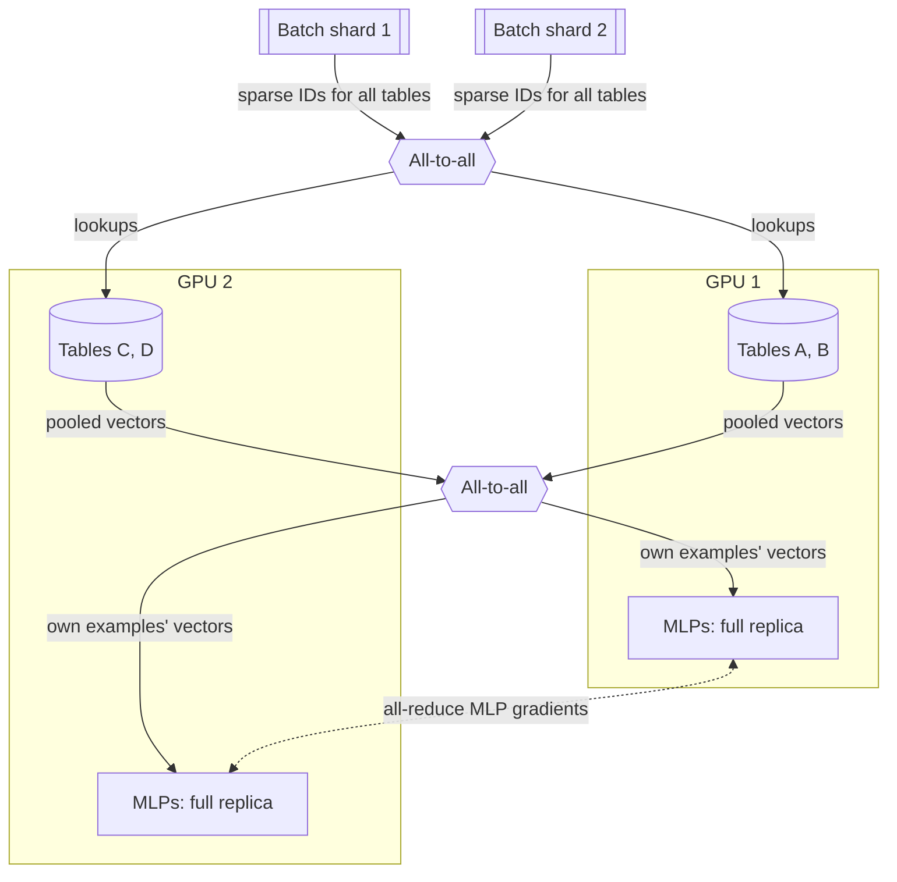

**Reading the diagram.** Each GPU owns some tables (model parallel) and a full MLP copy (data parallel). An all-to-all routes each sparse ID to its table's GPU; a second returns pooled vectors to the GPU holding the example; MLPs run locally and all-reduce gradients (dotted, overlapped with backward, §65.6), while embedding gradients return by the reverse all-to-all. Storage: table shards in GPU or host memory. Failure points: a hot table overloads its GPU (row-wise shard or replicate hot rows); the all-to-all is on the critical path. Tables scale with GPU memory, MLP throughput with GPU count.

::: industry
**DLRM and its training systems.** Naumov et al. published DLRM with exactly this hybrid: model parallelism for embedding tables, data parallelism for MLPs, connected by all-to-all ("butterfly shuffle") communication. Mudigere et al. later described Meta's hardware–software co-design for training such models, including sharding of tables up to terabytes across GPUs and the role of the all-to-all.
*Evidence: Primary* — [Naumov et al. 2019; Mudigere et al. 2022]
:::

At serving, rankers keep small and hot tables in memory and fetch large user rows once per request from a sharded embedding service (§56.5.8), with tables versioned with the model.

## 68.9 Feature crossing and context features

### 68.9.1 Why crosses matter

Many signals matter only in combination. "Late-night" and "pizza" are each weakly predictive; "late-night *and* pizza" is strongly predictive. A linear model cannot represent an AND, so the classic remedy is a **cross feature**, the Cartesian product of two fields, hashed into buckets (§62.3). Crosses are powerful but explode combinatorially: 30 categorical fields give $30 \times 29/2 = 435$ pairs, before triples. Three generations of models learn them instead of enumerating them:

1. **Factorization machines** give every feature value an embedding and model each pairwise interaction as a dot product, so a pair never seen together still gets a weight [Rendle 2010]. DLRM's interaction layer is the same idea.
2. **Deep & Cross Network (DCN)** stacks explicit cross layers next to a deep MLP so that each layer raises the polynomial degree of interactions by one [Wang et al. 2017].
3. **DCN-V2** replaces DCN's rank-one cross with a full (or low-rank) weight matrix, which is more expressive and was reported to work in large-scale production learning-to-rank systems [Wang et al. 2021].

::: formula
**DCN-V2 cross layer** [Wang et al. 2021]

$$\mathbf{x}_{l+1} = \mathbf{x}_0 \odot \left(W_l \mathbf{x}_l + \mathbf{b}_l\right) + \mathbf{x}_l \qquad P_\text{layer} = d^2 + d \;\;\text{or}\;\; 2dr + d \text{ (low-rank } W_l = U_l V_l^\top)$$

| Symbol | Meaning | Units |
|---|---|---|
| $\mathbf{x}_0$ | Input: concatenated embeddings and dense features | $d$ reals |
| $\mathbf{x}_l$ | Output of cross layer $l$ | $d$ reals |
| $W_l$, $\mathbf{b}_l$ | Learned weight matrix and bias | $d \times d$, $d$ |
| $\odot$ | Element-wise product | — |
| $r$ | Rank of the low-rank factorization | dimensions |
| $P_\text{layer}$ | Parameters per cross layer | parameters |
:::

::: example
**Worked example — A cross layer creates products, cheaply.** Toy input $\mathbf{x}_0 = (a, b) = (2, 3)$ with $W_0 = \begin{pmatrix}0 & 1\\ 0 & 0\end{pmatrix}$, $\mathbf{b}_0 = \mathbf{0}$.

1. $W_0 \mathbf{x}_0 = (b, 0) = (3, 0)$.
2. $\mathbf{x}_0 \odot (3, 0) = (a \cdot b, 0) = (6, 0)$; adding the residual gives $\mathbf{x}_1 = (a + ab, b) = (8, 3)$. The product $ab$ appeared without anyone defining it; a second layer can produce degree-3 terms.
3. Production size: 16 fields × 64 dimensions gives $d = 1{,}024$. Full rank: $1{,}024^2 + 1{,}024 = 1{,}049{,}600$ parameters per layer, about 4.2 MB in FP32. Low rank $r = 128$: $2 \times 1{,}024 \times 128 + 1{,}024 = 263{,}168$, a quarter.

**Interpretation.** Each layer learns which pairs matter instead of enumerating 120 field pairs by hand. **Engineering implication.** Three low-rank cross layers add under a million parameters and a few hundred thousand multiply–adds per candidate, affordable in the heavy ranker; keep hand-built crosses only where they carry domain knowledge (`zone × hour`).
:::

### 68.9.2 Context features

Context answers "what does this customer want *now*". For food delivery it is unusually strong: the same customer orders coffee at 8 a.m., a salad at 1 p.m. and noodles at 11 p.m.

**Table 68.7 — Context features for QuickBite ranking.**

| Feature | Example | Source and freshness |
|---|---|---|
| Time | Hour, weekday, holiday, minutes to usual dinner time | Request |
| Location | Delivery zone, home versus office address | Request; zone table (Ch 62) |
| Weather | Rain in zone | Hourly per zone (§61.4) |
| Session | Cuisines viewed in the last 10 minutes, searches | Streaming, seconds (§68.13) |
| Supply state | Restaurant ETA now, kitchen backlog, courier availability | Nearline, under a minute (§60.7) |
| Device and entry point | iOS, push notification, banner | Request |

**ETA** (Chapter 60) is both feature and constraint. **Example age**, fed in training and set to zero at serving, lets a model learn the preference for fresh content instead of averaging over the training window [Covington et al. 2016].

## 68.10 Re-ranking and business logic

::: definition
**Definition — Re-ranking.** The final funnel stage, which turns independently scored items into a page by optimizing properties of the *list*: diversity, freshness, deduplication, fairness of exposure to providers, and hard business and policy rules.
:::

A ranker scores each item alone, so its top 20 for a pizza lover may be 20 pizzerias: each is individually the best bet, but the page is a poor one, because if she does not want pizza tonight every slot is wasted. Re-ranking fixes this with list-level objectives, typically on the 300 heavy-ranked items in a few milliseconds:

- **Diversity:** spread cuisines, price levels and restaurants so the page covers several plausible intents.
- **Deduplication:** one restaurant per feed, or at most two dishes from one restaurant in a dish row.
- **Freshness and exploration slots:** reserve positions for new restaurants or bandit arms (§68.11).
- **Provider fairness:** cap any restaurant's share of impressions in a zone and hour, and give small restaurants a floor of exposure; in a two-sided marketplace exposure is income.
- **Capacity:** demote restaurants whose kitchen backlog or ETA is high right now, so recommendations do not overload the supply they depend on.

::: formula
**Maximal marginal relevance (MMR)** [Carbonell and Goldstein 1998]

$$i^* = \arg\max_{i \in C \setminus S} \Big[\lambda \, \text{rel}(i) - (1 - \lambda) \max_{j \in S} \text{sim}(i, j)\Big]$$

| Symbol | Meaning | Units |
|---|---|---|
| $C$, $S$ | Candidate set; items already selected (initially empty) | sets |
| $\text{rel}(i)$ | Ranker score normalized to [0, 1] | dimensionless |
| $\text{sim}(i, j)$ | Similarity, for example embedding cosine | [0, 1] |
| $\lambda$ | Relevance–diversity trade-off; 1 = pure relevance | dimensionless |
:::

::: example
**Worked example — Picking three restaurants with $\lambda = 0.7$.** Relevance: Pizza Napoli 0.95, Pizza Roma 0.92, Sushi Kai 0.85, Burger Bros 0.80. Similarities: Napoli–Roma 0.90; Napoli–Sushi 0.10; Roma–Sushi 0.15; Napoli–Burger 0.30; Roma–Burger 0.30; Sushi–Burger 0.05.

1. First pick, $S$ empty: highest $0.7 \times \text{rel}$, Napoli (0.665).
2. Second pick: Roma $0.644 - 0.3 \times 0.90 = 0.374$; Sushi $0.595 - 0.3 \times 0.10 = 0.565$; Burger $0.560 - 0.3 \times 0.30 = 0.470$. Choose Sushi.
3. Third pick: Roma $0.644 - 0.3 \times \max(0.90, 0.15) = 0.374$; Burger $0.560 - 0.3 \times \max(0.30, 0.05) = 0.470$. Choose Burger.

**Interpretation.** Pure relevance gives Napoli, Roma, Sushi (total relevance 2.72); MMR gives Napoli, Sushi, Burger (2.60), 4.4% less predicted relevance but three cuisines instead of two. **Engineering implication.** MMR costs $O(K \cdot |C|)$ similarity evaluations, 6,000 for 20 picks from 300, well under a millisecond. Tune $\lambda$ by A/B test on orders per session, not on offline relevance, which diversity always lowers.
:::

**Figure 68.10 — Re-ranking pipeline: hard rules, then soft objectives.**

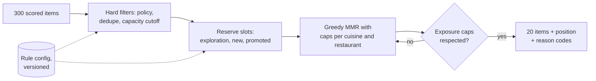

**Reading the diagram.** The stage runs synchronously in the orchestrator: hard filters, then reserved slots, then greedy MMR under caps (a violated cap retries with the next item). Output carries positions and logged **reason codes**. Rules come asynchronously from a versioned config store. Failure points: conflicting rules leaving fewer than 20 items (fall back to relevance order and alert), and unexperimented rule changes. Cost is linear in candidates and negligible.

Treat re-ranking rules like a model: version them, A/B test them and log their decisions.

## 68.11 Exploration versus exploitation

### 68.11.1 The bandit problem

::: definition
**Definition — Multi-armed bandit and regret.** A **bandit** repeatedly chooses one of $K$ actions (arms), observes a reward only for the chosen arm, and aims to maximize total reward. **Exploitation** chooses the arm that looks best; **exploration** chooses others to learn about them. **Regret** is the reward lost relative to always choosing the best arm. A **contextual bandit** observes features (user, time) before choosing and learns which arm is best in each context [Li et al. 2010].
:::

A new restaurant joins QuickBite. The ranker has no data on it, so it scores it low, so it is never shown, so the ranker never gets data on it. Pure exploitation is self-confirming; the only way out is to sometimes show items the model is unsure about. The question is how much, and which ones. Three classical answers:

1. **ε-greedy:** with probability ε pick a random arm, otherwise the best estimate. Simple, but it explores forever at the same rate, even among arms already known to be bad.
2. **Upper confidence bound (UCB):** pick the arm with the highest optimistic estimate, mean plus a bonus that shrinks with the number of trials [Auer et al. 2002]. Uncertain arms get tried; once their uncertainty shrinks, bad arms are dropped.
3. **Thompson sampling:** keep a posterior distribution for each arm's reward rate (a Beta distribution for click or order rates), draw one sample from each, and pick the largest. Arms are chosen with the probability that they are best [Chapelle and Li 2011].

::: formula
**Regret and the UCB rules**

$$R_T = T\mu^* - \sum_{t=1}^{T} \mu_{a_t} \qquad \text{UCB1: } a_t = \arg\max_a \Big[\hat{\mu}_a + \sqrt{2\ln t / n_a}\Big] \qquad \text{LinUCB: } a_t = \arg\max_a \Big[\mathbf{x}_{t,a}^\top \hat{\boldsymbol\theta}_a + \alpha\sqrt{\mathbf{x}_{t,a}^\top A_a^{-1} \mathbf{x}_{t,a}}\Big]$$

| Symbol | Meaning | Units |
|---|---|---|
| $R_T$ | Expected regret after $T$ rounds | reward units (orders) |
| $\mu^*$, $\mu_a$ | Best arm's and arm $a$'s true mean reward | orders per impression |
| $a_t$ | Arm chosen at round $t$ | — |
| $\hat{\mu}_a$, $n_a$ | Observed mean and pull count of arm $a$ | — , pulls |
| $\mathbf{x}_{t,a}$ | Context features of arm $a$ at round $t$ | vector |
| $\hat{\boldsymbol\theta}_a$, $A_a$ | Ridge-regression weights and design matrix of arm $a$ | vector, matrix |
| $\alpha$ | Exploration strength | dimensionless |
:::

::: example
**Worked example — ε-greedy's regret floor.** Ten new restaurants compete for one slot with true order rates 0.040, 0.045, …, 0.080 and 0.100 per impression (the best). Mean rate $0.064$, so a uniformly random pick loses $0.100 - 0.064 = 0.036$ on average.

1. With $\varepsilon = 0.1$, exploration alone costs $0.1 \times 0.036 = 0.0036$ orders per impression, forever.
2. Over $T = 100{,}000$ impressions: at least $0.0036 \times 10^5 = 360$ orders lost, even if exploitation is perfect.
3. UCB1's textbook bound, $\sum_a 8 \ln T / \Delta_a$, is $8 \times 11.51 \times 254.0 \approx 23{,}400$ for these gaps ($\sum 1/\Delta_a = 16.7 + 18.2 + \dots + 50 = 254.0$): correct but far above what UCB1 actually loses (simulated below).

**Interpretation.** ε-greedy's regret grows linearly in $T$; UCB and Thompson sampling grow logarithmically once uncertain arms are resolved. **Engineering implication.** Decay ε over time or use UCB/Thompson, and treat worst-case bounds as qualitative: measure regret by simulation on your own reward rates.
:::

#### Code example

```python
"""Bernoulli bandit: cumulative regret of greedy, epsilon-greedy, UCB1, UCB1-Tuned and
Thompson sampling. Arms are 10 new restaurants competing for one home-feed slot; reward =
order (1) or not (0). All 100 independent runs of a policy are simulated side by side."""
import numpy as np

RATES = np.array([0.040, 0.045, 0.050, 0.055, 0.060,
                  0.065, 0.070, 0.075, 0.080, 0.100])   # true order rate per impression (unknown)
K, T, RUNS = len(RATES), 100_000, 100
CHECKPOINTS = (1_000, 10_000, 100_000)

def simulate(policy, seed=42):
    rng = np.random.default_rng(seed)
    rows = np.arange(RUNS)
    pulls, wins = np.ones((RUNS, K)), (rng.random((RUNS, K)) < RATES).astype(float)  # 1 pull each
    regret, out = K * RATES.max() - RATES.sum(), {}
    for t in range(K, T):
        mean = wins / pulls
        if policy == "greedy":
            a = mean.argmax(1)
        elif policy == "eps-greedy":                    # explore uniformly 10% of the time
            a = np.where(rng.random(RUNS) < 0.1, rng.integers(K, size=RUNS), mean.argmax(1))
        elif policy == "ucb1":                          # optimism under uncertainty
            a = (mean + np.sqrt(2 * np.log(t) / pulls)).argmax(1)
        elif policy == "ucb1-tuned":                    # bonus scaled by the arm's variance
            v = mean * (1 - mean) + np.sqrt(2 * np.log(t) / pulls)
            a = (mean + np.sqrt(np.log(t) / pulls * np.minimum(0.25, v))).argmax(1)
        else:                                           # Thompson: sample Beta posteriors
            a = rng.beta(1 + wins, 1 + pulls - wins).argmax(1)
        pulls[rows, a] += 1
        wins[rows, a] += rng.random(RUNS) < RATES[a]
        regret += np.mean(RATES.max() - RATES[a])       # expected regret, averaged over runs
        if t + 1 in CHECKPOINTS:
            out[t + 1] = regret
    return out, np.mean(pulls[:, RATES.argmax()] / T)

for policy in ("greedy", "eps-greedy", "ucb1", "ucb1-tuned", "thompson"):
    out, share = simulate(policy)
    cells = "  ".join(f"@{c // 1000}k {out[c]:7.1f}" for c in CHECKPOINTS)
    print(f"{policy:<10} regret {cells}   best-arm share {share:.2f}")
```

Output (about 30 seconds on one CPU core):

```text
greedy     regret @1k    46.3  @10k   463.9  @100k  4639.9   best-arm share 0.07
eps-greedy regret @1k    30.2  @10k   132.2  @100k   552.9   best-arm share 0.83
ucb1       regret @1k    34.5  @10k   312.2  @100k  2014.0   best-arm share 0.42
ucb1-tuned regret @1k    31.7  @10k   216.1  @100k   434.3   best-arm share 0.87
thompson   regret @1k    29.1  @10k   118.0  @100k   192.6   best-arm share 0.94
```

What to notice:

- **Greedy locks in early:** after one impression per arm most arms show zero orders, and it keeps choosing whichever got lucky; regret grows linearly at about 0.046 per impression, and the best restaurant gets 7% of impressions.
- **ε-greedy** loses 0.0047 per impression after 10k, near the 0.0036 floor.
- **UCB1's bonus** $\sqrt{2\ln t/n}$ assumes rewards anywhere in [0, 1]; with order rates near 5% it is far too wide, so it keeps exploring. UCB1-Tuned scales the bonus by the observed variance [Auer et al. 2002] and cuts regret by 78%. Use variance-aware bonuses for low rates.
- **Thompson sampling** has the lowest regret at every horizon and gives the best arm 94% of impressions, which is why it is the default in production bandits; its posteriors are also natural priors for cold start (§68.15).

### 68.11.2 Contextual bandits in production

Li et al. applied LinUCB to Yahoo!'s news module: each article's click rate is a ridge regression on features, and the bonus is its predictive uncertainty, so exploration targets ignorance about *this kind of user* [Li et al. 2010]. In a full recommender, exploration is a small budget inside the funnel.

**Figure 68.11 — Exploration inside the funnel, with propensity logging.**

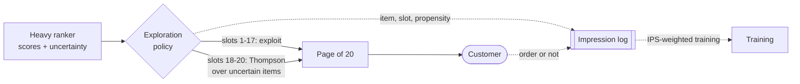

**Reading the diagram.** The ranker supplies scores and uncertainty (ensemble or Beta posterior). The policy, synchronous in the re-ranker, exploits most slots and samples a few, and asynchronously logs each item's **propensity**, the probability of its placement, which training uses to correct for the policy (§68.12). Failure points: missing propensities make data impossible to debias; an oversized budget costs orders. Compute cost is negligible.

In production, rewards are **delayed** (posteriors update in batches), rates are **non-stationary** (discount old evidence), and exploration has a **business cost** to budget and report.

## 68.12 Feedback loops and biases

### 68.12.1 How the loop biases the data

**Figure 68.12 — How serving decisions bias the next model's training data.**

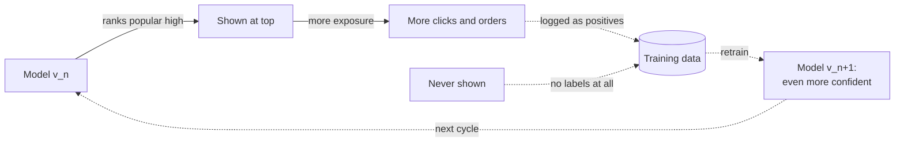

**Reading the diagram.** Ranking decides exposure (solid, at serving); exposure yields logged positives (dotted); unshown items yield no labels. Retraining makes the model more confident in what it already showed, daily. The bias becomes permanent at the training-data boundary. The failure is gradual: coverage shrinks, new restaurants starve, and offline metrics *improve* because test data shares the bias. Exploration widens exposure, propensity logging records the bias, IPS removes it.

Four biases recur:

- **Position bias:** items at the top are examined more, so they are clicked more regardless of relevance.
- **Popularity bias:** popular items get more exposure and so more labels, and models trained on those labels over-recommend them.
- **Selection bias (missing not at random):** users rate and order only what they chose to look at; unobserved items are not a random sample [Schnabel et al. 2016].
- **Exposure bias:** an item never shown has no negative or positive labels, so the model's beliefs about it are untested.

### 68.12.2 Inverse propensity scoring

The remedy is to reweight each logged outcome by how unlikely the logging policy was to produce it, so that rarely shown items count more.

::: formula
**IPS estimator of a new policy's value, and position-bias weighting**

$$\hat{V}_\text{IPS}(\pi) = \frac{1}{n}\sum_{k=1}^{n} r_k \, \frac{\pi(a_k \mid x_k)}{\pi_0(a_k \mid x_k)} \qquad \widehat{\text{rel}}(i) = \frac{1}{N_i}\sum_{\text{clicks on } i} \frac{1}{p_{\text{pos}}}, \quad p_k = (1/k)^\eta$$

| Symbol | Meaning | Units |
|---|---|---|
| $\pi_0$, $\pi$ | Logging policy and new policy: probability of action $a$ in context $x$ | probability |
| $r_k$, $a_k$, $x_k$ | Logged reward, action and context of record $k$ | — |
| $n$ | Logged records | records |
| $p_k$ | Probability a user examines position $k$ (propensity) | probability |
| $\eta$ | Severity of position bias | dimensionless |
| $N_i$ | Times item $i$ was shown | impressions |
:::

::: example
**Worked example — Evaluating a policy that was never deployed, and correcting position.** The promotion slot showed restaurant A with probability 0.8 and B with 0.2. Of 10,000 impressions, A got 8,000 with 400 orders (5%), B got 2,000 with 160 orders (8%). A proposed policy would show B with 0.9 and A with 0.1.

1. Naive average of the log: $560/10{,}000 = 0.056$, the *old* policy's value.
2. IPS: A's orders weigh $0.1/0.8 = 0.125$, B's $0.9/0.2 = 4.5$: $(400 \times 0.125 + 160 \times 4.5)/10{,}000 = (50 + 720)/10{,}000 = 0.077$.
3. Truth: $0.1 \times 0.05 + 0.9 \times 0.08 = 0.077$. The estimate matches.
4. Clipping weights at 3 to reduce variance: $(50 + 160 \times 3)/10{,}000 = 0.053$, now biased low.
5. Position: X at rank 1 gets 100 clicks in 1,000 impressions; Y at rank 5 gets 30 in 1,000. With $\eta = 1$, $p_5 = 0.2$: X's relevance $0.10/1 = 0.10$, Y's $0.03/0.2 = 0.15$. Y is the better restaurant.

**Interpretation.** Logged data can evaluate a new policy without deploying it, but only for actions the old policy took with non-zero probability, and large weights make the estimate noisy. **Engineering implication.** Log propensities at serving time, keep every action's propensity above a floor (exploration), and use clipped or self-normalized IPS for low variance; the doubly robust estimator adds a reward model to reduce variance further [Dudík et al. 2011].
:::

Joachims, Swaminathan and Schnabel showed that propensity-weighting clicks by examination probability gives an unbiased learning-to-rank objective, and estimated the propensities with small randomized swaps of result positions [Joachims et al. 2017]. In deep rankers the same goal is met by the shallow position tower of §68.7.4 [Zhao et al. 2019]. For **counterfactual evaluation**, keep a small slice of traffic (1% or less) under a randomized or high-exploration policy: its logs are the cleanest data you will ever have for comparing candidate policies offline [Bottou et al. 2013].

## 68.13 Real-time personalization

A customer who has just viewed three sushi restaurants and searched "poke" is telling you what she wants tonight, and a model whose user features were computed last night cannot hear it. Real-time personalization closes that gap at three levels of increasing risk.

1. **Session features** (lowest risk): a stream job keeps per-user counters of the last minutes' views, searches and cart events in an online store (§62.10); the unchanged model reads them as features. This captures most of the value.
2. **Streaming item and supply updates:** new restaurants are encoded and inserted into the index within minutes (Figure 68.6); trending counts and kitchen backlogs refresh in seconds.
3. **Online learning** (highest risk): model weights update continuously from the event stream. It adapts fastest to new items and shifting tastes, but a bug, a bot attack or a feedback spiral reaches production within minutes with no offline gate. Most teams retrain daily, fine-tune embeddings or the last layers hourly, and keep true online learning to bandit posteriors and counters.

::: formula
**Exponentially decayed counter**

$$c \leftarrow c \cdot e^{-\Delta t/\tau} + 1 \qquad t_{1/2} = \tau \ln 2$$

| Symbol | Meaning | Units |
|---|---|---|
| $c$ | Decayed count of events (for example sushi views) | events |
| $\Delta t$ | Time since the counter was last updated | minutes |
| $\tau$ | Decay time constant | minutes |
| $t_{1/2}$ | Half-life of an event's contribution | minutes |
:::

::: example
**Worked example — Session interest in sushi.** Views 30, 20 and 10 minutes ago, $\tau = 30$ min ($t_{1/2} = 20.8$ min). Reading now: $e^{-1} + e^{-2/3} + e^{-1/3} = 0.368 + 0.513 + 0.717 = 1.598$. A view yesterday contributes $e^{-48} \approx 0$. **Interpretation.** One number, updated in O(1) per event and stored in a few bytes, summarizes recency and frequency. **Engineering implication.** Keep several time constants (10 minutes for the session, 7 days for habits) per user and category; the stream job stores $c$ and its last-update time, and decays on read.
:::

**Figure 68.13 — Streaming path for session features.**

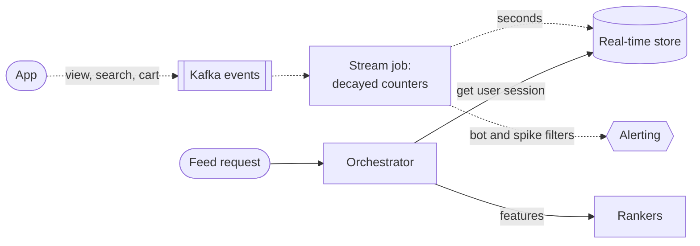

**Reading the diagram.** Events flow asynchronously through Kafka to a stream job (§29.8) that updates decayed counters in a TTL'd real-time store within seconds; the feed request reads them synchronously once and passes them to the rankers as features. Failure points: stream lag (monitored as freshness; ranking degrades gracefully) and bots distorting counters (filter and rate-limit per user). Partition events by user.

## 68.14 Evaluation

### 68.14.1 Offline metrics and their limits

Offline evaluation uses a **time-based split** (train on weeks 1–8, test on week 9), never a random one, which leaks the future. Each stage has its own metric: recall@K for retrieval sources and the funnel end to end, NDCG@K and AUC for rankers, log loss and calibration ratio for each multi-task head (§57.10–§57.12), plus **coverage** (share of catalog ever recommended) and intra-list diversity. All of these are computed on logs produced by the old policy, so they reward resembling it; they are filters, not verdicts (§57.13).

### 68.14.2 A/B tests and interleaving

The A/B test (§57.14) is the verdict: users are randomized between policies and the business metric (orders per user) is compared with guardrails (delivery time, cancellations, p99 latency). In a marketplace, arms share supply: if treatment sends more customers to a popular restaurant, its kitchen slows down for control customers too, which biases the comparison. Watch restaurant-side metrics and, for supply-heavy changes, randomize by zone or time window.

**Interleaving** is a faster filter for rankers (§66.12): the two rankers' lists are merged into one page by **team draft** (the rankers alternately pick their best item not yet chosen, the first picker decided by coin toss), and each order or click credits the ranker that contributed the item. Each user compares both rankers, so between-user variance cancels; Chapelle et al. found interleaving agreed with A/B outcomes while needing far less traffic [Chapelle et al. 2012].

::: formula
**Interleaving preference**

$$\Delta_{AB} = \frac{w_A + \tfrac{1}{2}t}{w_A + w_B + t} - \frac{1}{2} \qquad z = \frac{w_A - w_B}{\sqrt{w_A + w_B}}$$

| Symbol | Meaning | Units |
|---|---|---|
| $w_A$, $w_B$ | Sessions where A's (B's) items received more engagement | sessions |
| $t$ | Tied sessions | sessions |
| $\Delta_{AB}$ | Preference for A; 0 means no preference | fraction |
| $z$ | Sign-test statistic on non-tied sessions | standard errors |
:::

::: example
**Worked example — 10,000 interleaved sessions.** A wins 3,400, B wins 3,000, ties 3,600. $\Delta_{AB} = (3{,}400 + 1{,}800)/10{,}000 - 0.5 = 0.02$. $z = 400/\sqrt{6{,}400} = 400/80 = 5.0$. **Interpretation.** A is clearly preferred after only 10,000 sessions. **Engineering implication.** Use interleaving to prune candidate rankers in days, then A/B test the survivor, because interleaving measures preference, not revenue or long-term effects.
:::

### 68.14.3 Long-term effects and holdouts

Short tests miss slow effects: a feed that pushes discounted restaurants raises orders this week and trains customers to wait for discounts. Keep a **long-term holdout** (for example 1% of users on last quarter's system) and compare retention and order frequency over months; Hohnhold et al. describe measuring long-term user learning effects at Google this way [Hohnhold et al. 2015]. Use short-term **surrogate metrics** (reorders within 30 days, rated orders) that have been validated against long-term outcomes.

## 68.15 Cold start

**New customers** have no history, but they have context: address, time, device, entry point (a pizza advertisement). Serve zone popularity and trending blended with a context-aware ranker, ask an optional two-tap cuisine preference, and switch to session features after the first few views; the two-tower user tower works from these features even with an empty history. **New restaurants and dishes** have no interactions, but they have content: cuisine, price, menu text and photo embeddings (Chapter 58), and location. The item tower embeds them from content on day one, and a dedicated candidate source and exploration slots (§68.10, §68.11) give them exposure. The Bayesian view connects the two: a new restaurant starts with a prior borrowed from similar restaurants and earns its own estimate.

::: formula
**Beta–Bernoulli posterior for a new item's order rate**

$$\hat{p} = \frac{\alpha_0 + s}{\alpha_0 + \beta_0 + n}$$

| Symbol | Meaning | Units |
|---|---|---|
| $\alpha_0$, $\beta_0$ | Prior pseudo-orders and pseudo-non-orders | impressions |
| $s$, $n$ | Observed orders and impressions | count |
| $\hat{p}$ | Posterior mean order rate | probability |
:::

::: example
**Worked example — A new ramen shop.** Similar ramen shops in the zone convert at 5%; encode that as $\alpha_0 = 2$, $\beta_0 = 38$ (worth 40 impressions). After 200 impressions with 15 orders: $\hat{p} = 17/240 = 0.0708$, versus the raw $15/200 = 0.075$ and the prior 0.05. **Interpretation.** The prior keeps one lucky order from catapulting the shop to the top and fades as evidence arrives. **Engineering implication.** Thompson sampling over these posteriors (§68.11) allocates exploration to new restaurants automatically; set the prior's weight so that a few days of traffic dominate it.
:::

## 68.16 Reference architecture for QuickBite recommendations

**Figure 68.14 — QuickBite recommendation reference architecture.**

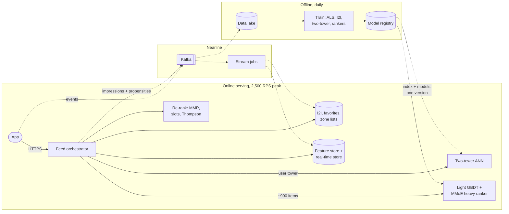

**Reading the diagram.** The synchronous path (solid) stays inside the serving boundary: user vector, parallel ANN and key–value sources, features, rankers on about 900 candidates, re-ranking to 20, within Table 68.3's 120 ms. Nearline jobs turn events into session counters, trending lists and item-to-item updates. Offline, every model trains daily from joined impressions, features, propensities and outcomes; models, ID vocabularies and the index publish together through the registry and roll out by canary (§66.12). Fallbacks: drop a late source, light-ranker order, then cached zone popularity. Rankers scale with traffic, the index with catalog, logging with impressions.

**Table 68.8 — QuickBite recommendation components.**

| Component | Model or data | Cadence | Size (assumed) | Serving cost |
|---|---|---|---|---|
| Implicit ALS | Customer × restaurant factors, $k = 64$ | Nightly | 2.56 GB + 12.8 MB | Batch; feeds a source |
| Item-to-item | Top 50 related dishes per dish | Nightly + streaming | 5M × 50 × 12 B = 3 GB | KV read, 2 ms |
| Two-tower | 64-d towers; 120k eligible dishes per request | Daily; new dishes in minutes | 1.28 GB dish vectors | ~1.5 ms exact or ANN |
| Light ranker | GBDT, ~60 features | Daily | Tens of MB | 5 µs per item |
| Heavy ranker | MMoE, 3 heads, DCN-V2 crosses | Daily, hourly fine-tune | ~3 GB embeddings | 100 µs per item, ~203 cores at peak |
| Bandit and re-rank | Beta posteriors, MMR | Continuous | Small | < 5 ms |

**Evolution, not big bang.** QuickBite should earn this architecture in steps, each proved by an A/B test against the previous: (1) zone popularity plus favorites; (2) a GBDT ranker over those candidates; (3) implicit ALS and item-to-item sources; (4) a two-tower source and a multi-task deep ranker with calibration; (5) Thompson-sampling exploration slots, propensity logging and IPS-weighted training; (6) real-time session features. Each step adds operational cost, and each must beat the simpler system it replaces.

## 68.17 Summary and revision notes

::: summary
- Recommenders learn mostly from implicit, positive-only feedback conditioned on exposure; the objective is a chain of proxies (click → order → good rating → retention) combined by weights and checked with holdouts.
- The funnel exists for compute: $C_\text{req} = \sum N_s c_s$. QuickBite's heavy ranker is 74% of 40.5 ms CPU per request while seeing 0.25% of eligible dishes; without the funnel the fleet grows about 300×.
- Matrix factorization learns user and item vectors from IDs; implicit ALS weights all cells by confidence $1 + \alpha r$ and costs about $\text{nnz}\,k^2 + (U+I)k^3$ per sweep. Item-to-item tables and zone popularity are cheap, explainable, strong sources. Merge sources by quota and rank, and measure marginal recall.
- Two-tower models add features and context; in-batch negatives need logQ correction ($s - \log q_j$) or popular items are over-penalized. Serve with precomputed item vectors and ANN, versioning both towers and the index together.
- Feed rankers are pointwise multi-task networks (Wide & Deep, DLRM, DCN-V2, MMoE) because fused scores need calibrated probabilities; correct negative downsampling with $p = p'/(p' + (1-p')/w)$.
- Embedding tables dominate memory: $V d s (1+k)$; shard them model-parallel with all-to-all while MLPs stay data-parallel.
- Re-ranking optimizes the list: MMR, caps, exploration slots, provider fairness and kitchen capacity.
- Thompson sampling beat ε-greedy and UCB1 in the simulation; log propensities so IPS can debias training and evaluate policies offline.
- Evaluate offline with time splits, prune with interleaving, decide with A/B tests, and keep long-term holdouts. Cold start relies on content features, context and Bayesian priors.
:::

## 68.18 Knowledge checkpoint

1. Why is the absence of an order weak evidence of disinterest?
2. A heavy ranker costs 100 µs per item. What does raising its input from 300 to 500 add per request, and to the fleet at 2,500 RPS and 50% utilization?
3. In implicit ALS with $\alpha = 2$, what confidence does a pair with 4 orders get?
4. Why does item-to-item recommendation react to the current session better than nightly MF?
5. What does logQ correction subtract, and why?
6. Why can a dot product of two towers not express "cheaper than this user's usual"?
7. A model trained with 5% of negatives predicts 0.10. What is the calibrated probability?
8. How large is a 50M-row, 64-dimension FP16 table?
9. Compute the MMR score of an item with relevance 0.8 and maximum similarity 0.6 to the selected set, $\lambda = 0.5$.
10. Why does ε-greedy have linear regret?
11. Logged policy showed X with probability 0.25; the new policy shows it with 0.75. What IPS weight does an order on X get?
12. Why must a randomized traffic slice be kept for counterfactual evaluation?
13. Why can an A/B test in a food marketplace be biased even with perfect user randomization?

<details><summary>Answers</summary>

1. The customer may never have seen the item, may have ordered it elsewhere, or may simply not be hungry; unobserved is not negative.
2. $200 \times 100\ \mu\text{s} = 20$ ms; $2{,}500 \times 0.02 / 0.5 = 100$ extra cores.
3. $c = 1 + 2 \times 4 = 9$, with $p = 1$.
4. Its input is the latest action, looked up in a precomputed table at request time, rather than a user vector computed last night.
5. The log of the item's sampling probability; popular items appear as negatives in proportion to popularity, and the correction removes that over-penalty.
6. Each tower computes its vector without seeing the other side, so features that compare user and item cannot be formed; the ranker handles them.
7. $0.10/(0.10 + 0.90/0.05) = 0.10/18.1 = 0.0055$.
8. $5 \times 10^7 \times 64 \times 2 = 6.4$ GB.
9. $0.5 \times 0.8 - 0.5 \times 0.6 = 0.10$.
10. It explores at a fixed rate ε forever, paying the average gap on every exploratory round.
11. $0.75/0.25 = 3$.
12. Only data collected with known, non-zero propensities for all actions supports unbiased off-policy estimates; deterministic logs cannot evaluate actions they never took.
13. Arms share restaurants and couriers, so treatment's extra demand slows deliveries for control customers too (interference).

</details>

## 68.19 Interview questions

### Basic

**Q1. Why do recommenders use a multi-stage funnel?**
**Answer.** The best model is too expensive to score the whole catalog within the latency and CPU budget. Cheap retrieval reduces millions of items to about a thousand, a light ranker to a few hundred, and the heavy ranker scores only those; each stage must keep what the next would rank highly.

**Q2. Explicit versus implicit feedback?**
**Answer.** Explicit feedback (ratings) is sparse and biased toward extremes; implicit feedback (clicks, orders) is plentiful but positive-only and exposure-dependent. Most production systems train on implicit signals with confidence weighting.

### Intermediate

**Q3. Design candidate generation for QuickBite's dish module.**
**Answer.** Filter to deliverable dishes (~120,000), then run in parallel: a two-tower source (exact or ANN), item-to-item from recent orders, zone trending, favorites and a new-restaurant source, each with a quota; merge by rank with provenance and measure each source's marginal recall.

**Q4. Your new ranker has better offline AUC but fewer orders online. Why?**
**Answer.** Offline data reflects the old policy (selection and position bias); the ranker may be uncalibrated so fusion weights shift; it may never have seen the candidates retrieval now produces; latency may have risen. Check calibration, evaluate on logged candidate sets, and interleave before A/B.

### Advanced

**Q5. A recommender trains on 10⁹-row embedding tables. How do you train and serve it?**
**Answer.** 512 GB of FP32 weights: shard tables model-parallel (table- and row-wise) across GPUs with all-to-all, keep MLPs data-parallel with all-reduce, use row-wise Adagrad and FP16 communication, cache hot rows. Serve user rows from a sharded embedding service once per request and hot item rows in ranker memory; version tables and ID maps with the model.

**Q6. How do you stop popularity feedback loops while launching new restaurants?**
**Answer.** Reserve exploration slots filled by Thompson sampling with content-based priors, log propensities, train with IPS or a position tower, cap exposure per restaurant, keep a randomized slice for counterfactual evaluation, and watch coverage and new-restaurant conversion as guardrails.

## 68.20 Practical exercises

1. Add biases and an SGD solver to the ALS program, and compare SGD on binary data with weighted ALS at equal training time.
2. Add 64 uniformly sampled negatives per batch to the two-tower program (mixed negatives) and measure recall@50 on the 500 least popular dishes.
3. Make the bandit's best arm change at $t = 50{,}000$ and add a discounted Thompson sampler; compare regret after the change.
4. Simulate position bias with $\eta = 1$ on logged clicks and show that IPS-weighted click rates recover true relevance.

## 68.21 Design challenges

1. **Restaurant home feed for 20 new cities.** Design candidate sources, cold start and exploration budgets for launch day, and the metrics that decide when to switch to personalized ranking.
2. **Ads in the feed.** Add sponsored restaurants paying per order: define calibrated scores, how ads compete with organic slots, and guardrails on user experience.
3. **10× scale.** At 100 million customers and 50 million dishes, re-size embeddings, choose ANN and sharding, and recompute the ranker fleet.

## 68.22 References

1. Covington, P., Adams, J., Sargin, E. *Deep Neural Networks for YouTube Recommendations*. RecSys, 2016.
2. Yi, X., Yang, J., Hong, L., Cheng, D. Z., Heldt, L., Kumthekar, A., Zhao, Z., Wei, L., Chi, E. *Sampling-Bias-Corrected Neural Modeling for Large Corpus Item Recommendations*. RecSys, 2019.
3. Koren, Y., Bell, R., Volinsky, C. *Matrix Factorization Techniques for Recommender Systems*. IEEE Computer 42(8), 2009.
4. Hu, Y., Koren, Y., Volinsky, C. *Collaborative Filtering for Implicit Feedback Datasets*. ICDM, 2008.
5. Linden, G., Smith, B., York, J. *Amazon.com Recommendations: Item-to-Item Collaborative Filtering*. IEEE Internet Computing 7(1), 2003.
6. Cheng, H.-T., et al. *Wide & Deep Learning for Recommender Systems*. DLRS Workshop, RecSys, 2016.
7. Naumov, M., et al. *Deep Learning Recommendation Model for Personalization and Recommendation Systems*. arXiv:1906.00091, 2019.
8. Wang, R., Fu, B., Fu, G., Wang, M. *Deep & Cross Network for Ad Click Predictions*. ADKDD, 2017.
9. Wang, R., Shivanna, R., Cheng, D. Z., Jain, S., Lin, D., Hong, L., Chi, E. *DCN V2: Improved Deep & Cross Network and Practical Lessons for Web-scale Learning to Rank Systems*. WWW, 2021.
10. Zhao, Z., et al. *Recommending What Video to Watch Next: A Multitask Ranking System*. RecSys, 2019.
11. Ma, J., Zhao, Z., Yi, X., Chen, J., Hong, L., Chi, E. *Modeling Task Relationships in Multi-task Learning with Multi-gate Mixture-of-Experts*. KDD, 2018.
12. Carbonell, J., Goldstein, J. *The Use of MMR, Diversity-Based Reranking for Reordering Documents and Producing Summaries*. SIGIR, 1998.
13. Li, L., Chu, W., Langford, J., Schapire, R. E. *A Contextual-Bandit Approach to Personalized News Article Recommendation*. WWW, 2010.
14. Auer, P., Cesa-Bianchi, N., Fischer, P. *Finite-time Analysis of the Multiarmed Bandit Problem*. Machine Learning 47, 2002.
15. Chapelle, O., Li, L. *An Empirical Evaluation of Thompson Sampling*. NeurIPS, 2011.
16. Joachims, T., Swaminathan, A., Schnabel, T. *Unbiased Learning-to-Rank with Biased Feedback*. WSDM, 2017.
17. Schnabel, T., Swaminathan, A., Singh, A., Chandak, N., Joachims, T. *Recommendations as Treatments: Debiasing Learning and Evaluation*. ICML, 2016.
18. Dudík, M., Langford, J., Li, L. *Doubly Robust Policy Evaluation and Learning*. ICML, 2011.
19. Bottou, L., et al. *Counterfactual Reasoning and Learning Systems: The Example of Computational Advertising*. JMLR 14, 2013.
20. Chapelle, O., Joachims, T., Radlinski, F., Yue, Y. *Large-Scale Validation and Analysis of Interleaved Search Evaluation*. ACM TOIS 30(1), 2012.
21. Hohnhold, H., O'Brien, D., Tang, D. *Focusing on the Long-term: It's Good for Users and Business*. KDD, 2015.
22. Burges, C., et al. *Learning to Rank using Gradient Descent*. ICML, 2005.
23. Burges, C. J. C. *From RankNet to LambdaRank to LambdaMART: An Overview*. Microsoft Research Technical Report MSR-TR-2010-82, 2010.
24. Ke, G., et al. *LightGBM: A Highly Efficient Gradient Boosting Decision Tree*. NeurIPS, 2017.
25. Chen, T., Guestrin, C. *XGBoost: A Scalable Tree Boosting System*. KDD, 2016.
26. He, X., et al. *Practical Lessons from Predicting Clicks on Ads at Facebook*. ADKDD, 2014.
27. Platt, J. *Probabilistic Outputs for Support Vector Machines and Comparisons to Regularized Likelihood Methods*. In Advances in Large Margin Classifiers, MIT Press, 1999.
28. Rendle, S. *Factorization Machines*. ICDM, 2010.
29. Shi, H.-J. M., Mudigere, D., Naumov, M., Yang, J. *Compositional Embeddings Using Complementary Partitions for Memory-Efficient Recommendation Systems*. KDD, 2020.
30. Mudigere, D., et al. *Software-Hardware Co-design for Fast and Scalable Training of Deep Learning Recommendation Models*. ISCA, 2022.
31. Malkov, Y. A., Yashunin, D. A. *Efficient and Robust Approximate Nearest Neighbor Search Using Hierarchical Navigable Small World Graphs*. IEEE TPAMI 42(4), 2020.
32. Jégou, H., Douze, M., Schmid, C. *Product Quantization for Nearest Neighbor Search*. IEEE TPAMI 33(1), 2011.

## 68.23 Open verification items

- Mudigere et al. 2022: the "tables up to terabytes" characterization of model sizes.
- Chapelle et al. 2012: wording that interleaving agreed with A/B outcomes at far lower traffic (no ratio quoted).
- Hohnhold et al. 2015: scope of the Google long-term holdout description.
- DCN-V2 production-deployment claim as stated in Wang et al. 2021.
- All QuickBite numbers new in this chapter (2,500 RPS, 1,200 deliverable restaurants, per-item ranker costs) are teaching assumptions.
