# Chapter 69 — MLOps and ML Platforms

> **Level:** 3–4 · **Track:** B (ML/AI) · **Estimated reading time:** 5 h

An airline does not keep its aircraft safe by hiring brilliant pilots alone. It keeps a logbook for every airframe, follows checklists before every departure, swaps parts only through a controlled maintenance process, and can say for any flight which engine, which software version and which inspector signed it off. When something goes wrong, the airline can ground one aircraft type, roll back a software update or replace a batch of parts, because every component has a serial number and a history.

**MLOps** is that discipline for machine-learning systems. Chapter 59 drew the lifecycle as a loop and placed teams on maturity levels (§59.15); Chapter 60 drew a training pipeline (§60.5). This chapter is about the *platform engineering* that makes the loop safe and cheap to run many times a day: the three pipelines (continuous integration, continuous delivery and continuous training), the tests that guard them, the experiment tracker and model registry that remember everything, the orchestrators that run the steps, and the governance, rollback and retraining machinery around them. You will build a mini experiment tracker and a statistical promotion gate in Python, size the savings from pipeline caching, decide when retraining pays for itself, and finish with published platforms from Uber, Google, Meta, Netflix and Airbnb and a reference platform for QuickBite.

Two neighboring chapters share the territory. Chapter 70 owns monitoring and drift statistics (PSI, KS, delayed labels); here you will see only the *hooks* the platform provides and what the platform does when a monitor fires. Chapter 66 owns model servers and safe deployment patterns (§66.12); here you will see how the platform drives them.

::: note
**QuickBite assumptions used in this chapter.** These reuse the Book II design point and are teaching assumptions, not measurements of a real company: 500,000 orders a day; 35-minute median delivery time; up to 40,000 ETA predictions per second at peak (§60.6); 0.5% fraud rate; fraud losses of \$450,000 a month (§60.13); CPU at \$0.048 per vCPU-hour and GPUs at \$2.50 per GPU-hour (§60.11); each extra minute of ETA mean absolute error (MAE) costs about \$2,000 a day in support contacts and refunds (§59.13). New in this chapter: QuickBite runs 12 production models (ETA, ranking and recommendations, fraud, demand forecasting, prep-time estimation and the support chatbot among them) built by about 30 data scientists and ML engineers, and the ETA model retrains nightly (§60.5). Sizes use SI units (1 GB = 10⁹ bytes).
:::

## 69.1 Learning objectives

After this chapter you should be able to:

- Explain what MLOps adds to DevOps: data and models as versioned artifacts, tests for data and models, and three pipelines (CI, CD, CT) with different triggers.
- Design a CI stage for an ML system with code tests, data tests, behavioral model tests (minimum-functionality, invariance and directional) and training-pipeline smoke tests in a reproducible environment.
- Choose continuous-training triggers, compute when a retraining run pays for itself, and build a promotion gate that compares a candidate with the champion using a paired statistical test and slice guardrails.
- Package a model with its signature and environment, promote it through registry aliases, deploy it with GitOps, and wire automated rollback.
- Implement a minimal experiment tracker, explain MLflow's tracking and registry architecture, and avoid the winner's curse when comparing runs.
- Compare Kubeflow Pipelines, Airflow, Metaflow, Flyte and managed pipelines, and compute the savings from step caching with idempotent steps.
- Record a reproducibility manifest and name the sources of nondeterminism in GPU training.
- Put approvals, audit trails, access control and model risk tiers in place; close the retraining loop safely; distinguish model, feature and data rollback.
- Summarize the published designs of Michelangelo, TFX, FBLearner Flow, Metaflow and Bighead, and decide whether to build or buy an ML platform using total cost of ownership.

## 69.2 Prerequisites

- The lifecycle loop, versioning, retraining cadence and MLOps maturity levels — Chapter 59, especially §59.13–§59.15 (this chapter builds the machinery those sections describe).
- The training pipeline and its gates — §60.5; prediction logging — §60.6.2.
- Table formats, time travel, data versioning, lineage and orchestration basics — §61.8, §61.12, §61.13, §61.15.
- Feature stores and training–serving skew — Chapter 62 (models depend on feature definitions, which matters for rollback).
- CI/CD, canary analysis, feature flags and GitOps — §43.3, §43.6, §43.7, §43.10.
- Containers, images and Kubernetes — Chapter 42 (pipeline steps and model servers run as containers).
- Two-sample tests, standard errors and statistical power — §4.18, §57.14 (promotion gates are hypothesis tests).
- Model serving and safe deployment — Chapter 66, §66.12 (shadow and canary for models).

## 69.3 What MLOps adds to DevOps

### 69.3.1 Data and models as versioned artifacts

::: definition
**Definition — MLOps.** The set of practices, roles and tools that automate and govern the building, testing, deployment, monitoring and retraining of ML models in production, by treating data, code and models as versioned artifacts that flow through automated pipelines. Kreuzberger, Kühl and Hirschl, synthesizing literature and practitioner interviews, define it as a paradigm spanning best practices, concepts and an engineering culture that bridges machine learning, software engineering and data engineering [Kreuzberger et al. 2023].
:::

#### First-principles explanation

In ordinary software, behavior changes only when someone changes the code. A web service built from commit `a91f3c2` behaves the same today as last month. In an ML system, behavior is a function of three things: the code, the data the model was trained on, and the model artifact that training produced. Any of the three can change independently. A nightly retraining run produces a new model from the *same* code, because the data moved. An upstream team can change a column's meaning without anyone touching your repository. The same training code can produce different models on two runs because of random seeds or GPU arithmetic.

DevOps gave us version control, automated tests and deployment pipelines for code. MLOps extends each of these to data and models: version them, test them, and move them through pipelines with gates.

#### Why does this exist?

Interview studies of practitioners keep finding the same pain. Shankar et al. interviewed 18 ML engineers and summarized what makes production ML succeed as three "Vs": **velocity** (iterating quickly on ideas), **validation** (catching errors before users do), and **versioning** (keeping track of many models, datasets and experiments so you can go back) [Shankar et al. 2022]. Those are exactly the properties a platform can provide once, for every team, instead of each team rebuilding them.

**Figure 69.1 — Three things change in an ML system, not one.**

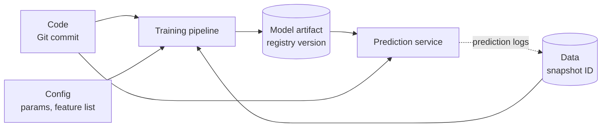

**Reading the diagram.** Rectangles are processes; cylinders are storage boundaries with immutable versions. The training pipeline is a function of code, configuration and a data snapshot, and its output is a model artifact stored under a registry version. The prediction service depends on two versions at once: its own code (feature fetching, pre- and post-processing) and the model it loads. The dotted asynchronous arrow closes the loop: logged predictions and later labels become tomorrow's training data. Failure points: an unversioned input (a hand-edited config, a mutable table read without a snapshot ID) breaks the ability to explain or reproduce a model. Scaling: each artifact store scales independently (Git, lakehouse, object storage).

**Table 69.1 — What can change, and how DevOps and MLOps handle it.**

| What changes | Ordinary software | ML system addition |
|---|---|---|
| Code | Git, code review, unit tests | Same, plus training and feature code |
| Configuration | Config in Git | Hyperparameters, feature lists, seeds logged per run |
| Data | Database migrations (§43.13) | Snapshots, data validation, data contracts (§61.11) |
| Model | — | Registry versions, model tests, promotion gates |
| Environment | Container image | Same, plus GPU drivers, CUDA and library versions |
| Behavior in production | Errors, latency | Plus prediction quality, drift, fairness (Chapter 70) |

### 69.3.2 Tests for data and models

A unit test asserts that a function returns an exact output. A model cannot be tested that way: its outputs are statistical, and "correct" is defined by a metric on data. ML adds three families of checks to the usual test suite:

1. **Data tests** check inputs: schema, ranges, null rates, freshness and distribution shifts (§59.7, §61.11). They run in CI on sample data and in every pipeline run on real data.
2. **Model tests** check learned behavior: aggregate metrics, slice metrics, and **behavioral tests** that probe specific capabilities (§69.4.3).
3. **Infrastructure tests** check the pipeline itself: does it run end to end on a tiny sample, does the served model produce the same output as the trained one, does the model load within the memory budget?

Breck et al.'s **ML Test Score** organizes 28 such tests into four groups: features and data, model development, ML infrastructure, and monitoring. Each test earns half a point when done manually and one point when automated, and the team's score is the *minimum* over the four groups, so excellence in one area cannot hide a gap in another [Breck et al. 2017]. §59.15 introduced it as a maturity yardstick; this chapter builds the automation that earns the full points.

### 69.3.3 Three pipelines: CI, CD and CT

::: definition
**Definition — Continuous integration (CI) for ML.** Building and testing every change to code, pipeline definitions and configuration, including data and model tests on samples, before it merges.

**Definition — Continuous delivery (CD) for ML.** Automatically packaging and deploying either a new *pipeline* (after CI) or a new *model* (after continuous training), through progressive rollout with automated rollback.

**Definition — Continuous training (CT).** Automatically re-running the training pipeline on fresh data when a trigger fires, and producing a validated candidate model [Google Cloud 2020].
:::

The key idea of Google's guidance is that at higher maturity you deploy a *training pipeline*, not a model; the pipeline then produces models continuously [Google Cloud 2020]. That gives two kinds of release with different triggers: a code change releases a new pipeline (CI then CD), and a data change releases a new model (CT then CD).

**Figure 69.2 — The three pipelines and how they connect.**

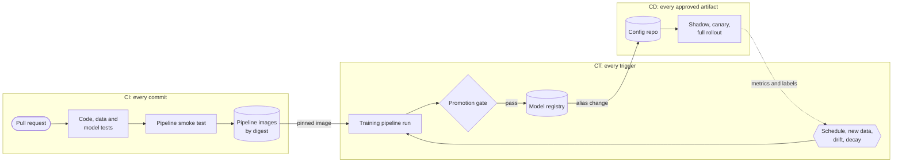

**Reading the diagram.** CI runs synchronously on each pull request and ends by publishing pipeline images identified by content digest. CT runs those exact images whenever a trigger fires; its output is a candidate that must pass the promotion gate before it lands in the registry. CD starts from the registry: an alias change (for example, `champion` now points at version 58) is written to a configuration repository, and a GitOps controller rolls it out (§69.6). The dotted asynchronous arrow is the feedback loop: production metrics and delayed labels feed CT's triggers (§69.12). Storage boundaries: the image registry, the model registry and the config repository, all versioned. Failure points: the gate (too loose ships regressions; too strict starves production of fresh models) and the loop (retraining on data the model itself corrupted). Scaling: CT runs are independent per model and scale out on the cluster; CI scales with a test budget measured in minutes.

::: mistake
**"MLOps is DevOps with a GPU."** DevOps assumes behavior changes only with code; MLOps must handle behavior that changes with data, so it needs data versioning, statistical gates and a third pipeline (CT) triggered by the world rather than by engineers. Teams that only add `model.pkl` to their CI pipeline end up at Google level 0 with extra steps (§59.15).
:::

## 69.4 CI for ML

### 69.4.1 The CI test pyramid for ML

::: definition
**Definition — Behavioral test.** A test that checks a model's output on constructed inputs against an expectation about capability rather than against a labeled dataset, for example "a longer distance never produces a shorter ETA."
:::

#### First-principles explanation

Think of a driving test. The written exam (aggregate metrics) proves you know the rules on average; the road test checks specific behaviors: stop at a red light, yield when merging, slow down in rain. A model with a good MAE can still fail the road test, for example by predicting a *shorter* delivery time for a longer trip in some region of feature space. CI for ML runs both kinds of tests, ordered by cost, so that a pull request gets feedback in minutes.

**Figure 69.3 — The CI pipeline for an ML repository, cheapest checks first.**

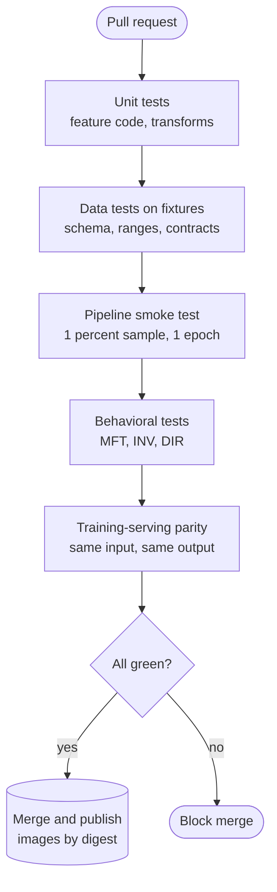

**Reading the diagram.** Each layer runs only if the cheaper layer below it passed, so a broken unit test fails in seconds without spending minutes on training. **Unit tests** cover deterministic code: feature transforms, parsers, encoders. **Data tests** run the validation suite of §59.7 against small checked-in fixtures, including deliberately bad rows. The **smoke test** runs the whole pipeline on a tiny sample. **Behavioral tests** train or load a small model and probe it. **Parity tests** send the same input through the training-time transformation and the serving path and require identical feature vectors (the skew check of §62.9 at CI time). All checks are synchronous inside the CI runner; the only storage boundary is the image registry written on merge. Failure point: a flaky test that depends on randomness, which teams learn to ignore; fix seeds and tolerances. Scaling: parallelize independent layers on more runners, but keep the total under about 15 minutes or developers stop waiting for it.

### 69.4.2 Code and data tests

Code tests are ordinary unit tests with one ML-specific focus: the transformations that will run in both training and serving. Test boundary values (zero distance, missing prep time, a new city ID never seen in training), units (kilometers, not meters), and time zones. Data tests in CI do not see production data; they run the validation rules against fixtures so that a change to a rule or a schema is itself tested. The production-scale data validation runs inside every CT pipeline run (§69.5) and is owned by the data platform (§61.11).

### 69.4.3 Behavioral model tests: MFT, INV and DIR

Ribeiro et al.'s **CheckList** introduced three test types for NLP models, borrowing from software testing; they apply just as well to tabular models [Ribeiro et al. 2020]:

- A **minimum functionality test (MFT)** checks a simple case the model must get right, like a unit test for a capability. ETA: a 1 km order with 10 minutes of preparation at an off-peak hour must predict between 15 and 30 minutes.
- An **invariance test (INV)** applies a change that should *not* affect the output and checks that the output barely moves. ETA: toggling a promotion flag, or changing the customer's name, must move the prediction by less than 0.5 minutes.
- A **directional expectation test (DIR)** applies a change with a known direction and checks the output moves that way. ETA: adding 0.5 km of distance must never decrease the predicted time.

Ribeiro et al. found that CheckList surfaced many actionable failures even in commercial models that had passed their owners' own evaluations, and that users of the method found more bugs than users without it [Ribeiro et al. 2020]. Behavioral tests are cheap insurance against failures that an aggregate metric averages away.

#### Code example: a behavioral test suite

The program below trains three small gradient-boosted ETA models on synthetic orders and runs MFT, INV and DIR tests against each. Runs in about 3 seconds on a laptop CPU.

```python
"""Behavioral tests (CheckList-style) for a toy QuickBite ETA model."""
import os
os.environ.setdefault("OMP_NUM_THREADS", "1")  # fixed threads: faster here, repeatable everywhere
import numpy as np
from sklearn.ensemble import HistGradientBoostingRegressor

FEATURES = ["distance_km", "prep_min", "courier_load", "peak", "promo_flag"]

def make_orders(n, rng):
    d = rng.gamma(2.0, 1.6, n)                      # km
    prep = np.clip(rng.normal(12, 4, n), 3, 40)     # minutes
    load = rng.uniform(0.3, 1.3, n)                 # active orders per courier
    peak = (rng.random(n) < 0.35).astype(float)
    promo = (rng.random(n) < 0.2).astype(float)     # irrelevant to travel time
    y = (13 + 3.0 * d + 0.9 * prep + 10 * np.maximum(0, load - 0.8)
         + 3 * peak + rng.normal(0, 4, n))
    return np.column_stack([d, prep, load, peak, promo]), y

def fit(X, y, monotonic):
    cst = [1, 1, 1, 1, 0] if monotonic else None    # +1: prediction may only rise
    return HistGradientBoostingRegressor(max_iter=200, learning_rate=0.1,
                                         early_stopping=False, random_state=0,
                                         monotonic_cst=cst).fit(X, y)

def run_suite(model, rng):
    probe, _ = make_orders(2000, rng)
    base = model.predict(probe)
    # MFT: an easy, well-understood case must land in a sane range.
    easy = np.array([[1.0, 10.0, 0.5, 0.0, 0.0]])
    mft = 15 <= model.predict(easy)[0] <= 30
    # INV: toggling the promo flag must move the ETA by < 0.5 min.
    flipped = probe.copy(); flipped[:, 4] = 1 - flipped[:, 4]
    inv_fail = np.mean(np.abs(model.predict(flipped) - base) >= 0.5)
    # DIR: +0.5 km must never shorten the ETA.
    farther = probe.copy(); farther[:, 0] += 0.5
    dir_fail = np.mean(model.predict(farther) < base)
    return mft, inv_fail, dir_fail

rng = np.random.default_rng(69)
X, y = make_orders(20000, rng)
X_drop = X.copy(); X_drop[:, 4] = 0.0             # promo removed from training
for name, Xt, mono in [("unconstrained", X, False), ("monotonic", X, True),
                       ("mono, no promo", X_drop, True)]:
    m = fit(Xt, y, mono)
    mft, inv, dirf = run_suite(m, np.random.default_rng(7))
    print(f"{name:14s} MFT pass={mft}  INV fail rate={inv:.1%}  DIR fail rate={dirf:.1%}")
```

Output:

```text
unconstrained  MFT pass=True  INV fail rate=12.8%  DIR fail rate=1.6%
monotonic      MFT pass=True  INV fail rate=3.7%  DIR fail rate=0.0%
mono, no promo MFT pass=True  INV fail rate=0.0%  DIR fail rate=0.0%
```

What to notice:

- The promotion flag has no effect on true delivery time, yet the unconstrained model changes its prediction by at least half a minute for 12.8% of orders when the flag flips: it has fitted noise. Its MAE would not reveal this.
- Tree ensembles are piecewise constant, so a longer trip can land in a leaf with a lower value: 1.6% of probes violate the directional test. A **monotonic constraint** (`monotonic_cst`) fixes the DIR failures by construction; removing the irrelevant feature fixes the INV failures.
- The suite tests *behavior*, so it would catch the same failures in a neural network or a model from another team. The thresholds (0.5 min, 0% DIR violations) are product decisions recorded in the test file and reviewed like code.
- `OMP_NUM_THREADS` is fixed before importing scikit-learn so that results and timing are repeatable across machines (§69.10).

### 69.4.4 Training-pipeline smoke tests

A **smoke test** runs the real pipeline end to end on a tiny sample to catch wiring bugs: a renamed column, a missing permission, a step that writes to the wrong path. Four cheap assertions catch most of them:

1. The pipeline completes on a 1% sample (or a fixed fixture) within a time budget.
2. Training loss decreases over the first few steps.
3. The model can **overfit a tiny batch** (for example 64 examples to near-zero loss); if it cannot, the labels, the loss or the optimizer wiring is broken.
4. The exported artifact loads in the serving container and returns predictions of the right shape and type for a sample request.

### 69.4.5 Reproducible environments

A CI run that passes on one machine and fails on another is worse than no CI. Pin the environment the same way for CI, training and serving:

- **Lock files** with exact versions and hashes for Python packages (pip-tools, Poetry, uv or conda-lock).
- **Container images referenced by digest** (`image@sha256:...`), not by mutable tags such as `latest` (§42.5).
- **Hardware-specific layers** pinned too: CUDA, cuDNN and driver versions for GPU steps, because numerical results can change across them (§69.10).
- **One base image per runtime family** (CPU training, GPU training, serving) owned by the platform team and rebuilt on a schedule for security patches, with CI re-run against the new base.

::: warning
**Warning — The notebook environment is not the pipeline environment.** A data scientist's notebook often has a newer library than the pipeline image. A model pickled with one scikit-learn version may fail to load, or load and behave differently, under another. Export models in a version-tolerant format where possible (ONNX, a framework's native saved format) and run the parity test of Figure 69.3 against the *serving* image.
:::

**Table 69.2 — CI failure scenarios.**

| What goes wrong | Why | Detection | Recovery | Prevention |
|---|---|---|---|---|
| Flaky model test | Unseeded randomness, tight thresholds | Same commit passes and fails | Re-run, then fix | Fixed seeds; tolerance from run-to-run noise |
| CI takes 60 minutes | Full training in CI | Developer complaints, skipped CI | Move to nightly job | Smoke test on a sample; full training in CT |
| Serving disagrees with training | Different preprocessing code | Parity test | Block merge | Shared transformation library or model-embedded preprocessing |
| Passing CI, failing pipeline | Fixture does not match production schema | First CT run fails | Fix fixture | Generate fixtures from the data contract |

## 69.5 Continuous training

### 69.5.1 Triggers

#### First-principles explanation

A bakery bakes bread every morning (a schedule), bakes an extra batch when a delivery of flour arrives (new data), and bakes again if customers complain the loaves are stale (performance). It never bakes more often than the oven can handle, and it tastes every batch before it goes on the shelf. Continuous training follows the same logic: something must decide *when* to retrain, and something must decide *whether the result may ship*.

§59.13 derived a retraining *cadence* from decay rate and cost. A platform implements that cadence with four trigger types, usually combined.

**Table 69.3 — Continuous-training triggers.**

| Trigger | Fires when | Strengths | Weaknesses | QuickBite use |
|---|---|---|---|---|
| Schedule | Cron time (nightly, weekly) | Predictable cost and load; easy to reason about | Wastes runs when nothing changed; slow on sudden shifts | ETA nightly; demand forecast weekly |
| Data volume | $N$ new labeled examples since last run | Ties retraining to information gained | Bursty; needs label counting | Fraud: every 20,000 new chargeback labels |
| Drift | Input or prediction distribution shifts beyond a threshold (Chapter 70) | Reacts before labels arrive | Drift is a proxy; may not hurt accuracy | Ranking after a menu redesign |
| Performance | Labeled metric degrades beyond tolerance | Measures what matters | Waits for labels; may be too late | ETA city slice MAE up 0.5 min |

Two rules keep triggers safe. First, **all triggers enter one queue** per model, with deduplication (a drift alert during a scheduled run does not start a second run) and a **rate limit** (for example, at most four runs a day), so an alert storm cannot become a training storm. Second, **triggers only start runs; they never promote**. Every candidate passes the same gate, however it was triggered.

### 69.5.2 Pipeline architecture

**Figure 69.4 — Continuous-training pipeline with gates.**

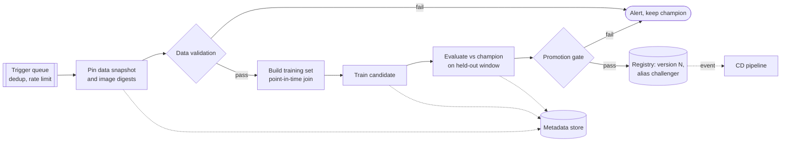

**Reading the diagram.** The trigger queue (a log or work queue) feeds one run at a time per model. The first step **pins** every input: the lakehouse snapshot ID (§61.13) and the image digests from CI, so the run is reproducible even if tables change while it runs. Data validation and the promotion gate are the two hard stops; either ends the run with an alert and leaves the champion serving, which is always a safe outcome. The training set is built with point-in-time joins (§62.8). Evaluation scores the candidate and the current champion on the *same* held-out window. A passing candidate is registered with the alias `challenger`; CD picks it up asynchronously from a registry event. Every step writes lineage to the metadata store (dotted arrows). Failure points: late upstream partitions (the run waits on a data sensor or skips), a stale champion score (always re-score the champion on the new window), and silent gate erosion when thresholds are loosened to "unblock" a run. Scaling: runs for different models are independent; the expensive steps (feature building, training) run on Spark or GPU pools, not on the orchestrator.

#### Mathematical foundations: does a retraining run pay for itself?

§59.13 chose an interval by balancing decay against cost. A platform also needs a per-run test: given a candidate's expected improvement, is the run worth its cost?

::: formula
**Retraining break-even**

$$B = k \cdot \Delta E \cdot H \qquad \text{retrain when } B > C \iff \Delta E > \Delta E^{*} = \frac{C}{k\,H}$$

| Symbol | Meaning | Units |
|---|---|---|
| $C$ | Full cost of one retraining run: compute, storage, evaluation, amortized human review | \$ |
| $k$ | Business cost of one unit of error for one day | \$/(error unit·day) |
| $\Delta E$ | Expected error reduction of the candidate versus the champion | error units (e.g., minutes of MAE) |
| $H$ | Days the new model serves before the next replacement | days |
| $B$ | Expected benefit of the run | \$ |
| $\Delta E^{*}$ | Break-even improvement | error units |
:::

::: example
**Worked example — Nightly ETA retraining versus weekly fraud retraining.**

*ETA.* One nightly run: Spark feature build 200 vCPU-hours ($200 \times 0.048 = \$9.60$), CPU training 64 vCPU-hours ($\$3.07$), evaluation and shadow scoring about \$5, and about 15 minutes of an engineer's time reviewing the automated report at \$120/hour (\$30). $C \approx \$48$. With $k = \$2{,}000$ per minute of MAE per day and $H = 1$ day:

1. $\Delta E^{*} = 48 / (2{,}000 \times 1) = 0.024$ minutes of MAE.
2. The candidate in §69.5.3 improves MAE by 0.056 minutes: $B = 2{,}000 \times 0.056 \times 1 = \$112 > \$48$. The run pays for itself 2.3 times over.

*Fraud.* A weekly run trains a larger model on GPUs (40 GPU-hours, \$100), builds features (\$40), and needs a risk analyst to review threshold changes (8 hours at \$120, \$960): $C \approx \$1{,}100$. The error unit is the fraction of fraud dollars missed; daily fraud losses are $450{,}000 / 30 = \$15{,}000$, so $k = \$15{,}000$ per unit of missed fraction per day, and $H = 7$ days.

3. $\Delta E^{*} = 1{,}100 / (15{,}000 \times 7) = 0.0105$, so the run must catch about 1.05% more of fraud dollars.

*Interpretation:* the ETA run is cheap because review is automated, so even small gains justify nightly runs. The fraud run is dominated by human review, so it pays only if new attack patterns have appeared. *Engineering implication:* the cheapest way to make continuous training pay is to automate the evidence a reviewer needs (gate reports, slice tables) so that $C$ shrinks; and for expensive models, let data-volume and drift triggers, not the calendar, decide when to run.
:::

### 69.5.3 Guardrails before promotion

A **promotion gate** decides whether a candidate may replace the champion. It combines four kinds of check:

1. **Overall quality**, as a statistical test on a held-out window that neither model trained on.
2. **Slice guardrails**: no important slice (city, restaurant type, new users) may get worse by more than a tolerance, even if the average improves.
3. **Behavioral tests** from §69.4.3, re-run on the real candidate.
4. **Operational checks**: model size, load time, p99 inference latency on the serving image, and output sanity (no NaNs, predictions within physical bounds).

The statistical part must answer a precise question. Because both models score the *same* orders, compare them **paired**: for each order, compute how much smaller the candidate's absolute error is than the champion's. Paired differences cancel the order-to-order variation that both models share, which makes the test far more sensitive than comparing two MAEs as if they came from different samples.

For routine retraining, the right question is usually **non-inferiority**: "is the candidate not worse than the champion by more than a small margin $m$?" A fresh model that is statistically indistinguishable from the champion should still ship, because it has seen recent data. A model release that changes features or architecture should instead pass a **superiority** test ($m = 0$).

::: formula
**Paired non-inferiority test for a promotion gate**

$$d_i = |e_i^{\text{ch}}| - |e_i^{\text{ca}}|, \qquad \bar{d} = \frac{1}{n}\sum_{i=1}^{n} d_i, \qquad SE = \frac{s_d}{\sqrt{n}}, \qquad z = \frac{\bar{d} + m}{SE}$$

$$\text{promote if } z > z_{1-\alpha} \qquad n_{\text{req}} = \left(\frac{(z_{1-\alpha} + z_{1-\beta})\, s_d}{\delta + m}\right)^{2}$$

| Symbol | Meaning | Units |
|---|---|---|
| $e_i^{\text{ch}}, e_i^{\text{ca}}$ | Prediction error of champion and candidate on held-out example $i$ | minutes |
| $d_i$ | Per-example error reduction (positive: candidate better) | minutes |
| $\bar{d}$, $s_d$ | Mean and sample standard deviation of $d_i$ | minutes |
| $n$ | Held-out examples scored by both models | examples |
| $SE$ | Standard error of $\bar{d}$ | minutes |
| $m$ | Non-inferiority margin (tolerated worsening); 0 for a superiority test | minutes |
| $z$, $z_{1-\alpha}$, $z_{1-\beta}$ | Test statistic and standard normal quantiles for significance $\alpha$ and power $1-\beta$ | dimensionless |
| $\delta$ | True mean difference at which the gate should pass with power $1 - \beta$ | minutes |
| $n_{\text{req}}$ | Held-out examples needed | examples |
:::

The normal approximation is appropriate for thousands of examples; for small held-out sets use the $t$ distribution or a bootstrap.

::: example
**Worked example — Gating two ETA candidates (numbers from the program below).** Held-out window: the last 7 days, $n = 5{,}600$ orders; margin $m = 0.10$ min; $\alpha = 0.01$, so $z_{0.99} = 2.326$.

*Candidate A (fresh data).* $\bar{d} = +0.056$ min, $s_d = 0.492$ min.

1. $SE = 0.492 / \sqrt{5{,}600} = 0.492 / 74.83 = 0.00657$ min.
2. $z = (0.056 + 0.10) / 0.00657 = 23.7 > 2.326$: non-inferior (and, with $m = 0$, $z = 8.5$, also superior).

*Candidate B (courier-load feature broken by a pipeline bug).* $\bar{d} = -0.169$ min, $s_d = 1.658$ min.

3. $SE = 1.658 / 74.83 = 0.0222$; $z = (-0.169 + 0.10) / 0.0222 = -3.11 < 2.326$: reject.

*Why pairing matters.* The two models' absolute errors each have a standard deviation of about 2.65 min and are 98% correlated. Treated as independent samples, $SE = \sqrt{2.68^2/5{,}600 + 2.61^2/5{,}600} = 0.050$ min, 7.6 times larger than the paired 0.0066. *Sample size.* With $s_d = 0.5$, 80% power ($z_{0.8} = 0.842$) and a true difference of $\delta = 0$: $n_{\text{req}} = ((2.326 + 0.842) \times 0.5 / 0.10)^2 = 15.84^2 = 251$ orders. A city slice holds about 1,400 held-out orders, comfortably enough; a small slice such as "new restaurants this week" may not be.

*Interpretation:* paired testing turns a 7-day window into a sensitive instrument. *Engineering implication:* store per-example predictions of both models, not just their MAEs, so the gate can pair them; and size the held-out window from $n_{\text{req}}$ for the *smallest slice you guard*.
:::

#### Code example: a promotion gate

The program simulates 90 days of QuickBite orders in four cities. On day 70 a bridge closure in city 2 makes long trips there slower (the scenario of §59.12). The champion was trained before the closure; candidate A is the nightly retrain on a fresh window; candidate B is the same retrain with the courier-load feature silently filled with a constant by a pipeline bug. Runs in about 6 seconds.

```python
"""Promotion gate: candidate vs champion ETA model on a held-out week."""
import os
os.environ.setdefault("OMP_NUM_THREADS", "1")   # repeatable, and fast on small data
import math
import numpy as np
from sklearn.ensemble import HistGradientBoostingRegressor

MARGIN = 0.10        # non-inferiority margin, minutes of MAE
ALPHA = 0.01         # one-sided significance level
SLICE_TOL = 0.20     # a city may not get worse by more than this, minutes

def simulate(days=90, per_day=800, seed=69):
    rng = np.random.default_rng(seed)
    n = days * per_day
    day = np.repeat(np.arange(days), per_day)
    city = rng.integers(0, 4, n)
    dist = rng.gamma(2.0, 1.6, n)
    prep = np.clip(rng.normal(12, 4, n), 3, 40)
    load = rng.uniform(0.3, 1.3, n)
    peak = (rng.random(n) < 0.35).astype(float)
    closure = (city == 2) & (day >= 70)              # east bridge closes on day 70
    y = (13 + 3.0 * dist + 0.9 * prep + 10 * np.maximum(0, load - 0.8) + 3 * peak
         + 0.8 * dist * closure + rng.normal(0, 4, n))
    X = np.column_stack([dist, prep, load, peak, city])
    return X, y, day, city

def train(X, y):
    return HistGradientBoostingRegressor(
        max_iter=200, early_stopping=False, random_state=0,
        monotonic_cst=[1, 1, 1, 1, 0], categorical_features=[4]).fit(X, y)

def p_one_sided(z):                                  # P(Z > z), standard normal
    return 0.5 * math.erfc(z / math.sqrt(2))

def gate(champ, cand, X, y, city, rng):
    e_ch, e_ca = np.abs(champ.predict(X) - y), np.abs(cand.predict(X) - y)
    d = e_ch - e_ca                                  # > 0 means candidate better
    se = d.std(ddof=1) / math.sqrt(len(d))
    z = (d.mean() + MARGIN) / se                     # H0: candidate worse by >= MARGIN
    p = p_one_sided(z)
    boot = [d[rng.integers(0, len(d), len(d))].mean() for _ in range(1000)]
    lo, hi = np.percentile(boot, [2.5, 97.5])
    print(f"  MAE champion {e_ch.mean():.3f}  candidate {e_ca.mean():.3f}  "
          f"gain {d.mean():+.3f} min  (95% CI {lo:+.3f} to {hi:+.3f})")
    print(f"  n = {len(d)}, sd(d) = {d.std(ddof=1):.3f}, se = {se:.4f}, "
          f"z = {z:.2f}, p = {p:.2g}")
    ok = p < ALPHA
    for c in range(4):
        m = city == c
        worse = e_ca[m].mean() - e_ch[m].mean()
        flag = "FAIL" if worse > SLICE_TOL else "ok"
        ok &= worse <= SLICE_TOL
        print(f"    city {c}: champion {e_ch[m].mean():.2f}  candidate {e_ca[m].mean():.2f}  {flag}")
    return ok

X, y, day, city = simulate()
hold = day >= 83                                      # last 7 days: never trained on
champ = train(X[day < 70], y[day < 70])               # trained before the closure
win = (day >= 14) & (day < 83)
cand_a = train(X[win], y[win])                        # nightly retrain, fresh window
X_bug = X.copy(); X_bug[:, 2] = 0.8                   # pipeline bug: load filled with 0.8
cand_b = train(X_bug[win], y[win])

rng = np.random.default_rng(0)
for name, model in [("candidate A (fresh data)", cand_a),
                    ("candidate B (load feature broken)", cand_b)]:
    print(name)
    verdict = gate(champ, model, X[hold], y[hold], city[hold], rng)
    print("  decision:", "PROMOTE" if verdict else "REJECT, keep champion")
```

Output:

```text
candidate A (fresh data)
  MAE champion 3.480  candidate 3.424  gain +0.056 min  (95% CI +0.042 to +0.068)
  n = 5600, sd(d) = 0.492, se = 0.0066, z = 23.68, p = 2.6e-124
    city 0: champion 3.20  candidate 3.21  ok
    city 1: champion 3.26  candidate 3.27  ok
    city 2: champion 4.12  candidate 3.86  ok
    city 3: champion 3.33  candidate 3.35  ok
  decision: PROMOTE
candidate B (load feature broken)
  MAE champion 3.480  candidate 3.649  gain -0.169 min  (95% CI -0.210 to -0.128)
  n = 5600, sd(d) = 1.658, se = 0.0222, z = -3.11, p = 1
    city 0: champion 3.20  candidate 3.46  FAIL
    city 1: champion 3.26  candidate 3.48  FAIL
    city 2: champion 4.12  candidate 4.07  ok
    city 3: champion 3.33  candidate 3.58  FAIL
  decision: REJECT, keep champion
```

What to notice:

- Candidate A's overall gain is small (0.056 min) but concentrated where the world changed: city 2's MAE drops from 4.12 to 3.86. Cities 0, 1 and 3 get 0.01–0.02 min worse, well inside the slice tolerance; this is the normal noise of retraining.
- Candidate B is caught twice, by the overall test and by three slice guardrails. Interestingly, city 2 looks *better* under B, because B also learned the closure. A gate that looked only at the slice that motivated the retrain would have shipped a broken model.
- The bootstrap 95% interval agrees with the normal approximation ($\pm 1.96 \times 0.0066 = \pm 0.013$ around 0.056); keep the bootstrap for small slices and skewed errors.
- The held-out window (days 83–89) is later than every training example; a random split would leak the closure into both models' training data and hide the champion's staleness.

::: mistake
**"Re-use the champion's score from when it was promoted."** The champion's MAE on last month's held-out window says nothing about this week. Always re-score the champion on the same new window as the candidate, which also makes the paired test possible.
:::

## 69.6 CD for ML

### 69.6.1 Model packaging

::: definition
**Definition — Model package.** A self-describing, immutable bundle containing the trained weights, the preprocessing the model expects, an input/output **signature** (names, types and shapes), the runtime environment (library versions or a container image digest), and metadata linking it to the run that produced it.
:::

A model file alone is like a spare part without a part number: you cannot be sure what it fits. Packaging makes the model a deployable unit that any compliant server can load. Common formats (as of 2026) are a framework's native export (TensorFlow SavedModel, PyTorch's `torch.export` programs or TorchScript), the framework-neutral **ONNX** graph format (Chapter 67), and wrapper formats such as MLflow's **model flavors**, where an `MLmodel` file describes how to load the same artifact as a native object or as a generic Python function, alongside a signature and an environment specification [MLflow Docs]. Serving systems such as Triton, KServe and TorchServe each read one or more of these formats (Chapter 66).

Two rules make packages safe to promote. **Build once, promote the same bytes**: the artifact that passed the gate is the artifact that serves, identified by a content hash, never rebuilt per environment. And **embed or pin preprocessing**: either export transforms with the model (TFX's approach, §69.14) or pin the version of the shared feature library, so a model cannot be served with transforms it was not trained on.

### 69.6.2 Promotion through the registry

The registry records which version plays which role (§69.8). For the ETA model, QuickBite uses three aliases: `challenger` (passed the gate, not yet serving), `champion` (serving 100%), and `previous` (the last champion, kept warm for rollback). CD reacts to alias changes, not to training runs.

### 69.6.3 Deployment via GitOps

GitOps (§43.10) deploys a model exactly as it deploys a service: a commit to a configuration repository changes the desired state, and an in-cluster controller reconciles it. The model-specific part is the bot that turns a registry event into that commit.

**Figure 69.5 — Model deployment through GitOps.**

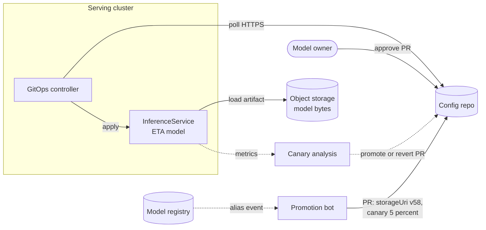

**Reading the diagram.** The registry emits an event asynchronously when `challenger` moves. A promotion bot opens a pull request that changes two fields in the serving manifest: the artifact URI (version 58) and the canary traffic share. A model owner approves it; for low-risk models the gate's report can auto-approve (§69.11). The controller inside the cluster pulls the repository over HTTPS and applies the change; the model server downloads the artifact from object storage by immutable path. Canary analysis reads metrics asynchronously and writes back to Git, either a commit that raises traffic to 100% or a revert. Storage boundaries: registry, config repository and object storage. Failure points: an artifact URI that points at a mutable path (always use versioned paths or digests), a controller that cannot reach Git (the cluster keeps the last state), and canary analysis with too little traffic to decide (§43.6.4). Scaling: one controller per cluster; many models per repository, one manifest each.

The manifest below is illustrative, in KServe's `InferenceService` format, where `canaryTrafficPercent` sends a share of traffic to the newly applied revision while the previous revision keeps the rest [KServe Docs]:

```yaml
# illustrative: KServe InferenceService for the ETA model
apiVersion: serving.kserve.io/v1beta1
kind: InferenceService
metadata:
  name: eta-model
  namespace: ml-serving
  labels:
    model-version: "58"          # written by the promotion bot
spec:
  predictor:
    canaryTrafficPercent: 5      # raise to 100 after analysis passes
    model:
      modelFormat:
        name: sklearn
      storageUri: s3://quickbite-models/eta/58/   # immutable, versioned path
```

### 69.6.4 Shadow and canary for models

§66.12 owns the mechanics of shadow, canary and A/B deployment for models, and §43.6 the statistics of canary judgment. The platform's job is to make the sequence the default: **shadow** (the candidate scores a copy of live traffic; nothing is shown) to verify latency, errors and prediction distributions at zero user risk; **canary** at 1–5% to verify operational health under real load; and, for models whose outcome depends on what users see, an **A/B test** to measure the business metric (§57.14). For ETA, shadow mode also measures accuracy, because delivery time barely depends on the displayed promise (§59.11.2).

### 69.6.5 Automated rollback

**Figure 69.6 — Automated rollback during a model canary.**

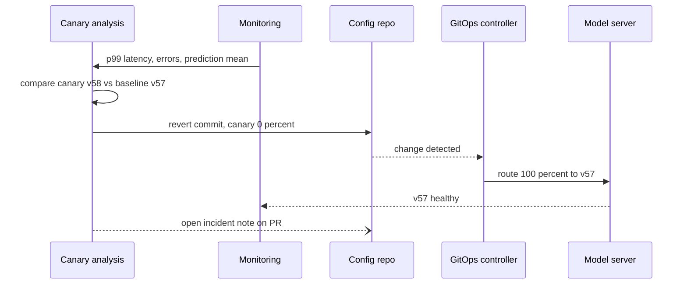

**Reading the diagram.** Monitoring feeds per-revision metrics to the analysis job. ML adds **prediction-level guardrails** to the usual latency and error checks: the mean and quantiles of the predicted ETA, the share of predictions hitting a clamp, and the null rate of input features, compared between canary and baseline. A breach produces a revert commit, not an imperative API call, so Git remains the record of what happened; the controller converges within its sync interval (or immediately on a webhook). The previous revision was never scaled down, so rollback is a routing change taking seconds, not a model load taking minutes. The final asynchronous message records the decision for the post-incident review. Failure point: rollback restores the *model*, but if the incident was caused by a feature change, the old model may be just as broken (§69.13).

::: recommendation
**Recommendation — Make "keep the champion" the default outcome.** Every failure path in CT and CD, whether a validation failure, a gate rejection, a canary breach or a timeout, should end with the current champion serving and a ticket filed. A platform in which failure means "no model" will be bypassed by teams under pressure.
:::

## 69.7 Experiment tracking

### 69.7.1 What to log

::: definition
**Definition — Experiment tracking.** Recording, for every training run, its **parameters** (inputs chosen before training: hyperparameters, feature list, seeds), **metrics** (numbers measured during or after training, possibly per step), **artifacts** (files produced: the model, plots, evaluation reports), and **lineage** (the data snapshot, code commit and environment that produced it), in a queryable store shared by the team.
:::

#### First-principles explanation

A chemist keeps a lab notebook so that a promising result can be repeated and a failed one is not tried twice. Without a tracker, ML teams keep that notebook in spreadsheet cells, file names (`model_final_v3_really_final.pkl`) and memory. The tracker makes the notebook automatic and searchable: "show me every ETA run in March with a validation MAE below 3.3, trained on the snapshot after the city-2 schema fix."

#### Why does this exist?

Zaharia et al. introduced MLflow in 2018 to address three problems they saw across organizations: experiments were hard to track and reproduce, there was no standard way to package code for re-running, and there was no standard way to package models for deployment. MLflow's original three components, **Tracking**, **Projects** and **Models**, map onto those problems [Zaharia et al. 2018]; a **Model Registry** was added later (§69.8).

### 69.7.2 MLflow tracking architecture

**Figure 69.7 — Tracking architecture in the MLflow style.**

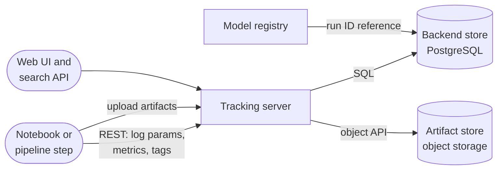

**Reading the diagram.** Training code calls a client library that sends parameters, metrics and tags to a **tracking server** over REST; these small records land in a **backend store**, a relational database in team deployments (a local file or SQLite store suffices for one person). Artifacts, which can be gigabytes, go to an **artifact store** in object storage, either uploaded directly by the client or proxied through the server [MLflow Docs]. The UI and search API read both. The registry references runs by ID, which is how a model version links back to its experiment. Calls are synchronous; logging inside a training loop should be batched or asynchronous so the tracker never slows training. Failure points: the tracking server as a single dependency of every training job (clients should buffer and retry, and training should not fail because logging failed); an artifact store without lifecycle rules, which grows forever. Scaling: the server is stateless and scales horizontally; the database holds metadata only.

### 69.7.3 Comparing runs without fooling yourself

The tracker makes it easy to sort runs by validation metric and pick the top one. That is exactly where a statistical trap hides: if many configurations are about equally good, the one with the best *measured* validation score is partly the luckiest.

::: formula
**Optimism of the best of $k$ runs (winner's curse)**

$$\mathbb{E}\!\left[\text{best measured}\right] \approx \mu - c_k\,\sigma_v, \qquad c_k \le \sqrt{2\ln k}, \qquad \sigma_v \approx \frac{s_{|e|}}{\sqrt{n_v}}$$

| Symbol | Meaning | Units |
|---|---|---|
| $\mu$ | True error shared by $k$ equally good configurations | minutes of MAE |
| $\sigma_v$ | Standard error of each validation MAE | minutes |
| $s_{\lvert e \rvert}$ | Standard deviation of per-example absolute error | minutes |
| $n_v$ | Validation examples | examples |
| $k$ | Configurations compared | runs |
| $c_k$ | Expected maximum of $k$ standard normal draws (1.42 for $k = 8$) | dimensionless |
:::

::: example
**Worked example — How much of the "best" run is luck?** The tracker program below compares $k = 8$ configurations on $n_v = 5{,}000$ validation orders; absolute errors have $s_{|e|} \approx 2.6$ min.

1. $\sigma_v = 2.6 / \sqrt{5{,}000} = 2.6 / 70.7 = 0.037$ min.
2. With $k = 8$, $c_8 = 1.42$ (the bound $\sqrt{2 \ln 8} = 2.04$). If several configurations were truly equal, the best one would look better than its true MAE by about $1.42 \times 0.037 = 0.052$ min.
3. The top four runs in the output span 3.243–3.256 min, a range of 0.013 min, well inside that noise.

*Interpretation:* the formula assumes independent errors across runs; because all runs share one validation set, part of the noise is common to every run and the true optimism is somewhat smaller, but the ranking among the top runs is still not meaningful; any of them is a reasonable choice, and the simplest or cheapest may be the better pick. *Engineering implication:* report the chosen run's error on a **separate test set** used once (the program reports 3.216 min), compare finalists with a paired test (§69.5.3) rather than by sorting, and log the number of runs compared so reviewers can judge the optimism.
:::

### 69.7.4 Code example: a mini experiment tracker

The program below implements the core of a tracker in about 50 lines of standard-library Python plus scikit-learn: runs, parameters, metrics, content-addressed artifacts and lineage tags in a local SQLite file, a grid of eight ETA runs, selection of the best run by SQL, and a reload of the winning model from the artifact store. It needs no external service and runs in about 8 seconds.

```python
"""A mini experiment tracker: runs, params, metrics, artifacts and lineage in SQLite."""
import os
os.environ.setdefault("OMP_NUM_THREADS", "1")
import hashlib, itertools, json, pickle, sqlite3
import numpy as np
from sklearn.ensemble import HistGradientBoostingRegressor

class Tracker:
    def __init__(self, path):
        self.db = sqlite3.connect(path)
        self.db.executescript("""
          CREATE TABLE IF NOT EXISTS runs(run_id INTEGER PRIMARY KEY, experiment TEXT,
              status TEXT, params TEXT, tags TEXT);
          CREATE TABLE IF NOT EXISTS metrics(run_id INT, key TEXT, step INT, value REAL);
          CREATE TABLE IF NOT EXISTS artifacts(run_id INT, name TEXT, sha256 TEXT, bytes INT);""")

    def start_run(self, experiment, params, tags):
        cur = self.db.execute("INSERT INTO runs(experiment, status, params, tags) VALUES (?,?,?,?)",
                              (experiment, "RUNNING", json.dumps(params, sort_keys=True),
                               json.dumps(tags, sort_keys=True)))
        return cur.lastrowid

    def log_metric(self, run_id, key, value, step=0):
        self.db.execute("INSERT INTO metrics VALUES (?,?,?,?)", (run_id, key, step, float(value)))

    def log_artifact(self, run_id, name, payload, store="artifacts"):
        digest = hashlib.sha256(payload).hexdigest()            # content address
        os.makedirs(store, exist_ok=True)
        with open(os.path.join(store, digest), "wb") as f:
            f.write(payload)
        self.db.execute("INSERT INTO artifacts VALUES (?,?,?,?)", (run_id, name, digest, len(payload)))

    def end_run(self, run_id, status="FINISHED"):
        self.db.execute("UPDATE runs SET status=? WHERE run_id=?", (status, run_id))
        self.db.commit()

    def best_run(self, experiment, metric):
        return self.db.execute("""
          SELECT r.run_id, r.params, m.value FROM runs r JOIN metrics m USING(run_id)
          WHERE r.experiment=? AND r.status='FINISHED' AND m.key=?
          ORDER BY m.value ASC, r.run_id ASC LIMIT 1""", (experiment, metric)).fetchone()

def make_data(n, seed):
    rng = np.random.default_rng(seed)
    d, prep = rng.gamma(2.0, 1.6, n), np.clip(rng.normal(12, 4, n), 3, 40)
    load, peak = rng.uniform(0.3, 1.3, n), (rng.random(n) < 0.35).astype(float)
    y = 13 + 3.0 * d + 0.9 * prep + 10 * np.maximum(0, load - 0.8) + 3 * peak + rng.normal(0, 4, n)
    return np.column_stack([d, prep, load, peak]), y

X, y = make_data(30000, seed=69)
Xtr, ytr, Xva, yva, Xte, yte = X[:20000], y[:20000], X[20000:25000], y[20000:25000], X[25000:], y[25000:]
data_hash = hashlib.sha256(Xtr.tobytes() + ytr.tobytes()).hexdigest()[:12]

if os.path.exists("mini_tracker.db"):
    os.remove("mini_tracker.db")                                # clean demo
tr = Tracker("mini_tracker.db")
grid = {"learning_rate": [0.05, 0.2], "max_iter": [100, 300], "max_leaf_nodes": [7, 63]}
for values in itertools.product(*grid.values()):
    params = dict(zip(grid, values), random_state=0)
    run = tr.start_run("eta-gbdt", params,
                       {"git_commit": "a91f3c2", "data_sha256": data_hash, "seed": 0})
    model = HistGradientBoostingRegressor(early_stopping=False, **params).fit(Xtr, ytr)
    tr.log_metric(run, "train_mae", np.mean(np.abs(model.predict(Xtr) - ytr)))
    tr.log_metric(run, "val_mae", np.mean(np.abs(model.predict(Xva) - yva)))
    tr.log_artifact(run, "model.pkl", pickle.dumps(model))
    tr.end_run(run)

print("run  lr    iters leaves  train_mae  val_mae")
for run_id, p, tmae, vmae in tr.db.execute("""
      SELECT r.run_id, r.params,
             MAX(CASE WHEN m.key='train_mae' THEN m.value END),
             MAX(CASE WHEN m.key='val_mae' THEN m.value END)
      FROM runs r JOIN metrics m USING(run_id) GROUP BY r.run_id"""):
    p = json.loads(p)
    print(f"{run_id:>3}  {p['learning_rate']:<5} {p['max_iter']:>5} {p['max_leaf_nodes']:>6}"
          f"  {tmae:9.3f}  {vmae:7.3f}")

best_id, best_params, best_val = tr.best_run("eta-gbdt", "val_mae")
sha = tr.db.execute("SELECT sha256 FROM artifacts WHERE run_id=?", (best_id,)).fetchone()[0]
with open(os.path.join("artifacts", sha), "rb") as f:
    best = pickle.loads(f.read())                               # reload from the store
test_mae = np.mean(np.abs(best.predict(Xte) - yte))
print(f"best run {best_id}: {best_params}")
print(f"val MAE {best_val:.3f}, test MAE {test_mae:.3f}, data {data_hash}")
```

Output:

```text
run  lr    iters leaves  train_mae  val_mae
  1  0.05    100      7      3.219    3.286
  2  0.05    100     63      3.031    3.256
  3  0.05    300      7      3.150    3.243
  4  0.05    300     63      2.808    3.289
  5  0.2     100      7      3.147    3.247
  6  0.2     100     63      2.722    3.326
  7  0.2     300      7      3.062    3.253
  8  0.2     300     63      2.207    3.449
best run 3: {"learning_rate": 0.05, "max_iter": 300, "max_leaf_nodes": 7, "random_state": 0}
val MAE 3.243, test MAE 3.216, data cc910558eff2
```

What to notice:

- **Lineage is just tags, if you are disciplined.** Every run carries the Git commit, a hash of the exact training data and the seed. Real trackers record the commit automatically and take the data reference from the pipeline's pinned snapshot (§69.10).
- **Artifacts are content-addressed**: the file name is the SHA-256 of its bytes, so identical models are stored once and a reference can never silently point at different bytes.
- **Overfitting is visible in the table.** Run 8 has the lowest training MAE (2.207) and the worst validation MAE (3.449); logging both metrics makes the gap obvious.
- **The ranking at the top is noise** (§69.7.3): runs 3, 5 and 7 differ by 0.010 min. The test MAE, measured once on untouched data, is the honest estimate.
- Production trackers add what this sketch omits: concurrency control, authentication, step-wise metrics streamed during training, a UI, and retention policies for artifacts.

::: tip
**Interview tip — "How do you know which model is in production and how it was trained?"** Answer with the chain: the serving manifest names a registry version; the version references a tracking run; the run records parameters, metrics, the data snapshot ID, the code commit and the image digest. If any link is missing, say which tool or convention you would add to close it.
:::

## 69.8 Model registry

### 69.8.1 Versions, aliases, signatures and model cards

::: definition
**Definition — Model registry.** A versioned catalog of model artifacts in which each **registered model** (for example `eta-gbdt`) has numbered, immutable **versions**, each linked to the run that produced it, its signature, evaluation results and documentation, plus mutable **aliases** or **stages** that name the role a version plays (champion, challenger) and an audit log of every change.
:::

If the experiment tracker is the lab notebook, the registry is the parts warehouse with a release desk: only parts with a serial number, a specification sheet and an inspector's stamp go out, and the desk records who took what, when. Four elements make a registry entry useful:

1. **Immutable versions.** Version 58 always means the same bytes. Retraining creates version 59; nothing is overwritten.
2. **Aliases.** A named, movable pointer to a version. Serving asks for `eta-gbdt@champion`, not for "the latest". Moving an alias is the promotion; moving it back is the rollback.
3. **Signature.** The input and output schema (feature names, types, shapes). CD refuses to deploy a version whose signature the serving path cannot satisfy.
4. **Model card.** A short document of intended use, training data, evaluation by slice, limitations and ethical considerations [Mitchell et al. 2019]. Chapter 71 covers its content; the registry makes it a required field.

**Figure 69.8 — Lifecycle of one model version in the registry.**

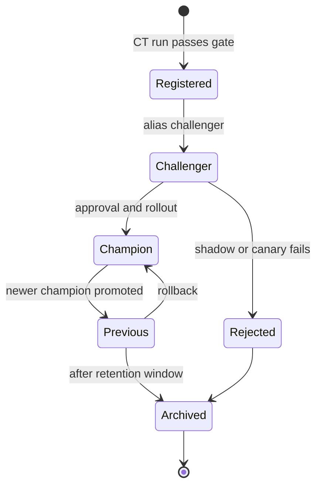

**Reading the diagram.** States are the roles a version holds; transitions are registry operations, each recorded with actor, time and reason. A version enters only through a passing CT run (never by manual upload, in a governed registry). It becomes `challenger` while shadow and canary run, `champion` after approval, and `previous` when replaced; `previous` is the rollback target and must stay loadable and its features available. Archiving removes it from serving paths but keeps metadata and, for audited models, the artifact itself. Failure points: two versions both labeled champion (aliases must be unique pointers, enforced by the registry) and an archived version still referenced by a manifest (CD must check before archiving).

### 69.8.2 The MLflow registry

The MLflow Model Registry attaches registered models and versions to tracking runs and offers tags, descriptions and aliases. Early versions used four fixed **stages** (None, Staging, Production, Archived); MLflow 2.9 deprecated stages in favor of **aliases** and tags [MLflow Docs]. Aliases are more flexible: a fixed set of four stages cannot name several production variants, or a champion and a challenger at once. Aliases are referenced in model URIs (`models:/eta-gbdt@champion`), so serving code does not change when the alias moves. Managed platforms (Databricks Unity Catalog, Vertex AI Model Registry, SageMaker Model Registry, as of 2026) offer similar concepts with access control integrated into the cloud's identity system.

### 69.8.3 The registry as the contract between training and serving

Training and serving are owned by different people and run on different schedules. The registry is the **interface** between them, like an API between two services: training promises to publish versions with a signature, lineage and passing evaluations; serving promises to load any version that meets the contract.

**Figure 69.9 — Registry data model.**

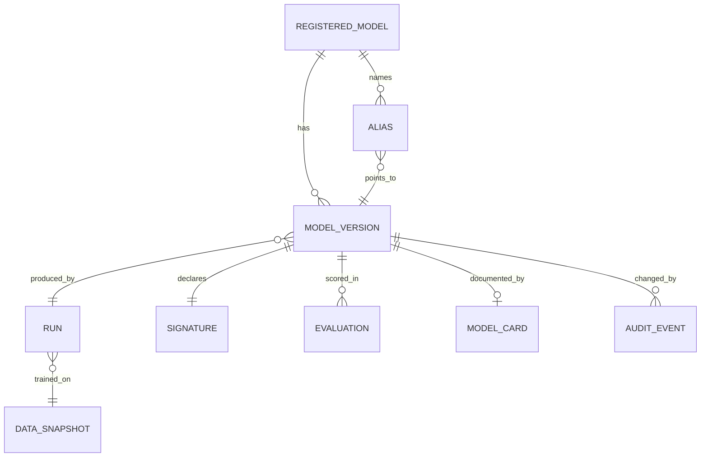

**Reading the diagram.** Each registered model has many immutable versions and a small set of aliases, each pointing to exactly one version. A version links to the tracking run that produced it, and the run to the data snapshot, so lineage is a join. Each version declares one signature, may have several evaluations (gate, shadow, canary, A/B) and one model card, and accumulates audit events. This is a relational schema; registries store it in a database and the artifacts themselves in object storage. Failure point: a version whose run or snapshot was deleted by a retention job, which breaks lineage; retention rules must follow the registry's references (§61.13).

::: warning
**Warning — "Latest" is not a deployment target.** Serving "the latest version" means that a CT run, rather than a review, decides what users see, and a rollback has no name. Always deploy an explicit alias or version number.
:::

## 69.9 Pipeline orchestration for ML

### 69.9.1 What ML adds to orchestration

§61.15 introduced orchestrators for data pipelines: DAGs of idempotent tasks on schedules, with retries and SLAs. ML pipelines need four more things:

1. **Typed artifact passing.** Steps exchange datasets and models measured in gigabytes, which must flow through object storage with recorded URIs, not through the orchestrator's database.
2. **Heterogeneous compute.** One pipeline mixes a Spark step, a CPU step and an 8-GPU training step; each step needs its own container image and resource request.
3. **Step caching.** Data scientists re-run a pipeline dozens of times while changing only the last steps; recomputing unchanged upstream steps wastes hours.
4. **Metadata and lineage.** Every execution records its inputs, outputs and parameters, which is what makes §69.10 and §69.13 possible.

### 69.9.2 The tools

**Table 69.4 — ML pipeline orchestrators compared (as of 2026).**

| Row | Kubeflow Pipelines | Apache Airflow | Metaflow | Flyte | Vertex AI / SageMaker Pipelines |
|---|---|---|---|---|---|
| What it is | Kubernetes-native ML pipeline platform | General workflow scheduler | Data-scientist-friendly framework from Netflix | Typed, Kubernetes-native workflow engine from Lyft | Managed cloud pipeline services |
| How it works | Python DSL compiled to a pipeline spec; each step a container | Python DAGs of tasks; scheduler and executors | Python class with `@step` methods; artifacts saved automatically | Typed Python tasks and workflows; each task a container | Python SDK; provider runs steps serverlessly |
| Advantages | Artifact lineage, caching, Kubernetes resources per step | Mature, huge operator library, backfills | Local-to-cloud with one code base; `resume` | Strong typing, versioned workflows, caching | No cluster to run; integrated registry and IAM |
| Disadvantages | Needs a Kubernetes team | No artifact model or step caching built in | Opinionated; production scheduling via another engine | Smaller ecosystem; Kubernetes required | Lock-in; less control; per-step overhead |
| Performance | Pod start-up per step (seconds) | Scheduler latency; not for sub-minute steps | Fast local iteration; cloud steps on batch or Kubernetes | Pod per task; parallel map tasks | Step provisioning overhead (minutes) |
| Operational complexity | High | Medium | Low to medium | Medium to high | Low |
| Cost | Cluster you run | Scheduler plus workers | Compute plus storage | Cluster you run | Managed premium on compute |
| Use cases | Kubernetes-centric ML teams | Data platforms adding ML steps | Many data scientists, many small projects | Large ML platforms needing reproducibility | Teams all-in on one cloud |
| Choose when | You already run Kubernetes well | Airflow already runs your data DAGs | Researcher velocity matters most | Typed, cached, versioned pipelines at scale | Small platform team, one cloud |

Sources for the table: [Kubeflow Docs; Apache Airflow Docs; Metaflow Docs; Flyte Docs; Google Cloud Docs: Vertex AI Pipelines; AWS Docs: SageMaker Pipelines].

A few details matter when choosing. **Kubeflow Pipelines** compiles a Python definition into a portable pipeline specification and runs each component as a container; it caches step results and records artifacts and executions in a metadata store [Kubeflow Docs]. **Airflow** schedules tasks rather than artifacts; large data passes through external storage, small values through XComs, and data-aware scheduling (datasets, renamed assets in Airflow 3) can trigger a DAG when an upstream table updates [Apache Airflow Docs]. **Metaflow** persists every attribute assigned in a step (`self.model = ...`) as a versioned artifact, can `resume` a failed run from the failed step, runs steps on cloud compute with decorators, and deploys flows to production schedulers such as AWS Step Functions or Argo Workflows [Metaflow Docs]. **Flyte** type-checks the interfaces between tasks, registers immutable versions of workflows, and caches a task's outputs when it is declared cacheable with a cache version [Flyte Docs]. **Vertex AI Pipelines** runs Kubeflow Pipelines or TFX definitions as a managed service, and **SageMaker Pipelines** offers a managed equivalent with configurable step caching.

### 69.9.3 Caching of pipeline steps

::: definition
**Definition — Step cache.** A map from a step's **cache key**, a hash of everything that determines its output (step code version, container image digest, parameters, and the identities of its input artifacts), to the step's recorded outputs. On a hit, the orchestrator reuses the outputs instead of running the step.
:::

**Figure 69.10 — How a cached step decides whether to run.**

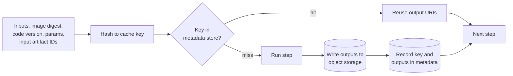

**Reading the diagram.** Before running a step, the orchestrator hashes its inputs into a key and looks it up synchronously in the metadata store. A hit returns the URIs of earlier outputs, which downstream steps read from object storage as usual; a miss runs the step, writes outputs, then records the key. Correctness depends entirely on the key including *everything* that affects the output. Failure points: a step that reads "the latest partition" or calls `now()` hides an input from the key and returns a stale cached result; outputs deleted by an object-store lifecycle rule while the cache entry survives. Scaling: lookups are cheap; the cost is storage of retained outputs.

::: formula
**Expected cost of a pipeline run with step caching**

$$C_{\text{run}} = \sum_{i=1}^{S} c_i\,(1 - h_i) \qquad \text{Savings} = 1 - \frac{C_{\text{run}}}{\sum_i c_i}$$

| Symbol | Meaning | Units |
|---|---|---|
| $S$ | Steps in the pipeline | steps |
| $c_i$ | Cost (or duration) of running step $i$ | \$ or minutes |
| $h_i$ | Probability that step $i$ is a cache hit on a given run | fraction |
| $C_{\text{run}}$ | Expected cost (or duration) of one run | \$ or minutes |
:::

::: example
**Worked example — ETA experimentation with and without caching.** The ETA pipeline has five steps: extract (40 min, \$12), validate (5 min, \$2), build features (30 min, \$15), train (15 min, \$8), evaluate (5 min, \$3); a full run takes 95 min and costs \$40. A data scientist tuning hyperparameters launches 30 runs a day, each changing only training parameters.

1. Without caching: $30 \times 40 = \$1{,}200$ a day, and each experiment waits 95 min.
2. With caching, the first run of the day misses everywhere (\$40). The other 29 hit on extract, validate and features ($h = 1$) and miss on train and evaluate: $8 + 3 = \$11$ and 20 min each.
3. Daily cost: $40 + 29 \times 11 = \$359$. Savings $= 1 - 359/1{,}200 = 70\%$, and turnaround falls from 95 to 20 minutes, 4.75 times faster.
4. Storage of cached outputs: one training set of about 10.8 GB a day (§61.13) at \$20 per TB-month is about \$0.22 per month for each day retained, negligible against \$841 a day saved.

*Interpretation:* the money matters less than the turnaround: 20-minute iterations allow several ideas per hour instead of four a day. *Engineering implication:* order pipelines so that the steps people change most often come last, keep upstream steps deterministic so they can be cached, and expire cache entries together with their outputs.
:::

### 69.9.4 Idempotent steps

Caching, retries and backfills all assume that running a step twice with the same inputs is harmless and gives the same result. Make every step **idempotent** (§22.15): write outputs to a path derived from the run or cache key, publish atomically (write to a temporary location, then commit, as table formats do, §61.8.2), never append to a shared location, and read inputs by pinned version rather than by "latest". A training step that registers a model should use the run ID as an idempotency key, so a retried step does not create two registry versions.

::: mistake
**"The orchestrator retries, so the pipeline is reliable."** Retries make a non-idempotent step *less* reliable: a step that appends rows or increments a counter doubles its effect on every retry. Reliability comes from idempotent steps; retries only exploit it.
:::

## 69.10 Reproducibility in practice

§59.14 defined three levels of reproducibility (re-runnable, statistically reproducible, bitwise reproducible) and listed what to version. A platform turns that list into a **reproducibility manifest** written automatically by every CT run and stored with the registry version.

**Figure 69.11 — The reproducibility manifest of one training run.**

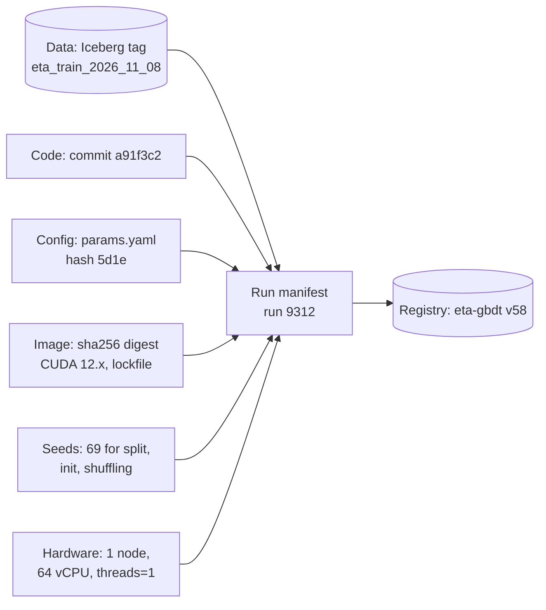

**Reading the diagram.** Six inputs determine a run, and the manifest records an immutable identifier for each: a **tagged** table snapshot rather than a time-travel timestamp that will expire (§61.13), a Git commit, a hash of the resolved configuration, a container image digest (which pins library versions through the lock file), the seeds, and the hardware and parallelism used. The manifest is attached to registry version 58. To reproduce, the platform launches the same image with the same configuration on the same snapshot. Failure points: any input read without an identifier (a "latest" partition, an unpinned base image, an environment variable that changes thread count).

Seeds are necessary but not sufficient. On GPUs, several sources of nondeterminism remain even with fixed seeds [PyTorch Docs: Reproducibility]:

**Table 69.5 — Sources of nondeterminism in GPU training.**

| Source | Why results differ | Mitigation | Cost |
|---|---|---|---|
| Atomic floating-point adds | Parallel threads add in different orders; floating-point addition is not associative | Deterministic kernels (`torch.use_deterministic_algorithms(True)`) | Slower kernels; some operations unsupported |
| Convolution algorithm selection | Benchmark mode picks the fastest algorithm per run | Disable benchmark mode; select deterministic algorithms | Some speed loss |
| cuBLAS workspace behavior | Some operations nondeterministic unless a workspace setting is fixed | Set `CUBLAS_WORKSPACE_CONFIG` as documented | Minor |
| Data-loader workers | Each worker's random state and arrival order | Seed workers; deterministic sampler | Minor |
| Distributed reductions | All-reduce order and bucketing vary (§65.7) | Fixed world size and bucketing; accept statistical reproducibility | Often impractical |
| Library and driver versions | Different kernels and numerics | Pin image, CUDA, cuDNN and driver | Upgrade discipline |

The practical target for most deep learning is **statistical reproducibility**: re-runs land within a known band. Measure that band once per model family by training with three to five seeds; the spread of the validation metric across seeds is the noise floor below which promotion gates and experiment comparisons cannot distinguish models. For the tree models in this chapter, which run on CPU with a fixed thread count, bitwise reproduction is realistic, and the programs above print identical outputs on every run.

::: recommendation
**Recommendation — Test reproducibility, do not assume it.** Once a month, have the platform re-run a recent production training run from its manifest and compare metrics with the original. A failure means an unpinned input exists, and you want to find it before an auditor or an incident does.
:::

## 69.11 Governance

### 69.11.1 Approvals, audit trails and access control

::: definition
**Definition — Model governance.** The policies and controls that determine who may train, approve, deploy and change a model, require documentation and independent review in proportion to risk, and keep an auditable record of every decision.
:::

Governance is the part of MLOps that answers questions after the fact: who approved the model that denied this customer's order, on what evidence, and what data trained it? Four mechanisms answer them:

1. **Approvals.** Promotion to `champion` requires sign-off proportional to risk: automatic for a low-risk model whose gate passed, a model owner for medium risk, an independent validator for high risk.
2. **Audit trails.** The registry, the config repository and the pipeline metadata store record every alias move, deployment and approval with actor, timestamp and reason. Git history already does this for GitOps deployments (§43.10).
3. **Access control.** Separate permissions to train, to register, to approve and to deploy, granted to roles and to pipeline service identities (§43.11). The person who trained a high-risk model should not be the one who approves it.
4. **Documentation.** Model cards (§69.8.1) and data documentation as required registry fields, versioned with the model.

### 69.11.2 Model risk management

Banking regulators formalized **model risk management** long before MLOps: the US Federal Reserve and OCC's supervisory guidance SR 11-7 (2011) defines model risk as the potential for adverse consequences from decisions based on incorrect or misused models, and asks for sound development, **independent validation** ("effective challenge") and governance including a model inventory [Federal Reserve and OCC 2011]. Its ideas transfer well: tier models by risk, keep an inventory (the registry), validate independently in proportion to the tier, and monitor continuously.

**Figure 69.12 — Controls by model risk tier.**

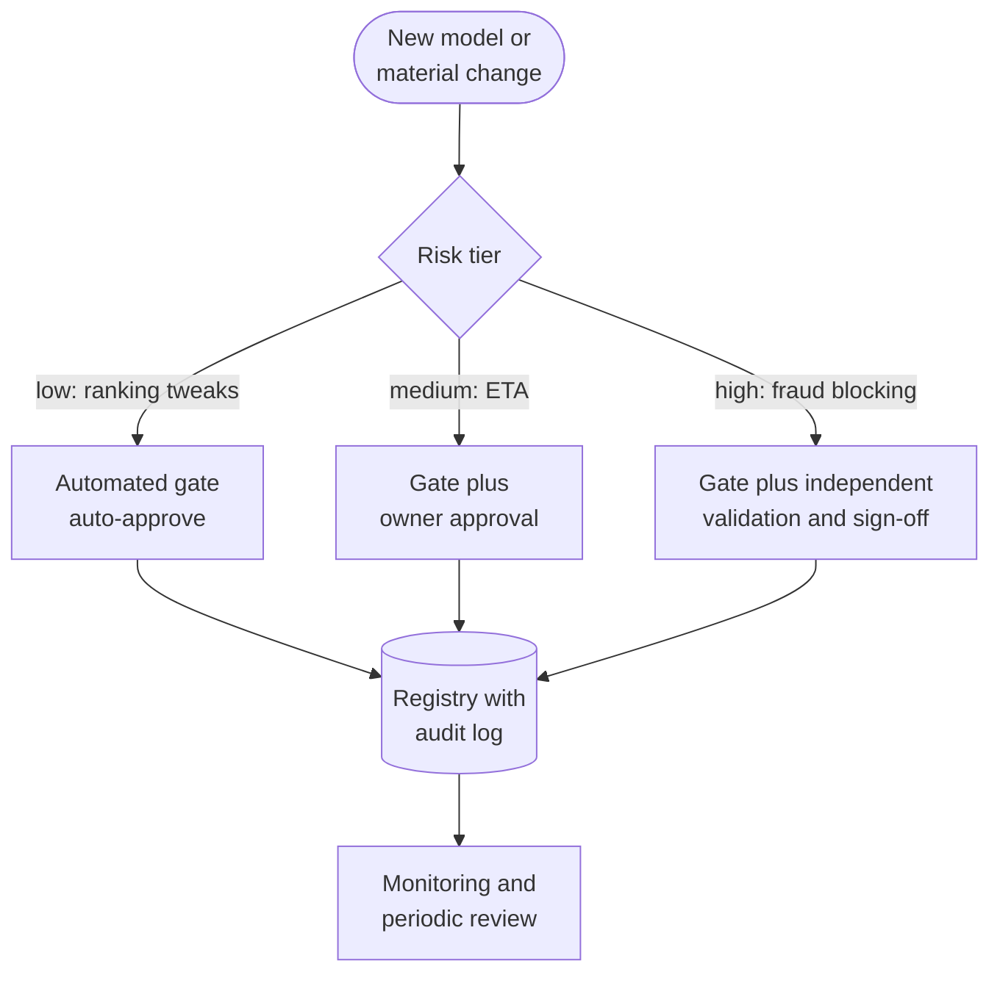

**Reading the diagram.** A new model or a *material* change (new features, new architecture, new use) is tiered by the harm its errors can cause. Low-risk models ship on an automated gate; medium-risk ones add the owner's approval; high-risk models, such as QuickBite's fraud model that blocks payments, need an independent validator who did not build the model. All paths end in the registry, whose audit log is the evidence, and in monitoring with a periodic review whose frequency also follows the tier. Routine retrains with unchanged features can use a lighter path than material changes, which is what makes continuous training compatible with governance. Failure point: treating every nightly retrain as a material change, which pushes teams to retrain less often or to bypass the process.

Regulation is moving in the same direction. The EU AI Act imposes documentation, logging, human-oversight and risk-management obligations on high-risk AI systems; Chapter 71 covers it with fairness, privacy and explainability. A platform that already records lineage, approvals and model cards meets much of the record-keeping burden by construction.

## 69.12 Monitoring hooks and the retraining loop

Chapter 70 owns *what* to monitor and the statistics of drift. The platform owns the **hooks**: the data every model emits by default, so that monitoring works on day one without per-team plumbing.

**Table 69.6 — What the platform logs for every prediction and every run.**

| Hook | Contents | Consumer |
|---|---|---|
| Prediction log | Request ID, timestamp, model name and version, feature vector (or hash plus sampled values), prediction, latency | Drift monitors, label joins, debugging (§60.6.2) |
| Label join | Request ID, label, label timestamp | Delayed performance metrics (§59.12.2) |
| Serving metrics | Per-version latency, errors, throughput, resource use | Canary analysis, SLOs (§40.4) |
| Run metadata | Manifest, gate report, slice metrics | Audits, rollback decisions |
| Feature freshness | Age of each feature at read time | Skew and staleness alerts (§62.10) |

**Figure 69.13 — Closing the retraining loop safely.**

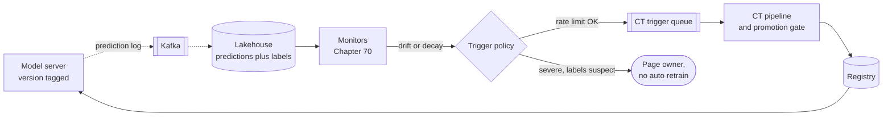

**Reading the diagram.** Prediction logs flow asynchronously through Kafka into the lakehouse, where they are joined with labels as they arrive. Monitors read those tables and raise signals. The **trigger policy** is the safety valve: ordinary decay or drift enqueues a CT run, subject to the rate limit of §69.5.1; a severe or suspicious signal (labels that look corrupted, a sudden collapse after an upstream change, a suspected attack) pages a human instead, because retraining on broken data would teach the model the breakage. The CT pipeline's gate still decides promotion. Failure points: the loop amplifying itself (the model influences its own labels, §59.13.2), so keep a randomized holdout; and the monitor and training reading the same corrupted table, so validate data before both.

::: warning
**Warning — Automated retraining can learn an outage.** If a courier-app bug delays "delivered" events by 20 minutes for a day, delivery-time labels inflate, drift monitors fire, and an eager loop retrains a model that predicts 20 minutes too long. Guard the loop with label-quality checks, a training window long enough to dilute one bad day, and the slice guardrails of §69.5.3.
:::

## 69.13 Rollback

### 69.13.1 Model, feature and data rollback

A model in production depends on three versioned things, so "roll back" has three meanings:

- **Model rollback** moves the `champion` alias back to the previous version (§69.6.5). Fast (seconds to minutes) and safe *only if* the features the old model expects are still served with the semantics it was trained on.
- **Feature rollback** restores a previous feature definition or pipeline version in the feature store (Chapter 62), including re-materializing online values. Slower (minutes to hours) and it affects every model that reads the feature.
- **Data rollback** restores a table to an earlier snapshot (table-format time travel or a tagged snapshot, §61.13) after bad data landed, then re-runs downstream steps. It fixes the *next* training run, not the serving model.

**Table 69.7 — Compatibility between model and feature versions.**

| Serving features | Model trained on old features | Model trained on new features |
|---|---|---|
| Old definition | Correct (pre-change state) | Skew: wrong inputs for the new model |
| New definition | Skew: wrong inputs for the old model | Correct (post-change state) |
| Both, side by side | Correct | Correct: rollback is safe |

The last row is the expand-and-contract pattern of database migrations (§43.13.2) applied to features: add the new definition alongside the old one under a new name or version, migrate models one by one, and remove the old definition only after no model in the registry's `champion` or `previous` aliases reads it. The registry's signatures make that check automatic.

### 69.13.2 Worked incident: a rollback that did not roll back

::: example
**Worked example — The kitchen-backlog incident (illustrative).** QuickBite redefines the feature `kitchen_backlog` from "number of open orders" (v12) to "minutes of queued preparation work" (v13). The feature team switches online materialization to v13 on Tuesday at 10:00; ETA model v58, trained on v13, becomes champion at 11:00, replacing v57 (trained on v12).

1. At 18:00, monitors show v58's predictions in city 3 running 4 minutes high. On-call rolls the model back to v57 at 18:10.
2. Predictions get *worse*: v57 now receives backlog values measured in minutes (typically 20–60) where it learned counts (typically 2–8), and reads every kitchen as overloaded. Late-ETA complaints rise.
3. Diagnosis at 18:40: the registry shows v57 was trained on `kitchen_backlog` v12; the feature store serves only v13. The model rollback created training–serving skew.
4. Correct recovery: restore v12 materialization alongside v13 (both computed from the same stream; 25 minutes to backfill online values), point v57 at v12, then investigate v58's city-3 bias separately. Full recovery at 19:15.
5. Impact estimate: city 3 alone was degraded from 11:00 to 18:10 by v58's bias; every city was degraded from 18:10 to 19:15 by the skew. Assuming 10% of daily orders fall in that 65-minute dinner window, the botched rollback alone distorted ETAs for about $0.10 \times 500{,}000 = 50{,}000$ orders. If city 3 handles 5% of orders and 40% of daily orders fall between 11:00 and 18:10, v58's bias affected about $0.05 \times 0.40 \times 500{,}000 = 10{,}000$ orders: the botched rollback did five times more damage than the defect it was meant to undo.

*Interpretation:* the fast, familiar lever (model rollback) was the wrong one because model and feature changed together. *Engineering implication:* never retire a feature version while any rollback target reads it; make the rollback runbook check signature compatibility before moving an alias; and roll out feature and model changes in separate steps so each can be reverted alone.
:::

**Figure 69.14 — Timeline of the kitchen-backlog incident.**

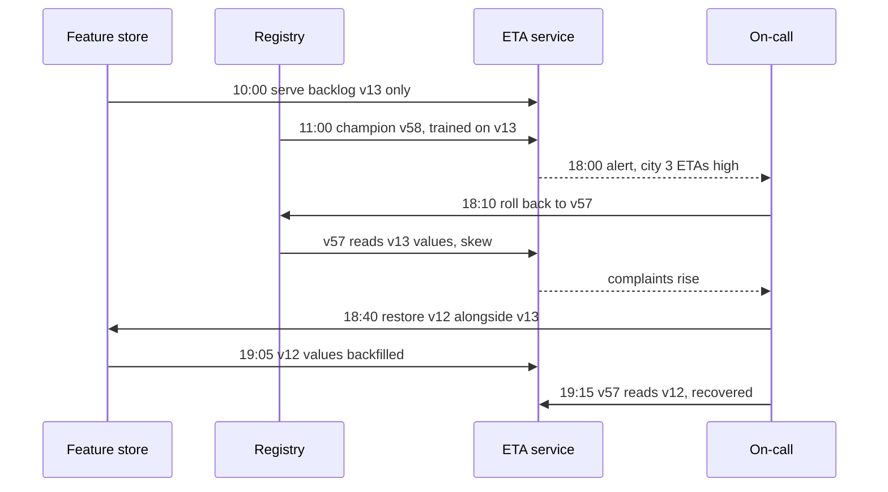

**Reading the diagram.** Solid arrows are actions; dashed arrows are signals reaching the on-call engineer. The defect lies in the first message: the feature store replaced v12 instead of adding v13 next to it, removing the rollback target's inputs. Every later step either suffered from or repaired that choice. With expand-and-contract, the 18:10 rollback would have ended the incident.

## 69.14 Platform case studies as published

Each platform below is described only from its builders' publications; details may have changed since.

::: industry
**Uber — Michelangelo (2017).** Built to give teams a standard workflow: manage data, train, evaluate, deploy, predict and monitor. It provides a shared feature store with batch and near-real-time paths (§62.13), distributed training, and a model repository: every trained model is stored as a versioned object recording who trained it, the configuration, references to training and evaluation data, accuracy metrics and learned parameters. Models are deployed for offline batch prediction or to an online prediction service; several models can be deployed to the same serving container, addressed by a unique identifier or a tag, which supports A/B testing and safe transitions. For monitoring, the platform logs a share of predictions and later joins them with observed outcomes to compute ongoing accuracy.
*Evidence: Primary* — [Hermann and Del Balso 2017]
:::

::: industry
**Google — TFX (2017).** A platform that integrates data analysis, transformation, validation, training, evaluation and validation of models, and serving into one configurable pipeline. Transformations are exported with the model to avoid training–serving skew; a model is pushed to serving only after validation against the current model; the authors emphasize continuous training with warm-starting on fresh data. The paper reports its deployment for Google Play app recommendations.
*Evidence: Primary* — [Baylor et al. 2017]
:::

::: industry
**Facebook — FBLearner Flow (2016).** Facebook's workflow platform for ML: engineers write **workflows** in Python composed of **operators**, with typed **channels** describing inputs and outputs, so the system can build the execution graph, schedule steps across a cluster and track artifacts. An experiment-management UI lets engineers launch, compare and reuse workflows. The 2016 post reported that more than 25% of Facebook's engineering team had used it, that it had trained over a million models, and that its prediction service made more than 6 million predictions per second (as reported in 2016).
*Evidence: Primary* — [Dunn 2016]
:::

::: industry
**Netflix — Metaflow (open-sourced 2019).** Designed around data scientists' productivity: a flow is a Python class whose steps run locally or on cloud compute through decorators, every step's state is persisted as versioned artifacts, failed runs can be resumed, and finished flows deploy to production schedulers. Netflix describes it as "human-centric": the platform handles infrastructure so scientists keep working in plain Python.
*Evidence: Primary* — [Netflix Technology Blog 2019; Metaflow Docs]
:::

::: industry
**Airbnb — Bighead (2018).** An end-to-end platform presented in conference talks: Zipline for features (§62.13), Redspot as a hosted multi-tenant notebook service, a model library and service for versioned model management, ML Automator generating Airflow pipelines for training and batch scoring, and Deep Thought for online serving with standardized logging and alerting.
*Evidence: Secondary* — conference talk and interview [Puttaswamy and Hoh 2018; Kale 2018]
:::

**Table 69.8 — What the published platforms have in common.**

| Platform | Feature management | Pipeline definition | Model store | Serving | Monitoring hook |
|---|---|---|---|---|---|
| Michelangelo | Shared feature store, DSL | Platform workflow | Versioned model repository | Batch and online | Logged predictions joined to outcomes |
| TFX | Transform exported with model | Component pipeline | Pushed after validation | TF Serving | Validation against current model |
| FBLearner Flow | Upstream systems | Python workflows, operators | Tracked artifacts | Prediction service | Experiment UI |
| Metaflow | Upstream systems | Python flow class | Versioned artifacts | Via other systems | Via other systems |
| Bighead | Zipline | ML Automator on Airflow | Model service | Deep Thought | Standard logging, alerting |

The lesson is convergence: each company found that teams kept rebuilding the same glue, and centralized it behind a standard workflow, a model store with lineage and a standard serving path. They differ in scope: Michelangelo and Bighead span the whole lifecycle, while Metaflow deliberately focuses on the authoring and orchestration experience and integrates with other systems for the rest.

## 69.15 Build versus buy an ML platform

Uber, Google, Meta, Netflix and Airbnb built platforms because nothing suitable existed in 2015–2018 and their scale justified dedicated teams. By 2026 most components exist as open-source projects or managed services, so the question for most companies is how much to assemble and run themselves. The honest comparison is **total cost of ownership** (TCO), in which people usually cost more than infrastructure.

::: formula
**Annual platform TCO and the compute break-even**

$$\text{TCO} = E\,s + C\,(1 + p) + F \qquad C^{*} = \frac{(E_b - E_m)\,s + (F_b - F_m)}{p_m - p_b}$$

| Symbol | Meaning | Units |
|---|---|---|
| $E$ | Platform engineers needed to build and run the option ($E_b$ build, $E_m$ managed) | engineers |
| $s$ | Fully loaded cost per engineer-year | \$/year |
| $C$ | Underlying compute and storage spend for training and pipelines | \$/year |
| $p$ | Price premium on compute ($p_b$ self-run, usually 0; $p_m$ managed) | fraction |
| $F$ | Fixed licenses, support contracts and subscriptions ($F_b$, $F_m$) | \$/year |
| $C^{*}$ | Compute spend above which building is cheaper | \$/year |
:::

::: example
**Worked example — QuickBite's platform decision (all figures are assumptions).** QuickBite spends $C = \$800{,}000$ a year on ML compute and storage; an engineer costs $s = \$250{,}000$ loaded.

*Build* on open source (Kubernetes, Flyte or Kubeflow, MLflow, Feast): $E_b = 6$ engineers, $p_b = 0$, $F_b = \$50{,}000$ for support.

1. $\text{TCO}_b = 6 \times 250{,}000 + 800{,}000 + 50{,}000 = \$2{,}350{,}000$.

*Managed* (a cloud ML platform plus a thin internal layer): $E_m = 2$, an assumed 30% premium $p_m = 0.30$, and $F_m = \$150{,}000$.

2. $\text{TCO}_m = 2 \times 250{,}000 + 800{,}000 \times 1.30 + 150{,}000 = 500{,}000 + 1{,}040{,}000 + 150{,}000 = \$1{,}690{,}000$.
3. Break-even: $C^{*} = (4 \times 250{,}000 + (50{,}000 - 150{,}000)) / 0.30 = 900{,}000 / 0.30 = \$3{,}000{,}000$ a year.

*Interpretation:* managed is \$660,000 a year cheaper at QuickBite's spend; building wins only when compute exceeds about \$3 million a year, or when needs are unusual enough that managed services force workarounds. Four engineers' salaries equal a 30% premium on \$3 million. *Engineering implication:* revisit the decision as spend grows, and keep the exit cost low by owning the *interfaces* (registry contract, pipeline definitions, prediction-log schema) even when vendors run the implementation.
:::

**Table 69.9 — Build versus buy decision guide.**

| Factor | Favors building | Favors buying or managed |
|---|---|---|
| Team size | Dedicated platform team of 5 or more | Fewer than 3 people for the platform |
| Compute spend | Above the break-even $C^{*}$ | Below it |
| Requirements | Unusual: on-premises GPUs, strict data residency, custom serving | Standard tabular and deep learning workflows |
| Existing stack | Kubernetes and Airflow already run well | One cloud used for everything |
| Time to value | Can wait 6–12 months for first version | Need pipelines this quarter |
| Lock-in tolerance | Low | Acceptable, with owned interfaces |
| Model count | Dozens of models, many teams | A handful of models |

Most organizations land on a **hybrid**: managed compute and storage, open-source tracking and orchestration where they want portability, and a thin internal layer of templates, gates and conventions (the "paved path") that encodes their own policies.

::: mistake
**"Buying a platform gives you MLOps."** Tools provide mechanisms; the practices (gates with real thresholds, slice guardrails, rollback runbooks, risk tiers) are still yours to define. Shankar et al.'s interviewees described validation and versioning as cultural as much as technical problems [Shankar et al. 2022].
:::

## 69.16 Reference QuickBite ML platform architecture

**Figure 69.15 — QuickBite ML platform.**

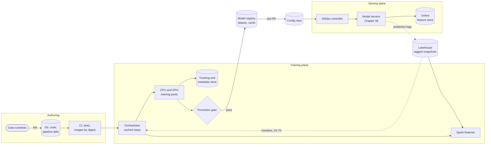

**Reading the diagram.** Authoring: data scientists change code and pipeline definitions through pull requests; CI tests them and publishes images by digest. Training plane: the orchestrator runs cached, idempotent steps; Spark builds features from tagged lakehouse snapshots; training runs on shared CPU and GPU pools and logs to the tracking and metadata store; the promotion gate registers passing candidates. The registry is the contract: alias changes become pull requests to the config repository, which the GitOps controller applies to model servers that read the online feature store. The loop closes asynchronously through prediction logs and monitors, which enqueue CT runs. Storage boundaries: Git, lakehouse, tracking store, registry, config repository and feature store. Failure isolation: if the training plane is down, serving continues on the last champion; if the registry is down, nothing new is promoted but nothing breaks. Scaling: training pools autoscale per queue; serving scales per model (Chapter 66).

**Table 69.10 — QuickBite platform decisions.**

| Decision | Choice | Reason |
|---|---|---|
| Build or buy | Managed compute and registry, open-source orchestration and tracking | Below compute break-even (§69.15); portability of pipeline definitions |
| Pipelines | One template per model type, step caching on | 70% cheaper experimentation, 20-minute iterations (§69.9.3) |
| Gates | Paired non-inferiority, $m = 0.1$ min, slice tolerance 0.2 min, behavioral suite | Catches broken features that average metrics miss (§69.5.3) |
| CT triggers | Nightly for ETA; data volume and drift for fraud; rate limit 4 runs a day | Break-even analysis (§69.5.2) |
| Deployment | Aliases, bot PRs, GitOps, shadow then 5% canary | Git is the audit trail; rollback is a revert (§69.6) |
| Governance | Three risk tiers; independent validation for fraud | Proportionate control (§69.11) |
| Features | Expand-and-contract for definition changes | Keeps model rollback safe (§69.13) |
| Platform team | 2 engineers plus embedded ML engineers | TCO (§69.15) |

::: industry
**QuickBite (illustrative).** This platform is a teaching design assembled from the published systems and documentation cited in this chapter; it is not a description of any company's platform.
*Evidence: Illustrative*
:::

## 69.17 Summary and revision notes

::: summary
- MLOps extends DevOps to systems whose behavior changes with data: version code, configuration, data, models and environments, and test data and models as well as code.
- Three pipelines: **CI** tests every change (code, data fixtures, smoke tests, behavioral tests, parity); **CT** retrains on triggers; **CD** delivers approved pipelines and models through progressive rollout with automated rollback. At higher maturity you deploy the pipeline, and the pipeline produces models.
- Behavioral tests (MFT, INV, DIR) catch failures that aggregate metrics average away; monotonic constraints and feature removal fix them by construction.
- Triggers start runs, never promote. Combine schedule, data volume, drift and performance triggers behind one deduplicated, rate-limited queue. Retrain when $\Delta E > C/(kH)$.
- Promotion gates compare candidate and champion **paired** on the same held-out window, usually as a non-inferiority test ($z = (\bar{d} + m)/SE$), plus slice guardrails, behavioral and operational checks. Pairing cut the standard error 7.6-fold in the example.
- The experiment tracker records parameters, metrics, artifacts and lineage; beware the winner's curse ($\approx c_k \sigma_v$) when picking the best of many runs.
- The registry holds immutable versions, movable aliases, signatures and model cards, and is the contract between training and serving. Deploy aliases through GitOps; rollback is a revert.
- Orchestrators differ in artifact handling, caching and operational weight. Step caching with complete cache keys and idempotent steps cut experimentation cost by 70% in the example.
- Reproducibility needs a manifest: tagged snapshot, commit, config hash, image digest, seeds, hardware. GPU training is usually only statistically reproducible.
- Governance scales controls with risk: automated approval for low risk, independent validation for high risk, audit trails throughout.
- The retraining loop needs a trigger policy that pages humans when labels are suspect. Model, feature and data rollback differ; expand-and-contract feature changes keep model rollback safe.
- Published platforms converged on the same shape. Build only above the TCO break-even $C^{*}$; otherwise buy and own the interfaces.
:::

## 69.18 Knowledge checkpoint

1. Name the three pipelines of MLOps and what triggers each.
2. Give one MFT, one INV and one DIR test for a fraud model.
3. Why should a trigger never promote a model by itself?
4. A run costs \$300, $k = \$4{,}000$ per minute-day, and the model serves 3 days. What improvement breaks even?
5. Why compare candidate and champion with paired differences?
6. $\bar{d} = -0.03$ min, $s_d = 0.6$ min, $n = 3{,}600$, $m = 0.1$, $\alpha = 0.01$. Promote?
7. What is the difference between a registry stage and an alias?
8. List the inputs to a step's cache key, and one way a cached step can return a stale result.
9. Five steps cost \$10, \$5, \$20, \$10 and \$5; on repeat runs the first three always hit. What are the savings per repeat run?
10. Name three sources of nondeterminism in GPU training that seeds do not remove.
11. Why can a model rollback make an incident worse?
12. Under what condition is building an ML platform cheaper than a managed one?

<details><summary>Answers</summary>

1. CI, on every code or pipeline change; CT, on schedule, data, drift or performance triggers; CD, on an approved model (alias change) or a pipeline that passed CI.
2. MFT: a known stolen-card pattern must score above the block threshold. INV: changing the customer's display name must not change the score. DIR: adding three failed payment attempts must not lower the score.
3. Triggers fire on proxies and can fire on broken data; promotion needs the gate's evidence, and a trigger storm must not become a deployment storm.
4. $\Delta E^{*} = 300/(4{,}000 \times 3) = 0.025$ minutes of MAE.
5. Both models score the same examples, so shared difficulty cancels; the standard error shrinks sharply and smaller differences become detectable.
6. $SE = 0.6/60 = 0.01$; $z = (-0.03 + 0.1)/0.01 = 7.0 > 2.326$. Promote: worse by 0.03 min but significantly within the 0.1-min margin.
7. A stage is one of a fixed set of lifecycle labels (deprecated in MLflow 2.9); an alias is a named, movable pointer to exactly one version, with as many names as needed.
8. Code version, image digest, parameters, and input artifact identities. Stale when a step reads "latest" data or the current time, which the key does not capture.
9. Full run \$50; repeat run \$15; savings $1 - 15/50 = 70\%$.
10. Atomic floating-point accumulation, autotuned convolution algorithm selection, and nondeterministic reductions in distributed training (also library and driver versions).
11. If the feature definition changed with the model, the old model receives inputs with new semantics: training–serving skew.
12. When compute spend exceeds $C^{*} = ((E_b - E_m)s + F_b - F_m)/(p_m - p_b)$, or requirements cannot be met by managed services.
</details>

## 69.19 Interview questions

### Basic

**Q1. What does MLOps add to DevOps?** **Answer.** Data and models become versioned artifacts alongside code; tests extend to data validation and model behavior; and a third pipeline, continuous training, produces models when data changes. Deployment adds statistical promotion gates, prediction-level canary guardrails and a registry that links each served model to its data, code and environment.

**Q2. What does an experiment tracker record and why?** **Answer.** Parameters, metrics, artifacts and lineage (data snapshot, commit, image) for every run, so results can be compared, reproduced and traced from a production model back to its inputs.

### Intermediate

**Q3. Design a promotion gate for a nightly ETA retrain.** **Answer.** Score champion and candidate on the latest held-out week neither trained on; run a paired non-inferiority test on absolute errors with a margin set by product; require every city slice to stay within a tolerance; re-run behavioral tests; check latency and model size on the serving image. On failure, keep the champion and alert. Size the window so the smallest guarded slice has enough examples.

**Q4. Airflow or Kubeflow Pipelines for a new ML team?** **Answer.** If Airflow already runs the data platform and models are few, extend it and add artifact tracking and caching conventions. If the team runs Kubernetes well and needs per-step GPU resources, artifact lineage and caching, use a Kubernetes-native ML orchestrator. With a small team on one cloud, consider a managed pipeline service.

### Advanced

**Q5. Your automated retraining loop shipped a model that learned an outage. How do you redesign it?** **Answer.** Add label-quality checks before training; route severe or suspicious signals to humans rather than to CT; lengthen or weight the training window so one bad day cannot dominate; add slice guardrails and a superiority requirement after anomalies; rate-limit runs; and keep a randomized holdout to detect feedback effects.

**Q6. How do you make rollback safe when features and models evolve together?** **Answer.** Version features; change definitions by expand-and-contract so old and new values are served side by side; record each model version's feature versions in its signature; block retiring a feature version while any `champion` or `previous` model reads it; and include a compatibility check in the rollback runbook.

## 69.20 Practical exercises

1. Extend the §69.7.4 tracker with step-wise metrics and a `compare(run_a, run_b)` function that runs the paired test of §69.5.3 on stored validation predictions.
2. In the §69.5.3 gate, make candidate C by dropping city 3's data from days 40–82. Does the slice guardrail catch it? What held-out size would it need?
3. Add an INV test to the gate for the `promo_flag` feature of §69.4.3 and show it rejecting the unconstrained model.
4. Write a cache-key function for a pipeline step that hashes the image digest, parameters and input snapshot IDs, and a test proving that a change to any of them changes the key.

## 69.21 Design challenges

1. **Fraud model platform path.** Design CT and CD for QuickBite's fraud model: 60-day labels, high risk tier, weekly cost-benefit check. Specify triggers, gate statistics on immature labels, approvals and rollback.
2. **From five notebooks to a platform.** A 15-person data science team ships five models by hand. Propose a 12-month plan with build-versus-buy reasoning, the first three platform components and how you would measure success with the ML Test Score.

## 69.22 References

1. Apache Software Foundation. *Apache Airflow Documentation*. 2026. https://airflow.apache.org/docs/
2. AWS. *Amazon SageMaker Pipelines*. Amazon SageMaker Developer Guide, 2026. https://docs.aws.amazon.com/sagemaker/latest/dg/pipelines.html
3. Baylor, D., et al. *TFX: A TensorFlow-Based Production-Scale Machine Learning Platform*. KDD, 2017.
4. Board of Governors of the Federal Reserve System and Office of the Comptroller of the Currency. *Supervisory Guidance on Model Risk Management* (SR 11-7). 2011. https://www.federalreserve.gov/supervisionreg/srletters/sr1107.htm
5. Breck, E., Cai, S., Nielsen, E., Salib, M., Sculley, D. *The ML Test Score: A Rubric for ML Production Readiness and Technical Debt Reduction*. IEEE International Conference on Big Data, 2017.
6. Dunn, J. *Introducing FBLearner Flow: Facebook's AI Backbone*. Engineering at Meta (Facebook Engineering blog), 2016. https://engineering.fb.com/2016/05/09/core-infra/introducing-fblearner-flow-facebook-s-ai-backbone/
7. Flyte. *Flyte Documentation*. Linux Foundation AI & Data, 2026. https://docs.flyte.org/
8. Google Cloud. *MLOps: Continuous Delivery and Automation Pipelines in Machine Learning*. Cloud Architecture Center, 2020. https://cloud.google.com/architecture/mlops-continuous-delivery-and-automation-pipelines-in-machine-learning
9. Google Cloud. *Introduction to Vertex AI Pipelines*. Vertex AI documentation, 2026. https://cloud.google.com/vertex-ai/docs/pipelines/introduction
10. Hermann, J., Del Balso, M. *Meet Michelangelo: Uber's Machine Learning Platform*. Uber Engineering Blog, 2017. https://www.uber.com/blog/michelangelo-machine-learning-platform/
11. Kale, A. *Bighead: Airbnb's Machine Learning Platform*. TWiML AI Podcast, episode 198, 2018. https://twimlai.com/talk/198
12. KServe. *KServe Documentation: InferenceService and canary rollout*. 2026. https://kserve.github.io/website/
13. Kreuzberger, D., Kühl, N., Hirschl, S. *Machine Learning Operations (MLOps): Overview, Definition, and Architecture*. IEEE Access 11, 2023.
14. Kubeflow. *Kubeflow Pipelines Documentation*. 2026. https://www.kubeflow.org/docs/components/pipelines/
15. Metaflow. *Metaflow Documentation*. 2026. https://docs.metaflow.org/
16. Mitchell, M., Wu, S., Zaldivar, A., Barnes, P., Vasserman, L., Hutchinson, B., Spitzer, E., Raji, I. D., Gebru, T. *Model Cards for Model Reporting*. FAT\*, 2019.
17. MLflow. *MLflow Documentation: Tracking, Models and Model Registry*. 2026. https://mlflow.org/docs/latest/
18. Netflix Technology Blog. *Open-Sourcing Metaflow, a Human-Centric Framework for Data Science*. 2019.
19. Puttaswamy, K., Hoh, A. *Bighead: Airbnb's End-to-End Machine Learning Platform*. DataEngConf SF, 2018.
20. PyTorch. *Reproducibility*. PyTorch documentation, 2026. https://pytorch.org/docs/stable/notes/randomness.html
21. Ribeiro, M. T., Wu, T., Guestrin, C., Singh, S. *Beyond Accuracy: Behavioral Testing of NLP Models with CheckList*. ACL, 2020.
22. Shankar, S., Garcia, R., Hellerstein, J. M., Parameswaran, A. G. *Operationalizing Machine Learning: An Interview Study*. arXiv:2209.09125, 2022.
23. Zaharia, M., Chen, A., Davidson, A., Ghodsi, A., Hong, S. A., Konwinski, A., Murching, S., Nykodym, T., Ogilvie, P., Parkhe, M., Xie, F., Zumar, C. *Accelerating the Machine Learning Lifecycle with MLflow*. IEEE Data Engineering Bulletin 41(4), 2018.

## 69.23 Open verification items

- Kreuzberger et al. 2023: confirm the paraphrased definition of MLOps against the paper's wording.
- FBLearner Flow figures (over 25% of engineers, over a million models, over 6 million predictions per second) were confirmed via secondary reports of the 2016 post; the post itself could not be fetched while writing.
- Michelangelo: confirm that the 2017 post describes deploying several models to one serving container addressed by identifier or tag.
- MLflow: stage deprecation in 2.9 confirmed via the project's GitHub issue; confirm the alias URI syntax against current documentation.
- Bighead component names come from 2018 talks and an interview; confirm current status.
- Netflix Metaflow announcement: confirm URL and date.
- KServe `canaryTrafficPercent` field: confirm against current API version.
