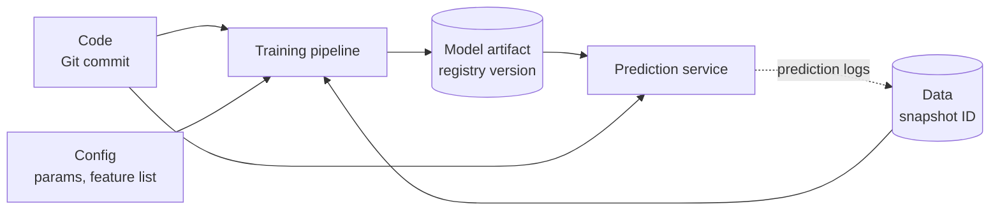

# Chapter 69 — MLOps and ML Platforms

> **Level:** 3–4 · **Track:** B (ML/AI) · **Estimated reading time:** 5 h

An airline does not keep its aircraft safe by hiring brilliant pilots alone. It keeps a logbook for every airframe, follows checklists before every departure, swaps parts only through a controlled maintenance process, and can say for any flight which engine, which software version and which inspector signed it off. When something goes wrong, the airline can ground one aircraft type, roll back a software update or replace a batch of parts, because every component has a serial number and a history.

**MLOps** is that discipline for machine-learning systems. Chapter 59 drew the lifecycle as a loop and placed teams on maturity levels (§59.15); Chapter 60 drew a training pipeline (§60.5). This chapter is about the *platform engineering* that makes the loop safe and cheap to run many times a day: the three pipelines (continuous integration, continuous delivery and continuous training), the tests that guard them, the experiment tracker and model registry that remember everything, the orchestrators that run the steps, and the governance, rollback and retraining machinery around them. You will build a mini experiment tracker and a statistical promotion gate in Python, size the savings from pipeline caching, decide when retraining pays for itself, and finish with published platforms from Uber, Google, Meta, Netflix and Airbnb and a reference platform for QuickBite.

Two neighboring chapters share the territory. Chapter 70 owns monitoring and drift statistics (PSI, KS, delayed labels); here you will see only the *hooks* the platform provides and what the platform does when a monitor fires. Chapter 66 owns model servers and safe deployment patterns (§66.12); here you will see how the platform drives them.

::: note
**QuickBite assumptions used in this chapter.** These reuse the Book II design point and are teaching assumptions, not measurements of a real company: 500,000 orders a day; 35-minute median delivery time; up to 40,000 ETA predictions per second at peak (§60.6); 0.5% fraud rate; fraud losses of \$450,000 a month (§60.13); CPU at \$0.048 per vCPU-hour and GPUs at \$2.50 per GPU-hour (§60.11); each extra minute of ETA mean absolute error (MAE) costs about \$2,000 a day in support contacts and refunds (§59.13). New in this chapter: QuickBite runs 12 production models (ETA, ranking and recommendations, fraud, demand forecasting, prep-time estimation and the support chatbot among them) built by about 30 data scientists and ML engineers, and the ETA model retrains nightly (§60.5). Sizes use SI units (1 GB = 10⁹ bytes).
:::

## 69.1 Learning objectives

After this chapter you should be able to:

- Explain what MLOps adds to DevOps: data and models as versioned artifacts, tests for data and models, and three pipelines (CI, CD, CT) with different triggers.
- Design a CI stage for an ML system with code tests, data tests, behavioral model tests (minimum-functionality, invariance and directional) and training-pipeline smoke tests in a reproducible environment.
- Choose continuous-training triggers, compute when a retraining run pays for itself, and build a promotion gate that compares a candidate with the champion using a paired statistical test and slice guardrails.
- Package a model with its signature and environment, promote it through registry aliases, deploy it with GitOps, and wire automated rollback.
- Implement a minimal experiment tracker, explain MLflow's tracking and registry architecture, and avoid the winner's curse when comparing runs.
- Compare Kubeflow Pipelines, Airflow, Metaflow, Flyte and managed pipelines, and compute the savings from step caching with idempotent steps.
- Record a reproducibility manifest and name the sources of nondeterminism in GPU training.
- Put approvals, audit trails, access control and model risk tiers in place; close the retraining loop safely; distinguish model, feature and data rollback.
- Summarize the published designs of Michelangelo, TFX, FBLearner Flow, Metaflow and Bighead, and decide whether to build or buy an ML platform using total cost of ownership.

## 69.2 Prerequisites

- The lifecycle loop, versioning, retraining cadence and MLOps maturity levels — Chapter 59, especially §59.13–§59.15 (this chapter builds the machinery those sections describe).
- The training pipeline and its gates — §60.5; prediction logging — §60.6.2.
- Table formats, time travel, data versioning, lineage and orchestration basics — §61.8, §61.12, §61.13, §61.15.
- Feature stores and training–serving skew — Chapter 62 (models depend on feature definitions, which matters for rollback).
- CI/CD, canary analysis, feature flags and GitOps — §43.3, §43.6, §43.7, §43.10.
- Containers, images and Kubernetes — Chapter 42 (pipeline steps and model servers run as containers).
- Two-sample tests, standard errors and statistical power — §4.18, §57.14 (promotion gates are hypothesis tests).
- Model serving and safe deployment — Chapter 66, §66.12 (shadow and canary for models).

## 69.3 What MLOps adds to DevOps

### 69.3.1 Data and models as versioned artifacts

::: definition
**Definition — MLOps.** The set of practices, roles and tools that automate and govern the building, testing, deployment, monitoring and retraining of ML models in production, by treating data, code and models as versioned artifacts that flow through automated pipelines. Kreuzberger, Kühl and Hirschl, synthesizing literature and practitioner interviews, define it as a paradigm spanning best practices, concepts and an engineering culture that bridges machine learning, software engineering and data engineering [Kreuzberger et al. 2023].
:::

#### First-principles explanation

In ordinary software, behavior changes only when someone changes the code. A web service built from commit `a91f3c2` behaves the same today as last month. In an ML system, behavior is a function of three things: the code, the data the model was trained on, and the model artifact that training produced. Any of the three can change independently. A nightly retraining run produces a new model from the *same* code, because the data moved. An upstream team can change a column's meaning without anyone touching your repository. The same training code can produce different models on two runs because of random seeds or GPU arithmetic.

DevOps gave us version control, automated tests and deployment pipelines for code. MLOps extends each of these to data and models: version them, test them, and move them through pipelines with gates.

#### Why does this exist?

Interview studies of practitioners keep finding the same pain. Shankar et al. interviewed 18 ML engineers and summarized what makes production ML succeed as three "Vs": **velocity** (iterating quickly on ideas), **validation** (catching errors before users do), and **versioning** (keeping track of many models, datasets and experiments so you can go back) [Shankar et al. 2022]. Those are exactly the properties a platform can provide once, for every team, instead of each team rebuilding them.

**Figure 69.1 — Three things change in an ML system, not one.**



**Reading the diagram.** Rectangles are processes; cylinders are storage boundaries with immutable versions. The training pipeline is a function of code, configuration and a data snapshot, and its output is a model artifact stored under a registry version. The prediction service depends on two versions at once: its own code (feature fetching, pre- and post-processing) and the model it loads. The dotted asynchronous arrow closes the loop: logged predictions and later labels become tomorrow's training data. Failure points: an unversioned input (a hand-edited config, a mutable table read without a snapshot ID) breaks the ability to explain or reproduce a model. Scaling: each artifact store scales independently (Git, lakehouse, object storage).

**Table 69.1 — What can change, and how DevOps and MLOps handle it.**

| What changes | Ordinary software | ML system addition |
|---|---|---|
| Code | Git, code review, unit tests | Same, plus training and feature code |
| Configuration | Config in Git | Hyperparameters, feature lists, seeds logged per run |
| Data | Database migrations (§43.13) | Snapshots, data validation, data contracts (§61.11) |
| Model | — | Registry versions, model tests, promotion gates |
| Environment | Container image | Same, plus GPU drivers, CUDA and library versions |
| Behavior in production | Errors, latency | Plus prediction quality, drift, fairness (Chapter 70) |

### 69.3.2 Tests for data and models

A unit test asserts that a function returns an exact output. A model cannot be tested that way: its outputs are statistical, and "correct" is defined by a metric on data. ML adds three families of checks to the usual test suite:

1. **Data tests** check inputs: schema, ranges, null rates, freshness and distribution shifts (§59.7, §61.11). They run in CI on sample data and in every pipeline run on real data.
2. **Model tests** check learned behavior: aggregate metrics, slice metrics, and **behavioral tests** that probe specific capabilities (§69.4.3).
3. **Infrastructure tests** check the pipeline itself: does it run end to end on a tiny sample, does the served model produce the same output as the trained one, does the model load within the memory budget?

Breck et al.'s **ML Test Score** organizes 28 such tests into four groups: features and data, model development, ML infrastructure, and monitoring. Each test earns half a point when done manually and one point when automated, and the team's score is the *minimum* over the four groups, so excellence in one area cannot hide a gap in another [Breck et al. 2017]. §59.15 introduced it as a maturity yardstick; this chapter builds the automation that earns the full points.

### 69.3.3 Three pipelines: CI, CD and CT

::: definition
**Definition — Continuous integration (CI) for ML.** Building and testing every change to code, pipeline definitions and configuration, including data and model tests on samples, before it merges.

**Definition — Continuous delivery (CD) for ML.** Automatically packaging and deploying either a new *pipeline* (after CI) or a new *model* (after continuous training), through progressive rollout with automated rollback.

**Definition — Continuous training (CT).** Automatically re-running the training pipeline on fresh data when a trigger fires, and producing a validated candidate model [Google Cloud 2020].
:::

The key idea of Google's guidance is that at higher maturity you deploy a *training pipeline*, not a model; the pipeline then produces models continuously [Google Cloud 2020]. That gives two kinds of release with different triggers: a code change releases a new pipeline (CI then CD), and a data change releases a new model (CT then CD).

**Figure 69.2 — The three pipelines and how they connect.**


**Reading the diagram.** CI runs synchronously on each pull request and ends by publishing pipeline images identified by content digest. CT runs those exact images whenever a trigger fires; its output is a candidate that must pass the promotion gate before it lands in the registry. CD starts from the registry: an alias change (for example, `champion` now points at version 58) is written to a configuration repository, and a GitOps controller rolls it out (§69.6). The dotted asynchronous arrow is the feedback loop: production metrics and delayed labels feed CT's triggers (§69.12). Storage boundaries: the image registry, the model registry and the config repository, all versioned. Failure points: the gate (too loose ships regressions; too strict starves production of fresh models) and the loop (retraining on data the model itself corrupted). Scaling: CT runs are independent per model and scale out on the cluster; CI scales with a test budget measured in minutes.

::: mistake
**"MLOps is DevOps with a GPU."** DevOps assumes behavior changes only with code; MLOps must handle behavior that changes with data, so it needs data versioning, statistical gates and a third pipeline (CT) triggered by the world rather than by engineers. Teams that only add `model.pkl` to their CI pipeline end up at Google level 0 with extra steps (§59.15).
:::

## 69.4 CI for ML

### 69.4.1 The CI test pyramid for ML

::: definition
**Definition — Behavioral test.** A test that checks a model's output on constructed inputs against an expectation about capability rather than against a labeled dataset, for example "a longer distance never produces a shorter ETA."
:::

#### First-principles explanation

Think of a driving test. The written exam (aggregate metrics) proves you know the rules on average; the road test checks specific behaviors: stop at a red light, yield when merging, slow down in rain. A model with a good MAE can still fail the road test, for example by predicting a *shorter* delivery time for a longer trip in some region of feature space. CI for ML runs both kinds of tests, ordered by cost, so that a pull request gets feedback in minutes.

**Figure 69.3 — The CI pipeline for an ML repository, cheapest checks first.**


**Reading the diagram.** Each layer runs only if the cheaper layer below it passed, so a broken unit test fails in seconds without spending minutes on training. **Unit tests** cover deterministic code: feature transforms, parsers, encoders. **Data tests** run the validation suite of §59.7 against small checked-in fixtures, including deliberately bad rows. The **smoke test** runs the whole pipeline on a tiny sample. **Behavioral tests** train or load a small model and probe it. **Parity tests** send the same input through the training-time transformation and the serving path and require identical feature vectors (the skew check of §62.9 at CI time). All checks are synchronous inside the CI runner; the only storage boundary is the image registry written on merge. Failure point: a flaky test that depends on randomness, which teams learn to ignore; fix seeds and tolerances. Scaling: parallelize independent layers on more runners, but keep the total under about 15 minutes or developers stop waiting for it.

### 69.4.2 Code and data tests

Code tests are ordinary unit tests with one ML-specific focus: the transformations that will run in both training and serving. Test boundary values (zero distance, missing prep time, a new city ID never seen in training), units (kilometers, not meters), and time zones. Data tests in CI do not see production data; they run the validation rules against fixtures so that a change to a rule or a schema is itself tested. The production-scale data validation runs inside every CT pipeline run (§69.5) and is owned by the data platform (§61.11).

### 69.4.3 Behavioral model tests: MFT, INV and DIR

Ribeiro et al.'s **CheckList** introduced three test types for NLP models, borrowing from software testing; they apply just as well to tabular models [Ribeiro et al. 2020]:

- A **minimum functionality test (MFT)** checks a simple case the model must get right, like a unit test for a capability. ETA: a 1 km order with 10 minutes of preparation at an off-peak hour must predict between 15 and 30 minutes.
- An **invariance test (INV)** applies a change that should *not* affect the output and checks that the output barely moves. ETA: toggling a promotion flag, or changing the customer's name, must move the prediction by less than 0.5 minutes.
- A **directional expectation test (DIR)** applies a change with a known direction and checks the output moves that way. ETA: adding 0.5 km of distance must never decrease the predicted time.

Ribeiro et al. found that CheckList surfaced many actionable failures even in commercial models that had passed their owners' own evaluations, and that users of the method found more bugs than users without it [Ribeiro et al. 2020]. Behavioral tests are cheap insurance against failures that an aggregate metric averages away.

#### Code example: a behavioral test suite

The program below trains three small gradient-boosted ETA models on synthetic orders and runs MFT, INV and DIR tests against each. Runs in about 3 seconds on a laptop CPU.

```python
"""Behavioral tests (CheckList-style) for a toy QuickBite ETA model."""
import os
os.environ.setdefault("OMP_NUM_THREADS", "1")  # fixed threads: faster here, repeatable everywhere
import numpy as np
from sklearn.ensemble import HistGradientBoostingRegressor

FEATURES = ["distance_km", "prep_min", "courier_load", "peak", "promo_flag"]

def make_orders(n, rng):
    d = rng.gamma(2.0, 1.6, n)                      # km
    prep = np.clip(rng.normal(12, 4, n), 3, 40)     # minutes
    load = rng.uniform(0.3, 1.3, n)                 # active orders per courier
    peak = (rng.random(n) < 0.35).astype(float)
    promo = (rng.random(n) < 0.2).astype(float)     # irrelevant to travel time
    y = (13 + 3.0 * d + 0.9 * prep + 10 * np.maximum(0, load - 0.8)
         + 3 * peak + rng.normal(0, 4, n))
    return np.column_stack([d, prep, load, peak, promo]), y

def fit(X, y, monotonic):
    cst = [1, 1, 1, 1, 0] if monotonic else None    # +1: prediction may only rise
    return HistGradientBoostingRegressor(max_iter=200, learning_rate=0.1,
                                         early_stopping=False, random_state=0,
                                         monotonic_cst=cst).fit(X, y)

def run_suite(model, rng):
    probe, _ = make_orders(2000, rng)
    base = model.predict(probe)
    # MFT: an easy, well-understood case must land in a sane range.
    easy = np.array([[1.0, 10.0, 0.5, 0.0, 0.0]])
    mft = 15 <= model.predict(easy)[0] <= 30
    # INV: toggling the promo flag must move the ETA by < 0.5 min.
    flipped = probe.copy(); flipped[:, 4] = 1 - flipped[:, 4]
    inv_fail = np.mean(np.abs(model.predict(flipped) - base) >= 0.5)
    # DIR: +0.5 km must never shorten the ETA.
    farther = probe.copy(); farther[:, 0] += 0.5
    dir_fail = np.mean(model.predict(farther) < base)
    return mft, inv_fail, dir_fail

rng = np.random.default_rng(69)
X, y = make_orders(20000, rng)
X_drop = X.copy(); X_drop[:, 4] = 0.0             # promo removed from training
for name, Xt, mono in [("unconstrained", X, False), ("monotonic", X, True),
                       ("mono, no promo", X_drop, True)]:
    m = fit(Xt, y, mono)
    mft, inv, dirf = run_suite(m, np.random.default_rng(7))
    print(f"{name:14s} MFT pass={mft}  INV fail rate={inv:.1%}  DIR fail rate={dirf:.1%}")
```

Output:

```text
unconstrained  MFT pass=True  INV fail rate=12.8%  DIR fail rate=1.6%
monotonic      MFT pass=True  INV fail rate=3.7%  DIR fail rate=0.0%
mono, no promo MFT pass=True  INV fail rate=0.0%  DIR fail rate=0.0%
```

What to notice:

- The promotion flag has no effect on true delivery time, yet the unconstrained model changes its prediction by at least half a minute for 12.8% of orders when the flag flips: it has fitted noise. Its MAE would not reveal this.
- Tree ensembles are piecewise constant, so a longer trip can land in a leaf with a lower value: 1.6% of probes violate the directional test. A **monotonic constraint** (`monotonic_cst`) fixes the DIR failures by construction; removing the irrelevant feature fixes the INV failures.
- The suite tests *behavior*, so it would catch the same failures in a neural network or a model from another team. The thresholds (0.5 min, 0% DIR violations) are product decisions recorded in the test file and reviewed like code.
- `OMP_NUM_THREADS` is fixed before importing scikit-learn so that results and timing are repeatable across machines (§69.10).

### 69.4.4 Training-pipeline smoke tests

A **smoke test** runs the real pipeline end to end on a tiny sample to catch wiring bugs: a renamed column, a missing permission, a step that writes to the wrong path. Four cheap assertions catch most of them:

1. The pipeline completes on a 1% sample (or a fixed fixture) within a time budget.
2. Training loss decreases over the first few steps.
3. The model can **overfit a tiny batch** (for example 64 examples to near-zero loss); if it cannot, the labels, the loss or the optimizer wiring is broken.
4. The exported artifact loads in the serving container and returns predictions of the right shape and type for a sample request.

### 69.4.5 Reproducible environments

A CI run that passes on one machine and fails on another is worse than no CI. Pin the environment the same way for CI, training and serving:

- **Lock files** with exact versions and hashes for Python packages (pip-tools, Poetry, uv or conda-lock).
- **Container images referenced by digest** (`image@sha256:...`), not by mutable tags such as `latest` (§42.5).
- **Hardware-specific layers** pinned too: CUDA, cuDNN and driver versions for GPU steps, because numerical results can change across them (§69.10).
- **One base image per runtime family** (CPU training, GPU training, serving) owned by the platform team and rebuilt on a schedule for security patches, with CI re-run against the new base.

::: warning
**Warning — The notebook environment is not the pipeline environment.** A data scientist's notebook often has a newer library than the pipeline image. A model pickled with one scikit-learn version may fail to load, or load and behave differently, under another. Export models in a version-tolerant format where possible (ONNX, a framework's native saved format) and run the parity test of Figure 69.3 against the *serving* image.
:::

**Table 69.2 — CI failure scenarios.**

| What goes wrong | Why | Detection | Recovery | Prevention |
|---|---|---|---|---|
| Flaky model test | Unseeded randomness, tight thresholds | Same commit passes and fails | Re-run, then fix | Fixed seeds; tolerance from run-to-run noise |
| CI takes 60 minutes | Full training in CI | Developer complaints, skipped CI | Move to nightly job | Smoke test on a sample; full training in CT |
| Serving disagrees with training | Different preprocessing code | Parity test | Block merge | Shared transformation library or model-embedded preprocessing |
| Passing CI, failing pipeline | Fixture does not match production schema | First CT run fails | Fix fixture | Generate fixtures from the data contract |

## 69.5 Continuous training

### 69.5.1 Triggers

#### First-principles explanation

A bakery bakes bread every morning (a schedule), bakes an extra batch when a delivery of flour arrives (new data), and bakes again if customers complain the loaves are stale (performance). It never bakes more often than the oven can handle, and it tastes every batch before it goes on the shelf. Continuous training follows the same logic: something must decide *when* to retrain, and something must decide *whether the result may ship*.

§59.13 derived a retraining *cadence* from decay rate and cost. A platform implements that cadence with four trigger types, usually combined.

**Table 69.3 — Continuous-training triggers.**

| Trigger | Fires when | Strengths | Weaknesses | QuickBite use |
|---|---|---|---|---|
| Schedule | Cron time (nightly, weekly) | Predictable cost and load; easy to reason about | Wastes runs when nothing changed; slow on sudden shifts | ETA nightly; demand forecast weekly |
| Data volume | $N$ new labeled examples since last run | Ties retraining to information gained | Bursty; needs label counting | Fraud: every 20,000 new chargeback labels |
| Drift | Input or prediction distribution shifts beyond a threshold (Chapter 70) | Reacts before labels arrive | Drift is a proxy; may not hurt accuracy | Ranking after a menu redesign |
| Performance | Labeled metric degrades beyond tolerance | Measures what matters | Waits for labels; may be too late | ETA city slice MAE up 0.5 min |

Two rules keep triggers safe. First, **all triggers enter one queue** per model, with deduplication (a drift alert during a scheduled run does not start a second run) and a **rate limit** (for example, at most four runs a day), so an alert storm cannot become a training storm. Second, **triggers only start runs; they never promote**. Every candidate passes the same gate, however it was triggered.

### 69.5.2 Pipeline architecture

**Figure 69.4 — Continuous-training pipeline with gates.**


**Reading the diagram.** The trigger queue (a log or work queue) feeds one run at a time per model. The first step **pins** every input: the lakehouse snapshot ID (§61.13) and the image digests from CI, so the run is reproducible even if tables change while it runs. Data validation and the promotion gate are the two hard stops; either ends the run with an alert and leaves the champion serving, which is always a safe outcome. The training set is built with point-in-time joins (§62.8). Evaluation scores the candidate and the current champion on the *same* held-out window. A passing candidate is registered with the alias `challenger`; CD picks it up asynchronously from a registry event. Every step writes lineage to the metadata store (dotted arrows). Failure points: late upstream partitions (the run waits on a data sensor or skips), a stale champion score (always re-score the champion on the new window), and silent gate erosion when thresholds are loosened to "unblock" a run. Scaling: runs for different models are independent; the expensive steps (feature building, training) run on Spark or GPU pools, not on the orchestrator.

#### Mathematical foundations: does a retraining run pay for itself?

§59.13 chose an interval by balancing decay against cost. A platform also needs a per-run test: given a candidate's expected improvement, is the run worth its cost?

::: formula
**Retraining break-even**

$$B = k \cdot \Delta E \cdot H \qquad \text{retrain when } B > C \iff \Delta E > \Delta E^{*} = \frac{C}{k\,H}$$

| Symbol | Meaning | Units |
|---|---|---|
| $C$ | Full cost of one retraining run: compute, storage, evaluation, amortized human review | \$ |
| $k$ | Business cost of one unit of error for one day | \$/(error unit·day) |
| $\Delta E$ | Expected error reduction of the candidate versus the champion | error units (e.g., minutes of MAE) |
| $H$ | Days the new model serves before the next replacement | days |
| $B$ | Expected benefit of the run | \$ |
| $\Delta E^{*}$ | Break-even improvement | error units |
:::

::: example
**Worked example — Nightly ETA retraining versus weekly fraud retraining.**

*ETA.* One nightly run: Spark feature build 200 vCPU-hours ($200 \times 0.048 = \$9.60$), CPU training 64 vCPU-hours ($\$3.07$), evaluation and shadow scoring about \$5, and about 15 minutes of an engineer's time reviewing the automated report at \$120/hour (\$30). $C \approx \$48$. With $k = \$2{,}000$ per minute of MAE per day and $H = 1$ day:

1. $\Delta E^{*} = 48 / (2{,}000 \times 1) = 0.024$ minutes of MAE.
2. The candidate in §69.5.3 improves MAE by 0.056 minutes: $B = 2{,}000 \times 0.056 \times 1 = \$112 > \$48$. The run pays for itself 2.3 times over.

*Fraud.* A weekly run trains a larger model on GPUs (40 GPU-hours, \$100), builds features (\$40), and needs a risk analyst to review threshold changes (8 hours at \$120, \$960): $C \approx \$1{,}100$. The error unit is the fraction of fraud dollars missed; daily fraud losses are $450{,}000 / 30 = \$15{,}000$, so $k = \$15{,}000$ per unit of missed fraction per day, and $H = 7$ days.

3. $\Delta E^{*} = 1{,}100 / (15{,}000 \times 7) = 0.0105$, so the run must catch about 1.05% more of fraud dollars.

*Interpretation:* the ETA run is cheap because review is automated, so even small gains justify nightly runs. The fraud run is dominated by human review, so it pays only if new attack patterns have appeared. *Engineering implication:* the cheapest way to make continuous training pay is to automate the evidence a reviewer needs (gate reports, slice tables) so that $C$ shrinks; and for expensive models, let data-volume and drift triggers, not the calendar, decide when to run.
:::

### 69.5.3 Guardrails before promotion

A **promotion gate** decides whether a candidate may replace the champion. It combines four kinds of check:

1. **Overall quality**, as a statistical test on a held-out window that neither model trained on.
2. **Slice guardrails**: no important slice (city, restaurant type, new users) may get worse by more than a tolerance, even if the average improves.
3. **Behavioral tests** from §69.4.3, re-run on the real candidate.
4. **Operational checks**: model size, load time, p99 inference latency on the serving image, and output sanity (no NaNs, predictions within physical bounds).

The statistical part must answer a precise question. Because both models score the *same* orders, compare them **paired**: for each order, compute how much smaller the candidate's absolute error is than the champion's. Paired differences cancel the order-to-order variation that both models share, which makes the test far more sensitive than comparing two MAEs as if they came from different samples.

For routine retraining, the right question is usually **non-inferiority**: "is the candidate not worse than the champion by more than a small margin $m$?" A fresh model that is statistically indistinguishable from the champion should still ship, because it has seen recent data. A model release that changes features or architecture should instead pass a **superiority** test ($m = 0$).

::: formula
**Paired non-inferiority test for a promotion gate**

$$d_i = |e_i^{\text{ch}}| - |e_i^{\text{ca}}|, \qquad \bar{d} = \frac{1}{n}\sum_{i=1}^{n} d_i, \qquad SE = \frac{s_d}{\sqrt{n}}, \qquad z = \frac{\bar{d} + m}{SE}$$

$$\text{promote if } z > z_{1-\alpha} \qquad n_{\text{req}} = \left(\frac{(z_{1-\alpha} + z_{1-\beta})\, s_d}{\delta + m}\right)^{2}$$

| Symbol | Meaning | Units |
|---|---|---|
| $e_i^{\text{ch}}, e_i^{\text{ca}}$ | Prediction error of champion and candidate on held-out example $i$ | minutes |
| $d_i$ | Per-example error reduction (positive: candidate better) | minutes |
| $\bar{d}$, $s_d$ | Mean and sample standard deviation of $d_i$ | minutes |
| $n$ | Held-out examples scored by both models | examples |
| $SE$ | Standard error of $\bar{d}$ | minutes |
| $m$ | Non-inferiority margin (tolerated worsening); 0 for a superiority test | minutes |
| $z$, $z_{1-\alpha}$, $z_{1-\beta}$ | Test statistic and standard normal quantiles for significance $\alpha$ and power $1-\beta$ | dimensionless |
| $\delta$ | True mean difference at which the gate should pass with power $1 - \beta$ | minutes |
| $n_{\text{req}}$ | Held-out examples needed | examples |
:::

The normal approximation is appropriate for thousands of examples; for small held-out sets use the $t$ distribution or a bootstrap.

::: example
**Worked example — Gating two ETA candidates (numbers from the program below).** Held-out window: the last 7 days, $n = 5{,}600$ orders; margin $m = 0.10$ min; $\alpha = 0.01$, so $z_{0.99} = 2.326$.

*Candidate A (fresh data).* $\bar{d} = +0.056$ min, $s_d = 0.492$ min.

1. $SE = 0.492 / \sqrt{5{,}600} = 0.492 / 74.83 = 0.00657$ min.
2. $z = (0.056 + 0.10) / 0.00657 = 23.7 > 2.326$: non-inferior (and, with $m = 0$, $z = 8.5$, also superior).

*Candidate B (courier-load feature broken by a pipeline bug).* $\bar{d} = -0.169$ min, $s_d = 1.658$ min.

3. $SE = 1.658 / 74.83 = 0.0222$; $z = (-0.169 + 0.10) / 0.0222 = -3.11 < 2.326$: reject.

*Why pairing matters.* The two models' absolute errors each have a standard deviation of about 2.65 min and are 98% correlated. Treated as independent samples, $SE = \sqrt{2.68^2/5{,}600 + 2.61^2/5{,}600} = 0.050$ min, 7.6 times larger than the paired 0.0066. *Sample size.* With $s_d = 0.5$, 80% power ($z_{0.8} = 0.842$) and a true difference of $\delta = 0$: $n_{\text{req}} = ((2.326 + 0.842) \times 0.5 / 0.10)^2 = 15.84^2 = 251$ orders. A city slice holds about 1,400 held-out orders, comfortably enough; a small slice such as "new restaurants this week" may not be.

*Interpretation:* paired testing turns a 7-day window into a sensitive instrument. *Engineering implication:* store per-example predictions of both models, not just their MAEs, so the gate can pair them; and size the held-out window from $n_{\text{req}}$ for the *smallest slice you guard*.
:::

#### Code example: a promotion gate

The program simulates 90 days of QuickBite orders in four cities. On day 70 a bridge closure in city 2 makes long trips there slower (the scenario of §59.12). The champion was trained before the closure; candidate A is the nightly retrain on a fresh window; candidate B is the same retrain with the courier-load feature silently filled with a constant by a pipeline bug. Runs in about 6 seconds.

```python
"""Promotion gate: candidate vs champion ETA model on a held-out week."""
import os
os.environ.setdefault("OMP_NUM_THREADS", "1")   # repeatable, and fast on small data
import math
import numpy as np
from sklearn.ensemble import HistGradientBoostingRegressor

MARGIN = 0.10        # non-inferiority margin, minutes of MAE
ALPHA = 0.01         # one-sided significance level
SLICE_TOL = 0.20     # a city may not get worse by more than this, minutes

def simulate(days=90, per_day=800, seed=69):
    rng = np.random.default_rng(seed)
    n = days * per_day
    day = np.repeat(np.arange(days), per_day)
    city = rng.integers(0, 4, n)
    dist = rng.gamma(2.0, 1.6, n)
    prep = np.clip(rng.normal(12, 4, n), 3, 40)
    load = rng.uniform(0.3, 1.3, n)
    peak = (rng.random(n) < 0.35).astype(float)
    closure = (city == 2) & (day >= 70)              # east bridge closes on day 70
    y = (13 + 3.0 * dist + 0.9 * prep + 10 * np.maximum(0, load - 0.8) + 3 * peak
         + 0.8 * dist * closure + rng.normal(0, 4, n))
    X = np.column_stack([dist, prep, load, peak, city])
    return X, y, day, city

def train(X, y):
    return HistGradientBoostingRegressor(
        max_iter=200, early_stopping=False, random_state=0,
        monotonic_cst=[1, 1, 1, 1, 0], categorical_features=[4]).fit(X, y)

def p_one_sided(z):                                  # P(Z > z), standard normal
    return 0.5 * math.erfc(z / math.sqrt(2))

def gate(champ, cand, X, y, city, rng):
    e_ch, e_ca = np.abs(champ.predict(X) - y), np.abs(cand.predict(X) - y)
    d = e_ch - e_ca                                  # > 0 means candidate better
    se = d.std(ddof=1) / math.sqrt(len(d))
    z = (d.mean() + MARGIN) / se                     # H0: candidate worse by >= MARGIN
    p = p_one_sided(z)
    boot = [d[rng.integers(0, len(d), len(d))].mean() for _ in range(1000)]
    lo, hi = np.percentile(boot, [2.5, 97.5])
    print(f"  MAE champion {e_ch.mean():.3f}  candidate {e_ca.mean():.3f}  "
          f"gain {d.mean():+.3f} min  (95% CI {lo:+.3f} to {hi:+.3f})")
    print(f"  n = {len(d)}, sd(d) = {d.std(ddof=1):.3f}, se = {se:.4f}, "
          f"z = {z:.2f}, p = {p:.2g}")
    ok = p < ALPHA
    for c in range(4):
        m = city == c
        worse = e_ca[m].mean() - e_ch[m].mean()
        flag = "FAIL" if worse > SLICE_TOL else "ok"
        ok &= worse <= SLICE_TOL
        print(f"    city {c}: champion {e_ch[m].mean():.2f}  candidate {e_ca[m].mean():.2f}  {flag}")
    return ok

X, y, day, city = simulate()
hold = day >= 83                                      # last 7 days: never trained on
champ = train(X[day < 70], y[day < 70])               # trained before the closure
win = (day >= 14) & (day < 83)
cand_a = train(X[win], y[win])                        # nightly retrain, fresh window
X_bug = X.copy(); X_bug[:, 2] = 0.8                   # pipeline bug: load filled with 0.8
cand_b = train(X_bug[win], y[win])

rng = np.random.default_rng(0)
for name, model in [("candidate A (fresh data)", cand_a),
                    ("candidate B (load feature broken)", cand_b)]:
    print(name)
    verdict = gate(champ, model, X[hold], y[hold], city[hold], rng)
    print("  decision:", "PROMOTE" if verdict else "REJECT, keep champion")
```

Output:

```text
candidate A (fresh data)
  MAE champion 3.480  candidate 3.424  gain +0.056 min  (95% CI +0.042 to +0.068)
  n = 5600, sd(d) = 0.492, se = 0.0066, z = 23.68, p = 2.6e-124
    city 0: champion 3.20  candidate 3.21  ok
    city 1: champion 3.26  candidate 3.27  ok
    city 2: champion 4.12  candidate 3.86  ok
    city 3: champion 3.33  candidate 3.35  ok
  decision: PROMOTE
candidate B (load feature broken)
  MAE champion 3.480  candidate 3.649  gain -0.169 min  (95% CI -0.210 to -0.128)
  n = 5600, sd(d) = 1.658, se = 0.0222, z = -3.11, p = 1
    city 0: champion 3.20  candidate 3.46  FAIL
    city 1: champion 3.26  candidate 3.48  FAIL
    city 2: champion 4.12  candidate 4.07  ok
    city 3: champion 3.33  candidate 3.58  FAIL
  decision: REJECT, keep champion
```

What to notice:

- Candidate A's overall gain is small (0.056 min) but concentrated where the world changed: city 2's MAE drops from 4.12 to 3.86. Cities 0, 1 and 3 get 0.01–0.02 min worse, well inside the slice tolerance; this is the normal noise of retraining.
- Candidate B is caught twice, by the overall test and by three slice guardrails. Interestingly, city 2 looks *better* under B, because B also learned the closure. A gate that looked only at the slice that motivated the retrain would have shipped a broken model.
- The bootstrap 95% interval agrees with the normal approximation ($\pm 1.96 \times 0.0066 = \pm 0.013$ around 0.056); keep the bootstrap for small slices and skewed errors.
- The held-out window (days 83–89) is later than every training example; a random split would leak the closure into both models' training data and hide the champion's staleness.

::: mistake
**"Re-use the champion's score from when it was promoted."** The champion's MAE on last month's held-out window says nothing about this week. Always re-score the champion on the same new window as the candidate, which also makes the paired test possible.
:::
