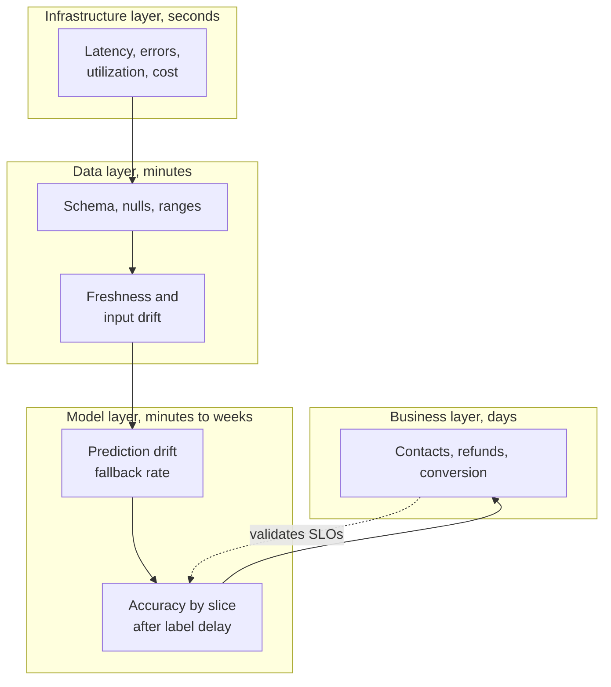
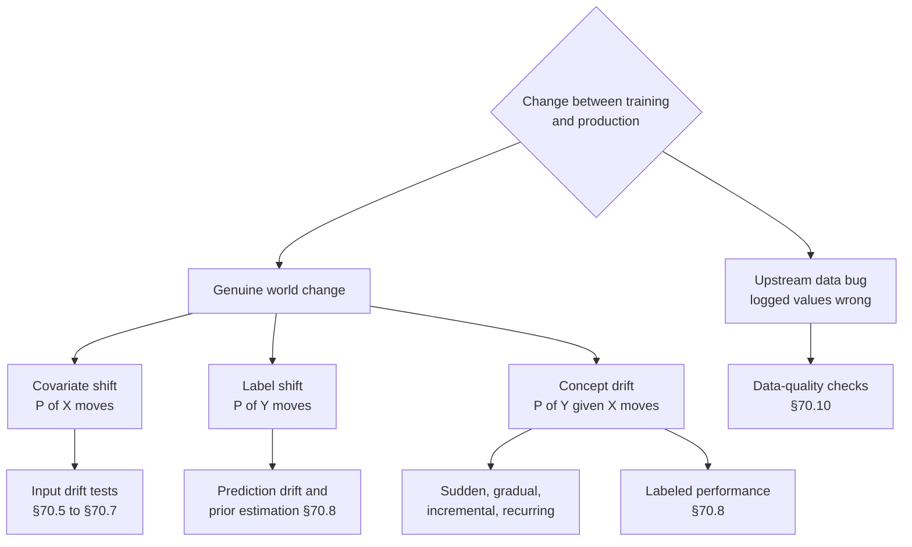

# Chapter 70 — ML Monitoring

> **Level:** 3 · **Track:** B (ML/AI) · **Estimated reading time:** 5 h

On a Tuesday evening, QuickBite's delivery-time (ETA) service answered 40,000 requests per second with a p99 latency of 31 ms and an error rate of zero. Every dashboard in the operations room was green. At the same time, in one city, a road-works program had quietly added three minutes to every rush-hour delivery, and the ETA model, trained on last month's traffic, kept promising times that couriers could not meet. Nothing crashed. Customers simply received their food late, contacted support, and some did not order again. The first person to notice was an analyst reading a weekly business review.

This is the problem this chapter solves. A traditional service fails loudly: it throws an exception, a health check fails, an error counter rises, and Chapter 40's observability stack pages someone. A machine learning (ML) model fails quietly: it keeps returning well-formed, confident answers that are wrong. **ML monitoring** is the discipline of detecting that kind of failure: watching the data a model consumes, the predictions it produces and, once they arrive, the outcomes it was trying to predict, and turning those observations into alerts that are timely, actionable and not drowned in noise.

You will learn to name the different ways the world can change underneath a model (covariate shift, label shift, concept drift and plain upstream bugs), and to measure change with the population stability index, the Kolmogorov–Smirnov test, the chi-square test, Kullback–Leibler and Jensen–Shannon divergence, the Wasserstein distance, domain classifiers and the maximum mean discrepancy. You will see why "statistically significant" means almost nothing at QuickBite's traffic volumes, how to monitor accuracy when labels arrive minutes or months late, how to design alerts that page only when users are hurt, and when monitoring should trigger retraining and when it must prevent it. The chapter ends with an end-to-end monitoring plan for QuickBite's ETA model.

Chapter 59 introduced monitoring (§59.12) and the population stability index (§59.7.2); Chapter 40 owns the general machinery of metrics, logs, traces and alerting. This chapter owns drift detection and ML-specific monitoring, and cross-references the rest. Chapter 69 owns the continuous-training pipeline that a retraining trigger starts.

::: note
**QuickBite assumptions used in this chapter.** These are teaching assumptions reused from earlier chapters, not measurements of any real company. 500,000 orders per day; ETA predictions peak at 40,000 per second (2,000 search RPS × 20 restaurants), about 360 million per day (§60.6); 20 cities × 200 zones = 4,000 delivery zones (Ch 62). ETA quality SLO: at least 80% of orders delivered within ±5 minutes of the checkout ETA over a 7-day rolling window, and MAE at most 4.5 min (§60.12.1, Table 60.11); the current model delivers about 82% within ±5 min and an MAE of about 4.3 min. The ETA model is retrained nightly, so model age stays under 30 hours (§60.15). ETA labels arrive when orders are delivered: median 35 min, nearly all within 60 min (§59.12.2). Fraud rate 0.5% (2,500 frauds per day); chargebacks arrive 40% within 15 days, 75% within 30, 95% within 60 and 100% within 90 (§63.4.2). One retraining cycle costs about \$1,000 and each extra minute of ETA MAE costs about \$2,000 per day (§59.13.1). **New in this chapter:** the fraud model flags 0.7% of orders (3,500 per day) for review, with 50% precision and 70% recall when it shipped.
:::

## 70.1 Learning objectives

After this chapter you should be able to:

- Explain why ML systems fail silently and list what to monitor at the infrastructure, data, model and business layers.
- Distinguish covariate shift, label (prior) shift, concept drift, feature drift and prediction drift, and tell an upstream data bug from a genuine change in the world.
- Compute PSI, the Kolmogorov–Smirnov statistic, the chi-square statistic, KL and Jensen–Shannon divergence and the Wasserstein distance by hand and in code, and choose among them.
- Size monitoring windows, correct for multiple testing, handle seasonality, and explain why significance tests over-alert at large sample sizes.
- Detect multivariate and embedding drift with a domain classifier and explain the maximum mean discrepancy.
- Monitor model performance under label delay using proxies, confidence-based estimation, label-shift estimation and backfilled evaluation.
- Monitor calibration, slices, data quality, feature freshness, model age and operational cost.
- Design an alerting policy for ML that separates pages from tickets and applies burn-rate alerting to quality SLOs.
- Compare scheduled, drift-triggered and performance-triggered retraining, and prevent retraining on corrupted data.
- Draw a monitoring architecture and write a monitoring plan for a production model.

## 70.2 Prerequisites

- Silent failures and quality SLOs — §60.3.2, §60.12 (this chapter turns them into concrete monitors).
- PSI and the mean-shift z-score — §59.7.2; time to detect a shift under label delay — §59.12.2; retraining cadence — §59.13.1 (reused, not re-derived).
- Training–serving skew and the log-recompute-compare detector — §62.9; feature freshness — §62.10 (skew is diagnosed there; drift here).
- Label delay and label completeness $F(a)$ — §63.4.2 (performance monitoring builds on it).
- Calibration and reliability diagrams — §57.10.3; hypothesis tests, p-values and power — §57.14.1, §57.14.2 (drift tests are two-sample tests).
- SLIs, SLOs and burn-rate alerting — §39.6, §39.7.3; metrics, cardinality, alerting and runbooks — §40.5, §40.10 (this chapter applies them to model quality).
- Stream windows — §29.8.2; Kafka — Chapter 31 (prediction logs travel through a log).

## 70.3 Why ML systems fail silently

### 70.3.1 No exceptions, only wrong answers

::: definition
**Definition — ML monitoring.** The continuous measurement of a deployed model's inputs, outputs, performance against eventual labels, and operating cost, compared against a reference and against service-level objectives, with alerts routed to the people who can act on them.
:::

#### First-principles explanation

Think of a weather forecaster who has worked in the same town for years. If the town's weather station breaks and starts reporting 0 °C every hour, the forecaster still publishes a forecast every morning. It is neatly formatted and delivered on time. It is also wrong, and nobody finds out until people get rained on. A model is that forecaster: it always answers, and the format of the answer never reveals whether the inputs were nonsense or whether the climate has changed.

Traditional software has a **specification** written in code: if an input violates it, a check fails and an exception is raised. A model's specification is learned from data, so there is nothing to violate. A distance of 9,000 km, a preparation time of zero, or a city it has never seen all go through the same arithmetic and produce a number (§60.3.2).

#### Why does this exist?

Three properties of ML systems make silent failure the default:

1. **Defaults hide missing data.** Feature pipelines replace nulls with a mean or zero so that serving never fails. The model receives a plausible value and predicts confidently.
2. **The world changes after training.** A model encodes the relationships in its training window. When customers, couriers, traffic or fraudsters change, the encoded relationships become stale without any code change.
3. **Correctness is only visible later.** Whether an ETA was right is known only when the food arrives; whether an order was fraud, only when a chargeback arrives weeks later (§63.4.2). Until then, there is nothing to compare against.

**Figure 70.1 — How a unit bug travels through the ETA system without raising an error.**


**Reading the diagram.** The failure starts outside the ML team: a tablet app update reports preparation time in seconds. The event travels asynchronously (dotted) through the kitchen stream into a nearline feature job, which writes a value 60 times too large into the online feature store (a storage boundary). The ETA service reads it synchronously, the model clamps or extrapolates, and the response is an ordinary HTTP 200 with an ETA 25 minutes too long (the example of §60.3.2). Every infrastructure metric stays green. The only places the failure is visible are the feature value itself (data monitoring), the distribution of predictions (model monitoring) and, much later, orders and support contacts (business monitoring). The prediction log, written asynchronously, is what makes the first two possible. Scaling the detector means sampling that log rather than touching the request path.

### 70.3.2 What to monitor at each layer

ML monitoring is not a replacement for service monitoring; it is two extra layers on top of it, plus a business layer that closes the loop.

**Table 70.1 — Monitoring layers for an ML service.**

| Layer | Example signals (QuickBite ETA) | Available after | Needs labels? | Owned by |
|---|---|---|---|---|
| Infrastructure and service | Latency, errors, saturation, GPU or CPU utilization, cost (§40.5, §70.12) | Seconds | No | Platform / SRE |
| Data | Null rates, schema, ranges, feature freshness, input drift (§70.10, §70.5) | Minutes | No | Data and feature owners |
| Model | Prediction drift, fallback rate, confidence, calibration, accuracy by slice (§70.8, §70.9) | Minutes (proxies) to hours or weeks (labels) | Partly | ML team |
| Business | Conversion, late-delivery contacts, refunds, fraud losses | Hours to weeks | Implicitly | Product and analytics |

**Figure 70.2 — The four monitoring layers and how fast each reacts.**



**Reading the diagram.** Read from bottom to top. Each layer assumes the one below it is healthy: input drift is meaningless if the service is returning errors, and accuracy is meaningless if a feature is null. Reaction time grows as you move up, from seconds for infrastructure to days for business outcomes, but relevance to users grows too. The dotted arrow is the slow feedback that keeps the model-layer SLOs honest: if business metrics degrade while model accuracy looks fine, the quality SLO is measuring the wrong thing. Failure points: teams that monitor only the bottom layer (the opening story) or only the top (learning of a broken feature from a quarterly review). Scaling: lower layers emit fixed-cardinality time series; upper layers need joins and batch jobs (§70.15).

#### Real-world industry applications

::: industry
**Google — The ML Test Score's monitoring tests.** Breck et al. turn production-readiness into a rubric of 28 tests, seven of which concern monitoring: notification of dependency changes, data invariants holding in training and serving inputs, training and serving computing the same feature values, models not being too stale, numerical stability (no NaNs or infinities), no regression in training speed, serving latency, throughput or memory, and no regression in prediction quality on served data. The list maps directly onto the data, model and infrastructure layers of Table 70.1.
*Evidence: Primary* — [Breck et al. 2017]
:::

::: industry
**Uber — Michelangelo's live accuracy measurement.** Uber's platform description lists "monitor predictions" as a step of the standard workflow: the platform logs a share of predictions and later joins them with the outcomes produced by data pipelines, giving continuous, live measurements of model accuracy that are published to dashboards and alerting.
*Evidence: Primary* — [Hermann and Del Balso 2017]
:::

::: mistake
**"Our service has 99.99% availability, so the model is healthy."** Availability counts answers, not correct answers. An ETA model that returns the training-set mean for every request has perfect availability and is useless. Every model needs at least one quality indicator (§60.12.1) next to its availability and latency SLIs.
:::

## 70.4 Types of change

### 70.4.1 Shifts in the joint distribution

::: definition
**Definition — Dataset shift.** Any difference between the joint distribution of inputs and labels, $P(X, Y)$, that a model was trained on and the one it is applied to [Quiñonero-Candela et al. 2009]. Writing $P(X, Y) = P(X)\,P(Y \mid X) = P(Y)\,P(X \mid Y)$ separates the kinds:

- **Covariate shift (data drift):** $P(X)$ changes while $P(Y \mid X)$ stays the same. The inputs move; the rule mapping inputs to outcomes does not.
- **Label shift (prior shift):** $P(Y)$ changes while $P(X \mid Y)$ stays the same. The mix of outcomes moves; each outcome still looks the same [Lipton et al. 2018].
- **Concept drift:** $P(Y \mid X)$ changes. The same inputs now lead to different outcomes [Gama et al. 2014].

Two practical terms describe what a monitor observes rather than what caused it. **Feature drift** is a change in the distribution of one feature. **Prediction drift** is a change in the distribution of the model's outputs, $P(\hat{Y})$.
:::

#### First-principles explanation

Picture a tailor who has learned to estimate trouser length from a customer's height. If a basketball team walks in, the heights are unusual but the height-to-leg rule still holds: that is covariate shift, and the tailor is fine as long as he has seen tall people before. If the shop suddenly gets mostly children, the mix of sizes changes but a child still looks like a child: label shift. If fashion changes and everyone wants cropped trousers, the same height now needs a different length: concept drift, and no amount of staring at heights reveals it. Only measuring the finished trousers does.

#### Why does this exist?

The distinction decides what a monitor can see and what the fix is. Covariate and label shift change the inputs or outputs a monitor can observe without labels; concept drift can be invisible in the inputs and only shows up in performance. Covariate shift within the training data's range often needs no action; concept drift always needs new labels and retraining.

**Table 70.2 — Types of change with QuickBite examples.**

| Type | What changes | QuickBite example | Visible without labels? | Typical response |
|---|---|---|---|---|
| Covariate shift | $P(X)$ | Suburbs launch: average distance rises from 3.2 to 4.0 km | Yes, input drift | Usually none if inside training range; retrain if new region of input space |
| Label shift | $P(Y)$ | A fraud ring doubles the fraud rate; each fraud looks like past fraud | Partly: flag rate rises (§70.8.3) | Re-estimate priors, adjust thresholds |
| Concept drift | $P(Y \mid X)$ | Road works add 3 min to rush-hour trips at the same distance | No, only via labels | Retrain on recent labels |
| Feature drift | One feature's marginal | Restaurant ratings inflate platform-wide | Yes | Investigate; may be any of the above |
| Prediction drift | $P(\hat{Y})$ | Mean ETA rises from 33 to 36 min | Yes, immediately | Diagnose: inputs, model version or bug |
| Upstream data bug | Logged values, not the world | Prep time logged in seconds | Yes, usually sharply | Fix pipeline; never retrain on it |

### 70.4.2 How concept drift unfolds in time

Gama et al. and Lu et al. classify concept drift by its time profile [Gama et al. 2014; Lu et al. 2019]. **Sudden** drift switches at a moment (the bridge closes). **Gradual** drift alternates between old and new concepts with the new one becoming more frequent (couriers move to e-bikes one by one). **Incremental** drift moves continuously through intermediate states (congestion grows a little every week). **Recurring** drift returns to earlier concepts (rain, holidays, Friday dinner). The profile matters for the detector: sudden drift favors short windows and change-point tests; incremental drift favors comparing against a fixed reference; recurring drift requires a seasonal reference so that the monitor does not alarm every Friday (§70.6.4).

**Figure 70.3 — A taxonomy of change and where each kind can be detected.**



**Reading the diagram.** The top split is the most important question in any drift investigation: did the data change, or did the pipe that carries it break? Bugs are caught by data-quality checks (schema, ranges, nulls), which are cheap and sharp. Genuine change divides by which factor of $P(X, Y)$ moved. Covariate shift is caught by input-drift tests; label shift shows up in the distribution of predictions and can be quantified without labels under assumptions; concept drift reaches only the labeled-performance monitor, after the label delay. The bottom row is therefore a detection-latency ladder: from minutes on the left to hours or weeks on the right. Failure point: treating every input-drift alert as a reason to retrain, which retrains on bugs and ignores concept drift that inputs do not reveal.

#### Mathematical foundations

Covariate shift can move an aggregate metric even when no slice of the model got worse, because the aggregate is a weighted average over slices whose weights changed. Separating the two effects is the first step in diagnosing an accuracy drop.

::: formula
**Mix decomposition of an aggregate error change**

$$E = \sum_{s} w_s\, e_s \qquad \Delta E = \underbrace{\sum_{s} (w'_s - w_s)\, e_s}_{\text{mix effect}} + \underbrace{\sum_{s} w'_s\, (e'_s - e_s)}_{\text{within-slice effect}}$$

| Symbol | Meaning | Units |
|---|---|---|
| $s$ | Slice (for example a distance band or city) | — |
| $w_s$, $w'_s$ | Share of predictions in slice $s$ before and after the change | fraction |
| $e_s$, $e'_s$ | Error metric in slice $s$ before and after (e.g. MAE) | minutes |
| $E$ | Aggregate error | minutes |
| $\Delta E$ | Change in aggregate error | minutes |
:::

::: example
**Worked example — The suburbs launch.** Before the launch, 70% of orders are short (under 5 km, MAE 3.8 min) and 30% long (MAE 5.5 min). After it, the mix is 50/50 and per-slice MAE is unchanged.

1. Before: $E = 0.7 \times 3.8 + 0.3 \times 5.5 = 2.66 + 1.65 = 4.31$ min.
2. After: $E' = 0.5 \times 3.8 + 0.5 \times 5.5 = 1.90 + 2.75 = 4.65$ min, above the 4.5 min SLO.
3. Mix effect: $(0.5 - 0.7) \times 3.8 + (0.5 - 0.3) \times 5.5 = -0.76 + 1.10 = 0.34$ min. Within-slice effect: $0$. Total $\Delta E = 0.34$ min.

*Interpretation:* the model did not get worse at anything; QuickBite started asking it harder questions. *Engineering implication:* before retraining in response to an aggregate drop, decompose it. A pure mix effect calls for a product decision (accept higher error on long trips, or invest in a better long-distance model), not for retraining on the same features, which may change nothing. A within-slice effect is the signature of concept drift.
:::

### 70.4.3 Bugs versus genuine change

Breck et al. note that many "drifts" in production are not changes in the world at all but changes in the pipes: a renamed field, a unit change, a default value, a stalled job [Breck et al. 2019]. The two have different fingerprints.

**Figure 70.4 — Triage flow for a drift alert.**


**Reading the diagram.** An alert enters at the top and is checked against progressively more expensive questions. Schema, null and range checks are definitive and fast; a hit means a bug, and the correct action is to fix the producer and keep the window out of training data. A sharp step aligned with a deployment (of the tablet app, the feature pipeline or the model itself) is the next most common cause; release logs answer it. Seasonal patterns are checked against the same hour last week. Only shifts that survive these checks are genuine world changes, and only those that hurt performance or its proxies justify retraining. The flow is synchronous human or automated triage; each exit routes to a different owner. Failure point: skipping straight to the bottom box, which is how teams end up retraining on corrupted data (§70.14.3).

::: mistake
**"Drift means the model must be retrained."** Most covariate shift inside the training range is harmless (§70.6.3), and most sharp drift is a bug that retraining would bake into the next model. Retrain when performance, measured or credibly estimated, degrades.
:::

## 70.5 Statistical tests and distances

Every drift detector answers the same question: are these two samples, a **reference window** (usually training data or a known-good period) and a **current window** (recent production traffic), drawn from the same distribution? Two families of tools answer it. **Two-sample tests** (Kolmogorov–Smirnov, chi-square) return a p-value: how surprising the difference would be if nothing had changed. **Distances and divergences** (PSI, KL, Jensen–Shannon, Wasserstein) return a magnitude: how much changed. The distinction matters more than any single formula, as §70.6.3 shows.

Throughout, $p_i$ is the reference share of bin $i$ and $q_i$ the current share, matching the PSI notation of §59.7.2.

### 70.5.1 Population stability index (PSI)

::: definition
**Definition — Population stability index (PSI).** A symmetric divergence between two binned distributions, $\sum_i (q_i - p_i)\ln(q_i / p_i)$, originating in credit scoring, where it is used to check whether the population being scored still resembles the population the scorecard was built on [Siddiqi 2006]. It equals $\mathrm{KL}(Q \,\|\, P) + \mathrm{KL}(P \,\|\, Q)$, the Jeffreys divergence (§70.5.4).
:::

The formula is defined in §59.7.2; this section adds the practical decisions it hides.

1. **Bins.** Use the reference window's deciles ($B = 10$) for numeric features, so each reference bin holds 10% of the data, and open the outer edges to $\pm\infty$ so that out-of-range values land in an end bin. For categorical features each category is a bin, with rare categories merged into "other".
2. **Empty bins.** If $q_i = 0$ or $p_i = 0$ the logarithm is infinite. Implementations replace zero shares with a small floor $\varepsilon$. The choice is not innocent, as the example below shows.
3. **Thresholds.** The rule of thumb reads PSI below 0.1 as stable, 0.1–0.2 (in some sources 0.1–0.25) as a moderate shift worth investigating and above 0.2 (or 0.25) as a significant shift. These bands come from credit-scoring practice, where Siddiqi's scorecard text is the usual citation [Siddiqi 2006]; they are conventions calibrated on populations of thousands, not statistical critical values. §70.6.2 shows that at small sample sizes PSI crosses 0.1 from noise alone.

::: example
**Worked example — One empty bin.** A feature's top reference decile holds $p_{10} = 0.10$. In a small current window no value lands there ($q_{10} = 0$); the other nine bins share the missing mass evenly, $q_i = 0.1\overline{1}$.

1. Nine full bins: each contributes $(0.1111 - 0.10)\ln(0.1111/0.10) = 0.0111 \times 0.1054 = 0.00117$; together $0.0105$.
2. Empty bin with floor $\varepsilon = 10^{-4}$: $(0.0001 - 0.10)\ln(0.0001/0.10) = (-0.0999)(-6.908) = 0.690$.
3. Same bin with $\varepsilon = 10^{-6}$: $(-0.1)(\ln 10^{-5}) = (-0.1)(-11.51) = 1.151$.
4. PSI is $0.70$ or $1.16$ depending only on $\varepsilon$.

*Interpretation:* one empty bin dominates PSI, and its contribution is set by an arbitrary constant. *Engineering implication:* require a minimum window size (at least a few hundred rows for ten bins, §70.6.2), fix $\varepsilon$ across the organization so values are comparable, and report the per-bin contributions, not only the sum, so an alert can say which bin moved.
:::

### 70.5.2 Kolmogorov–Smirnov test

::: definition
**Definition — Kolmogorov–Smirnov (KS) test.** A nonparametric two-sample test whose statistic $D$ is the largest vertical gap between the two samples' empirical cumulative distribution functions (CDFs). It needs no binning and is sensitive to any difference in location or shape, most strongly near the middle of the distribution [Massey 1951].
:::

::: formula
**Two-sample KS statistic and its large-sample critical value**

$$D = \sup_x \big|\hat{F}_P(x) - \hat{F}_Q(x)\big| \qquad D_{\text{crit}} = c(\alpha)\sqrt{\frac{n + m}{n\,m}} \qquad c(\alpha) = \sqrt{-\tfrac{1}{2}\ln\tfrac{\alpha}{2}}$$

$$p \approx 2\sum_{k=1}^{\infty} (-1)^{k-1} e^{-2k^2\lambda^2} \qquad \lambda = D\sqrt{\frac{n\,m}{n + m}}$$

| Symbol | Meaning | Units |
|---|---|---|
| $\hat{F}_P(x)$, $\hat{F}_Q(x)$ | Fraction of reference and current values $\le x$ | fraction |
| $D$ | KS statistic: maximum CDF gap | fraction |
| $n$, $m$ | Reference and current sample sizes | rows |
| $\alpha$ | False-alarm rate of the test | probability |
| $c(\alpha)$ | Critical coefficient ($1.358$ at $\alpha = 0.05$) | dimensionless |
| $D_{\text{crit}}$ | Reject "same distribution" when $D > D_{\text{crit}}$ | fraction |
| $\lambda$ | Scaled statistic for the asymptotic p-value | dimensionless |
| $p$ | Approximate p-value | probability |
:::

::: example
**Worked example — KS on two windows of prep times.** Reference and current windows each hold $n = m = 2{,}000$ orders; the largest CDF gap is at 12 minutes, where 40% of reference orders and 35% of current orders are at or below 12 min, so $D = 0.05$.

1. $c(0.05) = \sqrt{-0.5 \ln 0.025} = \sqrt{0.5 \times 3.689} = \sqrt{1.844} = 1.358$.
2. $D_{\text{crit}} = 1.358 \times \sqrt{4{,}000 / 4{,}000{,}000} = 1.358 \times 0.0316 = 0.0429$. Since $0.05 > 0.0429$, reject at 5%.
3. $\lambda = 0.05 \times \sqrt{4{,}000{,}000/4{,}000} = 0.05 \times 31.62 = 1.581$. $p \approx 2(e^{-2 \times 2.5} - e^{-8 \times 2.5} + \dots) = 2 \times 0.00674 = 0.0135$.

*Interpretation:* a 5-percentage-point gap in the CDF is detectable at 2,000 rows per window. *Engineering implication:* $D_{\text{crit}}$ shrinks as $1/\sqrt{n}$; at one million rows per window it is 0.0019, so KS flags differences far too small to matter (§70.6.3). Use $D$ itself as an effect size and alert on $D$ above a chosen magnitude, with the p-value as a guard against noise.
:::

### 70.5.3 Chi-square test for categorical features

::: formula
**Chi-square goodness-of-fit against reference shares, and Cohen's $w$**

$$\chi^2 = \sum_{i=1}^{K} \frac{(O_i - E_i)^2}{E_i} \qquad E_i = n\,p_i \qquad \text{df} = K - 1 \qquad w = \sqrt{\chi^2 / n}$$

| Symbol | Meaning | Units |
|---|---|---|
| $K$ | Number of categories | categories |
| $O_i$ | Observed count of category $i$ in the current window | rows |
| $p_i$ | Reference share of category $i$ | fraction |
| $n$ | Current window size | rows |
| $E_i$ | Expected count if nothing changed | rows |
| $\chi^2$ | Test statistic, compared with a chi-square distribution with df degrees of freedom | dimensionless |
| $w$ | Cohen's $w$: effect size independent of $n$ | dimensionless |
:::

When the reference sample is small too, use the two-sample contingency-table version (`scipy.stats.chi2_contingency`); the goodness-of-fit form above treats the reference shares as exact, which is reasonable when the reference holds hundreds of thousands of rows. Both need expected counts of at least about 5 per category, so merge rare categories first.

::: example
**Worked example — Courier vehicles in a winter week.** Reference shares: bike 50%, scooter 35%, car 15%. A current window of $n = 2{,}000$ deliveries has 900 bikes, 700 scooters and 400 cars.

1. Expected: $E = (1{,}000,\ 700,\ 300)$.
2. $\chi^2 = 100^2/1{,}000 + 0 + 100^2/300 = 10 + 0 + 33.3 = 43.3$, with $\text{df} = 2$. For two degrees of freedom the p-value is exactly $e^{-\chi^2/2} = e^{-21.7} = 3.9 \times 10^{-10}$.
3. PSI on the same shares: $(0.45 - 0.50)\ln 0.9 + 0 + (0.20 - 0.15)\ln(1.333) = 0.0053 + 0.0144 = 0.020$.
4. Cohen's $w = \sqrt{43.3/2{,}000} = 0.147$, a "small" effect on Cohen's conventional scale (0.1 small, 0.3 medium, 0.5 large).

*Interpretation:* the test is certain that something changed; PSI and $w$ agree that it changed only a little. *Engineering implication:* a 5-point move from bikes to cars is a real seasonal pattern, and whether it matters depends on whether the model has a vehicle feature and saw winters in training, not on the p-value.
:::

### 70.5.4 Kullback–Leibler and Jensen–Shannon divergence

::: formula
**KL divergence, Jeffreys divergence (PSI) and Jensen–Shannon divergence**

$$\mathrm{KL}(Q \,\|\, P) = \sum_i q_i \ln\frac{q_i}{p_i} \qquad \text{PSI} = \mathrm{KL}(Q \,\|\, P) + \mathrm{KL}(P \,\|\, Q)$$

$$\mathrm{JS}(P, Q) = \tfrac{1}{2}\,\mathrm{KL}(P \,\|\, M) + \tfrac{1}{2}\,\mathrm{KL}(Q \,\|\, M) \qquad M = \tfrac{1}{2}(P + Q) \qquad 0 \le \mathrm{JS} \le \ln 2$$

| Symbol | Meaning | Units |
|---|---|---|
| $p_i$, $q_i$ | Reference and current share of bin $i$ | fraction |
| $\mathrm{KL}(Q \,\|\, P)$ | Expected extra log-loss from coding $Q$ with a code built for $P$; asymmetric | nats |
| $M$ | Mixture of the two distributions, bin by bin | fraction |
| $\mathrm{JS}$ | Symmetric, bounded divergence; $\sqrt{\mathrm{JS}}$ is a metric (the JS distance) | nats (bits if $\log_2$, bounded by 1) |
:::

KL divergence has two drawbacks for monitoring: it is asymmetric, and it is infinite whenever the current window has mass where the reference has none. PSI fixes the asymmetry by adding both directions; Jensen–Shannon fixes both problems by comparing each distribution with their average, which is never zero where either is positive. That is why JS is a common default for categorical drift in tools (§70.15.3). Check which variant a tool reports: some return the JS *distance* (the square root), some use base-2 logarithms.

::: example
**Worked example — KL and JS on §62.9.2's four bins.** Reference shares $p = (0.25, 0.25, 0.25, 0.25)$; current $q = (0.10, 0.20, 0.30, 0.40)$. §62.9.2 computed PSI $= 0.228$.

1. $\mathrm{KL}(Q \,\|\, P) = 0.1\ln 0.4 + 0.2 \ln 0.8 + 0.3 \ln 1.2 + 0.4 \ln 1.6 = -0.0916 - 0.0446 + 0.0547 + 0.1880 = 0.1064$.
2. $\mathrm{KL}(P \,\|\, Q) = 0.25(\ln 2.5 + \ln 1.25 + \ln 0.833 + \ln 0.625) = 0.25(0.9163 + 0.2231 - 0.1823 - 0.4700) = 0.1218$.
3. Sum: $0.1064 + 0.1218 = 0.2282$, which is the PSI. The two directions differ by 14%.
4. $M = (0.175, 0.225, 0.275, 0.325)$. $\mathrm{KL}(P \,\|\, M) = 0.25(0.3567 + 0.1054 - 0.0953 - 0.2624) = 0.0261$. $\mathrm{KL}(Q \,\|\, M) = 0.1(-0.5596) + 0.2(-0.1178) + 0.3(0.0870) + 0.4(0.2076) = 0.0296$.
5. $\mathrm{JS} = (0.0261 + 0.0296)/2 = 0.0279$ nats $= 0.040$ bits; JS distance $= \sqrt{0.0279} = 0.167$.

*Interpretation:* the same shift is 0.228 in PSI, 0.106 or 0.122 in KL, 0.028 in JS and 0.167 in JS distance. *Engineering implication:* thresholds do not transfer between statistics. A team that moves from PSI 0.2 to "JS 0.2" has made its detector roughly eight times less sensitive.
:::

### 70.5.5 Wasserstein distance

::: formula
**Wasserstein-1 (earth mover's) distance in one dimension**

$$W_1(P, Q) = \int_{-\infty}^{\infty} \big|F_P(x) - F_Q(x)\big|\,dx \qquad W_1 = \frac{1}{n}\sum_{j=1}^{n} \big|x_{(j)} - y_{(j)}\big| \ \text{(equal-size samples)}$$

| Symbol | Meaning | Units |
|---|---|---|
| $F_P$, $F_Q$ | Reference and current CDFs | fraction |
| $x_{(j)}$, $y_{(j)}$ | $j$-th smallest value in the reference and current sample | feature units |
| $n$ | Sample size (when equal) | rows |
| $W_1$ | Average distance probability mass must move to turn one distribution into the other | feature units |
:::

Where KS asks "how far apart are the CDFs at their worst point?", Wasserstein asks "how much work does it take to move one pile of sand into the shape of the other?". It is measured in the feature's own units, so it says *how far* values moved, not only *that* they moved. A pure shift of every value by $\delta$ gives $W_1 = \delta$ exactly. Divide by the reference standard deviation to compare features with different units; Evidently, for example, uses this normed distance with a 0.1 threshold for large numerical columns (as of 2026, §70.15.3).

::: example
**Worked example — Five orders.** Reference distances (km): 1, 2, 3, 4, 5. Current: 1.5, 2.5, 3.5, 4.5, 9.

1. Sorted differences: $0.5, 0.5, 0.5, 0.5, 4.0$.
2. $W_1 = (0.5 \times 4 + 4.0)/5 = 6.0 / 5 = 1.2$ km.
3. KS on the same samples: $D = 0.2$ (the two CDFs never differ by more than one order in five), and it would stay 0.2 if the outlier were 900 km.

*Interpretation:* one far-away value contributes two thirds of $W_1$. *Engineering implication:* Wasserstein is the right statistic when *how far* matters (a unit bug that multiplies values by 1,000 produces an enormous $W_1$) and the wrong one when you want robustness to a few outliers; pair it with range checks (§70.10) so outliers are diagnosed as bugs first.
:::

### 70.5.6 Code example: every statistic on synthetic drift

The program draws a reference of 50,000 order distances (gamma-distributed, mean 3.2 km as in §59.7.3) and five current windows of 5,000 orders: no drift, two mean shifts, a change of spread at the same mean, and a unit bug on 5% of rows. It then computes every statistic in this section, plus chi-square on a categorical feature.

```python
import numpy as np
from scipy import stats

rng = np.random.default_rng(70)
EPS = 1e-6                                   # floor for empty bins

def bin_shares(ref, cur, n_bins=10):
    """Bin both samples on the reference deciles; return shares (p, q)."""
    edges = np.quantile(ref, np.linspace(0, 1, n_bins + 1))
    edges[0], edges[-1] = -np.inf, np.inf
    p = np.histogram(ref, edges)[0] / len(ref)
    q = np.histogram(cur, edges)[0] / len(cur)
    return np.clip(p, EPS, None), np.clip(q, EPS, None)

def kl(a, b):
    return float(np.sum(a * np.log(a / b)))

def psi(p, q):
    return float(np.sum((q - p) * np.log(q / p)))

def js(p, q):
    m = (p + q) / 2
    return 0.5 * kl(p, m) + 0.5 * kl(q, m)

# Reference: two weeks of order distances in km (mean ~3.2, as in Ch 59)
ref = rng.gamma(shape=2.0, scale=1.6, size=50_000)
n = 5_000                                    # one current window
clean = rng.gamma(2.0, 1.6, n)
scenarios = {
    "no drift":       rng.gamma(2.0, 1.6, n),
    "mean +12%":      rng.gamma(2.0, 1.8, n),       # suburbs launch
    "mean +40%":      rng.gamma(2.0, 2.24, n),      # long-distance tier
    "wider spread":   rng.gamma(1.3, 2.46, n),      # same mean, more variance
    "unit bug on 5%": np.where(rng.random(n) < 0.05, clean * 1000, clean),
}
print(f"{'scenario':<15}{'PSI':>7}{'KL(Q|P)':>9}{'JS':>8}{'KS D':>7}"
      f"{'KS p':>9}{'W1 km':>8}{'W1/sd':>7}")
for name, cur in scenarios.items():
    p, q = bin_shares(ref, cur)
    ks = stats.ks_2samp(ref, cur)
    w1 = stats.wasserstein_distance(ref, cur)
    print(f"{name:<15}{psi(p, q):7.3f}{kl(q, p):9.3f}{js(p, q):8.4f}"
          f"{ks.statistic:7.3f}{ks.pvalue:9.1e}{w1:8.2f}{w1 / ref.std():7.2f}")

# PSI equals the symmetrized KL divergence (Jeffreys divergence)
p, q = bin_shares(ref, scenarios["mean +40%"])
print(f"check: KL(Q|P) + KL(P|Q) = {kl(q, p) + kl(p, q):.4f}; PSI = {psi(p, q):.4f}")

# Categorical feature: courier vehicle type, reference shares vs a winter week
p_ref = np.array([0.50, 0.35, 0.15])                 # bike, scooter, car
obs = np.bincount(rng.choice(3, size=2_000, p=[0.45, 0.35, 0.20]), minlength=3)
chi2, pval = stats.chisquare(obs, p_ref * obs.sum())
q_cur = obs / obs.sum()
print(f"vehicle counts {obs.tolist()}: chi2 = {chi2:.1f}, p = {pval:.1e}, "
      f"PSI = {psi(p_ref, q_cur):.3f}, Cohen's w = {np.sqrt(chi2 / obs.sum()):.3f}")
```

Output:

```text
scenario           PSI  KL(Q|P)      JS   KS D     KS p   W1 km  W1/sd
no drift         0.002    0.001  0.0003  0.008  9.0e-01    0.02   0.01
mean +12%        0.022    0.011  0.0027  0.059  4.4e-14    0.36   0.16
mean +40%        0.227    0.119  0.0277  0.195 2.9e-152    1.36   0.60
wider spread     0.081    0.042  0.0100  0.089  5.5e-32    0.40   0.18
unit bug on 5%   0.023    0.012  0.0028  0.054  3.8e-12  166.72  74.28
check: KL(Q|P) + KL(P|Q) = 0.2270; PSI = 0.2270
vehicle counts [924, 688, 388]: chi2 = 31.8, p = 1.2e-07, PSI = 0.014, Cohen's w = 0.126
```

What to notice:

- **A 12% mean shift is "stable" by PSI (0.022) and overwhelming by KS ($p = 4 \times 10^{-14}$).** The rule-of-thumb PSI bands need a shift of roughly 40% in the mean before they say "significant". KS at 5,000 rows notices almost anything.
- **The unit bug looks like a mild drift to every binned statistic.** Values multiplied by 1,000 all land in the open top bin, so PSI, KL and JS see "5% more mass in bin 10", the same as a modest shift. Only Wasserstein (166 km, 74 standard deviations) shouts, because it measures distance moved. Range checks catch it more directly still (§70.10).
- **The spread change at the same mean** is caught by every statistic, which a mean-shift z-score (§59.7.2) would miss.
- **PSI is exactly the sum of the two KL directions,** as the check line confirms.
- The categorical result repeats §70.5.3: a tiny p-value with a small effect size.

**Table 70.3 — Drift statistics compared.**

| Row | PSI | KS test | Chi-square | KL / JS | Wasserstein |
|---|---|---|---|---|---|
| What it is | Symmetric binned divergence | Max CDF gap + p-value | Count-based test + p-value | Information divergence | Mass-moving distance |
| Data type | Numeric (binned), categorical | Numeric | Categorical | Both (binned) | Numeric |
| Output | Magnitude | Test (and $D$ as magnitude) | Test (and $w$) | Magnitude | Magnitude in feature units |
| Advantages | Familiar thresholds, interpretable per bin | No binning, exact for small $n$ | Simple, standard | JS bounded and symmetric | Sees how far values moved |
| Disadvantages | Bin and $\varepsilon$ dependent; noisy at small $n$ | Over-sensitive at large $n$; weak in tails | Needs ≥ 5 expected per cell | KL infinite with empty bins | Outlier-sensitive; unit-dependent |
| Choose when | Scorecards, stable reporting | Small windows (≤ a few thousand) | Small windows, categorical | Large windows, categorical | Large windows, numeric |

**Figure 70.5 — Choosing a drift statistic for one feature.**


**Reading the diagram.** The two questions are the feature's type and the window's size. Small windows need a test, because sampling noise is large and the p-value tells you whether the difference is real. Large windows make every test significant, so they need a magnitude with a threshold chosen for business relevance. Every path ends in the same box: distribution statistics are weak bug detectors (the unit bug in §70.5.6), so they never replace deterministic data-quality checks. The cut-off near 1,000 rows mirrors the default switch in Evidently's drift presets (as of 2026, §70.15.3); treat it as a starting point, not a law.

## 70.6 Practical drift detection

### 70.6.1 Reference and current windows

::: definition
**Definition — Reference window.** The sample a monitor treats as "normal": the model's training data, a fixed known-good production period, a trailing window (for example the previous 7 days) or a seasonal window (the same hour on the previous four weeks). **Current window:** the recent sample being tested, either **tumbling** (consecutive, non-overlapping hours) or **sliding** (the last 60 minutes, recomputed every 5 minutes).
:::

Each reference answers a different question. *Training data* answers "is the model seeing what it was trained on?", the question that matters for accuracy, but it alarms permanently once the world has moved and the model has been retrained on newer data. *A trailing window* answers "did something change recently?", ideal for catching bugs, but it absorbs slow drift: a feature that moves 1% a day never differs much from last week. *A seasonal window* removes predictable cycles. Mature monitors run two references side by side: training data for slow drift and a seasonal trailing window for sudden change.

**Figure 70.6 — Reference and current windows for a Friday-dinner check.**

```mermaid
gantt
  title Windows for a check run on Fri 2026-10-30 at 20:00
  dateFormat YYYY-MM-DD HH:mm
  axisFormat %m-%d
  section Training reference
  Model training data, 28 days :done, t1, 2026-09-28 00:00, 28d
  section Seasonal reference
  Fri 10-09 dinner :s1, 2026-10-09 18:00, 2h
  Fri 10-16 dinner :s2, 2026-10-16 18:00, 2h
  Fri 10-23 dinner :s3, 2026-10-23 18:00, 2h
  section Trailing reference
  Previous 7 days :r1, 2026-10-23 00:00, 7d
  section Current window
  Fri 10-30 18:00-20:00 :crit, c1, 2026-10-30 18:00, 2h
```

**Reading the diagram.** The current window (red) is the last two hours of Friday dinner. It is compared against three references. The training reference is the 28 days the serving model learned from; drift against it predicts accuracy loss. The seasonal reference pools the same two hours on the three previous Fridays, so Friday's normal basket sizes and distances do not alarm. The trailing 7-day reference catches anything that changed this week but mixes lunch, dinner and weekends, so it needs looser thresholds. The storage boundary is the prediction log: all four windows are queries over it, which is why it must retain at least the training window's span. Failure point: a seasonal reference that contains last week's incident; exclude windows flagged as incidents from future references.

### 70.6.2 Sample size and the noise floor

Small windows are noisy, and distance statistics are biased upward by noise: two samples from the *same* distribution almost never have identical histograms, so PSI is positive even when nothing changed.

::: formula
**Expected PSI under no drift**

$$\mathbb{E}[\text{PSI} \mid \text{no drift}] \approx (B - 1)\left(\frac{1}{n} + \frac{1}{m}\right)$$

| Symbol | Meaning | Units |
|---|---|---|
| $B$ | Number of bins | bins |
| $n$ | Current window size | rows |
| $m$ | Reference window size | rows |
:::

The approximation comes from expanding PSI to second order: $\text{PSI} \approx \sum_i (q_i - p_i)^2 / p_i$, which is a chi-square statistic divided by the effective sample size, and a chi-square statistic with $B - 1$ degrees of freedom has expectation $B - 1$. It holds when every bin has comfortably more than a handful of rows; with near-empty bins the $\varepsilon$ floor of §70.5.1 makes PSI larger still.

::: example
**Worked example — How small can a city-hour window be?** Ten bins, a large reference ($1/m \approx 0$).

1. $n = 100$: $\mathbb{E}[\text{PSI}] \approx 9/100 = 0.09$, almost at the "moderate" threshold with no drift at all.
2. $n = 500$: $9/500 = 0.018$.
3. To keep the noise floor at most a tenth of the 0.1 threshold, $9/n \le 0.01$, so $n \ge 900$.
4. A QuickBite city with 2% of orders has $500{,}000 \times 0.02 / 24 \approx 417$ orders in an average hour, so a city-hour window is too small; a city over 3 hours (about 1,250 orders) or the whole platform per hour (about 20,800) is not.

*Interpretation:* PSI thresholds assume large windows. *Engineering implication:* compute the noise floor for each window size and either set a minimum $n$ (here about 900) or subtract the expected noise before comparing with a threshold.
:::

The program below checks the approximation by simulation, then shows the opposite problem at large $n$.

```python
import numpy as np
from scipy import stats

rng = np.random.default_rng(7)
ref = rng.gamma(2.0, 1.6, 1_000_000)                 # large reference window
edges = np.quantile(ref, np.linspace(0, 1, 11))      # reference deciles
edges[0], edges[-1] = -np.inf, np.inf
p = np.histogram(ref, edges)[0] / len(ref)

def psi_to_ref(cur):
    q = np.clip(np.histogram(cur, edges)[0] / len(cur), 1e-6, None)
    return float(np.sum((q - p) * np.log(q / p)))

print("A. No drift: PSI from sampling noise alone (200 windows per size)")
for n in [50, 100, 500, 5_000]:
    vals = np.array([psi_to_ref(rng.gamma(2.0, 1.6, n)) for _ in range(200)])
    print(f"   n={n:>5}: mean PSI={vals.mean():.4f} (approx. 9/n={9 / n:.4f}), "
          f"windows with PSI > 0.1: {np.mean(vals > 0.1):.0%}")

print("B. A harmless 1% scale shift, tested with growing window sizes")
for n in [1_000, 10_000, 100_000, 1_000_000]:
    cur = rng.gamma(2.0, 1.6 * 1.01, n)
    ks = stats.ks_2samp(ref, cur)
    print(f"   n={n:>9,}: KS D={ks.statistic:.4f}, p={ks.pvalue:.1e}, "
          f"PSI={psi_to_ref(cur):.4f}, mean shift={cur.mean() - ref.mean():+.3f} km")
```

Output:

```text
A. No drift: PSI from sampling noise alone (200 windows per size)
   n=   50: mean PSI=0.2295 (approx. 9/n=0.1800), windows with PSI > 0.1: 89%
   n=  100: mean PSI=0.0957 (approx. 9/n=0.0900), windows with PSI > 0.1: 38%
   n=  500: mean PSI=0.0187 (approx. 9/n=0.0180), windows with PSI > 0.1: 0%
   n= 5000: mean PSI=0.0018 (approx. 9/n=0.0018), windows with PSI > 0.1: 0%
B. A harmless 1% scale shift, tested with growing window sizes
   n=    1,000: KS D=0.0253, p=5.4e-01, PSI=0.0104, mean shift=+0.030 km
   n=   10,000: KS D=0.0154, p=1.9e-02, PSI=0.0021, mean shift=+0.050 km
   n=  100,000: KS D=0.0050, p=2.2e-02, PSI=0.0002, mean shift=+0.023 km
   n=1,000,000: KS D=0.0065, p=4.9e-19, PSI=0.0002, mean shift=+0.033 km
```

What to notice:

- **Part A:** with 100 rows, 38% of windows with *no drift* exceed PSI 0.1; with 50 rows, 89% do, and the mean overshoots $9/n$ because some bins are empty. The approximation is good from a few hundred rows.
- **Part B:** the same 1% shift goes from undetectable ($p = 0.54$) to overwhelming ($p = 5 \times 10^{-19}$) as $n$ grows, while PSI correctly stays near zero. At small $n$ the estimate of $D$ is mostly noise (0.025 at 1,000 rows versus about 0.005 at a million).
- Read together: distances are biased at small $n$, tests are over-powered at large $n$. A monitor needs both a minimum sample size and an effect-size threshold.

### 70.6.3 "Statistically significant" is not "important"

::: example
**Worked example — A million predictions and a 1% shift.** QuickBite's ETA service makes about 360 million predictions a day; even a 1% sample gives $n = m = 1{,}000{,}000$ per daily window. Suppose courier routing software changes so that reported distances are 1% longer (mean 3.20 → 3.23 km).

1. For a gamma distribution with shape 2, a 1% change of scale moves the CDF by at most $\approx 0.54 \times 0.01 = 0.0054$, so $D \approx 0.0054$.
2. $D_{\text{crit}} = 1.358 \times \sqrt{2/10^6} = 1.358 \times 0.00141 = 0.0019$. $D$ is almost three times the critical value; $\lambda = 0.0054 \times \sqrt{500{,}000} = 3.8$, so $p \approx 2e^{-2 \times 3.8^2} = 2e^{-28.9} \approx 6 \times 10^{-13}$.
3. Effect on predictions: the ETA model's travel component is about 3 min/km, so the average ETA rises by $0.03 \times 3 = 0.09$ min, about 5 seconds, against an MAE of 4.3 minutes.
4. With $n = m = 10{,}000$, $D_{\text{crit}} = 0.0192$ and the same shift is invisible.

*Interpretation:* the test is right that the distribution changed and wrong to imply that anyone should care. *Engineering implication:* at production volumes, alert on *effect sizes* that are tied to impact (PSI or normed Wasserstein above a threshold, or better, the predicted change in model output), use p-values only to suppress noise in small slices, and weight features by importance: a large shift in a feature the model barely uses rarely matters [Huyen 2022].
:::

### 70.6.4 Multiple testing and alert fatigue

::: formula
**False alarms from many tests**

$$\mathbb{E}[\text{false alarms}] = m\,\alpha \qquad P(\ge 1 \text{ false alarm}) = 1 - (1 - \alpha)^m \qquad \alpha_{\text{Bonf}} = \alpha / m$$

| Symbol | Meaning | Units |
|---|---|---|
| $m$ | Number of independent tests run per period | tests |
| $\alpha$ | Per-test false-alarm rate | probability |
| $\alpha_{\text{Bonf}}$ | Bonferroni per-test level keeping the family-wise error rate at $\alpha$ | probability |
:::

::: example
**Worked example — Monitoring 40 features in 20 cities every hour.** The ETA model has 40 features; the team tests each per city per hour at $\alpha = 0.01$.

1. Tests per day: $m = 40 \times 20 \times 24 = 19{,}200$.
2. Expected false alarms with no drift anywhere: $19{,}200 \times 0.01 = 192$ per day, eight an hour.
3. Bonferroni: $\alpha_{\text{Bonf}} = 0.01 / 19{,}200 = 5.2 \times 10^{-7}$, a critical $z$ of about 5.0. That keeps false alarms to about one per hundred days but detects only large shifts in small cities.
4. Benjamini–Hochberg (BH) controls the **false discovery rate** instead: sort the $m$ p-values, find the largest $k$ with $p_{(k)} \le (k/m)\,q$, and flag those $k$ [Benjamini and Hochberg 1995]. At $q = 0.05$, at most about 5% of flagged tests are expected to be false, which is the quantity on-call engineers actually experience.

*Interpretation:* an unadjusted monitor that tests everything everywhere is a random alert generator. *Engineering implication:* reduce $m$ first (monitor the top 10 features by importance per city, the rest platform-wide), aggregate (one "share of drifted features" statistic per city, as Evidently's dataset-drift preset does), then adjust what remains with BH, and route drift findings to tickets and dashboards rather than pages (§70.13).
:::

Shankar et al.'s interview study of ML engineers reports alert fatigue from noisy data-quality and drift alerts as a recurring pain point, with practitioners favoring fewer, more actionable alerts [Shankar et al. 2022]. The arithmetic above is one reason.

### 70.6.5 Seasonality

::: example
**Worked example — Friday dinner looks like drift.** Basket size has three bins. Over a whole week the shares are small 50%, medium 35%, large 15%; on Friday dinner they are 35%, 40%, 25%, every week.

1. $(0.35 - 0.50)\ln(0.35/0.50) = (-0.15)(-0.357) = 0.054$.
2. $(0.40 - 0.35)\ln(0.40/0.35) = 0.05 \times 0.134 = 0.007$.
3. $(0.25 - 0.15)\ln(0.25/0.15) = 0.10 \times 0.511 = 0.051$.
4. PSI $= 0.111$: a "moderate shift" every Friday evening.

*Interpretation:* nothing changed; the reference was wrong for the question. *Engineering implication:* compare like with like, using the seasonal reference of Figure 70.6 (same hour of week), or condition the statistic on hour of week. Holidays and promotions need explicit annotations so their windows are neither alarmed on nor used as future references.
:::

#### Failure scenarios

**Table 70.4 — Drift-detection failure scenarios.**

| What goes wrong | Why | Detection | Recovery | Prevention |
|---|---|---|---|---|
| Hundreds of drift alerts a day, none acted on | Unadjusted tests at large $m$ and large $n$ | Alert precision < 10% | Mute; move drift to tickets | Effect thresholds, BH, fewer tests |
| Slow drift never alarms | Trailing reference absorbs it | Accuracy decays while drift is "green" | Add training-data reference | Two references per feature |
| Every Friday alarms | Non-seasonal reference | Alerts cluster by hour of week | Seasonal reference | Hour-of-week conditioning |
| Small-city alarms are random | Windows below the noise floor | PSI noise ≈ threshold | Longer windows for small slices | Minimum $n$ per window |
| Incident becomes "normal" | Incident window used as reference | Reference drifts after incidents | Rebuild reference | Exclude flagged windows |
