# Chapter 70 — ML Monitoring

> **Level:** 3 · **Track:** B (ML/AI) · **Estimated reading time:** 5 h

On a Tuesday evening, QuickBite's delivery-time (ETA) service answered 40,000 requests per second with a p99 latency of 31 ms and zero errors. Meanwhile, in one city, a road-works program had quietly added three minutes to every rush-hour delivery, and the ETA model, trained on last month's traffic, kept promising times that couriers could not meet. Nothing crashed; customers got their food late, and the first person to notice was an analyst reading a weekly business review.

This is the problem this chapter solves. A traditional service fails loudly: it throws an exception, a health check fails, an error counter rises, and Chapter 40's observability stack pages someone. A machine learning (ML) model fails quietly: it keeps returning well-formed, confident answers that are wrong. **ML monitoring** is the discipline of detecting that kind of failure: watching the data a model consumes, the predictions it produces and, once they arrive, the outcomes it was trying to predict, and turning those observations into alerts that are timely, actionable and not drowned in noise.

Chapter 59 introduced monitoring (§59.12) and PSI (§59.7.2); Chapter 40 owns metrics, logs, traces and alerting; Chapter 69 owns the continuous-training pipeline. This chapter owns drift detection and ML-specific monitoring, and ends with an end-to-end monitoring plan for QuickBite's ETA model.

::: note
**QuickBite assumptions used in this chapter.** Teaching assumptions reused from earlier chapters, not measurements of a real company. 500,000 orders per day; ETA predictions peak at 40,000 per second (2,000 search RPS × 20 restaurants), about 360 million per day (§60.6); 20 cities × 200 zones = 4,000 delivery zones (Ch 62). ETA quality SLO: at least 80% of orders delivered within ±5 minutes of the checkout ETA over a 7-day rolling window, and MAE at most 4.5 min (§60.12.1, Table 60.11); the current model delivers about 82% within ±5 min and an MAE of about 4.3 min. The ETA model is retrained nightly, so model age stays under 30 hours (§60.15). ETA labels arrive when orders are delivered: median 35 min, nearly all within 60 min (§59.12.2). Fraud rate 0.5% (2,500 frauds per day); chargebacks arrive 40% within 15 days, 75% within 30, 95% within 60 and 100% within 90 (§63.4.2). One retraining cycle costs about \$1,000 and each extra minute of ETA MAE costs about \$2,000 per day (§59.13.1). **New in this chapter:** the fraud model flags 0.7% of orders (3,500 per day) for review, with 50% precision and 70% recall when it shipped.
:::

## 70.1 Learning objectives

After this chapter you should be able to:

- Explain why ML systems fail silently and list what to monitor at the infrastructure, data, model and business layers.
- Distinguish covariate shift, label (prior) shift, concept drift, feature drift and prediction drift, and tell an upstream data bug from a genuine change in the world.
- Compute PSI, the Kolmogorov–Smirnov statistic, the chi-square statistic, KL and Jensen–Shannon divergence and the Wasserstein distance by hand and in code, and choose among them.
- Size windows, correct for multiple testing and seasonality, and explain why significance tests over-alert at large sample sizes.
- Detect multivariate and embedding drift with a domain classifier and explain MMD.
- Monitor model performance under label delay using proxies, confidence-based estimation, label-shift estimation and backfilled evaluation.
- Monitor calibration, slices, data quality, feature freshness, model age and operational cost.
- Design an alerting policy for ML that separates pages from tickets and applies burn-rate alerting to quality SLOs.
- Compare scheduled, drift-triggered and performance-triggered retraining, and prevent retraining on corrupted data.
- Draw a monitoring architecture and write a monitoring plan for a production model.

## 70.2 Prerequisites

- Silent failures and quality SLOs — §60.3.2, §60.12 (turned into concrete monitors here).
- PSI — §59.7.2; time to detect decay under label delay — §59.12.2; retraining cadence — §59.13.1 (reused, not re-derived).
- Training–serving skew — §62.9; feature freshness — §62.10; label completeness $F(a)$ — §63.4.2.
- Calibration — §57.10.3; hypothesis tests and power — §57.14 (drift tests are two-sample tests).
- SLOs and burn-rate alerting — §39.6, §39.7.3; metrics and alerting — §40.5, §40.10; Kafka — Chapter 31.

## 70.3 Why ML systems fail silently

### 70.3.1 No exceptions, only wrong answers

::: definition
**Definition — ML monitoring.** The continuous measurement of a deployed model's inputs, outputs, performance against eventual labels, and operating cost, compared against a reference and against service-level objectives, with alerts routed to the people who can act on them.
:::

#### First-principles explanation

Think of a weather forecaster whose station breaks and reports 0 °C every hour. She still publishes a neatly formatted forecast every morning; it is wrong, and nobody finds out until people get rained on. A model is that forecaster: the format of its answer never reveals whether the inputs were nonsense or the climate has changed.

Traditional software has a **specification** in code that inputs can violate. A model's specification is learned from data, so a distance of 9,000 km or an unseen city goes through the same arithmetic and produces a number (§60.3.2).

#### Why does this exist?

Three properties of ML systems make silent failure the default:

1. **Defaults hide missing data.** Pipelines replace nulls with a mean or zero so serving never fails; the model predicts confidently from a plausible value.
2. **The world changes after training.** When customers, couriers, traffic or fraudsters change, the relationships a model encoded become stale without any code change.
3. **Correctness is only visible later:** when the food arrives, or when a chargeback arrives weeks later (§63.4.2).

**Figure 70.1 — How a unit bug travels through the ETA system without raising an error.**

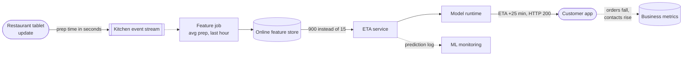

**Reading the diagram.** The failure starts outside the ML team: a tablet app update reports preparation time in seconds. The event travels asynchronously (dotted) through the kitchen stream into a nearline feature job, which writes a value 60 times too large into the online feature store (a storage boundary). The ETA service reads it synchronously, the model clamps or extrapolates, and the response is an ordinary HTTP 200 with an ETA 25 minutes too long (the example of §60.3.2). Every infrastructure metric stays green. The failure is visible only in the feature value (data monitoring), the prediction distribution (model monitoring) and, much later, orders and contacts (business monitoring); the asynchronous prediction log makes the first two possible without touching the request path.

### 70.3.2 What to monitor at each layer

ML monitoring is not a replacement for service monitoring; it is two extra layers on top of it, plus a business layer that closes the loop.

**Table 70.1 — Monitoring layers for an ML service.**

| Layer | Example signals (QuickBite ETA) | Available after | Needs labels? | Owned by |
|---|---|---|---|---|
| Infrastructure and service | Latency, errors, saturation, GPU or CPU utilization, cost (§40.5, §70.12) | Seconds | No | Platform / SRE |
| Data | Null rates, schema, ranges, feature freshness, input drift (§70.10, §70.5) | Minutes | No | Data and feature owners |
| Model | Prediction drift, fallback rate, confidence, calibration, accuracy by slice (§70.8, §70.9) | Minutes (proxies) to hours or weeks (labels) | Partly | ML team |
| Business | Conversion, late-delivery contacts, refunds, fraud losses | Hours to weeks | Implicitly | Product and analytics |

**Figure 70.2 — The four monitoring layers and how fast each reacts.**

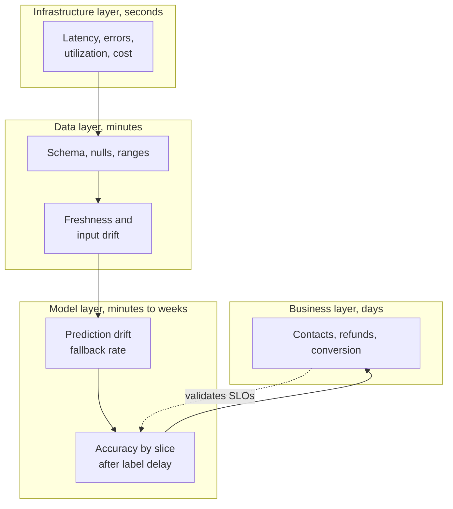

**Reading the diagram.** Read from bottom to top. Each layer assumes the one below it is healthy: input drift is meaningless if the service is returning errors, and accuracy is meaningless if a feature is null. Reaction time grows upward, from seconds to days, and so does relevance to users. The dotted arrow keeps the quality SLOs honest: if business metrics degrade while accuracy looks fine, the SLO measures the wrong thing. Failure points: monitoring only the bottom layer (the opening story) or only the top. Scaling: lower layers emit fixed-cardinality time series; upper layers need joins and batch jobs (§70.15).

#### Real-world industry applications

::: industry
**Google — The ML Test Score's monitoring tests.** Breck et al.'s production-readiness rubric includes seven monitoring tests: dependency-change notification, data invariants in serving inputs, training and serving computing the same features, model staleness, numerical stability, no regression in speed, latency, throughput or memory, and no regression in prediction quality on served data. They map onto Table 70.1's layers.
*Evidence: Primary* — [Breck et al. 2017]
:::

::: industry
**Uber — Michelangelo's live accuracy measurement.** Uber's platform logs a share of predictions and later joins them with outcomes from its data pipelines, giving ongoing, live measurements of model accuracy.
*Evidence: Primary* — [Hermann and Del Balso 2017]
:::

::: mistake
**"Our service has 99.99% availability, so the model is healthy."** Availability counts answers, not correct answers. Every model needs at least one quality indicator (§60.12.1) next to its availability and latency SLIs.
:::

## 70.4 Types of change

### 70.4.1 Shifts in the joint distribution

::: definition
**Definition — Dataset shift.** Any difference between the joint distribution of inputs and labels, $P(X, Y)$, that a model was trained on and the one it is applied to [Quiñonero-Candela et al. 2009]. Writing $P(X, Y) = P(X)\,P(Y \mid X) = P(Y)\,P(X \mid Y)$ separates the kinds:

- **Covariate shift (data drift):** $P(X)$ changes while $P(Y \mid X)$ stays the same. The inputs move; the rule mapping inputs to outcomes does not.
- **Label shift (prior shift):** $P(Y)$ changes while $P(X \mid Y)$ stays the same. The mix of outcomes moves; each outcome still looks the same [Lipton et al. 2018].
- **Concept drift:** $P(Y \mid X)$ changes. The same inputs now lead to different outcomes [Gama et al. 2014].

Two practical terms describe what a monitor observes rather than what caused it. **Feature drift** is a change in the distribution of one feature. **Prediction drift** is a change in the distribution of the model's outputs, $P(\hat{Y})$.
:::

#### First-principles explanation

A tailor estimates trouser length from height. A basketball team walks in: unusual heights, same rule (covariate shift). Mostly children arrive: the mix of sizes changes, but each child looks like a child (label shift). Fashion moves to cropped trousers: the same height needs a different length (concept drift), and no amount of staring at heights reveals it.

#### Why does this exist?

The distinction decides what a monitor can see and what the fix is. Covariate and label shift are observable without labels; concept drift can be invisible in the inputs. Covariate shift within the training range often needs no action; concept drift always needs new labels and retraining.

**Table 70.2 — Types of change with QuickBite examples.**

| Type | What changes | QuickBite example | Visible without labels? | Typical response |
|---|---|---|---|---|
| Covariate shift | $P(X)$ | Suburbs launch: average distance rises from 3.2 to 4.0 km | Yes, input drift | Usually none if inside training range; retrain if new region of input space |
| Label shift | $P(Y)$ | A fraud ring doubles the fraud rate; each fraud looks like past fraud | Partly: flag rate rises (§70.8.2) | Re-estimate priors, adjust thresholds |
| Concept drift | $P(Y \mid X)$ | Road works add 3 min to rush-hour trips at the same distance | No, only via labels | Retrain on recent labels |
| Feature drift | One feature's marginal | Restaurant ratings inflate platform-wide | Yes | Investigate; may be any of the above |
| Prediction drift | $P(\hat{Y})$ | Mean ETA rises from 33 to 36 min | Yes, immediately | Diagnose: inputs, model version or bug |
| Upstream data bug | Logged values, not the world | Prep time logged in seconds | Yes, usually sharply | Fix pipeline; never retrain on it |

### 70.4.2 How concept drift unfolds in time

Gama et al. and Lu et al. classify concept drift by its time profile [Gama et al. 2014; Lu et al. 2019]. **Sudden** drift switches at a moment (the bridge closes). **Gradual** drift alternates between old and new concepts with the new one becoming more frequent (couriers move to e-bikes one by one). **Incremental** drift moves continuously through intermediate states (congestion grows a little every week). **Recurring** drift returns to earlier concepts (rain, holidays, Friday dinner). Sudden drift favors short windows; incremental drift a fixed reference; recurring drift a seasonal reference (§70.6.5).

**Figure 70.3 — A taxonomy of change and where each kind can be detected.**

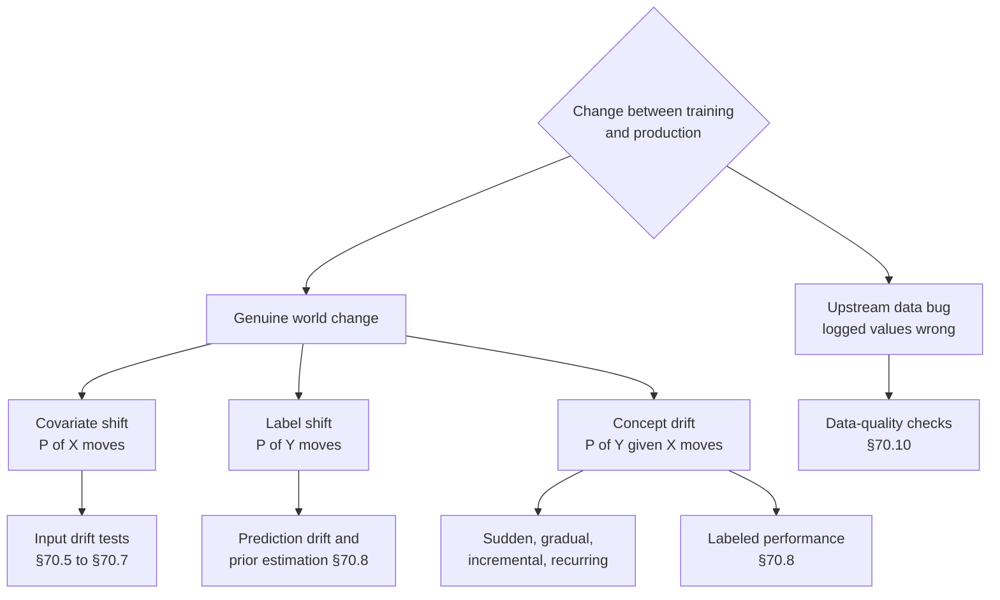

**Reading the diagram.** The top split is the first question in any investigation: did the data change, or did the pipe break? Bugs are caught by cheap, sharp data-quality checks. Genuine change divides by which factor of $P(X, Y)$ moved: covariate shift reaches input-drift tests; label shift shows in the prediction distribution; concept drift reaches only the labeled-performance monitor, after the label delay. The bottom row is a detection-latency ladder, from minutes on the left to weeks on the right. Failure point: treating every input-drift alert as a reason to retrain, which retrains on bugs and ignores concept drift that inputs do not reveal.

#### Mathematical foundations

Covariate shift can move an aggregate metric even when no slice of the model got worse, because the aggregate is a weighted average over slices whose weights changed. Separating the two effects is the first step in diagnosing an accuracy drop.

::: formula
**Mix decomposition of an aggregate error change**

$$E = \sum_{s} w_s\, e_s \qquad \Delta E = \underbrace{\sum_{s} (w'_s - w_s)\, e_s}_{\text{mix effect}} + \underbrace{\sum_{s} w'_s\, (e'_s - e_s)}_{\text{within-slice effect}}$$

| Symbol | Meaning | Units |
|---|---|---|
| $s$ | Slice (for example a distance band or city) | — |
| $w_s$, $w'_s$ | Share of predictions in slice $s$ before and after the change | fraction |
| $e_s$, $e'_s$ | Error metric in slice $s$ before and after (e.g. MAE) | minutes |
| $E$ | Aggregate error | minutes |
| $\Delta E$ | Change in aggregate error | minutes |
:::

::: example
**Worked example — The suburbs launch.** Before the launch, 70% of orders are short (under 5 km, MAE 3.8 min) and 30% long (MAE 5.5 min). After it, the mix is 50/50 and per-slice MAE is unchanged.

1. Before: $E = 0.7 \times 3.8 + 0.3 \times 5.5 = 2.66 + 1.65 = 4.31$ min.
2. After: $E' = 0.5 \times 3.8 + 0.5 \times 5.5 = 1.90 + 2.75 = 4.65$ min, above the 4.5 min SLO.
3. Mix effect: $(0.5 - 0.7) \times 3.8 + (0.5 - 0.3) \times 5.5 = -0.76 + 1.10 = 0.34$ min. Within-slice effect: $0$. Total $\Delta E = 0.34$ min.

*Interpretation:* the model did not get worse at anything; QuickBite started asking it harder questions. *Engineering implication:* before retraining in response to an aggregate drop, decompose it. A pure mix effect calls for a product decision (accept higher error on long trips, or invest in a better long-distance model), not for retraining on the same features, which may change nothing. A within-slice effect is the signature of concept drift.
:::

### 70.4.3 Bugs versus genuine change

Many production "drifts" are changes in the pipes, not the world: a renamed field, a unit change, a default value, a stalled job [Breck et al. 2019].

**Figure 70.4 — Triage flow for a drift alert.**

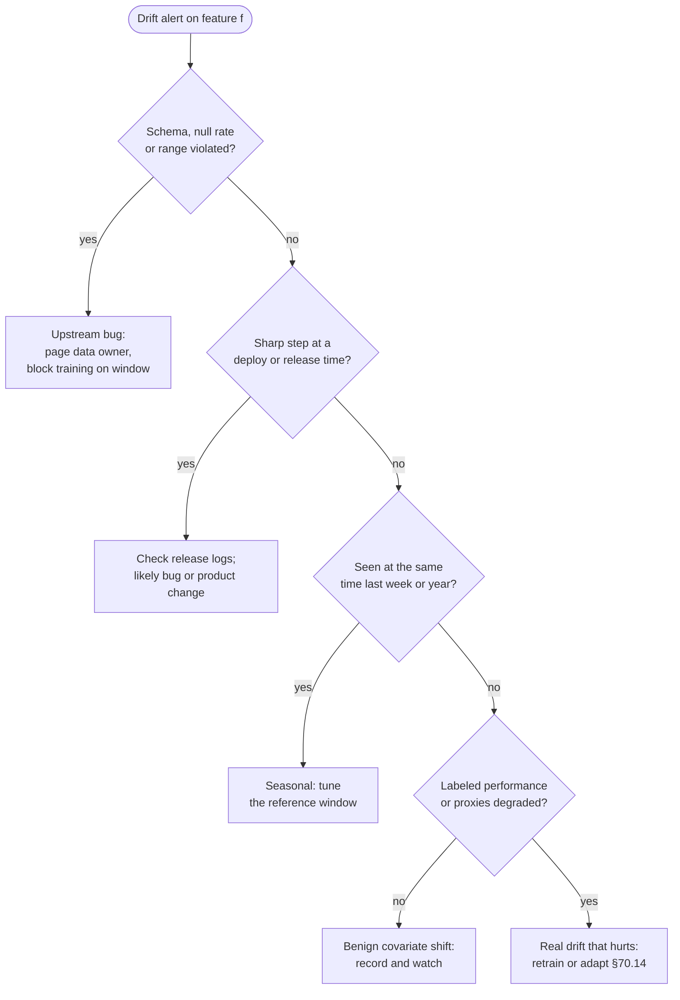

**Reading the diagram.** An alert enters at the top and is checked against progressively more expensive questions. Schema, null and range checks are definitive; a hit means a bug: fix the producer and keep the window out of training data. A sharp step aligned with a deployment (tablet app, feature pipeline, model) is the next most common cause. Seasonal patterns are checked against the same hour last week. Only shifts that survive are genuine change, and only those that hurt performance or its proxies justify retraining. Each exit routes to a different owner. Failure point: skipping to the bottom box, which is how teams retrain on corrupted data (§70.14.2).

::: mistake
**"Drift means the model must be retrained."** Most covariate shift inside the training range is harmless (§70.6.3), and most sharp drift is a bug that retraining would bake into the next model. Retrain when performance, measured or credibly estimated, degrades.
:::

## 70.5 Statistical tests and distances

Every drift detector answers the same question: are these two samples, a **reference window** (usually training data or a known-good period) and a **current window** (recent production traffic), drawn from the same distribution? **Two-sample tests** (Kolmogorov–Smirnov, chi-square) return a p-value: how surprising the difference would be if nothing had changed. **Distances and divergences** (PSI, KL, Jensen–Shannon, Wasserstein) return a magnitude: how much changed. The distinction matters more than any formula (§70.6.3).

Throughout, $p_i$ is the reference share of bin $i$ and $q_i$ the current share, matching the PSI notation of §59.7.2.

### 70.5.1 Population stability index (PSI)

::: definition
**Definition — Population stability index (PSI).** A symmetric divergence between two binned distributions, $\sum_i (q_i - p_i)\ln(q_i / p_i)$, originating in credit scoring, where it is used to check whether the population being scored still resembles the population the scorecard was built on [Siddiqi 2006]. It equals $\mathrm{KL}(Q \,\|\, P) + \mathrm{KL}(P \,\|\, Q)$, the Jeffreys divergence (§70.5.4).
:::

The formula is defined in §59.7.2; this section adds the practical decisions it hides.

1. **Bins.** Use the reference window's deciles ($B = 10$) for numeric features, so each reference bin holds 10% of the data, and open the outer edges to $\pm\infty$ so that out-of-range values land in an end bin. For categorical features each category is a bin, with rare categories merged into "other".
2. **Empty bins.** If $q_i = 0$ or $p_i = 0$ the logarithm is infinite. Implementations replace zero shares with a small floor $\varepsilon$. The choice is not innocent, as the example below shows.
3. **Thresholds.** The rule of thumb reads PSI below 0.1 as stable, 0.1–0.2 (in some sources 0.1–0.25) as a moderate shift worth investigating and above 0.2 (or 0.25) as a significant shift. These bands come from credit-scoring practice, where Siddiqi's scorecard text is the usual citation [Siddiqi 2006]; they are conventions calibrated on populations of thousands, not statistical critical values. §70.6.2 shows that at small sample sizes PSI crosses 0.1 from noise alone.

::: example
**Worked example — One empty bin.** A feature's top reference decile holds $p_{10} = 0.10$. In a small current window no value lands there ($q_{10} = 0$); the other nine bins share the missing mass evenly, $q_i = 0.1\overline{1}$.

1. Nine full bins: each contributes $(0.1111 - 0.10)\ln(0.1111/0.10) = 0.0111 \times 0.1054 = 0.00117$; together $0.0105$.
2. Empty bin with floor $\varepsilon = 10^{-4}$: $(0.0001 - 0.10)\ln(0.0001/0.10) = (-0.0999)(-6.908) = 0.690$.
3. Same bin with $\varepsilon = 10^{-6}$: $(-0.1)(\ln 10^{-5}) = (-0.1)(-11.51) = 1.151$.
4. PSI is $0.70$ or $1.16$ depending only on $\varepsilon$.

*Interpretation:* one empty bin dominates PSI, and its contribution is set by an arbitrary constant. *Engineering implication:* require a minimum window size (at least a few hundred rows for ten bins, §70.6.2), fix $\varepsilon$ across the organization so values are comparable, and report the per-bin contributions, not only the sum, so an alert can say which bin moved.
:::

### 70.5.2 Kolmogorov–Smirnov test

::: definition
**Definition — Kolmogorov–Smirnov (KS) test.** A nonparametric two-sample test whose statistic $D$ is the largest vertical gap between the two samples' empirical cumulative distribution functions (CDFs). It needs no binning and is sensitive to any difference in location or shape, most strongly near the middle of the distribution [Massey 1951].
:::

::: formula
**Two-sample KS statistic and its large-sample critical value**

$$D = \sup_x \big|\hat{F}_P(x) - \hat{F}_Q(x)\big| \qquad D_{\text{crit}} = c(\alpha)\sqrt{\frac{n + m}{n\,m}} \qquad c(\alpha) = \sqrt{-\tfrac{1}{2}\ln\tfrac{\alpha}{2}}$$

$$p \approx 2\sum_{k=1}^{\infty} (-1)^{k-1} e^{-2k^2\lambda^2} \qquad \lambda = D\sqrt{\frac{n\,m}{n + m}}$$

| Symbol | Meaning | Units |
|---|---|---|
| $\hat{F}_P(x)$, $\hat{F}_Q(x)$ | Fraction of reference and current values $\le x$ | fraction |
| $D$ | KS statistic: maximum CDF gap | fraction |
| $n$, $m$ | Reference and current sample sizes | rows |
| $\alpha$ | False-alarm rate of the test | probability |
| $c(\alpha)$ | Critical coefficient ($1.358$ at $\alpha = 0.05$) | dimensionless |
| $D_{\text{crit}}$ | Reject "same distribution" when $D > D_{\text{crit}}$ | fraction |
| $\lambda$ | Scaled statistic for the asymptotic p-value | dimensionless |
| $p$ | Approximate p-value | probability |
:::

::: example
**Worked example — KS on two windows of prep times.** Reference and current windows each hold $n = m = 2{,}000$ orders; the largest CDF gap is at 12 minutes, where 40% of reference orders and 35% of current orders are at or below 12 min, so $D = 0.05$.

1. $c(0.05) = \sqrt{-0.5 \ln 0.025} = \sqrt{0.5 \times 3.689} = \sqrt{1.844} = 1.358$.
2. $D_{\text{crit}} = 1.358 \times \sqrt{4{,}000 / 4{,}000{,}000} = 1.358 \times 0.0316 = 0.0429$. Since $0.05 > 0.0429$, reject at 5%.
3. $\lambda = 0.05 \times \sqrt{4{,}000{,}000/4{,}000} = 0.05 \times 31.62 = 1.581$. $p \approx 2(e^{-2 \times 2.5} - e^{-8 \times 2.5} + \dots) = 2 \times 0.00674 = 0.0135$.

*Interpretation:* a 5-percentage-point gap in the CDF is detectable at 2,000 rows per window. *Engineering implication:* $D_{\text{crit}}$ shrinks as $1/\sqrt{n}$; at one million rows per window it is 0.0019, so KS flags differences far too small to matter (§70.6.3). Use $D$ itself as an effect size and alert on $D$ above a chosen magnitude, with the p-value as a guard against noise.
:::

### 70.5.3 Chi-square test for categorical features

::: formula
**Chi-square goodness-of-fit against reference shares, and Cohen's $w$**

$$\chi^2 = \sum_{i=1}^{K} \frac{(O_i - E_i)^2}{E_i} \qquad E_i = n\,p_i \qquad \text{df} = K - 1 \qquad w = \sqrt{\chi^2 / n}$$

| Symbol | Meaning | Units |
|---|---|---|
| $K$ | Number of categories | categories |
| $O_i$ | Observed count of category $i$ in the current window | rows |
| $p_i$ | Reference share of category $i$ | fraction |
| $n$ | Current window size | rows |
| $E_i$ | Expected count if nothing changed | rows |
| $\chi^2$ | Test statistic, compared with a chi-square distribution with df degrees of freedom | dimensionless |
| $w$ | Cohen's $w$: effect size independent of $n$ | dimensionless |
:::

When the reference sample is small too, use the two-sample contingency-table version (`scipy.stats.chi2_contingency`); the goodness-of-fit form above treats the reference shares as exact, which is reasonable when the reference holds hundreds of thousands of rows. Both need expected counts of at least about 5 per category, so merge rare categories first.

::: example
**Worked example — Courier vehicles in a winter week.** Reference shares: bike 50%, scooter 35%, car 15%. A current window of $n = 2{,}000$ deliveries has 900 bikes, 700 scooters and 400 cars.

1. Expected: $E = (1{,}000,\ 700,\ 300)$.
2. $\chi^2 = 100^2/1{,}000 + 0 + 100^2/300 = 10 + 0 + 33.3 = 43.3$, with $\text{df} = 2$. For two degrees of freedom the p-value is exactly $e^{-\chi^2/2} = e^{-21.7} = 3.9 \times 10^{-10}$.
3. PSI on the same shares: $(0.45 - 0.50)\ln 0.9 + 0 + (0.20 - 0.15)\ln(1.333) = 0.0053 + 0.0144 = 0.020$.
4. Cohen's $w = \sqrt{43.3/2{,}000} = 0.147$, a "small" effect on Cohen's conventional scale (0.1 small, 0.3 medium, 0.5 large).

*Interpretation:* the test is certain that something changed; PSI and $w$ agree that it changed only a little. *Engineering implication:* a 5-point move from bikes to cars is a real seasonal pattern, and whether it matters depends on whether the model has a vehicle feature and saw winters in training, not on the p-value.
:::

### 70.5.4 Kullback–Leibler and Jensen–Shannon divergence

::: formula
**KL divergence, Jeffreys divergence (PSI) and Jensen–Shannon divergence**

$$\mathrm{KL}(Q \,\|\, P) = \sum_i q_i \ln\frac{q_i}{p_i} \qquad \text{PSI} = \mathrm{KL}(Q \,\|\, P) + \mathrm{KL}(P \,\|\, Q)$$

$$\mathrm{JS}(P, Q) = \tfrac{1}{2}\,\mathrm{KL}(P \,\|\, M) + \tfrac{1}{2}\,\mathrm{KL}(Q \,\|\, M) \qquad M = \tfrac{1}{2}(P + Q) \qquad 0 \le \mathrm{JS} \le \ln 2$$

| Symbol | Meaning | Units |
|---|---|---|
| $p_i$, $q_i$ | Reference and current share of bin $i$ | fraction |
| $\mathrm{KL}(Q \,\|\, P)$ | Expected extra log-loss from coding $Q$ with a code built for $P$; asymmetric | nats |
| $M$ | Mixture of the two distributions, bin by bin | fraction |
| $\mathrm{JS}$ | Symmetric, bounded divergence; $\sqrt{\mathrm{JS}}$ is a metric (the JS distance) | nats (bits if $\log_2$, bounded by 1) |
:::

KL divergence has two drawbacks for monitoring: it is asymmetric, and it is infinite whenever the current window has mass where the reference has none. PSI fixes the asymmetry by adding both directions; Jensen–Shannon fixes both problems by comparing each distribution with their average, which is never zero where either is positive. That is why JS is a common default for categorical drift in tools (§70.15.2). Check which variant a tool reports: some return the JS *distance* (the square root), some use base-2 logarithms.

::: example
**Worked example — KL and JS on §62.9.2's four bins.** Reference shares $p = (0.25, 0.25, 0.25, 0.25)$; current $q = (0.10, 0.20, 0.30, 0.40)$. §62.9.2 computed PSI $= 0.228$.

1. $\mathrm{KL}(Q \,\|\, P) = 0.1\ln 0.4 + 0.2 \ln 0.8 + 0.3 \ln 1.2 + 0.4 \ln 1.6 = -0.0916 - 0.0446 + 0.0547 + 0.1880 = 0.1064$.
2. $\mathrm{KL}(P \,\|\, Q) = 0.25(\ln 2.5 + \ln 1.25 + \ln 0.833 + \ln 0.625) = 0.25(0.9163 + 0.2231 - 0.1823 - 0.4700) = 0.1218$.
3. Sum: $0.1064 + 0.1218 = 0.2282$, which is the PSI. The two directions differ by 14%.
4. $M = (0.175, 0.225, 0.275, 0.325)$. $\mathrm{KL}(P \,\|\, M) = 0.25(0.3567 + 0.1054 - 0.0953 - 0.2624) = 0.0261$. $\mathrm{KL}(Q \,\|\, M) = 0.1(-0.5596) + 0.2(-0.1178) + 0.3(0.0870) + 0.4(0.2076) = 0.0296$.
5. $\mathrm{JS} = (0.0261 + 0.0296)/2 = 0.0279$ nats $= 0.040$ bits; JS distance $= \sqrt{0.0279} = 0.167$.

*Interpretation:* the same shift is 0.228 in PSI, 0.106 or 0.122 in KL, 0.028 in JS and 0.167 in JS distance. *Engineering implication:* thresholds do not transfer between statistics. A team that moves from PSI 0.2 to "JS 0.2" has made its detector roughly eight times less sensitive.
:::

### 70.5.5 Wasserstein distance

::: formula
**Wasserstein-1 (earth mover's) distance in one dimension**

$$W_1(P, Q) = \int_{-\infty}^{\infty} \big|F_P(x) - F_Q(x)\big|\,dx \qquad W_1 = \frac{1}{n}\sum_{j=1}^{n} \big|x_{(j)} - y_{(j)}\big| \ \text{(equal-size samples)}$$

| Symbol | Meaning | Units |
|---|---|---|
| $F_P$, $F_Q$ | Reference and current CDFs | fraction |
| $x_{(j)}$, $y_{(j)}$ | $j$-th smallest value in the reference and current sample | feature units |
| $n$ | Sample size (when equal) | rows |
| $W_1$ | Average distance probability mass must move to turn one distribution into the other | feature units |
:::

Where KS asks "how far apart are the CDFs at their worst point?", Wasserstein asks "how much work does it take to move one pile of sand into the shape of the other?". It is measured in the feature's own units, so it says *how far* values moved, not only *that* they moved. A pure shift of every value by $\delta$ gives $W_1 = \delta$ exactly. Divide by the reference standard deviation to compare features with different units; Evidently, for example, uses this normed distance with a 0.1 threshold for large numerical columns (as of 2026, §70.15.2).

::: example
**Worked example — Five orders.** Reference distances (km): 1, 2, 3, 4, 5. Current: 1.5, 2.5, 3.5, 4.5, 9.

1. Sorted differences: $0.5, 0.5, 0.5, 0.5, 4.0$.
2. $W_1 = (0.5 \times 4 + 4.0)/5 = 6.0 / 5 = 1.2$ km.
3. KS on the same samples: $D = 0.2$ (the two CDFs never differ by more than one order in five), and it would stay 0.2 if the outlier were 900 km.

*Interpretation:* one far-away value contributes two thirds of $W_1$. *Engineering implication:* Wasserstein is the right statistic when *how far* matters (a unit bug that multiplies values by 1,000 produces an enormous $W_1$) and the wrong one when you want robustness to a few outliers; pair it with range checks (§70.10) so outliers are diagnosed as bugs first.
:::

### 70.5.6 Code example: every statistic on synthetic drift

The program draws a reference of 50,000 order distances (gamma-distributed, mean 3.2 km as in §59.7.3) and five current windows of 5,000 orders: no drift, two mean shifts, a change of spread at the same mean, and a unit bug on 5% of rows. It then computes every statistic in this section, plus chi-square on a categorical feature.

```python
import numpy as np
from scipy import stats

rng = np.random.default_rng(70)
EPS = 1e-6                                   # floor for empty bins

def bin_shares(ref, cur, n_bins=10):
    """Bin both samples on the reference deciles; return shares (p, q)."""
    edges = np.quantile(ref, np.linspace(0, 1, n_bins + 1))
    edges[0], edges[-1] = -np.inf, np.inf
    p = np.histogram(ref, edges)[0] / len(ref)
    q = np.histogram(cur, edges)[0] / len(cur)
    return np.clip(p, EPS, None), np.clip(q, EPS, None)

def kl(a, b):
    return float(np.sum(a * np.log(a / b)))

def psi(p, q):
    return float(np.sum((q - p) * np.log(q / p)))

def js(p, q):
    m = (p + q) / 2
    return 0.5 * kl(p, m) + 0.5 * kl(q, m)

# Reference: two weeks of order distances in km (mean ~3.2, as in Ch 59)
ref = rng.gamma(shape=2.0, scale=1.6, size=50_000)
n = 5_000                                    # one current window
clean = rng.gamma(2.0, 1.6, n)
scenarios = {
    "no drift":       rng.gamma(2.0, 1.6, n),
    "mean +12%":      rng.gamma(2.0, 1.8, n),       # suburbs launch
    "mean +40%":      rng.gamma(2.0, 2.24, n),      # long-distance tier
    "wider spread":   rng.gamma(1.3, 2.46, n),      # same mean, more variance
    "unit bug on 5%": np.where(rng.random(n) < 0.05, clean * 1000, clean),
}
print(f"{'scenario':<15}{'PSI':>7}{'KL(Q|P)':>9}{'JS':>8}{'KS D':>7}"
      f"{'KS p':>9}{'W1 km':>8}{'W1/sd':>7}")
for name, cur in scenarios.items():
    p, q = bin_shares(ref, cur)
    ks = stats.ks_2samp(ref, cur)
    w1 = stats.wasserstein_distance(ref, cur)
    print(f"{name:<15}{psi(p, q):7.3f}{kl(q, p):9.3f}{js(p, q):8.4f}"
          f"{ks.statistic:7.3f}{ks.pvalue:9.1e}{w1:8.2f}{w1 / ref.std():7.2f}")

# PSI equals the symmetrized KL divergence (Jeffreys divergence)
p, q = bin_shares(ref, scenarios["mean +40%"])
print(f"check: KL(Q|P) + KL(P|Q) = {kl(q, p) + kl(p, q):.4f}; PSI = {psi(p, q):.4f}")

# Categorical feature: courier vehicle type, reference shares vs a winter week
p_ref = np.array([0.50, 0.35, 0.15])                 # bike, scooter, car
obs = np.bincount(rng.choice(3, size=2_000, p=[0.45, 0.35, 0.20]), minlength=3)
chi2, pval = stats.chisquare(obs, p_ref * obs.sum())
q_cur = obs / obs.sum()
print(f"vehicle counts {obs.tolist()}: chi2 = {chi2:.1f}, p = {pval:.1e}, "
      f"PSI = {psi(p_ref, q_cur):.3f}, Cohen's w = {np.sqrt(chi2 / obs.sum()):.3f}")
```

Output:

```text
scenario           PSI  KL(Q|P)      JS   KS D     KS p   W1 km  W1/sd
no drift         0.002    0.001  0.0003  0.008  9.0e-01    0.02   0.01
mean +12%        0.022    0.011  0.0027  0.059  4.4e-14    0.36   0.16
mean +40%        0.227    0.119  0.0277  0.195 2.9e-152    1.36   0.60
wider spread     0.081    0.042  0.0100  0.089  5.5e-32    0.40   0.18
unit bug on 5%   0.023    0.012  0.0028  0.054  3.8e-12  166.72  74.28
check: KL(Q|P) + KL(P|Q) = 0.2270; PSI = 0.2270
vehicle counts [924, 688, 388]: chi2 = 31.8, p = 1.2e-07, PSI = 0.014, Cohen's w = 0.126
```

What to notice:

- **A 12% mean shift is "stable" by PSI (0.022) and overwhelming by KS ($p = 4 \times 10^{-14}$).** PSI's bands need a 40% shift to say "significant".
- **The unit bug looks like a mild drift to every binned statistic.** Inflated values all land in the open top bin, so binned statistics see "5% more mass in bin 10". Only Wasserstein (74 standard deviations) shouts; range checks catch it more directly still (§70.10).
- **The spread change at the same mean** is caught by every statistic, which a mean-shift z-score (§59.7.2) would miss.
- **PSI equals the sum of the two KL directions** (check line); the categorical line repeats §70.5.3: tiny p-value, small effect.

**Table 70.3 — Drift statistics compared.**

| Row | PSI | KS test | Chi-square | KL / JS | Wasserstein |
|---|---|---|---|---|---|
| What it is | Symmetric binned divergence | Max CDF gap + p-value | Count-based test + p-value | Information divergence | Mass-moving distance |
| Data type | Numeric (binned), categorical | Numeric | Categorical | Both (binned) | Numeric |
| Output | Magnitude | Test (and $D$ as magnitude) | Test (and $w$) | Magnitude | Magnitude in feature units |
| Advantages | Familiar thresholds, interpretable per bin | No binning, exact for small $n$ | Simple, standard | JS bounded and symmetric | Sees how far values moved |
| Disadvantages | Bin and $\varepsilon$ dependent; noisy at small $n$ | Over-sensitive at large $n$; weak in tails | Needs ≥ 5 expected per cell | KL infinite with empty bins | Outlier-sensitive; unit-dependent |
| Choose when | Scorecards, stable reporting | Small windows (≤ a few thousand) | Small windows, categorical | Large windows, categorical | Large windows, numeric |

**Figure 70.5 — Choosing a drift statistic for one feature.**

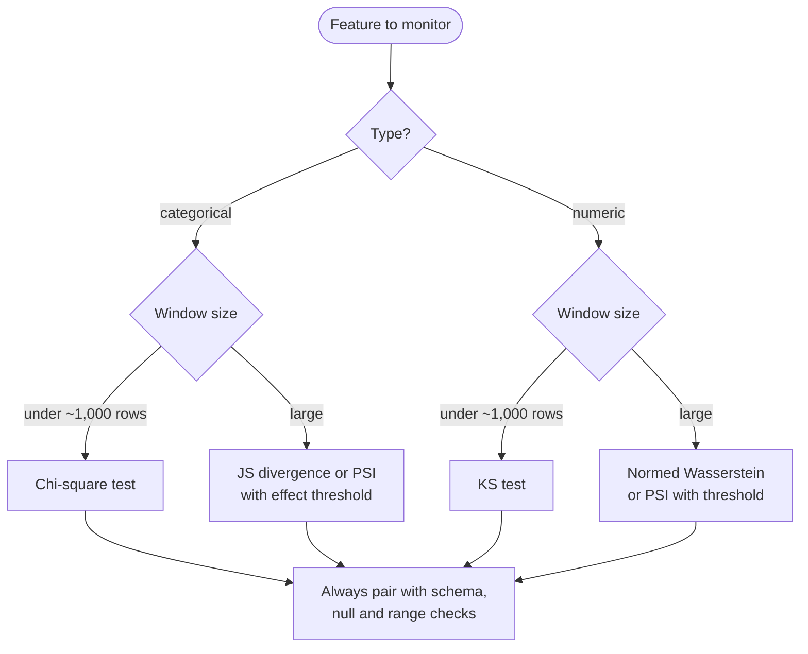

**Reading the diagram.** The two questions are the feature's type and the window's size. Small windows need a test, because sampling noise is large and the p-value tells you whether the difference is real. Large windows make every test significant, so they need a magnitude with a threshold chosen for business relevance. Every path ends in the same box: distribution statistics are weak bug detectors (the unit bug in §70.5.6), so they never replace deterministic data-quality checks. The cut-off near 1,000 rows mirrors the default switch in Evidently's drift presets (as of 2026, §70.15.2); treat it as a starting point, not a law.

## 70.6 Practical drift detection

### 70.6.1 Reference and current windows

::: definition
**Definition — Reference window.** The sample a monitor treats as "normal": the model's training data, a fixed known-good production period, a trailing window (for example the previous 7 days) or a seasonal window (the same hour on the previous four weeks). **Current window:** the recent sample being tested, either **tumbling** (consecutive, non-overlapping hours) or **sliding** (the last 60 minutes, recomputed every 5 minutes).
:::

*Training data* answers "is the model seeing what it was trained on?", the question that matters for accuracy. *A trailing window* answers "did something change recently?", ideal for bugs, but absorbs slow drift. *A seasonal window* removes predictable cycles. Mature monitors run two references: training data for slow drift and a seasonal window for sudden change.

**Figure 70.6 — Reference and current windows for a Friday-dinner check.**

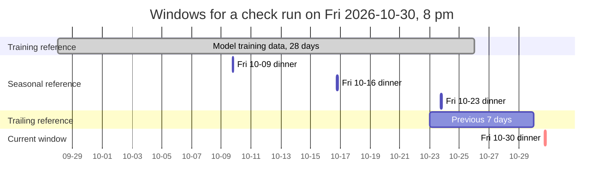

**Reading the diagram.** The current window (red) is the last two hours of Friday dinner. It is compared against three references. Drift against the training reference predicts accuracy loss. The seasonal reference pools the same two hours on three previous Fridays, so Friday's normal baskets do not alarm. The trailing 7-day reference catches anything new this week but mixes lunch, dinner and weekends, so it needs looser thresholds. All windows are queries over the prediction log (the storage boundary), which must retain at least the training window's span. Failure point: a seasonal reference that contains last week's incident; exclude windows flagged as incidents from future references.

### 70.6.2 Sample size and the noise floor

Small windows are noisy, and distance statistics are biased upward by noise: two samples from the *same* distribution almost never have identical histograms, so PSI is positive even when nothing changed.

::: formula
**Expected PSI under no drift**

$$\mathbb{E}[\text{PSI} \mid \text{no drift}] \approx (B - 1)\left(\frac{1}{n} + \frac{1}{m}\right)$$

| Symbol | Meaning | Units |
|---|---|---|
| $B$ | Number of bins | bins |
| $n$ | Current window size | rows |
| $m$ | Reference window size | rows |
:::

The approximation comes from expanding PSI to second order: $\text{PSI} \approx \sum_i (q_i - p_i)^2 / p_i$, which is a chi-square statistic divided by the effective sample size, and a chi-square statistic with $B - 1$ degrees of freedom has expectation $B - 1$. With near-empty bins the $\varepsilon$ floor of §70.5.1 makes PSI larger still.

::: example
**Worked example — How small can a city-hour window be?** Ten bins, a large reference ($1/m \approx 0$).

1. $n = 100$: $\mathbb{E}[\text{PSI}] \approx 9/100 = 0.09$, almost at the "moderate" threshold with no drift at all.
2. $n = 500$: $9/500 = 0.018$.
3. To keep the noise floor at most a tenth of the 0.1 threshold, $9/n \le 0.01$, so $n \ge 900$.
4. A QuickBite city with 2% of orders has $500{,}000 \times 0.02 / 24 \approx 417$ orders in an average hour, so a city-hour window is too small; a city over 3 hours (about 1,250 orders) or the whole platform per hour (about 20,800) is not.

*Interpretation:* PSI thresholds assume large windows. *Engineering implication:* compute the noise floor for each window size and either set a minimum $n$ (here about 900) or subtract the expected noise before comparing with a threshold.
:::

The program below checks the approximation by simulation, then shows the opposite problem at large $n$.

```python
import numpy as np
from scipy import stats

rng = np.random.default_rng(7)
ref = rng.gamma(2.0, 1.6, 1_000_000)                 # large reference window
edges = np.quantile(ref, np.linspace(0, 1, 11))      # reference deciles
edges[0], edges[-1] = -np.inf, np.inf
p = np.histogram(ref, edges)[0] / len(ref)

def psi_to_ref(cur):
    q = np.clip(np.histogram(cur, edges)[0] / len(cur), 1e-6, None)
    return float(np.sum((q - p) * np.log(q / p)))

print("A. No drift: PSI from sampling noise alone (200 windows per size)")
for n in [50, 100, 500, 5_000]:
    vals = np.array([psi_to_ref(rng.gamma(2.0, 1.6, n)) for _ in range(200)])
    print(f"   n={n:>5}: mean PSI={vals.mean():.4f} (approx. 9/n={9 / n:.4f}), "
          f"windows with PSI > 0.1: {np.mean(vals > 0.1):.0%}")

print("B. A harmless 1% scale shift, tested with growing window sizes")
for n in [1_000, 10_000, 100_000, 1_000_000]:
    cur = rng.gamma(2.0, 1.6 * 1.01, n)
    ks = stats.ks_2samp(ref, cur)
    print(f"   n={n:>9,}: KS D={ks.statistic:.4f}, p={ks.pvalue:.1e}, "
          f"PSI={psi_to_ref(cur):.4f}, mean shift={cur.mean() - ref.mean():+.3f} km")
```

Output:

```text
A. No drift: PSI from sampling noise alone (200 windows per size)
   n=   50: mean PSI=0.2295 (approx. 9/n=0.1800), windows with PSI > 0.1: 89%
   n=  100: mean PSI=0.0957 (approx. 9/n=0.0900), windows with PSI > 0.1: 38%
   n=  500: mean PSI=0.0187 (approx. 9/n=0.0180), windows with PSI > 0.1: 0%
   n= 5000: mean PSI=0.0018 (approx. 9/n=0.0018), windows with PSI > 0.1: 0%
B. A harmless 1% scale shift, tested with growing window sizes
   n=    1,000: KS D=0.0253, p=5.4e-01, PSI=0.0104, mean shift=+0.030 km
   n=   10,000: KS D=0.0154, p=1.9e-02, PSI=0.0021, mean shift=+0.050 km
   n=  100,000: KS D=0.0050, p=2.2e-02, PSI=0.0002, mean shift=+0.023 km
   n=1,000,000: KS D=0.0065, p=4.9e-19, PSI=0.0002, mean shift=+0.033 km
```

What to notice:

- **Part A:** with 100 rows, 38% of windows with *no drift* exceed PSI 0.1; with 50 rows, 89% do, and the mean overshoots $9/n$ because some bins are empty. The approximation is good from a few hundred rows.
- **Part B:** the same 1% shift goes from undetectable ($p = 0.54$) to overwhelming ($p = 5 \times 10^{-19}$) as $n$ grows, while PSI correctly stays near zero.
- Read together: distances are biased at small $n$, tests are over-powered at large $n$. A monitor needs both a minimum sample size and an effect-size threshold.

### 70.6.3 "Statistically significant" is not "important"

::: example
**Worked example — A million predictions and a 1% shift.** QuickBite's ETA service makes about 360 million predictions a day; even a 1% sample gives $n = m = 1{,}000{,}000$ per daily window. Suppose courier routing software changes so that reported distances are 1% longer (mean 3.20 → 3.23 km).

1. For a gamma distribution with shape 2, a 1% change of scale moves the CDF by at most $\approx 0.54 \times 0.01 = 0.0054$, so $D \approx 0.0054$.
2. $D_{\text{crit}} = 1.358 \times \sqrt{2/10^6} = 1.358 \times 0.00141 = 0.0019$. $D$ is almost three times the critical value; $\lambda = 0.0054 \times \sqrt{500{,}000} = 3.8$, so $p \approx 2e^{-2 \times 3.8^2} = 2e^{-28.9} \approx 6 \times 10^{-13}$.
3. Effect on predictions: the ETA model's travel component is about 3 min/km, so the average ETA rises by $0.03 \times 3 = 0.09$ min, about 5 seconds, against an MAE of 4.3 minutes.
4. With $n = m = 10{,}000$, $D_{\text{crit}} = 0.0192$ and the same shift is invisible.

*Interpretation:* the test is right that the distribution changed and wrong to imply that anyone should care. *Engineering implication:* at production volumes, alert on *effect sizes* that are tied to impact (PSI or normed Wasserstein above a threshold, or better, the predicted change in model output), use p-values only to suppress noise in small slices, and weight features by importance: a large shift in a feature the model barely uses rarely matters [Huyen 2022].
:::

### 70.6.4 Multiple testing and alert fatigue

::: formula
**False alarms from many tests**

$$\mathbb{E}[\text{false alarms}] = m\,\alpha \qquad P(\ge 1 \text{ false alarm}) = 1 - (1 - \alpha)^m \qquad \alpha_{\text{Bonf}} = \alpha / m$$

| Symbol | Meaning | Units |
|---|---|---|
| $m$ | Number of independent tests run per period | tests |
| $\alpha$ | Per-test false-alarm rate | probability |
| $\alpha_{\text{Bonf}}$ | Bonferroni per-test level keeping the family-wise error rate at $\alpha$ | probability |
:::

::: example
**Worked example — Monitoring 40 features in 20 cities every hour.** The ETA model has 40 features; the team tests each per city per hour at $\alpha = 0.01$.

1. Tests per day: $m = 40 \times 20 \times 24 = 19{,}200$.
2. Expected false alarms with no drift anywhere: $19{,}200 \times 0.01 = 192$ per day, eight an hour.
3. Bonferroni: $\alpha_{\text{Bonf}} = 0.01 / 19{,}200 = 5.2 \times 10^{-7}$, a critical $z$ of about 5.0. That keeps false alarms to about one per hundred days but detects only large shifts in small cities.
4. Benjamini–Hochberg (BH) controls the **false discovery rate** instead: sort the $m$ p-values, find the largest $k$ with $p_{(k)} \le (k/m)\,q$, and flag those $k$ [Benjamini and Hochberg 1995]. At $q = 0.05$, at most about 5% of flagged tests are expected to be false, which is the quantity on-call engineers actually experience.

*Interpretation:* an unadjusted monitor that tests everything everywhere is a random alert generator. *Engineering implication:* reduce $m$ first (monitor the top 10 features by importance per city, the rest platform-wide), aggregate (one "share of drifted features" statistic per city, as Evidently's dataset-drift preset does), then adjust what remains with BH, and route drift findings to tickets and dashboards rather than pages (§70.13).
:::

Shankar et al.'s interview study of ML engineers reports alert fatigue from noisy data-quality and drift alerts as a recurring pain point, with practitioners favoring fewer, more actionable alerts [Shankar et al. 2022].

### 70.6.5 Seasonality

::: example
**Worked example — Friday dinner looks like drift.** Basket size has three bins. Over a whole week the shares are small 50%, medium 35%, large 15%; on Friday dinner they are 35%, 40%, 25%, every week.

1. $(0.35 - 0.50)\ln(0.35/0.50) = (-0.15)(-0.357) = 0.054$.
2. $(0.40 - 0.35)\ln(0.40/0.35) = 0.05 \times 0.134 = 0.007$.
3. $(0.25 - 0.15)\ln(0.25/0.15) = 0.10 \times 0.511 = 0.051$.
4. PSI $= 0.111$: a "moderate shift" every Friday evening.

*Interpretation:* nothing changed; the reference was wrong for the question. *Engineering implication:* compare like with like, using the seasonal reference of Figure 70.6 (same hour of week), or condition the statistic on hour of week. Holidays and promotions need explicit annotations so their windows are neither alarmed on nor used as future references.
:::

#### Failure scenarios

**Table 70.4 — Drift-detection failure scenarios.**

| What goes wrong | Why | Detection | Recovery | Prevention |
|---|---|---|---|---|
| Hundreds of ignored drift alerts | Unadjusted tests, large $m$ and $n$ | Alert precision < 10% | Move drift to tickets | Effect thresholds, BH |
| Slow drift never alarms | Trailing reference absorbs it | Accuracy decays, drift "green" | Add training reference | Two references |
| Small-city alarms are random | Windows below noise floor | PSI noise ≈ threshold | Longer windows | Minimum $n$ |
| Incident becomes "normal" | Incident window used as reference | Reference shifts after incidents | Rebuild reference | Exclude flagged windows |

## 70.7 Multivariate and embedding drift

### 70.7.1 Why per-feature tests are not enough

Per-feature tests miss changes in the *relationships* between features. If a ranking change sends customers to faraway restaurants that are also slow to cook, distance and preparation time become correlated while each histogram stays the same, and an ETA model that never saw that combination may extrapolate badly. Embeddings make it worse: a 768-dimensional embedding has 768 marginals, none meaningful alone.

### 70.7.2 The domain classifier

::: definition
**Definition — Domain classifier (classifier two-sample test).** A drift detector that labels reference rows 0 and current rows 1, trains a classifier to tell them apart, and measures its out-of-sample discrimination (usually AUC). If the two windows come from the same distribution, no classifier can beat chance (AUC 0.5) [Lopez-Paz and Oquab 2017; Rabanser et al. 2019].
:::

#### First-principles explanation

To check whether two bags of coins came from the same mint, show an expert coins from both and ask her to guess which bag each came from. If she does no better than a coin toss, the bags are indistinguishable; if she is right 70% of the time, they differ, and *how* she tells them apart says what changed. The domain classifier is that expert, and feature importance is her explanation.

#### How it works internally

1. Sample reference and current windows of a few thousand rows; label them 0 and 1.
2. Train a flexible classifier (trees for tabular data, logistic regression on embeddings) with $k$-fold cross-validation, so each row is scored by a model that never saw it.
3. Compare the out-of-fold AUC with its null distribution.
4. If drift is found, name the responsible features with permutation importance and read the most "current-like" rows.

**Figure 70.7 — A domain-classifier drift detector.**

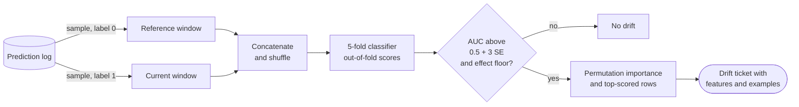

**Reading the diagram.** Both windows are sampled from the prediction log (the storage boundary), so the comparison sees exactly what the model saw. The detector is a scheduled batch job, never on the request path. Cross-validation is essential: in-sample AUC of a flexible classifier exceeds 0.5 even with no drift. The decision box applies a significance test and an effect floor (for example AUC above 0.55, §70.6.3). The explanation step turns "something changed" into "distance and prep time changed jointly; here are 20 example orders", which makes the ticket actionable. Failure points: identifiers or timestamps that make the windows trivially separable, and windows too small for the classifier to learn (low power, as Rabanser et al. found). Scaling: a few thousand rows per window trains in seconds.

::: formula
**AUC under no drift**

$$\mathbb{E}[\text{AUC}] = 0.5 \qquad \text{SE}_0(\text{AUC}) = \sqrt{\frac{n + m + 1}{12\,n\,m}} \qquad z = \frac{\text{AUC} - 0.5}{\text{SE}_0}$$

| Symbol | Meaning | Units |
|---|---|---|
| $n$, $m$ | Reference and current window sizes | rows |
| $\text{SE}_0$ | Standard error of AUC when both windows come from one distribution (Mann–Whitney null) | dimensionless |
| $z$ | Distance of the observed AUC from chance in standard errors | dimensionless |
:::

::: example
**Worked example — Is AUC 0.53 drift?** Windows of $n = m = 2{,}000$.

1. $\text{SE}_0 = \sqrt{4{,}001 / (12 \times 4{,}000{,}000)} = \sqrt{8.34 \times 10^{-5}} = 0.0091$.
2. $z = (0.53 - 0.50)/0.0091 = 3.3$: unlikely to be chance.
3. With $n = m = 4{,}000$, $\text{SE}_0 = 0.0065$, and AUC 0.664 (the program below) gives $z = 25$.

*Interpretation:* AUC 0.53 is a real but small difference. *Engineering implication:* as with every test, pair the $z$ threshold with an effect floor; AUC is itself a readable effect size ("the classifier ranks a random current row above a random reference row 53% of the time").
:::

### 70.7.3 Maximum mean discrepancy (MMD)

::: definition
**Definition — Maximum mean discrepancy (MMD).** A distance between two distributions computed from a **kernel** $k(x, y)$, a similarity function such as the Gaussian (RBF) kernel $\exp(-\lVert x - y \rVert^2 / 2\sigma^2)$. MMD compares the average similarity within each sample with the average similarity across samples; with a characteristic kernel such as the RBF, it is zero only if the distributions are identical [Gretton et al. 2012].
:::

::: formula
**Squared MMD (unbiased estimate)**

$$\widehat{\text{MMD}}^2 = \frac{1}{n(n-1)}\sum_{i \ne j} k(x_i, x_j) + \frac{1}{m(m-1)}\sum_{i \ne j} k(y_i, y_j) - \frac{2}{nm}\sum_{i, j} k(x_i, y_j)$$

| Symbol | Meaning | Units |
|---|---|---|
| $x_i$, $y_j$ | Reference and current rows (vectors, standardized) | feature units |
| $k$ | Kernel: similarity in $[0, 1]$ for the RBF kernel | dimensionless |
| $\sigma$ | Kernel bandwidth, often the median pairwise distance | feature units |
| $n$, $m$ | Sample sizes | rows |
| $\widehat{\text{MMD}}^2$ | Within-sample similarity minus cross-sample similarity; can be slightly negative from noise | dimensionless |
:::

::: example
**Worked example — Two tiny samples, RBF kernel with $\sigma = 1$.** Reference $\{0, 0.5\}$.

1. Current $\{2, 2.5\}$ (shifted). Within reference: $k(0, 0.5) = e^{-0.125} = 0.882$; within current also $0.882$. Cross pairs: $e^{-2} = 0.135$, $e^{-3.125} = 0.044$, $e^{-1.125} = 0.325$, $e^{-2} = 0.135$; mean $0.160$. $\text{MMD}^2 = 0.882 + 0.882 - 2 \times 0.160 = 1.445$.
2. Current $\{0.25, 0.75\}$ (same region). Cross pairs: $0.969, 0.755, 0.969, 0.969$; mean $0.916$. $\text{MMD}^2 = 1.765 - 1.831 = -0.066$, zero up to noise.

*Interpretation:* when samples overlap, cross-similarity is as high as within-similarity and MMD vanishes; when they separate, it grows toward its maximum of 2. *Engineering implication:* MMD needs no classifier and works on any vector, but its cost grows with $(n + m)^2$ kernel evaluations and its threshold comes from a permutation test, so it suits windows of hundreds to a few thousand rows, typically after reducing dimension.
:::

### 70.7.4 Embedding drift for text and images

For text and images, monitor in a representation space: a fixed pretrained encoder's embeddings (comparable across retrains), the model's penultimate layer, or its output probabilities. Rabanser et al. found that reducing dimension first, notably with a pretrained classifier's softmax outputs (**black-box shift detection**) followed by per-dimension KS tests with Bonferroni correction, was among the strongest and simplest detectors; domain classifiers were weaker at small samples but best at characterizing *which* examples shifted [Rabanser et al. 2019]. Chapter 75 applies the idea to RAG queries.

### 70.7.5 Code example: a domain-classifier drift detector

The program builds QuickBite order features with fixed marginals. In the "joint drift" window, distance and preparation time become correlated (a Gaussian copula keeps each marginal identical). It compares per-feature KS tests, the domain classifier and MMD, explains the detection with permutation importance, and repeats the domain classifier on 32-dimensional review embeddings where a new topic cluster makes up 10% of current reviews.

```python
import numpy as np
from scipy import stats
from sklearn.ensemble import RandomForestClassifier
from sklearn.inspection import permutation_importance
from sklearn.model_selection import cross_val_predict, train_test_split
from sklearn.metrics import roc_auc_score

rng = np.random.default_rng(70)
FEATURES = ["distance_km", "prep_min", "couriers_nearby", "hour"]

def orders(n, corr):
    """ETA features with fixed marginals; corr couples distance and prep time."""
    z = rng.multivariate_normal([0, 0], [[1, corr], [corr, 1]], size=n)
    u = stats.norm.cdf(z)                                  # Gaussian copula
    distance = stats.gamma.ppf(u[:, 0], a=2.0, scale=1.6)  # km
    prep = stats.norm.ppf(u[:, 1], loc=14, scale=4)        # minutes
    couriers = rng.poisson(6, n)
    hour = rng.choice(np.arange(10, 23), n)
    return np.column_stack([distance, prep, couriers, hour])

def domain_classifier(ref, cur):
    """Label reference 0 and current 1; out-of-fold AUC near 0.5 = no drift."""
    X = np.vstack([ref, cur])
    y = np.r_[np.zeros(len(ref)), np.ones(len(cur))]
    clf = RandomForestClassifier(n_estimators=100, min_samples_leaf=20,
                                 random_state=0)
    scores = cross_val_predict(clf, X, y, cv=5, method="predict_proba")[:, 1]
    auc = roc_auc_score(y, scores)
    se0 = np.sqrt((len(ref) + len(cur) + 1) / (12 * len(ref) * len(cur)))
    return auc, (auc - 0.5) / se0, scores, X, y, clf

def mmd2_rbf(x, y, n_perm=200):
    """Unbiased MMD^2 with an RBF kernel (median bandwidth) and permutation p."""
    z = np.vstack([x, y]); z = (z - z.mean(0)) / z.std(0)
    d2 = ((z[:, None, :] - z[None, :, :]) ** 2).sum(-1)
    K = np.exp(-d2 / np.median(d2[d2 > 0]))
    n = len(x)
    def stat(idx):
        a, b = idx[:n], idx[n:]
        kxx, kyy, kxy = K[np.ix_(a, a)], K[np.ix_(b, b)], K[np.ix_(a, b)]
        m = len(a)
        return ((kxx.sum() - np.trace(kxx)) / (m * (m - 1))
                + (kyy.sum() - np.trace(kyy)) / (m * (m - 1)) - 2 * kxy.mean())
    idx = np.arange(2 * n)
    observed = stat(idx)
    null = [stat(rng.permutation(idx)) for _ in range(n_perm)]
    return observed, (1 + np.sum(np.array(null) >= observed)) / (1 + n_perm)

ref = orders(4_000, corr=0.0)
cases = {"no drift": orders(4_000, corr=0.0),
         "joint drift": orders(4_000, corr=0.6)}     # far orders from slow kitchens
for name, cur in cases.items():
    ks_p = [stats.ks_2samp(ref[:, j], cur[:, j]).pvalue for j in range(4)]
    auc, z, _, X, y, clf = domain_classifier(ref, cur)
    mmd, mmd_p = mmd2_rbf(ref[:500], cur[:500])
    print(f"{name}: min per-feature KS p={min(ks_p):.2f} | domain AUC={auc:.3f} "
          f"(z={z:.1f}) | MMD^2={mmd:.4f}, perm p={mmd_p:.3f}")

# Which features let the classifier tell the windows apart? (joint-drift case)
Xtr, Xte, ytr, yte = train_test_split(X, y, test_size=0.3, random_state=0, stratify=y)
clf.fit(Xtr, ytr)
imp = permutation_importance(clf, Xte, yte, scoring="roc_auc", n_repeats=5,
                             random_state=0)
print("AUC drop when shuffled:",
      {f: round(float(v), 3) + 0.0 for f, v in zip(FEATURES, imp.importances_mean)})

# Embedding drift: 32-d review embeddings; a new topic cluster appears in 10%
center = rng.normal(0, 1, 32)
emb_ref = rng.normal(0, 1, (3_000, 32))
emb_cur = rng.normal(0, 1, (3_000, 32))
new_topic = rng.random(3_000) < 0.10
emb_cur[new_topic] = center * 0.5 + rng.normal(0, 0.8, (new_topic.sum(), 32))
ks_min = min(stats.ks_2samp(emb_ref[:, j], emb_cur[:, j]).pvalue for j in range(32))
auc, z, scores, *_ = domain_classifier(emb_ref, emb_cur)
print(f"embeddings: min per-dimension KS p={ks_min:.1e} (Bonferroni needs "
      f"< {0.05 / 32:.1e}) | domain AUC={auc:.3f} (z={z:.1f})")
top = np.argsort(scores[3_000:])[-300:]          # most 'current-looking' items
print(f"new-topic share: all current items {new_topic.mean():.0%}, "
      f"top-300 by classifier score {new_topic[top].mean():.0%}")
```

Output:

```text
no drift: min per-feature KS p=0.34 | domain AUC=0.500 (z=-0.0) | MMD^2=-0.0002, perm p=0.527
joint drift: min per-feature KS p=0.36 | domain AUC=0.664 (z=25.4) | MMD^2=0.0047, perm p=0.015
AUC drop when shuffled: {'distance_km': 0.158, 'prep_min': 0.17, 'couriers_nearby': 0.0, 'hour': 0.0}
embeddings: min per-dimension KS p=4.2e-06 (Bonferroni needs < 1.6e-03) | domain AUC=0.544 (z=5.9)
new-topic share: all current items 10%, top-300 by classifier score 80%
```

What to notice:

- **Per-feature KS sees nothing** in the joint-drift case (smallest $p = 0.36$), because every marginal is unchanged by construction. The domain classifier finds it with AUC 0.664 ($z = 25$), and MMD on just 500 rows per window also rejects ($p = 0.015$).
- **The no-drift control gives AUC 0.500**, thanks to out-of-fold scoring.
- **Permutation importance names the culprits:** shuffling `distance_km` or `prep_min` costs about 0.16 AUC each; the untouched features cost nothing.
- **On embeddings both methods detect the new topic,** consistent with Rabanser et al.: per-dimension KS with Bonferroni is a strong baseline. The classifier adds the last line: 80% of its 300 most "current-looking" reviews belong to the new topic (10% overall), so a reviewer sees at once what is new.

::: mistake
**Leaving timestamps or IDs in the domain classifier.** An order ID that increases over time, a timestamp or a "days since launch" feature separates the windows perfectly and reports AUC near 1.0 every run. Drop identifiers and time features, or the detector measures the calendar.
:::

## 70.8 Performance monitoring with delayed labels

### 70.8.1 What you can measure, and when

Accuracy needs labels. §59.12.2 showed that the earliest time to detect an ETA error shift is the label delay plus the time to collect enough labeled orders (about 63 minutes platform-wide, 3.7 hours for a small city). For fraud, labels follow the chargeback curve $F(a)$ of §63.4.2 and take up to 90 days. Measuring on immature labels is not just slow; it is biased.

::: formula
**Observed precision and recall on immature labels**

$$\text{Precision}_{\text{obs}}(a) = \text{Precision} \times F(a) \qquad \text{Recall}_{\text{obs}}(a) = \text{Recall} \quad \text{(if arrival is independent of the score)}$$

| Symbol | Meaning | Units |
|---|---|---|
| $a$ | Age of the prediction cohort | days |
| $F(a)$ | Fraction of eventual positive labels arrived by age $a$ (§63.4.2) | fraction |
| Precision, Recall | Values once all labels have arrived | fraction |
| $\text{Precision}_{\text{obs}}$, $\text{Recall}_{\text{obs}}$ | Values computed from labels available at age $a$ | fraction |
:::

::: example
**Worked example — Fraud metrics at 15 days.** The fraud model flags 3,500 orders a day; 1,750 are fraud (precision 50%) out of 2,500 frauds (recall 70%). At 15 days, $F = 0.40$.

1. Observed true positives: $1{,}750 \times 0.40 = 700$. Observed precision: $700 / 3{,}500 = 20\%$.
2. Observed positives: $2{,}500 \times 0.40 = 1{,}000$. Observed recall: $700 / 1{,}000 = 70\%$, unbiased.
3. Corrected precision: $20\% / 0.40 = 50\%$.

*Interpretation:* a dashboard showing raw precision on recent cohorts reports a collapse that never happened. *Engineering implication:* report every metric with its cohort age, correct by $F(a)$ where the independence assumption is plausible, and mark cohorts as matured only after $W_\varepsilon$ (60 days here). Recall's independence assumption fails if flagged orders are blocked and so never charge back (§59.13.2); keep a small unblocked holdout.
:::

**Figure 70.8 — Labels arriving after an ETA prediction and a fraud score.**

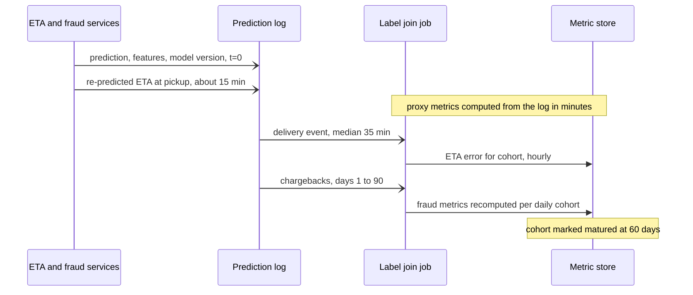

**Reading the diagram.** All writes into the prediction log are asynchronous (open arrowheads); the services never wait for monitoring. The log first receives the prediction with features and model version, then the ETA re-predicted at pickup, an early **partial label** that already reveals a slow kitchen. The label join (§63.4) attaches outcomes as they arrive. Metrics are stored per **prediction cohort** (the hour or day of prediction) and recomputed as labels arrive (**backfilled evaluation**); each value carries its cohort age and becomes final when the cohort matures. Failure points: predictions without IDs (the join silently drops them; monitor the join rate) and log retention shorter than the label delay.

### 70.8.2 Proxies and estimation without labels

While labels mature, three kinds of evidence stand in for them.

1. **Proxy metrics:** prediction drift (§70.4), the fallback rate (§60.12.2), the ETA revision at pickup, customer contacts about lateness, early disputes for fraud. They move within minutes and correlate with quality, but not perfectly.
2. **Confidence-based performance estimation (CBPE):** if a classifier is calibrated and only covariate shift has occurred, its own probabilities predict its confusion matrix. The NannyML library popularized the approach (as of 2026, §70.15.2).
3. **Label-shift estimation:** if only the prior $P(Y)$ moved, the change in the rate of positive predictions reveals the new prior [Saerens et al. 2002; Lipton et al. 2018].

::: formula
**Expected precision and recall from scores; prior from the flag rate**

$$\widehat{\text{Prec}} = \frac{1}{|F|}\sum_{i \in F} \hat{p}_i \qquad \widehat{\text{Rec}} = \frac{\sum_{i \in F} \hat{p}_i}{\sum_{i} \hat{p}_i} \qquad \hat{\pi}' = \frac{r - \text{FPR}}{\text{TPR} - \text{FPR}}$$

| Symbol | Meaning | Units |
|---|---|---|
| $\hat{p}_i$ | Calibrated predicted probability that order $i$ is fraud | probability |
| $F$ | Set of flagged orders | orders |
| $\widehat{\text{Prec}}$, $\widehat{\text{Rec}}$ | Estimated precision and recall without labels | fraction |
| $r$ | Current flag rate (flagged / all) | fraction |
| TPR, FPR | True- and false-positive rates measured on validation data | fraction |
| $\hat{\pi}'$ | Estimated current positive rate under label shift | fraction |
:::

::: example
**Worked example — Fraud health on day 1.** Validation gave TPR $= 0.70$ and FPR $= 0.0035$; at the training prior of 0.5% the flag rate is $0.005 \times 0.70 + 0.995 \times 0.0035 = 0.70\%$ (3,500 a day).

1. *CBPE.* Today's 3,500 flagged orders have mean $\hat{p} = 0.50$, so $\widehat{\text{Prec}} = 0.50$ and expected true positives $= 1{,}750$. The 496,500 unflagged orders have mean $\hat{p} = 0.00151$, so expected missed frauds $= 750$, and $\widehat{\text{Rec}} = 1{,}750/2{,}500 = 0.70$. No change.
2. *Label shift.* Tomorrow the flag rate is 1.0%. $\hat{\pi}' = (0.010 - 0.0035)/(0.70 - 0.0035) = 0.0065/0.6965 = 0.93\%$: the fraud rate has nearly doubled.

*Interpretation:* two label-free estimates in one day, versus 60 days for matured labels. *Engineering implication:* both rest on assumptions that concept drift breaks (a new fraud pattern that the model scores low changes $P(Y \mid X)$, and neither method can see it). Use them to raise early tickets and to size investigations, and confirm with analyst-labeled samples.
:::

## 70.9 Prediction quality monitoring

### 70.9.1 Calibration drift

A model can keep its ranking quality (AUC) while its probabilities drift: a fraud score of 0.7 that once meant 70% fraud now means 40%. Thresholds and CBPE estimates silently break. Calibration is monitored with the reliability diagram of §57.10.3, summarized by the **expected calibration error** (ECE) [Guo et al. 2017]. For regression with prediction intervals, the analog is **coverage**: the fraction of deliveries finishing before the p90 ETA should be 90%.

::: formula
**Expected calibration error and the standard error of a slice rate**

$$\text{ECE} = \sum_{b=1}^{B} \frac{n_b}{N}\,\big|\bar{y}_b - \bar{p}_b\big| \qquad \text{SE}(\hat{q}) = \sqrt{\frac{q(1 - q)}{n}}$$

| Symbol | Meaning | Units |
|---|---|---|
| $n_b$, $N$ | Predictions in score bin $b$; all predictions | count |
| $\bar{p}_b$, $\bar{y}_b$ | Mean predicted probability and observed positive rate in bin $b$ | fraction |
| ECE | Mass-weighted calibration gap | fraction |
| $q$, $\hat{q}$ | True and measured rate in a slice (e.g. share within ±5 min) | fraction |
| $n$ | Labeled predictions in the slice | count |
:::

::: example
**Worked example — A miscalibrated fraud model and noisy zones.** One matured day of 500,000 orders: bin [0, 0.1) has 490,000 orders, $\bar{p} = 0.0010$, $\bar{y} = 0.00092$; bin [0.1, 0.5) has 6,500, $\bar{p} = 0.20$, $\bar{y} = 0.10$; bin [0.5, 1] has 3,500, $\bar{p} = 0.70$, $\bar{y} = 0.40$.

1. ECE $= (490{,}000 \times 0.00008 + 6{,}500 \times 0.10 + 3{,}500 \times 0.30)/500{,}000 = (40 + 650 + 1{,}050)/500{,}000 = 0.35\%$.
2. Yet the flagged bin overstates fraud by 30 percentage points.
3. Slice noise: a zone has $500{,}000 / 4{,}000 = 125$ orders a day. With $q = 0.82$, $\text{SE} = \sqrt{0.82 \times 0.18 / 125} = 3.4$ points per zone-day, and 1.3 points per zone-week (875 orders).

*Interpretation:* mass-weighted ECE is dominated by the easy bin and hides the bin that drives decisions; a zone-day rate wobbles by ±7 points (2 SE) with no change at all. *Engineering implication:* monitor calibration per decision-relevant bin, and alert on slices only above a minimum sample size and an effect floor.
:::

### 70.9.2 Slice-level metrics and segment alerts

Aggregate accuracy hides slices: a 10-point drop in one city of 20 moves the platform metric by half a point. Monitor the slices that matter to users and to fairness (Chapter 71): city, zone, hour, restaurant tier, new versus returning customers. Sample size (above) and metric cardinality (§40.5.3) constrain the design: zone-level metrics live in the lakehouse, and only alerts become time series.

**Figure 70.9 — Hierarchical slice alerting.**

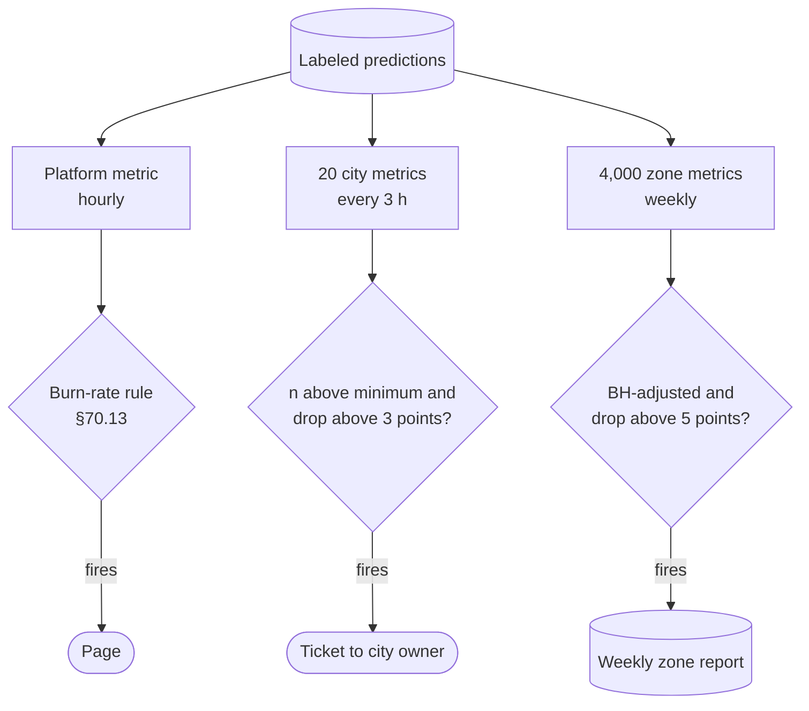

**Reading the diagram.** One table of labeled predictions feeds three levels with windows sized to their traffic: the platform hourly, each city every three hours (about 1,250 orders), each zone weekly (875 orders). Gates tighten with level (burn rate; minimum sample and effect floor; plus Benjamini–Hochberg across 4,000 zones) and severity falls, from page to ticket to report. Failure point: a problem spread thinly across many zones, invisible at each; the city and platform levels catch it.

## 70.10 Data quality monitoring in production

Chapter 59 (§59.7) validates batches before training; production needs the same checks continuously on served features, because serving reads data that training never validated. They are the cheapest, sharpest monitors here.

**Table 70.5 — Production data-quality checks.**

| Check | Where it runs | QuickBite expectation | Catches | Severity |
|---|---|---|---|---|
| Schema and type | Feature pipeline, serving | Fields and types match the registry | Renamed or dropped fields | Block / page owner |
| Null and default rate | Serving, per feature, 5 min | `prep_min` null < 1% | Broken producers, join misses | Page if top feature |
| Range and units | Serving | 0 < `distance_km` < 50 | Unit bugs (§70.5.6) | Page |
| Domain | Serving | `city` in registry | New or misspelled categories | Ticket |
| Freshness | Feature store reads | Backlog age p99 < 93 s (§60.15) | Stalled streams | Page |
| Volume | Prediction log | Hourly count within ±30% of seasonal norm | Lost traffic, logging gaps | Ticket |
| Join rate | Label join | > 99% of orders matched | Missing prediction IDs | Ticket |

A sudden drop in prediction volume often means a client stopped calling the model and fell back to a default, which no model-side metric can see.

## 70.11 Model freshness and staleness

Two clocks run on every prediction. **Feature age** is the time since each feature value was computed, measured at read time (§62.10). **Model age** is the time since the training data's cutoff, not since deployment: a model deployed today but trained on data ending a week ago is a week old. Zinkevich's rules of ML advise knowing the freshness requirements of your system, that is, how much quality is lost per day of model age [Zinkevich n.d.], and the ML Test Score lists "models are not too stale" as a monitoring test [Breck et al. 2017].

Monitor both as gauges with SLAs derived from measured decay. For QuickBite's ETA model, nightly retraining keeps model age under 30 hours (§60.15); an alert fires at 54 hours, meaning two nightly runs failed, which, at the decay rate of §59.13.1 (0.05 min of MAE per day), still costs only about 0.1 min of MAE but signals a broken pipeline. For the fraud model, label maturity (§63.4.2) puts a 60-day floor under model age, so its SLA covers only the age beyond that floor. A model that silently stops being replaced is an incident visible to no metric except the age gauge.

## 70.12 Operational metrics

Models are services, and all of Chapter 40's operational monitoring applies: the four golden signals (latency, traffic, errors, saturation) per model version, with histograms for latency (§40.5.2). Chapter 66 covers serving-specific details; Table 70.6 lists what ML adds.

**Table 70.6 — Operational metrics specific to ML serving.**

| Metric | Why it matters | QuickBite ETA value |
|---|---|---|
| Latency by stage (features, inference, post-processing) | Feature reads, not the model, usually dominate | p99 within the 100 ms budget (§60.10) |
| Batch size and queue time | Dynamic batching trades latency for throughput (Chapter 66) | CPU tree model, no batching |
| GPU or CPU utilization, memory | Saturation and cost; low GPU utilization wastes money (Chapter 64) | 3-node CPU fleet (§60.11) |
| Fallback rate by rung | Silent degradation (§60.12.2) | ~1% normally; ticket at 3%, page at 10% |
| Model version mix | Canary and rollback state | One version except during canaries |
| Cost per 1,000 predictions | Unit economics; detects runaway fleets | About \$0.0001 per order (§60.15) |

Cost per prediction is the metric most often missing: divide the fleet's hourly cost by predictions served, per model, and alert on step changes; a doubled cost at flat traffic means an autoscaler or batching regression (Chapters 73 and 79).

## 70.13 Alerting design for ML

### 70.13.1 What pages and what files a ticket

Chapter 40's rules apply unchanged: page on user-visible symptoms that need urgent human action, file tickets for everything else, and give every alert a runbook (§40.10.1, §40.10.4).

**Table 70.7 — Alert severity for an ML service.**

| Signal | Page | Ticket | Dashboard only |
|---|---|---|---|
| Latency, errors, availability SLO burn | Fast burn (§39.7.3) | Slow burn | — |
| Quality SLO burn (labels) | Fast burn (below) | Slow burn | Per-slice detail |
| Range, unit, schema, null violations on top features | Yes | Other features | — |
| Prediction-distribution step (mean ETA moves > 3 min in 15 min) | Yes | Smaller steps | — |
| Fallback rate | > 10% | > 3% | — |
| Input drift (PSI, KS, domain classifier) | Never alone | Effect above threshold | Everything else |
| Model age | — | Above SLA | — |
| Calibration and slice metrics | — | Effect above floor | Everything else |

Drift never pages on its own: it is a cause-based signal (§40.10.1) whose relation to user harm is uncertain. It pages only when a symptom (quality burn, prediction step) fires too.

### 70.13.2 Burn-rate alerts on a quality SLO

A quality SLO has an error budget like any other (§60.12.1): with a target of 80% of orders within ±5 minutes, 20% may miss. The burn rate $b = e/(1 - \text{SLO})$ and the alert threshold $b_{\text{alert}} = fP/W$ come from §39.7.3. Two differences from availability SLOs change the numbers.

::: example
**Worked example — Paging on ETA quality.** SLO period $P = 7$ days $= 168$ h; budget $1 - \text{SLO} = 0.20$.

1. *Baseline burn.* The model misses ±5 min on 18% of orders: $b = 0.18/0.20 = 0.9$. A healthy quality SLO already spends 90% of its budget, unlike an availability SLO that spends a few percent.
2. *Maximum burn.* Even if every order misses, $b = 1/0.20 = 5$. The Workbook's 14.4× page is impossible, because it would need 288% of orders to miss.
3. *Choose by budget.* Page when 2% of the weekly budget is consumed in 1 hour: $b_{\text{alert}} = 0.02 \times 168/1 = 3.4$, that is 68% of orders missing (with a 5-minute short window to confirm, §39.7.3). File a ticket when 10% is consumed in a day: $b = 0.10 \times 168/24 = 0.7$, which the baseline already exceeds, so tie the ticket to the *excess* over baseline instead, for example $b \ge 1.2$ (24% missing) over 24 hours.
4. *Detection time.* For a total breakage ($e = 1$), the 1-hour window crosses $b = 3.4$ after $t = 0.20 \times 3.4 \times 60/1 = 41$ min of labeled orders, which start arriving about 35 min after the breakage: roughly 75 minutes in all.

*Interpretation:* quality burn-rate alerts work but are slow and coarse, because labels are delayed and the healthy burn is close to 1. *Engineering implication:* use them as the authoritative page for sustained quality loss, and rely on label-free symptoms (prediction steps, range violations, fallback rate) to page within minutes for sharp failures.
:::

**Figure 70.10 — Routing ML alerts.**

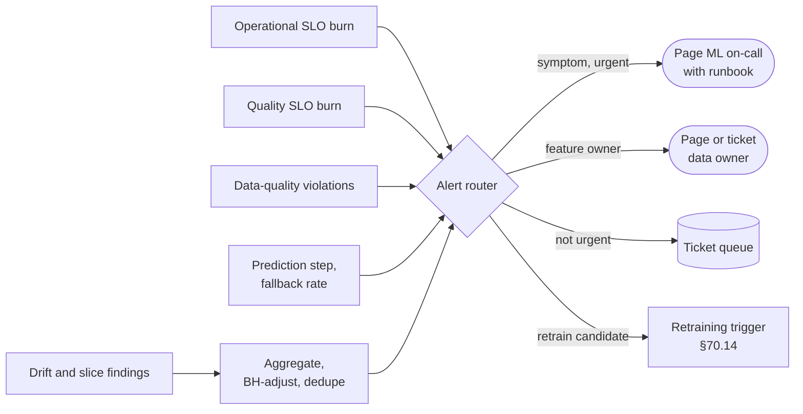

**Reading the diagram.** Five signal families enter a router such as Alertmanager (§40.10.3). Drift and slice findings are first aggregated, corrected and deduplicated. Urgent symptoms page the ML on-call; data-quality violations go to the failing feature's owner (from the registry); the rest become tickets; findings meeting the retraining policy reach the guarded trigger of §70.14. Inhibition suppresses drift tickets while a data-quality incident is open on the same feature, since the drift is the bug. Failure point: routing everything to one channel, which recreates alert fatigue.

::: recommendation
**Recommendation — Write the runbook before the alert.** Each ML runbook states the user impact, the slices to open, how to tell a bug from real change (Figure 70.4), the safe mitigations (roll back the model, drop to a fallback rung of §60.12.2, pin a feature to its default) and the upstream owner. With no safe mitigation, the alert should be a ticket.
:::

## 70.14 Retraining triggers

### 70.14.1 Three kinds of trigger

§59.13.1 derived a retraining cadence from the decay rate; Chapter 69 builds the continuous-training pipeline. This section decides what *starts* it. **Scheduled** retraining runs on a calendar; **drift-triggered** retraining when input drift crosses a threshold; **performance-triggered** retraining when measured or estimated quality degrades. Schedules waste compute and react slowly; drift triggers fire on harmless shift, sleep through concept drift and wake for bugs; performance triggers wait for labels and, unguarded, retrain on the corruption that caused the drop.

**Figure 70.11 — A guarded retraining trigger.**

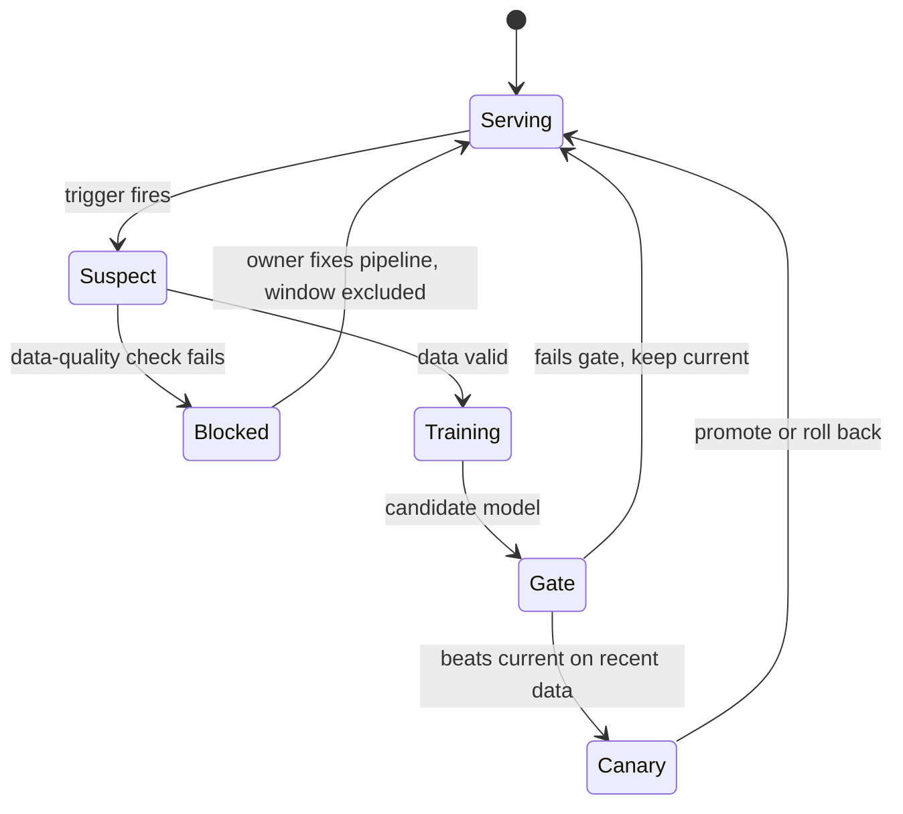

**Reading the diagram.** A trigger moves the model from *Serving* to *Suspect*, not straight to training. If the training window fails schema, range or null checks, the state becomes *Blocked*, the data owner is paged, and the bad window is excluded from future training sets. A candidate must beat the current model on recent matured labels, then pass a canary (§43.6). Every exit returns to *Serving*, so a failed trigger costs compute, never quality. A cooldown on the *Suspect* transition prevents retraining storms.

### 70.14.2 Code example: scheduled versus triggered retraining

The simulation serves a linear ETA model for 106 days on 2,000 labeled orders a day (noise MAE about 4.3 min). The world contains a gradual change (minutes per km rise 0.006 a day), a harmless covariate shift (a suburbs launch from day 30), a sudden concept change (road works add 3 min to rush-hour orders from day 60) and an upstream bug (prep time logged in seconds for 30% of orders on days 90–91). Each policy retrains on the last 14 days; costs use \$1,000 per retrain and \$2,000 per minute-day of MAE above the noise floor (§59.13.1).

```python
import numpy as np
from sklearn.linear_model import LinearRegression

rng = np.random.default_rng(70)
DAYS, N, WINDOW = 120, 2_000, 14          # days simulated, orders/day, train window
C_RETRAIN, K_MAE, FLOOR = 1_000, 2_000, 4.31   # $/retrain, $/(min*day), noise MAE

def day_data(t):
    scale = 1.6 if t < 30 else min(2.0, 1.6 + 0.04 * (t - 30))  # suburbs launch
    dist = rng.gamma(2.0, scale, N)
    prep = rng.normal(14, 4, N).clip(3, 45)
    rain = (rng.random(N) < 0.2).astype(float)
    peak = (rng.random(N) < 0.4).astype(float)
    per_km = 3.0 + 0.006 * t                       # slow congestion growth
    road_works = 3.0 * peak * (t >= 60)            # sudden concept change
    y = 6 + per_km * dist + prep + 4 * rain + 2 * peak + road_works \
        + rng.normal(0, 5.4, N)
    logged_prep = prep.copy()
    if t in (90, 91):                              # upstream bug: seconds
        bad = rng.random(N) < 0.3
        logged_prep[bad] *= 60
    X = np.column_stack([dist, logged_prep.clip(0, 60), rain, peak])
    valid = np.mean(logged_prep > 60) < 0.01       # range check on raw values
    return X, y, X[:, 0], valid

data = [day_data(t) for t in range(DAYS)]

def psi(ref, cur, bins=10):
    e = np.quantile(ref, np.linspace(0, 1, bins + 1)); e[0], e[-1] = -np.inf, np.inf
    p = np.clip(np.histogram(ref, e)[0] / len(ref), 1e-6, None)
    q = np.clip(np.histogram(cur, e)[0] / len(cur), 1e-6, None)
    return float(np.sum((q - p) * np.log(q / p)))

def train(days, gate):
    use = [d for d in days if data[d][3] or not gate]
    X = np.vstack([data[d][0] for d in use]); y = np.concatenate([data[d][1] for d in use])
    return LinearRegression().fit(X, y), use

def run(policy, gate=False):
    model, used = train(range(WINDOW), gate)
    maes, retrains = [], []
    for t in range(WINDOW, DAYS):
        X, y, dist, valid = data[t]
        maes.append(np.mean(np.abs(model.predict(X) - y)))
        # decide, after today's labels arrive, whether to retrain for tomorrow
        if policy == "weekly":
            fire = (t - WINDOW + 1) % 7 == 0
        elif policy == "daily":
            fire = True
        elif policy == "drift":
            ref_dist = np.concatenate([data[d][2] for d in used])
            ref_prep = np.concatenate([data[d][0][:, 1] for d in used])
            fire = max(psi(ref_dist, dist), psi(ref_prep, X[:, 1])) > 0.2
        elif policy == "perf":
            fire = maes[-1] > 4.6
        else:
            fire = False
        if gate and not valid:
            fire = False                           # page the data owner instead
        if fire:
            model, used = train(range(t - WINDOW + 1, t + 1), gate)
            retrains.append(t + 1)                 # new model serves day t+1
    maes = np.array(maes)
    cost = C_RETRAIN * len(retrains) + K_MAE * np.sum(maes - FLOOR)
    return maes, retrains, cost

policies = [("never", False), ("weekly", False), ("daily", False),
            ("drift", False), ("perf", False), ("perf", True), ("daily", True)]
print(f"{'policy':<12}{'MAE':>6}{'d60-66':>8}{'d90-91':>8}{'d92-98':>8}"
      f"{'retrains':>9}{'cost $k':>9}")
log = {}
for name, gate in policies:
    m, r, c = run(name, gate)
    label = name + ("+gate" if gate else "")
    w = lambda a, b: m[a - WINDOW:b + 1 - WINDOW].mean()   # days a..b inclusive
    print(f"{label:<12}{m.mean():6.2f}{w(60, 66):8.2f}{w(90, 91):8.2f}"
          f"{w(92, 98):8.2f}{len(r):9d}{c / 1000:9.0f}")
    log[label] = r
for label in ["drift", "perf", "perf+gate"]:
    print(f"{label} new models from days: {log[label]}")
```

Output:

```text
policy         MAE  d60-66  d90-91  d92-98 retrains  cost $k
never         5.11    4.97   15.98    5.31        0      169
weekly        4.60    4.54   11.61    4.89       15       77
daily         4.57    4.48   11.60    5.04      106      160
drift         4.92    4.97   11.42    5.04        2      131
perf          4.61    4.54   11.47    5.04       20       84
perf+gate     4.61    4.54   16.06    4.43        5       69
daily+gate    4.55    4.48   16.31    4.28      104      156
drift new models from days: [91, 92]
perf new models from days: [60, 61, 62, 69, 91, 92, 93, 94, 95, 96, 97, 98, 99, 100, 101, 102, 103, 104, 105, 106]
perf+gate new models from days: [60, 61, 62, 69, 100]
```

What to notice:

- **The drift trigger slept through the road works** (day 60: inputs unchanged, MAE 4.97 like the never-retrained model), ignored the harmless suburbs launch (PSI below 0.2), and fired only for the bug (new models on days 91 and 92), then stayed bad.
- **The unguarded performance trigger caught the road works within a day** (new models on days 61 and 62) but then entered a **retraining storm**: 16 retrains on days 91–106, while the corrupted days sat in its 14-day window.
- **Retraining on corrupted data looks helpful during the bug** (MAE 11.5 on days 90–91 versus 16 for gated policies, because the model "adapts" to the bug) and harmful afterward (5.04 versus 4.43 and 4.28 in the following week). Fix the pipe; do not learn it.
- **The gate is the largest single improvement:** 20 retrains become 5, and post-bug MAE falls from 5.04 to 4.43.

::: example
**Worked example — Which policy is cheapest?** From the output, cost = retrains × \$1,000 + excess MAE cost.

1. Performance trigger with gate: $5 \times 1{,}000 = \$5$k retraining $+ \$64$k excess error $= \$69$k. Weekly: $\$15$k $+ \$62$k $= \$77$k. Daily with gate: $\$104$k $+ \$52$k $= \$156$k.
2. Daily with gate has the lowest error but pays for 104 retrains, each including an engineer's review.
3. If automated gates cut the retraining cost to \$100 (no human review), daily with gate costs $\$10.4$k $+ \$52$k $= \$62$k and becomes cheapest; the triggered policy costs $\$0.5$k $+ \$64$k $= \$64.5$k.

*Interpretation:* which policy wins depends on the cost of one retrain, exactly as $T^* = \sqrt{2C/(kr)}$ in §59.13.1 predicts. *Engineering implication:* combine them: a schedule as the default (cadence from §59.13.1), a performance trigger as the backstop for sudden concept drift, a cooldown against storms, and a data-validation gate in front of *every* path. Treat input drift as a reason to look, not to retrain.
:::

## 70.15 Monitoring architecture

### 70.15.1 Components

**Figure 70.12 — Reference ML monitoring architecture.**

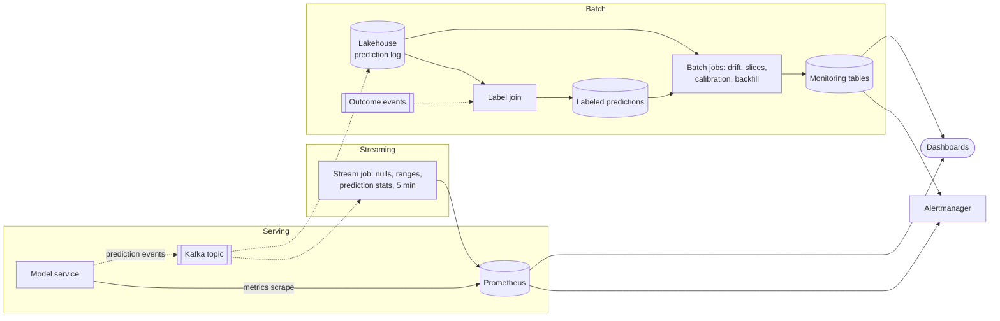

**Reading the diagram.** *Serving:* the model service exposes operational metrics to Prometheus (pull, §40.8) and emits one prediction event per prediction (request ID, model version, features, output, fallback level) asynchronously to Kafka, never blocking the response. *Streaming:* a stream job computes cheap, fixed-cardinality statistics every few minutes (nulls, ranges, prediction quantiles, volume) as time series that can page quickly. *Batch:* the same events land in the lakehouse (the main storage boundary), where the label join and scheduled jobs compute drift tests, domain classifiers, slices, calibration and backfilled cohorts. Both paths feed one alert router and one set of dashboards. Failure points: event loss between service and Kafka (monitor volume against the request counter), and a lakehouse partition missing for a day (treat a missing window as an alert, not as "no drift"). Scaling: the stream path scales with Kafka partitions; the batch path with sampling.

::: example
**Worked example — Sizing the ETA prediction log.** Each event is about 300 bytes (40 features plus metadata); 1 GB $= 10^9$ bytes.

1. Logging every prediction: $360 \times 10^6 \times 300 = 108$ GB a day, 3.2 TB per 30 days, mostly never labeled.
2. Log 100% of order-linked predictions (500,000 a day, 150 MB) for accuracy, plus a 1% random sample of search-time predictions (3.6 million, 1.08 GB) for drift.
3. Total about 1.2 GB a day, 37 GB over a 30-day reference period: a 90-fold reduction.

*Interpretation:* accuracy needs only predictions that can be labeled; drift needs only a random sample. *Engineering implication:* sample by purpose, record the sampling rate in each event, and keep a truly random sample, because labeled orders are a selected population (customers pick shorter ETAs).
:::

### 70.15.2 Tools as of 2026

**Table 70.8 — Monitoring tools (as of 2026; check current documentation).**

| Tool | Kind | Notable for |
|---|---|---|
| Evidently | Open-source Python library, plus hosted service | Drift presets: KS / chi-square for small columns, normed Wasserstein / JS for large ones, "share of drifted columns" dataset drift |
| whylogs (WhyLabs) | Open-source data profiling | Mergeable statistical profiles instead of raw rows |
| NannyML | Open-source library | CBPE and other label-free performance estimation |
| Arize | Commercial ML observability (plus open-source Phoenix for LLMs) | Prediction and label joins, slices, embedding drift |
| Amazon SageMaker Model Monitor | Managed (AWS) | Data-quality, model-quality, bias and attribution drift jobs |
| Vertex AI Model Monitoring | Managed (Google Cloud) | Training–serving skew and drift on features |
| Azure Machine Learning model monitoring | Managed (Microsoft) | Data drift, quality and performance signals |

The tools compute the statistics of §70.5–§70.9; none removes the design work in this chapter: choosing references, windows, thresholds and owners. Many teams compute the statistics in batch jobs and send them to their existing alerting stack (Chapter 40), keeping one on-call workflow.

## 70.16 QuickBite ETA monitoring plan

**Table 70.9 — QuickBite ETA monitoring plan.**

| Layer | Signal | Window and reference | Threshold | Action | Owner |
|---|---|---|---|---|---|
| Infrastructure | Latency, errors | 1 h / 5 min | Burn 14.4× (§39.7.3) | Page | ETA on-call |
| Infrastructure | Cost per 1,000 predictions | Daily | +30% at flat traffic | Ticket | Platform |
| Data | Range, units, nulls, top 10 features | 5 min, stream | Any range breach; nulls > 1% | Page feature owner | Feature owners |
| Data | Feature age | Per read | Backlog p99 > 93 s | Page | Streaming team |
| Model | Mean and p90 ETA, fallback rate | 15 min vs same hour last 4 weeks | Mean ±3 min; fallback > 10% | Page | ETA on-call |
| Model | Input drift, top 10 features | Daily vs training data; 3 h vs seasonal | Normed $W_1$ > 0.1 or PSI > 0.2, BH-adjusted | Ticket | ML team |
| Model | Domain classifier | Daily | AUC > 0.55 and $z$ > 3 | Ticket with explanations | ML team |
| Model | Within ±5 min, MAE | Platform hourly, city 3 h, zone weekly | Burn 3.4× page; 1.2× ticket | Page / ticket | ETA on-call |
| Model | p90 coverage by city | Daily | Outside 88–92% | Ticket | ML team |
| Model | Model age | Gauge | > 54 h | Ticket | ML platform |
| Business | Lateness contacts per 1,000 orders | Daily vs seasonal | +20% | Review | Product analytics |

**Figure 70.13 — Detection timeline for three ETA incidents.**

```mermaid
gantt
  title Time from onset at 6 pm to alert
  dateFormat HH:mm
  axisFormat %H:%M
  section Prep-time unit bug
  Range check page :crit, b1, 18:00, 5m
  section Bridge closure, east city
  Labels accumulate :a1, 18:00, 60m
  City quality ticket :a2, after a1, 120m
  section Sudden total breakage
  Prediction step page :crit, c1, 18:00, 15m
  Quality burn page :c2, 18:00, 75m
```

**Reading the diagram.** Each row is an incident starting at 18:00. The unit bug trips the stream range check within one 5-minute window. The bridge closure changes $P(Y \mid X)$ in one city and surfaces only after labels arrive and the city's 3-hour window fills, about three hours in all (§59.12.2). A total breakage moves the prediction distribution within 15 minutes; the quality burn-rate page confirms it after about 75. No single monitor catches all three in time.

## 70.17 Summary and revision notes

::: summary
- ML systems fail silently: well-formed, confident, wrong answers. Monitor four layers (infrastructure, data, model, business), which react in seconds, minutes, hours-to-weeks and days.
- Covariate shift moves $P(X)$, label shift $P(Y)$, concept drift $P(Y \mid X)$. Only the first two are visible without labels; bugs in the pipe are the most common "drift" and must be triaged first.
- PSI $= \mathrm{KL}(Q\|P) + \mathrm{KL}(P\|Q)$; its 0.1/0.2 bands are conventions. KS and chi-square are tests; JS and Wasserstein are magnitudes. Thresholds never transfer between statistics.
- Distances are biased at small $n$ (PSI noise $\approx (B-1)/n$); tests are over-powered at large $n$. Use minimum window sizes, effect-size thresholds, seasonal references and multiple-testing control.
- Domain classifiers and MMD detect joint and embedding drift that per-feature tests miss, and the classifier explains what changed.
- Under label delay, report metrics per cohort with their age, correct for $F(a)$, and use proxies, CBPE and label-shift estimates until labels mature.
- Monitor calibration per decision-relevant bin, slices above their noise floor, data quality, feature and model age, and cost per prediction.
- Page on symptoms with runbooks; drift files tickets. Quality SLOs have baseline burn near 1 and a maximum burn of $1/(1-\text{SLO})$, so derive their thresholds rather than copying 14.4×.
- Combine scheduled and performance-triggered retraining, put a data-validation gate in front of every path, and never retrain on corrupted data.
:::

## 70.18 Knowledge checkpoint

1. Why does an ML failure rarely raise an error rate?
2. Which kind of change is invisible to input-drift monitors, and what detects it?
3. Show that PSI is a sum of two KL divergences.
4. Why can a 1% distance shift be "significant" yet unimportant?
5. What is the expected PSI with no drift for 10 bins and 300 rows?
6. How many false alarms per day do 19,200 tests at $\alpha = 0.01$ produce?
7. Why compare Friday dinner with previous Fridays?
8. What does a domain-classifier AUC of 0.5 mean, and why must scores be out-of-fold?
9. At cohort age 15 days, why is fraud precision biased but recall not?
10. Why can't a quality SLO with a 20% budget use a 14.4× burn-rate page?
11. Why did the drift trigger in §70.14.2 miss the road works?
12. Why log every order-linked prediction but only a sample of search predictions?

<details><summary>Answers</summary>

1. Models always return well-formed outputs; defaults hide bad inputs and correctness is known only later.
2. Concept drift; labeled performance after the label delay, sliced.
3. $(q-p)\ln(q/p) = q\ln(q/p) + p\ln(p/q)$, summed over bins.
4. At large $n$ the critical value shrinks as $1/\sqrt{n}$; the ETA effect is about 5 seconds.
5. $9/300 = 0.03$.
6. $19{,}200 \times 0.01 = 192$.
7. Seasonal patterns otherwise look like drift (PSI 0.111 every week in §70.6.5).
8. The windows are indistinguishable; in-sample scores are optimistic even with no drift.
9. Only $F(a) = 40\%$ of true positives are labeled yet all flags count; positives and caught positives are both scaled by $F(a)$.
10. Maximum burn is $1/0.2 = 5$; healthy burn is already 0.9.
11. Concept drift left the inputs unchanged; PSI stayed low.
12. Only ordered restaurants receive labels; drift needs only a random sample, and the order-linked set is a selected population.

</details>

## 70.19 Interview questions

### Basic

**Q1. How would you monitor a model whose labels arrive a month late?** **Answer.** Layer it: operational metrics; data-quality checks on inputs; prediction-distribution and input drift against seasonal and training references; label-free estimates (CBPE if calibrated, prior estimation from the flag rate); early partial labels; and cohort metrics backfilled as labels mature, corrected for label completeness.

**Q2. What is the difference between data drift and concept drift?** **Answer.** Data (covariate) drift changes the input distribution while the input–output relationship holds; concept drift changes that relationship. The first is visible without labels and often harmless; the second needs labels and retraining.

### Intermediate

**Q3. Your drift dashboard shows 150 alerts a day and nobody looks. Fix it.** **Answer.** Test fewer, important features; set minimum windows; use effect-size thresholds and seasonal references; aggregate; apply Benjamini–Hochberg; route drift to tickets and page only on symptoms; track alert precision.

**Q4. Accuracy fell 0.3 min of MAE platform-wide. How do you find out whether to retrain?** **Answer.** Rule out bugs (schema, nulls, ranges, recent releases). Decompose the change into mix and within-slice effects; a pure mix effect needs a product decision, a within-slice drop is concept drift. Check whether it is seasonal. If real, retrain on validated recent data through the gate and canary.

### Advanced

**Q5. Design monitoring for 40,000 ETA predictions per second.** **Answer.** Prometheus for operational SLIs; asynchronous prediction events to Kafka; a stream job for nulls, ranges, prediction quantiles and volume; a lakehouse sampled by purpose (all order-linked, 1% of search); label join and batch jobs for quality, slices, drift and calibration; hierarchical slice alerts, quality burn-rate pages and runbooks (Figure 70.12).

**Q6. Should a drift alert retrain the model automatically?** **Answer.** No. Drift is a cause-based signal: it fires on harmless covariate shift, misses concept drift and fires on bugs, where retraining learns the corruption. Retrain on schedule plus performance triggers, behind data validation, a cooldown, an evaluation gate and a canary; the simulation in §70.14.2 quantifies the difference.

## 70.20 Practical exercises

1. Extend the §70.5.6 program with a 5% null-rate injection filled with the mean; which statistics notice, and which check should?
2. Add Benjamini–Hochberg to a monitor of 40 features × 20 cities on drift-free data and report false alarms with and without it.
3. Add a cooldown of 3 days to the performance trigger in §70.14.2 and measure retrains and MAE.

## 70.21 Design challenges

1. **Fraud monitoring.** Design monitoring for QuickBite's fraud model with 90-day chargebacks: proxies, label-free estimates, cohort backfill, calibration checks and a retraining policy robust to fraud waves and blocked-order selection bias.
2. **Chatbot drift.** Monitor the support chatbot's incoming messages with embeddings: reference choice, detector, explanation of new topics and routing to the content team.

## 70.22 References

1. Benjamini, Y., Hochberg, Y. *Controlling the False Discovery Rate: A Practical and Powerful Approach to Multiple Testing*. Journal of the Royal Statistical Society B 57(1), 1995.
2. Breck, E., Cai, S., Nielsen, E., Salib, M., Sculley, D. *The ML Test Score: A Rubric for ML Production Readiness and Technical Debt Reduction*. IEEE International Conference on Big Data, 2017.
3. Breck, E., Polyzotis, N., Roy, S., Whang, S. E., Zinkevich, M. *Data Validation for Machine Learning*. SysML (MLSys), 2019.
4. Evidently AI. *Evidently documentation: data drift*. n.d. https://docs.evidentlyai.com
5. Gama, J., Žliobaitė, I., Bifet, A., Pechenizkiy, M., Bouchachia, A. *A Survey on Concept Drift Adaptation*. ACM Computing Surveys 46(4), 2014.
6. Gretton, A., Borgwardt, K. M., Rasch, M. J., Schölkopf, B., Smola, A. *A Kernel Two-Sample Test*. Journal of Machine Learning Research 13, 2012.
7. Guo, C., Pleiss, G., Sun, Y., Weinberger, K. Q. *On Calibration of Modern Neural Networks*. ICML, 2017.
8. Hermann, J., Del Balso, M. *Meet Michelangelo: Uber's Machine Learning Platform*. Uber Engineering Blog, 2017.
9. Huyen, C. *Designing Machine Learning Systems*, ch. 8. O'Reilly, 2022.
10. Lipton, Z. C., Wang, Y.-X., Smola, A. *Detecting and Correcting for Label Shift with Black Box Predictors*. ICML, 2018.
11. Lopez-Paz, D., Oquab, M. *Revisiting Classifier Two-Sample Tests*. ICLR, 2017.
12. Lu, J., Liu, A., Dong, F., Gu, F., Gama, J., Zhang, G. *Learning under Concept Drift: A Review*. IEEE Transactions on Knowledge and Data Engineering 31(12), 2019.
13. Massey, F. J. *The Kolmogorov–Smirnov Test for Goodness of Fit*. Journal of the American Statistical Association 46(253), 1951.
14. Quiñonero-Candela, J., Sugiyama, M., Schwaighofer, A., Lawrence, N. D. (eds.). *Dataset Shift in Machine Learning*. MIT Press, 2009.
15. Rabanser, S., Günnemann, S., Lipton, Z. C. *Failing Loudly: An Empirical Study of Methods for Detecting Dataset Shift*. NeurIPS, 2019.
16. Saerens, M., Latinne, P., Decaestecker, C. *Adjusting the Outputs of a Classifier to New a Priori Probabilities: A Simple Procedure*. Neural Computation 14(1), 2002.
17. Shankar, S., Garcia, R., Hellerstein, J. M., Parameswaran, A. G. *Operationalizing Machine Learning: An Interview Study*. arXiv:2209.09125, 2022.
18. Siddiqi, N. *Credit Risk Scorecards: Developing and Implementing Intelligent Credit Scoring*. Wiley, 2006.
19. Zinkevich, M. *Rules of Machine Learning: Best Practices for ML Engineering*. Google for Developers, n.d. https://developers.google.com/machine-learning/guides/rules-of-ml
20. Product documentation (as of 2026): NannyML; whylogs/WhyLabs; Arize; Amazon SageMaker Model Monitor; Vertex AI Model Monitoring; Azure Machine Learning model monitoring.

## 70.23 Open verification items

- Siddiqi (2006): exact PSI bands (0.1/0.25 versus 0.1/0.2) and page reference.
- Evidently default drift methods and thresholds (KS/chi-square below 1,000 rows; normed Wasserstein and JS at 0.1; dataset drift at 50% of columns) as of 2026.
- WhyLabs hosted-platform status in 2026; Vertex AI and SageMaker monitor feature names.
- Shankar et al. (2022): wording of the alert-fatigue finding.
- Breck et al. (2017): exact phrasing of the seven monitoring tests; Zinkevich rule number on freshness.
