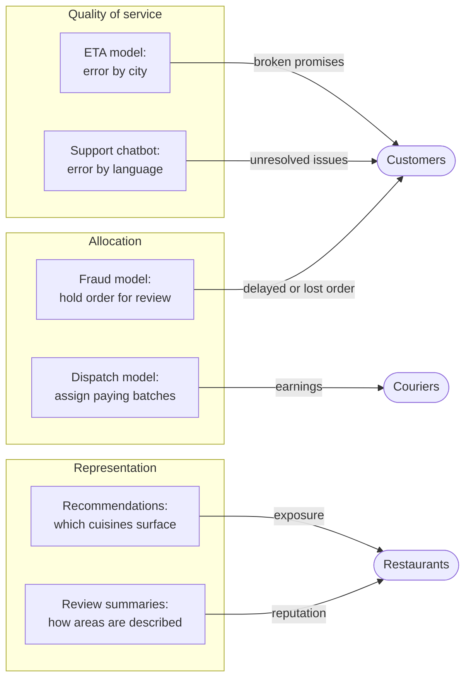
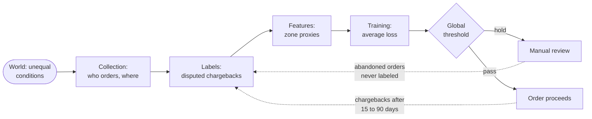

# Chapter 71 — Responsible ML: Fairness, Privacy and Explainability

> **Level:** 4 · **Track:** B (ML/AI) · **Estimated reading time:** 5 h

QuickBite's fraud model shipped with 50% precision and 70% recall, and it met both targets. Three months later a support lead noticed something the launch review had not measured: customers in a cluster of newer, lower-income delivery zones were being held for manual review more than twice as often as everyone else, even when they were not fraudsters. Nobody had put the zone into the model; a feature called "account newness" carried it in. Each held order delayed a legitimate customer's dinner by ten minutes and some never came back. The same quarter, a courier forum asked why the dispatch system seemed to give the best-paying batches to the same couriers, and a privacy researcher asked whether the support chatbot could be made to recite other customers' addresses.

None of these is a model bug in the usual sense. Each is a property of the whole system: data, labels, features, objectives, thresholds, product decisions and feedback loops. **Responsible ML** is the engineering discipline that measures and controls three such properties: **fairness** (who bears the errors), **privacy** (what the model reveals about the people it learned from) and **explainability** (whether people can understand and contest its decisions), and documents them well enough to satisfy reviewers and regulators.

Chapter 50 owns privacy engineering, k-anonymity and the definition of ε-differential privacy (§50.11); Chapter 57 owns the confusion matrix and calibration; Chapter 59 introduced slices and model cards; Chapter 63 owns datasheets; Chapter 69 owns governance; Chapter 70 owns slice monitoring. This chapter owns fairness metrics and mitigation, explanation methods, ML-specific privacy attacks, DP-SGD, federated learning and the review process that ties them together.

::: note
**QuickBite assumptions used in this chapter.** Teaching assumptions reused from earlier chapters, not measurements of a real company. 500,000 orders per day; 0.5% fraud rate (2,500 frauds per day); the fraud model flags 0.7% of orders (3,500 per day) for review with 50% precision and 70% recall (§70.3); a missed fraud costs about \$60 and a wrongly blocked good order about \$8 (§57.10.1); 20 cities, 4,000 delivery zones, 50,000 registered couriers; ETA MAE about 4.3 minutes with an SLO requirement of mean error within ±1 minute per city (§60.9.1); protected attributes are not model features (§60.9.1). **New in this chapter:** for fairness analysis, zones are grouped into group A (80% of orders, fraud base rate 0.4%) and group B (20% of orders, fraud base rate 0.9%). The groups and their numbers are synthetic and illustrative.
:::

## 71.1 Learning objectives

After this chapter you should be able to:

- Classify ML harms as allocation, quality-of-service or representation harms, and trace where bias enters a system.
- Compute demographic parity, equalized odds, equal opportunity, predictive parity and calibration within groups from per-group confusion matrices, and state individual fairness.
- Explain the impossibility results of Kleinberg et al. and Chouldechova with numbers.
- Measure fairness with confidence intervals, size samples for small groups, and reason about proxies when protected attributes are missing.
- Apply reweighing, constrained training and group thresholds, and quantify their cost.
- Compute exact Shapley values, explain TreeSHAP, LIME, permutation importance and counterfactual explanations, and design reason codes within a latency budget.
- Describe membership inference, model inversion and training-data extraction, and bound attack success under differential privacy.
- Implement DP-SGD, read its privacy accounting, and predict its utility cost.
- Compute a FedAvg update and the communication cost of federated learning, and explain secure aggregation.
- Write model cards and audit logs, map a system to EU AI Act risk tiers, GDPR Article 22 and US adverse-action rules, and run a responsible-ML review.

## 71.2 Prerequisites

- Confusion matrix, precision, recall — §57.10.1; calibration — §57.10.3 (every fairness metric is built from them).
- Gradient descent — §57.9.2 (DP-SGD and FedAvg modify it).
- Confidence intervals and hypothesis tests — §57.14.1 (small-group measurement).
- Slices, model cards and feedback loops — §59.10.2, §59.10.3, §59.13.2, §60.3.4.
- ε-differential privacy, the Laplace mechanism and composition — §50.11 (used, not redefined); k-anonymity — §50.10.2.
- Datasheets — §63.13; governance and model risk tiers — §69.11; slice alerting — §70.9.2.

## 71.3 Why responsible ML is a systems problem

### 71.3.1 Three kinds of harm

::: definition
**Definition — Allocation harm.** A system withholds an opportunity or resource (credit, a job, an order, a delivery batch) from some people or groups more than others.

**Definition — Quality-of-service harm.** A system works less well for some groups, even though nothing is explicitly withheld: higher error rates, slower or less accurate service.

**Definition — Representation harm.** A system reinforces stereotypes, demeans, or erases groups, for example through the content it generates, ranks or labels.
:::

#### First-principles explanation

Think of a city that plans its bus routes from smartphone trip data. Neighborhoods where fewer people own smartphones look as if nobody travels, so they get fewer buses (allocation); the buses they do get are scheduled less accurately (quality of service); and the official map labels them "low demand," which shapes how planners and residents think about them (representation). No one intended any of it; the data and the objective did it.

The allocation/representation distinction was popularized by Crawford's 2017 NeurIPS keynote, and the Fairlearn toolkit's documentation adds quality-of-service harms [Crawford 2017; Fairlearn 2023]. The canonical quality-of-service study is Gender Shades: commercial gender classifiers had error rates up to 34.7% for darker-skinned women against at most 0.8% for lighter-skinned men [Buolamwini & Gebru 2018].

**Figure 71.1 — QuickBite's ML systems mapped to the harms they can cause.**

**Reading the diagram.** Each box is a QuickBite model; subgraphs group them by the harm their errors cause, and arrows point to the people who bear it. The fraud model and dispatch allocate opportunity (an order completed, a high-paying batch), so their errors are measured as rates of being denied. The ETA model and chatbot provide a service whose quality can differ by city or language. Recommendations and generated review summaries shape how restaurants and areas are seen. The arrows are synchronous product effects, but the harm accumulates asynchronously: customers churn, couriers earn less, restaurants lose exposure. The failure point common to all six is the same: the platform metric looks healthy while one group absorbs the errors.

### 71.3.2 Where bias enters

#### Why does this exist?

"The model is biased" is rarely a statement about the learning algorithm. Barocas and Selbst trace discrimination to five sources inside data mining: how the target variable is defined, how training data is labeled, how it is collected, which features are selected, and proxies that encode group membership [Barocas & Selbst 2016]. Each is a pipeline stage you already own.

#### How it works internally

1. **The world.** Historical inequality is in the data before you touch it. Fraud is genuinely more common in some zones, and so are the conditions that cause it.
2. **Sampling.** Who is in the data? New cities have little history; groups who use the app less are under-represented.
3. **Labels.** The label is a proxy for what you care about. Chargebacks measure fraud *that was disputed*; delivery time measures service *for orders placed*. Obermeyer et al. showed that a US health-risk algorithm used cost as the label for medical need; because less money was spent on Black patients at the same level of need, Black patients at a given risk score were considerably sicker than white patients, and correcting the label would have raised the share of Black patients flagged for extra care from 17.7% to 46.5% [Obermeyer et al. 2019].
4. **Features.** Removing the protected attribute does not remove it: zone, account age, device type and payment method each correlate with income and ethnicity. This is **fairness through unawareness**, and it fails whenever proxies exist [Barocas et al. 2023].
5. **Objective.** Minimizing average loss rewards accuracy on the majority. A group of 2% of orders contributes 2% of the loss.
6. **Thresholds and product rules.** A single global threshold applied to groups with different score distributions produces different error rates, as the next sections show.
7. **Feedback loops.** Held orders that are abandoned never become labeled; zones that receive fewer couriers get slower deliveries, lower ratings and fewer orders (§59.13.2, §60.3.4, §68.12).

**Figure 71.2 — Where bias enters the QuickBite fraud pipeline.**

**Reading the diagram.** Data flows left to right through the stages listed above; each stage is a place where a group can be disadvantaged and therefore a place where it can be measured. Solid arrows are the synchronous scoring path at checkout. The dotted arrows are the asynchronous label paths: chargebacks arrive weeks later (§63.4.2), and held orders that customers abandon produce no label at all, a selective-labels problem that biases the next model toward the current one's decisions. The storage boundary is the label store, where both paths meet. The failure point is the threshold: it is where unequal score distributions become unequal treatment. Scaling the pipeline does not fix any of this; measurement at each stage does.

::: mistake
**Mistake — "We don't use race or gender, so the model is fair."** Unawareness removes the attribute, not the information. With dozens of correlated features, a model can reconstruct group membership with high accuracy and use it. It also removes your ability to *measure* disparity, which is the larger loss.
:::
