# Chapter 71 — Responsible ML: Fairness, Privacy and Explainability

> **Level:** 4 · **Track:** B (ML/AI) · **Estimated reading time:** 5 h

QuickBite's fraud model shipped with 50% precision and 70% recall, and it met both targets. Three months later a support lead noticed something the launch review had not measured: customers in a cluster of newer, lower-income delivery zones were being held for manual review more than twice as often as everyone else, even when they were not fraudsters. Nobody had put the zone into the model; a feature called "account newness" carried it in. Each held order delayed a legitimate customer's dinner by ten minutes and some never came back. The same quarter, a courier forum asked why the dispatch system seemed to give the best-paying batches to the same couriers, and a privacy researcher asked whether the support chatbot could be made to recite other customers' addresses.

None of these is a model bug in the usual sense. Each is a property of the whole system: data, labels, features, objectives, thresholds, product decisions and feedback loops. **Responsible ML** is the engineering discipline that measures and controls three such properties: **fairness** (who bears the errors), **privacy** (what the model reveals about the people it learned from) and **explainability** (whether people can understand and contest its decisions), and documents them well enough to satisfy reviewers and regulators.

This chapter builds on ε-differential privacy (§50.11), metrics (§57.10), slices and model cards (§59.10), datasheets (§63.13), governance (§69.11) and slice monitoring (§70.9.2), and owns fairness metrics and mitigation, explanation methods, ML privacy attacks, DP-SGD, federated learning and the review process.

::: note
**QuickBite assumptions used in this chapter.** Teaching assumptions reused from earlier chapters, not measurements of a real company. 500,000 orders per day; 0.5% fraud rate (2,500 frauds per day); the fraud model flags 0.7% of orders (3,500 per day) for review with 50% precision and 70% recall (§70.3); a missed fraud costs about \$60 and a wrongly blocked good order about \$8 (§57.10.1); 20 cities, 4,000 delivery zones, 50,000 registered couriers; ETA MAE about 4.3 minutes with an SLO requirement of mean error within ±1 minute per city (§60.9.1); protected attributes are not model features (§60.9.1). **New in this chapter:** for fairness analysis, zones are grouped into group A (80% of orders, fraud base rate 0.4%) and group B (20% of orders, fraud base rate 0.9%). The groups and their numbers are synthetic and illustrative.
:::

## 71.1 Learning objectives

After this chapter you should be able to:

- Classify harms (allocation, quality of service, representation) and trace where bias enters a system.
- Compute group fairness metrics from per-group confusion matrices and explain the impossibility results with numbers.
- Measure fairness with confidence intervals and proxies when protected attributes are missing.
- Apply reweighing, constrained training and group thresholds, and quantify their cost.
- Compute exact Shapley values, explain TreeSHAP, LIME, permutation importance and counterfactual explanations, and design reason codes within a latency budget.
- Describe ML privacy attacks and bound their success under differential privacy.
- Implement DP-SGD, read its privacy accounting and predict its utility cost; compute FedAvg updates and federated communication cost.
- Write model cards and audit logs, map systems to the EU AI Act, GDPR Article 22 and US adverse-action rules, and run a review.

## 71.2 Prerequisites

- Confusion matrix, precision, recall — §57.10.1; calibration — §57.10.3 (every fairness metric is built from them).
- Gradient descent — §57.9.2 (DP-SGD and FedAvg modify it).
- Confidence intervals and hypothesis tests — §57.14.1 (small-group measurement).
- Slices, model cards and feedback loops — §59.10.2, §59.10.3, §59.13.2, §60.3.4.
- ε-differential privacy, the Laplace mechanism and composition — §50.11 (used, not redefined); k-anonymity — §50.10.2.
- Datasheets — §63.13; governance and model risk tiers — §69.11; slice alerting — §70.9.2.

## 71.3 Why responsible ML is a systems problem

### 71.3.1 Three kinds of harm

::: definition
**Definition — Allocation harm.** A system withholds an opportunity or resource (credit, a job, an order, a delivery batch) from some people or groups more than others.

**Definition — Quality-of-service harm.** A system works less well for some groups, even though nothing is explicitly withheld: higher error rates, slower or less accurate service.

**Definition — Representation harm.** A system reinforces stereotypes, demeans, or erases groups, for example through the content it generates, ranks or labels.
:::

#### First-principles explanation

Think of a city that plans bus routes from smartphone trip data. Neighborhoods where fewer people own smartphones look as if nobody travels, so they get fewer buses (allocation), less accurate schedules (quality of service), and a "low demand" label on the official map (representation). No one intended it; the data did it.

The allocation/representation distinction was popularized by Crawford's 2017 NeurIPS keynote, and the Fairlearn toolkit's documentation adds quality-of-service harms [Crawford 2017; Fairlearn n.d.]. The canonical quality-of-service study is Gender Shades: commercial gender classifiers had error rates up to 34.7% for darker-skinned women against at most 0.8% for lighter-skinned men [Buolamwini & Gebru 2018].

**Figure 71.1 — QuickBite's ML systems mapped to the harms they can cause.**


**Reading the diagram.** Each box is a QuickBite model; subgraphs group them by the harm their errors cause, and arrows point to the people who bear it. The fraud model and dispatch allocate opportunity (an order completed, a high-paying batch), so their errors are measured as rates of being denied. The ETA model and chatbot provide a service whose quality can differ by city or language. Recommendations and generated review summaries shape how restaurants and areas are seen. The arrows are synchronous product effects, but the harm accumulates asynchronously: customers churn, couriers earn less, restaurants lose exposure. The failure point common to all six is the same: the platform metric looks healthy while one group absorbs the errors.

### 71.3.2 Where bias enters

#### Why does this exist?

"The model is biased" is rarely a statement about the learning algorithm. Barocas and Selbst trace discrimination to five sources inside data mining: how the target variable is defined, how training data is labeled, how it is collected, which features are selected, and proxies that encode group membership [Barocas & Selbst 2016]. Each is a pipeline stage you already own.

#### How it works internally

1. **The world.** Historical inequality is in the data before you touch it.
2. **Sampling.** Who is in the data? New cities have little history; groups who use the app less are under-represented.
3. **Labels.** The label is a proxy for what you care about. Chargebacks measure fraud *that was disputed*; delivery time measures service *for orders placed*. Obermeyer et al. showed that a US health-risk algorithm used cost as the label for medical need; because less was spent on Black patients at the same need, correcting the label would have raised the share of Black patients flagged for extra care from 17.7% to 46.5% [Obermeyer et al. 2019].
4. **Features.** Removing the protected attribute does not remove it: zone, account age, device type and payment method each correlate with income and ethnicity. This is **fairness through unawareness**, and it fails whenever proxies exist [Barocas et al. 2023].
5. **Objective.** Minimizing average loss rewards accuracy on the majority. A group of 2% of orders contributes 2% of the loss.
6. **Thresholds and product rules.** A single global threshold applied to groups with different score distributions produces different error rates, as the next sections show.
7. **Feedback loops.** Held orders that are abandoned never become labeled; zones that receive fewer couriers get slower deliveries, lower ratings and fewer orders (§59.13.2, §60.3.4, §68.12).

**Figure 71.2 — Where bias enters the QuickBite fraud pipeline.**


**Reading the diagram.** Data flows left to right through the stages listed above; each stage is a place where a group can be disadvantaged and therefore a place where it can be measured. Solid arrows are the synchronous scoring path at checkout. The dotted arrows are the asynchronous label paths: chargebacks arrive weeks later (§63.4.2), and held orders that customers abandon produce no label at all, a selective-labels problem that biases the next model toward the current one's decisions. The storage boundary is the label store, where both paths meet. The failure point is the threshold: it is where unequal score distributions become unequal treatment. Scaling the pipeline does not fix any of this; measurement at each stage does.

::: mistake
**Mistake — "We don't use race or gender, so the model is fair."** Unawareness removes the attribute, not the information. With dozens of correlated features, a model can reconstruct group membership with high accuracy and use it. It also removes your ability to *measure* disparity, which is the larger loss.
:::

## 71.4 Fairness definitions

### 71.4.1 Three families of group criteria

::: definition
**Definition — Protected (sensitive) attribute.** A characteristic, such as race, sex, age or disability, on which unequal treatment is legally restricted or ethically unacceptable. Here $G$ denotes group membership, $Y$ the true label, $\hat{Y}$ the decision and $S$ the score.
:::

#### First-principles explanation

Picture an airport security line that sends some travelers for a secondary search. You could demand that every group is searched at the same rate (equal **selection**); that innocent travelers in every group are searched at the same rate, and smugglers caught at the same rate (equal **error rates**); or that a search finds contraband equally often whichever group the traveler is from (equal **precision**). Each sounds fair. When groups differ in how often they actually carry contraband, you can satisfy only one of them.

Barocas, Hardt and Narayanan organize group criteria into three families, each a conditional-independence statement [Barocas et al. 2023]:

- **Independence:** $\hat{Y} \perp G$. The decision does not depend on the group (demographic parity).
- **Separation:** $\hat{Y} \perp G \mid Y$. Given the truth, the decision does not depend on the group (equalized odds, equal opportunity).
- **Sufficiency:** $Y \perp G \mid S$. Given the score, the truth does not depend on the group (predictive parity, calibration within groups).

For fraud, the positive prediction (a hold) is the *harmful* outcome. Hardt et al. define **equal opportunity** as equal true-positive rates for the *advantaged* outcome [Hardt et al. 2016]; for a legitimate customer the advantaged outcome is "not held," so the fraud analogue is equal **false-positive rates** among legitimate customers. Always state which outcome is the benefit before you pick a metric.

### 71.4.2 A per-group confusion matrix

**Table 71.1 — One day of fraud decisions, split by zone group (illustrative).**

| Group | Orders | Fraud | TP | FN | FP | TN |
|---|---|---|---|---|---|---|
| A | 400,000 | 1,600 | 1,100 | 500 | 1,000 | 397,400 |
| B | 100,000 | 900 | 650 | 250 | 750 | 98,350 |
| Total | 500,000 | 2,500 | 1,750 | 750 | 1,750 | 495,750 |

The totals reproduce the launch numbers: $1{,}750 + 1{,}750 = 3{,}500$ holds (0.7%), precision $1{,}750/3{,}500 = 50\%$, recall $1{,}750/2{,}500 = 70\%$.

::: formula
**Independence and separation criteria**

$$\text{DP gap} = \left|\Pr[\hat{Y}=1 \mid G=a] - \Pr[\hat{Y}=1 \mid G=b]\right|, \qquad \text{DP ratio} = \frac{\min_g \Pr[\hat{Y}=1 \mid G=g]}{\max_g \Pr[\hat{Y}=1 \mid G=g]}$$

$$\text{Equalized odds:}\ \Pr[\hat{Y}=1 \mid Y=y, G=a] = \Pr[\hat{Y}=1 \mid Y=y, G=b]\ \ \text{for } y \in \{0,1\}$$

$$\text{Equal opportunity:}\ \text{the same equality for the advantaged label only}$$

| Symbol | Meaning | Units |
|---|---|---|
| $\hat{Y}$ | Decision (1 = hold for review) | binary |
| $Y$ | True label (1 = fraud) | binary |
| $G$ | Group membership ($a$, $b$) | categorical |
| $\Pr[\hat{Y}=1 \mid G=g]$ | Selection rate of group $g$, $(TP+FP)/n_g$ | fraction |
| $\Pr[\hat{Y}=1 \mid Y=1, G=g]$ | True-positive rate (TPR) of group $g$ | fraction |
| $\Pr[\hat{Y}=1 \mid Y=0, G=g]$ | False-positive rate (FPR) of group $g$ | fraction |
:::

::: example
**Worked example — Selection and error rates from Table 71.1.**

1. Selection rate A $= (1{,}100 + 1{,}000)/400{,}000 = 0.525\%$; B $= (650 + 750)/100{,}000 = 1.40\%$.
2. DP gap $= 1.40 - 0.525 = 0.875$ percentage points; DP ratio $= 0.525/1.40 = 0.375$.
3. TPR A $= 1{,}100/1{,}600 = 68.8\%$; TPR B $= 650/900 = 72.2\%$; gap 3.5 points.
4. FPR A $= 1{,}000/398{,}400 = 0.251\%$; FPR B $= 750/99{,}100 = 0.757\%$; ratio $0.757/0.251 = 3.0$.

**Interpretation.** Fraud is caught at similar rates in both groups, but a *legitimate* customer in group B is three times as likely to be held as one in group A: about 750 innocent B customers a day against the 250 that group A's rate would imply. The DP ratio of 0.375 would fail the US "four-fifths" screening heuristic from employment selection, which flags a ratio below 0.8 [EEOC 1978]. **Engineering implication.** Equalized odds is violated through the FPR, which is the harm legitimate customers feel. Part of the selection gap is legitimate (B's base rate is 2.25 times A's), so demographic parity is the wrong target here, but the FPR gap is not explained by base rates and needs investigation.
:::

::: formula
**Sufficiency criteria**

$$\text{Predictive parity:}\ \Pr[Y=1 \mid \hat{Y}=1, G=a] = \Pr[Y=1 \mid \hat{Y}=1, G=b]$$

$$\text{Calibration within groups:}\ \Pr[Y=1 \mid S=s, G=g] = s \quad \text{for all } s, g$$

| Symbol | Meaning | Units |
|---|---|---|
| $\Pr[Y=1 \mid \hat{Y}=1, G=g]$ | Positive predictive value (PPV, precision) of group $g$ | fraction |
| $S$ | Model score, read as a probability | probability |
| $s$ | A particular score value or bin | probability |
:::

::: example
**Worked example — Precision by group.**

1. PPV A $= 1{,}100/2{,}100 = 52.4\%$; PPV B $= 650/1{,}400 = 46.4\%$.
2. A reviewer opening a group-B case is 6 points less likely to find fraud.
3. Calibration check: among orders scored in the band 0.2–0.5, a calibrated model should show a fraud rate near the band's mean score in *each* group; §71.5 measures this on synthetic data (35.0% in A, 30.9% in B).

**Interpretation.** Predictive parity holds approximately (6 points), separation does not (3× FPR). **Engineering implication.** Report all three families side by side; a dashboard showing only precision by group would have declared this model fair.
:::

### 71.4.3 Individual fairness

::: formula
**Individual fairness as a Lipschitz condition** [Dwork et al. 2012]

$$D\big(M(x), M(x')\big) \le L \cdot d(x, x')$$

| Symbol | Meaning | Units |
|---|---|---|
| $x, x'$ | Two individuals (feature vectors) | — |
| $d$ | Task-specific similarity metric between individuals | task units |
| $M(x)$ | The model's output distribution for $x$ | — |
| $D$ | Distance between outputs (e.g. absolute score difference) | probability |
| $L$ | Lipschitz constant: how much output may move per unit of dissimilarity | probability per task unit |
:::

::: example
**Worked example — Two identical orders, different zones.** Two orders are identical except that one customer lives in a group-B zone, which raises "account newness" through its correlation with zone. Suppose the agreed metric says they are identical for fraud purposes, $d = 0$. Then individual fairness requires $D = 0$. If the scores are 0.10 and 0.16, $D = 0.06 > L \times 0 = 0$: violated. **Interpretation.** Everything rests on $d$; agreeing what makes two people similar *is* the fairness question. **Engineering implication.** Generate paired inputs that differ only in a proxy and assert the score moves less than a tolerance, as a CI test (§69.4).
:::

**Figure 71.3 — Choosing a fairness criterion.**

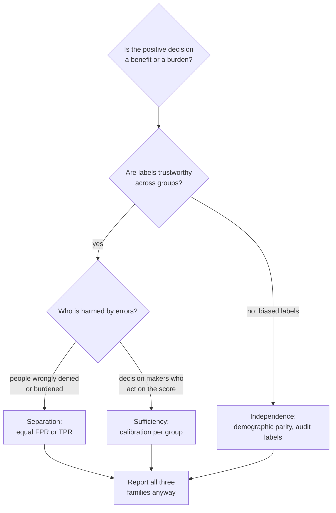

**Reading the diagram.** The flow is a sequence of design questions asked during the review in §71.14, not computed at runtime. Whether the positive prediction is a benefit (a loan) or a burden (a fraud hold) determines which error rate matters. If labels are biased (chargebacks filed less often in some zones), separation and sufficiency inherit the bias, so independence plus a label audit is safer. Otherwise, affected individuals point to separation and decision makers who interpret scores, such as review analysts, to sufficiency. The failure point is choosing a single metric and reporting only it; every path ends by reporting all three.

### 71.4.4 Impossibility results

#### Why does this exist?

In 2016 ProPublica reported that the COMPAS recidivism score had a much higher false-positive rate for Black defendants; the vendor replied that the score was equally calibrated and equally precise for both groups. Both were right. Chouldechova and Kleinberg et al. independently proved that, when base rates differ, these properties cannot hold together [Chouldechova 2017; Kleinberg et al. 2017].

::: formula
**Chouldechova's identity**

$$\text{FPR} = \frac{p}{1-p} \cdot \frac{1-\text{PPV}}{\text{PPV}} \cdot \text{TPR}$$

| Symbol | Meaning | Units |
|---|---|---|
| $p$ | Base rate in the group, $\Pr[Y=1 \mid G=g]$ | fraction |
| PPV | Positive predictive value in the group | fraction |
| TPR | True-positive rate, $1 - \text{FNR}$ | fraction |
| FPR | False-positive rate | fraction |
:::

The identity follows from the definitions: $FP = TP(1-\text{PPV})/\text{PPV}$, $TP = \text{TPR} \cdot pn$ and $\text{FPR} = FP/((1-p)n)$. Fix PPV and TPR across groups, and FPR must scale with the odds $p/(1-p)$.

::: example
**Worked example — Equal precision and recall force unequal false holds.**

1. Check the identity on group B: $p/(1-p) = 0.009/0.991 = 0.009082$; $(1 - 0.4643)/0.4643 = 1.1538$; $\times 0.7222$ gives $0.009082 \times 1.1538 \times 0.7222 = 0.757\%$, matching Table 71.1.
2. Now demand PPV = 50% and TPR = 70% in both groups. Group A: $0.004/0.996 \times 1 \times 0.70 = 0.281\%$. Group B: $0.009/0.991 \times 1 \times 0.70 = 0.636\%$.
3. The FPR ratio is $0.636/0.281 = 2.26$, exactly the ratio of the odds.

**Interpretation.** With base rates of 0.4% and 0.9%, *any* model that is equally precise and equally sensitive across groups holds innocent B customers 2.26 times as often. **Engineering implication.** Fairness requires choosing which property to give up, and the choice is a product and policy decision, recorded in the model card, not an optimization detail.
:::

Kleinberg, Mullainathan and Raghavan prove the score-based version: **calibration within groups**, **balance for the positive class** (equal average score for positives in each group) and **balance for the negative class** cannot hold simultaneously unless prediction is perfect or base rates are equal [Kleinberg et al. 2017].

**Figure 71.4 — Why the three families collide.**

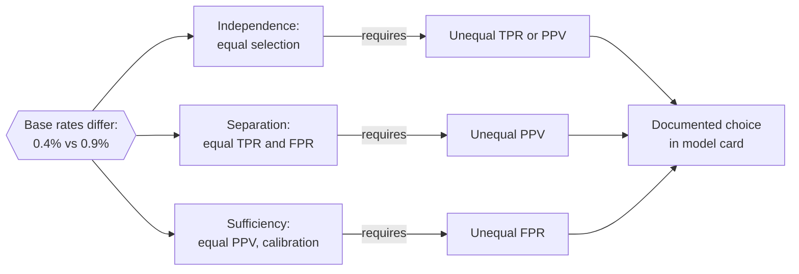

**Reading the diagram.** The external fact on the left, unequal base rates, feeds all three criteria. Each arrow to the right is a mathematical consequence: holding one criterion exactly forces a violation of another (unless the classifier is perfect). Nothing here is a runtime path; it is a constraint on design. The only exit is the box on the right: a documented, reviewed choice of which criterion matters for this decision and how large a violation of the others is tolerable. A failure point is treating the impossibility as a reason to measure nothing.

**Table 71.2 — Fairness criteria compared.**

| Criterion | Equalizes | Holds automatically when | Main objection | Good fit |
|---|---|---|---|---|
| Demographic parity | Selection rate | Base rates equal | Ignores real base-rate differences | Labels distrusted; exposure, ads |
| Equalized odds | TPR and FPR | Perfect classifier | Lower accuracy; may need randomization | Burdensome decisions: fraud holds |
| Equal opportunity | One error rate | Perfect classifier | Ignores the other error | Benefits: loan approval, hiring screens |
| Predictive parity | PPV | Calibrated, similar score spread | Allows unequal error rates | Reviewer workload, triage |
| Calibration in groups | $\Pr[Y \mid S]$ | Well-specified model with group info | Allows unequal error rates | Risk scores read as probabilities |
| Individual fairness | Similar people, similar scores | Never automatic | Needs a similarity metric | Pair tests, appeals |

::: industry
**Exposure fairness for couriers.** For dispatch, the allocated good is opportunity: high-paying batches. Singh and Joachims define **fairness of exposure** for rankings, allocating attention in proportion to merit rather than winner-take-all [Singh & Joachims 2018]. A courier-assignment analogue would compare offered earnings per online hour across courier groups with similar acceptance and lateness histories. QuickBite's dispatch model here is a teaching example, not a description of any company's system.
*Evidence: Illustrative* — concept from [Singh & Joachims 2018]
:::

## 71.5 Measuring fairness in practice

### 71.5.1 Slice metrics with uncertainty

#### First-principles explanation

A fairness metric is a slice metric (§59.10.2) whose slices are groups of people, so everything Chapter 70 says about noise floors applies, more sharply: the groups you most need to protect are often the smallest, and the errors you most care about, such as false holds of legitimate customers, are rare events. A gap measured on 40 frauds can be pure noise.

#### How it works internally

1. **Join** the prediction log with labels (after their delay, §70.8) and with group attributes, which live in a separate restricted store.
2. **Aggregate** per group and per decision threshold: TP, FP, FN, TN, and score-band counts for calibration.
3. **Attach intervals** to every rate, and suppress or pool groups below a minimum count.
4. **Compare** against the policy in the model card: which criterion, which tolerance, which reference group.
5. **Gate and monitor:** run the same job in the CI gate (§69.4) on the test set and in production on matured labels, with alerts routed as in §70.9.2.

**Figure 71.5 — Fairness measurement pipeline with a restricted attribute store.**

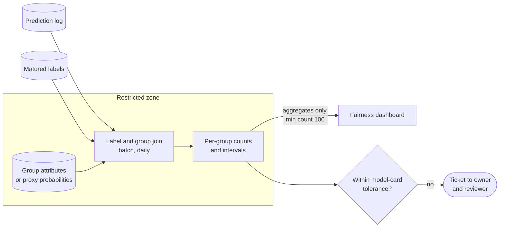

**Reading the diagram.** The prediction log and matured labels are the tables Chapter 70 monitors. Group attributes, self-reported or inferred, sit in a restricted zone with separate access control; the join and aggregation run inside it, and only counts above a minimum cell size leave it. All paths are batch jobs (asynchronous with respect to serving); scoring never reads the attribute store, which keeps protected attributes out of the model (§60.9.1). The gate compares results with the tolerance recorded in the model card and opens a ticket, not a page. Failure points: a join key mismatch that silently drops one group, and cells so small that intervals span the whole range. The job scales with orders per day, not with model traffic.

::: formula
**Wilson score interval and sample size for a rate**

$$\tilde{p} \pm h, \quad \tilde{p} = \frac{\hat{p} + \frac{z^2}{2n}}{1 + \frac{z^2}{n}}, \quad h = \frac{z\sqrt{\frac{\hat{p}(1-\hat{p})}{n} + \frac{z^2}{4n^2}}}{1 + \frac{z^2}{n}}; \qquad n_{\text{req}} \approx \frac{z^2\, p(1-p)}{m^2}$$

| Symbol | Meaning | Units |
|---|---|---|
| $\hat{p}$ | Observed rate, $k/n$ (e.g. TPR, FPR) | fraction |
| $n$ | Denominator count (frauds for TPR, legitimate orders for FPR) | examples |
| $z$ | Normal quantile; 1.96 for 95% | — |
| $\tilde{p}, h$ | Interval center and half-width | fraction |
| $m$ | Desired half-width (margin) | fraction |
| $n_{\text{req}}$ | Approximate denominator needed for margin $m$ | examples |
:::

::: example
**Worked example — How wide is a small group's recall?** A new city's group has 40 frauds in a month and the model caught 28: $\hat{p} = 0.70$.

1. $z^2/n = 3.8416/40 = 0.0960$; denominator $1.0960$.
2. $\tilde{p} = (0.70 + 0.0480)/1.0960 = 0.6825$.
3. $h = 1.96\sqrt{0.21/40 + 3.8416/6{,}400}/1.0960 = 1.96 \times 0.07649/1.0960 = 0.1368$.
4. Interval: $[0.546, 0.819]$, so "70% recall" is compatible with anything from 55% to 82%.
5. Sample size for FPR near 0.5% with a margin of ±0.1 points: $n_{\text{req}} = 3.8416 \times 0.005 \times 0.995 / 0.001^2 = 19{,}112$ legitimate orders.

**Interpretation.** A zone receives about 125 orders a day ($500{,}000/4{,}000$), so measuring one zone's FPR to ±0.1 points takes about 150 days. **Engineering implication.** Measure fairness on groups of zones, pool over weeks, and show intervals on every chart; per-zone fairness alerts would be noise. For differences between groups, use a two-proportion interval or a bootstrap, and correct for multiple comparisons when testing many groups (§70.6.4).
:::

### 71.5.2 When protected attributes are unavailable

QuickBite, like most companies outside regulated lending and hiring, does not collect race or ethnicity, and GDPR treats such data as a special category whose processing needs an explicit legal basis (Article 9). You cannot measure disparities for groups you cannot see, so teams use one of four approaches:

1. **Geography as a coarse proxy.** Compare groups of zones by census statistics such as median income. Cheap and private, but it measures neighborhoods, not people.
2. **Probabilistic proxies.** Bayesian Improved Surname Geocoding (BISG) combines surname and address to estimate race and ethnicity probabilities; it was developed for health-care disparity research [Elliott et al. 2009] and is used by the US Consumer Financial Protection Bureau in fair-lending analysis [CFPB 2014]. Proxy-based disparity estimates can be biased in either direction, because proxy errors correlate with outcomes [Chen et al. 2019].
3. **Voluntary, purpose-limited self-report** collected for auditing only, stored in the restricted zone of Figure 71.5. The EU AI Act explicitly permits processing special categories of data for bias detection in high-risk systems under strict safeguards (Article 10(5)) [EU 2024].
4. **External audits** by a party that holds the attributes and receives model outputs, so the company never holds both.

::: warning
**Warning — A proxy for measurement is not a proxy for decisions.** BISG probabilities used to *audit* a model are a privacy-sensitive analytic; the same probabilities used as a *feature* would be using inferred race in decisions. Keep them in the restricted store and out of any feature view (§62.15).
:::

### 71.5.3 Code example: group metrics with intervals

The program generates a synthetic day of orders in which group B has a higher fraud base rate and its *legitimate* customers have newer accounts, trains a logistic-regression fraud model without the group, flags the top 0.7%, and reports per-group metrics with 95% Wilson intervals, calibration bands and a small slice.

```python
"""Group fairness metrics with 95% Wilson intervals on a synthetic fraud model."""
import numpy as np
from sklearn.linear_model import LogisticRegression

rng = np.random.default_rng(71)
BASE_RATE = {"A": 0.004, "B": 0.009}          # fraud base rate per zone group


def make_orders(n):
    """Synthetic orders: group B is 20% of orders; x2 (account newness) is
    shifted for legitimate B orders, so it partly encodes the group."""
    g = np.where(rng.random(n) < 0.2, "B", "A")
    y = (rng.random(n) < np.where(g == "B", BASE_RATE["B"], BASE_RATE["A"])).astype(int)
    x1 = rng.normal(3.0 * y, 1.0)                       # behavioral fraud signal
    x2 = rng.normal(np.where(y == 1, 1.5, np.where(g == "B", 0.8, 0.0)), 1.0)
    return np.c_[x1, x2], y, g


def wilson(k, n, z=1.96):
    """95% Wilson score interval for a proportion k/n."""
    p = k / n
    d = 1 + z * z / n
    c = (p + z * z / (2 * n)) / d
    h = z * np.sqrt(p * (1 - p) / n + z * z / (4 * n * n)) / d
    return c - h, c + h


def group_report(y, flag, g, label):
    print(f"{label:<8}{'n':>7}{'base':>7}{'sel%':>6}{'TPR':>6}{'TPR 95% CI':>15}"
          f"{'FPR':>7}{'FPR 95% CI':>18}{'PPV':>6}")
    for grp in sorted(set(g)):
        s = g == grp
        tp = int(np.sum(flag & (y == 1) & s)); fp = int(np.sum(flag & (y == 0) & s))
        pos = int(np.sum((y == 1) & s));  neg = int(np.sum((y == 0) & s))
        tl, th = wilson(tp, pos)
        fl, fh = wilson(fp, neg)
        print(f"{grp:<8}{s.sum():>7}{pos / s.sum():>7.2%}{flag[s].mean():>6.2%}"
              f"{tp / pos:>6.2f}  [{tl:.2f}, {th:.2f}]{fp / neg:>7.2%}"
              f"  [{fl:.2%}, {fh:.2%}]{tp / max(tp + fp, 1):>6.2f}")


X_train, y_train, _ = make_orders(400_000)            # group is NOT a feature
model = LogisticRegression().fit(X_train, y_train)
X, y, g = make_orders(500_000)                         # one day of orders
score = model.predict_proba(X)[:, 1]
threshold = np.quantile(score, 1 - 0.007)              # flag 0.7% of orders
flag = score >= threshold
print(f"threshold={threshold:.3f} flagged={flag.sum()} "
      f"precision={y[flag].mean():.3f} recall={flag[y == 1].mean():.3f}\n")
group_report(y, flag, g, "group")

sel = {k: flag[g == k].mean() for k in ("A", "B")}
print(f"\ndemographic-parity ratio sel_A/sel_B = {sel['A'] / sel['B']:.2f}")

# Calibration within groups: observed fraud rate per score band.
print("\nscore band     A: n, fraud rate     B: n, fraud rate")
for lo, hi in [(0.05, 0.2), (0.2, 0.5), (0.5, 1.0)]:
    row = f"[{lo:.2f}, {hi:.2f})"
    for k in ("A", "B"):
        s = (g == k) & (score >= lo) & (score < hi)
        row += f"   {s.sum():>6}, {y[s].mean():.3f}"
    print(row)

# A small slice: 5,000 group-B orders (one zone cluster, one week).
idx = rng.choice(np.flatnonzero(g == "B"), 5_000, replace=False)
small = np.zeros(len(y), bool); small[idx] = True
print()
group_report(y[small], flag[small], np.array(["B-small"] * 5_000), "slice")
```

Output (Python 3.13, NumPy 2, scikit-learn 1.x, `OMP_NUM_THREADS=1`):

```text
threshold=0.139 flagged=3500 precision=0.515 recall=0.713

group         n   base  sel%   TPR     TPR 95% CI    FPR        FPR 95% CI   PPV
A        400123  0.40% 0.56%  0.72  [0.70, 0.74]  0.27%  [0.26%, 0.29%]  0.51
B         99877  0.92% 1.25%  0.70  [0.67, 0.73]  0.61%  [0.57%, 0.66%]  0.51

demographic-parity ratio sel_A/sel_B = 0.45

score band     A: n, fraud rate     B: n, fraud rate
[0.05, 0.20)     2544, 0.107     1344, 0.123
[0.20, 0.50)      814, 0.350      444, 0.309
[0.50, 1.00)      935, 0.846      559, 0.807

slice         n   base  sel%   TPR     TPR 95% CI    FPR        FPR 95% CI   PPV
B-small    5000  0.88% 1.42%  0.68  [0.53, 0.80]  0.83%  [0.61%, 1.12%]  0.42
```

What to notice:

- The model never sees the group, yet group B's selection rate is 2.2 times A's and its FPR 0.61% against 0.27%, with non-overlapping intervals: account newness is a proxy.
- TPR (0.72 versus 0.70) and PPV (0.51 versus 0.51) are nearly equal, so this model satisfies predictive parity and roughly equal opportunity for catching fraud, and therefore *must* violate equal FPR (Chouldechova's identity, §71.4.4).
- Calibration bands differ by a few points (35.0% versus 30.9% fraud in the 0.2–0.5 band): the score slightly overstates risk for B in that band.
- The 5,000-order slice has only 44 frauds; its TPR interval spans 0.53–0.80, and its FPR point estimate of 0.83% is not distinguishable from group B's 0.61%.

## 71.6 Bias mitigation

### 71.6.1 Three intervention points

::: definition
**Definition — Bias mitigation.** A change to the data (**pre-processing**), the training objective (**in-processing**) or the decision rule applied to scores (**post-processing**) that reduces a measured disparity, usually at some cost in accuracy or another fairness criterion.
:::

Before reaching for any of them, fix causes: a biased label (audit and relabel, Chapter 63), an under-sampled group (collect more data), or a proxy feature with little predictive value (remove it and measure). Mitigation algorithms treat symptoms; they are the right tool when the cause cannot be removed.

**Figure 71.6 — Where each mitigation family acts.**

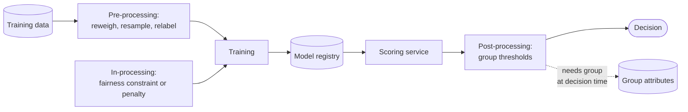

**Reading the diagram.** Data flows left to right through training (offline, batch) to the synchronous scoring path. Pre-processing changes the dataset before training and needs group labels only offline. In-processing changes the loss, also offline. Post-processing changes the decision rule on the online path, and the dotted arrow shows its operational cost: the group must be known or inferred at decision time, which crosses the storage boundary Figure 71.5 was designed to keep closed, and can be unlawful (§71.6.3). Failure points: reweighing a dataset whose labels are biased (it rebalances the bias), and post-processing on a group attribute whose values drift. Pre- and in-processing scale with training cost; post-processing adds a lookup per request.

### 71.6.2 Pre-processing: reweighing

::: formula
**Reweighing** [Kamiran & Calders 2012]

$$w(g, y) = \frac{\Pr[G=g]\,\Pr[Y=y]}{\Pr[G=g, Y=y]}$$

| Symbol | Meaning | Units |
|---|---|---|
| $w(g, y)$ | Training weight for every example with group $g$ and label $y$ | dimensionless |
| $\Pr[G=g]$, $\Pr[Y=y]$ | Marginal frequencies in the training data | fraction |
| $\Pr[G=g, Y=y]$ | Joint frequency | fraction |
:::

::: example
**Worked example — Reweighing Table 71.1.** $\Pr[A] = 0.8$, $\Pr[B] = 0.2$, $\Pr[\text{fraud}] = 0.005$.

1. $w(A, \text{fraud}) = 0.8 \times 0.005/(1{,}600/500{,}000) = 0.004/0.0032 = 1.250$.
2. $w(B, \text{fraud}) = 0.2 \times 0.005/(900/500{,}000) = 0.001/0.0018 = 0.556$.
3. $w(A, \text{legit}) = 0.8 \times 0.995/0.7968 = 0.999$; $w(B, \text{legit}) = 0.2 \times 0.995/0.1982 = 1.004$.
4. Check: weighted B fraud $= 900 \times 0.556 = 500$ of a weighted 100,000 B orders, a 0.5% rate, equal to A's $1{,}600 \times 1.25/400{,}000 = 0.5\%$.

**Interpretation.** Reweighing makes group and label statistically independent in the training data, so a model learns less from "B-ness." **Engineering implication.** That is correct if B's higher fraud rate is an artifact of labeling (for example, more aggressive chargeback filing in B), and wrong if it is real, in which case reweighing simply under-detects fraud in B. Decide which, with evidence, before applying it.
:::

### 71.6.3 In-processing and post-processing

**In-processing** adds the criterion to training: minimize loss subject to a disparity bound,

::: formula
**Constrained training**

$$\min_{\theta}\ L(\theta) \quad \text{subject to} \quad \big|\text{FPR}_a(\theta) - \text{FPR}_b(\theta)\big| \le \epsilon_f, \qquad \text{Lagrangian: } L(\theta) + \lambda\,\big(|\Delta\text{FPR}(\theta)| - \epsilon_f\big)$$

| Symbol | Meaning | Units |
|---|---|---|
| $\theta$ | Model parameters | — |
| $L(\theta)$ | Average training loss | loss units |
| $\text{FPR}_g(\theta)$ | False-positive rate of group $g$ | fraction |
| $\epsilon_f$ | Allowed disparity (tolerance) | fraction |
| $\lambda$ | Lagrange multiplier; price of disparity | loss units per unit FPR |
:::

::: example
**Worked example — Reading the multiplier.** Suppose training at $\epsilon_f = 0.1$ points converges with $\lambda = 0.02$ log-loss units per percentage point. Relaxing the tolerance to 0.2 points would lower training loss by roughly $0.02 \times 0.1 = 0.002$. **Interpretation.** The multiplier is the marginal accuracy price of fairness at that tolerance. **Engineering implication.** Sweep $\epsilon_f$ and plot loss against disparity; the review picks a point on that frontier, rather than accepting whatever one run produced.
:::

Agarwal et al. reduce constrained classification to a sequence of cost-sensitive problems solved by any learner, returning a randomized classifier [Agarwal et al. 2018]; Fairlearn implements this as `ExponentiatedGradient`. In-processing can trade off criteria smoothly and does not need the group at serving time, but it couples fairness to every retrain.

**Post-processing** leaves the model alone and picks a threshold per group. Hardt et al. show that for equalized odds the optimal derived predictor may need randomization between two thresholds for a group; for a single error rate, deterministic group thresholds suffice [Hardt et al. 2016].

::: formula
**Group-specific thresholds**

$$\hat{Y} = \mathbb{1}[S \ge t_G], \qquad t_g = F^{-1}_{S \mid Y=0, G=g}(1 - f^{*}) \ \text{ so that } \text{FPR}_g = f^{*}$$

| Symbol | Meaning | Units |
|---|---|---|
| $t_g$ | Decision threshold for group $g$ | score |
| $F^{-1}_{S \mid Y=0, G=g}$ | Quantile function of scores among group $g$'s legitimate orders | score |
| $f^{*}$ | Common target FPR, chosen to keep total holds at review capacity | fraction |
:::

::: example
**Worked example — Equal FPR at fixed capacity (from the code below).** Validation-day thresholds keeping about 3,500 holds are $t_A = 0.111$, $t_B = 0.230$. On the test day FPR becomes 0.33% (A) and 0.37% (B), from 0.25% and 0.62%; B's TPR falls from 0.71 to 0.65; missed frauds rise from 708 to 734 and false holds from 1,630 to 1,682. Cost: $60 \times 734 + 8 \times 1{,}682 = \$57{,}496$ against \$55,520, so $+\$1{,}976$ per day (+3.6%). **Interpretation.** Equalizing the false-hold rate costs 3.6% of daily fraud-related cost; equalizing selection rates costs 10%. **Engineering implication.** Put that number in front of decision makers: "we can cut false holds of group-B customers by 40% for about \$0.7 million a year" is a decision a review board can make; "the model is unfair" is not.
:::

```python
"""Post-processing with group-specific thresholds, and what it costs."""
import numpy as np
from sklearn.linear_model import LogisticRegression

rng = np.random.default_rng(71)
COST_FN, COST_FP = 60.0, 8.0          # $ per missed fraud, $ per blocked good order (Ch 57)
FLAGS = 3_500                          # review capacity per 500,000 orders


def make_orders(n):
    g = np.where(rng.random(n) < 0.2, "B", "A")
    y = (rng.random(n) < np.where(g == "B", 0.009, 0.004)).astype(int)
    x1 = rng.normal(3.0 * y, 1.0)
    x2 = rng.normal(np.where(y == 1, 1.5, np.where(g == "B", 0.8, 0.0)), 1.0)
    return np.c_[x1, x2], y, g


def thresholds_equal_fpr(s, y, g, flags):
    """Bisect on a common FPR so the groups together flag `flags` orders."""
    lo, hi = 0.0, 0.05
    for _ in range(60):
        f = (lo + hi) / 2
        t = {k: np.quantile(s[(g == k) & (y == 0)], 1 - f) for k in ("A", "B")}
        n = sum(np.sum(s[g == k] >= t[k]) for k in t)
        lo, hi = (f, hi) if n < flags else (lo, f)
    return t


def evaluate(name, s, y, g, t):
    flag = s >= np.where(g == "B", t["B"], t["A"])
    tp = np.sum(flag & (y == 1)); fp = np.sum(flag & (y == 0)); fn = np.sum(~flag & (y == 1))
    per = []
    for k in ("A", "B"):
        m = g == k
        per.append(f"{k}: sel {flag[m].mean():.2%} TPR {flag[m & (y == 1)].mean():.2f} "
                   f"FPR {flag[m & (y == 0)].mean():.2%} PPV {y[m & flag].mean():.2f}")
    print(f"{name}\n  {per[0]}\n  {per[1]}\n  flags {flag.sum()}  precision {tp / (tp + fp):.3f}  "
          f"recall {tp / (tp + fn):.3f}  missed {fn}  false blocks {fp}  "
          f"cost ${COST_FN * fn + COST_FP * fp:,.0f}")


model = LogisticRegression().fit(*make_orders(400_000)[:2])
Xv, yv, gv = make_orders(500_000)        # validation day: choose thresholds
Xt, yt, gt = make_orders(500_000)        # test day: measure
sv, st = model.predict_proba(Xv)[:, 1], model.predict_proba(Xt)[:, 1]

t_single = np.quantile(sv, 1 - FLAGS / len(sv))
policies = {
    "1. single threshold": {"A": t_single, "B": t_single},
    "2. equal FPR (equalized false-flag rate)": thresholds_equal_fpr(sv, yv, gv, FLAGS),
    "3. equal selection rate (demographic parity)":
        {k: np.quantile(sv[gv == k], 1 - FLAGS / len(sv)) for k in ("A", "B")},
}
for name, t in policies.items():
    print(f"thresholds A={t['A']:.3f} B={t['B']:.3f}")
    evaluate(name, st, yt, gt, t)
```

Output:

```text
thresholds A=0.139 B=0.139
1. single threshold
  A: sel 0.55% TPR 0.74 FPR 0.25% PPV 0.54
  B: sel 1.29% TPR 0.71 FPR 0.62% PPV 0.52
  flags 3506  precision 0.535  recall 0.726  missed 708  false blocks 1630  cost $55,520
thresholds A=0.111 B=0.230
2. equal FPR (equalized false-flag rate)
  A: sel 0.64% TPR 0.75 FPR 0.33% PPV 0.48
  B: sel 0.99% TPR 0.65 FPR 0.37% PPV 0.62
  flags 3532  precision 0.524  recall 0.716  missed 734  false blocks 1682  cost $57,496
thresholds A=0.097 B=0.353
3. equal selection rate (demographic parity)
  A: sel 0.70% TPR 0.77 FPR 0.38% PPV 0.45
  B: sel 0.74% TPR 0.56 FPR 0.20% PPV 0.73
  flags 3522  precision 0.510  recall 0.695  missed 789  false blocks 1727  cost $61,156
```

What to notice:

- Thresholds are fitted on a validation day and evaluated on a separate test day; fitting on test labels would overstate the result.
- Equal FPR lowers B's false holds from 0.62% to 0.37% of legitimate orders while raising A's from 0.25% to 0.33%: post-processing redistributes errors, it does not remove them.
- Demographic parity over-corrects: B's FPR drops to 0.20% and its TPR to 0.56%, so more fraud in B goes uncaught, and total cost rises by \$5,636 a day.

::: warning
**Warning — Legal caveats (not legal advice).** Group-specific thresholds use the protected attribute in the decision. In the US, explicit use of a protected characteristic in credit (ECOA), employment (Title VII) or housing decisions is generally disparate treatment, and the Supreme Court has limited race-conscious decision rules in other domains; in the EU, direct discrimination is prohibited under equality directives. Pre- and in-processing that use the attribute only during training occupy a less settled position. Involve counsel before deploying any mitigation that consumes protected attributes, and document the legal basis in the model card.
:::

**Table 71.3 — Mitigation families compared.**

| Row | Pre-processing (reweighing) | In-processing (constraints) | Post-processing (thresholds) |
|---|---|---|---|
| Needs group at | Training | Training | Decision time |
| Criteria supported | Mainly independence | Most, tunable | Separation, independence |
| Accuracy cost | Low to moderate | Lowest for a given disparity | Moderate |
| Operational complexity | Low | High (every retrain) | Low, but a lookup online |
| Legal exposure | Lower | Lower | Highest |
| Choose when | Label/sampling bias is known | You own training and need a frontier | A vendor model, or a quick fix |

## 71.7 Explainability

### 71.7.1 Global and local explanations

::: definition
**Definition — Global explanation.** A description of how a model behaves over a population: which features matter on average and how predictions change with them.

**Definition — Local explanation.** A description of why the model produced *one* prediction: which inputs pushed this score up or down, or what would have had to differ.
:::

#### First-principles explanation

A restaurant critic can tell you what a chef's cooking is like in general (global) or why tonight's soup was too salty (local). The engineer debugging a model wants the first; the customer whose order was held wants the second, in plain words, with something they can do about it.

**Figure 71.7 — Explanation methods by scope and model access.**

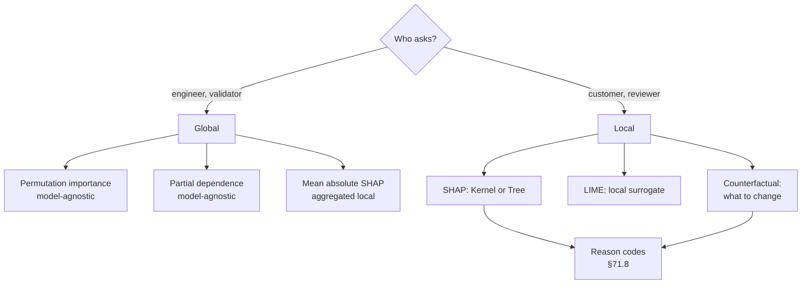

**Reading the diagram.** The first split is by audience, because audiences need different questions answered. Global methods summarize behavior across a dataset and run offline in validation or monitoring jobs. Local methods explain one prediction; SHAP and LIME attribute the score to features, counterfactuals describe a change that flips the decision. Mean absolute SHAP bridges the two by aggregating local attributions. The two local methods that feed reason codes run on, or next to, the serving path, which is where their latency matters (§71.8). Failure points: presenting a debugging artifact (a SHAP plot) to a customer, or a global importance as if it explained one decision.

**Permutation importance** shuffles one feature's column in a held-out set and measures how much the loss rises [Breiman 2001]. It is model-agnostic and cheap ($M$ extra evaluations of the dataset), but correlated features share credit unpredictably and shuffling creates impossible inputs (a brand-new account with ten years of order history).

### 71.7.2 Shapley values and SHAP

#### Why does this exist?

When features interact, "how much did this feature contribute?" has no obvious answer. Cooperative game theory answered the analogous question for players sharing a payout: the **Shapley value** is the unique attribution that is efficient (attributions sum to the payout), symmetric, gives zero to a player who never changes anything, and is additive across games. Lundberg and Lee showed that several earlier attribution methods are approximations of it and named the framework **SHAP** [Lundberg & Lee 2017].

::: formula
**Shapley value of feature $i$**

$$\phi_i = \sum_{S \subseteq F \setminus \{i\}} \frac{|S|!\,(M - |S| - 1)!}{M!}\,\big[v(S \cup \{i\}) - v(S)\big], \qquad \sum_{i=1}^{M} \phi_i = f(x) - \mathbb{E}[f(X)]$$

| Symbol | Meaning | Units |
|---|---|---|
| $F$ | Set of all features | — |
| $M$ | Number of features, $|F|$ | count |
| $S$ | A coalition: subset of features "present" | — |
| $v(S)$ | Model output with features in $S$ set to $x$'s values and the rest averaged over a background distribution | output units (log-odds here) |
| $\phi_i$ | Attribution of feature $i$ | output units |
| $f(x)$, $\mathbb{E}[f(X)]$ | Prediction being explained; average prediction (the base value) | output units |
:::

The weight is the probability that, in a random ordering of features, exactly the features in $S$ come before $i$. So $\phi_i$ is $i$'s average marginal contribution over all $M!$ orderings.

::: example
**Worked example — Three features with an interaction.** Let $f(x) = 2x_1 + x_2 + 3x_1x_3$ on binary inputs, explain $x = (1, 1, 1)$ with baseline $(0, 0, 0)$, so $v(S)$ is $f$ with features outside $S$ set to 0.

1. $v(\varnothing) = 0$, $v(1) = 2$, $v(2) = 1$, $v(3) = 0$, $v(12) = 3$, $v(13) = 5$, $v(23) = 1$, $v(123) = 6$.
2. Weights for $M = 3$: $|S| = 0 \to 1/3$; $|S| = 1 \to 1/6$; $|S| = 2 \to 1/3$.
3. $\phi_1 = \tfrac13(2 - 0) + \tfrac16(3 - 1) + \tfrac16(5 - 0) + \tfrac13(6 - 1) = 0.667 + 0.333 + 0.833 + 1.667 = 3.5$.
4. $\phi_2 = \tfrac13(1) + \tfrac16(1) + \tfrac16(1) + \tfrac13(1) = 1.0$.
5. $\phi_3 = \tfrac13(0) + \tfrac16(5 - 2) + \tfrac16(1 - 1) + \tfrac13(6 - 3) = 0.5 + 0 + 1.0 = 1.5$.
6. Efficiency: $3.5 + 1.0 + 1.5 = 6 = f(x) - v(\varnothing)$.

**Interpretation.** Linear terms go to their own feature ($x_2$ gets exactly 1); the interaction $3x_1x_3$ is split equally, 1.5 each. **Engineering implication.** Exact computation needs $2^M$ coalitions: 16 for 4 features, about $10^{15}$ for 50, so production systems need either sampling (KernelSHAP) or model structure (TreeSHAP).
:::

**KernelSHAP** estimates Shapley values by sampling coalitions and fitting a weighted linear regression, for any model [Lundberg & Lee 2017]. **TreeSHAP** computes *exact* Shapley values for tree ensembles in polynomial time, $O(TLD^2)$ for $T$ trees with $L$ leaves and depth $D$, by pushing all coalitions through each tree at once; Lundberg et al. also use it to compute interaction values and to build global explanations from many local ones [Lundberg et al. 2020]. Two choices change the answer and must be documented: the **background** distribution (the base value) and whether absent features are drawn from their marginal ("interventional") or conditional distribution ("observational"); the two disagree when features are correlated.

### 71.7.3 LIME and counterfactual explanations

**LIME** perturbs the instance, scores the perturbations with the model, and fits a sparse linear model weighted by proximity to the instance; the surrogate's coefficients are the explanation [Ribeiro et al. 2016]. It is fast and model-agnostic but unstable: different random perturbations or kernel widths give different explanations, and it carries no efficiency guarantee.

A **counterfactual explanation** states the smallest change to the input that would change the decision: "had the order value been \$41 or less, the order would not have been held." Wachter, Mittelstadt and Russell argue that counterfactuals inform, help contest and suggest recourse without opening the model, and frame them as solving $\arg\min_{x'} \lambda (f(x') - y')^2 + d(x, x')$ [Wachter et al. 2018]. Useful counterfactuals must be **actionable** (change what the person can change, not age or zone) and **plausible** (stay on the data distribution).

### 71.7.4 Code example: exact Shapley values without the shap package

The program explains one order from a four-feature nonlinear fraud model by enumerating all 16 coalitions against a 200-order background, checks efficiency, compares Monte Carlo permutation sampling, computes permutation importance globally, and searches single-feature counterfactuals.

```python
"""Exact Shapley values for a tiny fraud model, checked three ways."""
import itertools
import math
import numpy as np

rng = np.random.default_rng(71)
FEATURES = ["card_fails", "account_age_d", "order_value", "addr_dist_km"]


def log_odds(X):
    """A small nonlinear fraud model (log-odds): value matters more on new accounts."""
    fails, age, value, km = X[..., 0], X[..., 1], X[..., 2], X[..., 3]
    newness = np.exp(-age / 7.0)                      # 1 for brand-new, ~0 after a month
    return -6.0 + 0.9 * fails + 0.03 * value * newness + 0.01 * value + 0.08 * km


def sample_orders(n):
    return np.c_[rng.poisson(0.2, n), rng.exponential(200, n),
                 rng.gamma(4, 7.5, n), rng.exponential(3, n)]


background = sample_orders(200)                       # reference distribution
x = np.array([2, 2, 120, 25], dtype=float)            # the order being explained


def value(S):
    """Interventional value function: features in S fixed to x, others from background."""
    Z = background.copy()
    Z[:, list(S)] = x[list(S)]
    return log_odds(Z).mean()


def exact_shapley():
    M = len(x)
    v = {S: value(S) for r in range(M + 1) for S in itertools.combinations(range(M), r)}
    phi = np.zeros(M)
    for i in range(M):
        for S, vS in v.items():
            if i in S:
                continue
            w = math.factorial(len(S)) * math.factorial(M - len(S) - 1) / math.factorial(M)
            phi[i] += w * (v[tuple(sorted(S + (i,)))] - vS)
    return phi, v[()], v[tuple(range(M))], len(v)


phi, base, fx, n_coal = exact_shapley()
print(f"coalitions evaluated: {n_coal}, model calls: {n_coal * len(background)}")
print(f"E[f] = {base:.3f}   f(x) = {fx:.3f}   p(x) = {1 / (1 + math.exp(-fx)):.3f}")
for name, p in sorted(zip(FEATURES, phi), key=lambda t: -abs(t[1])):
    print(f"  {name:<14} phi = {p:+.3f}")
print(f"efficiency check: sum(phi) = {phi.sum():.3f} = f(x) - E[f] = {fx - base:.3f}")

# Monte Carlo permutation estimate (what sampling explainers approximate).
for n_perm in (10, 100, 1000):
    est = np.zeros(4)
    for _ in range(n_perm):
        order, S, prev = rng.permutation(4), [], base
        for i in order:
            S.append(i)
            cur = value(sorted(S))
            est[i] += cur - prev
            prev = cur
    est /= n_perm
    print(f"permutation sampling, {n_perm:>4} perms: max |error| = {np.abs(est - phi).max():.4f}")

# Global view: permutation importance = rise in log loss when one feature is shuffled.
X = sample_orders(20_000)
p = 1 / (1 + np.exp(-log_odds(X)))
y = (rng.random(len(p)) < p).astype(int)


def logloss(X):
    q = np.clip(1 / (1 + np.exp(-log_odds(X))), 1e-12, 1 - 1e-12)
    return -np.mean(y * np.log(q) + (1 - y) * np.log(1 - q))


ref = logloss(X)
print(f"\nfraud rate {y.mean():.4f}, log loss {ref:.4f}; permutation importance:")
for j, name in enumerate(FEATURES):
    Xp = X.copy(); Xp[:, j] = rng.permutation(Xp[:, j])
    print(f"  {name:<14} +{logloss(Xp) - ref:.5f}")

# Counterfactual: smallest single-feature change that clears review (p < 0.30).
print("\ncounterfactuals for p < 0.30:")
for j, grid in [(2, np.arange(120, -1, -1.0)), (3, np.arange(25, -0.5, -0.5)),
                (1, np.arange(2, 400, 1.0))]:
    for val in grid:
        z = x.copy(); z[j] = val
        if 1 / (1 + math.exp(-log_odds(z))) < 0.30:
            print(f"  {FEATURES[j]:<14} {x[j]:g} -> {val:g}")
            break
    else:
        print(f"  {FEATURES[j]:<14} no single change suffices")
```

Output:

```text
coalitions evaluated: 16, model calls: 3200
E[f] = -5.273   f(x) = 1.705   p(x) = 0.846
  order_value    phi = +1.954
  addr_dist_km   phi = +1.761
  card_fails     phi = +1.633
  account_age_d  phi = +1.631
efficiency check: sum(phi) = 6.979 = f(x) - E[f] = 6.979
permutation sampling,   10 perms: max |error| = 0.3935
permutation sampling,  100 perms: max |error| = 0.2361
permutation sampling, 1000 perms: max |error| = 0.0157

fraud rate 0.0049, log loss 0.0299; permutation importance:
  card_fails     +0.00130
  account_age_d  +0.00003
  order_value    +0.00029
  addr_dist_km   +0.00046

counterfactuals for p < 0.30:
  order_value    120 -> 41
  addr_dist_km   no single change suffices
  account_age_d  2 -> 23
```

What to notice:

- Efficiency holds exactly: the four attributions sum to the gap between this order's log-odds (1.705) and the background average (−5.273).
- For the additive features the Shapley value equals the coefficient times the deviation from the background mean: card failures $0.9 \times (2 - 0.185) = 1.633$.
- Account age is almost irrelevant globally (permutation importance +0.00003, since few accounts are new) yet contributes +1.631 to this order: global and local importance answer different questions.
- Sampling 10 or 100 permutations leaves errors of 0.24–0.39 log-odds, enough to reorder the top reasons.
- Only one single-feature counterfactual is actionable (order value); "be 23 days older" explains but offers no recourse.

::: mistake
**Mistake — Treating explanations as causal.** SHAP explains the *model*, not the world: a large attribution to "account newness" means the model relies on it, not that newness causes fraud. Post-hoc explanations can also be gamed: Slack et al. built classifiers that behave in a discriminatory way on real inputs while LIME and SHAP, probing off-distribution perturbations, report innocuous features [Slack et al. 2020]. For high-stakes decisions, Rudin argues for inherently interpretable models instead of explaining black boxes [Rudin 2019].
:::

## 71.8 Explanations in production

### 71.8.1 Latency, precomputation and reason codes

#### How it works internally

1. **Decide which predictions need explanations.** Every fraud hold does (the customer and the reviewer see reasons); a search-page ETA does not, but disputed checkout ETAs do (§60.9.1).
2. **Pick the computation mode.** Inline (synchronous, inside the decision), asynchronous (computed right after the decision and stored), or on demand (computed when someone asks, from the logged feature vector and model version).
3. **Map attributions to reason codes.** A reviewed catalog maps feature groups to human-readable reasons; take the top contributors *toward* the adverse decision, merge features that share a reason, and drop those the policy forbids disclosing.
4. **Log everything needed to reproduce it:** feature vector, model version, background version, attributions and reason codes, in the audit log (§71.12).

::: formula
**TreeSHAP cost relative to inference**

$$\frac{C_{\text{explain}}}{C_{\text{predict}}} \approx \frac{T L D^2}{T D} = L D$$

| Symbol | Meaning | Units |
|---|---|---|
| $T$ | Trees in the ensemble | count |
| $L$ | Leaves per tree | count |
| $D$ | Tree depth | levels |
| $C_{\text{predict}}$ | Work for one prediction, about $TD$ node visits | operations |
| $C_{\text{explain}}$ | Work for one TreeSHAP explanation, $O(TLD^2)$ | operations |
:::

::: example
**Worked example — Explaining every fraud decision versus every ETA.** A fraud GBDT has $T = 500$, $D = 6$, $L = 64$.

1. Prediction: $500 \times 6 = 3{,}000$ node visits. Explanation: $500 \times 64 \times 36 = 1.15 \times 10^6$, a ratio of $64 \times 6 = 384$.
2. Fraud at the 60 orders/s peak: $60 \times 1.15 \times 10^6 = 6.9 \times 10^7$ operations/s, a fraction of one CPU core; inline is affordable within a 50 ms budget.
3. ETA at 40,000 predictions/s with a similar model: $40{,}000 \times 1.15 \times 10^6 = 4.6 \times 10^{10}$ operations/s, roughly a few hundred cores for explanations nobody reads.
4. KernelSHAP instead, with 2,048 coalitions × 100 background rows: about 205,000 model calls per explanation, impossible inline.

**Interpretation.** Explanation cost is a multiple of inference cost that depends on the method. **Engineering implication.** Explain fraud holds inline or asynchronously before the customer is notified; compute ETA explanations on demand from the logged features for checkout ETAs that are disputed; never use sampling explainers on the request path.
:::

**Figure 71.8 — A fraud hold with reason codes.**

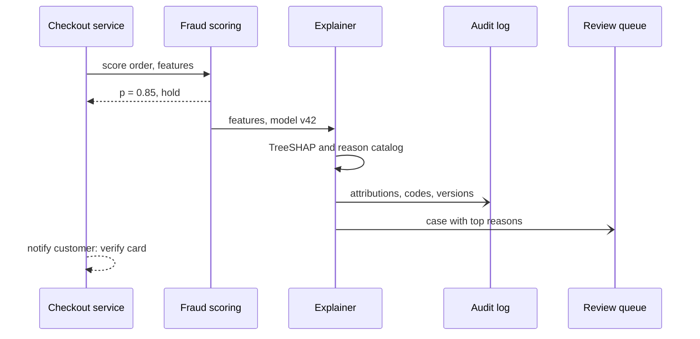

**Reading the diagram.** The checkout service calls fraud scoring synchronously over the internal RPC path and gets a hold decision. Scoring hands the same feature vector and model version to the explainer, which computes TreeSHAP attributions and maps them through the reason catalog. The open-headed arrows are asynchronous writes: the audit log (append-only storage) and the review queue receive the case, so a slow explainer delays the reviewer, not the customer. The customer message uses only the actionable, disclosable reason. Failure points: an explainer using a different model version than the scorer (reasons that do not match the decision) and a full review queue. Scaling: explainers are stateless and scale horizontally with holds, not with orders.

::: warning
**Warning — Reasons are an attack surface.** Telling a fraudster "address far from billing region" teaches them to fix the address. Disclose reasons that let legitimate customers act (verify the card) and keep detailed attributions for reviewers and auditors. Regulated adverse-action notices (§71.13) constrain this trade-off in credit; elsewhere it is a policy decision.
:::

## 71.9 Privacy risks in ML

### 71.9.1 Models remember their training data

#### First-principles explanation

A student who memorized last year's exam answers does suspiciously well on exactly those questions. A model that fits its training data better than unseen data has, to some degree, memorized it, and anyone who can query the model can look for the signs. Removing names from the training table (§50.10) does not help: the attack works on the model, not the table.

::: definition
**Definition — Membership inference.** Deciding, from a model's outputs, whether a specific record was in its training set.

**Definition — Model inversion.** Reconstructing sensitive attributes or representative inputs of a class from a model's outputs and, possibly, some of a person's other attributes.

**Definition — Training-data extraction.** Causing a generative model to emit verbatim sequences from its training data.
:::

Shokri et al. introduced **shadow models**: the attacker trains models on similar data with known membership and learns an attack classifier from how their outputs differ for members and non-members; it succeeded against commercial ML-as-a-service APIs [Shokri et al. 2017]. Carlini et al. later argued that attacks should be judged by their true-positive rate at very low false-positive rates, where average accuracy hides whether *any* individual is confidently exposed, and introduced the likelihood-ratio attack (LiRA) [Carlini et al. 2022]. Fredrikson, Jha and Ristenpart used confidence scores to reconstruct recognizable images of individuals from a face-recognition model [Fredrikson et al. 2015]. For large language models, Carlini et al. extracted hundreds of verbatim sequences from GPT-2, including names, phone numbers, email addresses and code, by generating many samples and ranking them by how much more likely the model found them than a reference model did; larger models memorized more [Carlini et al. 2021].

**Figure 71.9 — A shadow-model membership inference attack.**

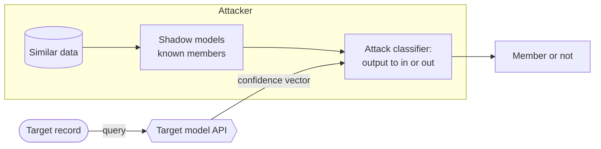

**Reading the diagram.** Everything inside the attacker subgraph runs offline on the attacker's own infrastructure: shadow models trained on similar data whose membership the attacker controls teach an attack classifier what member outputs look like. The only interaction with the victim is a synchronous query to the prediction API, which returns a confidence vector. The failure point on the defender's side is the API returning rich, overconfident outputs from an overfit model. Defenses, in increasing strength: return labels or coarse scores instead of full probabilities, regularize and early-stop, rate-limit and monitor query patterns, and train with differential privacy.

::: formula
**Membership-inference success under (ε, δ)-DP**

$$\text{TPR} \le e^{\varepsilon}\,\text{FPR} + \delta, \qquad \text{advantage} = \text{TPR} - \text{FPR}$$

| Symbol | Meaning | Units |
|---|---|---|
| TPR | Fraction of members the attack correctly identifies | fraction |
| FPR | Fraction of non-members it wrongly calls members | fraction |
| $\varepsilon, \delta$ | Privacy parameters of the training algorithm (§50.11) | dimensionless |
:::

This is the hypothesis-testing reading of differential privacy: no test can distinguish "trained with your record" from "trained without it" much better than chance [Kairouz et al. 2015].

::: example
**Worked example — What ε buys against an attacker.** The attacker tolerates FPR = 0.1% (one wrong accusation per 1,000 non-members), $\delta = 10^{-5}$.

1. $\varepsilon = 0.5$: TPR $\le e^{0.5} \times 0.001 + 0.00001 = 1.649 \times 0.001 + 0.00001 = 0.166\%$.
2. $\varepsilon = 2$: TPR $\le 7.389 \times 0.001 = 0.74\%$.
3. $\varepsilon = 8$: TPR $\le 2{,}981 \times 0.001 = 2.98$, which exceeds 1: no guarantee at this FPR.

**Interpretation.** Small ε makes confident membership claims nearly impossible; at ε = 8 the worst-case bound is vacuous, although empirical attacks on such models usually do far worse than the bound. **Engineering implication.** Report ε alongside an empirical audit (a LiRA-style attack at low FPR) rather than relying on either alone.
:::

::: industry
**QuickBite's chatbot as a privacy risk.** Suppose the support chatbot's 7B model (Ch 65) were further trained on raw support transcripts. Addresses and phone numbers that appear repeatedly in them are exactly what the extraction attack of Carlini et al. recovers. The illustrative mitigations: scrub personal data before training (§63.13), deduplicate repeated sequences, insert random canary strings into the training data and measure whether the model regurgitates them [Carlini et al. 2019], and filter outputs for personal data at serving time.
*Evidence: Illustrative* — attack from [Carlini et al. 2021]
:::

## 71.10 Differential privacy for ML

### 71.10.1 DP-SGD

::: definition
**Definition — DP-SGD.** Stochastic gradient descent in which each example's gradient is clipped to a maximum L2 norm and Gaussian noise calibrated to that norm is added to each minibatch's summed gradient, so that the trained model satisfies $(\varepsilon, \delta)$-differential privacy (§50.11) with respect to adding or removing any one training example [Abadi et al. 2016].
:::

#### First-principles explanation

Recall the Laplace mechanism (§50.11.2): bound how much one person can change an answer (the sensitivity), then add noise of that size. Training is a long sequence of answers, one gradient per step. One example's gradient can be arbitrarily large, so first cap it (clipping sets the sensitivity to $C$), then add noise proportional to $C$ (Gaussian rather than Laplace, which composes better), and keep a ledger of how much privacy each step spends (the **accountant**).

#### How it works internally

1. **Sample** a minibatch: each example joins independently with probability $q = L/N$ (Poisson sampling, which the privacy analysis assumes).
2. **Compute per-example gradients** $g_i$, not the usual batch average; this is the main compute cost (libraries vectorize it).
3. **Clip** each: $\bar{g}_i = g_i / \max(1, \lVert g_i \rVert_2 / C)$.
4. **Add noise** to the sum: $\tilde{g} = \frac{1}{L}\big(\sum_i \bar{g}_i + \mathcal{N}(0, \sigma^2 C^2 I)\big)$, dividing by the *expected* batch size $L$.
5. **Step** $\theta \leftarrow \theta - \eta \tilde{g}$.
6. **Account:** the accountant converts $(q, \sigma, T, \delta)$ into the ε spent so far; training stops when the budget is reached.

**Figure 71.10 — One DP-SGD step and its accountant.**

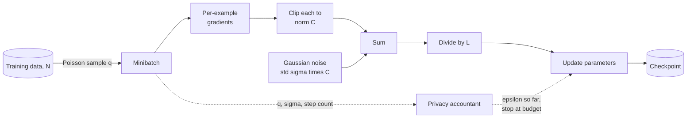

**Reading the diagram.** The solid path is one synchronous training step on an accelerator: sample, per-example gradients, clip, sum, add noise once per batch, average, update. The dotted path is bookkeeping: the accountant needs only the sampling rate, noise multiplier and step count, never the data, and halts training at the budget. Only checkpoints produced by this path inherit the guarantee. Failure points: clipping the batch-averaged gradient (no per-example bound), shuffled fixed-size batches analyzed as if Poisson-sampled, and uncounted hyperparameter tuning on private data. Per-example gradients multiply memory and compute.

::: formula
**Clipping and noise in DP-SGD**

$$\bar{g}_i = \frac{g_i}{\max\!\left(1, \frac{\lVert g_i \rVert_2}{C}\right)}, \qquad \tilde{g} = \frac{1}{L}\Big(\sum_{i \in B} \bar{g}_i + \mathcal{N}(0, \sigma^2 C^2 I_d)\Big), \qquad \frac{\lVert \text{noise} \rVert}{\lVert \text{signal} \rVert} \gtrsim \frac{\sigma C \sqrt{d}/L}{C} = \frac{\sigma\sqrt{d}}{L}$$

| Symbol | Meaning | Units |
|---|---|---|
| $g_i$, $\bar{g}_i$ | Gradient of example $i$; its clipped version | gradient units |
| $C$ | Clipping norm (the per-example sensitivity) | gradient units |
| $\sigma$ | Noise multiplier | dimensionless |
| $L$ | Expected batch size, $qN$ | examples |
| $d$ | Number of parameters | count |
| $\tilde{g}$ | Noisy average gradient used for the update | gradient units |
:::

::: example
**Worked example — Clipping two gradients, then sizing the noise.**

1. $g_1 = (3, 4)$, $\lVert g_1 \rVert = 5$, $C = 1$: $\bar{g}_1 = (0.6, 0.8)$. $g_2 = (0.3, 0.4)$, norm 0.5: unchanged. Sum $(0.9, 1.2)$, norm 1.5.
2. Noise with $\sigma = 1$: each coordinate of the sum gets $\mathcal{N}(0, 1)$, as large as the whole clipped sum. With two examples, the update is mostly noise.
3. QuickBite scale: $N = 10^6$ orders, $L = 1{,}000$ ($q = 0.001$). The averaged signal has norm at most $C = 1$; the noise norm is about $\sigma\sqrt{d}/L$. For a 1,000-parameter model: $\sqrt{1{,}000}/1{,}000 = 0.032$. For a $10^6$-parameter model: $1{,}000/1{,}000 = 1.0$.

**Interpretation.** Noise is fixed per step while signal grows with batch size, and noise grows with $\sqrt{d}$. **Engineering implication.** DP-SGD favors large batches, many examples, few trainable parameters (fine-tune a small head or adapters on top of a model pre-trained on public data) and a clipping norm near the median gradient norm.
:::

### 71.10.2 Privacy accounting, conceptually

Each step is a subsampled Gaussian mechanism. Composing $T$ of them by simple summation (§50.11.3) would give a useless ε. Abadi et al. introduced the **moments accountant**, which tracks the tail of the privacy-loss distribution and shows that DP-SGD is $(\varepsilon, \delta)$-DP when $\sigma \ge c_2\, q\sqrt{T \log(1/\delta)}/\varepsilon$ for constants $c_2$; for $q = 0.01$, $\sigma = 4$, $T = 10{,}000$ and $\delta = 10^{-5}$ they report $\varepsilon \approx 1.26$, against about 9.34 from the strong composition theorem [Abadi et al. 2016]. Modern libraries express the same idea as **Rényi differential privacy** (RDP): each step costs $\varepsilon_{\text{RDP}}(\alpha)$ at order $\alpha$, costs add across steps, and a final conversion yields $(\varepsilon, \delta)$ [Mironov et al. 2019].

::: formula
**RDP composition and conversion**

$$\varepsilon_{\text{total}}(\alpha) = T \cdot \varepsilon_{\text{step}}(\alpha), \qquad \varepsilon = \min_{\alpha > 1}\Big[\varepsilon_{\text{total}}(\alpha) + \frac{\ln(1/\delta)}{\alpha - 1}\Big], \qquad \varepsilon_{\text{step}}(\alpha) = \frac{\alpha}{2\sigma^2}\ \text{if } q = 1$$

| Symbol | Meaning | Units |
|---|---|---|
| $\alpha$ | Rényi order (a free parameter optimized at the end) | dimensionless |
| $\varepsilon_{\text{step}}(\alpha)$ | RDP cost of one step | nats |
| $T$ | Number of steps | count |
| $\delta$ | Failure probability of the $(\varepsilon, \delta)$ guarantee | probability |
:::

::: example
**Worked example — Why sampling matters.** Train for 100 epochs with $\sigma = 4$, $\delta = 10^{-5}$, $\ln(1/\delta) = 11.51$.

1. Full batch ($q = 1$, $T = 100$): $\varepsilon_{\text{total}}(\alpha) = 100\alpha/32 = 3.125\alpha$. At $\alpha = 3$: $9.375 + 11.51/2 = 15.13$, the minimum over integer orders.
2. Minibatches with $q = 0.01$ ($T = 10{,}000$): the subsampled accountant in the code below gives $\varepsilon = 1.26$, matching Abadi et al.

**Interpretation.** Each example is used in only 1% of steps, and the randomness of *whether* it was used hides it further: **privacy amplification by subsampling** cuts ε by about 12× here. **Engineering implication.** Report $(q, \sigma, T, \delta)$ and the accountant used; ε values from different accountants are not comparable.
:::

::: warning
**Warning — Example-level DP is not person-level DP.** A QuickBite customer contributes hundreds of orders. A guarantee about one *order* bounds each customer's exposure only by group privacy, roughly $k\varepsilon$ for $k$ records. For people, bound contributions per user and account at the user level, as DP federated learning does (§71.11).
:::

### 71.10.3 Code example: DP-SGD versus SGD

The program trains logistic regression on a synthetic "late by more than 10 minutes" task with 200 features, with plain minibatch SGD and with DP-SGD at four noise multipliers, on 10,000 and 40,000 examples at the same sampling rate (so the same ε), and computes ε with an RDP accountant for the sampled Gaussian mechanism at integer orders. The accountant is an upper bound and slightly looser than production libraries; treat its ε as approximate.

```python
"""DP-SGD versus SGD for logistic regression, with an approximate RDP accountant."""
import math
import numpy as np

rng = np.random.default_rng(71)
D, EPOCHS, DELTA, Q = 200, 15, 1e-5, 0.0128


def make_data(n, w_true):
    """Synthetic 'will this order be more than 10 minutes late?' task."""
    X = rng.normal(0, 1, (n, D)) / math.sqrt(D)
    y = (rng.random(n) < 1 / (1 + np.exp(-(X @ w_true * 4)))).astype(float)
    return np.c_[X, np.ones(n)], y                      # add a bias column


def train(X, y, epochs, lr, batch, clip=None, sigma=0.0):
    """Poisson-sampled minibatch SGD; with clip/sigma set it is DP-SGD [Abadi et al. 2016]."""
    w, q = np.zeros(X.shape[1]), batch / len(y)
    for _ in range(int(epochs / q)):
        idx = np.flatnonzero(rng.random(len(y)) < q)    # each example joins w.p. q
        p = 1 / (1 + np.exp(-(X[idx] @ w)))
        g = (p - y[idx])[:, None] * X[idx]              # per-example gradients
        if clip is not None:
            norms = np.linalg.norm(g, axis=1, keepdims=True)
            g = g / np.maximum(1.0, norms / clip)       # clip each to L2 norm <= C
            noise = rng.normal(0, sigma * clip, X.shape[1])
            w -= lr * (g.sum(0) + noise) / batch        # divide by EXPECTED batch size
        else:
            w -= lr * g.sum(0) / max(len(idx), 1)
    return w


def log_a(q, sigma, alpha):
    """log A_alpha for the sampled Gaussian mechanism, integer alpha [Mironov et al. 2019]."""
    terms = [math.lgamma(alpha + 1) - math.lgamma(k + 1) - math.lgamma(alpha - k + 1)
             + k * math.log(q) + (alpha - k) * math.log(1 - q) + (k * k - k) / (2 * sigma ** 2)
             for k in range(alpha + 1)]
    m = max(terms)
    return m + math.log(sum(math.exp(t - m) for t in terms))


def epsilon(q, sigma, steps, delta):
    """Compose RDP over steps, convert to (eps, delta); an upper bound, not the tightest."""
    return min(steps * log_a(q, sigma, a) / (a - 1) + math.log(1 / delta) / (a - 1)
               for a in range(2, 257))


w_true = rng.normal(0, 1, D)
Xt, yt = make_data(20_000, w_true)
acc = lambda w: np.mean(((Xt @ w) > 0) == (yt == 1))
steps = int(EPOCHS / Q)
print(f"q={Q}, epochs={EPOCHS}, steps={steps}, C=1.0, delta={DELTA}")
print(f"{'sigma':>6}{'epsilon':>9}{'acc N=10k':>11}{'acc N=40k':>11}")
data = {n: make_data(n, w_true) for n in (10_000, 40_000)}
rows = [(None, None)] + [(s, epsilon(Q, s, steps, DELTA)) for s in (0.6, 1.0, 2.0, 4.0)]
for sigma, eps in rows:
    accs = []
    for n, (X, y) in data.items():
        batch = int(Q * n)                               # same q, so same epsilon
        w = (train(X, y, EPOCHS, 0.5, batch) if sigma is None
             else train(X, y, EPOCHS, 0.5, batch, clip=1.0, sigma=sigma))
        accs.append(acc(w))
    label = "  none" if sigma is None else f"{sigma:>6}"
    eps_s = "     inf" if eps is None else f"{eps:>8.2f}"
    print(f"{label}{eps_s} {accs[0]:>10.3f} {accs[1]:>10.3f}")
print(f"check: q=0.01, sigma=4, 10,000 steps -> epsilon={epsilon(0.01, 4.0, 10_000, DELTA):.2f}")
```

Output:

```text
q=0.0128, epochs=15, steps=1171, C=1.0, delta=1e-05
 sigma  epsilon  acc N=10k  acc N=40k
  none     inf      0.842      0.854
   0.6   14.40      0.840      0.855
   1.0    3.39      0.839      0.854
   2.0    1.19      0.828      0.853
   4.0    0.55      0.789      0.850
check: q=0.01, sigma=4, 10,000 steps -> epsilon=1.26
```

What to notice:

- The accountant reproduces Abadi et al.'s published $\varepsilon \approx 1.26$, a useful test of any accounting code.
- At $\varepsilon \approx 3.4$ the accuracy cost is negligible; at $\varepsilon \approx 0.55$ it is 5.3 points with 10,000 examples but 0.4 points with 40,000. More data is the cheapest way to buy privacy, because the batch grows while noise per step does not.
- Clipping alone biases the gradient even with little noise; tune $C$ on public or synthetic data, since tuning on private data spends budget.
- Production code uses Opacus (PyTorch), TensorFlow Privacy or JAX-based libraries (as of 2026), which vectorize per-example gradients and implement tighter accountants.

Utility costs in published work follow the same pattern: Abadi et al. report MNIST accuracy of about 90%, 95% and 97% at ε of 0.5, 2 and 8 ($\delta = 10^{-5}$), against roughly 98% without privacy [Abadi et al. 2016].

## 71.11 Federated learning

### 71.11.1 FedAvg

::: definition
**Definition — Federated learning (FL).** Training a shared model across many clients (phones, browsers or organizations) that keep their data locally: a server sends the current model, clients compute updates on their own data, and the server aggregates the updates [McMahan et al. 2017].
:::

#### First-principles explanation

Instead of bringing everyone's diaries to one library to study them, you mail each person the questionnaire, they answer at home, and only the tallies come back. Raw data never leaves the device. That is data minimization (§50.8), not a formal guarantee: updates can still leak information, which is why FL is combined with secure aggregation and differential privacy.

#### How it works internally

1. The server selects a fraction $C$ of eligible clients (on Gboard-style deployments: charging, idle, on an unmetered network).
2. Each selected client downloads the global model $w_t$.
3. Each client runs $E$ local epochs of SGD with batch size $B$ on its $n_k$ examples, producing $w^k_{t+1}$.
4. Clients upload updates, ideally through secure aggregation; stragglers past a deadline are dropped.
5. The server averages updates weighted by $n_k$ and starts the next round.

With $E = 1$ and full local batches this is **FedSGD**, one gradient step per round; more local work per round is what lets **FedAvg** cut the number of communication rounds by 10–100× in McMahan et al.'s experiments [McMahan et al. 2017].

**Figure 71.11 — One FedAvg round.**

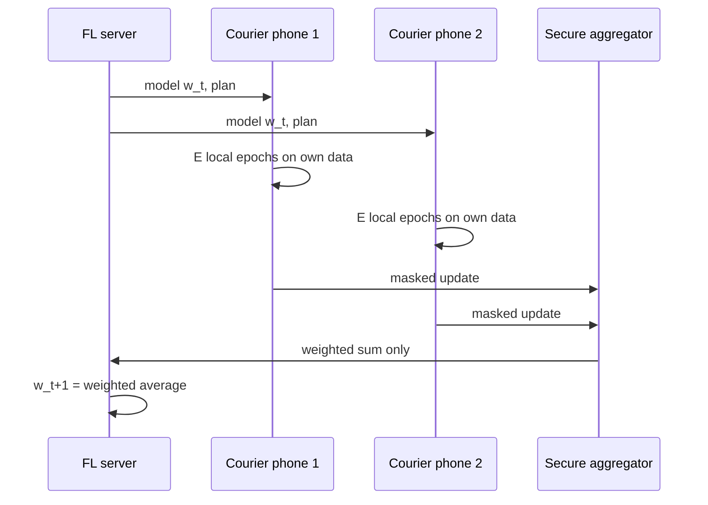

**Reading the diagram.** The server pushes the model and a training plan over HTTPS to selected devices; local training runs on each device, asynchronously and with very different speeds. Devices send masked updates to the aggregation step, which reveals only the sum to the server, and the server forms the next global model. Storage boundaries: raw data stays on the phones; the server stores only global models. Failure points: devices that drop mid-round (secure aggregation must tolerate them), stragglers that delay rounds (over-select and use deadlines) and poisoned updates from malicious clients (clip update norms, use robust aggregation). Scaling is by clients per round, bounded by aggregation cost.

::: formula
**FedAvg update and communication cost**

$$w_{t+1} = \sum_{k \in K_t} \frac{n_k}{n}\, w^{k}_{t+1}, \qquad \text{Bytes}_{\text{round}} = |K_t| \cdot P \cdot (b_{\text{down}} + b_{\text{up}}), \qquad \text{Bytes}_{\text{total}} = R \cdot \text{Bytes}_{\text{round}}$$

| Symbol | Meaning | Units |
|---|---|---|
| $K_t$ | Clients participating in round $t$ | set |
| $n_k$, $n$ | Examples on client $k$; total over $K_t$ | examples |
| $w^{k}_{t+1}$ | Client $k$'s model after local training | parameters |
| $P$ | Model parameters | count |
| $b_{\text{down}}, b_{\text{up}}$ | Bytes per parameter downloaded, uploaded | bytes |
| $R$ | Number of rounds | count |
:::

::: example
**Worked example — Averaging, then sizing the traffic.**

1. Three couriers' phones hold $n = 100, 300, 600$ examples and return a scalar weight $0.50, 0.40, 0.30$. $w_{t+1} = 0.1 \times 0.50 + 0.3 \times 0.40 + 0.6 \times 0.30 = 0.05 + 0.12 + 0.18 = 0.35$.
2. An arrival-detection model with $P = 200{,}000$ parameters in FP32 is 0.8 MB each way. With 1,000 phones per round: $1{,}000 \times 200{,}000 \times 8 = 1.6$ GB per round; for 500 rounds, 800 GB at the server.
3. Each of 50,000 couriers takes part in about $500 \times 1{,}000/50{,}000 = 10$ rounds: 16 MB over the whole training run.
4. Quantizing uploads to 8 bits cuts the upload to 0.2 MB per client; FedSGD needing 10–100× more rounds would multiply all totals by the same factor.

**Interpretation.** Per-device cost is small; the costs that bind are server-side bandwidth and the wall-clock time of hundreds of rounds gated by the slowest devices. **Engineering implication.** Spend local compute to save rounds, compress updates, and keep models small enough for phones.
:::

### 71.11.2 Secure aggregation, non-IID data and systems challenges

Bonawitz et al.'s **secure aggregation** lets the server learn only the sum of client updates. Each pair of clients agrees on a shared random mask; one adds it and the other subtracts it, so masks cancel in the sum, and secret-shared keys let the server remove the masks of clients that drop out [Bonawitz et al. 2017].

::: example
**Worked example — Masks cancel.** Clients hold 5, 7 and 2. Pairwise masks: $s_{12} = 10$, $s_{13} = 4$, $s_{23} = 6$; the lower-numbered client adds, the higher subtracts. Uploads: $y_1 = 5 + 10 + 4 = 19$, $y_2 = 7 - 10 + 6 = 3$, $y_3 = 2 - 4 - 6 = -8$. Sum: $19 + 3 - 8 = 14 = 5 + 7 + 2$. No single upload reveals its value; the real protocol works modulo a large integer so each $y_k$ is uniformly random.
:::

**Figure 71.12 — Pairwise masking in secure aggregation.**

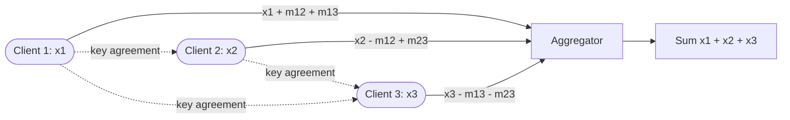

**Reading the diagram.** Dotted edges are the setup phase: each pair derives a shared mask seed by key agreement, relayed through the server but unreadable by it. Solid edges are the upload phase, each carrying a masked vector that looks random on its own. The aggregator adds them and every mask cancels. Failure points: a client that drops after masking (handled by secret-shared seeds recovered from survivors) and a server that colludes with many clients. Cost grows with the number of clients per round, which is why deployments aggregate in groups of hundreds to thousands.

Three further problems dominate deployments. **Non-IID data**: each courier's phone sees one city and schedule, so local models drift toward local optima and the average converges more slowly or to a worse model, mildly for the convex model below and severely for deep networks [Karimireddy et al. 2020]. **Systems heterogeneity**: availability is diurnal and devices differ in speed, so participation is biased toward well-connected, newer phones, a fairness issue in its own right. **Privacy of updates**: updates can be inverted or used for membership inference, so production systems add client-level DP, clipping each client's update and adding noise to the aggregate [McMahan et al. 2018].

::: industry
**Gboard next-word prediction.** Google trained a recurrent language model for next-word prediction in the Gboard keyboard with federated learning on users' phones, and reported better prediction recall than a model trained on server-side data, without exporting users' typing to servers [Hard et al. 2018]. Bonawitz et al. describe the production system: device eligibility (idle, charging, unmetered network), rounds coordinated by servers with over-selection to tolerate dropouts, and secure aggregation [Bonawitz et al. 2019].
*Evidence: Primary* — [Hard et al. 2018]; [Bonawitz et al. 2019]
:::

The program compares FedSGD with FedAvg on IID clients and on non-IID clients whose features are shifted by city.

```python
"""FedSGD versus FedAvg on IID and non-IID clients (NumPy logistic regression)."""
import numpy as np

rng = np.random.default_rng(71)
D, CLIENTS, PER_ROUND = 20, 100, 10
w_true = rng.normal(0, 1, D)


def client_data(n, iid):
    """Courier-phone examples: non-IID clients see a shifted feature region and skewed labels."""
    shift = np.zeros(D) if iid else rng.normal(0, 3.0, D)
    X = rng.normal(shift, 1, (n, D))
    y = (X @ w_true + rng.normal(0, 2, n) > 0).astype(float)    # same concept everywhere
    return np.c_[X, np.ones(n)], y


def local_sgd(w, X, y, epochs, batch, lr=0.05):
    w = w.copy()
    for _ in range(epochs):
        for s in np.array_split(rng.permutation(len(y)), max(1, len(y) // batch)):
            p = 1 / (1 + np.exp(-(X[s] @ w)))
            w -= lr * X[s].T @ (p - y[s]) / len(s)
    return w


def federated(clients, rounds, epochs, batch):
    w = np.zeros(D + 1)
    for _ in range(rounds):
        chosen = rng.choice(len(clients), PER_ROUND, replace=False)
        n = np.array([len(clients[k][1]) for k in chosen])
        updates = [local_sgd(w, *clients[k], epochs, batch) for k in chosen]
        w = sum(nk / n.sum() * wk for nk, wk in zip(n, updates))   # FedAvg: weighted mean
    return w


Xt, yt = client_data(20_000, iid=True)


def test_loss(w):
    p = np.clip(1 / (1 + np.exp(-(Xt @ w))), 1e-9, 1 - 1e-9)
    return -np.mean(yt * np.log(p) + (1 - yt) * np.log(1 - p))


best = test_loss(local_sgd(np.zeros(D + 1), Xt, yt, 30, 50))       # centralized reference
print(f"centralized reference log loss: {best:.3f}")
for iid in (True, False):
    clients = [client_data(int(rng.integers(50, 400)), iid) for _ in range(CLIENTS)]
    for name, E, B in [("FedSGD (1 full-batch step)", 1, 10**9), ("FedAvg E=5, B=10", 5, 10), ("FedAvg E=50, B=10", 50, 10)]:
        res = [test_loss(federated(clients, r, E, B)) for r in (5, 20, 100)]
        print(f"{'IID' if iid else 'non-IID':<8} {name:<27} test log loss after 5/20/100 rounds: "
              + " / ".join(f"{a:.3f}" for a in res))
```

Output:

```text
centralized reference log loss: 0.443
IID      FedSGD (1 full-batch step)  test log loss after 5/20/100 rounds: 0.670 / 0.616 / 0.500
IID      FedAvg E=5, B=10            test log loss after 5/20/100 rounds: 0.447 / 0.446 / 0.447
IID      FedAvg E=50, B=10           test log loss after 5/20/100 rounds: 0.450 / 0.448 / 0.452
non-IID  FedSGD (1 full-batch step)  test log loss after 5/20/100 rounds: 0.625 / 0.557 / 0.484
non-IID  FedAvg E=5, B=10            test log loss after 5/20/100 rounds: 0.465 / 0.448 / 0.452
non-IID  FedAvg E=50, B=10           test log loss after 5/20/100 rounds: 0.463 / 0.469 / 0.470
```

What to notice:

- FedAvg with 5 local epochs reaches the centralized loss (0.443) within a few rounds; FedSGD is still at 0.50 after 100 rounds: local work replaces communication.
- On non-IID clients, many local epochs ($E = 50$) plateau at 0.470: client drift. Fewer local epochs, or drift-correcting methods such as SCAFFOLD, trade communication for accuracy.

## 71.12 Documentation and transparency

Documentation turns the measurements of this chapter into evidence. Four artifacts, each generated as far as possible from pipelines (§63.13):

- **Datasheet** for each training and evaluation dataset: motivation, composition, collection, labeling, and known gaps (§63.13) [Gebru et al. 2021].
- **Model card** for each model version (§59.10.3) [Mitchell et al. 2019], with a fairness section (criterion and why, how groups were derived, per-group metrics with intervals, the trade-off accepted in §71.4.4, mitigations and their cost), the explanation method and background, and privacy parameters $(\varepsilon, \delta, q, \sigma, T)$ with the accountant.
- **System card** for a product that combines several models and rules. A fraud *decision* involves the model, thresholds, review policy and appeals, so its harms belong to the system; OpenAI's GPT-4 system card is an example of the genre for a generative system [OpenAI 2023].
- **Audit log** of decisions: features (or a pointer), model and threshold versions, score, decision, reason codes, reviewer action and appeal outcome, append-only (§69.11.1, §40.4).

**Table 71.4 — What each artifact answers.**

| Artifact | Question it answers | Owner | Updated |
|---|---|---|---|
| Datasheet | What data, collected and labeled how? | Data owner | Each dataset version |
| Model card | What does this model do, for whom, how well per group? | Model owner | Each model version |
| System card | How do models, rules and humans combine into decisions? | Product owner | Each material change |
| Audit log | Why was *this* person treated this way? | Platform | Every decision |

## 71.13 Regulation overview

This is an engineer's map as of 2026, not legal advice.

### 71.13.1 The EU AI Act

Regulation (EU) 2024/1689 sorts AI systems by risk [EU 2024]. It entered into force on 1 August 2024; prohibitions and AI-literacy duties applied from 2 February 2025, and general-purpose AI model obligations from 2 August 2025. High-risk obligations were scheduled for 2 August 2026 (Annex III) and 2 August 2027 (Annex I); the "Digital Omnibus on AI," published in July 2026, postponed them to 2 December 2027 and 2 August 2028 respectively, according to legal commentary (verify against the Official Journal). Fines reach €35 million or 7% of worldwide turnover for prohibited practices.

**Figure 71.13 — EU AI Act risk tiers applied to QuickBite.**

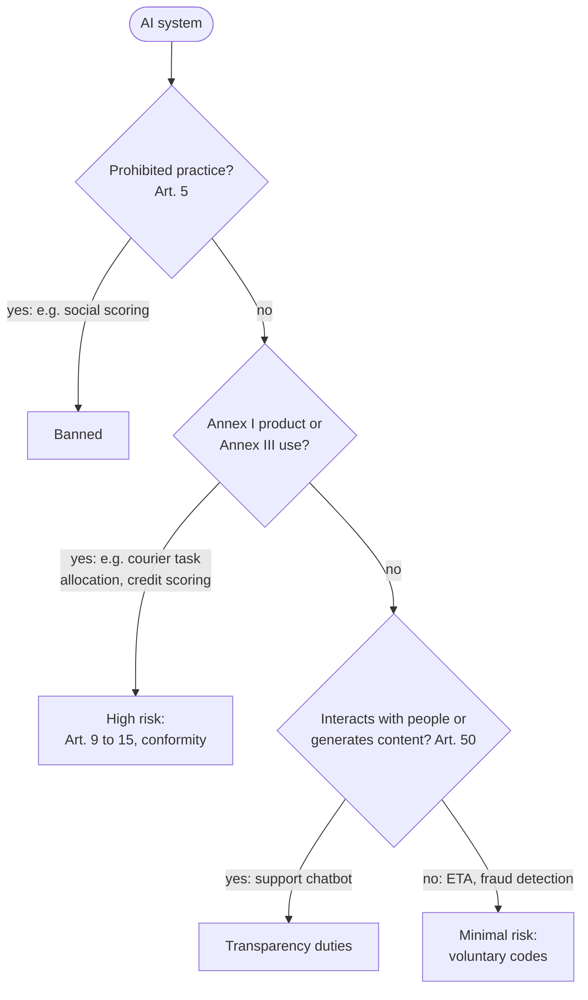

**Reading the diagram.** The questions run top to bottom, once per system and on material change (§71.14). Article 5 practices (social scoring, exploiting vulnerabilities, untargeted facial-image scraping and others) are banned. High-risk systems are safety components of regulated products (Annex I) or listed uses (Annex III), including employment and worker management, such as allocating tasks or monitoring performance, which plausibly covers courier dispatch, and creditworthiness assessment, which explicitly excludes systems used to detect financial fraud. High-risk providers need risk management, data governance including bias examination, technical documentation, automatic logging, information for deployers, human oversight, and accuracy, robustness and cybersecurity (Arts. 9–15), plus conformity assessment and post-market monitoring. A chatbot must tell users they are talking to an AI. The failure point is classification itself: a fraud model that starts setting credit limits changes tier.

### 71.13.2 GDPR and US sectoral rules

**Table 71.5 — Rules that shape ML decisions (not legal advice).**

| Rule | Applies to | Engineering consequence |
|---|---|---|
| GDPR Art. 22 | Decisions based *solely* on automated processing with legal or similarly significant effects | Exceptions (contract, law, explicit consent) still require human intervention, a way to contest, and meaningful information about the logic (Arts. 13–15); the CJEU held in *SCHUFA* (C-634/21, 2023) that a credit score can itself be such a decision |
| GDPR Art. 9 | Special categories (ethnicity, health and others) | Restricts collecting attributes for fairness audits; see AI Act Art. 10(5) |
| ECOA and Regulation B (US) | Credit decisions | Adverse-action notices must state specific principal reasons; the CFPB says complex models are no exception [CFPB 2022] |
| FCRA (US) | Decisions using consumer reports | Adverse-action notices with key factors of credit scores |
| Title VII, four-fifths rule (US) | Employment selection | Disparate-impact screening at selection ratio 0.8 [EEOC 1978] |

For QuickBite, the fraud hold is not a credit decision, but a hold that blocks a customer's orders can be "similarly significant," so manual review with a contest path keeps it from being "solely" automated. Reason codes (§71.8) are the shared mechanism behind Art. 22 information, adverse-action notices and support conversations.

## 71.14 A responsible-ML review process for teams

Reviews work when they are proportionate (tiered like §69.11.2), early (before features are built) and mechanized (checks in the CI gate, not a meeting). **Red-teaming** adds adversarial testing: people outside the team try to make the system fail a group, leak data or produce harmful output, and findings become regression tests (Chapter 78 covers LLM red-teaming).

**Table 71.6 — Review checklist.**

| Stage | Check | Evidence | Sign-off |
|---|---|---|---|
| Problem framing | Harms by type and who bears them; benefit or burden; AI Act tier | Harm map (Figure 71.1) | Product owner |
| Data | Datasheet; group coverage; label bias audit | §63.13, §71.3.2 | Data owner |
| Features | Proxy review; no protected attributes; counterfactual pair tests | CI test results | Model owner |
| Evaluation | All three criteria per group with intervals; chosen criterion and tolerance | §71.5 report | Independent validator (high risk) |
| Mitigation | Method, cost frontier, legal review | §71.6 results | Counsel, risk owner |
| Explanations | Method, background, reason catalog, disclosure policy | §71.8 design | Compliance |
| Privacy | Membership audit; DP parameters or rationale for none | §71.9–§71.10 | Privacy officer |
| Launch | Model card, system card, audit log, appeal path | §71.12 | Review board |
| Operation | Group metrics in monitoring; periodic re-review | §70.9.2 | Model owner |

**Figure 71.14 — The review lifecycle of a high-risk model.**

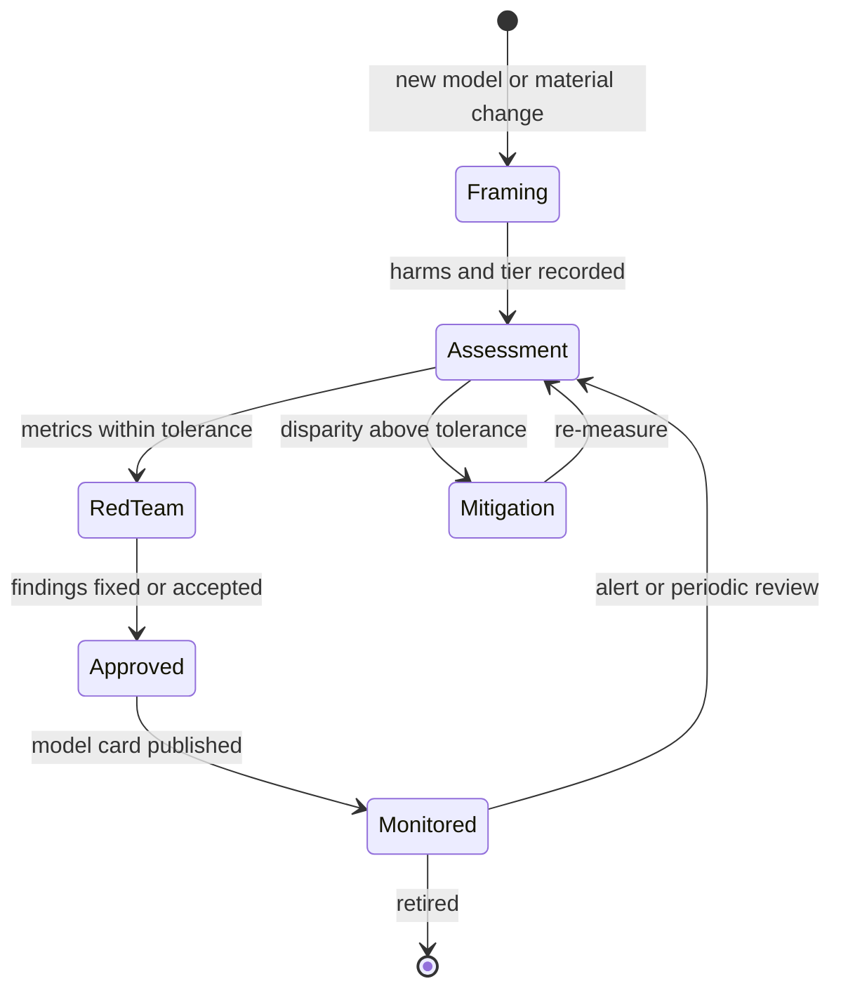

**Reading the diagram.** States are review statuses of one model version in the registry; transitions are gates owned by the sign-offs in Table 71.6. Disparity above tolerance loops through mitigation and re-measurement; red-team findings must be fixed or explicitly accepted by the risk owner before approval. Monitoring feeds back into assessment on a fairness alert or on the periodic review the risk tier prescribes. Failure point: treating approval as the end state, when drift (Chapter 70) changes group metrics after launch. Routine retrains with unchanged features take a lighter path (§69.11.2).

## 71.15 Summary and revision notes

::: summary
- Harms are allocation, quality-of-service or representation; bias enters at every pipeline stage. Unawareness hides disparity without removing it.
- Independence (demographic parity), separation (equalized odds, equal opportunity) and sufficiency (predictive parity, calibration) are built from per-group confusion matrices. Decide first whether the positive decision is a benefit or a burden.
- With unequal base rates, equal PPV and TPR force unequal FPR: $\text{FPR} = \frac{p}{1-p}\cdot\frac{1-\text{PPV}}{\text{PPV}}\cdot\text{TPR}$. Choosing which criterion to give up is a documented policy decision.
- Report intervals; FPR near 0.5% needs about 19,000 negatives for ±0.1 points, so measure groups of zones, not zones. Keep group attributes and proxies in a restricted store.
- Reweighing, constraints and group thresholds redistribute errors at a measurable cost (+3.6% for equal FPR here); thresholds that use protected attributes carry legal risk.
- Shapley values are the unique efficient attribution; exact cost is $2^M$, TreeSHAP is exact in $O(TLD^2)$, sampling explainers are noisy. Explanations describe the model, not causes, and can be gamed.
- Models leak membership and training text; under $(\varepsilon,\delta)$-DP, attack TPR $\le e^{\varepsilon}\,\text{FPR} + \delta$.
- DP-SGD clips per-example gradients to $C$ and adds $\mathcal{N}(0,\sigma^2C^2)$ noise; subsampling amplifies privacy; utility cost falls with more data and fewer parameters.
- FedAvg averages locally trained models weighted by $n_k$, cutting rounds; secure aggregation reveals only sums; non-IID data and stragglers dominate operations.
- Model cards, system cards, datasheets and audit logs are the evidence reviews and regulators ask for.
:::

## 71.16 Knowledge checkpoint

1. Classify a fraud hold, ETA error by city, and cuisine exposure by harm type.
2. Why does removing the protected attribute not remove disparity?
3. For fraud holds, which error rate corresponds to Hardt et al.'s equal opportunity?
4. Compute the DP ratio and FPR ratio for Table 71.1.
5. State Chouldechova's identity and what it implies when base rates differ.
6. How many legitimate orders are needed to estimate a 0.5% FPR to ±0.1 points at 95%?
7. Why do group thresholds need the group at decision time, and why does that matter?
8. Compute $\phi_3$ for $f = 2x_1 + x_2 + 3x_1x_3$ at $(1,1,1)$ with baseline 0.
9. What is the TPR bound for a membership attack at FPR 1% under ε = 1, δ ≈ 0?
10. Why must DP-SGD clip per-example gradients rather than the batch gradient?
11. Compute the FedAvg update for $n = (100, 300, 600)$ and weights $(0.5, 0.4, 0.3)$.
12. Under the EU AI Act, why is QuickBite's fraud detector not high-risk as a credit system, while courier dispatch may be?

<details><summary>Answers</summary>

1. Allocation; quality of service; representation (and allocation of exposure).
2. Proxies (zone, account newness, device) carry the information.
3. Equal FPR among legitimate customers, since "not held" is the advantaged outcome.
4. $0.525/1.40 = 0.375$; $0.757/0.251 = 3.0$.
5. $\text{FPR} = \frac{p}{1-p}\frac{1-\text{PPV}}{\text{PPV}}\text{TPR}$; equal PPV and TPR force FPR proportional to the odds.
6. $3.8416 \times 0.005 \times 0.995/0.001^2 \approx 19{,}100$.
7. Thresholds differ by group; it requires holding or inferring protected attributes online and may be disparate treatment.
8. 1.5.
9. $e^1 \times 0.01 = 2.7\%$.
10. Sensitivity must bound one example's influence; batch clipping does not.
11. $0.05 + 0.12 + 0.18 = 0.35$.
12. Annex III's creditworthiness item excludes fraud detection; task allocation and performance monitoring of workers is listed under employment.

</details>

## 71.17 Interview questions

### Basic

**Q1. What is the difference between demographic parity and equalized odds?** **Answer.** Demographic parity equalizes selection rates regardless of truth; equalized odds equalizes TPR and FPR given the truth. With different base rates, a perfect classifier satisfies equalized odds but not demographic parity.

**Q2. What does a SHAP value mean?** **Answer.** A feature's average marginal contribution to the prediction over all orderings, relative to a background base value; attributions sum to prediction minus base value. It explains the model, not causation.

### Intermediate

**Q3. Your fraud model has equal precision across groups but triple the false-positive rate in one. Is it fair, and what do you do?** **Answer.** Both facts are consistent when base rates differ (Chouldechova). Decide with product and legal teams which harm matters; for burdensome holds, FPR usually does. Investigate proxies and labels first, then evaluate mitigations on a cost frontier, document the choice in the model card and monitor per group with intervals.

**Q4. How would you add explanations to a 40,000-predictions-per-second ETA service?** **Answer.** Do not explain every prediction. Log features and model version; compute TreeSHAP on demand for disputed checkout ETAs, or asynchronously for order-linked predictions; keep global explanations in offline validation.

### Advanced

**Q5. Design training of a model on customer order histories with a formal privacy guarantee.** **Answer.** User-level DP: bound orders per user, sample users with probability $q$, clip per-user updates, add Gaussian noise, account with RDP, pre-train on public or synthetic data and fine-tune few parameters; set ε by policy, audit empirically with membership attacks, and document $(q, \sigma, T, \delta)$ in the model card.

**Q6. Design federated learning for 50,000 courier phones.** **Answer.** Eligibility rules (charging, Wi-Fi), over-selection and deadlines, FedAvg with small $E$ for non-IID data, compressed updates, secure aggregation, client-level DP and update clipping against poisoning, and participation monitoring by phone type and city.

## 71.18 Practical exercises

1. Extend the §71.5.3 program with bootstrap intervals for the FPR *difference* and compare with Wilson intervals per group.
2. Implement reweighing in the §71.6.3 program (pass `sample_weight`) and compare FPR, TPR and cost with threshold adjustment.
3. Run the §71.10.3 program with $C \in \{0.1, 1, 10\}$ at $\sigma = 1$ and explain the accuracy differences.

## 71.19 Design challenges

1. **Courier dispatch fairness.** Define fairness metrics for offered earnings per online hour, design measurement without protected attributes, and propose mitigations compatible with EU AI Act high-risk obligations.
2. **Explainable fraud holds.** Design reason codes, disclosure policy, appeal flow and audit log for 3,500 holds a day, and size the explainer fleet.

## 71.20 References

1. Abadi, M., Chu, A., Goodfellow, I., et al. *Deep Learning with Differential Privacy*. ACM CCS, 2016.
2. Agarwal, A., Beygelzimer, A., Dudík, M., et al. *A Reductions Approach to Fair Classification*. ICML, 2018.
3. Barocas, S., Hardt, M., Narayanan, A. *Fairness and Machine Learning: Limitations and Opportunities*. MIT Press, 2023. https://fairmlbook.org
4. Barocas, S., Selbst, A. D. *Big Data's Disparate Impact*. California Law Review 104, 2016.
5. Bonawitz, K., Ivanov, V., Kreuter, B., et al. *Practical Secure Aggregation for Privacy-Preserving Machine Learning*. ACM CCS, 2017.
6. Bonawitz, K., Eichner, H., Grieskamp, W., et al. *Towards Federated Learning at Scale: System Design*. MLSys, 2019.
7. Breiman, L. *Random Forests*. Machine Learning 45(1), 2001.
8. Buolamwini, J., Gebru, T. *Gender Shades: Intersectional Accuracy Disparities in Commercial Gender Classification*. FAT*, 2018.
9. Carlini, N., Liu, C., Erlingsson, Ú., Kos, J., Song, D. *The Secret Sharer: Evaluating and Testing Unintended Memorization in Neural Networks*. USENIX Security, 2019.
10. Carlini, N., Tramèr, F., Wallace, E., et al. *Extracting Training Data from Large Language Models*. USENIX Security, 2021.
11. Carlini, N., Chien, S., Nasr, M., et al. *Membership Inference Attacks From First Principles*. IEEE S&P, 2022.
12. Consumer Financial Protection Bureau. *Using Publicly Available Information to Proxy for Unidentified Race and Ethnicity*. 2014.
13. Consumer Financial Protection Bureau. *Circular 2022-03: Adverse Action Notification Requirements in Connection with Credit Decisions Based on Complex Algorithms*. 2022.
14. Chen, J., Kallus, N., Mao, X., Svacha, G., Udell, M. *Fairness Under Unawareness: Assessing Disparity When Protected Class Is Unobserved*. FAT*, 2019.
15. Chouldechova, A. *Fair Prediction with Disparate Impact: A Study of Bias in Recidivism Prediction Instruments*. Big Data 5(2), 2017.
16. Crawford, K. *The Trouble with Bias*. NeurIPS keynote, 2017.
17. Dwork, C., Hardt, M., Pitassi, T., Reingold, O., Zemel, R. *Fairness Through Awareness*. ITCS, 2012.
18. EEOC, Civil Service Commission, Department of Labor, Department of Justice. *Uniform Guidelines on Employee Selection Procedures*. 29 CFR Part 1607, 1978.
19. Elliott, M. N., Morrison, P. A., Fremont, A., et al. *Using the Census Bureau's Surname List to Improve Estimates of Race/Ethnicity and Associated Disparities*. Health Services and Outcomes Research Methodology 9(2), 2009.
20. European Union. *Regulation (EU) 2024/1689 laying down harmonised rules on artificial intelligence (Artificial Intelligence Act)*. Official Journal of the EU, 2024.
21. Fairlearn contributors. *Fairlearn User Guide*. n.d. https://fairlearn.org
22. Fredrikson, M., Jha, S., Ristenpart, T. *Model Inversion Attacks that Exploit Confidence Information and Basic Countermeasures*. ACM CCS, 2015.
23. Gebru, T., Morgenstern, J., Vecchione, B., et al. *Datasheets for Datasets*. Communications of the ACM 64(12), 2021.
24. Hard, A., Rao, K., Mathews, R., et al. *Federated Learning for Mobile Keyboard Prediction*. arXiv:1811.03604, 2018.
25. Hardt, M., Price, E., Srebro, N. *Equality of Opportunity in Supervised Learning*. NeurIPS, 2016.
26. Kairouz, P., Oh, S., Viswanath, P. *The Composition Theorem for Differential Privacy*. ICML, 2015.
27. Kamiran, F., Calders, T. *Data Preprocessing Techniques for Classification without Discrimination*. Knowledge and Information Systems 33(1), 2012.
28. Karimireddy, S. P., Kale, S., Mohri, M., et al. *SCAFFOLD: Stochastic Controlled Averaging for Federated Learning*. ICML, 2020.
29. Kleinberg, J., Mullainathan, S., Raghavan, M. *Inherent Trade-Offs in the Fair Determination of Risk Scores*. ITCS, 2017.
30. Lundberg, S. M., Lee, S.-I. *A Unified Approach to Interpreting Model Predictions*. NeurIPS, 2017.
31. Lundberg, S. M., Erion, G., Chen, H., et al. *From Local Explanations to Global Understanding with Explainable AI for Trees*. Nature Machine Intelligence 2, 2020.
32. McMahan, H. B., Moore, E., Ramage, D., Hampson, S., Agüera y Arcas, B. *Communication-Efficient Learning of Deep Networks from Decentralized Data*. AISTATS, 2017.
33. McMahan, H. B., Ramage, D., Talwar, K., Zhang, L. *Learning Differentially Private Recurrent Language Models*. ICLR, 2018.
34. Mironov, I., Talwar, K., Zhang, L. *Rényi Differential Privacy of the Sampled Gaussian Mechanism*. arXiv:1908.10530, 2019.
35. Mitchell, M., Wu, S., Zaldivar, A., et al. *Model Cards for Model Reporting*. FAT*, 2019.
36. Obermeyer, Z., Powers, B., Vogeli, C., Mullainathan, S. *Dissecting Racial Bias in an Algorithm Used to Manage the Health of Populations*. Science 366(6464), 2019.
37. OpenAI. *GPT-4 System Card*. 2023.
38. Ribeiro, M. T., Singh, S., Guestrin, C. *"Why Should I Trust You?": Explaining the Predictions of Any Classifier*. KDD, 2016.
39. Rudin, C. *Stop Explaining Black Box Machine Learning Models for High Stakes Decisions and Use Interpretable Models Instead*. Nature Machine Intelligence 1, 2019.
40. Shokri, R., Stronati, M., Song, C., Shmatikov, V. *Membership Inference Attacks Against Machine Learning Models*. IEEE S&P, 2017.
41. Singh, A., Joachims, T. *Fairness of Exposure in Rankings*. KDD, 2018.
42. Slack, D., Hilgard, S., Jia, E., Singh, S., Lakkaraju, H. *Fooling LIME and SHAP: Adversarial Attacks on Post hoc Explanation Methods*. AIES, 2020.
43. Wachter, S., Mittelstadt, B., Russell, C. *Counterfactual Explanations without Opening the Black Box: Automated Decisions and the GDPR*. Harvard Journal of Law & Technology 31(2), 2018.

## 71.21 Open verification items

- EU AI Act timeline after the Digital Omnibus on AI (reported as Regulation (EU) 2026/1744, in force 27 July 2026): Annex III 2 December 2027, Annex I 2 August 2028, and Article 50 dates; confirm against the Official Journal.
- Abadi et al. (2016): ε ≈ 1.26 versus 9.34 example, and MNIST accuracies of 90/95/97% at ε = 0.5/2/8.
- Carlini et al. (2021): exact count of extracted memorized sequences.
- McMahan et al. (2017): "10–100×" round reduction wording.
- Hard et al. (2018) and Bonawitz et al. (2019): device-eligibility criteria and reported recall gains.
- CJEU *SCHUFA* (C-634/21) holding as summarized; CFPB Circular 2022-03 scope.
