# Chapter 72 — LLM Fundamentals

> **Level:** 3 · **Track:** B (ML/AI) · **Estimated reading time:** 6 h

A large language model (LLM) is, mechanically, a function that reads a list of integers and returns a probability for every possible next integer. "Chat" is that function called again and again, one token at a time, with each answer appended to the input. You do not need to train one, but every number on an LLM serving bill comes from that call: the bytes of weights read per token, the memory each conversation pins, why the first token is slower than the rest, why a 128,000-token context can cost more than the model, and why the same sentence costs three times more in one language than another.

This chapter owns the transformer mechanics a system designer needs. You will build a tokenizer, compute attention by hand and in NumPy, count a transformer's parameters to the last one, see how rotary position embeddings stretch context, and derive the two phases of inference, **prefill** and **decode**, from the roofline of §64.9. The **KV cache** gets a formula and a calculator. Chapter 73 builds its serving architecture directly on the prefill, decode and KV-cache sections here; Chapter 76 covers adaptation and Chapter 75 retrieval-augmented generation.

::: note
**Assumptions used in this chapter.** Units are SI (1 GB = 10⁹ bytes, 1 TB/s = 10¹² bytes/s) unless MiB or GiB is stated; one multiply–add is 2 FLOPs (§58.2). The reference GPU is an NVIDIA H100 SXM: 80 GB of HBM at 3.35 TB/s, 989 TFLOP/s dense BF16, ridge point 295 FLOPs/byte (§64.9, as of 2026). **QuickBite's support chatbot** is the 7B model of §58.11 and §65.9.1: a Llama-2-7B-like shape with $L = 32$ layers, $d = 4{,}096$, 32 attention heads of dimension 128, standard multi-head attention, an MLP width of 11,008 and a 32,000-token vocabulary, 6.74 billion parameters in all (earlier chapters round this to 7B and 14 GB in BF16). The 70B reference shape has $L = 80$, $d = 8{,}192$, 64 query heads and 8 key–value heads (§67). Chatbot traffic: 10,000 support conversations a day (2% of orders, Table 61.1) and up to 200 concurrent conversations at peak (Chapter 64's design challenge). These are teaching assumptions, not measurements of a real company.
:::

## 72.1 Learning objectives

After this chapter you should be able to:

- Compute a sequence's probability, cross-entropy and perplexity under the autoregressive factorization.
- Train BPE by hand and in code, compare tokenizer families, and estimate how tokens per word change cost and latency across languages.
- Implement scaled dot-product attention with a causal mask and explain the $\sqrt{d_k}$ scaling.
- Compute parameters and KV bytes per token for MHA, MQA and GQA, and reproduce a 7B model's parameter count from $12d^2$ per layer.
- Explain sinusoidal, learned and rotary position encodings and context extension.
- Estimate TTFT and TPOT from the arithmetic intensity of prefill and decode, and size the KV cache for any model, context and batch.
- Compare attention and MLP FLOPs as context grows, and implement temperature, top-$k$ and top-$p$ sampling.
- Explain how mixture of experts separates memory from compute, and reconcile FLOPs-per-token conventions with scaling laws.

## 72.2 Prerequisites

- Dot products, matrix multiplication and its cost — §4.9 (attention is three matrix multiplies and a softmax).
- MLPs, embeddings and the transformer preview — §58.3, §58.6, §58.9 (this chapter opens the boxes drawn there).
- FLOPs per token, $2N$ and $6N$ — §58.12 and §65.4 (reconciled with attention in §72.15).
- GPU memory hierarchy, roofline, ridge point and arithmetic intensity — §64.5 and §64.9 (prefill and decode are two points on the roofline).
- Precision formats BF16, FP8, INT8 — §64.10 (bytes per value in every memory formula).
- Mixture-of-experts training and expert parallelism — §65.12.2 (this chapter covers the serving side).
- Softmax and cross-entropy loss — §57.9 (the training objective).

## 72.3 What a language model is

### 72.3.1 Next-token prediction and the autoregressive factorization

::: definition
**Definition — Language model, token and autoregressive model.** A **token** is an integer identifier for a piece of text (a word, part of a word, a punctuation mark or a byte) drawn from a fixed **vocabulary** of size $V$. A **language model** assigns a probability to any sequence of tokens. An **autoregressive** language model does so by predicting each token from the tokens before it, $P(x_t \mid x_1, \ldots, x_{t-1})$, and generates text by sampling one token, appending it to the input, and repeating.
:::

#### First-principles explanation

Think of a phone keyboard's autocomplete, made enormously better. You type "where is my" and it offers "order", "refund", "driver". An LLM does the same over a vocabulary of 32,000 to 256,000 tokens, conditioning on up to hundreds of thousands of previous tokens; "writing a paragraph" is pressing a suggestion a few hundred times in a row. Doing this one task well requires learning a great deal: to continue "the courier left at 12:10 and the trip takes 25 minutes, so the food arrives at", a model must have learned clock arithmetic. Next-token prediction is **self-supervised** (§57.4): every position in every document is a free training example labeled by the following token, so the training set is trillions of tokens.

#### Mathematical foundations

::: formula
**Autoregressive factorization, training loss and perplexity**

$$P(x_1, \ldots, x_T) = \prod_{t=1}^{T} P_\theta(x_t \mid x_{<t}) \qquad \mathcal{L}(\theta) = -\frac{1}{T}\sum_{t=1}^{T} \ln P_\theta(x_t \mid x_{<t}) \qquad \text{PPL} = e^{\mathcal{L}}$$

| Symbol | Meaning | Units |
|---|---|---|
| $x_1, \ldots, x_T$ | A sequence of $T$ token IDs | tokens |
| $x_{<t}$ | All tokens before position $t$ (the **context**) | tokens |
| $P_\theta(x_t \mid x_{<t})$ | Model's probability for the actual next token, with parameters $\theta$ | probability |
| $\mathcal{L}$ | Average cross-entropy (negative log-likelihood) per token | nats/token |
| PPL | **Perplexity**: the effective number of equally likely choices per token | — |
:::

The chain rule of probability makes the first equation exact for *any* distribution; the modeling choice is to compute every factor with the same network. Training minimizes $\mathcal{L}$, the cross-entropy of §57.9 applied at every position; a decoder-only transformer computes all $T$ factors of a training sequence in one parallel forward pass, because a **causal mask** (§72.6) stops position $t$ from seeing $x_t$ and later tokens.

::: example
**Worked example — Scoring "where is my order".** Suppose a model assigns $P(\text{where}) = 0.05$ at the start of a support message, then $P(\text{is} \mid \text{where}) = 0.6$, $P(\text{my} \mid \text{where is}) = 0.4$ and $P(\text{order} \mid \text{where is my}) = 0.5$.

1. Sequence probability: $0.05 \times 0.6 \times 0.4 \times 0.5 = 0.006$.
2. Per-token losses: $-\ln 0.05 = 2.996$, $-\ln 0.6 = 0.511$, $-\ln 0.4 = 0.916$, $-\ln 0.5 = 0.693$; sum 5.116 nats.
3. Average: $\mathcal{L} = 5.116 / 4 = 1.279$ nats/token, or $1.279 / \ln 2 = 1.85$ bits/token.
4. Perplexity: $e^{1.279} = 3.59$.

**Interpretation.** On this snippet the model is, on average, as uncertain as if it were choosing uniformly among 3.6 tokens; the first token, with no context, contributes most of the loss. **Engineering implication.** Perplexity on held-out domain text is the cheapest regression test for a continued pre-training run such as QuickBite's (§65.9.1): if it rises on support transcripts after a retrain, something is wrong with data or training before any human evaluation is needed. It does not measure helpfulness or safety (Chapter 78).
:::

#### How a generation call works

1. **Tokenize** the prompt into IDs (§72.4).
2. **Embed** each ID as a vector of $d$ numbers (§72.5).
3. Pass the vectors through $L$ **transformer blocks** (§72.6–§72.9), each mixing information across positions (attention) and transforming each position (MLP).
4. Project the last position's vector onto the vocabulary to get $V$ scores (**logits**) and turn them into probabilities (§72.5).
5. **Sample** one token (§72.13), append it, and repeat from step 2 for the new token only, reusing cached keys and values for the old ones (§72.11), until a stop condition.

**Figure 72.1 — An LLM generation call, end to end.**

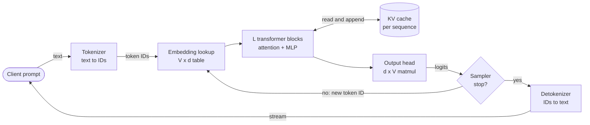

**Reading the diagram.** A CPU-side tokenizer turns text into IDs; everything from the embedding lookup to the output head runs on the GPU. The blocks read and append to the **KV cache**, the per-sequence store of past keys and values in GPU memory (the storage boundary that limits concurrency, §72.11). Unless a stop condition fires, each sampled token loops back, so a 300-token answer is 300 trips around the loop. Arrows are synchronous within a request; the detokenizer streams text back as tokens arrive. Failure points: a mismatched tokenizer, KV-cache exhaustion, runaway generation. Scaling: batch many sequences per trip and shard blocks across GPUs (Chapter 73).

### 72.3.2 Pre-training, then adaptation

A model fresh from next-token prediction on web-scale text is a **base model** (or pre-trained model): it continues documents fluently but does not reliably follow instructions. Turning it into an assistant is **adaptation**: supervised fine-tuning on example conversations, preference optimization such as RLHF or DPO, and often domain-adaptive continued pre-training like QuickBite's 50-billion-token run (§65.9.1). Chapter 76 owns adaptation; here you need only the pipeline's shape, because each stage produces a new set of weights that serving must version, evaluate and roll back as one artifact (Chapter 69).

**Figure 72.2 — From raw text to a served assistant.**

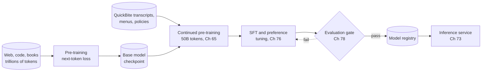

**Reading the diagram.** Data stores (cylinders) feed training stages; each stage reads a checkpoint and writes a new one. Pre-training costs thousands to millions of GPU-hours ($6ND$, §65.4), so QuickBite starts from an open base model and runs only continued pre-training, tuning and an evaluation gate; failure loops back (dotted, asynchronous), success registers the weights for serving. Failure points: evaluation-set contamination, and a tokenizer change between stages, which invalidates every downstream checkpoint (§72.4.6). Scaling: Chapter 65's distributed training.

::: mistake
**"The model knows facts; it looks things up."** A base LLM stores statistical associations in its weights, not records with keys. It produces the most plausible continuation, which is often correct and sometimes confidently wrong. For order status, refunds and policies, QuickBite's chatbot must be given the facts in its context at request time (retrieval and tool calls, Chapters 75 and 77), not trusted to remember them.
:::

## 72.4 Tokenization

### 72.4.1 Why subwords

::: definition
**Definition — Tokenizer.** A **tokenizer** is a deterministic, reversible mapping between text and a sequence of token IDs from a fixed vocabulary. **Subword** tokenizers split rare words into frequent pieces ("refundable" → "refund" + "able") so that any string can be represented with a vocabulary of tens of thousands of entries.
:::

#### First-principles explanation

A model needs a finite alphabet. **Whole words** make the vocabulary unbounded: every new dish name, typo and emoji becomes a useless `<unk>` token. **Characters** or bytes cover everything but make sequences four to five times longer, and every token is a full trip through the model. Subwords sit between: frequent words are one token, rare words a few familiar pieces, nothing is unknown. Sennrich, Haddow and Birch [2016] adapted **byte-pair encoding**, a compression algorithm [Gage 1994], to learn such a vocabulary for machine translation, which until then could not handle names or rare compounds; every major LLM since uses a learned subword tokenizer.

### 72.4.2 Byte-pair encoding

#### How it works internally

Training learns an ordered list of **merges**:

1. Split every word in the training corpus into characters, with an end-of-word marker (`</w>`) so that "est" at the end of a word differs from "est" inside one.
2. Count every adjacent pair of symbols, weighted by word frequency.
3. Merge the most frequent pair everywhere into a new symbol and record the merge.
4. Repeat steps 2–3 until the vocabulary reaches its target size (base symbols + merges).

Encoding new text applies the recorded merges, in the order they were learned, to each word. The vocabulary size is a design choice: more merges mean fewer tokens per word but a larger embedding table and output head (§72.5).

**Figure 72.3 — BPE training loop.**


**Reading the diagram.** Training is an offline batch job over word counts; the loop runs once per merge, tens of thousands of times, appending to the ordered merge list, the storage boundary that with the vocabulary *is* the tokenizer: a versioned artifact of a few megabytes shipped with the model. Failure point: a non-deterministic tie-break, which gives different tokenizers from the same data. Scaling: production trainers update pair counts incrementally.

::: example
**Worked example — Four BPE merges by hand.** Corpus word counts (the toy dictionary in Sennrich et al. [2016]'s reference code): "low" ×5, "lower" ×2, "newest" ×6, "widest" ×3. Initial symbols: `l o w </w>`, `l o w e r </w>`, `n e w e s t </w>`, `w i d e s t </w>`.

1. Count pairs. `e s` appears in "newest" (6) and "widest" (3): 9. `s t` also 9; `t </w>` 9; `l o` and `o w` 7 each (5 + 2); `w e` 8 (lower 2 + newest 6); `n e`, `e w` 6.
2. Merge 1: three pairs tie at 9; a deterministic rule (here, alphabetical order) picks `e s` → `es`. Now "newest" is `n e w es t </w>`.
3. Merge 2: `es t` (9) → `est`. Merge 3: `est </w>` (9) → `est</w>`: a word-final suffix is now one token.
4. Merge 4: `l o` (7) → `lo`; merge 5: `lo w` (7) → `low`.
5. Encode the unseen word "lowest": characters `l o w e s t </w>` → after merges 1–3: `l o w est</w>` → after 4–5: `low est</w>`. Two tokens, both meaningful.

**Interpretation.** BPE discovered the suffix "est" and the stem "low" from counts alone, and handled a word it never saw. **Engineering implication.** The merge list is order-sensitive and tie-sensitive: the tokenizer must be versioned and shipped with the weights, and the serving stack must use exactly the training tokenizer.
:::

#### Code example: a runnable mini-BPE

```python
from collections import Counter

def get_pair_counts(vocab):
    """vocab maps a tuple of symbols (one word) to its corpus frequency."""
    pairs = Counter()
    for symbols, freq in vocab.items():
        for a, b in zip(symbols, symbols[1:]):
            pairs[(a, b)] += freq
    return pairs

def merge_pair(pair, vocab):
    a, b = pair
    out = {}
    for symbols, freq in vocab.items():
        merged, i = [], 0
        while i < len(symbols):
            if i < len(symbols) - 1 and symbols[i] == a and symbols[i + 1] == b:
                merged.append(a + b)
                i += 2
            else:
                merged.append(symbols[i])
                i += 1
        out[tuple(merged)] = freq
    return out

def train_bpe(word_freqs, num_merges, verbose=False):
    vocab = {tuple(w) + ("</w>",): f for w, f in word_freqs.items()}
    merges = []
    for step in range(1, num_merges + 1):
        pairs = get_pair_counts(vocab)
        if not pairs:
            break
        # most frequent pair; ties broken by the lexicographically smallest pair
        best = min(pairs, key=lambda p: (-pairs[p], p))
        if verbose:
            print(f"merge {step}: {best[0]!r} + {best[1]!r} (count {pairs[best]})")
        vocab = merge_pair(best, vocab)
        merges.append(best)
    return merges, vocab

def encode_word(word, merges):
    """Apply learned merges, in the order they were learned, to one word."""
    symbols = list(word) + ["</w>"]
    for a, b in merges:
        i, out = 0, []
        while i < len(symbols):
            if i < len(symbols) - 1 and symbols[i] == a and symbols[i + 1] == b:
                out.append(a + b)
                i += 2
            else:
                out.append(symbols[i])
                i += 1
        symbols = out
    return symbols

def encode(text, merges):
    return [tok for w in text.lower().split() for tok in encode_word(w, merges)]

# Part 1: the worked example (word counts from Sennrich et al. 2016)
toy = {"low": 5, "lower": 2, "newest": 6, "widest": 3}
merges, vocab = train_bpe(toy, 6, verbose=True)
print("segmented corpus:", {" ".join(k): v for k, v in vocab.items()})
print("lowest ->", encode_word("lowest", merges))

# Part 2: train on English support text, then compare tokens per word
english = ("where is my order . my order is late . the courier is late again . "
           "i want a refund for my order . the order arrived cold . "
           "where is the courier . can i get a refund . my food is missing . "
           "the restaurant canceled my order . please refund the delivery fee . ") * 20
word_freqs = Counter(english.split())
merges, _ = train_bpe(word_freqs, 60)
print(f"\nlearned {len(merges)} merges, vocabulary {len(set(''.join(word_freqs))) + 1 + len(merges)} "
      f"symbols; first ten: {[a + b for a, b in merges[:10]]}")

tests = {
    "English": "the courier delivered my order late and cold",
    "Spanish": "donde esta mi reembolso el repartidor llega tarde",
    "German":  "wo ist meine erstattung der kurier ist spaet",
}
for lang, sentence in tests.items():
    toks = encode(sentence, merges)
    n_words = len(sentence.split())
    print(f"{lang:8s} words {n_words:2d}  tokens {len(toks):2d}  "
          f"tokens/word {len(toks) / n_words:.2f}  {toks[:6]}")
```

Output:

```text
merge 1: 'e' + 's' (count 9)
merge 2: 'es' + 't' (count 9)
merge 3: 'est' + '</w>' (count 9)
merge 4: 'l' + 'o' (count 7)
merge 5: 'lo' + 'w' (count 7)
merge 6: 'e' + 'w' (count 6)
segmented corpus: {'low </w>': 5, 'low e r </w>': 2, 'n ew est</w>': 6, 'w i d est</w>': 3}
lowest -> ['low', 'est</w>']

learned 60 merges, vocabulary 82 symbols; first ten: ['e</w>', '.</w>', 'er', 'd</w>', 'er</w>', 'is', 'or', 'y</w>', 'der</w>', 'he</w>']
English  words  8  tokens 12  tokens/word 1.50  ['the</w>', 'courier</w>', 'deli', 'v', 'er', 'ed</w>']
Spanish  words  8  tokens 39  tokens/word 4.88  ['d', 'o', 'n', 'd', 'e</w>', 'e']
German   words  8  tokens 30  tokens/word 3.75  ['w', 'o', '</w>', 'is', 't</w>', 'm']
```

What to notice:

- Merges 1–5 reproduce the hand-worked example; merge 6 is a three-way tie at 6 (`e w`, `n e`, `w est</w>`) resolved by the alphabetical rule. A different rule gives a different tokenizer from the same data.
- Words seen in training ("courier", "order") become single tokens; the unseen "delivered" splits into four familiar pieces. Nothing is unknown.
- The same merges applied to Spanish and German text produce 2.5–3.3 times as many tokens per word as English, because no merges were learned for those languages' letter patterns. Real tokenizers show the same effect, more mildly, for languages underrepresented in their training data (§72.4.5).

### 72.4.3 SentencePiece and the unigram language model

BPE as described pre-splits text on spaces, which fails for Chinese, Japanese and Thai and loses the exact whitespace. **SentencePiece** [Kudo and Richardson 2018] treats input as a raw character stream with the space as an ordinary symbol (`▁`), so tokenization is reversible and language-independent. It offers BPE or the **unigram language model** [Kudo 2018], which runs the other way: start from a large candidate vocabulary, fit a probability to each piece, and prune the pieces whose removal least reduces corpus likelihood; encoding picks the most probable segmentation (Viterbi). Llama 1 and 2 use a 32,000-piece SentencePiece BPE model; T5 a unigram model [Touvron et al. 2023; Raffel et al. 2020]. **WordPiece** (BERT) picks merges by likelihood gain [Schuster and Nakajima 2012; Devlin et al. 2019]. For a system designer all three are a learned, versioned vocabulary of 30,000–260,000 pieces.

### 72.4.4 Byte-level BPE

Character-level BPE still needs a base alphabet, and Unicode has about 150,000 characters. GPT-2 introduced **byte-level BPE**: the base symbols are the 256 possible byte values of UTF-8, so *any* string, including emoji, code and corrupted text, is representable with no unknown token, and merges then build up frequent byte sequences [Radford et al. 2019]. GPT-2's vocabulary has 50,257 entries: 256 bytes, 50,000 merges and one end-of-text token. Llama 3 uses a byte-level BPE vocabulary of 128,256 tokens [Dubey et al. 2024].

The cost of a byte base is visible in UTF-8 itself: ASCII letters take 1 byte, accented Latin letters 2, most Chinese, Japanese and Indic characters 3, and emoji 4.

```python
samples = ["refund", "reembolso", "Rückerstattung", "退款", "रिफंड", "🍜"]
for s in samples:
    b = s.encode("utf-8")
    print(f"{s:>14s}  characters {len(s):2d}  UTF-8 bytes {len(b):2d}  first bytes {list(b[:4])}")
```

Output:

```text
        refund  characters  6  UTF-8 bytes  6  first bytes [114, 101, 102, 117]
     reembolso  characters  9  UTF-8 bytes  9  first bytes [114, 101, 101, 109]
Rückerstattung  characters 14  UTF-8 bytes 15  first bytes [82, 195, 188, 99]
            退款  characters  2  UTF-8 bytes  6  first bytes [233, 128, 128, 230]
         रिफंड  characters  5  UTF-8 bytes 15  first bytes [224, 164, 176, 224]
             🍜  characters  1  UTF-8 bytes  4  first bytes [240, 159, 141, 156]
```

What to notice:

- The Hindi word for "refund" is 5 characters but 15 bytes. If the tokenizer learned few merges for Devanagari, it can cost up to 15 tokens, against 1 for the English word.
- One emoji is 4 bytes; a byte-level tokenizer never fails on it, but may spend several tokens.
- A token boundary can fall *inside* a multi-byte character, so a streaming detokenizer must buffer incomplete UTF-8 sequences before sending text to the client (§72.13).

**Table 72.1 — Tokenization approaches compared.**

| Approach | Base units | How the vocabulary is learned | Unknown tokens | Typical users | Choose when |
|---|---|---|---|---|---|
| Word-level | Words | Most frequent words | Frequent (`<unk>`) | Pre-2016 NLP | Never for LLMs |
| Character / byte | Characters or bytes | None | None | ByT5 [Xue et al. 2022] | Robustness matters more than cost |
| BPE | Characters, pre-split words | Greedy frequent-pair merges | Rare | Original NMT, GPT-1 | Space-delimited text |
| WordPiece | Characters | Merges by likelihood gain | Rare | BERT | Encoder models |
| SentencePiece (BPE or unigram) | Unicode characters, space as `▁` | Merges, or pruning by likelihood | Byte fallback optional | Llama 2, T5 | Multilingual, reversible |
| Byte-level BPE | 256 bytes | Greedy merges over bytes | None | GPT-2 onward, Llama 3 | General-purpose LLMs |

### 72.4.5 Tokens per word: why tokenization sets the bill

Every cost in LLM serving is counted in tokens: prefill compute is proportional to input tokens, decode time to output tokens, KV-cache memory to context tokens (§72.11), and API prices are quoted per million tokens. Words are what users and product managers think in. The conversion factor between them is therefore a capacity-planning input, and it varies with language, domain and tokenizer.

For English prose and GPT-style tokenizers a common rule of thumb is about 0.75 words per token, roughly **1.3 tokens per word** or about 4 characters per token. Code, numbers, URLs and JSON tokenize worse. Larger vocabularies tokenize better: the Llama 3 report gives about 3.94 characters per token on English for its 128K vocabulary against 3.17 for Llama 2's 32K [Dubey et al. 2024], about 20% fewer tokens for the same text. Across languages the spread is much wider: Petrov et al. [2023] measured that the same content can need several times, and for some language–tokenizer pairs more than ten times, as many tokens as in English.

::: formula
**Tokens and token-driven cost**

$$n_\text{tok} = r \cdot n_\text{words} \qquad C_\text{day} = R_\text{conv} \left(n_\text{in}\, p_\text{in} + n_\text{out}\, p_\text{out}\right)$$

| Symbol | Meaning | Units |
|---|---|---|
| $n_\text{tok}$ | Tokens for a text | tokens |
| $r$ | Tokens per word for this language, domain and tokenizer | tokens/word |
| $n_\text{words}$ | Words in the text | words |
| $C_\text{day}$ | Daily inference cost | \$/day |
| $R_\text{conv}$ | Conversations per day | conversations/day |
| $n_\text{in}$, $n_\text{out}$ | Input (prompt) and output tokens per conversation, summed over turns | tokens |
| $p_\text{in}$, $p_\text{out}$ | Cost per input and per output token | \$/token |
:::

::: example
**Worked example — QuickBite's chatbot token budget.** Assumptions: a 1,000-token system prompt (instructions and refund policy) plus 200 tokens of order context injected per conversation; 6 turns; customer messages of 25 words and replies of 60 words; $r = 1.3$ for English. Each turn re-sends the whole conversation so far, because the model is stateless between calls.

1. Per turn: customer $25 \times 1.3 \approx 33$ tokens, reply $60 \times 1.3 = 78$ tokens; one exchange = 111 tokens.
2. Prompt at turn $i$: $1{,}200 + 111(i-1) + 33$. Summed over $i = 1..6$: $6 \times 1{,}233 + 111 \times (0 + 1 + \cdots + 5) = 7{,}398 + 1{,}665 = 9{,}063$ input tokens.
3. Output: $6 \times 78 = 468$ tokens. Context at the end of turn 6: $1{,}200 + 6 \times 111 = 1{,}866$ tokens.
4. Per day: $10{,}000 \times 9{,}063 = 90.6$ million input tokens and 4.7 million output tokens.
5. The same conversation in a language with $r = 2.6$ (twice English, an assumption within the range Petrov et al. report) for the customer and reply text, with the system prompt unchanged: exchange 222 tokens, input $6 \times 1{,}266 + 222 \times 15 = 10{,}926$ tokens (+21%), output 936 tokens (+100%).

**Interpretation.** The input side is dominated by the fixed system prompt re-sent every turn, 79% of input tokens here; output tokens are 5% of the total but, as §72.10 shows, they take most of the wall-clock time, because each one is a full sequential pass. Doubling tokens per word doubles reply latency and output cost for those users. **Engineering implication.** Plan capacity in tokens, measured with the production tokenizer on real traffic per language; cache the shared system-prompt prefix rather than recomputing it every turn (prefix caching, Chapter 73); and check per-language latency as a fairness metric (Chapter 71).
:::

### 72.4.6 The tokenizer in the serving path

**Figure 72.4 — Where the tokenizer sits in an LLM service.**

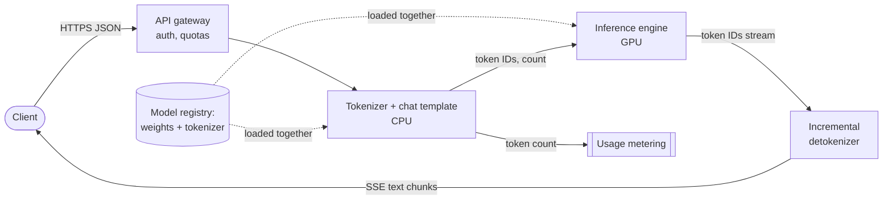

**Reading the diagram.** After authentication, a CPU-side component applies the **chat template** (model-specific special tokens separating system, user and assistant turns) and tokenizes. IDs go synchronously to the GPU engine; token counts go to metering, since quotas and bills are in tokens (Chapter 79). Generated IDs stream back through an incremental detokenizer as server-sent events (§9.5). The registry (storage boundary) loads weights and tokenizer as one versioned unit (dotted, at deploy time). Failure point: a tokenizer or template mismatch, which degrades output with no error. Scaling: tokenizers are stateless and scale horizontally.

**Table 72.2 — Tokenizer failure scenarios.**

| What goes wrong | Why | Detection | Recovery | Prevention |
|---|---|---|---|---|
| Quality drops after a deploy, no errors | Serving tokenizer or chat template differs from training | Golden prompts compared token-by-token | Roll back to the paired tokenizer | Ship tokenizer inside the model artifact; hash check at load |
| Cost and latency far above plan in one market | High tokens per word for that language | Tokens per word by locale dashboard | Shorter prompts, regional model | Measure $r$ per language before launch |
| Prompt injection via special tokens | User text containing `<|endoftext|>`-like strings parsed as control tokens | Red-team tests | Escape or strip | Tokenize user text with special tokens disabled |

::: mistake
**"A token is a word."** In English it is about three-quarters of a word; in other languages, code or JSON it can be a fraction of that. Budgets, rate limits and context windows quoted in words will be wrong by 30% in English and by multiples elsewhere. Always convert with a measured $r$.
:::

## 72.5 Token embeddings and the output head

::: definition
**Definition — Token embedding table, output head and tied embeddings.** The **token embedding table** $E \in \mathbb{R}^{V \times d}$ maps each token ID to a learned vector of width $d$, the model's **hidden size** ($d_\text{model}$). The **output head** (or unembedding, LM head) is a $d \times V$ matrix that turns the final hidden vector into $V$ logits, one per vocabulary entry. **Tied embeddings** reuse $E^\top$ as the output head, so the two share one set of parameters [Press and Wolf 2017].
:::

Embeddings work exactly as in §58.6: a lookup, not a multiply, with sparse gradients. The new piece is the output head, a genuine matrix multiply that must be computed for every *generated* token, followed by a softmax over the whole vocabulary. Larger vocabularies shorten sequences (§72.4.5) but enlarge both matrices.

**Figure 72.5 — Input embedding and output head, untied and tied.**

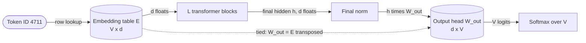

**Reading the diagram.** The embedding table is read (one row per token, a memory gather); the output head is multiplied ($2dV$ FLOPs per token). With tying (dotted), both are one stored matrix; untied, they are two. Both live in GPU memory with the rest of the weights. Failure point: computing logits for *every* prompt position during prefill when only the last is needed, which at $V = 128{,}256$ materializes $4 \times 128{,}256 = 513$ KB of FP32 logits per position, 2.1 GB for a 4,096-token prompt. Scaling: shard the output head by vocabulary columns across GPUs (Chapter 73).

::: formula
**Embedding and output-head parameters and cost**

$$P_\text{emb} = V d \;(\text{tied}) \quad\text{or}\quad 2 V d \;(\text{untied}) \qquad C_\text{head} = 2 V d \ \text{FLOPs per generated token}$$

| Symbol | Meaning | Units |
|---|---|---|
| $P_\text{emb}$ | Parameters in input table and output head | parameters |
| $V$ | Vocabulary size | tokens |
| $d$ | Hidden size $d_\text{model}$ | values |
| $C_\text{head}$ | Output-head FLOPs for one position | FLOPs |
:::

::: example
**Worked example — Three vocabularies.**

1. *GPT-2 small* ($V = 50{,}257$, $d = 768$, tied): $50{,}257 \times 768 = 38.6$ million parameters, 31% of its 124.4 million. Untied it would be 163 million: tying saves a quarter of the model.
2. *QuickBite's 7B* ($V = 32{,}000$, $d = 4{,}096$, untied): $32{,}000 \times 4{,}096 = 131.1$ million per matrix, 262 million in total, 3.9% of 6.74 billion. Head FLOPs: $2 \times 131.1 \times 10^6 = 0.26$ GFLOPs per generated token.
3. *Llama-3-8B shape* ($V = 128{,}256$, $d = 4{,}096$, untied): 525.3 million per matrix, 1.05 billion total, 13% of 8.03 billion. Head FLOPs 1.05 GFLOPs per token, about 7.5% of the model's matrix-multiply FLOPs.

**Interpretation.** Vocabulary size is a parameter-budget decision that matters most for small models: at 1B parameters a 128K vocabulary is a quarter of the model; at 70B it is 3%. **Engineering implication.** A 4× larger vocabulary that cuts tokens per word by 20% (§72.4.5) cuts prefill, decode steps and KV cache by 20% for the same text, at the price of a larger output head and softmax per token; at 7B–8B scale that trade usually pays.
:::

::: mistake
**"Logits come out of the model as probabilities."** The output head produces unnormalized scores. Probabilities need a softmax, and the sampling settings of §72.13 (temperature, top-$p$) act on the logits before or around that softmax. Logging raw logits as "confidence" overstates certainty.
:::

## 72.6 Attention from first principles

### 72.6.1 Queries, keys and values

::: definition
**Definition — Self-attention, query, key, value and causal mask.** In **self-attention** each position $i$ of a sequence computes three vectors from its hidden state $\mathbf{x}_i$ with learned matrices: a **query** $\mathbf{q}_i = \mathbf{x}_i W_Q$ (what this position is looking for), a **key** $\mathbf{k}_i = \mathbf{x}_i W_K$ (what this position offers to be found by) and a **value** $\mathbf{v}_i = \mathbf{x}_i W_V$ (what it hands over if found). Position $i$'s output is an average of all values, weighted by how well its query matches each key. A **causal mask** restricts position $i$ to keys at positions $j \le i$, so the model cannot look at the tokens it is learning to predict [Vaswani et al. 2017].
:::

#### First-principles explanation

§58.9 described attention as a soft hash-table lookup. At a support desk, each earlier message is a folder with a label on its spine (the key) and contents inside (the value). Reading "can I get my money back for that?", the agent forms a question (the query), *what is "that"?*, scores every spine for relevance and reads mostly the best-matching folders. Attention does this for every token in every layer, with labels and questions learned in training: one head finds the noun a pronoun refers to, another the last mention of an order number. Unlike a recurrent network (§58.8), where a fact from 500 tokens ago must survive 500 state updates, attention connects every pair of positions in one parallel step [Vaswani et al. 2017].

#### How it works internally

1. Project: $Q = XW_Q$, $K = XW_K$, $V = XW_V$, each $T \times d_k$ for a sequence of $T$ tokens.
2. Score: $S = QK^\top / \sqrt{d_k}$, a $T \times T$ matrix; entry $(i, j)$ is the scaled dot product of query $i$ with key $j$ (§4.9.2).
3. Mask: set $S_{ij} = -\infty$ for $j > i$.
4. Normalize: softmax each row, so row $i$ is a probability distribution over positions $0..i$; masked entries become exactly 0.
5. Mix: output $= \text{softmax}(S)\,V$, each row a weighted average of value vectors.

**Figure 72.6 — Scaled dot-product attention with a causal mask.**

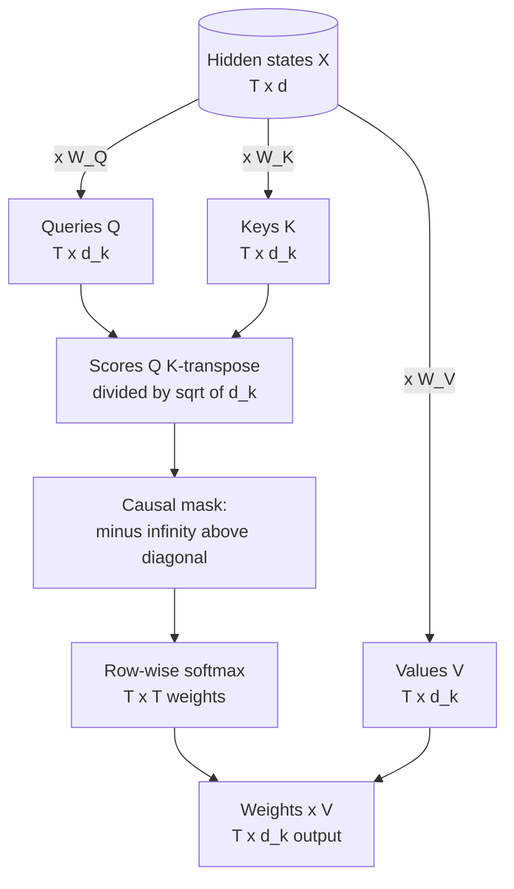

**Reading the diagram.** Three GEMMs project the hidden states into queries, keys and values. The $T \times T$ score matrix is the quadratic object that dominates long contexts (§72.12); mask and softmax are memory-bound elementwise steps unless fused (§64.9.2); a final GEMM blends values. All are synchronous kernels. Storage boundary: keys and values persist between steps as the KV cache (§72.11); scores are transient. Failure points: softmax overflow (subtract the row maximum) and $T^2$ memory if scores are written to HBM, which FlashAttention avoids (§64.13). Scaling: heads shard across GPUs (§72.7).

#### Mathematical foundations

::: formula
**Scaled dot-product attention**

$$\text{Attention}(Q, K, V) = \text{softmax}\!\left(\frac{QK^\top}{\sqrt{d_k}} + M\right) V \qquad \text{softmax}(\mathbf{z})_j = \frac{e^{z_j}}{\sum_{l} e^{z_l}} \qquad M_{ij} = \begin{cases} 0 & j \le i \\ -\infty & j > i \end{cases}$$

| Symbol | Meaning | Units |
|---|---|---|
| $Q, K, V$ | Query, key and value matrices, one row per position | $T \times d_k$ |
| $d_k$ | Head dimension (width of each query and key) | values |
| $M$ | Causal mask added to the scores | — |
| $T$ | Number of positions | tokens |
| $\mathbf{z}$ | One row of scaled, masked scores | — |
:::

Why divide by $\sqrt{d_k}$? If query and key components are independent with mean 0 and variance 1, their dot product is a sum of $d_k$ such products, with variance $d_k$. At $d_k = 128$ scores have a standard deviation of about 11, so the softmax puts almost all weight on one position and its gradients vanish. Dividing by $\sqrt{d_k}$ restores unit variance regardless of head size; the code below measures it.

::: example
**Worked example — One query, three keys, by hand.** $d_k = 2$. Keys: $\mathbf{k}_1 = (1, 0)$ for "order", $\mathbf{k}_2 = (0, 1)$ for "refund", $\mathbf{k}_3 = (1, 1)$ for "late". Scalar values $v = (10, 50, 20)$. Query $\mathbf{q} = (2, 0)$.

1. Dot products: $\mathbf{q} \cdot \mathbf{k}_1 = 2$, $\mathbf{q} \cdot \mathbf{k}_2 = 0$, $\mathbf{q} \cdot \mathbf{k}_3 = 2$.
2. Scale by $1/\sqrt{2}$: $(1.414, 0, 1.414)$.
3. Exponentiate: $e^{1.414} = 4.113$, $e^{0} = 1$; sum $= 9.226$.
4. Weights: $(0.446, 0.108, 0.446)$, summing to 1.
5. Output: $0.446 \times 10 + 0.108 \times 50 + 0.446 \times 20 = 4.46 + 5.42 + 8.92 = 18.8$.
6. FLOP count for a full layer: scores $QK^\top$ cost $2T^2 d_k$ per head and mixing another $2T^2 d_k$; with $h$ heads and $h d_k = d$, attention costs $4T^2 d$ FLOPs per layer (halved if a kernel skips the masked half). For QuickBite's 7B at $T = 4{,}096$: $4 \times 4{,}096^2 \times 4{,}096 = 2.7 \times 10^{11}$ FLOPs per layer.

**Interpretation.** The query matched "order" and "late" equally and mostly ignored "refund"; the output is pulled toward their values. **Engineering implication.** Attention's work grows with $T^2$ while every other layer grows with $T$; step 6 is the seed of the long-context costs in §72.12.
:::

#### Code example: single-head causal attention in NumPy

```python
import numpy as np

def softmax(x, axis=-1):
    x = x - x.max(axis=axis, keepdims=True)        # subtract the row max for stability
    e = np.exp(x)
    return e / e.sum(axis=axis, keepdims=True)

def causal_attention(X, Wq, Wk, Wv):
    """Single-head scaled dot-product self-attention with a causal mask.
    X: (T, d_model). Returns output (T, d_head) and weights (T, T)."""
    Q, K, V = X @ Wq, X @ Wk, X @ Wv               # (T, d_head) each
    d_head = Q.shape[-1]
    scores = Q @ K.T / np.sqrt(d_head)             # (T, T): query i vs key j
    T = X.shape[0]
    future = np.triu(np.ones((T, T), dtype=bool), k=1)   # True where j > i
    scores = np.where(future, -np.inf, scores)     # a token may not see the future
    weights = softmax(scores, axis=-1)             # each row sums to 1
    return weights @ V, weights

rng = np.random.default_rng(0)
T, d_model, d_head = 4, 8, 4                       # 4 tokens, toy sizes
X = rng.normal(size=(T, d_model))                  # token vectors (embeddings)
Wq, Wk, Wv = (rng.normal(size=(d_model, d_head)) / np.sqrt(d_model) for _ in range(3))

out, w = causal_attention(X, Wq, Wk, Wv)
np.set_printoptions(precision=3, suppress=True)
print("attention weights (row = query position, column = key position):")
print(w)
print("row sums:", w.sum(axis=1))
print("output shape:", out.shape)

# Causality check: changing the last token must not change earlier outputs
X2 = X.copy()
X2[3] = rng.normal(size=d_model)
out2, _ = causal_attention(X2, Wq, Wk, Wv)
print("max change in rows 0-2:", np.abs(out2[:3] - out[:3]).max())
print("change in row 3:       ", np.abs(out2[3] - out[3]).max().round(3))

# Why scale by sqrt(d): dot products of random unit-variance vectors grow with d
for d in (4, 64, 128):
    q = rng.normal(size=(10000, d)); k = rng.normal(size=(10000, d))
    dots = (q * k).sum(axis=1)
    print(f"d={d:3d}  std of q.k = {dots.std():6.2f}   after / sqrt(d) = {(dots / np.sqrt(d)).std():.2f}")
```

Output:

```text
attention weights (row = query position, column = key position):
[[1.    0.    0.    0.   ]
 [0.607 0.393 0.    0.   ]
 [0.482 0.161 0.358 0.   ]
 [0.19  0.27  0.236 0.305]]
row sums: [1. 1. 1. 1.]
output shape: (4, 4)
max change in rows 0-2: 0.0
change in row 3:        0.479
d=  4  std of q.k =   2.00   after / sqrt(d) = 1.00
d= 64  std of q.k =   7.98   after / sqrt(d) = 1.00
d=128  std of q.k =  11.30   after / sqrt(d) = 1.00
```

What to notice:

- The weight matrix is lower-triangular: the first token can attend only to itself, the last to all four.
- Changing token 3 leaves outputs 0–2 *exactly* unchanged. This is the property that makes the KV cache correct: once computed, earlier positions' keys and values never change when tokens are appended (§72.11).
- Unscaled dot products grow as $\sqrt{d}$ (2.0, 8.0, 11.3); dividing by $\sqrt{d}$ holds them at 1.

::: mistake
**"Attention weights explain the model's decision."** They show where one of hundreds of heads read from, not why the output was produced; MLPs and residual paths carry information around attention. Use them for debugging intuition, not as an audit trail (Chapter 71).
:::

## 72.7 Multi-head attention, MQA and GQA

### 72.7.1 Multiple heads

::: definition
**Definition — Multi-head, multi-query and grouped-query attention.** **Multi-head attention (MHA)** runs $h$ attention operations in parallel, each with its own query, key and value projections of width $d_h = d/h$, concatenates their outputs and mixes them with an output projection $W_O$ [Vaswani et al. 2017]. **Multi-query attention (MQA)** keeps $h$ query heads but shares a single key head and value head among all of them [Shazeer 2019]. **Grouped-query attention (GQA)** is the middle ground: $h$ query heads share $g$ key–value heads, each serving $h/g$ query heads [Ainslie et al. 2023].
:::

Multiple heads let the model attend to several things at once (syntax, the order number, tone); splitting $d$ into $h$ heads of width $d/h$ costs the same FLOPs as one wide head. MQA and GQA exist for **serving memory**: with MHA the cache holds $2hd_h = 2d$ numbers per token per layer (§72.11). Shazeer [2019] observed that decoding was limited by reading this cache and that one shared K/V head cuts it $h$-fold with a small quality loss. Ainslie et al. [2023] found that a few K/V groups (8 in most large models) recover nearly all of MHA's quality, and that MHA checkpoints can be "uptrained" to GQA with about 5% of the original pre-training compute.

**Figure 72.7 — Sharing key–value heads: MHA, GQA and MQA with 8 query heads.**

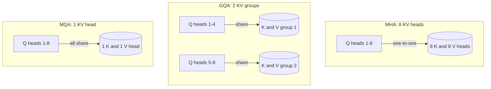

**Reading the diagram.** Each subgraph is one layer with 8 query heads; cylinders are what the KV cache stores per token (8, 2 or 1 K/V pairs), so cache memory and decode bytes fall 4× and 8×, while all variants still compute 8 attention patterns at nearly equal FLOPs. Failure point: too few KV heads lose quality. Scaling: tensor parallelism splits KV heads across GPUs, so 8 KV heads allow at most 8-way splitting without replication (Chapter 73).

::: formula
**Attention parameters and KV bytes per token for $h$ query heads and $g$ KV heads**

$$P_\text{attn} = \underbrace{d \cdot h d_h}_{W_Q} + \underbrace{2\, d \cdot g\, d_h}_{W_K,\, W_V} + \underbrace{h d_h \cdot d}_{W_O} \qquad m_\text{KV} = 2\, g\, d_h\, b \ \text{ bytes per token per layer}$$

| Symbol | Meaning | Units |
|---|---|---|
| $P_\text{attn}$ | Attention parameters in one layer | parameters |
| $d$ | Hidden size | values |
| $h$, $g$ | Query heads; key–value heads ($g = h$ MHA, $g = 1$ MQA, $1 < g < h$ GQA) | heads |
| $d_h$ | Head dimension, usually $d/h$ | values |
| $m_\text{KV}$ | KV-cache bytes per token per layer (2 for K and V) | bytes |
| $b$ | Bytes per cached value (2 for BF16, 1 for FP8) | bytes |
:::

::: example
**Worked example — 32 query heads of 128 at $d = 4{,}096$, BF16.**

1. MHA ($g = 32$): $P_\text{attn} = 4{,}096 \times 4{,}096 \times 4 = 67.1$ million; $m_\text{KV} = 2 \times 32 \times 128 \times 2 = 16{,}384$ bytes per token per layer.
2. GQA ($g = 8$, the Llama-3-8B choice): $P_\text{attn} = 2 \times 16.78\text{M} + 2 \times 4{,}096 \times 1{,}024 = 33.55\text{M} + 8.39\text{M} = 41.9$ million; $m_\text{KV} = 4{,}096$ bytes.
3. MQA ($g = 1$): $P_\text{attn} = 33.55\text{M} + 1.05\text{M} = 34.6$ million; $m_\text{KV} = 512$ bytes.
4. Over 32 layers: 524 KB, 131 KB and 16 KB per token. A QuickBite conversation at its final 1,866 tokens (§72.4.5) pins 0.98 GB, 0.24 GB or 0.03 GB of KV cache.
5. At 200 concurrent conversations: 196 GB with MHA, more than two 80 GB GPUs for cache alone; 49 GB with GQA-8; 6 GB with MQA.

**Interpretation.** GQA-8 saves 38% of attention parameters (about 6% of the whole model) but 75% of KV memory. **Engineering implication.** When choosing an open model to serve, the number of KV heads matters as much as the parameter count: it sets how many concurrent conversations fit on a GPU and how many bytes each decode step reads.
:::

**Table 72.3 — MHA, GQA and MQA compared (32 query heads, $d = 4{,}096$, 32 layers, BF16).**

| Property | MHA | GQA ($g = 8$) | MQA |
|---|---|---|---|
| KV heads per layer | 32 | 8 | 1 |
| KV bytes per token (all layers) | 524 KB | 131 KB | 16 KB |
| Attention parameters per layer | 67.1 M | 41.9 M | 34.6 M |
| Attention FLOPs per token | Same | Same | Same |
| Quality | Reference | Close to MHA [Ainslie et al. 2023] | Some degradation; training can be less stable |
| Tensor-parallel fit | Splits evenly | Up to 8-way without replication | KV replicated on every GPU |
| Used by | Llama 2 7B/13B, GPT-2 | Llama 2 70B, Llama 3, Mistral 7B | PaLM, Falcon-7B |
| Choose when | Small models, short context | Default for serving-oriented models | Extreme memory pressure |

::: industry
**Llama 2 and Llama 3 adopt GQA.** Touvron et al. [2023] used GQA with 8 KV heads for Llama 2's 34B and 70B models, citing inference scalability, while the 7B and 13B models kept MHA. Llama 3 uses GQA with 8 KV heads at every size, including the 8B model [Dubey et al. 2024]. PaLM used multi-query attention, and Pope et al. [2023] showed that its small KV cache allowed much longer contexts and larger decode batches on TPU v4.
*Evidence: Primary* — [Touvron et al. 2023; Dubey et al. 2024; Chowdhery et al. 2022; Pope et al. 2023]
:::

## 72.8 The transformer block

### 72.8.1 Attention, MLP, residuals and normalization

::: definition
**Definition — Transformer block (decoder layer).** One layer of a decoder-only transformer applies, to every position: a normalization, multi-head causal self-attention, and a **residual connection** that adds the attention output back to its input; then a second normalization, a position-wise **feed-forward network** (MLP) and a second residual. **Layer normalization** rescales each vector to zero mean and unit variance with a learned gain and bias [Ba et al. 2016]; **RMSNorm** divides by the root mean square only, without centering or bias [Zhang and Sennrich 2019]. **Pre-norm** places the normalization before each sublayer, inside the residual branch; **post-norm**, the original arrangement, places it after the residual addition [Xiong et al. 2020].
:::

#### First-principles explanation

Picture each token's hidden vector as a whiteboard travelling up the stack, the **residual stream**. Each block reads it, adds a small correction and passes it on, never erasing. In attention a token copies notes from other tokens' whiteboards; in the MLP it thinks privately. Normalization keeps the handwriting a readable size as additions accumulate.

#### How it works internally (pre-norm, Llama style)

1. $\mathbf{a} = \text{RMSNorm}(\mathbf{x})$.
2. $\mathbf{x} \leftarrow \mathbf{x} + W_O\, \text{MHA}(\mathbf{a})$, with RoPE applied to queries and keys (§72.9).
3. $\mathbf{m} = \text{RMSNorm}(\mathbf{x})$.
4. $\mathbf{x} \leftarrow \mathbf{x} + W_\text{down}\left(\text{SiLU}(\mathbf{m}W_\text{gate}) \odot \mathbf{m}W_\text{up}\right)$, the **SwiGLU** MLP [Shazeer 2020]; the classic MLP is $W_2\,\text{GELU}(\mathbf{m}W_1)$ with width $4d$.
5. After the last block, a final RMSNorm and the output head (§72.5).

**Figure 72.8 — Pre-norm decoder block versus the original post-norm block.**

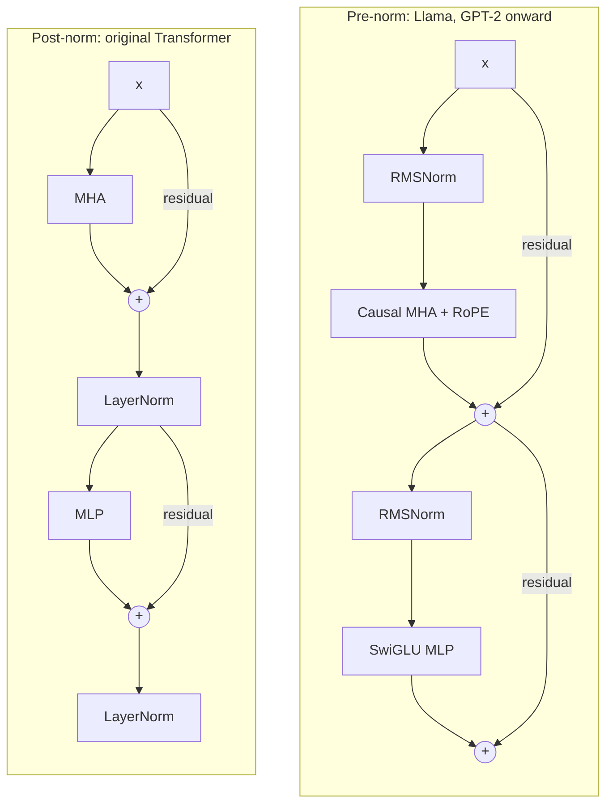

**Reading the diagram.** In pre-norm (left) the residual path contains only additions, a highway through all $L$ layers along which gradients flow undamped. In post-norm (right) every residual sum is normalized, so gradients near the output are large at initialization and training needs careful warm-up [Xiong et al. 2020]. Each sublayer is a few GEMMs plus memory-bound elementwise kernels that compilers fuse (§67.12). Failure point: divergence in deep post-norm stacks. Scaling: repeat the block for depth, grow $d$ for width. Almost every LLM since GPT-2 is pre-norm; RMSNorm drops LayerNorm's centering and bias with equivalent quality in Zhang and Sennrich's experiments, and Llama uses it.

### 72.8.2 Counting parameters: $12d^2$ per layer

::: formula
**Parameters per layer and per model**

$$P_\text{layer} = \underbrace{4d^2}_{\text{attention, MHA}} + \underbrace{2\, d\, d_\text{ff}}_{\text{GELU MLP}} \;\text{or}\; \underbrace{3\, d\, d_\text{ff}}_{\text{SwiGLU}} + O(d) \;\approx\; 12 d^2 \qquad N \approx 12 L d^2 + V d\,(1 \text{ or } 2)$$

| Symbol | Meaning | Units |
|---|---|---|
| $P_\text{layer}$ | Parameters in one block | parameters |
| $d$ | Hidden size | values |
| $d_\text{ff}$ | MLP inner width: $4d$ for GELU; about $\frac{8}{3}d$ for SwiGLU so that $3 d\, d_\text{ff} \approx 8d^2$ | values |
| $O(d)$ | Norm gains and biases, negligible | parameters |
| $L$ | Number of blocks | layers |
| $V d$ | Embedding table, doubled if the output head is untied | parameters |
| $N$ | Total parameters | parameters |
:::

**Derivation.** Attention has four $d \times d$ matrices ($W_Q, W_K, W_V, W_O$): $4d^2$. A GELU MLP has $W_1$ ($d \times 4d$) and $W_2$ ($4d \times d$): $8d^2$. Sum $12d^2$. SwiGLU uses three matrices, so its width is cut to $\frac{8}{3}d$ to keep $3 \times \frac{8}{3} d^2 = 8d^2$. GQA lowers the attention term (§72.7) and models often widen the MLP to compensate.

::: example
**Worked example — QuickBite's 7B, to the last parameter.** $L = 32$, $d = 4{,}096$, MHA, $d_\text{ff} = 11{,}008$ (8/3 × 4,096 = 10,923, rounded up to a multiple of 256), $V = 32{,}000$, untied.

| Component | Shape | Parameters |
|---|---|---|
| $W_Q$, $W_K$, $W_V$, $W_O$ | $4 \times (4{,}096 \times 4{,}096)$ | 67,108,864 |
| $W_\text{gate}$, $W_\text{up}$, $W_\text{down}$ | $3 \times (4{,}096 \times 11{,}008)$ | 135,266,304 |
| Two RMSNorm gains | $2 \times 4{,}096$ | 8,192 |
| **One layer** | | **202,383,360** |
| 32 layers | | 6,476,267,520 |
| Embedding + untied output head | $2 \times 32{,}000 \times 4{,}096$ | 262,144,000 |
| Final RMSNorm | 4,096 | 4,096 |
| **Total** | | **6,738,415,616** |

1. The rule of thumb: $12 \times 32 \times 4{,}096^2 = 6.44 \times 10^9$, within 4.4% of the exact total.
2. The exact total matches the published 6.74B of Llama 2 7B [Touvron et al. 2023].
3. Memory: $6.74 \times 10^9 \times 2 = 13.5$ GB in BF16, 6.7 GB in INT8, about 3.5 GB in INT4 with group scales (§67.6).
4. Two thirds of every layer is MLP: $135.3 / 202.4 = 67\%$.

**Interpretation.** A model's "size" is almost entirely $L$ copies of four attention matrices and three MLP matrices. **Engineering implication.** Given a model card's $L$, $d$, $d_\text{ff}$, heads and vocabulary you can compute its weight memory, FLOPs per token (§72.15) and KV cache (§72.11) before downloading a byte.
:::

#### Code example: a Llama-style decoder layer in PyTorch

```python
import torch
from torch import nn
import torch.nn.functional as F

torch.manual_seed(0)

class RMSNorm(nn.Module):
    def __init__(self, d, eps=1e-5):
        super().__init__()
        self.eps, self.weight = eps, nn.Parameter(torch.ones(d))
    def forward(self, x):                          # no mean subtraction, no bias
        return self.weight * x * torch.rsqrt(x.pow(2).mean(-1, keepdim=True) + self.eps)

def rope(x, base=10000.0):
    """Rotate pairs of dimensions by an angle proportional to position. x: (B, H, T, Dh)."""
    T, Dh = x.shape[-2], x.shape[-1]
    inv_freq = base ** (-torch.arange(0, Dh, 2, dtype=torch.float32) / Dh)   # (Dh/2,)
    ang = torch.arange(T, dtype=torch.float32)[:, None] * inv_freq[None, :]  # (T, Dh/2)
    cos, sin = ang.cos(), ang.sin()
    x1, x2 = x[..., 0::2], x[..., 1::2]
    return torch.stack([x1 * cos - x2 * sin, x1 * sin + x2 * cos], dim=-1).flatten(-2)

class DecoderLayer(nn.Module):
    """Pre-norm Llama-style block: RMSNorm, GQA attention with RoPE, SwiGLU MLP."""
    def __init__(self, d, n_heads, n_kv_heads, d_ff):
        super().__init__()
        self.h, self.kv, self.dh = n_heads, n_kv_heads, d // n_heads
        self.norm1, self.norm2 = RMSNorm(d), RMSNorm(d)
        self.wq = nn.Linear(d, n_heads * self.dh, bias=False)
        self.wk = nn.Linear(d, n_kv_heads * self.dh, bias=False)
        self.wv = nn.Linear(d, n_kv_heads * self.dh, bias=False)
        self.wo = nn.Linear(n_heads * self.dh, d, bias=False)
        self.w_gate = nn.Linear(d, d_ff, bias=False)
        self.w_up = nn.Linear(d, d_ff, bias=False)
        self.w_down = nn.Linear(d_ff, d, bias=False)

    def forward(self, x):                          # x: (B, T, d)
        B, T, _ = x.shape
        a = self.norm1(x)
        q = self.wq(a).view(B, T, self.h, self.dh).transpose(1, 2)
        k = self.wk(a).view(B, T, self.kv, self.dh).transpose(1, 2)
        v = self.wv(a).view(B, T, self.kv, self.dh).transpose(1, 2)
        q, k = rope(q), rope(k)
        rep = self.h // self.kv                    # each KV head serves `rep` query heads
        k, v = k.repeat_interleave(rep, dim=1), v.repeat_interleave(rep, dim=1)
        att = F.scaled_dot_product_attention(q, k, v, is_causal=True)
        x = x + self.wo(att.transpose(1, 2).reshape(B, T, -1))        # residual 1
        m = self.norm2(x)
        return x + self.w_down(F.silu(self.w_gate(m)) * self.w_up(m))  # residual 2

def layer_params(d, n_heads, n_kv_heads, d_ff):
    dh = d // n_heads
    attn = d * n_heads * dh + 2 * d * n_kv_heads * dh + n_heads * dh * d
    return attn + 3 * d * d_ff + 2 * d             # + two RMSNorm weight vectors

# 1. Small layer: count, forward pass, causality
cfg = dict(d=256, n_heads=8, n_kv_heads=2, d_ff=688)
layer = DecoderLayer(**cfg)
n = sum(p.numel() for p in layer.parameters())
print(f"small layer: PyTorch {n:,}  formula {layer_params(**cfg):,}")
x = torch.randn(1, 10, cfg["d"])
y = layer(x)
x2 = x.clone(); x2[0, 9] += 1.0                    # perturb only the last token
y2 = layer(x2)
print("output shape", tuple(y.shape),
      "| max change at positions 0-8:", (y2[0, :9] - y[0, :9]).abs().max().item())

# 2. Full-size layers built on the meta device (shapes only, no memory), then whole models
def model_params(V, L, d, n_heads, n_kv_heads, d_ff, tied=False):
    emb = V * d * (1 if tied else 2)               # input table + separate output head
    return L * layer_params(d, n_heads, n_kv_heads, d_ff) + emb + d   # + final norm

configs = {  # name: (vocabulary, layers, layer shape)
    "Llama-2-7B":  (32000,  32, dict(d=4096, n_heads=32, n_kv_heads=32, d_ff=11008)),
    "Llama-3-8B":  (128256, 32, dict(d=4096, n_heads=32, n_kv_heads=8,  d_ff=14336)),
    "Llama-3-70B": (128256, 80, dict(d=8192, n_heads=64, n_kv_heads=8,  d_ff=28672)),
}
for name, (V, L, c) in configs.items():
    with torch.device("meta"):
        per_layer = sum(p.numel() for p in DecoderLayer(**c).parameters())
    assert per_layer == layer_params(**c)
    print(f"{name:12s} per layer {per_layer:>13,}  12d^2 {12 * c['d'] ** 2:>13,}  "
          f"model {model_params(V, L, **c):>15,}")

# 3. RoPE: the q.k score depends only on the distance between positions
q0, k0 = torch.randn(1, 1, 1, 64), torch.randn(1, 1, 1, 64)
def score_at(m, n, T=32):
    Q = torch.zeros(1, 1, T, 64); K = torch.zeros(1, 1, T, 64)
    Q[0, 0, m], K[0, 0, n] = q0[0, 0, 0], k0[0, 0, 0]
    return (rope(Q)[0, 0, m] @ rope(K)[0, 0, n]).item()
print(f"RoPE score (m=5, n=2): {score_at(5, 2):.5f}   (m=25, n=22): {score_at(25, 22):.5f}"
      f"   (m=25, n=2): {score_at(25, 2):.5f}")
```

Output:

```text
small layer: PyTorch 692,736  formula 692,736
output shape (1, 10, 256) | max change at positions 0-8: 0.0
Llama-2-7B   per layer   202,383,360  12d^2   201,326,592  model   6,738,415,616
Llama-3-8B   per layer   218,112,000  12d^2   201,326,592  model   8,030,261,248
Llama-3-70B  per layer   855,654,400  12d^2   805,306,368  model  70,553,706,496
RoPE score (m=5, n=2): -3.25564   (m=25, n=22): -3.25564   (m=25, n=2): -1.62128
```

What to notice:

- The formula matches PyTorch's count exactly, and the whole-model totals reproduce the published sizes: 6.74B (Llama 2 7B), 8.03B (Llama 3 8B), 70.6B (Llama 3 70B) [Touvron et al. 2023; Dubey et al. 2024].
- Llama 3 8B's extra 1.29 billion parameters over Llama 2 7B come from the 4× vocabulary (+0.79B) and a wider MLP (+1.31B), partly offset by GQA (−0.81B).
- Section 3 previews §72.9: the rotated score depends only on $m - n$.

**Table 72.4 — Published configurations (as of 2026).**

| Model | $N$ | $L$ | $d$ | Query / KV heads | $d_\text{ff}$ | $V$ | Context | Training tokens |
|---|---|---|---|---|---|---|---|---|
| GPT-2 small | 124 M | 12 | 768 | 12 / 12 | 3,072 | 50,257 | 1,024 | ~40 GB of text |
| Llama 2 7B | 6.74 B | 32 | 4,096 | 32 / 32 | 11,008 | 32,000 | 4,096 | 2 T |
| Llama 2 70B | 69.0 B | 80 | 8,192 | 64 / 8 | 28,672 | 32,000 | 4,096 | 2 T |
| Llama 3 8B | 8.03 B | 32 | 4,096 | 32 / 8 | 14,336 | 128,256 | 8,192 (128K in 3.1) | ~15 T |
| Llama 3 70B | 70.6 B | 80 | 8,192 | 64 / 8 | 28,672 | 128,256 | 8,192 (128K in 3.1) | ~15 T |
| Llama 3 405B | 405.9 B | 126 | 16,384 | 128 / 8 | 53,248 | 128,256 | 128K | 15.6 T |

Sources: Radford et al. [2019]; Touvron et al. [2023]; Dubey et al. [2024]. Parameter totals are computed with the formula above and agree with the published sizes.

## 72.9 Positional information

### 72.9.1 Why attention needs positions

Attention is **permutation-invariant**: a weighted sum ignores order, so "the courier blamed the restaurant" and "the restaurant blamed the courier" would look alike. Position must be injected.

::: definition
**Definition — Positional encodings.** **Absolute** encodings add a position-dependent vector to each token embedding: fixed **sinusoids** of geometrically spaced frequencies [Vaswani et al. 2017] or a **learned** table with one row per position (GPT-2: 1,024 rows) [Radford et al. 2019]. **Rotary position embedding (RoPE)** instead rotates each query and key, pair of dimensions by pair, through an angle proportional to the token's position, so that their dot product depends on the *relative* distance between positions [Su et al. 2024]. **ALiBi** adds a distance-proportional penalty to attention scores [Press et al. 2022].
:::

#### First-principles explanation of RoPE

Treat each pair of a query's dimensions as a clock hand that position $m$ turns by $m\theta$. The dot product of two hands depends only on the angle *between* them, so positions (25, 22) see the same offset as (5, 2); the code output above shows identical scores (−3.25564). Pairs turn at different speeds, like second, minute and hour hands: fast ones resolve neighbors, slow ones distant regions.

::: formula
**RoPE angles and wavelengths**

$$\theta_i = \beta^{-2i/d_h}, \quad i = 0, \ldots, \tfrac{d_h}{2} - 1 \qquad \begin{pmatrix} q'_{2i} \\ q'_{2i+1} \end{pmatrix} = \begin{pmatrix} \cos m\theta_i & -\sin m\theta_i \\ \sin m\theta_i & \cos m\theta_i \end{pmatrix} \begin{pmatrix} q_{2i} \\ q_{2i+1} \end{pmatrix} \qquad \lambda_i = \frac{2\pi}{\theta_i}$$

| Symbol | Meaning | Units |
|---|---|---|
| $\theta_i$ | Rotation per position for dimension pair $i$ | radians/token |
| $\beta$ | Base: 10,000 originally; 500,000 in Llama 3 | — |
| $d_h$ | Head dimension | values |
| $m$ | Token position | tokens |
| $q'$ | Rotated query (keys are rotated the same way) | — |
| $\lambda_i$ | Wavelength: tokens per full turn of pair $i$ | tokens |
:::

::: example
**Worked example — How far RoPE can "see".** $d_h = 128$.

1. Fastest pair, $i = 0$: $\theta_0 = 1$ radian per token, $\lambda_0 = 2\pi = 6.3$ tokens.
2. Slowest pair, $i = 63$, base 10,000: $\theta_{63} = 10{,}000^{-126/128} = 1/8{,}660$; $\lambda_{63} = 2\pi \times 8{,}660 = 54{,}400$ tokens.
3. Base 500,000 (Llama 3): $500{,}000^{126/128} = 407{,}000$; $\lambda_{63} = 2.56$ million tokens.
4. **Position interpolation** to stretch a 4,096-token model to 16,384: replace $m$ with $m \times 4{,}096/16{,}384 = m/4$, so the largest position seen, 16,383, rotates like 4,096 did in training [Chen et al. 2023].

**Interpretation.** With base 10,000 the slowest clock hand completes a turn every 54,000 tokens, so positions beyond that alias; raising the base slows every hand and leaves room for 128K contexts. **Engineering implication.** Context length is a property of training, not just of a configuration flag: a model asked to attend beyond the positions it was trained on degrades, often silently. Use models whose stated context was reached by training or validated extension, and test quality at the lengths you serve.
:::

### 72.9.2 Extending the context window

Training at full length from the start is expensive because attention cost is quadratic (§72.12), so most models pre-train at 4K–8K tokens and extend later. **Position interpolation** compresses positions linearly into the trained range and needs a short fine-tune [Chen et al. 2023]. **NTK-aware scaling** and **YaRN** rescale the RoPE frequencies non-uniformly, stretching slow pairs more than fast ones so that local resolution is preserved [Peng et al. 2024]. **Raising the base** and continuing pre-training on progressively longer documents is the approach Llama 3.1 took to reach 128K [Dubey et al. 2024]. **ALiBi** was designed to extrapolate past its training length without any change [Press et al. 2022]. All of these extend the *positions* the model can represent; none removes the memory and compute cost of long contexts, which §72.11–§72.12 quantify.

**Figure 72.9 — Choosing a positional scheme and extending context.**

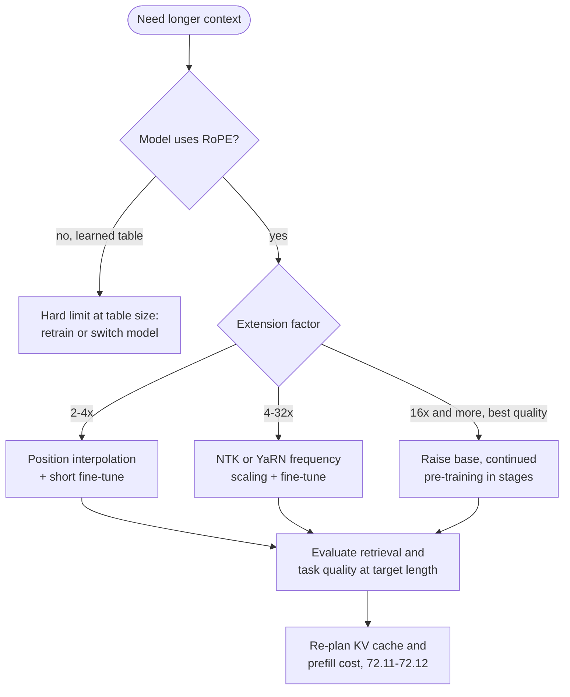

**Reading the diagram.** A design-time decision flow. A learned position table cannot represent positions past its last row; RoPE models can be stretched, with more training for larger factors. Every path ends in evaluation at the target length and a capacity re-plan, since 4× the context is 4× the KV cache per sequence. Failure point: models that accept long inputs but ignore their middle [Liu et al. 2024].

## 72.10 Prefill versus decode

### 72.10.1 Two phases of one request

::: definition
**Definition — Prefill and decode.** **Prefill** processes all $s$ prompt tokens in one forward pass, writes their keys and values into the KV cache, and produces the first output token. **Decode** then generates one token per sequence per forward pass, reading all weights and the whole KV cache each step. Prefill time sets **time to first token (TTFT)**; a decode step sets **time per output token (TPOT)**, also called inter-token latency.
:::

#### First-principles explanation

Prefill is a teacher grading a stack of 2,000 exam papers against one answer key: the key is fetched once and used 2,000 times, so the work is all grading (compute). Decode is grading one paper per trip to the filing room: the whole answer key (14 GB of weights) is fetched for a single paper, so the time is all walking (memory traffic). Batching many conversations' decode steps together is how you grade several papers per trip.

**Figure 72.10 — Prefill and decode on the GPU for one request.**

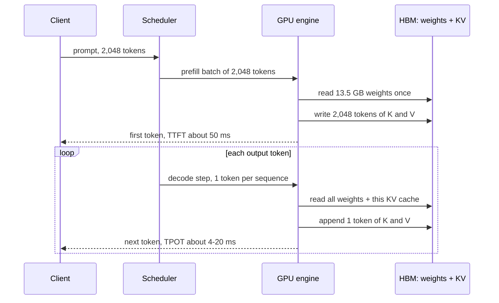

**Reading the diagram.** One prefill reads the weights once for 2,048 tokens and writes their KV entries to HBM, the storage boundary both phases share; tokens stream back asynchronously (dashed). Each decode iteration rereads the 13.5 GB plus the growing cache and appends one entry. Failure points: a long prefill stalls other sequences' decode steps in the same batch; KV growth exhausts memory mid-reply. Scaling: batch decodes, chunk prefills, or separate the phases onto different GPU pools (Chapter 73).

#### Mathematical foundations

::: formula
**Arithmetic intensity and time bounds for prefill and decode**

$$I_\text{prefill} \approx \frac{2 N_m s}{b_w N} \approx s \qquad I_\text{decode} \approx \frac{B \cdot 2 N_m}{b_w N + B\, M_\text{KV}(t)} \qquad t_\text{step} \ge \max\!\left(\frac{W}{F_\text{peak}},\; \frac{b_w N + B\, M_\text{KV}(t)}{BW}\right)$$

| Symbol | Meaning | Units |
|---|---|---|
| $I$ | Arithmetic intensity (§64.9) | FLOPs/byte |
| $N$, $N_m$ | All parameters; parameters used in matrix multiplies ($N$ minus the input table) | parameters |
| $b_w$ | Bytes per weight (2 for BF16) | bytes |
| $s$ | Prompt tokens in the prefill | tokens |
| $B$ | Sequences decoded together (batch) | sequences |
| $M_\text{KV}(t)$ | KV-cache bytes of one sequence at context $t$ (§72.11) | bytes |
| $W$ | FLOPs of the step: $2N_m s$ plus attention for prefill, $B(2N_m + 4Ldt)$ for decode | FLOPs |
| $F_\text{peak}$, $BW$ | Peak FLOP/s and HBM bandwidth | FLOP/s, bytes/s |
| $t_\text{step}$ | Time of one forward pass | s |
:::

::: example
**Worked example — QuickBite's 7B on one H100.** $N = 6.74 \times 10^9$ (13.5 GB BF16), $N_m = 6.61 \times 10^9$, $L = 32$, $d = 4{,}096$, MHA (524 KB KV per token), $F_\text{peak} = 989$ TFLOP/s, $BW = 3.35$ TB/s.

*Prefill, $s = 2{,}048$:*

1. Linear FLOPs: $2 \times 6.61 \times 10^9 \times 2{,}048 = 2.71 \times 10^{13}$; causal attention $2Lds^2 = 2 \times 32 \times 4{,}096 \times 2{,}048^2 = 1.10 \times 10^{12}$; total $2.82 \times 10^{13}$.
2. Bytes: weights 13.5 GB + KV written 1.07 GB = 14.6 GB. $I = 2.82 \times 10^{13} / 1.46 \times 10^{10} = 1{,}930$ FLOPs/byte, far above the ridge of 295: **compute-bound**.
3. Time: compute bound $28.5$ ms at peak; at a realistic 60% of peak, 47.5 ms. The memory bound is only 4.4 ms. TTFT ≈ 50 ms plus queueing.

*Decode at context $t = 2{,}048$:*

4. Batch 1: bytes $13.5 + 1.07 = 14.6$ GB → $t_\text{step} \ge 4.3$ ms, at most 230 tokens/s. FLOPs $1.43 \times 10^{10}$; $I \approx 1$: **memory-bound**, using 0.3% of peak compute.
5. Batch 16: $13.5 + 16 \times 1.07 = 30.7$ GB → 9.2 ms per step, $16 / 0.0092 = 1{,}740$ tokens/s in total, 109 per conversation.
6. Batch 48: $13.5 + 51.5 = 65.0$ GB → 19.4 ms, 2,470 tokens/s; FLOPs $48 \times 1.43 \times 10^{10} = 6.9 \times 10^{11}$, 0.7 ms of compute. $I = 10.6$: still memory-bound, now by the KV cache, which is 79% of the bytes.
7. The same at batch 48 with GQA-8 (Llama-3-8B shape, 16.1 GB weights, 131 KB per token): $16.1 + 48 \times 0.27 = 29.0$ GB → 8.6 ms, about 5,550 tokens/s, 2.2× the MHA model.

**Interpretation.** One prefill token costs about $47.5/2{,}048 = 0.023$ ms of GPU time; one decode token at batch 1 costs 4.3 ms, about 190 times more. Batching raises decode throughput 10× before the KV cache takes over; beyond that only a smaller cache (GQA, FP8 KV) or more bandwidth helps. **Engineering implication.** Plan TTFT from FLOPs and TPOT from bytes. Prefill wants large token batches; decode wants many concurrent sequences and a small KV cache. Chapter 73 builds continuous batching, chunked prefill and disaggregation on these two bounds; Chapter 64's §64.9.2 rounded the batch-1 bound to 4.2 ms with 14 GB.
:::

A key fact hides in step 6: the attention part of decode reads each sequence's own KV cache for only that sequence's query, so its intensity is about $h/g$ FLOPs per byte (1 for MHA, 4 for GQA-8) *regardless of batch size*. Batching amortizes weight reads, never cache reads. Pope et al. [2023] derive the same conclusion and use it to choose partitioning layouts for PaLM inference.

**Table 72.5 — Prefill versus decode.**

| Property | Prefill | Decode |
|---|---|---|
| Tokens per sequence per pass | All $s$ prompt tokens | 1 |
| Main operation | Matrix–matrix (GEMM) | Matrix–vector per sequence (thin GEMM across a batch) |
| Arithmetic intensity | $\approx s$ (hundreds to thousands) | $\approx B$ for weights, $\approx h/g$ for KV |
| Bound | Compute | Memory bandwidth |
| Latency metric | TTFT | TPOT |
| Grows with | Prompt length ($s$, plus $s^2$ attention) | Output length × (weights + KV) bytes |
| Main levers | FP8 compute, prefix caching, chunking | Batching, GQA/MQA, KV quantization, speculative decoding |

::: industry
**PaLM inference partitioning.** Pope et al. [2023] model prefill and decode separately and pick different partitioning layouts for each on TPU v4. Using multi-query attention and INT8 weights they report a 29 ms per-token decode latency at low batch for the 540B PaLM model and 76% model FLOPs utilization for large-batch prefill, with a 2,048-token context: the same split between a bandwidth-bound and a compute-bound phase as the example above.
*Evidence: Primary* — [Pope et al. 2023]
:::

## 72.11 The KV cache

### 72.11.1 What is stored and why

::: definition
**Definition — KV cache.** The **KV cache** stores, for every sequence being generated, the key and value vectors of every past token in every layer and every KV head, so that each decode step computes K and V only for the new token and reuses the rest. Its size grows linearly with context length and with the number of concurrent sequences.
:::

Without the cache, generating token $t$ would recompute keys and values for all $t - 1$ earlier tokens in every layer: quadratic total work for a reply. With it, decode does constant linear-layer work per token. The cache is correct because, under the causal mask, earlier positions' keys and values never depend on later tokens, which the NumPy demo in §72.6 showed and the one below confirms against full recomputation. Queries are not cached: each is used once, by its own token.

```python
import numpy as np

def softmax(x):
    e = np.exp(x - x.max(axis=-1, keepdims=True))
    return e / e.sum(axis=-1, keepdims=True)

rng = np.random.default_rng(0)
T, d_model, d_head = 6, 8, 4
X = rng.normal(size=(T, d_model))
Wq, Wk, Wv = (rng.normal(size=(d_model, d_head)) / np.sqrt(d_model) for _ in range(3))

# (a) Full causal attention over all 6 positions at once (what prefill does)
Q, K, V = X @ Wq, X @ Wk, X @ Wv
S = Q @ K.T / np.sqrt(d_head)
S[np.triu(np.ones((T, T), bool), 1)] = -np.inf
full = softmax(S) @ V

# (b) One token at a time with a KV cache (what decode does)
K_cache, V_cache, rows = np.empty((0, d_head)), np.empty((0, d_head)), []
for t in range(T):
    x = X[t:t + 1]                                  # only the newest token
    K_cache = np.vstack([K_cache, x @ Wk])          # append, never recompute
    V_cache = np.vstack([V_cache, x @ Wv])
    q = x @ Wq
    rows.append(softmax(q @ K_cache.T / np.sqrt(d_head)) @ V_cache)
incremental = np.vstack(rows)
print("max |full - incremental| =", np.abs(full - incremental).max())
print("cache shape after 6 tokens:", K_cache.shape, "per layer per head, for K and again for V")
```

Output:

```text
max |full - incremental| = 2.220446049250313e-16
cache shape after 6 tokens: (6, 4) per layer per head, for K and again for V
```

What to notice: incremental decoding with the cache matches full recomputation to floating-point rounding ($2 \times 10^{-16}$). The cache holds $T \times d_h$ numbers for K and the same for V, per head, per layer: that product is the size formula.

**Figure 72.11 — What occupies an 80 GB GPU serving QuickBite's 7B (MHA, 4,096-token sequences).**

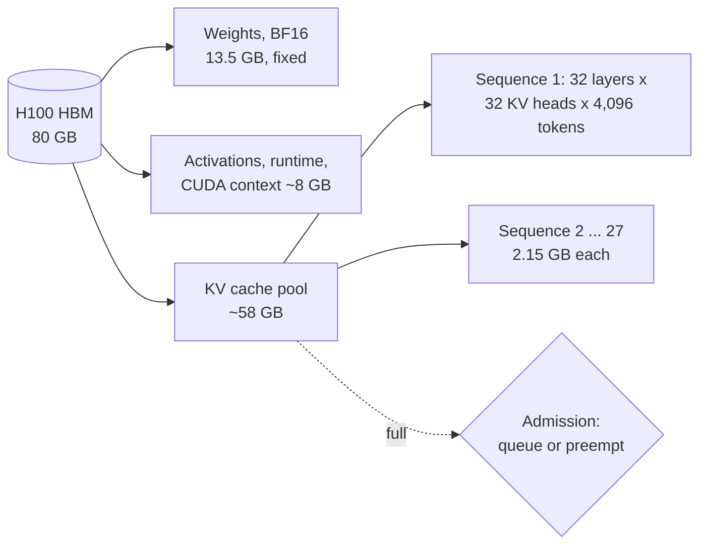

**Reading the diagram.** Memory splits into fixed weights, a small working area and a pool the scheduler hands to sequences as they grow, laid out per layer and KV head, one entry per token. When the pool is full (dotted), new requests queue or a running one is preempted. Failure point: reserving each sequence's maximum length up front wastes the pool, the fragmentation PagedAttention solves with fixed-size blocks [Kwon et al. 2023]. Scaling: GQA, FP8 KV, tensor-parallel sharding, offloading (Chapter 73).

::: formula
**KV-cache size**

$$M_\text{KV} = 2 \times L \times g \times d_h \times b \times t \times B$$

| Symbol | Meaning | Units |
|---|---|---|
| $M_\text{KV}$ | KV-cache memory | bytes |
| 2 | One key and one value vector | — |
| $L$ | Layers | layers |
| $g$ | KV heads per layer ($= h$ for MHA) | heads |
| $d_h$ | Head dimension | values |
| $b$ | Bytes per value (2 BF16, 1 FP8) | bytes |
| $t$ | Tokens in context (prompt plus generated so far) | tokens |
| $B$ | Concurrent sequences | sequences |
:::

::: example
**Worked example — 7B and 70B at 4K and 128K context, BF16.**

1. *7B MHA* ($L = 32$, $g = 32$, $d_h = 128$): per token $2 \times 32 \times 32 \times 128 \times 2 = 524{,}288$ bytes (exactly 0.5 MiB). At 4,096 tokens: $524{,}288 \times 4{,}096 = 2.15$ GB. At 131,072 tokens: 68.7 GB, five times the weights, for one sequence.
2. *8B GQA* ($g = 8$): 131,072 bytes per token; 0.54 GB at 4K, 17.2 GB at 128K.
3. *70B GQA* ($L = 80$, $g = 8$): $2 \times 80 \times 8 \times 128 \times 2 = 327{,}680$ bytes per token; 1.34 GB at 4K, 42.9 GB at 128K.
4. *70B shape if it were MHA* ($g = 64$): 2.62 MB per token; 10.7 GB at 4K, 344 GB at 128K. GQA is what makes 128K contexts servable at all.
5. *Concurrency.* Free memory = GPUs × 80 GB × 0.9 (10% reserve) minus BF16 weights. 7B on 1 GPU: $72 - 13.5 = 58.5$ GB → 27 sequences at 4K, none at 128K. 8B GQA: $72 - 16.1 = 55.9$ GB → 104 at 4K, 3 at 128K. 70B GQA on 4 GPUs: $288 - 141.1 = 146.9$ GB → 109 at 4K, 3 at 128K.

**Interpretation.** For the 7B model at batch 27 and 4K context the cache (58 GB) is more than four times the weights; at 128K one sequence of an MHA 7B does not fit on an 80 GB GPU. **Engineering implication.** In LLM serving the weights are the fixed cost and the KV cache is the variable cost that sets concurrency, throughput and cost per token. Size every deployment as weights + $M_\text{KV}$ at the target batch and context, and prefer GQA models for chat workloads.
:::

#### Code example: KV-cache size and concurrency calculator

```python
def kv_cache_bytes(layers, kv_heads, head_dim, tokens, batch=1, bytes_per_value=2):
    """2 (K and V) x layers x kv_heads x head_dim x bytes x tokens x sequences."""
    return 2 * layers * kv_heads * head_dim * bytes_per_value * tokens * batch

def max_sequences(params, gpus, layers, kv_heads, head_dim, tokens,
                  hbm_per_gpu=80e9, reserve=0.10, weight_bytes=2):
    """Sequences of `tokens` context that fit after BF16 weights and a 10% reserve."""
    free = gpus * hbm_per_gpu * (1 - reserve) - params * weight_bytes
    return max(0, int(free // kv_cache_bytes(layers, kv_heads, head_dim, tokens)))

models = {   # name: (params, layers, kv heads, head_dim, GPUs)
    "7B MHA, Llama-2-7B shape":   (6.74e9, 32, 32, 128, 1),
    "8B GQA, Llama-3-8B shape":   (8.03e9, 32,  8, 128, 1),
    "70B GQA, Llama-3-70B shape": (70.6e9, 80,  8, 128, 4),
    "70B shape if it were MHA":   (70.6e9, 80, 64, 128, 4),
}
print(f"{'model':28s} {'GPUs':>4s} {'KB/tok':>7s} {'4k seq':>8s} {'128k seq':>9s} "
      f"{'fit@4k':>7s} {'fit@128k':>8s}")
for name, (N, L, kvh, hd, g) in models.items():
    print(f"{name:28s} {g:4d} {kv_cache_bytes(L, kvh, hd, 1) / 1e3:7.1f} "
          f"{kv_cache_bytes(L, kvh, hd, 4096) / 1e9:6.2f}GB "
          f"{kv_cache_bytes(L, kvh, hd, 131072) / 1e9:7.1f}GB "
          f"{max_sequences(N, g, L, kvh, hd, 4096):7d} {max_sequences(N, g, L, kvh, hd, 131072):8d}")
```

Output:

```text
model                        GPUs  KB/tok   4k seq  128k seq  fit@4k fit@128k
7B MHA, Llama-2-7B shape        1   524.3   2.15GB    68.7GB      27        0
8B GQA, Llama-3-8B shape        1   131.1   0.54GB    17.2GB     104        3
70B GQA, Llama-3-70B shape      4   327.7   1.34GB    42.9GB     109        3
70B shape if it were MHA        4  2621.4  10.74GB   343.6GB      13        0
```

What to notice:

- The calculator assumes every sequence is at full length; real traffic has a distribution of lengths, and paged allocation (Chapter 73) lets the pool hold more sequences on average.
- FP8 KV ($b = 1$) doubles every "fit" column; the 10% reserve is an assumption to replace with a measured value.
- Chapter 73 extends this calculator with tensor parallelism, paging and prefix sharing.

**Table 72.6 — KV-cache failure scenarios.**

| What goes wrong | Why | Detection | Recovery | Prevention |
|---|---|---|---|---|
| Out-of-memory under load | Concurrency × context exceeds the pool | KV pool utilization metric | Preempt and recompute lowest-priority sequences | Admission control in tokens, not requests |
| Throughput collapses on long prompts | Few long sequences consume the pool | Batch size versus context histogram | Separate long-context pool | Per-tier context limits |
| TPOT grows during a long reply | Each step reads a larger cache | TPOT by output position | Cap output length | GQA model, FP8 KV |
| Wrong or mixed-up output | Cache reused across mismatched prefixes or model versions | Golden-prompt checks | Flush the cache | Key prefix caches by model version and exact token prefix |

::: mistake
**"Serving memory is the model size."** For chat workloads the KV cache usually exceeds the weights. A 7B model "fits on a 24 GB GPU" for one short conversation and runs out of memory at a few concurrent long ones.
:::

## 72.12 Context windows

::: definition
**Definition — Context window.** The **context window** is the maximum number of tokens (prompt plus generated output) a model can attend over in one sequence, set by the positions it was trained or extended to handle (§72.9). Tokens beyond it must be truncated, summarized or retrieved selectively (Chapter 75).
:::

A longer window lets the chatbot see a whole policy manual and a long conversation, but its cost grows on three axes: KV memory grows linearly with $t$ (§72.11); each decode step's attention work grows linearly; and prefill attention grows *quadratically* with prompt length.

::: formula
**Attention versus linear-layer FLOPs as context grows**

$$\frac{C_\text{attn}}{C_\text{lin}}\Big|_\text{decode at } t = \frac{4 t d}{24 d^2} = \frac{t}{6d} \qquad C_\text{prefill}(s) \approx 24 L d^2 s + 2 L d s^2 \qquad \frac{C_\text{attn}}{C_\text{lin}}\Big|_\text{prefill} = \frac{s}{12 d}$$

| Symbol | Meaning | Units |
|---|---|---|
| $C_\text{attn}$, $C_\text{lin}$ | Attention-score FLOPs and linear-layer (projections + MLP) FLOPs | FLOPs |
| $t$ | Context length seen by the new token | tokens |
| $s$ | Prompt length in a causal prefill (average context $s/2$) | tokens |
| $d$, $L$ | Hidden size, layers (linear work $2 \times 12d^2$ per token per layer) | values, layers |
:::

::: example
**Worked example — QuickBite's 7B ($L = 32$, $d = 4{,}096$) from 1K to 1M tokens of prompt.** H100 at 60% of BF16 peak.

**Table 72.7 — Prefill cost versus prompt length.**

| Prompt $s$ | Linear FLOPs | Attention FLOPs | Attention share | Prefill time | Naive score matrix per head per layer |
|---|---|---|---|---|---|
| 1,024 | $1.32 \times 10^{13}$ | $2.7 \times 10^{11}$ | 2% | 23 ms | 2 MB |
| 4,096 | $5.28 \times 10^{13}$ | $4.4 \times 10^{12}$ | 8% | 96 ms | 34 MB |
| 32,768 | $4.22 \times 10^{14}$ | $2.8 \times 10^{14}$ | 40% | 1.2 s | 2.1 GB |
| 131,072 | $1.69 \times 10^{15}$ | $4.5 \times 10^{15}$ | 73% | 10.4 s | 34 GB |
| 1,048,576 | $1.35 \times 10^{16}$ | $2.9 \times 10^{17}$ | 96% | 8.5 min | 2.2 TB |

1. Row 4,096: linear $24 \times 32 \times 4{,}096^2 \times 4{,}096 = 5.28 \times 10^{13}$; attention $2 \times 32 \times 4{,}096 \times 4{,}096^2 = 4.40 \times 10^{12}$; time $5.72 \times 10^{13} / (0.6 \times 989 \times 10^{12}) = 96$ ms.
2. Crossovers: in decode, attention equals linear work at $t = 6d = 24{,}576$ tokens; in prefill at $s = 12d = 49{,}152$.
3. Score matrix column: $s^2 \times 2$ bytes; at 128K, 34 GB *per head per layer* if materialized, which is why fused attention kernels never write it to HBM (§64.13).

**Interpretation.** Below about 10K tokens attention is a minor cost and the model behaves like its $2N$ estimate; at 128K attention dominates and TTFT is ten seconds on one GPU before any queueing. **Engineering implication.** Price long context separately, budget prompts in tokens per section (system, history, retrieved documents, output reserve), and prefer retrieving the relevant 2K tokens over sending 100K (Chapter 75). Long prompts also need chunked prefill so they do not stall other users' decode steps (Chapter 73).
:::

**Figure 72.12 — Budgeting the chatbot's 4,096-token window.**

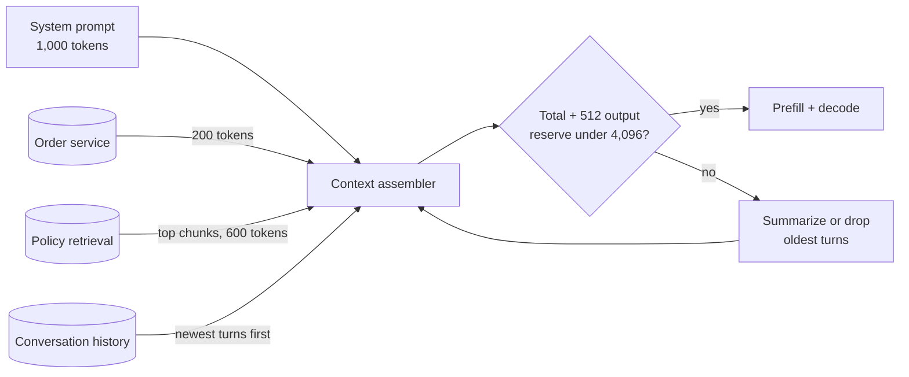

**Reading the diagram.** A stateless assembler builds each prompt from the system prompt, synchronous calls to the order service and policy retrieval, and stored history, then checks the token count (with the model's tokenizer) against the window minus a reply reserve; on failure it summarizes or drops the oldest turns. Failure points: counting words instead of tokens, and dropping the order facts the answer needs.

::: mistake
**"A 128K window means the model uses 128K tokens well."** Models often retrieve facts from the beginning and end of a long context better than from the middle [Liu et al. 2024]. Nominal length is an upper bound; measure accuracy at the position and length your application uses.
:::

::: industry
**Sliding-window attention in Mistral 7B.** Mistral 7B combines GQA with sliding-window attention: each layer attends to only the previous 4,096 tokens, but stacked layers let information propagate further, and the KV cache becomes a fixed-size rolling buffer. The authors report that at a 32K-token sequence this cuts cache memory 8× without hurting quality on their benchmarks [Jiang et al. 2023].
*Evidence: Primary* — [Jiang et al. 2023]
:::

## 72.13 Autoregressive generation and sampling

### 72.13.1 Decoding strategies

::: definition
**Definition — Decoding strategy.** The rule that turns the model's next-token distribution into a chosen token. **Greedy** decoding takes the most probable token. **Temperature** $T$ divides logits by $T$ before the softmax. **Top-$k$** sampling keeps the $k$ most probable tokens [Fan et al. 2018]. **Top-$p$ (nucleus)** sampling keeps the smallest set whose probabilities sum to at least $p$ [Holtzman et al. 2020]. **Beam search** keeps the $W$ highest-probability partial sequences at each step.
:::

Greedy decoding always orders the most popular dish: safe, repetitive, and prone to loops. Temperature sets how adventurous sampling is; top-$k$/top-$p$ remove absurd options from the menu. Holtzman et al. [2020] showed that likelihood maximization yields bland, repetitive open-ended text and that truncating the unreliable tail (nucleus sampling) yields text closer to human statistics.

::: formula
**Temperature softmax and the nucleus**

$$p_i(T) = \frac{e^{z_i / T}}{\sum_j e^{z_j / T}} \qquad V_p = \text{smallest set } S \text{ with } \sum_{i \in S} p_i \ge p \qquad p'_i = \frac{p_i\, \mathbb{1}[i \in V_p]}{\sum_{j \in V_p} p_j}$$

| Symbol | Meaning | Units |
|---|---|---|
| $z_i$ | Logit of token $i$ | — |
| $T$ | Temperature: $T \to 0$ is greedy, $T = 1$ the model's distribution, $T > 1$ flatter | — |
| $V_p$ | Nucleus: most probable tokens covering mass $p$ | tokens |
| $p'_i$ | Renormalized probability used for sampling | probability |
:::

::: example
**Worked example — The chatbot's next word.** Logits for six candidates: refund 3.0, replacement 2.2, voucher 1.8, apology 1.0, callback 0.2, pizza −2.0.

1. $T = 1$: $e^{3.0} = 20.09$, $e^{2.2} = 9.03$, $e^{1.8} = 6.05$, $e^{1.0} = 2.72$, $e^{0.2} = 1.22$, $e^{-2} = 0.14$; sum 39.24. $p(\text{refund}) = 20.09/39.24 = 0.512$.
2. $T = 0.5$: logits doubled; $e^{6} = 403.4$ over a sum of 530.3: $p(\text{refund}) = 0.761$. Lower temperature sharpens.
3. Top-$p = 0.9$ at $T = 1$: cumulative 0.512, 0.742, 0.896, 0.965. The first three reach only 0.896, so four tokens are kept; "callback" and "pizza" are removed and the rest renormalized by 0.965: refund 0.530.

**Interpretation.** Temperature reshapes the whole distribution; top-$p$ adapts the number of candidates to the model's confidence (one token when it is certain, many when it is not). **Engineering implication.** For a support bot that must state policy, use low temperature ($T \le 0.3$) or greedy; for drafting friendly replies, $T \approx 0.7$ with top-$p = 0.9$. Make sampling settings part of the versioned model configuration, since they change behavior as much as a prompt does.
:::

```python
import numpy as np

vocab  = ["refund", "replacement", "voucher", "apology", "callback", "pizza"]
logits = np.array([3.0, 2.2, 1.8, 1.0, 0.2, -2.0])   # model scores for the next token

def softmax(z):
    e = np.exp(z - z.max())
    return e / e.sum()

def next_token_probs(logits, temperature=1.0, top_k=None, top_p=None):
    if temperature == 0:                               # greedy: all mass on the argmax
        p = np.zeros_like(logits); p[np.argmax(logits)] = 1.0
        return p
    p = softmax(logits / temperature)
    if top_k is not None:                              # keep the k most likely tokens
        p[np.argsort(p)[::-1][top_k:]] = 0.0
    if top_p is not None:                              # smallest set with mass >= top_p
        order = np.argsort(p)[::-1]
        cum = np.cumsum(p[order])
        keep = order[: np.searchsorted(cum, top_p) + 1]
        mask = np.zeros_like(p, dtype=bool); mask[keep] = True
        p[~mask] = 0.0
    return p / p.sum()                                 # renormalize what is left

settings = [("greedy", dict(temperature=0)),
            ("T=0.5", dict(temperature=0.5)),
            ("T=1.0", dict(temperature=1.0)),
            ("T=1.5", dict(temperature=1.5)),
            ("T=1, top-k=3", dict(top_k=3)),
            ("T=1, top-p=0.9", dict(top_p=0.9))]
print(f"{'setting':15s}" + "".join(f"{w[:7]:>8s}" for w in vocab) + "   entropy(bits)")
for name, kw in settings:
    p = next_token_probs(logits, **kw)
    nz = p[p > 0]
    H = -(nz * np.log2(nz)).sum() + 0.0              # + 0.0 turns -0.0 into 0.0
    print(f"{name:15s}" + "".join(f"{x:8.3f}" for x in p) + f"   {H:6.2f}")

rng = np.random.default_rng(42)                        # fixed seed => reproducible draws
p = next_token_probs(logits, temperature=1.0, top_p=0.9)
draws = rng.choice(len(vocab), size=10_000, p=p)
counts = np.bincount(draws, minlength=len(vocab))
print("10,000 draws, T=1, top-p=0.9:", dict(zip(vocab, counts.tolist())))
```

Output:

```text
setting          refund replace voucher apology callbac   pizza   entropy(bits)
greedy            1.000   0.000   0.000   0.000   0.000   0.000     0.00
T=0.5             0.761   0.154   0.069   0.014   0.003   0.000     1.09
T=1.0             0.512   0.230   0.154   0.069   0.031   0.003     1.85
T=1.5             0.402   0.236   0.180   0.106   0.062   0.014     2.15
T=1, top-k=3      0.571   0.257   0.172   0.000   0.000   0.000     1.40
T=1, top-p=0.9    0.530   0.238   0.160   0.072   0.000   0.000     1.67
10,000 draws, T=1, top-p=0.9: {'refund': 5335, 'replacement': 2393, 'voucher': 1564, 'apology': 708, 'callback': 0, 'pizza': 0}
```

What to notice: entropy rises with temperature (1.09 → 2.15 bits); truncation sets the tail to exactly zero, so "pizza" can never be sampled; the fixed seed reproduces the same 10,000 draws on every run.

**Figure 72.13 — The per-step sampling pipeline and stop checks.**

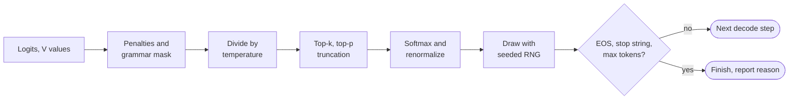

**Reading the diagram.** Each decode step runs this chain per sequence on the GPU. Penalties down-weight repeats; a grammar mask can force valid JSON (Chapter 76). Three **stop conditions** end generation: the end-of-sequence token, a stop string (checked on detokenized text, since it can span tokens), and the max-token limit, which must always be set. Failure point: without it, a looping model holds a slot for thousands of steps.

**Beam search** keeps $W$ hypotheses and multiplies decode compute and KV cache by up to $W$ (the shared prompt prefix is stored once); it suits short, closed-form outputs such as translation, rarely chat. **Determinism**: greedy decoding with a fixed seed is reproducible on one machine with one batch composition, but production servers batch requests dynamically, and floating-point sums computed in different orders for different batch shapes can change a near-tied argmax, so identical requests can diverge. Treat bit-exact reproducibility as a feature you must engineer (fixed batch shapes, deterministic kernels), not a default.

## 72.14 Mixture of experts

::: definition
**Definition — Mixture-of-experts (MoE) layer.** An MoE layer replaces a transformer block's single MLP with $E$ expert MLPs and a learned **router** that sends each token to its top-$k$ experts and mixes their outputs with the router's softmax weights [Shazeer et al. 2017; Fedus et al. 2022]. **Total parameters** count every expert; **active parameters** count only those a token uses.
:::

§65.12.2 covered MoE training and expert parallelism; for serving, the key fact is that MoE separates memory from compute. Every expert must be resident (memory scales with total parameters), but each token does the arithmetic of only $k$ experts (FLOPs scale with active parameters). An auxiliary **load-balancing loss** keeps the router from sending most tokens to a few experts, which would overload their GPUs and waste the rest.

**Figure 72.14 — An MoE block at inference.**

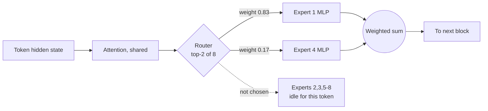

**Reading the diagram.** Attention stays dense; the router sends the token to 2 of 8 expert MLPs (solid) and mixes their outputs; idle experts (dotted) do no work but occupy memory. Across GPUs, dispatch and combine are all-to-all exchanges (§65.12.2). Failure points: a hot expert becomes a straggler; expert weights may not fit. Scaling: more experts add capacity at constant FLOPs per token.

::: formula
**Total and active parameters, and experts touched per decode step**

$$N_\text{total} = N_\text{shared} + L E P_e \qquad N_\text{active} = N_\text{shared} + L k P_e \qquad \mathbb{E}[\text{experts read per layer}] = E\left(1 - (1 - k/E)^{B}\right)$$

| Symbol | Meaning | Units |
|---|---|---|
| $N_\text{shared}$ | Attention, embeddings and norms | parameters |
| $P_e$ | Parameters of one expert MLP | parameters |
| $E$, $k$ | Experts per layer; experts per token | count |
| $L$ | MoE layers | layers |
| $B$ | Tokens in a decode step (batch), assuming uniform routing | tokens |
:::

::: example
**Worked example — A Mixtral-8×7B-shaped model.** $L = 32$, $d = 4{,}096$, GQA-8, $E = 8$, $k = 2$, SwiGLU experts of width 14,336, $V = 32{,}000$ [Jiang et al. 2024].

1. One expert: $3 \times 4{,}096 \times 14{,}336 = 176.2$ million. Attention: $32 \times 41.9\text{M} = 1.34$ billion; embeddings 0.26 billion.
2. Total: $1.34 + 0.26 + 32 \times 8 \times 0.176 = 46.7$ billion; active: $1.60 + 32 \times 2 \times 0.176 = 12.9$ billion.
3. Memory: 93 GB in BF16, two 80 GB GPUs. Compute: $2 \times 12.9 \times 10^9 = 2.6 \times 10^{10}$ FLOPs per token, like a 13B dense model.
4. Decode bytes: at $B = 1$ only 2 of 8 experts per layer are read, about 26 GB per step. At $B = 8$: $8(1 - 0.75^8) = 7.2$ experts; at $B = 16$, 7.9: the step reads nearly all 93 GB.

**Interpretation.** MoE gives roughly 47B-class capacity at 13B-class FLOPs, but at serving batch sizes it reads like a 47B model. **Engineering implication.** MoE suits large, high-throughput fleets where compute-bound prefill and large batches dominate; for small, latency-bound deployments a dense model of the same active size is cheaper in memory.
:::

```python
import numpy as np

rng = np.random.default_rng(0)
T, d, E, k = 4096, 64, 8, 2                      # tokens, width, experts, experts per token
X = rng.normal(size=(T, d)) + 0.5           # inputs share a common direction
W_router = rng.normal(size=(d, E)) * 0.1
W_router[:, 0] += 0.08                           # a bias toward expert 0 (untrained router)

logits = X @ W_router
topk = np.argsort(logits, axis=1)[:, -k:]        # indices of the k highest scores per token
gates = np.take_along_axis(logits, topk, axis=1)
gates = np.exp(gates - gates.max(1, keepdims=True)); gates /= gates.sum(1, keepdims=True)

load = np.bincount(topk.ravel(), minlength=E)    # token-slots sent to each expert
f = load / load.sum()                            # fraction of routed slots per expert
probs = np.exp(logits - logits.max(1, keepdims=True)); probs /= probs.sum(1, keepdims=True)
P = probs.mean(0)                                # mean router probability per expert
aux = E * np.sum(f * P)                          # Switch-style balance loss (1.0 = balanced)
print("tokens per expert:", load.tolist())
print(f"busiest / average = {load.max() / load.mean():.2f}   balance loss = {aux:.3f}")
print("first token -> experts", topk[0].tolist(), "with weights", gates[0].round(3).tolist())

# Active versus total parameters for a Mixtral-8x7B-shaped model
d, L, ff, V, E, k = 4096, 32, 14336, 32000, 8, 2
attn = L * (2 * d * d + 2 * d * 1024)            # 32 query heads, 8 KV heads of 128
expert = 3 * d * ff                              # one SwiGLU expert
total = attn + L * E * expert + 2 * V * d
active = attn + L * k * expert + 2 * V * d
print(f"total {total / 1e9:.1f}B  active per token {active / 1e9:.1f}B  "
      f"(BF16 weights {2 * total / 1e9:.0f} GB, FLOPs/token about 2 x {active / 1e9:.1f}B)")
```

Output:

```text
tokens per expert: [3926, 161, 758, 1458, 461, 797, 343, 288]
busiest / average = 3.83   balance loss = 2.392
first token -> experts [3, 0] with weights [0.166, 0.834]
total 46.7B  active per token 12.9B  (BF16 weights 93 GB, FLOPs/token about 2 x 12.9B)
```

What to notice: an untrained, biased router sends 3,926 of 8,192 token-slots to expert 0, 3.8× the average; the balance loss (1.0 when balanced) is 2.39, and training against it is what spreads the load. The parameter arithmetic reproduces Mixtral's published 46.7B total and 12.9B active.

::: industry
**Open MoE models.** Mixtral 8×7B routes each token to 2 of 8 experts per layer, for 47B total and 13B active parameters [Jiang et al. 2024]. DeepSeek-V3 has 671B total and 37B active parameters per token, with many fine-grained experts plus shared ones [DeepSeek-AI 2024]. Switch Transformer used top-1 routing to scale to 1.6 trillion parameters [Fedus et al. 2022].
*Evidence: Primary* — [Jiang et al. 2024; DeepSeek-AI 2024; Fedus et al. 2022]
:::

## 72.15 FLOPs per token for inference and training

§58.12 gave $2N$ per token for inference and $6N$ for training, counting one multiply–add per weight. Attention adds work that has no parameters, and the published conventions differ by a factor of 2 depending on whether the masked half of the score matrix is counted.

::: formula
**FLOPs per token with the attention term**

$$C_\text{decode}(t) \approx 2N_m + 4 L d t \qquad C_\text{prefill/token} \approx 2N_m + 2 L d s \qquad C_\text{train/token} \approx 6N + 12 L d s \;\;(\text{PaLM}) \;\text{ or }\; 6N + 6 L d s \;\;(\text{causal})$$

| Symbol | Meaning | Units |
|---|---|---|
| $N_m$ | Parameters in matrix multiplies (excludes the input embedding lookup) | parameters |
| $N$ | Non-embedding parameters, as in §65.4 | parameters |
| $4Ldt$ | $QK^\top$ and weights × $V$ over $t$ keys, all query heads ($hd_h = d$) | FLOPs |
| $2Lds$ | Same averaged over a causal prefill of $s$ (mean context $s/2$); Kaplan et al.'s $2 n_\text{layer} n_\text{ctx} d$ | FLOPs |
| $12Lds$ | PaLM's training term: $3 \times 4Lds$, counting the full score matrix [Chowdhery et al. 2022] | FLOPs |
:::

::: example
**Worked example — Reconciling the conventions for QuickBite's 7B.** $N_m = 6.61 \times 10^9$, $L = 32$, $d = 4{,}096$.

1. Decode at $t = 4{,}096$: $2N_m = 1.32 \times 10^{10}$; attention $4 \times 32 \times 4{,}096 \times 4{,}096 = 2.15 \times 10^9$, +16%. At $t = 32{,}768$: +130%; at 131,072: +520%.
2. §65.4's check: $2Lsh$ at $s = 2{,}048$ is $5.4 \times 10^8$, 4% of $2N$; this is the causal-average forward term.
3. Training at $s = 4{,}096$ with PaLM's convention: $6N_m = 3.96 \times 10^{10}$ plus $12Lds = 6.44 \times 10^9$, 14% of the total, the figure behind §64.11's MFU example.
4. Throughput ceilings: a compute-bound prefill on one H100 at 60% of peak processes $593 \times 10^{12} / 1.38 \times 10^{10} \approx 43{,}000$ tokens/s at $s = 2{,}048$; decode is limited by bytes instead (§72.10).

**Interpretation.** $2N$ and $6N$ are right to within 5–15% at contexts of a few thousand tokens and badly wrong at 100K. **Engineering implication.** When quoting MFU or tokens per GPU-second, state the convention and context length; when sizing long-context serving, never use $2N$ alone.
:::

## 72.16 Model families and scaling at a high level

Three transformer families matter. **Decoder-only** models (GPT, Llama, Mistral) generate text and dominate LLM serving. **Encoder-only** models (BERT) read the whole input bidirectionally and are used for classification and the embedding models of Chapter 74 [Devlin et al. 2019]. **Encoder–decoder** models (T5) suit translation and summarization [Raffel et al. 2020]. Orthogonally, each can be **dense** or **MoE** (§72.14).

**Scaling laws** (§65.4) make loss a predictable function of parameters $N$ and training tokens $D$. Hoffmann et al. [2022] fit $L(N, D) = E + A/N^{\alpha} + B/D^{\beta}$ with $E = 1.69$, $A = 406.4$, $B = 410.7$, $\alpha = 0.34$, $\beta = 0.28$; compute-optimal training uses about 20 tokens per parameter. With those constants, 7B on 2T tokens gives 2.02; 7B on 15T tokens 1.96; 70B on 2T 1.92. Training the small model much longer closes most of the gap to a 10× larger one while serving it at a tenth of the cost, which is why Llama 3 8B saw about 15 trillion tokens, nearly 1,900 per parameter [Dubey et al. 2024]. The exact values apply to Chinchilla's data and tokenizer; the shape of the trade-off is what transfers.

**Table 72.8 — What model properties mean for system design.**

| Property | Drives | Rule |
|---|---|---|
| Parameters $N$ | Weight memory; decode floor; GPU count | $N \times b_w$ bytes; $t_\text{token} \ge N b_w / BW$ |
| Active parameters | FLOPs per token, prefill time | $2N_\text{active}$ per token |
| KV heads, layers, head dim | Concurrency, long-context feasibility | $2 L g d_h b$ bytes per token |
| Context window | KV per sequence, TTFT, quadratic prefill | §72.11, §72.12 |
| Vocabulary and tokenizer | Tokens per word, head cost | §72.4.5, §72.5 |
| Training tokens | Quality per parameter | Overtrained small models are cheaper to serve |

**Figure 72.15 — Choosing a model size for QuickBite's chatbot.**

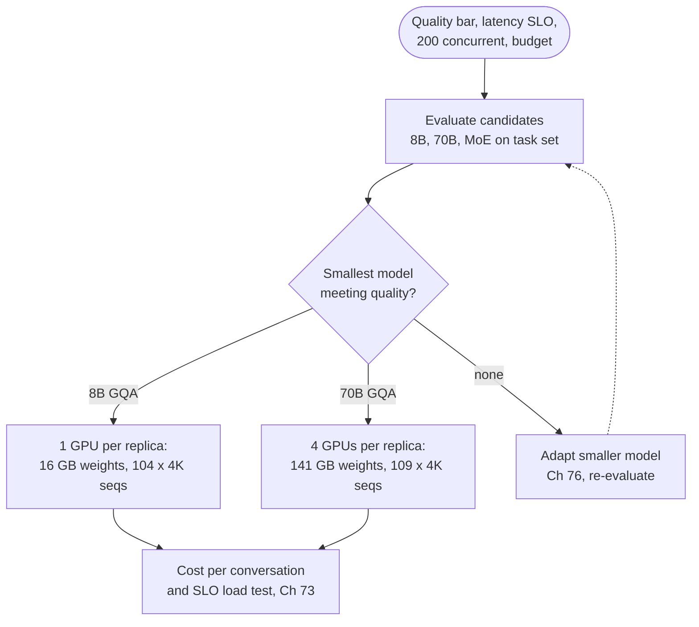

**Reading the diagram.** Candidates are evaluated on QuickBite's own task set (Chapter 78) and the smallest that passes wins, since weights, decode time and GPUs per replica scale with size; capacities come from the §72.11 calculator. If none passes, adaptation (dotted) may rescue a small model. Failure points: choosing on public benchmarks, and sizing without the KV cache. Scaling: replicas behind a router (Chapter 79).

## 72.17 Summary and revision notes

::: summary
- An LLM computes $P(x_t \mid x_{<t})$, trains on per-token cross-entropy (perplexity $e^{\mathcal{L}}$) and generates one token at a time.
- Tokenizers are versioned artifacts shipped with the weights; English is about 1.3 tokens per word, other languages several times more, multiplying cost and latency.
- Embedding and output head are $Vd$ parameters each unless tied; the head costs $2Vd$ FLOPs per generated token.
- Attention is $\text{softmax}(QK^\top/\sqrt{d_k} + M)V$ at $4T^2d$ FLOPs per layer; the causal mask is what makes the KV cache correct.
- GQA/MQA share KV heads: KV bytes per token per layer $= 2 g d_h b$; GQA-8 cuts a 32-head model's cache 4× at near-MHA quality.
- A pre-norm block (RMSNorm, attention, residual, RMSNorm, SwiGLU MLP, residual) has about $12d^2$ parameters; $N \approx 12Ld^2 + Vd$. Llama 2 7B is exactly 6,738,415,616.
- RoPE rotates queries and keys so scores depend on relative position; context extension rescales positions or frequencies and still needs evaluation at length.
- Prefill is compute-bound ($I \approx s$, sets TTFT); decode is memory-bound ($I \approx B$ for weights, $\approx h/g$ for KV; sets TPOT). 7B on an H100: about 48 ms for a 2,048-token prefill, at least 4.3 ms per decode step at batch 1.
- $M_\text{KV} = 2 L g d_h b t B$: 0.5 MiB per token for MHA 7B, 320 KiB for GQA 70B. The KV cache, not the weights, sets concurrency.
- Attention overtakes linear FLOPs at $t = 6d$ in decode and $s = 12d$ in prefill; long contexts cost quadratic prefill and linear memory.
- Sampling: temperature reshapes, top-$k$/top-$p$ truncate; always set a max-token stop; batched serving is not bit-deterministic by default.
- MoE: memory scales with total parameters, FLOPs with active ones; at moderate batch nearly every expert is read each step.
- Inference $\approx 2N_m + 4Ldt$ per token; training $\approx 6N + 12Lds$ (PaLM convention). Overtrained small models buy cheaper serving.
:::

## 72.18 Knowledge checkpoint

1. A model gives a 3-token reply probabilities 0.5, 0.25 and 0.8. What are the average loss in nats and the perplexity?
2. Why does BPE need a deterministic tie-break?
3. Why can a byte-level tokenizer never produce an unknown token, and what does it cost for Hindi text?
4. How many parameters does tying save for $V = 128{,}256$, $d = 4{,}096$?
5. What happens to softmax attention if you omit the $1/\sqrt{d_k}$ scaling at $d_k = 128$?
6. Compute KV bytes per token for $L = 40$, $g = 8$, $d_h = 128$, FP8.
7. Derive $12d^2$ per layer for a GELU transformer.
8. Why does RoPE make the attention score depend on relative position?
9. A 13B BF16 model decodes at batch 1 on a 3.35 TB/s GPU. What is the TPOT lower bound?
10. Why does batching not raise the arithmetic intensity of attention over the KV cache?
11. At what context does decode attention FLOPs equal linear FLOPs for $d = 8{,}192$?
12. With probabilities (0.6, 0.25, 0.1, 0.05) and top-$p = 0.8$, which tokens remain?
13. An MoE has $E = 16$, $k = 2$. Expected experts read per layer at batch 8?
14. Why might an 8B model trained on 15T tokens be preferred over a 70B model trained on 2T?

<details><summary>Answers</summary>

1. Losses 0.693, 1.386, 0.223; mean 0.767 nats; perplexity $e^{0.767} = 2.15$.
2. Several pairs often tie; a different choice produces a different merge list, so two trainings on the same data would yield incompatible tokenizers.
3. Its base vocabulary is all 256 byte values, so every UTF-8 string is representable. Devanagari characters are 3 bytes each, so poorly merged Hindi can cost several tokens per character.
4. $128{,}256 \times 4{,}096 = 525$ million parameters (1.05 GB in BF16).
5. Score standard deviation is about $\sqrt{128} = 11.3$, so softmax saturates onto one key and gradients vanish.
6. $2 \times 40 \times 8 \times 128 \times 1 = 81{,}920$ bytes (80 KiB).
7. $W_Q, W_K, W_V, W_O$ are $d \times d$ ($4d^2$); the MLP is $d \times 4d$ and $4d \times d$ ($8d^2$).
8. Rotations by $m\theta$ and $n\theta$ compose: $(R_m \mathbf{q})^\top (R_n \mathbf{k}) = \mathbf{q}^\top R_{n-m} \mathbf{k}$.
9. $13 \times 10^9 \times 2 / 3.35 \times 10^{12} = 7.8$ ms, plus KV reads.
10. Each sequence's KV cache serves only that sequence's query; bytes grow with batch exactly as FLOPs do, so intensity stays about $h/g$.
11. $t = 6d = 49{,}152$ tokens.
12. Cumulative 0.6, 0.85: the first two tokens.
13. $16(1 - (1 - 2/16)^8) = 16(1 - 0.344) = 10.5$ experts.
14. Its loss is close (about 1.96 versus 1.92 by the Chinchilla fit) at a similar training budget, but it needs about a ninth of the weight memory and decode bandwidth for every token served.

</details>

## 72.19 Interview questions

### Basic

**Q1. What is the KV cache and why is it needed?**
**Answer.** Each past token's keys and values per layer and KV head, so a decode step computes K and V only for the new token instead of the whole prefix. The causal mask makes it exact; its size, $2Lg d_h b t$ per sequence, limits concurrency.

**Q2. Why is the first token slower than the rest, yet each later token more expensive per token?**
**Answer.** The first token waits for a compute-bound prefill of the whole prompt. Each later token is a memory-bound pass that reads all weights for one token per sequence: milliseconds, but 100–200 times more GPU time per token than prefill unless many sequences are batched.

### Intermediate

**Q3. You must serve a chat model to 500 concurrent users at 8K context. How do you decide GPU count?**
**Answer.** Weights ($N b_w$) plus $500 \times 2Lg d_h b \times 8{,}192$ of KV plus a reserve, divided by usable HBM per GPU; then check TPOT from bytes per step and TTFT from prefill FLOPs against the SLO. Prefer GQA and FP8 KV; load-test with real lengths (Chapter 73).

**Q4. Why does an MoE model with 13B active parameters not decode as fast as a 13B dense model?**
**Answer.** At batch sizes above a few tokens the router touches nearly every expert each step, so the step reads all experts' weights (47B for Mixtral), and expert-parallel serving adds all-to-all latency. MoE saves FLOPs, which helps prefill and large batches, not bytes at small batches.

### Advanced

**Q5. Your chatbot's p99 TPOT spikes whenever a user pastes a long document. Explain and fix.**
**Answer.** The long prefill runs in the same iteration as other sequences' decode steps, which all wait for it. Fixes: chunked prefill with a per-iteration token budget, disaggregated prefill, a prompt cap with retrieval, and admission control by tokens.

**Q6. A team proposes extending your 8K model to 64K by changing the RoPE scaling config. What do you require?**
**Answer.** A validated method (interpolation or YaRN plus long-document fine-tuning), accuracy tests at several positions and lengths, and a capacity plan: KV per sequence grows 8× and prefill attention 64×. Ship it as a separate tier with its own limits.

## 72.20 Practical exercises

1. Extend the mini-BPE to byte-level base symbols and train 200 merges on a bilingual corpus; report tokens per word per language before and after adding the second language.
2. Add multi-head and GQA support to the NumPy attention function and check that GQA with $g = h$ equals MHA exactly.
3. Extend the KV calculator with tensor parallelism degree, FP8 KV and a measured context-length distribution, and compare average with worst-case concurrency.
4. Time the PyTorch decoder layer on CPU for $T = 256$ to $4{,}096$ and fit the linear and quadratic terms.

## 72.21 Design challenges

1. **QuickBite multilingual chatbot.** Launch in three new markets with tokens-per-word ratios of 1.3, 2.0 and 3.0. Budget tokens, TPOT and cost per conversation per market, and decide between one multilingual model, a larger-vocabulary model and per-region models.
2. **Long-order-history assistant.** Support agents want the model to read a customer's full 12-month history (up to 100K tokens). Compare long-context serving with retrieval of the relevant 3K tokens on TTFT, KV memory, accuracy and cost.

## 72.22 References

1. Ainslie, J., Lee-Thorp, J., de Jong, M., Zemlyanskiy, Y., Lebrón, F., Sanghai, S. *GQA: Training Generalized Multi-Query Transformer Models from Multi-Head Checkpoints*. EMNLP, 2023.
2. Ba, J. L., Kiros, J. R., Hinton, G. E. *Layer Normalization*. arXiv:1607.06450, 2016.
3. Chen, S., Wong, S., Chen, L., Tian, Y. *Extending Context Window of Large Language Models via Positional Interpolation*. arXiv:2306.15595, 2023.
4. Chowdhery, A., et al. *PaLM: Scaling Language Modeling with Pathways*. JMLR 24, 2023.
5. DeepSeek-AI. *DeepSeek-V3 Technical Report*. arXiv:2412.19437, 2024.
6. Devlin, J., Chang, M.-W., Lee, K., Toutanova, K. *BERT: Pre-training of Deep Bidirectional Transformers for Language Understanding*. NAACL, 2019.
7. Dubey, A., et al. *The Llama 3 Herd of Models*. arXiv:2407.21783, 2024.
8. Fan, A., Lewis, M., Dauphin, Y. *Hierarchical Neural Story Generation*. ACL, 2018.
9. Fedus, W., Zoph, B., Shazeer, N. *Switch Transformers: Scaling to Trillion Parameter Models with Simple and Efficient Sparsity*. JMLR 23, 2022.
10. Gage, P. *A New Algorithm for Data Compression*. C Users Journal 12(2), 1994.
11. Hoffmann, J., et al. *Training Compute-Optimal Large Language Models*. NeurIPS, 2022.
12. Holtzman, A., Buys, J., Du, L., Forbes, M., Choi, Y. *The Curious Case of Neural Text Degeneration*. ICLR, 2020.
13. Jiang, A. Q., et al. *Mistral 7B*. arXiv:2310.06825, 2023.
14. Jiang, A. Q., et al. *Mixtral of Experts*. arXiv:2401.04088, 2024.
15. Kaplan, J., et al. *Scaling Laws for Neural Language Models*. arXiv:2001.08361, 2020.
16. Kudo, T. *Subword Regularization: Improving Neural Network Translation Models with Multiple Subword Candidates*. ACL, 2018.
17. Kudo, T., Richardson, J. *SentencePiece: A Simple and Language Independent Subword Tokenizer and Detokenizer for Neural Text Processing*. EMNLP (System Demonstrations), 2018.
18. Kwon, W., et al. *Efficient Memory Management for Large Language Model Serving with PagedAttention*. ACM SOSP, 2023.
19. Liu, N. F., et al. *Lost in the Middle: How Language Models Use Long Contexts*. TACL 12, 2024.
20. Peng, B., Quesnelle, J., Fan, H., Shippole, E. *YaRN: Efficient Context Window Extension of Large Language Models*. ICLR, 2024.
21. Petrov, A., La Malfa, E., Torr, P. H. S., Bibi, A. *Language Model Tokenizers Introduce Unfairness Between Languages*. NeurIPS, 2023.
22. Pope, R., et al. *Efficiently Scaling Transformer Inference*. MLSys, 2023.
23. Press, O., Smith, N. A., Lewis, M. *Train Short, Test Long: Attention with Linear Biases Enables Input Length Extrapolation*. ICLR, 2022.
24. Press, O., Wolf, L. *Using the Output Embedding to Improve Language Models*. EACL, 2017.
25. Radford, A., Wu, J., Child, R., Luan, D., Amodei, D., Sutskever, I. *Language Models are Unsupervised Multitask Learners*. OpenAI technical report, 2019.
26. Raffel, C., et al. *Exploring the Limits of Transfer Learning with a Unified Text-to-Text Transformer*. JMLR 21, 2020.
27. Schuster, M., Nakajima, K. *Japanese and Korean Voice Search*. IEEE ICASSP, 2012.
28. Sennrich, R., Haddow, B., Birch, A. *Neural Machine Translation of Rare Words with Subword Units*. ACL, 2016.
29. Shazeer, N. *Fast Transformer Decoding: One Write-Head is All You Need*. arXiv:1911.02150, 2019.
30. Shazeer, N. *GLU Variants Improve Transformer*. arXiv:2002.05202, 2020.
31. Shazeer, N., et al. *Outrageously Large Neural Networks: The Sparsely-Gated Mixture-of-Experts Layer*. ICLR, 2017.
32. Su, J., Ahmed, M., Lu, Y., Pan, S., Bo, W., Liu, Y. *RoFormer: Enhanced Transformer with Rotary Position Embedding*. Neurocomputing 568, 2024 (arXiv:2104.09864, 2021).
33. Touvron, H., et al. *Llama 2: Open Foundation and Fine-Tuned Chat Models*. arXiv:2307.09288, 2023.
34. Vaswani, A., et al. *Attention Is All You Need*. NeurIPS, 2017.
35. Xiong, R., et al. *On Layer Normalization in the Transformer Architecture*. ICML, 2020.
36. Xue, L., et al. *ByT5: Towards a Token-Free Future with Pre-trained Byte-to-Byte Models*. TACL 10, 2022.
37. Zhang, B., Sennrich, R. *Root Mean Square Layer Normalization*. NeurIPS, 2019.

## 72.23 Open verification items

- Llama 3 tokenizer compression (3.17 → 3.94 characters per token on English) and Llama 3.1's staged context extension to 128K: confirm against Dubey et al. [2024].
- The "about 1.3 tokens per English word" rule of thumb is vendor guidance, not a cited measurement; the 2.6 ratio in §72.4.5 is an assumption. Confirm the range reported by Petrov et al. [2023].
- Chinchilla fitted constants ($E = 1.69$, $A = 406.4$, $B = 410.7$, $\alpha = 0.34$, $\beta = 0.28$): confirm against Hoffmann et al. [2022].
- Pope et al. [2023]: 29 ms per token and 76% MFU figures; Ainslie et al. [2023]: "about 5%" uptraining compute; Mistral 7B: 8× cache reduction at 32K.
- Mixtral 46.7B/12.9B and DeepSeek-V3 671B/37B are from model reports and recomputed here for Mixtral only.
