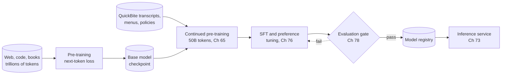
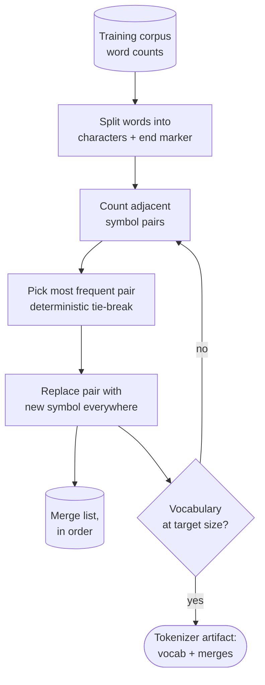

# Chapter 72 — LLM Fundamentals

> **Level:** 3 · **Track:** B (ML/AI) · **Estimated reading time:** 6 h

A large language model (LLM) is, mechanically, a function that reads a list of integers and returns a probability for every possible next integer. Everything a user experiences as "chat" is that function called again and again, one token at a time, with the previous answer appended to the input. A system designer does not need to train one from scratch, but you do need to know what happens inside that call, because every number on an LLM serving bill comes from it: how many bytes of weights must be read per token, how much memory each conversation pins while it is open, why the first token takes longer than the rest, why a 128,000-token context can cost more than the model itself, and why the same sentence costs three times more in one language than another.

This chapter owns the transformer and LLM mechanics a system designer needs. You will build a tokenizer, compute attention by hand and in NumPy, assemble a transformer block and count its parameters to the last one, see why rotary position embeddings let models stretch their context, and derive the two phases of inference, **prefill** and **decode**, from the roofline of §64.9. The central data structure of LLM serving, the **KV cache**, gets a formula and a calculator. Chapter 73 builds its serving architecture (batching, PagedAttention, speculative decoding, parallelism) directly on the prefill, decode and KV-cache sections here; Chapter 76 covers adaptation (prompting, fine-tuning, alignment); Chapter 75 covers retrieval-augmented generation.

::: note
**Assumptions used in this chapter.** Units are SI (1 GB = 10⁹ bytes, 1 TB/s = 10¹² bytes/s) unless MiB or GiB is stated; one multiply–add is 2 FLOPs (§58.2). The reference GPU is an NVIDIA H100 SXM: 80 GB of HBM at 3.35 TB/s, 989 TFLOP/s dense BF16, ridge point 295 FLOPs/byte (§64.9, as of 2026). **QuickBite's support chatbot** is the 7B model of §58.11 and §65.9.1: a Llama-2-7B-like shape with $L = 32$ layers, $d = 4{,}096$, 32 attention heads of dimension 128, standard multi-head attention, an MLP width of 11,008 and a 32,000-token vocabulary, 6.74 billion parameters in all (earlier chapters round this to 7B and 14 GB in BF16). The 70B reference shape has $L = 80$, $d = 8{,}192$, 64 query heads and 8 key–value heads (§67). New chatbot traffic assumptions: 10,000 support conversations a day (2% of orders, Table 61.1's source inventory) and up to 200 concurrent conversations at peak (the figure in Chapter 64's design challenge). These are teaching assumptions, not measurements of any real company.
:::

## 72.1 Learning objectives

After this chapter you should be able to:

- Explain next-token prediction and the autoregressive factorization, and compute a sequence's probability, cross-entropy and perplexity.
- Train byte-pair encoding (BPE) by hand and in code, compare BPE, unigram/SentencePiece and byte-level tokenizers, and estimate how tokens per word change cost, latency and context use across languages.
- Derive scaled dot-product attention, implement it with a causal mask, and explain why the scores are divided by $\sqrt{d_k}$.
- Compute parameter counts and per-token KV-cache bytes for multi-head, multi-query and grouped-query attention.
- Assemble a pre-norm transformer block, derive the $12d^2$ parameters per layer, and reproduce the published parameter count of a 7B-class model.
- Explain sinusoidal, learned and rotary position encodings and how context-extension methods rescale them.
- Distinguish compute-bound prefill from memory-bound decode with arithmetic intensity, and estimate time to first token and time per output token from first principles.
- Size the KV cache for any model, context and batch, and explain why it, not the weights, limits concurrency.
- Compare attention and MLP FLOPs as context grows, and reason about long-context cost.
- Implement greedy, temperature, top-$k$ and top-$p$ sampling, and explain beam search, determinism and stop conditions.
- Explain mixture-of-experts routing and why it separates memory (total parameters) from compute (active parameters).
- Reconcile FLOPs-per-token conventions for inference ($\approx 2N$ plus attention) and training ($\approx 6N$), and use scaling laws to reason about model size choices.

## 72.2 Prerequisites

- Dot products, matrix multiplication and its cost — §4.9 (attention is three matrix multiplies and a softmax).
- MLPs, embeddings and the transformer preview — §58.3, §58.6, §58.9 (this chapter opens the boxes drawn there).
- FLOPs per token, $2N$ and $6N$ — §58.12 and §65.4 (reconciled with attention in §72.15).
- GPU memory hierarchy, roofline, ridge point and arithmetic intensity — §64.5 and §64.9 (prefill and decode are two points on the roofline).
- Precision formats BF16, FP8, INT8 — §64.10 (bytes per value in every memory formula).
- Mixture-of-experts training and expert parallelism — §65.12.2 (this chapter covers the serving side).
- Softmax and cross-entropy loss — §57.9 (the training objective).

## 72.3 What a language model is

### 72.3.1 Next-token prediction and the autoregressive factorization

::: definition
**Definition — Language model, token and autoregressive model.** A **token** is an integer identifier for a piece of text (a word, part of a word, a punctuation mark or a byte) drawn from a fixed **vocabulary** of size $V$. A **language model** assigns a probability to any sequence of tokens. An **autoregressive** language model does so by predicting each token from the tokens before it, $P(x_t \mid x_1, \ldots, x_{t-1})$, and generates text by sampling one token, appending it to the input, and repeating.
:::

#### First-principles explanation

Think of the autocomplete on a phone keyboard, made enormously better. You type "where is my", and it offers "order", "refund", "driver". The keyboard has learned, from many messages, which words tend to come next. An LLM does the same thing over a vocabulary of 32,000 to 256,000 tokens, conditioning not on the last two words but on up to hundreds of thousands of previous tokens. When it "writes a paragraph", it is pressing the middle suggestion, or a randomly chosen one, a few hundred times in a row.

The surprise of the last decade is how much has to be learned to do this one task well. To predict the next token of "The courier left the restaurant at 12:10 and the trip takes 25 minutes, so the food arrives at", a model must have learned arithmetic on clock times. To continue a customer complaint politely it must have absorbed tone. Next-token prediction is a **self-supervised** objective (§57.4): every position in every document is a free training example whose label is simply the following token, so the training set is as large as the text you can collect, trillions of tokens.

#### Mathematical foundations

::: formula
**Autoregressive factorization, training loss and perplexity**

$$P(x_1, \ldots, x_T) = \prod_{t=1}^{T} P_\theta(x_t \mid x_{<t}) \qquad \mathcal{L}(\theta) = -\frac{1}{T}\sum_{t=1}^{T} \ln P_\theta(x_t \mid x_{<t}) \qquad \text{PPL} = e^{\mathcal{L}}$$

| Symbol | Meaning | Units |
|---|---|---|
| $x_1, \ldots, x_T$ | A sequence of $T$ token IDs | tokens |
| $x_{<t}$ | All tokens before position $t$ (the **context**) | tokens |
| $P_\theta(x_t \mid x_{<t})$ | Model's probability for the actual next token, with parameters $\theta$ | probability |
| $\mathcal{L}$ | Average cross-entropy (negative log-likelihood) per token | nats/token |
| PPL | **Perplexity**: the effective number of equally likely choices per token | — |
:::

The chain rule of probability makes the first equation exact for *any* distribution; the modeling choice is to compute every factor with the same network. Training minimizes $\mathcal{L}$, the cross-entropy of §57.9 applied at every position; a decoder-only transformer computes all $T$ factors of a training sequence in one parallel forward pass, because a **causal mask** (§72.6) stops position $t$ from seeing $x_t$ and later tokens.

::: example
**Worked example — Scoring "where is my order".** Suppose a model assigns $P(\text{where}) = 0.05$ at the start of a support message, then $P(\text{is} \mid \text{where}) = 0.6$, $P(\text{my} \mid \text{where is}) = 0.4$ and $P(\text{order} \mid \text{where is my}) = 0.5$.

1. Sequence probability: $0.05 \times 0.6 \times 0.4 \times 0.5 = 0.006$.
2. Per-token losses: $-\ln 0.05 = 2.996$, $-\ln 0.6 = 0.511$, $-\ln 0.4 = 0.916$, $-\ln 0.5 = 0.693$; sum 5.116 nats.
3. Average: $\mathcal{L} = 5.116 / 4 = 1.279$ nats/token, or $1.279 / \ln 2 = 1.85$ bits/token.
4. Perplexity: $e^{1.279} = 3.59$.

**Interpretation.** On this snippet the model is, on average, as uncertain as if it were choosing uniformly among 3.6 tokens; the first token, with no context, contributes most of the loss. **Engineering implication.** Perplexity on held-out domain text is the cheapest regression test for a continued pre-training run such as QuickBite's (§65.9.1): if it rises on support transcripts after a retrain, something is wrong with data or training before any human evaluation is needed. It does not measure helpfulness or safety (Chapter 78).
:::

#### How a generation call works

1. **Tokenize** the prompt into IDs (§72.4).
2. **Embed** each ID as a vector of $d$ numbers (§72.5).
3. Pass the vectors through $L$ **transformer blocks** (§72.6–§72.9), each mixing information across positions (attention) and transforming each position (MLP).
4. Project the last position's vector onto the vocabulary to get $V$ scores (**logits**) and turn them into probabilities (§72.5).
5. **Sample** one token (§72.13), append it, and repeat from step 2 for the new token only, reusing cached keys and values for the old ones (§72.11), until a stop condition.

**Figure 72.1 — An LLM generation call, end to end.**


**Reading the diagram.** Text enters a CPU-side tokenizer and becomes integer IDs; everything from the embedding lookup to the output head runs on the GPU. The blocks read and append to the **KV cache**, the per-sequence store of past keys and values that lives in GPU memory (the storage boundary that limits concurrency, §72.11). The sampler chooses one token; unless a stop condition fires, the token loops back (the autoregressive loop), so a 300-token answer means 300 trips around the right-hand loop. All arrows are synchronous within one request, but the detokenizer streams text back as tokens arrive. Failure points: a tokenizer version different from the model's, KV-cache exhaustion under load, and runaway generation without a stop condition. Scaling: batch many sequences through each trip of the loop and shard the blocks across GPUs (Chapter 73).

### 72.3.2 Pre-training, then adaptation

A model fresh from next-token prediction on web-scale text is a **base model** (or pre-trained model): it continues documents fluently but does not reliably follow instructions. Turning it into an assistant is **adaptation**: supervised fine-tuning on example conversations, preference optimization such as RLHF or DPO, and often domain-adaptive continued pre-training like QuickBite's 50-billion-token run (§65.9.1). Chapter 76 owns adaptation; here you need only the pipeline's shape, because each stage produces a new set of weights that serving must version, evaluate and roll back as one artifact (Chapter 69).

**Figure 72.2 — From raw text to a served assistant.**



**Reading the diagram.** Data stores (cylinders) feed training stages (rectangles); every stage reads a checkpoint and writes a new one. Pre-training costs thousands to millions of GPU-hours ($6ND$, §65.4) and is usually bought, not done: QuickBite starts from an open base model. Its own stages are continued pre-training on domain text, then supervised and preference tuning, then an evaluation gate; failure sends work back (dotted, asynchronous loop), success registers the weights for serving. Failure points: data contamination between training and evaluation sets, and a tokenizer change between stages, which silently invalidates every downstream checkpoint (§72.4.6). Scaling: each stage scales with the distributed-training techniques of Chapter 65.

::: mistake
**"The model knows facts; it looks things up."** A base LLM stores statistical associations in its weights, not records with keys. It produces the most plausible continuation, which is often correct and sometimes confidently wrong. For order status, refunds and policies, QuickBite's chatbot must be given the facts in its context at request time (retrieval and tool calls, Chapters 75 and 77), not trusted to remember them.
:::

## 72.4 Tokenization

### 72.4.1 Why subwords

::: definition
**Definition — Tokenizer.** A **tokenizer** is a deterministic, reversible mapping between text and a sequence of token IDs from a fixed vocabulary. **Subword** tokenizers split rare words into frequent pieces ("refundable" → "refund" + "able") so that any string can be represented with a vocabulary of tens of thousands of entries.
:::

#### First-principles explanation

A model needs a finite alphabet. Two obvious choices both fail. **Whole words** make the vocabulary unbounded: every new dish name, typo, order number and emoji is an unknown word, mapped to a useless `<unk>` token. **Single characters** (or bytes) cover everything with a tiny vocabulary, but sequences become four to five times longer; since attention cost grows with sequence length and every token is a full trip through the model, that is four to five times the inference cost. Subwords sit between: frequent words become one token, rare words break into a few familiar pieces, and nothing is ever unknown.

#### Why does this exist?

Before subwords, neural machine translation systems truncated their vocabularies to the 30,000–80,000 most frequent words and could not translate names or rare compounds. Sennrich, Haddow and Birch [2016] adapted **byte-pair encoding**, a 1994 compression algorithm [Gage 1994], to learn a subword vocabulary from data, and open-vocabulary translation followed. Every major LLM since uses a learned subword tokenizer.

### 72.4.2 Byte-pair encoding

#### How it works internally

Training learns an ordered list of **merges**:

1. Split every word in the training corpus into characters, with an end-of-word marker (`</w>`) so that "est" at the end of a word differs from "est" inside one.
2. Count every adjacent pair of symbols, weighted by word frequency.
3. Merge the most frequent pair everywhere into a new symbol and record the merge.
4. Repeat steps 2–3 until the vocabulary reaches its target size (base symbols + merges).

Encoding new text applies the recorded merges, in the order they were learned, to each word. The vocabulary size is a design choice: more merges mean fewer tokens per word but a larger embedding table and output head (§72.5).

**Figure 72.3 — BPE training loop.**



**Reading the diagram.** Training is an offline batch job over word counts (the corpus cylinder); the loop runs once per merge, tens of thousands of times. Each iteration appends to the ordered merge list, the storage boundary that, together with the vocabulary, *is* the tokenizer. The output is a small versioned artifact (a few megabytes) shipped with the model. Failure point: a non-deterministic tie-break, which makes two training runs on the same data produce different tokenizers. Scaling: production trainers count pairs incrementally rather than rescanning the corpus, so training on gigabytes of text takes minutes.

::: example
**Worked example — Four BPE merges by hand.** Corpus word counts (the toy dictionary in Sennrich et al. [2016]'s reference code): "low" ×5, "lower" ×2, "newest" ×6, "widest" ×3. Initial symbols: `l o w </w>`, `l o w e r </w>`, `n e w e s t </w>`, `w i d e s t </w>`.

1. Count pairs. `e s` appears in "newest" (6) and "widest" (3): 9. `s t` also 9; `t </w>` 9; `l o` and `o w` 7 each (5 + 2); `w e` 8 (lower 2 + newest 6); `n e`, `e w` 6.
2. Merge 1: three pairs tie at 9; a deterministic rule (here, alphabetical order) picks `e s` → `es`. Now "newest" is `n e w es t </w>`.
3. Merge 2: `es t` (9) → `est`. Merge 3: `est </w>` (9) → `est</w>`: a word-final suffix is now one token.
4. Merge 4: `l o` (7) → `lo`; merge 5: `lo w` (7) → `low`.
5. Encode the unseen word "lowest": characters `l o w e s t </w>` → after merges 1–3: `l o w est</w>` → after 4–5: `low est</w>`. Two tokens, both meaningful.

**Interpretation.** BPE discovered the suffix "est" and the stem "low" from counts alone, and handled a word it never saw. **Engineering implication.** The merge list is order-sensitive and tie-sensitive: the tokenizer must be versioned and shipped with the weights, and the serving stack must use exactly the training tokenizer.
:::

#### Code example: a runnable mini-BPE

```python
from collections import Counter

def get_pair_counts(vocab):
    """vocab maps a tuple of symbols (one word) to its corpus frequency."""
    pairs = Counter()
    for symbols, freq in vocab.items():
        for a, b in zip(symbols, symbols[1:]):
            pairs[(a, b)] += freq
    return pairs

def merge_pair(pair, vocab):
    a, b = pair
    out = {}
    for symbols, freq in vocab.items():
        merged, i = [], 0
        while i < len(symbols):
            if i < len(symbols) - 1 and symbols[i] == a and symbols[i + 1] == b:
                merged.append(a + b)
                i += 2
            else:
                merged.append(symbols[i])
                i += 1
        out[tuple(merged)] = freq
    return out

def train_bpe(word_freqs, num_merges, verbose=False):
    vocab = {tuple(w) + ("</w>",): f for w, f in word_freqs.items()}
    merges = []
    for step in range(1, num_merges + 1):
        pairs = get_pair_counts(vocab)
        if not pairs:
            break
        # most frequent pair; ties broken by the lexicographically smallest pair
        best = min(pairs, key=lambda p: (-pairs[p], p))
        if verbose:
            print(f"merge {step}: {best[0]!r} + {best[1]!r} (count {pairs[best]})")
        vocab = merge_pair(best, vocab)
        merges.append(best)
    return merges, vocab

def encode_word(word, merges):
    """Apply learned merges, in the order they were learned, to one word."""
    symbols = list(word) + ["</w>"]
    for a, b in merges:
        i, out = 0, []
        while i < len(symbols):
            if i < len(symbols) - 1 and symbols[i] == a and symbols[i + 1] == b:
                out.append(a + b)
                i += 2
            else:
                out.append(symbols[i])
                i += 1
        symbols = out
    return symbols

def encode(text, merges):
    return [tok for w in text.lower().split() for tok in encode_word(w, merges)]

# Part 1: the worked example (word counts from Sennrich et al. 2016)
toy = {"low": 5, "lower": 2, "newest": 6, "widest": 3}
merges, vocab = train_bpe(toy, 6, verbose=True)
print("segmented corpus:", {" ".join(k): v for k, v in vocab.items()})
print("lowest ->", encode_word("lowest", merges))

# Part 2: train on English support text, then compare tokens per word
english = ("where is my order . my order is late . the courier is late again . "
           "i want a refund for my order . the order arrived cold . "
           "where is the courier . can i get a refund . my food is missing . "
           "the restaurant canceled my order . please refund the delivery fee . ") * 20
word_freqs = Counter(english.split())
merges, _ = train_bpe(word_freqs, 60)
print(f"\nlearned {len(merges)} merges, vocabulary {len(set(''.join(word_freqs))) + 1 + len(merges)} "
      f"symbols; first ten: {[a + b for a, b in merges[:10]]}")

tests = {
    "English": "the courier delivered my order late and cold",
    "Spanish": "donde esta mi reembolso el repartidor llega tarde",
    "German":  "wo ist meine erstattung der kurier ist spaet",
}
for lang, sentence in tests.items():
    toks = encode(sentence, merges)
    n_words = len(sentence.split())
    print(f"{lang:8s} words {n_words:2d}  tokens {len(toks):2d}  "
          f"tokens/word {len(toks) / n_words:.2f}  {toks[:6]}")
```

Output:

```text
merge 1: 'e' + 's' (count 9)
merge 2: 'es' + 't' (count 9)
merge 3: 'est' + '</w>' (count 9)
merge 4: 'l' + 'o' (count 7)
merge 5: 'lo' + 'w' (count 7)
merge 6: 'e' + 'w' (count 6)
segmented corpus: {'low </w>': 5, 'low e r </w>': 2, 'n ew est</w>': 6, 'w i d est</w>': 3}
lowest -> ['low', 'est</w>']

learned 60 merges, vocabulary 82 symbols; first ten: ['e</w>', '.</w>', 'er', 'd</w>', 'er</w>', 'is', 'or', 'y</w>', 'der</w>', 'he</w>']
English  words  8  tokens 12  tokens/word 1.50  ['the</w>', 'courier</w>', 'deli', 'v', 'er', 'ed</w>']
Spanish  words  8  tokens 39  tokens/word 4.88  ['d', 'o', 'n', 'd', 'e</w>', 'e']
German   words  8  tokens 30  tokens/word 3.75  ['w', 'o', '</w>', 'is', 't</w>', 'm']
```

What to notice:

- Merges 1–5 reproduce the hand-worked example; merge 6 is a three-way tie at 6 (`e w`, `n e`, `w est</w>`) resolved by the alphabetical rule. A different rule gives a different tokenizer from the same data.
- Words seen in training ("courier", "order") become single tokens; the unseen "delivered" splits into four familiar pieces. Nothing is unknown.
- The same merges applied to Spanish and German text produce 2.5–3.3 times as many tokens per word as English, because no merges were learned for those languages' letter patterns. Real tokenizers show the same effect, more mildly, for languages underrepresented in their training data (§72.4.5).
