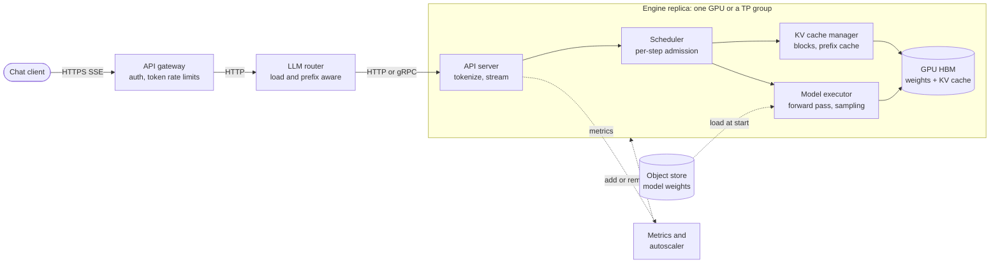
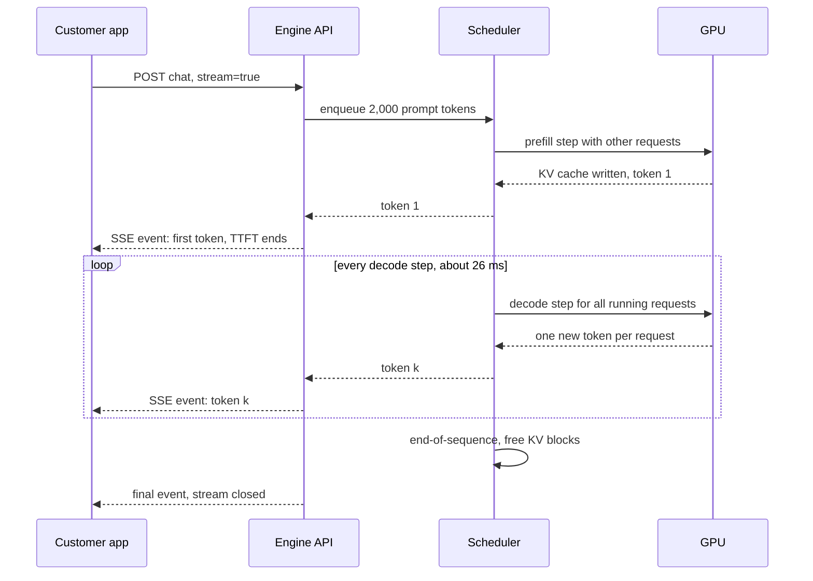

# Chapter 73 — LLM Inference Infrastructure

> **Level:** 4 · **Track:** B (ML/AI) · **Estimated reading time:** 5.5 h

A classic model server answers a question with one forward pass: features in, a score out, a few milliseconds later. A large language model (LLM) answers by *writing*. It reads the whole prompt, then produces the reply one token at a time, and every token needs another pass through billions of parameters. A 200-token answer is 200 dependent steps. The request holds GPU memory the whole time, its length is unknown until it ends, and the user watches the words appear.

This changes almost every serving decision. Batching becomes a scheduling problem solved at every step. GPU memory, not arithmetic, usually decides how many users one GPU can serve. Latency splits into two numbers: how long until the first word appears, and how fast the rest arrive. Cost is quoted per million tokens, not per request. This chapter builds the machinery that production LLM engines use to cope: continuous batching, paged key–value (KV) cache memory, prefix caching, fused attention kernels, speculative decoding, parallelism across GPUs, split prefill and decode fleets, quantization, scheduling and capacity planning. It closes with a comparison of the main open-source engines and a cost playbook.

Chapter 72 explains the transformer itself: prefill and decode, the KV cache formula, grouped-query attention, mixture of experts and sampling. Chapter 64 supplies the roofline, precision formats and interconnects; Chapter 65 the tensor, pipeline and expert parallelism concepts; Chapter 66 general model serving, dynamic batching and autoscaling; Chapter 67 weight quantization (GPTQ, AWQ, FP8). This chapter uses those results and does not re-derive them.

::: note
**Assumptions used in this chapter.** Units are SI (1 GB = 10⁹ bytes; 1 TB/s = 10¹² bytes/s); 1 kB = 10³ bytes. The reference GPU is an NVIDIA H100 SXM: 80 GB HBM at 3.35 TB/s and 989 TFLOP/s dense BF16 (Table 64.4, as of 2026), priced at an illustrative \$2.50 per GPU-hour (§60.11). For estimates we assume an engine achieves 80% of peak memory bandwidth (2.68 TB/s) in decode and 50% model FLOPs utilization (MFU, §64.11) in prefill (494.5 TFLOP/s), plus a fixed 2 ms of per-step overhead (scheduling, sampling, kernel launches). **QuickBite's support chatbot** is the 7B model of §58.11 ($h = 4{,}096$, $L = 32$ layers, 32 attention heads of 128 dimensions, standard multi-head attention, so 32 KV heads), adapted by continued pre-training (§65.9.1) and served in FP16. The **hypothetical 70B option** has $h = 8{,}192$, $L = 80$, 64 query heads and 8 KV heads of 128 dimensions (Llama-2-70B-like, §67.6). **Traffic:** 10,000 support conversations a day (2% of orders, §61.4), six LLM calls per conversation (assumed), 2,000 input tokens per call (a 1,200-token system prompt with policies and tool descriptions, plus 800 tokens of order details and conversation history) and 200 output tokens, with a peak-to-average ratio of 10 (QuickBite's 60 orders/s peak over its 5.8 orders/s average). These are teaching assumptions, not measurements of any real company.
:::

## 73.1 Learning objectives

After this chapter you should be able to:

- Explain why LLM serving differs from classic model serving: variable-length outputs, a growing per-request KV cache, two phases with different bottlenecks, and token streaming.
- Define and compute time to first token (TTFT), time per output token (TPOT), inter-token latency (ITL), end-to-end latency, per-request and per-GPU throughput, and goodput under service-level objectives (SLOs).
- Build a GPU memory budget (weights, KV cache, activations, framework overhead) and compute how many concurrent sequences fit, for one GPU and for a tensor-parallel group.
- Compare static, dynamic and continuous (iteration-level) batching, and reproduce their throughput and latency differences with a simulator.
- Explain PagedAttention (blocks, block tables, copy-on-write), prefix caching and RadixAttention, and quantify the memory and compute they save.
- Describe FlashAttention and decode-time attention kernels at the level needed to choose and debug an engine.
- Derive the expected speed-up of speculative decoding, check it by simulation, and say when it hurts.
- Choose tensor, pipeline and expert parallelism for inference, estimate their communication per token, and decide when disaggregated prefill and decode pays.
- Plan capacity for an LLM service in GPUs and cost per million tokens, and pick an inference engine and the cost levers that fit a workload.

## 73.2 Prerequisites

- Prefill and decode — §72.10; the KV cache and its per-token size — §72.11; multi-head, multi-query and grouped-query attention — §72.12; mixture of experts — §72.13; sampling (temperature, top-p) — §72.14. This chapter serves the model Chapter 72 describes.
- The roofline model and memory-bound decode — §64.9; precision formats — §64.10; MFU — §64.11; FlashAttention's tiling idea — §64.13; interconnect bandwidths — §64.14.
- Tensor, pipeline and expert parallelism — §65.10–§65.12 (here applied to inference rather than training).
- Model servers, dynamic batching and autoscaling — §66.4, §66.6, §66.9; model loading and warm-up — §66.10.
- Weight quantization for LLMs (GPTQ, AWQ, FP8) — §67.6.
- Queueing and Little's law — §4.10–§4.11; percentiles — §4.8; Server-Sent Events — §9.5; cache hit ratio — §20.3; load shedding — §22.9; SLOs — §39.6.

## 73.3 What makes LLM serving different

### 73.3.1 Four differences from classic model serving

::: definition
**Definition — LLM inference engine.** The software that runs an LLM on accelerators for many concurrent requests: it tokenizes prompts, schedules requests into GPU steps, manages the memory holding each request's KV cache, runs the model's forward passes, samples tokens and streams them back. Examples are vLLM, TensorRT-LLM, SGLang, Hugging Face Text Generation Inference (TGI) and llama.cpp (§73.16). An **LLM serving system** wraps one or more engine replicas with a gateway, router, autoscaler and observability.
:::

#### First-principles explanation

Picture a storyteller who tells many stories at once to many listeners around a table. Each round, the storyteller says *one* next word of every story. To pick the next word, they must remember everything said so far in that story, so they keep one notebook per listener. Notebooks pile up on the table, and the table is the limit: when it is full, no new listener can join, however fast the storyteller talks. A new listener's request first needs the whole opening read aloud (their prompt) before the first word of the answer can come.

Map it back: the storyteller is the GPU running the model, a round is one **decode step**, the notebooks are each request's **KV cache**, and the table is GPU memory. Reading the opening is **prefill**. Everything in this chapter is about running more rounds per second, fitting more notebooks on the table, and deciding who sits down next.

#### Why does this exist?

Four properties break the assumptions of request-level serving (Chapter 66):

1. **Variable-length outputs.** Output length is decided by the model (it emits an end-of-sequence token) or by a cap. A chatbot reply may be 10 or 1,000 tokens; the server cannot know in advance how long a request will hold resources.
2. **Stateful KV cache.** Each request keeps the keys and values of every past token in every layer (§72.11) so that each decode step processes only the newest token. That state grows by one token per step and lives in GPU memory until the request ends: about 0.52 MB per token for QuickBite's 7B model (§73.5).
3. **Two phases with different bottlenecks.** Prefill processes the whole prompt in one parallel pass and is compute-bound; decode generates one token per request per step and is memory-bandwidth-bound (§64.12, §72.10).
4. **Streaming tokens.** Users read as text arrives, so latency has two parts that users feel differently: the wait for the first token and the pace of the rest. Responses are streamed over long-lived HTTP responses such as Server-Sent Events (§9.5).

**Table 73.1 — Classic model serving versus LLM serving.**

| Aspect | Classic model (e.g., QuickBite ETA) | LLM (QuickBite chatbot) |
|---|---|---|
| Work per request | One forward pass | One prefill plus one decode pass per output token |
| Request duration | Milliseconds, predictable | Seconds, unknown until the end |
| Per-request state | None between requests | KV cache, grows each step |
| Batch unit | Request (§66.6) | Iteration (one decode step, §73.6) |
| Limiting resource | Compute or CPU | GPU memory capacity and bandwidth |
| Latency metric | p99 latency | TTFT, TPOT/ITL, end-to-end (§73.4) |
| Cost unit | Cost per 1,000 predictions | Cost per 1M input and output tokens |

#### How it works internally

A request moves through these steps inside an engine:

1. **Admission.** The API server tokenizes the prompt, checks limits (maximum context, rate limits by tokens, §79) and queues the request.
2. **Scheduling.** Before each GPU step, the scheduler picks which waiting requests to admit, subject to free KV-cache memory and a per-step token budget (§73.14).
3. **Prefill.** Admitted prompts run through the model in parallel; their keys and values are written into the KV cache; the last position's output gives the first token.
4. **Decode loop.** Each step runs one forward pass for every running request at once, appends one token to each, and writes one more KV entry per layer per request.
5. **Streaming and retirement.** New tokens are detokenized and streamed; a request that emits end-of-sequence or reaches its token cap is retired and its KV memory freed in the same step.

**Figure 73.1 — An LLM serving system and the inside of one engine replica.**

**Reading the diagram.** The client opens one HTTPS request and receives tokens as a Server-Sent Events stream (synchronous, long-lived). The gateway authenticates and limits by tokens, not just requests (§22.3, Chapter 79). The router chooses a replica by load and, ideally, by which replica already caches the request's prefix (§73.8). Inside the replica, the scheduler decides every step which requests run; the KV cache manager allocates and frees memory blocks; the executor runs the model and samples. The storage boundary that matters is GPU high-bandwidth memory (HBM): weights are fixed, the KV cache is the dynamic, contended resource. Weights load asynchronously from the object store at start-up (dotted), and metrics drive the autoscaler (dotted). Failure points: a replica that runs out of KV memory must preempt requests (§73.14); a slow replica stalls every stream it holds; replica loss drops in-flight streams, which clients must retry. Scaling: add replicas behind the router; split a model too large for one GPU across a tensor-parallel group (§73.11).

**Figure 73.2 — Life of one chatbot request: prefill, then a streamed decode loop.**

**Reading the diagram.** Solid arrows are synchronous calls; dashed arrows are returns and streamed events. The user's request waits in the queue, then joins a prefill step (often batched with other work); the first token ends the time to first token. The loop is the decode phase: every step serves *all* running requests, not just this one, which is why per-step time depends on the batch. The KV cache lives on the GPU from prefill to the final event. Failure points: a long queue inflates TTFT; a slow decode step delays every running stream at once; a dropped connection should cancel the request and free its KV memory, or the GPU keeps generating tokens nobody reads. Scaling: more requests per step raise GPU throughput at the cost of a longer step.

#### Mathematical foundations

Two simple models explain most LLM serving behavior. A decode step reads all weights once plus each running sequence's KV cache, and does little arithmetic per byte (§64.9.2); prefill does $2N$ FLOPs per prompt token and is compute-bound.

::: formula
**Decode step time and prefill time**

$$t_\text{step}(B) \approx t_0 + \max\!\left(\frac{M_\text{w} + B\,\bar{c}\,k}{W_\text{eff}},\ \frac{2N\,(B + P)}{F_\text{eff}}\right) \qquad T_\text{prefill} \approx \frac{2N\,n_\text{in}}{F_\text{eff}}$$

| Symbol | Meaning | Units |
|---|---|---|
| $t_\text{step}(B)$ | Time of one forward step with $B$ decoding sequences | s |
| $t_0$ | Fixed per-step overhead (scheduling, sampling, launches) | s |
| $M_\text{w}$ | Weight bytes read per step (per GPU) | bytes |
| $B$ | Sequences decoding in the step (the batch) | sequences |
| $\bar{c}$ | Average context length (tokens already in each KV cache) | tokens |
| $k$ | KV-cache bytes per token (§72.11, §73.5) | bytes/token |
| $W_\text{eff}$ | Achieved memory bandwidth | bytes/s |
| $N$ | Parameters (active parameters for mixture of experts) | parameters |
| $P$ | Prompt tokens prefilled in the same step (0 for pure decode) | tokens |
| $F_\text{eff}$ | Achieved FLOP/s ($\text{MFU} \times$ peak) | FLOP/s |
| $T_\text{prefill}$, $n_\text{in}$ | Prefill time for a prompt of $n_\text{in}$ tokens | s, tokens |
:::

::: example
**Worked example — QuickBite's 7B chatbot at batch 1 and batch 46.** $M_\text{w} = 14$ GB, $k = 524{,}288$ bytes (§73.5), $\bar{c} = 2{,}100$ (2,000 prompt tokens plus half of 200 output tokens), $W_\text{eff} = 2.68$ TB/s, $F_\text{eff} = 494.5$ TFLOP/s, $t_0 = 2$ ms.

1. *Batch 1.* KV bytes: $2{,}100 \times 524{,}288 = 1.10$ GB. Memory time: $(14 + 1.10) \times 10^9 / 2.68 \times 10^{12} = 5.64$ ms. Compute time: $2 \times 7 \times 10^9 / 494.5 \times 10^{12} = 0.03$ ms. Step: $2 + 5.64 = 7.64$ ms, so 131 tokens/s for the one user and 131 tokens/s for the GPU.
2. *Batch 46* (the most that fits in memory, §73.5). KV bytes: $46 \times 1.10 = 50.6$ GB. Memory time: $64.6 \times 10^9 / 2.68 \times 10^{12} = 24.1$ ms. Compute: $46 \times 0.028 = 1.3$ ms, still far below. Step: 26.1 ms, so each user sees $1/0.0261 = 38$ tokens/s and the GPU produces $46/0.0261 = 1{,}761$ tokens/s.
3. *Prefill of a 2,000-token prompt:* $2 \times 7 \times 10^9 \times 2{,}000 / 494.5 \times 10^{12} = 56.6$ ms. Attention adds about 4% at this length (its FLOPs grow with $n_\text{in}^2$; §72.10), which we ignore.

**Interpretation.** Batching 46 users makes each user's stream 3.4× slower but the GPU 13.4× more productive, because the 14 GB weight read is shared. Even at batch 46 the step is memory-bound: arithmetic takes 1.3 ms of 26 ms. Note that the KV reads (50.6 GB) now exceed the weight reads (14 GB). **Engineering implication.** Throughput comes from batching decode steps, and the batch is limited by KV-cache memory and the bandwidth to read it. Those two facts motivate continuous batching (§73.6), PagedAttention (§73.7), prefix sharing (§73.8) and KV quantization (§73.13).
:::

#### Real-world industry applications

::: industry
**Google: scaling PaLM inference.** Pope et al. modeled inference cost for PaLM-scale models analytically, splitting it into the memory-bound decode phase and compute-bound prefill, and chose partitioning layouts per phase and batch size. With multi-query attention to shrink the KV cache and INT8 weights, they reported 29 ms per token for PaLM 540B generation at low batch and 76% MFU when processing input tokens in large batches, with a 2,048-token context on TPU v4.
*Evidence: Primary* — [Pope et al. 2023]
:::

#### Common misconceptions

::: mistake
**"A faster GPU in FLOP/s makes my chatbot faster."** Decode at realistic batch sizes is memory-bound: step time tracks bytes read divided by memory bandwidth. A GPU with 2× the FLOP/s and the same HBM bandwidth barely changes TPOT. Compare accelerators for LLM decode on memory bandwidth and capacity first (§64.9).
:::

::: mistake
**"Serving cost is proportional to the number of requests."** It is proportional to tokens, and input and output tokens cost very different amounts: a prompt token is processed in a parallel, compute-bound pass; an output token needs its own memory-bound step. §73.15 shows a 20× gap per token for the chatbot.
:::
