# Chapter 73 — LLM Inference Infrastructure

> **Level:** 4 · **Track:** B (ML/AI) · **Estimated reading time:** 5.5 h

A classic model server answers a question with one forward pass: features in, a score out, a few milliseconds later. A large language model (LLM) answers by *writing*. It reads the whole prompt, then produces the reply one token at a time, and every token needs another pass through billions of parameters. A 200-token answer is 200 dependent steps. The request holds GPU memory the whole time, its length is unknown until it ends, and the user watches the words appear.

This changes almost every serving decision. Batching becomes a scheduling problem solved at every step. GPU memory, not arithmetic, usually decides how many users one GPU can serve. Latency splits into two numbers: how long until the first word appears, and how fast the rest arrive. Cost is quoted per million tokens, not per request. This chapter builds the machinery that production LLM engines use to cope: continuous batching, paged key–value (KV) cache memory, prefix caching, fused attention kernels, speculative decoding, parallelism across GPUs, split prefill and decode fleets, quantization, scheduling and capacity planning. It closes with a comparison of the main open-source engines and a cost playbook.

Chapter 72 explains the transformer itself: prefill and decode, the KV cache formula, grouped-query attention, mixture of experts and sampling. Chapter 64 supplies the roofline, precision formats and interconnects; Chapter 65 the tensor, pipeline and expert parallelism concepts; Chapter 66 general model serving, dynamic batching and autoscaling; Chapter 67 weight quantization (GPTQ, AWQ, FP8). This chapter uses those results and does not re-derive them.

::: note
**Assumptions used in this chapter.** Units are SI (1 GB = 10⁹ bytes; 1 TB/s = 10¹² bytes/s); 1 kB = 10³ bytes. The reference GPU is an NVIDIA H100 SXM: 80 GB HBM at 3.35 TB/s and 989 TFLOP/s dense BF16 (Table 64.4, as of 2026), priced at an illustrative \$2.50 per GPU-hour (§60.11). For estimates we assume an engine achieves 80% of peak memory bandwidth (2.68 TB/s) in decode and 50% model FLOPs utilization (MFU, §64.11) in prefill (494.5 TFLOP/s), plus a fixed 2 ms of per-step overhead (scheduling, sampling, kernel launches). **QuickBite's support chatbot** is the 7B model of §58.11 ($h = 4{,}096$, $L = 32$ layers, 32 attention heads of 128 dimensions, standard multi-head attention, so 32 KV heads), adapted by continued pre-training (§65.9.1) and served in FP16. The **hypothetical 70B option** has $h = 8{,}192$, $L = 80$, 64 query heads and 8 KV heads of 128 dimensions (Llama-2-70B-like, §67.6). **Traffic:** 10,000 support conversations a day (2% of orders, §61.4), six LLM calls per conversation (assumed), 2,000 input tokens per call (a 1,200-token system prompt with policies and tool descriptions, plus 800 tokens of order details and conversation history) and 200 output tokens, with a peak-to-average ratio of 10 (QuickBite's 60 orders/s peak over its 5.8 orders/s average). These are teaching assumptions, not measurements of any real company.
:::

## 73.1 Learning objectives

After this chapter you should be able to:

- Explain why LLM serving differs from classic model serving: variable-length outputs, a growing per-request KV cache, two phases with different bottlenecks, and token streaming.
- Define and compute time to first token (TTFT), time per output token (TPOT), inter-token latency (ITL), end-to-end latency, per-request and per-GPU throughput, and goodput under service-level objectives (SLOs).
- Build a GPU memory budget (weights, KV cache, activations, framework overhead) and compute how many concurrent sequences fit, for one GPU and for a tensor-parallel group.
- Compare static, dynamic and continuous (iteration-level) batching, and reproduce their throughput and latency differences with a simulator.
- Explain PagedAttention (blocks, block tables, copy-on-write), prefix caching and RadixAttention, and quantify the memory and compute they save.
- Describe FlashAttention and decode-time attention kernels at the level needed to choose and debug an engine.
- Derive the expected speed-up of speculative decoding, check it by simulation, and say when it hurts.
- Choose tensor, pipeline and expert parallelism for inference, estimate their communication per token, and decide when disaggregated prefill and decode pays.
- Plan capacity for an LLM service in GPUs and cost per million tokens, and pick an inference engine and the cost levers that fit a workload.

## 73.2 Prerequisites

- Prefill and decode — §72.10; the KV cache and its per-token size — §72.11; multi-head, multi-query and grouped-query attention — §72.12; mixture of experts — §72.13; sampling (temperature, top-p) — §72.14. This chapter serves the model Chapter 72 describes.
- The roofline model and memory-bound decode — §64.9; precision formats — §64.10; MFU — §64.11; FlashAttention's tiling idea — §64.13; interconnect bandwidths — §64.14.
- Tensor, pipeline and expert parallelism — §65.10–§65.12 (here applied to inference rather than training).
- Model servers, dynamic batching and autoscaling — §66.4, §66.6, §66.9; model loading and warm-up — §66.10.
- Weight quantization for LLMs (GPTQ, AWQ, FP8) — §67.6.
- Queueing and Little's law — §4.10–§4.11; percentiles — §4.8; Server-Sent Events — §9.5; cache hit ratio — §20.3; load shedding — §22.9; SLOs — §39.6.

## 73.3 What makes LLM serving different

### 73.3.1 Four differences from classic model serving

::: definition
**Definition — LLM inference engine.** The software that runs an LLM on accelerators for many concurrent requests: it tokenizes prompts, schedules requests into GPU steps, manages the memory holding each request's KV cache, runs the model's forward passes, samples tokens and streams them back. Examples are vLLM, TensorRT-LLM, SGLang, Hugging Face Text Generation Inference (TGI) and llama.cpp (§73.16). An **LLM serving system** wraps one or more engine replicas with a gateway, router, autoscaler and observability.
:::

#### First-principles explanation

Picture a storyteller who tells many stories at once to many listeners around a table. Each round, the storyteller says *one* next word of every story. To pick the next word, they must remember everything said so far in that story, so they keep one notebook per listener. Notebooks pile up on the table, and the table is the limit: when it is full, no new listener can join, however fast the storyteller talks. A new listener's request first needs the whole opening read aloud (their prompt) before the first word of the answer can come.

Map it back: the storyteller is the GPU running the model, a round is one **decode step**, the notebooks are each request's **KV cache**, and the table is GPU memory. Reading the opening is **prefill**. Everything in this chapter is about running more rounds per second, fitting more notebooks on the table, and deciding who sits down next.

#### Why does this exist?

Four properties break the assumptions of request-level serving (Chapter 66):

1. **Variable-length outputs.** Output length is decided by the model (it emits an end-of-sequence token) or by a cap. A chatbot reply may be 10 or 1,000 tokens; the server cannot know in advance how long a request will hold resources.
2. **Stateful KV cache.** Each request keeps the keys and values of every past token in every layer (§72.11) so that each decode step processes only the newest token. That state grows by one token per step and lives in GPU memory until the request ends: about 0.52 MB per token for QuickBite's 7B model (§73.5).
3. **Two phases with different bottlenecks.** Prefill processes the whole prompt in one parallel pass and is compute-bound; decode generates one token per request per step and is memory-bandwidth-bound (§64.12, §72.10).
4. **Streaming tokens.** Users read as text arrives, so latency has two parts that users feel differently: the wait for the first token and the pace of the rest. Responses are streamed over long-lived HTTP responses such as Server-Sent Events (§9.5).

**Table 73.1 — Classic model serving versus LLM serving.**

| Aspect | Classic model (e.g., QuickBite ETA) | LLM (QuickBite chatbot) |
|---|---|---|
| Work per request | One forward pass | One prefill plus one decode pass per output token |
| Request duration | Milliseconds, predictable | Seconds, unknown until the end |
| Per-request state | None between requests | KV cache, grows each step |
| Batch unit | Request (§66.6) | Iteration (one decode step, §73.6) |
| Limiting resource | Compute or CPU | GPU memory capacity and bandwidth |
| Latency metric | p99 latency | TTFT, TPOT/ITL, end-to-end (§73.4) |
| Cost unit | Cost per 1,000 predictions | Cost per 1M input and output tokens |

#### How it works internally

A request moves through these steps inside an engine:

1. **Admission.** The API server tokenizes the prompt, checks limits (maximum context, rate limits by tokens, §79) and queues the request.
2. **Scheduling.** Before each GPU step, the scheduler picks which waiting requests to admit, subject to free KV-cache memory and a per-step token budget (§73.14).
3. **Prefill.** Admitted prompts run through the model in parallel; their keys and values are written into the KV cache; the last position's output gives the first token.
4. **Decode loop.** Each step runs one forward pass for every running request at once, appends one token to each, and writes one more KV entry per layer per request.
5. **Streaming and retirement.** New tokens are detokenized and streamed; a request that emits end-of-sequence or reaches its token cap is retired and its KV memory freed in the same step.

**Figure 73.1 — An LLM serving system and the inside of one engine replica.**


**Reading the diagram.** The client opens one HTTPS request and receives tokens as a Server-Sent Events stream (synchronous, long-lived). The gateway authenticates and limits by tokens, not just requests (§22.3, Chapter 79). The router chooses a replica by load and, ideally, by which replica already caches the request's prefix (§73.8). Inside the replica, the scheduler decides every step which requests run; the KV cache manager allocates and frees memory blocks; the executor runs the model and samples. The storage boundary that matters is GPU high-bandwidth memory (HBM): weights are fixed, the KV cache is the dynamic, contended resource. Weights load asynchronously from the object store at start-up (dotted), and metrics drive the autoscaler (dotted). Failure points: a replica that runs out of KV memory must preempt requests (§73.14); a slow replica stalls every stream it holds; replica loss drops in-flight streams, which clients must retry. Scaling: add replicas behind the router; split a model too large for one GPU across a tensor-parallel group (§73.11).

**Figure 73.2 — Life of one chatbot request: prefill, then a streamed decode loop.**

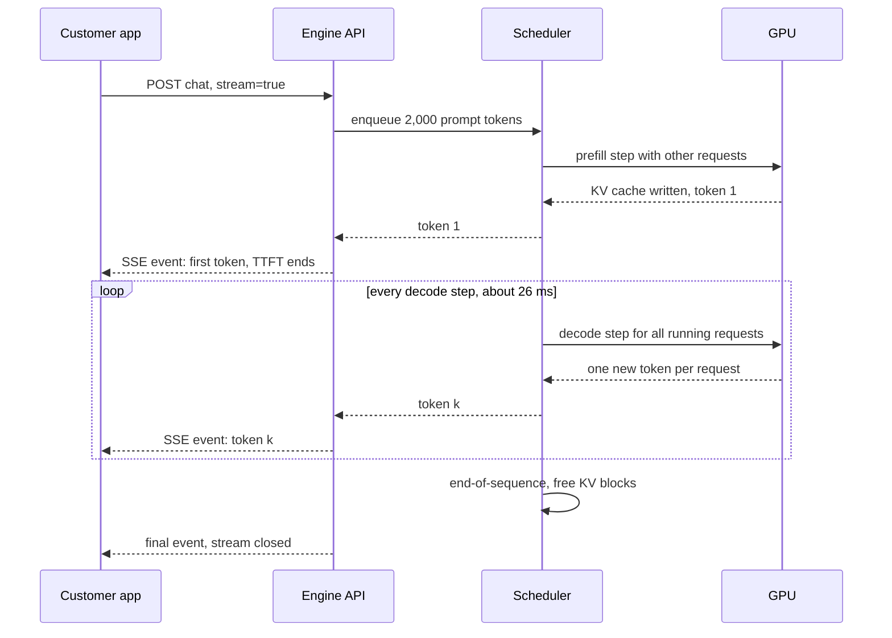

**Reading the diagram.** Solid arrows are synchronous calls; dashed arrows are returns and streamed events. The user's request waits in the queue, then joins a prefill step (often batched with other work); the first token ends the time to first token. The loop is the decode phase: every step serves *all* running requests, not just this one, which is why per-step time depends on the batch. The KV cache lives on the GPU from prefill to the final event. Failure points: a long queue inflates TTFT; a slow decode step delays every running stream at once; a dropped connection should cancel the request and free its KV memory, or the GPU keeps generating tokens nobody reads. Scaling: more requests per step raise GPU throughput at the cost of a longer step.

#### Mathematical foundations

Two simple models explain most LLM serving behavior. A decode step reads all weights once plus each running sequence's KV cache, and does little arithmetic per byte (§64.9.2); prefill does $2N$ FLOPs per prompt token and is compute-bound.

::: formula
**Decode step time and prefill time**

$$t_\text{step}(B) \approx t_0 + \max\!\left(\frac{M_\text{w} + B\,\bar{c}\,k}{W_\text{eff}},\ \frac{2N\,(B + P)}{F_\text{eff}}\right) \qquad T_\text{prefill} \approx \frac{2N\,n_\text{in}}{F_\text{eff}}$$

| Symbol | Meaning | Units |
|---|---|---|
| $t_\text{step}(B)$ | Time of one forward step with $B$ decoding sequences | s |
| $t_0$ | Fixed per-step overhead (scheduling, sampling, launches) | s |
| $M_\text{w}$ | Weight bytes read per step (per GPU) | bytes |
| $B$ | Sequences decoding in the step (the batch) | sequences |
| $\bar{c}$ | Average context length (tokens already in each KV cache) | tokens |
| $k$ | KV-cache bytes per token (§72.11, §73.5) | bytes/token |
| $W_\text{eff}$ | Achieved memory bandwidth | bytes/s |
| $N$ | Parameters (active parameters for mixture of experts) | parameters |
| $P$ | Prompt tokens prefilled in the same step (0 for pure decode) | tokens |
| $F_\text{eff}$ | Achieved FLOP/s ($\text{MFU} \times$ peak) | FLOP/s |
| $T_\text{prefill}$, $n_\text{in}$ | Prefill time for a prompt of $n_\text{in}$ tokens | s, tokens |
:::

::: example
**Worked example — QuickBite's 7B chatbot at batch 1 and batch 46.** $M_\text{w} = 14$ GB, $k = 524{,}288$ bytes (§73.5), $\bar{c} = 2{,}100$ (2,000 prompt tokens plus half of 200 output tokens), $W_\text{eff} = 2.68$ TB/s, $F_\text{eff} = 494.5$ TFLOP/s, $t_0 = 2$ ms.

1. *Batch 1.* KV bytes: $2{,}100 \times 524{,}288 = 1.10$ GB. Memory time: $(14 + 1.10) \times 10^9 / 2.68 \times 10^{12} = 5.64$ ms. Compute time: $2 \times 7 \times 10^9 / 494.5 \times 10^{12} = 0.03$ ms. Step: $2 + 5.64 = 7.64$ ms, so 131 tokens/s for the one user and 131 tokens/s for the GPU.
2. *Batch 46* (the most that fits in memory, §73.5). KV bytes: $46 \times 1.10 = 50.6$ GB. Memory time: $64.6 \times 10^9 / 2.68 \times 10^{12} = 24.1$ ms. Compute: $46 \times 0.028 = 1.3$ ms, still far below. Step: 26.1 ms, so each user sees $1/0.0261 = 38$ tokens/s and the GPU produces $46/0.0261 = 1{,}761$ tokens/s.
3. *Prefill of a 2,000-token prompt:* $2 \times 7 \times 10^9 \times 2{,}000 / 494.5 \times 10^{12} = 56.6$ ms. Attention adds about 4% at this length (its FLOPs grow with $n_\text{in}^2$; §72.10), which we ignore.

**Interpretation.** Batching 46 users makes each user's stream 3.4× slower but the GPU 13.4× more productive, because the 14 GB weight read is shared. Even at batch 46 the step is memory-bound: arithmetic takes 1.3 ms of 26 ms. Note that the KV reads (50.6 GB) now exceed the weight reads (14 GB). **Engineering implication.** Throughput comes from batching decode steps, and the batch is limited by KV-cache memory and the bandwidth to read it. Those two facts motivate continuous batching (§73.6), PagedAttention (§73.7), prefix sharing (§73.8) and KV quantization (§73.13).
:::

#### Real-world industry applications

::: industry
**Google: scaling PaLM inference.** Pope et al. modeled inference cost for PaLM-scale models analytically, splitting it into the memory-bound decode phase and compute-bound prefill, and chose partitioning layouts per phase and batch size. With multi-query attention to shrink the KV cache and INT8 weights, they reported 29 ms per token for PaLM 540B generation at low batch and 76% MFU when processing input tokens in large batches, with a 2,048-token context on TPU v4.
*Evidence: Primary* — [Pope et al. 2023]
:::

#### Common misconceptions

::: mistake
**"A faster GPU in FLOP/s makes my chatbot faster."** Decode at realistic batch sizes is memory-bound: step time tracks bytes read divided by memory bandwidth. A GPU with 2× the FLOP/s and the same HBM bandwidth barely changes TPOT. Compare accelerators for LLM decode on memory bandwidth and capacity first (§64.9).
:::

::: mistake
**"Serving cost is proportional to the number of requests."** It is proportional to tokens, and input and output tokens cost very different amounts: a prompt token is processed in a parallel, compute-bound pass; an output token needs its own memory-bound step. §73.15 shows a 20× gap per token for the chatbot.
:::

## 73.4 Latency metrics

### 73.4.1 TTFT, TPOT, ITL, end-to-end latency and goodput

::: definition
**Definition — LLM latency and throughput metrics.** **Time to first token (TTFT)** is the time from the client sending a request to receiving the first output token. **Time per output token (TPOT)** is the average time between output tokens after the first: $(\text{end-to-end} - \text{TTFT})/(n_\text{out} - 1)$. **Inter-token latency (ITL)** is the individual gap between two consecutive tokens; its distribution (p99, maximum) exposes stalls that the TPOT average hides. **End-to-end latency** is the time to the last token. **Per-request throughput** is $1/\text{TPOT}$ (tokens/s one user sees); **per-GPU throughput** is the output tokens/s a GPU produces across all requests. **Goodput** is the rate of requests that complete *within* their SLOs [Zhong et al. 2024].
:::

#### First-principles explanation

Think of a waiter in a busy restaurant. How long you wait before the bread arrives (TTFT) shapes your first impression; the pace of courses afterwards (TPOT) decides whether the meal feels smooth; one 20-minute gap between courses (a bad ITL) is remembered even if the average pace was fine. The restaurant cares about something else: meals served per hour (per-GPU throughput). Serving more tables at once raises meals per hour but slows every table. Goodput asks how many tables per hour the kitchen can serve *while keeping every table happy*.

#### Why does this exist?

A single "p99 latency" hides the trade-off. A server can make TPOT excellent by running one request at a time (and wasting the GPU), or make throughput excellent by packing hundreds of sequences per step (and making every stream crawl). Product requirements also differ by use: a chat interface needs a TTFT under about a second and a token pace faster than reading speed (a few words per second, roughly 5–10 tokens/s; assumption); a code-completion popup needs a TTFT of a few hundred milliseconds and short outputs; an offline summarization job cares only about tokens per dollar.

#### How it works internally

Each metric decomposes into parts you can engineer:

1. **TTFT = network + queueing + prefill (+ first sampling step).** Queueing grows with load (§4.10); prefill grows with prompt length and shrinks with prefix caching (§73.8).
2. **TPOT ≈ decode step time.** It grows with batch size and context length (§73.3) and shrinks with quantization (§73.13) and speculative decoding (§73.10).
3. **ITL spikes** come from steps that do extra work: a large prefill sharing the step (§73.14), a preemption, a garbage-collection pause or a network hiccup.
4. **Per-GPU throughput = batch / step time,** divided by the GPUs in a replica.
5. **Goodput** counts only requests whose TTFT and TPOT both meet their targets.

**Figure 73.3 — Where the latency of a streamed response comes from.**

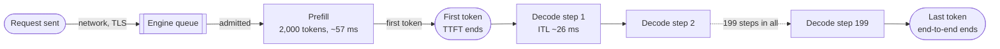

**Reading the diagram.** The request crosses the network into the engine's queue, waits for admission, and is prefilled; the first token ends TTFT. Each decode step then adds one token, and each gap is one ITL sample; the dotted edge stands for the repeated steps. Everything after the queue runs on the GPU, and the KV cache persists across all decode steps. Failure points: a growing queue (overload) shows up first as TTFT; a slow step shows up in every stream's ITL at once. Scaling levers differ per segment: more replicas shorten the queue, prefix caching shortens prefill, smaller batches or quantization shorten each step.

#### Mathematical foundations

::: formula
**Latency decomposition and throughput**

$$T_\text{e2e} = \text{TTFT} + \text{TPOT}\,(n_\text{out} - 1) \qquad \text{TTFT} = T_\text{net} + T_\text{queue} + T_\text{prefill} \qquad X_\text{GPU} = \frac{B}{t_\text{step}(B)\; g}$$

| Symbol | Meaning | Units |
|---|---|---|
| $T_\text{e2e}$ | End-to-end latency to the last token | s |
| $n_\text{out}$ | Output tokens in the response | tokens |
| $T_\text{net}$ | Network and gateway time to the first byte back | s |
| $T_\text{queue}$ | Wait before the request is admitted to a step | s |
| $X_\text{GPU}$ | Output tokens per second per GPU | tokens/s/GPU |
| $B$, $t_\text{step}$ | Batch size and step time (§73.3) | sequences, s |
| $g$ | GPUs in one replica (1, or the TP degree) | GPUs |
:::

::: example
**Worked example — One chatbot reply at batch 46.** Assume $T_\text{net} = 30$ ms (mobile network plus gateway) and $T_\text{queue} = 20$ ms at moderate load; prefill 56.6 ms plus 2 ms step overhead; TPOT = 26.1 ms (§73.3); $n_\text{out} = 200$.

1. TTFT $= 30 + 20 + 56.6 + 2 = 108.6$ ms.
2. End-to-end: $0.109 + 26.1 \times 10^{-3} \times 199 = 0.109 + 5.19 = 5.30$ s.
3. Per-request throughput: $1/0.0261 = 38$ tokens/s, about five times a comfortable reading pace.
4. Per-GPU throughput: $46/0.0261/1 = 1{,}761$ tokens/s.

**Interpretation.** The user sees text after 0.11 s and the full answer after 5.3 s; 98% of the end-to-end time is decode. **Engineering implication.** For chat, end-to-end latency is a poor SLO because it scales with answer length, which the user chose by asking. Set SLOs on TTFT and TPOT (or ITL p99), and track end-to-end separately for non-streaming callers such as tool-calling agents (Chapter 77), which cannot act until the last token.
:::

::: formula
**Goodput and SLO attainment**

$$A(\lambda) = \Pr\big[\text{TTFT} \le S_\text{TTFT} \ \wedge\ \text{TPOT} \le S_\text{TPOT}\big] \qquad G = \max\{\lambda : A(\lambda) \ge A^*\}$$

| Symbol | Meaning | Units |
|---|---|---|
| $A(\lambda)$ | Fraction of requests meeting both SLOs at arrival rate $\lambda$ | dimensionless |
| $S_\text{TTFT}$, $S_\text{TPOT}$ | SLO thresholds | s |
| $A^*$ | Required attainment, e.g., 0.99 | dimensionless |
| $G$ | Goodput: highest sustainable rate that meets the attainment target | requests/s |
:::

::: example
**Worked example — Goodput is not peak throughput.** A load test of one chatbot replica with SLOs TTFT ≤ 1 s and TPOT ≤ 50 ms gives (assumed measurements) $A = 0.998$ at 4 req/s, $0.993$ at 5 req/s, $0.962$ at 6 req/s and $0.880$ at 7 req/s, while raw output throughput keeps rising up to 7 req/s.

1. With $A^* = 0.99$: the largest tested rate meeting it is 5 req/s, so $G = 5$ req/s per replica.
2. At 7 req/s, $7 \times 0.880 = 6.16$ requests/s meet their SLOs, but 12% of users (0.84 req/s) do not.
3. Fleet sizing for QuickBite's 6.9 req/s peak at $A^* = 0.99$: $\lceil 6.9/5 \rceil = 2$ replicas, plus one for redundancy.

**Interpretation.** Sizing on peak throughput (7 req/s, one replica) would breach the SLO for one request in eight at peak. **Engineering implication.** Benchmark engines and configurations at the goodput point, as DistServe and later systems do [Zhong et al. 2024], and report tokens per second *at* a stated TTFT and TPOT target.
:::

**Table 73.2 — Metrics, what they reveal and what moves them.**

| Metric | What users or operators feel | Dominated by | Main levers |
|---|---|---|---|
| TTFT | Responsiveness | Queueing, prefill length | Replicas, prefix caching, chunked prefill, disaggregation |
| TPOT | Reading smoothness | Step time at the batch size | Batch cap, quantization, speculative decoding, TP |
| ITL p99 | Visible stutters | Prefill or preemption in the step | Chunked prefill, admission control |
| End-to-end | Wait for agents and APIs | $n_\text{out} \times$ TPOT | Shorter outputs, faster decode |
| Tokens/s per GPU | Cost | Batch size | Memory for KV cache, batching policy |
| Goodput | Capacity that keeps promises | All of the above | Scheduling, fleet size |

::: mistake
**"Our engine does 10,000 tokens/s, so it is fast."** Throughput numbers without the batch size, input and output lengths, and the TTFT and TPOT at which they were measured are meaningless: the same engine can show 10× different numbers by changing batch size. Always ask for throughput at a latency target.
:::

::: mistake
**"TPOT includes the first token."** By the usual definition it excludes it, because the first token's wait is dominated by queueing and prefill. Some tools average over all tokens; check the definition before comparing reports.
:::

## 73.5 GPU memory budget

### 73.5.1 Weights, KV cache, activations and overhead

::: definition
**Definition — GPU memory budget for LLM serving.** The partition of a GPU's memory into **weights** (fixed, set by parameter count and precision), **KV cache** (dynamic, proportional to the tokens held by all running sequences), **activations** (temporary tensors of the step in flight, proportional to tokens processed per step) and **framework overhead** (CUDA context, communication buffers, captured CUDA Graphs, allocator fragmentation). Engines typically profile activations at start-up and give all remaining memory, up to a configured fraction, to the KV cache.
:::

#### First-principles explanation

A GPU is a parking garage with a fixed number of spaces. The model weights are permanent tenants: they take the same spaces every day. The step's activations are delivery vans that park briefly. The rest is short-term parking for conversations, one space per token. How many cars fit at once (concurrent sequences) depends on how many spaces each conversation needs: its prompt plus its answer.

#### Why does this exist?

Concurrency, and therefore throughput, is set by how many tokens of KV cache fit (§73.3). Without a budget, a team discovers at peak load that its GPUs serve a third of the conversations planned, or that a long prompt triggers out-of-memory errors. The KV cache per token was derived in Chapter 72 (§72.11); here we turn it into capacity.

#### How it works internally

1. **Weights:** $N \times$ bytes per parameter, divided by the tensor-parallel degree (each GPU holds $1/t$ of each matrix, §65.10).
2. **Activations:** sized by the largest step the scheduler allows (the per-step token budget, §73.14). Decode steps need little; a prefill chunk of a few thousand tokens needs hundreds of megabytes for the MLP intermediates.
3. **Overhead:** a few gigabytes for the CUDA context, libraries, NCCL buffers and CUDA Graphs; engines also leave headroom (vLLM's `gpu_memory_utilization` defaults to 0.9, as of 2026 [vLLM Docs]).
4. **KV cache:** everything left, carved into fixed-size blocks (§73.7).

**Figure 73.4 — Memory budget of one 80 GB H100 serving the 7B chatbot.**

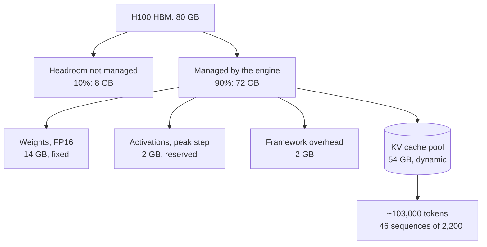

**Reading the diagram.** Memory flows top to bottom from the physical 80 GB. A tenth is left unmanaged as safety margin. Of the managed 72 GB, weights are fixed at load time, activations and overhead are reserved after a start-up profiling run, and the remainder becomes a pool of KV blocks (cylinder: it is the stateful store of the replica). The last box converts the pool into concurrency. Failure points: an activation spike larger than the reserve (a longer prefill chunk than profiled) causes out-of-memory errors; a pool sized for average prompts overflows on long ones and forces preemption (§73.14). Scaling: shrink weights (quantization), shrink bytes per token (GQA, KV quantization), share tokens (prefix caching) or add GPUs (TP).

#### Mathematical foundations

::: formula
**KV-cache bytes per token and concurrent sequences**

$$k = 2 \cdot L \cdot n_\text{kv} \cdot d_\text{head} \cdot b_\text{kv} \qquad M_\text{KV} = u\,M_\text{GPU} - \frac{M_\text{w}}{t} - M_\text{act} - M_\text{fw} \qquad S_\text{max} = \left\lfloor \frac{t\,M_\text{KV}}{k\,(n_\text{in} + n_\text{out})} \right\rfloor$$

| Symbol | Meaning | Units |
|---|---|---|
| $k$ | KV bytes per token, whole model (keys and values: factor 2) | bytes/token |
| $L$ | Transformer layers | layers |
| $n_\text{kv}$ | KV heads (equal to query heads for MHA; fewer for GQA, 1 for MQA; §72.12) | heads |
| $d_\text{head}$ | Dimensions per head | values |
| $b_\text{kv}$ | Bytes per KV element (2 for FP16, 1 for FP8) | bytes |
| $u$ | Fraction of GPU memory the engine manages | dimensionless |
| $M_\text{GPU}$ | Physical memory per GPU | bytes |
| $M_\text{w}$ | Total weight bytes of the model | bytes |
| $t$ | Tensor-parallel degree (KV heads are split across the $t$ GPUs) | GPUs |
| $M_\text{act}$, $M_\text{fw}$ | Activation reserve and framework overhead per GPU | bytes |
| $M_\text{KV}$ | KV pool per GPU | bytes |
| $S_\text{max}$ | Concurrent sequences of length $n_\text{in} + n_\text{out}$ that fit | sequences |
:::

::: example
**Worked example — 7B FP16 on one 80 GB GPU.** $L = 32$, $n_\text{kv} = 32$, $d_\text{head} = 128$, $b_\text{kv} = 2$, $u = 0.9$, $M_\text{act} = M_\text{fw} = 2$ GB (assumed), $t = 1$.

1. $k = 2 \times 32 \times 32 \times 128 \times 2 = 524{,}288$ bytes $\approx 0.52$ MB per token.
2. $M_\text{KV} = 0.9 \times 80 - 14 - 2 - 2 = 54$ GB.
3. Tokens that fit: $54 \times 10^9 / 524{,}288 = 102{,}997$.
4. Sequences of $2{,}000 + 200$ tokens: $\lfloor 102{,}997 / 2{,}200 \rfloor = 46$.
5. If every request reserved the model's 4,096-token maximum instead: $\lfloor 102{,}997/4{,}096 \rfloor = 25$.

**Interpretation.** The KV cache, not the 14 GB of weights, is the dominant memory consumer: 54 GB for 46 conversations. A single 32,000-token document would take a third of the pool. **Engineering implication.** Concurrency is a memory decision. Reserving for the maximum length instead of the actual length nearly halves it; §73.7 removes that waste.
:::

::: example
**Worked example — 70B FP16 with tensor parallelism $t = 4$.** $L = 80$, $n_\text{kv} = 8$, $d_\text{head} = 128$, $b_\text{kv} = 2$; weights 140 GB.

1. $k = 2 \times 80 \times 8 \times 128 \times 2 = 327{,}680$ bytes per token; each GPU holds 2 of the 8 KV heads, $k/t = 81{,}920$ bytes per token per GPU.
2. Weights per GPU: $140/4 = 35$ GB. $M_\text{KV} = 72 - 35 - 2 - 2 = 33$ GB per GPU, 132 GB across the group.
3. Tokens: $33 \times 10^9 / 81{,}920 = 402{,}832$ per replica; sequences: $\lfloor 402{,}832/2{,}200 \rfloor = 183$.
4. With $t = 2$: $72 - 70 - 4 = -2$ GB: it does not fit at $u = 0.9$, and even at $u = 0.95$ only 2 GB per GPU remain, about 12,200 tokens (5 sequences). With $t = 8$: $72 - 17.5 - 4 = 50.5$ GB per GPU, each GPU holding one KV head ($40{,}960$ bytes per token): 1.23 million tokens, 560 sequences, or 70 per GPU versus 46 per GPU at $t = 4$.

**Interpretation.** The 70B replica holds four times the tokens of the 7B GPU on four times the GPUs, about the same per GPU, because grouped-query attention makes its KV cache *smaller per token* than the 7B model's (0.33 MB versus 0.52 MB) despite 10× the parameters. **Engineering implication.** Always compute $k$ from the real attention configuration: MHA, GQA and MQA differ by up to $n_\text{heads}\times$. The smallest $t$ that fits weights can leave no room for KV cache; size $t$ for weights *plus* the concurrency you need.
:::

**Table 73.3 — KV-cache size per token for common shapes (FP16 unless noted).**

| Shape | $L$ | KV heads × $d_\text{head}$ | Bytes per token | Tokens per GB |
|---|---|---|---|---|
| 7B, MHA (QuickBite chatbot) | 32 | 32 × 128 | 524,288 | 1,907 |
| 7B, MHA, FP8 KV | 32 | 32 × 128 | 262,144 | 3,815 |
| 8B, GQA (Llama-3-8B-like) | 32 | 8 × 128 | 131,072 | 7,629 |
| 70B, GQA (Llama-2-70B-like) | 80 | 8 × 128 | 327,680 | 3,052 |
| 70B if it used MHA | 80 | 64 × 128 | 2,621,440 | 381 |

The last row shows why large models adopted GQA: with MHA the 70B model would hold eight times fewer tokens per gigabyte. Some newer architectures compress the KV cache further, for example by caching a low-rank latent instead of full keys and values (Chapter 72).

#### Failure scenarios

**Table 73.4 — Memory-budget failures.**

| What goes wrong | Why | Detection | Recovery | Prevention |
|---|---|---|---|---|
| Out-of-memory on a long prompt | Activation reserve profiled for shorter steps | CUDA OOM errors, replica restarts | Restart with a lower per-step token budget | Cap per-step tokens; profile at the maximum |
| Throughput far below plan | Planned with GQA numbers, model is MHA | KV usage at 100% with small batches | Quantize KV, add GPUs | Compute $k$ from the model config |
| Constant preemption at peak | Pool sized for average, prompts longer than planned | Preemption counter, ITL spikes | Admission control (§73.14) | Size on the p95 prompt, not the mean |
| Two models on one GPU starve | Both engines assume they own the GPU | OOM at the second start | Set each engine's memory fraction | One engine per GPU, or MIG partitions (§64.15) |

::: mistake
**"Weights fit, so the model fits."** A 70B FP16 model on two 80 GB GPUs leaves essentially nothing for the KV cache. Serving needs weights plus KV cache for the target concurrency plus overhead; check all three before choosing hardware.
:::

## 73.6 Batching: static, dynamic and continuous

### 73.6.1 From request-level to iteration-level batching

::: definition
**Definition — Static, dynamic and continuous batching.** **Static batching** groups a fixed set of requests and runs them together until *all* have finished. **Dynamic batching** (§66.6) forms each batch from whatever requests are queued when the server becomes free (or when a timeout expires), but still keeps the batch together until its longest member finishes. **Continuous batching**, also called **iteration-level scheduling** or **in-flight batching**, re-forms the batch at *every* decode step: finished sequences leave and waiting ones join between steps [Yu et al. 2022].
:::

#### First-principles explanation

A tour bus that leaves when full and returns only after dropping off its last passenger wastes seats: someone getting off at the first stop leaves an empty seat for the rest of the trip, and people at the depot wait for the bus to come back. A tram that stops at every block lets passengers off and on at each stop; seats stay full and nobody waits for a whole round trip. Static and dynamic batching are the bus; continuous batching is the tram. The stops are decode steps.

#### Why does this exist?

Output lengths vary by an order of magnitude. With request-level batching, a batch of 46 runs as long as its longest reply, sequences that finished early occupy padding slots, and new requests wait for the entire batch. Orca observed that a transformer's work is already split into iterations and proposed scheduling at that granularity. Its second idea, **selective batching**, batches the matrix multiplies of all sequences together (they share weights) while running attention per sequence (each has its own KV cache and length), which makes batching sequences at different positions possible [Yu et al. 2022].

#### How it works internally

1. Before each step, remove sequences that emitted end-of-sequence or hit their cap, and free their KV memory.
2. Admit queued requests while free KV blocks and the per-step token budget allow (§73.14).
3. Run one forward pass over the mixed batch: newly admitted prompts (prefill tokens) plus one token for each running sequence.
4. Sample, stream, and repeat. Requests never wait for others to finish.

**Figure 73.5 — Four requests under static batching (top) and continuous batching (bottom), in decode steps.**

```mermaid
gantt
  title Slots over time in decode steps
  dateFormat X
  axisFormat %S
  section Static
  R1 50 tokens          :s1, 0, 50
  R1 slot idle          :crit, 50, 100
  R2 100 tokens         :s2, 0, 100
  R3 and R4 wait        :crit, 0, 100
  R3 then R4            :s3, 100, 160
  section Continuous
  R1 50 tokens          :c1, 0, 50
  R3 joins slot 1       :c3, 50, 90
  R2 100 tokens         :c2, 0, 100
  R4 joins slot 2       :c4, 100, 120
```

**Reading the diagram.** The horizontal axis is decode steps on one GPU with two batch slots. Under static batching, R1 finishes at step 50 but its slot stays idle (red) until R2 ends at step 100; R3 and R4 wait the whole time. Under continuous batching, R3 takes R1's slot at step 50 and R4 takes R2's at step 100, so all four finish by step 120 instead of 160. All work is synchronous GPU steps; the state boundary is each slot's KV cache, freed and reused at step granularity. Failure point: continuous batching must still prefill each joining request, which lengthens the step it joins (§73.14). Scaling: more slots need more KV memory (§73.5, §73.7).

**Figure 73.6 — The continuous-batching scheduler loop.**

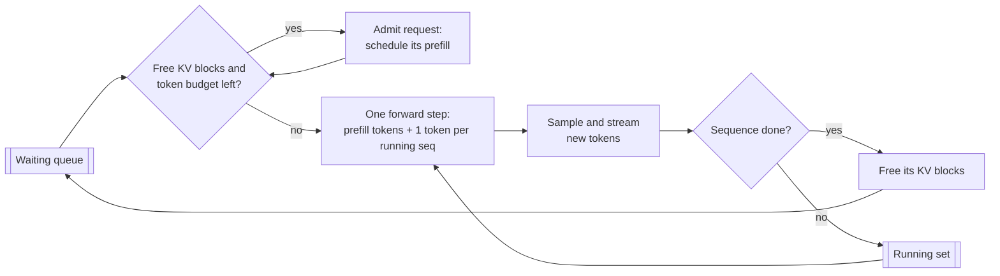

**Reading the diagram.** Each pass of the loop is one GPU iteration. Admission checks two resources, free KV blocks and the step's token budget; admitted prompts are prefilled in the next step together with one decode token for every running sequence. After sampling, finished sequences free their blocks immediately, which lets the queue advance; unfinished ones stay in the running set. Everything is synchronous with the GPU step; the CPU-side scheduling must be fast (well under a millisecond) or it becomes the bottleneck at small step times. Failure points: if blocks run out mid-generation, a running sequence must be preempted (§73.14). Scaling: the loop runs per replica; the router spreads requests across replicas.

#### Mathematical foundations

::: formula
**Slot utilization of request-level batching**

$$\eta_\text{static} = \frac{\sum_{i=1}^{B} \ell_i}{B \cdot \max_i \ell_i}$$

| Symbol | Meaning | Units |
|---|---|---|
| $\eta_\text{static}$ | Fraction of batch slot-steps that produce a useful token | dimensionless |
| $B$ | Requests in the batch | requests |
| $\ell_i$ | Output tokens of request $i$ | tokens |
:::

::: example
**Worked example — Four chatbot replies of 50, 100, 200 and 800 tokens.**

1. Useful slot-steps: $50 + 100 + 200 + 800 = 1{,}150$.
2. Occupied slot-steps: $4 \times 800 = 3{,}200$.
3. $\eta_\text{static} = 1{,}150/3{,}200 = 36\%$.
4. With continuous batching each slot is refilled when it frees, so utilization approaches 100% whenever requests are waiting.

**Interpretation.** Under request-level batching, nearly two-thirds of the GPU's decode capacity in this batch produces padding, and the longest reply sets everyone's completion time. **Engineering implication.** The more variable the output lengths, the larger the gain from continuous batching; with exponential-like length distributions the longest of 46 replies is several times the mean.
:::

#### Code example: static versus continuous batching

The simulator below uses the step-time model of §73.3 for the 7B chatbot on one H100, Poisson arrivals, prompts of 1,000–3,000 tokens and geometric output lengths with mean 200 (capped at 1,000). It compares request-level ("static") batching, continuous batching with whole-prompt prefill, and continuous batching with 512-token chunked prefill (§73.14). Run with `python3`; it needs NumPy and takes about 12 seconds.

```python
import numpy as np

# Cost model for QuickBite's 7B chatbot on one H100 (assumptions from Sec. 73.5).
W_BYTES  = 14e9        # FP16 weights
KV_TOK   = 524_288     # KV bytes per token (32 layers, 32 KV heads x 128, FP16)
BW       = 2.68e12     # effective HBM bandwidth: 80% of 3.35 TB/s
FLOPS    = 4.945e14    # effective BF16 FLOP/s: 50% of 989 TFLOP/s
T0       = 0.002       # fixed per-iteration overhead (s)
MAX_SEQS = 46          # KV-cache capacity at ~2,200 tokens per sequence

def step_time(ctx_tokens, new_tokens):
    """One forward pass: memory time vs compute time, plus overhead."""
    mem = (W_BYTES + ctx_tokens * KV_TOK) / BW
    comp = 2 * 7e9 * new_tokens / FLOPS
    return T0 + max(mem, comp)

def workload(rate, seconds, seed=7):
    rng = np.random.default_rng(seed)
    n = rng.poisson(rate * seconds)
    arrivals = np.sort(rng.uniform(0, seconds, n))
    prompts = rng.integers(1000, 3001, n)                      # mean ~2,000
    outputs = np.clip(rng.geometric(1 / 200, n), 10, 1000)     # mean ~200
    return arrivals, prompts, outputs

def simulate(rate, policy, seconds=600, chunk=512, seed=7):
    arr, pin, pout = workload(rate, seconds, seed)
    n, t, nxt = len(arr), 0.0, 0
    queue, running = [], []     # running: [id, generated, prefilled]
    first, done = np.full(n, np.nan), np.full(n, np.nan)
    last, gap = np.zeros(n), np.zeros(n)          # worst inter-token gap
    steps = useful = 0
    while nxt < n or queue or running:
        while nxt < n and arr[nxt] <= t:
            queue.append(nxt); nxt += 1
        if not queue and not running:
            t = arr[nxt]; continue
        if policy == "static":
            if not running:                       # form a batch, prefill all
                batch, queue = queue[:MAX_SEQS], queue[MAX_SEQS:]
                running = [[i, 0, pin[i]] for i in batch]
                t += step_time(0, sum(pin[i] for i in batch))
        else:                                     # iteration-level admission
            while queue and len(running) < MAX_SEQS:
                running.append([queue.pop(0), 0, 0])
        prefill_tokens = 0
        if policy != "static":
            budget = chunk if policy == "chunked" else 10**9
            for r in running:
                need = pin[r[0]] - r[2]
                take = min(need, budget)
                r[2] += take; budget -= take; prefill_tokens += take
        live = [r for r in running if r[2] >= pin[r[0]] and r[1] < pout[r[0]]]
        ctx = sum(r[2] + r[1] for r in running)        # tokens held in KV
        t += step_time(ctx, prefill_tokens + len(live))
        for r in live:
            r[1] += 1
            if r[1] == 1: first[r[0]] = t
            else: gap[r[0]] = max(gap[r[0]], t - last[r[0]])
            last[r[0]] = t
            if r[1] == pout[r[0]]: done[r[0]] = t
        steps += 1; useful += len(live)
        if policy == "static":
            if all(r[1] >= pout[r[0]] for r in running): running = []
        else:
            running = [r for r in running if r[1] < pout[r[0]]]
    ttft = first - arr
    tpot = (done - first) / np.maximum(pout - 1, 1)
    return dict(tput=pout.sum() / done.max(), ttft50=np.median(ttft),
                ttft99=np.percentile(ttft, 99), tpot50=np.median(tpot),
                e2e50=np.median(done - arr), e2e99=np.percentile(done - arr, 99),
                itl99=np.percentile(gap, 99), batch=useful / steps)

print(f"{'rate':>4} {'policy':>10} {'tok/s':>6} {'TTFT p50':>9} {'TTFT p99':>9}"
      f" {'TPOT p50':>8} {'ITL p99':>8} {'E2E p99':>8} {'batch':>5}")
for rate in (1.5, 4.0, 7.0):
    for policy in ("static", "continuous", "chunked"):
        m = simulate(rate, policy)
        print(f"{rate:>4} {policy:>10} {m['tput']:>6.0f} {m['ttft50']:>8.2f}s"
              f" {m['ttft99']:>8.2f}s {m['tpot50']*1000:>6.1f}ms"
              f" {m['itl99']*1000:>6.0f}ms {m['e2e99']:>7.1f}s {m['batch']:>5.1f}")
```

Output (deterministic with the fixed seed):

```text
rate     policy  tok/s  TTFT p50  TTFT p99 TPOT p50  ITL p99  E2E p99 batch
 1.5     static    305     6.41s    16.97s   15.0ms     20ms    25.2s   4.9
 1.5 continuous    305     0.07s     0.15s    9.6ms    134ms     8.8s   3.1
 1.5    chunked    305     0.08s     0.17s    9.2ms     17ms     8.4s   3.0
 4.0     static    356   359.64s   704.46s   25.7ms     28ms   710.4s  10.3
 4.0 continuous    774     0.07s     0.20s   15.8ms    191ms    14.4s  11.6
 4.0    chunked    774     0.09s     0.20s   12.8ms     19ms    11.6s   9.5
 7.0     static    383   821.12s  1600.39s   25.7ms     28ms  1603.7s  11.3
 7.0 continuous   1301    27.36s    43.62s   34.6ms    239ms    61.9s  43.9
 7.0    chunked   1399     0.12s     0.59s   19.3ms     28ms    18.2s  26.2
```

What to notice:

- `step_time` is the §73.3 model: weights and KV bytes over bandwidth, or prefill and decode FLOPs over compute, whichever is larger. The `batch` column is the mean number of sequences producing a token per step.
- **Static batching saturates at about 360–380 tokens/s.** At 1.5 req/s it keeps up, but TTFT p50 is 6.4 s because new requests wait for the running batch to drain. At 4 and 7 req/s the queue grows without bound (TTFT of minutes in a 600-second run): the server is overloaded at a load continuous batching handles easily.
- **Continuous batching serves the offered load** (774 tokens/s at 4 req/s) with a TTFT p50 of 70 ms, and reaches about 1,300 tokens/s at 7 req/s, 3.4× static's ceiling. But its ITL p99 is 134–239 ms: every whole-prompt prefill (about 57 ms per 2,000 tokens, several per step under load) stalls every running stream.
- **Chunked prefill** keeps ITL p99 at 17–28 ms and, at 7 req/s, lifts throughput to 1,399 tokens/s with TTFT p99 0.59 s, because 512-token chunks ride along with memory-bound decode steps almost for free (§73.14).
- The model omits real-engine costs (scheduler CPU time, imperfect kernels), so treat ratios as indicative and absolute numbers as optimistic.

**Table 73.5 — Batching policies compared.**

| Row | Static | Dynamic (§66.6) | Continuous (iteration-level) |
|---|---|---|---|
| What it is | Fixed batch until all finish | Batch formed when free or on timeout | Batch re-formed every step |
| Advantages | Simplest | Good for fixed-cost models | Highest throughput, low TTFT |
| Disadvantages | Padding, head-of-line waits | Same within a batch | Complex scheduler and memory manager |
| Performance | Ceiling set by longest reply | Same as static for LLMs | 2–4×+ static at equal latency |
| Choose when | Offline jobs of equal lengths | Classifiers, embeddings | Any generative LLM service |

::: industry
**Orca.** Yu et al. introduced iteration-level scheduling and selective batching in Orca, a distributed serving system for transformer generation, and reported a 36.9× throughput improvement over NVIDIA FasterTransformer at the same latency on a GPT-3 175B-scale model. Every major open-source engine adopted iteration-level scheduling afterwards; TensorRT-LLM calls it in-flight batching.
*Evidence: Primary* — [Yu et al. 2022]
:::

::: mistake
**"Continuous batching makes every request faster."** It raises throughput and cuts queueing, but each step now carries more sequences and occasional prefills, so TPOT and ITL for an individual stream can be *worse* than with a small static batch. Cap the batch (or step token budget) to meet the TPOT SLO.
:::

## 73.7 KV cache management and PagedAttention

### 73.7.1 Fragmentation, blocks and block tables

::: definition
**Definition — PagedAttention.** An attention algorithm and memory manager that stores each sequence's KV cache in fixed-size **blocks** (for example, 16 tokens) placed anywhere in GPU memory, with a per-sequence **block table** mapping logical block $j$ to a physical block, as an operating system's page table maps virtual pages to frames (§6.6.2; copy-on-write §6.6.5). The attention kernel follows the block table while reading keys and values. Blocks can be shared by several sequences with reference counts and **copy-on-write** [Kwon et al. 2023].
:::

#### First-principles explanation

Early engines gave each request a contiguous stretch of memory big enough for its maximum possible length, like a hotel that books every guest the largest suite in case their family shows up. Most guests use one room. PagedAttention hands out rooms one at a time as the family arrives, in any free spot in the building, and keeps a card listing which rooms belong to whom.

#### Why does this exist?

Contiguous allocation wastes KV memory in three ways [Kwon et al. 2023]:

1. **Reservation:** space for tokens not generated yet but reserved for the request's lifetime.
2. **Internal fragmentation:** space reserved for the maximum length that the request never uses.
3. **External fragmentation:** gaps between variably sized allocations that no new request fits.

Kwon et al. measured that in existing systems only 20.4–38.2% of KV-cache memory held actual token states. Since KV memory sets concurrency, wasted memory is wasted throughput.

#### How it works internally

1. The KV pool is divided into physical blocks of $b$ tokens × all layers × KV heads.
2. A new sequence gets blocks only for the tokens it has; a block is added when the last one fills.
3. The block table (a small integer array per sequence) is passed to the attention kernel, which gathers keys and values block by block (§73.9).
4. On completion or preemption, blocks return to the free list at once; any free block fits any sequence, so external fragmentation disappears.
5. For **parallel sampling** (several answers to one prompt) and **beam search**, child sequences point to the parent's prompt blocks and increment reference counts. When a child must write into a shared, partially filled block, the manager copies that block first (copy-on-write).

**Figure 73.7 — Block tables map two sequences' logical KV blocks to scattered physical blocks.**

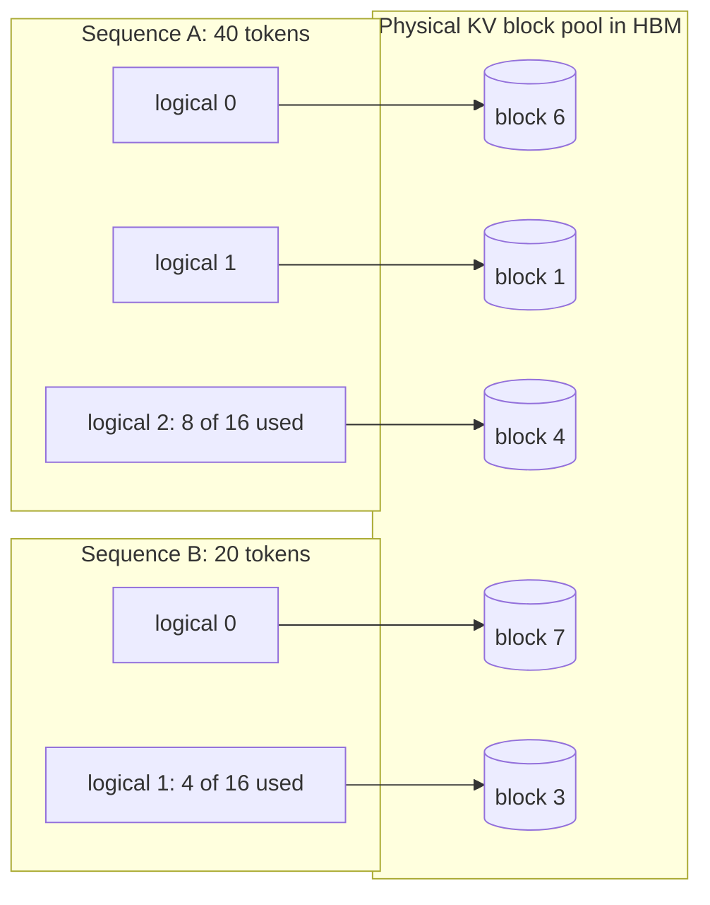

**Reading the diagram.** Each sequence has a block table (left groups) whose entries point to physical blocks (cylinders) anywhere in the pool. Sequence A's 40 tokens occupy two full blocks and half of a third; B's 20 tokens one full block and a quarter of another. The only waste is the unfilled tail of each sequence's last block. Lookups are synchronous inside the attention kernel; the block table is small and lives on the GPU. Failure points: when no free block exists for a sequence's next token, the scheduler must preempt (§73.14); a very small block size increases table size and kernel indexing cost. Scaling: blocks of any sequence fill any free slot, so the pool stays usable as sequences come and go.

#### Mathematical foundations

::: formula
**KV memory waste: contiguous reservation versus paging**

$$w_\text{contig} = 1 - \frac{n_\text{used}}{n_\text{max}} \qquad w_\text{paged} \approx \frac{(b-1)/2}{n_\text{used}}$$

| Symbol | Meaning | Units |
|---|---|---|
| $w_\text{contig}$ | Fraction of a contiguous reservation never used | dimensionless |
| $n_\text{used}$ | Tokens the sequence actually holds at completion | tokens |
| $n_\text{max}$ | Tokens reserved (the maximum length) | tokens |
| $w_\text{paged}$ | Expected waste with paging: half a block per sequence on average | dimensionless |
| $b$ | Block size | tokens |
:::

::: example
**Worked example — PagedAttention waste for the chatbot.** Pool 102,997 tokens (§73.5); requests use $n_\text{used} = 2{,}200$; maximum length 4,096; $b = 16$.

1. Contiguous: $w = 1 - 2{,}200/4{,}096 = 46\%$ wasted (before any external fragmentation). Concurrency $\lfloor 102{,}997/4{,}096 \rfloor = 25$.
2. Paged: expected waste $7.5/2{,}200 = 0.34\%$; worst case 15 tokens per sequence. Concurrency $\lfloor 102{,}997/(2{,}200 + 7.5) \rfloor = 46$.
3. Throughput at batch 25 versus 46 (§73.3 model): step times $2 + (14 + 25 \times 1.10)/2.68 = 17.5$ ms and 26.1 ms, giving 1,429 and 1,761 tokens/s. Paging gives 23% more throughput here, and far more when the maximum length is 32,000 tokens and average use is 2,200 (then contiguous fits only 3 sequences).
4. Parallel sampling, $n = 4$ answers of 200 tokens to one 2,000-token prompt: without sharing $4 \times 2{,}200 = 8{,}800$ tokens (4.61 GB); with shared prompt blocks $2{,}000 + 4 \times 200 = 2{,}800$ tokens (1.47 GB), 68% less. The 2,000-token prompt fills exactly 125 blocks, so no copy is needed; a 2,001-token prompt would trigger one 16-token copy per child on its first write.

**Interpretation.** Paging turns memory waste from tens of percent into a fraction of a percent, and the saving converts directly into batch size. **Engineering implication.** Raising the maximum context length is almost free with paging (it only limits the longest request), but catastrophic without it.
:::

**Figure 73.8 — Copy-on-write when two samples share a prompt's last, partly filled block.**

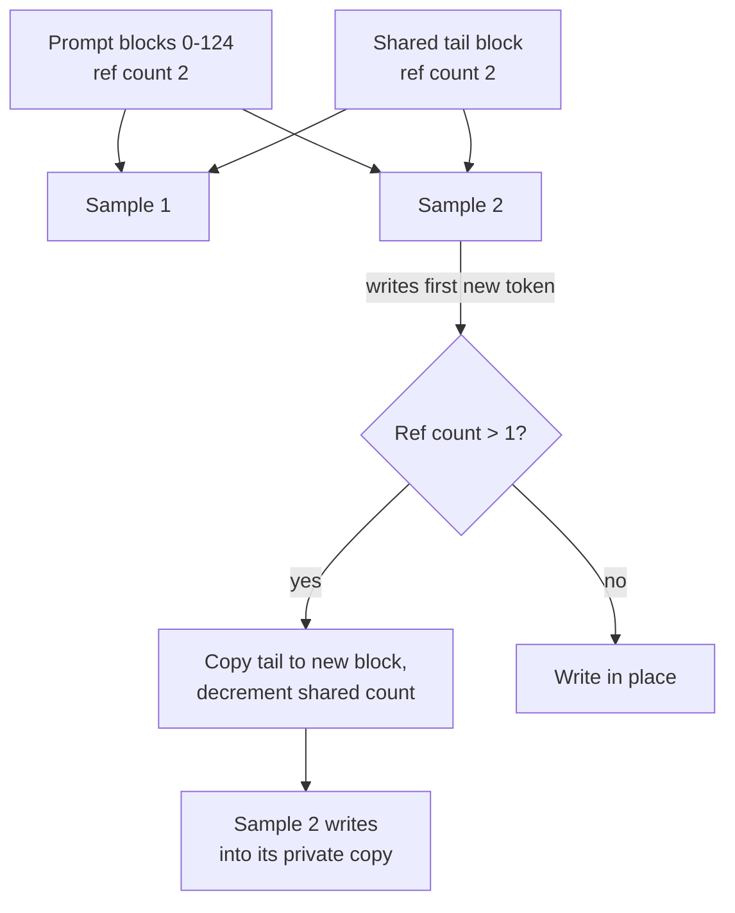

**Reading the diagram.** Both samples point to the same full prompt blocks and to a partly filled tail block, each with reference count 2. When sample 2 appends its first generated token, the manager sees the tail is shared, copies it (one block, a few kilobytes per layer), decrements the shared count and lets sample 2 write privately; sample 1 then owns the original and writes in place. Full blocks are never copied. The check is synchronous in the scheduler before the step. Failure point: a bug in reference counting corrupts another sequence's context, a silent correctness error, so engines test this path heavily. Scaling: beam search uses the same mechanism as beams fork and die.

::: industry
**vLLM.** Kwon et al. built vLLM around PagedAttention and reported 2–4× higher throughput than FasterTransformer and Orca at the same latency, with near-zero KV waste (under 4%) and larger gains for longer sequences, larger models and complex decoding such as beam search. The paper describes block-level sharing for parallel sampling and beam search, and swapping or recomputation for preemption (§73.14).
*Evidence: Primary* — [Kwon et al. 2023]
:::

#### Failure scenarios and alternatives

**Table 73.6 — PagedAttention failures.**

| What goes wrong | Why | Detection | Recovery | Prevention |
|---|---|---|---|---|
| Throughput regresses on new kernels | Block indexing slows attention | Attention kernel time in profiles | Larger block size | Benchmark block sizes 16–32 |
| Silent cross-sequence corruption | Reference-count or COW bug | Nonsense outputs under parallel sampling | Disable sharing, roll back | Property tests on fork and free |
| Pool exhaustion mid-generation | Sequences grow after admission | Preemption rate | Preempt lowest priority | Watermark of free blocks at admission |

The alternative to paging is reserving contiguous memory per request and reallocating (copying) when it grows, or virtual-memory tricks that keep the KV cache virtually contiguous while mapping physical pages on demand through the GPU driver, which avoids changing attention kernels; both appear in research and engines as of 2026, and paging with block tables remains the common default.

::: mistake
**"PagedAttention makes attention faster."** It makes *memory* denser; the kernel itself does slightly more work to follow block tables. The speed-up comes from the larger batch the freed memory allows.
:::

## 73.8 Prefix caching and KV reuse

### 73.8.1 Reusing the KV cache of shared prompt prefixes

::: definition
**Definition — Prefix caching.** Keeping the KV blocks of completed or running sequences after use and, when a new request's prompt begins with the same tokens, reusing those blocks instead of recomputing them. Matching is exact and token-by-token from the start of the prompt, because each token's keys and values depend on every token before it. **Automatic prefix caching** identifies full blocks by a hash of their tokens and of everything before them [vLLM Docs]; **RadixAttention** in SGLang organizes cached prefixes in a radix tree with least-recently-used eviction and schedules requests to maximize reuse [Zheng et al. 2024].
:::

#### First-principles explanation

Every QuickBite chatbot call starts with the same 1,200-token instruction manual. Recomputing its keys and values for each call is like a new support agent rereading the whole manual before every customer. Prefix caching lets the agent keep the manual open. In a multi-turn chat, it also keeps the conversation so far open, so turn 5 reads only the customer's newest message.

#### Why does this exist?

Real traffic is full of shared prefixes: system prompts, tool definitions, few-shot examples, retrieved documents reused across questions (Chapter 75), the history of multi-turn chats, and agent loops that resend a growing transcript (Chapter 77). Without reuse, prefill cost and TTFT grow with conversation length, and every concurrent sequence stores its own copy of the same prefix.

#### How it works internally

1. **Lookup.** On admission, hash the prompt block by block (or walk the radix tree) to find the longest cached prefix.
2. **Share.** Point the new sequence's block table at the cached blocks and increment their reference counts (§73.7).
3. **Compute the rest.** Prefill only the uncached suffix, attending to the cached keys and values.
4. **Retain.** When a sequence finishes, its blocks stay in the cache with reference count 0, evictable in LRU order when memory is needed.
5. **Route.** With many replicas, send requests sharing a prefix to the replica that has it (Figure 73.10), or the hit rate collapses to roughly $1/R$ of the single-replica rate for $R$ replicas under random routing.

**Figure 73.9 — A radix tree of cached prefixes for the chatbot.**

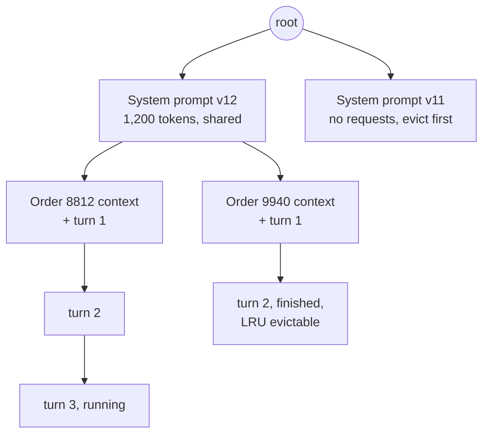

**Reading the diagram.** Each edge carries a run of tokens, each node the KV blocks for that run. All current conversations share the system-prompt node; each order's context and turns hang below it, so turn 3 of order 8812 reuses everything above it and prefills only its new message. Leaves no running request uses (the finished conversation, the retired prompt version) are evicted first. The tree lives in CPU memory; the blocks it references live in GPU memory, and some engines spill cold blocks to CPU memory or disk. Failure points: a single changed early token (a timestamp in the system prompt) creates a new branch and destroys reuse; eviction under memory pressure lowers the hit rate exactly at peak. Scaling: per-replica trees plus prefix-aware routing.

**Figure 73.10 — Prefix-aware routing across engine replicas.**


**Reading the diagram.** The router hashes a prompt prefix (or a conversation ID) and sends the request to the replica most likely to hold its KV blocks, similar to consistent hashing with bounded loads (§14.8). Replicas report load and cache contents asynchronously (dotted). When the preferred replica is overloaded, the router spills to another and accepts a recomputation. Failure points: pure affinity creates hot replicas for popular prefixes; pure load balancing destroys reuse. Scaling: adding a replica remaps only part of the hash space.

#### Mathematical foundations

::: formula
**Prefill saved and concurrency gained by prefix sharing**

$$T'_\text{prefill} = (1 - h)\,T_\text{prefill} \qquad S'_\text{max} = \left\lfloor \frac{T_\text{KV} - n_\text{sh}}{n_\text{in} + n_\text{out} - n_\text{sh}} \right\rfloor$$

| Symbol | Meaning | Units |
|---|---|---|
| $h$ | Token-level prefix hit fraction: cached prompt tokens ÷ prompt tokens | dimensionless |
| $T_\text{prefill}$, $T'_\text{prefill}$ | Prefill time without and with reuse | s |
| $T_\text{KV}$ | KV pool capacity | tokens |
| $n_\text{sh}$ | Tokens of the prefix shared by all running sequences (stored once) | tokens |
| $S'_\text{max}$ | Concurrent sequences with one shared copy of the prefix | sequences |
:::

::: example
**Worked example — Prefix-cache economics for the chatbot.** $n_\text{in} = 2{,}000$ with a 1,200-token shared system prompt; $n_\text{out} = 200$; $T_\text{KV} = 102{,}997$ tokens; prefill 56.6 ms; 60,000 calls a day.

1. *System prompt only,* $h = 0.6$: prefill $0.4 \times 56.6 = 22.6$ ms, cutting TTFT by 34 ms. GPU time per request falls from 0.170 s (§73.15) to $0.170 - 0.034 = 0.136$ s, 20% less.
2. *Multi-turn reuse too*, assume average $h = 0.8$: prefill 11.3 ms; 0.125 GPU-s per request.
3. *Concurrency:* $S' = \lfloor (102{,}997 - 1{,}200)/(2{,}200 - 1{,}200) \rfloor = 101$ versus 46.
4. *But decode reads:* each sequence still attends over all 2,100 tokens; with a standard kernel, $t_\text{step}(101) = 2 + (14 + 101 \times 2{,}100 \times 524{,}288 \times 10^{-9})/2.68 = 2 + 125.2/2.68 = 48.7$ ms, close to a 50 ms TPOT SLO; 2,074 tokens/s, +18%. A kernel that reads the shared 1,200 tokens once per step needs $14 + 0.63 + 101 \times 900 \times 524{,}288 \times 10^{-9} = 62.3$ GB: 25.2 ms and about 4,000 tokens/s.
5. *Money:* compute saved per day at $h = 0.6$: $60{,}000 \times 1{,}200 \times 28.3\ \mu\text{s} = 2{,}038$ GPU-s $= 0.57$ GPU-hours $\approx \$1.40$.

**Interpretation.** At QuickBite's volume the dollar saving on prefill is small; the real wins are TTFT, more than double the concurrency, and the option to use a kernel that exploits the shared prefix. At a large API provider the same fraction of prompt tokens is a major cost line, which is why several providers price cached input tokens at a discount (as of 2026). **Engineering implication.** Put stable content first (system prompt, tools, documents) and variable content last; version system prompts deliberately; route by conversation.
:::

::: industry
**SGLang and RadixAttention.** Zheng et al. store all cached prefixes in a radix tree in an LRU cache, schedule waiting requests in longest-shared-prefix order to raise hit rates, and pair this with a frontend language for multi-call LLM programs. They report up to 6.4× higher throughput than state-of-the-art systems across agent, reasoning, extraction, chat and few-shot workloads.
*Evidence: Primary* — [Zheng et al. 2024]
:::

::: warning
**Prefix caches are shared state.** Whether a prefix is cached changes TTFT, which a malicious tenant could use as a timing side channel to infer another tenant's prompts. In multi-tenant deployments scope cache keys per tenant (or salt them) and never share caches across trust boundaries (§47.12).
:::

::: mistake
**"A 90% cache hit ratio means 90% less prefill."** Hit ratios are often reported per *request* (any prefix matched) rather than per *token*. A request that matches 100 of 2,000 tokens counts as a hit but saves 5%. Measure $h$ as cached tokens over prompt tokens.
:::

## 73.9 Attention kernels

### 73.9.1 FlashAttention for prefill, split-KV kernels for decode

::: definition
**Definition — FlashAttention and decode attention kernels.** **FlashAttention** computes exact attention by tiling queries, keys and values into blocks that fit in on-chip SRAM and combining blocks with an **online softmax** (running maximum and sum), so the $n \times n$ score matrix never travels to HBM [Dao et al. 2022]. **FlashAttention-2** improves work partitioning across thread blocks and warps [Dao 2024]; **FlashAttention-3** uses Hopper's asynchronous copy and FP8 features [Shah et al. 2024]. **Decode kernels** handle one query token per sequence against a long, paged KV cache; **Flash-Decoding** splits the KV sequence into chunks processed in parallel and merges their partial results [Dao et al. 2023].
:::

#### First-principles explanation

Attention is a giant comparison of every query with every key. A naive implementation writes the whole comparison table to slow memory and reads it back, like photocopying every page of a book to look up one word. FlashAttention reads a chapter at a time into a small desk, keeps a running summary, and never writes the full table. In decode, the problem flips: there is one query and a long book; the issue is getting enough readers to read different chapters at once.

#### How it works internally

Chapter 64 (§64.13) explained FlashAttention's tiling. For serving, three points matter:

1. **Prefill** attention is compute-heavy; FlashAttention removes the quadratic memory traffic and memory footprint, making long prompts feasible. FlashAttention-2 roughly doubles FlashAttention's speed, reaching 50–73% of A100 peak [Dao 2024]; FlashAttention-3 reports 1.5–2.0× over FlashAttention-2 on H100 with BF16 at up to 75% utilization [Shah et al. 2024].
2. **Decode** attention reads every cached key and value once per step and does about $g$ FLOPs per byte, where $g$ is query heads per KV head: memory-bound for every common shape.
3. With small batches and long contexts, one thread block per (sequence, head) leaves most streaming multiprocessors (SMs) idle. Flash-Decoding adds a split over the sequence, then a small reduction rescales and sums partial outputs with their log-sum-exp statistics. Paged variants follow block tables (§73.7).

**Figure 73.11 — Flash-Decoding: split the KV sequence, compute partial attention in parallel, merge.**


**Reading the diagram.** One query vector meets a 32,768-token cache split into 16 chunks, each handled by a separate thread block that reads its blocks from the paged cache in HBM (the storage boundary) via the block table. Each chunk returns a partial output plus its softmax maximum and sum; the reduction rescales and combines them so the result is exact. All steps are synchronous within one kernel launch (or two). Failure point: for short contexts, splitting adds reduction overhead with no benefit, so kernels choose the split count by heuristics. Scaling: splits multiply the parallel work units available to fill the GPU.

#### Mathematical foundations

::: formula
**Attention memory traffic and decode-attention intensity**

$$Q_\text{std} = \Theta(n\,d + n^2) \qquad Q_\text{flash} = \Theta\!\left(\frac{n^2 d^2}{M}\right) \qquad I_\text{dec} \approx \frac{4\,d\,g}{2\,d\,b_\text{kv}} = \frac{2g}{b_\text{kv}}$$

| Symbol | Meaning | Units |
|---|---|---|
| $Q_\text{std}$, $Q_\text{flash}$ | HBM accesses of standard attention and FlashAttention, per head [Dao et al. 2022] | elements |
| $n$ | Sequence length | tokens |
| $d$ | Head dimension | values |
| $M$ | On-chip SRAM per SM, in elements | elements |
| $I_\text{dec}$ | Decode attention FLOPs per KV byte read | FLOP/byte |
| $g$ | Query heads sharing one KV head (1 for MHA) | heads |
| $b_\text{kv}$ | Bytes per KV element | bytes |
:::

::: example
**Worked example — Prefill traffic and decode parallelism.** H100: about 228 KB of shared memory per SM, roughly $10^5$ FP16 elements (assumed usable); 132 SMs.

1. *Prefill, $n = 8{,}192$, $d = 128$.* $n^2 = 6.7 \times 10^7$ elements; $n^2 d^2/M = 6.7 \times 10^7 \times 16{,}384/10^5 = 1.1 \times 10^7$: about 6× fewer HBM accesses, and no $n \times n$ buffer (134 MB per head per layer in FP16).
2. *Decode intensity.* MHA, FP16: $I = 2 \times 1/2 = 1$ FLOP/byte; 70B GQA ($g = 8$): 8 FLOP/byte. The H100 ridge point is $989/3.35 \approx 295$ FLOP/byte (§64.9): both are memory-bound by a wide margin.
3. *Decode parallelism.* Batch 1, 32 heads, context 32,768: one block per head gives 32 blocks for 132 SMs, at most 24% of SMs busy. With 16 splits: 512 blocks, about 3.9 per SM.

**Interpretation.** FlashAttention makes prefill attention fast and memory-light; decode attention is pure bandwidth, so its kernel goal is to keep every SM streaming KV bytes. **Engineering implication.** Long-context, small-batch workloads (document chat, agents) need split-KV decode kernels; large-batch, short-context workloads already have enough parallelism. Engines choose among kernel libraries per hardware; verify which one is active when profiling.
:::

::: industry
**Flash-Decoding.** Dao, Haziza, Massa and Sizov described the split-KV approach for long-context inference and reported up to 8× faster generation for very long sequences compared with prior attention implementations, by keeping the GPU fully occupied when batch size is small.
*Evidence: Primary* — [Dao et al. 2023]
:::

::: mistake
**"FlashAttention is an approximation."** It is exact (up to floating-point rounding order); it reorders computation to avoid memory traffic. Approximate methods (sparse or linear attention) are different algorithms that change model outputs.
:::

## 73.10 Speculative decoding

### 73.10.1 Draft, verify, accept

::: definition
**Definition — Speculative decoding.** A technique that produces several tokens per forward pass of the large **target** model: a cheap **draft** proposes $\gamma$ tokens, the target scores all of them in one parallel pass, and a modified rejection-sampling rule accepts a prefix of the draft and samples one corrected or bonus token, so that the output distribution is *exactly* the target's [Leviathan et al. 2023; Chen et al. 2023]. The **acceptance rate** $\alpha$ is the expected probability that the target accepts a draft token.
:::

#### First-principles explanation

A senior editor is slow to write but can check a paragraph in the time it takes to write one word, because checking is parallel. A junior writer drafts four words; the editor reads all four at once, keeps the ones they would have written, fixes the first wrong one, and the junior starts again from there. When the junior guesses well, the pair writes several words per editor-turn.

#### Why does this exist?

Decode is memory-bound: a step that verifies 5 tokens per sequence reads the same weights as a step that produces 1 (§73.3). Spare compute is free if it can be turned into accepted tokens. Speculative decoding converts it into lower TPOT without changing outputs.

#### How it works internally

1. The draft model generates $\gamma$ tokens autoregressively (cheap: small model, extra heads or n-gram lookup).
2. The target runs one forward pass over the context plus the $\gamma$ draft tokens, producing its distributions $p$ at each position.
3. For each draft token $x$ in order, accept with probability $\min(1, p(x)/q(x))$, where $q$ is the draft's distribution.
4. At the first rejection, sample a replacement from the normalized residual $\max(0, p - q)$ and stop; if all $\gamma$ are accepted, sample one bonus token from $p$.
5. Discard KV entries of rejected tokens and repeat.

**Figure 73.12 — One speculative iteration with $\gamma = 4$.**

```mermaid
sequenceDiagram
  participant D as Draft model
  participant T as Target model
  participant S as Sampler
  D->>D: propose d1, d2, d3, d4, four cheap steps
  D->>T: context + d1..d4
  T->>T: one forward pass, scores 5 positions
  T->>S: target distributions p1..p5
  S->>S: accept d1, d2; reject d3
  S->>S: sample replacement for d3 from residual
  S-->>D: commit d1, d2, d3', roll back d4
```

**Reading the diagram.** The draft proposes four tokens sequentially; the target verifies them in a single parallel pass (synchronous). The sampler accepts the first two, rejects the third and resamples it from the residual distribution, so three tokens are committed for one target pass; the draft's fourth token and the KV entries beyond the commit point are discarded. State lives in two KV caches (draft and target), both rolled back. Failure points: low acceptance wastes the draft's work; at large batch the verification pass is no longer free. Scaling: tree-structured drafts verify several candidate continuations in one pass.

#### Mathematical foundations

::: formula
**Expected tokens per target pass and wall-clock speed-up** [Leviathan et al. 2023]

$$E[\text{tokens}] = \frac{1 - \alpha^{\gamma + 1}}{1 - \alpha} \qquad S = \frac{1 - \alpha^{\gamma + 1}}{(1 - \alpha)(\gamma c + 1)} \qquad \alpha = \sum_x \min\big(p(x), q(x)\big)$$

| Symbol | Meaning | Units |
|---|---|---|
| $\alpha$ | Acceptance rate (assumed i.i.d. per token) | dimensionless |
| $\gamma$ | Draft tokens per iteration | tokens |
| $c$ | Cost of one draft step ÷ cost of one target step | dimensionless |
| $E[\text{tokens}]$ | Tokens committed per target forward pass | tokens |
| $S$ | Speed-up over plain decoding, assuming verification costs one target step | dimensionless |
| $p$, $q$ | Target and draft next-token distributions | probabilities |
:::

::: example
**Worked example — A draft with $\alpha = 0.8$, $\gamma = 4$, $c = 0.05$.**

1. $\alpha^{5} = 0.32768$; $E = (1 - 0.32768)/0.2 = 3.36$ tokens per target pass.
2. Cost per iteration: $4 \times 0.05 + 1 = 1.2$ target-step units.
3. $S = 3.36/1.2 = 2.80$: TPOT falls from 26.1 ms to about 9.3 ms if verification is free.
4. Weaker draft, $\alpha = 0.6$: $E = (1 - 0.07776)/0.4 = 2.31$; $S = 1.92$.
5. Poor draft, $\alpha = 0.3$, $c = 0.2$: $E = 1.43$; $S = 1.43/1.8 = 0.79$, a 21% *slowdown*.

**Interpretation.** Speed-up depends on acceptance far more than on $\gamma$, and an expensive or poorly aligned draft makes things worse. **Engineering implication.** Measure $\alpha$ on production traffic (it varies by domain, sampling temperature and language) before enabling speculation.
:::

#### Code example: formula versus Monte Carlo

```python
import numpy as np

def expected_tokens(alpha, gamma):
    """Leviathan et al. 2023: mean tokens produced per target forward pass."""
    return (1 - alpha ** (gamma + 1)) / (1 - alpha)

def expected_speedup(alpha, gamma, c):
    """Walltime speed-up over plain decoding; c = draft cost / target cost."""
    return expected_tokens(alpha, gamma) / (gamma * c + 1)

def monte_carlo(alpha, gamma, c, n_tokens=200_000, seed=42):
    rng = np.random.default_rng(seed)
    produced = iterations = 0
    while produced < n_tokens:
        accepted = 0
        while accepted < gamma and rng.random() < alpha:   # i.i.d. acceptance
            accepted += 1
        produced += accepted + 1        # +1: target's correction or bonus token
        iterations += 1
    cost = iterations * (gamma * c + 1)    # in units of one target step
    return produced / iterations, produced / cost

print(f"{'alpha':>5} {'gamma':>5} {'c':>5} {'E[tok] formula':>15} {'MC':>6}"
      f" {'speed-up formula':>17} {'MC':>6}")
for alpha, gamma, c in [(0.8, 4, 0.05), (0.6, 4, 0.05), (0.8, 8, 0.05),
                        (0.6, 8, 0.05), (0.3, 4, 0.2)]:
    e, s = expected_tokens(alpha, gamma), expected_speedup(alpha, gamma, c)
    e_mc, s_mc = monte_carlo(alpha, gamma, c)
    print(f"{alpha:>5} {gamma:>5} {c:>5} {e:>15.3f} {e_mc:>6.3f} {s:>17.3f} {s_mc:>6.3f}")

for alpha in (0.6, 0.8):
    best = max(range(1, 13), key=lambda g: expected_speedup(alpha, g, 0.05))
    print(f"alpha={alpha}: best gamma={best},"
          f" speed-up={expected_speedup(alpha, best, 0.05):.2f}")

# Real speculative sampling on a toy 5-token vocabulary (Chen et al. 2023 rule).
rng = np.random.default_rng(0)
p = np.array([0.50, 0.20, 0.15, 0.10, 0.05])     # target model
q = np.array([0.35, 0.30, 0.15, 0.10, 0.10])     # draft model
alpha = np.minimum(p, q).sum()
resid = np.maximum(p - q, 0) / np.maximum(p - q, 0).sum()
out, iters, gamma = [], 0, 4
while len(out) < 200_000:
    iters += 1
    for _ in range(gamma):
        x = rng.choice(5, p=q)
        if rng.random() < min(1.0, p[x] / q[x]):
            out.append(x)                          # draft token accepted
        else:
            out.append(rng.choice(5, p=resid))     # corrected token, stop
            break
    else:
        out.append(rng.choice(5, p=p))             # all accepted: bonus token
freq = np.bincount(out, minlength=5) / len(out)
print(f"alpha = {alpha:.2f}; tokens/iteration = {len(out)/iters:.3f}"
      f" (formula {expected_tokens(alpha, gamma):.3f})")
print("target p     :", p)
print("sampled freq :", freq.round(3))
```

Output:

```text
alpha gamma     c  E[tok] formula     MC  speed-up formula     MC
  0.8     4  0.05           3.362  3.363             2.801  2.802
  0.6     4  0.05           2.306  2.304             1.921  1.920
  0.8     8  0.05           4.329  4.332             3.092  3.094
  0.6     8  0.05           2.475  2.475             1.768  1.768
  0.3     4   0.2           1.425  1.426             0.792  0.792
alpha=0.6: best gamma=4, speed-up=1.92
alpha=0.8: best gamma=8, speed-up=3.09
alpha = 0.85; tokens/iteration = 3.717 (formula 3.709)
target p     : [0.5  0.2  0.15 0.1  0.05]
sampled freq : [0.499 0.201 0.149 0.1   0.05 ]
```

What to notice:

- The Monte Carlo agrees with the closed form to three decimals, confirming the formula under its i.i.d. acceptance assumption.
- The best $\gamma$ grows with $\alpha$ (4 at 0.6, 8 at 0.8), but the curve is flat near the optimum: $\gamma = 4$ at $\alpha = 0.8$ already gives 2.80 versus 3.09.
- The toy run uses the real accept/reject rule: acceptance equals $\sum \min(p, q) = 0.85$, and the sampled token frequencies match the *target* distribution $p$, not the draft's $q$. Speculation is lossless.

#### When it hurts

::: example
**Worked example — Speculation on the 70B replica at batch 183.** §73.5: per-GPU memory time 24.8 ms; $\alpha = 0.8$, $\gamma = 4$, $c = 0.05$.

1. Verification processes $183 \times 5 = 915$ tokens per step. Compute per GPU: $2 \times 70 \times 10^9 \times 915 / 4 / 494.5 \times 10^{12} = 64.8$ ms, which exceeds the 24.8 ms memory time: the step becomes compute-bound at $64.8 + 2 = 66.8$ ms instead of 26.8 ms.
2. Draft cost: $4 \times 0.05 \times 26.8 = 5.4$ ms. Iteration: 72.2 ms for 3.36 tokens per sequence.
3. Effective speed-up: $3.36 \times 26.8 / 72.2 = 1.25$, not 2.80. With the 7B model at batch 46, verification needs $2 \times 7 \times 10^9 \times 230 / 494.5 \times 10^{12} = 6.5$ ms of compute, under its 24.1 ms memory time, so the full gain survives.

**Interpretation.** Speculation spends spare compute; at large batch there is none left. **Engineering implication.** Enable speculation for latency-sensitive, small-to-medium-batch serving, and let the engine reduce $\gamma$ or disable it as the batch grows. Count the draft's own KV cache and weights in the memory budget.
:::

**Table 73.7 — Speculative decoding variants.**

| Variant | Draft source | Strength | Watch out for |
|---|---|---|---|
| Draft model [Leviathan et al. 2023; Chen et al. 2023] | Small model of the same family | General; 2–3× reported | Needs a matched tokenizer; extra memory |
| Medusa [Cai et al. 2024] | Extra decoding heads on the target, tree verification | No separate model; 2.2–3.6× reported | Heads must be trained per model |
| EAGLE [Li et al. 2024] | Light head predicting next *features* | High acceptance; 2.7–3.5× on LLaMA2-Chat 70B reported | Per-model training |
| N-gram / prompt lookup | Copy spans from the prompt or history | Free; strong for RAG, editing, code | Useless for novel text |

::: industry
**Reported speed-ups.** Leviathan et al. reported 2–3× faster T5-XXL inference with identical outputs; Chen et al. reported 2–2.5× decoding speed-up for Chinchilla 70B in a distributed setup; Medusa reported over 2.2× (Medusa-1) and 2.3–3.6× (Medusa-2); EAGLE reported 2.7–3.5× latency speed-up on LLaMA2-Chat 70B. All are batch-1 or small-batch measurements.
*Evidence: Primary* — [Leviathan et al. 2023; Chen et al. 2023; Cai et al. 2024; Li et al. 2024]
:::

::: mistake
**"Speculative decoding trades quality for speed."** With the rejection-sampling rule, outputs follow the target distribution exactly (greedy decoding gives identical tokens). Quality changes only if an engine uses a relaxed, lossy acceptance rule, which should be an explicit choice.
:::

## 73.11 Parallelism for inference

### 73.11.1 Tensor, pipeline and expert parallelism at serving time

::: definition
**Definition — Inference parallelism.** **Tensor parallelism (TP)** splits every layer's matrices (and attention heads, hence KV heads) across $t$ GPUs that cooperate on every token, with all-reduces inside each layer (§65.10). **Pipeline parallelism (PP)** places consecutive groups of layers on different GPUs or nodes and passes activations between stages (§65.11). **Expert parallelism (EP)** places the experts of mixture-of-experts layers on different GPUs and routes each token to its experts with all-to-all exchanges (§65.12.2, §72.13). **Data parallelism** for inference is simply independent replicas.
:::

#### First-principles explanation

Training parallelism (Chapter 65) optimizes throughput over hours. Serving must also hit a per-token deadline every 20–50 ms, so communication on the critical path of *each token* matters. TP cuts per-token latency (each GPU reads a quarter of the weights) but talks four times per layer pair; PP talks once per stage but adds a hop to every token; EP lets a model with hundreds of billions of parameters run while each token touches only a few experts.

#### How it works internally

1. **Fit the weights and KV cache** (§73.5): choose the smallest TP degree within one NVLink domain that leaves room for the target concurrency.
2. **Cross nodes with PP, not TP,** when one node is too small: one activation transfer per stage per step, tolerable on InfiniBand. Keep multiple micro-batches in flight or later stages idle.
3. **MoE models:** shard experts with EP (often combined with data-parallel attention), because each token's all-to-all moves only its hidden vector to $k$ experts.
4. **Replicate** the resulting unit for throughput.

**Figure 73.13 — A 70B replica: TP within each node, PP across two nodes.**


**Reading the diagram.** Each node holds half of the 80 layers, split four ways by TP; the four GPUs all-reduce twice per layer over NVLink (synchronous, on the critical path). Between nodes only one activation tensor per step crosses InfiniBand. Weights and KV shards stay in each GPU's HBM. Failure points: any one GPU failing stalls the whole replica (eight GPUs share fate); a straggler GPU sets the pace of every all-reduce. Scaling: this layout serves the FP16 model with room for a large KV cache when one 4-GPU group is not enough; on an 8-GPU node, TP=8 avoids the cross-node hop entirely.

#### Mathematical foundations

::: formula
**Communication per token per GPU**

$$V_\text{TP} = 2 L \cdot 2\,\frac{t - 1}{t} \cdot h\,b_\text{a} \qquad V_\text{PP} = (p - 1)\,h\,b_\text{a} \qquad V_\text{EP} = 2\,k_\text{e}\,h\,b_\text{a} \text{ per MoE layer}$$

| Symbol | Meaning | Units |
|---|---|---|
| $V_\text{TP}$ | Bytes sent per GPU per token for two ring all-reduces per layer (forward only) | bytes/token |
| $L$, $h$ | Layers and hidden size | layers, values |
| $t$ | Tensor-parallel degree | GPUs |
| $b_\text{a}$ | Bytes per activation value (2 for BF16) | bytes |
| $V_\text{PP}$ | Bytes crossing stage boundaries per token, $p$ stages | bytes/token |
| $V_\text{EP}$ | Dispatch plus combine bytes per token per MoE layer, top-$k_\text{e}$ routing | bytes/token |
:::

::: example
**Worked example — TP communication for the 70B model, $t = 4$.** $L = 80$, $h = 8{,}192$, $b_\text{a} = 2$; NVLink at an achieved 360 GB/s and InfiniBand at 40 GB/s per GPU (§65.10); assume 8 µs latency per small all-reduce.

1. $V_\text{TP} = 160 \times 1.5 \times 8{,}192 \times 2 = 3.93$ MB per token per GPU.
2. *Decode step, batch 183:* $183 \times 3.93 = 720$ MB: 2.0 ms on NVLink, plus $160 \times 8\ \mu\text{s} = 1.3$ ms of latency, about 3.3 ms on top of the 26.8 ms step (12%).
3. *Prefill, 2,000 tokens:* 7.86 GB: 21.8 ms on NVLink against 141.6 ms of compute (15%, and overlappable in part); across nodes at 40 GB/s, 197 ms (139% of compute).
4. *PP instead across 2 nodes:* $V_\text{PP} = 1 \times 8{,}192 \times 2 = 16$ kB per token; a 183-token decode step sends 3 MB, 75 µs at 40 GB/s.
5. *MoE (Mixtral-8×7B-like:* $h = 4{,}096$, 32 MoE layers, top-2): $V_\text{EP} = 2 \times 2 \times 4{,}096 \times 2 = 32.8$ kB per layer, 1.05 MB per token.

**Interpretation.** TP moves megabytes per token and must stay on NVLink; PP moves kilobytes per token and tolerates the network; EP sits between and needs a fast all-to-all. **Engineering implication.** TP inside the node for latency, PP or EP across nodes for capacity, replicas for throughput. Note that the 4-GPU TP decode step still costs 3.3 ms of communication that a single-GPU (quantized) deployment avoids (§73.13).
:::

**Figure 73.14 — Expert parallelism: tokens dispatched to experts on other GPUs and combined back.**

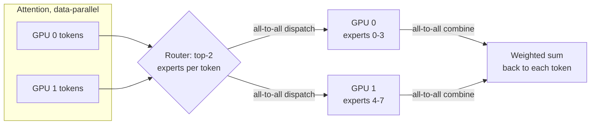

**Reading the diagram.** After attention, a router picks two experts per token; an all-to-all sends each token's hidden vector to the GPUs holding those experts, the experts compute, and a second all-to-all returns results to be combined. Both exchanges are synchronous within the layer. Each GPU stores only its experts' weights. Failure points: unbalanced routing overloads one GPU (hot experts) and stalls the layer; a slow link slows every MoE layer. Scaling: more GPUs hold more experts; large decode deployments spread experts over many nodes so each GPU serves few experts with large batches.

**Table 73.8 — Inference parallelism compared.**

| Row | Tensor (TP) | Pipeline (PP) | Expert (EP) | Replicas |
|---|---|---|---|---|
| What it splits | Each layer's matrices and heads | Groups of layers | MoE experts | Nothing |
| Latency per token | Lower (less weight read per GPU) | Higher (hops) | Neutral to lower | Unchanged |
| Communication | All-reduce ×2 per layer | One send per stage | All-to-all ×2 per MoE layer | None |
| Link needed | NVLink | Network is fine | Fast network or NVLink | None |
| Choose when | Weights + KV exceed one GPU | Model exceeds one node | MoE models | Need more throughput |

::: industry
**Partitioning for latency and throughput.** Pope et al. derived communication costs of several tensor-partitioning layouts for TPU inference and showed that the best layout depends on phase and batch size: layouts that minimize weight movement for small-batch decode differ from those for large-batch prefill.
*Evidence: Primary* — [Pope et al. 2023]
:::

::: mistake
**"More GPUs per replica always lower latency."** Beyond the point where weight reads stop dominating, TP adds all-reduce latency per layer (160 per step for 80 layers) and reduces each GPU's matrix sizes below efficient shapes. Measure TPOT at $t = 2, 4, 8$ before choosing.
:::

## 73.12 Disaggregated prefill and decode

### 73.12.1 Separate fleets for the two phases

::: definition
**Definition — Prefill–decode disaggregation.** Running prefill and decode on different GPU pools: **prefill instances** process prompts and produce the KV cache, which is transferred to **decode instances** that generate the remaining tokens. Each pool gets its own parallelism, batch policy and scale [Zhong et al. 2024; Patel et al. 2024].
:::

#### First-principles explanation

A restaurant can make one cook alternate between slow-roasting meat and plating desserts, or give each task its own station and pass trays between them. Separate stations stop the roast from delaying the desserts, at the cost of carrying trays.

#### Why does this exist?

Colocated phases interfere: a long prefill stalls every decode stream (ITL spikes, §73.6); keeping decode smooth forces small prefill chunks that raise TTFT. The phases also want different things: prefill is compute-bound and benefits from more TP for long prompts; decode is memory-bound and wants large batches. DistServe framed the goal as maximizing per-GPU goodput under separate TTFT and TPOT SLOs; Splitwise added that phases can even use different GPU generations, matching compute-rich hardware to prefill and memory-bandwidth-rich (or cheaper, lower-power) hardware to decode.

**Figure 73.15 — Disaggregated serving with KV transfer.**


**Reading the diagram.** The router sends each prompt to a prefill instance, which computes the KV cache and first token and ships the cache to a decode instance over RDMA (InfiniBand or RoCE) or NVLink within a node. The decode instance streams the rest. Both pools report load asynchronously so the scheduler can pair them. An optional KV store tier also serves prefix caching across instances. Failure points: KV transfer bandwidth becomes a bottleneck; a decode instance with no free blocks blocks the hand-off; losing a decode instance loses every KV cache it holds. Scaling: each pool scales on its own metric (prompt tokens/s and concurrent sequences).

#### Mathematical foundations

::: formula
**KV transfer time relative to prefill time**

$$T_\text{KV} = \frac{n_\text{in}\,k}{W_\text{link}} \qquad R = \frac{T_\text{KV}}{T_\text{prefill}} = \frac{k\,F_\text{eff}}{2N\,W_\text{link}}$$

| Symbol | Meaning | Units |
|---|---|---|
| $T_\text{KV}$ | Time to move one prompt's KV cache | s |
| $W_\text{link}$ | Transfer bandwidth between the instances (sum over parallel links) | bytes/s |
| $R$ | Transfer time as a fraction of prefill time: independent of prompt length | dimensionless |
| $k$, $N$, $F_\text{eff}$ | KV bytes per token, parameters, prefill FLOP/s of the instance | as above |
:::

::: example
**Worked example — Does disaggregation pay for QuickBite?** One 400 Gb/s NIC is 50 GB/s.

1. *7B MHA, one GPU, one NIC:* $T_\text{KV} = 2{,}000 \times 524{,}288 / 50 \times 10^9 = 21$ ms against 56.6 ms of prefill; $R = 524{,}288 \times 494.5 \times 10^{12}/(1.4 \times 10^{10} \times 50 \times 10^9) = 0.37$.
2. *70B GQA, TP=4, four NICs (200 GB/s):* $T_\text{KV} = 2{,}000 \times 327{,}680 / 200 \times 10^9 = 3.3$ ms against 141.6 ms; $R = 0.023$.
3. *Pool ratio for the 7B chatbot:* GPU-seconds per request are 0.0566 for prefill and $200 \times 26.1/46 = 113.5$ ms for decode (§73.15), so about one prefill GPU per two decode GPUs.
4. QuickBite's peak needs about 1.2 busy GPUs in total (§73.15): splitting into pools with redundancy in each would need at least four GPUs instead of three.

**Interpretation.** Transfer is cheap for large GQA models and noticeable for small MHA models; it can overlap with prefill layer by layer. **Engineering implication.** Disaggregation pays at scale (many GPUs per pool), with tight TPOT SLOs and long prompts; for a three-GPU chatbot, chunked prefill (§73.14) gets most of the benefit with no transfer.
:::

::: industry
**DistServe and Splitwise.** Zhong et al. reported that disaggregation with phase-specific parallelism lets DistServe serve up to 7.4× more requests or meet 12.6× tighter SLOs than state-of-the-art colocated systems while keeping over 90% of requests within latency constraints. Patel et al., analyzing production traces of two LLM services at Microsoft, reported Splitwise clusters with 1.4× higher throughput at 20% lower cost, or 2.35× more throughput under the same power and cost budgets. As of 2026, major open-source engines and NVIDIA's Dynamo framework offer disaggregated modes.
*Evidence: Primary* — [Zhong et al. 2024; Patel et al. 2024]
:::

## 73.13 Quantization for serving

### 73.13.1 Weights, activations and the KV cache

::: definition
**Definition — KV-cache quantization.** Storing cached keys and values in fewer bits than the activations that produced them (FP8 or INT8 with per-tensor, per-head or per-token scales; research formats down to 2 bits), dequantizing inside the attention kernel. It complements **weight quantization** (W8A8, W4A16; Chapter 67 owns GPTQ, AWQ, SmoothQuant and FP8 recipes, §67.6).
:::

#### Why does this exist?

§73.3 showed that at full batch the 7B chatbot reads 50.6 GB of KV cache per step against 14 GB of weights. Weight quantization shrinks the fixed cost and frees memory; KV quantization halves the dominant, per-sequence cost and doubles concurrency.

#### How it works internally

1. **Weights:** W4A16 (AWQ, GPTQ) or FP8 W8A8 loaded once; kernels dequantize in registers (§67.6).
2. **KV write:** after each layer computes keys and values, the kernel scales and rounds them into FP8 or INT8 blocks.
3. **KV read:** the attention kernel loads low-bit blocks and dequantizes on chip; bytes read per step fall in proportion.
4. **Validate:** quality on long-context and task evaluations (Chapter 78), since key outliers can hurt at low bits; methods such as KIVI quantize keys per channel and values per token to reach 2 bits [Liu et al. 2024].

#### Mathematical foundations

The memory-budget and step-time formulas of §73.3 and §73.5 apply with $M_\text{w} = N b_\text{w}/8$ and $k \propto b_\text{kv}$, so throughput per GPU is $S_\text{max}/t_\text{step}(S_\text{max})$.

::: example
**Worked example — Four precision plans for the 7B chatbot on one H100.** Same assumptions as §73.5; INT4 weights with $g = 128$ use 4.125 bits per weight (3.61 GB, §67.3).

**Table 73.9 — Serving precision for the 7B chatbot.**

| Plan | Weights | KV bytes per token | KV pool | Sequences | TPOT | Output tokens/s per GPU |
|---|---|---|---|---|---|---|
| FP16 W, FP16 KV | 14.0 GB | 524,288 | 54.0 GB | 46 | 26.1 ms | 1,761 |
| FP16 W, FP8 KV | 14.0 GB | 262,144 | 54.0 GB | 93 | 26.3 ms | 3,532 |
| INT4 W, FP16 KV | 3.61 GB | 524,288 | 64.4 GB | 55 | 25.9 ms | 2,120 |
| INT4 W, FP8 KV | 3.61 GB | 262,144 | 64.4 GB | 111 | 26.1 ms | 4,245 |

1. Row 4 pool: $72 - 3.61 - 4 = 64.4$ GB; tokens $64.4 \times 10^9/262{,}144 = 245{,}600$; sequences $\lfloor 245{,}600/2{,}200 \rfloor = 111$.
2. Row 4 step: $2 + (3.61 + 111 \times 2{,}100 \times 262{,}144 \times 10^{-9})/2.68 = 2 + (3.61 + 61.1)/2.68 = 26.1$ ms.
3. Row 3 for contrast: 55 sequences, $2 + (3.61 + 60.6)/2.68 = 25.9$ ms; the batch grows only 20% because KV, not weights, dominates.

**Interpretation.** For this MHA model, KV quantization doubles throughput while weight quantization alone adds 20%; together they give 2.4×. The TPOT stays near 26 ms because each plan fills memory to the same bandwidth-limited step. **Engineering implication.** Quantize what dominates the bytes. For small models with large KV caches that is the KV cache; for large GQA models on few GPUs it is the weights (a 70B INT4 model fits on one GPU with 44 GB for KV cache, §67.6), which also removes TP communication.
:::

**Table 73.10 — Quantization options for LLM serving (as of 2026).**

| Option | Saves | Speeds | Quality risk | Notes |
|---|---|---|---|---|
| FP8 W8A8 | 2× weights vs FP16 | Prefill and decode | Low | Hopper-class and newer GPUs |
| INT4 W4A16 (AWQ, GPTQ) | ~3.9× weights | Decode; prefill can slow at large batch | Medium | Best when memory-bound |
| FP8 / INT8 KV cache | 2× KV | Decode attention, concurrency | Low–medium at long context | Engines expose a KV dtype option |
| 4-bit and lower KV | 4× or more KV | Same | Higher; research-grade | Validate per task |
| FP4 (microscaling, §64.10.4) | ~3.8× weights | Compute on Blackwell-class GPUs | Medium | Newer hardware only |

::: mistake
**"Quantization quality can be judged by perplexity alone."** Perplexity can stay flat while instruction following, arithmetic, long-context retrieval or safety behavior regress. Gate quantized models on task evaluations and human review (Chapter 78), on the same prompts as production.
:::

## 73.14 Scheduling and admission control

### 73.14.1 Who runs next, who waits, who is evicted

::: definition
**Definition — LLM scheduling terms.** **Admission control** decides whether a request may enter the running set (or the service at all). **Preemption** evicts a running sequence when KV memory runs out, either by **swapping** its KV blocks to CPU memory or by **recomputation** (dropping them and re-running prefill over prompt plus generated tokens later). **Chunked prefill** splits a long prompt into fixed-size chunks scheduled across several steps alongside decode tokens [Agrawal et al. 2024]. **SLO-aware scheduling** orders or rejects requests using predicted TTFT and TPOT against their targets.
:::

#### How it works internally

1. Each step has a **token budget** (for example 512–8,192 tokens): running decodes take one token each; the remainder goes to prefill chunks, oldest or highest-priority first.
2. Admission requires free KV blocks above a **watermark** so running sequences can grow.
3. If a running sequence cannot get a block, the scheduler preempts the most recently admitted (or lowest-priority) sequence; it later resumes by swap-in or recomputation, often helped by prefix caching.
4. **Fairness:** first-come-first-served lets one tenant's flood of long prompts delay everyone; fair schedulers count tokens served per client and favor the least served, as in the Virtual Token Counter [Sheng et al. 2024].
5. **Overload:** when predicted TTFT exceeds the SLO, reject early with a retryable error (§22.9) rather than queue unboundedly; rate-limit by tokens at the gateway.

**Figure 73.16 — States of a request in an engine with preemption.**

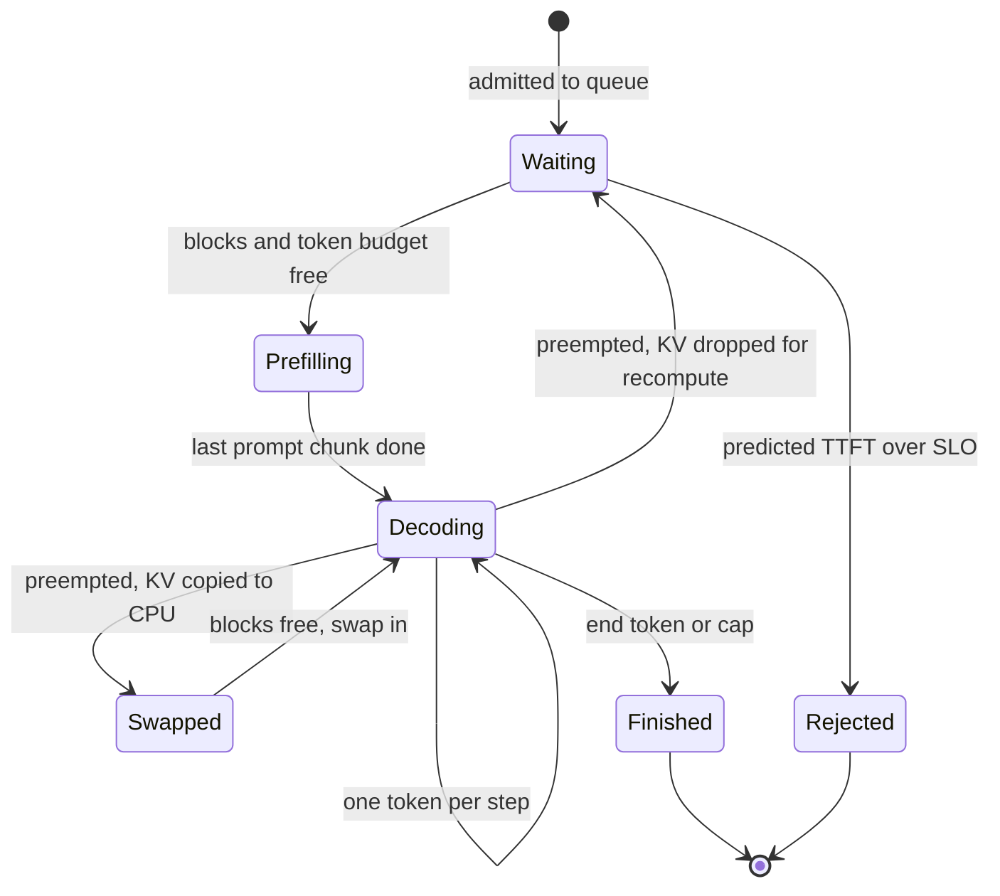

**Reading the diagram.** A request waits until blocks and budget allow its prefill, which may span several steps (chunks). Decoding loops one token per step. Under memory pressure it is preempted either to the swapped state (KV in CPU memory over PCIe) or back to waiting (KV discarded, to be recomputed). Admission control can reject before any GPU work. Transitions happen synchronously between steps. Failure points: preemption storms at peak cause ITL spikes and wasted compute; swapped sequences hold CPU memory. Scaling: rejected and preempted counts are the signals for adding replicas (§73.15).

#### Mathematical foundations

::: formula
**Preemption cost and the free chunk size**

$$T_\text{swap} = \frac{2\,n\,k}{W_\text{PCIe}\; t} \qquad T_\text{recomp} = \frac{2N\,n}{t\,F_\text{eff}} \qquad C^{*} = \frac{T_\text{mem}\,F_\text{eff}}{2N} - B$$

| Symbol | Meaning | Units |
|---|---|---|
| $T_\text{swap}$ | Out and back in over PCIe (factor 2), each of $t$ GPUs moving its shard | s |
| $n$ | Tokens held by the preempted sequence | tokens |
| $W_\text{PCIe}$ | Achieved host–GPU bandwidth per GPU | bytes/s |
| $T_\text{recomp}$ | Re-prefill of $n$ tokens | s |
| $C^{*}$ | Prefill tokens that fit in a decode step without lengthening it | tokens |
| $T_\text{mem}$ | Memory time of the decode step (§73.3) | s |
:::

::: example
**Worked example — Swap or recompute, and how big a chunk is free.** Assume $W_\text{PCIe} = 50$ GB/s achieved on PCIe Gen5 x16.

1. *7B, $n = 2{,}200$:* KV 1.15 GB; $T_\text{swap} = 2 \times 1.15/50 = 46$ ms; $T_\text{recomp} = 1.4 \times 10^{10} \times 2{,}200/494.5 \times 10^{12} = 62$ ms. Close; recomputation needs no CPU memory and can hit the prefix cache.
2. *70B, $t = 4$:* each GPU moves $2{,}200 \times 81{,}920 = 180$ MB: $T_\text{swap} = 7.2$ ms; $T_\text{recomp} = 1.4 \times 10^{11} \times 2{,}200/(4 \times 494.5 \times 10^{12}) = 156$ ms. Swapping wins by 20×.
3. *Free chunk at batch 46:* $T_\text{mem} = 24.1$ ms; $C^* = 0.0241 \times 494.5 \times 10^{12}/1.4 \times 10^{10} - 46 = 851 - 46 = 805$ tokens. A 512-token chunk adds compute that hides under the memory time; a whole 2,000-token prompt makes that step compute-bound at about $2 + 2{,}046 \times 0.0283 = 60$ ms, a 2.3× ITL spike for 45 streams.

**Interpretation.** The best preemption mode depends on the model's KV size relative to its compute: small MHA models are near break-even, large GQA models favor swapping. Chunks below $C^*$ are almost free. **Engineering implication.** Set the chunk size from $C^*$ for your model and batch, and choose the preemption mode per model; engines expose both settings (defaults differ by engine and version, as of 2026).
:::

::: industry
**Sarathi-Serve.** Agrawal et al. combined chunked prefills with "stall-free" scheduling that admits new prefill chunks without pausing ongoing decodes, and reported serving capacity gains under latency SLOs of 2.6× for Mistral-7B on one A100 and up to 3.7× for Yi-34B on two A100s relative to vLLM.
*Evidence: Primary* — [Agrawal et al. 2024]
:::

::: mistake
**"A deeper queue is safer than rejecting."** Beyond the goodput point, every queued request waits longer than its SLO and many users retry, adding load. Bound the queue by predicted TTFT, shed early, and return `Retry-After` (§22.9, §22.12).
:::

## 73.15 Autoscaling and capacity planning

### 73.15.1 From tokens to GPUs to dollars

#### How it works internally

1. **Characterize traffic:** requests/s at peak, input and output token distributions (p50 and p95), prefix-sharing fraction, SLOs.
2. **Measure or model per-GPU capacity at the SLO:** the batch that meets TPOT, and GPU-seconds per request $g_\text{req}$ (prefill plus share of decode).
3. **Size the fleet:** busy GPUs at peak divided by a target utilization, rounded to replicas, plus redundancy.
4. **Autoscale on LLM signals:** waiting requests, KV-cache usage, TTFT p95 and preemptions. GPU "utilization" reads near 100% whenever any request runs and is a poor signal (§64.11).
5. **Plan for cold start:** a new replica needs a node, the container image, the weights and warm-up (memory profiling, CUDA Graph capture): $T_\text{ready} = T_\text{node} + T_\text{image} + M_\text{w}/W_\text{load} + T_\text{warm}$, about a minute for the 7B model on a warm node and several minutes when a GPU node must be provisioned (§66.10). Keep headroom for that lead time.

::: formula
**Capacity plan and cost per million tokens**

$$g_\text{req} = t\left(T_\text{prefill} + \frac{n_\text{out}\,t_\text{step}(B)}{B}\right) \qquad R = \left\lceil \frac{\lambda_\text{peak}\,g_\text{req}}{\rho\,t} \right\rceil + r \qquad C_\text{1M} = \frac{p_\text{GPU}\,H_\text{GPU}}{T_\text{tokens}/10^6}$$

| Symbol | Meaning | Units |
|---|---|---|
| $g_\text{req}$ | GPU-seconds per request on a replica of $t$ GPUs | GPU-s |
| $\lambda_\text{peak}$ | Peak arrival rate | requests/s |
| $\rho$ | Target utilization, leaving headroom for bursts and cold start | dimensionless |
| $R$, $r$ | Replicas needed; redundant replicas (N+1: $r = 1$) | replicas |
| $p_\text{GPU}$ | Price per GPU-hour | \$/GPU-h |
| $H_\text{GPU}$ | GPU-hours provisioned per day | GPU-h |
| $T_\text{tokens}$ | Tokens (input + output) served per day | tokens |
| $C_\text{1M}$ | Blended cost per million tokens | \$ |
:::

#### Code example: memory and capacity calculator

```python
import math
from dataclasses import dataclass

GPU_GB, HBM_BW, BF16_FLOPS, PRICE = 80, 3.35e12, 989e12, 2.50   # H100 SXM, $/GPU-h
BW_EFF, MFU, T0 = 0.80, 0.50, 0.002                             # assumptions

@dataclass
class Model:
    name: str
    params: float      # parameters
    layers: int
    kv_heads: int
    head_dim: int
    w_bytes: float     # bytes per weight (2 = FP16, 1 = FP8/INT8)
    kv_bytes: float    # bytes per KV element

def kv_per_token(m):                                   # bytes, whole model
    return 2 * m.layers * m.kv_heads * m.head_dim * m.kv_bytes

def plan(m, tp, ctx_in, ctx_out, util=0.90, act_gb=2.0, fw_gb=2.0):
    w = m.params * m.w_bytes / tp                      # weight bytes per GPU
    kv_budget = util * GPU_GB * 1e9 - w - (act_gb + fw_gb) * 1e9
    kv_tok_gpu = kv_per_token(m) / tp                  # KV heads split by TP
    max_tokens = kv_budget / kv_tok_gpu                # per replica
    max_seqs = int(max_tokens // (ctx_in + ctx_out))
    avg_ctx = ctx_in + ctx_out / 2
    def tpot(b):                                        # memory-bound decode
        return T0 + (w + b * avg_ctx * kv_tok_gpu) / (BW_EFF * HBM_BW)
    prefill_s = 2 * m.params * ctx_in / (tp * MFU * BF16_FLOPS)
    gpu_s_per_req = tp * (prefill_s + ctx_out * tpot(max_seqs) / max_seqs)
    return dict(w_gb=w / 1e9, kv_gb=kv_budget / 1e9, kv_kb=kv_per_token(m) / 1e3,
                max_tokens=max_tokens, max_seqs=max_seqs,
                tpot_ms=tpot(max_seqs) * 1e3, prefill_ms=prefill_s * 1e3,
                tok_s_gpu=max_seqs / tpot(max_seqs) / tp,
                gpu_s_per_req=gpu_s_per_req)

models = [(Model("7B FP16, FP16 KV", 7e9, 32, 32, 128, 2, 2), 1),
          (Model("7B FP16, FP8 KV", 7e9, 32, 32, 128, 2, 1), 1),
          (Model("70B FP16, TP=4", 70e9, 80, 8, 128, 2, 2), 4)]
for m, tp in models:
    r = plan(m, tp, ctx_in=2000, ctx_out=200)
    print(f"{m.name:<17} weights/GPU {r['w_gb']:5.1f} GB | KV {r['kv_kb']:5.0f} kB/token,"
          f" budget {r['kv_gb']:4.1f} GB/GPU, {r['max_tokens']:9,.0f} tokens,"
          f" {r['max_seqs']:3d} seqs")
    print(f"{'':<17} TPOT {r['tpot_ms']:4.1f} ms | prefill {r['prefill_ms']:5.1f} ms |"
          f" {r['tok_s_gpu']:5.0f} output tok/s/GPU | {r['gpu_s_per_req']:.3f} GPU-s/request")

# QuickBite chatbot capacity plan (assumptions in Sec. 73.15).
conv_per_day, calls_per_conv, peak_to_avg, rho, peak_hours = 10_000, 6, 10, 0.6, 6
req_day = conv_per_day * calls_per_conv
peak_rps = req_day / 86_400 * peak_to_avg
tokens_day = req_day * 2200
print(f"requests/day {req_day:,}; peak {peak_rps:.1f} req/s; tokens/day {tokens_day/1e6:.0f} M")
for m, tp in (models[0], models[2]):
    r = plan(m, tp, 2000, 200)
    busy = peak_rps * r["gpu_s_per_req"]                 # GPUs busy at peak
    replicas = math.ceil(busy / (rho * tp)) + 1          # +1 for N+1 redundancy
    gpu_h = tp * (2 * 24 + (replicas - 2) * peak_hours)  # 2 replicas always on
    cost = gpu_h * PRICE
    floor = r["gpu_s_per_req"] / 3600 * PRICE / 2200 * 1e6
    print(f"{m.name:<17} busy {busy:4.2f} GPUs -> {replicas} replicas x {tp} GPU;"
          f" ${cost:,.0f}/day; ${cost / (tokens_day / 1e6):.2f} per 1M tokens"
          f" (100%-busy floor ${floor:.3f})")
```

Output:

```text
7B FP16, FP16 KV  weights/GPU  14.0 GB | KV   524 kB/token, budget 54.0 GB/GPU,   102,997 tokens,  46 seqs
                  TPOT 26.1 ms | prefill  56.6 ms |  1761 output tok/s/GPU | 0.170 GPU-s/request
7B FP16, FP8 KV   weights/GPU  14.0 GB | KV   262 kB/token, budget 54.0 GB/GPU,   205,994 tokens,  93 seqs
                  TPOT 26.3 ms | prefill  56.6 ms |  3532 output tok/s/GPU | 0.113 GPU-s/request
70B FP16, TP=4    weights/GPU  35.0 GB | KV   328 kB/token, budget 33.0 GB/GPU,   402,832 tokens, 183 seqs
                  TPOT 26.8 ms | prefill 141.6 ms |  1707 output tok/s/GPU | 0.683 GPU-s/request
requests/day 60,000; peak 6.9 req/s; tokens/day 132 M
7B FP16, FP16 KV  busy 1.18 GPUs -> 3 replicas x 1 GPU; $135/day; $1.02 per 1M tokens (100%-busy floor $0.054)
70B FP16, TP=4    busy 4.75 GPUs -> 3 replicas x 4 GPU; $540/day; $4.09 per 1M tokens (100%-busy floor $0.216)
```

What to notice:

- `plan` implements §73.5 (memory) and §73.3 (step time) and runs each configuration at its memory-limited batch, which here also meets a 50 ms TPOT SLO. TP communication is ignored (add about 3 ms per 70B step, §73.11).
- The 70B model's per-GPU output rate matches the 7B's, but its GPU-seconds per request are 4×, dominated by prefill (0.57 of 0.68 GPU-s): input-heavy chat makes big models expensive.
- The 100%-busy floor is 19× below the actual blended cost: at QuickBite's volume, cost is set by always-on redundancy, not by tokens.

::: example
**Worked example — QuickBite chatbot capacity plan.** Assumptions from the chapter note: 60,000 calls/day; 2,000 in, 200 out; peak 10× average; $\rho = 0.6$; two replicas always on, a third for 6 peak hours.

1. Peak rate: $60{,}000/86{,}400 \times 10 = 6.9$ req/s.
2. $g_\text{req} = 0.0566 + 200 \times 0.0261/46 = 0.0566 + 0.1135 = 0.170$ GPU-s.
3. Busy GPUs at peak: $6.9 \times 0.170 = 1.18$; $R = \lceil 1.18/0.6 \rceil + 1 = 3$.
4. GPU-hours per day: $2 \times 24 + 1 \times 6 = 54$; cost $54 \times \$2.50 = \$135$.
5. Tokens per day: $60{,}000 \times 2{,}200 = 132$ M; $C_\text{1M} = 135/132 = \$1.02$.
6. Split by token type at full utilization: an output token costs $t_\text{step}/B = 26.1/46 = 0.567$ ms of GPU, \$0.39 per million; an input token costs $2N/F_\text{eff} = 28.3\ \mu$s, \$0.020 per million, 20× less.
7. 70B option: $g_\text{req} = 0.683$ GPU-s; $6.9 \times 0.683 = 4.75$ busy GPUs; $\lceil 4.75/2.4 \rceil + 1 = 3$ replicas of 4 GPUs; $4 \times 54 = 216$ GPU-hours, \$540/day, \$4.09 per million tokens.

**Interpretation.** One GPU's worth of work needs three GPUs for headroom and redundancy, and the 70B option costs 4× more per day. **Engineering implication.** At this scale, consolidate: share GPUs with other models on a multi-model platform (Chapter 79), use a managed API, or run the chatbot on fewer, quantized replicas with a fast fallback. Re-plan when volume grows, because the floor (\$0.054 per million tokens) shows how much cheaper the same model becomes when kept busy.
:::

**Figure 73.17 — Autoscaling loop for LLM replicas.**

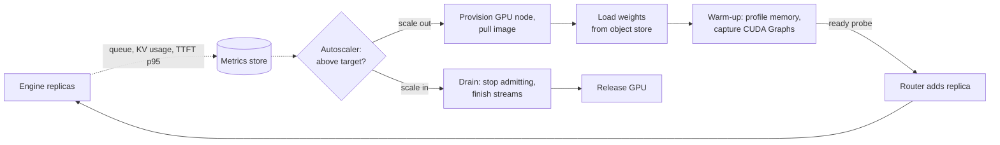

**Reading the diagram.** Replicas export LLM-specific signals asynchronously; the autoscaler compares them with targets. Scale-out is a synchronous chain (node, image, weights, warm-up) that takes minutes, after which a readiness probe lets the router send traffic. Scale-in drains first so streams finish rather than break. Failure points: scaling on GPU utilization never scales in; cold start longer than a traffic ramp causes SLO breaches, so keep warm headroom; draining too slowly holds expensive GPUs. Scaling: pre-scale on schedule for known peaks (QuickBite's lunch and dinner).

## 73.16 Inference engines compared

As of 2026, five open-source engines cover most self-hosted LLM serving:

- **vLLM** [Kwon et al. 2023; vLLM Docs]: the PagedAttention engine from UC Berkeley, now a broad community project with an OpenAI-compatible server, continuous batching, automatic prefix caching, chunked prefill, speculative decoding, many quantization formats, TP/PP/EP and support for several accelerator vendors.
- **TensorRT-LLM** [NVIDIA TensorRT-LLM Docs]: NVIDIA's library with optimized kernels for its GPUs, in-flight batching, paged KV cache, FP8 and FP4 formats and speculative decoding, typically deployed behind Triton or NVIDIA Dynamo (§66.5).
- **SGLang** [Zheng et al. 2024; SGLang Docs]: RadixAttention prefix caching, a low-overhead scheduler, fast structured (constrained) output, and strong support for large MoE deployments with expert parallelism and prefill–decode disaggregation.
- **Hugging Face TGI** [Hugging Face TGI Docs]: a Rust router with Python model servers, continuous batching and paged attention. Its documentation states that TGI entered **maintenance mode** (from December 2025) and recommends vLLM or SGLang for new deployments; only minor fixes are accepted.
- **llama.cpp** [llama.cpp Docs]: a C/C++ engine for CPUs, Apple silicon and consumer GPUs using the GGUF file format and many low-bit quantization types, with a built-in HTTP server that handles parallel slots.

**Table 73.11 — LLM inference engines compared (as of 2026).**

| Row | vLLM | TensorRT-LLM | SGLang | TGI | llama.cpp |
|---|---|---|---|---|---|
| What it is | General open engine | NVIDIA-optimized library | Engine + program frontend | HF serving stack | Portable C/C++ engine |
| How it works | PagedAttention, continuous batching | Tuned kernels, in-flight batching | RadixAttention, cache-aware scheduling | Rust router, paged attention | GGUF, CPU/Metal/CUDA kernels |
| Advantages | Breadth of models and hardware | Peak NVIDIA performance, FP8/FP4 | Prefix-heavy and MoE workloads | Simple HF integration | Runs anywhere, tiny footprint |
| Disadvantages | Many knobs, fast-moving | NVIDIA only, build steps | Smaller ecosystem | Maintenance mode | Low multi-user throughput |
| Performance | High | Highest on NVIDIA, tuned | High, best with shared prefixes | Moderate | Good per device, low batch |
| Operational complexity | Medium | High | Medium | Low | Low |
| Cost | Free; any GPU | Free; NVIDIA GPUs | Free; GPUs | Free | Free; CPUs and laptops |
| Use cases | Default self-hosted serving | Large NVIDIA fleets | Agents, RAG, multi-turn, MoE | Existing deployments | Edge, desktop, offline |
| Choose when | You need a safe default | Every percent of GPU matters | Prompts share long prefixes | Already running it; plan a migration | No data-center GPU |

**Figure 73.18 — Choosing an engine.**

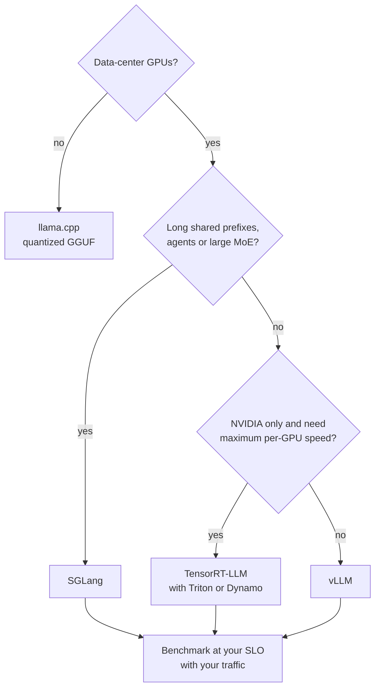

**Reading the diagram.** The first question is hardware: without data-center GPUs, llama.cpp is the practical choice. With GPUs, heavy prefix sharing or large MoE models favor SGLang; an NVIDIA-only fleet chasing peak efficiency favors TensorRT-LLM; otherwise vLLM is the broad default. Every branch ends in the same gate: benchmark goodput on your prompts, output lengths and SLOs, because rankings change between releases. Failure point: choosing from a public benchmark run on a different workload.

## 73.17 Cost optimization

The levers below act on the terms of $C_\text{1M}$ (§73.15): GPU-seconds per token and the fraction of provisioned GPU time that does useful work.

::: formula
**Largest batch that meets a TPOT SLO**

$$B_\text{SLO} = \frac{(S_\text{TPOT} - t_0)\,W_\text{eff} - M_\text{w}}{\bar{c}\,k} \qquad B^{*} = \min(B_\text{SLO},\ S_\text{max})$$

| Symbol | Meaning | Units |
|---|---|---|
| $B_\text{SLO}$ | Batch at which the memory-bound step time reaches the TPOT SLO | sequences |
| $S_\text{TPOT}$ | TPOT target | s |
| $S_\text{max}$ | Memory-limited concurrency (§73.5) | sequences |
| $B^{*}$ | Operating batch | sequences |
:::

::: example
**Worked example — Which constraint binds, and model routing.** $S_\text{TPOT} = 50$ ms; 7B FP16.

1. $B_\text{SLO} = (0.048 \times 2.68 \times 10^{12} - 14 \times 10^9)/(2{,}100 \times 524{,}288) = 1.146 \times 10^{11}/1.101 \times 10^9 = 104$; $S_\text{max} = 46$. Memory binds: buy concurrency with KV quantization or prefix sharing, not with a looser SLO.
2. INT4 weights and FP8 KV: $B_\text{SLO} = (1.286 \times 10^{11} - 3.6 \times 10^9)/5.5 \times 10^8 = 227$; $S_\text{max} = 111$. Memory still binds.
3. *Routing preview (Chapter 78):* if a classifier sends 80% of calls to the 7B model and 20% to the 70B model, the blended floor cost is $0.8 \times 0.054 + 0.2 \times 0.216 = \$0.086$ per million tokens, 60% less than all-70B, provided quality on the routed traffic holds.

**Interpretation.** For this workload, every cost lever that frees KV memory raises throughput; relaxing latency does not. **Engineering implication.** Identify the binding constraint before tuning, and route by difficulty so the expensive model sees only the traffic that needs it.
:::

**Table 73.12 — Cost levers for LLM serving.**

| Lever | Acts on | Typical effect | Risk |
|---|---|---|---|
| Continuous batching, paging | Batch size | Multiples of static throughput | None; table stakes |
| KV and weight quantization | Bytes per token | Up to 2.4× here (§73.13) | Quality regressions |
| Prefix caching, prompt layout | Prefill work, KV sharing | 20% less GPU per call here (§73.8) | Side channels across tenants |
| Speculative decoding | TPOT at small batch | 2–3× lower TPOT | Little gain at large batch |
| Model routing and distillation | Model size per call | Large; Chapters 67, 78 | Quality on hard queries |
| Output length limits | Decode tokens | Linear in tokens saved | Truncated answers |
| Spot or preemptible GPUs | Price per GPU-hour | Discounts vary by provider | Interruption: drain, retry |
| Consolidation, scheduled scaling | Idle provisioned hours | Approaches the busy floor | Cold-start lag |

Spot capacity suits offline batch generation (summaries, evaluation runs, synthetic data) where a preempted job retries idempotently (§66.13); for interactive chat, keep an on-demand base sized for the SLO and add spot replicas only above it, with draining on interruption notice.
