# Chapter 73 — LLM Inference Infrastructure

> **Level:** 4 · **Track:** B (ML/AI) · **Estimated reading time:** 5.5 h

A classic model server answers with one forward pass. A large language model (LLM) answers by *writing*: it reads the prompt, then produces the reply one token at a time, each token another pass through billions of parameters. A 200-token answer is 200 dependent steps; the request holds GPU memory throughout, its length is unknown until it ends, and the user watches the words appear.

This changes almost every serving decision. Batching becomes a per-step scheduling problem, GPU memory rather than arithmetic decides how many users a GPU serves, latency splits into time to the first word and pace of the rest, and cost is quoted per million tokens. This chapter builds the machinery production engines use: continuous batching, paged KV-cache memory, prefix caching, attention kernels, speculative decoding, multi-GPU parallelism, disaggregated prefill and decode, quantization, scheduling and capacity planning, then compares engines and cost levers.

Chapter 72 explains the transformer (prefill and decode, the KV cache, grouped-query attention, mixture of experts, sampling); Chapters 64–67 supply the roofline, parallelism, general serving and weight quantization. This chapter uses those results without re-deriving them.

::: note
**Assumptions used in this chapter.** Units are SI (1 KB, GB = 10³, 10⁹ bytes; 1 TB/s = 10¹² bytes/s). The reference GPU is an NVIDIA H100 SXM: 80 GB HBM at 3.35 TB/s and 989 TFLOP/s dense BF16 (Table 64.4, as of 2026) at an illustrative \$2.50 per GPU-hour (§60.11). We assume engines achieve 80% of peak bandwidth (2.68 TB/s) in decode, 50% model FLOPs utilization (MFU, §64.11) in prefill (494.5 TFLOP/s) and 2 ms of fixed overhead per step. **QuickBite's support chatbot** is the Llama-2-7B-like model of §72.8.2 ($h = 4{,}096$, $L = 32$, 32 heads and 32 KV heads of 128 dimensions; 6.74 billion parameters, rounded to 7B and 14 GB in FP16; 524 KB of KV cache per token, §72.11). The **hypothetical 70B option** has $h = 8{,}192$, $L = 80$, 64 query heads and 8 KV heads (Llama-2-70B-like, §67.6). **Traffic (§72.4.5):** 10,000 conversations a day, up to 200 concurrent at peak; each has 6 turns totaling about 9,063 input and 468 output tokens, so one LLM call averages $n_\text{in} \approx 1{,}510$ input tokens (1,000 of them a shared system prompt) and $n_\text{out} = 78$ output tokens: 60,000 calls a day. Peak-to-average ratio 10, as for orders (60/s peak, 5.8/s average). These are teaching assumptions, not measurements.
:::

## 73.1 Learning objectives

After this chapter you should be able to:

- Explain why LLM serving differs from classic serving: variable-length outputs, a growing KV cache, two phases and token streaming.
- Compute TTFT, TPOT, ITL, end-to-end latency, per-request and per-GPU throughput, and goodput under SLOs.
- Build a GPU memory budget and compute concurrent sequences for one GPU and a tensor-parallel group.
- Compare static, dynamic and continuous batching and reproduce their differences with a simulator.
- Explain PagedAttention, copy-on-write, prefix caching and RadixAttention, and quantify their savings.
- Describe FlashAttention and decode-time attention kernels conceptually.
- Derive and simulate the speed-up of speculative decoding, and say when it hurts.
- Choose tensor, pipeline and expert parallelism, estimate their communication, and decide when disaggregation pays.
- Plan GPUs and cost per million tokens, and choose an engine and cost levers for a workload.

## 73.2 Prerequisites

- Prefill and decode — §72.10; the KV cache and its per-token size — §72.11; multi-head, multi-query and grouped-query attention — §72.7; sampling — §72.13; mixture of experts — §72.14; FLOPs per token — §72.15. This chapter serves the model Chapter 72 describes.
- The roofline model and memory-bound decode — §64.9; precision formats — §64.10; MFU — §64.11; FlashAttention's tiling idea — §64.13; interconnect bandwidths — §64.14.
- Tensor, pipeline and expert parallelism — §65.10–§65.12 (here applied to inference rather than training).
- Model servers, dynamic batching and autoscaling — §66.4, §66.6, §66.9; model loading and warm-up — §66.10.
- Weight quantization for LLMs (GPTQ, AWQ, FP8) — §67.6.
- Queueing and Little's law — §4.10–§4.11; percentiles — §4.8; Server-Sent Events — §9.5; cache hit ratio — §20.3; load shedding — §22.9; SLOs — §39.6.

## 73.3 What makes LLM serving different

### 73.3.1 Four differences from classic model serving

::: definition
**Definition — LLM inference engine.** The software that runs an LLM on accelerators for many concurrent requests: it tokenizes prompts, schedules requests into GPU steps, manages the memory holding each request's KV cache, runs the model's forward passes, samples tokens and streams them back. Examples are vLLM, TensorRT-LLM, SGLang, Hugging Face Text Generation Inference (TGI) and llama.cpp (§73.16). An **LLM serving system** wraps one or more engine replicas with a gateway, router, autoscaler and observability.
:::

#### First-principles explanation

Picture a storyteller telling many stories at once, one word of every story per round. To pick each next word they must remember their story so far, so they keep one notebook per listener, and the notebooks pile up on a table of fixed size. When the table is full, no new listener can join, however fast the storyteller talks; a new listener's opening must first be read aloud before the first word of the answer.

The storyteller is the GPU, a round is a **decode step**, the notebooks are each request's **KV cache**, the table is GPU memory, and reading the opening is **prefill**.

#### Why does this exist?

Four properties break the assumptions of request-level serving (Chapter 66):

1. **Variable-length outputs.** The model decides when to stop; a reply may be 10 or 1,000 tokens, so the server cannot know how long a request will hold resources.
2. **Stateful KV cache.** Each request keeps the keys and values of every past token in every layer (§72.11), about 0.52 MB per token for the 7B chatbot (§73.5), growing every step until the request ends.
3. **Two phases with different bottlenecks.** Prefill processes the whole prompt in one parallel pass and is compute-bound; decode generates one token per request per step and is memory-bandwidth-bound (§64.12, §72.10).
4. **Streaming tokens.** Users read as text arrives over long-lived responses such as Server-Sent Events (§9.5), so the wait for the first token and the pace of the rest are separate requirements.

**Table 73.1 — Classic model serving versus LLM serving.**

| Aspect | Classic model (e.g., QuickBite ETA) | LLM (QuickBite chatbot) |
|---|---|---|
| Work per request | One forward pass | One prefill plus one decode pass per output token |
| Request duration | Milliseconds, predictable | Seconds, unknown until the end |
| Per-request state | None between requests | KV cache, grows each step |
| Batch unit | Request (§66.6) | Iteration (one decode step, §73.6) |
| Limiting resource | Compute or CPU | GPU memory capacity and bandwidth |
| Latency metric | p99 latency | TTFT, TPOT/ITL, end-to-end (§73.4) |
| Cost unit | Cost per 1,000 predictions | Cost per 1M input and output tokens |

#### How it works internally

A request moves through these steps inside an engine:

1. **Admission.** The API server tokenizes the prompt, checks limits and queues the request.
2. **Scheduling.** Before each GPU step, the scheduler picks which waiting requests to admit, subject to free KV-cache memory and a per-step token budget (§73.14).
3. **Prefill.** Admitted prompts run through the model in parallel, writing their KV cache and producing the first token.
4. **Decode loop.** Each step runs one forward pass for all running requests, appending one token and one KV entry per layer to each.
5. **Streaming and retirement.** Tokens are streamed; a finished request's KV memory is freed in the same step.

**Figure 73.1 — An LLM serving system and the inside of one engine replica.**


**Reading the diagram.** The client receives tokens over one long-lived HTTPS Server-Sent Events stream (synchronous). The gateway authenticates and limits by tokens (§22.3, Chapter 79); the router picks a replica by load and cached prefix (§73.8). In the replica, the scheduler picks each step's requests, the KV manager allocates blocks and the executor runs the model. The key storage boundary is GPU HBM: fixed weights, contended KV cache. Weight loading and metrics are asynchronous (dotted). Failure points: KV exhaustion forces preemption (§73.14); replica loss drops streams, which clients retry. Scaling: replicas behind the router; tensor-parallel groups for large models (§73.11).

**Figure 73.2 — Life of one chatbot request: prefill, then a streamed decode loop.**

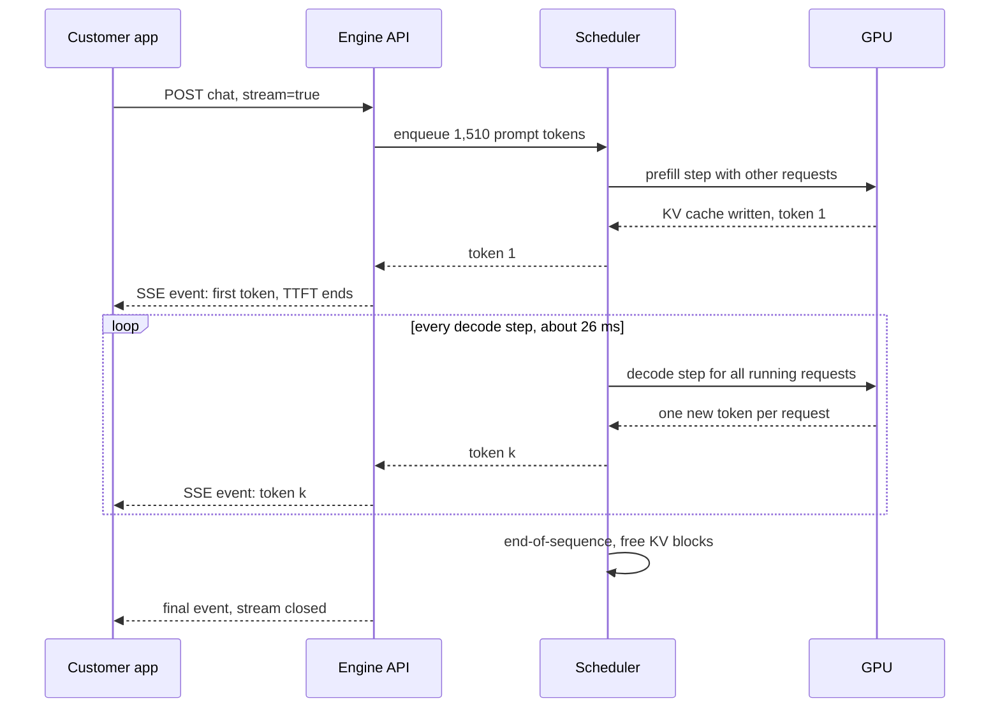

**Reading the diagram.** Solid arrows are synchronous calls; dashed arrows are returns and streamed events. The request waits in the queue, joins a prefill step, and the first token ends TTFT. In the loop, every decode step serves *all* running requests, so step time depends on the batch. The KV cache lives on the GPU from prefill to the final event. Failure points: a long queue inflates TTFT; a slow step delays every stream; a dropped connection must cancel the request and free its KV memory. Scaling: more requests per step raise throughput at the cost of a longer step.

#### Mathematical foundations

Two simple models explain most serving behavior: a decode step reads all weights plus each sequence's KV cache (§64.9.2); prefill does $2N$ FLOPs per prompt token and is compute-bound.

::: formula
**Decode step time and prefill time**

$$t_\text{step}(B) \approx t_0 + \max\!\left(\frac{M_\text{w} + B\,\bar{c}\,k}{W_\text{eff}},\ \frac{2N\,(B + P)}{F_\text{eff}}\right) \qquad T_\text{prefill} \approx \frac{2N\,n_\text{in}}{F_\text{eff}}$$

| Symbol | Meaning | Units |
|---|---|---|
| $t_\text{step}(B)$ | Time of one forward step with $B$ decoding sequences | s |
| $t_0$ | Fixed per-step overhead (scheduling, sampling, launches) | s |
| $M_\text{w}$ | Weight bytes read per step (per GPU) | bytes |
| $B$ | Sequences decoding in the step (the batch) | sequences |
| $\bar{c}$ | Average context length (tokens already in each KV cache) | tokens |
| $k$ | KV-cache bytes per token (§72.11, §73.5) | bytes/token |
| $W_\text{eff}$ | Achieved memory bandwidth | bytes/s |
| $N$ | Parameters (active parameters for mixture of experts) | parameters |
| $P$ | Prompt tokens prefilled in the same step (0 for pure decode) | tokens |
| $F_\text{eff}$ | Achieved FLOP/s ($\text{MFU} \times$ peak) | FLOP/s |
| $T_\text{prefill}$, $n_\text{in}$ | Prefill time for a prompt of $n_\text{in}$ tokens | s, tokens |
:::

::: example
**Worked example — QuickBite's 7B chatbot at batch 1 and batch 64.** $M_\text{w} = 14$ GB, $k = 524{,}288$ bytes (§73.5), $\bar{c} = 1{,}549$ (1,510 prompt tokens plus half of 78 output tokens), $W_\text{eff} = 2.68$ TB/s, $F_\text{eff} = 494.5$ TFLOP/s, $t_0 = 2$ ms.

1. *Batch 1.* KV bytes: $1{,}549 \times 524{,}288 = 0.81$ GB. Memory time: $(14 + 0.81) \times 10^9 / 2.68 \times 10^{12} = 5.53$ ms; compute $2 \times 7 \times 10^9 / 494.5 \times 10^{12} = 0.03$ ms. Step: 7.53 ms, 133 tokens/s for the user and for the GPU.
2. *Batch 64* (the most that fits, §73.5). KV bytes: $64 \times 0.81 = 52.0$ GB. Memory time: $66.0 \times 10^9 / 2.68 \times 10^{12} = 24.6$ ms; compute $64 \times 0.028 = 1.8$ ms. Step: 26.6 ms, so each user sees 38 tokens/s and the GPU produces $64/0.0266 = 2{,}404$ tokens/s.
3. *Prefill of a 1,510-token prompt:* $2 \times 7 \times 10^9 \times 1{,}510 / 494.5 \times 10^{12} = 42.8$ ms; attention FLOPs, which grow with $n_\text{in}^2$ (§72.10), add about 3% here and are ignored.

**Interpretation.** Batching 64 users makes each stream 3.5× slower but the GPU 18× more productive, because the 14 GB weight read is shared; arithmetic is still only 1.8 ms of 26.6 ms, and KV reads (52 GB) exceed weight reads. **Engineering implication.** Throughput comes from batching decode, and the batch is limited by KV-cache memory and the bandwidth to read it: the motivation for §73.6–§73.8 and §73.13.
:::

#### Real-world industry applications

::: industry
**Google: scaling PaLM inference.** Pope et al. modeled inference cost for PaLM-scale models analytically, splitting it into the memory-bound decode phase and compute-bound prefill, and chose partitioning layouts per phase and batch size. With multi-query attention to shrink the KV cache and INT8 weights, they reported 29 ms per token for PaLM 540B generation at low batch and 76% MFU when processing input tokens in large batches, with a 2,048-token context on TPU v4.
*Evidence: Primary* — [Pope et al. 2023]
:::

#### Common misconceptions

::: mistake
**"A faster GPU in FLOP/s makes my chatbot faster."** Decode at realistic batch sizes is memory-bound: step time tracks bytes read divided by memory bandwidth. A GPU with 2× the FLOP/s and the same HBM bandwidth barely changes TPOT. Compare accelerators for LLM decode on memory bandwidth and capacity first (§64.9).
:::

## 73.4 Latency metrics

### 73.4.1 TTFT, TPOT, ITL, end-to-end latency and goodput

::: definition
**Definition — LLM latency and throughput metrics.** **Time to first token (TTFT)** is the time from the client sending a request to receiving the first output token. **Time per output token (TPOT)** is the average time between output tokens after the first: $(\text{end-to-end} - \text{TTFT})/(n_\text{out} - 1)$. **Inter-token latency (ITL)** is the individual gap between two consecutive tokens; its distribution (p99, maximum) exposes stalls that the TPOT average hides. **End-to-end latency** is the time to the last token. **Per-request throughput** is $1/\text{TPOT}$ (tokens/s one user sees); **per-GPU throughput** is the output tokens/s a GPU produces across all requests. **Goodput** is the rate of requests that complete *within* their SLOs [Zhong et al. 2024].
:::

#### First-principles explanation

Think of a restaurant. The wait for the bread (TTFT) shapes your first impression, the pace of courses (TPOT) decides whether the meal feels smooth, and one 20-minute gap (a bad ITL) is remembered even if the average was fine. The owner counts meals per hour (per-GPU throughput); goodput counts meals per hour *with every table happy*.

#### Why does this exist?

A single p99 latency hides the trade-off: one request at a time gives excellent TPOT and a wasted GPU; hundreds per step give excellent throughput and crawling streams. Uses also differ: chat needs a TTFT under about a second and a pace faster than reading (roughly 5–10 tokens/s; assumption); code completion needs a few hundred milliseconds; offline jobs care only about tokens per dollar.

#### How it works internally

Each metric decomposes into parts you can engineer: TTFT into network, queueing (§4.10) and prefill (shortened by prefix caching, §73.8); TPOT into decode step time (batch, context, quantization, speculation); ITL spikes into steps doing extra work (a large prefill, a preemption, §73.14); per-GPU throughput into batch over step time.

**Figure 73.3 — Where the latency of a streamed response comes from.**

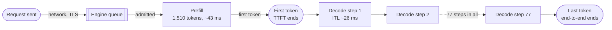

**Reading the diagram.** The request crosses the network into the engine queue, waits for admission and is prefilled; the first token ends TTFT. Each decode step adds one token, and each gap is one ITL sample (the dotted edge stands for the repeated steps). Everything after the queue runs on the GPU, with the KV cache persisting across steps. Failure points: overload shows first as TTFT; a slow step shows in every stream's ITL. Scaling: replicas shorten the queue, prefix caching shortens prefill, smaller batches or quantization shorten steps.

#### Mathematical foundations

::: formula
**Latency decomposition and throughput**

$$T_\text{e2e} = \text{TTFT} + \text{TPOT}\,(n_\text{out} - 1) \qquad \text{TTFT} = T_\text{net} + T_\text{queue} + T_\text{prefill} \qquad X_\text{GPU} = \frac{B}{t_\text{step}(B)\; g}$$

| Symbol | Meaning | Units |
|---|---|---|
| $T_\text{e2e}$ | End-to-end latency to the last token | s |
| $n_\text{out}$ | Output tokens in the response | tokens |
| $T_\text{net}$ | Network and gateway time to the first byte back | s |
| $T_\text{queue}$ | Wait before the request is admitted to a step | s |
| $X_\text{GPU}$ | Output tokens per second per GPU | tokens/s/GPU |
| $B$, $t_\text{step}$ | Batch size and step time (§73.3) | sequences, s |
| $g$ | GPUs in one replica (1, or the TP degree) | GPUs |
:::

::: example
**Worked example — One chatbot reply at batch 64.** Assume $T_\text{net} = 30$ ms and $T_\text{queue} = 20$ ms; prefill 42.8 ms plus 2 ms overhead; TPOT 26.6 ms (§73.3); $n_\text{out} = 78$.

1. TTFT $= 30 + 20 + 42.8 + 2 = 94.8$ ms.
2. End-to-end: $0.095 + 0.0266 \times 77 = 0.095 + 2.05 = 2.14$ s.
3. Per-request throughput: $1/0.0266 = 38$ tokens/s, about five times a comfortable reading pace.
4. Per-GPU throughput: $64/0.0266 = 2{,}404$ tokens/s.

**Interpretation.** Text appears after 0.1 s and the answer completes after 2.1 s, 96% of it decode. **Engineering implication.** End-to-end latency scales with answer length, so set chat SLOs on TTFT and TPOT (or ITL p99), and track end-to-end for non-streaming callers such as agents (Chapter 77).
:::

::: formula
**Goodput and SLO attainment**

$$A(\lambda) = \Pr\big[\text{TTFT} \le S_\text{TTFT} \ \wedge\ \text{TPOT} \le S_\text{TPOT}\big] \qquad G = \max\{\lambda : A(\lambda) \ge A^*\}$$

| Symbol | Meaning | Units |
|---|---|---|
| $A(\lambda)$ | Fraction of requests meeting both SLOs at arrival rate $\lambda$ | dimensionless |
| $S_\text{TTFT}$, $S_\text{TPOT}$ | SLO thresholds | s |
| $A^*$ | Required attainment, e.g., 0.99 | dimensionless |
| $G$ | Goodput: highest sustainable rate that meets the attainment target | requests/s |
:::

::: example
**Worked example — Goodput is not peak throughput.** A load test of one 7B chatbot replica with SLOs TTFT ≤ 1 s and TPOT ≤ 50 ms gives (assumed measurements) $A = 0.998$ at 8 req/s, $0.993$ at 10, $0.962$ at 12 and $0.880$ at 14, while raw throughput keeps rising to 14 req/s.

1. With $A^* = 0.99$, the largest passing rate is 10 req/s: $G = 10$ req/s per replica.
2. At 14 req/s, $14 \times 0.880 = 12.3$ requests/s meet their SLOs and 1.7 req/s (12% of users) do not.
3. QuickBite's 6.9 req/s peak at $A^* = 0.99$: $\lceil 6.9/10 \rceil = 1$ replica, plus one for redundancy.

**Interpretation.** Sizing on peak throughput (14 req/s) would breach the SLO for one request in eight. **Engineering implication.** Benchmark at the goodput point, as DistServe and later systems do [Zhong et al. 2024], and report tokens per second *at* a stated TTFT and TPOT target.
:::

**Table 73.2 — Metrics, what they reveal and what moves them.**

| Metric | What users or operators feel | Dominated by | Main levers |
|---|---|---|---|
| TTFT | Responsiveness | Queueing, prefill length | Replicas, prefix caching, chunked prefill, disaggregation |
| TPOT | Reading smoothness | Step time at the batch size | Batch cap, quantization, speculative decoding, TP |
| ITL p99 | Visible stutters | Prefill or preemption in the step | Chunked prefill, admission control |
| End-to-end | Wait for agents and APIs | $n_\text{out} \times$ TPOT | Shorter outputs, faster decode |
| Tokens/s per GPU | Cost | Batch size | Memory for KV cache, batching policy |
| Goodput | Capacity that keeps promises | All of the above | Scheduling, fleet size |

## 73.5 GPU memory budget

### 73.5.1 Weights, KV cache, activations and overhead

::: definition
**Definition — GPU memory budget for LLM serving.** The partition of a GPU's memory into **weights** (fixed, set by parameter count and precision), **KV cache** (dynamic, proportional to the tokens held by all running sequences), **activations** (temporary tensors of the step in flight, proportional to tokens processed per step) and **framework overhead** (CUDA context, communication buffers, captured CUDA Graphs, allocator fragmentation). Engines typically profile activations at start-up and give all remaining memory, up to a configured fraction, to the KV cache.
:::

#### First-principles explanation

A GPU is a parking garage. The weights are permanent tenants, the step's activations are delivery vans that park briefly, and the rest is short-term parking for conversations, one space per token. How many conversations fit depends on how many spaces each needs: prompt plus answer.

#### Why does this exist?

Concurrency, and therefore throughput, is set by how many tokens of KV cache fit (§73.3). Teams that skip this budget discover at peak that a GPU serves a third of the planned conversations, or that a long prompt triggers out-of-memory errors.

#### How it works internally

1. **Weights:** $N \times$ bytes per parameter, divided by the tensor-parallel degree $t$ (§65.10).
2. **Activations:** sized by the largest step the scheduler allows (§73.14); decode needs little, a multi-thousand-token prefill chunk hundreds of megabytes.
3. **Overhead:** CUDA context, NCCL buffers, CUDA Graphs; engines also leave headroom (vLLM's `gpu_memory_utilization` defaults to 0.9, as of 2026 [vLLM Docs]).
4. **KV cache:** everything left, carved into fixed-size blocks (§73.7).

**Figure 73.4 — Memory budget of one 80 GB H100 serving the 7B chatbot.**

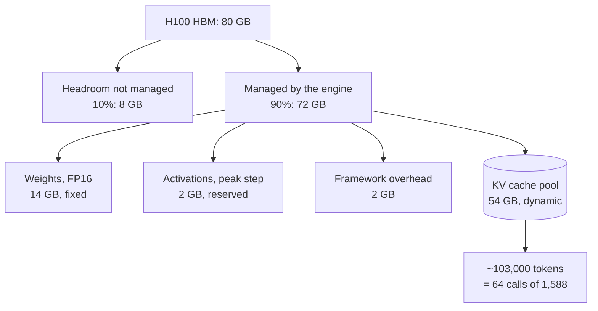

**Reading the diagram.** A tenth of the 80 GB is left unmanaged as margin. Of the managed 72 GB, weights are fixed at load, activations and overhead are reserved after a start-up profiling run, and the remainder becomes a pool of KV blocks (cylinder: the replica's stateful store), converted in the last box into concurrency. Failure points: an activation spike beyond the reserve causes out-of-memory errors; a pool sized for average prompts overflows on long ones and forces preemption (§73.14). Scaling: shrink weights (quantization), bytes per token (GQA, KV quantization), share tokens (prefix caching) or add GPUs (TP).

#### Mathematical foundations

::: formula
**KV-cache bytes per token and concurrent sequences**

$$k = 2 \cdot L \cdot n_\text{kv} \cdot d_\text{head} \cdot b_\text{kv} \qquad M_\text{KV} = u\,M_\text{GPU} - \frac{M_\text{w}}{t} - M_\text{act} - M_\text{fw} \qquad S_\text{max} = \left\lfloor \frac{t\,M_\text{KV}}{k\,(n_\text{in} + n_\text{out})} \right\rfloor$$

| Symbol | Meaning | Units |
|---|---|---|
| $k$ | KV bytes per token, whole model (keys and values: factor 2) | bytes/token |
| $L$ | Transformer layers | layers |
| $n_\text{kv}$ | KV heads (equal to query heads for MHA; fewer for GQA, 1 for MQA; §72.7) | heads |
| $d_\text{head}$ | Dimensions per head | values |
| $b_\text{kv}$ | Bytes per KV element (2 for FP16, 1 for FP8) | bytes |
| $u$ | Fraction of GPU memory the engine manages | dimensionless |
| $M_\text{GPU}$ | Physical memory per GPU | bytes |
| $M_\text{w}$ | Total weight bytes of the model | bytes |
| $t$ | Tensor-parallel degree (KV heads are split across the $t$ GPUs) | GPUs |
| $M_\text{act}$, $M_\text{fw}$ | Activation reserve and framework overhead per GPU | bytes |
| $M_\text{KV}$ | KV pool per GPU | bytes |
| $S_\text{max}$ | Concurrent sequences of length $n_\text{in} + n_\text{out}$ that fit | sequences |
:::

::: example
**Worked example — 7B FP16 on one 80 GB GPU.** $L = 32$, $n_\text{kv} = 32$, $d_\text{head} = 128$, $b_\text{kv} = 2$, $u = 0.9$, $M_\text{act} = M_\text{fw} = 2$ GB (assumed), $t = 1$.

1. $k = 2 \times 32 \times 32 \times 128 \times 2 = 524{,}288$ bytes $\approx 0.52$ MB per token.
2. $M_\text{KV} = 0.9 \times 80 - 14 - 2 - 2 = 54$ GB.
3. Tokens that fit: $54 \times 10^9 / 524{,}288 = 102{,}997$.
4. Calls of $1{,}510 + 78 = 1{,}588$ tokens: $\lfloor 102{,}997 / 1{,}588 \rfloor = 64$; final turns of 1,866 tokens (§72.4.5): 55.
5. Reserving the 4,096-token maximum per request instead: $\lfloor 102{,}997/4{,}096 \rfloor = 25$.

**Interpretation.** The KV cache, not the 14 GB of weights, dominates: 54 GB for 64 calls. Holding all 200 peak conversations' final contexts would need $200 \times 1{,}866 \times 524{,}288 = 196$ GB (§72.11), more than two GPUs. **Engineering implication.** Concurrency is a memory decision; reserving for the maximum length cuts it by 61%, which §73.7 removes.
:::

::: example
**Worked example — 70B FP16 with tensor parallelism $t = 4$.** $L = 80$, $n_\text{kv} = 8$, $d_\text{head} = 128$, $b_\text{kv} = 2$; weights 140 GB.

1. $k = 2 \times 80 \times 8 \times 128 \times 2 = 327{,}680$ bytes per token; each GPU holds 2 of the 8 KV heads, $k/t = 81{,}920$ bytes per token per GPU.
2. Weights per GPU: $140/4 = 35$ GB. $M_\text{KV} = 72 - 35 - 2 - 2 = 33$ GB per GPU, 132 GB across the group.
3. Tokens: $33 \times 10^9 / 81{,}920 = 402{,}832$ per replica; calls: $\lfloor 402{,}832/1{,}588 \rfloor = 253$.
4. With $t = 2$: $72 - 70 - 4 = -2$ GB: it does not fit at $u = 0.9$. With $t = 8$: $72 - 17.5 - 4 = 50.5$ GB per GPU and one KV head each (40,960 bytes per token): 1.23 million tokens, about 97 calls per GPU versus 63 at $t = 4$.

**Interpretation.** The 70B replica holds 3.9× the 7B GPU's tokens on four GPUs, about the same per GPU, because GQA makes its KV cache smaller per token (0.33 versus 0.52 MB) despite 10× the parameters. **Engineering implication.** Compute $k$ from the real attention configuration, and size $t$ for weights *plus* the concurrency you need.
:::

**Table 73.3 — KV-cache size per token for common shapes (FP16 unless noted).**

| Shape | $L$ | KV heads × $d_\text{head}$ | Bytes per token | Tokens per GB |
|---|---|---|---|---|
| 7B, MHA (QuickBite chatbot) | 32 | 32 × 128 | 524,288 | 1,907 |
| 7B, MHA, FP8 KV | 32 | 32 × 128 | 262,144 | 3,815 |
| 8B, GQA (Llama-3-8B-like) | 32 | 8 × 128 | 131,072 | 7,629 |
| 70B, GQA (Llama-2-70B-like) | 80 | 8 × 128 | 327,680 | 3,052 |
| 70B if it used MHA | 80 | 64 × 128 | 2,621,440 | 381 |

The last row shows why large models adopted GQA: with MHA the 70B model would hold eight times fewer tokens per gigabyte. Some newer architectures, such as DeepSeek-V2's multi-head latent attention, cache a compressed latent instead.

::: mistake
**"Weights fit, so the model fits."** A 70B FP16 model on two 80 GB GPUs leaves essentially nothing for the KV cache. Serving needs weights plus KV cache for the target concurrency plus overhead; check all three before choosing hardware.
:::

## 73.6 Batching: static, dynamic and continuous

### 73.6.1 From request-level to iteration-level batching

::: definition
**Definition — Static, dynamic and continuous batching.** **Static batching** groups a fixed set of requests and runs them together until *all* have finished. **Dynamic batching** (§66.6) forms each batch from whatever requests are queued when the server becomes free (or when a timeout expires), but still keeps the batch together until its longest member finishes. **Continuous batching**, also called **iteration-level scheduling** or **in-flight batching**, re-forms the batch at *every* decode step: finished sequences leave and waiting ones join between steps [Yu et al. 2022].
:::

#### First-principles explanation

A tour bus that returns only after dropping its last passenger leaves empty seats after early stops while people wait at the depot. A tram lets passengers off and on at every stop. Static and dynamic batching are the bus; continuous batching is the tram; the stops are decode steps.

#### Why does this exist?

Output lengths vary by an order of magnitude. With request-level batching a batch runs as long as its longest reply, early finishers occupy padding slots, and new requests wait for the whole batch. Orca scheduled at iteration granularity instead, and added **selective batching**: matrix multiplies of all sequences are batched (they share weights) while attention runs per sequence (each has its own KV cache and length) [Yu et al. 2022].

#### How it works internally

1. Before each step, remove sequences that emitted end-of-sequence or hit their cap, and free their KV memory.
2. Admit queued requests while free KV blocks and the per-step token budget allow (§73.14).
3. Run one forward pass over the mixed batch: newly admitted prompts (prefill tokens) plus one token for each running sequence.
4. Sample, stream, and repeat. Requests never wait for others to finish.

**Figure 73.5 — Four requests under static batching (top) and continuous batching (bottom).**

```mermaid
gantt
  title Two batch slots, in units of 10 decode steps
  dateFormat X
  axisFormat %S
  section Static
  R1 50 tokens          :s1, 0, 5
  R1 slot idle          :crit, 5, 10
  R2 100 tokens         :s2, 0, 10
  R3 and R4 wait        :crit, 0, 10
  R3 40 tokens          :s3, 10, 14
  R4 20 tokens          :s4, 10, 12
  R4 slot idle          :crit, 12, 14
  section Continuous
  R1 50 tokens          :c1, 0, 5
  R3 joins slot 1       :c3, 5, 9
  R2 100 tokens         :c2, 0, 10
  R4 joins slot 2       :c4, 10, 12
```

**Reading the diagram.** The axis counts tens of decode steps on one GPU with two batch slots. Under static batching, R1 finishes at step 50 but its slot idles (red) until R2 ends at step 100 while R3 and R4 wait; their own batch then idles a slot after R4 ends. Under continuous batching R3 takes R1's slot at step 50 and R4 takes R2's at step 100, so all four finish by step 120 instead of 140, and R3 finishes at step 90 instead of 140. The state boundary is each slot's KV cache, freed and reused per step. Failure point: each joining request's prefill lengthens the step it joins (§73.14). Scaling: more slots need more KV memory (§73.5, §73.7).

**Figure 73.6 — The continuous-batching scheduler loop.**

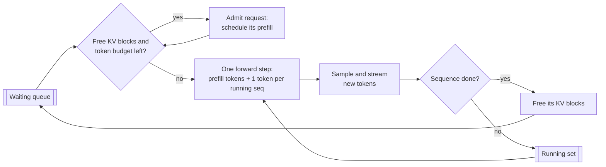

**Reading the diagram.** Each pass is one GPU iteration. Admission checks free KV blocks and the step's token budget; admitted prompts are prefilled in the next step together with one decode token per running sequence. Finished sequences free their blocks immediately so the queue advances. The loop is synchronous with the GPU, so CPU-side scheduling must take well under a millisecond. Failure point: blocks running out mid-generation force preemption (§73.14). Scaling: one loop per replica; the router spreads load across replicas.

#### Mathematical foundations

::: formula
**Slot utilization of request-level batching**

$$\eta_\text{static} = \frac{\sum_{i=1}^{B} \ell_i}{B \cdot \max_i \ell_i}$$

| Symbol | Meaning | Units |
|---|---|---|
| $\eta_\text{static}$ | Fraction of batch slot-steps that produce a useful token | dimensionless |
| $B$ | Requests in the batch | requests |
| $\ell_i$ | Output tokens of request $i$ | tokens |
:::

::: example
**Worked example — Four chatbot replies of 50, 100, 200 and 800 tokens.**

1. Useful slot-steps: $50 + 100 + 200 + 800 = 1{,}150$.
2. Occupied slot-steps: $4 \times 800 = 3{,}200$.
3. $\eta_\text{static} = 1{,}150/3{,}200 = 36\%$.
4. With continuous batching each slot is refilled when it frees, so utilization approaches 100% whenever requests are waiting.

**Interpretation.** Under request-level batching, nearly two-thirds of the GPU's decode capacity in this batch produces padding, and the longest reply sets everyone's completion time. **Engineering implication.** The more variable the output lengths, the larger the gain from continuous batching; with exponential-like length distributions the longest of 64 replies is several times the mean.
:::

#### Code example: static versus continuous batching

The simulator below uses the step-time model of §73.3 for the 7B chatbot on one H100 with Poisson arrivals, prompts drawn from the six turn lengths of §72.4.5 (1,233–1,788 tokens, mean 1,510) and geometric output lengths with mean 78 (capped at 400). It compares request-level ("static") batching, continuous batching with whole-prompt prefill, and continuous batching with 512-token chunked prefill (§73.14). It needs NumPy and runs in about 10 seconds.

```python
import numpy as np

# Cost model for QuickBite's 7B chatbot on one H100 (assumptions from Sec. 73.5).
W_BYTES  = 14e9        # FP16 weights
KV_TOK   = 524_288     # KV bytes per token (32 layers, 32 KV heads x 128, FP16)
BW       = 2.68e12     # effective HBM bandwidth: 80% of 3.35 TB/s
FLOPS    = 4.945e14    # effective BF16 FLOP/s: 50% of 989 TFLOP/s
T0       = 0.002       # fixed per-iteration overhead (s)
MAX_SEQS = 64          # KV-cache capacity at ~1,588 tokens per sequence

def step_time(ctx_tokens, new_tokens):
    """One forward pass: memory time vs compute time, plus overhead."""
    mem = (W_BYTES + ctx_tokens * KV_TOK) / BW
    comp = 2 * 7e9 * new_tokens / FLOPS
    return T0 + max(mem, comp)

def workload(rate, seconds, seed=7):
    rng = np.random.default_rng(seed)
    n = rng.poisson(rate * seconds)
    arrivals = np.sort(rng.uniform(0, seconds, n))
    turn = rng.integers(0, 6, n)                               # turn 1..6 of a chat
    prompts = 1233 + 111 * turn                                # mean ~1,510 (Ch 72)
    outputs = np.clip(rng.geometric(1 / 78, n), 5, 400)        # mean ~78
    return arrivals, prompts, outputs

def simulate(rate, policy, seconds=600, chunk=512, seed=7):
    arr, pin, pout = workload(rate, seconds, seed)
    n, t, nxt = len(arr), 0.0, 0
    queue, running = [], []     # running: [id, generated, prefilled]
    first, done = np.full(n, np.nan), np.full(n, np.nan)
    last, gap = np.zeros(n), np.zeros(n)          # worst inter-token gap
    steps = useful = 0
    while nxt < n or queue or running:
        while nxt < n and arr[nxt] <= t:
            queue.append(nxt); nxt += 1
        if not queue and not running:
            t = arr[nxt]; continue
        if policy == "static":
            if not running:                       # form a batch, prefill all
                batch, queue = queue[:MAX_SEQS], queue[MAX_SEQS:]
                running = [[i, 0, pin[i]] for i in batch]
                t += step_time(0, sum(pin[i] for i in batch))
        else:                                     # iteration-level admission
            while queue and len(running) < MAX_SEQS:
                running.append([queue.pop(0), 0, 0])
        prefill_tokens = 0
        if policy != "static":
            budget = chunk if policy == "chunked" else 10**9
            for r in running:
                need = pin[r[0]] - r[2]
                take = min(need, budget)
                r[2] += take; budget -= take; prefill_tokens += take
        live = [r for r in running if r[2] >= pin[r[0]] and r[1] < pout[r[0]]]
        ctx = sum(r[2] + r[1] for r in running)        # tokens held in KV
        t += step_time(ctx, prefill_tokens + len(live))
        for r in live:
            r[1] += 1
            if r[1] == 1: first[r[0]] = t
            else: gap[r[0]] = max(gap[r[0]], t - last[r[0]])
            last[r[0]] = t
            if r[1] == pout[r[0]]: done[r[0]] = t
        steps += 1; useful += len(live)
        if policy == "static":
            if all(r[1] >= pout[r[0]] for r in running): running = []
        else:
            running = [r for r in running if r[1] < pout[r[0]]]
    ttft = first - arr
    tpot = (done - first) / np.maximum(pout - 1, 1)
    return dict(tput=pout.sum() / done.max(), ttft50=np.median(ttft),
                ttft99=np.percentile(ttft, 99), tpot50=np.median(tpot),
                e2e50=np.median(done - arr), e2e99=np.percentile(done - arr, 99),
                itl99=np.percentile(gap, 99), batch=useful / steps)

print(f"{'rate':>4} {'policy':>10} {'tok/s':>6} {'TTFT p50':>9} {'TTFT p99':>9}"
      f" {'TPOT p50':>8} {'ITL p99':>8} {'E2E p99':>8} {'batch':>5}")
for rate in (3.0, 7.0, 20.0):
    for policy in ("static", "continuous", "chunked"):
        m = simulate(rate, policy)
        print(f"{rate:>4} {policy:>10} {m['tput']:>6.0f} {m['ttft50']:>8.2f}s"
              f" {m['ttft99']:>8.2f}s {m['tpot50']*1000:>6.1f}ms"
              f" {m['itl99']*1000:>6.0f}ms {m['e2e99']:>7.1f}s {m['batch']:>5.1f}")
```

Output (deterministic with the fixed seed):

```text
rate     policy  tok/s  TTFT p50  TTFT p99 TPOT p50  ITL p99  E2E p99 batch
 3.0     static    234     1.54s     5.80s    9.9ms     14ms     7.1s   2.6
 3.0 continuous    235     0.05s     0.11s    9.1ms     91ms     3.5s   2.5
 3.0    chunked    235     0.06s     0.11s    8.7ms     17ms     3.4s   2.3
 7.0     static    416   107.60s   194.51s   26.4ms     28ms   196.5s  14.1
 7.0 continuous    552     0.05s     0.16s   12.9ms    145ms     4.8s   6.9
 7.0    chunked    552     0.06s     0.16s   10.9ms     17ms     4.1s   5.9
20.0     static    420   831.57s  1624.10s   26.5ms     28ms  1625.5s  14.7
20.0 continuous   1298    60.32s   121.51s   48.4ms    267ms   126.4s  62.4
20.0    chunked   1522     8.69s    17.08s   17.2ms     20ms    19.2s  26.2
```

What to notice:

- `step_time` is the §73.3 model; `batch` is the mean number of sequences producing a token per step.
- **Static batching saturates at about 420 tokens/s.** At 3 req/s it keeps up but TTFT p50 is 1.5 s (new requests wait for the batch to drain); at QuickBite's 7 req/s peak its queue already grows without bound.
- **Continuous batching serves the offered load** at 7 req/s (552 tokens/s, TTFT p50 50 ms) and saturates near 1,300 tokens/s, 3.1× static's ceiling. Its ITL p99 of 91–267 ms comes from whole-prompt prefills (about 43 ms each) stalling every stream.
- **Chunked prefill** keeps ITL p99 at 17–20 ms and reaches 1,522 tokens/s at 20 req/s, 3.6× static, because 512-token chunks ride along with memory-bound decode steps (§73.14). At 20 req/s both continuous variants are overloaded; chunked degrades far more gently.
- Real engines add scheduler CPU time and imperfect kernels: treat ratios as indicative.

::: industry
**Orca.** Yu et al. introduced iteration-level scheduling and selective batching in Orca, a distributed serving system for transformer generation, and reported a 36.9× throughput improvement over NVIDIA FasterTransformer at the same latency on a GPT-3 175B-scale model. Every major open-source engine adopted iteration-level scheduling afterwards; TensorRT-LLM calls it in-flight batching.
*Evidence: Primary* — [Yu et al. 2022]
:::

::: mistake
**"Continuous batching makes every request faster."** It raises throughput and cuts queueing, but each step carries more sequences and occasional prefills, so a stream's TPOT can be worse than in a small static batch. Cap the batch or step token budget to meet the TPOT SLO.
:::

## 73.7 KV cache management and PagedAttention

### 73.7.1 Fragmentation, blocks and block tables

::: definition
**Definition — PagedAttention.** An attention algorithm and memory manager that stores each sequence's KV cache in fixed-size **blocks** (for example, 16 tokens) placed anywhere in GPU memory, with a per-sequence **block table** mapping logical block $j$ to a physical block, as an operating system's page table maps virtual pages to frames (§6.6.2; copy-on-write §6.6.5). The attention kernel follows the block table while reading keys and values. Blocks can be shared by several sequences with reference counts and **copy-on-write** [Kwon et al. 2023].
:::

#### First-principles explanation

Early engines gave each request contiguous memory for its maximum possible length, like a hotel booking every guest the largest suite in case the family shows up. PagedAttention hands out rooms one at a time, anywhere in the building, and keeps a card listing whose rooms are whose.

#### Why does this exist?

Contiguous allocation wastes KV memory in three ways [Kwon et al. 2023]:

1. **Reservation:** space for tokens not generated yet but reserved for the request's lifetime.
2. **Internal fragmentation:** space reserved for the maximum length that the request never uses.
3. **External fragmentation:** gaps between variably sized allocations that no new request fits.

Kwon et al. measured that existing systems used only 20.4–38.2% of KV-cache memory for actual token states; since KV memory sets concurrency, wasted memory is wasted throughput.

#### How it works internally

1. The KV pool is divided into physical blocks of $b$ tokens × all layers × KV heads.
2. A new sequence gets blocks only for the tokens it has; a block is added when the last one fills.
3. The block table (a small integer array per sequence) is passed to the attention kernel, which gathers keys and values block by block (§73.9).
4. On completion or preemption, blocks return to the free list at once; any free block fits any sequence, so external fragmentation disappears.
5. For **parallel sampling** (several answers to one prompt) and **beam search**, child sequences point to the parent's prompt blocks and increment reference counts. When a child must write into a shared, partially filled block, the manager copies that block first (copy-on-write).

**Figure 73.7 — Block tables map two sequences' logical KV blocks to scattered physical blocks.**

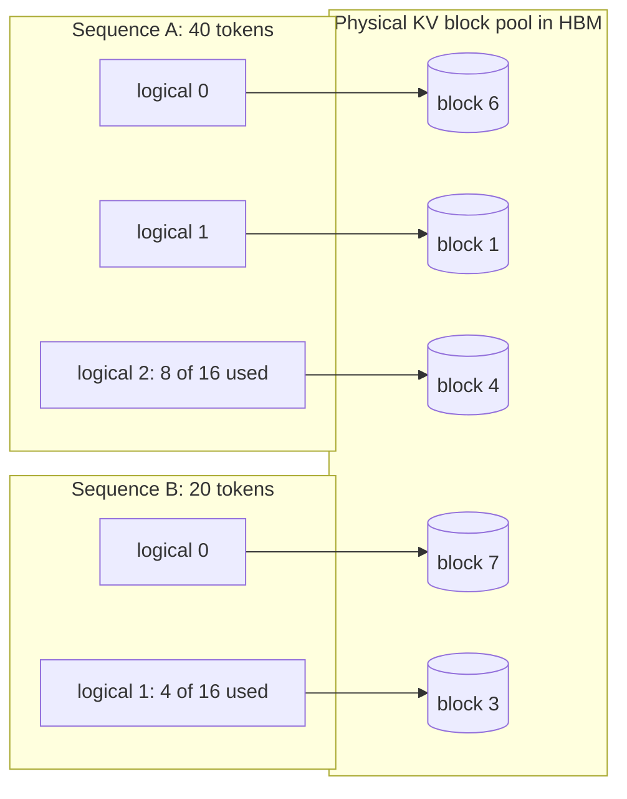

**Reading the diagram.** Each sequence's block table (left groups) points to physical blocks (cylinders) anywhere in the HBM pool. A's 40 tokens fill two blocks and half a third; B's 20 tokens fill one and a quarter. The only waste is each sequence's unfilled last block. Lookups happen synchronously inside the attention kernel. Failure points: no free block for a sequence's next token forces preemption (§73.14); tiny blocks raise indexing cost. Scaling: any free block serves any sequence, so the pool stays usable as sequences come and go.

#### Mathematical foundations

::: formula
**KV memory waste: contiguous reservation versus paging**

$$w_\text{contig} = 1 - \frac{n_\text{used}}{n_\text{max}} \qquad w_\text{paged} \approx \frac{(b-1)/2}{n_\text{used}}$$

| Symbol | Meaning | Units |
|---|---|---|
| $w_\text{contig}$ | Fraction of a contiguous reservation never used | dimensionless |
| $n_\text{used}$ | Tokens the sequence actually holds at completion | tokens |
| $n_\text{max}$ | Tokens reserved (the maximum length) | tokens |
| $w_\text{paged}$ | Expected waste with paging: half a block per sequence on average | dimensionless |
| $b$ | Block size | tokens |
:::

::: example
**Worked example — PagedAttention waste for the chatbot.** Pool 102,997 tokens (§73.5); calls use $n_\text{used} = 1{,}588$ on average; maximum length 4,096; $b = 16$.

1. Contiguous: $w = 1 - 1{,}588/4{,}096 = 61\%$ wasted (before external fragmentation); concurrency $\lfloor 102{,}997/4{,}096 \rfloor = 25$.
2. Paged: expected waste $7.5/1{,}588 = 0.47\%$, at most 15 tokens per sequence; concurrency $\lfloor 102{,}997/1{,}595.5 \rfloor = 64$.
3. Throughput at batch 25 versus 64 (§73.3): steps of $2 + (14 + 25 \times 0.81)/2.68 = 14.8$ ms and 26.6 ms, giving 1,689 and 2,404 tokens/s, 42% more with paging; with a 32,000-token maximum, contiguous allocation fits only 3 sequences.
4. Parallel sampling, $n = 4$ answers of 78 tokens to one 1,510-token prompt: without sharing $4 \times 1{,}588 = 6{,}352$ tokens (3.33 GB); with shared prompt blocks $1{,}510 + 312 = 1{,}822$ tokens (0.96 GB), 71% less. The prompt fills 94 blocks plus 6 tokens, so each child but the last copies that tail block on its first write.

**Interpretation.** Paging turns memory waste from tens of percent into a fraction of a percent, and the saving converts directly into batch size. **Engineering implication.** Raising the maximum context length is almost free with paging (it only limits the longest request), but catastrophic without it.
:::

**Figure 73.8 — Copy-on-write when two samples share a prompt's last, partly filled block.**

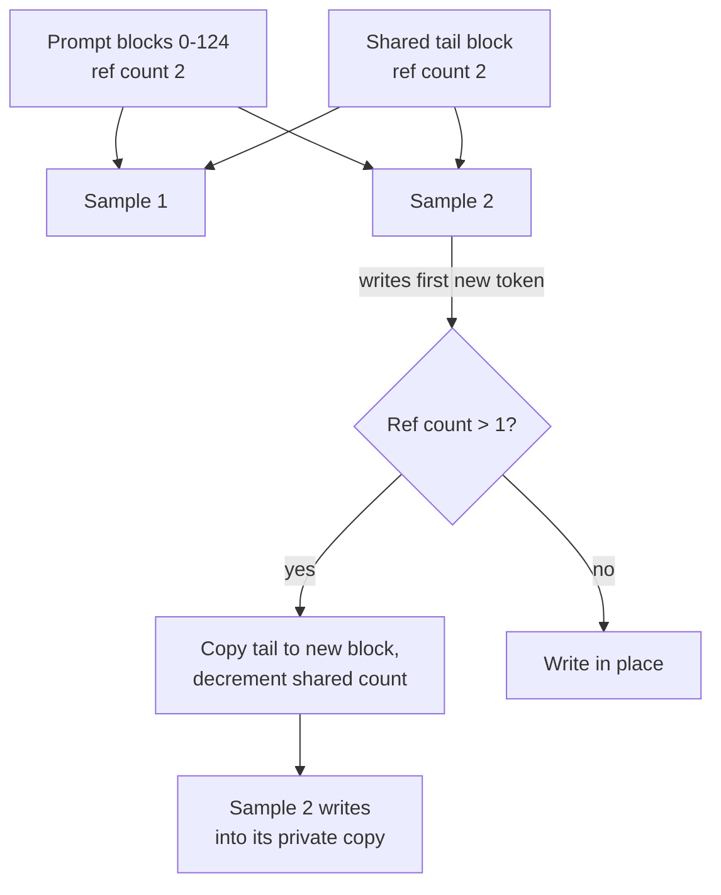

**Reading the diagram.** Both samples share the full prompt blocks and a partly filled tail block (reference count 2). When sample 2 appends its first token, the manager copies the tail, decrements the shared count and lets sample 2 write privately; sample 1 keeps the original. Full blocks are never copied. The check is synchronous in the scheduler. Failure point: a reference-counting bug silently corrupts another sequence's context, so engines test this path heavily. Scaling: beam search uses the same mechanism as beams fork and die.

::: industry
**vLLM.** Kwon et al. built vLLM around PagedAttention and reported 2–4× higher throughput than FasterTransformer and Orca at the same latency, with near-zero KV waste (under 4%) and larger gains for longer sequences, larger models and complex decoding such as beam search. The paper describes block-level sharing for parallel sampling and beam search, and swapping or recomputation for preemption (§73.14).
*Evidence: Primary* — [Kwon et al. 2023]
:::

#### Alternatives

The alternatives are contiguous reservation with copying when a sequence grows, or keeping the KV cache virtually contiguous while the GPU driver maps physical pages on demand, which leaves attention kernels unchanged. As of 2026, paging with block tables remains the common default.

::: mistake
**"PagedAttention makes attention faster."** It makes memory denser; the kernel does slightly more work following block tables. The speed-up comes from the larger batch.
:::

## 73.8 Prefix caching and KV reuse

### 73.8.1 Reusing the KV cache of shared prompt prefixes

::: definition
**Definition — Prefix caching.** Keeping the KV blocks of completed or running sequences after use and, when a new request's prompt begins with the same tokens, reusing those blocks instead of recomputing them. Matching is exact and token-by-token from the start of the prompt, because each token's keys and values depend on every token before it. **Automatic prefix caching** identifies full blocks by a hash of their tokens and of everything before them [vLLM Docs]; **RadixAttention** in SGLang organizes cached prefixes in a radix tree with least-recently-used eviction and schedules requests to maximize reuse [Zheng et al. 2024].
:::

#### First-principles explanation

Every chatbot call starts with the same 1,000-token instruction manual. Recomputing its keys and values each time is like a support agent rereading the manual before every customer; prefix caching keeps it open, and in multi-turn chat keeps the conversation so far open too.

#### Why does this exist?

Real traffic is full of shared prefixes: system prompts, tool definitions, few-shot examples, retrieved documents (§75.11), multi-turn histories and agent transcripts (Chapter 77). Without reuse, prefill cost and TTFT grow with conversation length and every sequence stores its own copy of the prefix.

#### How it works internally

1. **Lookup.** Hash the prompt block by block (or walk the radix tree) to find the longest cached prefix.
2. **Share.** Point the new block table at those blocks and increment their reference counts (§73.7).
3. **Compute the rest.** Prefill only the uncached suffix.
4. **Retain.** Finished sequences' blocks stay cached at reference count 0, evicted in LRU order.
5. **Route.** Send requests sharing a prefix to the replica holding it (Figure 73.10); random routing over $R$ replicas cuts the hit rate roughly $R$-fold.

**Figure 73.9 — A radix tree of cached prefixes for the chatbot.**


**Reading the diagram.** Each node holds the KV blocks for a run of tokens. All conversations share the system-prompt node; turn 3 of order 8812 reuses everything above it and prefills only its new message. Unused leaves (a finished conversation, a retired prompt version) are evicted first. The tree lives in CPU memory and references blocks in GPU memory; some engines spill cold blocks to CPU memory or disk. Failure points: one changed early token (a timestamp in the system prompt) creates a new branch and destroys reuse; eviction under pressure lowers hit rates at peak. Scaling: per-replica trees plus prefix-aware routing.

**Figure 73.10 — Prefix-aware routing across engine replicas.**

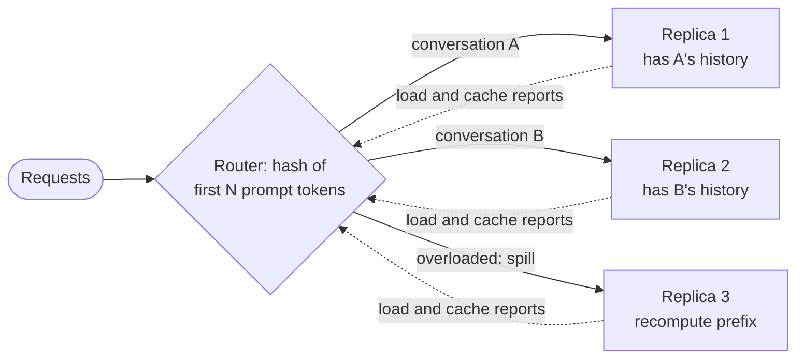

**Reading the diagram.** The router hashes a prefix or conversation ID and sends the request to the replica likely to hold its blocks, like consistent hashing with bounded loads (§14.8); replicas report load and cache contents asynchronously (dotted). An overloaded preferred replica spills to another, accepting recomputation. Failure points: pure affinity creates hot replicas; pure load balancing destroys reuse.

#### Mathematical foundations

::: formula
**Prefill saved and concurrency gained by prefix sharing**

$$T'_\text{prefill} = (1 - h)\,T_\text{prefill} \qquad S'_\text{max} = \left\lfloor \frac{T_\text{KV} - n_\text{sh}}{n_\text{in} + n_\text{out} - n_\text{sh}} \right\rfloor$$

| Symbol | Meaning | Units |
|---|---|---|
| $h$ | Token-level prefix hit fraction: cached prompt tokens ÷ prompt tokens | dimensionless |
| $T_\text{prefill}$, $T'_\text{prefill}$ | Prefill time without and with reuse | s |
| $T_\text{KV}$ | KV pool capacity | tokens |
| $n_\text{sh}$ | Tokens of the prefix shared by all running sequences (stored once) | tokens |
| $S'_\text{max}$ | Concurrent sequences with one shared copy of the prefix | sequences |
:::

::: example
**Worked example — Prefix-cache economics for the chatbot.** $n_\text{in} = 1{,}510$ with a 1,000-token system prompt shared by all calls; $n_\text{out} = 78$; $T_\text{KV} = 102{,}997$ tokens; prefill 42.8 ms; 60,000 calls a day.

1. *System prompt only,* $h = 1{,}000/1{,}510 = 0.66$: prefill $0.34 \times 42.8 = 14.5$ ms, 28 ms off TTFT; GPU time per call falls from 0.075 s (§73.15) to 0.047 s, 38% less.
2. *Keeping each conversation's KV between turns:* only new tokens are computed, 233 on turn 1 and 33 on each later turn, 398 of 9,063 (§72.4.5): $h = 0.956$, prefill 1.9 ms, 0.034 GPU-s per call. But 200 conversations hold 196 GB (§73.5), so most must be spilled to CPU memory (swap-in of 0.98 GB at 50 GB/s takes 20 ms, versus 53 ms to recompute) or evicted.
3. *Concurrency:* $S' = \lfloor (102{,}997 - 1{,}000)/(1{,}588 - 1{,}000) \rfloor = 173$ versus 64.
4. *But decode reads:* each sequence still attends over all its tokens; with a standard kernel $t_\text{step}(173) = 2 + (14 + 173 \times 1{,}549 \times 524{,}288 \times 10^{-9})/2.68 = 2 + 154.5/2.68 = 59.6$ ms, over a 50 ms TPOT SLO, so the batch must be capped (§73.17). A kernel that reads the shared 1,000 tokens once per step moves $14 + 0.52 + 173 \times 549 \times 524{,}288 \times 10^{-9} = 64.3$ GB: 26.0 ms and about 6,650 tokens/s.
5. *Money:* system-prompt compute saved per day: $60{,}000 \times 1{,}000 \times 28.3\ \mu\text{s} = 1{,}698$ GPU-s $= 0.47$ GPU-hours $\approx \$1.18$.

**Interpretation.** At QuickBite's volume the dollar saving is small; the wins are TTFT, 2.7× the concurrency, and the option of a shared-prefix kernel. At large API providers prompt tokens are a major cost line, which is why several price cached input tokens at a discount (as of 2026). **Engineering implication.** Put stable content first and variable content last, version system prompts deliberately, and route by conversation.
:::

::: industry
**SGLang and RadixAttention.** Zheng et al. store all cached prefixes in a radix tree in an LRU cache, schedule waiting requests in longest-shared-prefix order to raise hit rates, and pair this with a frontend language for multi-call LLM programs. They report up to 6.4× higher throughput than state-of-the-art systems across agent, reasoning, extraction, chat and few-shot workloads.
*Evidence: Primary* — [Zheng et al. 2024]
:::

::: warning
**Prefix caches are shared state.** Whether a prefix is cached changes TTFT, which a malicious tenant could use as a timing side channel to infer another tenant's prompts. In multi-tenant deployments scope cache keys per tenant (or salt them) and never share caches across trust boundaries (§47.12).
:::

## 73.9 Attention kernels

### 73.9.1 FlashAttention for prefill, split-KV kernels for decode

::: definition
**Definition — FlashAttention and decode attention kernels.** **FlashAttention** computes exact attention by tiling queries, keys and values into blocks that fit in on-chip SRAM and combining blocks with an **online softmax** (running maximum and sum), so the $n \times n$ score matrix never travels to HBM [Dao et al. 2022]. **FlashAttention-2** improves work partitioning across thread blocks and warps [Dao 2024]; **FlashAttention-3** uses Hopper's asynchronous copy and FP8 features [Shah et al. 2024]. **Decode kernels** handle one query token per sequence against a long, paged KV cache; **Flash-Decoding** splits the KV sequence into chunks processed in parallel and merges their partial results [Dao et al. 2023].
:::

#### First-principles explanation

Naive attention writes the whole query–key comparison table to slow memory and reads it back; FlashAttention reads a chapter at a time onto a small desk and keeps a running summary. In decode there is one query and a long book, and the problem is getting enough readers to read different chapters at once.

#### How it works internally

Chapter 64 (§64.13) explained FlashAttention's tiling. For serving, three points matter:

1. **Prefill:** FlashAttention removes the quadratic memory traffic and footprint. FlashAttention-2 roughly doubles its speed, reaching 50–73% of A100 peak [Dao 2024]; FlashAttention-3 reports 1.5–2.0× over FlashAttention-2 on H100 in BF16, up to 75% utilization [Shah et al. 2024].
2. **Decode** attention reads every cached key and value once per step at about $g$ FLOPs per byte ($g$ = query heads per KV head): memory-bound.
3. With small batches and long contexts, one thread block per (sequence, head) leaves most SMs idle; Flash-Decoding splits the sequence and merges partial outputs with their log-sum-exp statistics. Paged variants follow block tables (§73.7).

**Figure 73.11 — Flash-Decoding: split the KV sequence, compute partial attention in parallel, merge.**

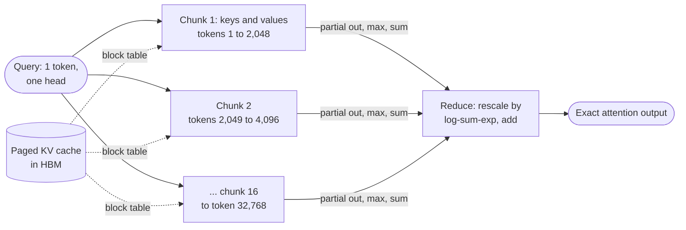

**Reading the diagram.** One query meets a 32,768-token cache split into 16 chunks, each read from the paged HBM cache by its own thread block via the block table. Each chunk returns a partial output plus softmax maximum and sum; the reduction rescales and combines them exactly, within one or two synchronous kernel launches. Failure point: for short contexts the reduction is pure overhead, so kernels pick splits heuristically. Scaling: splits multiply the parallel work available.

#### Mathematical foundations

::: formula
**Attention memory traffic and decode-attention intensity**

$$Q_\text{std} = \Theta(n\,d + n^2) \qquad Q_\text{flash} = \Theta\!\left(\frac{n^2 d^2}{M}\right) \qquad I_\text{dec} \approx \frac{4\,d\,g}{2\,d\,b_\text{kv}} = \frac{2g}{b_\text{kv}}$$

| Symbol | Meaning | Units |
|---|---|---|
| $Q_\text{std}$, $Q_\text{flash}$ | HBM accesses of standard attention and FlashAttention, per head [Dao et al. 2022] | elements |
| $n$ | Sequence length | tokens |
| $d$ | Head dimension | values |
| $M$ | On-chip SRAM per SM, in elements | elements |
| $I_\text{dec}$ | Decode attention FLOPs per KV byte read | FLOPs/byte |
| $g$ | Query heads sharing one KV head (1 for MHA) | heads |
| $b_\text{kv}$ | Bytes per KV element | bytes |
:::

::: example
**Worked example — Prefill traffic and decode parallelism.** H100: about 228 KB of shared memory per SM, roughly $10^5$ FP16 elements (assumed usable); 132 SMs.

1. *Prefill, $n = 8{,}192$, $d = 128$.* $n^2 = 6.7 \times 10^7$ elements; $n^2 d^2/M = 6.7 \times 10^7 \times 16{,}384/10^5 = 1.1 \times 10^7$: about 6× fewer HBM accesses, and no $n \times n$ buffer (134 MB per head per layer in FP16).
2. *Decode intensity.* MHA, FP16: $I = 2 \times 1/2 = 1$ FLOPs/byte; 70B GQA ($g = 8$): 8 FLOPs/byte. The H100 ridge point is $989/3.35 \approx 295$ FLOPs/byte (§64.9): both are memory-bound by a wide margin.
3. *Decode parallelism.* Batch 1, 32 heads, context 32,768: one block per head gives 32 blocks for 132 SMs, at most 24% of SMs busy. With 16 splits: 512 blocks, about 3.9 per SM.

**Interpretation.** Prefill attention needs FlashAttention's tiling; decode attention is pure bandwidth, and its kernel must keep every SM streaming KV bytes. **Engineering implication.** Long-context, small-batch workloads need split-KV decode kernels; verify which kernel library is active when profiling.
:::

::: industry
**Flash-Decoding.** Dao, Haziza, Massa and Sizov described the split-KV approach for long-context inference and reported up to 8× faster generation for very long sequences compared with prior attention implementations, by keeping the GPU fully occupied when batch size is small.
*Evidence: Primary* — [Dao et al. 2023]
:::

::: mistake
**"FlashAttention is an approximation."** It is exact up to floating-point rounding order; it only reorders computation. Sparse or linear attention are different algorithms that change outputs.
:::

## 73.10 Speculative decoding

### 73.10.1 Draft, verify, accept

::: definition
**Definition — Speculative decoding.** A technique that produces several tokens per forward pass of the large **target** model: a cheap **draft** proposes $\gamma$ tokens, the target scores all of them in one parallel pass, and a modified rejection-sampling rule accepts a prefix of the draft and samples one corrected or bonus token, so that the output distribution is *exactly* the target's [Leviathan et al. 2023; Chen et al. 2023]. The **acceptance rate** $\alpha$ is the expected probability that the target accepts a draft token.
:::

#### First-principles explanation

A senior editor writes slowly but checks a paragraph in the time it takes to write one word. A junior drafts four words; the editor checks all four at once, keeps the good prefix, fixes the first wrong word, and the junior restarts from there.

#### Why does this exist?

Decode is memory-bound: verifying 5 tokens per sequence reads the same weights as producing 1 (§73.3). Speculation turns that spare compute into lower TPOT without changing outputs.

#### How it works internally

1. The draft proposes $\gamma$ tokens (small model, extra heads or n-gram lookup).
2. The target scores context plus drafts in one pass, giving distributions $p$.
3. For each draft token $x$ in order, accept with probability $\min(1, p(x)/q(x))$, where $q$ is the draft's distribution.
4. At the first rejection, sample a replacement from the normalized residual $\max(0, p - q)$ and stop; if all $\gamma$ are accepted, sample one bonus token from $p$.
5. Roll back KV entries of rejected tokens and repeat.

**Figure 73.12 — One speculative iteration with $\gamma = 4$.**

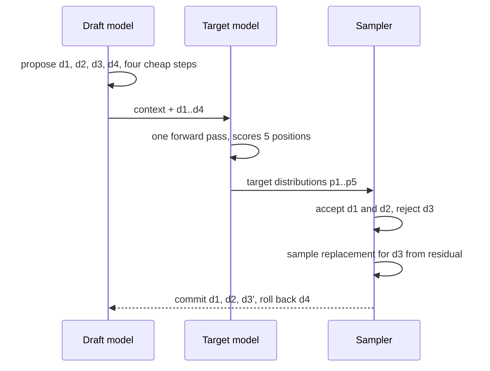

**Reading the diagram.** The draft proposes four tokens sequentially; the target verifies them in one synchronous pass; the sampler accepts two, resamples the third from the residual, and commits three tokens for one target pass, rolling back both KV caches beyond the commit point. Failure points: low acceptance wastes draft work; at large batch verification is no longer free. Scaling: tree-structured drafts verify several candidates per pass.

#### Mathematical foundations

::: formula
**Expected tokens per target pass and wall-clock speed-up** [Leviathan et al. 2023]

$$E[\text{tokens}] = \frac{1 - \alpha^{\gamma + 1}}{1 - \alpha} \qquad S = \frac{1 - \alpha^{\gamma + 1}}{(1 - \alpha)(\gamma c + 1)} \qquad \alpha = \sum_x \min\big(p(x), q(x)\big)$$

| Symbol | Meaning | Units |
|---|---|---|
| $\alpha$ | Acceptance rate (assumed i.i.d. per token) | dimensionless |
| $\gamma$ | Draft tokens per iteration | tokens |
| $c$ | Cost of one draft step ÷ cost of one target step | dimensionless |
| $E[\text{tokens}]$ | Tokens committed per target forward pass | tokens |
| $S$ | Speed-up over plain decoding, assuming verification costs one target step | dimensionless |
| $p$, $q$ | Target and draft next-token distributions | probabilities |
:::

::: example
**Worked example — A draft with $\alpha = 0.8$, $\gamma = 4$, $c = 0.05$.**

1. $\alpha^{5} = 0.32768$; $E = (1 - 0.32768)/0.2 = 3.36$ tokens per target pass.
2. Cost per iteration: $4 \times 0.05 + 1 = 1.2$ target-step units.
3. $S = 3.36/1.2 = 2.80$: TPOT falls from 26.6 ms to about 9.5 ms if verification is free.
4. Weaker draft, $\alpha = 0.6$: $E = (1 - 0.07776)/0.4 = 2.31$; $S = 1.92$.
5. Poor draft, $\alpha = 0.3$, $c = 0.2$: $E = 1.43$; $S = 1.43/1.8 = 0.79$, a 21% *slowdown*.

**Interpretation.** Speed-up depends on acceptance far more than on $\gamma$, and an expensive or poorly aligned draft makes things worse. **Engineering implication.** Measure $\alpha$ on production traffic (it varies by domain, sampling temperature and language) before enabling speculation.
:::

#### Code example: formula versus Monte Carlo

```python
import numpy as np

def expected_tokens(alpha, gamma):
    """Leviathan et al. 2023: mean tokens produced per target forward pass."""
    return (1 - alpha ** (gamma + 1)) / (1 - alpha)

def expected_speedup(alpha, gamma, c):
    """Walltime speed-up over plain decoding; c = draft cost / target cost."""
    return expected_tokens(alpha, gamma) / (gamma * c + 1)

def monte_carlo(alpha, gamma, c, n_tokens=200_000, seed=42):
    rng = np.random.default_rng(seed)
    produced = iterations = 0
    while produced < n_tokens:
        accepted = 0
        while accepted < gamma and rng.random() < alpha:   # i.i.d. acceptance
            accepted += 1
        produced += accepted + 1        # +1: target's correction or bonus token
        iterations += 1
    cost = iterations * (gamma * c + 1)    # in units of one target step
    return produced / iterations, produced / cost

print(f"{'alpha':>5} {'gamma':>5} {'c':>5} {'E[tok] formula':>15} {'MC':>6}"
      f" {'speed-up formula':>17} {'MC':>6}")
for alpha, gamma, c in [(0.8, 4, 0.05), (0.6, 4, 0.05), (0.8, 8, 0.05),
                        (0.6, 8, 0.05), (0.3, 4, 0.2)]:
    e, s = expected_tokens(alpha, gamma), expected_speedup(alpha, gamma, c)
    e_mc, s_mc = monte_carlo(alpha, gamma, c)
    print(f"{alpha:>5} {gamma:>5} {c:>5} {e:>15.3f} {e_mc:>6.3f} {s:>17.3f} {s_mc:>6.3f}")

for alpha in (0.6, 0.8):
    best = max(range(1, 13), key=lambda g: expected_speedup(alpha, g, 0.05))
    print(f"alpha={alpha}: best gamma={best},"
          f" speed-up={expected_speedup(alpha, best, 0.05):.2f}")

# Real speculative sampling on a toy 5-token vocabulary (Chen et al. 2023 rule).
rng = np.random.default_rng(0)
p = np.array([0.50, 0.20, 0.15, 0.10, 0.05])     # target model
q = np.array([0.35, 0.30, 0.15, 0.10, 0.10])     # draft model
alpha = np.minimum(p, q).sum()
resid = np.maximum(p - q, 0) / np.maximum(p - q, 0).sum()
out, iters, gamma = [], 0, 4
while len(out) < 200_000:
    iters += 1
    for _ in range(gamma):
        x = rng.choice(5, p=q)
        if rng.random() < min(1.0, p[x] / q[x]):
            out.append(x)                          # draft token accepted
        else:
            out.append(rng.choice(5, p=resid))     # corrected token, stop
            break
    else:
        out.append(rng.choice(5, p=p))             # all accepted: bonus token
freq = np.bincount(out, minlength=5) / len(out)
print(f"alpha = {alpha:.2f}; tokens/iteration = {len(out)/iters:.3f}"
      f" (formula {expected_tokens(alpha, gamma):.3f})")
print("target p     :", p)
print("sampled freq :", freq.round(3))
```

Output:

```text
alpha gamma     c  E[tok] formula     MC  speed-up formula     MC
  0.8     4  0.05           3.362  3.363             2.801  2.802
  0.6     4  0.05           2.306  2.304             1.921  1.920
  0.8     8  0.05           4.329  4.332             3.092  3.094
  0.6     8  0.05           2.475  2.475             1.768  1.768
  0.3     4   0.2           1.425  1.426             0.792  0.792
alpha=0.6: best gamma=4, speed-up=1.92
alpha=0.8: best gamma=8, speed-up=3.09
alpha = 0.85; tokens/iteration = 3.717 (formula 3.709)
target p     : [0.5  0.2  0.15 0.1  0.05]
sampled freq : [0.499 0.201 0.149 0.1   0.05 ]
```

What to notice:

- The Monte Carlo matches the closed form to three decimals under its i.i.d. assumption.
- The best $\gamma$ grows with $\alpha$ but the optimum is flat: $\gamma = 4$ at $\alpha = 0.8$ gives 2.80 versus 3.09.
- The toy run uses the real accept/reject rule: acceptance equals $\sum \min(p, q) = 0.85$ and token frequencies match the *target* $p$. Speculation is lossless.

#### When it hurts

::: example
**Worked example — Speculation on the 70B replica at batch 253.** §73.5: per-GPU memory time 25.0 ms, step 27.0 ms; $\alpha = 0.8$, $\gamma = 4$, $c = 0.05$.

1. Verification processes $253 \times 5 = 1{,}265$ tokens per step: $2 \times 70 \times 10^9 \times 1{,}265 / 4 / 494.5 \times 10^{12} = 89.5$ ms of compute per GPU, far above the 25.0 ms memory time; the step becomes compute-bound at 91.5 ms.
2. Draft cost: $4 \times 0.05 \times 27.0 = 5.4$ ms. Iteration: 96.9 ms for 3.36 tokens per sequence.
3. Effective speed-up: $3.36 \times 27.0 / 96.9 = 0.94$, a slowdown. The 7B model at batch 64 verifies 320 tokens in $1.4 \times 10^{10} \times 320 / 494.5 \times 10^{12} = 9.1$ ms, under its 24.6 ms memory time, so its full gain survives.

**Interpretation.** Speculation spends spare compute; at large batch there is none left. **Engineering implication.** Enable speculation for latency-sensitive, small-to-medium-batch serving, and let the engine reduce $\gamma$ or disable it as the batch grows. Count the draft's own KV cache and weights in the memory budget.
:::

**Table 73.4 — Speculative decoding variants (speed-ups as reported by the authors, at small batch).**

| Variant | Draft source | Strength | Watch out for |
|---|---|---|---|
| Draft model [Leviathan et al. 2023; Chen et al. 2023] | Small model of the same family | 2–3× (T5-XXL), 2–2.5× (Chinchilla 70B) reported | Needs a matched tokenizer; extra memory |
| Medusa [Cai et al. 2024] | Extra decoding heads on the target, tree verification | No separate model; 2.2–3.6× reported | Heads must be trained per model |
| EAGLE [Li et al. 2024] | Light head predicting next *features* | High acceptance; 2.7–3.5× on LLaMA2-Chat 70B reported | Per-model training |
| N-gram / prompt lookup | Copy spans from the prompt or history | Free; strong for RAG, editing, code | Useless for novel text |

::: mistake
**"Speculative decoding trades quality for speed."** With the rejection-sampling rule, outputs follow the target distribution exactly (greedy decoding gives identical tokens). Quality changes only if an engine uses a relaxed, lossy acceptance rule, which should be an explicit choice.
:::

## 73.11 Parallelism for inference

### 73.11.1 Tensor, pipeline and expert parallelism at serving time

::: definition
**Definition — Inference parallelism.** **Tensor parallelism (TP)** splits every layer's matrices (and attention heads, hence KV heads) across $t$ GPUs that cooperate on every token, with all-reduces inside each layer (§65.10). **Pipeline parallelism (PP)** places consecutive groups of layers on different GPUs or nodes and passes activations between stages (§65.11). **Expert parallelism (EP)** places the experts of mixture-of-experts layers on different GPUs and routes each token to its experts with all-to-all exchanges (§65.12.2, §72.13). **Data parallelism** for inference is simply independent replicas.
:::

#### First-principles explanation

Training parallelism (Chapter 65) optimizes throughput over hours; serving must also meet a 20–50 ms deadline per token, so communication on each token's critical path matters. TP cuts per-token latency but talks twice per layer; PP talks once per stage but adds a hop; EP lets a huge MoE model run while each token touches a few experts.

#### How it works internally

1. **Fit weights and KV cache** (§73.5) with the smallest TP degree inside one NVLink domain that leaves room for the target concurrency.
2. **Cross nodes with PP, not TP:** one activation transfer per stage per step, with several micro-batches in flight.
3. **MoE models:** shard experts with EP, often with data-parallel attention.
4. **Replicate** the unit for throughput.

**Figure 73.13 — A 70B replica: TP within each node, PP across two nodes.**

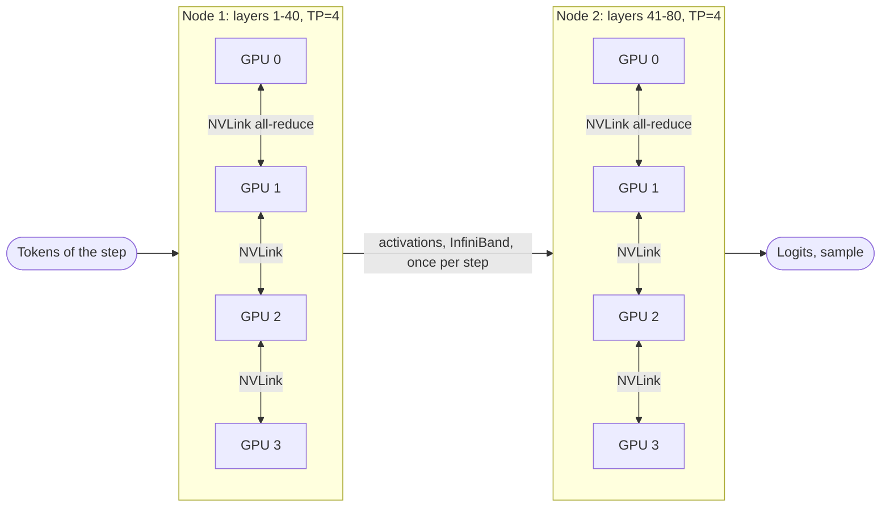

**Reading the diagram.** Each node holds half the 80 layers split four ways; its GPUs all-reduce twice per layer over NVLink, synchronously on the critical path, while only one activation tensor per step crosses InfiniBand. Weights and KV shards stay in each GPU's HBM. Failure points: one GPU failing stalls the replica (eight GPUs share fate); a straggler sets every all-reduce's pace. Scaling: on an 8-GPU node, TP=8 avoids the cross-node hop.

#### Mathematical foundations

::: formula
**Communication per token per GPU**

$$V_\text{TP} = 2 L \cdot 2\,\frac{t - 1}{t} \cdot h\,b_\text{a} \qquad V_\text{PP} = (p - 1)\,h\,b_\text{a} \qquad V_\text{EP} = 2\,k_\text{e}\,h\,b_\text{a} \text{ per MoE layer}$$

| Symbol | Meaning | Units |
|---|---|---|
| $V_\text{TP}$ | Bytes sent per GPU per token for two ring all-reduces per layer (forward only) | bytes/token |
| $L$, $h$ | Layers and hidden size | layers, values |
| $t$ | Tensor-parallel degree | GPUs |
| $b_\text{a}$ | Bytes per activation value (2 for BF16) | bytes |
| $V_\text{PP}$ | Bytes crossing stage boundaries per token, $p$ stages | bytes/token |
| $V_\text{EP}$ | Dispatch plus combine bytes per token per MoE layer, top-$k_\text{e}$ routing | bytes/token |
:::

::: example
**Worked example — TP communication for the 70B model, $t = 4$.** $L = 80$, $h = 8{,}192$, $b_\text{a} = 2$; NVLink at an achieved 360 GB/s and InfiniBand at 40 GB/s per GPU (§65.10); assume 8 µs latency per small all-reduce.

1. $V_\text{TP} = 160 \times 1.5 \times 8{,}192 \times 2 = 3.93$ MB per token per GPU.
2. *Decode step, batch 253:* $253 \times 3.93 = 994$ MB: 2.8 ms on NVLink plus $160 \times 8\ \mu\text{s} = 1.3$ ms of latency, about 4.1 ms on top of the 27.0 ms step (15%).
3. *Prefill, 1,510 tokens:* 5.94 GB: 16.5 ms on NVLink against 106.9 ms of compute (15%, partly overlappable); across nodes at 40 GB/s, 148 ms (139%).
4. *PP instead across 2 nodes:* $V_\text{PP} = 8{,}192 \times 2 = 16$ KB per token; a 253-token decode step sends 4.1 MB, 0.1 ms at 40 GB/s.
5. *MoE (Mixtral-8×7B-like:* $h = 4{,}096$, 32 MoE layers, top-2): $V_\text{EP} = 2 \times 2 \times 4{,}096 \times 2 = 32.8$ KB per layer, 1.05 MB per token.

**Interpretation.** TP moves megabytes per token and must stay on NVLink; PP moves kilobytes and tolerates the network; EP sits between. **Engineering implication.** TP inside the node for latency, PP or EP across nodes for capacity, replicas for throughput; a quantized single-GPU deployment avoids TP's 4 ms per step entirely (§73.13).
:::

**Figure 73.14 — Expert parallelism: tokens dispatched to experts on other GPUs and combined back.**

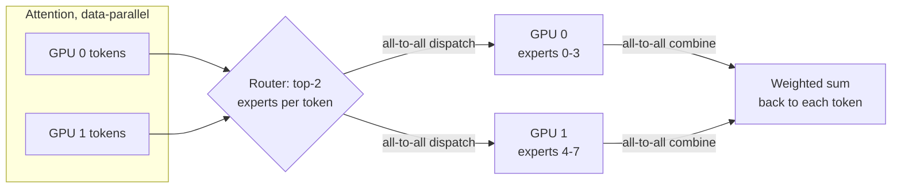

**Reading the diagram.** A router picks two experts per token; an all-to-all sends each hidden vector to the GPUs holding those experts, and a second returns the results, both synchronous within the layer. Each GPU stores only its experts. Failure points: hot experts overload one GPU and stall the layer. Scaling: large decode deployments spread experts across many nodes so each GPU serves few experts with large batches.

**Table 73.5 — Inference parallelism compared.**

| Row | Tensor (TP) | Pipeline (PP) | Expert (EP) | Replicas |
|---|---|---|---|---|
| What it splits | Each layer's matrices and heads | Groups of layers | MoE experts | Nothing |
| Latency per token | Lower (less weight read per GPU) | Higher (hops) | Neutral to lower | Unchanged |
| Communication | All-reduce ×2 per layer | One send per stage | All-to-all ×2 per MoE layer | None |
| Link needed | NVLink | Network is fine | Fast network or NVLink | None |
| Choose when | Weights + KV exceed one GPU | Model exceeds one node | MoE models | Need more throughput |

::: industry
**Partitioning for latency and throughput.** Pope et al. derived communication costs of several tensor-partitioning layouts for TPU inference and showed that the best layout depends on phase and batch size: layouts that minimize weight movement for small-batch decode differ from those for large-batch prefill.
*Evidence: Primary* — [Pope et al. 2023]
:::

## 73.12 Disaggregated prefill and decode

### 73.12.1 Separate fleets for the two phases

::: definition
**Definition — Prefill–decode disaggregation.** Running prefill and decode on different GPU pools: **prefill instances** process prompts and produce the KV cache, which is transferred to **decode instances** that generate the remaining tokens. Each pool gets its own parallelism, batch policy and scale [Zhong et al. 2024; Patel et al. 2024].
:::

#### Why does this exist?

Colocated phases interfere: a long prefill stalls every decode stream (§73.6), and keeping decode smooth forces small chunks that raise TTFT. The phases also want different parallelism and batch sizes. DistServe framed the goal as per-GPU goodput under separate TTFT and TPOT SLOs; Splitwise added that phases can use different GPU generations, compute-rich for prefill and bandwidth-rich or cheaper for decode.

**Figure 73.15 — Disaggregated serving with KV transfer.**

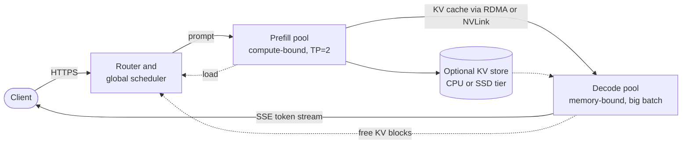

**Reading the diagram.** The router sends each prompt to a prefill instance, which computes the KV cache and first token and ships the cache over RDMA or NVLink to a decode instance that streams the rest. Both pools report load asynchronously; an optional KV tier also serves cross-instance prefix caching. Failure points: transfer bandwidth; a decode pool with no free blocks blocks the hand-off; losing a decode instance loses its KV caches. Scaling: each pool scales on its own metric.

#### Mathematical foundations

::: formula
**KV transfer time relative to prefill time**

$$T_\text{KV} = \frac{n_\text{in}\,k}{W_\text{link}} \qquad R = \frac{T_\text{KV}}{T_\text{prefill}} = \frac{k\,F_\text{eff}}{2N\,W_\text{link}}$$

| Symbol | Meaning | Units |
|---|---|---|
| $T_\text{KV}$ | Time to move one prompt's KV cache | s |
| $W_\text{link}$ | Transfer bandwidth between the instances (sum over parallel links) | bytes/s |
| $R$ | Transfer time as a fraction of prefill time: independent of prompt length | dimensionless |
| $k$, $N$, $F_\text{eff}$ | KV bytes per token, parameters, prefill FLOP/s of the instance | as above |
:::

::: example
**Worked example — Does disaggregation pay for QuickBite?** One 400 Gb/s NIC is 50 GB/s.

1. *7B MHA, one GPU, one NIC:* $T_\text{KV} = 1{,}510 \times 524{,}288 / 50 \times 10^9 = 15.8$ ms against 42.8 ms of prefill; $R = 524{,}288 \times 494.5 \times 10^{12}/(1.4 \times 10^{10} \times 50 \times 10^9) = 0.37$.
2. *70B GQA, TP=4, four NICs (200 GB/s):* $T_\text{KV} = 1{,}510 \times 327{,}680 / 200 \times 10^9 = 2.5$ ms against 106.9 ms; $R = 0.023$.
3. *Pool ratio for the 7B chatbot:* GPU time per call is 42.8 ms of prefill and $78 \times 26.6/64 = 32.4$ ms of decode (§73.15): short replies make prefill the larger phase, about four prefill GPUs per three decode GPUs.
4. QuickBite's peak needs about 0.5 busy GPUs (§73.15): two pools with redundancy in each need at least four GPUs instead of two.

**Interpretation.** Transfer is cheap for large GQA models, noticeable for small MHA ones, and can overlap layer by layer. **Engineering implication.** Disaggregation pays at scale, with tight TPOT SLOs and long prompts; for a two-GPU chatbot, chunked prefill (§73.14) gets most of the benefit.
:::

::: industry
**DistServe and Splitwise.** Zhong et al. reported that disaggregation with phase-specific parallelism lets DistServe serve up to 7.4× more requests or meet 12.6× tighter SLOs than state-of-the-art colocated systems while keeping over 90% of requests within latency constraints. Patel et al., analyzing production traces of two LLM services at Microsoft, reported Splitwise clusters with 1.4× higher throughput at 20% lower cost, or 2.35× more throughput under the same power and cost budgets. As of 2026, major open-source engines and NVIDIA's Dynamo framework offer disaggregated modes.
*Evidence: Primary* — [Zhong et al. 2024; Patel et al. 2024]
:::

## 73.13 Quantization for serving

### 73.13.1 Weights, activations and the KV cache

::: definition
**Definition — KV-cache quantization.** Storing cached keys and values in fewer bits than the activations that produced them (FP8 or INT8 with per-tensor, per-head or per-token scales; research formats down to 2 bits), dequantizing inside the attention kernel. It complements **weight quantization** (W8A8, W4A16; Chapter 67 owns GPTQ, AWQ, SmoothQuant and FP8 recipes, §67.6).
:::

#### Why does this exist?

At full batch the 7B chatbot reads 52 GB of KV cache per step against 14 GB of weights (§73.3): KV quantization halves the dominant cost.

#### How it works internally

1. **Weights:** W4A16 (AWQ, GPTQ) or FP8 W8A8, dequantized in registers (§67.6).
2. **KV write:** keys and values are scaled and rounded into FP8 or INT8 blocks.
3. **KV read:** the attention kernel dequantizes on chip.
4. **Validate** on long-context and task evaluations (Chapter 78); KIVI reaches 2 bits by quantizing keys per channel and values per token [Liu et al. 2024].

#### Mathematical foundations

The memory-budget and step-time formulas of §73.3 and §73.5 apply with $M_\text{w} = N b_\text{w}/8$ and $k \propto b_\text{kv}$, so throughput per GPU is $S_\text{max}/t_\text{step}(S_\text{max})$.

::: example
**Worked example — Four precision plans for the 7B chatbot on one H100.** Same assumptions as §73.5; INT4 weights with $g = 128$ use 4.125 bits per weight (3.61 GB, §67.3).

**Table 73.6 — Serving precision for the 7B chatbot.**

| Plan | Weights | KV bytes per token | KV pool | Sequences | TPOT | Output tokens/s per GPU |
|---|---|---|---|---|---|---|
| FP16 W, FP16 KV | 14.0 GB | 524,288 | 54.0 GB | 64 | 26.6 ms | 2,404 |
| FP16 W, FP8 KV | 14.0 GB | 262,144 | 54.0 GB | 129 | 26.8 ms | 4,819 |
| INT4 W, FP16 KV | 3.61 GB | 524,288 | 64.4 GB | 77 | 26.7 ms | 2,886 |
| INT4 W, FP8 KV | 3.61 GB | 262,144 | 64.4 GB | 154 | 26.7 ms | 5,772 |

1. Row 4 pool: $72 - 3.61 - 4 = 64.4$ GB; tokens $64.4 \times 10^9/262{,}144 = 245{,}600$; calls $\lfloor 245{,}600/1{,}588 \rfloor = 154$.
2. Row 4 step: $2 + (3.61 + 154 \times 1{,}549 \times 262{,}144 \times 10^{-9})/2.68 = 2 + (3.61 + 62.5)/2.68 = 26.7$ ms.
3. Row 3: 77 calls, $2 + (3.61 + 62.5)/2.68 = 26.7$ ms; the batch grows only 20% because KV, not weights, dominates.

**Interpretation.** For this MHA model, KV quantization doubles throughput, weight quantization alone adds 20%, together 2.4×; TPOT stays near 27 ms because every plan fills memory to the same bandwidth-limited step. **Engineering implication.** Quantize what dominates the bytes: the KV cache for small MHA models, the weights for large GQA models on few GPUs (a 70B INT4 model fits one GPU with 44 GB for KV, §67.6, and drops TP communication).
:::

**Table 73.7 — Quantization options for LLM serving (as of 2026).**

| Option | Saves | Speeds | Quality risk | Notes |
|---|---|---|---|---|
| FP8 W8A8 | 2× weights vs FP16 | Prefill and decode | Low | Hopper-class GPUs or newer |
| INT4 W4A16 (AWQ, GPTQ) | ~3.9× weights | Decode; prefill can slow at large batch | Medium | Best when memory-bound |
| FP8 / INT8 KV cache | 2× KV | Decode attention, concurrency | Low–medium at long context | Engine KV dtype option |
| 4-bit and lower KV | 4× or more KV | Same | Higher; research-grade | Validate per task |
| FP4 (microscaling, §64.10.4) | ~3.8× weights | Compute on Blackwell-class GPUs | Medium | Newer hardware only |

::: mistake
**"Quantization quality can be judged by perplexity alone."** Perplexity can stay flat while instruction following, arithmetic, long-context retrieval or safety regress. Gate quantized models on task evaluations (Chapter 78) with production prompts.
:::

## 73.14 Scheduling and admission control

### 73.14.1 Who runs next, who waits, who is evicted

::: definition
**Definition — LLM scheduling terms.** **Admission control** decides whether a request may enter the running set (or the service at all). **Preemption** evicts a running sequence when KV memory runs out, either by **swapping** its KV blocks to CPU memory or by **recomputation** (dropping them and re-running prefill over prompt plus generated tokens later). **Chunked prefill** splits a long prompt into fixed-size chunks scheduled across several steps alongside decode tokens [Agrawal et al. 2024]. **SLO-aware scheduling** orders or rejects requests using predicted TTFT and TPOT against their targets.
:::

#### How it works internally

1. Each step has a **token budget**: one token per running decode, the rest for prefill chunks by priority.
2. Admission requires free KV blocks above a **watermark** so running sequences can grow.
3. When blocks run out, the most recently admitted or lowest-priority sequence is preempted, resuming later by swap-in or recomputation.
4. **Fairness:** count tokens served per client and favor the least served, as in the Virtual Token Counter [Sheng et al. 2024].
5. **Overload:** reject early when predicted TTFT exceeds the SLO (§22.9); rate-limit by tokens at the gateway.

**Figure 73.16 — States of a request in an engine with preemption.**

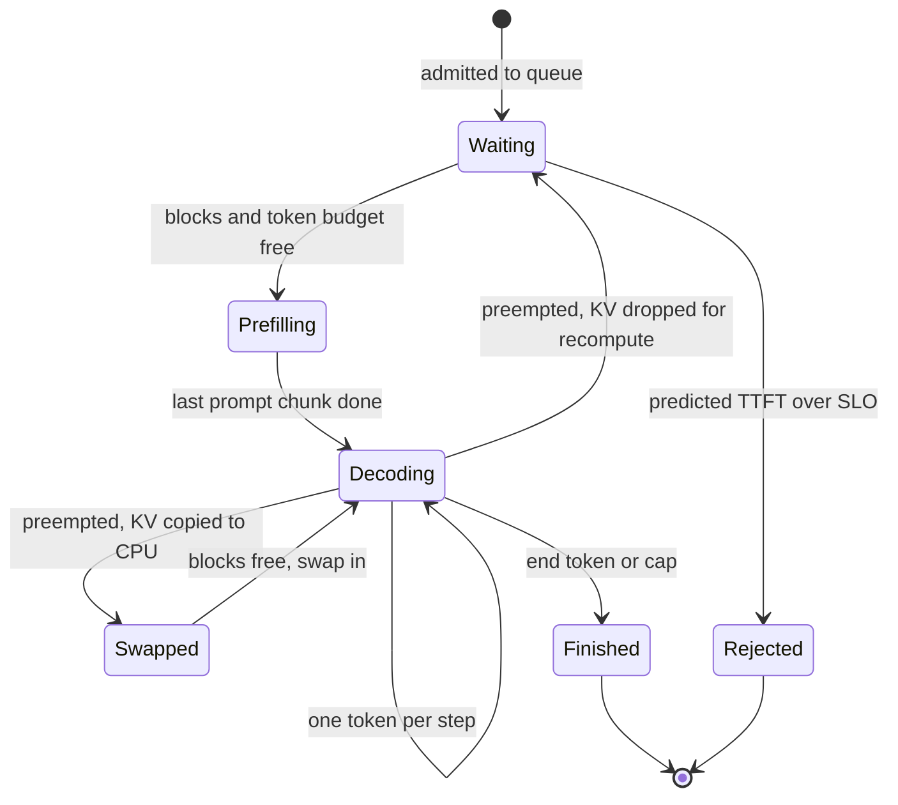

**Reading the diagram.** A request waits for blocks and budget, prefills (possibly over several chunks), then decodes one token per step. Under memory pressure it is swapped (KV copied to CPU memory over PCIe) or sent back to waiting (KV dropped for recomputation); admission control can reject it before any GPU work. Transitions happen synchronously between steps. Failure points: preemption storms at peak cause ITL spikes and wasted compute. Scaling: rejection and preemption counts drive autoscaling (§73.15).

#### Mathematical foundations

::: formula
**Preemption cost and the free chunk size**

$$T_\text{swap} = \frac{2\,n\,k}{W_\text{PCIe}\; t} \qquad T_\text{recomp} = \frac{2N\,n}{t\,F_\text{eff}} \qquad C^{*} = \frac{T_\text{mem}\,F_\text{eff}}{2N} - B$$

| Symbol | Meaning | Units |
|---|---|---|
| $T_\text{swap}$ | Out and back in over PCIe (factor 2), each of $t$ GPUs moving its shard | s |
| $n$ | Tokens held by the preempted sequence | tokens |
| $W_\text{PCIe}$ | Achieved host–GPU bandwidth per GPU | bytes/s |
| $T_\text{recomp}$ | Re-prefill of $n$ tokens | s |
| $C^{*}$ | Prefill tokens that fit in a decode step without lengthening it | tokens |
| $T_\text{mem}$ | Memory time of the decode step (§73.3) | s |
:::

::: example
**Worked example — Swap or recompute, and how big a chunk is free.** Assume $W_\text{PCIe} = 50$ GB/s achieved on PCIe Gen5 x16.

1. *7B, a finished 6-turn conversation, $n = 1{,}866$:* KV 0.98 GB; $T_\text{swap} = 2 \times 0.98/50 = 39$ ms; $T_\text{recomp} = 1.4 \times 10^{10} \times 1{,}866/494.5 \times 10^{12} = 53$ ms. Close; recomputation needs no CPU memory and can hit the prefix cache.
2. *70B, $t = 4$:* each GPU moves $1{,}866 \times 81{,}920 = 153$ MB: $T_\text{swap} = 6.1$ ms; $T_\text{recomp} = 1.4 \times 10^{11} \times 1{,}866/(4 \times 494.5 \times 10^{12}) = 132$ ms. Swapping wins by 22×.
3. *Free chunk at batch 64:* $T_\text{mem} = 24.6$ ms; $C^* = 0.0246 \times 494.5 \times 10^{12}/1.4 \times 10^{10} - 64 = 869 - 64 = 805$ tokens. A 512-token chunk hides under the memory time; a whole 1,510-token prompt makes the step compute-bound at about $2 + 1{,}574 \times 0.0283 = 46.5$ ms, a 1.7× ITL spike for 63 streams.

**Interpretation.** The best preemption mode depends on the model's KV size relative to its compute: small MHA models are near break-even, large GQA models favor swapping. Chunks below $C^*$ are almost free. **Engineering implication.** Set the chunk size from $C^*$ for your model and batch, and choose the preemption mode per model; engines expose both settings (defaults differ by engine and version, as of 2026).
:::

::: industry
**Sarathi-Serve.** Agrawal et al. combined chunked prefills with "stall-free" scheduling that admits new prefill chunks without pausing ongoing decodes, and reported serving capacity gains under latency SLOs of 2.6× for Mistral-7B on one A100 and up to 3.7× for Yi-34B on two A100s relative to vLLM.
*Evidence: Primary* — [Agrawal et al. 2024]
:::

## 73.15 Autoscaling and capacity planning

### 73.15.1 From tokens to GPUs to dollars

#### How it works internally

1. **Characterize traffic:** peak requests/s, input and output token distributions (p50, p95), prefix sharing, SLOs.
2. **Measure per-GPU capacity at the SLO:** GPU-seconds per request $g_\text{req}$ at the batch that meets TPOT.
3. **Size the fleet:** busy GPUs at peak over a target utilization, rounded to replicas, plus redundancy.
4. **Autoscale on LLM signals:** waiting requests, KV usage, TTFT p95, preemptions; GPU utilization reads near 100% whenever anything runs (§64.11).
5. **Plan for cold start:** $T_\text{ready} = T_\text{node} + T_\text{image} + M_\text{w}/W_\text{load} + T_\text{warm}$, about a minute for the 7B model on a warm node, several when a GPU node must be provisioned (§66.10).

::: formula
**Capacity plan and cost per million tokens**

$$g_\text{req} = t\left(T_\text{prefill} + \frac{n_\text{out}\,t_\text{step}(B)}{B}\right) \qquad R = \left\lceil \frac{\lambda_\text{peak}\,g_\text{req}}{\rho\,t} \right\rceil + r \qquad C_\text{1M} = \frac{p_\text{GPU}\,H_\text{GPU}}{T_\text{tokens}/10^6}$$

| Symbol | Meaning | Units |
|---|---|---|
| $g_\text{req}$ | GPU-seconds per request on a replica of $t$ GPUs | GPU-s |
| $\lambda_\text{peak}$ | Peak arrival rate | requests/s |
| $\rho$ | Target utilization, leaving headroom for bursts and cold start | dimensionless |
| $R$, $r$ | Replicas needed; redundant replicas (N+1: $r = 1$) | replicas |
| $p_\text{GPU}$ | Price per GPU-hour | \$/GPU-h |
| $H_\text{GPU}$ | GPU-hours provisioned per day | GPU-h |
| $T_\text{tokens}$ | Tokens (input + output) served per day | tokens |
| $C_\text{1M}$ | Blended cost per million tokens | \$ |
:::

#### Code example: memory and capacity calculator

```python
import math
from dataclasses import dataclass

GPU_GB, HBM_BW, BF16_FLOPS, PRICE = 80, 3.35e12, 989e12, 2.50   # H100 SXM, $/GPU-h
BW_EFF, MFU, T0 = 0.80, 0.50, 0.002                             # assumptions

@dataclass
class Model:
    name: str
    params: float      # parameters
    layers: int
    kv_heads: int
    head_dim: int
    w_bytes: float     # bytes per weight (2 = FP16, 1 = FP8/INT8)
    kv_bytes: float    # bytes per KV element

def kv_per_token(m):                                   # bytes, whole model
    return 2 * m.layers * m.kv_heads * m.head_dim * m.kv_bytes

def plan(m, tp, ctx_in, ctx_out, util=0.90, act_gb=2.0, fw_gb=2.0):
    w = m.params * m.w_bytes / tp                      # weight bytes per GPU
    kv_budget = util * GPU_GB * 1e9 - w - (act_gb + fw_gb) * 1e9
    kv_tok_gpu = kv_per_token(m) / tp                  # KV heads split by TP
    max_tokens = kv_budget / kv_tok_gpu                # per replica
    max_seqs = int(max_tokens // (ctx_in + ctx_out))
    avg_ctx = ctx_in + ctx_out / 2
    def tpot(b):                                        # memory-bound decode
        return T0 + (w + b * avg_ctx * kv_tok_gpu) / (BW_EFF * HBM_BW)
    prefill_s = 2 * m.params * ctx_in / (tp * MFU * BF16_FLOPS)
    gpu_s_per_req = tp * (prefill_s + ctx_out * tpot(max_seqs) / max_seqs)
    return dict(w_gb=w / 1e9, kv_gb=kv_budget / 1e9, kv_kb=kv_per_token(m) / 1e3,
                max_tokens=max_tokens, max_seqs=max_seqs,
                tpot_ms=tpot(max_seqs) * 1e3, prefill_ms=prefill_s * 1e3,
                tok_s_gpu=max_seqs / tpot(max_seqs) / tp,
                gpu_s_per_req=gpu_s_per_req)

models = [(Model("7B FP16, FP16 KV", 7e9, 32, 32, 128, 2, 2), 1),
          (Model("7B FP16, FP8 KV", 7e9, 32, 32, 128, 2, 1), 1),
          (Model("70B FP16, TP=4", 70e9, 80, 8, 128, 2, 2), 4)]
for m, tp in models:
    r = plan(m, tp, ctx_in=1510, ctx_out=78)
    print(f"{m.name:<17} weights/GPU {r['w_gb']:5.1f} GB | KV {r['kv_kb']:5.0f} kB/token,"
          f" budget {r['kv_gb']:4.1f} GB/GPU, {r['max_tokens']:9,.0f} tokens,"
          f" {r['max_seqs']:3d} seqs")
    print(f"{'':<17} TPOT {r['tpot_ms']:4.1f} ms | prefill {r['prefill_ms']:5.1f} ms |"
          f" {r['tok_s_gpu']:5.0f} output tok/s/GPU | {r['gpu_s_per_req']:.3f} GPU-s/request")

# QuickBite chatbot capacity plan (assumptions in Sec. 73.15).
conv_per_day, calls_per_conv, peak_to_avg, rho, peak_hours = 10_000, 6, 10, 0.6, 6
req_day = conv_per_day * calls_per_conv
peak_rps = req_day / 86_400 * peak_to_avg
tokens_day = req_day * (1510 + 78)
print(f"requests/day {req_day:,}; peak {peak_rps:.1f} req/s; tokens/day {tokens_day/1e6:.0f} M")
for m, tp in (models[0], models[2]):
    r = plan(m, tp, 1510, 78)
    busy = peak_rps * r["gpu_s_per_req"]                 # GPUs busy at peak
    replicas = math.ceil(busy / (rho * tp)) + 1          # +1 for N+1 redundancy
    gpu_h = tp * (2 * 24 + (replicas - 2) * peak_hours)  # 2 replicas always on
    cost = gpu_h * PRICE
    floor = r["gpu_s_per_req"] / 3600 * PRICE / (1510 + 78) * 1e6
    print(f"{m.name:<17} busy {busy:4.2f} GPUs -> {replicas} replicas x {tp} GPU;"
          f" ${cost:,.0f}/day; ${cost / (tokens_day / 1e6):.2f} per 1M tokens"
          f" (100%-busy floor ${floor:.3f})")
```

Output:

```text
7B FP16, FP16 KV  weights/GPU  14.0 GB | KV   524 kB/token, budget 54.0 GB/GPU,   102,997 tokens,  64 seqs
                  TPOT 26.6 ms | prefill  42.8 ms |  2404 output tok/s/GPU | 0.075 GPU-s/request
7B FP16, FP8 KV   weights/GPU  14.0 GB | KV   262 kB/token, budget 54.0 GB/GPU,   205,994 tokens, 129 seqs
                  TPOT 26.8 ms | prefill  42.8 ms |  4819 output tok/s/GPU | 0.059 GPU-s/request
70B FP16, TP=4    weights/GPU  35.0 GB | KV   328 kB/token, budget 33.0 GB/GPU,   402,832 tokens, 253 seqs
                  TPOT 27.0 ms | prefill 106.9 ms |  2339 output tok/s/GPU | 0.461 GPU-s/request
requests/day 60,000; peak 6.9 req/s; tokens/day 95 M
7B FP16, FP16 KV  busy 0.52 GPUs -> 2 replicas x 1 GPU; $120/day; $1.26 per 1M tokens (100%-busy floor $0.033)
70B FP16, TP=4    busy 3.20 GPUs -> 3 replicas x 4 GPU; $540/day; $5.67 per 1M tokens (100%-busy floor $0.202)
```

What to notice:

- `plan` combines §73.5 and §73.3 at the memory-limited batch, which also meets a 50 ms TPOT SLO; TP communication is ignored (about 4 ms per 70B step, §73.11).
- The 70B model's per-GPU output rate matches the 7B's, but its GPU-seconds per call are 6×, almost all prefill (0.43 of 0.46): input-heavy chat makes big models expensive.
- The 100%-busy floor is 38× below the blended cost: at QuickBite's volume, cost is set by always-on redundancy, not by tokens.

::: example
**Worked example — QuickBite chatbot capacity plan.** Chapter assumptions: 60,000 calls a day of 1,510 input and 78 output tokens; peak 10× average; $\rho = 0.6$; at least two replicas always on, extra ones for 6 peak hours.

1. Peak rate: $60{,}000/86{,}400 \times 10 = 6.9$ req/s.
2. $g_\text{req} = 0.0428 + 78 \times 0.0266/64 = 0.0428 + 0.0324 = 0.075$ GPU-s.
3. Busy GPUs at peak: $6.9 \times 0.075 = 0.52$; $R = \lceil 0.52/0.6 \rceil + 1 = 2$.
4. GPU-hours per day: $2 \times 24 = 48$; cost $48 \times \$2.50 = \$120$.
5. Tokens per day: $60{,}000 \times 1{,}588 = 95.3$ M (90.6 M input, 4.7 M output, §72.4.5); $C_\text{1M} = 120/95.3 = \$1.26$.
6. Per token type at full utilization: an output token costs $26.6/64 = 0.42$ ms of GPU, \$0.29 per million; an input token $2N/F_\text{eff} = 28.3\ \mu$s, \$0.020 per million, 14× less. At the per-token prices assumed in Chapter 75 (\$0.20 and \$0.60 per million), the same traffic costs $90.6 \times 0.20 + 4.7 \times 0.60 = \$20.9$ a day.
7. 70B option: $g_\text{req} = 0.461$ GPU-s; $6.9 \times 0.461 = 3.2$ busy GPUs; $\lceil 3.2/2.4 \rceil + 1 = 3$ replicas of 4 GPUs; $4 \times (48 + 6) = 216$ GPU-hours, \$540 a day, \$5.67 per million tokens.

**Interpretation.** Half a GPU of work needs two GPUs for redundancy, the 70B option costs 4.5× more, and billing the same traffic at Chapter 75's per-token prices, which assume a shared, well-utilized fleet, would recover only a sixth of it. **Engineering implication.** At this scale, consolidate onto a multi-model platform (Chapter 79), use a managed API, or keep one quantized replica with an API fallback; self-hosting wins as volume grows toward the \$0.033 busy floor.
:::

**Figure 73.17 — Autoscaling loop for LLM replicas.**

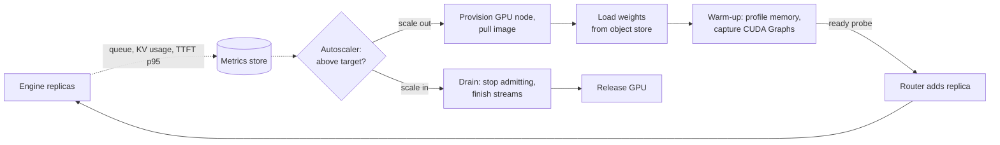

**Reading the diagram.** Replicas export LLM signals asynchronously to the autoscaler. Scale-out is a synchronous chain (node, image, weights, warm-up) taking minutes before a readiness probe admits traffic; scale-in drains streams first. Failure points: scaling on GPU utilization never scales in; cold start slower than a traffic ramp breaches SLOs. Scaling: pre-scale on schedule for known peaks such as lunch and dinner.

## 73.16 Inference engines compared

As of 2026, five open-source engines cover most self-hosted LLM serving: **vLLM** [Kwon et al. 2023; vLLM Docs], **TensorRT-LLM** [NVIDIA TensorRT-LLM Docs], usually behind Triton or Dynamo (§66.5), **SGLang** [Zheng et al. 2024; SGLang Docs], **Hugging Face TGI** [Hugging Face TGI Docs] and **llama.cpp** [llama.cpp Docs]. TGI's documentation states that it has been in **maintenance mode** since December 2025, accepting only minor fixes, and recommends vLLM or SGLang for new deployments.

**Table 73.8 — LLM inference engines compared (as of 2026).**

| Row | vLLM | TensorRT-LLM | SGLang | TGI | llama.cpp |
|---|---|---|---|---|---|
| What it is | General open engine | NVIDIA-optimized library | Engine + program frontend | HF serving stack | Portable C/C++ engine |
| How it works | PagedAttention, continuous batching | Tuned kernels, in-flight batching | RadixAttention, cache-aware scheduling | Rust router, paged attention | GGUF, CPU/Metal/CUDA kernels |
| Advantages | Breadth of models and hardware | Peak NVIDIA performance, FP8/FP4 | Prefix-heavy and MoE workloads | Simple HF integration | Runs anywhere, tiny footprint |
| Disadvantages | Many knobs, fast-moving | NVIDIA only, build steps | Smaller ecosystem | Maintenance mode | Low multi-user throughput |
| Performance | High | Highest on NVIDIA, tuned | High, best with shared prefixes | Moderate | Good per device, low batch |
| Operational complexity | Medium | High | Medium | Low | Low |
| Cost | Free; any GPU | Free; NVIDIA GPUs | Free; GPUs | Free | Free; CPUs and laptops |
| Use cases | Default self-hosted serving | Large NVIDIA fleets | Agents, RAG, multi-turn, MoE | Existing deployments | Edge, desktop, offline |
| Choose when | You need a safe default | Every percent of GPU matters | Prompts share long prefixes | Already running it; plan a migration | No data-center GPU |

**Figure 73.18 — Choosing an engine.**

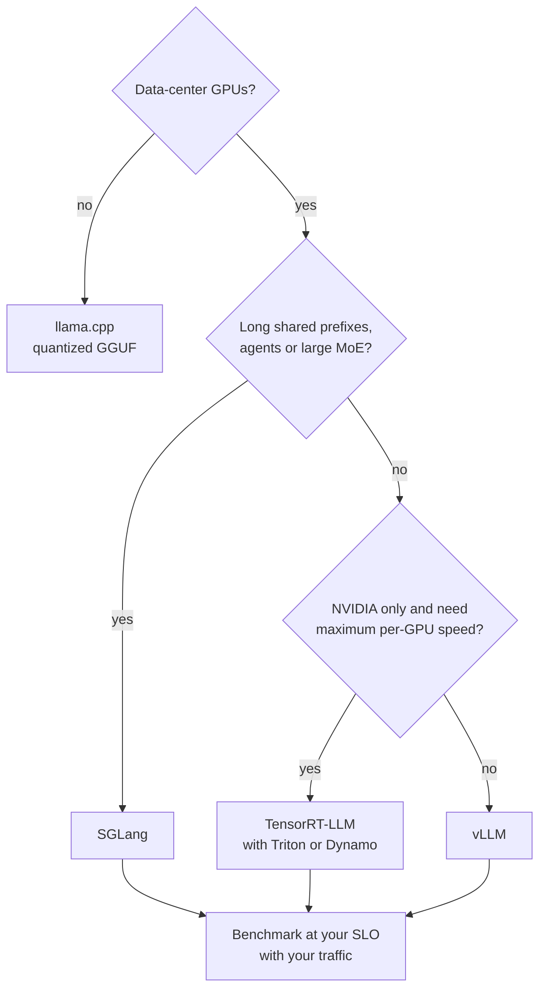

**Reading the diagram.** Without data-center GPUs, llama.cpp is the practical choice. With GPUs, heavy prefix sharing or large MoE favors SGLang, an NVIDIA-only fleet chasing peak efficiency TensorRT-LLM, and otherwise vLLM. Every branch ends at the same gate: benchmark goodput on your own traffic and SLOs, because rankings change between releases. Failure point: choosing from a benchmark of a different workload.

## 73.17 Cost optimization

The levers below act on the terms of $C_\text{1M}$ (§73.15): GPU-seconds per token and the fraction of provisioned GPU time that does useful work.

::: formula
**Largest batch that meets a TPOT SLO**

$$B_\text{SLO} = \frac{(S_\text{TPOT} - t_0)\,W_\text{eff} - M_\text{w}}{\bar{c}\,k} \qquad B^{*} = \min(B_\text{SLO},\ S_\text{max})$$

| Symbol | Meaning | Units |
|---|---|---|
| $B_\text{SLO}$ | Batch at which the memory-bound step time reaches the TPOT SLO | sequences |
| $S_\text{TPOT}$ | TPOT target | s |
| $S_\text{max}$ | Memory-limited concurrency (§73.5) | sequences |
| $B^{*}$ | Operating batch | sequences |
:::

::: example
**Worked example — Which constraint binds, and model routing.** $S_\text{TPOT} = 50$ ms; 7B FP16.

1. $B_\text{SLO} = (0.048 \times 2.68 \times 10^{12} - 14 \times 10^9)/(1{,}549 \times 524{,}288) = 1.146 \times 10^{11}/8.12 \times 10^8 = 141$; $S_\text{max} = 64$. Memory binds: buy concurrency with KV quantization or prefix sharing, not a looser SLO.
2. INT4 weights and FP8 KV: $B_\text{SLO} = (1.286 \times 10^{11} - 3.6 \times 10^9)/4.06 \times 10^8 = 308$; $S_\text{max} = 154$. With the shared system prompt, though, $S'_\text{max} = 173$ exceeds $B_\text{SLO} = 141$ and latency binds (§73.8).
3. *Routing preview (Chapter 78):* if 80% of calls go to the 7B model and 20% to the 70B model, the blended floor is $0.8 \times 0.033 + 0.2 \times 0.202 = \$0.067$ per million tokens, 67% less than all-70B, provided quality on routed traffic holds.

**Interpretation.** Which constraint binds changes with each optimization: memory first, then latency once prefixes are shared. **Engineering implication.** Identify the binding constraint before tuning, and route by difficulty so the expensive model sees only the traffic that needs it.
:::

**Table 73.9 — Cost levers for LLM serving.**

| Lever | Acts on | Typical effect | Risk |
|---|---|---|---|
| Continuous batching, paging | Batch size | Multiples of static throughput | None; table stakes |
| KV and weight quantization | Bytes per token | Up to 2.4× here (§73.13) | Quality regressions |
| Prefix caching, prompt layout | Prefill work, KV sharing | 38–54% less GPU per call here (§73.8) | Side channels across tenants |
| Speculative decoding | TPOT at small batch | 2–3× lower TPOT | Little gain at large batch |
| Model routing and distillation | Model size per call | Large; Chapters 67, 78 | Quality on hard queries |
| Output length limits | Decode tokens | Linear in tokens saved | Truncated answers |
| Spot or preemptible GPUs | Price per GPU-hour | Discounts vary by provider | Interruption: drain, retry |
| Consolidation, scheduled scaling | Idle provisioned hours | Approaches the busy floor | Cold-start lag |

Spot capacity suits offline batch generation (summaries, evaluation runs) that retries idempotently (§66.13); for interactive chat keep an on-demand base sized for the SLO and drain spot replicas on interruption notice.

## 73.18 Summary and revision notes

::: summary
- LLM serving differs from classic serving: unknown output lengths, a growing per-request KV cache, compute-bound prefill versus memory-bound decode, streamed tokens.
- Step time ≈ $t_0 + (M_\text{w} + B\bar{c}k)/W_\text{eff}$; prefill ≈ $2Nn_\text{in}/F_\text{eff}$. Batching shares the weight read; KV reads grow with batch and context.
- Measure TTFT, TPOT, ITL p99 and end-to-end separately; size fleets on goodput, not peak throughput.
- KV bytes per token $k = 2Ln_\text{kv}d_\text{head}b_\text{kv}$: 0.52 MB for the 7B MHA chatbot, 0.33 MB for 70B GQA. One H100 holds about 103,000 tokens, 64 average chatbot calls; a 70B TP=4 replica holds 253.
- Continuous batching re-forms the batch every step; the simulator shows 3.1× static's throughput ceiling (3.6× with chunked prefill, which also removes ITL stalls).
- PagedAttention cuts KV waste to under 1% and enables copy-on-write; prefix caching and RadixAttention skip shared prefill and store shared prefixes once.
- FlashAttention tiles prefill attention on chip; split-KV kernels keep SMs busy in long-context decode.
- Speculative decoding: $E = (1 - \alpha^{\gamma+1})/(1 - \alpha)$, speed-up $E/(\gamma c + 1)$; lossless, strong at small batch, weak when verification becomes compute-bound.
- TP inside NVLink domains (≈3.9 MB per token per GPU for 70B, $t = 4$), PP or EP across nodes; disaggregation pays at scale ($R = kF_\text{eff}/(2NW_\text{link})$).
- Quantize what dominates bytes: FP8 KV doubles the 7B chatbot's throughput; INT4 weights plus FP8 KV give 2.4×.
- Capacity: $g_\text{req} = t(T_\text{prefill} + n_\text{out}t_\text{step}/B)$; QuickBite's chatbot needs 2 GPUs at \$1.26 per million tokens against a \$0.033 busy floor: at small scale, idle redundancy dominates cost.
:::

## 73.19 Knowledge checkpoint

1. Why is LLM decode memory-bound at batch 1 on an H100?
2. A reply has TTFT 0.4 s, 300 tokens and end-to-end 9.37 s. What is TPOT?
3. Compute KV bytes per token for 40 layers, 8 KV heads of 128 dimensions, FP8.
4. Why does a 70B GQA replica hold about as many tokens per GPU as the 7B MHA model?
5. Batch of replies of 20, 40, 60 and 400 tokens under static batching: slot utilization?
6. What does selective batching batch, and what does it not?
7. With 32-token blocks, what is the expected paged waste for a 1,600-token sequence?
8. Why must prefix-cache hit rates be measured per token?
9. Compute $E[\text{tokens}]$ and speed-up for $\alpha = 0.7$, $\gamma = 3$, $c = 0.1$.
10. Why does speculative decoding help less at large batch?
11. When is swapping preferable to recomputation?
12. Why is GPU utilization a poor autoscaling signal for LLM engines?

<details><summary>Answers</summary>

1. Each step reads all 14 GB of weights for about $2N$ FLOPs, roughly 1 FLOP per byte, far below the ~295 FLOPs/byte ridge.
2. $(9.37 - 0.4)/299 = 30$ ms.
3. $2 \times 40 \times 8 \times 128 \times 1 = 81{,}920$ bytes.
4. With 8 KV heads instead of 32, its KV is 0.33 MB per token versus 0.52 MB, and TP spreads it across GPUs, offsetting 10× the parameters.
5. $520/(4 \times 400) = 32.5\%$.
6. It batches the weight matrix multiplies across sequences and runs attention per sequence, since each has its own KV cache and length.
7. $15.5/1{,}600 \approx 1\%$.
8. A request can match a short prefix and count as a hit while saving little prefill.
9. $E = (1 - 0.7^4)/0.3 = 0.7599/0.3 = 2.53$; speed-up $2.53/1.3 = 1.95$.
10. Verifying $\gamma + 1$ tokens per sequence turns the memory-bound step compute-bound, so verification stops being free.
11. When KV per token is small relative to compute per token (large GQA models), so moving KV over PCIe costs less than re-running prefill.
12. It reads near 100% whenever any request runs; queue length, KV usage and TTFT p95 reflect real load.

</details>

## 73.20 Interview questions

### Basic

**Q1. Explain TTFT and TPOT and what affects each.**
**Answer.** TTFT is the wait for the first token: network, queueing and prefill, improved by more replicas, prefix caching and chunked prefill. TPOT is the average gap between later tokens, set by decode step time, which grows with batch and context and falls with quantization and speculation. Chat SLOs use both.

**Q2. Why does continuous batching beat dynamic batching for LLMs?**
**Answer.** Output lengths vary widely; request-level batches run as long as their longest member, wasting slots and making new requests wait. Iteration-level scheduling refills freed slots every step, raising throughput severalfold and cutting TTFT.

### Intermediate

**Q3. Your 7B service's throughput is half the plan, and KV usage is at 100% with batch 20. What do you check?**
**Answer.** Check that $k$ matches the real attention type (MHA versus GQA), that planning used p95 prompt lengths, and that memory is paged, not reserved per maximum length. Fixes: FP8 KV, prefix caching, chunked prefill, admission by free-block watermark.

**Q4. When would you disaggregate prefill and decode?**
**Answer.** At scale, with long prompts and tight TPOT SLOs, when interference shows as ITL spikes. Check the KV transfer ratio $R$, size pools by GPU-seconds per phase, and try chunked prefill first.

### Advanced

**Q5. Design serving for a 70B chat model on H100s at the lowest cost per token with TTFT p95 under 1 s and TPOT p95 under 50 ms.**
**Answer.** Compare FP16 TP=4 (253 calls per replica), FP8 TP=2 and INT4 on one GPU by goodput per GPU under the SLO on production prompts. Use continuous batching with chunked prefill, paged FP8 KV, prefix caching with prefix-aware routing, and speculation only while batches are small. Autoscale on queue, KV usage and TTFT p95 with warm headroom; validate quantization on task evaluations.

**Q6. How would you reduce QuickBite's \$1.26 per million tokens?**
**Answer.** Its cost is idle redundancy, 38× the busy floor. Consolidate onto a shared multi-model platform, run one replica with an API fallback, quantize to raise per-GPU capacity, route simple intents to templates or a smaller model, and cap output length.

## 73.21 Practical exercises

1. Add a TPOT SLO to the batching simulator: cap the running batch so step time stays under 40 ms, and report goodput at 99% attainment for each policy.
2. Extend the simulator with prefix caching: skip the 1,000-token system prompt for 90% of requests and compare TTFT and throughput.
3. Make `monte_carlo` draw $\alpha$ per request from a Beta distribution with mean 0.7 and compare with the formula at the mean.
4. Use the calculator to find the cheapest of FP16 TP=4, FP8 TP=2 and INT4 TP=1 for the 70B model, assuming the same MFU and bandwidth efficiency.

## 73.22 Design challenges

1. **QuickBite chatbot at 10× volume.** Support moves fully to the chatbot and volume grows to 100,000 conversations a day. Redesign the fleet: engine, precision, prefix caching and routing, autoscaling, disaggregation or not, and cost per conversation.
2. **Multi-tenant inference platform.** Serve 20 fine-tuned 7B variants and one 70B model for several teams with token quotas, fair scheduling, isolated prefix caches and goodput SLOs (Chapters 47, 79).

## 73.23 References

1. Agrawal, A., Kedia, N., Panwar, A., et al. *Taming Throughput-Latency Tradeoff in LLM Inference with Sarathi-Serve*. USENIX OSDI, 2024.
2. Cai, T., Li, Y., Geng, Z., et al. *Medusa: Simple LLM Inference Acceleration Framework with Multiple Decoding Heads*. ICML, 2024.
3. Chen, C., Borgeaud, S., Irving, G., et al. *Accelerating Large Language Model Decoding with Speculative Sampling*. arXiv:2302.01318, 2023.
4. Dao, T. *FlashAttention-2: Faster Attention with Better Parallelism and Work Partitioning*. ICLR, 2024.
5. Dao, T., Fu, D. Y., Ermon, S., Rudra, A., Ré, C. *FlashAttention: Fast and Memory-Efficient Exact Attention with IO-Awareness*. NeurIPS, 2022.
6. Dao, T., Haziza, D., Massa, F., Sizov, G. *Flash-Decoding for Long-Context Inference*. Stanford CRFM blog, 2023.
7. Hugging Face. *Text Generation Inference Documentation*. https://huggingface.co/docs/text-generation-inference
8. Kwon, W., Li, Z., Zhuang, S., et al. *Efficient Memory Management for Large Language Model Serving with PagedAttention*. ACM SOSP, 2023.
9. Leviathan, Y., Kalman, M., Matias, Y. *Fast Inference from Transformers via Speculative Decoding*. ICML, 2023.
10. Li, Y., Wei, F., Zhang, C., Zhang, H. *EAGLE: Speculative Sampling Requires Rethinking Feature Uncertainty*. ICML, 2024.
11. Liu, Z., Yuan, J., Jin, H., et al. *KIVI: A Tuning-Free Asymmetric 2bit Quantization for KV Cache*. ICML, 2024.
12. llama.cpp. *llama.cpp Repository and Documentation*. https://github.com/ggml-org/llama.cpp
13. NVIDIA. *TensorRT-LLM Documentation*. https://nvidia.github.io/TensorRT-LLM/
14. Patel, P., Choukse, E., Zhang, C., et al. *Splitwise: Efficient Generative LLM Inference Using Phase Splitting*. ACM/IEEE ISCA, 2024.
15. Pope, R., Douglas, S., Chowdhery, A., et al. *Efficiently Scaling Transformer Inference*. MLSys, 2023.
16. SGLang. *SGLang Documentation*. https://docs.sglang.ai/
17. Shah, J., Bikshandi, G., Zhang, Y., et al. *FlashAttention-3: Fast and Accurate Attention with Asynchrony and Low-precision*. NeurIPS, 2024.
18. Sheng, Y., Cao, S., Li, D., et al. *Fairness in Serving Large Language Models*. USENIX OSDI, 2024.
19. vLLM. *vLLM Documentation*. https://docs.vllm.ai/
20. Yu, G.-I., Jeong, J. S., Kim, G.-W., Kim, S., Chun, B.-G. *Orca: A Distributed Serving System for Transformer-Based Generative Models*. USENIX OSDI, 2022.
21. Zheng, L., Yin, L., Xie, Z., et al. *SGLang: Efficient Execution of Structured Language Model Programs*. NeurIPS, 2024.
22. Zhong, Y., Liu, S., Chen, J., et al. *DistServe: Disaggregating Prefill and Decoding for Goodput-optimized Large Language Model Serving*. USENIX OSDI, 2024.

## 73.24 Open verification items

- TGI maintenance mode: date (December 2025) taken from secondary reports of the README banner; a 2026 repository archival is reported by one source only.
- Reported figures to re-check against the papers: Orca 36.9×; vLLM 20.4–38.2% utilization, under 4% waste, 2–4×; SGLang 6.4×; DistServe 7.4×/12.6×; Splitwise 1.4× at 20% lower cost, 2.35×; Sarathi-Serve 2.6×/3.7×; FlashAttention-3 1.5–2.0×, 75%; Flash-Decoding up to 8× (and its blog URL); Medusa and EAGLE ranges.
- vLLM `gpu_memory_utilization` default 0.9 and per-engine preemption defaults (as of 2026).
- H100: about 228 KB shared memory per SM and 132 SMs.
- Efficiency assumptions (80% bandwidth, 50% MFU, 2 ms overhead) are modeling choices, not measurements.
