# Chapter 74 — Embeddings, Vector Search and Vector Databases

> **Level:** 3–4 · **Track:** B (ML/AI) · **Estimated reading time:** 6 h

A QuickBite customer types "spicy vegetarian noodles" into the search box. No dish on the platform has exactly that name. One restaurant lists "Dan Dan Mian (tofu, chili oil)", another "Szechuan Veg Lo Mein — hot", a third "Pad Kee Mao Jay". The lexical engine of Chapter 16 matches words, so it finds the "Lo Mein" (it contains "Veg") and misses the other two. A person would find all three at once, because a person matches *meaning*. **Vector search** gives software the same ability: a neural model turns every dish description and every query into a list of a few hundred numbers, arranged so that things with similar meaning land close together, and the search engine returns the stored vectors closest to the query's vector.

The idea is simple. Doing it fast is not. Comparing one query with 5 million dish vectors means billions of multiply-adds; at 100 million vectors a single query reads 300 GB of memory. This chapter is about the data structures and systems that make "find the nearest vectors" take a few milliseconds instead of a second: **approximate nearest neighbor (ANN)** indexes (HNSW graphs, IVF clustering, product quantization, SSD-resident graphs), filtering, updates, and the architecture of the **vector databases** built around them. It owns these topics for the book. Hybrid lexical-plus-vector retrieval, reranking and the rest of retrieval-augmented generation (RAG) are in Chapter 75; two-tower recommendation models, which produce vectors for this machinery, are in §68.6.

::: note
**QuickBite assumptions used in this chapter.** Teaching assumptions, not measurements of a real company. Reused: 50,000 restaurants with about 5 million dishes (§58.6), spread over 20 cities and 4,000 delivery zones (Ch 62, Ch 70), so about 250,000 dishes per city; about 1,200 restaurants (120,000 dishes) can deliver to a typical address at dinner time (§68.3); search peaks at 2,000 requests per second (RPS) with a 300 ms p99 target (§2.4, §2.11); peak-to-average traffic ratio 9.6 (§18.11); the support chatbot of Chapter 65. **New in this chapter:** dish and support text is embedded by a 768-dimension text model; the vector part of dish search gets 30 ms of the 300 ms search budget; the support knowledge corpus is about 25,800 chunks and the chatbot issues about 8 retrieval queries per second at peak (both from Chapter 75). Sizes use SI units (1 GB = 10⁹ bytes); one multiply-add counts as 2 floating-point operations (FLOPs), as in Chapters 58 and 64.
:::

## 74.1 Learning objectives

After this chapter you should be able to:

- Choose a text, multilingual or multimodal embedding model by task, dimension, cost and license, and explain contrastive training and Matryoshka embeddings.
- Derive why cosine similarity, dot product and Euclidean distance rank identically on unit-length vectors, and when they differ.
- Compute the cost of exact search, and decide when exact search on CPU or GPU is good enough.
- Measure an ANN index with recall@k, latency, throughput, memory and build time, and read a recall–latency curve.
- Explain and tune HNSW (M, efConstruction, efSearch) and IVF (nlist, nprobe), and estimate their memory and candidate counts.
- Compress vectors with product, scalar and binary quantization, and size distance tables and memory per vector.
- Explain ScaNN's anisotropic quantization and DiskANN's SSD-resident graph at a conceptual level.
- Predict recall collapse under post-filtering and choose between pre-filtering, post-filtering and filtered graph search.
- Design segment-based ingestion with tombstones and rebuilds, and the sharding, replication and routing of a vector database.
- Size a vector search deployment for memory and throughput, and choose between a library, a database extension and a dedicated vector database.

## 74.2 Prerequisites

- Vectors, dot product, cosine similarity and the cost of matrix multiplication — §4.9 (every distance in this chapter is one of these).
- Memory hierarchy and bandwidth — §5.5, §64.5 (exact search is limited by memory bandwidth).
- Inverted indexes, BM25, immutable segments, tombstones and scatter–gather — §16.3, §16.6, §16.7 (vector indexes reuse the same system patterns).
- LSM trees and compaction — §13.8–§13.9 (vector database segments behave like SSTables).
- Partitioning and replication — §14.3, §14.6 (how a large index is split across nodes).
- Embeddings as learned vectors — §58.6; two-tower retrieval and in-batch negatives — §68.6 (where many vectors come from).
- Quantization basics: scale, zero-point and error — §67.4 (reused for scalar quantization).

## 74.3 Embedding models

### 74.3.1 What an embedding model does

::: definition
**Definition — Embedding model.** A neural network that maps an input (a sentence, a document chunk, an image, a user's history) to a fixed-length vector of $d$ real numbers, the **embedding**, such that inputs that are similar for the task have vectors with high similarity. A **bi-encoder** (dual encoder) embeds queries and documents independently, so document vectors can be computed once and stored.
:::

#### First-principles explanation

Picture a vast library in which a librarian shelves every book by *topic* rather than by title, with related topics on neighboring shelves. To find books like the one in your hand, you walk to its shelf and look around. An embedding model is that librarian for a space with hundreds of dimensions instead of three: it assigns every text a coordinate, and closeness in that space stands for closeness in meaning. "Spicy vegetarian noodles" and "Dan Dan Mian (tofu, chili oil)" get nearby coordinates even though they share no word.

Chapter 58 introduced embeddings as rows of a table learned for IDs (§58.6). The models here are different in one important way: they compute a vector from *content*, so a dish added a minute ago gets a sensible vector immediately, without any training on it.

#### Why does this exist?

Lexical search (Chapter 16) fails on vocabulary mismatch: synonyms, paraphrases, other languages, misspellings. Hand-written synonym lists do not scale to 5 million dishes in a dozen cuisines. Embeddings learn these equivalences from data. Sentence-BERT made this practical by turning BERT into a bi-encoder: finding the most similar pair among 10,000 sentences dropped from about 65 hours with a cross-encoder BERT to about 5 seconds, because each sentence is encoded once [Reimers and Gurevych 2019].

#### How it works internally

1. **Tokenize** the input and run it through a transformer encoder (Chapter 72), producing one vector per token.
2. **Pool** the token vectors into one: the mean of all tokens, or the vector at a special first token.
3. Optionally **project** to the output dimension and **normalize** to unit length.
4. **Index** the document vectors offline; at query time, embed the query with the same model (sometimes with a different instruction prefix, such as `query:` versus `passage:` in the E5 family [Wang et al. 2022]) and search.

**Figure 74.1 — Where embeddings and vector search sit in QuickBite.**


**Reading the diagram.** Offline, menu changes arrive asynchronously (dotted arrows) as change-data-capture events (§16.10.2), and help-center articles are chunked; both are embedded by the same 768-dimension model and written into three vector indexes, which form the storage boundary of this chapter. Online, every synchronous request (solid arrows) embeds the query with the *same model version* and asks the ANN service for the top $k$ IDs; the search API then fetches details and ranks. A nightly batch job reads the restaurant vectors and writes each restaurant's nearest neighbors to a key–value table, so "similar restaurants" needs no online search at all. Failure points: the query encoder (a model on the request path), a model-version mismatch between encoder and index, and index lag behind the catalog. Scaling: the encoder scales with query rate, the index with corpus size and query rate (§74.14).

### 74.3.2 Contrastive training intuition

A bi-encoder learns from **pairs that should match**: a query and the dish that was ordered, a question and the help article that resolved it, a photo and its caption. Training pulls each pair's vectors together and pushes apart vectors that should not match, typically the other pairs in the same batch (**in-batch negatives**). The loss is a softmax over similarities divided by a **temperature**, the same objective as the two-tower model of §68.6.1 [van den Oord et al. 2018; Karpukhin et al. 2020]. Three practical consequences follow:

- **The model learns the similarity its training pairs define.** A model trained on question–answer pairs places a question near its *answer*, not near other phrasings of the question. Pick models trained for your task (retrieval, clustering, classification).
- **Hard negatives matter.** Random negatives are easy; a negative that looks right but is wrong ("spicy chicken noodles" for a vegetarian query) teaches the fine distinctions. Dense Passage Retrieval mined such negatives with BM25 [Karpukhin et al. 2020].
- **The space is only meaningful within one model version.** Vectors from two models, or two training runs, are not comparable, so a model change means re-embedding the whole corpus (§74.12).

**Figure 74.2 — Contrastive training of a bi-encoder with in-batch negatives.**

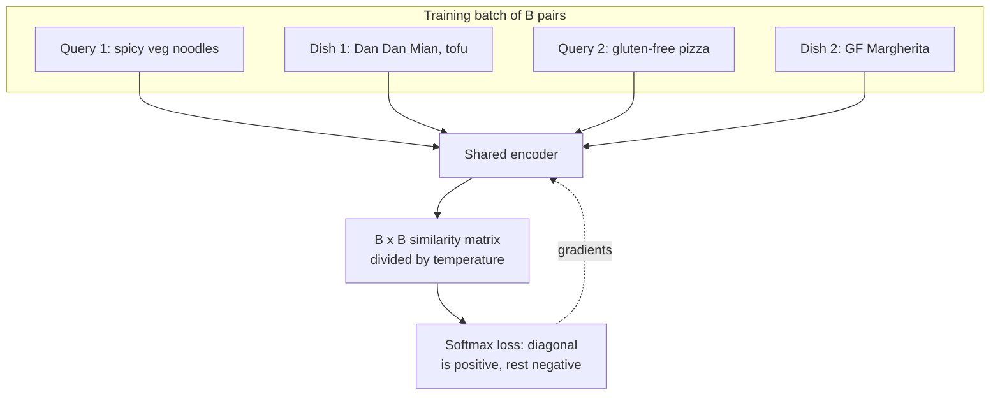

**Reading the diagram.** A batch holds $B$ matching pairs. One encoder (shared weights, or two towers) embeds all queries and documents; the $B \times B$ matrix of similarities has the true pairs on its diagonal. The softmax loss raises each diagonal entry relative to its row, so every other document in the batch serves as a free negative. Gradients flow back asynchronously with respect to serving (dotted arrow): this is a training loop, not a request path. Larger batches give more negatives per example and usually better retrieval, which is why embedding models are trained with batches of thousands spread across GPUs (Chapter 65). The failure point is the data: noisy pairs, or "negatives" that are actually relevant, teach the wrong geometry.

### 74.3.3 Dimensions, normalization, languages and modalities

**Dimension** $d$ sets storage and compute: every vector costs $d \times s$ bytes, and every distance costs $d$ multiply-adds. As of 2026, common text models output 384, 768, 1,024, 1,536 or 3,072 dimensions. More dimensions usually help retrieval quality, with diminishing returns, while memory grows linearly.

**Normalization** to unit length makes cosine similarity and dot product identical (§74.4) and keeps a few long vectors from dominating. Normalize once at ingestion and at query time, unless the model's documentation says its magnitudes carry meaning.

**Multilingual** models place "noodles", "nouilles" and "麺" near each other, so one index serves several markets. They usually cost some quality per language compared with a monolingual model of equal size; evaluate on your own languages.

**Multimodal** models such as CLIP embed images and text into one space by contrastive training on image–caption pairs [Radford et al. 2021], so a text query can retrieve dish photos. Image and text vectors share a space only if they come from the same jointly trained model.

**Table 74.1 — Choosing an embedding model.**

| Criterion | What to check | QuickBite dish search |
|---|---|---|
| Task fit | Retrieval benchmarks close to your task; MTEB [Muennighoff et al. 2023] and BEIR [Thakur et al. 2021] as a first filter | Short queries against short menu text |
| Your data | Recall@10 on 200–500 labeled queries from your logs | Queries mined from orders after search |
| Languages | Per-language evaluation | English plus two local languages |
| Dimension | Memory $N d s$ and distance cost $\propto d$ | 768, truncatable (below) |
| Latency and cost | Query encoding time on target hardware | Must fit about 10 ms of the 30 ms vector budget |
| Hosting and license | Self-hosted or API; data residency; terms | Self-hosted, so queries stay internal |
| Max input length | Tokens per input; longer text is truncated or chunked | Dish text is short; help articles are chunked (§75.6) |

Public leaderboards are a starting point, not a decision: they mix tasks, some models were trained on data close to the benchmarks, and none contains your queries. The only decisive test is recall on your own labeled queries.

### 74.3.4 Matryoshka embeddings

::: definition
**Definition — Matryoshka representation learning (MRL).** A training method in which the loss is applied to several nested prefixes of the embedding (for example its first 64, 128, 256, 512 and 768 dimensions), so that any prefix, renormalized, is itself a usable embedding, with quality degrading gracefully as it shrinks [Kusupati et al. 2022].
:::

Like Russian nesting dolls, each smaller embedding sits inside the larger one. An ordinary model spreads information across all dimensions, so dropping half of them destroys it; MRL forces the most important information into the first dimensions. Kusupati et al. report up to 14× smaller embeddings at equal ImageNet classification accuracy and up to 14× faster large-scale retrieval with an adaptive shortlist-then-rerank scheme [Kusupati et al. 2022].

**Figure 74.3 — Adaptive retrieval with Matryoshka embeddings.**


**Reading the diagram.** The query is encoded once at full dimension. Its first 256 dimensions search an index that is three times smaller and faster; the 200 best candidates are then rescored with full 768-dimension vectors fetched by ID, which can live in slower memory because only 200 are read per query. All steps are synchronous. The index and the full-vector store are separate storage boundaries that must hold the same model version. The failure point is truncating a model that was *not* trained with MRL, which loses quality sharply; check the model card. Scaling: the shortlist size trades recall against rescoring cost.

For QuickBite, 5 million dishes at 768 dimensions in 4-byte floats take $5 \times 10^6 \times 768 \times 4 = 15.4$ GB; the 256-dimension prefix takes 5.1 GB. Section 74.9 shrinks it further with quantization.

::: mistake
**"Higher-dimensional embeddings are always better."** Above a few hundred dimensions, gains on retrieval benchmarks are often small, while memory, bandwidth and distance cost grow linearly. A 384-dimension model that fits the index in one node's RAM can beat a 3,072-dimension model that forces sharding, compression and an extra network hop. Measure recall per gigabyte, not recall alone.
:::

## 74.4 Similarity metrics

### 74.4.1 Cosine, dot product and Euclidean distance

::: definition
**Definition — Similarity and distance metrics for vectors.** For a query $\mathbf{q}$ and a stored vector $\mathbf{x}$: the **dot product** (inner product) $\mathbf{q} \cdot \mathbf{x}$; **cosine similarity** $\mathbf{q} \cdot \mathbf{x} / (\lVert \mathbf{q} \rVert \lVert \mathbf{x} \rVert)$, which ignores length; and **Euclidean (L2) distance** $\lVert \mathbf{q} - \mathbf{x} \rVert$. Search returns the $k$ vectors with the highest similarity, or equivalently the lowest distance. Searching by largest dot product is called **maximum inner product search (MIPS)**.
:::

Section 4.9.2 showed that cosine measures direction only. Three facts matter for systems. First, the metric must match how the model was trained, or rankings are wrong. Second, on unit-length vectors all three metrics produce the *same ranking*, so an index built for one serves the others. Third, an unnormalized dot product is not a distance: a vector is not necessarily its own best match, and the triangle inequality, which many index structures rely on informally, fails.

::: formula
**L2 distance in terms of the dot product, and the MIPS transform**

$$\lVert \mathbf{q} - \mathbf{x} \rVert^2 = \lVert \mathbf{q} \rVert^2 + \lVert \mathbf{x} \rVert^2 - 2\,\mathbf{q} \cdot \mathbf{x} \;\overset{\lVert\mathbf{q}\rVert = \lVert\mathbf{x}\rVert = 1}{=}\; 2 - 2\cos\theta$$

$$\mathbf{x}' = \left(\mathbf{x},\ \sqrt{\Phi^2 - \lVert \mathbf{x} \rVert^2}\right),\quad \mathbf{q}' = (\mathbf{q}, 0) \;\Rightarrow\; \lVert \mathbf{q}' - \mathbf{x}' \rVert^2 = \lVert \mathbf{q} \rVert^2 + \Phi^2 - 2\,\mathbf{q} \cdot \mathbf{x}$$

| Symbol | Meaning | Units |
|---|---|---|
| $\mathbf{q}, \mathbf{x}$ | Query and stored vector, dimension $d$ | dimensionless |
| $\lVert \cdot \rVert$ | Euclidean length | dimensionless |
| $\theta$ | Angle between $\mathbf{q}$ and $\mathbf{x}$ | radians |
| $\Phi$ | Maximum vector length in the collection | dimensionless |
| $\mathbf{x}', \mathbf{q}'$ | Vectors extended by one dimension | dimensionless |
:::

The first line is the derivation: expand $(\mathbf{q} - \mathbf{x}) \cdot (\mathbf{q} - \mathbf{x})$ term by term. With unit vectors the squared distance is a decreasing function of cosine, so sorting by smallest distance and by largest cosine (or dot product) gives the same order. The second line converts MIPS into L2 search for unnormalized vectors: the extra coordinate makes every $\mathbf{x}'$ the same length $\Phi$, and for a fixed query $\lVert \mathbf{q} \rVert^2 + \Phi^2$ is a constant, so the smallest L2 distance is the largest dot product [Bachrach et al. 2014].

::: example
**Worked example — Same ranking, then a different one.** Query $\mathbf{q} = (0.6, 0.8)$; unit vectors $\mathbf{a} = (0.8, 0.6)$ and $\mathbf{b} = (0, 1)$.

1. $\cos(\mathbf{q}, \mathbf{a}) = 0.48 + 0.48 = 0.96$; $\lVert \mathbf{q} - \mathbf{a} \rVert^2 = 2 - 1.92 = 0.08$. Check directly: $(-0.2)^2 + 0.2^2 = 0.08$.
2. $\cos(\mathbf{q}, \mathbf{b}) = 0.8$; $\lVert \mathbf{q} - \mathbf{b} \rVert^2 = 2 - 1.6 = 0.40$ $(= 0.36 + 0.04)$. Both metrics rank $\mathbf{a}$ first.
3. Now add an unnormalized $\mathbf{c} = (0, 1.5)$. Dot products: $\mathbf{q} \cdot \mathbf{c} = 1.2 > \mathbf{q} \cdot \mathbf{a} = 0.96$, although $\cos(\mathbf{q}, \mathbf{c}) = 0.8$. Under dot product, the *longer* vector wins.
4. MIPS transform with $\Phi = 1.5$: $\mathbf{a}' = (0.8, 0.6, \sqrt{2.25 - 1}) = (0.8, 0.6, 1.118)$, $\mathbf{c}' = (0, 1.5, 0)$, $\mathbf{q}' = (0.6, 0.8, 0)$. Then $\lVert \mathbf{q}' - \mathbf{a}' \rVert^2 = 1 + 2.25 - 1.92 = 1.33$ and $\lVert \mathbf{q}' - \mathbf{c}' \rVert^2 = 1 + 2.25 - 2.4 = 0.85$. L2 now ranks $\mathbf{c}$ first, as MIPS does.

**Interpretation.** Normalization makes the metric choice irrelevant to ranking; without it, dot product rewards magnitude. **Engineering implication.** If the model is meant for cosine, normalize at ingestion and use the cheapest metric the index supports (dot product). If magnitudes carry meaning, as in some recommendation models where length tracks popularity, keep dot product and an index that supports MIPS, or apply the transform.
:::

**Table 74.2 — Similarity metrics in vector search.**

| Metric | Formula | Range on unit vectors | Typical use |
|---|---|---|---|
| Cosine | $\mathbf{q}\cdot\mathbf{x} / \lVert\mathbf{q}\rVert\lVert\mathbf{x}\rVert$ | −1 to 1 | Most text embedding models |
| Dot product | $\sum_i q_i x_i$ | −1 to 1 (same as cosine) | Normalized vectors; two-tower models with meaningful length |
| L2 (squared) | $\sum_i (q_i - x_i)^2$ | 0 to 4 | Image descriptors, PQ codebooks, k-means |
| Hamming | Count of differing bits | 0 to $d$ | Binary-quantized vectors (§74.9.4) |

::: mistake
**"Similarity scores are probabilities, so a 0.8 means a good match."** Cosine scores depend on the model: one model puts unrelated texts at 0.2, another at 0.7. A fixed threshold copied from a blog will either drop good results or admit junk. Calibrate thresholds per model on labeled pairs, and re-calibrate whenever the model changes.
:::

## 74.5 Exact search and why it does not scale

### 74.5.1 The cost of brute force

::: definition
**Definition — Exact (brute-force, flat) k-nearest-neighbor search.** Compute the similarity between the query and every stored vector and return the $k$ best. It always returns the true neighbors (recall 1.0) and needs no index beyond the array of vectors.
:::

Brute force is the baseline every index is measured against and, for small collections, the right answer. Its cost is easy to compute, because it is one dot product per stored vector, each reading $d \times s$ bytes once (§4.9.3).

::: formula
**Brute-force cost per query and per batch**

$$\text{FLOPs} = 2 N d B \qquad \text{bytes} = N d s \qquad T \approx \max\!\left(\frac{N d s}{BW},\ \frac{2 N d B}{F}\right) \qquad B^* = \frac{s\,F}{2\,BW}$$

| Symbol | Meaning | Units |
|---|---|---|
| $N$ | Stored vectors | count |
| $d$ | Dimension | floats |
| $s$ | Bytes per value (4 FP32, 2 FP16, 1 INT8) | bytes |
| $B$ | Queries processed together in one pass (batch) | queries |
| $BW$ | Memory bandwidth available | bytes/s |
| $F$ | Achievable arithmetic throughput | FLOP/s |
| $T$ | Time for one pass over the data | s |
| $B^*$ | Batch size where compute time equals memory time | queries |
:::

::: example
**Worked example — 100 million vectors at 768 dimensions.** $N = 10^8$, $d = 768$.

1. Data: $10^8 \times 768 \times 4 = 3.07 \times 10^{11}$ bytes = 307 GB in FP32 (154 GB in FP16). It does not fit in one ordinary server's RAM with room to spare, nor on one GPU.
2. Compute per query: $2 \times 10^8 \times 768 = 1.54 \times 10^{11}$ FLOPs.
3. CPU, one query: a socket streams DRAM at roughly 300 GB/s (§5.5), so one pass takes $307 / 300 \approx 1.0$ s. Arithmetic at a few TFLOP/s would take about 0.05–0.1 s, so the scan is memory-bound.
4. At QuickBite's 2,000 searches per second, one pass per query needs $2{,}000 \times 307 \text{ GB} = 614$ TB/s of memory bandwidth, about 2,000 fully busy sockets.
5. GPU: put the FP16 copy on two H200s (141 GB, 4.8 TB/s each; §64.5), 76.8 GB per GPU. One query: $76.8 / 4{,}800 = 16$ ms. A batch of $B = 1{,}000$ queries: $2 \times 5 \times 10^7 \times 768 \times 1{,}000 = 7.7 \times 10^{13}$ FLOPs per GPU; at half of the 989 TFLOP/s dense peak, 0.16 s. Throughput is about $1{,}000 / 0.16 \approx 6{,}400$ queries per second for the pair.
6. Crossover: $B^* = 2 \times 989 \times 10^{12} / (2 \times 4.8 \times 10^{12}) \approx 206$ queries. Below about 200 queries per pass, the GPU waits on memory; above it, on arithmetic.

**Interpretation.** Online, one-query-at-a-time brute force at this scale is hopeless on CPUs and wasteful on GPUs. Batched GPU brute force is a matrix multiply and very efficient, but it adds the time to fill a batch and costs two large GPUs. **Engineering implication.** Use batched exact search for offline jobs (computing ground truth, deduplication, nightly "similar items" tables) and ANN for online queries at this scale. The FAISS library made both practical on GPUs [Johnson et al. 2019].
:::

### 74.5.2 When exact search is fine

Exact search wins when the work per query is small or the query rate is low. Two QuickBite cases qualify:

- **Support chatbot retrieval.** 25,800 chunks × 768 × 4 B = 79 MB. One query reads it once: about 4 ms at a single core's roughly 20 GB/s, or about 1 ms across a few cores. At 8 queries per second this is a fraction of one server, with perfect recall and no index to build or tune.
- **Similar restaurants.** All 50,000 × 50,000 pairs at 768 dimensions are $2 \times 5 \times 10^4 \times 5 \times 10^4 \times 768 = 3.8 \times 10^{12}$ FLOPs, one matrix multiply: seconds on a GPU, minutes on CPUs. Compute the top 50 per restaurant nightly and store them in a key–value table.

Dish search does not qualify. Even after filtering to the 120,000 deliverable dishes, each query would read $1.2 \times 10^5 \times 768 \times 4 = 369$ MB, and 2,000 queries per second would need 737 GB/s. A practical rule: exact search is fine while $N \times d \times \text{QPS}$ stays below about $10^{11}$ to $10^{12}$ multiply-adds per second per server, and when filters cut the candidate set to a few thousand vectors (§74.11).

::: mistake
**"We need a vector database for our 50,000 documents."** At 50,000 × 768 floats, a NumPy matrix multiply returns exact results in milliseconds. An ANN index adds recall loss, tuning and build time for no benefit. Start with brute force; move to ANN when measured latency or cost says so.
:::

## 74.6 ANN quality metrics

### 74.6.1 Recall, latency, throughput, memory and build time

::: definition
**Definition — Approximate nearest neighbor (ANN) search.** A search that returns $k$ vectors that are *probably* among the true $k$ nearest, trading a small, measurable loss of accuracy for large savings in computation and memory traffic. Its accuracy is measured by **recall@k** against exact search.
:::

::: formula
**Recall@k**

$$\text{recall@}k = \frac{1}{|Q|} \sum_{q \in Q} \frac{|A_k(q) \cap G_k(q)|}{k}$$

| Symbol | Meaning | Units |
|---|---|---|
| $Q$ | Set of evaluation queries | queries |
| $A_k(q)$ | The $k$ results returned by the ANN index for query $q$ | set of IDs |
| $G_k(q)$ | The true $k$ nearest neighbors from exact search | set of IDs |
| $k$ | Number of results requested | count |
:::

::: example
**Worked example — Reading recall@10.** Three test queries; the index returns 10 IDs each, of which 10, 9 and 7 are in the exact top 10.

1. Per-query recall: 1.0, 0.9, 0.7.
2. recall@10 $= (1.0 + 0.9 + 0.7)/3 = 0.867$.
3. The worst query lost 3 of its 10 true neighbors; averages hide such queries, so also report the 5th-percentile per-query recall.

**Interpretation.** Recall measures agreement with exact search, not relevance to the user: if the exact top 10 contains only 6 relevant dishes, perfect recall still gives 6. **Engineering implication.** Set the recall target from end-to-end quality: measure how product metrics (orders after search, answer accuracy) change as recall drops from 0.99 to 0.90. Often 0.95 is indistinguishable from 1.0 downstream, and the difference in cost is large.
:::

The other metrics an index is judged on:

- **Latency** at p50 and p99 for one query, and **throughput** (queries per second, QPS) per node at the target recall. They differ because batching and parallelism raise throughput while adding latency.
- **Memory per vector**: vector bytes plus index overhead (graph links, centroids, IDs).
- **Build time** and **update cost**: how long a full build takes, and whether inserts and deletes are cheap.
- **Disk and network**: bytes read per query for SSD-resident and distributed indexes.

Every ANN index has a knob (efSearch for HNSW, nprobe for IVF) that moves along a **recall–latency curve**: more work, higher recall, slower queries. Comparing indexes at a single setting is meaningless; compare the curves, as ANN-Benchmarks does by plotting QPS against recall for each algorithm on public datasets [Aumüller et al. 2020].

**Figure 74.4 — An ANN evaluation harness.**

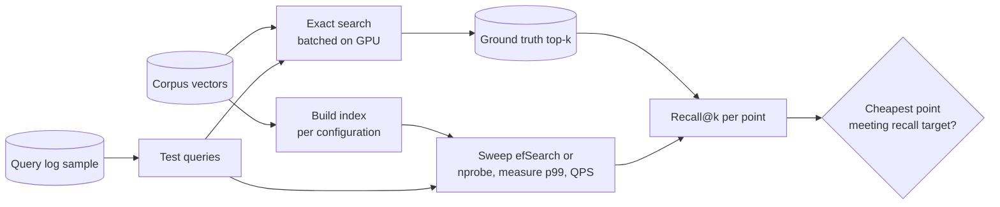

**Reading the diagram.** Queries come from production logs, not from the corpus, because real queries are distributed differently from documents. Exact search (batched, offline) produces ground truth once; each index configuration is built and swept across its search parameter, recording latency, throughput and memory; comparing results with ground truth gives one recall–latency point per setting. The decision picks the cheapest configuration that meets the recall target at the required p99. All steps are batch jobs. Failure points: evaluating on corpus vectors as queries (overstates recall), ground truth computed with a different metric or model version, and measuring latency on an idle machine. Rerun the harness whenever the model, corpus size or hardware changes.

::: mistake
**"Our index has 99% recall."** Recall is meaningless without $k$, the parameter setting, the dataset and the query set. Recall@1 and recall@100 of the same index differ, and recall on queries drawn from the corpus is higher than on real queries. Report recall@k at a named setting, on production-like queries, next to p99 latency and memory.
:::

## 74.7 Graph-based ANN: HNSW

### 74.7.1 Navigable small worlds and the layered graph

::: definition
**Definition — Hierarchical Navigable Small World (HNSW) graph.** An ANN index that links every vector to up to $M$ near neighbors (up to $2M$ on the bottom layer) and arranges the vectors in layers: all of them on layer 0, and exponentially fewer on each higher layer. A search descends greedily from a sparse top layer to the dense bottom one, then runs a best-first search keeping the $ef$ closest candidates [Malkov and Yashunin 2020].
:::

#### First-principles explanation

To deliver a letter to a stranger across the country, you hand it to the acquaintance who lives closest to the destination, who does the same, and so on. Social networks make this work in a few hops because most links are local but a few reach far: a **small world**. A **navigable small world (NSW)** graph builds such a network over vectors: each vector links to some near neighbors, and links formed early in construction, when the graph was sparse, act as long-range shortcuts [Malkov et al. 2014]. **Greedy search** starts anywhere, moves to whichever neighbor is closer to the query, and stops when no neighbor is closer.

HNSW adds a hierarchy, like an airline network: the top layer is a handful of hub airports with long flights, lower layers add regional airports, and layer 0 contains every town. You fly hub-to-hub toward the destination, then take shorter hops. Each vector's top layer is drawn at random, so no global clustering is needed.

#### Why does this exist?

Tree indexes such as k-d trees, which split space one coordinate at a time, degrade toward brute force above a few dozen dimensions: in high dimensions, distances to all points concentrate around similar values, so a query's ball crosses most splits [Beyer et al. 1999]. Graphs avoid partitioning space at all; they only need "a closer neighbor usually exists", which holds for real embeddings. On public benchmarks, HNSW and related graphs have been among the fastest methods at high recall [Aumüller et al. 2020].

#### How it works internally

1. **Insert** vector $x$: draw its top layer $\ell = \lfloor -\ln(U) \cdot m_L \rfloor$ with $U$ uniform on (0, 1].
2. From the entry point (a node on the top layer), search greedily with $ef = 1$ down to layer $\ell + 1$.
3. On each layer from $\ell$ down to 0, run a beam search with $ef = efConstruction$, pick up to $M$ neighbors ($2M$ on layer 0) with a **diversity heuristic** (keep a candidate only if it is closer to $x$ than to any neighbor already chosen), and add edges in both directions, pruning any node whose degree exceeds the cap.
4. **Search** for $q$: greedy descent from the top layer to layer 1, then a best-first search on layer 0 that keeps the $efSearch$ closest nodes found, expanding the nearest unexpanded one until it is farther than the worst kept; return the best $k$ (so $efSearch \ge k$).

**Figure 74.5 — HNSW: greedy descent through layers.**

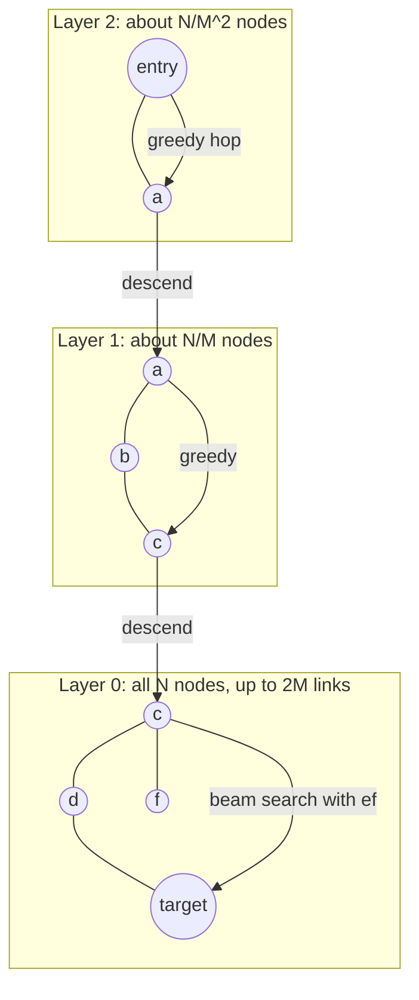

**Reading the diagram.** Each subgraph is one layer; the same vector (for example $a$ or $c$) appears on every layer up to its own top layer. Plain lines are graph edges; arrows trace one query's path. The search enters at the global entry point, hops greedily on the sparse top layer, descends to the same node one layer down, and continues; on layer 0 it switches from a single greedy walk to a beam of $ef$ candidates, which is where most distance computations and most of the recall come from. Everything is synchronous and in memory: each hop is a random memory access to a neighbor list and a vector, so cache misses, not arithmetic, dominate. Failure points: an entry point deleted or isolated, and regions poorly connected after many deletions (§74.12). Scaling: the graph is per shard; large collections are split into shards each with its own graph (§74.13).

#### Mathematical foundations

::: formula
**HNSW layer distribution and memory**

$$P(\ell \ge j) = M^{-j} \quad \text{with } m_L = 1/\ln M, \qquad L_{\max} \approx \log_M N$$

$$\text{bytes per vector} \approx d\,s + b\left(2M + \frac{M}{M - 1}\right)$$

| Symbol | Meaning | Units |
|---|---|---|
| $\ell$ | Top layer of a vector | layer index |
| $M$ | Maximum links per node on layers ≥ 1 ($2M$ on layer 0) | links |
| $m_L$ | Level-generation factor | dimensionless |
| $L_{\max}$ | Expected number of layers above layer 0 | layers |
| $N$ | Vectors in the index | count |
| $d$, $s$ | Dimension and bytes per value | floats, bytes |
| $b$ | Bytes per link (neighbor ID), typically 4 | bytes |
:::

The memory term follows from the layers: every node has up to $2M$ links on layer 0, and the expected number of upper layers per node is $\sum_{j \ge 1} M^{-j} = 1/(M-1)$, each with up to $M$ links. hnswlib's documentation summarizes the graph overhead as roughly $M \times 8$–10 bytes per element [hnswlib ALGO_PARAMS], which matches $b \cdot 2M$ plus a few bytes.

::: example
**Worked example — HNSW over QuickBite's 5 million dishes.** $N = 5 \times 10^6$, $d = 768$, FP32, $M = 16$, $b = 4$.

1. Layers: $5 \times 10^6 / 16 = 312{,}500$ nodes reach layer 1, 19,531 layer 2, 1,221 layer 3, 76 layer 4 and about 5 layer 5; $\log_{16}(5 \times 10^6) = 15.42 / 2.77 = 5.6$.
2. Links per vector: $4 \times (32 + 16/15) = 4 \times 33.07 = 132$ bytes.
3. Vector per vector: $768 \times 4 = 3{,}072$ bytes. Total $\approx 3{,}204$ bytes, so $5 \times 10^6 \times 3{,}204 = 16.0$ GB, of which the graph is 0.66 GB (4%).
4. With 1-byte scalar-quantized vectors (§74.9.3): $768 + 132 = 900$ bytes per vector, 4.5 GB total; the graph is now 15%.
5. With $M = 32$: links are $4 \times (64 + 1.03) = 260$ bytes, doubling graph memory.

**Interpretation.** For float vectors the graph is a small tax; once vectors are compressed, the graph becomes a large part of memory, and $M$ matters. **Engineering implication.** Budget RAM for vectors *and* links, plus IDs and allocator overhead (often 10–20% more). An HNSW index generally must stay in RAM: every hop is a random access, which on SSD costs tens of microseconds instead of about 100 ns (§74.10).
:::

#### Code example: a navigable small world graph measuring recall against ef

The listing builds layer 0 of an HNSW-style index (an NSW graph with the HNSW neighbor heuristic and a fixed entry point) over 10,000 synthetic 32-dimension "dish" vectors drawn from 50 overlapping topics, then measures recall@10 against exact search and the number of distance computations as $ef$ grows. It runs in about 10 seconds on one CPU core.

```python
import heapq
import numpy as np

rng = np.random.default_rng(7)
N, D, C, NQ, K = 10_000, 32, 50, 200, 10

# Synthetic "dish embeddings": 50 overlapping topics, unit length.
centers = rng.normal(size=(C, D))
def sample(n):
    v = centers[rng.integers(C, size=n)] + 1.25 * rng.normal(size=(n, D))
    return (v / np.linalg.norm(v, axis=1, keepdims=True)).astype(np.float32)
X, Q = sample(N), sample(NQ)

# Exact search: score every vector (cosine = dot product on unit vectors).
truth = np.argsort(-(Q @ X.T), axis=1)[:, :K]
def recall(found, i):
    return len(set(found) & set(truth[i])) / K

# A one-layer navigable small world graph (HNSW's layer 0),
# built by inserting points one at a time.
M, EF_BUILD = 8, 32
graph = [[] for _ in range(N)]

def beam_search(q, entry, ef):
    """Best-first search keeping the ef closest nodes seen."""
    d0 = float(1.0 - X[entry] @ q)               # cosine distance
    visited = {entry}
    frontier = [(d0, entry)]                     # min-heap: nodes to expand
    best = [(-d0, entry)]                        # max-heap: ef closest so far
    count = 1                                    # distance computations
    while frontier:
        d, node = heapq.heappop(frontier)
        if d > -best[0][0]:                      # nearest unexpanded node is
            break                                # worse than all kept: stop
        nbrs = [v for v in graph[node] if v not in visited]
        if not nbrs:
            continue
        visited.update(nbrs)
        dists = 1.0 - X[nbrs] @ q
        count += len(nbrs)
        for dv, v in zip(dists.tolist(), nbrs):
            if len(best) < ef or dv < -best[0][0]:
                heapq.heappush(frontier, (dv, v))
                heapq.heappush(best, (-dv, v))
                if len(best) > ef:
                    heapq.heappop(best)
    return sorted((-nd, v) for nd, v in best), count

def select_neighbors(cands, m):
    """HNSW heuristic: keep a candidate only if it is closer to the new node
    than to every neighbor already kept, so edges point in many directions."""
    kept = []
    for d, v in cands:
        if not kept or np.all(1.0 - X[kept] @ X[v] > d):
            kept.append(v)
            if len(kept) == m:
                break
    return kept

entry = 0
for i in range(1, N):
    found, _ = beam_search(X[i], entry, EF_BUILD)
    graph[i] = select_neighbors(found, M)
    for v in graph[i]:                           # edges are bidirectional
        graph[v].append(i)
        if len(graph[v]) > 2 * M:                # cap degree at 2M
            nb = np.array(graph[v])
            dd = 1.0 - X[nb] @ X[v]
            order = np.argsort(dd)
            graph[v] = select_neighbors(
                list(zip(dd[order].tolist(), nb[order].tolist())), 2 * M)

print(f"exact            recall@10 = 1.000  distances = {N:5d}")
for ef in (10, 20, 40, 80, 160):
    res = [beam_search(Q[i], entry, ef) for i in range(NQ)]
    r = np.mean([recall([v for _, v in f[:K]], i) for i, (f, _) in enumerate(res)])
    c = np.mean([n for _, n in res])
    print(f"graph ef={ef:<3}     recall@10 = {r:.3f}  distances = {c:5.0f}")
print(f"mean out-degree = {np.mean([len(g) for g in graph]):.1f}")
```

Output:

```text
exact            recall@10 = 1.000  distances = 10000
graph ef=10      recall@10 = 0.703  distances =   170
graph ef=20      recall@10 = 0.837  distances =   243
graph ef=40      recall@10 = 0.926  distances =   358
graph ef=80      recall@10 = 0.963  distances =   566
graph ef=160     recall@10 = 0.986  distances =   979
mean out-degree = 11.7
```

What to notice:

- At $ef = 40$ the graph reaches 0.926 recall while computing 358 distances, 3.6% of brute force's 10,000; doubling $ef$ to 80 buys 3.7 more points for 58% more work. That diminishing return *is* the recall–latency curve.
- `select_neighbors` is the HNSW heuristic. Without it, a node in a dense topic links only to its closest neighbors in that topic, and searches get trapped there.
- A fixed entry point works here because early insertions created long links; at millions of vectors the upper layers of real HNSW do this job and keep hops logarithmic.
- `beam_search` is used both to build and to query: index quality depends on the search effort at build time ($efConstruction$).

#### Parameters and trade-offs

**Table 74.3 — HNSW parameters.**

| Parameter | Controls | Raising it | Typical values |
|---|---|---|---|
| $M$ | Links per node | Better recall on hard, high-dimensional data; more memory and build time | 8–64; pgvector default 16 |
| $efConstruction$ | Beam width while inserting | Better graph, slower build; no query cost | 64–512; pgvector default 64 |
| $efSearch$ | Beam width while searching; must be ≥ $k$ | Higher recall, higher latency; tunable per query | 40–400; pgvector default 40 |

Defaults are from the pgvector documentation [pgvector Docs]. Choose $M$ and $efConstruction$ once, at build time; tune $efSearch$ on the evaluation harness, per query class if needed.

**Advantages:** excellent recall–latency trade-off in memory; incremental inserts without retraining; one runtime knob. **Disadvantages:** memory for vectors plus links; random memory access; slow builds at large $N$; deletes are awkward (§74.12); recall drops under restrictive filters (§74.11).

::: industry
**HNSW as the common default.** pgvector, Qdrant, Weaviate, Milvus and Lucene (Elasticsearch, OpenSearch) all ship HNSW indexes, and pgvector's documentation describes HNSW as having better speed–recall than its IVFFlat index at the cost of slower builds and more memory, as of 2026.
*Evidence: Primary* — [pgvector Docs; Qdrant Docs: Indexing; Weaviate Docs: Vector indexing; Milvus Docs: Architecture; Elastic Docs: Dense vector]
:::

::: mistake
**"HNSW search is O(log N), so it is always fast."** The logarithm describes the descent; the layer-0 beam does most of the work, and its size grows with $efSearch$, the recall target and the data's difficulty. Every hop is a cache miss on a random vector. A billion-vector HNSW also needs about a terabyte of RAM. Measure latency at your target recall; do not infer it from big-O notation.
:::

## 74.8 Clustering-based ANN: IVF

### 74.8.1 Inverted file indexes

::: definition
**Definition — Inverted file (IVF) index.** An ANN index that clusters the vectors with k-means into $nlist$ cells, each represented by its **centroid** (the **coarse quantizer**), and stores each vector in the **inverted list** of its nearest centroid. A query scores all centroids, then scans only the vectors in the $nprobe$ nearest lists [Jégou et al. 2011].
:::

#### First-principles explanation

A library sorted into 100 subject rooms: to find books about Szechuan cooking, you check the "Chinese cuisine" room and perhaps "spicy food", not all 100. IVF is that library. The name comes from the inverted index of §16.3: centroid IDs play the role of terms, and each list holds the vectors "containing" that centroid. Books on the border between two rooms are the weakness: a query near a boundary may have true neighbors in a room it did not check, which is why $nprobe > 1$.

#### How it works internally

1. **Train** the coarse quantizer: run k-means [Lloyd 1982] on a sample of vectors (tens of times $nlist$) to get $nlist$ centroids.
2. **Add**: assign each vector to its nearest centroid and append it to that list. No retraining is needed for new vectors, but if the data distribution drifts, lists become unbalanced.
3. **Search**: compute the distance from $q$ to all centroids, select the $nprobe$ nearest, scan their lists exactly (or with compressed codes, §74.9), and keep the top $k$.

**Figure 74.6 — IVF search with nprobe = 3.**

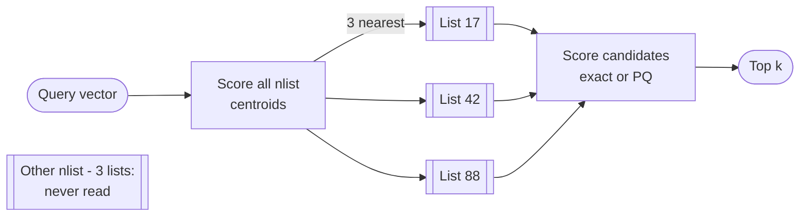

**Reading the diagram.** The query is compared with every centroid (a small, dense matrix that fits in cache), then only three inverted lists (contiguous arrays, drawn as list shapes) are read and scored. All steps are synchronous within one node. The unread lists are where the savings come from, and also where recall is lost when a true neighbor sits across a cell boundary. Contiguous lists make IVF friendly to sequential memory access, SSDs and GPUs, unlike graph hops. Failure points: a stale coarse quantizer after the data distribution shifts (one list grows huge and every query probing it slows down) and too few training points. Scaling: lists can be spread across shards, or a whole IVF index can be replicated.

::: formula
**IVF candidate count and the best nlist**

$$n_\text{cand} \approx nprobe \cdot \frac{N}{nlist} \qquad C(nlist) = nlist + nprobe \cdot \frac{N}{nlist} \qquad nlist^* = \sqrt{nprobe \cdot N}$$

| Symbol | Meaning | Units |
|---|---|---|
| $N$ | Indexed vectors | count |
| $nlist$ | Number of clusters (inverted lists) | count |
| $nprobe$ | Lists scanned per query | count |
| $n_\text{cand}$ | Vectors scored per query, assuming balanced lists | count |
| $C$ | Distance computations per query (centroids plus candidates) | count |
| $nlist^*$ | The $nlist$ minimizing $C$ for a given $nprobe$ (set $dC/d\,nlist = 0$) | count |
:::

::: example
**Worked example — IVF for 5 million dishes.** $N = 5 \times 10^6$.

1. pgvector's rule for more than 1 million rows, $nlist = \sqrt{N}$, gives 2,236; take 2,048. Average list: $5 \times 10^6 / 2{,}048 = 2{,}441$ vectors.
2. With $nprobe = 16$: $n_\text{cand} = 16 \times 2{,}441 = 39{,}063$; $C = 2{,}048 + 39{,}063 = 41{,}111$, which is 0.82% of brute force (122× less work).
3. Optimal for $nprobe = 16$: $nlist^* = \sqrt{16 \times 5 \times 10^6} = 8{,}944$; $C = 8{,}944 + 16 \times 559 = 17{,}888$, 0.36% of brute force. But smaller cells mean a true neighbor is more often outside the probed ones, so the $nprobe$ needed for the same recall rises; retune on the harness.
4. Memory overhead: centroids $8{,}944 \times 768 \times 4 = 27$ MB plus an 8-byte ID per vector (40 MB); IVF adds little beyond the vectors themselves.

**Interpretation.** The cost model gives the shape: $\sqrt{N}$ cells, a few percent or less of the data scanned. **Engineering implication.** IVF's memory overhead is far lower than HNSW's graph and its scans are sequential, which suits compression, SSDs and GPUs; its recall at a given amount of work is usually lower.
:::

#### Code example: IVF on the same data

The listing continues the session of §74.7 (reusing `X`, `Q`, `truth` and `recall`), trains 100 centroids with ten Lloyd iterations, and sweeps $nprobe$.

```python
# Continues the session of the graph listing: reuses X, Q, truth, recall, K, NQ.
def kmeans(data, k, iters, seed):
    r = np.random.default_rng(seed)
    cent = data[r.choice(len(data), k, replace=False)].copy()
    for _ in range(iters):
        assign = (data @ cent.T).argmax(1)       # unit vectors: max dot = min L2
        for c in range(k):
            members = data[assign == c]
            if len(members):
                cent[c] = members.mean(0)
    return cent, assign

nlist = 100
cent, assign = kmeans(X, nlist, 10, seed=1)
lists = [np.flatnonzero(assign == c) for c in range(nlist)]   # inverted lists
sizes = np.array([len(l) for l in lists])
print(f"list sizes: mean {sizes.mean():.0f}, min {sizes.min()}, max {sizes.max()}")

def ivf_search(q, nprobe):
    probe = np.argsort(-(cent @ q))[:nprobe]     # nearest centroids
    cand = np.concatenate([lists[c] for c in probe])
    top = cand[np.argsort(-(X[cand] @ q))[:K]]   # exact scoring inside lists
    return top, nlist + len(cand)                # centroids + vectors scored

for nprobe in (1, 2, 4, 8, 16):
    res = [ivf_search(Q[i], nprobe) for i in range(NQ)]
    r = np.mean([recall(f, i) for i, (f, _) in enumerate(res)])
    c = np.mean([n for _, n in res])
    print(f"IVF nprobe={nprobe:<3}   recall@10 = {r:.3f}  distances = {c:5.0f}")
```

Output:

```text
list sizes: mean 100, min 15, max 247
IVF nprobe=1     recall@10 = 0.628  distances =   241
IVF nprobe=2     recall@10 = 0.785  distances =   331
IVF nprobe=4     recall@10 = 0.870  distances =   530
IVF nprobe=8     recall@10 = 0.932  distances =   929
IVF nprobe=16    recall@10 = 0.975  distances =  1724
```

What to notice:

- With $nprobe = 1$ a query scans 141 vectors on average (241 minus 100 centroids), not the mean list size of 100: queries land in dense regions, whose lists are big. List imbalance is IVF's tail-latency risk.
- At about 0.93 recall, IVF computes 929 distances and the graph of §74.7 computes 358: graphs are more work-efficient, IVF has simpler memory access and far less index memory.
- Recall climbs with $nprobe$ but each doubling costs more: the boundary effect weakens slowly.

::: mistake
**"Build the IVF index on an empty table, then load the data."** The centroids are learned from the data present at build time. Trained on a tiny or unrepresentative sample, the lists come out badly unbalanced and recall suffers for every later insert; pgvector's documentation says to create IVFFlat indexes after the table has data [pgvector Docs]. Retrain the coarse quantizer when the distribution shifts, such as after entering a new market.
:::

## 74.9 Compression: product, scalar and binary quantization

### 74.9.1 Product quantization

::: definition
**Definition — Product quantization (PQ).** A lossy compression of vectors that splits each $d$-dimensional vector into $m$ subvectors of $d/m$ dimensions, learns a separate codebook of $k^*$ centroids (typically 256) for each subspace with k-means, and stores each vector as the $m$ IDs of its nearest sub-centroids: $m$ bytes when $k^* = 256$ [Jégou et al. 2011].
:::

#### First-principles explanation

Describe a face with 8 attributes, each chosen from a catalog of 256 options: hairline 17, eyes 203, nose 9 and so on. Eight bytes describe millions of distinct faces, because the catalogs combine: $256^8 \approx 1.8 \times 10^{19}$ possible descriptions. PQ does the same for vectors. One k-means over whole 768-dimension vectors with $2^{64}$ centroids is impossible to train or store; eight small k-means of 256 centroids each give the same number of combinations from codebooks that total a few hundred kilobytes.

#### Why does this exist?

At 3,072 bytes per FP32 vector, 1 billion vectors need 3 TB of RAM. PQ makes billion-scale search fit on one machine, and because the codes are small, more of them fit in cache and fewer bytes cross the memory bus per comparison.

#### How it works internally

1. **Train:** split training vectors into $m$ slices; run k-means with $k^* = 256$ in each slice.
2. **Encode:** for each vector and slice, store the ID of the nearest sub-centroid.
3. **Search with asymmetric distance computation (ADC):** keep the query *uncompressed*. For each slice $j$, compute the distance from the query's slice to all 256 sub-centroids, giving an $m \times 256$ **distance table**. The approximate distance to a stored vector is the sum of $m$ table entries selected by its code: lookups and additions, no multiplications.
4. **Re-rank (optional):** take the best few hundred by ADC and rescore them with full-precision vectors stored in RAM or on SSD.

**Figure 74.7 — PQ encoding and asymmetric distance computation.**

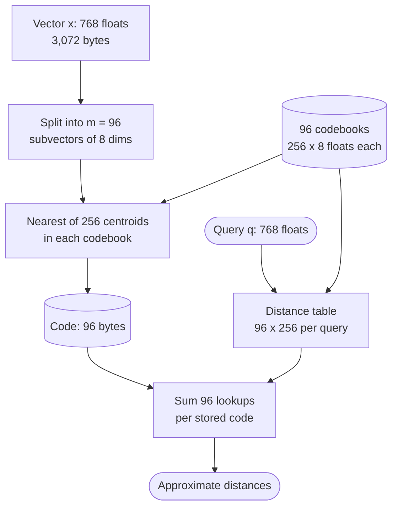

**Reading the diagram.** The upper path runs once per vector at ingestion: split, look up the nearest sub-centroid in each of 96 codebooks, store 96 one-byte IDs. The lower path runs per query: the uncompressed query is compared with every sub-centroid once to fill the table, after which each stored code costs 96 table lookups. Codebooks and codes are storage boundaries; the table is per-query scratch space small enough for the L1 or L2 cache. Everything is synchronous. Failure points: codebooks trained on a different distribution or model version than the vectors (silent recall loss), and too few training vectors. Scaling: codes scan sequentially and vectorize well with SIMD, which FAISS exploits on CPUs and GPUs [Johnson et al. 2019].

::: formula
**PQ memory and distance-table cost**

$$\text{code bytes} = \frac{m \log_2 k^*}{8} \qquad \text{codebook bytes} = k^* d \cdot 4 \qquad \hat{d}(\mathbf{q}, \mathbf{x})^2 = \sum_{j=1}^{m} T_j\!\left[c_j(\mathbf{x})\right]$$

| Symbol | Meaning | Units |
|---|---|---|
| $m$ | Number of subvectors | count |
| $k^*$ | Centroids per subspace codebook | count |
| $d$ | Vector dimension | floats |
| $T_j[c]$ | Squared distance from query slice $j$ to centroid $c$ of codebook $j$ | dimensionless |
| $c_j(\mathbf{x})$ | Code of $\mathbf{x}$ in slice $j$ | centroid ID |
| $\hat{d}$ | Approximate (ADC) distance | dimensionless |
:::

::: example
**Worked example — PQ memory and a distance table.**

*Memory.* $d = 768$, $m = 96$, $k^* = 256$: codes $96 \times 8 / 8 = 96$ bytes per vector against 3,072 for FP32, a $32\times$ reduction. For $10^8$ vectors: 9.6 GB of codes instead of 307 GB. Codebooks: $256 \times 768 \times 4 = 786$ KB in total. Per query, the table holds $96 \times 256 = 24{,}576$ floats (98 KB) and costs $256 \times 768 = 196{,}608$ multiply-adds to fill, after which each candidate costs 96 lookups instead of 768 multiply-adds.

*A tiny table.* $d = 4$, $m = 2$, $k^* = 2$. Codebook 1: $c_0 = (1, 0)$, $c_1 = (0, 1)$; codebook 2: $c_0 = (0, 0)$, $c_1 = (0, 1)$. Query $\mathbf{q} = (1, 0 \mid 0, 1)$.

1. Table for slice 1: $\lVert (1,0) - (1,0) \rVert^2 = 0$; $\lVert (1,0) - (0,1) \rVert^2 = 2$. Slice 2: $\lVert (0,1) - (0,0) \rVert^2 = 1$; $\lVert (0,1) - (0,1) \rVert^2 = 0$.
2. Stored vector with code $(0, 1)$: $\hat{d}^2 = T_1[0] + T_2[1] = 0 + 0 = 0$.
3. Stored vector with code $(1, 0)$: $\hat{d}^2 = 2 + 1 = 3$.

**Interpretation.** The table is the trick: query-dependent work is paid once, and each comparison becomes $m$ memory lookups into a cache-resident table. **Engineering implication.** Choose $m$ so that $d/m$ is 4–16 dimensions; fewer, longer subvectors compress more and lose more. Always re-rank the shortlist with full vectors when recall matters.
:::

### 74.9.2 IVF-PQ

IVF and PQ combine naturally: IVF picks which lists to scan, and PQ compresses what is in them. Jégou et al. encode the **residual** $\mathbf{x} - \mathbf{c}(\mathbf{x})$, the vector minus its coarse centroid, because residuals are smaller and spread more evenly than raw vectors, so the same codebooks quantize them more accurately (IVFADC) [Jégou et al. 2011].

**Figure 74.8 — IVF-PQ with re-ranking.**

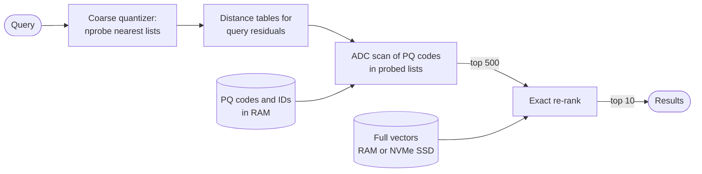

**Reading the diagram.** The coarse quantizer selects $nprobe$ lists; distance tables are computed for the query relative to each probed centroid; the ADC scan reads only compact codes from RAM. The 500 best candidates are re-ranked with full vectors fetched by ID, which can sit on NVMe SSD because only 500 are read per query (500 random 4 KB reads at tens of microseconds each, issued in parallel). Storage boundaries: codes in RAM, full vectors on SSD. Failure points: SSD tail latency during re-ranking, and a shortlist too short to recover the recall lost by PQ. Scaling: codes shard across nodes; the re-rank store is a simple key–value lookup.

### 74.9.3 Scalar quantization

**Scalar quantization (SQ)** maps each dimension to an 8-bit integer using a per-dimension (or global) minimum and maximum, the affine quantization of §67.4.1. It gives a fixed $4\times$ saving over FP32, needs no codebook training beyond the ranges, and loses little accuracy because 256 levels per dimension are fine-grained. Distances can be computed directly in integer arithmetic with SIMD. It is the most common first step when an HNSW index outgrows RAM.

### 74.9.4 Binary quantization

**Binary quantization (BQ)** keeps one bit per dimension, typically its sign: $32\times$ smaller than FP32 (768 dimensions in 96 bytes), with distances computed as Hamming distance by XOR and population count, among the cheapest operations a CPU has. Random-hyperplane hashing gives the theory: the probability that two vectors' signs differ along a random direction is proportional to the angle between them [Charikar 2002]. BQ works only when there are many dimensions to average over, and almost always with **oversampling and rescoring**: fetch several times $k$ by Hamming distance, then rescore with full or int8 vectors.

#### Code example: PQ, SQ and binary quantization compared

The standalone listing uses the data generator of §74.7, encodes 10,000 vectors three ways and measures reconstruction error and recall@10 against exact search, with and without re-ranking the top 50 by exact scores. About 4 seconds on CPU.

```python
import numpy as np

rng = np.random.default_rng(7)
N, D, C, NQ, K = 10_000, 32, 50, 200, 10
centers = rng.normal(size=(C, D))
def sample(n):
    v = centers[rng.integers(C, size=n)] + 1.25 * rng.normal(size=(n, D))
    return (v / np.linalg.norm(v, axis=1, keepdims=True)).astype(np.float32)
X, Q = sample(N), sample(NQ)
truth = np.argsort(-(Q @ X.T), axis=1)[:, :K]

def recall_at_k(scores, rerank=0):
    hits = 0
    for i in range(NQ):
        if rerank:                          # shortlist by approximate score, rescore exactly
            short = np.argsort(-scores[i])[:rerank]
            top = short[np.argsort(-(X[short] @ Q[i]))[:K]]
        else:
            top = np.argsort(-scores[i])[:K]
        hits += len(set(top) & set(truth[i]))
    return hits / (NQ * K)

def kmeans(data, k, iters, seed):
    r = np.random.default_rng(seed)
    cent = data[r.choice(len(data), k, replace=False)].copy()
    for _ in range(iters):
        d2 = (data**2).sum(1)[:, None] - 2 * data @ cent.T + (cent**2).sum(1)[None, :]
        assign = d2.argmin(1)
        for c in range(k):
            members = data[assign == c]
            if len(members):
                cent[c] = members.mean(0)
    return cent

# Product quantization: m subvectors, 256 centroids each -> m bytes per vector.
m, ks = 8, 256
ds = D // m
books = [kmeans(X[:, j*ds:(j+1)*ds], ks, 15, seed=j) for j in range(m)]

def pq_encode(V):
    codes = np.empty((len(V), m), dtype=np.uint8)
    for j, cb in enumerate(books):
        sub = V[:, j*ds:(j+1)*ds]
        d2 = (sub**2).sum(1)[:, None] - 2 * sub @ cb.T + (cb**2).sum(1)[None, :]
        codes[:, j] = d2.argmin(1)
    return codes

def pq_decode(codes):
    return np.hstack([books[j][codes[:, j]] for j in range(m)])

codes = pq_encode(X)
err = ((X - pq_decode(codes))**2).sum(1).mean()      # ||x||^2 = 1, so this is relative error

def adc_scores(q):
    # Asymmetric distance computation: one m x 256 table per query, then lookups.
    table = np.stack([books[j] @ q[j*ds:(j+1)*ds] for j in range(m)])  # (m, 256)
    return table[np.arange(m), codes].sum(1)                            # (N,)

pq = np.stack([adc_scores(q) for q in Q])

# Scalar quantization: one int8 per dimension, per-dimension min/max range.
lo, hi = X.min(0), X.max(0)
x8 = np.round((X - lo) / (hi - lo) * 255).astype(np.uint8)
xsq = x8 / 255 * (hi - lo) + lo
sq_err = ((X - xsq)**2).sum(1).mean()
sq = Q @ xsq.T

# Binary quantization: keep the sign bit of each dimension, compare by Hamming.
bx, bq = X > 0, Q > 0
bin_scores = -(bq[:, None, :] != bx[None, :, :]).sum(2)

print(f"float32: {D*4:3d} B/vector  recall@10 = 1.000")
print(f"SQ int8: {D:3d} B/vector  rel. error = {sq_err:.4f}  recall@10 = {recall_at_k(sq):.3f}")
print(f"PQ 8x8 : {m:3d} B/vector  rel. error = {err:.4f}  recall@10 = {recall_at_k(pq):.3f}"
      f"  rerank top-50 = {recall_at_k(pq, 50):.3f}")
print(f"binary : {D//8:3d} B/vector                     recall@10 = {recall_at_k(bin_scores):.3f}"
      f"  rerank top-50 = {recall_at_k(bin_scores, 50):.3f}")
print(f"PQ distance table per query: {m}x{ks} = {m*ks} entries")
```

Output:

```text
float32: 128 B/vector  recall@10 = 1.000
SQ int8:  32 B/vector  rel. error = 0.0001  recall@10 = 0.983
PQ 8x8 :   8 B/vector  rel. error = 0.0817  recall@10 = 0.550  rerank top-50 = 0.955
binary :   4 B/vector                     recall@10 = 0.164  rerank top-50 = 0.406
PQ distance table per query: 8x256 = 2048 entries
```

What to notice:

- Scalar quantization is nearly free in recall (0.983) at $4\times$ compression; its relative reconstruction error is $10^{-4}$.
- PQ at $16\times$ loses 8% of each vector's energy and ranks poorly alone (0.550), but the *shortlist* is good: re-ranking the top 50 recovers 0.955. PQ is a candidate generator, not a final ranker.
- Binary quantization collapses at 32 dimensions, even with re-ranking: 32 bits cannot separate 10,000 vectors. At 768 or more dimensions the same method is far better; never judge BQ, or any compressor, on data unlike yours.
- `adc_scores` never decompresses a vector: one $8 \times 256$ table per query, then fancy-indexed lookups and a sum.

**Table 74.4 — Compression options for a 768-dimension vector.**

| Method | Bytes | Ratio vs FP32 | Distance computation | Typical use |
|---|---|---|---|---|
| FP32 | 3,072 | 1× | Float multiply-add | Small collections, re-rank store |
| FP16 / BF16 | 1,536 | 2× | Float multiply-add | GPU indexes |
| SQ int8 | 768 | 4× | Integer multiply-add | Default compression for HNSW |
| PQ, $m = 96$ | 96 | 32× | Table lookups (ADC) | IVF-PQ at 10⁸–10⁹ vectors |
| Binary | 96 | 32× | XOR and popcount | High-dimension models, with rescoring |

::: mistake
**"Quantization recall loss is fixed, so measure it once."** Loss depends on the model, dimension, data distribution and how well the codebooks match the current data. A new embedding model or a shift in content can raise it silently. Re-measure recall with the harness (Figure 74.4) whenever the model or codebooks change, and keep the full vectors so you can re-rank and retrain.
:::

## 74.10 ScaNN and DiskANN

### 74.10.1 ScaNN: anisotropic quantization

Ordinary PQ minimizes reconstruction error $\lVert \mathbf{x} - \hat{\mathbf{x}} \rVert^2$ equally in every direction. For inner-product search that is the wrong target: what matters is the error in $\mathbf{q} \cdot \hat{\mathbf{x}}$ for queries that score $\mathbf{x}$ *highly*, and those queries point roughly along $\mathbf{x}$. Guo et al. split the quantization residual into a component parallel to $\mathbf{x}$ and one orthogonal to it, and weight the parallel error more heavily (**anisotropic vector quantization**). Codebooks trained this way may reconstruct vectors less accurately on average yet rank the top results better; ScaNN combines this with partitioning and SIMD-friendly scoring, and the authors report state-of-the-art speed–recall on public benchmarks [Guo et al. 2020]. The systems lesson generalizes: optimize the compressor for the ranking you need, not for reconstruction.

### 74.10.2 DiskANN and Vamana: graphs on SSD

HNSW needs every vector and link in RAM, about 3 TB for a billion 768-dimension FP32 vectors. **DiskANN** keeps only PQ codes in RAM and puts a graph plus full-precision vectors on NVMe SSD [Subramanya et al. 2019]:

1. **Vamana graph.** One flat layer built with a pruning rule that keeps some longer edges (a parameter $\alpha > 1$ relaxes "keep only if closer"), so searches need few hops without HNSW's hierarchy.
2. **Layout.** Each node's full vector and neighbor list share one SSD block, so one read returns both.
3. **Search.** A beam search navigates using the in-RAM PQ codes, issues a few SSD reads in parallel per hop, and re-ranks with the full vectors it fetched along the way.

The abstract reports a billion-point index on a workstation with 64 GB of RAM and an SSD, serving over 5,000 queries per second at under 3 ms mean latency with over 95% 1-recall@1 on SIFT1B, where comparable-memory methods plateaued near 50% [Subramanya et al. 2019]. As an illustrative budget: 40 hops × 4 parallel reads = 160 reads per query; an SSD sustaining 800,000 random reads per second supports about 5,000 queries per second, and latency is about 40 hops × 70 µs ≈ 3 ms.

**Figure 74.9 — DiskANN: RAM for navigation, SSD for graph and full vectors.**

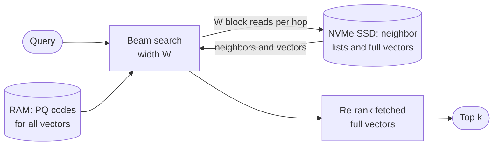

**Reading the diagram.** The beam search decides which nodes to visit using approximate PQ distances held in RAM, then reads those nodes' SSD blocks (neighbor lists plus full vectors) in batches of $W$ parallel requests per hop; the fetched full vectors feed the exact re-rank. RAM and SSD are the two storage boundaries; the arrows to the SSD are synchronous I/O and dominate latency. Failure points: SSD tail latency and I/O contention from concurrent updates or compaction. Scaling: more SSDs or nodes for IOPS, more RAM to cache hot nodes near the entry point. Later work added streaming updates [Singh et al. 2021] and label filters (§74.11).

## 74.11 Filtering

### 74.11.1 Pre-filter, post-filter and filtered graph search

::: definition
**Definition — Filtered vector search.** A query that asks for the $k$ nearest vectors *among those satisfying a predicate* on metadata, such as "deliverable to this address, open now, vegetarian". The **selectivity** $s$ is the fraction of vectors that pass.
:::

Nearly every production query is filtered, and filtering interacts badly with ANN indexes, which are built for the unfiltered space. Three strategies:

- **Post-filter.** Search the ANN index for $k' \ge k$ results, then drop those failing the predicate. Simple, but if few of the $k'$ pass, fewer than $k$ results come back.
- **Pre-filter.** Evaluate the predicate first with a metadata index (an inverted index or bitmap, §16.3), then search only the allowed vectors: brute force over them when there are few, or pass the allow-list into the index search.
- **Filtered (in-index) search.** Traverse the graph or lists but return only allowed nodes. Graph search still steps through disallowed nodes to reach allowed ones; at low selectivity the allowed subgraph falls apart and recall drops. Remedies change the graph: Filtered-DiskANN builds label-aware edges [Gollapudi et al. 2023], ACORN expands neighbor lists so predicate-passing nodes stay connected [Patel et al. 2024], and Qdrant adds edges per indexed payload value [Qdrant Docs: Indexing].

::: formula
**Post-filter result count**

$$E[\text{results}] = k' s \qquad P(\text{at least } k) = 1 - \sum_{i=0}^{k-1} \binom{k'}{i} s^i (1 - s)^{k' - i}$$

| Symbol | Meaning | Units |
|---|---|---|
| $k$ | Results requested | count |
| $k'$ | Results fetched from the index before filtering | count |
| $s$ | Selectivity: fraction of vectors passing the filter | fraction |
:::

The formula assumes the filter is independent of similarity. If filter and query correlate (vegetarian queries near vegetarian dishes), post-filtering does better; if they anti-correlate, worse.

::: example
**Worked example — Post-filter recall collapse in dish search.** QuickBite wants 10 dishes deliverable to the customer's address.

1. Global index over 5 million dishes; deliverable share $s = 120{,}000 / 5 \times 10^6 = 0.024$.
2. pgvector-style default $k' = efSearch = 40$: $E = 40 \times 0.024 = 0.96$ results. pgvector's documentation gives the same arithmetic: a filter matching 10% of rows with $efSearch = 40$ returns about 4 rows [pgvector Docs].
3. $k' = 100$: $E = 2.4$; $P(\ge 10) = 0.0002$.
4. To get 10 results with 99% probability, $k'$ must reach 778 at $s = 0.024$, 183 at $s = 0.10$ and 1,874 at $s = 0.01$ (computed from the binomial tail).
5. Partition by city instead: within a 250,000-dish city index, $s = 0.48$, and $k' = 34$ already gives 99%.

**Interpretation.** Post-filtering degrades smoothly at high selectivity and collapses at low selectivity, with no error raised: the user just sees two dishes. **Engineering implication.** Partition the index on coarse, always-present filters (city, tenant, language), use a filter-aware index for the remaining predicates, and fall back to brute force over the allowed set when it is small.
:::

The simulation below checks this with a perfect ANN (exact top $k'$) over 100,000 random vectors and random filters.

```python
import numpy as np

rng = np.random.default_rng(11)
N, D, NQ, K = 100_000, 32, 200, 10
X = rng.normal(size=(N, D)).astype(np.float32)
X /= np.linalg.norm(X, axis=1, keepdims=True)
Q = rng.normal(size=(NQ, D)).astype(np.float32)
Q /= np.linalg.norm(Q, axis=1, keepdims=True)
S = Q @ X.T                                    # exact scores, stand-in for a perfect ANN

for sel in (0.48, 0.10, 0.024):
    allowed = rng.random(N) < sel              # e.g. "deliverable to this address now"
    pre = [np.argsort(-np.where(allowed, s, -np.inf))[:K] for s in S]
    for kprime in (40, 100, 800):
        got, hit = 0, 0
        for i, s in enumerate(S):
            shortlist = np.argpartition(-s, kprime)[:kprime]
            kept = shortlist[allowed[shortlist]]
            kept = kept[np.argsort(-s[kept])][:K]
            got += len(kept)
            hit += len(set(kept) & set(pre[i]))
        print(f"selectivity {sel:5.3f}  k'={kprime:<4} results/query = {got/NQ:5.2f}"
              f"  filtered recall@10 = {hit/(NQ*K):.3f}")
```

Output:

```text
selectivity 0.480  k'=40   results/query =  9.99  filtered recall@10 = 1.000
selectivity 0.480  k'=100  results/query = 10.00  filtered recall@10 = 1.000
selectivity 0.480  k'=800  results/query = 10.00  filtered recall@10 = 1.000
selectivity 0.100  k'=40   results/query =  4.18  filtered recall@10 = 0.418
selectivity 0.100  k'=100  results/query =  9.06  filtered recall@10 = 0.906
selectivity 0.100  k'=800  results/query = 10.00  filtered recall@10 = 1.000
selectivity 0.024  k'=40   results/query =  0.99  filtered recall@10 = 0.100
selectivity 0.024  k'=100  results/query =  2.35  filtered recall@10 = 0.235
selectivity 0.024  k'=800  results/query =  9.98  filtered recall@10 = 0.999
```

What to notice: the measured counts match $k's$ (0.99 versus 0.96, 4.18 versus 4.0); filtered recall equals results returned divided by 10, because every survivor is a true filtered neighbor; and an *exact* index fails just as badly as an approximate one. The problem is the strategy, not the index.

**Figure 74.10 — A selectivity-based query planner for filtered search.**

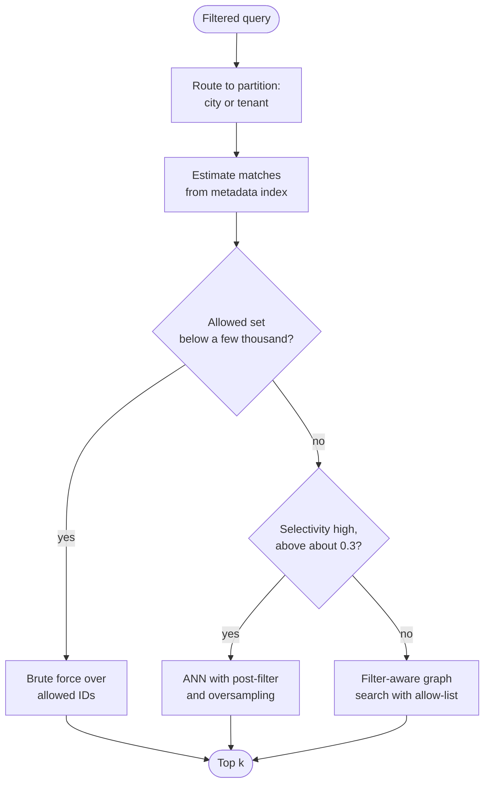

**Reading the diagram.** Routing on the coarse filter happens first and is free, because the partition key is in the query. A cardinality estimate from the metadata index (a bitmap or inverted list count) then picks among three synchronous paths: exact search over a small allowed set (perfect recall, cost proportional to matches), post-filtered ANN when most vectors pass, and filter-aware graph search in between. Qdrant and Weaviate document planners of this kind, switching to payload-index or flat search below a threshold [Qdrant Docs: Indexing; Weaviate Docs: Filtering]. Failure points: stale cardinality statistics, and filters on fields without a metadata index, which force a scan of payloads. The thresholds are illustrative; tune them on the harness.

## 74.12 Updates and deletes

Graph indexes are built for read-mostly data, yet menus change all day. Vector databases handle this with the immutable-segment design of search engines (§16.6) and LSM trees (§13.8):

1. **Writes** append to a log and land in a small, mutable **growing segment**, searched by brute force or a lightweight index.
2. When the segment reaches a size or age limit it is **sealed** (made immutable) and an index (HNSW, IVF-PQ) is built for it in the background.
3. **Deletes** write a **tombstone**: a bitmap marks the ID as deleted, and search skips it. An update is a delete plus an insert. Tombstoned graph nodes are usually still traversed, because removing them would disconnect their neighbors.
4. **Compaction** merges small segments and those with many tombstones into new ones and rebuilds their indexes, purging deleted vectors.
5. **Queries** search all sealed segments and the growing one, and merge the top $k$ of each.

**Figure 74.11 — Segment lifecycle in a vector database.**

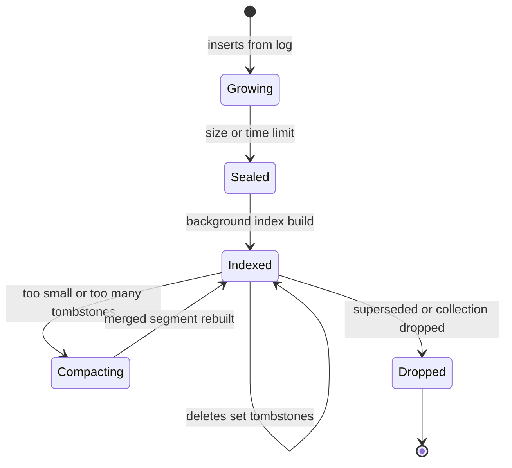

**Reading the diagram.** States are segment states; transitions are asynchronous background events except inserts, which are acknowledged once logged. A growing segment is searchable immediately but slowly; a sealed segment waits for its index; indexed segments absorb deletes as tombstones until compaction rewrites them. Storage boundaries: the log, and object storage or local disk for sealed segments and index files. Failure points: index builds falling behind ingestion (growing data piles up and brute-force cost rises), and compaction storms that compete with queries for CPU. Scaling: index building runs on separate workers.

**Freshness** is the time from write to searchable: the log-to-segment delay, typically sub-second to seconds, because growing segments are searched directly. **Index quality freshness** is longer: until sealing and indexing finish, new data is searched by brute force. Delete-heavy workloads degrade graph recall and waste memory, so track tombstone ratio per segment and compact above a threshold such as 20%.

A new embedding model is the largest update of all: every vector changes. Build a new index version alongside the old one (re-embedding QuickBite's 5 million dishes at an illustrative 2,000 texts per second per GPU takes about 42 GPU-minutes), dual-write new items to both, evaluate, switch reads atomically with the query encoder version, and keep the old index for rollback.

## 74.13 Vector database architecture

### 74.13.1 Components

::: definition
**Definition — Vector database.** A data system that stores vectors with IDs and metadata, maintains ANN and metadata indexes over them, and serves filtered nearest-neighbor queries with the operational properties of a database: durable writes, updates and deletes, replication, sharding, access control and backups (§12.10).
:::

An ANN library such as FAISS or hnswlib is an index inside one process. A vector database wraps such indexes in the machinery of Chapters 13–16:

1. **Ingestion.** Clients write vectors (or text that a built-in model embeds) with metadata. Writes go to a **write-ahead log** or a message broker (Chapter 30) for durability and ordering.
2. **Segments.** Data is organized into growing and sealed segments (§74.12), each with its own vector index and metadata indexes.
3. **Index build.** Separate workers build indexes for sealed segments and run compaction, so builds do not slow queries.
4. **Metadata storage.** Scalar fields live beside the vectors, with inverted, bitmap or range indexes for filtering. Schema, segment maps and shard placement live in a small strongly consistent store (etcd or Raft).
5. **Query routing.** A proxy parses the query, routes it to the shards that can hold matches, fans out (scatter), and merges per-shard top-$k$ lists (gather), exactly as in distributed text search (§16.7.3).
6. **Sharding and replication.** Shards split by hash of ID (every query visits every shard) or by a **partition key** such as city or tenant (queries visit one shard). Replicas add throughput and availability (§14.3).

**Figure 74.12 — Reference architecture of a vector database.**

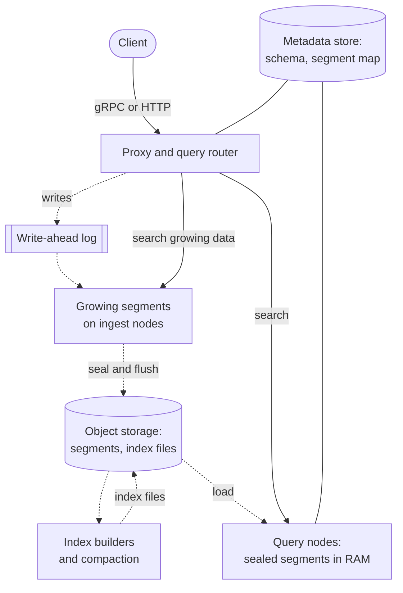

**Reading the diagram.** Solid arrows are the synchronous query path: the proxy fans a search out to query nodes holding sealed, indexed segments and to the nodes holding recent growing data, then merges results. Dotted arrows are asynchronous: writes are acknowledged once in the log, become growing segments, are sealed and flushed to object storage, indexed by separate builders, and loaded by query nodes. Storage boundaries: the log (durability), object storage (source of truth for segments and indexes), query-node RAM (a cache of it) and the metadata store. Failure points: log or metadata-store outages stop writes; a query node failure loses only cached state, reloaded from object storage onto another node; index builders falling behind leave data in slow growing segments. Scaling: query nodes scale with QPS and resident data; builders with ingest rate; storage with object storage. This disaggregated shape follows Milvus as published [Wang et al. 2021; Milvus Docs: Architecture].

**Figure 74.13 — Scatter–gather search across shards.**

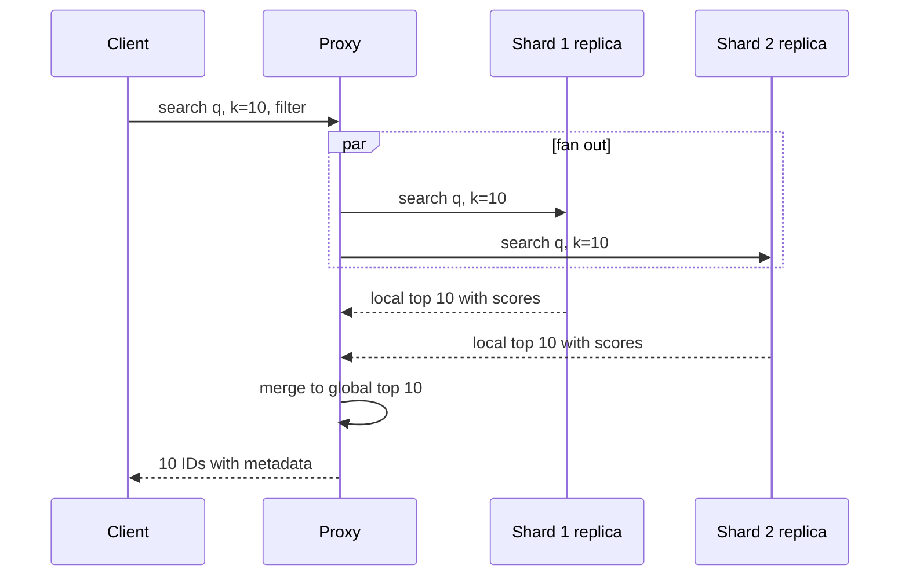

**Reading the diagram.** The proxy sends the same query to one replica of each shard in parallel; each shard searches its own segments and returns its local top $k$ with scores; the proxy merges them. The query is as slow as the slowest shard, so tail latency grows with shard count (§16.7.3); hedged requests to a second replica cut the tail. Each shard must return the full $k$, not $k$ divided by the shard count, because all ten best results may live on one shard. Scores are comparable across shards because they come from one model and metric. Failure points: a slow or dead replica (retry another), and partial results if one shard times out, which the response should flag rather than silently return.

### 74.13.2 Systems compared

**Table 74.5 — Vector search systems as published (as of 2026).**

| Row | Milvus | Weaviate | Qdrant | pgvector | Elasticsearch / OpenSearch | Pinecone |
|---|---|---|---|---|---|---|
| What it is | Open-source distributed vector DB | Open-source vector DB with hybrid search | Open-source vector DB in Rust | PostgreSQL extension | Search engines with vector fields | Managed serverless service |
| How it works | Log, segments in object storage, separate query and index nodes | HNSW or flat per shard, inverted index for filters | HNSW per segment, payload indexes, filter-aware graph | HNSW and IVFFlat as Postgres index types | Lucene HNSW per segment, merged with segments | Log, immutable slabs in object storage, index builder |
| Advantages | Scale-out, many index types incl. DiskANN and GPU | Built-in BM25 hybrid and vectorizer modules | Strong filtering, quantization, compact | ACID, joins, one system to run | One cluster for BM25 and vectors | No servers to operate |
| Disadvantages | Many components to operate | Memory-heavy HNSW at scale | Fewer ecosystem integrations than Postgres | Single-primary write scaling; filter caveats | Merges rebuild graphs; JVM heap tuning | Vendor lock-in; less control |
| Performance | Tens of billions of vectors across nodes | Good to hundreds of millions | Good to hundreds of millions | Good to tens of millions per node | Good, with quantization by default | Managed; varies by tier |
| Operational complexity | High | Medium | Medium | Low if you run Postgres | Medium to high | Low |
| Cost | Infrastructure plus operators | Infrastructure or managed | Infrastructure or managed | Existing Postgres | Existing cluster | Usage-based |
| Use cases | Large multi-tenant platforms | Semantic and hybrid apps | Filter-heavy search | Apps already on Postgres | Search teams adding semantics | Teams wanting no operations |
| Choose when | Above about 10⁸ vectors, dedicated team | Hybrid search out of the box | Many filtered queries | Fewer than about 10⁷ vectors, transactional data | Already running ES or OpenSearch | Speed to production matters most |

Sources: [Wang et al. 2021; Milvus Docs: Architecture; Weaviate Docs: Filtering; Qdrant Docs: Indexing; pgvector Docs; Elastic Docs: Dense vector; OpenSearch Docs: k-NN; Pinecone Docs: Architecture]. The performance and "choose when" rows are this book's rough guidance, not vendor claims; products change quickly, so check current documentation.

::: industry
**Milvus: disaggregated storage and compute.** Wang et al. describe Milvus as a purpose-built vector data management system with heterogeneous computing (CPU and GPU) and a segment-based storage design supporting dynamic data. The current documentation describes streaming nodes that own the write-ahead log and growing data, query nodes that load sealed segments from object storage, and data nodes that run compaction and index building, coordinated by a metadata layer.
*Evidence: Primary* — [Wang et al. 2021; Milvus Docs: Architecture]
:::

::: industry
**Pinecone serverless.** Pinecone's documentation describes writes recorded in a request log with sequence numbers, records organized per namespace into immutable files ("slabs") in object storage, an index builder that processes writes asynchronously, and a query path that merges partial results into the global top $k$: the same log-plus-immutable-segments pattern as an LSM tree (§13.8), operated as a service.
*Evidence: Primary* — [Pinecone Docs: Architecture]
:::

::: mistake
**"The vector database is the system of record for our catalog."** Vectors are derived data: a function of the source text and the model version. Keep the source of truth in the catalog database, feed the vector index by change-data capture (§16.10.2), and make sure you can rebuild it from scratch in hours. Otherwise a model upgrade or index corruption becomes a data-loss event.
:::

## 74.14 Capacity planning

A vector search deployment is sized twice, for memory and for throughput, and the larger answer wins.

::: formula
**Memory-bound and throughput-bound node counts**

$$\text{shards} = \left\lceil \frac{N\,(b_v + b_g + b_{id})}{R\,u} \right\rceil \qquad \text{cores} = \frac{\text{QPS} \cdot t_{\text{cpu}}}{\rho} \qquad \text{nodes} = \text{shards} \times r$$

| Symbol | Meaning | Units |
|---|---|---|
| $N$ | Vectors | count |
| $b_v$, $b_g$, $b_{id}$ | Bytes per vector for vector data, index structure and ID | bytes |
| $R$ | RAM per node | bytes |
| $u$ | Usable fraction of RAM (OS, buffers, rebuild headroom) | fraction |
| QPS | Peak queries per second | queries/s |
| $t_{\text{cpu}}$ | CPU time per query at the target recall, measured | core-seconds |
| $\rho$ | Target utilization | fraction |
| $r$ | Replicas per shard (availability and throughput) | count |
:::

::: example
**Worked example — 100 million vectors, then QuickBite.**

*Generic 100M × 768.* HNSW with $M = 32$ ($b_g = 260$ B), 8-byte IDs, nodes with 256 GB RAM, $u = 0.7$ (179 GB usable), $r = 3$.

1. FP32: $b_v = 3{,}072$; $10^8 \times 3{,}340 = 334$ GB, so 2 shards, 6 nodes.
2. SQ int8: $10^8 \times (768 + 260 + 8) = 104$ GB, 1 shard, 3 nodes, with FP32 copies on SSD for re-ranking.
3. IVF-PQ ($m = 96$): $10^8 \times (96 + 8) = 10.4$ GB in RAM plus 307 GB of full vectors on SSD; one modest node per replica.

*QuickBite dish search.* 20 city indexes of about 250,000 dishes, 5 million in total; HNSW $M = 16$ over int8 vectors: $5 \times 10^6 \times (768 + 132 + 8) = 4.5$ GB, plus 15.4 GB of FP32 vectors for re-ranking. Peak 2,000 QPS. Assume (measure it) 1 ms of CPU per ANN query at recall@10 = 0.95, and 5 ms of CPU to encode each query with the 768-dimension model, at $\rho = 0.5$:

4. ANN: $2{,}000 \times 0.001 / 0.5 = 4$ cores.
5. Query encoder: $2{,}000 \times 0.005 / 0.5 = 20$ cores, or a small GPU with dynamic batching (§66.7).
6. Three replicas across availability zones, each a 32 GB, 16-vCPU node holding all 20 city indexes; a lost zone leaves two replicas, each able to carry peak load.
7. Support chunks (79 MB, 8 QPS) and similar restaurants (nightly batch) need no ANN infrastructure.

**Interpretation.** At QuickBite's scale the index is small; the *query encoder* costs five times the search. At 100 million vectors, memory dominates and compression choices decide the node count. **Engineering implication.** Size memory first, then throughput, then add replicas for zone failure; measure $t_\text{cpu}$ on the harness at the target recall rather than trusting benchmark numbers.
:::

## 74.15 Choosing an approach

Three deployment shapes cover most needs: an **ANN library** inside your service (FAISS, hnswlib, ScaNN), an **extension** to a database you already run (pgvector, Elasticsearch or OpenSearch vector fields), or a **dedicated vector database** (Milvus, Qdrant, Weaviate, Pinecone).

**Figure 74.14 — Choosing a vector search approach.**

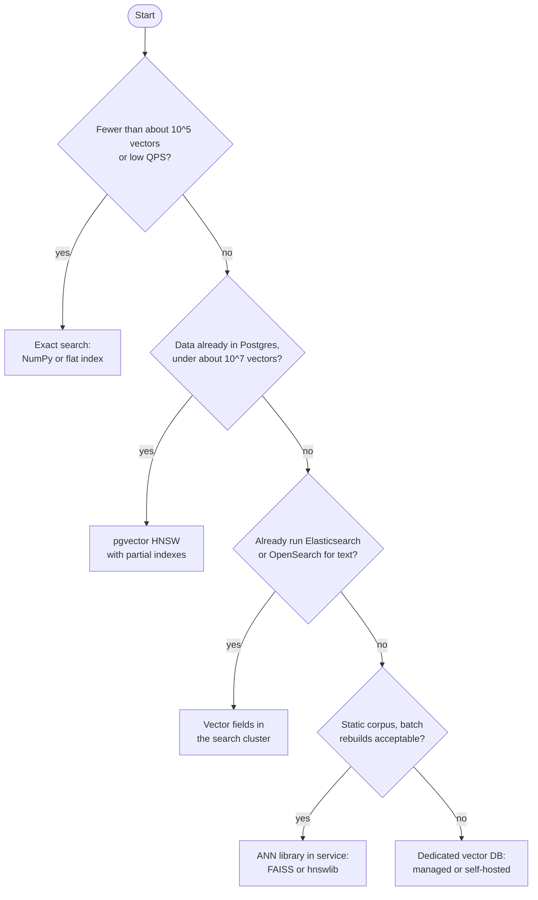

**Reading the diagram.** Each diamond is a decision; the first branch that applies wins. Small collections need no index. Data already in PostgreSQL at moderate scale is best served next to the rows, with transactional consistency and joins. A team that already runs a search cluster adds vector fields there and gets hybrid retrieval (§75.8.3) in one system. A static corpus rebuilt periodically fits an in-process library, which is the fastest option but leaves durability, updates, filtering and replication to you. Everything else, especially large, frequently updated, filter-heavy, multi-tenant workloads, justifies a dedicated database. The thresholds are rough guides, not limits.

**When pgvector is enough.** Vectors fit one node's RAM with their HNSW graph (tens of millions at most, fewer at high dimension); writes fit a single primary; filters are either selective enough for an ordinary B-tree index plus exact scan, or few-valued enough for partial indexes or partitioning, as its documentation recommends; and you value transactions, joins, backups and one operational stack over the last increment of QPS. Enable iterative index scans (available since pgvector 0.8.0) for filtered queries so that the scan continues until enough rows pass [pgvector Docs]. QuickBite's support chunks and even its 5-million-dish index fit this profile; a 100-million-vector multimodal index updated continuously does not.

::: recommendation
**A default path.** Start with exact search; measure recall needs with the harness; adopt HNSW with int8 scalar quantization in the system you already run; partition by your coarsest filter; add re-ranking with full vectors; move to a dedicated database, IVF-PQ or DiskANN only when memory, update rate or filtering forces you to.
:::

## 74.16 Summary and revision notes

::: summary
- Bi-encoder embedding models map content to vectors trained contrastively; the space is valid only within one model version. Choose by recall on your own queries, dimension cost and hosting; Matryoshka models allow truncation and shortlist-then-rescore.
- On unit vectors, cosine, dot product and L2 rank identically ($\lVert \mathbf{q} - \mathbf{x} \rVert^2 = 2 - 2\cos\theta$); unnormalized dot product favors long vectors.
- Exact search costs $2Nd$ FLOPs and $Nds$ bytes per query: about 1 s per query on a CPU socket at 100M × 768. Use it for small corpora, offline batches and ground truth.
- Judge ANN indexes by recall@k against exact search, p99 latency, QPS, memory and build time, as curves.
- HNSW: layered graph, greedy descent, beam of $efSearch$; about $ds + 4(2M + 1)$ bytes per vector; best in-memory speed–recall.
- IVF: $\sqrt{N}$-ish k-means cells, scan $nprobe$ lists; tiny overhead, sequential access, lower work efficiency.
- PQ stores $m$ bytes per vector and scores with an $m \times 256$ table; re-rank its shortlist. SQ int8 is a near-free 4×; binary needs high dimension and rescoring.
- ScaNN weights quantization error by its effect on top scores; DiskANN puts graph and vectors on SSD with PQ codes in RAM.
- Post-filtering returns about $k's$ results and collapses at low selectivity; partition on coarse filters and use filter-aware search or brute force for the rest.
- Vector databases are logs plus immutable indexed segments with tombstones, compaction, scatter–gather and replication. Size memory first, then throughput; at QuickBite's scale the query encoder costs more than the search.
:::

## 74.17 Knowledge checkpoint

1. Why must the query and the documents be embedded by the same model version?
2. Two unit vectors have cosine 0.9. What is their squared L2 distance?
3. How many bytes does one pass of exact search read for 20 million 1,024-dimension FP16 vectors?
4. An index returns 8, 10 and 6 true neighbors for three queries at $k = 10$. What is recall@10?
5. With $M = 16$, what fraction of HNSW nodes reach layer 2?
6. Estimate HNSW link memory per vector for $M = 24$, 4-byte IDs.
7. $N = 10^6$, $nlist = 1{,}000$, $nprobe = 10$: how many vectors are scanned on average?
8. What is the PQ code size for $m = 64$, $k^* = 256$, and the compression ratio for 512-dimension FP32 vectors?
9. Why does ADC keep the query uncompressed?
10. A filter passes 5% of vectors and the index fetches $k' = 100$. How many results do you expect?
11. Why are deleted HNSW nodes often kept for traversal?
12. Why must each shard return the full $k$ in scatter–gather?

<details><summary>Answers</summary>

1. Each model (and training run) defines its own coordinate system; cross-version similarities are meaningless.
2. $2 - 2 \times 0.9 = 0.2$.
3. $2 \times 10^7 \times 1{,}024 \times 2 = 4.1 \times 10^{10}$ bytes = 41 GB.
4. $(0.8 + 1.0 + 0.6)/3 = 0.80$.
5. $16^{-2} = 1/256 \approx 0.39\%$.
6. $4 \times (48 + 24/23) \approx 196$ bytes.
7. $10 \times 10^6 / 1{,}000 = 10{,}000$ vectors (plus 1,000 centroids).
8. 64 bytes; $512 \times 4 / 64 = 32\times$.
9. Only the stored vector then carries quantization error, so distances are more accurate than when both sides are quantized, and the exact query sub-distances cost just one table per query.
10. $100 \times 0.05 = 5$.
11. Removing them would disconnect neighbors that reach the rest of the graph through them; they are skipped in results and purged at rebuild.
12. All of the global top $k$ may live on one shard.

</details>

## 74.18 Interview questions

### Basic

**Q1. What is the difference between exact and approximate nearest neighbor search?**
**Answer.** Exact search scores every vector and always returns the true top $k$, at $O(Nd)$ per query. ANN uses an index (graph, clusters, compression) to score a small fraction, returning most true neighbors (for example recall@10 of 0.95) at a fraction of the cost. Exact is right for small or offline workloads; ANN for large online ones.

**Q2. Why normalize embeddings?**
**Answer.** On unit vectors, cosine equals dot product and L2 ranks the same, so one cheap metric serves all, and long vectors cannot dominate. Do it unless the model's magnitudes carry meaning.

### Intermediate

**Q3. Your HNSW index has recall@10 of 0.97 but users see only 3 results for "vegetarian, deliverable now". Why, and how do you fix it?**
**Answer.** Post-filtering: the index fetches about $efSearch$ candidates and the filter keeps $k's$ of them. Partition by city, use filter-aware search (allow-lists, label-aware graphs) or brute force over a small allowed set, and oversample when selectivity is high; monitor results-per-query.

**Q4. Compare HNSW and IVF-PQ for 1 billion 768-dimension vectors.**
**Answer.** HNSW with FP32 needs about 3.3 TB of RAM across many shards but gives the best latency at high recall. IVF-PQ with 96-byte codes needs about 100 GB of RAM plus full vectors on SSD for re-ranking, builds faster and compresses well, at lower recall before re-ranking. DiskANN is a third option: graph quality with SSD-resident data.

### Advanced

**Q5. Design the vector index for QuickBite dish search.**
**Answer.** 768-dimension text model; per-city HNSW over int8 vectors (about 4.5 GB in total) with FP32 re-ranking; filter-aware search for deliverability and dietary tags; CDC feeding growing segments for minute-level freshness; three zone replicas; query encoder batched on GPU or about 20 cores; recall@10 ≥ 0.95 tuned on logged queries; hybrid fusion with BM25 (§75.8.3); index and encoder versioned together with blue/green re-embedding.

**Q6. How do you upgrade the embedding model with no downtime?**
**Answer.** Re-embed the corpus into a new index version while dual-writing new items; evaluate recall and product metrics offline and in an A/B test; switch query encoder and index together atomically by version; keep the old pair for rollback; budget GPU time and double memory during the overlap.

## 74.19 Practical exercises

1. Add a second layer to the graph of §74.7 (nodes chosen with probability $1/M$) and measure distance counts at $ef = 40$ with and without it.
2. Change the IVF listing to encode residuals with the PQ code of §74.9 and plot recall against re-rank depth.
3. Repeat the binary-quantization experiment at $D = 256$ and $D = 1{,}024$ and report recall with re-ranking.
4. Add a correlated filter (tag dishes by topic) to the filtering simulation and compare with the binomial prediction.

## 74.20 Design challenges

1. **Multimodal menu search.** Add dish photos with a CLIP-style model for 20 more cities (100 million vectors). Choose index, compression, sharding and filters; size memory and nodes.
2. **Multi-tenant SaaS.** Serve 10,000 tenants from 1,000 to 10 million vectors each with strict isolation. Decide between shared shards with partition keys and per-tenant indexes.
3. **Freshness SLO.** Make price and availability changes searchable within 5 seconds at 1,000 updates per second without degrading recall.

## 74.21 References

1. Malkov, Y. A., Yashunin, D. A. *Efficient and Robust Approximate Nearest Neighbor Search Using Hierarchical Navigable Small World Graphs*. IEEE TPAMI 42(4), 2020 (early access 2018).
2. Malkov, Y., Ponomarenko, A., Logvinov, A., Krylov, V. *Approximate Nearest Neighbor Algorithm Based on Navigable Small World Graphs*. Information Systems 45, 2014.
3. Jégou, H., Douze, M., Schmid, C. *Product Quantization for Nearest Neighbor Search*. IEEE TPAMI 33(1), 2011.
4. Johnson, J., Douze, M., Jégou, H. *Billion-Scale Similarity Search with GPUs*. IEEE Transactions on Big Data 7(3), 2021 (early access 2019). arXiv:1702.08734.
5. Guo, R., Sun, P., Lindgren, E., Geng, Q., Simcha, D., Chern, F., Kumar, S. *Accelerating Large-Scale Inference with Anisotropic Vector Quantization*. ICML, 2020.
6. Subramanya, S. J., Devvrit, Kadekodi, R., Krishnaswamy, R., Simhadri, H. V. *DiskANN: Fast Accurate Billion-point Nearest Neighbor Search on a Single Node*. NeurIPS, 2019.
7. Singh, A., Subramanya, S. J., Krishnaswamy, R., Simhadri, H. V. *FreshDiskANN: A Fast and Accurate Graph-Based ANN Index for Streaming Similarity Search*. arXiv:2105.09613, 2021.
8. Gollapudi, S., et al. *Filtered-DiskANN: Graph Algorithms for Approximate Nearest Neighbor Search with Filters*. WWW, 2023.
9. Patel, L., Kraft, P., Guestrin, C., Zaharia, M. *ACORN: Performant and Predicate-Agnostic Search Over Vector Embeddings and Structured Data*. SIGMOD, 2024. arXiv:2403.04871.
10. Kusupati, A., et al. *Matryoshka Representation Learning*. NeurIPS, 2022.
11. Reimers, N., Gurevych, I. *Sentence-BERT: Sentence Embeddings using Siamese BERT-Networks*. EMNLP-IJCNLP, 2019.
12. Karpukhin, V., et al. *Dense Passage Retrieval for Open-Domain Question Answering*. EMNLP, 2020.
13. van den Oord, A., Li, Y., Vinyals, O. *Representation Learning with Contrastive Predictive Coding*. arXiv:1807.03748, 2018.
14. Wang, L., et al. *Text Embeddings by Weakly-Supervised Contrastive Pre-training*. arXiv:2212.03533, 2022.
15. Radford, A., et al. *Learning Transferable Visual Models From Natural Language Supervision*. ICML, 2021.
16. Muennighoff, N., Tazi, N., Magne, L., Reimers, N. *MTEB: Massive Text Embedding Benchmark*. EACL, 2023.
17. Thakur, N., Reimers, N., Rücklé, A., Srivastava, A., Gurevych, I. *BEIR: A Heterogeneous Benchmark for Zero-shot Evaluation of Information Retrieval Models*. NeurIPS Datasets and Benchmarks, 2021.
18. Aumüller, M., Bernhardsson, E., Faithfull, A. *ANN-Benchmarks: A Benchmarking Tool for Approximate Nearest Neighbor Algorithms*. Information Systems 87, 2020.
19. Wang, J., et al. *Milvus: A Purpose-Built Vector Data Management System*. SIGMOD, 2021.
20. Bachrach, Y., et al. *Speeding Up the Xbox Recommender System Using a Euclidean Transformation for Inner-Product Spaces*. RecSys, 2014.
21. Beyer, K., Goldstein, J., Ramakrishnan, R., Shaft, U. *When Is "Nearest Neighbor" Meaningful?* ICDT, 1999.
22. Charikar, M. S. *Similarity Estimation Techniques from Rounding Algorithms*. STOC, 2002.
23. Lloyd, S. P. *Least Squares Quantization in PCM*. IEEE Transactions on Information Theory 28(2), 1982.
24. pgvector. *pgvector README* (v0.8.x). GitHub, accessed 2026. https://github.com/pgvector/pgvector
25. hnswlib. *ALGO_PARAMS.md*. GitHub, accessed 2026. https://github.com/nmslib/hnswlib/blob/master/ALGO_PARAMS.md
26. Qdrant. *Documentation: Indexing*. Accessed 2026. https://qdrant.tech/documentation/concepts/indexing/
27. Weaviate. *Documentation: Filtering* and *Vector indexing*. Accessed 2026. https://docs.weaviate.io/weaviate/concepts/filtering
28. Milvus. *Architecture Overview* (v2.6.x). Accessed 2026. https://milvus.io/docs/architecture_overview.md
29. Elastic. *Dense vector field type*. Elasticsearch reference, accessed 2026. https://www.elastic.co/docs/reference/elasticsearch/mapping-reference/dense-vector
30. OpenSearch. *k-NN / vector search documentation*. Accessed 2026.
31. Pinecone. *Architecture*. Pinecone documentation, accessed 2026. https://docs.pinecone.io/guides/core-concepts/architecture

## 74.22 Open verification items

- Qdrant documentation URL and current wording of its query planner and filterable-HNSW description (site not reachable during writing; described from secondary summaries).
- Weaviate's flat-search cutoff default and the version in which ACORN became the default filter strategy (reported as v1.34).
- Elasticsearch default `dense_vector` index type by version (int8_hnsw, bbq_hnsw, or newer defaults).
- OpenSearch k-NN documentation URL and current engine list.
- Kusupati et al. 2022: exact wording of the "up to 14×" claims.
- DiskANN I/O budget (hops, beam width, SSD read rate) is illustrative, not from the paper.
- QuickBite per-query CPU (1 ms ANN, 5 ms encoder) and 2,000 texts/s re-embedding rate are assumptions to measure.
