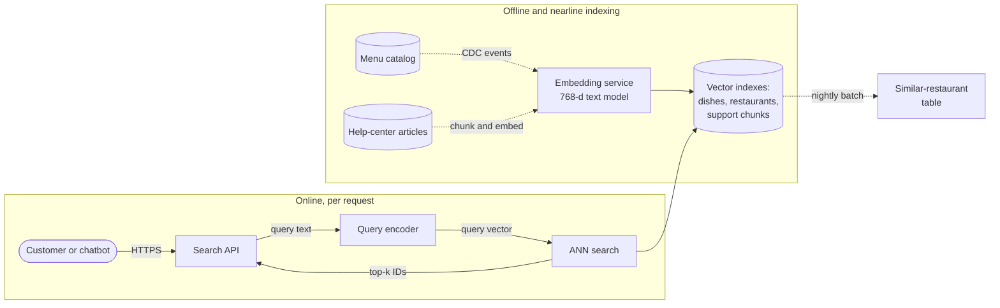
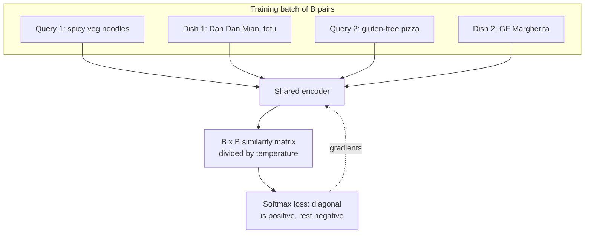
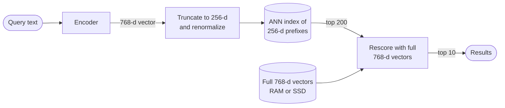

# Chapter 74 — Embeddings, Vector Search and Vector Databases

> **Level:** 3–4 · **Track:** B (ML/AI) · **Estimated reading time:** 6 h

A QuickBite customer types "spicy vegetarian noodles" into the search box. No dish on the platform has exactly that name. One restaurant lists "Dan Dan Mian (tofu, chili oil)", another "Szechuan Veg Lo Mein — hot", a third "Pad Kee Mao Jay". The lexical engine of Chapter 16 matches words, so it finds the "Lo Mein" (it contains "Veg") and misses the other two. A person would find all three at once, because a person matches *meaning*. **Vector search** gives software the same ability: a neural model turns every dish description and every query into a list of a few hundred numbers, arranged so that things with similar meaning land close together, and the search engine returns the stored vectors closest to the query's vector.

The idea is simple. Doing it fast is not. Comparing one query with 5 million dish vectors means billions of multiply-adds; at 100 million vectors a single query reads 300 GB of memory. This chapter is about the data structures and systems that make "find the nearest vectors" take a few milliseconds instead of a second: **approximate nearest neighbor (ANN)** indexes (HNSW graphs, IVF clustering, product quantization, SSD-resident graphs), filtering, updates, and the architecture of the **vector databases** built around them. It owns these topics for the book. Hybrid lexical-plus-vector retrieval, reranking and the rest of retrieval-augmented generation (RAG) are in Chapter 75; two-tower recommendation models, which produce vectors for this machinery, are in §68.6.

::: note
**QuickBite assumptions used in this chapter.** Teaching assumptions, not measurements of a real company. Reused: 50,000 restaurants with about 5 million dishes (§58.6), spread over 20 cities and 4,000 delivery zones (Ch 62, Ch 70), so about 250,000 dishes per city; about 1,200 restaurants (120,000 dishes) can deliver to a typical address at dinner time (§68.3); search peaks at 2,000 requests per second (RPS) with a 300 ms p99 target (§2.4, §2.11); peak-to-average traffic ratio 9.6 (§18.11); the support chatbot of Chapter 65. **New in this chapter:** dish and support text is embedded by a 768-dimension text model; the vector part of dish search gets 30 ms of the 300 ms search budget; the help center holds 8,000 articles split into about 60,000 chunks; the chatbot issues about 15 retrieval queries per second at peak. Sizes use SI units (1 GB = 10⁹ bytes); one multiply-add counts as 2 floating-point operations (FLOPs), as in Chapters 58 and 64.
:::

## 74.1 Learning objectives

After this chapter you should be able to:

- Choose a text, multilingual or multimodal embedding model by task, dimension, cost and license, and explain contrastive training and Matryoshka embeddings.
- Derive why cosine similarity, dot product and Euclidean distance rank identically on unit-length vectors, and when they differ.
- Compute the cost of exact search, and decide when exact search on CPU or GPU is good enough.
- Measure an ANN index with recall@k, latency, throughput, memory and build time, and read a recall–latency curve.
- Explain and tune HNSW (M, efConstruction, efSearch) and IVF (nlist, nprobe), and estimate their memory and candidate counts.
- Compress vectors with product, scalar and binary quantization, and size distance tables and memory per vector.
- Explain ScaNN's anisotropic quantization and DiskANN's SSD-resident graph at a conceptual level.
- Predict recall collapse under post-filtering and choose between pre-filtering, post-filtering and filtered graph search.
- Design segment-based ingestion with tombstones and rebuilds, and the sharding, replication and routing of a vector database.
- Size a vector search deployment for memory and throughput, and choose between a library, a database extension and a dedicated vector database.

## 74.2 Prerequisites

- Vectors, dot product, cosine similarity and the cost of matrix multiplication — §4.9 (every distance in this chapter is one of these).
- Memory hierarchy and bandwidth — §5.5, §64.5 (exact search is limited by memory bandwidth).
- Inverted indexes, BM25, immutable segments, tombstones and scatter–gather — §16.3, §16.6, §16.7 (vector indexes reuse the same system patterns).
- LSM trees and compaction — §13.8–§13.9 (vector database segments behave like SSTables).
- Partitioning and replication — §14.3, §14.6 (how a large index is split across nodes).
- Embeddings as learned vectors — §58.6; two-tower retrieval and in-batch negatives — §68.6 (where many vectors come from).
- Quantization basics: scale, zero-point and error — §67.4 (reused for scalar quantization).

## 74.3 Embedding models

### 74.3.1 What an embedding model does

::: definition
**Definition — Embedding model.** A neural network that maps an input (a sentence, a document chunk, an image, a user's history) to a fixed-length vector of $d$ real numbers, the **embedding**, such that inputs that are similar for the task have vectors with high similarity. A **bi-encoder** (dual encoder) embeds queries and documents independently, so document vectors can be computed once and stored.
:::

#### First-principles explanation

Picture a vast library in which a librarian shelves every book by *topic* rather than by title, with related topics on neighboring shelves. To find books like the one in your hand, you walk to its shelf and look around. An embedding model is that librarian for a space with hundreds of dimensions instead of three: it assigns every text a coordinate, and closeness in that space stands for closeness in meaning. "Spicy vegetarian noodles" and "Dan Dan Mian (tofu, chili oil)" get nearby coordinates even though they share no word.

Chapter 58 introduced embeddings as rows of a table learned for IDs (§58.6). The models here are different in one important way: they compute a vector from *content*, so a dish added a minute ago gets a sensible vector immediately, without any training on it.

#### Why does this exist?

Lexical search (Chapter 16) fails on vocabulary mismatch: synonyms, paraphrases, other languages, misspellings. Hand-written synonym lists do not scale to 5 million dishes in a dozen cuisines. Embeddings learn these equivalences from data. Sentence-BERT made this practical by turning BERT into a bi-encoder: finding the most similar pair among 10,000 sentences dropped from about 65 hours with a cross-encoder BERT to about 5 seconds, because each sentence is encoded once [Reimers and Gurevych 2019].

#### How it works internally

1. **Tokenize** the input and run it through a transformer encoder (Chapter 72), producing one vector per token.
2. **Pool** the token vectors into one: the mean of all tokens, or the vector at a special first token.
3. Optionally **project** to the output dimension and **normalize** to unit length.
4. **Index** the document vectors offline; at query time, embed the query with the same model (sometimes with a different instruction prefix, such as `query:` versus `passage:` in the E5 family [Wang et al. 2022]) and search.

**Figure 74.1 — Where embeddings and vector search sit in QuickBite.**

**Reading the diagram.** Offline, menu changes arrive asynchronously (dotted arrows) as change-data-capture events (§16.10.2), and help-center articles are chunked; both are embedded by the same 768-dimension model and written into three vector indexes, which form the storage boundary of this chapter. Online, every synchronous request (solid arrows) embeds the query with the *same model version* and asks the ANN service for the top $k$ IDs; the search API then fetches details and ranks. A nightly batch job reads the restaurant vectors and writes each restaurant's nearest neighbors to a key–value table, so "similar restaurants" needs no online search at all. Failure points: the query encoder (a model on the request path), a model-version mismatch between encoder and index, and index lag behind the catalog. Scaling: the encoder scales with query rate, the index with corpus size and query rate (§74.14).

### 74.3.2 Contrastive training intuition

A bi-encoder learns from **pairs that should match**: a query and the dish that was ordered, a question and the help article that resolved it, a photo and its caption. Training pulls each pair's vectors together and pushes apart vectors that should not match, typically the other pairs in the same batch (**in-batch negatives**). The loss is a softmax over similarities divided by a **temperature**, the same objective as the two-tower model of §68.6.1 [van den Oord et al. 2018; Karpukhin et al. 2020]. Three practical consequences follow:

- **The model learns the similarity its training pairs define.** A model trained on question–answer pairs places a question near its *answer*, not near other phrasings of the question. Pick models trained for your task (retrieval, clustering, classification).
- **Hard negatives matter.** Random negatives are easy; a negative that looks right but is wrong ("spicy chicken noodles" for a vegetarian query) teaches the fine distinctions. Dense Passage Retrieval mined such negatives with BM25 [Karpukhin et al. 2020].
- **The space is only meaningful within one model version.** Vectors from two models, or two training runs, are not comparable, so a model change means re-embedding the whole corpus (§74.12).

**Figure 74.2 — Contrastive training of a bi-encoder with in-batch negatives.**

**Reading the diagram.** A batch holds $B$ matching pairs. One encoder (shared weights, or two towers) embeds all queries and documents; the $B \times B$ matrix of similarities has the true pairs on its diagonal. The softmax loss raises each diagonal entry relative to its row, so every other document in the batch serves as a free negative. Gradients flow back asynchronously with respect to serving (dotted arrow): this is a training loop, not a request path. Larger batches give more negatives per example and usually better retrieval, which is why embedding models are trained with batches of thousands spread across GPUs (Chapter 65). The failure point is the data: noisy pairs, or "negatives" that are actually relevant, teach the wrong geometry.

### 74.3.3 Dimensions, normalization, languages and modalities

**Dimension** $d$ sets storage and compute: every vector costs $d \times s$ bytes, and every distance costs $d$ multiply-adds. As of 2026, common text models output 384, 768, 1,024, 1,536 or 3,072 dimensions. More dimensions usually help retrieval quality, with diminishing returns, while memory grows linearly.

**Normalization** to unit length makes cosine similarity and dot product identical (§74.4) and keeps a few long vectors from dominating. Normalize once at ingestion and at query time, unless the model's documentation says its magnitudes carry meaning.

**Multilingual** models place "noodles", "nouilles" and "麺" near each other, so one index serves several markets. They usually cost some quality per language compared with a monolingual model of equal size; evaluate on your own languages.

**Multimodal** models such as CLIP embed images and text into one space by contrastive training on image–caption pairs [Radford et al. 2021], so a text query can retrieve dish photos. Image and text vectors share a space only if they come from the same jointly trained model.

**Table 74.1 — Choosing an embedding model.**

| Criterion | What to check | QuickBite dish search |
|---|---|---|
| Task fit | Retrieval benchmarks close to your task; MTEB [Muennighoff et al. 2023] and BEIR [Thakur et al. 2021] as a first filter | Short queries against short menu text |
| Your data | Recall@10 on 200–500 labeled queries from your logs | Queries mined from orders after search |
| Languages | Per-language evaluation | English plus two local languages |
| Dimension | Memory $N d s$ and distance cost $\propto d$ | 768, truncatable (below) |
| Latency and cost | Query encoding time on target hardware | Must fit about 10 ms of the 30 ms vector budget |
| Hosting and license | Self-hosted or API; data residency; terms | Self-hosted, so queries stay internal |
| Max input length | Tokens per input; longer text is truncated or chunked | Dish text is short; help articles are chunked (Ch 75) |

Public leaderboards are a starting point, not a decision: they mix tasks, some models were trained on data close to the benchmarks, and none contains your queries. The only decisive test is recall on your own labeled queries.

### 74.3.4 Matryoshka embeddings

::: definition
**Definition — Matryoshka representation learning (MRL).** A training method in which the loss is applied to several nested prefixes of the embedding (for example its first 64, 128, 256, 512 and 768 dimensions), so that any prefix, renormalized, is itself a usable embedding, with quality degrading gracefully as it shrinks [Kusupati et al. 2022].
:::

Like Russian nesting dolls, each smaller embedding sits inside the larger one. An ordinary model spreads information across all dimensions, so dropping half of them destroys it; MRL forces the most important information into the first dimensions. Kusupati et al. report up to 14× smaller embeddings at equal ImageNet classification accuracy and up to 14× faster large-scale retrieval with an adaptive shortlist-then-rerank scheme [Kusupati et al. 2022].

**Figure 74.3 — Adaptive retrieval with Matryoshka embeddings.**

**Reading the diagram.** The query is encoded once at full dimension. Its first 256 dimensions search an index that is three times smaller and faster; the 200 best candidates are then rescored with full 768-dimension vectors fetched by ID, which can live in slower memory because only 200 are read per query. All steps are synchronous. The index and the full-vector store are separate storage boundaries that must hold the same model version. The failure point is truncating a model that was *not* trained with MRL, which loses quality sharply; check the model card. Scaling: the shortlist size trades recall against rescoring cost.

For QuickBite, 5 million dishes at 768 dimensions in 4-byte floats take $5 \times 10^6 \times 768 \times 4 = 15.4$ GB; the 256-dimension prefix takes 5.1 GB. Section 74.9 shrinks it further with quantization.

::: mistake
**"Higher-dimensional embeddings are always better."** Above a few hundred dimensions, gains on retrieval benchmarks are often small, while memory, bandwidth and distance cost grow linearly. A 384-dimension model that fits the index in one node's RAM can beat a 3,072-dimension model that forces sharding, compression and an extra network hop. Measure recall per gigabyte, not recall alone.
:::

